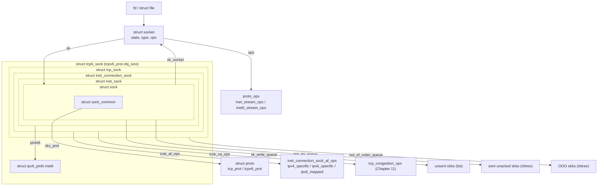

# 1. Core data structures

This chapter introduces the cast of characters for the entire book.  To keep you from getting lost in later chapters when `tp->snd_una` or `TCP_SKB_CB(skb)->sacked` appears, we first summarise the shapes of the TCP socket and `sk_buff`, along with which fields correspond to the RFC TCB variables.  Rather than walking through lines of code one by one, we annotate the key fields.

## The ELI5 version

In a building (building address = IP address), there are many rooms with room numbers (ports).  Attached to each room's door is **the room's mailbox** (`struct sock`).

Inside the mailbox are several shelves and a ledger.

- On the **outgoing shelf** (write queue), parcels that have not yet been sent onto the road are lined up.
- Parcels that have been sent once but for which a **signed receipt** (ACK) has not yet returned are kept on another "stub shelf" (retransmit queue), and if lost, undergo **re-shipping**.
- Arriving parcels go into the **inbox** (receive queue), while those that arrive with missing numbers go onto the **holding shelf** (out-of-order queue).
- The ledger records details such as "how far signed receipts have been received" (`snd_una`), "the next sequence number to send" (`snd_nxt`), and "the next sequence number we want to receive" (`rcv_nxt`).

The parcel itself is a **parcel with a shipping label** (`sk_buff`).  In addition to the shipping label (headers), a sticky note used only inside the mailbox (`TCP_SKB_CB`) is attached to it, recording notes such as "this parcel covers which sequence numbers" and "the peer says they received it via SACK".

The outer face on the outside of the door (the file descriptor side) is `struct socket`, whilst the substance on the inside is `struct sock`.  Even when the resident (the application) moves out (calls `close()`), the mailbox lingers for a while to tidy up the remaining parcels.

## What the RFCs say

### Overview of RFC 9293 (Transmission Control Protocol)

[RFC 9293](https://www.rfc-editor.org/rfc/rfc9293) was published in 2022 to consolidate and integrate the core TCP specification from RFC 793 and its supplementing updates, such as the TCP parts of RFC 1122 (obsoleting RFC 793).  Although comments in Linux source code still refer to "RFC793", the meanings of the variables remain unchanged in RFC 9293.

Each TCP connection maintains a collection of state called the **TCB (Transmission Control Block)**, whose core consists of the send and receive sequence variables ([RFC 9293 §3.3.1](https://www.rfc-editor.org/rfc/rfc9293#section-3.3.1)).

### Send sequence variables

```
      1         2          3          4
 ----------|----------|----------|----------
        SND.UNA    SND.NXT    SND.UNA
                             +SND.WND
 1 - Acknowledged
 2 - Sent but unacknowledged
 3 - Allowed for transmission (within window)
 4 - Not yet allowed
```

SND.UNA = oldest unacknowledged sequence number, SND.NXT = next sequence number to send, SND.WND = peer's advertised send window, SND.UP = urgent pointer, SND.WL1 / SND.WL2 = segment SEQ / ACK used for the last window update, ISS = initial send sequence number.

### Receive sequence variables

```
     1          2          3
 ----------|----------|----------
        RCV.NXT    RCV.NXT
                  +RCV.WND
 1 - Received and acknowledged
 2 - Acceptable (within window)
 3 - Not yet acceptable
```

RCV.NXT = next sequence number expected on an incoming segment, RCV.WND = receive window, RCV.UP = urgent pointer, IRS = initial receive sequence number.

### Rules implemented by the code

- Sequence numbers live in a circular 32-bit space, and comparisons are always performed modulo 2^32 ([RFC 9293 §3.4](https://www.rfc-editor.org/rfc/rfc9293#section-3.4)).  In Linux, `before()` / `after()` correspond to this.
- An "acceptable ACK" when an ACK arrives satisfies `SND.UNA < SEG.ACK =< SND.NXT`, and accepting it advances SND.UNA up to SEG.ACK ([RFC 9293 §3.10.7.4](https://www.rfc-editor.org/rfc/rfc9293#section-3.10.7.4)).
- Updating the send window occurs only when `SND.WL1 < SEG.SEQ` or `(SND.WL1 = SEG.SEQ and SND.WL2 =< SEG.ACK)`, preventing stale segments from rewinding the window (ibid. §3.10.7.4).
- The receiver should not shrink the right window edge ([RFC 9293 §3.8.6](https://www.rfc-editor.org/rfc/rfc9293#section-3.8.6)).
- The window value in the header is 16 bits and is interpreted by shifting left according to the Window Scale option in [RFC 7323 §2](https://www.rfc-editor.org/rfc/rfc7323#section-2) (the window on the SYN itself is not scaled).

Within the scope of this chapter, knowing "which variable corresponds to which field" is sufficient.  The implementation of each rule is traced line by line in chapters 5, 7, and 10.

## The big picture



There are two key points:

- `struct socket` is a thin shell on the VFS side; all protocol state lives inside and underneath `struct sock`.  Through prefix embedding (C-style "inheritance"), `struct sock` grows into `inet_sock` → `inet_connection_sock` → `tcp_sock`, and in IPv6 it is extended further with `ipv6_pinfo` at the end to form `tcp6_sock`.
- Behaviour is swapped out via three types of ops tables: `proto_ops` at the socket API layer, `proto` at the transport layer, and `inet_connection_sock_af_ops` for network-layer (v4/v6) dependent operations.

## Walking through the code

### Step 1: `struct socket` and `struct sock`

`struct socket` ([include/linux/net.h#L192](https://git.kernel.org/pub/scm/linux/kernel/git/netdev/net-next.git/tree/include/linux/net.h?id=279d5c8afcd38bd841832a39bfe1aa4f8518d98e#n192)) is the shell corresponding one-to-one with an fd.

```c
struct socket {
	socket_state		state;

	short			type;

	unsigned long		flags;

	struct file		*file;
	struct sock		*sk;
	const struct proto_ops	*ops; /* Might change with MPTCP. */

	struct socket_wq	wq;
};
```

- `ops` points to `proto_ops` ([include/linux/net.h#L236](https://git.kernel.org/pub/scm/linux/kernel/git/netdev/net-next.git/tree/include/linux/net.h?id=279d5c8afcd38bd841832a39bfe1aa4f8518d98e#n236)); `sendmsg(2)` descends in two tiers: `sock->ops->sendmsg` → `inet_sendmsg()` → `sk->sk_prot->sendmsg` = `tcp_sendmsg()` (Chapter 3).
- The key difference lies in their lifespans.  `struct socket` disappears upon `close()`, but `struct sock` continues through states like FIN_WAIT as an "orphan" whose `sk_socket` has been set to NULL by `sock_orphan()`.  This is why TCP code checks whether `sk->sk_socket` is NULL or inspects the `SOCK_DEAD` flag.

### Step 2: `struct sock_common` – common header for all socket types

`struct sock_common` ([include/net/sock.h#L156](https://git.kernel.org/pub/scm/linux/kernel/git/netdev/net-next.git/tree/include/net/sock.h?id=279d5c8afcd38bd841832a39bfe1aa4f8518d98e#n156)) is placed at the head of not only `struct sock`, but also `inet_timewait_sock` and `request_sock`.  It is thanks to this common header that an ehash lookup can return any of these three types.

```c
struct sock_common {
	union {
		__addrpair	skc_addrpair;
...
	};
...
	union {
		__portpair	skc_portpair;
...
	};

	unsigned short		skc_family;
	volatile unsigned char	skc_state;
...
	struct proto		*skc_prot;
	possible_net_t		skc_net;
...
	int			skc_dontcopy_begin[0];
...
	union {
		int		skc_incoming_cpu;
		u32		skc_rcv_wnd;
		u32		skc_tw_rcv_nxt; /* struct tcp_timewait_sock  */
	};

	refcount_t		skc_refcnt;
	/* private: */
	int                     skc_dontcopy_end[0];
...
};
```

- `skc_addrpair` / `skc_portpair`: unions used to match the 4-tuple with two comparisons: 64-bit followed by 32-bit (`inet_match()`).
- `skc_state` holds states such as `TCP_ESTABLISHED`; `sk_fullsock()` ([include/net/sock.h#L3032](https://git.kernel.org/pub/scm/linux/kernel/git/netdev/net-next.git/tree/include/net/sock.h?id=279d5c8afcd38bd841832a39bfe1aa4f8518d98e#n3032)) checks whether the state is neither `TCP_TIME_WAIT` nor `TCP_NEW_SYN_RECV` to determine whether a socket is a full socket.  It is only valid to cast a lookup result to `tcp_sk()` when it is a full socket.
- Fields like `skc_rcv_wnd` / `skc_tw_rcv_nxt` / `skc_tw_snd_nxt` reuse the same memory location as storage for TCP values needed by `request_sock` or timewait sockets.  Do not confuse these with the full socket's `tcp_sock`, which maintains separate fields like `rcv_wnd`.
- The range from `skc_dontcopy_begin` to `skc_dontcopy_end` (hash list nodes and refcnt) is not copied during duplication in `sk_clone_lock()`.

### Step 3: `struct sock` – queues, budgets, and cacheline groups

Following `__sk_common`, `struct sock` ([include/net/sock.h#L365](https://git.kernel.org/pub/scm/linux/kernel/git/netdev/net-next.git/tree/include/net/sock.h?id=279d5c8afcd38bd841832a39bfe1aa4f8518d98e#n365)) is arranged into six groups according to access patterns.  Here is an excerpt of only the parts touched on the TCP fast path:

```c
	__cacheline_group_begin(sock_write_rx);
...
	struct sk_buff_head	sk_receive_queue;
...
	struct {
		atomic_t	rmem_alloc;
		int		len;
		struct sk_buff	*head;
		struct sk_buff	*tail;
	} sk_backlog;
...
	__cacheline_group_begin(sock_write_rxtx);
	socket_lock_t		sk_lock;
	u32			sk_reserved_mem;
	int			sk_forward_alloc;
...
	__cacheline_group_begin(sock_write_tx);
...
	int			sk_wmem_queued;
	refcount_t		sk_wmem_alloc;
	unsigned long		sk_tsq_flags;
	union {
		struct sk_buff	*sk_send_head;
		struct rb_root	tcp_rtx_queue;
	};
	struct sk_buff_head	sk_write_queue;
```

- `sk_receive_queue`: in-order received data (the inbox).  `tcp_recvmsg()` reads from it (Chapter 6).
- `sk_backlog`: holding area for packets that arrive in softirq while a user process holds the socket lock.  Processed by `sk_backlog_rcv` (`tcp_v4_do_rcv()` / `tcp_v6_do_rcv()` in TCP) during `release_sock()` (Chapter 5).
- `sk_lock`: two-tier structure of a spinlock plus an `owned` flag.  Process context takes "ownership" via `lock_sock()`, while softirq acquires only the spinlock via `bh_lock_sock()` and inspects `sock_owned_by_user()`.
- `sk_forward_alloc` / `sk_wmem_queued` / `sk_rmem_alloc`: household budget (Chapter 10).  `sk_wmem_alloc` is the truesize of skbs handed down to the qdisc/NIC, used for TSQ (TCP Small Queues) gating (Chapter 4).
- `sk_write_queue`: list of skbs not yet transmitted (the outgoing shelf).
- `tcp_rtx_queue`: rbtree holding sent, unacknowledged skbs ordered by seq.  Since TCP no longer uses `sk_send_head`, the same space is shared in a union.

### Step 4: The embedding chain and casting macros

`struct inet_sock` ([include/net/inet_sock.h#L218](https://git.kernel.org/pub/scm/linux/kernel/git/netdev/net-next.git/tree/include/net/inet_sock.h?id=279d5c8afcd38bd841832a39bfe1aa4f8518d98e#n218)), `struct inet_connection_sock` ([include/net/inet_connection_sock.h#L81](https://git.kernel.org/pub/scm/linux/kernel/git/netdev/net-next.git/tree/include/net/inet_connection_sock.h?id=279d5c8afcd38bd841832a39bfe1aa4f8518d98e#n81)), and `struct tcp_sock` ([include/linux/tcp.h#L197](https://git.kernel.org/pub/scm/linux/kernel/git/netdev/net-next.git/tree/include/linux/tcp.h?id=279d5c8afcd38bd841832a39bfe1aa4f8518d98e#n197)) each embed their parent structure as their first member.

```c
struct inet_sock {
	/* sk and pinet6 has to be the first two members of inet_sock */
	struct sock		sk;
#if IS_ENABLED(CONFIG_IPV6)
	struct ipv6_pinfo	*pinet6;
...
#endif
...
#define inet_num		sk.__sk_common.skc_num
```

```c
struct inet_connection_sock {
	/* inet_sock has to be the first member! */
	struct inet_sock	  icsk_inet;
	struct request_sock_queue icsk_accept_queue;
	struct inet_bind_bucket	  *icsk_bind_hash;
	struct inet_bind2_bucket  *icsk_bind2_hash;
	struct timer_list	  icsk_delack_timer;
...
	__u32			  icsk_rto;
...
	const struct tcp_congestion_ops *icsk_ca_ops;
	const struct inet_connection_sock_af_ops *icsk_af_ops;
...
	__u8			  icsk_ca_state:5,
...
	u64			  icsk_ca_priv[104 / sizeof(u64)];
```

```c
#define inet_sk(ptr) container_of_const(ptr, struct inet_sock, sk)
#define inet_csk(ptr) container_of_const(ptr, struct inet_connection_sock, icsk_inet.sk)
#define tcp_sk(ptr) container_of_const(ptr, struct tcp_sock, inet_conn.icsk_inet.sk)
...
#define tcp_sk_rw(ptr) container_of(ptr, struct tcp_sock, inet_conn.icsk_inet.sk)
```

- `inet_connection_sock` represents the "connection-oriented" layer shared with protocols beyond TCP (such as MPTCP and historically DCCP).  It holds the accept queue, bind buckets, retransmit and delayed-ACK timers (Chapter 9), `icsk_rto`, congestion control ops and state (`icsk_ca_state` = `TCP_CA_Open/Disorder/CWR/Recovery/Loss`, Chapter 8), and the CC module's private scratchpad `icsk_ca_priv` (where CUBIC/BBR state lives, Chapters 12 and 13).
- `inet_sk()` ([include/net/inet_sock.h#L362](https://git.kernel.org/pub/scm/linux/kernel/git/netdev/net-next.git/tree/include/net/inet_sock.h?id=279d5c8afcd38bd841832a39bfe1aa4f8518d98e#n362)), `inet_csk()` ([include/net/inet_connection_sock.h#L152](https://git.kernel.org/pub/scm/linux/kernel/git/netdev/net-next.git/tree/include/net/inet_connection_sock.h?id=279d5c8afcd38bd841832a39bfe1aa4f8518d98e#n152)), and `tcp_sk()` ([include/linux/tcp.h#L564](https://git.kernel.org/pub/scm/linux/kernel/git/netdev/net-next.git/tree/include/linux/tcp.h?id=279d5c8afcd38bd841832a39bfe1aa4f8518d98e#n564)) are all offset 0, incurring zero runtime cost.  Thanks to `container_of_const()`, passing a `const struct sock *` only yields a `const struct tcp_sock *`.
- `tcp_sk_rw()` ([include/linux/tcp.h#L569](https://git.kernel.org/pub/scm/linux/kernel/git/netdev/net-next.git/tree/include/linux/tcp.h?id=279d5c8afcd38bd841832a39bfe1aa4f8518d98e#n569)) strips const in lockless listener contexts as an explicit marker saying "we write here".

### Step 5: `struct tcp_sock` – where the TCB variables live

The start of `tcp_sock` consists of six cacheline groups (`tcp_sock_read_tx`, `_read_txrx`, `_read_rx`, `_write_tx`, `_write_txrx`, `_write_rx`), and RFC TCB variables are scattered within them.  First are the read-mostly groups:

```c
	/* TXRX read-mostly hotpath cache lines */
	__cacheline_group_begin(tcp_sock_read_txrx);
	u32	tsoffset;	/* timestamp offset */
	u32	snd_wnd;	/* The window we expect to receive	*/
	u32	mss_cache;	/* Cached effective mss, not including SACKS */
	u32	snd_cwnd;	/* Sending congestion window		*/
	u32	prr_out;	/* Total number of pkts sent during Recovery. */
	u32	lost_out;	/* Lost packets			*/
	u32	sacked_out;	/* SACK'd packets			*/
	u16	tcp_header_len;	/* Bytes of tcp header to send		*/
	u8	scaling_ratio;	/* see tcp_win_from_space() */
...
	__cacheline_group_end(tcp_sock_read_txrx);

	/* RX read-mostly hotpath cache lines */
	__cacheline_group_begin(tcp_sock_read_rx);
	u32	copied_seq;	/* Head of yet unread data */
	u32	snd_wl1;	/* Sequence for window update		*/
	u32	tlp_high_seq;	/* snd_nxt at the time of TLP */
	u32	rttvar_us;	/* smoothed mdev_max			*/
	u32	retrans_out;	/* Retransmitted packets out		*/
	u16	advmss;		/* Advertised MSS			*/
	u16	urg_data;	/* Saved octet of OOB data and control flags */
	u32	lost;		/* Total data packets lost incl. rexmits */
	u32	snd_ssthresh;	/* Slow start size threshold		*/
	struct  minmax rtt_min;
	/* OOO segments go in this rbtree. Socket lock must be held. */
	struct rb_root	out_of_order_queue;
	__cacheline_group_end(tcp_sock_read_rx);
```

Next are the read-write groups, focusing on sequence variables:

```c
	u32	write_seq;	/* Tail(+1) of data held in tcp send buffer */
	u32	pushed_seq;	/* Last pushed seq, required to talk to windows */
...
	__cacheline_group_begin(tcp_sock_write_txrx);
...
	__be32	pred_flags;
	u64	tcp_clock_cache; /* cache last tcp_clock_ns() (see tcp_mstamp_refresh()) */
	u64	tcp_mstamp;	/* most recent packet received/sent */
	u32	rcv_nxt;	/* What we want to receive next		*/
	u32	snd_nxt;	/* Next sequence we send		*/
	u32	snd_una;	/* First byte we want an ack for	*/
	u32	window_clamp;	/* Maximal window to advertise		*/
	u32	srtt_us;	/* smoothed round trip time << 3 in usecs */
	u32	packets_out;	/* Packets which are "in flight"	*/
	u32	snd_up;		/* Urgent pointer		*/
...
	u32	rcv_wnd;	/* Current receiver window		*/
...
	__cacheline_group_end(tcp_sock_write_txrx);

	/* RX read-write hotpath cache lines */
	__cacheline_group_begin(tcp_sock_write_rx) __aligned(8);
...
	u32	rcv_wup;	/* rcv_nxt on last window update sent	*/
```

The correspondence with RFC variables is as follows:

| RFC 9293 | Linux | Notes |
| --- | --- | --- |
| SND.UNA | `tp->snd_una` | Advanced by `tcp_ack()` (Chapter 7) |
| SND.NXT | `tp->snd_nxt` | Advanced by `tcp_event_new_data_sent()` (Chapter 4). Never rewound even after RTO |
| SND.WND | `tp->snd_wnd` | Stored in **bytes with scaling already applied** |
| SND.UP | `tp->snd_up` | |
| SND.WL1 | `tp->snd_wl1` | |
| SND.WL2 | None | Compared against `snd_una` instead (see below) |
| ISS | None | Exists as `tcp_rsk(req)->snt_isn` until connection establishment; afterwards disappears into the initial value of `write_seq` |
| RCV.NXT | `tp->rcv_nxt` | Updated with `WRITE_ONCE()` in `tcp_rcv_nxt_update()` |
| RCV.WND | `tp->rcv_wnd` + `tp->rcv_wup` | Right edge = `rcv_wup + rcv_wnd` |
| RCV.UP | `tp->urg_seq` / `tp->urg_data` | |
| IRS | None | `tcp_rsk(req)->rcv_isn` |
| (Linux extension) | `tp->write_seq` | Tail of data queued by application + 1 |
| (Linux extension) | `tp->copied_seq` | Head of data not yet read by application |

For both sending and receiving, Linux adds one boundary line to the RFC's two lines:

```
Sender:    snd_una <= snd_nxt <= write_seq
           [ unacked (tcp_rtx_queue) ][ unsent (sk_write_queue) ]
           Right edge bound: snd_nxt <= tcp_wnd_end() = snd_una + snd_wnd

Receiver:  copied_seq <= rcv_nxt <= rcv_wup + rcv_wnd
           [ unread (sk_receive_queue) ][ acceptable (OOO also here) ]
```

Several helpers exist to read these:

```c
static inline bool before(__u32 seq1, __u32 seq2)
{
        return (__s32)(seq1-seq2) < 0;
}
#define after(seq2, seq1) 	before(seq1, seq2)
```

```c
static inline u32 tcp_receive_window(const struct tcp_sock *tp)
{
	s32 win = tp->rcv_wup + tp->rcv_wnd - tp->rcv_nxt;

	if (win < 0)
		win = 0;
	return (u32) win;
}
```

- `before()` ([include/net/tcp.h#L315](https://git.kernel.org/pub/scm/linux/kernel/git/netdev/net-next.git/tree/include/net/tcp.h?id=279d5c8afcd38bd841832a39bfe1aa4f8518d98e#n315)) is literal §3.4 modulo 2^32 comparison.  Because the verdict inverts if the difference reaches or exceeds 2^31, PAWS (RFC 7323) is required.
- `tcp_receive_window()` ([include/net/tcp.h#L956](https://git.kernel.org/pub/scm/linux/kernel/git/netdev/net-next.git/tree/include/net/tcp.h?id=279d5c8afcd38bd841832a39bfe1aa4f8518d98e#n956)): `rcv_wnd` is the window "at the time it was last advertised", relative to `rcv_wup`.  As incoming data advances `rcv_nxt`, the remaining space decreases.  Since RFC RCV.WND represents the "currently remaining space", this function corresponds to RFC RCV.WND.  The requirement in §3.8.6 not to shrink the right edge is upheld by `tcp_select_window()` using this right edge `rcv_wup + rcv_wnd` as an anchor (Chapter 10).
- `tcp_wnd_end()` ([include/net/tcp.h#L1614](https://git.kernel.org/pub/scm/linux/kernel/git/netdev/net-next.git/tree/include/net/tcp.h?id=279d5c8afcd38bd841832a39bfe1aa4f8518d98e#n1614)) simply returns `snd_una + snd_wnd`, representing the right edge of the send window, SND.UNA + SND.WND.

The reason SND.WL2 does not exist becomes clear when looking at the window update check `tcp_may_update_window()`:

```c
static inline bool tcp_may_update_window(const struct tcp_sock *tp,
					const u32 ack, const u32 ack_seq,
					const u32 nwin)
{
	return	after(ack, tp->snd_una) ||
		after(ack_seq, tp->snd_wl1) ||
		(ack_seq == tp->snd_wl1 && (nwin > tp->snd_wnd || !nwin));
}
```

`tcp_may_update_window()` ([net/ipv4/tcp_input.c#L3881](https://git.kernel.org/pub/scm/linux/kernel/git/netdev/net-next.git/tree/net/ipv4/tcp_input.c?id=279d5c8afcd38bd841832a39bfe1aa4f8518d98e#n3881)) updates unconditionally if new data is acknowledged (`ack > snd_una`).  Because this function is called before advancing `snd_una`, `snd_una` doubles as RFC's SND.WL2.  Linux also adds its own relaxations, accepting updates if the window expands or becomes zero even with the same SEQ.

Finally, in-flight accounting: `packets_out`, `sacked_out`, `lost_out`, and `retrans_out` count **segments** (sums of `tcp_skb_pcount()`), not skb counts.  `tcp_packets_in_flight()` ([include/net/tcp.h#L1549](https://git.kernel.org/pub/scm/linux/kernel/git/netdev/net-next.git/tree/include/net/tcp.h?id=279d5c8afcd38bd841832a39bfe1aa4f8518d98e#n1549)) returns `packets_out - (sacked_out + lost_out) + retrans_out`, which corresponds to "pipe" in RFC 6675.  This value is compared against `snd_cwnd` (Chapters 4 and 8).  Because these four counters aggregate the `sacked` bits described in the next Step, any divergence between them leads to `WARN_ON` or runaway cwnd.

### Step 6: `sk_buff`, `skb_shared_info`, and `tcp_skb_cb`

The head of `struct sk_buff` ([include/linux/skbuff.h#L892](https://git.kernel.org/pub/scm/linux/kernel/git/netdev/net-next.git/tree/include/linux/skbuff.h?id=279d5c8afcd38bd841832a39bfe1aa4f8518d98e#n892)), highlighting the parts relevant to TCP:

```c
struct sk_buff {
	union {
		struct {
			/* These two members must be first to match sk_buff_head. */
			struct sk_buff		*next;
			struct sk_buff		*prev;

			union {
				struct net_device	*dev;
...
			};
		};
		struct rb_node		rbnode; /* used in netem, ip4 defrag, and tcp stack */
		struct list_head	list;
		struct llist_node	ll_node;
	};

	struct sock		*sk;

	union {
		ktime_t		tstamp;
		u64		skb_mstamp_ns; /* earliest departure time */
	};
...
	char			cb[48] __aligned(8);

	union {
		struct {
			unsigned long	_skb_refdst;
			void		(*destructor)(struct sk_buff *skb);
		};
		struct list_head	tcp_tsorted_anchor;
...
	};
```

- `next/prev` and `rbnode` form a union.  While on `sk_write_queue`, the skb is in a linked list; once placed on `tcp_rtx_queue` or `out_of_order_queue`, it is used as an rbtree node.
- `skb_mstamp_ns`: TCP stores an "earliest departure time" (EDT) in nanoseconds on outgoing skbs, which is used for RTT measurement, RACK, and pacing (`sch_fq`) (Chapters 4, 7, and 8).
- `tcp_tsorted_anchor`: list node for `tp->tsorted_sent_queue`, which orders sent, un-SACKed skbs by **transmission time**.  Because the rtx queue is ordered by sequence number, RACK needs a separate link to scan in timestamp order.  Since it is unioned with `_skb_refdst/destructor`, saving and restoring them is required before cloning for transmission.
- The payload data is split between the linear buffer (`head` to `end`) and page fragments in `frags[]` of `skb_shared_info` ([include/linux/skbuff.h#L599](https://git.kernel.org/pub/scm/linux/kernel/git/netdev/net-next.git/tree/include/linux/skbuff.h?id=279d5c8afcd38bd841832a39bfe1aa4f8518d98e#n599), accessed via `skb_shinfo()`), located immediately after it.  Outgoing TCP skbs typically consist of a small linear area for headers and page frags for the payload (Chapter 3).  `gso_size/gso_segs/gso_type` are for TSO/GSO, and `dataref` is the reference count sharing data across clones; TCP hands clones to lower layers while keeping the original skb on the retransmit queue.

TCP's interpretation of `cb[48]` is `struct tcp_skb_cb` ([include/net/tcp.h#L1138](https://git.kernel.org/pub/scm/linux/kernel/git/netdev/net-next.git/tree/include/net/tcp.h?id=279d5c8afcd38bd841832a39bfe1aa4f8518d98e#n1138)):

```c
struct tcp_skb_cb {
	__u32		seq;		/* Starting sequence number	*/
	__u32		end_seq;	/* SEQ + FIN + SYN + datalen	*/
	union {
		/* Notes :
		 *	tcp_tw_isn is used in input path only
		 *	(isn chosen by tcp_timewait_state_process())
		 * 	  tcp_gso_segs/size are used in write queue only,
		 *	  cf tcp_skb_pcount()/tcp_skb_mss()
		 */
		u32		tcp_tw_isn;
		struct {
			u16	tcp_gso_segs;
			u16	tcp_gso_size;
		};
	};
	__u16		tcp_flags;	/* TCP header flags (tcp[12-13])*/

	__u8		sacked;		/* State flags for SACK.	*/
	__u8		ip_dsfield;	/* IPv4 tos or IPv6 dsfield	*/
#define TSTAMP_ACK_SK	0x1
#define TSTAMP_ACK_BPF	0x2
	__u8		txstamp_ack:2,	/* Record TX timestamp for ack? */
			eor:1,		/* Is skb MSG_EOR marked? */
			has_rxtstamp:1,	/* SKB has a RX timestamp	*/
			unused:4;
	__u32		ack_seq;	/* Sequence number ACK'd	*/
	union {
		struct {
#define TCPCB_DELIVERED_CE_MASK ((1U<<20) - 1)
			/* There is space for up to 24 bytes */
			__u32 is_app_limited:1, /* cwnd not fully used? */
			      delivered_ce:20,
			      unused:11;
			/* pkts S/ACKed so far upon tx of skb, incl retrans: */
			__u32 delivered;
			/* start of send pipeline phase */
			u64 first_tx_mstamp;
			/* when we reached the "delivered" count */
			u64 delivered_mstamp;
		} tx;   /* only used for outgoing skbs */
		union {
			struct inet_skb_parm	h4;
#if IS_ENABLED(CONFIG_IPV6)
			struct inet6_skb_parm	h6;
#endif
		} header;	/* For incoming skbs */
	};
};
```

- `seq` / `end_seq`: sequence number range in host byte order.  Because `end_seq` counts SYN and FIN as 1 each, `end_seq - seq` does not always equal the payload length.  Queue operations and SACK processing are all conducted using these two fields.
- `tcp_gso_segs` / `tcp_gso_size`: how many MSS segments an skb on the write queue represents (`tcp_skb_pcount()`, [include/net/tcp.h#L1237](https://git.kernel.org/pub/scm/linux/kernel/git/netdev/net-next.git/tree/include/net/tcp.h?id=279d5c8afcd38bd841832a39bfe1aa4f8518d98e#n1237)).  On incoming skbs, the same location is reused for `tcp_tw_isn`.
- `sacked`: scoreboard for outgoing skbs.  Defined in `enum tcp_skb_cb_sacked_flags` ([include/net/tcp.h#L1120](https://git.kernel.org/pub/scm/linux/kernel/git/netdev/net-next.git/tree/include/net/tcp.h?id=279d5c8afcd38bd841832a39bfe1aa4f8518d98e#n1120)); `TCPCB_SACKED_ACKED` (SACKed), `TCPCB_SACKED_RETRANS` (retransmitted and in flight), and `TCPCB_LOST` (marked lost) constitute `TCPCB_TAGBITS`.  The sums of their segment counts become `sacked_out` / `retrans_out` / `lost_out`.  `TCPCB_EVER_RETRANS` indicates whether the segment was ever retransmitted, used in Karn's algorithm (not measuring RTT from retransmitted skbs, Chapter 7).
- `tx`: snapshot of `tp->delivered` etc. taken at transmission time, used upon ACK to generate delivery rate samples (input to BBR, Chapter 13).
- `header`: on reception, `tcp_v4_fill_cb()` / `tcp_v6_fill_cb()` move the IP-layer control block `IPCB()` / `IP6CB()` here using `memmove()` before populating `seq` and other fields.  IP-layer control information is shifted backwards to place `seq` at the beginning of `cb`.

`tcp_init()` ([net/ipv4/tcp.c#L5297](https://git.kernel.org/pub/scm/linux/kernel/git/netdev/net-next.git/tree/net/ipv4/tcp.c?id=279d5c8afcd38bd841832a39bfe1aa4f8518d98e#n5297)) contains `BUILD_BUG_ON(sizeof(struct tcp_skb_cb) > sizeof_field(struct sk_buff, cb));`, preventing the kernel from building if the struct exceeds 48 bytes.

### Step 7: Three types of ops tables

`socket(AF_INET, SOCK_STREAM, 0)` selects `inet_stream_ops` and `tcp_prot` from `inetsw_array` ([net/ipv4/af_inet.c#L1159](https://git.kernel.org/pub/scm/linux/kernel/git/netdev/net-next.git/tree/net/ipv4/af_inet.c?id=279d5c8afcd38bd841832a39bfe1aa4f8518d98e#n1159)) inside `inet_create()` ([net/ipv4/af_inet.c#L259](https://git.kernel.org/pub/scm/linux/kernel/git/netdev/net-next.git/tree/net/ipv4/af_inet.c?id=279d5c8afcd38bd841832a39bfe1aa4f8518d98e#n259)), and `sk_alloc()` ([net/core/sock.c#L2303](https://git.kernel.org/pub/scm/linux/kernel/git/netdev/net-next.git/tree/net/core/sock.c?id=279d5c8afcd38bd841832a39bfe1aa4f8518d98e#n2303)) allocates a slab object sized `tcp_prot.obj_size`.  Finally, `sk->sk_prot->init` = `tcp_v4_init_sock()` ([net/ipv4/tcp_ipv4.c#L2399](https://git.kernel.org/pub/scm/linux/kernel/git/netdev/net-next.git/tree/net/ipv4/tcp_ipv4.c?id=279d5c8afcd38bd841832a39bfe1aa4f8518d98e#n2399)) sets `icsk_af_ops = &ipv4_specific`.

Excerpt from `tcp_prot` ([net/ipv4/tcp_ipv4.c#L3350](https://git.kernel.org/pub/scm/linux/kernel/git/netdev/net-next.git/tree/net/ipv4/tcp_ipv4.c?id=279d5c8afcd38bd841832a39bfe1aa4f8518d98e#n3350)):

```c
struct proto tcp_prot = {
	.name			= "TCP",
...
	.recvmsg		= tcp_recvmsg,
	.sendmsg		= tcp_sendmsg,
	.splice_eof		= tcp_splice_eof,
	.backlog_rcv		= tcp_v4_do_rcv,
	.release_cb		= tcp_release_cb,
...
	.memory_allocated	= &net_aligned_data.tcp_memory_allocated,
...
	.obj_size		= sizeof(struct tcp_sock),
	.freeptr_offset		= offsetof(struct tcp_sock,
					   inet_conn.icsk_inet.sk.sk_freeptr),
	.slab_flags		= SLAB_TYPESAFE_BY_RCU,
	.twsk_prot		= &tcp_timewait_sock_ops,
	.rsk_prot		= &tcp_request_sock_ops,
	.h.hashinfo		= NULL,
```

- `backlog_rcv` / `release_cb`: entry points to process backlog packets accumulated while the socket was owned by the user, as well as flags deferred by TSQ or timers (`TCP_DEFERRED_ALL`), during `release_sock()` (Chapters 4, 5, and 9).
- Under `memory_allocated`: protocol-wide memory budget (`tcp_mem`).  Covered in Chapter 10.
- `SLAB_TYPESAFE_BY_RCU`: because objects may be freed and reused during RCU lookups, the lookup reader re-validates the 4-tuple after acquiring a reference count.  See Design history below regarding `freeptr_offset`.
- `h.hashinfo = NULL`: the hash table is resolved per netns via `tcp_get_hashinfo()` (Step 9).

`ipv4_specific` ([net/ipv4/tcp_ipv4.c#L2361](https://git.kernel.org/pub/scm/linux/kernel/git/netdev/net-next.git/tree/net/ipv4/tcp_ipv4.c?id=279d5c8afcd38bd841832a39bfe1aa4f8518d98e#n2361)) is the interface through which TCP code invokes the IP layer:

```c
const struct inet_connection_sock_af_ops ipv4_specific = {
	.queue_xmit	   = ip_queue_xmit,
	.rebuild_header	   = inet_sk_rebuild_header,
	.sk_rx_dst_set	   = inet_sk_rx_dst_set,
	.conn_request	   = tcp_v4_conn_request,
	.syn_recv_sock	   = tcp_v4_syn_recv_sock,
	.net_header_len	   = sizeof(struct iphdr),
	.setsockopt	   = ip_setsockopt,
	.getsockopt	   = ip_getsockopt,
	.mtu_reduced	   = tcp_v4_mtu_reduced,
};
```

`__tcp_transmit_skb()` simply calls `icsk->icsk_af_ops->queue_xmit()` at the end, completely oblivious to whether v4 or v6 is running (Chapter 4).  `net_header_len` is used in calculating the MSS.

### Step 8: The IPv6 side – `tcp6_sock`, `inet6_sk()`, and `ipv6_mapped`

```c
struct tcp6_sock {
	struct tcp_sock	  tcp;

	struct ipv6_pinfo inet6;
};
```

```c
static inline struct ipv6_pinfo *inet6_sk(const struct sock *__sk)
{
	return sk_fullsock(__sk) ? inet_sk(__sk)->pinet6 : NULL;
}
```

- `struct tcp6_sock` ([include/linux/ipv6.h#L323](https://git.kernel.org/pub/scm/linux/kernel/git/netdev/net-next.git/tree/include/linux/ipv6.h?id=279d5c8afcd38bd841832a39bfe1aa4f8518d98e#n323)) simply appends `struct ipv6_pinfo` ([include/linux/ipv6.h#L230](https://git.kernel.org/pub/scm/linux/kernel/git/netdev/net-next.git/tree/include/linux/ipv6.h?id=279d5c8afcd38bd841832a39bfe1aa4f8518d98e#n230)) to the end of `tcp_sock`.  The destination and source IPv6 addresses themselves reside in `sock_common`'s `skc_v6_daddr` / `skc_v6_rcv_saddr`, whilst `ipv6_pinfo` holds the source `saddr`, flow label, `dst_cookie`, IPv6 extension headers (`opt`), hop limit, and so on.
- `inet6_sk()` ([include/linux/ipv6.h#L343](https://git.kernel.org/pub/scm/linux/kernel/git/netdev/net-next.git/tree/include/linux/ipv6.h?id=279d5c8afcd38bd841832a39bfe1aa4f8518d98e#n343)) accesses this via the `pinet6` pointer.  `pinet6` is calculated and set by `inet6_create()` ([net/ipv6/af_inet6.c#L105](https://git.kernel.org/pub/scm/linux/kernel/git/netdev/net-next.git/tree/net/ipv6/af_inet6.c?id=279d5c8afcd38bd841832a39bfe1aa4f8518d98e#n105)) using `inet6_sk_generic()` ([net/ipv6/af_inet6.c#L91](https://git.kernel.org/pub/scm/linux/kernel/git/netdev/net-next.git/tree/net/ipv6/af_inet6.c?id=279d5c8afcd38bd841832a39bfe1aa4f8518d98e#n91)) from `sk_prot->ipv6_pinfo_offset` (`offsetof(struct tcp6_sock, inet6)` for `tcpv6_prot`).  In an AF_INET `tcp_sock`, `pinet6` is NULL.
- `tcpv6_prot` ([net/ipv6/tcp_ipv6.c#L2280](https://git.kernel.org/pub/scm/linux/kernel/git/netdev/net-next.git/tree/net/ipv6/tcp_ipv6.c?id=279d5c8afcd38bd841832a39bfe1aa4f8518d98e#n2280)) differs only in details like `obj_size = sizeof(struct tcp6_sock)` and `backlog_rcv = tcp_v6_do_rcv`; its `sendmsg/recvmsg` are the exact same `tcp_sendmsg()` / `tcp_recvmsg()` as v4.

When connecting to a v4-mapped address (`::ffff:a.b.c.d`), `tcp_v6_connect()` ([net/ipv6/tcp_ipv6.c#L133](https://git.kernel.org/pub/scm/linux/kernel/git/netdev/net-next.git/tree/net/ipv6/tcp_ipv6.c?id=279d5c8afcd38bd841832a39bfe1aa4f8518d98e#n133)) swaps af_ops at runtime via `WRITE_ONCE(icsk->icsk_af_ops, &ipv6_mapped)`, sets `sk->sk_backlog_rcv` to `tcp_v4_do_rcv`, and calls `tcp_v4_connect()` (reverting them on failure).

```c
static const struct inet_connection_sock_af_ops ipv6_mapped = {
	.queue_xmit	   = ip_queue_xmit,
	.rebuild_header	   = inet_sk_rebuild_header,
	.sk_rx_dst_set	   = inet_sk_rx_dst_set,
	.conn_request	   = tcp_v6_conn_request,
	.syn_recv_sock	   = tcp_v6_syn_recv_sock,
	.net_header_len	   = sizeof(struct iphdr),
	.setsockopt	   = ipv6_setsockopt,
	.getsockopt	   = ipv6_getsockopt,
	.mtu_reduced	   = tcp_v4_mtu_reduced,
};
```

`ipv6_mapped` ([net/ipv6/tcp_ipv6.c#L2042](https://git.kernel.org/pub/scm/linux/kernel/git/netdev/net-next.git/tree/net/ipv6/tcp_ipv6.c?id=279d5c8afcd38bd841832a39bfe1aa4f8518d98e#n2042)) is a hybrid: "the socket is AF_INET6 (`tcp6_sock`, `sk_family == AF_INET6`), but on the wire it is IPv4", transmitting via `ip_queue_xmit` and using IPv6 sockopts.  Assuming a v6 code path based solely on `sk_family` is a classic recipe for bugs.  On the passive side, `tcp_v6_syn_recv_sock()` performs the same swap when creating a child socket from a v4 SYN.

### Step 9: `inet_hashinfo` – the bird's-eye view

```c
struct inet_hashinfo {
	/* This is for sockets with full identity only.  Sockets here will
	 * always be without wildcards and will have the following invariant:
	 *
	 *          TCP_ESTABLISHED <= sk->sk_state < TCP_CLOSE
	 *
	 */
	struct inet_ehash_bucket	*ehash;
...
	struct inet_bind_hashbucket	*bhash;
...
	struct inet_bind_hashbucket	*bhash2;
...
	struct inet_listen_hashbucket	*lhash2;

	bool				pernet;
} ____cacheline_aligned_in_smp;
```

`struct inet_hashinfo` ([include/net/inet_hashtables.h#L147](https://git.kernel.org/pub/scm/linux/kernel/git/netdev/net-next.git/tree/include/net/inet_hashtables.h?id=279d5c8afcd38bd841832a39bfe1aa4f8518d98e#n147)) is the shared v4/v6 TCP table, resolved via `tcp_get_hashinfo()` ([include/net/inet_hashtables.h#L180](https://git.kernel.org/pub/scm/linux/kernel/git/netdev/net-next.git/tree/include/net/inet_hashtables.h?id=279d5c8afcd38bd841832a39bfe1aa4f8518d98e#n180)) to `net->ipv4.tcp_death_row.hashinfo`.  For the fast path, only `ehash` matters.  Full sockets from ESTABLISHED onwards, TIME_WAIT sockets, and `request_sock` (NEW_SYN_RECV) line up in the same bucket chains via `hlist_nulls`, traversed locklessly under RCU by `__inet_lookup_established()` on receive.  `bhash`, `bhash2`, and `lhash2` for bind/listen are covered in Chapter 2.

## RFC vs Linux

| Item | RFC 9293 | Linux | Reason |
| --- | --- | --- | --- |
| SND.WL2 | Independent variable | None (substituted by `snd_una`) | Window updates are evaluated before processing the ACK, so `snd_una` is equivalent to the previous ACK value |
| Window update conditions | Lexicographical comparison of WL1/WL2 | Updates even with same SEQ if window expands or is zero | Prevents missing window expansions or delaying zero-window detection |
| SND.WND | Value from header | Stored in bytes with scaling already applied | Avoids shifting on every comparison |
| RCV.WND | Current receive window | `rcv_wnd` is the last advertised value; current value is `tcp_receive_window()` | Prevents shrinking by using the right edge `rcv_wup + rcv_wnd` as a fixed reference point |
| Send/receive queues | Abstract buffers | Adds `write_seq` / `copied_seq` with 4 separate structures: unsent list, sent rbtree, OOO rbtree, and timestamp-ordered list | Enables O(log n) SACK/RACK operations and timestamp-ordered scanning |
| ISS / IRS | Kept in TCB | Not kept after establishment (only present in request sock) | Unneeded after connection establishment; features like TCP-AO maintain them separately |
| Accounting units | Bytes | In-flight accounted in segments (`packets_out` etc.) | Historical reasons: cwnd is managed in packet units (Chapter 11) |

## Design history

- `ce43b03e8889` "net: move inet_dport/inet_num in sock_common" (Eric Dumazet, 2012): moved ports into `sock_common`, allowing `skc_portpair` to match the 4-tuple with two comparisons within a single cacheline.  The subsequent `634fb979e8f3` "inet: includes a sock_common in request_sock" (Eric Dumazet, 2013) gave `request_sock` the same header, laying the foundation for later inserting SYNs directly into ehash (NEW_SYN_RECV).
- `e7eadb4de9e6` "ipv6: inet6_sk() should use sk_fullsock()" (Eric Dumazet, 2015): in an era where ehash can return request/timewait sockets, this prevented `inet6_sk()` from reading invalid memory on "mini-sockets" that lack `pinet6`.
- `9f5afeae5152` "tcp: use an RB tree for ooo receive queue" (Yaogong Wang, 2016) and `75c119afe14f` "tcp: implement rb-tree based retransmit queue" (Eric Dumazet, 2017): when BDP reaches the scale of 100,000 packets, traversing a linear list took several milliseconds per SACK and blew out the CPU cache.  To eliminate quadratic complexity attacks against malicious SACKs, sent skbs were moved to an rbtree, and `sk_send_head` was unioned with `tcp_rtx_queue`.
- `b9f64820fb22` "tcp: track data delivery rate for a TCP connection" (Yuchung Cheng, 2016): recorded `delivered` at transmit time in `tcp_skb_cb.tx` to calculate delivery rates upon receiving ACKs, forming the foundation for BBR.
- `e2080072ed2d` "tcp: new list for sent but unacked skbs for RACK recovery" (Eric Dumazet, Yuchung Cheng, Neal Cardwell, 2017): because the rtx queue is ordered by sequence number, this added the timestamp-ordered `tsorted_sent_queue` for RACK.  To avoid enlarging `sk_buff`, it was unioned with `_skb_refdst/destructor`, introducing the invariant that it must be cleared to zero before cloning.
- `9115e8cd2a0c` "net: reorganize struct sock for better data locality" (Eric Dumazet, 2016) and `5d4cc87414c5` "net: reorganize \"struct sock\" fields" (Eric Dumazet, 2024): the latter introduced six groups such as `sock_write_rx`, reporting a 4-5% improvement in TCP_RR.
- `aeb9ce058d7c` "cache: enforce cache groups" and `d5fed5addb2b` "tcp: reorganize tcp_sock fast path variables" (Coco Li, 2023): reduced the cachelines occupied by fast-path variables from 12 to 8.  Only the boundaries between read-mostly and read-write are enforced with `____cacheline_aligned` to prevent false sharing.  `tcp_struct_check()` verifies member placement at build time.  Variables continue to be rearranged to accommodate new fields, as in `c3426ba2ed69` "tcp: reorganize tcp_sock_write_txrx group for variables later" (Chia-Yu Chang, 2025) for AccECN.
- `f5f80e32de12` "ipv6: remove hard coded limitation on ipv6_pinfo" (Eric Dumazet, 2023): previously, the offset was calculated backwards from `obj_size` assuming `ipv6_pinfo` was at the very end of the object.  Because padding from alignment in the aforementioned `tcp_sock` reorganisation broke this assumption, `ipv6_pinfo_offset` was made explicit.
- `e9d9da91548b` "tcp: preserve const qualifier in tcp_sk()" (Eric Dumazet, 2023): switched to `container_of_const()` and introduced `tcp_sk_rw()`, explicitly annotating locations where writes occur in lockless listeners at the type level.
- `d1e5e6408b30` "tcp: Introduce optional per-netns ehash." (Kuniyuki Iwashima, 2022): origin of `h.hashinfo = NULL` and `tcp_get_hashinfo()`.
- `ed9b70040d7b` "tcp: reduce tcp sockets size by one cache line" (Eric Dumazet, 2026): slabs marked `SLAB_TYPESAFE_BY_RCU` placed the freelist pointer outside the object because they cannot predict which bits an RCU reader might access, consuming an extra cacheline when combined with `SLAB_HWCACHE_ALIGN`.  This was resolved by providing `sk_freeptr` unioned with `sk_rcu` (which RCU readers never inspect) and informing SLUB via `freeptr_offset` (saving one cacheline and increasing objects per slab from 12 to 13 for TCPv6).

## Performance notes

- **Cacheline groups**: the six groups in `tcp_sock` represent (TX / RX / both) × (read-mostly / read-write).  For instance, `snd_wnd`, `mss_cache`, and `snd_cwnd` are read on both TX and RX but written infrequently, placing them in `tcp_sock_read_txrx`; `snd_una`, `snd_nxt`, `rcv_nxt`, and `packets_out` are written on every ACK, placing them in `tcp_sock_write_txrx`.  The layout is documented in `Documentation/networking/net_cachelines/tcp_sock.rst`, and patches adding fields are required to update both this document and `tcp_struct_check()` ([net/ipv4/tcp.c#L5202](https://git.kernel.org/pub/scm/linux/kernel/git/netdev/net-next.git/tree/net/ipv4/tcp.c?id=279d5c8afcd38bd841832a39bfe1aa4f8518d98e#n5202)).  Because `CACHELINE_ASSERT_GROUP_MEMBER()` ([include/linux/cache.h#L151](https://git.kernel.org/pub/scm/linux/kernel/git/netdev/net-next.git/tree/include/linux/cache.h?id=279d5c8afcd38bd841832a39bfe1aa4f8518d98e#n151)) is a `BUILD_BUG_ON`, overflowing a group causes the build to fail.
- **Locks and execution contexts**: almost all fields in `tcp_sock` are protected by the socket lock (ownership via `lock_sock()` in process context, or `bh_lock_sock()` + `!sock_owned_by_user()` in softirq).  Packets arriving in softirq while the socket is owned are deferred to `sk_backlog`, while timer and TSQ work is queued to deferred bits in `sk_tsq_flags`, all processed in batch by `tcp_release_cb()`.
- **Lockless readers**: paths like `tcp_poll()`, `tcp_stream_memory_free()`, `tcp_inq_hint()`, and `SIOCOUTQ`-family ioctls read without taking the socket lock, requiring writers to use `WRITE_ONCE()` and readers to use `READ_ONCE()`.  For example, `WRITE_ONCE(tp->rcv_nxt, seq)` in `tcp_rcv_nxt_update()` pairs with `READ_ONCE(tp->rcv_nxt)` in `tcp_inq_hint()`, and `READ_ONCE(tp->write_seq) - READ_ONCE(tp->snd_nxt)` pairs in `tcp_stream_memory_free()` (note that `tcp_get_info()` itself acquires `lock_sock_fast()`).  Fields such as `write_seq`, `copied_seq`, `rcv_nxt`, `snd_nxt`, and `snd_una` have progressively received annotations to appease KCSAN.
- **Fixed-point arithmetic**: `srtt_us` is stored scaled by 8 (`<< 3`) and `mdev_us` scaled by 4 (`<< 2`), computing the 1/8 and 1/4 EWMA of RFC 6298 without division (Chapter 7).
- **Size**: as of `ed9b70040d7b`, TCP objects are roughly 2.3 KB and TCPv6 roughly 2.4 KB.  Keeping `icsk_ca_priv` down to 104 bytes also avoids allocating separate memory per CC and adding pointer indirections.
- **`sk_buff` unions**: `rbnode` with `next/prev`, `tcp_tsorted_anchor` with `_skb_refdst/destructor`, and `tstamp` with `skb_mstamp_ns` all prevent bloating `sk_buff` based on the guarantee that while TCP owns the skb, the other purposes are inactive.

## Observing it

- `ss -ti` (`tcp_get_info()`, [net/ipv4/tcp.c#L4214](https://git.kernel.org/pub/scm/linux/kernel/git/netdev/net-next.git/tree/net/ipv4/tcp.c?id=279d5c8afcd38bd841832a39bfe1aa4f8518d98e#n4214)) exposes the fields from this chapter directly:
  - `tcpi_snd_wnd` = `snd_wnd`, `tcpi_rcv_wnd` = `rcv_wnd`
  - `tcpi_unacked` = `packets_out`, `tcpi_sacked` = `sacked_out`, `tcpi_lost` = `lost_out`, `tcpi_retrans` = `retrans_out`
  - `tcpi_notsent_bytes` = `write_seq - snd_nxt`, `tcpi_bytes_acked` = `bytes_acked`, `tcpi_bytes_received` = `bytes_received`
  - Displayed in `ss` as `snd_wnd:`, `rcv_wnd:`, `unacked:`, `sacked:`, `lost:`, `notsent:`.  Note that on LISTEN sockets, `tcpi_unacked` and `tcpi_sacked` are repurposed to report the accept queue length and backlog limit.
- Tracepoint `tcp:tcp_probe` ([include/trace/events/tcp.h#L367](https://git.kernel.org/pub/scm/linux/kernel/git/netdev/net-next.git/tree/include/trace/events/tcp.h?id=279d5c8afcd38bd841832a39bfe1aa4f8518d98e#n367)) outputs `snd_nxt`, `snd_una`, `snd_cwnd`, `snd_wnd`, `rcv_wnd`, `srtt`, and more on every incoming packet.
- Struct layouts can be inspected using `pahole -C tcp_sock vmlinux`, where markers such as `__cacheline_group_begin__tcp_sock_write_tx` become visible.  Slab sizes can be checked in `/sys/kernel/slab/TCP/object_size` and `/sys/kernel/slab/TCPv6/object_size`.
- When navigating `tcp_sk(sk)` in `drgn` or `crash`, the start of even an AF_INET6 socket is `tcp_sock`, so the same cast works.  `ipv6_pinfo` is read via `inet_sk(sk)->pinet6`.
- packetdrill (`tools/testing/selftests/net/packetdrill/`): `tcp_basic_client.pkt` and `tcp_basic_server.pkt` exercise basic SEQ/ACK progression, while `tcp_tcp_info_tcp-info-rwnd-limited.pkt` and `tcp_tcp_info_tcp-info-sndbuf-limited.pkt` demonstrate observability via `tcp_info`.  `tcp_rcv_big_endseq.pkt` handles the case where `end_seq` exceeds the receive window.

## IPv4 vs IPv6

| Layer | IPv4 | IPv6 | Convergence point |
| --- | --- | --- | --- |
| Socket API | `inet_stream_ops` ([net/ipv4/af_inet.c#L1057](https://git.kernel.org/pub/scm/linux/kernel/git/netdev/net-next.git/tree/net/ipv4/af_inet.c?id=279d5c8afcd38bd841832a39bfe1aa4f8518d98e#n1057)) | `inet6_stream_ops` ([net/ipv6/af_inet6.c#L656](https://git.kernel.org/pub/scm/linux/kernel/git/netdev/net-next.git/tree/net/ipv6/af_inet6.c?id=279d5c8afcd38bd841832a39bfe1aa4f8518d98e#n656)) | `connect`/`accept`/`listen`/`poll` are shared functions.  `sendmsg`/`recvmsg` reach the same `tcp_sendmsg()` via thin wrappers like `inet6_sendmsg()` |
| `struct proto` | `tcp_prot` | `tcpv6_prot` | `tcp_sendmsg()`, `tcp_recvmsg()`, `tcp_close()`, etc. are shared |
| Object | `struct tcp_sock` | `struct tcp6_sock` = `tcp_sock` + `ipv6_pinfo` | `tcp_sk()` works on both |
| Addresses | `skc_daddr` / `skc_rcv_saddr` | `skc_v6_daddr` / `skc_v6_rcv_saddr` (+ `ipv6_pinfo.saddr`) | Inside `sock_common` |
| af_ops | `ipv4_specific` | `ipv6_specific` ([net/ipv6/tcp_ipv6.c#L2011](https://git.kernel.org/pub/scm/linux/kernel/git/netdev/net-next.git/tree/net/ipv6/tcp_ipv6.c?id=279d5c8afcd38bd841832a39bfe1aa4f8518d98e#n2011)) / `ipv6_mapped` | `icsk->icsk_af_ops->queue_xmit()` |
| init | `tcp_v4_init_sock()` | `tcp_v6_init_sock()` ([net/ipv6/tcp_ipv6.c#L2080](https://git.kernel.org/pub/scm/linux/kernel/git/netdev/net-next.git/tree/net/ipv6/tcp_ipv6.c?id=279d5c8afcd38bd841832a39bfe1aa4f8518d98e#n2080)) | Both call `tcp_init_sock()` |
| Receive cb | `tcp_v4_fill_cb()` → `header.h4` | `tcp_v6_fill_cb()` → `header.h6` | `seq`/`end_seq` onwards are shared |
| Hash table | `tcp_get_hashinfo()` | Same table | ehash mixes v4 and v6 |

The `tcp_sock` core and the TCP portions of `tcp_skb_cb` are address-family independent; differences are confined to the ops tables and `ipv6_pinfo`.

## Check your understanding

1. What happens if you cast the result of `__inet_lookup_established()` to `tcp_sk()` without checking `sk_fullsock()`?

<details><summary>Answer</summary>

ehash also holds `inet_timewait_sock` (TIME_WAIT) and `request_sock` (NEW_SYN_RECV), which share only `sock_common` at their head.  Because these mini-sockets are much smaller than `tcp_sock`, reading fields like `tp->snd_una` reads into another object or beyond the slab boundary.  Writing to them causes memory corruption.  This is the same reason `inet6_sk()` was changed to verify `sk_fullsock()` (`e7eadb4de9e6`).

</details>

2. Why is `snd_wnd` placed in `tcp_sock_read_txrx` while `snd_una` is in `tcp_sock_write_txrx`? What gets worse if their placements are swapped?

<details><summary>Answer</summary>

`snd_wnd` is read frequently when deciding whether transmission is allowed (`tcp_wnd_end()`), but written only when the window changes.  `snd_una` is written whenever new data is acknowledged.  If a frequently written variable is mixed into a read-mostly group, that cacheline is invalidated from other CPUs' caches on every write (false sharing).  This has a noticeable impact when, for example, `tcp_poll()` or `tcp_get_info()` runs on another CPU, or when the transmitting CPU differs from the receiving softirq CPU.  Group boundaries are demarcated with `____cacheline_aligned`, and `tcp_struct_check()` verifies membership at build time.

</details>

3. Even though there is no field corresponding to RFC SND.WL2, why doesn't an old ACK rewind the window?

<details><summary>Answer</summary>

`tcp_may_update_window()` is called inside `tcp_ack()` before updating `snd_una`.  At that point, `snd_una` represents "the highest ACK accepted so far", which is greater than or equal to RFC's SND.WL2 (the ACK used for the last window update).  `after(ack, snd_una)` is a stricter condition than comparing against WL2, and old ACKs are rejected by the SEQ comparison with `snd_wl1`.  Moreover, old ACKs with `ack < snd_una` branch off at the entry of `tcp_ack()` before any window processing takes place (Chapter 7).

</details>

4. In what situations do `TCP_SKB_CB(skb)->end_seq - TCP_SKB_CB(skb)->seq` and `skb->len` differ? Furthermore, does `tcp_skb_pcount()` have any meaning on an incoming skb?

<details><summary>Answer</summary>

For skbs containing a SYN or FIN, `end_seq - seq` is 1 or 2 greater because each consumes 1 in sequence space.  On incoming skbs, there is also a stage where `skb->len` still includes the TCP header (`tcp_v4_fill_cb()` calculates `skb->len - th->doff * 4`).  `tcp_gso_segs` / `tcp_gso_size` are only valid on the write queue; on the receive side, the same memory is unioned with `tcp_tw_isn`, so `tcp_skb_pcount()` has no meaning.  If the segment count of an incoming skb is needed, `skb_shinfo(skb)->gso_segs` is used instead (e.g. when computing `segs_in`).

</details>

5. For an AF_INET6 TCP socket connected to a v4-mapped address, what do `sk->sk_family`, `icsk_af_ops`, `sk_backlog_rcv`, and the L3 of transmitted packets each become?

<details><summary>Answer</summary>

`sk_family` remains `AF_INET6` (the object is also `tcp6_sock`), `icsk_af_ops` is `ipv6_mapped`, `sk_backlog_rcv` is `tcp_v4_do_rcv`, and transmission is IPv4 via `ip_queue_xmit`.  IPv6 socket options (`ipv6_setsockopt`) are used.  Code that checks only `sk_family == AF_INET6` and assumes an IPv6 header will break in this case.  `WRITE_ONCE()` is used to update `icsk_af_ops` because `tcp_setsockopt()` / `tcp_getsockopt()` read it without taking locks.

</details>

## Summary

- `struct socket` is the shell on the fd side, whilst `struct sock` is the substance.  The core structures stack up via prefix embedding: `sock_common` → `sock` → `inet_sock` → `inet_connection_sock` → `tcp_sock` (→ `tcp6_sock`), and `inet_sk()` / `inet_csk()` / `tcp_sk()` are zero-cost casts.
- Behaviour is swapped out via three layers of ops tables: `proto_ops` (API), `proto` (transport), and `inet_connection_sock_af_ops` (v4/v6).  With v4-mapped addresses, only af_ops is switched at runtime.
- RFC TCB variables reside under almost identical names in `tcp_sock`, augmented by `write_seq` (tail of send buffer) and `copied_seq` (application read position).  `rcv_wnd` is relative to `rcv_wup`.
- Outgoing skbs move from `sk_write_queue` (unsent list) to `tcp_rtx_queue` (seq-ordered rbtree), while simultaneously sitting on `tsorted_sent_queue` (timestamp-ordered list).  Incoming out-of-order skbs go into `out_of_order_queue` (rbtree).
- `seq`, `end_seq`, and `sacked` in `TCP_SKB_CB()` form the concrete scoreboard; `packets_out`, `sacked_out`, `lost_out`, and `retrans_out` are its aggregates.
- Fast-path variables are arranged into cacheline groups according to access patterns and validated at build time.

Common pitfalls:

- "`tp->rcv_wnd` is the current receive window" → It is the value last advertised.  The currently remaining window is calculated via `tcp_receive_window()`.
- "`packets_out` is the number of skbs" → It is the number of segments, counting TSO skbs in MSS units.
- "`sk_family == AF_INET6` implies sending IPv6 packets" → With v4-mapped addresses, it sends IPv4.

## Next

In [2. A connection's life on fast-forward](02-connection-lifecycle.md), we take a quick tour of how the structures introduced here are born and how they transform between `socket()` and TIME_WAIT (`request_sock` → full socket → `inet_timewait_sock`).
