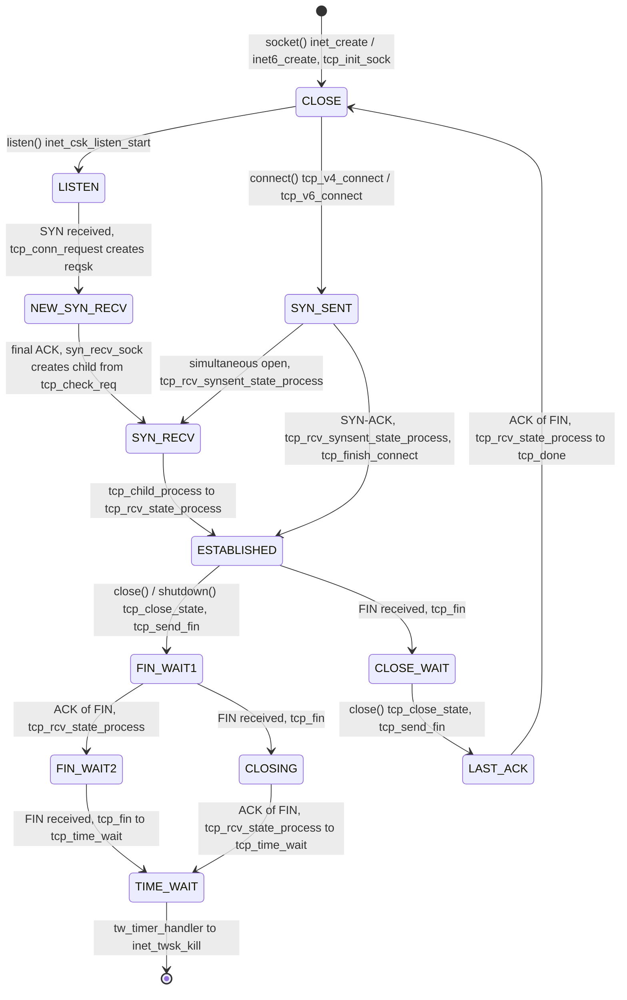

# 2. A connection's life on fast-forward

This chapter is a "map" for reading the fast path in Part I and onwards. From `socket()` to the demise of TIME_WAIT, we only focus on **which functions drive state transitions** at each step. We do not do a line-by-line close reading here. The data structures themselves are left to Chapter 1, and the specifics of transmission and reception to Chapter 3 and beyond.

## The ELI5 version

Fitting a mailbox (socket) to a room (port) at a building address (IP address) is `socket()`, and deciding the room number is `bind()`. Calling `listen()` sets up a reception desk outside the room.

When a guest (SYN) arrives, the reception desk does not prepare a room yet; instead, it hands out only a **temporary ticket** (`request_sock`) and sends a reply with a signed receipt (SYN-ACK) saying, "Please reply with this number." When it gets crowded and tickets are about to run out, it hands out a **tally stick with no stub kept** (SYN cookie), verifying authenticity solely from the shape of the returning tally stick.

When the guest returns with the signed receipt (ACK), a real mailbox (child socket) is created for the first time and enters the **waiting room** (accept queue). Once the application calls it out from the waiting room with `accept()`, the conversation (data transfer) begins.

When the conversation finishes, both sides say "I have nothing more to send" (FIN) to each other, and whichever side stamped the final signed receipt will not rent out that room number for a while (TIME_WAIT)—a cooling-off period before reusing a room number. This ensures that any old parcels that arrive late are not mistaken for the next resident's mail.

## What the RFCs say

### RFC 9293 — Transmission Control Protocol

[RFC 9293](https://www.rfc-editor.org/rfc/rfc9293) is the current core TCP specification, published in 2022 to unify RFC 793 and numerous subsequent updates (the TCP portions of RFC 1122, parts of RFC 5961, RFC 6093, RFC 6528, etc.). It obsoleted RFC 793. Many code comments in Linux still cite `rfc793:`, but semantically they can be read as referencing the corresponding sections of RFC 9293.

- **State machine** ([RFC 9293 §3.3.2](https://www.rfc-editor.org/rfc/rfc9293#section-3.3.2)): 11 states: LISTEN, SYN-SENT, SYN-RECEIVED, ESTABLISHED, FIN-WAIT-1, FIN-WAIT-2, CLOSE-WAIT, CLOSING, LAST-ACK, TIME-WAIT, and CLOSED. The diagram is merely a summary; the exact rules in the event processing of [§3.10](https://www.rfc-editor.org/rfc/rfc9293#section-3.10) are canonical.
- **ISN selection** ([RFC 9293 §3.4.1](https://www.rfc-editor.org/rfc/rfc9293#section-3.4.1)): `ISN = M + F(localip, localport, remoteip, remoteport, secretkey)`. M is a timer incrementing roughly every 4 µs, and F is a pseudorandom function keyed with a secret (derived from RFC 6528).
- **Three-way handshake** ([RFC 9293 §3.5](https://www.rfc-editor.org/rfc/rfc9293#section-3.5)): SYN(ISS) → SYN,ACK(IRS+1) → ACK. SYN and FIN each consume 1 sequence space. **Simultaneous open**, where both peers send SYN concurrently, is also a legitimate transition (SYN-SENT → SYN-RECEIVED). Old duplicate SYNs are rejected with RST. Handling of half-open connections and reset generation rules are in [§3.5.1](https://www.rfc-editor.org/rfc/rfc9293#section-3.5.1)–[§3.5.3](https://www.rfc-editor.org/rfc/rfc9293#section-3.5.3).
- **RST validation in SYN-RECEIVED**: [§3.10.7.4](https://www.rfc-editor.org/rfc/rfc9293#section-3.10.7.4) incorporates RFC 5961, requiring a challenge ACK in response to an in-window RST whose sequence number does not exactly match RCV.NXT.
- **Closing** ([RFC 9293 §3.6](https://www.rfc-editor.org/rfc/rfc9293#section-3.6)): Three cases: (1) local CLOSE first (active close: FIN-WAIT-1 → FIN-WAIT-2 → TIME-WAIT), (2) peer's FIN first (passive close: CLOSE-WAIT → LAST-ACK → CLOSED), and (3) simultaneous close (FIN-WAIT-1 → CLOSING → TIME-WAIT). Half-close (closing only one direction) is described in [§3.6.1](https://www.rfc-editor.org/rfc/rfc9293#section-3.6.1).
- **TIME-WAIT and 2MSL**: The active close side waits for 2×MSL after sending the final ACK. MSL is specified as 2 minutes ([§3.4.2](https://www.rfc-editor.org/rfc/rfc9293#section-3.4.2)). It serves two purposes: (a) enabling re-ACKing a retransmitted FIN if the final ACK was lost, and (b) preventing delayed segments from an old incarnation from corrupting a new connection on the same 4-tuple. Conditions under which a new SYN may be accepted during TIME-WAIT (ISN greater than the old connection, or monotonically increasing timestamps) are specified in RFC 1122 §4.2.2.13 and RFC 6191.

### RFC 4987 — TCP SYN Flooding Attacks and Common Mitigations

[RFC 4987](https://www.rfc-editor.org/rfc/rfc4987) is an Informational RFC summarising SYN flood attacks (depleting the server's half-open connection state by sending large volumes of SYNs with spoofed source addresses) and common countermeasures. The following sections map directly to Linux:

- [§3.5 SYN Cache](https://www.rfc-editor.org/rfc/rfc4987#section-3.5): A technique that holds only a small data structure instead of a full TCB. Linux's `request_sock` (TCP_NEW_SYN_RECV) corresponds to this.
- [§3.6 SYN Cookies](https://www.rfc-editor.org/rfc/rfc4987#section-3.6): Retains no state whatsoever, encoding a time counter, an MSS index, and a hash of the 4-tuple and secret key into the ISN, reconstructing it from the returning ACK number − 1. As a penalty, SYN options (wscale, SACK, etc.) cannot be carried by the ISN alone. Linux mitigates this limitation when timestamps are enabled by embedding wscale/SACK/ECN into the lower bits of TSval (`cookie_init_timestamp()` ([net/ipv4/syncookies.c#L62](https://git.kernel.org/pub/scm/linux/kernel/git/netdev/net-next.git/tree/net/ipv4/syncookies.c?id=279d5c8afcd38bd841832a39bfe1aa4f8518d98e#n62))).

### RFC 7413 — TCP Fast Open

[RFC 7413](https://www.rfc-editor.org/rfc/rfc7413) (Experimental) is an extension that attaches data to the SYN by including a previously acquired cookie, allowing the server to deliver data to the application before the 3WHS completes. In Linux, the server creates the child socket immediately in `tcp_try_fastopen()` ([net/ipv4/tcp_fastopen.c#L438](https://git.kernel.org/pub/scm/linux/kernel/git/netdev/net-next.git/tree/net/ipv4/tcp_fastopen.c?id=279d5c8afcd38bd841832a39bfe1aa4f8518d98e#n438)). In this chapter, we only highlight the branch point.

## The big picture

The following diagram maps TCP state transitions to the actual Linux kernel functions that perform them. `TCP_NEW_SYN_RECV` is a Linux-specific state held by `request_sock` rather than by the listener.



There are three key points:

- On the server side, "SYN-RECEIVED" is split into two stages in Linux. When the SYN is received, only a small `request_sock` (`TCP_NEW_SYN_RECV`) is placed into ehash. When the final ACK is received, a full `tcp_sock` is created in `TCP_SYN_RECV` and immediately advanced to `TCP_ESTABLISHED` during the processing of that same ACK.
- Upon entering TIME_WAIT, the full socket is destroyed and replaced with a small `inet_timewait_sock`. An orphaned FIN_WAIT2 socket is also replaced by the same minisock (substate = FIN_WAIT2) depending on `tcp_fin_timeout`.
- The state advances to FIN_WAIT1 / LAST_ACK as soon as `close()` has "queued" the FIN. It does not matter whether the FIN has actually been put onto the wire (see the RED-PEN comment discussed below).

## Walking through the code

### Step 1: socket() — initialising `tcp_sock`

`inet_create()` ([net/ipv4/af_inet.c#L259](https://git.kernel.org/pub/scm/linux/kernel/git/netdev/net-next.git/tree/net/ipv4/af_inet.c?id=279d5c8afcd38bd841832a39bfe1aa4f8518d98e#n259)) and `inet6_create()` ([net/ipv6/af_inet6.c#L105](https://git.kernel.org/pub/scm/linux/kernel/git/netdev/net-next.git/tree/net/ipv6/af_inet6.c?id=279d5c8afcd38bd841832a39bfe1aa4f8518d98e#n105)) select `tcp_prot` / `tcpv6_prot` from `inetsw[]`, and call `sk->sk_prot->init(sk)` after `sk_alloc()` and `sock_init_data()`.

The concrete implementations of `init` are `tcp_v4_init_sock()` ([net/ipv4/tcp_ipv4.c#L2399](https://git.kernel.org/pub/scm/linux/kernel/git/netdev/net-next.git/tree/net/ipv4/tcp_ipv4.c?id=279d5c8afcd38bd841832a39bfe1aa4f8518d98e#n2399)) and `tcp_v6_init_sock()` ([net/ipv6/tcp_ipv6.c#L2080](https://git.kernel.org/pub/scm/linux/kernel/git/netdev/net-next.git/tree/net/ipv6/tcp_ipv6.c?id=279d5c8afcd38bd841832a39bfe1aa4f8518d98e#n2080)). Both call the shared `tcp_init_sock()` ([net/ipv4/tcp.c#L421](https://git.kernel.org/pub/scm/linux/kernel/git/netdev/net-next.git/tree/net/ipv4/tcp.c?id=279d5c8afcd38bd841832a39bfe1aa4f8518d98e#n421)), and merely configure `icsk_af_ops` with `ipv4_specific` / `ipv6_specific`. All AF-dependent operations (header construction, routing, `conn_request`, `syn_recv_sock`, etc.) are henceforth called via this ops table. The primary initial values set by `tcp_init_sock()` are as follows:

- `icsk_rto = TCP_TIMEOUT_INIT` (1 second) is the initial RTO from RFC 6298. It becomes the retransmission interval for the SYN (Chapter 9).
- `snd_cwnd = TCP_INIT_CWND` (10) and `snd_ssthresh = TCP_INFINITE_SSTHRESH`, so it begins in slow start (Chapter 11).
- `app_limited = ~0U` is the initial value to treat rate samples as app-limited until the first ACK (consulted by CC algorithms such as BBR, Chapter 13).
- `sk_sndbuf` / `sk_rcvbuf` are the initial values from `tcp_wmem[1]` / `tcp_rmem[1]`, auto-tuned later (Chapter 10).

The socket state at this point is `TCP_CLOSE` (set by `sock_init_data()`).

### Step 2: bind() and listen()

`bind()` proceeds from `__inet_bind()` ([net/ipv4/af_inet.c#L478](https://git.kernel.org/pub/scm/linux/kernel/git/netdev/net-next.git/tree/net/ipv4/af_inet.c?id=279d5c8afcd38bd841832a39bfe1aa4f8518d98e#n478)) to `sk->sk_prot->get_port` = `inet_csk_get_port()` ([net/ipv4/inet_connection_sock.c#L500](https://git.kernel.org/pub/scm/linux/kernel/git/netdev/net-next.git/tree/net/ipv4/inet_connection_sock.c?id=279d5c8afcd38bd841832a39bfe1aa4f8518d98e#n500)), determining port conflicts in bhash / bhash2. This is familiar slow path code, so we omit the details.

`listen()` proceeds from `inet_listen()` to `__inet_listen_sk()` ([net/ipv4/af_inet.c#L198](https://git.kernel.org/pub/scm/linux/kernel/git/netdev/net-next.git/tree/net/ipv4/af_inet.c?id=279d5c8afcd38bd841832a39bfe1aa4f8518d98e#n198)). After updating backlog with `WRITE_ONCE(sk->sk_max_ack_backlog, backlog)` (if already in LISTEN, it simply updates backlog and returns), it configures TFO server settings and calls `inet_csk_listen_start()` ([net/ipv4/inet_connection_sock.c#L1334](https://git.kernel.org/pub/scm/linux/kernel/git/netdev/net-next.git/tree/net/ipv4/inet_connection_sock.c?id=279d5c8afcd38bd841832a39bfe1aa4f8518d98e#n1334)).

```c
	inet_sk_state_store(sk, TCP_LISTEN);
	err = sk->sk_prot->get_port(sk, inet->inet_num);
	if (!err) {
		inet->inet_sport = htons(inet->inet_num);

		sk_dst_reset(sk);
		err = sk->sk_prot->hash(sk);

		if (likely(!err))
			return 0;
	}
```

- `reqsk_queue_alloc()` initialises the accept queue (`icsk_accept_queue`). There is **no** independent list called a SYN queue. Half-open `request_sock` instances live in ehash, and the listener only tracks their count (`qlen`) (Step 4).
- `inet_sk_state_store(sk, TCP_LISTEN)` is `smp_store_release()`. Although it exposes LISTEN before `get_port()`, as noted in the comment inside the function, the socket is not inserted into lhash2 until `->hash()`, so it is not visible to incoming packets.
- Calling `get_port()` **a second time** is necessary because becoming LISTEN changes the semantics of `SO_REUSEADDR` even if the socket was already bound (`reuse = sk->sk_reuse && sk->sk_state != TCP_LISTEN`), requiring port conflicts to be re-evaluated.

### Step 3: connect() — sending the SYN

`inet_stream_connect()` acquires `lock_sock()` before calling `sk->sk_prot->connect`. For IPv4, this is `tcp_v4_connect()` ([net/ipv4/tcp_ipv4.c#L221](https://git.kernel.org/pub/scm/linux/kernel/git/netdev/net-next.git/tree/net/ipv4/tcp_ipv4.c?id=279d5c8afcd38bd841832a39bfe1aa4f8518d98e#n221)). After performing a route lookup to determine saddr, while still holding the socket lock, it sets `tcp_set_state(sk, TCP_SYN_SENT)` before calling `inet_hash_connect()` ([net/ipv4/inet_hashtables.c#L1268](https://git.kernel.org/pub/scm/linux/kernel/git/netdev/net-next.git/tree/net/ipv4/inet_hashtables.c?id=279d5c8afcd38bd841832a39bfe1aa4f8518d98e#n1268)) to select an ephemeral port and insert the socket into ehash. The 4-tuple uniqueness check (including `tcp_tw_reuse` validation upon collisions with TIME_WAIT sockets) is performed by `__inet_check_established()` within this call. Sockets entering ehash must be in a non-LISTEN state, which is why this order is used. After the port is decided, `secure_tcp_seq_and_ts_off()` implements `M + F(...)` from RFC 9293 §3.4.1 (F using SipHash, and M using a nanosecond clock). The same function also generates a timestamp offset `tsoffset` per 4-tuple so that system uptime is not leaked via TSval. If `write_seq` is already non-zero (such as with `TCP_REPAIR`), it is not overwritten.

Finally, `tcp_connect()` ([net/ipv4/tcp_output.c#L4309](https://git.kernel.org/pub/scm/linux/kernel/git/netdev/net-next.git/tree/net/ipv4/tcp_output.c?id=279d5c8afcd38bd841832a39bfe1aa4f8518d98e#n4309)) constructs and transmits the SYN, increments `TcpActiveOpens` (`TCP_MIB_ACTIVEOPENS`), and starts the `ICSK_TIME_RETRANS` timer with `icsk_rto`.

- The SYN skb is placed directly into `tcp_rtx_queue` (an rb-tree). It is treated as "transmitted and awaiting ACK", so SYN retransmissions use the exact same RTO retransmission mechanism as normal data (Chapters 8 and 9).
- Advancing `snd_nxt` **after** `tcp_transmit_skb()`, as explained in the comment, is for accurate `tcpOutSegs` accounting.
- For a TFO client (`fastopen_req`), `tcp_send_syn_data()` attaches data to the SYN.

IPv6's `tcp_v6_connect()` ([net/ipv6/tcp_ipv6.c#L133](https://git.kernel.org/pub/scm/linux/kernel/git/netdev/net-next.git/tree/net/ipv6/tcp_ipv6.c?id=279d5c8afcd38bd841832a39bfe1aa4f8518d98e#n133)) follows the same pattern (`inet6_hash_connect()` → `tcp_connect()`). However, if the destination is an IPv4-mapped address, it swaps `icsk_af_ops` to `ipv6_mapped` and delegates entirely to `tcp_v4_connect()`.

### Step 4: Server receives SYN — `tcp_conn_request()`

When the lookup result is LISTEN, `tcp_v4_rcv()` ([net/ipv4/tcp_ipv4.c#L2073](https://git.kernel.org/pub/scm/linux/kernel/git/netdev/net-next.git/tree/net/ipv4/tcp_ipv4.c?id=279d5c8afcd38bd841832a39bfe1aa4f8518d98e#n2073)) calls `tcp_v4_do_rcv()` **without acquiring the listener's socket lock**. From there, it enters `case TCP_LISTEN` of `tcp_rcv_state_process()` ([net/ipv4/tcp_input.c#L7171](https://git.kernel.org/pub/scm/linux/kernel/git/netdev/net-next.git/tree/net/ipv4/tcp_input.c?id=279d5c8afcd38bd841832a39bfe1aa4f8518d98e#n7171)), proceeding via `icsk_af_ops->conn_request` = `tcp_v4_conn_request()` ([net/ipv4/tcp_ipv4.c#L1658](https://git.kernel.org/pub/scm/linux/kernel/git/netdev/net-next.git/tree/net/ipv4/tcp_ipv4.c?id=279d5c8afcd38bd841832a39bfe1aa4f8518d98e#n1658)) / `tcp_v6_conn_request()` ([net/ipv6/tcp_ipv6.c#L1319](https://git.kernel.org/pub/scm/linux/kernel/git/netdev/net-next.git/tree/net/ipv6/tcp_ipv6.c?id=279d5c8afcd38bd841832a39bfe1aa4f8518d98e#n1319)) to reach the AF-common `tcp_conn_request()` ([net/ipv4/tcp_input.c#L7635](https://git.kernel.org/pub/scm/linux/kernel/git/netdev/net-next.git/tree/net/ipv4/tcp_input.c?id=279d5c8afcd38bd841832a39bfe1aa4f8518d98e#n7635)).

```c
	/* If isn is non-zero, this SYN originally matched a TIME_WAIT socket.
	 * TW sockets are converted to open requests without limitations,
	 * we skip the queue limits and syncookie checks in the block below.
	 */
	if (!isn) {
		syncookies = READ_ONCE(net->ipv4.sysctl_tcp_syncookies);

		if (syncookies == 2 || inet_csk_reqsk_queue_is_full(sk)) {
			want_cookie = tcp_syn_flood_action(sk,
							   rsk_ops->slab_name);
			if (!want_cookie)
				goto drop;
		}
	}

	if (sk_acceptq_is_full(sk)) {
		NET_INC_STATS(sock_net(sk), LINUX_MIB_LISTENOVERFLOWS);
		goto drop;
	}
```

- `tcp_tw_isn` is non-zero when this SYN originally matched a TIME_WAIT socket and `tcp_timewait_state_process()` permitted reuse (Step 9). In that case, SYN flood checks are skipped.
- `inet_csk_reqsk_queue_is_full()` checks whether "number of half-open sockets > `sk_max_ack_backlog`". If full, `tcp_syn_flood_action()` ([net/ipv4/tcp_input.c#L7541](https://git.kernel.org/pub/scm/linux/kernel/git/netdev/net-next.git/tree/net/ipv4/tcp_input.c?id=279d5c8afcd38bd841832a39bfe1aa4f8518d98e#n7541)) inspects the `tcp_syncookies` sysctl to decide whether to fall back to cookies (`TCPReqQFullDoCookies`) or drop the packet (`TCPReqQFullDrop`). If `tcp_syncookies=2`, cookies are unconditionally used.
- If the accept queue is full (`sk_acceptq_is_full()`), the packet is dropped even if cookies are used, because completing the 3WHS would have nowhere to accept the socket.

Next, the ISN is determined:

- In the cookie case, the ISN itself becomes the cookie (`cookie_init_sequence()`). By using the same value for `txhash`, the transmit path (IPv6 ECMP / IPv4 TX queue) of the SYN-ACK and the later-created child socket are aligned without holding any state.
- In the non-cookie case, the ISN is determined by `init_seq_and_ts_off()` (= `secure_tcp_seq_and_ts_off()`).
- If `tcp_syncookies=0` and remaining SYN backlog drops below 1/4, all peers except those proven in TCP metrics (`tcp_peer_is_proven()`) are dropped. This is the last line of defence when cookies are disabled.

Finally, the req is registered and the SYN-ACK is sent (branches at the end of the function):

- Normal case: `inet_csk_reqsk_queue_hash_add()` ([net/ipv4/inet_connection_sock.c#L1176](https://git.kernel.org/pub/scm/linux/kernel/git/netdev/net-next.git/tree/net/ipv4/inet_connection_sock.c?id=279d5c8afcd38bd841832a39bfe1aa4f8518d98e#n1176)) inserts the `request_sock` into **ehash**, starts the per-request timer (`rsk_timer`) for SYN-ACK retransmission, and increments the listener's `qlen`. Then it sends the SYN-ACK.
- Cookie case: Immediately freed with `reqsk_free()` after sending the SYN-ACK. It is created only temporarily to carry the parameters required to build the SYN-ACK.
- TFO case: `tcp_try_fastopen()` creates the child socket (state is `TCP_SYN_RECV`), and puts it into the accept queue via `inet_csk_reqsk_queue_add()` **before the 3WHS completes**.

`request_sock` is initialised by `inet_reqsk_alloc()` ([net/ipv4/inet_connection_sock.c#L881](https://git.kernel.org/pub/scm/linux/kernel/git/netdev/net-next.git/tree/net/ipv4/inet_connection_sock.c?id=279d5c8afcd38bd841832a39bfe1aa4f8518d98e#n881)) with `ireq_state = TCP_NEW_SYN_RECV`. Since `struct request_sock` ([include/net/request_sock.h#L50](https://git.kernel.org/pub/scm/linux/kernel/git/netdev/net-next.git/tree/include/net/request_sock.h?id=279d5c8afcd38bd841832a39bfe1aa4f8518d98e#n50)) embeds `struct sock_common` at its head, it is looked up in ehash just like a regular socket.

### Step 5: Client receives SYN-ACK

Segments arriving at a socket in SYN_SENT are handled by `tcp_rcv_state_process()` → `tcp_rcv_synsent_state_process()` ([net/ipv4/tcp_input.c#L6872](https://git.kernel.org/pub/scm/linux/kernel/git/netdev/net-next.git/tree/net/ipv4/tcp_input.c?id=279d5c8afcd38bd841832a39bfe1aa4f8518d98e#n6872)). In accordance with the SYN-SENT rules of RFC 9293 §3.10.7.3, it validates in order: first the ACK range (`snd_una < ack_seq <= snd_nxt`), next RST, and finally SYN. Afterwards, `tcp_ack()` processes the ACK of the SYN, finalising `rcv_nxt = IRS + 1`, `snd_wnd` (SYN windows are not scaled), wscale, timestamps, and MSS.

```c
		/* Remember, tcp_poll() does not lock socket!
		 * Change state from SYN-SENT only after copied_seq
		 * is initialized. */
		WRITE_ONCE(tp->copied_seq, tp->rcv_nxt);

		smc_check_reset_syn(tp);

		smp_mb();

		tcp_finish_connect(sk, skb);
```

`tcp_poll()` reads `sk_state` and `copied_seq` without acquiring the socket lock. Therefore, after writing `copied_seq`, an `smp_mb()` memory barrier is inserted before `tcp_finish_connect()` ([net/ipv4/tcp_input.c#L6753](https://git.kernel.org/pub/scm/linux/kernel/git/netdev/net-next.git/tree/net/ipv4/tcp_input.c?id=279d5c8afcd38bd841832a39bfe1aa4f8518d98e#n6753)) executes `tcp_set_state(sk, TCP_ESTABLISHED)`. Otherwise, poll could observe ESTABLISHED while still seeing a stale `copied_seq`, miscalculating the number of readable bytes. `tcp_finish_connect()` calls `tcp_init_transfer()` (initialising congestion control and buffers) and enables header prediction if wscale is not in use (Chapter 5).

An ACK responding to the SYN-ACK is sent immediately in principle. However, if there is pending data to write (`sk_write_pending`), `TCP_DEFER_ACCEPT` is configured, or pingpong mode is enabled, it is delayed to piggyback onto outgoing data.

If a SYN without ACK is received, it is treated as a simultaneous open (including connecting to oneself); after `tcp_set_state(sk, TCP_SYN_RECV)`, a SYN-ACK is sent via `tcp_send_synack()`. This is a rare case where a socket transitions to `TCP_SYN_RECV` as a full socket without going through a `request_sock`.

### Step 6: Server receives final ACK — `tcp_check_req()` and child sockets

Lookup for the ACK hits the `request_sock` directly in ehash. The `TCP_NEW_SYN_RECV` branch in `tcp_v4_rcv()` extracts `req->rsk_listener` (if the listener is no longer in LISTEN, it migrates to another listener in the same reuseport group via `reuseport_migrate_sock()`) and calls `tcp_check_req()`.

`tcp_check_req()` ([net/ipv4/tcp_minisocks.c#L687](https://git.kernel.org/pub/scm/linux/kernel/git/netdev/net-next.git/tree/net/ipv4/tcp_minisocks.c?id=279d5c8afcd38bd841832a39bfe1aa4f8518d98e#n687)) implements the SYN-RECEIVED reception rules on top of the minisocket. It verifies in sequence: PAWS and TSEcr (whether within range of the sent SYN-ACK's TSval), in-window check, RST/SYN handling (challenge ACK for in-window RST that does not exactly match), and finally creates the child socket.

```c
	/* While TCP_DEFER_ACCEPT is active, drop bare ACK. */
	if (req->num_timeout < READ_ONCE(inet_csk(sk)->icsk_accept_queue.rskq_defer_accept) &&
	    TCP_SKB_CB(skb)->end_seq == tcp_rsk(req)->rcv_isn + 1) {
		inet_rsk(req)->acked = 1;
		__NET_INC_STATS(sock_net(sk), LINUX_MIB_TCPDEFERACCEPTDROP);
		return NULL;
	}

	/* OK, ACK is valid, create big socket and
	 * feed this segment to it. It will repeat all
	 * the tests. THIS SEGMENT MUST MOVE SOCKET TO
	 * ESTABLISHED STATE. If it will be dropped after
	 * socket is created, wait for troubles.
	 */
	child = inet_csk(sk)->icsk_af_ops->syn_recv_sock(sk, skb, req, NULL,
							 req, &own_req, NULL);
	if (!child)
		goto listen_overflow;

	if (own_req && tmp_opt.saw_tstamp &&
	    !after(TCP_SKB_CB(skb)->seq, tcp_rsk(req)->rcv_nxt))
		tcp_sk(child)->rx_opt.ts_recent = tmp_opt.rcv_tsval;

	if (own_req && rsk_drop_req(req)) {
		reqsk_queue_removed(&inet_csk(req->rsk_listener)->icsk_accept_queue, req);
		inet_csk_reqsk_queue_drop_and_put(req->rsk_listener, req);
		return child;
	}

	sock_rps_save_rxhash(child, skb);
	tcp_synack_rtt_meas(child, req);
	*req_stolen = !own_req;
	return inet_csk_complete_hashdance(sk, child, req, own_req);
```

- While `TCP_DEFER_ACCEPT` is active, bare ACKs without data (`end_seq == rcv_isn + 1`) are dropped. Setting `acked = 1` tells the req timer (`syn_ack_recalc()`) to withhold SYN-ACK retransmissions during the defer period, resuming them as a final chance at the end of the period, and dropping the req if data still does not arrive.
- `syn_recv_sock` resolves to `tcp_v4_syn_recv_sock()` ([net/ipv4/tcp_ipv4.c#L1677](https://git.kernel.org/pub/scm/linux/kernel/git/netdev/net-next.git/tree/net/ipv4/tcp_ipv4.c?id=279d5c8afcd38bd841832a39bfe1aa4f8518d98e#n1677)) / `tcp_v6_syn_recv_sock()` ([net/ipv6/tcp_ipv6.c#L1385](https://git.kernel.org/pub/scm/linux/kernel/git/netdev/net-next.git/tree/net/ipv6/tcp_ipv6.c?id=279d5c8afcd38bd841832a39bfe1aa4f8518d98e#n1385)). It clones the listener via `tcp_create_openreq_child()` ([net/ipv4/tcp_minisocks.c#L546](https://git.kernel.org/pub/scm/linux/kernel/git/netdev/net-next.git/tree/net/ipv4/tcp_minisocks.c?id=279d5c8afcd38bd841832a39bfe1aa4f8518d98e#n546)) → `inet_csk_clone_lock()` ([net/ipv4/inet_connection_sock.c#L1204](https://git.kernel.org/pub/scm/linux/kernel/git/netdev/net-next.git/tree/net/ipv4/inet_connection_sock.c?id=279d5c8afcd38bd841832a39bfe1aa4f8518d98e#n1204)), returning the child in `TCP_SYN_RECV` state with `bh_lock_sock` already held.
- `syn_recv_sock` returns NULL mainly when the accept queue is full (`listen_overflow`). Under the default `tcp_abort_on_overflow=0`, the ACK is **silently dropped** and only `acked = 1` is set. Because the req remains in ehash, if the client ACKs again in response to a retransmitted SYN-ACK, the connection will succeed if space has freed up.

The section inserting the child socket into ehash is the core mechanism resolving contention across multiple CPUs:

```c
	if (__inet_inherit_port(sk, newsk) < 0)
		goto put_and_exit;
	*own_req = inet_ehash_nolisten(newsk, req_to_sk(req_unhash),
				       &found_dup_sk);
	if (likely(*own_req)) {
		tcp_move_syn(newtp, req);
		ireq->ireq_opt = NULL;
	} else {
		newinet->inet_opt = NULL;

		if (!req_unhash && found_dup_sk) {
			/* This code path should only be executed in the
			 * syncookie case only
			 */
			bh_unlock_sock(newsk);
			sock_put(newsk);
			newsk = NULL;
		}
	}
```

Multiple CPUs may process duplicate ACKs for the same req simultaneously. `inet_ehash_nolisten()` **replaces req with the child** under the ehash bucket lock. If the req is already gone, it fails and `own_req = false`. The losing CPU drops its newly created child via `inet_csk_complete_hashdance()` ([net/ipv4/inet_connection_sock.c#L1418](https://git.kernel.org/pub/scm/linux/kernel/git/netdev/net-next.git/tree/net/ipv4/inet_connection_sock.c?id=279d5c8afcd38bd841832a39bfe1aa4f8518d98e#n1418)), and the caller observes `req_stolen` and re-executes the lookup. This ensures the packet reaches the child socket created by the winning CPU. The winning CPU then enqueues the child to the tail of the accept queue with `inet_csk_reqsk_queue_add()` ([net/ipv4/inet_connection_sock.c#L1394](https://git.kernel.org/pub/scm/linux/kernel/git/netdev/net-next.git/tree/net/ipv4/inet_connection_sock.c?id=279d5c8afcd38bd841832a39bfe1aa4f8518d98e#n1394)).

While serialised by `rskq_lock`, `rskq_accept_head` is written with `WRITE_ONCE()`, pairing with `inet_csk_listen_poll()` which reads `reqsk_queue_empty()` locklessly. If the listener has already closed (`sk_state != TCP_LISTEN`), the child is destroyed via `inet_child_forget()`.

Finally, `tcp_child_process()` checks the child socket's lock state, either calling `tcp_rcv_state_process(child, skb)` directly or queueing to backlog. Under `case TCP_SYN_RECV`, it calls `tcp_init_transfer()` and transitions via `tcp_set_state(sk, TCP_ESTABLISHED)`. Because **the same ACK creates the child and moves it to ESTABLISHED**, as the comment in `tcp_check_req()` states: "THIS SEGMENT MUST MOVE SOCKET TO ESTABLISHED STATE."

#### In the SYN cookie case

When cookies are used, no req exists in ehash, so the ACK hits the listener socket. `tcp_v4_do_rcv()` → `tcp_v4_cookie_check()` → `cookie_v4_check()` ([net/ipv4/syncookies.c#L405](https://git.kernel.org/pub/scm/linux/kernel/git/netdev/net-next.git/tree/net/ipv4/syncookies.c?id=279d5c8afcd38bd841832a39bfe1aa4f8518d98e#n405)) / `cookie_v6_check()` ([net/ipv6/syncookies.c#L174](https://git.kernel.org/pub/scm/linux/kernel/git/netdev/net-next.git/tree/net/ipv6/syncookies.c?id=279d5c8afcd38bd841832a39bfe1aa4f8518d98e#n174)) verifies `ack_seq - 1` and reconstructs the `request_sock` on the fly. Then `tcp_get_cookie_sock()` ([net/ipv4/syncookies.c#L197](https://git.kernel.org/pub/scm/linux/kernel/git/netdev/net-next.git/tree/net/ipv4/syncookies.c?id=279d5c8afcd38bd841832a39bfe1aa4f8518d98e#n197)) calls `syn_recv_sock(..., req_unhash = NULL, ...)`. The `!req_unhash && found_dup_sk` branch in `tcp_v4_syn_recv_sock()` cleans up when concurrent ACKs for the same cookie race and a child socket has already been instantiated.

### Step 7: accept()

`inet_csk_accept()` ([net/ipv4/inet_connection_sock.c#L649](https://git.kernel.org/pub/scm/linux/kernel/git/netdev/net-next.git/tree/net/ipv4/inet_connection_sock.c?id=279d5c8afcd38bd841832a39bfe1aa4f8518d98e#n649)) acquires `lock_sock()` on the listener, and sleeps in `inet_csk_wait_for_connect()` if the queue is empty. It removes the head req with `reqsk_queue_remove()` and returns `req->sk` (the child socket). In the case of a TFO child, since the 3WHS may not yet be complete, it sets `req->sk = NULL` under `fastopenq.lock`, deferring the freeing of the req until the 3WHS completes (or aborts). Then `__inet_accept()` binds the socket to `struct socket` using `sock_graft()`. At this point, the child is not necessarily in ESTABLISHED; it could be in SYN_RECV (for TFO), CLOSE_WAIT, or even CLOSE (as enumerated in the `WARN_ON` inside `__inet_accept()`).

### Step 8: close() — sending the FIN

`tcp_close()` ([net/ipv4/tcp.c#L3312](https://git.kernel.org/pub/scm/linux/kernel/git/netdev/net-next.git/tree/net/ipv4/tcp.c?id=279d5c8afcd38bd841832a39bfe1aa4f8518d98e#n3312)) acquires `lock_sock()` and calls `__tcp_close()` ([net/ipv4/tcp.c#L3141](https://git.kernel.org/pub/scm/linux/kernel/git/netdev/net-next.git/tree/net/ipv4/tcp.c?id=279d5c8afcd38bd841832a39bfe1aa4f8518d98e#n3141)) (factored out to share implementation with MPTCP).

```c
	if (unlikely(tcp_sk(sk)->repair)) {
		sk->sk_prot->disconnect(sk, 0);
	} else if (data_was_unread) {
		/* Unread data was tossed, zap the connection. */
		NET_INC_STATS(sock_net(sk), LINUX_MIB_TCPABORTONCLOSE);
		tcp_set_state(sk, TCP_CLOSE);
		tcp_send_active_reset(sk, SK_RST_REASON_TCP_ABORT_ON_CLOSE);
	} else if (sock_flag(sk, SOCK_LINGER) && !sk->sk_lingertime) {
		/* Check zero linger _after_ checking for unread data. */
		sk->sk_prot->disconnect(sk, 0);
		NET_INC_STATS(sock_net(sk), LINUX_MIB_TCPABORTONDATA);
	} else if (tcp_close_state(sk)) {
```

- If unread data was discarded, an RST is sent instead of a FIN (RFC 2525 §2.17). This prevents misleading the peer into believing all data was received.
- If `SO_LINGER` is configured with a timeout of 0, `tcp_disconnect()` sends an RST immediately (`TCPAbortOnData`).
- Otherwise, `tcp_close_state()` ([net/ipv4/tcp.c#L3059](https://git.kernel.org/pub/scm/linux/kernel/git/netdev/net-next.git/tree/net/ipv4/tcp.c?id=279d5c8afcd38bd841832a39bfe1aa4f8518d98e#n3059)) advances the state according to the following table, calling `tcp_send_fin()` ([net/ipv4/tcp_output.c#L3809](https://git.kernel.org/pub/scm/linux/kernel/git/netdev/net-next.git/tree/net/ipv4/tcp_output.c?id=279d5c8afcd38bd841832a39bfe1aa4f8518d98e#n3809)) if a FIN is needed.

```c
static const unsigned char new_state[16] = {
  /* current state:        new state:      action:	*/
  [0 /* (Invalid) */]	= TCP_CLOSE,
  [TCP_ESTABLISHED]	= TCP_FIN_WAIT1 | TCP_ACTION_FIN,
  [TCP_SYN_SENT]	= TCP_CLOSE,
  [TCP_SYN_RECV]	= TCP_FIN_WAIT1 | TCP_ACTION_FIN,
  [TCP_FIN_WAIT1]	= TCP_FIN_WAIT1,
  [TCP_FIN_WAIT2]	= TCP_FIN_WAIT2,
  [TCP_TIME_WAIT]	= TCP_CLOSE,
  [TCP_CLOSE]		= TCP_CLOSE,
  [TCP_CLOSE_WAIT]	= TCP_LAST_ACK  | TCP_ACTION_FIN,
  [TCP_LAST_ACK]	= TCP_LAST_ACK,
  [TCP_LISTEN]		= TCP_CLOSE,
  [TCP_CLOSING]		= TCP_CLOSING,
  [TCP_NEW_SYN_RECV]	= TCP_CLOSE,	/* should not happen ! */
};
```

`tcp_send_fin()` piggybacks the FIN flag onto the last skb in the write queue if an unsent skb exists; otherwise, it forcibly allocates a dedicated FIN skb with `sk_forced_mem_schedule()` and pushes it onto the queue, because losing a FIN due to budget exhaustion is unacceptable. It then calls `__tcp_push_pending_frames(..., TCP_NAGLE_OFF)`, but if cwnd or the receive window is congested, the FIN remains queued. Even so, the state has already transitioned to FIN_WAIT1. This is the discrepancy noted in the "RED-PEN" comment in `__tcp_close()`: "Linux state is FIN_WAIT1, but according to the RFC it is still ESTABLISHED".

After lingering in `sk_stream_wait_close()`, the socket is orphaned from `adjudge_to_death:` onward (`sock_orphan()`, `tcp_orphan_count_inc()`). From then on, the socket is owned solely by the protocol (softirq and timers). If FIN_WAIT2 has already been reached, it is replaced on the spot by a minisock via `tcp_time_wait(sk, TCP_FIN_WAIT2, tmo)` provided `tcp_fin_timeout` (`tcp_fin_time()`) is less than or equal to `TCP_TIMEWAIT_LEN`. If the orphan count or memory limit is exceeded (`tcp_check_oom()`), an RST is sent and the socket is destroyed immediately.

### Step 9: Receiving a FIN and TIME_WAIT

On the receiver side, FINs are processed in stream order within the data queue (out-of-order FINs wait in the ofo queue; Chapter 6). When its turn arrives, `tcp_fin()` ([net/ipv4/tcp_input.c#L4932](https://git.kernel.org/pub/scm/linux/kernel/git/netdev/net-next.git/tree/net/ipv4/tcp_input.c?id=279d5c8afcd38bd841832a39bfe1aa4f8518d98e#n4932)) is called.

```c
	switch (sk->sk_state) {
	case TCP_SYN_RECV:
	case TCP_ESTABLISHED:
		/* Move to CLOSE_WAIT */
		tcp_set_state(sk, TCP_CLOSE_WAIT);
		inet_csk_enter_pingpong_mode(sk);
		break;
	...
	case TCP_FIN_WAIT1:
		/* This case occurs when a simultaneous close
		 * happens, we must ack the received FIN and
		 * enter the CLOSING state.
		 */
		tcp_send_ack(sk);
		tcp_set_state(sk, TCP_CLOSING);
		break;
	case TCP_FIN_WAIT2:
		/* Received a FIN -- send ACK and enter TIME_WAIT. */
		tcp_send_ack(sk);
		tcp_time_wait(sk, TCP_TIME_WAIT, 0);
		break;
```

Transitions caused by the ACK to our own FIN (FIN_WAIT1 → FIN_WAIT2, CLOSING → TIME_WAIT, LAST_ACK → CLOSE) take place after step 5 in `tcp_rcv_state_process()`, once `snd_una == write_seq` (everything up to and including the FIN has been ACKed) is confirmed.

`tcp_time_wait()` ([net/ipv4/tcp_minisocks.c#L326](https://git.kernel.org/pub/scm/linux/kernel/git/netdev/net-next.git/tree/net/ipv4/tcp_minisocks.c?id=279d5c8afcd38bd841832a39bfe1aa4f8518d98e#n326)) allocates a `struct inet_timewait_sock` ([include/net/inet_timewait_sock.h#L33](https://git.kernel.org/pub/scm/linux/kernel/git/netdev/net-next.git/tree/include/net/inet_timewait_sock.h?id=279d5c8afcd38bd841832a39bfe1aa4f8518d98e#n33)) via `inet_twsk_alloc()` and copies only the **bare minimum** information needed to reply in TIME_WAIT: `rcv_nxt`, `snd_nxt`, `ts_recent`, `tsoffset`, txhash, etc. The timeout is a fixed `TCP_TIMEWAIT_LEN` (60 seconds) for genuine TIME_WAIT. For the FIN_WAIT2 substate, it is the remaining `tcp_fin_timeout`, clamped to a lower bound of `3.5 × RTO` (`rto = (icsk_rto << 2) - (icsk_rto >> 1)`). `inet_twsk_hashdance_schedule()` ([net/ipv4/inet_timewait_sock.c#L103](https://git.kernel.org/pub/scm/linux/kernel/git/netdev/net-next.git/tree/net/ipv4/inet_timewait_sock.c?id=279d5c8afcd38bd841832a39bfe1aa4f8518d98e#n103)) adds tw to the bhash2 owners and **replaces the original socket in ehash in an RCU-safe manner**.

```c
	refcount_set(&tw->tw_refcnt, 3);

	/* Ensure tw_refcnt has been set before tw is published.
	 * smp_wmb() provides the necessary memory barrier to enforce this
	 * ordering.
	 */
	smp_wmb();

	hlist_nulls_replace_init_rcu(&sk->sk_nulls_node, &tw->tw_node);
	sock_prot_inuse_add(sock_net(sk), sk->sk_prot, -1);

	inet_twsk_schedule(tw, timeo);
```

The refcnt is 3: bhash, ehash, and timer. Because lockless lookups take references with `refcount_inc_not_zero()`, `smp_wmb()` commits the refcnt before publishing. `hlist_nulls_replace_init_rcu()` ensures there is no window where a lookup finds neither the old socket nor the tw socket. Subsequently, `tcp_done()` transitions the original full socket to `TCP_CLOSE`, destroying it with `inet_csk_destroy_sock()` if orphaned (`SOCK_DEAD`). If the file descriptor remains open (such as when closed via `shutdown()` alone), `sk_state_change()` notifies the application and waits for `close()`.

Segments arriving during TIME_WAIT are processed by `tcp_timewait_state_process()` ([net/ipv4/tcp_minisocks.c#L100](https://git.kernel.org/pub/scm/linux/kernel/git/netdev/net-next.git/tree/net/ipv4/tcp_minisocks.c?id=279d5c8afcd38bd841832a39bfe1aa4f8518d98e#n100)). Retransmitted FINs are answered with an ACK, and an RST kills the tw immediately if `tcp_rfc1337` is 0. A new SYN is accepted conditionally:

```c
	if (th->syn && !th->rst && !th->ack && !paws_reject &&
	    (after(TCP_SKB_CB(skb)->seq, rcv_nxt) ||
	     (tmp_opt.saw_tstamp &&
	      (s32)(READ_ONCE(tcptw->tw_ts_recent) - tmp_opt.rcv_tsval) < 0))) {
		u32 isn = tcptw->tw_snd_nxt + 65535 + 2;
		if (isn == 0)
			isn++;
		*tw_isn = isn;
		return TCP_TW_SYN;
	}
```

This implements the rule from RFC 1122 §4.2.2.13 / RFC 6191 allowing reopen if the sequence number is beyond the old connection or timestamps are newer. Setting the new ISN to "old `snd_nxt` + max window + 2" prevents overlap with the sequence space of the old incarnation. This value is placed into `TCP_SKB_CB(skb)->tcp_tw_isn`, passed to `tcp_conn_request()` in Step 4, and the tw socket is destroyed.

## RFC vs Linux

| Topic | RFC | Linux | Reason |
| --- | --- | --- | --- |
| SYN-RECEIVED TCB | Full TCB | Places `request_sock` (`TCP_NEW_SYN_RECV`) into ehash, and creates full socket only upon final ACK | Memory efficiency and resilience against SYN floods (equivalent to SYN cache in RFC 4987 §3.5). Avoids locking the listener during final ACK processing |
| SYN cookie | Not mentioned in RFC 9293 (RFC 4987 §3.6) | `tcp_syncookies=1` (only when full) / `2` (always). Options encoded into TSval | Survives floods without maintaining state |
| TIME-WAIT duration | 2×MSL (MSL = 2 minutes) | Fixed at 60 seconds (`TCP_TIMEWAIT_LEN`) | Practical compromise. Compensated by PAWS (RFC 7323) and ISN rules |
| SYN during TIME-WAIT | Allowed conditionally under RFC 1122 / RFC 6191 | `TCP_TW_SYN` and ISN of `snd_nxt + 65535 + 2` | Conforms to specification. Decided using timestamps when present |
| RST during TIME-WAIT | RFC 793 closes TW (RFC 1337 recommends ignoring) | By default (`tcp_rfc1337=0`), kills TW | Historical compatibility |
| Orphan FIN_WAIT2 | May wait indefinitely | Destroyed after `tcp_fin_timeout` (default 60 seconds). RST sent if `linger2 < 0` | Prevents resources from being locked up if peer never sends FIN ("BSD violating" comment in code) |
| Point of entering FIN_WAIT1 / LAST_ACK | When FIN is transmitted | When FIN is queued | Simplifies implementation ("RED-PEN" comment). Side-effects are minor |
| Close with unread data | RFC 2525 §2.17 recommends RST | Sends RST (`TCPAbortOnClose`) | Alerts peer to data loss |
| Full accept queue | No concept | By default, silently drops final ACK and relies on SYN-ACK retransmission | Absorbs transient bursts without RST |
| TSEcr in SYN-RECEIVED | Not specifically defined | Rejects if outside range of sent SYN-ACK's TSval (`TSEcrRejected`) | Hardens 3WHS against spoofing |

## Design history

- `1fb6f159fd21` "tcp: add tcp_conn_request" (Octavian Purdila, 2014): Consolidated nearly identical SYN processing between v4 and v6 into `tcp_conn_request()`, offloading AF differences into `tcp_request_sock_ops` (`route_req`, `init_seq_and_ts_off`, `send_synack`, etc.). This forms the starting point of the modern architecture.
- `10feb428a504` "inet: add TCP_NEW_SYN_RECV state" (Eric Dumazet, 2015): Gave request sockets their own dedicated state, laying the groundwork for a phased transition to the new architecture. Never exposed to userspace.
- `079096f103fa` "tcp/dccp: install syn_recv requests into ehash table" (Eric Dumazet, 2015): Moved reqs from per-listener hash tables into the shared ehash. ACKs no longer need to find and lock the listener socket; according to the commit log, this "halved the pressure on the listener lock under normal conditions". At the same time, because only the initial SYN needs to select a listener, it paved the way for CPU / NUMA affinity selection under SO_REUSEPORT.
- `e994b2f0fb92` "tcp: do not lock listener to process SYN packets" (Eric Dumazet, 2015): Made SYN processing run without holding the listener's socket lock (lockless listener). This is why the LISTEN branch in `tcp_v4_rcv()` avoids `bh_lock_sock`.
- `5e0724d027f0` "tcp/dccp: fix hashdance race for passive sessions" (Eric Dumazet, 2015): Resolved the race introduced by the lockless listener—where multiple CPUs handle duplicate ACKs for the same req concurrently—using the success or failure of `inet_ehash_nolisten()` replacement (`own_req`), without requiring new atomic operations.
- `fa76ce7328b2` "inet: get rid of central tcp/dccp listener timer" (Eric Dumazet, 2015): Replaced the per-listener SYN-ACK retransmit timer with per-request timers.
- `d4f2c86b2b7e` "tcp: Migrate TCP_NEW_SYN_RECV requests at receiving the final ACK." (Kuniyuki Iwashima, 2021): Migrates half-open reqs to surviving listeners if a listener in a reuseport group closes (`sk != req->rsk_listener` branch in `inet_csk_complete_hashdance()`, `TCPMigrateReqSuccess`).
- `5ad37d5deee1` "tcp: add tcp_syncookies mode to allow unconditionally generation of syncookies" (Hannes Frederic Sowa, 2013): Added `tcp_syncookies=2`.
- `168a8f58059a` "tcp: TCP Fast Open Server - main code path" (Jerry Chu, 2012) and `cf60af03ca4e` "net-tcp: Fast Open client - sendmsg(MSG_FASTOPEN)" (Yuchung Cheng, 2012): Introduced TFO.
- `b8ec80b13021` "inet: Avoid ehash lookup race in inet_twsk_hashdance_schedule()" (Xuanqiang Luo, 2025): Unified deleting sk and adding tw into a single atomic replacement via `hlist_nulls_replace_init_rcu()`, closing a window where lookups momentarily could find neither.
- `404381b4f105` "tcp: Set unhashed_state in inet_twsk_hashdance_schedule()." (Kuniyuki Iwashima, 2026): Because replacing with tw is also a form of unhashing from ehash, updated `icsk->unhashed_state`.
- `3ba075278c11` "tcp: be less liberal in TSEcr received while in SYN_RECV state" (Eric Dumazet, 2025): Records the oldest and newest TSval from transmitted SYN-ACKs, returning challenge ACKs for out-of-range TSEcr values.
- `41eecbd712b7` → `1bbf0ced1d9d` (Eric Dumazet, 2024 → 2026): `tcp_tw_isn` was briefly made a per-CPU variable, but across numerous drop paths between producer (`tcp_v4_rcv()`) and consumer (`tcp_conn_request()`), residual values caused subsequent SYNs to pick up predictable ISNs. It was moved back into skb->cb. A valuable lesson that "per-packet values must travel with the packet".
- `77c3c9563752` "tcp: factor out __tcp_close() helper" (Paolo Abeni, 2020): Factored out the core logic that does not take `lock_sock()`, allowing MPTCP to close subflows.

## Performance notes

The execution contexts and locks held at each step are as follows:

| Step | Context | Locks / References Held |
| --- | --- | --- |
| `socket()` / `bind()` / `listen()` / `connect()` | Process | `lock_sock()` (`connect` acquired by `inet_stream_connect()`). `get_port` takes bucket spinlock of bhash / bhash2 |
| SYN reception (`tcp_conn_request()`) | SoftIRQ (process with BH disabled if via backlog) | **No socket lock** on listener. RCU and reference to listener obtained during lookup |
| Final ACK (`tcp_check_req()`) | SoftIRQ | Refcnt on req. Child has `bh_lock_sock` already held from `inet_csk_clone_lock()`. ehash bucket lock (during replacement), `rskq_lock` (when adding to queue) |
| SYN-ACK reception (client) | SoftIRQ or backlog processing inside `release_sock()` | `bh_lock_sock` / socket owner |
| `accept()` | Process | Listener's `lock_sock()`, `rskq_lock` |
| `close()` | Process → BH disabled from `adjudge_to_death` onwards | `lock_sock()`, followed by `bh_lock_sock()` |
| FIN reception / transition to TIME_WAIT | SoftIRQ | `bh_lock_sock`, ehash bucket lock |
| TIME_WAIT timer | Timer SoftIRQ | Refcnt on tw |

- **Lockless listener design** is the most critical design choice. To prevent all CPUs from serialising on the listener's socket lock during a SYN flood, the mutable state on the listener is strictly limited to atomic `qlen`, `READ_ONCE()` for `sk_ack_backlog` / `sk_max_ack_backlog`, the accept queue protected by `rskq_lock`, and `WRITE_ONCE()` for `synflood_warned`. The `READ_ONCE(tp->rx_opt.user_mss)` inside `tcp_conn_request()` is likewise due to reading from the listener without holding its lock.
- Sysctls such as `tcp_syncookies` and `tcp_max_syn_backlog` are all read with `READ_ONCE()`, addressing data races between lockless readers and sysctl writers (many were added for KCSAN compliance).
- **State publication** is paired between `inet_sk_state_store()` (`smp_store_release()`) and lockless readers using `inet_sk_state_load()` (`smp_load_acquire()`). The `smp_mb()` upon SYN-ACK reception is also due to `tcp_poll()` operating locklessly.
- Three types of entities coexist in ehash: full sockets, `request_sock`, and `inet_timewait_sock`. Because all three share `sock_common` at offset 0, a single lookup (`__inet_lookup_established()`) finds them without distinction, branching on `sk_state`. Even on servers handling vast numbers of TIME_WAIT sockets, each entry is a tiny minisock, avoiding the cache footprint of a full `tcp_sock`.
- The SYN cookie path immediately calls `reqsk_free()`, leaving nothing in ehash. The trade-off is the cost of recomputing the hash and repeating the route lookup upon receiving the final ACK.
- `INDIRECT_CALL_INET(af_ops->init_seq_and_ts_off, ...)` in `tcp_conn_request()` is a wrapper to avoid indirect branch overhead under retpoline environments (`29703d7813f9`).

## Observing it

- **nstat** (`nstat -az`)
  - Connection initiation: `TcpActiveOpens`, `TcpPassiveOpens`, `TcpAttemptFails`, `TcpExtEmbryonicRsts`
  - Listen queue overflows: `TcpExtListenOverflows` (accept queue full), `TcpExtListenDrops` (total dropped by `tcp_listendrop()`), `TcpExtTCPReqQFullDoCookies`, `TcpExtTCPReqQFullDrop`
  - SYN cookies: `TcpExtSyncookiesSent`, `TcpExtSyncookiesRecv`, `TcpExtSyncookiesFailed`
  - SYN_RECV validation: `TcpExtTSEcrRejected`, `TcpExtTCPACKSkippedSynRecv`, `TcpExtTCPDeferAcceptDrop`
  - reuseport migration: `TcpExtTCPMigrateReqSuccess`, `TcpExtTCPMigrateReqFailure`
  - Closing: `TcpExtTCPAbortOnClose`, `TcpExtTCPAbortOnData`, `TcpExtTCPAbortOnLinger`, `TcpExtTCPAbortOnMemory`
  - TIME_WAIT: `TcpExtTW`, `TcpExtTWRecycled`, `TcpExtTCPTimeWaitOverflow`
  - TFO: `TcpExtTCPFastOpenPassive`, etc.
- **ss**: `Recv-Q` / `Send-Q` in `ss -ltn` indicate the accept queue length / backlog for LISTEN sockets. `ss -tan state syn-recv` lists `request_sock` entries, and `ss -tan state time-wait` lists tw entries. In `ss -ti` `tcp_info`, besides `tcpi_state`, one can inspect `tcpi_retransmits` (number of SYN retransmissions).
- **tracepoint**: `sock:inet_sock_set_state` (all state transitions, including `TCP_NEW_SYN_RECV`), `tcp:tcp_retransmit_synack`, `tcp:tcp_destroy_sock`. Drop reasons are visible in `skb:kfree_skb` via `reason` (`TCP_LISTEN_OVERFLOW`, `TCP_RFC7323_TSECR`, etc.).
- **sysctl**: `net.ipv4.tcp_syncookies`, `tcp_max_syn_backlog`, `net.core.somaxconn` (backlog upper limit for `listen()`), `tcp_syn_retries`, `tcp_synack_retries`, `tcp_abort_on_overflow`, `tcp_fin_timeout`, `tcp_tw_reuse`, `tcp_max_tw_buckets`, `tcp_rfc1337`, `tcp_fastopen`, `ip_local_port_range`.
- **packetdrill** (`tools/testing/selftests/net/packetdrill/`)
  - 3WHS: `tcp_basic_client.pkt`, `tcp_basic_server.pkt`, `tcp_blocking_blocking-accept.pkt`, `tcp_blocking_blocking-connect.pkt`
  - SYN cookies: `tcp_syncookies_ip4_9k.pkt`, `tcp_syncookies_ip6_9k.pkt`
  - RST in SYN_RECV (RFC 5961): `tcp_rfc5961_rst-syn-recv.pkt`
  - Closing: `tcp_close_close-local-close-then-remote-fin.pkt`, `tcp_close_close-remote-fin-then-close.pkt`, `tcp_close_close-on-syn-sent.pkt`, `tcp_close_no_rst.pkt`, `tcp_disorder_fin_in_FIN_WAIT.pkt`
  - SYN-ACK RTO: `tcp_rto_synack_rto_max.pkt`
  - TFO: `tcp_fastopen_server_*.pkt` suite

## IPv4 vs IPv6

| Step | IPv4 | IPv6 | Convergence point |
| --- | --- | --- | --- |
| socket | `inet_create()` → `tcp_v4_init_sock()` | `inet6_create()` → `tcp_v6_init_sock()` | `tcp_init_sock()` |
| connect | `tcp_v4_connect()` → `inet_hash_connect()` | `tcp_v6_connect()` → `inet6_hash_connect()` (delegates to `tcp_v4_connect()` if v4-mapped) | `tcp_connect()` |
| SYN reception | `tcp_v4_conn_request()` | `tcp_v6_conn_request()` (diverts to `tcp_v4_conn_request()` for IPv4 packet) | `tcp_conn_request()` |
| Ingress entry point | `tcp_v4_rcv()` | `tcp_v6_rcv()` ([net/ipv6/tcp_ipv6.c#L1734](https://git.kernel.org/pub/scm/linux/kernel/git/netdev/net-next.git/tree/net/ipv6/tcp_ipv6.c?id=279d5c8afcd38bd841832a39bfe1aa4f8518d98e#n1734)) | `tcp_check_req()`, `tcp_rcv_state_process()` |
| Child socket | `tcp_v4_syn_recv_sock()` | `tcp_v6_syn_recv_sock()` (diverts to `tcp_v4_syn_recv_sock(..., tcp_v6_mapped_child_init)` for IPv4 packet) | `tcp_create_openreq_child()` |
| SYN cookie | `cookie_v4_check()` | `cookie_v6_check()` | `tcp_get_cookie_sock()` |
| close / TIME_WAIT | Shared | Shared (`tcp_time_wait()` copies v6 addresses, tclass, and flowlabel) | `__tcp_close()`, `tcp_time_wait()` |

When an IPv4 SYN arrives at a dual-stack listener (`AF_INET6` with `IPV6_V6ONLY=0`), the path switches to IPv4 functions via the `skb->protocol == htons(ETH_P_IP)` branch. Consequently, there are three delegation points from `tcp_v6_*` to `tcp_v4_*` (connect, conn_request, and syn_recv_sock).

## Check your understanding

1. `tcp_v4_rcv()` does not acquire `bh_lock_sock()` for a LISTEN socket. Why is it still safe for `tcp_conn_request()` to run? Among the listener's mutable states, what is protected and how?

<details><summary>Answer</summary>

SYN processing writes only to the listener's `qlen` (atomic), `synflood_warned` (`WRITE_ONCE()`, tolerating slight duplicate warnings), and statistics. `sk_max_ack_backlog` / `sk_ack_backlog` / `user_mss` / sysctls are read with `READ_ONCE()`, where slightly stale values cause no harm. The newly created req is placed into ehash (protected by bucket spinlocks) rather than into the listener. Adding a TFO child to the accept queue is serialised with `rskq_lock`. Even if the listener is concurrently closed, the struct remains alive due to the reference acquired during lookup. `inet_csk_reqsk_queue_add()` rechecks `sk_state != TCP_LISTEN` under `rskq_lock` and discards the child if closed.

</details>

2. ACKs for the same req arrive concurrently at two CPUs and enter `tcp_check_req()`. What happens, which child socket survives, and what happens to the packet on the losing side?

<details><summary>Answer</summary>

Both CPUs create a child via `syn_recv_sock`, but only one succeeds in replacing the req with the child in `inet_ehash_nolisten()` under the ehash bucket lock (`own_req = true`). The losing side discards its child in `inet_csk_complete_hashdance()` with `bh_unlock_sock()` / `sock_put()`, returns NULL, and sets `*req_stolen = true`. `tcp_v4_rcv()` observes `req_stolen`, calls `tcp_v4_restore_cb()`, and executes `goto lookup` to re-deliver the packet to the winning side's child socket.

</details>

3. A final ACK arrives when the accept queue is completely full. Under the default setting (`tcp_abort_on_overflow=0`), what happens and what does the client observe? What changes if set to `=1`?

<details><summary>Answer</summary>

`tcp_v4_syn_recv_sock()` notices `sk_acceptq_is_full()`, increments `ListenOverflows`, and returns NULL; `tcp_check_req()` jumps to `listen_overflow`, sets `inet_rsk(req)->acked = 1`, and silently drops the ACK. The req remains in ehash. Because the client is already in ESTABLISHED, it may start transmitting data. The server retransmits SYN-ACKs via the req timer; if queue space becomes available by the time the client sends its next ACK (or data), the connection succeeds. If `tcp_synack_retries` is exceeded, the req is quietly dropped, and client transmissions ultimately terminate with RST or timeout. Setting `=1` falls through to `embryonic_reset` and sends an RST immediately, so the client receives `ECONNRESET` promptly.

</details>

4. When inserting a TIME_WAIT tw into ehash, why is there an `smp_wmb()` after `refcount_set(&tw->tw_refcnt, 3)`? What was the issue when deleting sk and adding tw were performed separately?

<details><summary>Answer</summary>

ehash lookup runs locklessly under RCU and acquires a reference on matching entries using `refcount_inc_not_zero()`. If tw were visible while refcnt is still 0, lookups would treat it as being freed and skip it. Conversely, incrementing an uninitialised refcnt must also be prevented. Therefore, refcnt is committed before publishing. When deleting sk and adding tw were done separately, a window existed during which lookup could find neither sk nor tw, causing segments destined for TIME_WAIT (such as retransmitted FINs) to hit the listener socket or trigger RSTs. Commit `b8ec80b13021` closed this window by replacing sk with tw atomically via `hlist_nulls_replace_init_rcu()`.

</details>

## Summary

- Key functions driving states: `inet_csk_listen_start()` (LISTEN), `tcp_v4_connect()` / `tcp_v6_connect()` (SYN_SENT), `tcp_conn_request()` (generates req in NEW_SYN_RECV), `tcp_check_req()` → `syn_recv_sock` (creates child in SYN_RECV) → `tcp_rcv_state_process()` (ESTABLISHED), `tcp_rcv_synsent_state_process()` → `tcp_finish_connect()` (client's ESTABLISHED), `tcp_close_state()` (FIN_WAIT1 / LAST_ACK), `tcp_fin()` (CLOSE_WAIT / CLOSING / TIME_WAIT), `tcp_time_wait()` (replacement with tw).
- Three kinds of entries coexist in ehash sharing `sock_common`: full sockets, `request_sock`, and `inet_timewait_sock`.
- Neither SYN processing nor final ACK processing acquires the listener's socket lock. Races over duplicate ACKs are resolved by whether the ehash replacement succeeds (`own_req` / `req_stolen`).
- Variable parameters during 3WHS (ISN, tsoffset, wscale, MSS, TFO cookie) reside in req, or in the case of SYN cookies, are carried within the ISN / TSval itself.

**Common pitfalls**

- "There is a list called the SYN queue": There is none. Half-open reqs reside in ehash; the listener merely counts their number (`qlen`). `Recv-Q` in `ss -ltn` is the accept queue length.
- "`listen()`'s backlog is the length of the SYN queue": backlog (capped by `somaxconn`) is the limit for the accept queue. At the same time, it is also used in the half-open count check (`inet_csk_reqsk_queue_is_full()`). `tcp_max_syn_backlog` only takes effect for the 3/4 rule when cookies are disabled.
- "TIME_WAIT is 2MSL = 4 minutes": In Linux it is fixed at 60 seconds.
- "Once close() returns, the FIN has been transmitted": The FIN may merely have been queued. Only the state has moved ahead to FIN_WAIT1.

## Next

Next up is [3. Sending (1): tcp_sendmsg and the write queue](03-sendmsg.md), entering the fast path where the application writes data into an ESTABLISHED socket.
