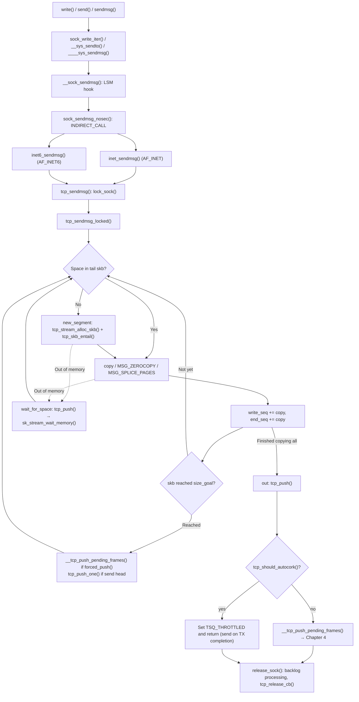

# 3. Sending (1): tcp_sendmsg and the write queue

In this chapter, we trace the byte stream passed by the application via `write()` / `send()` / `sendmsg()` until it is queued onto TCP's **write queue** as `sk_buff`s.  The star of the show is `tcp_sendmsg_locked()`, which we will walk through line by line.  Actually dispatching the queued `sk_buff`s to the wire via `__tcp_push_pending_frames()` / `tcp_write_xmit()` is the focus of Chapter 4.

## The ELI5 version

Next to the room's mailbox (socket) in a building (host), there is an **outgoing shelf** (write queue).  When a resident (application) brings a bundle of letters to the counter, the clerk operates as follows:

- If there is remaining room in the "yet unsealed parcel" sitting at the very back of the shelf (the `sk_buff` at the tail of the queue), letters are added there.  This is much cheaper than bringing out a new box.
- The guideline for box size is "the amount that neatly fits onto a single truck" (`size_goal`).  Once a box is full, a new box is brought out.  Shipping labels (headers) are not written yet; they are filled in just before departure.
- Every time a box is brought out or letters are stuffed into it, an entry is made in the household budget (memory accounting).  If the budget (`sk_sndbuf`) is exhausted, the resident is asked to wait in front of the counter.  When signed receipts (ACKs) return and space opens up on the shelf, the resident is called back.
- If the resident indicates "there is still more to come" (`MSG_MORE`), partial boxes are not dispatched immediately.  If nothing is specified, a "break here" mark (PSH) is attached to the final box, and it is handed over to the shipping clerk (Chapter 4).
- If the shipping clerk's previous truck is still out on the road (the socket's own parcels remain in the qdisc or NIC), partial boxes are kept on the shelf a little longer.  This is because the next letter might fit into that very same box (autocork).

## What the RFCs say

### Overview of RFC 9293 (core TCP)

[RFC 9293](https://www.rfc-editor.org/rfc/rfc9293) "Transmission Control Protocol (TCP)" is the current core TCP specification that replaced RFC 793 in 2022.  It obsoleted RFC 793, 879, 2873, 6093, 6429, 6528, and 6691, and updated RFC 1122 and others.  It consolidates 40 years of errata and host requirements (RFC 1122) into a single document.  Relevant to this chapter are three aspects: "the application passing data (SEND)", "segmenting the data", and "advancing the sequence space".

#### Sequence space and sender state variables

[RFC 9293 §3.3.1](https://www.rfc-editor.org/rfc/rfc9293#section-3.3.1) defines the sender's state variables as follows:

| RFC variable | Meaning | Linux counterpart |
| --- | --- | --- |
| `SND.UNA` | oldest unacknowledged sequence number | `tp->snd_una` |
| `SND.NXT` | next sequence number to be sent | `tp->snd_nxt` |
| `SND.WND` | send window advertised by peer | `tp->snd_wnd` |
| `SND.UP` | urgent pointer | `tp->snd_up` |
| `ISS` | initial send sequence number | initial value of `tp->write_seq` (Chapter 2) |

As stated in [§3.4](https://www.rfc-editor.org/rfc/rfc9293#section-3.4), TCP is a byte stream where "every byte of data transmitted is numbered with a sequence number".  The RFC only refers to data that the user has SENDed but has not yet transmitted as "data in the transmission buffer", without giving its tail an explicit name.  Linux explicitly maintains this tail as **`tp->write_seq`**.

```text
   snd_una            snd_nxt                       write_seq
      |  Sent, unacked    |  Queued, unsent             |
------+-------------------+-----------------------------+------>
      [ tcp_rtx_queue (rb-tree) ][ sk_write_queue (list) ]
```

- `[snd_una, snd_nxt)` is the range that has been sent and is awaiting an ACK.  Its `sk_buff`s reside in the retransmission queue `tcp_rtx_queue` (rb-tree).
- `[snd_nxt, write_seq)` is the range that `sendmsg()` has accepted but has not yet sent.  Its `sk_buff`s reside in `sk_write_queue` (doubly-linked list).
- `tcp_sendmsg_locked()` moves **only `write_seq`**.  Advancing `snd_nxt` is done by `tcp_event_new_data_sent()` in Chapter 4, and advancing `snd_una` is handled by ACK processing in Chapter 7.

#### Segmentation is at the sender's discretion

[RFC 9293 §3.7](https://www.rfc-editor.org/rfc/rfc9293#section-3.7) "Segmentation" leaves how to divide the application's byte stream into segments to the **discretion of the sending TCP**.  The boundaries of SEND calls and the boundaries of segments are unrelated; the only constraint to be satisfied is that "no segment may exceed the peer's MSS (and the path MTU)".  [§3.8](https://www.rfc-editor.org/rfc/rfc9293#section-3.8) "Data Communication" also takes the stance that data in ESTABLISHED state is conveyed through segment exchange, and how much data to put into which segment is determined by the implementation.

Linux exploits this freedom to the fullest:

- At `sendmsg()` time, it constructs `sk_buff`s not in units of MSS, but in units of **`size_goal` (an integer multiple of MSS, up to several tens or hundreds of kilobytes)**.
- Splitting the packet on the wire into MSS-sized segments is handled by TSO (NIC) or GSO (software).  Assuming this offload, TCP treats a "superpacket" many times longer than the MSS as a single `sk_buff`.
- Conversely, just before transmission, `tcp_write_xmit()` may further fragment this `sk_buff` (via `tso_fragment()` in Chapter 4).

#### MSS (RFC 9293 §3.7.1, formerly RFC 6691)

[RFC 9293 §3.7.1](https://www.rfc-editor.org/rfc/rfc9293#section-3.7.1) governs the handling of the MSS option.  [RFC 6691](https://www.rfc-editor.org/rfc/rfc6691) "TCP Options and Maximum Segment Size (MSS)" clarified that "the MSS option value does not include the length of IP or TCP options; the sender must subtract the options itself", and its contents were incorporated into §3.7.1 (RFC 6691 itself was obsoleted by RFC 9293).  The effective MSS usable by the sender is determined by the following formula:

```text
Eff.snd.MSS = min(SendMSS + 20, MMS_S) - TCPhdrsize - IPoptionsize
```

- `SendMSS` is the MSS advertised by the peer in the SYN.  If no option was present, IPv4 assumes 536 and IPv6 assumes 1220.
- `MMS_S` is the maximum message size the transport layer can send, which is the path MTU minus the fixed IP header length.
- `+ 20` accounts for the fixed TCP header length, `TCPhdrsize` is the actual TCP header length including options, and `IPoptionsize` is the length of IP options (or extension headers in IPv6).

In Linux, this formula is calculated progressively through `__tcp_mtu_to_mss()` → `tcp_mtu_to_mss()` → `tcp_sync_mss()` → `tcp_current_mss()` (Step 5).

#### SEND call and PUSH

The SEND call in [RFC 9293 §3.9.1.2](https://www.rfc-editor.org/rfc/rfc9293#section-3.9.1.2) takes the form `SEND (local connection name, buffer address, byte count, URGENT flag [, PUSH flag] [, timeout])`.  The rules here that affect implementation are as follows:

- The sending TCP is permitted to collect data from the user and send it at its convenience until a push is indicated.  In other words, multiple SEND calls may be consolidated into a single segment.
- Implementing the PUSH flag as an argument to SEND is optional (MAY).  If it is not implemented, the sending TCP (1) MUST NOT buffer data indefinitely, and (2) MUST set the PSH bit on the last segment of the buffered data (when the transmission buffer is emptied).

The BSD sockets API has no PUSH argument.  Linux follows the latter rule ("PUSH is not implemented"), satisfying (2) by **setting PSH on the `sk_buff` at the tail of the queue when `sendmsg()` finishes** (`tcp_push()` → `tcp_mark_push()`).  `MSG_MORE` represents the opposite intent: "do not push yet".  Rule (1) ("do not buffer indefinitely") is enforced by Nagle / cork limits (Chapter 4) and `forced_push()` in this chapter.

The URGENT flag corresponds to `MSG_OOB`.  The urgent pointer in [§3.8.5](https://www.rfc-editor.org/rfc/rfc9293#section-3.8.5) is recorded in `tp->snd_up` (`tcp_mark_urg()`).

#### Nagle (RFC 896) and sender SWS avoidance — the concept only

[RFC 896](https://www.rfc-editor.org/rfc/rfc896) "Congestion Control in IP/TCP Internetworks" addressed the problem where single-byte keystroke applications like telnet generated massive numbers of packets containing 41 bytes of packet header for 1 byte of data, congesting the network ("tinygrams").  The solution (Nagle algorithm) is: "while there is unacknowledged data, do not send small segments; buffer them instead".  [RFC 9293 §3.7.4](https://www.rfc-editor.org/rfc/rfc9293#section-3.7.4) makes this a SHOULD, and mandates that an application MUST be able to disable it per-connection (`TCP_NODELAY`).

The sender SWS avoidance algorithm in [§3.8.6.2.1](https://www.rfc-editor.org/rfc/rfc9293#section-3.8.6.2.1) lists as one condition for transmission that the sender can transmit at least a fraction Fs (recommended Fs = 1/2) of the maximum window advertised by the peer, `max(SND.WND)`.  This criterion of "half of the maximum window" appears in this chapter's `forced_push()` and `tcp_bound_to_half_wnd()` as `tp->max_window >> 1`.

The Nagle evaluation itself (`tcp_nagle_test()`, `TCP_CORK`, `tcp_tso_should_defer()`) is covered in Chapter 4.  In this chapter, what appears is merely the `nonagle` argument (`TCP_NAGLE_OFF` / `TCP_NAGLE_CORK` / `TCP_NAGLE_PUSH`) that `tcp_push()` passes to Chapter 4.

## The big picture



The four key points are:

- Between the socket layer and the protocol layer, direct calls via `INDIRECT_CALL_*()` are used to avoid retpolines.  AF_INET and AF_INET6 diverge at `inet_sendmsg()` / `inet6_sendmsg()`, but converge at `tcp_sendmsg()`.  From that point onwards, the code is address-family independent.
- `tcp_sendmsg()` acquires the socket lock (ownership) before calling `tcp_sendmsg_locked()`.  Any packets such as ACKs that arrive via softirq in the meantime are queued onto the backlog, to be processed either by `sk_flush_backlog()` (Step 7) or `release_sock()`.
- The main loop repeatedly "fills the tail `sk_buff` up to `size_goal`, or appends a new `sk_buff` if full".  Even mid-loop, `sk_buff`s that have become full start being transmitted.
- The final `tcp_push()` evaluates PSH attachment, autocork, and corking via `MSG_MORE`, and hands the queue over to `__tcp_push_pending_frames()` in Chapter 4.

## Walking through the code

### Step 1: From the system call to the socket layer

Since the socket layer is familiar territory, we will only look at the parts relevant to the TCP transmission path.  `write()` arrives at `sock_write_iter()` ([net/socket.c#L1250](https://git.kernel.org/pub/scm/linux/kernel/git/netdev/net-next.git/tree/net/socket.c?id=279d5c8afcd38bd841832a39bfe1aa4f8518d98e#n1250)) via the VFS.

```c
static ssize_t sock_write_iter(struct kiocb *iocb, struct iov_iter *from)
{
	struct file *file = iocb->ki_filp;
	struct socket *sock = file->private_data;
	struct msghdr msg = {.msg_iter = *from};
	ssize_t res;

	if (iocb->ki_pos != 0)
		return -ESPIPE;

	if (file->f_flags & O_NONBLOCK || (iocb->ki_flags & IOCB_NOWAIT))
		msg.msg_flags = MSG_DONTWAIT;

	if (sock->type == SOCK_SEQPACKET)
		msg.msg_flags |= MSG_EOR;

	if (iocb->ki_flags & IOCB_NOSIGNAL)
		msg.msg_flags |= MSG_NOSIGNAL;

	res = __sock_sendmsg(sock, &msg);
	*from = msg.msg_iter;
	return res;
}
```

- Returning `-ESPIPE` when `ki_pos != 0` is because stream sockets have no concept of file offsets.
- `O_NONBLOCK` and `IOCB_NOWAIT` (used by io_uring, etc.) are converted into `MSG_DONTWAIT`.  The TCP side inspects this and sets the timeout in `sock_sndtimeo()` to 0.
- Because `write()` has no `flags` argument, neither `MSG_MORE` nor `MSG_ZEROCOPY` can be used.  To use them, `send()` or `sendmsg()` is required.

`send()` / `sendto()` go through `__sys_sendto()` ([net/socket.c#L2248](https://git.kernel.org/pub/scm/linux/kernel/git/netdev/net-next.git/tree/net/socket.c?id=279d5c8afcd38bd841832a39bfe1aa4f8518d98e#n2248)), which builds a single-segment `iov_iter` via `import_ubuf()`, whereas `sendmsg()` / `sendmmsg()` pass through `____sys_sendmsg()` ([net/socket.c#L2658](https://git.kernel.org/pub/scm/linux/kernel/git/netdev/net-next.git/tree/net/socket.c?id=279d5c8afcd38bd841832a39bfe1aa4f8518d98e#n2658)).  Both eventually converge at `__sock_sendmsg()` ([net/socket.c#L813](https://git.kernel.org/pub/scm/linux/kernel/git/netdev/net-next.git/tree/net/socket.c?id=279d5c8afcd38bd841832a39bfe1aa4f8518d98e#n813)).

```c
static inline int sock_sendmsg_nosec(struct socket *sock, struct msghdr *msg)
{
	int ret = INDIRECT_CALL_INET(READ_ONCE(sock->ops)->sendmsg, inet6_sendmsg,
				     inet_sendmsg, sock, msg,
				     msg_data_left(msg));
	if (unlikely(ret == -EIOCBQUEUED)) {
		DEBUG_NET_WARN_ON_ONCE(1);
		ret = -EIO;
	}

	if (trace_sock_send_length_enabled())
		call_trace_sock_send_length(sock->sk, ret, 0);
	return ret;
}

static int __sock_sendmsg(struct socket *sock, struct msghdr *msg)
{
	int err = security_socket_sendmsg(sock, msg,
					  msg_data_left(msg));

	return err ?: sock_sendmsg_nosec(sock, msg);
}
```

- `security_socket_sendmsg()` is the LSM hook.  Only when `sendmmsg()` has the same destination as the previous message does `____sys_sendmsg()` bypass the LSM and call `sock_sendmsg_nosec()` directly.
- `INDIRECT_CALL_INET()` performs a direct call if `READ_ONCE(sock->ops)->sendmsg` is `inet6_sendmsg` or `inet_sendmsg`, falling back to an indirect call otherwise.  This is a standard pattern for avoiding indirect branch penalties in retpoline environments.
- Reading `sock->ops` with `READ_ONCE()` is necessary because `sock->ops` and `sk->sk_prot` can be rewritten without locks when an AF_INET6 socket is converted to AF_INET via `IPV6_ADDRFORM`.

In-kernel consumers (NFS, iSCSI, nbd, etc.) use `sock_sendmsg()` ([net/socket.c#L829](https://git.kernel.org/pub/scm/linux/kernel/git/netdev/net-next.git/tree/net/socket.c?id=279d5c8afcd38bd841832a39bfe1aa4f8518d98e#n829)).  This helper copies `msg_name` onto the stack before calling `__sock_sendmsg()`, preventing the caller's buffer from being corrupted if a BPF `sendmsg` hook or LSM rewrites the destination address.

### Step 2: inet_sendmsg() / inet6_sendmsg()

```c
int inet_send_prepare(struct sock *sk)
{
	sock_rps_record_flow(sk);

	/* We may need to bind the socket. */
	if (data_race(!inet_sk(sk)->inet_num) && !sk->sk_prot->no_autobind &&
	    inet_autobind(sk))
		return -EAGAIN;

	return 0;
}

int inet_sendmsg(struct socket *sock, struct msghdr *msg, size_t size)
{
	struct sock *sk = sock->sk;
	const struct proto *prot;

	if (unlikely(inet_send_prepare(sk)))
		return -EAGAIN;

	prot = READ_ONCE(sk->sk_prot);
	return INDIRECT_CALL_2(prot->sendmsg, tcp_sendmsg, udp_sendmsg,
			       sk, msg, size);
}
```

On the IPv6 side, `inet6_sendmsg()` ([net/ipv6/af_inet6.c#L629](https://git.kernel.org/pub/scm/linux/kernel/git/netdev/net-next.git/tree/net/ipv6/af_inet6.c?id=279d5c8afcd38bd841832a39bfe1aa4f8518d98e#n629)) is identical except that the second candidate is `udpv6_sendmsg`:

```c
int inet6_sendmsg(struct socket *sock, struct msghdr *msg, size_t size)
{
	struct sock *sk = sock->sk;
	const struct proto *prot;

	if (unlikely(inet_send_prepare(sk)))
		return -EAGAIN;

	prot = READ_ONCE(sk->sk_prot);
	return INDIRECT_CALL_2(prot->sendmsg, tcp_sendmsg, udpv6_sendmsg,
			       sk, msg, size);
}
```

- In `inet_send_prepare()` ([net/ipv4/af_inet.c#L842](https://git.kernel.org/pub/scm/linux/kernel/git/netdev/net-next.git/tree/net/ipv4/af_inet.c?id=279d5c8afcd38bd841832a39bfe1aa4f8518d98e#n842)), `sock_rps_record_flow()` records in RFS (Receive Flow Steering) that "this CPU is processing this flow".  Recording this at transmit time steers incoming response processing (ACKs and data) towards the same CPU.
- `inet_autobind()` handles unbound sockets such as UDP.  For TCP, by the time `sendmsg()` arrives, the port is already bound via `connect()` or `accept()`.  Even when arriving unconnected with MSG_FASTOPEN, the port is chosen later inside `tcp_v4_connect()`, so this is a no-op for TCP.
- Reading `READ_ONCE(sk->sk_prot)` is required because sockmap (`tcp_bpf_sendmsg()`) or kTLS (`tls_sw_sendmsg()`, etc.) can swap `sk->sk_prot`.  When that happens, the `INDIRECT_CALL_2()` check fails and falls back to an indirect call, and those ULPs ultimately invoke `tcp_sendmsg_locked()` (`net/ipv4/tcp_bpf.c` and `net/tls/tls_main.c` are callers).  The `proto_ops` member `.sendmsg_locked = tcp_sendmsg_locked` exists for in-kernel pre-locked paths like `skb_send_sock_locked()`.

### Step 3: tcp_sendmsg() — lock boundary

```c
int tcp_sendmsg(struct sock *sk, struct msghdr *msg, size_t size)
{
	int ret;

	lock_sock(sk);
	ret = tcp_sendmsg_locked(sk, msg, size);
	release_sock(sk);

	return ret;
}
EXPORT_SYMBOL(tcp_sendmsg);
```

`tcp_sendmsg()` ([net/ipv4/tcp.c#L1449](https://git.kernel.org/pub/scm/linux/kernel/git/netdev/net-next.git/tree/net/ipv4/tcp.c?id=279d5c8afcd38bd841832a39bfe1aa4f8518d98e#n1449)) merely acquires the lock and calls `tcp_sendmsg_locked()`, but these two lines dictate the entire execution context of the transmission path:

- `lock_sock()` acquires **ownership (owner)** of the socket.  Because it does not hold a spinlock continuously, the kernel can sleep in process context, incur page faults, and copy from user space.
- If packets arrive in softirq (`tcp_v4_rcv()` / `tcp_v6_rcv()`) while ownership is held, they are queued onto the backlog via `sk_add_backlog()` (Chapter 5).  Inside `tcp_sendmsg_locked()`, there is no contention with receive processing over state variables.
- `release_sock()` processes packets accumulated in the backlog via `sk_backlog_rcv()`, and executes deferred operations via `tcp_release_cb()` such as TSQ, delayed ACKs, and retransmission timers postponed during socket ownership.  ACKs that arrived during a large `sendmsg()` are batch-processed here.  This makes `sk_flush_backlog()` inside the loop (Step 7) critical.

### Step 4: Write queue building blocks

Before delving into the code, let us review the components of the write queue (see Chapter 1 for `struct tcp_sock` in full).

```c
static inline struct sk_buff *tcp_write_queue_tail(const struct sock *sk)
{
	return skb_peek_tail(&sk->sk_write_queue);
}

#define tcp_for_write_queue_from_safe(skb, tmp, sk)			\
	skb_queue_walk_from_safe(&(sk)->sk_write_queue, skb, tmp)

static inline struct sk_buff *tcp_send_head(const struct sock *sk)
{
	return skb_peek(&sk->sk_write_queue);
}
...
static inline bool tcp_write_queue_empty(const struct sock *sk)
{
	const struct tcp_sock *tp = tcp_sk(sk);

	return tp->write_seq == tp->snd_nxt;
}

static inline bool tcp_rtx_queue_empty(const struct sock *sk)
{
	return RB_EMPTY_ROOT(&sk->tcp_rtx_queue);
}

static inline bool tcp_rtx_and_write_queues_empty(const struct sock *sk)
{
	return tcp_rtx_queue_empty(sk) && tcp_write_queue_empty(sk);
}

static inline void tcp_add_write_queue_tail(struct sock *sk, struct sk_buff *skb)
{
	__skb_queue_tail(&sk->sk_write_queue, skb);

	/* Queue it, remembering where we must start sending. */
	if (sk->sk_write_queue.next == skb)
		tcp_chrono_start(sk, TCP_CHRONO_BUSY);
}
```

- `tcp_write_queue_tail()` ([include/net/tcp.h#L2286](https://git.kernel.org/pub/scm/linux/kernel/git/netdev/net-next.git/tree/include/net/tcp.h?id=279d5c8afcd38bd841832a39bfe1aa4f8518d98e#n2286)) returns the **newest** of the unsent `sk_buff`s.  `sendmsg()` basically appends here.
- `tcp_send_head()` ([include/net/tcp.h#L2294](https://git.kernel.org/pub/scm/linux/kernel/git/netdev/net-next.git/tree/include/net/tcp.h?id=279d5c8afcd38bd841832a39bfe1aa4f8518d98e#n2294)) is the **oldest** of the unsent `sk_buff`s, which is the next one to be transmitted by `tcp_write_xmit()`.  Transmitted `sk_buff`s are dequeued from the write queue in `tcp_event_new_data_sent()` (Chapter 4) and moved to the rb-tree `tcp_rtx_queue`.
- `tcp_write_queue_empty()` ([include/net/tcp.h#L2312](https://git.kernel.org/pub/scm/linux/kernel/git/netdev/net-next.git/tree/include/net/tcp.h?id=279d5c8afcd38bd841832a39bfe1aa4f8518d98e#n2312)) checks `write_seq == snd_nxt` rather than `skb_queue_empty()`.  As the comment notes, an empty `sk_buff` freshly created by `sendmsg()` can temporarily sit on the queue (it will be cleaned up by `tcp_remove_empty_skb()`).
- `tcp_add_write_queue_tail()` ([include/net/tcp.h#L2329](https://git.kernel.org/pub/scm/linux/kernel/git/netdev/net-next.git/tree/include/net/tcp.h?id=279d5c8afcd38bd841832a39bfe1aa4f8518d98e#n2329)) calls `tcp_chrono_start(sk, TCP_CHRONO_BUSY)` when the queue transitions from empty to non-empty, starting the active-transmission stopwatch (see [Deep-Dive Notes: `enum tcp_chrono` and `TCP_CHRONO_BUSY`](appendix-notes.md#tcp-chrono-busy) for the 4 priority states and how they are measured).

The control buffer of each `sk_buff` is stored in `skb->cb[]` as `struct tcp_skb_cb` ([include/net/tcp.h#L1138](https://git.kernel.org/pub/scm/linux/kernel/git/netdev/net-next.git/tree/include/net/tcp.h?id=279d5c8afcd38bd841832a39bfe1aa4f8518d98e#n1138)).

```c
struct tcp_skb_cb {
	__u32		seq;		/* Starting sequence number	*/
	__u32		end_seq;	/* SEQ + FIN + SYN + datalen	*/
	union {
		/* Notes :
		 *	tcp_tw_isn is used in input path only
		 *	(isn chosen by tcp_timewait_state_process())
		 * 	  tcp_gso_segs/size are used in write queue only,
		 *	  cf tcp_skb_pcount()/tcp_skb_mss()
		 */
		u32		tcp_tw_isn;
		struct {
			u16	tcp_gso_segs;
			u16	tcp_gso_size;
		};
	};
	__u16		tcp_flags;	/* TCP header flags (tcp[12-13])*/

	__u8		sacked;		/* State flags for SACK.	*/
	__u8		ip_dsfield;	/* IPv4 tos or IPv6 dsfield	*/
#define TSTAMP_ACK_SK	0x1
#define TSTAMP_ACK_BPF	0x2
	__u8		txstamp_ack:2,	/* Record TX timestamp for ack? */
			eor:1,		/* Is skb MSG_EOR marked? */
			has_rxtstamp:1,	/* SKB has a RX timestamp	*/
			unused:4;
	__u32		ack_seq;	/* Sequence number ACK'd	*/
```

- `seq` / `end_seq` define the sequence number range `[seq, end_seq)` covered by this `sk_buff`.  SYN and FIN each count as 1 byte.  The `sk_buff`s on the queue are contiguous without gaps, and for the tail `sk_buff`, the invariant `end_seq == tp->write_seq` always holds.  This invariant is maintained by `tcp_sendmsg_locked()` itself.
- `tcp_gso_segs` represents "how many wire segments this `sk_buff` will expand into" (pcount).  `sendmsg()` resets it to 0 each time data is appended, and `tcp_init_tso_segs()` recalculates it just before transmission.
- `eor` indicates `MSG_EOR`; no further data will be appended to an `sk_buff` that has this flag set.

### Step 5: MSS and size_goal — tcp_send_mss()

`tcp_sendmsg_locked()` calls `tcp_send_mss()` ([net/ipv4/tcp.c#L984](https://git.kernel.org/pub/scm/linux/kernel/git/netdev/net-next.git/tree/net/ipv4/tcp.c?id=279d5c8afcd38bd841832a39bfe1aa4f8518d98e#n984)) before the loop and after returning from sleep, obtaining two values:

```c
int tcp_send_mss(struct sock *sk, int *size_goal, int flags)
{
	int mss_now;

	mss_now = tcp_current_mss(sk);
	*size_goal = tcp_xmit_size_goal(sk, mss_now, !(flags & MSG_OOB));

	return mss_now;
}
```

- `mss_now` is the **payload length of a single segment to be transmitted onto the wire right now**.
- `size_goal` is the **target length to pack into a single `sk_buff`**, which will be an integer multiple of `mss_now` if TSO/GSO is available.
- When `MSG_OOB` is specified, `large_allowed = 0`, resulting in `size_goal = mss_now`.  Urgent data is handled in MSS-sized `sk_buff`s and is not pushed mid-loop (Step 10), preventing the `snd_up` position from diverging from segment boundaries.

#### tcp_current_mss()

`tcp_current_mss()` ([net/ipv4/tcp_output.c#L2103](https://git.kernel.org/pub/scm/linux/kernel/git/netdev/net-next.git/tree/net/ipv4/tcp_output.c?id=279d5c8afcd38bd841832a39bfe1aa4f8518d98e#n2103)) calculates the RFC's `Eff.snd.MSS`:

```c
unsigned int tcp_current_mss(struct sock *sk)
{
	const struct tcp_sock *tp = tcp_sk(sk);
	const struct dst_entry *dst = __sk_dst_get(sk);
	u32 mss_now;
	unsigned int header_len;
	struct tcp_out_options opts;
	struct tcp_key key;

	mss_now = tp->mss_cache;

	if (dst) {
		u32 mtu = dst_mtu(dst);
		if (mtu != inet_csk(sk)->icsk_pmtu_cookie)
			mss_now = tcp_sync_mss(sk, mtu);
	}
	tcp_get_current_key(sk, &key);
	header_len = tcp_established_options(sk, NULL, &opts, &key) +
		     sizeof(struct tcphdr);
	/* The mss_cache is sized based on tp->tcp_header_len, which assumes
	 * some common options. If this is an odd packet (because we have SACK
	 * blocks etc) then our calculated header_len will be different, and
	 * we have to adjust mss_now correspondingly */
	if (header_len != tp->tcp_header_len) {
		int delta = (int) header_len - tp->tcp_header_len;
		mss_now -= delta;
	}

	return mss_now;
}
```

- `tp->mss_cache` is the value last calculated by `tcp_sync_mss()`, representing the "MSS after subtracting common options (such as timestamps included in `tp->tcp_header_len`)".
- If `dst_mtu(dst)` differs from the previous `icsk_pmtu_cookie`, the PMTU has changed, so `tcp_sync_mss()` recalculates it.  ICMP Frag Needed / Packet Too Big only updates the MTU in `dst` in softirq; TCP detects it here at the next send (there are also paths where `tcp_v4_mtu_reduced()` / `tcp_v6_mtu_reduced()` invoke this immediately).
- `tcp_established_options()` calculates the length of the **options actually to be attached to this packet**.  If there is a difference from `tcp_header_len` due to SACK blocks (when holes exist on the receiver side) or MD5 / TCP-AO, `mss_now` is decremented accordingly.  This implements the rule from RFC 6691 / RFC 9293 §3.7.1 that "the sender subtracts the options".

`__tcp_mtu_to_mss()` ([net/ipv4/tcp_output.c#L1996](https://git.kernel.org/pub/scm/linux/kernel/git/netdev/net-next.git/tree/net/ipv4/tcp_output.c?id=279d5c8afcd38bd841832a39bfe1aa4f8518d98e#n1996)) and `tcp_mtu_to_mss()` ([net/ipv4/tcp_output.c#L2021](https://git.kernel.org/pub/scm/linux/kernel/git/netdev/net-next.git/tree/net/ipv4/tcp_output.c?id=279d5c8afcd38bd841832a39bfe1aa4f8518d98e#n2021)), which are called by `tcp_sync_mss()`, reflect the RFC formula almost verbatim:

```c
static inline int __tcp_mtu_to_mss(struct sock *sk, int pmtu)
{
	const struct tcp_sock *tp = tcp_sk(sk);
	const struct inet_connection_sock *icsk = inet_csk(sk);
	int mss_now;

	/* Calculate base mss without TCP options:
	   It is MMS_S - sizeof(tcphdr) of rfc1122
	 */
	mss_now = pmtu - icsk->icsk_af_ops->net_header_len - sizeof(struct tcphdr);

	/* Clamp it (mss_clamp does not include tcp options) */
	if (mss_now > tp->rx_opt.mss_clamp)
		mss_now = tp->rx_opt.mss_clamp;

	/* Now subtract optional transport overhead */
	mss_now -= icsk->icsk_ext_hdr_len;

	/* Then reserve room for full set of TCP options and 8 bytes of data */
	mss_now = max(mss_now,
		      READ_ONCE(sock_net(sk)->ipv4.sysctl_tcp_min_snd_mss));
	return mss_now;
}

/* Calculate MSS. Not accounting for SACKs here.  */
int tcp_mtu_to_mss(struct sock *sk, int pmtu)
{
	/* Subtract TCP options size, not including SACKs */
	return __tcp_mtu_to_mss(sk, pmtu) -
	       (tcp_sk(sk)->tcp_header_len - sizeof(struct tcphdr));
}
```

| Term in RFC 9293 §3.7.1 | Linux |
| --- | --- |
| `MMS_S - 20` | `pmtu - net_header_len - sizeof(struct tcphdr)` |
| `min(SendMSS + 20, MMS_S) - 20` | `min` with `mss_clamp` (`mss_clamp` is the smaller of peer MSS and `TCP_MAXSEG`) |
| `- IPoptionsize` | `- icsk_ext_hdr_len` (IPv4 options / IPv6 extension headers) |
| `- (TCPhdrsize - 20)` | `- (tcp_header_len - sizeof(struct tcphdr))`, with delta for SACK etc. deducted by `tcp_current_mss()` |

A Linux-specific lower bound not present in the RFC is `sysctl_tcp_min_snd_mss` (default `TCP_MIN_SND_MSS` = 48).  This was introduced in 2019 to mitigate the SACK Panic vulnerabilities (CVE-2019-11477/11478/11479).  It prevents an attacker from advertising an extremely small MSS to trigger an explosion in the number of `sk_buff`s.

#### tcp_xmit_size_goal() and tcp_bound_to_half_wnd()

```c
static unsigned int tcp_xmit_size_goal(struct sock *sk, u32 mss_now,
				       int large_allowed)
{
	struct tcp_sock *tp = tcp_sk(sk);
	u32 new_size_goal, size_goal;

	if (!large_allowed)
		return mss_now;

	/* Note : tcp_tso_autosize() will eventually split this later */
	new_size_goal = tcp_bound_to_half_wnd(tp, sk->sk_gso_max_size);

	/* We try hard to avoid divides here */
	size_goal = tp->gso_segs * mss_now;
	if (unlikely(new_size_goal < size_goal ||
		     new_size_goal >= size_goal + mss_now)) {
		tp->gso_segs = min_t(u16, new_size_goal / mss_now,
				     sk->sk_gso_max_segs);
		size_goal = tp->gso_segs * mss_now;
	}

	return max(size_goal, mss_now);
}
```

- When `large_allowed == 0` (`MSG_OOB`), it returns `mss_now`.
- `sk->sk_gso_max_size` is the device GSO limit minus `MAX_TCP_HEADER + 1`, configured by `sk_setup_caps()` when setting up the route cache.  Because TCP always sets `NETIF_F_GSO` (software GSO) even if the NIC lacks hardware TSO, this is typically around 64KB (or higher with BIG TCP).  Exceptions occur when `sk_gso_disabled` is set (e.g. TCP-MD5) or when GSO is disabled on non-offloadable xfrm routes.  In such cases, `sk_gso_max_size` is unconfigured and typically remains 0, so the calculation below causes `size_goal` to fall back to `mss_now`.
- `tcp_bound_to_half_wnd()` ([include/net/tcp.h#L858](https://git.kernel.org/pub/scm/linux/kernel/git/netdev/net-next.git/tree/include/net/tcp.h?id=279d5c8afcd38bd841832a39bfe1aa4f8518d98e#n858)) caps this at **half of the peer's maximum advertised window**:

```c
static inline int tcp_bound_to_half_wnd(struct tcp_sock *tp, int pktsize)
{
	int cutoff;

	/* When peer uses tiny windows, there is no use in packetizing
	 * to sub-MSS pieces for the sake of SWS or making sure there
	 * are enough packets in the pipe for fast recovery.
	 *
	 * On the other hand, for extremely large MSS devices, handling
	 * smaller than MSS windows in this way does make sense.
	 */
	if (tp->max_window > TCP_MSS_DEFAULT)
		cutoff = (tp->max_window >> 1);
	else
		cutoff = tp->max_window;

	if (cutoff && pktsize > cutoff)
		return max_t(int, cutoff, 68U - tp->tcp_header_len);
	else
		return pktsize;
}
```

  Creating an `sk_buff` larger than the window is pointless because it cannot be sent all at once.  Capping it at half guarantees at least two packets in flight, making it easier to receive the duplicate ACKs required for Fast Recovery.  This mirrors the RFC's sender SWS avoidance principle of Fs = 1/2.  For extremely small windows where `max_window <= TCP_MSS_DEFAULT` (536), it is not halved; the entire window serves as the upper bound.  Even then, the floor is `68 - tcp_header_len`, where 68 is IPv4's minimum MTU.
- `size_goal = tp->gso_segs * mss_now` is a cache to **avoid divisions**.  `gso_segs` (u16) holds the previous calculation of "how many segments fit into one `sk_buff`".  If the new upper bound `new_size_goal` falls within the range `[size_goal, size_goal + mss_now)`, the quotient remains unchanged, allowing the division to be skipped.  Only when out of range (due to changes in MSS, GSO limit, or window) does it compute `new_size_goal / mss_now` and clamp it by `sk_gso_max_segs`.
- As noted in the comment, `tcp_tso_autosize()` (Chapter 4) determines the TSO size to send (roughly 1ms worth of data) based on the pacing rate at transmit time.  `size_goal` is purely the size of the `sk_buff` on the queue, completely distinct from the size of the TSO packet that leaves for the wire.
- `max(size_goal, mss_now)` is a safeguard against returning 0 in anomaly conditions such as `gso_segs == 0` (afece1c65870).

> [!NOTE]
> `size_goal` reflects the value computed when `tcp_send_mss()` was invoked and stays fixed throughout the loop.  Even if MSS or the window changes mid-loop, the old value continues to be used until `sk_flush_backlog()` processes something and executes `goto restart`, or until returning from `wait_for_space`.  Since `tcp_write_xmit()` downstream corrects for stale values, correctness is never compromised.

### Step 6: tcp_sendmsg_locked() (1) — preparation and determining the send mode

From here, we walk through `tcp_sendmsg_locked()` ([net/ipv4/tcp.c#L1119](https://git.kernel.org/pub/scm/linux/kernel/git/netdev/net-next.git/tree/net/ipv4/tcp.c?id=279d5c8afcd38bd841832a39bfe1aa4f8518d98e#n1119)) from beginning to end.  Upon entry, the socket is already owned (`lock_sock()` has been called), running in process context.

```c
int tcp_sendmsg_locked(struct sock *sk, struct msghdr *msg, size_t size)
{
	struct net_devmem_dmabuf_binding *binding = NULL;
	struct tcp_sock *tp = tcp_sk(sk);
	struct ubuf_info *uarg = NULL;
	struct sk_buff *skb;
	struct sockcm_cookie sockc;
	int flags, err, copied = 0;
	int mss_now = 0, size_goal, copied_syn = 0;
	int process_backlog = 0;
	int sockc_err = 0;
	int zc = 0;
	long timeo;

	flags = msg->msg_flags;

	sockc = (struct sockcm_cookie){ .tsflags = READ_ONCE(sk->sk_tsflags) };
	if (msg->msg_controllen) {
		sockc_err = sock_cmsg_send(sk, msg, &sockc);
		/* Don't return error until MSG_FASTOPEN has been processed;
		 * that may succeed even if the cmsg is invalid.
		 */
	}
```

- `copied` tracks the number of bytes queued into the write queue during this call, and `copied_syn` tracks the bytes carried on the SYN during Fast Open.  The return value is `copied + copied_syn`.
- `process_backlog` counts "how many new `sk_buff`s have been created since the backlog was last checked" (Step 7).
- `zc` represents the send mode: `0` for regular copy, `MSG_ZEROCOPY` for pinning user pages and referencing them, and `MSG_SPLICE_PAGES` for inserting references to pages supplied by splice / sendfile into the `sk_buff`.
- `sockc` stores the parsed cmsg options (`SCM_TIMESTAMPING`, `SO_MARK`, `SCM_DEVMEM_DMABUF`, etc.).  Rather than immediately returning errors from `sock_cmsg_send()`, the error is saved in `sockc_err` so that MSG_FASTOPEN processing (transmitting the SYN) can proceed first.  This preserves the historical behaviour where a connection can initiate even if cmsg options are invalid.

```c
	if ((flags & MSG_ZEROCOPY) && size) {
		if (msg->msg_ubuf) {
			uarg = msg->msg_ubuf;
			if (sk->sk_route_caps & NETIF_F_SG)
				zc = MSG_ZEROCOPY;
		} else if (sock_flag(sk, SOCK_ZEROCOPY)) {
			skb = tcp_write_queue_tail(sk);
			uarg = msg_zerocopy_realloc(sk, size, skb_zcopy(skb),
						    !sockc_err && sockc.dmabuf_id);
			if (!uarg) {
				err = -ENOBUFS;
				goto out_err;
			}
			if (sk->sk_route_caps & NETIF_F_SG)
				zc = MSG_ZEROCOPY;
			else
				uarg_to_msgzc(uarg)->zerocopy = 0;

			if (!sockc_err && sockc.dmabuf_id) {
				binding = net_devmem_get_binding(sk, sockc.dmabuf_id);
				if (IS_ERR(binding)) {
					err = PTR_ERR(binding);
					binding = NULL;
					goto out_err;
				}
			}
		}
	} else if (unlikely(msg->msg_flags & MSG_SPLICE_PAGES) && size) {
		if (sk->sk_route_caps & NETIF_F_SG)
			zc = MSG_SPLICE_PAGES;
	}

	if (!sockc_err && sockc.dmabuf_id && (zc != MSG_ZEROCOPY || !binding)) {
		err = -EINVAL;
		goto out_err;
	}
```

Here the transmission mode is decided:

- **When `MSG_ZEROCOPY` is specified and `size > 0`**, there are two cases:
  - If `msg->msg_ubuf` is already set, an in-kernel caller such as io_uring has provided its own `ubuf_info` (completion notification container).  Zero-copy is selected if `NETIF_F_SG` is supported.
  - For standard `sendmsg(MSG_ZEROCOPY)` on a socket with `SO_ZEROCOPY` enabled, `msg_zerocopy_realloc()` allocates a `ubuf_info` for completion notification.  If the tail `sk_buff` is already a zerocopy buffer, it attempts to extend that `ubuf_info` to batch notifications across a wider range, reducing completion overhead.
  - If the device lacks `NETIF_F_SG` (scatter-gather), pages cannot be referenced directly, falling back to copying (`zerocopy = 0`).  Completion notifications are still delivered, appearing to the application as `SO_EE_CODE_ZEROCOPY_COPIED`.
  - If `MSG_ZEROCOPY` is passed on a socket where `SO_ZEROCOPY` has not been enabled, it silently falls back to standard copy (5cf4a8532c99).
  - For devmem TX (`sockc.dmabuf_id`), the dma-buf binding is retrieved.
- **`MSG_SPLICE_PAGES`** is the mechanism that replaced the legacy `->sendpage()` interface (Step 9).  Without SG, it falls back to copy with `zc = 0`.
- The final check enforces that devmem (dma-buf) is "non-copyable memory", so it is **only permitted when zerocopy is active with a valid binding** (125755776bc6).  If SG is missing and it would fall back to copy, it is rejected with `-EINVAL`.

```c
	if (unlikely(flags & MSG_FASTOPEN ||
		     inet_test_bit(DEFER_CONNECT, sk)) &&
	    !tp->repair) {
		err = tcp_sendmsg_fastopen(sk, msg, &copied_syn, size, uarg);
		if (err == -EINPROGRESS && copied_syn > 0)
			goto out;
		else if (err)
			goto out_err;
	}

	timeo = sock_sndtimeo(sk, flags & MSG_DONTWAIT);

	tcp_rate_check_app_limited(sk);  /* is sending application-limited? */

	/* Wait for a connection to finish. One exception is TCP Fast Open
	 * (passive side) where data is allowed to be sent before a connection
	 * is fully established.
	 */
	if (((1 << sk->sk_state) & ~(TCPF_ESTABLISHED | TCPF_CLOSE_WAIT)) &&
	    !tcp_passive_fastopen(sk)) {
		err = sk_stream_wait_connect(sk, &timeo);
		if (err != 0)
			goto do_error;
	}
```

- **Fast Open**: For `MSG_FASTOPEN`, or sockets where `connect()` was deferred via `TCP_FASTOPEN_CONNECT` (`DEFER_CONNECT`), `tcp_sendmsg_fastopen()` ([net/ipv4/tcp.c#L1054](https://git.kernel.org/pub/scm/linux/kernel/git/netdev/net-next.git/tree/net/ipv4/tcp.c?id=279d5c8afcd38bd841832a39bfe1aa4f8518d98e#n1054)) starts the connection with data in the SYN (details in Chapter 2).  If it returns `-EINPROGRESS` and `copied_syn > 0` (data was non-blockingly attached to the SYN), it jumps directly to `out`.  Fast Open is ignored in repair mode (16ae6aa17052).
- `timeo` is `SO_SNDTIMEO`, which resolves to 0 when `MSG_DONTWAIT` is set.
- `tcp_rate_check_app_limited()` ([net/ipv4/tcp.c#L1102](https://git.kernel.org/pub/scm/linux/kernel/git/netdev/net-next.git/tree/net/ipv4/tcp.c?id=279d5c8afcd38bd841832a39bfe1aa4f8518d98e#n1102)) records whether the sender is currently application-limited, providing input for delivery rate estimation (Chapter 7, consumed by BBR):

```c
/* If a gap is detected between sends, mark the socket application-limited. */
void tcp_rate_check_app_limited(struct sock *sk)
{
	struct tcp_sock *tp = tcp_sk(sk);

	if (/* We have less than one packet to send. */
	    tp->write_seq - tp->snd_nxt < tp->mss_cache &&
	    /* Nothing in sending host's qdisc queues or NIC tx queue. */
	    sk_wmem_alloc_get(sk) < SKB_TRUESIZE(1) &&
	    /* We are not limited by CWND. */
	    tcp_packets_in_flight(tp) < tcp_snd_cwnd(tp) &&
	    /* All lost packets have been retransmitted. */
	    tp->lost_out <= tp->retrans_out)
		tp->app_limited =
			(tp->delivered + tcp_packets_in_flight(tp)) ? : 1;
}
EXPORT_SYMBOL_GPL(tcp_rate_check_app_limited);
```

  If unsent data is less than 1 MSS, nothing remains in qdisc or NIC queues, cwnd has spare capacity, and all lost packets have been retransmitted, the kernel deduces that "the application is slow, not the network", and marks `app_limited` with "current delivered + in flight".  Rate samples taken before ACKs advance past this value are flagged as app-limited, preventing congestion controllers like BBR from using them to update maximum bandwidth estimates.  Performing this check **just before** queueing new data is essential; once data is queued, the condition "unsent data is less than 1 MSS" would no longer hold.
- **Connection waiting**: If the state is neither ESTABLISHED nor CLOSE_WAIT, the thread waits via `sk_stream_wait_connect()` ([net/core/stream.c#L60](https://git.kernel.org/pub/scm/linux/kernel/git/netdev/net-next.git/tree/net/core/stream.c?id=279d5c8afcd38bd841832a39bfe1aa4f8518d98e#n60)).  CLOSE_WAIT is allowed because even if the peer sent a FIN (closing their send direction), this side may still transmit (half-close).  The exception is passive Fast Open (`tcp_passive_fastopen()`), where TFO rules allow the server to transmit data while still in SYN_RECV.  `sk_stream_wait_connect()` returns `-EPIPE` for any state other than SYN_SENT / SYN_RECV.

```c
	if (unlikely(tp->repair)) {
		if (tp->repair_queue == TCP_RECV_QUEUE) {
			copied = tcp_send_rcvq(sk, msg, size);
			goto out_nopush;
		}

		err = -EINVAL;
		if (tp->repair_queue == TCP_NO_QUEUE)
			goto out_err;

		/* 'common' sending to sendq */
	}

	if (sockc_err) {
		err = sockc_err;
		goto out_err;
	}

	/* This should be in poll */
	sk_clear_bit(SOCKWQ_ASYNC_NOSPACE, sk);

	/* Ok commence sending. */
	copied = 0;

restart:
	mss_now = tcp_send_mss(sk, &size_goal, flags);

	err = -EPIPE;
	if (READ_ONCE(sk->sk_err) || (sk->sk_shutdown & SEND_SHUTDOWN))
		goto do_error;
```

- In **repair mode** (used by CRIU for checkpoint/restore), if `TCP_RECV_QUEUE` is selected, `sendmsg()` writes data back into the **receive queue** (`tcp_send_rcvq()`).  If `TCP_SEND_QUEUE` is selected, it reconstructs the write queue through the normal path but does not emit packets to the wire (checked by the `repair` condition in Step 10).
- Any deferred `sockc_err` is returned here.
- `SOCKWQ_ASYNC_NOSPACE` is a flag for `SIGIO` (`FASYNC`).  The comment "This should be in poll" is a long-standing historical remark.
- **`restart:`** — This is the return target after `sk_flush_backlog()` processes queued incoming packets.  `tcp_send_mss()` is rerun because ACKs in the backlog may have changed the window, SACK state, or PMTU, potentially altering `mss_now` / `size_goal`.
- If `sk_err` is non-zero (due to an incoming RST, ICMP error, etc.) or `SEND_SHUTDOWN` is set (`shutdown(SHUT_WR)` or after sending a FIN), it errors out with `-EPIPE`.  Reading `sk_err` with `READ_ONCE()` is necessary because softirq can write to it without waiting for socket ownership (3b49f11cc92d).

### Step 7: tcp_sendmsg_locked() (2) — loop header and new sk_buff

```c
	while (msg_data_left(msg)) {
		int copy = 0;

		skb = tcp_write_queue_tail(sk);
		if (skb)
			copy = size_goal - skb->len;

		trace_tcp_sendmsg_locked(sk, msg, skb, size_goal);

		if (copy <= 0 || !tcp_skb_can_collapse_to(skb) ||
		    unlikely(skb_frags_readable(skb) != !binding)) {
			bool first_skb;

new_segment:
			if (!sk_stream_memory_free(sk))
				goto wait_for_space;

			if (unlikely(process_backlog >= 16)) {
				process_backlog = 0;
				if (sk_flush_backlog(sk))
					goto restart;
			}
```

- `msg_data_left(msg)` returns the remaining bytes in `iov_iter`.
- `copy = size_goal - skb->len` is the remaining headroom in the tail `sk_buff`.  `copy` is a signed `int`.  If `size_goal` shrunk since the last calculation (due to an MSS decrease), it becomes negative, prompting the allocation of a new `sk_buff`.  Back when `copy` was `ssize_t`, `int - unsigned int` was evaluated as unsigned arithmetic, turning negative values into massive positive quantities that corrupted `sk_forward_alloc` (d3a5f2871adc).
- `trace_tcp_sendmsg_locked()` is a tracepoint added in 2025 (0f08335ade71), exposing `size_goal` and the length of the tail `sk_buff`.
- A new `sk_buff` is needed in the following cases:
  - `copy <= 0`: The tail buffer is full, or the queue is empty (`copy = 0` if `skb == NULL`).
  - `!tcp_skb_can_collapse_to(skb)`: The tail buffer was terminated with `MSG_EOR`.
  - `skb_frags_readable(skb) != !binding`: devmem `net_iov` (memory inaccessible to the CPU) and normal pages must never be mixed in the same `sk_buff` (d9c56501c72f).
- **`new_segment:`** — Other code paths in the loop (such as hitting the frag limit or zero-copy `-EMSGSIZE`) also jump here via `goto`.
- If `sk_stream_memory_free()` ([include/net/sock.h#L1425](https://git.kernel.org/pub/scm/linux/kernel/git/netdev/net-next.git/tree/include/net/sock.h?id=279d5c8afcd38bd841832a39bfe1aa4f8518d98e#n1425)) returns false, execution jumps to `wait_for_space`:

```c
static inline bool __sk_stream_memory_free(const struct sock *sk, int wake)
{
	if (READ_ONCE(sk->sk_wmem_queued) >= READ_ONCE(sk->sk_sndbuf))
		return false;

	return sk->sk_prot->stream_memory_free ?
		INDIRECT_CALL_INET_1(sk->sk_prot->stream_memory_free,
				     tcp_stream_memory_free, sk, wake) : true;
}

static inline bool sk_stream_memory_free(const struct sock *sk)
{
	return __sk_stream_memory_free(sk, 0);
}
```

```c
/* @wake is one when sk_stream_write_space() calls us.
 * This sends EPOLLOUT only if notsent_bytes is half the limit.
 * This mimics the strategy used in sock_def_write_space().
 */
bool tcp_stream_memory_free(const struct sock *sk, int wake)
{
	const struct tcp_sock *tp = tcp_sk(sk);
	u32 notsent_bytes = READ_ONCE(tp->write_seq) - READ_ONCE(tp->snd_nxt);

	return (notsent_bytes << wake) < tcp_notsent_lowat(tp);
}
```

  Two conditions are evaluated here.  First, `sk_wmem_queued` (the sum of truesizes of all `sk_buff`s in the queue, including transmitted but unacknowledged packets) must not have reached `sk_sndbuf`.  Second, `tcp_stream_memory_free()` ([net/ipv4/tcp.c#L510](https://git.kernel.org/pub/scm/linux/kernel/git/netdev/net-next.git/tree/net/ipv4/tcp.c?id=279d5c8afcd38bd841832a39bfe1aa4f8518d98e#n510)) checks that **unsent bytes** (`write_seq - snd_nxt`) remain below `TCP_NOTSENT_LOWAT` (default `UINT_MAX`, unlimited).  Lowering `TCP_NOTSENT_LOWAT` caps unsent queued bytes without shrinking the in-flight retransmission budget (`sk_sndbuf`), and when `wake = 1` a left shift (`<< 1`) halves the threshold to avoid `EPOLLOUT` chatter (see [Deep-Dive Notes: `TCP_NOTSENT_LOWAT` and `tcp_stream_memory_free()`](appendix-notes.md#tcp-notsent-lowat) for a full diagram and walkthrough).
- **Flushing the backlog**: Every 16 newly created `sk_buff`s, `sk_flush_backlog()` ([include/net/sock.h#L1252](https://git.kernel.org/pub/scm/linux/kernel/git/netdev/net-next.git/tree/include/net/sock.h?id=279d5c8afcd38bd841832a39bfe1aa4f8518d98e#n1252)) is called:

```c
static inline bool sk_flush_backlog(struct sock *sk)
{
	if (unlikely(READ_ONCE(sk->sk_backlog.tail))) {
		__sk_flush_backlog(sk);
		return true;
	}
	return false;
}
```

  `__sk_flush_backlog()` processes the backlog without releasing socket ownership (temporarily taking only the spinlock).  This ensures incoming ACKs are not left unaddressed while a large `sendmsg()` copies many megabytes of data.  Leaving ACKs unhandled delays Fast Retransmit, bloats the peer's out-of-order queue, closes the window, and halts transmission (d41a69f1d390).  Checking on every packet incurs noticeable overhead on loopback interfaces, so checks are batched to once every 16 segments (~1MB) (1a9914884db5).  If any packets were processed, execution jumps to `restart` to recalculate `mss_now` / `size_goal`.  To prevent looping infinitely on backlog processing without allocating any buffers, the counter increments only when an `sk_buff` is actually created, ensuring forward progress (d4011239f46a).

```c
			first_skb = tcp_rtx_and_write_queues_empty(sk);
			skb = tcp_stream_alloc_skb(sk, sk->sk_allocation,
						   first_skb);
			if (!skb)
				goto wait_for_space;

			process_backlog++;

#ifdef CONFIG_SKB_DECRYPTED
			skb->decrypted = !!(flags & MSG_SENDPAGE_DECRYPTED);
#endif
			tcp_skb_entail(sk, skb);
			copy = size_goal;

			/* All packets are restored as if they have
			 * already been sent. skb_mstamp_ns isn't set to
			 * avoid wrong rtt estimation.
			 */
			if (tp->repair)
				TCP_SKB_CB(skb)->sacked |= TCPCB_REPAIRED;
		}
```

- `first_skb` indicates that both the retransmit queue and the write queue are empty — meaning **this socket holds 0 bytes of data**.  Only in this case is `force_schedule = true` used to allocate the `sk_buff`, guaranteeing that at least one packet can be queued even under severe memory pressure.  Returning `-EAGAIN` on an entirely empty queue would prevent any ACK from ever returning to trigger `EPOLLOUT`, causing edge-triggered epoll to sleep forever (8e4d980ac215, eb9344781a2f).
- `tcp_stream_alloc_skb()` ([net/ipv4/tcp.c#L929](https://git.kernel.org/pub/scm/linux/kernel/git/netdev/net-next.git/tree/net/ipv4/tcp.c?id=279d5c8afcd38bd841832a39bfe1aa4f8518d98e#n929)):

```c
struct sk_buff *tcp_stream_alloc_skb(struct sock *sk, gfp_t gfp,
				     bool force_schedule)
{
	struct sk_buff *skb;

	skb = alloc_skb_fclone(MAX_TCP_HEADER, gfp);
	if (likely(skb)) {
		bool mem_scheduled;

		skb->truesize = SKB_TRUESIZE(skb_end_offset(skb));
		if (force_schedule) {
			mem_scheduled = true;
			sk_forced_mem_schedule(sk, skb->truesize);
		} else {
			mem_scheduled = sk_wmem_schedule(sk, skb->truesize);
		}
		if (likely(mem_scheduled)) {
			skb_reserve(skb, MAX_TCP_HEADER);
			skb->ip_summed = CHECKSUM_PARTIAL;
			INIT_LIST_HEAD(&skb->tcp_tsorted_anchor);
			return skb;
		}
		__kfree_skb(skb);
	} else {
		if (!sk->sk_bypass_prot_mem)
			tcp_enter_memory_pressure(sk);
		sk_stream_moderate_sndbuf(sk);
	}
	return NULL;
}
```

  - `alloc_skb_fclone()` allocates with **fast clone** enabled.  `tcp_transmit_skb()` in Chapter 4 clones the `sk_buff` upon every transmission to pass it down to lower layers (leaving the original for retransmission).  With fclone, the cloning `sk_buff` is preallocated adjacent to the original in the same slab object (`struct sk_buff_fclones`), eliminating dynamic allocation overhead during cloning (see [Appendix: `alloc_skb_fclone()` and `struct sk_buff_fclones`](appendix-notes.md#skb-fclone) for the memory layout and lifecycle).
  - The linear area contains **only headroom** for `MAX_TCP_HEADER` (`L1_CACHE_ALIGN(128 + MAX_HEADER)`), with 0 bytes allocated for linear payload.  All payload resides exclusively in page frags (the `size` argument itself was removed in 5882efff88aa).  Because there is no payload in the linear buffer, shifting and coalescing `sk_buff`s during SACK processing (`tcp_shift_skb_data()` in Chapter 8) can be performed zero-copy by updating `(page, offset, size)` descriptors (the motivation in 3613b3dbd1ad; see [Appendix: SACK Shifting and Why Linear Payload Is Always 0](appendix-notes.md#sack-shifting)).
  - `truesize` is initialised upfront to `SKB_TRUESIZE(skb_end_offset(skb))`, and forward allocation is reserved via `sk_wmem_schedule()`.  Detailed memory accounting is covered in Chapter 10; here, it suffices to understand that it checks whether the truesize can be borrowed from the socket's budget (`sk_forward_alloc`).  When `force_schedule` is set, `sk_forced_mem_schedule()` ([net/ipv4/tcp.c#L909](https://git.kernel.org/pub/scm/linux/kernel/git/netdev/net-next.git/tree/net/ipv4/tcp.c?id=279d5c8afcd38bd841832a39bfe1aa4f8518d98e#n909)) forces the reservation regardless of global memory limits.
  - `ip_summed = CHECKSUM_PARTIAL` indicates that checksum computation will be offloaded to hardware (or performed by GSO).  No `sk_buff` on the TCP write queue ever has an `ip_summed` value other than `CHECKSUM_PARTIAL` (65ec60973af9).
  - `tcp_tsorted_anchor` is the list node used to link the buffer into `tsorted_sent_queue` (the send-time ordered queue for RACK, Chapter 8) after transmission.
  - If allocation fails, the socket enters TCP global memory pressure via `tcp_enter_memory_pressure()`, and `sk_stream_moderate_sndbuf()` shrinks `sk_sndbuf` down to roughly half the current queue size (unless locked by `SO_SNDBUF`).
- `skb->decrypted` is for kTLS device offload.  It is set when `MSG_SENDPAGE_DECRYPTED` is present, signifying plaintext data whose encryption is offloaded to the NIC (a535d5943237).
- `copy = size_goal` indicates that the newly created `sk_buff` has the entire `size_goal` available.
- `sk_buff`s restored in repair mode are marked with `TCPCB_REPAIRED`.  Because they do not have valid transmission timestamps, they must not be used for RTT estimation.

#### tcp_skb_entail()

```c
void tcp_skb_entail(struct sock *sk, struct sk_buff *skb)
{
	struct tcp_sock *tp = tcp_sk(sk);
	struct tcp_skb_cb *tcb = TCP_SKB_CB(skb);

	tcb->seq     = tcb->end_seq = tp->write_seq;
	tcb->tcp_flags = TCPHDR_ACK;
	__skb_header_release(skb);
	psp_enqueue_set_decrypted(sk, skb);
	tcp_add_write_queue_tail(sk, skb);
	sk_wmem_queued_add(sk, skb->truesize);
	sk_mem_charge(sk, skb->truesize);
	if (tp->nonagle & TCP_NAGLE_PUSH)
		tp->nonagle &= ~TCP_NAGLE_PUSH;

	tcp_slow_start_after_idle_check(sk);
}
```

`tcp_skb_entail()` ([net/ipv4/tcp.c#L700](https://git.kernel.org/pub/scm/linux/kernel/git/netdev/net-next.git/tree/net/ipv4/tcp.c?id=279d5c8afcd38bd841832a39bfe1aa4f8518d98e#n700)) enqueues the empty `sk_buff` at the tail of the write queue:

- `seq = end_seq = write_seq` establishes an initial zero-length range.  `end_seq` is extended whenever data is appended (Step 10).
- `tcp_flags = TCPHDR_ACK`.  Established TCP segments always have ACK set.  PSH is attached later by `tcp_mark_push()`.
- `__skb_header_release()` marks the buffer with `skb->nohdr`, indicating that clones may freely overwrite the header area.  When `tcp_transmit_skb()` prepends headers via `skb_push()` on the clone, `skb_header_cloned()` evaluates to false, avoiding an expensive copy through `pskb_expand_head()`.
- `psp_enqueue_set_decrypted()` is for PSP encryption offload; it is normally a no-op (659a2899a57d).
- `sk_wmem_queued_add()` and `sk_mem_charge()` record the empty `sk_buff`'s truesize (header overhead) into the accounting ledger.  The former is compared against `sk_sndbuf`, while the latter debits forward allocation.
- `TCP_NAGLE_PUSH` is a one-shot directive set during `setsockopt(TCP_NODELAY)` or cork removal to "push whatever is currently queued".  It is cleared as soon as new data arrives.  Otherwise, this bit would persist indefinitely after toggling `TCP_NODELAY` (89ebd197eb2c).
- `tcp_slow_start_after_idle_check()` ([include/net/tcp.h#L1754](https://git.kernel.org/pub/scm/linux/kernel/git/netdev/net-next.git/tree/include/net/tcp.h?id=279d5c8afcd38bd841832a39bfe1aa4f8518d98e#n1754)) enforces RFC 5681 §4.1: "if idle for more than an RTO, reset cwnd to the restart window":

```c
static inline void tcp_slow_start_after_idle_check(struct sock *sk)
{
	const struct tcp_congestion_ops *ca_ops = inet_csk(sk)->icsk_ca_ops;
	struct tcp_sock *tp = tcp_sk(sk);
	s32 delta;

	if (!READ_ONCE(sock_net(sk)->ipv4.sysctl_tcp_slow_start_after_idle) ||
	    tp->packets_out || ca_ops->cong_control)
		return;
	delta = tcp_jiffies32 - tp->lsndtime;
	if (delta > inet_csk(sk)->icsk_rto)
		tcp_cwnd_restart(sk, delta);
}
```

  If there are no packets in flight (`packets_out == 0`) and the time since the last transmit exceeds RTO, `tcp_cwnd_restart()` is invoked.  Performing this check at **queueing time** rather than transmit time is critical; if done at transmit time, an entire large TSO burst would be emitted with the uncollapsed cwnd before the reduction took effect (6f021c62d64f).  Congestion controllers that implement their own `cong_control` (like BBR) manage this internally and are excluded.

### Step 8: tcp_sendmsg_locked() (3) — regular copy path (zc == 0)

```c
		/* Try to append data to the end of skb. */
		if (copy > msg_data_left(msg))
			copy = msg_data_left(msg);

		if (zc == 0) {
			bool merge = true;
			int i = skb_shinfo(skb)->nr_frags;
			struct page_frag *pfrag = sk_page_frag(sk);

			if (!sk_page_frag_refill(sk, pfrag))
				goto wait_for_space;

			if (!skb_can_coalesce(skb, i, pfrag->page,
					      pfrag->offset)) {
				if (i >= READ_ONCE(net_hotdata.sysctl_max_skb_frags)) {
					tcp_mark_push(tp, skb);
					goto new_segment;
				}
				merge = false;
			}

			copy = min_t(int, copy, pfrag->size - pfrag->offset);

			if (unlikely(skb_zcopy_pure(skb) || skb_zcopy_managed(skb))) {
				if (tcp_downgrade_zcopy_pure(sk, skb))
					goto wait_for_space;
				skb_zcopy_downgrade_managed(skb);
			}
```

- `copy` is clamped to the bytes remaining in the message.
- `sk_page_frag()` ([include/net/sock.h#L2663](https://git.kernel.org/pub/scm/linux/kernel/git/netdev/net-next.git/tree/include/net/sock.h?id=279d5c8afcd38bd841832a39bfe1aa4f8518d98e#n2663)) selects the destination page fragment:

```c
static inline struct page_frag *sk_page_frag(struct sock *sk)
{
	if (sk->sk_use_task_frag)
		return &current->task_frag;

	return &sk->sk_frag;
}
```

  Normally, the **per-task** `current->task_frag` is used.  Retaining a page per socket would lead to vast amounts of wasted memory when thousands of idle sockets hold one page each (5640f7685831).  However, for subsystems like nbd, sunrpc, or cifs where `sendmsg()` can be called reentrantly **from within** memory reclaim or page fault handling, reentrancy would overwrite the in-use `task_frag` and corrupt the stream.  These sockets set `sk_use_task_frag = false` to fall back to the per-socket `sk->sk_frag` (20eb4f29b602, dacb5d8875cc, fb87bd47516d, 08f65892c5ee).
- `sk_page_frag_refill()` ([net/core/sock.c#L3263](https://git.kernel.org/pub/scm/linux/kernel/git/netdev/net-next.git/tree/net/core/sock.c?id=279d5c8afcd38bd841832a39bfe1aa4f8518d98e#n3263)) → `skb_page_frag_refill()` ([net/core/sock.c#L3229](https://git.kernel.org/pub/scm/linux/kernel/git/netdev/net-next.git/tree/net/core/sock.c?id=279d5c8afcd38bd841832a39bfe1aa4f8518d98e#n3229)):

```c
bool skb_page_frag_refill(unsigned int sz, struct page_frag *pfrag, gfp_t gfp)
{
	if (pfrag->page) {
		if (page_ref_count(pfrag->page) == 1) {
			pfrag->offset = 0;
			return true;
		}
		if (pfrag->offset + sz <= pfrag->size)
			return true;
		put_page(pfrag->page);
	}

	pfrag->offset = 0;
	if (SKB_FRAG_PAGE_ORDER &&
	    !static_branch_unlikely(&net_high_order_alloc_disable_key)) {
		/* Avoid direct reclaim but allow kswapd to wake */
		pfrag->page = alloc_pages((gfp & ~__GFP_DIRECT_RECLAIM) |
					  __GFP_COMP | __GFP_NOWARN |
					  __GFP_NORETRY,
					  SKB_FRAG_PAGE_ORDER);
		if (likely(pfrag->page)) {
			pfrag->size = PAGE_SIZE << SKB_FRAG_PAGE_ORDER;
			return true;
		}
	}
	pfrag->page = alloc_page(gfp);
	if (likely(pfrag->page)) {
		pfrag->size = PAGE_SIZE;
		return true;
	}
	return false;
}
EXPORT_SYMBOL(skb_page_frag_refill);
```

```c
bool sk_page_frag_refill(struct sock *sk, struct page_frag *pfrag)
{
	if (likely(skb_page_frag_refill(32U, pfrag, sk->sk_allocation)))
		return true;

	if (!sk->sk_bypass_prot_mem)
		sk_enter_memory_pressure(sk);

	sk_stream_moderate_sndbuf(sk);

	return false;
}
```

  - If the current page reference count is 1 (`page_ref_count == 1`, meaning no other `sk_buff` references this page), `offset = 0` is set to reuse the page from the beginning (761965eab38d).
  - If there is at least 32 bytes of space remaining, it is used directly.
  - Otherwise, an order-3 (32KB) compound page is allocated **without direct reclaim** (`~__GFP_DIRECT_RECLAIM`, `__GFP_NORETRY`).  With larger pages, a 64KB TSO packet requires only 2 frags, reducing DMA map/unmap operations eightfold.  If this fails, it falls back to an order-0 allocation.  Order-3 allocations can also be disabled via `net.core.high_order_alloc_disable` (ce27ec60648d).
  - If that still fails, the socket enters memory pressure, shrinks `sk_sndbuf`, and jumps to `wait_for_space`.
- `skb_can_coalesce()` ([include/linux/skbuff.h#L4017](https://git.kernel.org/pub/scm/linux/kernel/git/netdev/net-next.git/tree/include/linux/skbuff.h?id=279d5c8afcd38bd841832a39bfe1aa4f8518d98e#n4017)) checks whether the data is on the **same page and contiguous in offset** with the tail frag:

```c
static inline bool skb_can_coalesce_netmem(struct sk_buff *skb, int i,
					   netmem_ref netmem, int off)
{
	if (skb_zcopy(skb))
		return false;
	if (i) {
		const skb_frag_t *frag = &skb_shinfo(skb)->frags[i - 1];

		return netmem == skb_frag_netmem(frag) &&
		       off == skb_frag_off(frag) + skb_frag_size(frag);
	}
	return false;
}

static inline bool skb_can_coalesce(struct sk_buff *skb, int i,
				    const struct page *page, int off)
{
	return skb_can_coalesce_netmem(skb, i, page_to_netmem(page), off);
}
```

  If contiguous, rather than allocating a new frag, the tail frag is simply extended (`merge = true`).  Even with a barrage of small `write()` calls, packing into the same page frag coalesces them into a single frag.  Coalescing with zerocopy frags is forbidden.
- If coalescing is impossible and the frag count has already reached `net.core.max_skb_frags` (default `MAX_SKB_FRAGS` = 17), this `sk_buff` is closed: `tcp_mark_push()` sets PSH before jumping to `new_segment`.
- `copy` is clamped to the remaining capacity of the page frag.  Each copy operation fits cleanly within a single page frag.
- If the tail buffer is **pure zerocopy** (built exclusively from user pages without charging payload memory to the socket) or an io_uring **managed frag**, its state must be downgraded before mixing in copied data.  `tcp_downgrade_zcopy_pure()` ([net/ipv4/tcp.c#L1013](https://git.kernel.org/pub/scm/linux/kernel/git/netdev/net-next.git/tree/net/ipv4/tcp.c?id=279d5c8afcd38bd841832a39bfe1aa4f8518d98e#n1013)) charges the previously uncharged zerocopy portion (`truesize` minus header overhead) at this point:

```c
/* skb changing from pure zc to mixed, must charge zc */
static int tcp_downgrade_zcopy_pure(struct sock *sk, struct sk_buff *skb)
{
	if (unlikely(skb_zcopy_pure(skb))) {
		u32 extra = skb->truesize -
			    SKB_TRUESIZE(skb_end_offset(skb));

		if (!sk_wmem_schedule(sk, extra))
			return -ENOMEM;

		sk_mem_charge(sk, extra);
		skb_shinfo(skb)->flags &= ~SKBFL_PURE_ZEROCOPY;
	}
	return 0;
}
```

```c

			copy = tcp_wmem_schedule(sk, copy);
			if (!copy)
				goto wait_for_space;

			err = skb_copy_to_page_nocache(sk, &msg->msg_iter, skb,
						       pfrag->page,
						       pfrag->offset,
						       copy);
			if (err)
				goto do_error;

			/* Update the skb. */
			if (merge) {
				skb_frag_size_add(&skb_shinfo(skb)->frags[i - 1], copy);
			} else {
				skb_fill_page_desc(skb, i, pfrag->page,
						   pfrag->offset, copy);
				page_ref_inc(pfrag->page);
			}
			pfrag->offset += copy;
```

- `tcp_wmem_schedule()` ([net/ipv4/tcp.c#L1029](https://git.kernel.org/pub/scm/linux/kernel/git/netdev/net-next.git/tree/net/ipv4/tcp.c?id=279d5c8afcd38bd841832a39bfe1aa4f8518d98e#n1029)) reserves forward allocation for `copy` bytes and returns the number of bytes successfully reserved:

```c
int tcp_wmem_schedule(struct sock *sk, int copy)
{
	int left;

	if (likely(sk_wmem_schedule(sk, copy)))
		return copy;

	/* We could be in trouble if we have nothing queued.
	 * Use whatever is left in sk->sk_forward_alloc and tcp_wmem[0]
	 * to guarantee some progress.
	 */
	left = READ_ONCE(sock_net(sk)->ipv4.sysctl_tcp_wmem[0]) - sk->sk_wmem_queued;
	if (left > 0)
		sk_forced_mem_schedule(sk, min(left, copy));
	return min(copy, sk->sk_forward_alloc);
}
```

  Normally, `sk_wmem_schedule()` succeeds and returns `copy` unmodified.  Even when global memory pressure causes it to fail, if the total queued bytes for this socket are less than `tcp_wmem[0]` (default 4KB = `PAGE_SIZE`), that shortfall is forcefully scheduled.  Even if an `sk_buff` can be forcefully allocated, the socket would stall without the ability to enqueue payload bytes (849b425cd091).  If it returns 0, execution branches to `wait_for_space`.
- `skb_copy_to_page_nocache()` ([include/net/sock.h#L2350](https://git.kernel.org/pub/scm/linux/kernel/git/netdev/net-next.git/tree/include/net/sock.h?id=279d5c8afcd38bd841832a39bfe1aa4f8518d98e#n2350)) copies data from user space into the page:

```c
static inline int skb_do_copy_data_nocache(struct sock *sk, struct sk_buff *skb,
					   struct iov_iter *from, char *to,
					   int copy, int offset)
{
	if (skb->ip_summed == CHECKSUM_NONE) {
		__wsum csum = 0;
		if (!csum_and_copy_from_iter_full(to, copy, &csum, from))
			return -EFAULT;
		skb->csum = csum_block_add(skb->csum, csum, offset);
	} else if (sk->sk_route_caps & NETIF_F_NOCACHE_COPY) {
		if (!copy_from_iter_full_nocache(to, copy, from))
			return -EFAULT;
	} else if (!copy_from_iter_full(to, copy, from))
		return -EFAULT;

	return 0;
}
...
static inline int skb_copy_to_page_nocache(struct sock *sk, struct iov_iter *from,
					   struct sk_buff *skb,
					   struct page *page,
					   int off, int copy)
{
	int err;

	err = skb_do_copy_data_nocache(sk, skb, from, page_address(page) + off,
				       copy, skb->len);
	if (err)
		return err;

	skb_len_add(skb, copy);
	sk_wmem_queued_add(sk, copy);
	sk_mem_charge(sk, copy);
	return 0;
}
```

  The `CHECKSUM_NONE` branch is obsolete in modern TCP (`ip_summed` is always `CHECKSUM_PARTIAL`).  If the device advertises `NETIF_F_NOCACHE_COPY`, data is copied using non-temporal stores to avoid polluting the CPU cache (c6e1a0d12ca7).  The CPU will never read this payload again; only the NIC will read it via DMA.  Upon a successful copy, `skb->len`, `data_len`, and `truesize` are all increased by `copy` (`skb_len_add()`), and accounting is debited from `sk_wmem_queued` and forward alloc.
- If a page fault in user memory triggers `-EFAULT` during copy, execution jumps to `do_error`.  If `copied > 0` bytes were already copied, a partial write success is returned.
- If `merge` is true, the tail frag size is expanded; otherwise, a new frag is added via `skb_fill_page_desc()`, incrementing the page's reference count via `page_ref_inc()` (cheaper than `get_page()`, 4e33e3462510).  Then `pfrag->offset` is advanced.  One reference to the page frag is held by `pfrag` itself, and each frag holds an additional reference.  `skb_page_frag_refill()` relies on this exact reference accounting when checking `page_ref_count == 1` for reuse.

### Step 9: tcp_sendmsg_locked() (4) — MSG_ZEROCOPY and MSG_SPLICE_PAGES

```c
		} else if (zc == MSG_ZEROCOPY)  {
			/* First append to a fragless skb builds initial
			 * pure zerocopy skb
			 */
			if (!skb->len)
				skb_shinfo(skb)->flags |= SKBFL_PURE_ZEROCOPY;

			if (!skb_zcopy_pure(skb)) {
				copy = tcp_wmem_schedule(sk, copy);
				if (!copy)
					goto wait_for_space;
			}

			err = skb_zerocopy_iter_stream(sk, skb, msg, copy, uarg,
						       binding);
			if (err == -EMSGSIZE || err == -EEXIST) {
				tcp_mark_push(tp, skb);
				goto new_segment;
			}
			if (err < 0)
				goto do_error;
			copy = err;
```

- **MSG_ZEROCOPY**: When appending zero-copy data for the first time to an empty `sk_buff`, `SKBFL_PURE_ZEROCOPY` is set.  A pure zero-copy `sk_buff` **does not charge its payload (user pages) to socket memory**.  Because the pages are already charged to the user's process memory, double-counting them would prematurely trigger memory pressure (9b65b17db723).  Only when appending to an already-mixed `sk_buff` is `tcp_wmem_schedule()` invoked for accounting.
- `skb_zerocopy_iter_stream()` pins user pages (`iov_iter_get_pages`), inserts them as frags into the `sk_buff`, and extends the notification range in `uarg`.  For devmem, it inserts `net_iov` from the `binding`.
  - `-EMSGSIZE` indicates that frags are exhausted; `-EEXIST` indicates that the tail buffer belongs to a different `ubuf_info`.  In both cases, PSH is marked and execution proceeds to `new_segment`.
  - The return value indicates the actual number of bytes enqueued.
- Completion is notified to user space once the `sk_buff` has been acknowledged and freed (retrieved via `MSG_ERRQUEUE`).  Until then, the application must not overwrite the buffer because TCP retains the pages for potential retransmission.  For local loopback traffic, data is copied upon arrival at the receiver (`skb_orphan_frags_rx()`).

```c
		} else if (zc == MSG_SPLICE_PAGES) {
			/* Splice in data if we can; copy if we can't. */
			if (tcp_downgrade_zcopy_pure(sk, skb))
				goto wait_for_space;
			copy = tcp_wmem_schedule(sk, copy);
			if (!copy)
				goto wait_for_space;

			err = skb_splice_from_iter(skb, &msg->msg_iter, copy);
			if (err < 0) {
				if (err == -EMSGSIZE) {
					tcp_mark_push(tp, skb);
					goto new_segment;
				}
				goto do_error;
			}
			copy = err;

			if (!(flags & MSG_NO_SHARED_FRAGS))
				skb_shinfo(skb)->flags |= SKBFL_SHARED_FRAG;

			sk_wmem_queued_add(sk, copy);
			sk_mem_charge(sk, copy);
		}
```

- **MSG_SPLICE_PAGES**: Used by `splice()` / `sendfile()` and in-kernel callers (NFS, iSCSI, etc.) requesting "send these pages by reference".  This unified mechanism was introduced in 2023 when `->sendpage()` / `do_tcp_sendpages()` were removed and merged into `sendmsg()` (270a1c3de47e, c5c37af6ecad, dc97391e6610).
  - `tcp_downgrade_zcopy_pure()` downgrades pure zero-copy buffers before mixing in spliced pages.  Previously, omitting this in the sendpage path led to `sk_forward_alloc` imbalances caught by syzbot (f8d9d938514f).
  - Because spliced pages originate from pipes or other sources without guarantees of being accounted to user memory, **they are charged to the socket** (`tcp_wmem_schedule()` followed by `sk_wmem_queued_add()` / `sk_mem_charge()`).
  - `skb_splice_from_iter()` takes references to the pages and appends them as frags.  If it returns `-EMSGSIZE` (frags exhausted), it marks PSH and advances to the next `sk_buff`.
  - `SKBFL_SHARED_FRAG` flags that "frag contents are shared with others (e.g. page cache) and may change post-send".  Paths computing software checksums or encryption inspect `skb_has_shared_frag()` and copy them first.  Callers guaranteeing private page ownership can omit this flag via `MSG_NO_SHARED_FRAGS`.

### Step 10: tcp_sendmsg_locked() (5) — advancing sequence numbers and mid-stream transmission

```c
		if (!copied)
			TCP_SKB_CB(skb)->tcp_flags &= ~TCPHDR_PSH;

		WRITE_ONCE(tp->write_seq, tp->write_seq + copy);
		TCP_SKB_CB(skb)->end_seq += copy;
		tcp_skb_pcount_set(skb, 0);

		copied += copy;
		if (!msg_data_left(msg)) {
			if (unlikely(flags & MSG_EOR))
				TCP_SKB_CB(skb)->eor = 1;
			goto out;
		}

		if (skb->len < size_goal || (flags & MSG_OOB) || unlikely(tp->repair))
			continue;

		if (forced_push(tp)) {
			tcp_mark_push(tp, skb);
			__tcp_push_pending_frames(sk, mss_now, TCP_NAGLE_PUSH);
		} else if (skb == tcp_send_head(sk))
			tcp_push_one(sk, mss_now);
		continue;
```

These lines advance the RFC sequence space:

- `if (!copied) TCP_SKB_CB(skb)->tcp_flags &= ~TCPHDR_PSH;` — Clears PSH from the **first** `sk_buff` appended to during this `sendmsg()`.  Even if `tcp_push()` set PSH on the tail at the end of the previous `sendmsg()`, appending contiguous data means this boundary is no longer an endpoint.  Subsequent newly-created `sk_buff`s do not have PSH set initially (except those closed early due to frag limits via `tcp_mark_push()`).
- `WRITE_ONCE(tp->write_seq, tp->write_seq + copy)` — While `write_seq` is only written by the socket owner, lockless readers exist: `tcp_poll()` → `tcp_stream_memory_free()`, `SIOCOUTQ` / `SIOCOUTQNSD` ioctls, `inet_diag` (`idiag_wqueue`), `/proc/net/tcp`, `SCM_TIMESTAMPING_OPT_STATS`, etc.  `WRITE_ONCE()` / `READ_ONCE()` annotations prevent store/load tearing and silence KCSAN warnings (0f31746452e6).
- `TCP_SKB_CB(skb)->end_seq += copy` — Maintains the invariant that `end_seq == write_seq` for the tail buffer.
- `tcp_skb_pcount_set(skb, 0)` — Invalidates pcount now that the buffer length has changed.  `tcp_init_tso_segs()` recalculates it before transmission based on `!tso_segs`.
- Once the message is entirely processed, it branches to `out`.  If `MSG_EOR` was specified, `eor` is marked on the final buffer, preventing subsequent appends and coalescing (c134ecb87817).  Combined with `SOF_TIMESTAMPING_TX_ACK`, this accurately records "the timestamp when the final byte of this message was ACKed".
- **If data remains**, the loop continues without transmitting under these conditions:
  - `skb->len < size_goal`: Room remains in the tail buffer (the copy merely paused at a page frag boundary).
  - `MSG_OOB`: Urgent data is deferred to be pushed as a batch in `tcp_push()`.
  - `repair`: Do not send packets to the wire during socket restoration.
- Once an `sk_buff` is filled, **transmission begins even mid-message**.  This pipelines data transfer for multi-megabyte `sendmsg()` calls, ensuring the NIC does not sit idle until copying completes.
  - `forced_push()` ([net/ipv4/tcp.c#L695](https://git.kernel.org/pub/scm/linux/kernel/git/netdev/net-next.git/tree/net/ipv4/tcp.c?id=279d5c8afcd38bd841832a39bfe1aa4f8518d98e#n695)) triggers if more than half of the peer's maximum window has been queued since PSH was last marked:

```c
void tcp_mark_push(struct tcp_sock *tp, struct sk_buff *skb)
{
	TCP_SKB_CB(skb)->tcp_flags |= TCPHDR_PSH;
	tp->pushed_seq = tp->write_seq;
}

static inline bool forced_push(const struct tcp_sock *tp)
{
	return after(tp->write_seq, tp->pushed_seq + (tp->max_window >> 1));
}
```

    In this case, PSH is marked and all transmittable data is pushed using `TCP_NAGLE_PUSH` (bypassing cork and Nagle).  The comment on `pushed_seq` ("required to talk to windows") refers to interoperability with receiver implementations (historically Windows) that hold buffered data until observing PSH.  Injecting PSH every half window allows receiver applications to receive streaming data periodically.
  - Otherwise, if the filled `sk_buff` is the **send head** (the oldest unsent buffer), `tcp_push_one()` ([net/ipv4/tcp_output.c#L3261](https://git.kernel.org/pub/scm/linux/kernel/git/netdev/net-next.git/tree/net/ipv4/tcp_output.c?id=279d5c8afcd38bd841832a39bfe1aa4f8518d98e#n3261)) transmits that single buffer:

```c
void __tcp_push_pending_frames(struct sock *sk, unsigned int cur_mss,
			       int nonagle)
{
	/* If we are closed, the bytes will have to remain here.
	 * In time closedown will finish, we empty the write queue and
	 * all will be happy.
	 */
	if (unlikely(sk->sk_state == TCP_CLOSE))
		return;

	if (tcp_write_xmit(sk, cur_mss, nonagle, 0,
			   sk_gfp_mask(sk, GFP_ATOMIC)))
		tcp_check_probe_timer(sk);
}

/* Send _single_ skb sitting at the send head. This function requires
 * true push pending frames to setup probe timer etc.
 */
void tcp_push_one(struct sock *sk, unsigned int mss_now)
{
	struct sk_buff *skb = tcp_send_head(sk);

	BUG_ON(!skb || skb->len < mss_now);

	tcp_write_xmit(sk, mss_now, TCP_NAGLE_PUSH, 1, sk->sk_allocation);
}
```

    Passing `push_one = 1` instructs `tcp_write_xmit()` to transmit only a single buffer, leaving housekeeping like zero-window probe timers to the final `tcp_push()`.  `BUG_ON(!skb || skb->len < mss_now)` asserts the invariant that buffers reaching this point are filled up to `size_goal` (≥ `mss_now`).  If it is not the send head (earlier `sk_buff`s are stalled on cwnd or rwnd), nothing is transmitted because transmission would be blocked anyway.
  - Historically, mid-loop pushes fired on every MSS.  Transitioning to `size_goal` enabled TSO `sk_buff`s to grow beyond a single page (69d150673116).

### Step 11: tcp_sendmsg_locked() (6) — wait_for_space

```c
wait_for_space:
		sk_set_nospace(sk);
		tcp_remove_empty_skb(sk);
		if (copied)
			tcp_push(sk, flags & ~MSG_MORE, mss_now,
				 TCP_NAGLE_PUSH, size_goal);

		err = sk_stream_wait_memory(sk, &timeo);
		if (err != 0)
			goto do_error;

		mss_now = tcp_send_mss(sk, &size_goal, flags);
	}
```

When memory or `sk_sndbuf` is exhausted within the loop, execution lands here:

- `sk_set_nospace()` sets `SOCK_NOSPACE` on the socket along with its cacheline-local copy `tp->tcp_nospace` (6ba48a271bdb).  In the ACK path, `tcp_check_space()` inspects `tp->tcp_nospace` first (located on the cacheline touched by ACK processing); if set, it calls `__tcp_check_space()` → `tcp_new_space()` to invoke `sk_write_space()` and wake waiting writers.  `EPOLLOUT` is also dispatched from here.  Conversely, sleeping or returning `-EAGAIN` without setting this bit means no one will wake the process.
- `tcp_remove_empty_skb()` unlinks and frees any newly allocated `sk_buff` that remains empty (Step 12).  This prevents `tcp_write_xmit()` running in softirq from encountering an unexpected zero-length buffer while the lock is released during sleep (72bf4f1767f0).
- **Queued data is flushed before sleeping**.  If `copied > 0`, `MSG_MORE` is cleared and `tcp_push()` is invoked with `TCP_NAGLE_PUSH`.  Failing to do so causes a deadlock: sleeping while waiting for ACKs of untransmitted data.  If only unsent data sits in the queue, an ACK will never arrive.
- The thread sleeps in `sk_stream_wait_memory()` ([net/core/stream.c#L121](https://git.kernel.org/pub/scm/linux/kernel/git/netdev/net-next.git/tree/net/core/stream.c?id=279d5c8afcd38bd841832a39bfe1aa4f8518d98e#n121)):

```c
int sk_stream_wait_memory(struct sock *sk, long *timeo_p)
{
	int ret, err = 0;
	long vm_wait = 0;
	long current_timeo = *timeo_p;
	DEFINE_WAIT_FUNC(wait, woken_wake_function);

	if (sk_stream_memory_free(sk))
		current_timeo = vm_wait = get_random_u32_below(HZ / 5) + 2;

	add_wait_queue(sk_sleep(sk), &wait);

	while (1) {
		sk_set_bit(SOCKWQ_ASYNC_NOSPACE, sk);

		if (READ_ONCE(sk->sk_err) || (sk->sk_shutdown & SEND_SHUTDOWN))
			goto do_error;
		if (!*timeo_p)
			goto do_eagain;
		if (signal_pending(current))
			goto do_interrupted;
		sk_clear_bit(SOCKWQ_ASYNC_NOSPACE, sk);
		if (sk_stream_memory_free(sk) && !vm_wait)
			break;

		sk_set_nospace(sk);
		sk->sk_write_pending++;
		ret = sk_wait_event(sk, &current_timeo, READ_ONCE(sk->sk_err) ||
				    (READ_ONCE(sk->sk_shutdown) & SEND_SHUTDOWN) ||
				    (sk_stream_memory_free(sk) && !vm_wait),
				    &wait);
		sk->sk_write_pending--;
		if (ret < 0)
			goto do_error;

```

```c
		if (vm_wait) {
			vm_wait -= current_timeo;
			current_timeo = *timeo_p;
			if (current_timeo != MAX_SCHEDULE_TIMEOUT &&
			    (current_timeo -= vm_wait) < 0)
				current_timeo = 0;
			vm_wait = 0;
		}
		*timeo_p = current_timeo;
	}
out:
	if (!sock_flag(sk, SOCK_DEAD))
		remove_wait_queue(sk_sleep(sk), &wait);
	return err;

do_error:
	err = -EPIPE;
	goto out;
do_eagain:
	/* Make sure that whenever EAGAIN is returned, EPOLLOUT event can
	 * be generated later.
	 * When TCP receives ACK packets that make room, tcp_check_space()
	 * only calls tcp_new_space() if SOCK_NOSPACE is set.
	 */
	sk_set_nospace(sk);
	err = -EAGAIN;
	goto out;
do_interrupted:
	err = sock_intr_errno(*timeo_p);
	goto out;
}
```

  - **`vm_wait`**: If `sk_stream_memory_free()` is true upon entry (ample room exists in `sk_sndbuf` and `notsent_lowat`), the stall was caused not by the socket's buffer limits, but by **global memory exhaustion** (failure to allocate an `sk_buff` or page, or hitting global TCP memory limits).  Because waiting for ACKs cannot resolve global memory pressure, the thread sleeps for a randomised timeout of 2 to (HZ/5 + 1) jiffies before retrying.  Randomising the backoff prevents a thundering herd when many sockets wake up simultaneously.
  - `sk_wait_event()` **releases socket ownership** while sleeping (`release_sock()` → `schedule_timeout()` → `lock_sock()`).  While asleep, incoming ACKs are processed directly in softirq, advancing `snd_una`, freeing `sk_buff`s from the rtx queue, and decrementing `sk_wmem_queued`.  If ownership were held while sleeping, ACKs would merely queue onto the backlog, never freeing buffer space.
  - `sk_write_pending` marks that a thread is actively waiting to write.  In TCP, this is inspected when receiving a SYN-ACK in SYN_SENT to decide whether to delay the ACK to piggyback it onto the initial data (`tcp_rcv_synsent_state_process()`).
  - When returning `-EAGAIN`, `SOCK_NOSPACE` must be set.  Without it, `tcp_new_space()` will not emit `EPOLLOUT` when subsequent ACKs arrive.
  - The `SOCK_DEAD` check guards against another thread calling `close()` and destroying the wait queue while this thread was asleep.
- Upon waking, `tcp_send_mss()` refreshes `mss_now` / `size_goal` before re-entering the loop, accounting for potential window or SACK state changes brought by ACKs during sleep.

### Step 12: tcp_sendmsg_locked() (7) — exit

```c
out:
	if (copied) {
		tcp_tx_timestamp(sk, &sockc);
		tcp_push(sk, flags, mss_now, tp->nonagle, size_goal);
	}
out_nopush:
	/* msg->msg_ubuf is pinned by the caller so we don't take extra refs */
	if (uarg && !msg->msg_ubuf)
		net_zcopy_put(uarg);
	if (binding)
		net_devmem_dmabuf_binding_put(binding);
	return copied + copied_syn;

do_error:
	tcp_remove_empty_skb(sk);

	if (copied + copied_syn)
		goto out;
out_err:
	/* msg->msg_ubuf is pinned by the caller so we don't take extra refs */
	if (uarg && !msg->msg_ubuf)
		net_zcopy_put_abort(uarg, true);
	err = sk_stream_error(sk, flags, err);
	/* make sure we wake any epoll edge trigger waiter */
	if (unlikely(tcp_rtx_and_write_queues_empty(sk) && err == -EAGAIN)) {
		READ_ONCE(sk->sk_write_space)(sk);
		tcp_chrono_stop(sk, TCP_CHRONO_SNDBUF_LIMITED);
	}
	if (binding)
		net_devmem_dmabuf_binding_put(binding);

	return err;
}
```

- **`out:`** — If at least 1 byte was queued:
  - `tcp_tx_timestamp()` ([net/ipv4/tcp.c#L482](https://git.kernel.org/pub/scm/linux/kernel/git/netdev/net-next.git/tree/net/ipv4/tcp.c?id=279d5c8afcd38bd841832a39bfe1aa4f8518d98e#n482)) attaches `SO_TIMESTAMPING` metadata to the final `sk_buff`.  `tskey` records "the sequence number of the final byte in this `sendmsg()`", allowing applications to correlate timestamps with exact byte offsets.  If the write queue is already empty (all data was transmitted), it checks the tail of the rtx queue (838eb9687691).
  - `tcp_push(sk, flags, mss_now, tp->nonagle, size_goal)` transmits data after evaluating PSH attachment, autocork, and corking rules (Step 13).
- **`out_nopush:`** — Drops the reference to `uarg` acquired via `msg_zerocopy_realloc()`.  Individual `sk_buff`s containing zero-copy pages hold their own references, so dropping the caller's reference here will not trigger premature completion.  A `msg_ubuf` supplied by external callers like io_uring is owned by the caller and left untouched (a7533584728d).
- **`do_error:`** — Cleans up any trailing empty `sk_buff`.  If `copied + copied_syn > 0`, it **returns partial write success** (jumping to `out`, which also performs the push).  The error remains latched on the socket (`sk_err`, etc.) to be reported on the subsequent call, conforming to POSIX `write()` semantics (79d8665b9545).
- **`out_err:`** — Reached when 0 bytes could be enqueued:
  - `net_zcopy_put_abort()` cancels any unused zero-copy notification range.
  - `sk_stream_error()` ([net/core/stream.c#L189](https://git.kernel.org/pub/scm/linux/kernel/git/netdev/net-next.git/tree/net/core/stream.c?id=279d5c8afcd38bd841832a39bfe1aa4f8518d98e#n189)) translates `-EPIPE` to `sk_err` if an error is present, and raises `SIGPIPE` unless `MSG_NOSIGNAL` is specified:

```c
int sk_stream_error(struct sock *sk, int flags, int err)
{
	if (err == -EPIPE)
		err = sock_error(sk) ? : -EPIPE;
	if (err == -EPIPE && !(flags & MSG_NOSIGNAL))
		send_sig(SIGPIPE, current, 0);
	return err;
}
```

  - **If both write queue and rtx queue are empty on `-EAGAIN`**, `sk_write_space()` is called directly.  Since no packets are in flight to elicit an ACK, edge-triggered epoll waiters would otherwise never wake up (ce5ec440994b).  `TCP_CHRONO_SNDBUF_LIMITED` is also stopped.

#### tcp_remove_empty_skb()

```c
/* In some cases, sendmsg() could have added an skb to the write queue,
 * but failed adding payload on it. We need to remove it to consume less
 * memory, but more importantly be able to generate EPOLLOUT for Edge Trigger
 * epoll() users. Another reason is that tcp_write_xmit() does not like
 * finding an empty skb in the write queue.
 */
void tcp_remove_empty_skb(struct sock *sk)
{
	struct sk_buff *skb = tcp_write_queue_tail(sk);

	if (skb && TCP_SKB_CB(skb)->seq == TCP_SKB_CB(skb)->end_seq) {
		tcp_unlink_write_queue(skb, sk);
		if (tcp_write_queue_empty(sk))
			tcp_chrono_stop(sk, TCP_CHRONO_BUSY);
		tcp_wmem_free_skb(sk, skb);
	}
}
```

If the tail buffer has `seq == end_seq` (meaning 0 bytes of payload were added), it is unlinked and freed.  An `sk_buff` carrying only a FIN has `end_seq = seq + 1`, so it is preserved (the bug in cf12e6f91246 is structurally prevented today).  If the queue becomes empty, `TCP_CHRONO_BUSY` is stopped.

### Step 13: tcp_push() — PSH, autocork, MSG_MORE

```c
void tcp_push(struct sock *sk, int flags, int mss_now,
	      int nonagle, int size_goal)
{
	struct tcp_sock *tp = tcp_sk(sk);
	struct sk_buff *skb;

	skb = tcp_write_queue_tail(sk);
	if (!skb)
		return;
	if (!(flags & MSG_MORE) || forced_push(tp))
		tcp_mark_push(tp, skb);

	tcp_mark_urg(tp, flags);

	if (tcp_should_autocork(sk, skb, size_goal)) {

		/* avoid atomic op if TSQ_THROTTLED bit is already set */
		if (!test_bit(TSQ_THROTTLED, &sk->sk_tsq_flags)) {
			NET_INC_STATS(sock_net(sk), LINUX_MIB_TCPAUTOCORKING);
			set_bit(TSQ_THROTTLED, &sk->sk_tsq_flags);
			smp_mb__after_atomic();
		}
		/* It is possible TX completion already happened
		 * before we set TSQ_THROTTLED.
		 */
		if (refcount_read(&sk->sk_wmem_alloc) > skb->truesize)
			return;
	}

	if (flags & MSG_MORE)
		nonagle = TCP_NAGLE_CORK;

	__tcp_push_pending_frames(sk, mss_now, nonagle);
}
```

`tcp_push()` ([net/ipv4/tcp.c#L744](https://git.kernel.org/pub/scm/linux/kernel/git/netdev/net-next.git/tree/net/ipv4/tcp.c?id=279d5c8afcd38bd841832a39bfe1aa4f8518d98e#n744)) is called at the end of `sendmsg()` (and before `wait_for_space`), making the primary determination of "transmit now or buffer further":

- If there is no tail `sk_buff` (all queued data has been transmitted), it returns immediately.
- **PSH marking**: If `MSG_MORE` is absent or `forced_push()` is true, PSH is marked on the tail buffer and `pushed_seq = write_seq` is recorded.  This implements RFC 9293 §3.9.1.2: "if PUSH is not implemented, set PSH on the last segment of the buffered data".  Even with `MSG_MORE`, buffering without PSH never exceeds half of the maximum advertised window.
- `tcp_mark_urg()` ([net/ipv4/tcp.c#L718](https://git.kernel.org/pub/scm/linux/kernel/git/netdev/net-next.git/tree/net/ipv4/tcp.c?id=279d5c8afcd38bd841832a39bfe1aa4f8518d98e#n718)): If `MSG_OOB` is specified, `snd_up = write_seq`.  In Linux (inheriting from BSD), the urgent pointer points to the byte **following** the urgent data.  RFC 1122 and RFC 9293 interpret it as pointing to the last urgent byte, but virtually all deployed implementations follow the BSD convention (discussed in RFC 6093):

```c
static inline void tcp_mark_urg(struct tcp_sock *tp, int flags)
{
	if (flags & MSG_OOB)
		tp->snd_up = tp->write_seq;
}
```

- **autocork**: If `tcp_should_autocork()` ([net/ipv4/tcp.c#L734](https://git.kernel.org/pub/scm/linux/kernel/git/netdev/net-next.git/tree/net/ipv4/tcp.c?id=279d5c8afcd38bd841832a39bfe1aa4f8518d98e#n734)) returns true, transmission is deferred until TX completion:

```c
/* If a not yet filled skb is pushed, do not send it if
 * we have data packets in Qdisc or NIC queues :
 * Because TX completion will happen shortly, it gives a chance
 * to coalesce future sendmsg() payload into this skb, without
 * need for a timer, and with no latency trade off.
 * As packets containing data payload have a bigger truesize
 * than pure acks (dataless) packets, the last checks prevent
 * autocorking if we only have an ACK in Qdisc/NIC queues,
 * or if TX completion was delayed after we processed ACK packet.
 */
static bool tcp_should_autocork(struct sock *sk, struct sk_buff *skb,
				int size_goal)
{
	return skb->len < size_goal &&
	       READ_ONCE(sock_net(sk)->ipv4.sysctl_tcp_autocorking) &&
	       !tcp_rtx_queue_empty(sk) &&
	       refcount_read(&sk->sk_wmem_alloc) > skb->truesize &&
	       tcp_skb_can_collapse_to(skb);
}
```

  Five conditions must hold:
  1. `skb->len < size_goal`: The tail buffer is not yet full.  Waiting on a full buffer yields no coalescing benefit.
  2. `sysctl_tcp_autocorking` is enabled (default 1).
  3. `!tcp_rtx_queue_empty(sk)`: **Transmitted, unacknowledged data exists**.  Holding back the first packet inflates latency for request/response workloads like TCP_RR, so packets are emitted immediately if the pipe is empty (a181ceb501b3).  When the rb-tree rtx queue was introduced, this check inadvertently remained anchored to `tcp_send_head`, disabling autocork until it was subsequently fixed (114f39feab36).
  4. `sk_wmem_alloc > skb->truesize`: `sk_buff`s belonging to this socket remain queued in the qdisc or NIC.  `sk_wmem_alloc` is the sum of truesizes of clones handed down to lower layers (plus a bias of 1).  Because payload-bearing packets have much larger truesizes than pure ACKs, having only ACKs in the qdisc will fail this check, preventing autocork.
  5. `tcp_skb_can_collapse_to(skb)`: An `sk_buff` terminated with `MSG_EOR` cannot accept further data, so waiting is futile (b0de0cf4f57c).
- When autocorking, `TSQ_THROTTLED` is set.  This piggybacks on TCP Small Queues (Chapter 4): when lower layers free the transmitted `sk_buff`, `tcp_wfree()` observes this bit and invokes `tcp_write_xmit()` via `tcp_tsq_handler()`.  This defers transmission to the natural event of TX completion **without needing any timers**.  If a subsequent `sendmsg()` arrives in the interim, it appends directly into the same `sk_buff`.
  - Testing `test_bit()` beforehand avoids expensive atomic read-modify-write (`lock` prefix) instructions if the bit is already set.  The `TCPAutoCorking` MIB counter increments only on a new transition.
  - The combination of `smp_mb__after_atomic()` and the subsequent re-check of `sk_wmem_alloc` resolves a race against TX completion.  In softirq, `tcp_wfree()` runs without the socket lock, performing: "decrement `sk_wmem_alloc` → inspect THROTTLED in `sk_tsq_flags`".  Here, the socket owner performs: "set THROTTLED → inspect `sk_wmem_alloc`".  This is a classic Dekker pattern with symmetric store → load ordering.  Without a memory barrier, `tcp_wfree()` might miss the bit while the owner observes a stale `sk_wmem_alloc` and returns, leaving the buffer stalled indefinitely.  On weakly-ordered architectures like arm64, this caused observable 40ms stalls (pairing with delayed ACKs), prompting the addition of the barrier (7267e8dcad6b).  On x86, `smp_mb__after_atomic()` is a compiler barrier with zero runtime cost.
  - If the re-check reveals `sk_wmem_alloc <= skb->truesize` (TX completion already occurred), autocork is aborted and transmission proceeds immediately.

```c
void tcp_wfree(struct sk_buff *skb)
{
	struct sock *sk = skb->sk;
	struct tcp_sock *tp = tcp_sk(sk);
	unsigned long flags, nval, oval;
	struct tsq_work *tsq;
	bool empty;

	/* Keep one reference on sk_wmem_alloc.
	 * Will be released by sk_free() from here or tcp_tsq_workfn()
	 */
	WARN_ON(refcount_sub_and_test(skb->truesize - 1, &sk->sk_wmem_alloc));
...
	oval = smp_load_acquire(&sk->sk_tsq_flags);
	do {
		if (!(oval & TSQF_THROTTLED) || (oval & TSQF_QUEUED))
			goto out;

		nval = (oval & ~TSQF_THROTTLED) | TSQF_QUEUED;
	} while (!try_cmpxchg(&sk->sk_tsq_flags, &oval, nval));
```

    In `tcp_wfree()`, after decrementing `sk_wmem_alloc` via `refcount_sub_and_test()`, it reads `sk_tsq_flags` with `smp_load_acquire()`.  If THROTTLED is set, it swaps THROTTLED for QUEUED using `try_cmpxchg()` and schedules transmission on a tasklet (BH workqueue).
- When **`MSG_MORE`** is passed, `nonagle = TCP_NAGLE_CORK` is selected.  Similar to `TCP_CORK`, this enforces "do not send partial `sk_buff`s" for the duration of this call.  `MSG_MORE` takes precedence even on sockets with `TCP_NODELAY` enabled (verified by packetdrill's `tcp_nagle_sendmsg_msg_more.pkt`).  The actual cork evaluation is performed in Chapter 4 by `tcp_nagle_test()`.
- Finally, the queue is passed to `__tcp_push_pending_frames()` ([net/ipv4/tcp_output.c#L3243](https://git.kernel.org/pub/scm/linux/kernel/git/netdev/net-next.git/tree/net/ipv4/tcp_output.c?id=279d5c8afcd38bd841832a39bfe1aa4f8518d98e#n3243)):

```c
void __tcp_push_pending_frames(struct sock *sk, unsigned int cur_mss,
			       int nonagle)
{
	/* If we are closed, the bytes will have to remain here.
	 * In time closedown will finish, we empty the write queue and
	 * all will be happy.
	 */
	if (unlikely(sk->sk_state == TCP_CLOSE))
		return;

	if (tcp_write_xmit(sk, cur_mss, nonagle, 0,
			   sk_gfp_mask(sk, GFP_ATOMIC)))
		tcp_check_probe_timer(sk);
}
```

  If the socket is in `TCP_CLOSE`, it returns without doing anything.  If `tcp_write_xmit()` indicates that data was available to send but nothing could be transmitted (e.g. zero window), `tcp_check_probe_timer()` arms the zero-window probe timer (Chapter 9).  The rest of the transmission pipeline is the subject of Chapter 4.

### Step 14: Other entry points — tcp_splice_eof()

```c
void tcp_splice_eof(struct socket *sock)
{
	struct sock *sk = sock->sk;
	struct tcp_sock *tp = tcp_sk(sk);
	int mss_now, size_goal;

	if (!tcp_write_queue_tail(sk))
		return;

	lock_sock(sk);
	mss_now = tcp_send_mss(sk, &size_goal, 0);
	tcp_push(sk, 0, mss_now, tp->nonagle, size_goal);
	release_sock(sk);
}
```

`splice()` / `sendfile()` invoke `sendmsg()` repeatedly with `MSG_SPLICE_PAGES | MSG_MORE`.  Upon reaching the end of the pipe, `proto_ops->splice_eof` → `inet_splice_eof()` → `tcp_splice_eof()` ([net/ipv4/tcp.c#L1461](https://git.kernel.org/pub/scm/linux/kernel/git/netdev/net-next.git/tree/net/ipv4/tcp.c?id=279d5c8afcd38bd841832a39bfe1aa4f8518d98e#n1461)) flushes any buffered data by calling `tcp_push()` without `MSG_MORE`.  Testing `tcp_write_queue_tail()` locklessly before acquiring `lock_sock()` is an optimistic shortcut to avoid lock overhead when nothing has been buffered.  Even if mispredicted, no harm is done (buffered data will be pushed on cork timeout or subsequent transmission).

## RFC vs Linux

| Item | RFC | Linux | Rationale |
| --- | --- | --- | --- |
| Tail of send buffer | Unnamed "transmission buffer" | Explicitly tracked via `tp->write_seq` | Allows many decisions (`SIOCOUTQ`, `notsent_lowat`, `tcp_write_queue_empty()`) to be expressed concisely as `write_seq - snd_nxt` / `write_seq - snd_una`. |
| Segmentation unit | Each segment ≤ Eff.snd.MSS | Queued `sk_buff`s are sized to `size_goal` (tens of times MSS). Wire segmentation is delegated to TSO/GSO | Amortises per-`sk_buff` overhead. Conforms to the RFC because the RFC only governs segments on the wire. |
| Upper bound on `size_goal` | (Unspecified) | GSO maximum and `max_window / 2` | Same rationale as sender SWS avoidance (Fs = 1/2): guarantees at least 2 packets in flight. |
| PUSH | Argument to SEND (MAY). If not implemented, set PSH on last segment | No SEND argument. PSH is set on the tail buffer at the end of `sendmsg()`. `MSG_MORE` indicates the inverse. Forced PSH every half window | Aligns with the BSD sockets API. Forced PSH accommodates receivers that do not deliver data to applications until observing PSH. |
| Prohibition of indefinite buffering | MUST | Nagle / cork limits (Chapter 4), `forced_push()`, autocork unblocked on TX completion | Autocork bounds latency to the physical TX completion time without requiring timers. |
| Nagle | SHOULD implement; mechanism to disable is MUST | Implemented (Chapter 4). Complemented by autocork (Linux-specific) | Batches small `write()` calls without incurring latency penalties. |
| Minimum MSS floor | (Unspecified) | `tcp_min_snd_mss` (default 48) | Mitigates resource exhaustion attacks via tiny MSS (SACK Panic). |
| Urgent pointer | Points to the last urgent byte (RFC 1122 interpretation) | Points to the byte following the urgent data (BSD convention) | Compatibility with established implementations (RFC 6093 acknowledges BSD convention as the de facto standard). |
| States accepting SEND | ESTABLISHED / CLOSE-WAIT. SYN-SENT / SYN-RECEIVED permit queueing | SYN_SENT / SYN_RECV block until connection finishes. Exception: TFO | Standard BSD semantics. TFO carries payload directly on the SYN. |
| Behaviour under memory pressure | (Unspecified) | Waits on `sk_sndbuf` and `notsent_lowat`. Waits randomised backoff under global pressure. Guarantees at least 1 packet for empty sockets | Prevents stalls in edge-triggered epoll and guarantees forward progress. |

## Design history

Tracing the history of `tcp_sendmsg_locked()`, `tcp_push()`, `tcp_xmit_size_goal()`, and `tcp_skb_entail()` with `git log -L` reveals that these functions were shaped by three overarching themes: pipelining copy and transmission, guaranteeing forward progress under memory pressure, and diversifying zero-copy mechanisms.

### Foundations of the TSO era

- **c1b4a7e69576** "[TCP]: Move to new TSO segmenting scheme." (David S. Miller, 2005) — Switched to dynamically carving TSO `sk_buff`s at transmit time.  This established the core philosophy: "build large in `sendmsg()`, slice upon transmission".
- **69d150673116** "[TCP]: Let skbs grow over a page on fast peers" (Herbert Xu, 2008) — Because the mid-loop push fired on every MSS, on fast peers `sk_buff`s never grew beyond one page, negating TSO benefits.  Changed the push trigger to fire when reaching `size_goal`.
- **2a3a041c4e2c** "tcp: cache result of earlier divides when mss-aligning things" (Ilpo Järvinen, 2009) — Cached the division result of `tcp_xmit_size_goal()` into `gso_segs`, computing division only when parameters change.
- **6c09fa09d468** "tcp: align tcp_xmit_size_goal() on tcp_tso_autosize()" (Eric Dumazet, 2015) — Aligned the `size_goal` calculation with transmit-time TSO autosizing, avoiding awkward "TSO packet + single leftover MSS" transmission bursts.

### Page frags and copying

- **c6e1a0d12ca7** "net: Allow no-cache copy from user on transmit" (Tom Herbert, 2011) — Introduced `skb_copy_to_page_nocache()` to avoid cache pollution from payload that the CPU will never read again.
- **5640f7685831** "net: use a per task frag allocator" (Eric Dumazet, 2012) — Replaced per-socket order-0 pages with a per-task page frag allocator sizing up to 32KB.  Eliminated memory waste on idle sockets, cut TSO `sk_buff` frag counts eightfold, and improved loopback throughput by 20%.
- **20eb4f29b602** "net: fix sk_page_frag() recursion from memory reclaim" (Tejun Heo, 2019), **dacb5d8875cc** "tcp: fix page frag corruption on page fault" (Paolo Abeni, 2021), and **fb87bd47516d** "net: Introduce sk_use_task_frag in struct sock." (Guillaume Nault, 2022) — Iteratively addressed stream corruption caused by reentrancy into task frags (e.g. nbd during reclaim, cifs during page faults), culminating in an explicit opt-out mechanism for reentrant sockets.
- **3613b3dbd1ad** "tcp: prepare skbs for better sack shifting" (Eric Dumazet, 2016) and **5882efff88aa** "tcp: remove size parameter from tcp_stream_alloc_skb()" (Eric Dumazet, 2023) — Moved all payload exclusively into frags rather than `skb->head`.  Enabled zero-copy SACK shifting and coalescing, reducing `sk_buff` counts on the write queue and accelerating RACK and SACK scans.

### autocork

- **f54b311142a9** "tcp: auto corking" (Eric Dumazet, 2013) — Combining TSQ, TSO autosizing, and pacing enabled timer-free corking: "do not emit partial `sk_buff`s while our own packets remain in qdisc/NIC queues".  Greatly improved CPU utilisation and throughput for applications issuing repeated small `write()` calls.
- **a181ceb501b3** "tcp: autocork should not hold first packet in write queue" (Eric Dumazet, 2013) — Prevented TCP_RR latency degradation when NIC TX interrupt coalescing (16µs) exceeded RTT by ensuring packets are never held when the pipe is empty.  Also established the ordering of setting `TSQ_THROTTLED` *before* inspecting `sk_wmem_alloc`.
- **114f39feab36** "tcp: restore autocorking" (Eric Dumazet, 2018) — Fixed a regression from splitting the rtx queue into an rb-tree by checking `!tcp_rtx_queue_empty()`.
- **b0de0cf4f57c** "tcp: autocork: take MSG_EOR hint into consideration" (Eric Dumazet, 2022) and **7267e8dcad6b** "tcp: Add memory barrier to tcp_push()" (Salvatore Dipietro, 2024) — The former avoided waiting on EOR buffers, while the latter eliminated missed wakeups on weakly-ordered memory architectures.

### Large sendmsg() and backlog

- **d41a69f1d390** "tcp: make tcp_sendmsg() aware of socket backlog" (Eric Dumazet, 2016) — Solved issues where holding socket ownership during multi-megabyte `sendmsg()` calls caused ACKs to accumulate in the backlog, delaying Fast Retransmit and inflating the peer's out-of-order queue.  Backlog is flushed while retaining ownership, preserving `sendmsg()` atomicity from user space.
- **d4011239f46a** "tcp: guarantee forward progress in tcp_sendmsg()" (Eric Dumazet, 2016) — Added a counter to ensure heavy incoming traffic does not cause continuous backlog flushing without making forward progress on data transmission.
- **1a9914884db5** "tcp: batch calls to sk_flush_backlog()" (Eric Dumazet, 2019) — Batched backlog flushes to once every 16 `sk_buff`s, speeding up loopback transfers by ~15% where ACKs return immediately on every segment.

### Forward progress guarantees under memory pressure

- **8e4d980ac215** "tcp: fix behavior for epoll edge trigger" (Eric Dumazet, 2015) and **eb9344781a2f** "tcp: add a force_schedule argument to sk_stream_alloc_skb()" (same author) — Introduced `first_skb` to unconditionally permit one `sk_buff` allocation on empty sockets.
- **ce5ec440994b** "tcp: ensure epoll edge trigger wakeup when write queue is empty" (Jason Baron, 2015) — Explicitly calls `sk_write_space()` when returning `-EAGAIN` on an empty queue.
- **849b425cd091** "tcp: fix possible freeze in tx path under memory pressure" (Eric Dumazet, 2022) — Guaranteed payload allocation up to `tcp_wmem[0]` in `tcp_wmem_schedule()` even if memory limits are exceeded.
- **72bf4f1767f0** "net: do not leave an empty skb in write queue" (Eric Dumazet, 2023) — Cleans up empty `sk_buff`s before sleeping in `wait_for_space`, preventing `tcp_write_xmit()` from stumbling upon empty buffers.
- **afb83012cc72** "tcp: schedule EPOLLOUT after a partial sendmsg" (Soheil Hassas Yeganeh, 2020) — Sets `SOCK_NOSPACE` on partial writes, preventing EPOLLET applications from repeatedly looping with tiny `sendmsg()` calls until hitting `-EAGAIN`.

### Diversification of zero-copy

- **f214f915e7db** "tcp: enable MSG_ZEROCOPY" (Willem de Bruijn, 2017) — Pinned user pages for transmission, returning completion notifications via the error queue when acknowledged and freed.  Reduced sender CPU utilisation by up to 70%.
- **9b65b17db723** "net: avoid double accounting for pure zerocopy skbs" (Talal Ahmad, 2021) and **f8d9d938514f** "tcp: take care of mixed splice()/sendmsg(MSG_ZEROCOPY) case" (Eric Dumazet, 2022) — Avoided charging socket memory for pure zero-copy buffers, and introduced `tcp_downgrade_zcopy_pure()` to adjust accounting when mixing page types.
- **eb315a7d1396** "tcp: support externally provided ubufs" (Pavel Begunkov, 2022) — Added support for io_uring zero-copy transmission (`msg_ubuf`, managed frags).
- **270a1c3de47e** "tcp: Support MSG_SPLICE_PAGES" (David Howells, 2023) and **dc97391e6610** "sock: Remove ->sendpage*() in favour of sendmsg(MSG_SPLICE_PAGES)" (same author) — Eliminated the duplicate `do_tcp_sendpages()` implementation, unifying the transmit path into `tcp_sendmsg_locked()`.
- **bd61848900bf** "net: devmem: Implement TX path" (Mina Almasry, 2025), **d9c56501c72f** "net: tcp: block mixing readable and unreadable frags" (Mina Almasry, 2026), and **125755776bc6** "tcp: reject non zerocopy devmem tx" (Pavel Begunkov, 2026) — Established the transmit path for devmem TCP directly from device memory (dma-buf) like GPUs, enforcing invariants that CPU-unreadable frags must never be mixed with normal frags or allowed to fall back to copy.

### Other

- **c134ecb87817** "tcp: Make use of MSG_EOR in tcp_sendmsg" (Martin KaFai Lau, 2016) — Introduced the `eor` bit to support precise per-response ACK timestamps in multiplexed protocols like HTTP/2.
- **6f021c62d64f** "tcp: fix slow start after idle vs TSO/GSO" (Eric Dumazet, 2015) — Relocated cwnd reset after idle to `tcp_skb_entail()`, preventing a large TSO packet from being sent with the pre-reduction cwnd.
- **0f31746452e6** "tcp: annotate tp->write_seq lockless reads" (Eric Dumazet, 2019) — Annotated `write_seq` reads and writes with `READ_ONCE()` / `WRITE_ONCE()` for lockless readers.
- **d3a5f2871adc** "tcp: Correct signedness in skb remaining space calculation" (Jiayuan Chen, 2025) — Changed `copy` to a signed `int`, fixing a sign mismatch reported by syzkaller when `size_goal` shrinks.

## Performance notes

### Execution context and locking

| Phase | Context | Held resources |
| --- | --- | --- |
| `sock_write_iter()` to `inet_sendmsg()` | Process | None (`sock->ops` / `sk->sk_prot` read via `READ_ONCE()`) |
| `tcp_sendmsg_locked()` core | Process, may sleep | Socket ownership (`sk_lock.owned`). No spinlock held |
| `sk_flush_backlog()` | Process | While holding ownership, briefly acquires `sk_lock.slock` to process the backlog |
| Sleeping in `sk_stream_wait_memory()` | Process (asleep) | **Releases** ownership. ACKs are handled directly in softirq |
| `tcp_push()` → `tcp_write_xmit()` | Process (owner) | Socket ownership. BH is disabled within `dev_queue_xmit()` |
| `tcp_wfree()` | Softirq / hardirq TX completion | No socket lock. Only atomic operations on `sk_wmem_alloc` and `sk_tsq_flags` |
| `release_sock()` | Process | Backlog draining and `tcp_release_cb()` (processing deferred TSQ transmissions, etc.) |

- Because the transmit path runs almost entirely under socket ownership, most fields in `tcp_sock` are accessed with plain reads and writes.  `READ_ONCE()` / `WRITE_ONCE()` annotations are reserved for **fields accessed by lockless readers**.  For example, `write_seq` is read by `tcp_poll()`, ioctls, and diag; `sk_wmem_queued` and `sk_sndbuf` are read by `tcp_poll()` → `__sk_stream_memory_free()`; `notsent_lowat` is read by `tcp_poll()`.  `sk_err` is written from softirq.
- `sk_wmem_alloc` (refcount) and `sk_tsq_flags` (bitops) are modified by **both** the socket owner and TX completion handlers, requiring atomic operations.  `tcp_push()` tests `test_bit()` prior to `set_bit()` to reduce cacheline RMW overhead (7aa5470c2c09 relocated `tsq_flags` adjacent to `sk_wmem_alloc`).

### Cachelines

`struct tcp_sock` groups hot-path fields into cachelines using `__cacheline_group_begin/end` (Chapter 1).  `sendmsg()` primarily touches the following groups:

- `tcp_sock_read_tx`: `max_window`, `notsent_lowat`, `gso_segs`.  Read-mostly fields touched solely by the transmitter.  Computing `size_goal` and `forced_push()` operates entirely within this cacheline.
- `tcp_sock_read_txrx`: `mss_cache`, `tcp_header_len`, `repair`.
- `tcp_sock_write_tx`: `write_seq`, `pushed_seq`, `lsndtime`, `tcp_nospace`, `chrono_*`.  Almost all fields **written** by `sendmsg()` are grouped here.
- `tcp_sock_write_txrx`: `nonagle`, `snd_nxt`, `snd_up`, `app_limited`, `packets_out`.

Placing `tcp_nospace` inside `tcp_sock_write_tx` allows ACK processing (`tcp_check_space()`) to inspect it directly without touching `struct socket`'s `flags`, avoiding bouncing another cacheline (`sk->sk_socket`) on every ACK.

### Other optimisations

- **Division avoidance**: The `gso_segs` cache in `tcp_xmit_size_goal()` avoids costly 64-bit hardware divisions (tens of cycles) on the hot per-`sendmsg()` path.
- **Indirect call avoidance**: `INDIRECT_CALL_INET()`, `INDIRECT_CALL_2()`, and `INDIRECT_CALL_INET_1()` (`stream_memory_free`) eliminate retpoline overhead on indirect calls.
- **`likely()` / `unlikely()`**: `MSG_SPLICE_PAGES`, Fast Open, repair mode, pure zero-copy downgrades, and backlog flushing are marked `unlikely()`, structuring the normal copy path as a direct fall-through.
- **Batching**:
  - An `sk_buff` is filled up to `size_goal` (typically 64KB) before dispatch, cutting the frequency of invocations to `tcp_write_xmit()`, `tcp_transmit_skb()`, qdisc, and device drivers per byte of payload.
  - Backlog checks are throttled to once every 16 `sk_buff`s.
  - Autocork defers transmission until TX completion, coalescing small `write()` calls into a single `sk_buff`.
  - Zero-copy notifications extend the same `ubuf_info` across ranges.
- **Memory locality**: Order-3 page fragments reduce frag counts and DMA mappings per TSO packet.  Non-temporal store copies prevent payload from evicting L1/L2 cachelines.  Fast clones (`fclone`) eliminate slab allocation overhead during transmission cloning.
- **Forward allocation**: `sk_wmem_schedule()` subtracts from `sk_forward_alloc` with simple local arithmetic when headroom exists.  Atomic updates to global `tcp_memory_allocated` occur only when batch-refilling whole pages (Chapter 10).

## Observing it

### MIB counters (nstat)

| Counter | Meaning |
| --- | --- |
| `TcpExtTCPAutoCorking` | Number of times `tcp_push()` deferred transmission via autocork (incremented only when setting `TSQ_THROTTLED` anew) |
| `TcpExtTCPMemoryPressures` / `TcpExtTCPMemoryPressuresChrono` | Number of times and cumulative duration TCP entered global memory pressure mode.  Triggered by allocation failures in `tcp_stream_alloc_skb()` or `sk_page_frag_refill()` |
| `TcpOutSegs` | Total transmitted segments, counted after TSO/GSO segmentation (Chapter 4) |

```sh
nstat -az TcpExtTCPAutoCorking TcpExtTCPMemoryPressures
```

### ss -tim / tcp_info

- `mss:`: `tcpi_snd_mss` (= `tp->mss_cache`).  `tcp_current_mss()` deducts active option lengths (such as SACK) from this baseline.
- `notsent:`: `tcpi_notsent_bytes` = `write_seq - snd_nxt`.  Useful for observing the effect of `TCP_NOTSENT_LOWAT`.
- `busy:` / `sndbuf_limited:` / `rwnd_limited:`: `tcpi_busy_time` and `tcpi_sndbuf_limited`.  A large `sndbuf_limited` value indicates that transmission is bottlenecked by the **send buffer** rather than cwnd or rwnd (prompting tuning of `SO_SNDBUF` or `tcp_wmem[2]`).
- `app_limited`: `tcpi_delivery_rate_app_limited`.  Reflects the evaluation from `tcp_rate_check_app_limited()`.
- `skmem:(...,t<wmem_alloc>,tb<sndbuf>,f<forward_alloc>,w<wmem_queued>,...)`: Displayed with `ss -m`.  `t` is the memory held by lower layers (used in TSQ and autocork evaluations), `w` is the sum of truesizes across write and rtx queues, and `tb` is `sk_sndbuf`.  If `w` equals `tb`, `sendmsg()` is sleeping in `wait_for_space`.
- `ioctl(SIOCOUTQ)` returns `write_seq - snd_una`, while `ioctl(SIOCOUTQNSD)` returns `write_seq - snd_nxt`.

### Tracepoints

- `tcp:tcp_sendmsg_locked` — On each loop iteration, displays the tail `sk_buff` address, its length, remaining message bytes, and `size_goal`.  Valuable for diagnosing whether `size_goal` collapsed to MSS (loss of GSO offload) or whether a new `sk_buff` is created on every call (EOR or memory exhaustion).
- `sock:sock_send_length` — Inspects the return code of `sock_sendmsg_nosec()` (partial writes and errors).
- Sockets stalled on send buffers can be tracked using `perf probe` on `sk_stream_wait_memory` or counted via `bpftrace -e 'kprobe:sk_stream_wait_memory { @[comm] = count(); }'`.

```sh
perf record -e tcp:tcp_sendmsg_locked -a -- sleep 1
perf script | head
```

### Sysctls and socket options

| Name | Default | Effect |
| --- | --- | --- |
| `net.ipv4.tcp_autocorking` | 1 | Enables / disables autocorking |
| `net.ipv4.tcp_notsent_lowat` | `UINT_MAX` (4294967295) | Upper bound on unsent bytes.  Per-socket override via `TCP_NOTSENT_LOWAT` |
| `net.ipv4.tcp_wmem` | `4096 16384 4194304` | Minimum, default, and maximum autotuning bounds for `sk_sndbuf`.  `[0]` also serves as the guaranteed reservation floor under memory pressure |
| `net.ipv4.tcp_min_snd_mss` | 48 | Lower bound floor on MSS |
| `net.ipv4.tcp_slow_start_after_idle` | 1 | Resets cwnd upon transmission after idle in `tcp_skb_entail()` |
| `net.core.max_skb_frags` | 17 | Maximum number of frags in a single `sk_buff` |
| `net.core.high_order_alloc_disable` | 0 | Setting to 1 restricts page frag allocations to order-0 |
| `net.core.optmem_max` | (Environment-dependent) | Zero-copy completion notifications (`ubuf_info`) are charged against optmem |

Relevant socket options include `SO_SNDBUF` (sets `SOCK_SNDBUF_LOCK`, disabling autotuning and preventing `sk_stream_moderate_sndbuf()` from shrinking the buffer), `SO_ZEROCOPY`, `TCP_NOTSENT_LOWAT`, `TCP_MAXSEG` (`mss_clamp`), and `TCP_CORK` / `TCP_NODELAY` (Chapter 4).

### packetdrill

Under `tools/testing/selftests/net/packetdrill/`, multiple tests exercise the code in this chapter:

| Test | Validated behaviour |
| --- | --- |
| `tcp_nagle_sendmsg_msg_more.pkt` | `MSG_MORE` takes precedence over `TCP_NODELAY` to cork data; a subsequent `sendmsg()` without `MSG_MORE` pushes all buffered data with PSH |
| `tcp_nagle_sockopt_cork_nodelay.pkt` | Transitions between `TCP_CORK` and `TCP_NODELAY`, verifying `TCP_NAGLE_PUSH` |
| `tcp_eor_no-coalesce-{small,large,subsequent,retrans}.pkt` | Verifies that a `write()` following `MSG_EOR` is never coalesced into the same `sk_buff` (`tcp_skb_can_collapse_to()`) |
| `tcp_zerocopy_*.pkt` (`basic`, `small`, `maxfrags`, `batch`, `closed`, `epoll_*`, `fastopen-*`) | Zero-copy completion notifications, `-EMSGSIZE` at frag limits branching to `new_segment`, and interactions with TFO |
| `tcp_blocking_blocking-write.pkt` | A `write()` exceeding `sk_sndbuf` sleeps in `sk_stream_wait_memory()` and is awoken by an incoming ACK |
| `tcp_tcp_info_tcp-info-sndbuf-limited.pkt` | Measurement of `tcpi_sndbuf_limited` and `tcpi_busy_time` |
| `tcp_syscall_bad_arg_sendmsg-empty-iov.pkt` | Zero-length `sendmsg()` handling |
| `tcp_advmss_pmtu_ipv4.pkt` / `tcp_advmss_pmtu_ipv6.pkt` | Relationship between PMTU and MSS |

For example, `tcp_eor_no-coalesce-small.pkt` issues a 10,400-byte `write()`, followed by a 400-byte `send(MSG_EOR)`, followed by another 10,000-byte `write()`, verifying that the final 10,000 bytes are not appended to the EOR `sk_buff` and are instead emitted independently as `10801:20801`.

## IPv4 vs IPv6

The code from `tcp_sendmsg()` onwards is completely address-family independent.  Differences are confined to the initial entry points and constant offsets used in MSS and GSO computations:

| Item | IPv4 | IPv6 |
| --- | --- | --- |
| `proto_ops->sendmsg` | `inet_sendmsg()` (`inet_stream_ops`) | `inet6_sendmsg()` (`inet6_stream_ops`) |
| `INDIRECT_CALL_2()` targets | `tcp_sendmsg`, `udp_sendmsg` | `tcp_sendmsg`, `udpv6_sendmsg` |
| `sk_prot->sendmsg` | `tcp_prot.sendmsg = tcp_sendmsg` | `tcpv6_prot.sendmsg = tcp_sendmsg` |
| `icsk_af_ops->net_header_len` | `sizeof(struct iphdr)` = 20 (`ipv4_specific`) | `sizeof(struct ipv6hdr)` = 40 (`ipv6_specific`). 20 for v4-mapped (`ipv6_mapped`) |
| `icsk_ext_hdr_len` | IP option length (`inet_opt->opt.optlen`) | Extension header length (`opt_flen + opt_nflen`) |
| `mss_clamp` when MSS option absent | `TCP_MSS_DEFAULT` = 536 | `IPV6_MIN_MTU - 20 - 40` = 1220 |
| GSO upper limit (`sk_dst_gso_max_size()`) | `dev->gso_ipv4_max_size` | `dev->gso_max_size` |

- For a 1500-byte MTU with timestamp options, `mss_cache` is 1500 - 20 - 20 - 12 = 1448 for IPv4, and 1500 - 40 - 20 - 12 = 1428 for IPv6.
- BIG TCP (allowing GSO packets > 64KB) was implemented first for IPv6 (using Hop-by-Hop headers for jumbo payloads) and later added for IPv4 as `gso_ipv4_max_size`.  Thus, the upper bound on `size_goal` can differ between address families.
- On AF_INET6 sockets using IPv4-mapped IPv6 addresses, even though `sk_family == AF_INET6`, the socket uses `ipv6_mapped` ops and IPv4 GSO limits (checked via `ipv6_addr_v4mapped()` in `sk_dst_gso_max_size()`).
- When converting an AF_INET6 socket to AF_INET via `IPV6_ADDRFORM`, `sock->ops` and `sk->sk_prot` are modified in place, necessitating the `READ_ONCE()` annotations in Steps 1 and 2.

## Check your understanding

1. When `sk_flush_backlog()` returns true in the `tcp_sendmsg_locked()` loop, why does the code execute `goto restart` instead of `continue`?  Furthermore, why is `process_backlog` incremented only when an `sk_buff` is allocated?

<details><summary>Answer</summary>

Processing ACKs from the backlog can alter the send window (`max_window`), presence of SACK blocks (which alters option length deducted in `tcp_current_mss()`), or PMTU, rendering `mss_now` and `size_goal` stale.  Jumping to `restart` recalculates them via `tcp_send_mss()` and re-evaluates `sk_err` and `SEND_SHUTDOWN` (as an RST may have been processed in the backlog).

Tying the counter strictly to `sk_buff` allocation guarantees forward progress.  Under heavy incoming traffic, the backlog may never remain empty.  If the loop flushed the backlog and restarted on every iteration unconditionally, it would spin perpetually without queueing even 1 byte.  Batching checks to once every 16 allocated `sk_buff`s guarantees that user data is steadily queued between checks (d4011239f46a).
</details>

2. In `wait_for_space`, when `copied > 0`, `tcp_push(sk, flags & ~MSG_MORE, mss_now, TCP_NAGLE_PUSH, size_goal)` is invoked.  If this call were omitted, under what scenario would a problem occur and what would happen?

<details><summary>Answer</summary>

Consider an application issuing a large `sendmsg()` with `MSG_MORE` or active corking that exhausts `sk_sndbuf`.  If none of the queued data has been transmitted onto the wire, no ACKs can return.  Since `sk_stream_wait_memory()` waits for incoming ACKs to free buffer space, the thread would sleep indefinitely (or until `SO_SNDTIMEO`), deadlocked waiting for ACKs of unsent packets.

Stripping `MSG_MORE` and pushing with `TCP_NAGLE_PUSH` overrides corking and Nagle, flushing the queued data onto the wire to elicit the ACKs needed to free memory.  Note that autocork is evaluated inside `tcp_push()`, so autocorking can still occur here; however, autocork requires packets to already be present in lower layers, and transmission will reliably resume upon TX completion, preventing deadlock.
</details>

3. In `tcp_push()`'s autocork path, `sk_wmem_alloc` is re-read immediately following `smp_mb__after_atomic()`.  Without this second check, what interleaving could cause transmission to stall?

<details><summary>Answer</summary>

CPU A (the socket owner) checks `tcp_should_autocork()` and observes `sk_wmem_alloc > truesize`.  Immediately thereafter, CPU B completes transmission in softirq (`tcp_wfree()`), freeing the final `sk_buff`, decrementing `sk_wmem_alloc`, and reading `sk_tsq_flags`.  Because CPU A has not yet set `TSQ_THROTTLED`, CPU B does nothing.  Next, CPU A sets `TSQ_THROTTLED` and returns.  With lower-layer queues now completely empty, no subsequent `tcp_wfree()` will ever fire, leaving the tail `sk_buff` stranded on the write queue until a subsequent `sendmsg()`, ACK, or timer fires.  Combined with delayed ACKs, this results in ~40ms stalls.

The re-check guarantees that CPU A returns only if packets genuinely remain in lower layers after the bit is set.  The memory barrier enforces store → load ordering between CPU A (set bit → read `sk_wmem_alloc`) and CPU B (decrement `sk_wmem_alloc` → read bit).  At least one CPU is guaranteed to observe the other's write, preventing both sides from dropping the ball (7267e8dcad6b).
</details>

4. In `tcp_stream_memory_free()`, when `wake == 1`, `notsent_bytes << 1` is compared against the limit.  Why do the `sendmsg()` path (`wake = 0`) and the wakeup path (`wake = 1`) use different thresholds?

<details><summary>Answer</summary>

This implements hysteresis.  The `sendmsg()` path permits queueing as long as unsent bytes are below `notsent_lowat`, whereas the wakeup path emits `EPOLLOUT` only when unsent bytes drop below **half** of `notsent_lowat`.  If identical thresholds were used, every incoming ACK that freed a few bytes would wake the application, which would write a tiny chunk, fill the buffer, and sleep again, causing a storm of wakeups and context switches.  Waiting until the queue drains to half capacity allows the woken application to write half a threshold's worth of data in a single substantial burst.  This mirrors `sock_def_write_space()`, which checks `sk_wmem_alloc` against half of `sk_sndbuf` (8ba3c9d1c6d7, a74f0fa082b7).
</details>

5. Suppose the tail `sk_buff` is a pure zero-copy buffer constructed via `MSG_ZEROCOPY`, and a subsequent `sendmsg()` performs a regular copy.  If data were copied and appended directly without calling `tcp_downgrade_zcopy_pure()`, what would break?

<details><summary>Answer</summary>

A pure zero-copy `sk_buff` does not debit its payload (user pages) from `sk_forward_alloc`.  Upon destruction, `sk_wmem_free_skb()` checks `skb_zcopy_pure()` and credits only the header portion (`SKB_TRUESIZE(skb_end_offset(skb))`).

If copied data were appended without downgrading, `skb_copy_to_page_nocache()` would charge forward allocation for the appended bytes while `truesize` includes both the zero-copy and copied segments.  If `SKBFL_PURE_ZEROCOPY` remained set, the buffer would free only the header portion upon destruction, failing to credit back the copied bytes and permanently leaking `sk_forward_alloc`.  Conversely, if the flag were simply cleared without adjustment, destruction would credit back the uncharged zero-copy pages, resulting in memory balance corruption.  Either way, it triggers the `WARN_ON(sk_forward_alloc_get(sk))` assertion in `inet_sock_destruct()`.  `tcp_downgrade_zcopy_pure()` balances the books by charging the uncharged zero-copy bytes at the moment of transition and clearing the flag (9b65b17db723, f8d9d938514f).
</details>

6. Even when `tcp_xmit_size_goal()` returns a `size_goal` of 64KB, TSO packets emitted onto the wire are often much smaller.  Why is this, where is it decided, and why are `sk_buff`s not built smaller in `sendmsg()`?

<details><summary>Answer</summary>

At transmission time, `tcp_tso_autosize()` in Chapter 4 calculates a segment limit corresponding to roughly 1ms of transmission (`tcp_pacing_shift`) based on the pacing rate (`sk_pacing_rate`), and `tcp_write_xmit()` splits the buffer via `tso_fragment()`.  In addition, cwnd, receive window, Nagle, and TSO deferral (`tcp_tso_should_defer()`) all constrain the amount transmitted.

At `sendmsg()` time, future transmit pacing rates and cwnd values cannot be predicted.  Constructing large buffers upfront allows cheap splitting later by merely adjusting frags.  Conversely, constructing small buffers upfront bloats `sk_buff` counts on the queue, dramatically slowing down SACK and RACK tree traversals, with no clean way to recombine them at transmit time (`tcp_collapse_retrans()` is only for retransmissions).  The design cleanly decouples: build large on the queue, split appropriately for the wire.
</details>

## Summary

- `write()` / `sendmsg()` descends through `__sock_sendmsg()` → `inet_sendmsg()` / `inet6_sendmsg()` → `tcp_sendmsg()`.  From `tcp_sendmsg()` onwards, the path is address-family independent.
- `tcp_sendmsg_locked()` holds socket ownership while packing data into the tail `sk_buff` of the write queue up to `size_goal`.  The only state variables it advances are `write_seq` (and each `sk_buff`'s `end_seq`); advancing `snd_nxt` is handled in Chapter 4.
- `size_goal` is an integer multiple of MSS, bounded by device GSO capacity and half of the peer's maximum advertised window.  `sk_buff`s are constructed large on the queue, leaving wire segmentation to TSO/GSO and Chapter 4.
- Payload resides exclusively in page fragments.  Data is normally copied into per-task order-3 page frags, extending the existing frag if contiguous.  `MSG_ZEROCOPY` pins user pages, while `MSG_SPLICE_PAGES` references existing pages.  Devmem memory can only be transmitted via zero-copy.
- Full `sk_buff`s are transmitted even mid-loop (via `tcp_push_one()` if at the send head, or via forced PSH if exceeding half the maximum window).
- If memory is exhausted, queued data is pushed before releasing socket ownership and sleeping.  Sockets with empty queues are guaranteed at least one `sk_buff` allocation, forward allocation is guaranteed up to `tcp_wmem[0]`, empty buffers are cleaned up before sleep, and `-EAGAIN` always guarantees a future `EPOLLOUT` notification.
- The final `tcp_push()` evaluates PSH attachment, autocorking (timer-free coalescing triggered by TX completion), and corking via `MSG_MORE` before handing the queue over to `__tcp_push_pending_frames()` in Chapter 4.

### Common pitfalls

- **"Each `send()` produces one segment"** — False.  Multiple `send()` calls can coalesce into a single `sk_buff` (tail appending, autocork), or a single `send()` can span dozens of `sk_buff`s and wire segments.  To preserve boundaries, use `MSG_EOR` (which enforces an `sk_buff` boundary, not a wire boundary).
- **"`TCP_NODELAY` guarantees immediate transmission"** — False.  `MSG_MORE` overrides `TCP_NODELAY`.  Furthermore, autocork operates independently of Nagle and remains active under `TCP_NODELAY` (disabled only via `tcp_autocorking = 0`), though it never holds back packets if the pipe is empty.
- **"`sk_sndbuf` limits unsent data"** — False.  `sk_wmem_queued` tracks the aggregate truesize of **both unsent and unacknowledged** data.  To limit only unsent data, tune `TCP_NOTSENT_LOWAT`.
- **"Data has been transmitted once `sendmsg()` returns"** — False.  It has merely been queued.  With `MSG_ZEROCOPY`, the user buffer must not be modified or reused until completion is notified.
- **"`MSG_ZEROCOPY` is always zero-copy"** — False.  On devices lacking scatter-gather (SG) or on local loopback, it falls back to copying (indicated by `SO_EE_CODE_ZEROCOPY_COPIED` in notifications).  For small writes, page pinning and notification overhead exceeds the cost of copying.

## Next

In [Chapter 4: Sending (2): from tcp_write_xmit to the wire](04-write-xmit.md), we follow the path from `__tcp_push_pending_frames()` onwards: the decisions for Nagle / cork / TSO defer, assembling the header with `tcp_transmit_skb()`, TSQ, and pacing.
