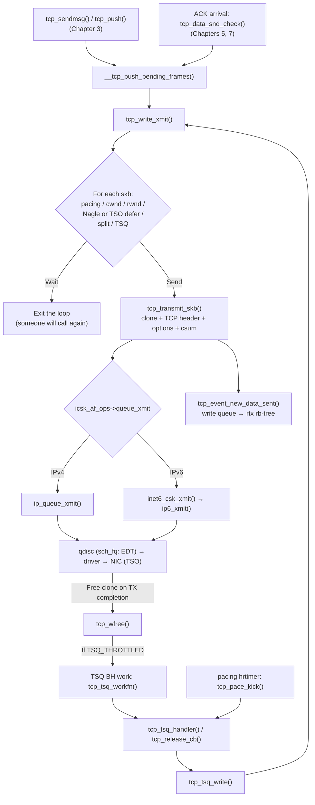

# 4. Sending (2): from tcp_write_xmit to the wire

In the previous chapter (Chapter 3), we followed `tcp_sendmsg()` up to the point where it packed the user's data into `sk_buff`s and queued them at the tail of the write queue.  In this chapter, we trace the full cycle line by line: taking parcels from that shelf, deciding whether "it is truly okay to send them onto the road right now", writing the TCP header, handing them down to the IP layer, and resuming the next transmission once device transmission completes.

At the heart of the transmission path sits `tcp_write_xmit()`.  In a single call, this function checks six kinds of "brakes" in succession: the congestion window (cwnd), the receiver window (rwnd), Nagle, the TSO deferral decision, pacing, and TCP Small Queues (TSQ).  If even one of them says "wait", it exits the loop.  And "who calls this function again, and when" (ACK arrival, transmission completion, pacing timer, user `sendmsg()`) is precisely what determines the correctness and performance of the TCP transmission path.

## The ELI5 version

Next to the room's mailbox (socket) in a building (host), there is an outgoing shelf (write queue).  Parcels (`sk_buff`) do not yet have their shipping labels (headers) attached.

The shipping clerk (`tcp_write_xmit()`) looks at the parcel at the head of the shelf and checks the following before departure:

- **Road congestion**: Are there still trucks allowed on the road at once (cwnd) remaining?
- **The peer's inbox**: Will it fit into the peer's inbox (receive window)?
- **Parcels that are too small**: Isn't sending small parcels one by one wasteful (Nagle)?  If a signed receipt (ACK) is due shortly anyway, wouldn't it be better to wait a little and bundle them onto a larger truck (TSO defer)?
- **Departure time**: Has sufficient spacing been left since the previous truck (pacing)?
- **Congestion in front of the gate**: Are too many of our own trucks queuing in front of the building's gate (the qdisc or device queue) (TSQ)?

If everything is OK, the shipping clerk attaches a shipping label (TCP header) to a **copy** of the parcel and hands it to the gate (IP layer).  The original is moved to the "stub shelf for re-shipping" (retransmit queue).  This is because it cannot be discarded until a signed receipt arrives.

When stopped due to congestion in front of the gate, a bell (`tcp_wfree()`) chimes "the way is clear" the moment a truck leaves the gate (transmission completion).  The shipping clerk starts moving again upon hearing that bell.

## What the RFCs say

### RFC 9293: Transmission Control Protocol (Send window, Nagle, sender SWS avoidance)

RFC 9293 is the current core TCP specification, consolidating RFC 793 and numerous subsequent amendments (such as the TCP parts of RFC 1122 and RFC 896) (it obsoleted RFC 793 in 2022).  Relevant to this chapter are three rules governing "when and how much the sender is allowed to transmit".

**Send window ([RFC 9293 §3.8.6](https://www.rfc-editor.org/rfc/rfc9293#section-3.8.6))**

The sender maintains the following state variables ([§3.3.1](https://www.rfc-editor.org/rfc/rfc9293#section-3.3.1)):

- `SND.UNA`: oldest unacknowledged sequence number
- `SND.NXT`: next sequence number to be sent
- `SND.WND`: receive window advertised by the peer

The permissible sending range is `SND.UNA .. SND.UNA + SND.WND`.  The amount that may still be used is as follows:

```
U = SND.UNA + SND.WND - SND.NXT     (usable window)
```

In Linux, `tp->snd_una`, `tp->snd_nxt`, and `tp->snd_wnd` correspond to each of these.  `tcp_wnd_end()` returns `SND.UNA + SND.WND`.  When the window is zero, a zero-window probe ([§3.8.6.1](https://www.rfc-editor.org/rfc/rfc9293#section-3.8.6.1)) is required.  In this chapter, we cover up to "setting the probe0 timer when `tcp_write_xmit()` returns `true`", leaving the timer itself to Chapter 9.

**Nagle algorithm ([RFC 9293 §3.7.4](https://www.rfc-editor.org/rfc/rfc9293#section-3.7.4), originally [RFC 896](https://www.rfc-editor.org/rfc/rfc896))**

RFC 896 (John Nagle, 1984) addressed the issue where 1-byte writes in applications like telnet created massive numbers of 41-byte packets, clogging the network ("tinygrams").  The rule can be stated in a single sentence:

> Whilst there is unacknowledged data (`SND.NXT > SND.UNA`), do not transmit data that is less than full size (`Eff.snd.MSS`); buffer it instead.

RFC 9293 stipulates that a TCP implementation SHOULD implement Nagle, and MUST provide a way for applications to disable it on a per-connection basis.  In Linux, it can be disabled with `TCP_NODELAY`, whilst `TCP_CORK` acts as an even stronger directive: "always buffer until full size".

Linux further uses **Minshall's variant** (Greg Minshall's Internet-Draft "A Proposed Modification to Nagle's Algorithm", 1999).  This relaxes the condition from "whilst there is unacknowledged data" to "whilst there is an unacknowledged **small** segment".  This alleviates the issue where writing "full size + remainder" in request/response traffic caused the remainder to wait for a delayed ACK.

**Sender SWS avoidance ([RFC 9293 §3.8.6.2.1](https://www.rfc-editor.org/rfc/rfc9293#section-3.8.6.2.1))**

Silly Window Syndrome (SWS) is an ailment where the receiver opens its window in small increments, and the sender transmits small segments each time.  The recommended sender algorithm is as follows, where `D` is the amount of queued data awaiting transmission, and `U` is the usable window above.  Transmit when any of the following holds:

1. A full-sized segment can be sent: `min(D, U) >= Eff.snd.MSS`
2. Data has been PUSHed, all queued data can be sent now, and (Nagle is disabled or there is no unacknowledged data)
3. A certain fraction `Fs` or more of the maximum window can be sent: `min(D, U) >= Fs * Max(SND.WND)` (recommended `Fs = 1/2`)
4. Data has been PUSHed, and the override timeout (0.1-1.0 s) has expired

Linux's `tcp_nagle_test()` roughly implements 1 and 2, whilst the `tcp_tso_win_divisor` check in `tcp_tso_should_defer()` implements a decision corresponding to 3 (though with the goal of "making TSO chunks larger").  Linux does not have the override timer of 4.  Instead, ACK arrivals, TLP, and the probe0 timer resume transmission.

### RFC 5681: TCP Congestion Control (cwnd as upper bound on transmission)

RFC 5681 is the foundational specification for congestion control defining slow start, congestion avoidance, and fast retransmit/fast recovery.  How cwnd increases and decreases is covered in Chapter 11.  All that is needed for this chapter is the rule for "how much may be sent".

In [RFC 5681 §2](https://www.rfc-editor.org/rfc/rfc5681#section-2), `cwnd` (sender-side limit) and `rwnd` (receiver's advertised window) are defined, and [§3](https://www.rfc-editor.org/rfc/rfc5681#section-3) specifies:

> The minimum of cwnd and rwnd governs data transmission.

That is, the sender must not transmit sequence numbers exceeding `SND.UNA + min(cwnd, rwnd)`.  While the RFC counts cwnd in bytes, Linux counts `tp->snd_cwnd` in **number of packets (segments)**.  The comparison target is likewise the estimated number of packets in the network, `tcp_packets_in_flight()`.

```
in_flight = packets_out - (sacked_out + lost_out) + retrans_out
Allowed to send  <=>  in_flight < snd_cwnd       (with rwnd checked separately)
```

This is the estimate corresponding to "pipe" in RFC 6675 (SACK-based loss recovery).  Details are covered in Chapter 8.

Regarding cwnd after idle periods, there are [RFC 5681 §4.1](https://www.rfc-editor.org/rfc/rfc5681#section-4.1) (Restarting Idle Connections) and RFC 2861 (Congestion Window Validation, Experimental).  RFC 2861 was later obsoleted by RFC 7661, but Linux still uses its own implementation (`tcp_cwnd_validate()`, `tcp_is_cwnd_limited()`) following the "spirit" of RFC 2861.

### RFC 7323: TCP Extensions for High Performance (Timestamps option on every segment)

RFC 7323 is the consolidated specification for window scale, timestamps, and PAWS (obsoleting RFC 1323).  What matters in the transmission path is that on negotiated connections, the Timestamps option (kind 8, length 10) must be attached to **every segment** ([§3.2](https://www.rfc-editor.org/rfc/rfc7323#section-3.2)).

- `TSval`: current value of the sender's timestamp clock
- `TSecr`: echo of the most recent valid `TSval` received from the peer (`TS.Recent`)

The RFC recommends a timestamp clock tick between 1 ms and 1 s ([§5.4](https://www.rfc-editor.org/rfc/rfc7323#section-5.4)).  Linux normally ticks in 1 ms steps.  However, it also supports microsecond ticks (`tp->tcp_usec_ts`), which can be enabled per route.  This is an extension outside the RFC's recommended range.  In Linux, `TSval` is generated not from "now", but from the **skb's earliest departure time (EDT)**.  As we shall see later, this is the key to aligning pacing with RTT measurement.

### Things not in RFCs: TSO/GSO, TSQ, pacing

**TSO/GSO**: TCP Segmentation Offload is a mechanism where a "super-packet" of up to 64 KB (or larger with BIG TCP) is carried down the stack as a single skb, and split into MSS-sized pieces by the NIC (TSO) or by software just before the driver (GSO).  Protocol-wise, it is indistinguishable from a train of MSS-sized segments.  It reduces per-packet stack costs (header handling, locks, qdisc operations) by a factor of dozens.  In return, a new decision is required: "how many segments should be batched together at once?", and oversized chunks produce micro-bursts.  In Linux, `tcp_skb_pcount(skb)` represents how many segments that skb corresponds to, and `tcp_skb_mss(skb)` (= `gso_size`) is the segmentation size.

**TCP Small Queues (TSQ)**: A countermeasure against bufferbloat.  When a single flow stacks a large number of skbs in host qdiscs or device rings, packets of other flows (including ACKs) are forced to wait behind them.  RTT inflates, and cwnd estimation is distorted.  TSQ places an upper limit on the "total truesize of skbs belonging to this socket residing in the qdisc + device" (`sk->sk_wmem_alloc`).  When exceeded, transmission stops, and resumes via the transmission completion destructor (`tcp_wfree()`).  The rule of thumb is "2 packets, or roughly 1 ms worth".

**Pacing**: When controlling transmission solely with cwnd, bursts occur at the instant an ACK arrives, sending out the entire newly freed cwnd quota at once.  Pacing transmits skbs with "intervals not exceeding `sk_pacing_rate` bytes/second".  Linux uses an **EDT (Earliest Departure Time) model**.  TCP writes the time "do not send before this timestamp" into `skb->tstamp`, and `sch_fq` (or an EDT-capable NIC) enforces it.  When `sch_fq` is absent, TCP itself spaces transmissions using an hrtimer (internal pacing).

## The big picture



There are two key takeaways:

- `tcp_write_xmit()` is a function with **four re-entry points**: process context (`sendmsg()`), softirq ACK processing, BH workqueue TSQ processing, and softirq pacing hrtimer.  At every entry point, the caller holds the socket lock (on the softirq side via `bh_lock_sock()`, which defers to `tcp_release_cb()` if owned by user space).
- What is sent is always a **clone**.  The original moves to the retransmit queue (rb-tree) and is retained until ACKed.  The clone's destructor is set to `tcp_wfree()`, which acts as the TSQ feedback loop.

## Walking through the code

### Step 1: Entry — `tcp_push_pending_frames()` and `__tcp_push_pending_frames()`

`tcp_push_pending_frames()`（[include/net/tcp.h#L2375](https://git.kernel.org/pub/scm/linux/kernel/git/netdev/net-next.git/tree/include/net/tcp.h?id=279d5c8afcd38bd841832a39bfe1aa4f8518d98e#n2375)）is an inline that simply calls `__tcp_push_pending_frames()` with the current MSS and `tp->nonagle` if there is anything in the write queue.

```c
static inline void tcp_push_pending_frames(struct sock *sk)
{
	if (tcp_send_head(sk)) {
		struct tcp_sock *tp = tcp_sk(sk);

		__tcp_push_pending_frames(sk, tcp_current_mss(sk), tp->nonagle);
	}
}
```

`__tcp_push_pending_frames()`（[net/ipv4/tcp_output.c#L3243](https://git.kernel.org/pub/scm/linux/kernel/git/netdev/net-next.git/tree/net/ipv4/tcp_output.c?id=279d5c8afcd38bd841832a39bfe1aa4f8518d98e#n3243)）is the actual implementation.

```c
/* Push out any pending frames which were held back due to
 * TCP_CORK or attempt at coalescing tiny packets.
 * The socket must be locked by the caller.
 */
void __tcp_push_pending_frames(struct sock *sk, unsigned int cur_mss,
			       int nonagle)
{
	/* If we are closed, the bytes will have to remain here.
	 * In time closedown will finish, we empty the write queue and
	 * all will be happy.
	 */
	if (unlikely(sk->sk_state == TCP_CLOSE))
		return;

	if (tcp_write_xmit(sk, cur_mss, nonagle, 0,
			   sk_gfp_mask(sk, GFP_ATOMIC)))
		tcp_check_probe_timer(sk);
}
```

- Checking `TCP_CLOSE`: Even after `tcp_set_state(TCP_CLOSE)`, data can still remain in the write queue (such as through the `tcp_done()` path).  That data is not sent, but left to be purged later.
- `sk_gfp_mask(sk, GFP_ATOMIC)`: Because the transmission path can also be called from softirq, clone allocation uses `GFP_ATOMIC`.  `sk_gfp_mask()` adds `__GFP_MEMALLOC` for sockets marked `SOCK_MEMALLOC` (network swap/block transports such as swap-over-NFS, NBD, or iSCSI) so they can dip into emergency `pfmemalloc` memory reserves without deadlocking reclaim (see [Appendix: What is `PF_MEMALLOC` / `pfmemalloc`?](appendix/10-pfmemalloc.md)).
- When the return value is `true`, `tcp_check_probe_timer()` is invoked.  `tcp_write_xmit()` returns `true` only when "there are 0 packets in flight, yet despite data waiting in the queue, nothing could be sent".  In this state, no ACKs will arrive, leaving the connection with no way to wake itself up.  It therefore sets the probe0 timer (zero window probe, [RFC 9293 §3.8.6.1](https://www.rfc-editor.org/rfc/rfc9293#section-3.8.6.1)).

```c
static inline void tcp_check_probe_timer(struct sock *sk)
{
	if (!tcp_sk(sk)->packets_out && !inet_csk(sk)->icsk_pending)
		tcp_reset_xmit_timer(sk, ICSK_TIME_PROBE0,
				     tcp_probe0_base(sk), true);
}
```

Only when `packets_out == 0` and no other icsk timer is active does it arm `ICSK_TIME_PROBE0` at `tcp_probe0_base()` (`max(icsk_rto, TCP_RTO_MIN)`) plus the pacing delay.

Another entry point, `tcp_push_one()`（[net/ipv4/tcp_output.c#L3261](https://git.kernel.org/pub/scm/linux/kernel/git/netdev/net-next.git/tree/net/ipv4/tcp_output.c?id=279d5c8afcd38bd841832a39bfe1aa4f8518d98e#n3261)）, is a shortcut used by `tcp_sendmsg_locked()` to push out just a single parcel the moment the head of the write queue reaches exactly full size (Chapter 3).

```c
/* Send _single_ skb sitting at the send head. This function requires
 * true push pending frames to setup probe timer etc.
 */
void tcp_push_one(struct sock *sk, unsigned int mss_now)
{
	struct sk_buff *skb = tcp_send_head(sk);

	BUG_ON(!skb || skb->len < mss_now);

	tcp_write_xmit(sk, mss_now, TCP_NAGLE_PUSH, 1, sk->sk_allocation);
}
```

Because it is called with `push_one = 1`, it skips MTU probing and TSO deferral, and exits the loop once 1 skb has been transmitted.  Since `nonagle = TCP_NAGLE_PUSH`, Nagle also has no effect (and indeed the `BUG_ON` ensures that the head skb has `>= mss_now`).

`push_one` takes three possible values:

| `push_one` | Caller | Meaning |
| --- | --- | --- |
| 0 | `__tcp_push_pending_frames()`, `tcp_tsq_write()` | Normal. Performs MTU probe and TSO defer, sending as much as possible |
| 1 | `tcp_push_one()` | Exactly 1 skb. Does not perform MTU probe or TSO defer |
| 2 | `tcp_send_loss_probe()` | For TLP. Forcibly transmits 1 skb even if cwnd is exhausted (Chapter 8) |

### Step 2: `tcp_write_xmit()` (1) — Preparation and MTU probe

From here, we follow `tcp_write_xmit()`（[net/ipv4/tcp_output.c#L2972](https://git.kernel.org/pub/scm/linux/kernel/git/netdev/net-next.git/tree/net/ipv4/tcp_output.c?id=279d5c8afcd38bd841832a39bfe1aa4f8518d98e#n2972)）from start to finish.

```c
static bool tcp_write_xmit(struct sock *sk, unsigned int mss_now, int nonagle,
			   int push_one, gfp_t gfp)
{
	struct tcp_sock *tp = tcp_sk(sk);
	struct sk_buff *skb;
	unsigned int tso_segs, sent_pkts;
	u32 cwnd_quota, max_segs;
	int result;
	bool is_cwnd_limited = false, is_rwnd_limited = false;

	sent_pkts = 0;

	tcp_mstamp_refresh_inline(tp);

	/* AccECN option beacon depends on mstamp, it may change mss */
	if (tcp_ecn_mode_accecn(tp) && tcp_accecn_option_beacon_check(sk))
		mss_now = tcp_current_mss(sk);

	if (!push_one) {
		/* Do MTU probing. */
		result = tcp_mtu_probe(sk);
		if (!result) {
			return false;
		} else if (result > 0) {
			sent_pkts = 1;
		}
	}

	max_segs = tcp_tso_segs(sk, mss_now);
```

- `tcp_mstamp_refresh_inline(tp)`: Updates `tp->tcp_clock_cache` (ns) and `tp->tcp_mstamp` (us) just once.  Thereafter, pacing checks, EDT stamping, and TSO deferral time calculations throughout this loop all use this single "now".  `tcp_clock_ns()` is `ktime_get_ns()` (CLOCK_MONOTONIC).  Avoiding re-reading it per skb saves cost and ensures time consistency within the same batch.

```c
static inline void tcp_mstamp_refresh_inline(struct tcp_sock *tp)
{
	u64 val = tcp_clock_ns();

	tp->tcp_clock_cache = val;
	tp->tcp_mstamp = div_u64(val, NSEC_PER_USEC);
}
```

- AccECN option beacon: Whether to include the AccECN option periodically depends on the timestamp.  Because a change in option length alters MSS (payload length), `mss_now` is re-acquired (Chapter 14).
- `if (!push_one)`: MTU probing is attempted only during normal pushes.  The return value of `tcp_mtu_probe()` has three possibilities: `0` means "we want to send a probe, but currently lack sufficient cwnd/rwnd, so wait", in which case `tcp_write_xmit()` returns `false` **without sending anything**.  This prevents smaller ordinary segments from consuming cwnd when we need to build a large probe segment.  `1` indicates a probe was sent, setting `sent_pkts = 1`, whilst `-1` proceeds with normal processing regardless of probing.
- `max_segs = tcp_tso_segs(sk, mss_now)`: The upper limit on the number of segments that may be packed into a single TSO skb.  Calculated just once outside the loop (Step 3).

Why returning `0` from `tcp_mtu_probe()` is safe: Both paths returning `0` (`after(snd_nxt + size_needed, tcp_wnd_end)` and `in_flight + 2 > cwnd` with `in_flight != 0`) occur when data is already in flight.  Therefore, an ACK is guaranteed to return and call `tcp_write_xmit()` again.  When in-flight is 0, it returns `-1` to avoid stalling (as noted in the comment: "With none in flight, don't stall").

Let us examine the decision logic of `tcp_mtu_probe()` ([net/ipv4/tcp_output.c#L2692](https://git.kernel.org/pub/scm/linux/kernel/git/netdev/net-next.git/tree/net/ipv4/tcp_output.c?id=279d5c8afcd38bd841832a39bfe1aa4f8518d98e#n2692)) (Packetization Layer PMTUD, RFC 4821/8899; enabled via `net.ipv4.tcp_mtu_probing` — see [Appendix Note 11: What Is MTU Probing (`tcp_mtu_probe()` / PLPMTUD)?](appendix/11-mtu-probing.md) for the full background and binary-search lifecycle).

```c
static int tcp_mtu_probe(struct sock *sk)
{
	struct inet_connection_sock *icsk = inet_csk(sk);
	struct tcp_sock *tp = tcp_sk(sk);
	struct sk_buff *skb, *nskb, *next;
	struct net *net = sock_net(sk);
	int probe_size;
	u64 size_needed;
	int copy, len;
	int mss_now;
	int interval;

	/* Not currently probing/verifying,
	 * not in recovery,
	 * have enough cwnd, and
	 * not SACKing (the variable headers throw things off)
	 */
	if (likely(!icsk->icsk_mtup.enabled ||
		   icsk->icsk_mtup.probe_size ||
		   inet_csk(sk)->icsk_ca_state != TCP_CA_Open ||
		   tcp_snd_cwnd(tp) < 11 ||
		   tp->rx_opt.num_sacks || tp->rx_opt.dsack))
		return -1;

	/* Use binary search for probe_size between tcp_mss_base,
	 * and current mss_clamp. if (search_high - search_low)
	 * smaller than a threshold, backoff from probing.
	 */
	mss_now = tcp_current_mss(sk);
	probe_size = tcp_mtu_to_mss(sk, (icsk->icsk_mtup.search_high +
				    icsk->icsk_mtup.search_low) >> 1);
	size_needed = probe_size + (tp->reordering + 1) * (u64)tp->mss_cache;
	interval = icsk->icsk_mtup.search_high - icsk->icsk_mtup.search_low;
	/* When misfortune happens, we are reprobing actively,
	 * and then reprobe timer has expired. We stick with current
	 * probing process by not resetting search range to its orignal.
	 */
	if (probe_size > tcp_mtu_to_mss(sk, icsk->icsk_mtup.search_high) ||
	    interval < READ_ONCE(net->ipv4.sysctl_tcp_probe_threshold)) {
		/* Check whether enough time has elaplased for
		 * another round of probing.
		 */
		tcp_mtu_check_reprobe(sk);
		return -1;
	}
```

- Early return wrapped in `likely(...)`: Because MTU probing is disabled by default (`tcp_mtu_probing=0`), execution almost always bails out here.  The `likely()` annotation was added in 12a59abc22d6.  It also exits if already probing (`probe_size != 0`), in recovery, if cwnd < 11, or if transmitting SACK/DSACK blocks (where varying option lengths distort calculations).
- `probe_size` is the midpoint of a binary search between `search_low` and `search_high`.  `size_needed` is the byte count for "1 probe + `tp->reordering + 1` normal segments".  `tp->reordering` is the DupACK/SACK threshold required to trigger Fast Retransmit (default `net.ipv4.tcp_reordering = 3`); the extra `+ 1` MSS margin ensures that even if the final trailing bytes form a partial `< 1 MSS` segment held back by Nagle or `TCP_CORK`, at least `tp->reordering` (3) full-sized trailing segments will still go out on the wire to trigger DupACKs/SACKs if the probe is lost (commit `91cc17c0e5e5`).

```c
	/* Have enough data in the send queue to probe? */
	if (tp->write_seq - tp->snd_nxt < size_needed)
		return -1;

	if (tp->snd_wnd < size_needed)
		return -1;
	if (after(tp->snd_nxt + size_needed, tcp_wnd_end(tp)))
		return 0;

	/* Do we need to wait to drain cwnd? With none in flight, don't stall */
	if (tcp_packets_in_flight(tp) + 2 > tcp_snd_cwnd(tp)) {
		if (!tcp_packets_in_flight(tp))
			return -1;
		else
			return 0;
	}

	if (!tcp_can_coalesce_send_queue_head(sk, probe_size))
		return -1;
```

If any of pending data (`write_seq - snd_nxt`), rwnd, or cwnd is insufficient, probing is not attempted.  Since 1 probe is equivalent to 2 segments, cwnd is evaluated with `+ 2`.  Next, it constructs a probe skb and transfers `probe_size` worth of payload from skbs at the head of the write queue (`tcp_eat_one_skb()` / `__pskb_trim_head()`).  Then it transmits.

```c
	tcp_init_tso_segs(nskb, nskb->len);

	/* We're ready to send.  If this fails, the probe will
	 * be resegmented into mss-sized pieces by tcp_write_xmit().
	 */
	if (!tcp_transmit_skb(sk, nskb, 1, GFP_ATOMIC)) {
		/* Decrement cwnd here because we are sending
		 * effectively two packets. */
		tcp_snd_cwnd_set(tp, tcp_snd_cwnd(tp) - 1);
		tcp_event_new_data_sent(sk, nskb);

		icsk->icsk_mtup.probe_size = tcp_mss_to_mtu(sk, nskb->len);
		tp->mtu_probe.probe_seq_start = TCP_SKB_CB(nskb)->seq;
		tp->mtu_probe.probe_seq_end = TCP_SKB_CB(nskb)->end_seq;

		return 1;
	}

	return -1;
}
```

When `tcp_transmit_skb()` returns `0` (meaning the probe skb was handed down for transmission), `cwnd` is decremented by `1`.  Why subtract `1` from `cwnd` instead of adding `2` to `packets_out`?  Because `tcp_init_tso_segs(nskb, nskb->len)` passes `nskb->len` (rather than `mss_now`) to force `pcount = 1` so GSO/TSO will not chop the oversized probe back into small segments; consequently, `tcp_event_new_data_sent()` increments `packets_out` by only `+1` even though roughly two MSS worth of bytes were sent.  Incrementing `packets_out` by `+1` while decrementing `cwnd` by `-1` consumes `2` packets of `cwnd - in_flight` headroom (if the probe is lost, `tcp_fastretrans_alert()` restores `cwnd + 1`; if it is ACKed, `tcp_mtup_probe_success()` rescales `cwnd` to the new MTU).

### Step 3: How many segments to pack into one skb — `tcp_tso_segs()` and `tcp_tso_autosize()`

```c
__bpf_kfunc u32 tcp_tso_autosize(const struct sock *sk, unsigned int mss_now,
				 int min_tso_segs)
{
	u32 min_tso = max(min_tso_segs, 1);
	unsigned long bytes;
	u32 r;

	if (unlikely(!mss_now))
		return min_tso;

	bytes = READ_ONCE(sk->sk_pacing_rate) >> READ_ONCE(sk->sk_pacing_shift);

	r = tcp_min_rtt(tcp_sk(sk)) >> READ_ONCE(sock_net(sk)->ipv4.sysctl_tcp_tso_rtt_log);
	if (r < BITS_PER_TYPE(sk->sk_gso_max_size))
		bytes += sk->sk_gso_max_size >> r;

	bytes = min_t(unsigned long, bytes, sk->sk_gso_max_size);

	return max_t(u32, bytes / mss_now, min_tso);
}
EXPORT_SYMBOL_GPL(tcp_tso_autosize);

/* Return the number of segments we want in the skb we are transmitting.
 * See if congestion control module wants to decide; otherwise, autosize.
 */
static u32 tcp_tso_segs(struct sock *sk, unsigned int mss_now)
{
	const struct tcp_congestion_ops *ca_ops = inet_csk(sk)->icsk_ca_ops;
	u32 tso_segs;

	tso_segs = ca_ops->tso_segs ?
			ca_ops->tso_segs(sk, mss_now) :
			tcp_tso_autosize(sk, mss_now,
					 READ_ONCE(sock_net(sk)->ipv4.sysctl_tcp_min_tso_segs));
	return clamp_t(u32, tso_segs, 1, sk->sk_gso_max_segs);
}
```

The calculation in `tcp_tso_autosize()`（[net/ipv4/tcp_output.c#L2260](https://git.kernel.org/pub/scm/linux/kernel/git/netdev/net-next.git/tree/net/ipv4/tcp_output.c?id=279d5c8afcd38bd841832a39bfe1aa4f8518d98e#n2260)）is as follows:

```
bytes  = sk_pacing_rate >> sk_pacing_shift            (default shift=10: ~1 ms worth)
bytes += sk_gso_max_size >> (min_rtt_us >> tcp_tso_rtt_log)   (default log=9: halves every 512 us)
bytes  = min(bytes, sk_gso_max_size)
segs   = max(bytes / mss, min_tso_segs)               (default min_tso_segs=2)
```

- The first term is "the amount sent in approximately 1 ms at the pacing rate".  Since `sk_pacing_rate` is in bytes/second, `>> 10` divides by 1024, yielding roughly 1 ms worth of data.  This reflects the design introduced in 95bd09eb2750 of sending "one TSO packet per 1 ms".  For low-rate flows, bursts become smaller, preserving ACK clocking.
- The second term is a `min_rtt`-dependent bonus added in `65466904b015`:
  - **What `tcp_min_rtt(tp)` returns**: `minmax_get(&tp->rtt_min)` ([include/net/tcp.h#L947](https://git.kernel.org/pub/scm/linux/kernel/git/netdev/net-next.git/tree/include/net/tcp.h?id=279d5c8afcd38bd841832a39bfe1aa4f8518d98e#n947)), the windowed **minimum RTT in microseconds (`usec`, `u32`)** observed over the last `tcp_min_rtt_wlen` seconds (default 300 s; Chapter 7).  Before any RTT sample has been measured, `tp->rtt_min` is initialised to `~0U` (`0xffffffff` = `4,294,967,295 us` ≈ 71.6 minutes).
  - **Why give short-RTT flows a bonus**: A flow rate-limited to `20 MB/s` gets only `20,000,000 >> 10 ≈ 19.5 KB` from the first term.  Within the same rack (`min_rtt` of tens to a few hundred `us`), however, occasional packet losses can be repaired so quickly that building full 64 KB TSO bursts to save CPU cycles is a clear win.
  - **Concrete numbers with `>> 9` (assuming `sk_gso_max_size = 65,536` B)**: Because `tcp_tso_rtt_log` defaults to `9`, `r = min_rtt_us >> 9` is integer division by **`512` ($= 2^9$) `us`**.  Every `512 us` increase in `min_rtt` increments `r` by `1` and halves the bonus `65536 >> r`:

    | `tcp_min_rtt(tp)` | `r = min_rtt >> 9` | `r < 32` | 2nd-term bonus (`65536 >> r`) | Approx. segments (`MSS = 1448 B`) |
    | --- | --- | --- | --- | --- |
    | `0` – `511 us` (same rack / DC) | `0` | Yes | **`+65,536 B`** (full 64 KB cap) | ~+45 segs (always max TSO) |
    | `512` – `1,023 us` (~1.0 ms) | `1` | Yes | **`+32,768 B`** (32 KB) | ~+22 segs |
    | `1,024` – `1,535 us` (~1.5 ms) | `2` | Yes | **`+16,384 B`** (16 KB) | ~+11 segs |
    | `1,536` – `2,047 us` (~2.0 ms) | `3` | Yes | **`+8,192 B`** (8 KB) | ~+5 segs |
    | `2,048` – `2,559 us` (~2.5 ms) | `4` | Yes | **`+4,096 B`** (4 KB) | ~+2 segs |
    | `2,560` – `3,071 us` (~3.0 ms) | `5` | Yes | **`+2,048 B`** (2 KB) | ~+1 seg |
    | **`3,072` – `3,583 us` (~3.1 ms+)** | **`6`** | Yes | **`+1,024 B`** (**< 1500 B**) | < 1 seg (practically negligible) |
    | `8,704` – `16,383 us` (~16.4 ms) | `17` – `31` | Yes | **`+0 B`** | `0` (`31` is the largest shifted `r`) |
    | **`>= 16,384 us` (~16.4 ms+)** | **`>= 32`** | **No** | Skipped (**`+0 B`**) | Ordinary WAN (e.g. `100 ms` -> `r = 195`) |
    | **Unmeasured initial `~0U`** | **`8,388,607`** (`0x7fffff`) | **No** | Skipped (**`+0 B`**) | Max `r` at `log = 9` (safe zero bonus) |

  - **Why `r < BITS_PER_TYPE(sk->sk_gso_max_size)` (`r < 32`) is essential, and the maximum `r`**: `sk_gso_max_size` is an `unsigned int` (32 bits), so `BITS_PER_TYPE(...)` is **`32`**.  In C, shifting a 32-bit integer by `>= 32` bits is undefined behaviour (on x86, `shr` masks the shift count to 5 bits, so without this guard `65536 >> 32` at `min_rtt = 16.4 ms` would wrap around to `65536 >> 0 = 65536`!).  `r >= 32` happens routinely on any WAN path with `min_rtt >= 16.4 ms`, as well as before any RTT sample arrives (`r = 0xffffffff >> 9 = 8,388,607`).  Setting `sysctl net.ipv4.tcp_tso_rtt_log=0` yields `r = min_rtt >> 0 = min_rtt` (up to `4,294,967,295`), which hits `r >= 32` for every flow with `min_rtt >= 32 us` and thus acts as the kill switch for this bonus.
- The `mss_now == 0` branch defends against invocations from BPF (converted to a kfunc in f69a0944415f).

`tcp_tso_segs()`（[net/ipv4/tcp_output.c#L2285](https://git.kernel.org/pub/scm/linux/kernel/git/netdev/net-next.git/tree/net/ipv4/tcp_output.c?id=279d5c8afcd38bd841832a39bfe1aa4f8518d98e#n2285)）delegates to the CC module if it provides a `tso_segs()` callback (BBR decides its TSO size from its own pacing model; Chapter 13).  The result is clamped to `[1, sk_gso_max_segs]`.  `sk_gso_max_segs` is set in `sk_setup_caps()` from the device's `gso_max_segs`.

> [!NOTE]
> In cb145191e9d3 (2026-08), the CC callback changed from `min_tso_segs()` to `tso_segs()`.  Previously it returned a lower bound passed to `tcp_tso_autosize()`, but now it returns the final segment count directly, bypassing autosize.  This is a point of divergence from older documentation.

### Step 4: `tcp_write_xmit()` (2) — First half of the loop: repair, pacing, cwnd, rwnd

```c
	while ((skb = tcp_send_head(sk))) {
		unsigned int limit;
		int missing_bytes;

		if (unlikely(tp->repair) && tp->repair_queue == TCP_SEND_QUEUE) {
			/* "skb_mstamp_ns" is used as a start point for the retransmit timer */
			tp->tcp_wstamp_ns = tp->tcp_clock_cache;
			skb_set_delivery_time(skb, tp->tcp_wstamp_ns, SKB_CLOCK_MONOTONIC);
			list_move_tail(&skb->tcp_tsorted_anchor, &tp->tsorted_sent_queue);
			tcp_init_tso_segs(skb, mss_now);
			goto repair; /* Skip network transmission */
		}

		if (tcp_pacing_check(sk))
			break;

		cwnd_quota = tcp_cwnd_test(tp);
		if (!cwnd_quota) {
			if (push_one == 2)
				/* Force out a loss probe pkt. */
				cwnd_quota = 1;
			else
				break;
		}
		cwnd_quota = min(cwnd_quota, max_segs);
		missing_bytes = cwnd_quota * mss_now - skb->len;
		if (missing_bytes > 0)
			tcp_grow_skb(sk, skb, missing_bytes);

		tso_segs = tcp_set_skb_tso_segs(skb, mss_now);

		if (unlikely(!tcp_snd_wnd_test(tp, skb, mss_now))) {
			is_rwnd_limited = true;
			break;
		}
```

**repair mode**: When restoring the send queue via CRIU's `TCP_REPAIR`, data has already been sent over the wire in the past.  Transmission over the network is skipped, performing only `tcp_event_new_data_sent()` (moving to the retransmit queue) after `repair:`.  `tcp_init_tso_segs()` was added in bf50b606cfd8; without it, skbs with pcount 0 would enter the retransmit queue.

**`tcp_pacing_check()`**: The internal pacing decision.

```c
static bool tcp_pacing_check(struct sock *sk)
{
	struct tcp_sock *tp = tcp_sk(sk);

	if (!tcp_needs_internal_pacing(sk))
		return false;

	if (tp->tcp_wstamp_ns <= tp->tcp_clock_cache)
		return false;

	if (!hrtimer_is_queued(&tp->pacing_timer)) {
		hrtimer_start(&tp->pacing_timer,
			      ns_to_ktime(tp->tcp_wstamp_ns),
			      HRTIMER_MODE_ABS_PINNED_SOFT);
		sock_hold(sk);
	}
	return true;
}
```

- `tcp_needs_internal_pacing()` is true only when `sk_pacing_status == SK_PACING_NEEDED`.  `smp_load_acquire()` is used because `sch_fq` on another CPU can overwrite it with `SK_PACING_FQ` using `smp_store_release()`.

```c
static inline bool tcp_needs_internal_pacing(const struct sock *sk)
{
	return smp_load_acquire(&sk->sk_pacing_status) == SK_PACING_NEEDED;
}
```

- If `tcp_wstamp_ns` (the earliest time the next packet may be sent) is less than or equal to "now", transmission is permitted.  If in the future, an hrtimer is armed with the absolute timestamp of `tcp_wstamp_ns`.  Because it uses `HRTIMER_MODE_ABS_PINNED_SOFT`, `tcp_pace_kick()` runs in softirq on the same CPU.  Since the timer holds a reference, it calls `sock_hold()`, which is balanced by `sock_put()` in `tcp_pace_kick()`.  If already queued (`hrtimer_is_queued()`), it does not re-arm.
- Prior to 864e5c090749, the implementation armed the timer immediately after sending.  Now it arms only when attempting to send but finding it too early.  For workloads like RPCs where no subsequent write occurs before timer expiration, this eliminated unnecessary hrtimer interrupts (improving TCP_RR by roughly 10%).
- When `sch_fq` handles pacing (`SK_PACING_FQ`), transmission is not throttled here.  The EDT is written into `skb->tstamp` and left to the qdisc.

**`tcp_cwnd_test()`**: cwnd limitation per [RFC 5681 §3](https://www.rfc-editor.org/rfc/rfc5681#section-3).

```c
static u32 tcp_cwnd_test(const struct tcp_sock *tp)
{
	u32 in_flight, cwnd, halfcwnd;

	in_flight = tcp_packets_in_flight(tp);
	cwnd = tcp_snd_cwnd(tp);
	if (in_flight >= cwnd)
		return 0;

	/* For better scheduling, ensure we have at least
	 * 2 GSO packets in flight.
	 */
	halfcwnd = max(cwnd >> 1, 1U);
	return min(halfcwnd, cwnd - in_flight);
}
```

- If `in_flight >= cwnd`, returns 0 (cannot send).
- Even when allowed, it is capped at `min(cwnd/2, cwnd - in_flight)`.  This prevents a single TSO skb from exceeding half of cwnd.  If cwnd were consumed by a single giant skb, only "one packet" would exist in both the network and the ACK clock.  Having at least two skbs in flight ensures that the ACK from one clocks out the successor to the other.
- In 22555032c513 (2024), the exception that "ignored cwnd if the last skb was sub-MSS with FIN set" was removed.  Aside from violating the RFC, having the outcome depend on the head skb prevented the subsequent `tcp_grow_skb()` from being written.

Here is the definition of `tcp_packets_in_flight()` once more:

```c
static inline unsigned int tcp_packets_in_flight(const struct tcp_sock *tp)
{
	return tp->packets_out - tcp_left_out(tp) + tp->retrans_out;
}
```

**`push_one == 2`**: TLP sends exactly one packet regardless of cwnd to detect tail loss (Chapter 8).  It therefore forcibly sets cwnd_quota to 1.

**`cwnd_quota = min(cwnd_quota, max_segs)` and `tcp_grow_skb()`**: Here, cwnd_quota is re-interpreted as "the number of segments allowed in this skb".  If the head skb is smaller than `cwnd_quota * mss_now`, payload is transferred from the subsequent skb to enlarge it.

```c
static void tcp_grow_skb(struct sock *sk, struct sk_buff *skb, int amount)
{
	struct sk_buff *next_skb = skb->next;
	unsigned int nlen;

	if (tcp_skb_is_last(sk, skb))
		return;

	if (!tcp_skb_can_collapse(skb, next_skb))
		return;

	nlen = min_t(u32, amount, next_skb->len);
	if (!nlen || !skb_shift(skb, next_skb, nlen))
		return;

	TCP_SKB_CB(skb)->end_seq += nlen;
	TCP_SKB_CB(next_skb)->seq += nlen;

	if (!next_skb->len) {
		/* In case FIN is set, we need to update end_seq */
		TCP_SKB_CB(skb)->end_seq = TCP_SKB_CB(next_skb)->end_seq;

		tcp_eat_one_skb(sk, skb, next_skb);
	}
}
```

The background of 8ee602c63520 (2024) is as follows: In BIG TCP environments, a fixed pattern of "large + small" (`172032, 8192, 172032, 8192, ...`) was observed.  Once split, the remaining skb continued to be sent smaller than the optimal size.  Because `tcp_tso_should_defer()` evaluates based on the size of the head skb, it could not escape this pattern.  Since `skb_shift()` merely moves frags, no payload copying occurs.  `tcp_skb_can_collapse()` rejects conditions where merging is prohibited, such as EOR, differing decrypted states, or zerocopy.  When the next skb becomes empty, `end_seq` is transferred to preserve FIN, and `tcp_eat_one_skb()` transfers flags, eor, and tx timestamp requests before freeing it (1bede0a12d3a).

**`tcp_set_skb_tso_segs()`**: Recomputes pcount using the current `mss_now`.

```c
static int tcp_set_skb_tso_segs(struct sk_buff *skb, unsigned int mss_now)
{
	int tso_segs;

	if (skb->len <= mss_now) {
		/* Avoid the costly divide in the normal
		 * non-TSO case.
		 */
		TCP_SKB_CB(skb)->tcp_gso_size = 0;
		tcp_skb_pcount_set(skb, 1);
		return 1;
	}
	TCP_SKB_CB(skb)->tcp_gso_size = mss_now;
	tso_segs = DIV_ROUND_UP(skb->len, mss_now);
	tcp_skb_pcount_set(skb, tso_segs);
	return tso_segs;
}
```

If less than or equal to MSS, it avoids division by setting pcount=1 and `tcp_gso_size=0`.  Otherwise it uses `DIV_ROUND_UP`.  Prior to d5b38a71d333, `tcp_init_tso_segs()` was used (recomputing only when MSS changed), but because `tcp_grow_skb()` modifies the length, it now recomputes every time.

**`tcp_snd_wnd_test()`**: Send window test per [RFC 9293 §3.8.6](https://www.rfc-editor.org/rfc/rfc9293#section-3.8.6).

```c
static bool tcp_snd_wnd_test(const struct tcp_sock *tp,
			     const struct sk_buff *skb,
			     unsigned int cur_mss)
{
	u32 end_seq = TCP_SKB_CB(skb)->end_seq;

	if (skb->len > cur_mss)
		end_seq = TCP_SKB_CB(skb)->seq + cur_mss;

	return !after(end_seq, tcp_wnd_end(tp));
}
```

```c
static inline u32 tcp_wnd_end(const struct tcp_sock *tp)
{
	return tp->snd_una + tp->snd_wnd;
}
```

- It checks only whether "the first segment fits within `SND.UNA + SND.WND`".  The entire skb does not need to fit.  Any portion that does not fit is truncated later by `tcp_mss_split_point()`.
- If it fails, it exits with `is_rwnd_limited = true`.  This is reflected in `tcp_info`'s `tcpi_rwnd_limited` (chrono).
- Even if `snd_wnd` is zero, transmission resumes on an ACK if there is data in flight.  If there is also nothing in flight, `tcp_write_xmit()` returns `true`, and the probe0 timer from Step 1 is armed.

### Step 5: `tcp_write_xmit()` (3) — Nagle or TSO defer, split, TSQ, transmission

```c
		if (tso_segs == 1) {
			if (unlikely(!tcp_nagle_test(tp, skb, mss_now,
						     (tcp_skb_is_last(sk, skb) ?
						      nonagle : TCP_NAGLE_PUSH))))
				break;
		} else {
			if (!push_one &&
			    tcp_tso_should_defer(sk, skb, &is_cwnd_limited,
						 &is_rwnd_limited, max_segs))
				break;
		}

		limit = mss_now;
		if (tso_segs > 1 && !tcp_urg_mode(tp))
			limit = tcp_mss_split_point(sk, skb, mss_now,
						    cwnd_quota,
						    nonagle);

		if (skb->len > limit &&
		    unlikely(tso_fragment(sk, skb, limit, mss_now, gfp)))
			break;

		if (tcp_small_queue_check(sk, skb, 0))
			break;

		/* Argh, we hit an empty skb(), presumably a thread
		 * is sleeping in sendmsg()/sk_stream_wait_memory().
		 * We do not want to send a pure-ack packet and have
		 * a strange looking rtx queue with empty packet(s).
		 */
		if (TCP_SKB_CB(skb)->end_seq == TCP_SKB_CB(skb)->seq)
			break;

		if (unlikely(tcp_transmit_skb(sk, skb, 1, gfp)))
			break;
```

This is the section of the transmission path with the most decisions.

**When `tso_segs == 1`: Nagle**

Nagle is applied to skbs of 1 segment or fewer.  The `nonagle` argument uses the caller's value only when that skb is at the tail of the write queue; intermediate skbs are passed `TCP_NAGLE_PUSH`.  Because an intermediate skb is followed by another skb, no further data will be appended to it; there is no point in waiting.

```c
static inline bool tcp_nagle_test(const struct tcp_sock *tp, const struct sk_buff *skb,
				  unsigned int cur_mss, int nonagle)
{
	/* Nagle rule does not apply to frames, which sit in the middle of the
	 * write_queue (they have no chances to get new data).
	 *
	 * This is implemented in the callers, where they modify the 'nonagle'
	 * argument based upon the location of SKB in the send queue.
	 */
	if (nonagle & TCP_NAGLE_PUSH)
		return true;

	/* Don't use the nagle rule for urgent data (or for the final FIN). */
	if (tcp_urg_mode(tp) || (TCP_SKB_CB(skb)->tcp_flags & TCPHDR_FIN))
		return true;

	if (!tcp_nagle_check(skb->len < cur_mss, tp, nonagle))
		return true;

	return false;
}
```

- `TCP_NAGLE_PUSH` sends unconditionally.  It is passed for intermediate skbs, `tcp_push_one()`, forced pushes in `tcp_sendmsg_locked()` (when unpushed data exceeds half the maximum window), and when `setsockopt()` clearing `TCP_NODELAY` / `TCP_CORK` temporarily sets it in `tp->nonagle` (cleared on the next `tcp_skb_entail()`).  Note that `tcp_push()` passes `TCP_NAGLE_CORK` if `MSG_MORE` is set.
- Urgent mode and FIN are also exempt from Nagle.  Buffering a FIN would only delay connection close.
- The remainder is delegated to `tcp_nagle_check()`.

```c
/* Return false, if packet can be sent now without violation Nagle's rules:
 * 1. It is full sized. (provided by caller in %partial bool)
 * 2. Or it contains FIN. (already checked by caller)
 * 3. Or TCP_CORK is not set, and TCP_NODELAY is set.
 * 4. Or TCP_CORK is not set, and all sent packets are ACKed.
 *    With Minshall's modification: all sent small packets are ACKed.
 */
static bool tcp_nagle_check(bool partial, const struct tcp_sock *tp,
			    int nonagle)
{
	return partial &&
		((nonagle & TCP_NAGLE_CORK) ||
		 (!nonagle && tp->packets_out && tcp_minshall_check(tp)));
}
```

The bits of `nonagle` are as follows (`include/net/tcp.h`):

| Value | Origin | Meaning |
| --- | --- | --- |
| `TCP_NAGLE_OFF` (1) | `TCP_NODELAY` | Nagle disabled |
| `TCP_NAGLE_CORK` (2) | `TCP_CORK` | Always buffer until full size |
| `TCP_NAGLE_PUSH` (4) | Internal | Forcibly transmit this single time |

The condition under which `tcp_nagle_check()` returns `true` (= wait) is: "it is a partial segment (less than MSS), and (CORK is set, or (Nagle is active, data is in flight, and an unacknowledged small segment exists))":

- CORK buffers regardless of whether data is in flight.  This is a stronger directive than RFC Nagle.  However, even with CORK, data is not buffered indefinitely: it is flushed by autocork on the `tcp_push()` side or upon clearing CORK.
- `!nonagle && tp->packets_out && tcp_minshall_check(tp)` is the RFC 896 + Minshall part.

```c
/* Minshall's variant of the Nagle send check. */
static bool tcp_minshall_check(const struct tcp_sock *tp)
{
	return after(tp->snd_sml, tp->snd_una) &&
		!after(tp->snd_sml, tp->snd_nxt);
}

/* Update snd_sml if this skb is under mss
 * Note that a TSO packet might end with a sub-mss segment
 * The test is really :
 * if ((skb->len % mss) != 0)
 *        tp->snd_sml = TCP_SKB_CB(skb)->end_seq;
 * But we can avoid doing the divide again given we already have
 *  skb_pcount = skb->len / mss_now
 */
static void tcp_minshall_update(struct tcp_sock *tp, unsigned int mss_now,
				const struct sk_buff *skb)
{
	if (skb->len < tcp_skb_pcount(skb) * mss_now)
		tp->snd_sml = TCP_SKB_CB(skb)->end_seq;
}
```

- `snd_sml` is the "end sequence number of the last small (sub-MSS) segment sent".  `tcp_minshall_check()` evaluates to true when `snd_una < snd_sml <= snd_nxt`—that is, when that small segment has not yet been acknowledged.
- The original Nagle rule was "do not transmit a small segment if even a single byte of unacknowledged data remains".  Under Minshall, this becomes "transmission is permitted if there is no unacknowledged **small** segment".  Responses consisting of several full-sized segments plus a trailing remainder can thus transmit that remainder immediately.
- `tcp_minshall_update()` determines whether the final segment of a TSO skb is a remainder via `skb->len < pcount * mss`.  As the comment notes, this is equivalent to `skb->len % mss != 0`, but avoids a division.

**When `tso_segs > 1`: `tcp_tso_should_defer()`**

For multi-segment skbs, "TSO-flavour Nagle" is used instead of traditional Nagle.  When available space in cwnd or rwnd is small, waiting for the next ACK to send a larger chunk is better for both the CPU and the network than emitting a tiny TSO packet.  This originates from John Heffner's algorithm.  It is not called when `push_one` is set.

```c
static bool tcp_tso_should_defer(struct sock *sk, struct sk_buff *skb,
				 bool *is_cwnd_limited,
				 bool *is_rwnd_limited,
				 u32 max_segs)
{
	const struct inet_connection_sock *icsk = inet_csk(sk);
	u32 send_win, cong_win, limit, in_flight, threshold;
	u64 srtt_in_ns, expected_ack, how_far_is_the_ack;
	struct tcp_sock *tp = tcp_sk(sk);
	struct sk_buff *head;
	int win_divisor;
	s64 delta;

	if (icsk->icsk_ca_state >= TCP_CA_Recovery)
		goto send_now;

	/* Avoid bursty behavior by allowing defer
	 * only if the last write was recent (1 ms).
	 * Note that tp->tcp_wstamp_ns can be in the future if we have
	 * packets waiting in a qdisc or device for EDT delivery.
	 */
	delta = tp->tcp_clock_cache - tp->tcp_wstamp_ns - NSEC_PER_MSEC;
	if (delta > 0)
		goto send_now;

	in_flight = tcp_packets_in_flight(tp);

	BUG_ON(tcp_skb_pcount(skb) <= 1);
	BUG_ON(tcp_snd_cwnd(tp) <= in_flight);

	send_win = tcp_wnd_end(tp) - TCP_SKB_CB(skb)->seq;

	/* From in_flight test above, we know that cwnd > in_flight.  */
	cong_win = (tcp_snd_cwnd(tp) - in_flight) * tp->mss_cache;

	limit = min(send_win, cong_win);

	/* If a full-sized TSO skb can be sent, do it. */
	if (limit >= max_segs * tp->mss_cache)
		goto send_now;
```

- It does not defer in `icsk_ca_state >= TCP_CA_Recovery` (Recovery and Loss).  During recovery, transmitting even a single packet promptly takes priority.  In a0ea700e4095, CWR was made deferrable, and in 99d7662a04c4, Disorder followed.
- `delta = now - tcp_wstamp_ns - 1ms > 0`: If more than 1 ms has elapsed since the last transmission (more precisely, the next EDT), it sends immediately.  In a flow that has not transmitted for a while, there is no justification for awaiting an ACK (as an ACK may not arrive soon).  As noted in the comment, with EDT `tcp_wstamp_ns` can be in the future, in which case `delta` becomes deeply negative (= candidate for deferral).  In a682850a114a, this was changed from jiffies to ns, removing dependence on HZ.
- The `BUG_ON` checks caller invariants: `tso_segs > 1` holds, and having passed `tcp_cwnd_test()`, `cwnd > in_flight` is guaranteed.
- Both `send_win` and `cong_win` are in bytes, with `limit = min(send_win, cong_win)` representing the "bytes sendable right now".
- If `limit >= max_segs * mss_cache`, a maximum-sized TSO skb can be sent, so it does not defer.
- If an intermediate skb can be sent in its entirety, it does not defer (since no further data will be added to it).

```c
	/* Middle in queue won't get any more data, full sendable already? */
	if ((skb != tcp_write_queue_tail(sk)) && (limit >= skb->len))
		goto send_now;

	win_divisor = READ_ONCE(sock_net(sk)->ipv4.sysctl_tcp_tso_win_divisor);
	if (win_divisor) {
		u32 chunk = min(tp->snd_wnd, tcp_snd_cwnd(tp) * tp->mss_cache);

		/* If at least some fraction of a window is available,
		 * just use it.
		 */
		chunk /= win_divisor;
		if (limit >= chunk)
			goto send_now;
	} else {
		/* Different approach, try not to defer past a single
		 * ACK.  Receiver should ACK every other full sized
		 * frame, so if we have space for more than 3 frames
		 * then send now.
		 */
		if (limit > tcp_max_tso_deferred_mss(tp) * tp->mss_cache)
			goto send_now;
	}

	/* TODO : use tsorted_sent_queue ? */
	head = tcp_rtx_queue_head(sk);
	if (!head)
		goto send_now;

	srtt_in_ns = (u64)(NSEC_PER_USEC >> 3) * tp->srtt_us;
	/* When is the ACK expected ? */
	expected_ack = head->tstamp + srtt_in_ns;
	/* How far from now is the ACK expected ? */
	how_far_is_the_ack = expected_ack - tp->tcp_clock_cache;

	/* If next ACK is likely to come too late,
	 * ie in more than min(1ms, half srtt), do not defer.
	 */
	threshold = min(srtt_in_ns >> 1, NSEC_PER_MSEC);
```

- `tcp_tso_win_divisor` (default 3): If `limit` is at least `min(snd_wnd, cwnd * mss) / 3`, it transmits.  This follows the same form as rule 3 (`Fs * Max(SND.WND)`) in [RFC 9293 §3.8.6.2.1](https://www.rfc-editor.org/rfc/rfc9293#section-3.8.6.2.1).  When this sysctl is set to 0, it falls back to "send if we can transmit more than 3 MSS" (`tcp_max_tso_deferred_mss()`).
- If the retransmit queue is empty, it sends.  With nothing in flight, waiting will not produce an ACK.
- **When is the next ACK expected?**: `head->tstamp` is the send timestamp (EDT) of the head (oldest unacknowledged) skb in the retransmit queue.  `srtt_in_ns = (NSEC_PER_USEC >> 3) * srtt_us` takes advantage of `srtt_us` being maintained as an 8x fixed-point value to compute "* 1000 / 8" in a single multiplication.  `expected_ack = head->tstamp + srtt` is the projected arrival time of the next ACK.
- `threshold = min(srtt/2, 1 ms)`.  If the expected ACK is further out than `threshold`, it does not defer.  Prior to 295ce1eb36ae (2025), the test checked whether srtt/2 had passed since transmitting the head skb.  In flows with large RTTs like 50 ms, this led to waiting over 10 ms for an ACK, causing a bug where cwnd remained stuck at low values (reported by Neal Cardwell).  It has now been generalised to "do not wait if more than 1 ms away".

```c
	if ((s64)(how_far_is_the_ack - threshold) > 0)
		goto send_now;

	/* Ok, it looks like it is advisable to defer.
	 * Three cases are tracked :
	 * 1) We are cwnd-limited
	 * 2) We are rwnd-limited
	 * 3) We are application limited.
	 */
	if (cong_win < send_win) {
		if (cong_win <= skb->len) {
			*is_cwnd_limited = true;
			return true;
		}
	} else {
		if (send_win <= skb->len) {
			*is_rwnd_limited = true;
			return true;
		}
	}

	/* If this packet won't get more data, do not wait. */
	if ((TCP_SKB_CB(skb)->tcp_flags & TCPHDR_FIN) ||
	    TCP_SKB_CB(skb)->eor)
		goto send_now;

	return true;

send_now:
	return false;
}
```

- Reaching this point indicates that deferral is advisable.  The reason is categorised: if `cong_win < send_win` and the skb exceeds cwnd, it is cwnd-limited; if `send_win` is smaller, it is rwnd-limited.  Otherwise, it is application-limited (insufficient data).
- This categorisation is the culmination of f9bfe4e6a9d0 and 299bcb55ecd1.  The latter (Neal Cardwell) resolved an issue where, after exiting due to pacing, re-entering via TSQ or the pacing timer and deferring in TSO without sending anything failed to assert `is_cwnd_limited`, preventing cwnd growth despite being a bulk flow.  Even when exiting via deferral, if cwnd was the cause, it must be recorded as cwnd-limited (passed to `tcp_cwnd_validate()` in Step 6).
- Even when application-limited, an skb marked with FIN or `MSG_EOR` (`TCP_SKB_CB(skb)->eor`) will not receive additional data, so it is not deferred (1c09f7d073b1, d8ed257f313f).

**Splitting: `tcp_mss_split_point()` and `tso_fragment()`**

If an skb selected for transmission exceeds the length permitted by cwnd_quota, rwnd, or Nagle, only the prefix is carved out and transmitted.

```c
static unsigned int tcp_mss_split_point(const struct sock *sk,
					const struct sk_buff *skb,
					unsigned int mss_now,
					unsigned int max_segs,
					int nonagle)
{
	const struct tcp_sock *tp = tcp_sk(sk);
	u32 partial, needed, window, max_len;

	window = tcp_wnd_end(tp) - TCP_SKB_CB(skb)->seq;
	max_len = mss_now * max_segs;

	if (likely(max_len <= window && skb != tcp_write_queue_tail(sk)))
		return max_len;

	needed = min(skb->len, window);

	if (max_len <= needed)
		return max_len;

	partial = needed % mss_now;
	/* If last segment is not a full MSS, check if Nagle rules allow us
	 * to include this last segment in this skb.
	 * Otherwise, we'll split the skb at last MSS boundary
	 */
	if (tcp_nagle_check(partial != 0, tp, nonagle))
		return needed - partial;

	return needed;
}
```

- `window` is the remaining rwnd (in bytes), and `max_len` is cwnd_quota (here `min(cwnd/2, cwnd - in_flight, max_segs)`) * MSS.
- In the common case (ample rwnd, not the tail skb), `likely` immediately returns `max_len`.
- For the tail skb or when rwnd is tight, it calculates `needed = min(skb->len, window)` and checks via Nagle whether the remainder (`needed % mss_now`) may be included.  If not, it trims at the MSS boundary.  This uses Nagle rules to prevent "creating a tiny segment at the tail as a result of carving by cwnd/rwnd".
- In urgent mode, `limit = mss_now` remains in effect (the "LARGESEND note" in the comment).  Because the urgent pointer is 16 bits, splitting a TSO skb near `snd_up` in GSO cannot correctly construct the urg_ptr for each segment.  Since urgent data is rare, the design pragmatically foregoes TSO altogether in urgent mode.

```c
/* Trim TSO SKB to LEN bytes, put the remaining data into a new packet
 * which is put after SKB on the list.  It is very much like
 * tcp_fragment() except that it may make several kinds of assumptions
 * in order to speed up the splitting operation.  In particular, we
 * know that all the data is in scatter-gather pages, and that the
 * packet has never been sent out before (and thus is not cloned).
 */
static int tso_fragment(struct sock *sk, struct sk_buff *skb, unsigned int len,
			unsigned int mss_now, gfp_t gfp)
{
	int nlen = skb->len - len;
	struct sk_buff *buff;
	u16 flags;

	/* All of a TSO frame must be composed of paged data.  */
	DEBUG_NET_WARN_ON_ONCE(skb->len != skb->data_len);

	buff = tcp_stream_alloc_skb(sk, gfp, true);
	if (unlikely(!buff))
		return -ENOMEM;
	skb_copy_decrypted(buff, skb);
	mptcp_skb_ext_copy(buff, skb);

	sk_wmem_queued_add(sk, buff->truesize);
	sk_mem_charge(sk, buff->truesize);
	buff->truesize += nlen;
	skb->truesize -= nlen;

	/* Correct the sequence numbers. */
	TCP_SKB_CB(buff)->seq = TCP_SKB_CB(skb)->seq + len;
	TCP_SKB_CB(buff)->end_seq = TCP_SKB_CB(skb)->end_seq;
	TCP_SKB_CB(skb)->end_seq = TCP_SKB_CB(buff)->seq;
```

```c
	/* PSH and FIN should only be set in the second packet. */
	flags = TCP_SKB_CB(skb)->tcp_flags;
	TCP_SKB_CB(skb)->tcp_flags = flags & ~(TCPHDR_FIN | TCPHDR_PSH);
	TCP_SKB_CB(buff)->tcp_flags = flags;

	tcp_skb_fragment_eor(skb, buff);

	skb_split(skb, buff, len);
	tcp_fragment_tstamp(skb, buff);

	/* Fix up tso_factor for both original and new SKB.  */
	tcp_set_skb_tso_segs(skb, mss_now);
	tcp_set_skb_tso_segs(buff, mss_now);

	/* Link BUFF into the send queue. */
	__skb_header_release(buff);
	tcp_insert_write_queue_after(skb, buff, sk, TCP_FRAG_IN_WRITE_QUEUE);

	return 0;
}
```

- `tso_fragment()` is a lightweight variant of `tcp_fragment()` (the general-purpose version also used on the retransmit queue).  Unsent skbs on the write queue have all their data in page frags (`skb->len == skb->data_len`, `DEBUG_NET_WARN_ON_ONCE`) and have not yet been cloned.  Hence, splitting the frags with `skb_split()` is sufficient.
- The truesize of the new skb (`buff`) is accounted to `sk_wmem_queued` and forward alloc, transferring the payload truesize from the original skb.  The total in memory accounting (household budget) remains unchanged (Chapter 10).
- PSH and FIN are retained only on the second skb.  FIN naturally belongs at the end of the stream.  PSH is also placed at the tail as a demarcation marker indicating "up to here is a unit".
- `tcp_skb_fragment_eor()` moves EOR to the trailing skb, and `tcp_fragment_tstamp()` moves the SO_TIMESTAMPING request to the rear (since requests attach to the final byte).
- After recomputing pcount for both halves, `buff` is inserted directly after `skb` in the write queue.  On the next iteration, `buff` will be evaluated at the head.
- If allocation fails (`-ENOMEM`), it exits the loop to retry on the next event.

**`tcp_small_queue_check()`: TSQ**

Evaluating TSQ **after** splitting ensures that the truesize checked corresponds to the skb actually being transmitted (605ad7f184b6).

```c
static bool tcp_rtx_queue_empty_or_single_skb(const struct sock *sk)
{
	const struct rb_node *node = sk->tcp_rtx_queue.rb_node;

	/* No skb in the rtx queue. */
	if (!node)
		return true;

	/* Only one skb in rtx queue. */
	return !node->rb_left && !node->rb_right;
}
```

```c
static bool tcp_small_queue_check(struct sock *sk, const struct sk_buff *skb,
				  unsigned int factor)
{
	unsigned long limit;

	limit = max_t(unsigned long,
		      2 * skb->truesize,
		      READ_ONCE(sk->sk_pacing_rate) >> READ_ONCE(sk->sk_pacing_shift));
	limit = min_t(unsigned long, limit,
		      READ_ONCE(sock_net(sk)->ipv4.sysctl_tcp_limit_output_bytes));
	limit <<= factor;

	if (static_branch_unlikely(&tcp_tx_delay_enabled) &&
	    tcp_sk(sk)->tcp_tx_delay) {
		u64 extra_bytes = (u64)READ_ONCE(sk->sk_pacing_rate) *
				  tcp_sk(sk)->tcp_tx_delay;

		/* TSQ is based on skb truesize sum (sk_wmem_alloc), so we
		 * approximate our needs assuming an ~100% skb->truesize overhead.
		 * USEC_PER_SEC is approximated by 2^20.
		 * do_div(extra_bytes, USEC_PER_SEC/2) is replaced by a right shift.
		 */
		extra_bytes >>= (20 - 1);
		limit += extra_bytes;
	}
```

- `limit = max(2 * skb->truesize, pacing_rate >> pacing_shift)`: The larger of "2 packets worth" or "roughly 1 ms worth".  In c9eeec26e32e, this changed from a fixed value to a dynamic one.
- `min(..., tcp_limit_output_bytes)`: The default is 4 MB (raised in c73e5807e4f6 so as not to act as a practical bottleneck under pacing).
- `limit <<= factor`: Because retransmissions (`tcp_xmit_retransmit_queue()`) call this with `factor = 1`, the limit is doubled (f9616c35a0d7).
- `sk_pacing_shift` defaults to 10.  Wi-Fi drivers (mac80211) use `sk_pacing_shift_update()` to reduce it to values like 7, securing the volume required for A-MPDU aggregation (roughly 8 ms) (3a9b76fd0db9).
- When `TCP_TX_DELAY` (a socket option injecting artificial test delays) is enabled, that delay accumulates in the qdisc, so `pacing_rate * delay` is added to the limit.  Division by `USEC_PER_SEC/2` is approximated via `>> 19`.  This doubles the estimate to account for roughly 100% truesize overhead.

```c
	if (refcount_read(&sk->sk_wmem_alloc) > limit) {
		/* Always send skb if rtx queue is empty or has one skb.
		 * No need to wait for TX completion to call us back,
		 * after softirq schedule.
		 * This helps when TX completions are delayed too much.
		 */
		if (tcp_rtx_queue_empty_or_single_skb(sk))
			return false;

		set_bit(TSQ_THROTTLED, &sk->sk_tsq_flags);
		/* It is possible TX completion already happened
		 * before we set TSQ_THROTTLED, so we must
		 * test again the condition.
		 */
		smp_mb__after_atomic();
		if (refcount_read(&sk->sk_wmem_alloc) > limit)
			return true;
	}
	return false;
}
```

- `sk_wmem_alloc` is the total truesize of clones belonging to this socket queued in the qdisc and device (not yet TX-completed), plus 1 (incremented in `__tcp_transmit_skb()` in Step 7, decremented in `tcp_wfree()`).
- Even if exceeding the limit, transmission is allowed if the retransmit queue is empty or contains only a single skb.  On drivers with slow TX completions, feeding the qdisc strictly one packet at a time creates gaps on the wire (f921a4a5bffa).  This shortcut originated in 75eefc6c59fd, but the "single skb" case was lost during the rb-tree conversion in 75c119afe14f, only to be rediscovered and fixed as a regression 6 years later.
- **Handling races**: After setting `TSQ_THROTTLED`, it reads `sk_wmem_alloc` once more.  If the final TX completion occurred just before setting the flag, `tcp_wfree()` would have passed through without observing THROTTLED.  No one would subsequently wake the socket, stalling transmission.  `smp_mb__after_atomic()` orders `set_bit()` with the re-read, pairing with the "decrement `sk_wmem_alloc` -> read flags" sequence in `tcp_wfree()`.  This is the classic pattern of "set flag, then re-check condition".

**Checking for empty skbs**

Immediately after allocating a new skb and enqueueing it on the write queue, `tcp_sendmsg_locked()` may sleep in `sk_stream_wait_memory()`.  If `tcp_write_xmit()` runs from another trigger during that window, a zero-length skb appears at the head.  Transmitting this would produce an empty skb on the retransmit queue, corrupting `packets_out` accounting (1f85e6267cac).

**`tcp_transmit_skb(sk, skb, 1, gfp)`**

Transmits with `clone_it = 1` (Step 8).  If it fails (clone allocation failure, qdisc drop, etc.), it breaks out of the loop.  Because the skb remains at the head of the write queue, it will be transmitted as an original transmission rather than a retransmission on the next event.

### Step 6: `tcp_write_xmit()` (4) — Post-send accounting and cwnd validation

```c
repair:
		/* Advance the send_head.  This one is sent out.
		 * This call will increment packets_out.
		 */
		tcp_event_new_data_sent(sk, skb);

		tcp_minshall_update(tp, mss_now, skb);
		sent_pkts += tcp_skb_pcount(skb);

		if (push_one)
			break;
	}

	if (is_rwnd_limited)
		tcp_chrono_start(sk, TCP_CHRONO_RWND_LIMITED);
	else
		tcp_chrono_stop(sk, TCP_CHRONO_RWND_LIMITED);

	is_cwnd_limited |= (tcp_packets_in_flight(tp) >= tcp_snd_cwnd(tp));
	if (likely(sent_pkts || is_cwnd_limited))
		tcp_cwnd_validate(sk, is_cwnd_limited);

	if (likely(sent_pkts)) {
		if (tcp_in_cwnd_reduction(sk))
			tp->prr_out += sent_pkts;

		/* Send one loss probe per tail loss episode. */
		if (push_one != 2)
			tcp_schedule_loss_probe(sk, false);
		return false;
	}
	return !tp->packets_out && !tcp_write_queue_empty(sk);
}
```

**`tcp_event_new_data_sent()`**

```c
/* Account for new data that has been sent to the network. */
static void tcp_event_new_data_sent(struct sock *sk, struct sk_buff *skb)
{
	struct inet_connection_sock *icsk = inet_csk(sk);
	struct tcp_sock *tp = tcp_sk(sk);
	unsigned int prior_packets = tp->packets_out;

	WRITE_ONCE(tp->snd_nxt, TCP_SKB_CB(skb)->end_seq);

	__skb_unlink(skb, &sk->sk_write_queue);
	tcp_rbtree_insert(&sk->tcp_rtx_queue, skb);

	if (tp->highest_sack == NULL)
		tp->highest_sack = skb;

	tp->packets_out += tcp_skb_pcount(skb);
	if (!prior_packets || icsk->icsk_pending == ICSK_TIME_LOSS_PROBE)
		tcp_rearm_rto(sk);

	NET_ADD_STATS(sock_net(sk), LINUX_MIB_TCPORIGDATASENT,
		      tcp_skb_pcount(skb));
	tcp_check_space(sk);
}
```

- Advances `snd_nxt` to the skb's `end_seq`.  `WRITE_ONCE()` is used because `tcp_get_info()` and `tcp_poll()` callers read this without holding the socket lock.
- Unlinks the skb from `sk_write_queue` (a linked list) and inserts it into `tcp_rtx_queue` (an rb-tree sorted by sequence number).  Prior to 75c119afe14f (2017), a single list was used where `sk_send_head` marked the boundary.  To resolve O(N) SACK processing bottlenecks on high-BDP flows with hundreds of thousands of packets in flight, it was split into an rb-tree.
- `packets_out += pcount`.  If this is the initial packet (`prior_packets == 0`) or if a TLP timer was pending, RTO is re-armed.  Because TLP fires at PTO after the last transmission, sending new data requires updating the reference time.
- Increments `TCPOrigDataSent` by pcount (the segment count of original, non-retransmitted data).
- `tcp_check_space()` checks whether space has freed up in the send buffer, waking processes sleeping in `sk_write_space`.

**`tcp_minshall_update()`, `sent_pkts`, `push_one`**

`sent_pkts` is the segment count (sum of pcounts).  Under `push_one`, it exits after 1 skb.

**After the loop**

- Starts or stops the rwnd-limited chrono (`tcpi_rwnd_limited`).
- `is_cwnd_limited |= (in_flight >= cwnd)`.  This catches both exiting the loop due to cwnd and being classified as cwnd-limited via TSO deferral.
- If any data was sent or the connection is cwnd-limited, `tcp_cwnd_validate()` is called.
- If in `tcp_in_cwnd_reduction()` (during CWR or Recovery), increments PRR (Proportional Rate Reduction, RFC 6937) `prr_out` (Chapter 8).
- Schedules TLP (except when this call was itself `push_one == 2`) (Chapters 8, 9).
- If nothing could be sent, returns `!packets_out && !write_queue_empty`.  This is used by the probe0 timer check in Step 1.

**`tcp_cwnd_validate()`: Is cwnd being fully utilised?**

Congestion control should only enlarge cwnd when cwnd is actually fully utilised.  If an application only uses half of cwnd yet cwnd continues growing with every incoming ACK, an unfounded, massive cwnd develops, resulting in a severe burst later.  This is the philosophy behind RFC 2861 (Congestion Window Validation).

```c
static void tcp_cwnd_validate(struct sock *sk, bool is_cwnd_limited)
{
	const struct tcp_congestion_ops *ca_ops = inet_csk(sk)->icsk_ca_ops;
	struct tcp_sock *tp = tcp_sk(sk);

	/* Track the strongest available signal of the degree to which the cwnd
	 * is fully utilized. If cwnd-limited then remember that fact for the
	 * current window. If not cwnd-limited then track the maximum number of
	 * outstanding packets in the current window. (If cwnd-limited then we
	 * chose to not update tp->max_packets_out to avoid an extra else
	 * clause with no functional impact.)
	 */
	if (!before(tp->snd_una, tp->cwnd_usage_seq) ||
	    is_cwnd_limited ||
	    (!tp->is_cwnd_limited &&
	     tp->packets_out > tp->max_packets_out)) {
		tp->is_cwnd_limited = is_cwnd_limited;
		tp->max_packets_out = tp->packets_out;
		tp->cwnd_usage_seq = tp->snd_nxt;
	}
```

- One RTT (until `cwnd_usage_seq` = `snd_nxt` at the time of the previous record is ACKed) serves as a single observation window.  If the connection was cwnd-limited even once during that window, `is_cwnd_limited` remains asserted.  Otherwise, the peak `packets_out` during the window is recorded in `max_packets_out`.
- When the window ends (`!before(snd_una, cwnd_usage_seq)`), the record resets to the current values.
- In f4ce91ce12a7 (Neal Cardwell, 2022), a bug was fixed where transitioning mid-window from cwnd-limited (small `packets_out` during TSO defer) to pacing-limited (large `packets_out`) inadvertently reset `is_cwnd_limited` back to `false` when updating `max_packets_out`.  The condition `!tp->is_cwnd_limited &&` provides this fix: once cwnd-limited is noted, it is remembered for the duration of the window.

```c
static inline bool tcp_is_cwnd_limited(const struct sock *sk)
{
	const struct tcp_sock *tp = tcp_sk(sk);

	if (tp->is_cwnd_limited)
		return true;

	/* If in slow start, ensure cwnd grows to twice what was ACKed. */
	if (tcp_in_slow_start(tp))
		return tcp_snd_cwnd(tp) < 2 * tp->max_packets_out;

	return false;
}
```

`tcp_is_cwnd_limited()` is consulted by CC modules (`tcp_reno_cong_avoid()`, CUBIC, etc.) to determine whether cwnd growth is allowed.  During slow start, it treats up to "twice `max_packets_out`" as cwnd-limited.  This permits applications that send only 9 packets at IW10 to grow cwnd up to 18.  Because slow start already tolerates a 100% overshoot, this introduces no added risk (ca8a22634381).

```c
	if (tcp_is_cwnd_limited(sk)) {
		/* Network is feed fully. */
		tp->snd_cwnd_used = 0;
		tp->snd_cwnd_stamp = tcp_jiffies32;
	} else {
		/* Network starves. */
		if (tp->packets_out > tp->snd_cwnd_used)
			tp->snd_cwnd_used = tp->packets_out;

		if (READ_ONCE(sock_net(sk)->ipv4.sysctl_tcp_slow_start_after_idle) &&
		    (s32)(tcp_jiffies32 - tp->snd_cwnd_stamp) >= inet_csk(sk)->icsk_rto &&
		    !ca_ops->cong_control)
			tcp_cwnd_application_limited(sk);

		/* The following conditions together indicate the starvation
		 * is caused by insufficient sender buffer:
		 * 1) just sent some data (see tcp_write_xmit)
		 * 2) not cwnd limited (this else condition)
		 * 3) no more data to send (tcp_write_queue_empty())
		 * 4) application is hitting buffer limit (SOCK_NOSPACE)
		 */
		if (tcp_write_queue_empty(sk) && sk->sk_socket &&
		    test_bit(SOCK_NOSPACE, &sk->sk_socket->flags) &&
		    (1 << sk->sk_state) & (TCPF_ESTABLISHED | TCPF_CLOSE_WAIT))
			tcp_chrono_start(sk, TCP_CHRONO_SNDBUF_LIMITED);
```

- If cwnd-limited, it simply clears `snd_cwnd_used` and refreshes the timestamp.
- Otherwise ("network starves"), it records the maximum usage.  If `tcp_slow_start_after_idle` (default 1) is enabled, the connection has not been cwnd-limited for at least 1 RTO, and the CC does not provide a custom `cong_control` model (like BBR), `tcp_cwnd_application_limited()` reduces cwnd to `(cwnd + used) / 2` (RFC 2861's "slow part").

```c
/* RFC2861, slow part. Adjust cwnd, after it was not full during one rto.
 * As additional protections, we do not touch cwnd in retransmission phases,
 * and if application hit its sndbuf limit recently.
 */
static void tcp_cwnd_application_limited(struct sock *sk)
{
	struct tcp_sock *tp = tcp_sk(sk);

	if (inet_csk(sk)->icsk_ca_state == TCP_CA_Open &&
	    sk->sk_socket && !test_bit(SOCK_NOSPACE, &sk->sk_socket->flags)) {
		/* Limited by application or receiver window. */
		u32 init_win = tcp_init_cwnd(tp, __sk_dst_get(sk));
		u32 win_used = max(tp->snd_cwnd_used, init_win);
		if (win_used < tcp_snd_cwnd(tp)) {
			WRITE_ONCE(tp->snd_ssthresh, tcp_current_ssthresh(sk));
			tcp_snd_cwnd_set(tp, (tcp_snd_cwnd(tp) + win_used) >> 1);
		}
		tp->snd_cwnd_used = 0;
	}
	tp->snd_cwnd_stamp = tcp_jiffies32;
}
```

- It does not reduce cwnd if `SOCK_NOSPACE` is set (the application is hitting its send buffer limit).  In this case, the failure to fully utilise cwnd is attributable to `sndbuf`, not the application.  Instead, if the write queue is empty and `SOCK_NOSPACE` is set, it starts `TCP_CHRONO_SNDBUF_LIMITED` (`tcpi_sndbuf_limited`).

Note that restarting cwnd after an idle period ([RFC 5681 §4.1](https://www.rfc-editor.org/rfc/rfc5681#section-4.1), `tcp_cwnd_restart()`) is not called from the paths in this chapter, but from `tcp_slow_start_after_idle_check()` (invoked from `tcp_skb_entail()` when enqueueing a new skb on the write queue and during ACK processing; Chapters 3, 11).

### Step 7: `__tcp_transmit_skb()` — clone, headers, options, checksum, down to IP

`__tcp_transmit_skb()`（[net/ipv4/tcp_output.c#L1536](https://git.kernel.org/pub/scm/linux/kernel/git/netdev/net-next.git/tree/net/ipv4/tcp_output.c?id=279d5c8afcd38bd841832a39bfe1aa4f8518d98e#n1536)）is the function that "writes the TCP header and hands off to IP", traversed by original socket transmissions, retransmissions, pure ACKs, SYNs, and FINs (SYN-ACK and TIME_WAIT/RST replies follow separate paths).  Most invocations occur via `tcp_transmit_skb()` (a wrapper passing `tp->rcv_nxt` as `rcv_nxt`), with only `__tcp_send_ack()` passing `rcv_nxt` explicitly when transmitting pure ACKs.

```c
static int tcp_transmit_skb(struct sock *sk, struct sk_buff *skb, int clone_it,
			    gfp_t gfp_mask)
{
	return __tcp_transmit_skb(sk, skb, clone_it, gfp_mask,
				  tcp_sk(sk)->rcv_nxt);
}
```

`rcv_nxt` is passed as an argument because DCTCP sometimes sends an ACK with "the previous `rcv_nxt`" to reflect CE state transitions accurately (Chapter 14).

```c
static int __tcp_transmit_skb(struct sock *sk, struct sk_buff *skb,
			      int clone_it, gfp_t gfp_mask, u32 rcv_nxt)
{
	const struct inet_connection_sock *icsk = inet_csk(sk);
	struct inet_sock *inet;
	struct tcp_sock *tp;
	struct tcp_skb_cb *tcb;
	struct tcp_out_options opts;
	unsigned int tcp_options_size, tcp_header_size;
	struct sk_buff *oskb = NULL;
	struct tcp_key key;
	struct tcphdr *th;
	u64 prior_wstamp;
	int err;

	BUG_ON(!skb || !tcp_skb_pcount(skb));
	tp = tcp_sk(sk);
	prior_wstamp = tp->tcp_wstamp_ns;
	tp->tcp_wstamp_ns = max(tp->tcp_wstamp_ns, tp->tcp_clock_cache);
	skb_set_delivery_time(skb, tp->tcp_wstamp_ns, SKB_CLOCK_MONOTONIC);
	if (clone_it) {
		oskb = skb;

		tcp_skb_tsorted_save(oskb) {
			if (unlikely(skb_cloned(oskb)))
				skb = pskb_copy(oskb, gfp_mask);
			else
				skb = skb_clone(oskb, gfp_mask);
		} tcp_skb_tsorted_restore(oskb);

		if (unlikely(!skb))
			return -ENOBUFS;
		/* retransmit skbs might have a non zero value in skb->dev
		 * because skb->dev is aliased with skb->rbnode.rb_left
		 */
		skb->dev = NULL;
	}
```

- **Determining EDT**: `tcp_wstamp_ns = max(tcp_wstamp_ns, tcp_clock_cache)`.  If the departure time scheduled by pacing lies in the future, it is used; if in the past, "now" is used.  `prior_wstamp` preserves the value prior to update for jitter compensation in `tcp_update_skb_after_send()`.
- `skb_set_delivery_time(skb, ..., SKB_CLOCK_MONOTONIC)`: Writes the EDT into `skb->tstamp` (= `skb_mstamp_ns`) of the **original** skb.  Because this happens before cloning, it is copied into the clone as well.  The value on the original is used as "the timestamp when this skb was sent" for RTT estimation, RACK, and TSO deferral (`head->tstamp`).  The value on the clone instructs `sch_fq` "do not dequeue before this time".  A single field serves both purposes because ab408b6dc744 unified them under the EDT model.  Pacing delay is therefore excluded from RTT measurements.
- **Clone or copy**: On a normal first transmission, `skb_clone()` grabs the preallocated twin `skb2` sitting right next to `oskb` in the `struct sk_buff_fclones` slab object allocated by `alloc_skb_fclone()` in Chapter 3, with zero slab allocation overhead (see [Appendix: `alloc_skb_fclone()` and `struct sk_buff_fclones`](appendix/06-skb-fclone.md)).  By contrast, the original is already cloned (`skb_cloned(oskb)`) when attempting a retransmission whilst the previous clone is still residing in the qdisc or driver.  Calling `skb_clone()` here would cause both clones to share the same data area (including the headroom where headers are pushed).  Writing a new header would corrupt the header of the older clone still awaiting transmission.  `pskb_copy()` is therefore used to copy the linear portion (whilst frag pages remain shared).  Normally, `skb_still_in_host_queue()` in `tcp_retransmit_skb()` avoids retransmitting skbs still sitting in host queues in the first place (f4dae54e486d).
- `tcp_skb_tsorted_save/restore`: `skb->tcp_tsorted_anchor` (the list ordered by transmission time used for RACK) is unioned with `_skb_refdst` + `destructor`.  To prevent the clone from inheriting the list pointer as a dst or destructor, it is zeroed out during cloning.
- `skb->dev = NULL`: On skbs in the retransmit queue, `dev` is aliased with `rbnode.rb_left`.  This prevents the rb-tree pointer from lingering as `dev` in the retransmission clone.
- `-ENOBUFS` causes the caller to break out of the loop.

```c
	inet = inet_sk(sk);
	tcb = TCP_SKB_CB(skb);
	memset(&opts.cleared, 0, sizeof(opts.cleared));

	tcp_get_current_key(sk, &key);
	if (unlikely(tcb->tcp_flags & TCPHDR_SYN)) {
		tcp_options_size = tcp_syn_options(sk, skb, &opts, &key);
	} else {
		tcp_options_size = tcp_established_options(sk, skb, &opts, &key);
		/* Force a PSH flag on all (GSO) packets to expedite GRO flush
		 * at receiver : This slightly improve GRO performance.
		 * Note that we do not force the PSH flag for non GSO packets,
		 * because they might be sent under high congestion events,
		 * and in this case it is better to delay the delivery of 1-MSS
		 * packets and thus the corresponding ACK packet that would
		 * release the following packet.
		 */
		if (tcp_skb_pcount(skb) > 1)
			tcb->tcp_flags |= TCPHDR_PSH;
	}
	tcp_header_size = tcp_options_size + sizeof(struct tcphdr);
```

- `memset(&opts.cleared, ...)`: Clears the prefix of `struct tcp_out_options` that needs initialisation in bulk, leaving trailing fields to be filled explicitly.
- `tcp_get_current_key()`: Retrieves the current key for TCP-MD5 (RFC 2385) or TCP-AO (RFC 5925).
- SYNs call `tcp_syn_options()` (Chapter 2); other segments call `tcp_established_options()` to calculate option length (examined next).
- **Forcing PSH**: PSH is always set on GSO packets (pcount > 1).  Receiver-side GRO flushes immediately upon seeing PSH.  Under pacing, the next packet arrives roughly 1 ms later, so buffering it in GRO serves no purpose (051ba67447de).  Conversely, PSH is not forced on 1-MSS packets.  Under congestion (CWR), delaying the ACK slightly at the receiver is preferable as it also slows the sender's next transmission.

Here is the Timestamps portion of `tcp_established_options()` ([RFC 7323 §3.2](https://www.rfc-editor.org/rfc/rfc7323#section-3.2)):

```c
static unsigned int tcp_established_options(struct sock *sk, struct sk_buff *skb,
					struct tcp_out_options *opts,
					struct tcp_key *key)
{
	struct tcp_sock *tp = tcp_sk(sk);
	unsigned int size = 0;
	unsigned int eff_sacks;

	opts->options = 0;

	/* Better than switch (key.type) as it has static branches */
	if (tcp_key_is_md5(key)) {
		opts->options |= OPTION_MD5;
		size += TCPOLEN_MD5SIG_ALIGNED;
	} else if (tcp_key_is_ao(key)) {
		opts->options |= OPTION_AO;
		size += tcp_ao_len_aligned(key->ao_key);
	}

	if (likely(tp->rx_opt.tstamp_ok)) {
		opts->options |= OPTION_TS;
		opts->tsval = skb ? tcp_skb_timestamp_ts(tp->tcp_usec_ts, skb) +
				tp->tsoffset : 0;
		opts->tsecr = tp->rx_opt.ts_recent;
		size += TCPOLEN_TSTAMP_ALIGNED;
	}
```

- `TSval = tcp_skb_timestamp_ts(tp->tcp_usec_ts, skb) + tp->tsoffset`.  Generated from the **skb's EDT** (converted to ms or us), not from "now".  Thus, an skb scheduled to depart 3 ms later via pacing carries a TSval 3 ms in the future.  When measuring RTT from the returning TSecr, pacing wait time is excluded.  `tsoffset` is a per-connection randomised offset (to avoid leaking host uptime; default with `tcp_timestamps=1`).
- The `skb == NULL` case occurs when `tcp_current_mss()` calls this solely to ascertain option length.
- `TSecr = ts_recent` (updated on the receive path according to the rules of [RFC 7323 §4](https://www.rfc-editor.org/rfc/rfc7323#section-4); Chapter 5).
- The remaining 40-byte option space is apportioned sequentially to MPTCP, SACK blocks (as many as fit; up to 3 blocks with TS present), AccECN, and BPF.

The options are written out by `tcp_options_write()`.  Extracting just the TS portion:

```c
static void tcp_options_write(struct tcphdr *th, struct tcp_sock *tp,
			      const struct tcp_request_sock *tcprsk,
			      struct tcp_out_options *opts,
			      struct tcp_key *key)
{
	u8 leftover_highbyte = TCPOPT_NOP; /* replace 1st NOP if avail */
	u8 leftover_lowbyte = TCPOPT_NOP;  /* replace 2nd NOP in succession */
	__be32 *ptr = (__be32 *)(th + 1);
	u16 options = opts->options;	/* mungable copy */
...
	if (likely(OPTION_TS & options)) {
		if (unlikely(OPTION_SACK_ADVERTISE & options)) {
			*ptr++ = htonl((TCPOPT_SACK_PERM << 24) |
				       (TCPOLEN_SACK_PERM << 16) |
				       (TCPOPT_TIMESTAMP << 8) |
				       TCPOLEN_TIMESTAMP);
			options &= ~OPTION_SACK_ADVERTISE;
		} else {
			*ptr++ = htonl((TCPOPT_NOP << 24) |
				       (TCPOPT_NOP << 16) |
				       (TCPOPT_TIMESTAMP << 8) |
				       TCPOLEN_TIMESTAMP);
		}
		*ptr++ = htonl(opts->tsval);
		*ptr++ = htonl(opts->tsecr);
	}
```

- As stated in the comment at the beginning of the function, option **order** is fixed for interoperability (some middleboxes break if SACK_PERM is placed first).
- In ESTABLISHED, it occupies 12 bytes (`NOP, NOP, TS(8), len(10), TSval, TSecr`), aligning to a 4-byte boundary.  Receiver-side header prediction (Chapter 5) recognises this exact arrangement via a single 32-bit comparison.

```c
	/* We set skb->ooo_okay to one if this packet can select
	 * a different TX queue than prior packets of this flow,
	 * to avoid self inflicted reorders.
	 * The 'other' queue decision is based on current cpu number
	 * if XPS is enabled, or sk->sk_txhash otherwise.
	 * We can switch to another (and better) queue if:
	 * 1) No packet with payload is in qdisc/device queues.
	 *    Delays in TX completion can defeat the test
	 *    even if packets were already sent.
	 * 2) Or rtx queue is empty.
	 *    This mitigates above case if ACK packets for
	 *    all prior packets were already processed.
	 */
	skb->ooo_okay = sk_wmem_alloc_get(sk) < SKB_TRUESIZE(1) ||
			tcp_rtx_queue_empty(sk);

	/* If we had to use memory reserve to allocate this skb,
	 * this might cause drops if packet is looped back :
	 * Other socket might not have SOCK_MEMALLOC.
	 * Packets not looped back do not care about pfmemalloc.
	 */
	skb->pfmemalloc = 0;

	__skb_push(skb, tcp_header_size);
	skb_reset_transport_header(skb);

	skb_orphan(skb);
	skb->sk = sk;
	skb->destructor = skb_is_tcp_pure_ack(skb) ? __sock_wfree : tcp_wfree;
	refcount_add(skb->truesize, &sk->sk_wmem_alloc);

	skb_set_dst_pending_confirm(skb, READ_ONCE(sk->sk_dst_pending_confirm));
```

- **`skb->ooo_okay`**: A hint indicating whether a different TX queue may be selected based on XPS or `sk_txhash`.  If packets of the same flow diverge across different TX queues, out-of-order delivery occurs within the host.  Hence, it is permitted only when "no data for this flow is queued in the qdisc or device" (`sk_wmem_alloc < SKB_TRUESIZE(1)`) or "the retransmit queue is empty" (all acknowledged).  The latter was added in 726e9e8b94b9.  To address RPC flows pinned to busy queues with slow TX completion, it allows changing queues once all ACKs have arrived, even if TX completion is still pending.
- `pfmemalloc = 0`: An `sk_buff` allocated from emergency `pfmemalloc` reserves carries `skb->pfmemalloc = 1`; if looped back locally to another socket, the receive path (`sk_filter_trim_cap()` / `sk_add_backlog()`) drops it unless that peer socket also has `SOCK_MEMALLOC`.  Outgoing packets do not need this mark, so it is cleared here (see [Appendix](appendix/10-pfmemalloc.md)).
- `__skb_push(skb, tcp_header_size)`: Reserves headroom for the TCP header.  Because skbs on the write queue are allocated with `MAX_TCP_HEADER` headroom, an unchecked `__skb_push()` suffices (59b5e7f47c7c).
- **Ownership and TSQ accounting**: After `skb_orphan()`, it sets `skb->sk = sk`, assigns the destructor, and executes `sk_wmem_alloc += truesize`.  Pure ACKs (no payload) use `__sock_wfree`, whilst data uses `tcp_wfree`.  TSQ regulates data backlog; pure ACK TX completion does not need to wake the send path.  The truesize added here is what `tcp_small_queue_check()` evaluates in Step 5.
- `skb_set_dst_pending_confirm()`: Propagates the flag set upon receiving an advancing ACK onto the skb.  The neighbour layer uses this to confirm that the path remains alive (neighbour confirmation).

```c
	/* Build TCP header and checksum it. */
	th = (struct tcphdr *)skb->data;
	th->source		= inet->inet_sport;
	th->dest		= inet->inet_dport;
	th->seq			= htonl(tcb->seq);
	th->ack_seq		= htonl(rcv_nxt);
	*(((__be16 *)th) + 6)	= htons(((tcp_header_size >> 2) << 12) |
					(tcb->tcp_flags & TCPHDR_FLAGS_MASK));

	th->check		= 0;
	th->urg_ptr		= 0;

	/* The urg_mode check is necessary during a below snd_una win probe */
	if (unlikely(tcp_urg_mode(tp) && before(tcb->seq, tp->snd_up))) {
		if (before(tp->snd_up, tcb->seq + 0x10000)) {
			th->urg_ptr = htons(tp->snd_up - tcb->seq);
			th->urg = 1;
		} else if (after(tcb->seq + 0xFFFF, tp->snd_nxt)) {
			th->urg_ptr = htons(0xFFFF);
			th->urg = 1;
		}
	}

	skb_shinfo(skb)->gso_type = sk->sk_gso_type;
	if (likely(!(tcb->tcp_flags & TCPHDR_SYN))) {
		th->window      = htons(tcp_select_window(sk));
		tcp_ecn_send(sk, skb, th, tcp_header_size);
	} else {
		/* RFC1323: The window in SYN & SYN/ACK segments
		 * is never scaled.
		 */
		th->window	= htons(min(tp->rcv_wnd, 65535U));
	}
```

- `th->seq = tcb->seq`, `th->ack_seq = rcv_nxt`.
- `*(((__be16 *)th) + 6) = ...`: Writes the 16 bits at offset 12 (4-bit data offset, 3 reserved bits, 9 flag bits) in a single assignment.
- Initialises `check = 0` and `urg_ptr = 0`.
- Urgent pointer: If `snd_up` is within 64 KB of this segment, sets the relative offset and asserts `th->urg`.  Otherwise clamps to `0xFFFF`.
- `gso_type = sk->sk_gso_type` (`SKB_GSO_TCPV4` / `SKB_GSO_TCPV6` etc.).
- **Window**: Computes the receive window to advertise via `tcp_select_window()` (scaled window; Chapter 10).  SYN segments never use window scaling ([RFC 7323 §2.2](https://www.rfc-editor.org/rfc/rfc7323#section-2.2)), so they clamp to `min(rcv_wnd, 65535)`.
- `tcp_ecn_send()`: Sets ECT and handles CWR/ECE flags (or writes AccECN ACE counters) (Chapter 14).

```c
	tcp_options_write(th, tp, NULL, &opts, &key);

	if (tcp_key_is_md5(&key)) {
#ifdef CONFIG_TCP_MD5SIG
		/* Calculate the MD5 hash, as we have all we need now */
		sk_gso_disable(sk);
		tp->af_specific->calc_md5_hash(opts.hash_location,
					       key.md5_key, sk, skb);
#endif
	} else if (tcp_key_is_ao(&key)) {
		tcp_ao_transmit_skb(sk, skb, key.ao_key, th,
				    opts.hash_location);
	}

	/* BPF prog is the last one writing header option */
	bpf_skops_write_hdr_opt(sk, skb, NULL, NULL, 0, &opts);

#if IS_ENABLED(CONFIG_IPV6)
	if (likely(icsk->icsk_af_ops->net_header_len == sizeof(struct ipv6hdr)))
		tcp_v6_send_check(sk, skb);
	else
#endif
		tcp_v4_send_check(sk, skb);

	if (likely(tcb->tcp_flags & TCPHDR_ACK))
		tcp_event_ack_sent(sk, rcv_nxt);
```

- Writes TCP options via `tcp_options_write()`.
- **MD5**: The hash covers the entire segment.  If split by GSO, the hash of each resulting segment cannot be computed.  Hence, `sk_gso_disable()` permanently disables GSO/TSO for this socket before computing the hash.  TCP-AO similarly computes its MAC via `tcp_ao_transmit_skb()` (with GSO disabled as well).
- BPF header options (`BPF_SOCK_OPS_WRITE_HDR_OPT_CB`) are written last.
- **Checksum**: Evaluates `icsk_af_ops->net_header_len` to distinguish IPv6 from IPv4, calling `tcp_v6_send_check()` or `tcp_v4_send_check()` (the `likely` branch favours IPv6).  Both use `__tcp_v{4,6}_send_check()` to store **only the complement of the pseudo-header checksum** into `th->check` and configure `csum_start`/`csum_offset` (`CHECKSUM_PARTIAL`).  The payload checksum is computed by the NIC (or by software during GSO, or via `skb_checksum_help()` for non-offload devices).  The TCP transmit path never reads payload bytes on the CPU (the prerequisite that makes zerocopy and sendfile possible).
- If the ACK flag is set, invokes `tcp_event_ack_sent()`.

```c
/* Account for an ACK we sent. */
static inline void tcp_event_ack_sent(struct sock *sk, u32 rcv_nxt)
{
	struct tcp_sock *tp = tcp_sk(sk);

	if (unlikely(tp->compressed_ack)) {
		NET_ADD_STATS(sock_net(sk), LINUX_MIB_TCPACKCOMPRESSED,
			      tp->compressed_ack);
		tp->compressed_ack = 0;
		if (hrtimer_try_to_cancel(&tp->compressed_ack_timer) == 1)
			__sock_put(sk);
	}

	if (unlikely(rcv_nxt != tp->rcv_nxt))
		return;  /* Special ACK sent by DCTCP to reflect ECN */
	tcp_dec_quickack_mode(sk);
	inet_csk_clear_xmit_timer(sk, ICSK_TIME_DACK);
}
```

- Having sent an ACK, it cancels the delayed ACK timer (`ICSK_TIME_DACK`) and decrements the quickack counter.  Piggybacking an ACK on outgoing data renders a delayed ACK unnecessary.
- If SACK compression was active (`compressed_ack`), it accounts the number of elided ACKs to `TCPAckCompressed` and stops that timer too.
- For DCTCP special ACKs where `rcv_nxt != tp->rcv_nxt`, it leaves delayed ACK state untouched.

```c
	if (skb->len != tcp_header_size) {
		tcp_event_data_sent(tp, sk);
		WRITE_ONCE(tp->data_segs_out,
			   tp->data_segs_out + tcp_skb_pcount(skb));
		WRITE_ONCE(tp->bytes_sent,
			   tp->bytes_sent + skb->len - tcp_header_size);
	}

	if (after(tcb->end_seq, tp->snd_nxt) || tcb->seq == tcb->end_seq)
		TCP_ADD_STATS(sock_net(sk), TCP_MIB_OUTSEGS,
			      tcp_skb_pcount(skb));

	tp->segs_out += tcp_skb_pcount(skb);
	skb_set_hash_from_sk(skb, sk);
	/* OK, its time to fill skb_shinfo(skb)->gso_{segs|size} */
	skb_shinfo(skb)->gso_segs = tcp_skb_pcount(skb);
	skb_shinfo(skb)->gso_size = tcp_skb_mss(skb);

	/* Leave earliest departure time in skb->tstamp (skb->skb_mstamp_ns) */

	/* Cleanup our debris for IP stacks */
	memset(skb->cb, 0, max(sizeof(struct inet_skb_parm),
			       sizeof(struct inet6_skb_parm)));

	tcp_add_tx_delay(skb, tp);

	err = INDIRECT_CALL_INET(icsk->icsk_af_ops->queue_xmit,
				 inet6_csk_xmit, ip_queue_xmit,
				 sk, skb, &inet->cork.fl);

	if (unlikely(err > 0)) {
		tcp_enter_cwr(sk);
		err = net_xmit_eval(err);
	}
	if (!err && oskb) {
		tcp_update_skb_after_send(sk, oskb, prior_wstamp);
		tcp_rate_skb_sent(sk, oskb);
	}
	return err;
}
```

- If payload exists, updates `tcp_event_data_sent()` (below) and `data_segs_out` / `bytes_sent` (for `tcp_info`; written via `WRITE_ONCE()` as they are read locklessly).
- `TCP_MIB_OUTSEGS` (`OutSegs`) counts only "new data (`end_seq > snd_nxt`) or zero-length segments".  Retransmissions are tracked separately as `RetransSegs` (Chapter 8).  `segs_out` is the total segment count including retransmissions.
- `skb_set_hash_from_sk()`: Assigns `sk_txhash` to the skb (used for TX queue selection and ECMP; updated on rehash by PLB or RTO).
- Populates `gso_segs` and `gso_size` in `skb_shinfo` for the first time.  Until this point, they were tracked in `TCP_SKB_CB`'s `tcp_gso_segs` / `tcp_gso_size`.
- `memset(skb->cb, ...)`: While `skb->cb` contained `TCP_SKB_CB`, the IP layer uses the same buffer as `IPCB` / `IP6CB`.  Debris is cleared before IP reads it, clearing only up to the larger of `inet_skb_parm` and `inet6_skb_parm`.
- `tcp_add_tx_delay()`: Adds artificial delay to the EDT if `TCP_TX_DELAY` is configured (zero overhead when inactive via static keys).
- **`INDIRECT_CALL_INET(icsk_af_ops->queue_xmit, inet6_csk_xmit, ip_queue_xmit, ...)`**: A macro transforming indirect function pointer calls into comparisons with two known candidates followed by direct calls, avoiding retpoline overhead.
- **Return values**: `err > 0` indicates `NET_XMIT_DROP` (1) or `NET_XMIT_CN` (2) from the qdisc.  Since this reflects local host congestion, `tcp_enter_cwr()` reduces cwnd (Chapter 11).  `net_xmit_eval()` translates `NET_XMIT_CN` to 0 (success): with CN, either the clone was dropped for another reason or it was enqueued whilst dropping someone else, so it is treated as sent.  DROP remains a failure, causing `tcp_write_xmit()` to exit the loop.
- On success (only for clones), `tcp_update_skb_after_send()` advances the next EDT, and `tcp_rate_skb_sent()` snapshots delivery rate estimation (Chapter 7).

Let us also examine `tcp_event_data_sent()`:

```c
/* Congestion state accounting after a packet has been sent. */
static void tcp_event_data_sent(struct tcp_sock *tp,
				struct sock *sk)
{
	struct inet_connection_sock *icsk = inet_csk(sk);
	const u32 now = tcp_jiffies32;

	if (tcp_packets_in_flight(tp) == 0)
		tcp_ca_event(sk, CA_EVENT_TX_START);

	tp->lsndtime = now;

	/* If it is a reply for ato after last received
	 * packet, increase pingpong count.
	 */
	if ((u32)(now - icsk->icsk_ack.lrcvtime) < icsk->icsk_ack.ato)
		inet_csk_inc_pingpong_cnt(sk);
}
```

- If initiating transmission from 0 in-flight packets, it notifies CC with `CA_EVENT_TX_START`.  `tcp_ca_event()` dispatches this event exclusively to the `cwnd_event_tx_start()` callback.  CUBIC uses this to exclude idle intervals from its elapsed epoch (05c5a46d71f6).
- `lsndtime` (jiffies when data was last transmitted) is used for idle connection checks (`tcp_slow_start_after_idle_check()`) and keepalives.
- If sent within ATO since the last received data, it treats the exchange as interactive (ping-pong) and increments the counter, influencing delayed ACK behaviour (Chapter 6).

### Step 8: Down to the IP layer — `ip_queue_xmit()` and `inet6_csk_xmit()` / `ip6_xmit()`

From here on we enter the IP layer, so we focus only on the essential points.  Both paths share a common optimization: **they use the dst cached on the socket (`sk->sk_dst_cache`), avoiding per-packet route lookups**.

**IPv4**: `ip_queue_xmit()`（[net/ipv4/ip_output.c#L545](https://git.kernel.org/pub/scm/linux/kernel/git/netdev/net-next.git/tree/net/ipv4/ip_output.c?id=279d5c8afcd38bd841832a39bfe1aa4f8518d98e#n545)）passes `inet->tos` and calls `__ip_queue_xmit()`（[net/ipv4/ip_output.c#L462](https://git.kernel.org/pub/scm/linux/kernel/git/netdev/net-next.git/tree/net/ipv4/ip_output.c?id=279d5c8afcd38bd841832a39bfe1aa4f8518d98e#n462)）.

```c
int ip_queue_xmit(struct sock *sk, struct sk_buff *skb, struct flowi *fl)
{
	return __ip_queue_xmit(sk, skb, fl, READ_ONCE(inet_sk(sk)->tos));
}
```

```c
int __ip_queue_xmit(struct sock *sk, struct sk_buff *skb, struct flowi *fl,
		    __u8 tos)
{
	struct inet_sock *inet = inet_sk(sk);
	struct net *net = sock_net(sk);
	struct ip_options_rcu *inet_opt;
	struct flowi4 *fl4;
	struct rtable *rt;
	struct iphdr *iph;
	int res;

	/* Skip all of this if the packet is already routed,
	 * f.e. by something like SCTP.
	 */
	rcu_read_lock();
	inet_opt = rcu_dereference(inet->inet_opt);
	fl4 = &fl->u.ip4;
	rt = skb_rtable(skb);
	if (rt)
		goto packet_routed;

	/* Make sure we can route this packet. */
	rt = dst_rtable(__sk_dst_check(sk, 0));
	if (!rt) {
		inet_sk_init_flowi4(inet, fl4);

		/* sctp_v4_xmit() uses its own DSCP value */
		fl4->flowi4_dscp = inet_dsfield_to_dscp(tos);

		/* If this fails, retransmit mechanism of transport layer will
		 * keep trying until route appears or the connection times
		 * itself out.
		 */
		rt = ip_route_output_flow(net, fl4, sk);
		if (IS_ERR(rt))
			goto no_route;
		sk_setup_caps(sk, &rt->dst);
	}
	skb_dst_set_noref(skb, &rt->dst);
```

- `__sk_dst_check(sk, 0)` verifies whether the cached dst remains valid (i.e. `dst->obsolete` is not set).  If invalid, it performs a new lookup via `ip_route_output_flow()`, and invokes `sk_setup_caps()` to refresh `sk_route_caps` (GSO/TSO, checksum offload), `sk_gso_max_size`, and `sk_gso_max_segs`.  The parameters consumed by `tcp_tso_autosize()` in Step 3 are established here.
- `skb_dst_set_noref()`: Avoids modifying the dst refcount on a per-packet basis.  This is safe because it runs within an RCU read-side critical section.
- If no route is found, it returns `-EHOSTUNREACH` and drops the skb.  TCP treats this as a transmission failure, breaking out of the loop and leaving recovery to the retransmit timer.

From `packet_routed:` onwards (from IP header construction through `ip_local_out()`), here are the core points:

- Pushes the IP header and writes the initial 16 bits (version, IHL, TOS) in a single operation.
- Sets DF if PMTUD is enabled.  Because TCP skbs are already segmented to MSS (<= PMTU) or intended to be split by GSO, IP fragmentation is assumed never to occur.
- `ip_select_ident_segs()`: Packets with DF set (and without `ignore_df`) have their IP ID set to 0 per RFC 6864.  Since TCP usually sets DF via PMTUD, processing concludes here.  Without DF, connected sockets allocate `gso_segs` IDs at once from a per-socket counter (`inet->inet_id`).
- From `ip_local_out()`, the packet proceeds through Netfilter's `LOCAL_OUT`, `dst_output()` -> `ip_output()` -> `ip_finish_output2()` -> neighbour layer -> `dev_queue_xmit()`.  This passes through the qdisc (where `sch_fq` inspects the EDT in `skb->tstamp`), the driver, and finally the NIC (which splits segments via TSO and calculates checksums).  If GSO is required (e.g. NIC lacks TSO or packets pass through tunnels), software segmentation occurs just before the driver in `validate_xmit_skb()`.

**IPv6**: `inet6_csk_xmit()`（[net/ipv6/inet6_connection_sock.c#L97](https://git.kernel.org/pub/scm/linux/kernel/git/netdev/net-next.git/tree/net/ipv6/inet6_connection_sock.c?id=279d5c8afcd38bd841832a39bfe1aa4f8518d98e#n97)）validates dst freshness via `np->dst_cookie`, re-routing via `inet6_csk_route_socket()` if necessary.  It then calls `ip6_xmit()`（[net/ipv6/ip6_output.c#L291](https://git.kernel.org/pub/scm/linux/kernel/git/netdev/net-next.git/tree/net/ipv6/ip6_output.c?id=279d5c8afcd38bd841832a39bfe1aa4f8518d98e#n291)）.

```c
int inet6_csk_xmit(struct sock *sk, struct sk_buff *skb, struct flowi *fl_unused)
{
	struct flowi6 *fl6 = &inet_sk(sk)->cork.fl.u.ip6;
	struct ipv6_pinfo *np = inet6_sk(sk);
	struct dst_entry *dst;
	int res;

	dst = __sk_dst_check(sk, np->dst_cookie);
	if (unlikely(!dst)) {
		dst = inet6_csk_route_socket(sk, fl6);
		if (IS_ERR(dst)) {
			WRITE_ONCE(sk->sk_err_soft, -PTR_ERR(dst));
			sk->sk_route_caps = 0;
			sk_skb_reason_drop(sk, skb,
					   SKB_DROP_REASON_IP_OUTNOROUTES);
			return PTR_ERR(dst);
		}
		/* Restore final destination back after routing done */
		fl6->daddr = sk->sk_v6_daddr;
	}

	rcu_read_lock();
	skb_dst_set_noref(skb, dst);

	res = ip6_xmit(sk, skb, fl6, sk->sk_mark, rcu_dereference(np->opt),
		       np->tclass, READ_ONCE(sk->sk_priority));
	rcu_read_unlock();
	return res;
}
```

- When routing fails, it sets `sk_err_soft`, clears `sk_route_caps = 0`, and drops the skb.
- `ip6_xmit()` pushes extension headers (`np->opt`), builds the 40-byte IPv6 header (version 6, traffic class, flow label from `np->autoflowlabel` or `sk_txhash`, payload length, next header, hop limit, addresses), and hands off to Netfilter / `ip6_finish_output2()`.
- In IPv6, routers do not perform fragmentation.  Even if `skb->len > mtu`, if GSO is capable (`sk_can_gso()`), it delegates to hardware TSO or software GSO; otherwise it returns `-EMSGSIZE`.

### Step 9: Pacing and EDT — `tcp_update_skb_after_send()`

`sk_pacing_status` has three distinct states:

| State | Configured by | Pacing enforcer |
| --- | --- | --- |
| `SK_PACING_NONE` | Default | No pacing (EDT is "now") |
| `SK_PACING_NEEDED` | BBR init (`cmpxchg`), `SO_MAX_PACING_RATE` | TCP itself (hrtimer, `tcp_pacing_check()`) |
| `SK_PACING_FQ` | `sch_fq` upon observing this socket's skb (`smp_store_release`) | `sch_fq` (dequeuing according to `skb->tstamp`) |

Once `SK_PACING_FQ` is reached, `tcp_needs_internal_pacing()` becomes false, automatically shutting down internal pacing.  In both cases, EDT computation remains TCP's responsibility.  `sk_pacing_rate` itself is updated during ACK processing by `tcp_update_pacing_rate()` (for cwnd-based CCs: `2 * cwnd * mss / srtt` during slow start, `1.2 * cwnd * mss / srtt` during congestion avoidance; Chapters 7, 11) or by BBR.

```c
static void tcp_update_skb_after_send(struct sock *sk, struct sk_buff *skb,
				      u64 prior_wstamp)
{
	struct tcp_sock *tp = tcp_sk(sk);

	if (sk->sk_pacing_status != SK_PACING_NONE) {
		unsigned long rate = READ_ONCE(sk->sk_pacing_rate);

		/* Original sch_fq does not pace first 10 MSS
		 * Note that tp->data_segs_out overflows after 2^32 packets,
		 * this is a minor annoyance.
		 */
		if (rate != ~0UL && rate && tp->data_segs_out >= 10) {
			u64 len_ns = div64_ul((u64)skb->len * NSEC_PER_SEC, rate);
			u64 credit = tp->tcp_wstamp_ns - prior_wstamp;

			/* take into account OS jitter */
			len_ns -= min_t(u64, len_ns / 2, credit);
			tp->tcp_wstamp_ns += len_ns;
		}
	}
	list_move_tail(&skb->tcp_tsorted_anchor, &tp->tsorted_sent_queue);
}
```

- Immediately after successful transmission, it advances the EDT for the next skb: `tcp_wstamp_ns += skb->len / rate`.  Although `div64_ul` is a 64-bit division, running it once per skb (once every dozens of segments with TSO) is well within acceptable overhead.
- `rate != ~0UL && rate`: No pacing occurs if unlimited (`~0UL`) or 0.
- `data_segs_out >= 10`: The first 10 segments are not paced.  Sharing the philosophy of `sch_fq`'s initial quantum, the IW10 quota is emitted immediately.
- **Jitter compensation (a7a2563064e9)**: `credit = tcp_wstamp_ns - prior_wstamp` represents the amount by which `tcp_wstamp_ns` was pulled forward to "now" at the start of `__tcp_transmit_skb()`—the time spent idle or delayed past schedule.  This credit is deducted up to a maximum of `len_ns / 2`, behaving like a token bucket of half an skb's depth.  Time lost to timer or softirq scheduling latency is thus partially recouped during the subsequent interval.
- Finally, the original skb moves to the tail of `tsorted_sent_queue`.  This list, sorted by departure time, is used by RACK for loss detection (Chapter 8).

Internal pacing timer expiration is handled by `tcp_pace_kick()`（[net/ipv4/tcp_output.c#L1435](https://git.kernel.org/pub/scm/linux/kernel/git/netdev/net-next.git/tree/net/ipv4/tcp_output.c?id=279d5c8afcd38bd841832a39bfe1aa4f8518d98e#n1435)）:

```c
/* Note: Called under soft irq.
 * We can call TCP stack right away, unless socket is owned by user.
 */
enum hrtimer_restart tcp_pace_kick(struct hrtimer *timer)
{
	struct tcp_sock *tp = container_of(timer, struct tcp_sock, pacing_timer);
	struct sock *sk = (struct sock *)tp;

	tcp_tsq_handler(sk);
	sock_put(sk);

	return HRTIMER_NORESTART;
}
```

It directly reuses `tcp_tsq_handler()` (described next), since the task of "resuming transmission later" is identical for both TSQ and pacing.  Finally, `sock_put()` releases the socket reference taken by `tcp_pacing_check()`.

### Step 10: The TSQ completion path — from `tcp_wfree()` back to `tcp_write_xmit()`

Upon TX completion (when the driver frees the clone via `napi_consume_skb()`, etc.), the destructor `tcp_wfree()`（[net/ipv4/tcp_output.c#L1387](https://git.kernel.org/pub/scm/linux/kernel/git/netdev/net-next.git/tree/net/ipv4/tcp_output.c?id=279d5c8afcd38bd841832a39bfe1aa4f8518d98e#n1387)）is invoked.  It is likewise called if dropped by a qdisc or when `skb_orphan()` is called.

```c
/*
 * Write buffer destructor automatically called from kfree_skb.
 * We can't xmit new skbs from this context, as we might already
 * hold qdisc lock.
 */
void tcp_wfree(struct sk_buff *skb)
{
	struct sock *sk = skb->sk;
	struct tcp_sock *tp = tcp_sk(sk);
	unsigned long flags, nval, oval;
	struct tsq_work *tsq;
	bool empty;

	/* Keep one reference on sk_wmem_alloc.
	 * Will be released by sk_free() from here or tcp_tsq_workfn()
	 */
	WARN_ON(refcount_sub_and_test(skb->truesize - 1, &sk->sk_wmem_alloc));

	/* If this softirq is serviced by ksoftirqd, we are likely under stress.
	 * Wait until our queues (qdisc + devices) are drained.
	 * This gives :
	 * - less callbacks to tcp_write_xmit(), reducing stress (batches)
	 * - chance for incoming ACK (processed by another cpu maybe)
	 *   to migrate this flow (skb->ooo_okay will be eventually set)
	 */
	if (refcount_read(&sk->sk_wmem_alloc) >= SKB_TRUESIZE(1) && this_cpu_ksoftirqd() == current)
		goto out;
```

- As stated in the comment, transmission cannot be initiated directly from this destructor context.  It may be invoked while holding the qdisc lock (such as on qdisc drop paths), where re-entering `dev_queue_xmit()` would cause a deadlock.  A deferred execution mechanism is therefore required.
- `refcount_sub_and_test(skb->truesize - 1, ...)`: Subtracts truesize **leaving 1 remaining**.  This residual 1 serves as a temporary reference to prevent the socket from being freed.  It is released at the end via `sk_free()` (which decrements `sk_wmem_alloc` by 1 and calls `__sk_free()` if it hits 0).  If the socket is queued, `tcp_tsq_workfn()` releases it via `sk_free()`.  Sockets residing on the TSQ queue thus have their lifetime guaranteed through `sk_wmem_alloc`, dispensing with `sock_hold()` and saving an atomic operation (a9b204d15647).
- **The ksoftirqd check (9b462d02d6dd "strange attractors")**: When TX completion is being processed by ksoftirqd—indicating overloaded softirq conditions—and packets for this socket still linger in the qdisc/device, transmission is not resumed here.  It waits until the queues drain.  Once empty, `ooo_okay` from Step 7 becomes asserted, allowing migration to a less congested TX queue.  This prevents the phenomenon where multiple flows become "attracted" to a sluggish TX queue, driving that CPU's TX completion to 100%.

```c
	oval = smp_load_acquire(&sk->sk_tsq_flags);
	do {
		if (!(oval & TSQF_THROTTLED) || (oval & TSQF_QUEUED))
			goto out;

		nval = (oval & ~TSQF_THROTTLED) | TSQF_QUEUED;
	} while (!try_cmpxchg(&sk->sk_tsq_flags, &oval, nval));

	/* queue this socket to BH workqueue */
	local_irq_save(flags);
	tsq = this_cpu_ptr(&tsq_work);
	empty = list_empty(&tsq->head);
	list_add(&tp->tsq_node, &tsq->head);
	if (empty)
		queue_work(system_bh_wq, &tsq->work);
	local_irq_restore(flags);
	return;
out:
	sk_free(sk);
}
EXPORT_SYMBOL_GPL(tcp_wfree);
```

- If `TSQF_THROTTLED` is not set (i.e. not throttled by TSQ), it does nothing.  If `TSQF_QUEUED` is already set, it avoids duplicate queuing.  The `try_cmpxchg` loop clears THROTTLED and sets QUEUED in a single atomic transaction (408f0a6c21e1, b548b17a93fd).
- Appends the socket to a per-CPU list, queueing work on the BH workqueue (`system_bh_wq`) only if the list was previously empty.  `local_irq_save()` is necessary because non-NAPI drivers may invoke `tcp_wfree()` from hardirq.
- `TSQ_THROTTLED` is not asserted solely by TSQ.  Autocork in `tcp_push()` (Chapter 3) also sets `TSQ_THROTTLED` and returns rather than sending small writes while its own skbs remain in the qdisc.  This TX completion path therefore also serves as the trigger that flushes data accumulated by autocork.
- In fd0406e5ca53 (2025), tasklets were replaced with BH workqueues (a mechanical migration per the tasklet deprecation initiative, preserving semantics).  The comment on `tp->tsq_node` still bears the legacy "tsq_tasklet" name.

```c
/*
 * One work item per cpu tries to send more skbs.
 * We run in BH context but need to disable irqs when
 * transferring tsq->head because tcp_wfree() might
 * interrupt us (non NAPI drivers)
 */
static void tcp_tsq_workfn(struct work_struct *work)
{
	struct tsq_work *tsq = container_of(work, struct tsq_work, work);
	LIST_HEAD(list);
	unsigned long flags;
	struct list_head *q, *n;
	struct tcp_sock *tp;
	struct sock *sk;

	local_irq_save(flags);
	list_splice_init(&tsq->head, &list);
	local_irq_restore(flags);

	list_for_each_safe(q, n, &list) {
		tp = list_entry(q, struct tcp_sock, tsq_node);
		list_del(&tp->tsq_node);

		sk = (struct sock *)tp;
		smp_mb__before_atomic();
		clear_bit(TSQ_QUEUED, &sk->sk_tsq_flags);

		tcp_tsq_handler(sk);
		sk_free(sk);
	}
}
```

- Extracts the entire list with IRQs disabled and processes each socket one by one.
- `smp_mb__before_atomic()` preceding `clear_bit(TSQ_QUEUED)` ensures that the socket cannot be re-enqueued on another CPU until all memory operations above have completed.
- `sk_free(sk)` releases the residual reference of 1 left behind by `tcp_wfree()`.

```c
static void tcp_tsq_handler(struct sock *sk)
{
	bh_lock_sock(sk);
	if (!sock_owned_by_user(sk))
		tcp_tsq_write(sk);
	else if (!test_and_set_bit(TCP_TSQ_DEFERRED, &sk->sk_tsq_flags))
		sock_hold(sk);
	bh_unlock_sock(sk);
}
```

- In softirq (BH), it acquires the socket spinlock.  If the user owns the socket (e.g. running `sendmsg()`), it cannot execute `tcp_write_xmit()` immediately.  It therefore sets `TCP_TSQ_DEFERRED` in `tp->tsq_flags`, takes a reference via `sock_hold()`, and exits.  When the user later calls `release_sock()`, `tcp_release_cb()` will execute the deferred transmission (Chapter 3).  Otherwise, it calls `tcp_tsq_write()` directly.

```c
void tcp_release_cb(struct sock *sk)
{
	unsigned long flags = smp_load_acquire(&sk->sk_tsq_flags);
	unsigned long nflags;

	/* perform an atomic operation only if at least one flag is set */
	do {
		if (!(flags & TCP_DEFERRED_ALL))
			return;
		nflags = flags & ~TCP_DEFERRED_ALL;
	} while (!try_cmpxchg(&sk->sk_tsq_flags, &flags, nflags));

	if (flags & TCPF_TSQ_DEFERRED) {
		tcp_tsq_write(sk);
		__sock_put(sk);
	}
```

- Only when any bit of `TCP_DEFERRED_ALL` is set does it perform `try_cmpxchg`, clearing them in bulk.

```c
static void tcp_tsq_write(struct sock *sk)
{
	if ((1 << sk->sk_state) &
	    (TCPF_ESTABLISHED | TCPF_FIN_WAIT1 | TCPF_CLOSING |
	     TCPF_CLOSE_WAIT  | TCPF_LAST_ACK)) {
		struct tcp_sock *tp = tcp_sk(sk);

		if (tp->lost_out > tp->retrans_out &&
		    tcp_snd_cwnd(tp) > tcp_packets_in_flight(tp)) {
			tcp_mstamp_refresh(tp);
			tcp_xmit_retransmit_queue(sk);
		}

		tcp_write_xmit(sk, tcp_current_mss(sk), tp->nonagle,
			       0, GFP_ATOMIC);
	}
}
```

- Verifies whether the socket is in a state capable of sending data (ESTABLISHED, FIN_WAIT1, CLOSING, CLOSE_WAIT, LAST_ACK).
- If packets are marked lost but not yet retransmitted (`lost_out > retrans_out`), invokes `tcp_xmit_retransmit_queue()` (Chapter 8).
- Then calls `tcp_write_xmit(..., push_one = 0, GFP_ATOMIC)`, completing the loop that returns to Step 2.

## RFC vs Linux

| Item | RFC | Linux | Reason |
| --- | --- | --- | --- |
| cwnd unit | Bytes (RFC 5681) | Number of packets (`snd_cwnd`) and `tcp_packets_in_flight()` | Accounting for TSO/SACK is natural in segment units. Byte-level checks are only performed for rwnd (`tcp_snd_wnd_test()`) |
| Nagle condition | Buffer small segments whilst unacknowledged data exists (RFC 896, RFC 9293 §3.7.4) | Buffer whilst an unacknowledged **small** segment exists (Minshall's variant) | Avoids delayed ACK stalls on trailing remainders in "full-sized + remainder" responses |
| `TCP_CORK` | Not in RFCs | Buffers until full size regardless of in-flight data | Tailored for applications wishing to delineate boundaries explicitly, such as headers followed by `sendfile` |
| Sender SWS override timeout | 0.1-1.0 s timer (RFC 9293 §3.8.6.2.1 rule 4) | None | ACKs, TLP, probe0 timer, and TSQ/pacing resumption paths suffice. Avoids timer proliferation |
| Sender SWS `Fs` | `Fs = 1/2` * maximum send window | `min(snd_wnd, cwnd*mss) / tcp_tso_win_divisor` (default 1/3) in TSO defer | Purpose is not SWS but "growing larger TSO chunks". cwnd is taken into account |
| TSO/GSO chunking | Not in RFCs | `tcp_tso_autosize()` (~1 ms worth + min_rtt bonus), capped at half of cwnd in `tcp_cwnd_test()` | Balances ACK clocking preservation, microburst suppression, and CPU cost |
| TSval value | Current clock value (RFC 7323 §3.2) | skb's EDT (earliest departure time) + randomised `tsoffset`. Microsecond granularity on select routes | Excludes pacing latency from RTT. Avoids leaking uptime. Enhances RTT resolution in datacentres |
| cwnd validation | RFC 2861 (Experimental; obsoleted by RFC 7661) | Spirit of RFC 2861 + custom logic. Permits growth up to `2 * max_packets_out` during slow start | Measurement-based concise rules rather than RFC 7661's pipeACK approach (ca8a22634381) |
| PSH flag | Sender indicates application push (RFC 9293 §3.9.1) | Always set on GSO packets | Encourages immediate GRO flushing at the receiver (051ba67447de) |
| Host queueing | Not addressed by RFCs | TSQ: up to ~1 ms / 2 packets queued in qdisc + device | Countermeasure against bufferbloat. Prevents distortion of RTT and cwnd estimation |
| Pacing | Not in RFCs | EDT model (`skb->tstamp`), enforced via `sch_fq` or internal hrtimer | Dampens cwnd-induced bursts. Fundamental prerequisite for BBR |

## Design history

The contemporary shape of the transmit path was largely forged by a series of changes introduced by Eric Dumazet between 2012 and 2018, guided by congestion control requirements from Neal Cardwell and Yuchung Cheng.

- **46d3ceabd8d9 "tcp: TCP Small Queues" (Eric Dumazet, 2012)**: Replaced `sock_wfree()` with `tcp_wfree()`, bounding the volume of skbs queued in qdisc/device via `sk_wmem_alloc`. Measurements at the time showed host buffering for bulk senders on 1 Gbit links drop from 50 ms to sub-millisecond levels. Capping TSO packets to half the limit to keep "two in flight" was introduced concurrently.
- **95bd09eb2750 "tcp: TSO packets automatic sizing" (Eric Dumazet, 2013)**: Introduced `sk_pacing_rate`, sizing TSO packets to "one per 1 ms". This addressed microbursts caused by oversized TSO chunks on slow flows, and later became the input to pacing with the advent of `sch_fq`.
- **c9eeec26e32e "tcp: TSQ can use a dynamic limit" (Eric Dumazet, 2013)**: Shifted the TSQ limit from a static sysctl to a dynamic "2 packets or roughly 1 ms worth". Fixed limits had proven excessively large at low speeds and overly restrictive at high speeds.
- **605ad7f184b6 "tcp: refine TSO autosizing" (Eric Dumazet, 2014)**: Relocated TSO size determination from `sendmsg()` time to transmit time (`tcp_write_xmit()`). Rates observed during `sendmsg()` had been pessimistic, producing swarms of 2-MSS skbs. skbs are now packed up to 64 KB and segmented at transmit time. This patch also gave birth to `tcp_tso_autosize()` and deferred TSQ evaluation until after splitting.
- **9b462d02d6dd "tcp: TCP Small Queues and strange attractors" (Eric Dumazet, 2014)**: Deferred transmission resumption when `tcp_wfree()` is called from ksoftirqd until queues drain completely, mitigating flow pinning to sluggish TX queues.
- **ca8a22634381 "tcp: make cwnd-limited checks measurement-based, and gentler" (Neal Cardwell, 2014)**: Abandoned predictive estimations of future transmissions, instead determining cwnd-limited state from empirical measurements within 1 RTT (`max_packets_out`). Tolerates up to 2x growth during slow start.
- **75c119afe14f "tcp: implement rb-tree based retransmit queue" (Eric Dumazet, 2017)**: Segregated transmitted skbs into an rb-tree. The `__skb_unlink()` + `tcp_rbtree_insert()` sequence in `tcp_event_new_data_sent()` is the hallmark of this architecture.
- **218af599fa63 "tcp: internal implementation for pacing" (Eric Dumazet, 2017)**: Added hrtimer-based internal pacing to enable BBR to function without `sch_fq`.
- **ab408b6dc744 "tcp: switch tcp and sch_fq to new earliest departure time model" (Eric Dumazet, 2018)**: Unified the stack under the model where TCP governs `tcp_wstamp_ns` and stamps EDT onto skbs. Pacing latency ceased polluting RTT measurements, and P99 latency spikes induced by `sch_fq` quantum batching vanished. Subsequent refinements—a7a2563064e9 (jitter compensation), 864e5c090749 (on-demand timer arming), a682850a114a (nanosecond TSO deferral), and c73e5807e4f6 (relaxed TSQ ceilings for paced flows)—were all built atop this EDT foundation.
- **f9bfe4e6a9d0 "tcp: lack of available data can also cause TSO defer" (Eric Dumazet, 2018) / 299bcb55ecd1 "tcp: fix cwnd-limited bug for TSO deferral where we send nothing" (Neal Cardwell, 2020) / f4ce91ce12a7 "tcp: fix tcp_cwnd_validate() to not forget is_cwnd_limited" (Neal Cardwell, 2022)**: A succession of bug fixes targeting interactions between TSO deferral and cwnd validation, demonstrating that failing to signal the exact rationale for deferral to congestion control inhibits cwnd expansion.
- **051ba67447de "tcp: force a PSH flag on TSO packets" (Eric Dumazet, 2019)**: Forces PSH to facilitate immediate GRO aggregation flushes at the receiver.
- **1f85e6267cac "tcp: do not send empty skb from tcp_write_xmit()" (Eric Dumazet, 2019)**: Prevented transmission of empty skbs originating from threads suspended in `sk_stream_wait_memory()`.
- **65466904b015 "tcp: adjust TSO packet sizes based on min_rtt" (Eric Dumazet, 2022; proposed by Neal Cardwell)**: Scales TSO chunk size inversely with proximity, sending larger TSO aggregates on low-RTT paths (`tcp_tso_rtt_log`).
- **726e9e8b94b9 "tcp: refine skb->ooo_okay setting" (Eric Dumazet, 2023)**: Permitted queue migration for BIG TCP scenarios where single RPCs fit inside 1 skb and TSQ never activates.
- **f921a4a5bffa "tcp: tsq: relax tcp_small_queue_check() when rtx queue contains a single skb" (Eric Dumazet, 2023)**: Reinstated the single-skb transmission shortcut lost during the rb-tree migration, triggered by single-flow regressions on 100 Mbit links.
- **22555032c513 / d5b38a71d333 / 8ee602c63520 (Eric Dumazet, 2024)**: Removed the FIN exception from `tcp_cwnd_test()`, computed pcount dynamically, and introduced `tcp_grow_skb()` to coalesce the head skb, eliminating the persistent "large + small" TSO fragmentation pattern in BIG TCP.
- **295ce1eb36ae "tcp: fix tcp_tso_should_defer() vs large RTT" (Eric Dumazet, 2025)**: Generalised the deferral rule to "do not wait if the next ACK is over 1 ms away", correcting cwnd starvation under large RTTs.
- **fd0406e5ca53 "net: tcp: tsq: Convert from tasklet to BH workqueue" (Tejun Heo, 2025)**: Replaced tasklets with BH workqueues for deferred TSQ execution.
- **cfcceb7a39fc "tcp: shrink per-packet memset in __tcp_transmit_skb()" (Keita Morisaki, 2026) / cb145191e9d3 "tcp: Replace min_tso_segs() with tso_segs() CC callback" (Chia-Yu Chang, 2026)**: Recent modifications: the former pruned per-packet `memset` overhead, while the latter restructured CC APIs to let congestion control dictate final TSO chunk sizes directly.

## Performance notes

**Execution contexts and locking**

| Entry point | Context | Lock |
| --- | --- | --- |
| `tcp_sendmsg_locked()` -> `tcp_push()` -> `__tcp_push_pending_frames()` | Process | `lock_sock()` (owner = user; BH queued to backlog) |
| ACK arrival -> `tcp_data_snd_check()` -> `__tcp_push_pending_frames()` | softirq (NET_RX) | `bh_lock_sock()`, only when unowned. If owned, queued to backlog and handled in `release_sock()` |
| `tcp_tsq_workfn()` -> `tcp_tsq_handler()` | BH workqueue (equivalent to softirq) | `bh_lock_sock()`. If owned, deferred to `tcp_release_cb()` via `TCP_TSQ_DEFERRED` |
| `tcp_pace_kick()` -> `tcp_tsq_handler()` | hrtimer softirq (`HRTIMER_MODE_ABS_PINNED_SOFT`) | As above |
| `tcp_wfree()` | TX completion (NAPI softirq, rarely hardirq) | No socket lock held; touches only atomic `sk_tsq_flags` and `sk_wmem_alloc` |

Execution inside `tcp_write_xmit()` and `__tcp_transmit_skb()` always occurs as the "socket owner".  Consequently, the vast majority of `tp` fields are accessed via plain loads and stores.  `WRITE_ONCE()` is reserved exclusively for fields inspected by lockless readers: `snd_nxt` (`tcp_poll()`, `tcp_get_info()`), `data_segs_out` / `bytes_sent` (`tcp_get_info()`), and `sk_pacing_rate` (read locklessly by `sch_fq` during dequeue).  Conversely, reader-side `READ_ONCE(sk->sk_pacing_rate)` / `READ_ONCE(sk->sk_pacing_shift)` protect against concurrent writes by drivers (mac80211) or `setsockopt()` from other contexts (7c68fa2bddda).  The `READ_ONCE()` annotations on sysctls stem from the 2022 patch series comprehensively fixing data races on netns sysctls (e0bb4ab9dfdd, 2455e61b85e9, etc.).

**Cachelines**

`struct tcp_sock`（`struct tcp_sock`（[include/linux/tcp.h#L197](https://git.kernel.org/pub/scm/linux/kernel/git/netdev/net-next.git/tree/include/linux/tcp.h?id=279d5c8afcd38bd841832a39bfe1aa4f8518d98e#n197)））is partitioned into groups via `__cacheline_group_begin/end` according to access patterns:

- `tcp_sock_write_tx`: Fields written exclusively by the transmit path: `tcp_wstamp_ns`, `data_segs_out`, `snd_sml`, `lsndtime`, `max_packets_out`, `cwnd_usage_seq`, etc.
- `tcp_sock_write_txrx`: Fields written by both transmit and ACK paths: `snd_nxt`, `snd_una`, `packets_out`, `tcp_clock_cache`, `nonagle`, `segs_out`, etc.
- `tcp_sock_read_txrx`: Fields read by both paths: `snd_wnd`, `tcp_usec_ts`, `is_cwnd_limited`, etc.

Within `struct sock`, `sk_wmem_alloc`, `sk_tsq_flags`, and `sk_pacing_rate` sit adjacently in the `sock_write_tx` group.  Because `tcp_wfree()` manipulates these two atomics from a different CPU (the TX completion CPU), clustering them on the same cacheline confines cacheline bouncing to a single invalidation (7aa5470c2c09 "tcp: tsq: move tsq_flags close to sk_wmem_alloc").  `sk_pacing_status` and `sk_pacing_shift` reside in `sock_read_tx`.

**Avoiding division and using fixed-point arithmetic**

- `tcp_set_skb_tso_segs()`: Bypasses division entirely in the normal `len <= mss` case.
- `tcp_minshall_update()`: Substitutes `len < pcount * mss` in place of `len % mss`.
- `tcp_tso_should_defer()`: Leverages `srtt_us` being maintained in 8x fixed-point representation to perform nanosecond conversion in a single multiplication: `(NSEC_PER_USEC >> 3) * srtt_us`.
- `tcp_small_queue_check()`: Computes "~1 ms worth" via `pacing_rate >> pacing_shift`.  Approximates `USEC_PER_SEC/2` with `>> 19`.
- The only remaining divisions are in `tcp_update_skb_after_send()` (once per skb, i.e. once every dozens of segments with TSO) and `tcp_tso_autosize()` (once per `tcp_write_xmit()` invocation).

**Batching**

- `tcp_mstamp_refresh_inline()` executes once per `tcp_write_xmit()` call.
- `tcp_tso_segs()` is computed once outside the loop.
- TSO/GSO constitutes the most impactful batching mechanism of all: `__tcp_transmit_skb()`, IP processing, qdisc queueing, and driver overhead are reduced to once per dozens of segments.
- TSQ resumption aggregates sockets onto per-CPU lists.  Under ksoftirqd, deferring execution until queues empty directly minimises the invocation count of `tcp_write_xmit()` itself.

**likely/unlikely**

Branch probabilities are explicitly indicated on critical paths: early returns in `tcp_mtu_probe()`, failures in `tcp_snd_wnd_test()`, Nagle bypasses in `tcp_nagle_test()`, allocation failures in `tso_fragment()`, and indirect calls in `__tcp_transmit_skb()`.

**Memory barriers**

- `tcp_small_queue_check()`: Pairs `set_bit(TSQ_THROTTLED)` -> `smp_mb__after_atomic()` -> `refcount_read(&sk->sk_wmem_alloc)` with `tcp_wfree()`'s `refcount_sub_and_test()` -> `smp_load_acquire(&sk->sk_tsq_flags)` to eliminate sleep/wake races.
- `tcp_tsq_workfn()`: Guarantees that list extraction and socket state processing complete prior to clearing `TSQ_QUEUED` via `smp_mb__before_atomic()`.
- `sk_pacing_status`: `sch_fq`'s `smp_store_release()` transitions to `SK_PACING_FQ`, paired with `smp_load_acquire()` in `tcp_needs_internal_pacing()`.

## Observing it

**nstat (`/proc/net/snmp`, `/proc/net/netstat`)**

| Counter | Meaning | Increment location |
| --- | --- | --- |
| `TcpOutSegs` | Transmitted segments (original data and zero-length segments; excludes retransmissions) | `__tcp_transmit_skb()` |
| `TcpExtTCPOrigDataSent` | Segments carrying original data | `tcp_event_new_data_sent()` |
| `TcpExtTCPAckCompressed` | ACKs elided via SACK compression | `__tcp_transmit_skb()` |
| `TcpExtTCPMTUPSuccess` / `TcpExtTCPMTUPFail` | Successes and failures of MTU probes | ACK processing / loss recovery (Chapter 8) |
| `TcpExtTCPSpuriousRtxHostQueues` | Retransmission attempts aborted because the previous transmission lingered in host queues | `tcp_retransmit_skb()` |

There is no MIB counter tracking TSQ throttling events (added in aeeecb889165 but subsequently removed in f37e1a74d752 because TSQ throttling is nominal operation rather than an error condition).

**`ss -ti` / `tcp_info`**

- `pacing_rate` / `max_pacing_rate` (`tcpi_pacing_rate`, `tcpi_max_pacing_rate`): Current pacing rate and ceiling.
- `cwnd` (`tcpi_snd_cwnd`), `unacked` (`tcpi_unacked` = `packets_out`): Current congestion window and unacknowledged in-flight packets.
- `busy:`, `rwnd_limited:`, `sndbuf_limited:` (`tcpi_busy_time`, `tcpi_rwnd_limited`, `tcpi_sndbuf_limited`): Accumulated time in microseconds spent sending, blocked by receiver window, or blocked by send buffer limits.
- `app_limited`: Indicates whether transmission was application-limited (rate-limited by data supply; Chapter 7).
- `notsent:` (`tcpi_notsent_bytes` = `write_seq - snd_nxt`): Data residing on the write queue that has not yet been transmitted.
- `segs_out`, `data_segs_out`, `bytes_sent`: Segment and byte counters maintained in `__tcp_transmit_skb()`.

**Tracepoints**

Dedicated tracepoints on the transmit fast path are minimal.  `tcp:tcp_probe` samples state on the receive path upon incoming ACKs.  To trace `tcp_write_xmit()` and `tcp_wfree()`, use kprobes or `fentry:tcp_write_xmit` via BPF.

**sysctls**

| sysctl | Default | Usage location |
| --- | --- | --- |
| `net.ipv4.tcp_limit_output_bytes` | 4 MB | `tcp_small_queue_check()` |
| `net.ipv4.tcp_min_tso_segs` | 2 | `tcp_tso_autosize()` |
| `net.ipv4.tcp_tso_rtt_log` | 9 (512 us) | `tcp_tso_autosize()` |
| `net.ipv4.tcp_tso_win_divisor` | 3 | `tcp_tso_should_defer()` |
| `net.ipv4.tcp_pacing_ss_ratio` / `tcp_pacing_ca_ratio` | 200 / 120 | `tcp_update_pacing_rate()` (Chapters 7, 11) |
| `net.ipv4.tcp_slow_start_after_idle` | 1 | `tcp_cwnd_validate()` |
| `net.ipv4.tcp_mtu_probing` / `tcp_probe_threshold` | 0 / 8 | `tcp_mtu_probe()` |
| `net.ipv4.tcp_autocorking` | 1 | `tcp_push()` (Chapter 3) |

Key socket options include `TCP_NODELAY`, `TCP_CORK`, `SO_MAX_PACING_RATE`, `TCP_NOTSENT_LOWAT` (Chapter 3), and `TCP_TX_DELAY`.

**packetdrill** (`tools/testing/selftests/net/packetdrill/`)

- `tcp_nagle_sockopt_cork_nodelay.pkt`: Interaction between `TCP_CORK` and `TCP_NODELAY`.
- `tcp_nagle_sendmsg_msg_more.pkt`: Buffering behaviour induced by `MSG_MORE`.
- `tcp_nagle_https_client.pkt`: Interactions between Nagle and Minshall during small request/response transactions.
- `tcp_tcp_info_tcp-info-rwnd-limited.pkt` / `tcp_tcp_info_tcp-info-sndbuf-limited.pkt`: Chrono accounting verification.
- `tcp_slow_start_slow-start-app-limited.pkt`, `tcp_cwnd_validation_*.pkt`: Validation of RFC 2861 cwnd validation behavior.
- `tcp_limited_transmit_limited-transmit-*.pkt`: Demonstrates transmissions clocked by dupacks.

## IPv4 vs IPv6

From `tcp_write_xmit()` through `__tcp_transmit_skb()`, the transmit path is entirely address-family agnostic.  Divergence occurs only at `queue_xmit` and checksum preparation:

| Stage | IPv4 | IPv6 |
| --- | --- | --- |
| `icsk_af_ops` | `ipv4_specific` | `ipv6_specific` |
| Checksum preparation | `tcp_v4_send_check()` -> `__tcp_v4_send_check()` | `tcp_v6_send_check()` -> `__tcp_v6_send_check()` |
| Distinction method | `icsk_af_ops->net_header_len != sizeof(struct iphdr)` (evaluates to true for IPv6) |
| `gso_type` | `SKB_GSO_TCPV4` | `SKB_GSO_TCPV6` |
| `queue_xmit` | `ip_queue_xmit()` -> `__ip_queue_xmit()` | `inet6_csk_xmit()` -> `ip6_xmit()` |
| dst verification | `__sk_dst_check(sk, 0)` | `__sk_dst_check(sk, np->dst_cookie)` |
| Re-routing lookup | `ip_route_output_flow()` | `inet6_csk_route_socket()` -> `ip6_dst_lookup_flow()` |
| IP ID | `ip_select_ident_segs()` (0 if DF, per-socket counter otherwise) | None (IPv6 has no ID field in standard headers) |
| Oversized packets | Sent with DF (TCP segments to MSS) | Transmits via GSO; otherwise returns `-EMSGSIZE` |
| Downstream stage | `ip_local_out()` -> `NF_INET_LOCAL_OUT` -> `dst_output()` | `ip6_xmit()` -> `NF_INET_LOCAL_OUT` -> `ip6_finish_output2()` |

v4-mapped IPv6 sockets (`::ffff:a.b.c.d`) switch `icsk_af_ops` to `ipv6_mapped` upon connection establishment, redirecting `queue_xmit` and checksum paths to the IPv4 implementations.

## Check your understanding

1. In `tcp_small_queue_check()`, after executing `set_bit(TSQ_THROTTLED)`, why must `refcount_read(&sk->sk_wmem_alloc)` be evaluated once more across an `smp_mb__after_atomic()`?

<details><summary>Answer</summary>

In the interval between deciding that the queue limit was exceeded on the initial read and executing `set_bit()`, the final clone in the device could finish transmission, prompting `tcp_wfree()` to run.  Because `tcp_wfree()` inspects `TSQ_THROTTLED` after decrementing `sk_wmem_alloc`, it would see the flag unset and exit without scheduling the BH workqueue.  Without re-evaluating the condition after asserting the flag, the socket would remain throttled with no pending completions left to wake it, permanently stalling transmission.  The memory barrier guarantees store-load ordering between setting the flag and inspecting memory allocation.
</details>

2. Why does `tcp_cwnd_test()` clamp the quota to `min(cwnd/2, cwnd - in_flight)` rather than simply returning `cwnd - in_flight`?

<details><summary>Answer</summary>

To prevent a single TSO skb from consuming more than half of the congestion window, thereby guaranteeing that at least two distinct skbs (GSO aggregates) remain in flight simultaneously.  If cwnd were saturated by a single monolithic skb, only one packet entity would exist in the network and the ACK clock.  With two or more packets in flight, an ACK returned for the first clocks out the transmission of subsequent data, preserving ACK clocking dynamics.
</details>

3. In `__tcp_transmit_skb()`, why is `skb_set_delivery_time()` invoked on the original skb *before* `skb_clone()`?

<details><summary>Answer</summary>

The original skb's `skb_mstamp_ns` records the exact departure time when this parcel was released onto the wire, used later on the retransmit queue for RTT measurement, RACK loss detection, and TSO deferral calculations.  The clone's `skb->tstamp` instructs `sch_fq` not to release the packet before that time.  By writing the EDT prior to cloning, both copies inherit the identical timestamp, ensuring that queueing delays enforced by pacing are excluded from RTT measurements.
</details>

4. In `tcp_wfree()`, why does `refcount_sub_and_test(skb->truesize - 1, &sk->sk_wmem_alloc)` decrement `truesize - 1` rather than the entire `truesize`?

<details><summary>Answer</summary>

In the latter half of `tcp_wfree()`, the socket may be appended to a per-CPU list to be processed by BH work.  Retaining a count of 1 in `sk_wmem_alloc` ensures that the socket cannot be destroyed by a concurrent `sk_free()` while queued.  Once the BH workqueue finishes processing in `tcp_tsq_workfn()`, or if queueing is bypassed in `tcp_wfree()`, `sk_free()` is invoked to release this final reference.  This elegant mechanism eliminates the need to acquire an explicit reference via `sock_hold()`, saving an atomic operation.
</details>

5. Suppose Nagle is enabled (`nonagle == 0`), and an application writes a single `[2 MSS + 100]` byte chunk onto an empty write queue with ample cwnd and rwnd.  Trace what `tcp_write_xmit()` transmits.

<details><summary>Answer</summary>

Because `tso_segs = 3 > 1`, `tcp_tso_should_defer()` is evaluated rather than Nagle.  Since nothing is in flight (`packets_out == 0`), deferral is rejected, and `tcp_mss_split_point()` is invoked.  Because this skb sits at the tail of the write queue, the `likely` fast path cannot be taken.  `needed = min(skb->len, window) = 2 MSS + 100`, yielding `partial = 100`.  Then `tcp_nagle_check(true, tp, 0)` returns `true` (unacknowledged data exists and Minshall conditions are met), causing `needed - partial = 2 MSS` to become the limit.  `tso_fragment()` splits the packet into 2 MSS and 100 bytes, transmitting only the 2 MSS portion.  On the subsequent iteration, the 100-byte trailing parcel has `tso_segs == 1` and is subjected to `tcp_nagle_test()`, which holds it back until an ACK arrives for the small segment.
</details>

6. Suppose BBR is operating without `sch_fq`.  During softirq ACK processing, `tcp_write_xmit()` breaks due to pacing.  Through which path will transmission resume?  What happens if a user thread is simultaneously executing `sendmsg()`?

<details><summary>Answer</summary>

`tcp_pacing_check()` arms `pacing_timer` (`HRTIMER_MODE_ABS_PINNED_SOFT`) with the absolute timestamp `tcp_wstamp_ns` and calls `sock_hold()`.  Upon expiration, `tcp_pace_kick()` -> `tcp_tsq_handler()` runs in softirq on the same CPU.  It acquires `bh_lock_sock()`.  If the socket is unowned, it invokes `tcp_tsq_write()` -> `tcp_write_xmit()`.  If the user owns the socket in `sendmsg()`, it sets `TCP_TSQ_DEFERRED` and takes another reference via `sock_hold()`.  When the user releases the socket in `release_sock()`, `tcp_release_cb()` executes `tcp_tsq_write()` on its behalf and drops the reference.  If `sendmsg()` itself invokes `tcp_push()` -> `tcp_write_xmit()`, `tcp_pacing_check()` runs again, noticing that the timer is already queued (`hrtimer_is_queued()`) and avoiding duplicate scheduling.  Finally, `tcp_pace_kick()` calls `sock_put()` to balance the timer's reference.
</details>

## Summary

- `tcp_write_xmit()` iterates through the write queue, evaluating each skb in strict succession: pacing -> cwnd (`tcp_cwnd_test()`) -> rwnd (`tcp_snd_wnd_test()`) -> Nagle (single segment) or TSO defer (multi-segment) -> splitting (`tcp_mss_split_point()` / `tso_fragment()`) -> TSQ -> transmission.
- cwnd is tracked in packets and compared against `tcp_packets_in_flight()`.  rwnd is measured in bytes and compared against `tcp_wnd_end()`.  A single TSO skb is bounded to at most half of cwnd.
- Individual skb size is governed by `tcp_tso_autosize()` (~1 ms worth + min_rtt bonus) or by the congestion control module's `tso_segs()` callback.
- `__tcp_transmit_skb()` stamps the EDT onto the original skb before cloning, constructs the TCP header (options, window, pseudo-header checksum), sets `tcp_wfree` as the destructor, increments `sk_wmem_alloc`, and delegates to `icsk_af_ops->queue_xmit`.
- After transmission, the original skb transfers to the retransmit queue (rb-tree) and the tsorted list, and the next EDT advances by `skb->len / pacing_rate`.
- There are four resumption paths: user `sendmsg()`, ACK arrival, TSQ (`tcp_wfree()` -> BH work -> `tcp_tsq_handler()`), and the internal pacing hrtimer.  If the socket is owned by user space, execution is deferred to `tcp_release_cb()`.  If nothing is in flight and transmission cannot proceed, the probe0 timer is armed.

**Common pitfalls**

- "Nagle applies to TSO packets": It applies directly only to skbs where `tso_segs == 1`.  For multi-segment skbs, `tcp_tso_should_defer()` acts in its stead.  Nagle only intervenes in `tcp_mss_split_point()` when handling trailing remainders.
- "Setting `TCP_NODELAY` sends everything immediately": cwnd, rwnd, pacing, TSQ, and TSO deferral (!) all remain active.  TSO deferral does not inspect `nonagle`.
- "Pacing is a feature of sch_fq": EDT (`skb->tstamp`) is always computed by TCP.  `sch_fq` merely enforces it.  In the absence of `sch_fq`, TCP spaces packets using an internal hrtimer (under `SK_PACING_NEEDED`).
- "TSQ limits the send buffer (`sk_sndbuf`)": It does not.  `sk_sndbuf` limits `sk_wmem_queued` (write queue + retransmit queue; Chapters 3, 10).  TSQ limits the clone truesize residing in local qdiscs and devices (`sk_wmem_alloc`).
- "`TcpOutSegs` counts all transmitted segments": Retransmissions are excluded.  The comprehensive count is `tcpi_segs_out`.

## Next

In the next chapter, Chapter 5 ("Receiving (1): tcp_v4_rcv and header prediction"), we trace how the segments transmitted in this chapter are received by the peer and processed along the fast path.
