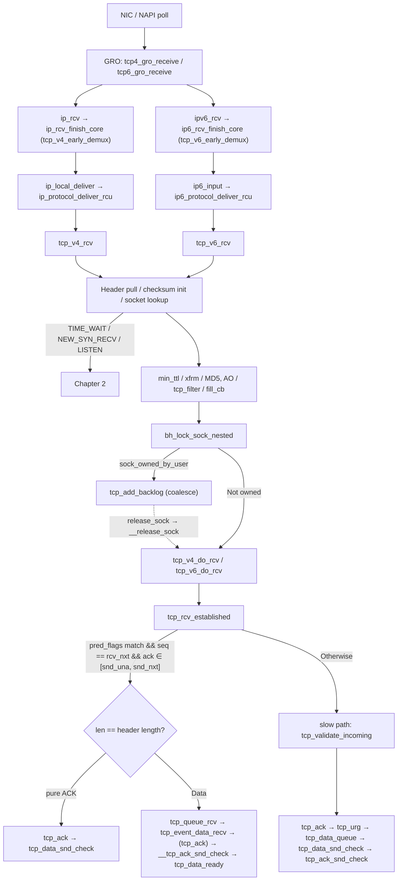

# 5. Receiving (1): tcp_v4_rcv and header prediction

This chapter walks line by line through what happens from when a TCP segment received by the NIC reaches an ESTABLISHED socket until it is processed either along the fast path (header prediction) or the slow path (`tcp_validate_incoming()` → `tcp_ack()` → `tcp_data_queue()`) of `tcp_rcv_established()`.  The details of storing into the receive queue and `tcp_recvmsg()` are covered in [Chapter 6](06-data-queue-recvmsg.md), while the inner workings of `tcp_ack()` are covered in [Chapter 7](07-ack-processing.md).

## The ELI5 version

Imagine the mailroom of a large apartment block.  When a truck unloads parcels (`sk_buff`), the mailroom clerk first looks at the **building address** and **room number** on the shipping label (header) to find out which room's mailbox (`struct sock`) it is destined for.

If the resident of the room happens to be fiddling with the mailbox at that moment (the user holds the socket lock), the clerk does not wait; they place it on the "holding tray" (backlog) beside the mailbox and return to their next job.  When finishing their work, the resident brings in the parcels from the tray themselves in batches.

This clerk is very efficient and keeps a **"sample of the shipping label for the parcel expected next"** at hand for each room (`pred_flags`).  If the arriving shipping label matches the sample exactly (consecutive sequence number, no superfluous marks, and identical window opening), they skip all detailed inspections, pop it straight into the **inbox**, and return a **signed receipt** (ACK) if needed.  This is header prediction.

If it differs even slightly from the sample, the clerk diverts the parcel to the close-scrutiny desk (slow path).  There, they check in turn: "is the date stamp older than last time?" (PAWS), "does the sequence number fall within the acceptable range?", and "is this not a 'contract termination' notice (RST) or a 'start over from scratch' notice (SYN) from an unknown party?".  Rather than obeying suspicious notices immediately, they return an "is this really you?" signed receipt (challenge ACK), having only the genuine peer resubmit with the correct number.

## What the RFCs say

### RFC 9293: SEGMENT ARRIVES (acceptability test for sequence numbers)

[RFC 9293](https://www.rfc-editor.org/rfc/rfc9293) (Transmission Control Protocol, 2022) is the current core TCP specification consolidating RFC 793 and its supplementing RFCs such as RFC 1122.  Processing upon segment arrival in synchronised states such as ESTABLISHED is described in [RFC 9293 §3.10.7.4](https://www.rfc-editor.org/rfc/rfc9293#section-3.10.7.4) (Other States) in the following order:

1. **first: check sequence number**
2. **second: check the RST bit**
3. third: check security
4. **fourth: check the SYN bit**
5. **fifth: check the ACK field**
6. sixth: check the URG bit
7. seventh: process the segment text (data)
8. eighth: check the FIN bit

The Linux slow path is written almost exactly in this order, with comments such as `/* Step 1: ... */` and `/* Step 2: ... */` still preserved verbatim inside `tcp_validate_incoming()`.

The "first" acceptability test is divided into four cases depending on the combination of segment length and receive window:

| Segment length | Receive window | Acceptability condition |
| --- | --- | --- |
| 0 | 0 | `SEG.SEQ = RCV.NXT` |
| 0 | >0 | `RCV.NXT =< SEG.SEQ < RCV.NXT+RCV.WND` |
| >0 | 0 | NOT ACCEPTABLE |
| >0 | >0 | `RCV.NXT =< SEG.SEQ < RCV.NXT+RCV.WND` or `RCV.NXT =< SEG.SEQ+SEG.LEN-1 < RCV.NXT+RCV.WND` |

The key points are:

- It is a lenient test: "accept if either the beginning or the end of the segment falls within the window".  Truncating portions that protrude outside the window is the job of the subsequent text processing.
- Unacceptable segments are dropped after returning an ACK (unless the RST bit is set).  This informs the peer of the correct `RCV.NXT` even if they remain in an out-of-date state.
- When RCV.WND is 0, data is not accepted, but "acceptable ACKs, URGs, and RSTs should be processed specially".

### RFC 7323: Timestamps, PAWS, and header prediction

[RFC 7323](https://www.rfc-editor.org/rfc/rfc7323) (TCP Extensions for High Performance, 2014) obsoleted RFC 1323 and defines the Window Scale and Timestamps options.  Relevant to this chapter are Timestamps and the two mechanisms that utilise them:

- **RTTM (Round-Trip Time Measurement)**: The sender puts its own clock in TSval, and the receiver echoes it in TSecr, allowing RTT to be measured on any ACK (RTT estimation itself is covered in [Chapter 7](07-ack-processing.md)).
- **PAWS (Protection Against Wrapped Sequences)**: When the 32-bit sequence number wraps around on high-speed links, old duplicate segments from a previous cycle are detected as having an "out-of-date timestamp" and discarded.

The Timestamps option in [RFC 7323 §3](https://www.rfc-editor.org/rfc/rfc7323#section-3) is 10 bytes: `Kind=8, Length=10, TSval(4), TSecr(4)`.  [RFC 7323 Appendix A](https://www.rfc-editor.org/rfc/rfc7323#appendix-A) recommends aligning non-SYN segments to 12 bytes with `NOP, NOP, TS`, which allows the receiver to test this fixed layout with a single 32-bit comparison.  Linux's `tcp_parse_aligned_timestamp()` does exactly this.

The receiver maintains two state variables ([RFC 7323 §4.3](https://www.rfc-editor.org/rfc/rfc7323#section-4.3)):

- `TS.Recent`: The timestamp to be echoed in the next TSecr.  In Linux, this is `tp->rx_opt.ts_recent`.
- `Last.ACK.sent`: The sequence number of the last ACK sent.  In Linux, `tp->rcv_wup` ("`rcv_nxt` at the time the window was last advertised") serves this role.

The basic PAWS algorithm in [RFC 7323 §5.3](https://www.rfc-editor.org/rfc/rfc7323#section-5.3) is as follows:

- **R1**: If the Timestamps option is present, `SEG.TSval < TS.Recent`, `TS.Recent` is valid, and the RST bit is not set, the segment is not acceptable.  Send an ACK and drop it.
- **R2**: If outside the window, drop it (as normal TCP processing).
- **R3**: If `SEG.SEQ =< Last.ACK.sent`, record its TSval into `TS.Recent`.
- **R4**: If an in-order segment (left edge of the window), accept it normally.

Since timestamp comparisons are performed using 32-bit modulo arithmetic, comparisons lose their meaning on connections idle for long periods.  [RFC 7323 §5.5](https://www.rfc-editor.org/rfc/rfc7323#section-5.5) (Outdated Timestamps) requires `TS.Recent` to be considered invalid if it has not been updated for 24 days or more.

[RFC 7323 §5.6](https://www.rfc-editor.org/rfc/rfc7323#section-5.6) describes how to combine Van Jacobson's header prediction with PAWS:

- **H1**: Check timestamps (same as R1).
- **H2**: Perform header prediction.  If it is the next in-order segment and requires no special processing, accept it, record the timestamp, and skip H3.
- **H3**: Perform normal RFC 793 processing.

The philosophy behind header prediction is that instead of asking the general question "is it in the window?", one first asks the simpler question "is this the segment expected next?".  During bulk data transfer, almost all segments satisfy this condition, dramatically reducing average overhead.  Linux performs the H2 check (`pred_flags` and `seq == rcv_nxt`) first, followed by a lightweight timestamp comparison, effectively swapping the order of H1 and H2.

Receiver requirements regarding window retraction ([RFC 7323 §2.4](https://www.rfc-editor.org/rfc/rfc7323#section-2.4)) also relate to `tcp_sequence()`, discussed later.

### RFC 5961: Mitigations against blind in-window attacks

[RFC 5961](https://www.rfc-editor.org/rfc/rfc5961) (Improving TCP's Robustness to Blind In-Window Attacks, 2010) addresses attacks where an off-path "blind" attacker, capable of guessing the 4-tuple but unable to see sequence numbers, floods RST, SYN, or data segments until hitting inside the window to terminate or corrupt the connection.  Because RFC 793 accepts segments "as long as they fall anywhere in the window", larger windows make hits easier.  The crux of the mitigation is: **when ambiguous, do not comply; return a challenge ACK and have the genuine peer resend with the exact number**.

- [RFC 5961 §3.2](https://www.rfc-editor.org/rfc/rfc5961#section-3.2) (RST): If `SEG.SEQ == RCV.NXT`, reset.  If inside the window but not matching, send a challenge ACK and drop it.  If outside the window, drop it silently.
- [RFC 5961 §4.2](https://www.rfc-editor.org/rfc/rfc5961#section-4.2) (SYN): If a SYN is received in a synchronised state, return a challenge ACK and drop it regardless of the sequence number (do not reset as in RFC 793).
- [RFC 5961 §5.2](https://www.rfc-editor.org/rfc/rfc5961#section-5.2) (Data injection): An ACK is acceptable only if `(SND.UNA - MAX.SND.WND) =< SEG.ACK =< SND.NXT`.  If out of range, drop and send an ACK.
- [RFC 5961 §7](https://www.rfc-editor.org/rfc/rfc5961#section-7) (ACK Throttling): Limit the transmission rate of challenge ACKs to prevent them from being abused for amplification attacks.

RFC 9293 incorporates the procedures of RFC 5961 into the RST and SYN processing of §3.10.7.4 (as optional mitigations).  Linux enables RFC 5961 by default and adds several bespoke extensions (see comparison table below).

## The big picture



While IPv4 and IPv6 use separate functions up to the socket lookup, everything from `tcp_rcv_established()` onward is completely shared.  The fast path handles only the most frequent case — "the expected next segment, ACK flag only, window value identical to last time, and valid ACK number" — while everything else falls back to the slow path that traces the RFC 9293 procedures.

## Walking through the code

### Step 1: From NIC to tcp_v4_rcv / tcp_v6_rcv (overview)

The path leading up to TCP is covered only briefly in this chapter.  All of it executes within the NET_RX softirq (or threaded NAPI kernel thread) under `rcu_read_lock()`.

1. The driver's NAPI poll passes an skb to `napi_gro_receive()`.  `tcp4_gro_receive()` ([net/ipv4/tcp_offload.c#L428](https://git.kernel.org/pub/scm/linux/kernel/git/netdev/net-next.git/tree/net/ipv4/tcp_offload.c?id=279d5c8afcd38bd841832a39bfe1aa4f8518d98e#n428)) → `tcp_gro_receive()` ([net/ipv4/tcp_offload.c#L286](https://git.kernel.org/pub/scm/linux/kernel/git/netdev/net-next.git/tree/net/ipv4/tcp_offload.c?id=279d5c8afcd38bd841832a39bfe1aa4f8518d98e#n286)) aggregates segments that belong to the same flow, are sequential, and carry matching flags and options into a single large skb (`gso_segs > 1`).  Subsequent TCP processing is written under the assumption that "one skb = multiple MSS chunks", which is why `tcp_segs_in()`, discussed later, counts in units of `gso_segs`.
2. `ip_rcv()` ([net/ipv4/ip_input.c#L603](https://git.kernel.org/pub/scm/linux/kernel/git/netdev/net-next.git/tree/net/ipv4/ip_input.c?id=279d5c8afcd38bd841832a39bfe1aa4f8518d98e#n603)) → `ip_rcv_finish_core()` ([net/ipv4/ip_input.c#L361](https://git.kernel.org/pub/scm/linux/kernel/git/netdev/net-next.git/tree/net/ipv4/ip_input.c?id=279d5c8afcd38bd841832a39bfe1aa4f8518d98e#n361)) calls `tcp_v4_early_demux()` ([net/ipv4/ip_input.c#L322](https://git.kernel.org/pub/scm/linux/kernel/git/netdev/net-next.git/tree/net/ipv4/ip_input.c?id=279d5c8afcd38bd841832a39bfe1aa4f8518d98e#n322)) before route lookup if `net.ipv4.tcp_early_demux` is enabled.  In IPv6, this is `ipv6_rcv()` ([net/ipv6/ip6_input.c#L344](https://git.kernel.org/pub/scm/linux/kernel/git/netdev/net-next.git/tree/net/ipv6/ip6_input.c?id=279d5c8afcd38bd841832a39bfe1aa4f8518d98e#n344)) → `ip6_rcv_finish_core()` ([net/ipv6/ip6_input.c#L88](https://git.kernel.org/pub/scm/linux/kernel/git/netdev/net-next.git/tree/net/ipv6/ip6_input.c?id=279d5c8afcd38bd841832a39bfe1aa4f8518d98e#n88)) → `tcp_v6_early_demux()` ([net/ipv6/ip6_input.c#L49](https://git.kernel.org/pub/scm/linux/kernel/git/netdev/net-next.git/tree/net/ipv6/ip6_input.c?id=279d5c8afcd38bd841832a39bfe1aa4f8518d98e#n49)).

```c
	sk = __inet_lookup_established(net, iph->saddr, th->source,
				       iph->daddr, ntohs(th->dest),
				       skb->skb_iif, inet_sdif(skb));
	if (sk) {
		skb->sk = sk;
		skb->destructor = sock_edemux;
		if (sk_fullsock(sk)) {
			struct dst_entry *dst = rcu_dereference(sk->sk_rx_dst);

			if (dst)
				dst = dst_check(dst, 0);
			if (dst &&
			    sk->sk_rx_dst_ifindex == skb->skb_iif)
				skb_dst_set_noref(skb, dst);
		}
	}
```

It looks up only the ESTABLISHED table; if found, it attaches the socket to `skb->sk` (cleaned up with destructor `sock_edemux`).  Furthermore, if the socket holds an input route cache `sk->sk_rx_dst`, which remains valid and the receiving interface matches, it is attached to `skb` without taking a reference count (`skb_dst_set_noref`).  This skips the entire FIB lookup.  When `tcp_v4_rcv()` later calls `__inet_lookup_skb()`, this `skb->sk` is "stolen", skipping the second lookup as well.

3. If destined locally, `ip_local_deliver()` ([net/ipv4/ip_input.c#L250](https://git.kernel.org/pub/scm/linux/kernel/git/netdev/net-next.git/tree/net/ipv4/ip_input.c?id=279d5c8afcd38bd841832a39bfe1aa4f8518d98e#n250)) → `ip_protocol_deliver_rcu()` ([net/ipv4/ip_input.c#L189](https://git.kernel.org/pub/scm/linux/kernel/git/netdev/net-next.git/tree/net/ipv4/ip_input.c?id=279d5c8afcd38bd841832a39bfe1aa4f8518d98e#n189)) calls the protocol handler, or in IPv6 `ip6_input()` ([net/ipv6/ip6_input.c#L540](https://git.kernel.org/pub/scm/linux/kernel/git/netdev/net-next.git/tree/net/ipv6/ip6_input.c?id=279d5c8afcd38bd841832a39bfe1aa4f8518d98e#n540)) → `ip6_protocol_deliver_rcu()` ([net/ipv6/ip6_input.c#L403](https://git.kernel.org/pub/scm/linux/kernel/git/netdev/net-next.git/tree/net/ipv6/ip6_input.c?id=279d5c8afcd38bd841832a39bfe1aa4f8518d98e#n403)).

```c
		ret = INDIRECT_CALL_2(ipprot->handler, tcp_v4_rcv, udp_rcv,
				      skb);
		if (ret < 0) {
			protocol = -ret;
			goto resubmit;
```

`INDIRECT_CALL_2()` is a macro that avoids the overhead of function pointer invocations under retpoline environments by comparing directly against common targets before dispatching a direct call.  TCP and UDP are given special treatment.

### Step 2: tcp_v4_rcv() — first half: header validation and checksum initialisation

`tcp_v4_rcv()` ([net/ipv4/tcp_ipv4.c#L2073](https://git.kernel.org/pub/scm/linux/kernel/git/netdev/net-next.git/tree/net/ipv4/tcp_ipv4.c?id=279d5c8afcd38bd841832a39bfe1aa4f8518d98e#n2073)) is the entry point for IPv4 TCP.

```c
int tcp_v4_rcv(struct sk_buff *skb)
{
	struct net *net = dev_net_rcu(skb->dev);
	enum skb_drop_reason drop_reason;
	enum tcp_tw_status tw_status;
	int sdif = inet_sdif(skb);
	int dif = inet_iif(skb);
	const struct iphdr *iph;
	const struct tcphdr *th;
	struct sock *sk = NULL;
	bool refcounted;
	int ret;
	u32 isn;

	drop_reason = SKB_DROP_REASON_NOT_SPECIFIED;
	if (skb->pkt_type != PACKET_HOST)
		goto discard_it;

	/* Count it even if it's bad */
	__TCP_INC_STATS(net, TCP_MIB_INSEGS);

	if (!pskb_may_pull(skb, sizeof(struct tcphdr)))
		goto discard_it;

	th = (const struct tcphdr *)skb->data;

	if (unlikely(th->doff < sizeof(struct tcphdr) / 4)) {
		drop_reason = SKB_DROP_REASON_PKT_TOO_SMALL;
		goto bad_packet;
	}
	if (!pskb_may_pull(skb, th->doff * 4))
		goto discard_it;

	/* An explanation is required here, I think.
	 * Packet length and doff are validated by header prediction,
	 * provided case of th->doff==0 is eliminated.
	 * So, we defer the checks. */

	if (skb_checksum_init(skb, IPPROTO_TCP, inet_compute_pseudo))
		goto csum_error;

	th = (const struct tcphdr *)skb->data;
	iph = ip_hdr(skb);
```

- `dev_net_rcu(skb->dev)`: Obtains the netns under RCU.  Because `skb->dev` is cleared to `NULL` later in this function, it must be fetched here.
- `sdif` / `dif`: For VRF support, obtains the ifindex of the underlying slave device beneath an L3 master device alongside the receiving ifindex.  These are used for lookup and MD5/AO key selection.
- `skb->pkt_type != PACKET_HOST`: Frames destined for other hosts captured in promiscuous mode are discarded here.
- `TCP_MIB_INSEGS` (`TcpInSegs` in nstat) is counted before validation, per the MIB definition ("count it even if it's bad").  Because skbs aggregated by GRO are also counted as 1, `TcpInSegs` is smaller than the segment count on the wire.
- `pskb_may_pull(skb, sizeof(struct tcphdr))` → `doff` validation → `pskb_may_pull(skb, th->doff * 4)`: Pulls the entire TCP header, including options, into the linear area (`skb->head`).  Direct pointer reads of options via `th` thereafter are valid because of this guarantee.  Only `doff < 5` is counted as a malformed packet under `TcpInErrs`.
- The comment "Packet length and doff are validated by header prediction" is a historical explanation.  Presently, because the immediately preceding `pskb_may_pull(skb, th->doff * 4)` guarantees `skb->len >= doff * 4`, the "Header too small" branch in the fast path described later is largely defensive.
- `skb_checksum_init()`: Sets up the pseudo-header checksum in `skb->csum`.  If the NIC returned `CHECKSUM_COMPLETE`, validation finishes here and `csum_valid` is set.  Otherwise, if `skb->len` is less than or equal to `CHECKSUM_BREAK` (76 bytes), the checksum is computed in full here; if longer, **validation is deferred**.  Deferred validation is carried out by `tcp_checksum_complete()` immediately prior to queueing data.  The fast path exploits the fact that pure ACKs (20 or 32 bytes) are always already verified here.
- Because `pskb_may_pull()` may reallocate `skb->head`, `th` and `iph` are reacquired.

### Step 3: tcp_v4_rcv() — socket lookup and state-based dispatch

```c
lookup:
	sk = __inet_lookup_skb(skb, __tcp_hdrlen(th), th->source,
			       th->dest, sdif, &refcounted);
	if (!sk)
		goto no_tcp_socket;

	if (sk->sk_state == TCP_TIME_WAIT)
		goto do_time_wait;
```

- `__inet_lookup_skb()` ([include/net/inet_hashtables.h#L485](https://git.kernel.org/pub/scm/linux/kernel/git/netdev/net-next.git/tree/include/net/inet_hashtables.h?id=279d5c8afcd38bd841832a39bfe1aa4f8518d98e#n485)) first uses `inet_steal_sock()` ([include/net/inet_hashtables.h#L445](https://git.kernel.org/pub/scm/linux/kernel/git/netdev/net-next.git/tree/include/net/inet_hashtables.h?id=279d5c8afcd38bd841832a39bfe1aa4f8518d98e#n445)) to extract `skb->sk` (attached by early demux or BPF's `bpf_sk_assign()`); if absent, it performs standard lookup in ehash followed by listener tables.  `refcounted` indicates whether a reference was taken on the returned socket.  Because listeners are `SOCK_RCU_FREE`, they may be returned without taking a reference, and the trailing `sock_put()` is governed by this flag.
- `TCP_TIME_WAIT` and `TCP_NEW_SYN_RECV` are mini-sockets rather than full sockets ([Chapter 1](01-data-structures.md), [Chapter 2](02-connection-lifecycle.md)), not covered in this chapter.  The `TCP_NEW_SYN_RECV` branch (lines 2125 to 2204 of tcp_ipv4.c) retrieves the listener from the request socket, processes the final ACK of the 3WHS via `tcp_check_req()`, and passes any newly created child socket to `tcp_child_process()`.  If another CPU created the child socket first (`req_stolen`), `IPCB` is restored via `tcp_v4_restore_cb()` and execution restarts from `lookup`.

### Step 4: tcp_v4_rcv() — process: policy, filters, and constructing TCP_SKB_CB

```c
	isn = 0;
process:
	if (static_branch_unlikely(&ip4_min_ttl)) {
		/* min_ttl can be changed concurrently from do_ip_setsockopt() */
		if (unlikely(iph->ttl < READ_ONCE(inet_sk(sk)->min_ttl))) {
			__NET_INC_STATS(net, LINUX_MIB_TCPMINTTLDROP);
			drop_reason = SKB_DROP_REASON_TCP_MINTTL;
			goto discard_and_relse;
		}
	}

	if (!xfrm4_policy_check(sk, XFRM_POLICY_IN, skb)) {
		drop_reason = SKB_DROP_REASON_XFRM_POLICY;
		goto discard_and_relse;
	}

	drop_reason = tcp_inbound_hash(sk, NULL, skb, &iph->saddr, &iph->daddr,
				       AF_INET, dif, sdif);
	if (drop_reason)
		goto discard_and_relse;

	nf_reset_ct(skb);

	drop_reason = tcp_filter(sk, skb);
	if (drop_reason)
		goto discard_and_relse;

	th = (const struct tcphdr *)skb->data;
	iph = ip_hdr(skb);
	tcp_v4_fill_cb(skb, iph, th);
	TCP_SKB_CB(skb)->tcp_tw_isn = isn;

	skb->dev = NULL;

	if (sk->sk_state == TCP_LISTEN) {
		ret = tcp_v4_do_rcv(sk, skb);
		goto put_and_return;
	}
```

- `static_branch_unlikely(&ip4_min_ttl)`: A static key enabled only when at least one socket has configured `IP_MINTTL` ([RFC 5082](https://www.rfc-editor.org/rfc/rfc5082) GTSM).  Under normal conditions, it costs nothing beyond a single jump instruction.  `min_ttl` can be modified concurrently without a lock from `do_ip_setsockopt()`, so it is read using `READ_ONCE()`.
- `xfrm4_policy_check()`: Verifies IPsec inbound policy.  Because this check references `IPCB(skb)`, it must be performed **before** `tcp_v4_fill_cb()` constructs `TCP_SKB_CB()` (explained below).
- `tcp_inbound_hash()` ([net/ipv4/tcp.c#L5027](https://git.kernel.org/pub/scm/linux/kernel/git/netdev/net-next.git/tree/net/ipv4/tcp.c?id=279d5c8afcd38bd841832a39bfe1aa4f8518d98e#n5027)): Checks TCP-MD5 (RFC 2385) and TCP-AO (RFC 5925) signatures.  Returns immediately if no keys exist.
- `nf_reset_ct()`: Drops the reference to conntrack.  Because the skb may linger in the receive queue for a considerable time, the conntrack entry is severed here to avoid keeping it alive unnecessarily.
- `tcp_filter()` ([include/net/tcp.h#L1734](https://git.kernel.org/pub/scm/linux/kernel/git/netdev/net-next.git/tree/include/net/tcp.h?id=279d5c8afcd38bd841832a39bfe1aa4f8518d98e#n1734)): Runs socket filters (classic BPF / eBPF) such as `SO_ATTACH_FILTER`.  `sk_filter_trim_cap()` may trim payload, but will not truncate below the TCP header length (`__tcp_hdrlen(th)`).  Because filters can mutate the skb, `th` and `iph` are reacquired immediately afterward.
- `tcp_v4_fill_cb()`: Populates sequence numbers and flags into `TCP_SKB_CB(skb)` (next subsection).
- `TCP_SKB_CB(skb)->tcp_tw_isn = isn`: A field used to pass the ISN selected by TIME_WAIT to the listener for a SYN diverted from TIME_WAIT; normally 0.
- `skb->dev = NULL`: From here onward, the skb may remain queued in the socket for a long time.  The device reference is cleared here to prevent dangling pointers if the netdevice is unregistered in the interim.  Whenever the receiving interface is needed later, `skb->skb_iif` or the saved `IPCB` in `TCP_SKB_CB()` is used.
- For `TCP_LISTEN`, `tcp_v4_do_rcv()` is called without acquiring the socket lock.  Because listeners operate locklessly ([Chapter 2](02-connection-lifecycle.md)), execution branches off here.
- `sk_incoming_cpu_update()`: Records the CPU that last processed packets for this socket, used by `SO_INCOMING_CPU`.

#### tcp_v4_fill_cb() and struct tcp_skb_cb

`tcp_v4_fill_cb()` ([net/ipv4/tcp_ipv4.c#L2048](https://git.kernel.org/pub/scm/linux/kernel/git/netdev/net-next.git/tree/net/ipv4/tcp_ipv4.c?id=279d5c8afcd38bd841832a39bfe1aa4f8518d98e#n2048)) fills in the receiver-side fields of `struct tcp_skb_cb` ([include/net/tcp.h#L1138](https://git.kernel.org/pub/scm/linux/kernel/git/netdev/net-next.git/tree/include/net/tcp.h?id=279d5c8afcd38bd841832a39bfe1aa4f8518d98e#n1138)).

```c
static void tcp_v4_restore_cb(struct sk_buff *skb)
{
	memmove(IPCB(skb), &TCP_SKB_CB(skb)->header.h4,
		sizeof(struct inet_skb_parm));
}

static void tcp_v4_fill_cb(struct sk_buff *skb, const struct iphdr *iph,
			   const struct tcphdr *th)
{
	/* This is tricky : We move IPCB at its correct location into TCP_SKB_CB()
	 * barrier() makes sure compiler wont play fool^Waliasing games.
	 */
	memmove(&TCP_SKB_CB(skb)->header.h4, IPCB(skb),
		sizeof(struct inet_skb_parm));
	barrier();

	TCP_SKB_CB(skb)->seq = ntohl(th->seq);
	TCP_SKB_CB(skb)->end_seq = (TCP_SKB_CB(skb)->seq + th->syn + th->fin +
				    skb->len - th->doff * 4);
	TCP_SKB_CB(skb)->ack_seq = ntohl(th->ack_seq);
	TCP_SKB_CB(skb)->tcp_flags = tcp_flags_ntohs(th);
	TCP_SKB_CB(skb)->ip_dsfield = ipv4_get_dsfield(iph);
	TCP_SKB_CB(skb)->sacked	 = 0;
	TCP_SKB_CB(skb)->has_rxtstamp =
			skb->tstamp || skb_hwtstamps(skb)->hwtstamp;
}
```

- `skb->cb[]` (48 bytes) is an area reused across networking layers.  The IP layer places `struct inet_skb_parm` (`IPCB`) at the beginning, but TCP wants to put `seq`, `end_seq`, etc. at the start, so it relocates `IPCB` to `TCP_SKB_CB(skb)->header.h4` using `memmove()` before overwriting it.  `barrier()` ensures the compiler does not reorder reads and writes across different types accessing the same underlying memory.
- Consequently, operations referencing `IPCB(skb)` (such as `xfrm4_policy_check()`) must finish before `fill_cb`.  Conversely, when redoing lookup, `tcp_v4_restore_cb()` restores `IPCB` to its original location.
- `end_seq = seq + SYN + FIN + payload_len`: Because SYN and FIN each consume one sequence number in sequence space, they are added into `end_seq`.  Subsequent TCP code relies heavily on the predicate "`seq == end_seq` implies a pure ACK".
- `tcp_flags`: Stores the TCP flags in host byte order so they can be tested via `TCPHDR_*`.
- `ip_dsfield`: Preserves TOS / Traffic Class including ECN bits, used for backlog coalescing decisions and ECN processing.
- `sacked = 0`: The receive path does not use SACK state, but because `sacked` is shared with the transmission path, it is explicitly cleared.
- `has_rxtstamp`: Indicates whether software or hardware receive timestamps are present (for `SO_TIMESTAMPING`).

### Step 5: tcp_v4_rcv() — socket lock and backlog

```c
	sk_incoming_cpu_update(sk);

	bh_lock_sock_nested(sk);
	tcp_segs_in(tcp_sk(sk), skb);
	ret = 0;
	if (!sock_owned_by_user(sk)) {
		ret = tcp_v4_do_rcv(sk, skb);
	} else {
		drop_reason = tcp_add_backlog(sk, skb);
		if (drop_reason)
			goto discard_and_relse;
	}
	bh_unlock_sock(sk);

put_and_return:
	if (refcounted)
		sock_put(sk);

	return ret;
```

Recall that socket locking operates in two tiers:

- `sk->sk_lock.slock`: A spinlock acquired briefly by both softirq and process contexts.
- `sk->sk_lock.owned`: A flag set by process context in `lock_sock()`.  While set, the process may release the spinlock (with BH enabled) and sleep.

Because `tcp_v4_rcv()` runs in softirq, it cannot sleep with `lock_sock()`.  Instead, it acquires only the spinlock with `bh_lock_sock_nested()` and checks `owned` via `sock_owned_by_user()`.

- If `owned == 0`, it executes `tcp_v4_do_rcv()` → `tcp_rcv_established()` directly **inside softirq while holding the spinlock**.
- If `owned == 1`, user space is currently touching the socket inside `tcp_sendmsg()` or `tcp_recvmsg()`, so socket state cannot be modified.  The skb is queued onto the backlog via `tcp_add_backlog()`, and the function returns immediately.  Queued skbs are later processed by `__release_sock()` ([net/core/sock.c#L3295](https://git.kernel.org/pub/scm/linux/kernel/git/netdev/net-next.git/tree/net/core/sock.c?id=279d5c8afcd38bd841832a39bfe1aa4f8518d98e#n3295)) calling `sk_backlog_rcv()` (in TCP, `tcp_v4_do_rcv()` / `tcp_v6_do_rcv()`) when the user executes `release_sock()`.

`tcp_segs_in()` ([include/net/tcp.h#L2810](https://git.kernel.org/pub/scm/linux/kernel/git/netdev/net-next.git/tree/include/net/tcp.h?id=279d5c8afcd38bd841832a39bfe1aa4f8518d98e#n2810)) counts `segs_in` and `data_segs_in` in units of `gso_segs`.  Although within the spinlock, it uses `WRITE_ONCE()` because `tcp_get_info()` reads without taking locks.  Because segments queued to the backlog are also counted, skbs dropped in the backlog are nonetheless included in `segs_in`.

Note the **locking asymmetry**.  When `tcp_add_backlog()` fails, it **calls `bh_unlock_sock()` itself** before returning the drop reason.  The caller therefore bypasses `bh_unlock_sock()` and branches directly to `discard_and_relse`.  This design ensures that drop processing (`sk_skb_reason_drop()` and tracepoints) takes place outside the spinlock.

`sock_put()` at `put_and_return` drops the reference acquired during lookup.  Because `tcp_v4_do_rcv()` always returns 0, `ret` is effectively 0.

### Step 6: tcp_add_backlog() — coalescing into the backlog

`tcp_add_backlog()` ([net/ipv4/tcp_ipv4.c#L1904](https://git.kernel.org/pub/scm/linux/kernel/git/netdev/net-next.git/tree/net/ipv4/tcp_ipv4.c?id=279d5c8afcd38bd841832a39bfe1aa4f8518d98e#n1904)) is shared between IPv4 and IPv6.

```c
enum skb_drop_reason tcp_add_backlog(struct sock *sk, struct sk_buff *skb)
{
	u32 tail_gso_size, tail_gso_segs;
	struct skb_shared_info *shinfo;
	const struct tcphdr *th;
	struct tcphdr *thtail;
	struct sk_buff *tail;
	unsigned int hdrlen;
	bool fragstolen;
	u32 gso_segs;
	u32 gso_size;
	u64 limit;
	int delta;
	int err;

	/* In case all data was pulled from skb frags (in __pskb_pull_tail()),
	 * we can fix skb->truesize to its real value to avoid future drops.
	 * This is valid because skb is not yet charged to the socket.
	 * It has been noticed pure SACK packets were sometimes dropped
	 * (if cooked by drivers without copybreak feature).
	 */
	skb_condense(skb);

	tcp_cleanup_skb(skb);

	if (unlikely(tcp_checksum_complete(skb))) {
		bh_unlock_sock(sk);
		trace_tcp_bad_csum(skb);
		__TCP_INC_STATS(sock_net(sk), TCP_MIB_CSUMERRORS);
		__TCP_INC_STATS(sock_net(sk), TCP_MIB_INERRS);
		return SKB_DROP_REASON_TCP_CSUM;
	}
```

- `skb_condense()`: If all data has been pulled into the linear buffer via `pskb_may_pull()` and frags are empty, it frees the frags and shrinks `skb->truesize` to its actual value.  Because the skb has not yet been charged to the socket, modifying truesize here does not corrupt the household budget.  As noted in the comment, this mitigates an issue where pure SACKs from drivers without copybreak features were dropped due to inflated truesize hitting backlog limits.
- `tcp_cleanup_skb()` ([include/net/tcp.h#L824](https://git.kernel.org/pub/scm/linux/kernel/git/netdev/net-next.git/tree/include/net/tcp.h?id=279d5c8afcd38bd841832a39bfe1aa4f8518d98e#n824)): Performs `skb_dst_drop()` and `secpath_reset()`.  Because skbs placed in the backlog are processed outside RCU protection, unreferenced dst entries cannot be carried forward (`__sk_add_backlog()` also calls `skb_dst_force()` as a safeguard).  In any case, TCP does not use the dst upon reception, so dropping it here is the cheapest approach.
- `tcp_checksum_complete()` ([include/net/tcp.h#L1726](https://git.kernel.org/pub/scm/linux/kernel/git/netdev/net-next.git/tree/include/net/tcp.h?id=279d5c8afcd38bd841832a39bfe1aa4f8518d98e#n1726)): Resolves deferred checksum validation here for two reasons.  First, coalescing with the tail later mixes payloads, preventing individual validation.  Second, shifting the checksum computation to the BH CPU relieves work from the user CPU during `__release_sock()`.  Upon failure, it unlocks the spinlock via `bh_unlock_sock()` (the asymmetry mentioned above).

```c
	/* Attempt coalescing to last skb in backlog, even if we are
	 * above the limits.
	 * This is okay because skb capacity is limited to MAX_SKB_FRAGS.
	 */
	th = (const struct tcphdr *)skb->data;
	hdrlen = th->doff * 4;

	tail = sk->sk_backlog.tail;
	if (!tail)
		goto no_coalesce;
	thtail = (struct tcphdr *)tail->data;

	if (TCP_SKB_CB(tail)->end_seq != TCP_SKB_CB(skb)->seq ||
	    TCP_SKB_CB(tail)->ip_dsfield != TCP_SKB_CB(skb)->ip_dsfield ||
	    ((TCP_SKB_CB(tail)->tcp_flags |
	      TCP_SKB_CB(skb)->tcp_flags) & (TCPHDR_SYN | TCPHDR_RST | TCPHDR_URG)) ||
	    !((TCP_SKB_CB(tail)->tcp_flags &
	      TCP_SKB_CB(skb)->tcp_flags) & TCPHDR_ACK) ||
	    ((TCP_SKB_CB(tail)->tcp_flags ^
	      TCP_SKB_CB(skb)->tcp_flags) &
	     (TCPHDR_ECE | TCPHDR_CWR | TCPHDR_AE)) ||
	    !tcp_skb_can_collapse_rx(tail, skb) ||
	    thtail->doff != th->doff ||
	    memcmp(thtail + 1, th + 1, hdrlen - sizeof(*th)) ||
	    /* prior to PSP Rx policy check, retain exact PSP metadata */
	    psp_skb_coalesce_diff(tail, skb))
		goto no_coalesce;
```

This enumerates the prerequisites for coalescing onto the backlog tail (`sk->sk_backlog.tail`).  If any check fails, it jumps to `no_coalesce`:

- `end_seq == seq`: Must be consecutive in sequence space.
- Matching `ip_dsfield`: Mixing segments with and without ECN CE marks skews CE counting (particularly AccECN's byte-level counters).
- Neither segment carries SYN, RST, or URG; both carry ACK.
- ECE, CWR, and AE flags match (to avoid losing ECN feedback).
- `tcp_skb_can_collapse_rx()` ([include/net/tcp.h#L1273](https://git.kernel.org/pub/scm/linux/kernel/git/netdev/net-next.git/tree/include/net/tcp.h?id=279d5c8afcd38bd841832a39bfe1aa4f8518d98e#n1273)): MPTCP DSS mappings and kTLS decrypted bits must match.
- Identical `doff` with **option bytes matching exactly via `memcmp()`**.  Because TSval and TSecr must match, this primarily collapses bursts arriving within the same millisecond (when GRO is inactive) or successive pure ACKs.  ACKs with differing SACK blocks do not coalesce.
- `psp_skb_coalesce_diff()`: PSP encryption metadata must match.  Because PSP Rx policy checking occurs at the beginning of `tcp_v4_do_rcv()`, differing metadata cannot be merged beforehand.

```c
	__skb_pull(skb, hdrlen);

	shinfo = skb_shinfo(skb);
	gso_size = shinfo->gso_size ?: skb->len;
	gso_segs = shinfo->gso_segs ?: 1;

	shinfo = skb_shinfo(tail);
	tail_gso_size = shinfo->gso_size ?: (tail->len - hdrlen);
	tail_gso_segs = shinfo->gso_segs ?: 1;

	if (skb_try_coalesce(tail, skb, &fragstolen, &delta)) {
		TCP_SKB_CB(tail)->end_seq = TCP_SKB_CB(skb)->end_seq;

		if (likely(!before(TCP_SKB_CB(skb)->ack_seq, TCP_SKB_CB(tail)->ack_seq))) {
			TCP_SKB_CB(tail)->ack_seq = TCP_SKB_CB(skb)->ack_seq;
			thtail->window = th->window;
		}
```

- Strips the TCP header from the new skb via `__skb_pull()` so only the payload is appended to the tail.
- Calculates `gso_size` and `gso_segs` for both skbs (skbs bypassing GRO have `gso_size == 0`, treating the length itself as one segment).
- `skb_try_coalesce()` transfers payload into the tail by reparenting frags.  `fragstolen` indicates whether the skb head itself was stolen, while `delta` returns the increase in the tail's truesize.
- If coalescing succeeds, `end_seq` is extended; if the ACK is newer (`!before()`), `ack_seq` and **the TCP header's `window`** are updated.  Because `tcp_rcv_established()` reads `th->window` raw, compares it against `pred_flags`, and passes it to `tcp_ack_update_window()`, failing to update the header value would cause processing with a stale window (86bccd036713).

```c
		/* We have to update both TCP_SKB_CB(tail)->tcp_flags and
		 * thtail->fin, so that the fast path in tcp_rcv_established()
		 * is not entered if we append a packet with a FIN.
		 * SYN, RST, URG are not present.
		 * ACK is set on both packets.
		 * PSH : we do not really care in TCP stack,
		 *       at least for 'GRO' packets.
		 */
		thtail->fin |= th->fin;
		TCP_SKB_CB(tail)->tcp_flags |= TCP_SKB_CB(skb)->tcp_flags;

		if (TCP_SKB_CB(skb)->has_rxtstamp) {
			TCP_SKB_CB(tail)->has_rxtstamp = true;
			tail->tstamp = skb->tstamp;
			skb_hwtstamps(tail)->hwtstamp = skb_hwtstamps(skb)->hwtstamp;
		}

		/* Not as strict as GRO. We only need to carry mss max value */
		shinfo->gso_size = max(gso_size, tail_gso_size);
		shinfo->gso_segs = min_t(u32, gso_segs + tail_gso_segs, 0xFFFF);

		sk->sk_backlog.len += delta;
		__NET_INC_STATS(sock_net(sk),
				LINUX_MIB_TCPBACKLOGCOALESCE);
		kfree_skb_partial(skb, fragstolen);
		return SKB_NOT_DROPPED_YET;
	}
	__skb_push(skb, hdrlen);
```

- FIN is OR-ed into both `thtail->fin` and `tcp_flags`.  Because `pred_flags` matching in `tcp_rcv_established()` inspects TCP header flags, failing to assert FIN in the header would allow a segment carrying FIN into the fast path.
- Receive timestamps are inherited from the new skb.
- `gso_size` takes the maximum and `gso_segs` takes the sum (saturating at 16 bits).  While less strict than GRO, this suffices because helpers like `tcp_measure_rcv_mss()` only require the maximum MSS.
- Increments `sk_backlog.len += delta`, counts `TCPBacklogCoalesce`, and frees the new skb shell with `kfree_skb_partial()`.
- If coalescing fails, `__skb_push()` restores the header.

```c
no_coalesce:
	/* sk->sk_backlog.len is reset only at the end of __release_sock().
	 * Both sk->sk_backlog.len and sk->sk_rmem_alloc could reach
	 * sk_rcvbuf in normal conditions.
	 */
	limit = ((u64)READ_ONCE(sk->sk_rcvbuf)) << 1;

	limit += ((u32)READ_ONCE(sk->sk_sndbuf)) >> 1;

	/* Only socket owner can try to collapse/prune rx queues
	 * to reduce memory overhead, so add a little headroom here.
	 * Few sockets backlog are possibly concurrently non empty.
	 */
	limit += 64 * 1024;

	limit = min_t(u64, limit, UINT_MAX);

	err = sk_add_backlog(sk, skb, limit);
	if (unlikely(err)) {
		bh_unlock_sock(sk);
		if (err == -ENOMEM) {
			__NET_INC_STATS(sock_net(sk), LINUX_MIB_PFMEMALLOCDROP);
			return SKB_DROP_REASON_PFMEMALLOC;
		}
		__NET_INC_STATS(sock_net(sk), LINUX_MIB_TCPBACKLOGDROP);
		return SKB_DROP_REASON_SOCKET_BACKLOG;
	}
	return SKB_NOT_DROPPED_YET;
}
```

- The limit is `2 * sk_rcvbuf + sk_sndbuf / 2 + 64KB`.  `sk_rcvbuf` and `sk_sndbuf` can be modified concurrently without locks by `setsockopt()` or autotuning, so they are read via `READ_ONCE()`.
- Doubling `sk_rcvbuf` accounts for `sk_backlog.len` only being reset to 0 at the **end** of `__release_sock()`.  While user space is draining the backlog, processed skbs are counted both in `sk_rmem_alloc` in the receive queue and remain in `sk_backlog.len`, leading to double counting (ec00ed472bdb).
- `sk_sndbuf / 2` accounts for bidirectional flows where incoming ACKs heavily occupy the backlog.  The `64KB` margin provides headroom because only the socket owner can collapse or prune receive queues (c9c3321257e1).
- Computing in `u64` and saturating at `UINT_MAX` prevents 32-bit overflow when `sk_rcvbuf` is large (ec791d8149ff).
- `sk_add_backlog()` ([include/net/sock.h#L1163](https://git.kernel.org/pub/scm/linux/kernel/git/netdev/net-next.git/tree/include/net/sock.h?id=279d5c8afcd38bd841832a39bfe1aa4f8518d98e#n1163)) tests `sk_backlog.len + sk_rmem_alloc > limit` via `sk_rcvqueues_full()` ([include/net/sock.h#L1155](https://git.kernel.org/pub/scm/linux/kernel/git/netdev/net-next.git/tree/include/net/sock.h?id=279d5c8afcd38bd841832a39bfe1aa4f8518d98e#n1155)).  Because the candidate skb's own truesize is not included, an empty queue will always accept at least one skb regardless of size.  Pfmemalloc skbs are permitted only on `SOCK_MEMALLOC` sockets (e.g. swap over NFS).
- On failure, it unlocks `bh_unlock_sock()` (again, respecting the asymmetry) before incrementing `TCPBacklogDrop` or `PFMemallocDrop`.

On the consumer side, `__release_sock()` detaches the backlog list, drops the spinlock, and invokes `sk_backlog_rcv()` for each skb with BH enabled.  It calls `cond_resched()` every 16 packets and finally sets `sk_backlog.len = 0`.  Any packets arriving during processing accumulate on a fresh backlog, picked up by an outer `while` loop.  De-asserting `sk_backlog.len` only at the end prevents a livelock where softirq continuously feeds the backlog and prevents the user thread from ever escaping (once saturated, the softirq side drops packets).

### Step 7: tcp_v4_do_rcv() — entry into ESTABLISHED

`tcp_v4_do_rcv()` ([net/ipv4/tcp_ipv4.c#L1833](https://git.kernel.org/pub/scm/linux/kernel/git/netdev/net-next.git/tree/net/ipv4/tcp_ipv4.c?id=279d5c8afcd38bd841832a39bfe1aa4f8518d98e#n1833)) is called both from softirq (holding the spinlock) and from `__release_sock()` (process context with `owned == 1`).

```c
/* The socket must have it's spinlock held when we get
 * here, unless it is a TCP_LISTEN socket.
 *
 * We have a potential double-lock case here, so even when
 * doing backlog processing we use the BH locking scheme.
 * This is because we cannot sleep with the original spinlock
 * held.
 */
int tcp_v4_do_rcv(struct sock *sk, struct sk_buff *skb)
{
	enum skb_drop_reason reason;

	reason = psp_sk_rx_policy_check(sk, skb);
	if (reason)
		goto err_discard;

	if (sk->sk_state == TCP_ESTABLISHED) { /* Fast path */
		struct dst_entry *dst;

		dst = rcu_dereference_protected(sk->sk_rx_dst,
						lockdep_sock_is_held(sk));

		sock_rps_save_rxhash(sk, skb);
		sk_mark_napi_id(sk, skb);
		if (dst && unlikely(dst != skb_dst(skb))) {
			if (sk->sk_rx_dst_ifindex != skb->skb_iif ||
			    !INDIRECT_CALL_1(dst->ops->check, ipv4_dst_check,
					     dst, 0)) {
				RCU_INIT_POINTER(sk->sk_rx_dst, NULL);
				dst_release(dst);
			}
		}
		tcp_rcv_established(sk, skb);
		return 0;
	}

	if (tcp_checksum_complete(skb))
		goto csum_err;
```

- `psp_sk_rx_policy_check()`: Verifies that plain text has not arrived on a socket requiring PSP encryption.
- Testing `sk->sk_state == TCP_ESTABLISHED` is performed **first**, preceding handling for all other states.  As noted in the comment, this is the fast path through which almost all packets pass during active data transfer.
- `sk->sk_rx_dst` is the early demux input route cache, read via `rcu_dereference_protected()` since the socket lock is held.
- `sock_rps_save_rxhash()`: Records the flow's rxhash for RFS (Receive Flow Steering).
- `sk_mark_napi_id()`: Records the NAPI ID from which the packet arrived for busy polling.
- `dst && unlikely(dst != skb_dst(skb))`: Examined closely only when the cached dst differs from the incoming packet's dst.  If the interface has changed or `ipv4_dst_check()` reports the dst is stale, the cache is released.  `tcp_rcv_established()` will cache the new dst at its beginning.  Skbs arriving via the backlog carry no dst (dropped in `tcp_cleanup_skb()`), so here the logic retains the cache if the interface matches and dst remains valid.
- Outside ESTABLISHED, `tcp_checksum_complete()` is executed before delegating to `tcp_rcv_state_process()` ([Chapter 2](02-connection-lifecycle.md)).  For ESTABLISHED, checksum verification is deferred to `tcp_rcv_established()`, avoiding redundant checks on pure ACKs.

```c
	if (sk->sk_state == TCP_LISTEN) {
		struct sock *nsk = tcp_v4_cookie_check(sk, skb);

		if (!nsk)
			return 0;
		if (nsk != sk) {
			reason = tcp_child_process(sk, nsk, skb);
			sock_put(nsk);
			if (reason)
				goto reset;
			return 0;
		}
	} else
		sock_rps_save_rxhash(sk, skb);

	reason = tcp_rcv_state_process(sk, skb);
	if (reason)
		goto reset;
	return 0;

reset:
	tcp_v4_send_reset(sk, skb, sk_rst_convert_drop_reason(reason));
discard:
	sk_skb_reason_drop(sk, skb, reason);
	/* Be careful here. If this function gets more complicated and
	 * gcc suffers from register pressure on the x86, sk (in %ebx)
	 * might be destroyed here. This current version compiles correctly,
	 * but you have been warned.
	 */
	return 0;

csum_err:
	reason = SKB_DROP_REASON_TCP_CSUM;
	trace_tcp_bad_csum(skb);
	TCP_INC_STATS(sock_net(sk), TCP_MIB_CSUMERRORS);
err_discard:
	TCP_INC_STATS(sock_net(sk), TCP_MIB_INERRS);
	goto discard;
}
```

The latter half covering non-ESTABLISHED states belongs to Chapter 2.  The `reset`, `discard`, and `csum_err` labels are unused from ESTABLISHED.  `tcp_rcv_established()` either consumes or drops the skb internally and returns `void` (c995ae2259ee).

### Step 8: pred_flags — the "sample" for header prediction

Before reading `tcp_rcv_established()`, let us examine how `tp->pred_flags`, used for fast-path evaluation, is generated by `__tcp_fast_path_on()` ([include/net/tcp.h#L1984](https://git.kernel.org/pub/scm/linux/kernel/git/netdev/net-next.git/tree/include/net/tcp.h?id=279d5c8afcd38bd841832a39bfe1aa4f8518d98e#n1984)), `tcp_fast_path_on()` ([include/net/tcp.h#L2002](https://git.kernel.org/pub/scm/linux/kernel/git/netdev/net-next.git/tree/include/net/tcp.h?id=279d5c8afcd38bd841832a39bfe1aa4f8518d98e#n2002)), and `tcp_fast_path_check()` ([include/net/tcp.h#L2007](https://git.kernel.org/pub/scm/linux/kernel/git/netdev/net-next.git/tree/include/net/tcp.h?id=279d5c8afcd38bd841832a39bfe1aa4f8518d98e#n2007)).

```c
static inline void __tcp_fast_path_on(struct tcp_sock *tp, u32 snd_wnd)
{
	u32 ace;

	/* mptcp hooks are only on the slow path */
	if (sk_is_mptcp((struct sock *)tp))
		return;

	ace = tcp_ecn_mode_accecn(tp) ?
	      ((tp->delivered_ce + TCP_ACCECN_CEP_INIT_OFFSET) &
	       TCP_ACCECN_CEP_ACE_MASK) : 0;

	tp->pred_flags = htonl((tp->tcp_header_len << 26) |
			       (ace << 22) |
			       ntohl(TCP_FLAG_ACK) |
			       snd_wnd);
}

static inline void tcp_fast_path_on(struct tcp_sock *tp)
{
	__tcp_fast_path_on(tp, tp->snd_wnd >> tp->rx_opt.snd_wscale);
}

static inline void tcp_fast_path_check(struct sock *sk)
{
	struct tcp_sock *tp = tcp_sk(sk);

	if (RB_EMPTY_ROOT(&tp->out_of_order_queue) &&
	    tp->rcv_wnd &&
	    atomic_read(&sk->sk_rmem_alloc) < sk->sk_rcvbuf &&
	    !tp->urg_data)
		tcp_fast_path_on(tp);
}
```

The fourth 32-bit word of the TCP header (`tcp_flag_word(th)`) is structured from MSB to LSB as `doff(4) | AE + reserved(4) | CWR ECE URG ACK PSH RST SYN FIN(8) | window(16)`.  `pred_flags` represents the expected value of this word formatted in network byte order:

- `tcp_header_len << 26`: Because `tcp_header_len` is in bytes (`doff * 4`), shifting left by 26 bits produces `doff << 28`, precisely aligning with `doff`.  For connections using timestamps, this is 32 bytes (`doff = 8`); otherwise, 20 bytes (`doff = 5`).
- `ace << 22`: Under AccECN ([Chapter 14](14-ecn-dctcp.md)), the 3 bits ECE, CWR, and AE carry the lowest 3 bits of CE-marked packet count (the ACE field).  It embeds the expected ACE value derived from current `delivered_ce`, causing ACKs signalling new CE marks to mismatch the sample and fall back to the slow path.  Without AccECN, it is 0, so segments with ECE or CWR asserted always take the slow path.  After tallying CE marks, `tcp_accecn_process()` calls `tcp_fast_path_on()` to reconstruct the sample if fast path is enabled.
- `TCP_FLAG_ACK`: Only the ACK flag is set.  Because SYN, FIN, RST, and URG are omitted from the sample, any segment bearing them fails to match.
- `snd_wnd`: The peer's last advertised **unscaled** window value.  Segments altering the window value fail matching and update `snd_wnd` in slow-path `tcp_ack_update_window()`, where `tcp_fast_path_check()` subsequently regenerates the sample (noted in `tcp_ack_update_window()` as "the only place where fast path is revived for a sender").
- MPTCP sockets do not use the fast path because option-processing hooks exist only in the slow path.

During comparison, `TCP_HP_BITS` (`~(TCP_RESERVED_BITS | TCP_FLAG_PSH)`) masks out the three reserved bits and PSH, ignoring them.  PSH carries no semantic significance in Linux receive processing.

`tcp_fast_path_check()` enables the fast path only when all four conditions hold:

- Out-of-order queue is empty (holes require evaluating whether arriving segments fill gaps or generating SACK blocks).
- `rcv_wnd != 0` (zero windows require slow-path window probe handling).
- `sk_rmem_alloc < sk_rcvbuf` (sufficient buffer memory).
- Not awaiting urgent data.

Conversely, the locations that disable the fast path by setting `pred_flags = 0` are summarised below.  Setting 0 represents a sample with `doff = 0`, which will never match actual headers guaranteed to have `doff >= 5`:

| Location | Reason |
| --- | --- |
| `tcp_create_openreq_child()` (tcp_minisocks.c) | Child socket initialisation; `tcp_rcv_state_process()` invokes `tcp_fast_path_on()` upon entering ESTABLISHED |
| `tcp_finish_connect()` | Active open with Window Scale; paused until the true `snd_wnd` is known |
| `tcp_select_window()` (tcp_output.c) | Advertising a zero window or encountering memory exhaustion (`ICSK_ACK_NOMEM`) |
| `tcp_data_queue_ofo()` | Arrival of an out-of-order segment |
| `tcp_check_urg()` | Reception of an urgent pointer |
| `tcp_prune_queue()` | Severe receive memory exhaustion |
| `tcp_ack_update_window()` | Advertised window value changed (promptly regenerated via `tcp_fast_path_check()`) |

Re-enabling occurs when `tcp_data_queue()` receives in-order data and empties the out-of-order queue, when `tcp_recvmsg_locked()` finishes reading urgent data, and in `tcp_ack_update_window()` above.

### Step 9: tcp_rcv_established() — opening

`tcp_rcv_established()` ([net/ipv4/tcp_input.c#L6520](https://git.kernel.org/pub/scm/linux/kernel/git/netdev/net-next.git/tree/net/ipv4/tcp_input.c?id=279d5c8afcd38bd841832a39bfe1aa4f8518d98e#n6520)) opens with an extensive comment enumerating the circumstances that disable the fast path.

```c
/*
 *	TCP receive function for the ESTABLISHED state.
 *
 *	It is split into a fast path and a slow path. The fast path is
 * 	disabled when:
 *	- A zero window was announced from us - zero window probing
 *        is only handled properly in the slow path.
 *	- Out of order segments arrived.
 *	- Urgent data is expected.
 *	- There is no buffer space left
 *	- Unexpected TCP flags/window values/header lengths are received
 *	  (detected by checking the TCP header against pred_flags)
 *	- Data is sent in both directions. Fast path only supports pure senders
 *	  or pure receivers (this means either the sequence number or the ack
 *	  value must stay constant)
 *	- Unexpected TCP option.
 *	- ACK sequence number is outside [SND.UNA, SND.NXT].
 *
 *	When these conditions are not satisfied it drops into a standard
 *	receive procedure patterned after RFC793 to handle all cases.
 *	The first three cases are guaranteed by proper pred_flags setting,
 *	the rest is checked inline. Fast processing is turned on in
 *	tcp_data_queue when everything is OK.
 */
```

Although the comment states that "fast path only supports pure senders or pure receivers", as we will see, current code processes segments that simultaneously deliver data and advance ACKs via the fast path ("one small jumplet").  Regard the comment as historical.

```c
void tcp_rcv_established(struct sock *sk, struct sk_buff *skb)
{
	enum skb_drop_reason reason = SKB_DROP_REASON_NOT_SPECIFIED;
	const struct tcphdr *th = (const struct tcphdr *)skb->data;
	struct tcp_sock *tp = tcp_sk(sk);
	unsigned int len = skb->len;

	/* TCP congestion window tracking */
	trace_tcp_probe(sk, skb);

	tcp_mstamp_refresh_inline(tp);
	if (unlikely(!rcu_access_pointer(sk->sk_rx_dst)))
		inet_csk(sk)->icsk_af_ops->sk_rx_dst_set(sk, skb);
	/*
	 *	Header prediction.
	 *	The code loosely follows the one in the famous
	 *	"30 instruction TCP receive" Van Jacobson mail.
	 *
	 *	Van's trick is to deposit buffers into socket queue
	 *	on a device interrupt, to call tcp_recv function
	 *	on the receive process context and checksum and copy
	 *	the buffer to user space. smart...
	 *
	 *	Our current scheme is not silly either but we take the
	 *	extra cost of the net_bh soft interrupt processing...
	 *	We do checksum and copy also but from device to kernel.
	 */

	tp->rx_opt.saw_tstamp = 0;
	tp->rx_opt.accecn = 0;

	/*	pred_flags is 0xS?10 << 16 + snd_wnd
	 *	if header_prediction is to be made
	 *	'S' will always be tp->tcp_header_len >> 2
	 *	'?' will be 0 for the fast path, otherwise pred_flags is 0 to
	 *  turn it off	(when there are holes in the receive
	 *	 space for instance)
	 *	PSH flag is ignored.
	 */
```

- `trace_tcp_probe()`: A tracepoint tracking cwnd and related parameters (replacing the legacy `tcp_probe` module).
- `tcp_mstamp_refresh_inline()` ([include/net/tcp.h#L1048](https://git.kernel.org/pub/scm/linux/kernel/git/netdev/net-next.git/tree/include/net/tcp.h?id=279d5c8afcd38bd841832a39bfe1aa4f8518d98e#n1048)): Samples `tcp_clock_ns()` once, updating `tp->tcp_clock_cache` (ns) and `tp->tcp_mstamp` (us).  Throughout processing this packet, RTT sampling, rate samples, and TSval generation reference this cached snapshot, avoiding multiple clock reads.  An inlined variant is provided specifically for the fast path (28df22acc275).
- If `sk_rx_dst` is missing, `icsk_af_ops->sk_rx_dst_set()` (`inet_sk_rx_dst_set()` in IPv4) caches the incoming dst.  If it was discarded after failing validation in `tcp_v4_do_rcv()`, the fresh dst replaces it here.  No action is taken for backlog-routed skbs lacking a dst.
- The comment referencing Van Jacobson's "30 instruction TCP receive" contrasts his design — which combined checksumming and copying directly into user space in receive process context — with Linux, which handles device-to-kernel copying and checksumming within softirq.
- `saw_tstamp` and `accecn` are cleared to 0 because the fast path bypasses the full option parser `tcp_parse_options()`.  Leaving remnants from prior packets would cause segments without timestamps to be treated as if they had them.

### Step 10: Header prediction test and timestamps

```c
	if ((tcp_flag_word(th) & TCP_HP_BITS) == tp->pred_flags &&
	    TCP_SKB_CB(skb)->seq == tp->rcv_nxt &&
	    between(TCP_SKB_CB(skb)->ack_seq, tp->snd_una, tp->snd_nxt)) {
		int tcp_header_len = tp->tcp_header_len;
		s32 delta = 0;
		int flag = 0;

		/* Timestamp header prediction: tcp_header_len
		 * is automatically equal to th->doff*4 due to pred_flags
		 * match.
		 */

		/* Check timestamp */
		if (tcp_header_len == sizeof(struct tcphdr) + TCPOLEN_TSTAMP_ALIGNED) {
			/* No? Slow path! */
			if (!tcp_parse_aligned_timestamp(tp, th))
				goto slow_path;

			delta = tp->rx_opt.rcv_tsval -
				tp->rx_opt.ts_recent;
			/* If PAWS failed, check it more carefully in slow path */
			if (delta < 0)
				goto slow_path;

			/* DO NOT update ts_recent here, if checksum fails
			 * and timestamp was corrupted part, it will result
			 * in a hung connection since we will drop all
			 * future packets due to the PAWS test.
			 */
		}
```

Three conditions gate entry into the fast path:

1. `(tcp_flag_word(th) & TCP_HP_BITS) == tp->pred_flags`: `doff`, flags (ACK only), ACE, and window match the sample.  If `pred_flags` is 0, it never matches.
2. `seq == tp->rcv_nxt`: Exactly the expected next segment.  This simultaneously satisfies RFC 9293's acceptability test (left edge) and PAWS R2 (within window).
3. `between(ack_seq, snd_una, snd_nxt)`: The ACK number falls within `[SND.UNA, SND.NXT]`.  Outdated ACKs or ACKs acknowledging unsent data are routed to the slow path to undergo RFC 5961 §5.2 validation in `tcp_ack()` **before data is accepted**.  This fix was introduced in 2026 (f81e6c3fb063); previously, data segments bearing stale ACKs entered the fast path, advancing `rcv_nxt` before `tcp_ack()` rejected the ACK.

Once satisfied, `tcp_header_len` is guaranteed to match `th->doff * 4` by virtue of the sample match.

For connections using timestamps (`tcp_header_len == 20 + 12`), `tcp_parse_aligned_timestamp()` ([net/ipv4/tcp_input.c#L4709](https://git.kernel.org/pub/scm/linux/kernel/git/netdev/net-next.git/tree/net/ipv4/tcp_input.c?id=279d5c8afcd38bd841832a39bfe1aa4f8518d98e#n4709)) verifies the fixed `NOP, NOP, TS` layout.

```c
static bool tcp_parse_aligned_timestamp(struct tcp_sock *tp, const struct tcphdr *th)
{
	const __be32 *ptr = (const __be32 *)(th + 1);

	if (*ptr == htonl((TCPOPT_NOP << 24) | (TCPOPT_NOP << 16)
			  | (TCPOPT_TIMESTAMP << 8) | TCPOLEN_TIMESTAMP)) {
		tp->rx_opt.saw_tstamp = 1;
		++ptr;
		tp->rx_opt.rcv_tsval = ntohl(*ptr);
		++ptr;
		if (*ptr)
			tp->rx_opt.rcv_tsecr = ntohl(*ptr) - tp->tsoffset;
		else
			tp->rx_opt.rcv_tsecr = 0;
		return true;
	}
	return false;
}
```

- Performs a single 32-bit comparison against the constant `NOP NOP 8 10`.  Even with `doff = 8`, if other options such as SACK or MD5 are present, it fails to match and falls back to the slow path.
- `tp->tsoffset` is subtracted from `rcv_tsecr`.  Linux adds a per-connection randomised offset to outgoing TSval (to prevent uptime inference), so it subtracts it from echoed values to recover its internal clock.  `TSecr == 0` signifies "no echo", so it remains 0.

Next, `delta = rcv_tsval - ts_recent` is calculated as a **signed 32-bit integer**; if negative (i.e. `SEG.TSval < TS.Recent`), it diverts to the slow path.  This represents a lightweight version of RFC 7323 H1 / R1.  The fast path skips checks for `TS.Recent` expiration (§5.5) or the 1-tick tolerance (`TCP_PAWS_WINDOW`); any suspicion is deferred entirely to `tcp_validate_incoming()` in the slow path.

`ts_recent` is not yet updated here.  As noted in the comment, payload checksums on data segments may not yet have been verified; corrupting `ts_recent` with a faulty timestamp far in the future would cause all subsequent legitimate packets to fail PAWS, hanging the connection.

### Step 11: Fast path (1) — pure ACK (bulk sender)

```c
		if (len <= tcp_header_len) {
			/* Bulk data transfer: sender */
			if (len == tcp_header_len) {
				/* Predicted packet is in window by definition.
				 * seq == rcv_nxt and rcv_wup <= rcv_nxt.
				 * Hence, check seq<=rcv_wup reduces to:
				 */
				if (tcp_header_len ==
				    (sizeof(struct tcphdr) + TCPOLEN_TSTAMP_ALIGNED) &&
				    tp->rcv_nxt == tp->rcv_wup)
					flag |= __tcp_replace_ts_recent(tp,
									delta);

				tcp_ecn_received_counters(sk, skb, 0);

				/* We know that such packets are checksummed
				 * on entry.
				 */
				tcp_ack(sk, skb, flag);
				__kfree_skb(skb);
				tcp_data_snd_check(sk);
				/* When receiving pure ack in fast path, update
				 * last ts ecr directly instead of calling
				 * tcp_rcv_rtt_measure_ts()
				 */
				tp->rcv_rtt_last_tsecr = tp->rx_opt.rcv_tsecr;
				return;
			} else { /* Header too small */
				reason = SKB_DROP_REASON_PKT_TOO_SMALL;
				TCP_INC_STATS(sock_net(sk), TCP_MIB_INERRS);
				goto discard;
			}
```

`len == tcp_header_len` represents an ACK without payload, which constitutes the vast majority of packets received by a bulk data sender.

- `ts_recent` is updated only when `tp->rcv_nxt == tp->rcv_wup`.  RFC 7323 R3 mandates recording TSval when `SEG.SEQ =< Last.ACK.sent`, where `rcv_wup` serves as `Last.ACK.sent` in Linux.  In the fast path, `seq == rcv_nxt` and `rcv_wup =< rcv_nxt` hold unconditionally, so `seq =< rcv_wup` reduces to `rcv_nxt == rcv_wup` (as the comment notes).  `__tcp_replace_ts_recent()` returns `FLAG_TS_PROGRESS` when `delta > 0` (TSval advanced), providing AccECN with evidence to distinguish whether an unchanged ACE reflects absent CE marks or coalesced ACKs (da610e18313b).
- Pure ACKs measure 20 or 32 bytes (at or below `CHECKSUM_BREAK`), meaning they were already verified by `skb_checksum_init()` in `tcp_v4_rcv()` (noted in the comment: "checksummed on entry").  This is why no checksum verification appears here.
- `tcp_ack(sk, skb, flag)`: Invoked without `FLAG_SLOWPATH`.  When `FLAG_SLOWPATH` is absent and `snd_una` advances, `tcp_ack()` knows the window value has not changed (guaranteed by `pred_flags` matching) and skips full window checks, updating only `snd_wl1` and `snd_una` (incrementing `TCPHPAcks`).  Details are in [Chapter 7](07-ack-processing.md).
- `__kfree_skb(skb)`: Releases the skb once ACK processing finishes.  Because this is not a drop, `kfree_skb_reason()` is not used.
- `tcp_data_snd_check()` ([net/ipv4/tcp_input.c#L6125](https://git.kernel.org/pub/scm/linux/kernel/git/netdev/net-next.git/tree/net/ipv4/tcp_input.c?id=279d5c8afcd38bd841832a39bfe1aa4f8518d98e#n6125)): Because the ACK may have freed cwnd or send window space, it transmits pending data from the write queue (`tcp_push_pending_frames()`) and wakes tasks waiting for send buffer space (`tcp_check_space()`).
- `rcv_rtt_last_tsecr`: Prevents receiver-side RTT estimation (`tcp_rcv_rtt_measure_ts()`, [Chapter 10](10-window-memory.md)) from sampling the same TSecr twice.  Pure ACKs do not compute RTT samples; they update only the latest seen TSecr (3f6c65d6255a).
- The `len < tcp_header_len` ("Header too small") branch is purely defensive, as `pskb_may_pull()` in Step 2 already weeds out short packets.

### Step 12: Fast path (2) — in-order data (bulk receiver)

```c
		} else {
			int eaten = 0;
			bool fragstolen = false;

			if (tcp_checksum_complete(skb))
				goto csum_error;

			if (after(TCP_SKB_CB(skb)->end_seq,
				  tp->rcv_nxt + tcp_receive_window(tp)))
				goto validate;

			if ((int)skb->truesize > sk->sk_forward_alloc)
				goto step5;

			/* Predicted packet is in window by definition.
			 * seq == rcv_nxt and rcv_wup <= rcv_nxt.
			 * Hence, check seq<=rcv_wup reduces to:
			 */
			if (tcp_header_len ==
			    (sizeof(struct tcphdr) + TCPOLEN_TSTAMP_ALIGNED) &&
			    tp->rcv_nxt == tp->rcv_wup)
				flag |= __tcp_replace_ts_recent(tp,
								delta);

			tcp_rcv_rtt_measure_ts(sk, skb);

			NET_INC_STATS(sock_net(sk), LINUX_MIB_TCPHPHITS);
```

For segments carrying payload, three further checks must pass to remain on the fast path:

- `tcp_checksum_complete()`: Because this segment will be placed directly into the receive queue, its checksum must be finalised here.  If verified by the NIC (`CHECKSUM_UNNECESSARY` or matched via `CHECKSUM_COMPLETE`), it inspects only `skb_csum_unnecessary()`.
- `after(end_seq, rcv_nxt + tcp_receive_window(tp))`: Verifies whether the segment tail protrudes beyond the advertised receive window (`tcp_receive_window()` ([include/net/tcp.h#L956](https://git.kernel.org/pub/scm/linux/kernel/git/netdev/net-next.git/tree/include/net/tcp.h?id=279d5c8afcd38bd841832a39bfe1aa4f8518d98e#n956)), `rcv_wup + rcv_wnd - rcv_nxt`).  If it exceeds the window, it branches to `validate` (`tcp_validate_incoming()`), delegating acceptability to `tcp_sequence()`.  Because checksum and flag checks have already succeeded, it branches directly to `validate` rather than `slow_path` (9ca48d616ed7).
- `skb->truesize > sk->sk_forward_alloc`: If preallocated receive memory (forward alloc, [Chapter 10](10-window-memory.md)) is insufficient, it branches to `step5`, letting `tcp_try_rmem_schedule()` inside `tcp_data_queue()` handle memory allocation (and queue collapse or pruning if needed).  Because `seq == rcv_nxt`, flags are ACK only, and PAWS passed, `tcp_validate_incoming()` can be safely bypassed.

Next, it updates `ts_recent` under identical conditions to pure ACKs, measures receiver RTT from TSecr via `tcp_rcv_rtt_measure_ts()` ([net/ipv4/tcp_input.c#L893](https://git.kernel.org/pub/scm/linux/kernel/git/netdev/net-next.git/tree/net/ipv4/tcp_input.c?id=279d5c8afcd38bd841832a39bfe1aa4f8518d98e#n893)), and increments `TCPHPHits`.

```c
			/* Bulk data transfer: receiver */
			tcp_cleanup_skb(skb);
			__skb_pull(skb, tcp_header_len);
			tcp_ecn_received_counters(sk, skb,
						  len - tcp_header_len);
			eaten = tcp_queue_rcv(sk, skb, &fragstolen);

			tcp_event_data_recv(sk, skb);

			if (TCP_SKB_CB(skb)->ack_seq != tp->snd_una) {
				/* Well, only one small jumplet in fast path... */
				tcp_ack(sk, skb, flag | FLAG_DATA);
				tcp_data_snd_check(sk);
				if (!inet_csk_ack_scheduled(sk))
					goto no_ack;
			} else {
				tcp_update_wl(tp, TCP_SKB_CB(skb)->seq);
			}

			__tcp_ack_snd_check(sk, 0);
no_ack:
			if (eaten)
				kfree_skb_partial(skb, fragstolen);
			tcp_data_ready(sk);
			return;
		}
	}
```

- `tcp_cleanup_skb()`: Drops dst and secpath references.  If an skb placed in the receive queue were to hold a refcounted dst (e.g. loopback), asynchronous netns teardown could race with deferred release, causing use-after-free (783d108dd71d).  `tcp_data_queue()` in the slow path does the same.
- `__skb_pull(skb, tcp_header_len)`: Strips the TCP header so `skb->data` points to the payload.  An invariant of the receive queue is that skbs contain only payload.
- `tcp_ecn_received_counters()`: Updates AccECN byte-level counters (bytes marked ECT(0), ECT(1), and CE).
- `tcp_queue_rcv()` ([net/ipv4/tcp_input.c#L5538](https://git.kernel.org/pub/scm/linux/kernel/git/netdev/net-next.git/tree/net/ipv4/tcp_input.c?id=279d5c8afcd38bd841832a39bfe1aa4f8518d98e#n5538)) inserts the packet into the receive queue:

```c
static int __must_check tcp_queue_rcv(struct sock *sk, struct sk_buff *skb,
				      bool *fragstolen)
{
	int eaten;
	struct sk_buff *tail = skb_peek_tail(&sk->sk_receive_queue);

	eaten = (tail &&
		 tcp_try_coalesce(sk, tail,
				  skb, fragstolen)) ? 1 : 0;
	tcp_rcv_nxt_update(tcp_sk(sk), TCP_SKB_CB(skb)->end_seq);
	if (!eaten) {
		tcp_add_receive_queue(sk, skb);
		skb_set_owner_r(skb, sk);
	}
	return eaten;
}
```

If the payload can be merged into the tail skb of the receive queue via `tcp_try_coalesce()`, `eaten = 1` (b081f85c2977).  Otherwise, `tcp_add_receive_queue()` appends it to the tail, and `skb_set_owner_r()` charges `sk_rmem_alloc` (deducting from forward alloc).  In both cases, `tcp_rcv_nxt_update()` ([net/ipv4/tcp_input.c#L3936](https://git.kernel.org/pub/scm/linux/kernel/git/netdev/net-next.git/tree/net/ipv4/tcp_input.c?id=279d5c8afcd38bd841832a39bfe1aa4f8518d98e#n3936)) advances `rcv_nxt` to `end_seq` and adds to `bytes_received`.  `rcv_nxt` is written with `WRITE_ONCE()` because `tcp_poll()` and `tcp_get_info()` read it locklessly.  Coalescing and queue mechanics are detailed in [Chapter 6](06-data-queue-recvmsg.md).

- `tcp_event_data_recv()` ([net/ipv4/tcp_input.c#L1015](https://git.kernel.org/pub/scm/linux/kernel/git/netdev/net-next.git/tree/net/ipv4/tcp_input.c?id=279d5c8afcd38bd841832a39bfe1aa4f8518d98e#n1015)): Event logic invoked on each data arrival.  It schedules ACKs (`inet_csk_schedule_ack()`), estimates peer MSS (`tcp_measure_rcv_mss()`), tunes delayed ACK timeout `ato` and quickack mode, and assesses window expansion (`tcp_grow_window()`).  Covered in [Chapter 9](09-timers.md) and [Chapter 10](10-window-memory.md).  Even when `eaten` is true, the skb has not yet been freed, so fields like `skb->len` remain readable here.
- If the ACK number advanced (`ack_seq != snd_una`), it invokes `tcp_ack()` with `FLAG_DATA` and checks whether transmission is possible via `tcp_data_snd_check()`.  If an outgoing data segment piggybacks the ACK, `tcp_event_ack_sent()` cancels the scheduled ACK, causing `inet_csk_ack_scheduled()` to evaluate to false and skipping ACK transmission logic entirely.
- If the ACK number has not advanced, `tcp_update_wl(tp, seq)` updates `snd_wl1` to track the current sequence number.  Although the window value itself matches the sample and needs no update, failing to advance `snd_wl1` during long unidirectional receptions would cause `after(ack_seq, snd_wl1)` inside `tcp_may_update_window()` to invert once sequence numbers advance by 2^31, permanently blocking future window updates and stalling transmission (18ded910b589).
- `__tcp_ack_snd_check(sk, 0)`: Determines whether to send an ACK immediately or delay it.  In the fast path, the out-of-order queue is guaranteed to be empty, so `ofo_possible = 0`:

```c
static void __tcp_ack_snd_check(struct sock *sk, int ofo_possible)
{
	struct tcp_sock *tp = tcp_sk(sk);
	struct net *net = sock_net(sk);
	unsigned long rtt;
	u64 delay;

	    /* More than one full frame received... */
	if (((tp->rcv_nxt - tp->rcv_wup) > inet_csk(sk)->icsk_ack.rcv_mss &&
	     /* ... and right edge of window advances far enough.
	      * (tcp_recvmsg() will send ACK otherwise).
	      * If application uses SO_RCVLOWAT, we want send ack now if
	      * we have not received enough bytes to satisfy the condition.
	      */
	    (tp->rcv_nxt - tp->copied_seq < sk->sk_rcvlowat ||
	     __tcp_select_window(sk) >= tp->rcv_wnd)) ||
	    /* We ACK each frame or... */
	    tcp_in_quickack_mode(sk) ||
	    /* Protocol state mandates a one-time immediate ACK */
	    inet_csk(sk)->icsk_ack.pending & ICSK_ACK_NOW) {
		/* If we are running from __release_sock() in user context,
		 * Defer the ack until tcp_release_cb().
		 */
		if (sock_owned_by_user_nocheck(sk) &&
		    READ_ONCE(net->ipv4.sysctl_tcp_backlog_ack_defer)) {
			set_bit(TCP_ACK_DEFERRED, &sk->sk_tsq_flags);
			return;
		}
send_now:
		tcp_send_ack(sk);
		return;
	}
```

If more than one full frame has been received and the ACK advances the right edge of the window sufficiently (or `SO_RCVLOWAT` is not yet satisfied), it sends an ACK immediately.  Quickack mode and `ICSK_ACK_NOW` also trigger immediate ACKs.  Otherwise, it arms the delayed ACK timer.  When running from `__release_sock()` (`sock_owned_by_user_nocheck()`) and `net.ipv4.sysctl_tcp_backlog_ack_defer` is enabled, rather than transmitting an ACK immediately, it sets `TCP_ACK_DEFERRED` and sends a single consolidated ACK in `tcp_release_cb()` after the backlog finishes draining.  Because ACKs are cumulative, sending an ACK per backlog packet is unnecessary (133c4c0d3717).

- `kfree_skb_partial(skb, fragstolen)`: Frees the skb shell whose payload was transferred by coalescing.  If `fragstolen` is true, the head was also absorbed, freeing only `struct sk_buff`.  Notice that deallocation takes place **after** `tcp_event_data_recv()` and `tcp_ack()` have finished inspecting the skb.
- `tcp_data_ready()` ([net/ipv4/tcp_input.c#L5607](https://git.kernel.org/pub/scm/linux/kernel/git/netdev/net-next.git/tree/net/ipv4/tcp_input.c?id=279d5c8afcd38bd841832a39bfe1aa4f8518d98e#n5607)): Wakes readers via `sk_data_ready()` only when `SO_RCVLOWAT` is satisfied (or upon FIN reception).  Waking readers on every tiny segment would cause spurious wakeups for applications using `SO_RCVLOWAT` (03f45c883c6f).

### Step 13: Entry to the slow path

```c
slow_path:
	if (len < (th->doff << 2) || tcp_checksum_complete(skb))
		goto csum_error;

	if (!th->ack && !th->rst && !th->syn) {
		reason = SKB_DROP_REASON_TCP_FLAGS;
		goto discard;
	}

	/*
	 *	Standard slow path.
	 */
validate:
	if (!tcp_validate_incoming(sk, skb, th, 1))
		return;

step5:
	tcp_ecn_received_counters_payload(sk, skb);

	reason = tcp_ack(sk, skb, FLAG_SLOWPATH | FLAG_UPDATE_TS_RECENT);
	if ((int)reason < 0) {
		reason = -reason;
		goto discard;
	}
	tcp_rcv_rtt_measure_ts(sk, skb);

	/* Process urgent data. */
	tcp_urg(sk, skb, th);

	/* step 7: process the segment text */
	tcp_data_queue(sk, skb);

	tcp_data_snd_check(sk);
	tcp_ack_snd_check(sk);
	return;
```

- `slow_path`: Segments that failed header prediction.  It first validates that length covers `doff` and resolves deferred checksumming.  Because `tcp_checksum_complete()` runs here, all subsequent slow-path functions operate on checksummed skbs.
- `!th->ack && !th->rst && !th->syn`: Discards segments in ESTABLISHED that lack ACK, RST, and SYN.  While RFC 9293 dictates dropping segments missing the ACK bit, RST and SYN segments lacking ACK are preserved and forwarded to downstream checks to process resets or return challenge ACKs to SYNs (c3ae62af8e75, 7b514a886ba5).
- `validate`: If `tcp_validate_incoming()` returns false, the skb has already been consumed or dropped, so it returns.  The fourth argument `1` controls whether `TcpInErrs` is incremented upon receiving a SYN.
- `step5` (RFC 9293 fifth step: check the ACK field): Calls `tcp_ack()` with `FLAG_SLOWPATH | FLAG_UPDATE_TS_RECENT`.  `FLAG_SLOWPATH` enforces full window update validation, while `FLAG_UPDATE_TS_RECENT` instructs `tcp_replace_ts_recent()` to update `ts_recent` only after the ACK is proven valid (12fb3dd9dc3c).  For invalid ACKs (outside RFC 5961 §5.2 or acknowledging unsent data), `tcp_ack()` sends a challenge ACK and returns a **negative drop reason**.  In that event, data is rejected and dropped.
- `tcp_rcv_rtt_measure_ts()`: Samples receiver RTT.
- `tcp_urg()` ([net/ipv4/tcp_input.c#L6296](https://git.kernel.org/pub/scm/linux/kernel/git/netdev/net-next.git/tree/net/ipv4/tcp_input.c?id=279d5c8afcd38bd841832a39bfe1aa4f8518d98e#n6296)) (sixth step: URG): If a new urgent pointer is present, `tcp_check_urg()` records `urg_seq` and disables the fast path.  If this segment carries the 1-byte urgent payload, it extracts it and wakes readers.
- `tcp_data_queue()` ([net/ipv4/tcp_input.c#L5613](https://git.kernel.org/pub/scm/linux/kernel/git/netdev/net-next.git/tree/net/ipv4/tcp_input.c?id=279d5c8afcd38bd841832a39bfe1aa4f8518d98e#n5613)) (seventh and eighth steps: text and FIN): Appends in-order data to the receive queue or out-of-order data to the `out_of_order_queue`, trims out-of-window bytes, prepares D-SACK for duplicates, and invokes `tcp_fin()` upon FIN.  If conditions align, `tcp_fast_path_check()` revives the fast path.  Details are in [Chapter 6](06-data-queue-recvmsg.md).
- `tcp_data_snd_check()` and `tcp_ack_snd_check()` ([net/ipv4/tcp_input.c#L6211](https://git.kernel.org/pub/scm/linux/kernel/git/netdev/net-next.git/tree/net/ipv4/tcp_input.c?id=279d5c8afcd38bd841832a39bfe1aa4f8518d98e#n6211)): Sends data if possible, and if an ACK is scheduled, evaluates transmission via `__tcp_ack_snd_check(sk, 1)`.  In the slow path, `ofo_possible = 1` because the out-of-order queue may be non-empty.  While gaps exist, SACKs must be returned promptly, and logic for SACK compression (`tcp_comp_sack_*`) is evaluated here.

```c
csum_error:
	reason = SKB_DROP_REASON_TCP_CSUM;
	trace_tcp_bad_csum(skb);
	TCP_INC_STATS(sock_net(sk), TCP_MIB_CSUMERRORS);
	TCP_INC_STATS(sock_net(sk), TCP_MIB_INERRS);

discard:
	tcp_drop_reason(sk, skb, reason);
}
```

Checksum failures increment `TcpInCsumErrors` and `TcpInErrs`, triggering `trace_tcp_bad_csum`.  `tcp_drop_reason()` increments `sk_drops` and frees the skb with an annotated drop reason (inspectable via `skb:kfree_skb` tracepoints).

### Step 14: tcp_validate_incoming() — PAWS

`tcp_validate_incoming()` ([net/ipv4/tcp_input.c#L6341](https://git.kernel.org/pub/scm/linux/kernel/git/netdev/net-next.git/tree/net/ipv4/tcp_input.c?id=279d5c8afcd38bd841832a39bfe1aa4f8518d98e#n6341)) encapsulates RFC 9293 steps one through four (sequence number, RST, security, SYN) preceded by PAWS.  It is called not only from the ESTABLISHED slow path, but also from `tcp_rcv_state_process()` (for states from SYN_RECV onward), created in 2008 to unify duplicated code (cbe2d128a013).

```c
/* Does PAWS and seqno based validation of an incoming segment, flags will
 * play significant role here.
 */
static bool tcp_validate_incoming(struct sock *sk, struct sk_buff *skb,
				  const struct tcphdr *th, int syn_inerr)
{
	struct tcp_sock *tp = tcp_sk(sk);
	bool accecn_reflector = false;
	SKB_DR(reason);

	/* RFC1323: H1. Apply PAWS check first. */
	if (!tcp_fast_parse_options(sock_net(sk), skb, th, tp) ||
	    !tp->rx_opt.saw_tstamp ||
	    tcp_paws_check(&tp->rx_opt, TCP_PAWS_WINDOW))
		goto step1;

	reason = tcp_disordered_ack_check(sk, skb);
	if (!reason)
		goto step1;
	/* Reset is accepted even if it did not pass PAWS. */
	if (th->rst)
		goto step1;
	if (unlikely(th->syn))
		goto syn_challenge;

	/* Old ACK are common, increment PAWS_OLD_ACK
	 * and do not send a dupack.
	 */
	if (reason == SKB_DROP_REASON_TCP_RFC7323_PAWS_ACK) {
		NET_INC_STATS(sock_net(sk), LINUX_MIB_PAWS_OLD_ACK);
		goto discard;
	}
	NET_INC_STATS(sock_net(sk), LINUX_MIB_PAWSESTABREJECTED);
	if (!tcp_oow_rate_limited(sock_net(sk), skb,
				  LINUX_MIB_TCPACKSKIPPEDPAWS,
				  &tp->last_oow_ack_time))
		tcp_send_dupack(sk, skb);
	goto discard;
```

The initial `if` statement collects conditions where PAWS validation is unnecessary; if any is true, execution advances to `step1`:

- `!tcp_fast_parse_options()`: Returns false if no options exist (`doff == 5`), bypassing PAWS.
- `!saw_tstamp`: PAWS cannot run without timestamps.
- `tcp_paws_check(&tp->rx_opt, TCP_PAWS_WINDOW)`: Evaluates to true if PAWS passes.

`tcp_fast_parse_options()` ([net/ipv4/tcp_input.c#L4731](https://git.kernel.org/pub/scm/linux/kernel/git/netdev/net-next.git/tree/net/ipv4/tcp_input.c?id=279d5c8afcd38bd841832a39bfe1aa4f8518d98e#n4731)) is a fast parser expecting only timestamps:

```c
/* Fast parse options. This hopes to only see timestamps.
 * If it is wrong it falls back on tcp_parse_options().
 */
static bool tcp_fast_parse_options(const struct net *net,
				   const struct sk_buff *skb,
				   const struct tcphdr *th, struct tcp_sock *tp)
{
	/* In the spirit of fast parsing, compare doff directly to constant
	 * values.  Because equality is used, short doff can be ignored here.
	 */
	if (th->doff == (sizeof(*th) / 4)) {
		tp->rx_opt.saw_tstamp = 0;
		tp->rx_opt.accecn = 0;
		return false;
	} else if (tp->rx_opt.tstamp_ok &&
		   th->doff == ((sizeof(*th) + TCPOLEN_TSTAMP_ALIGNED) / 4)) {
		if (tcp_parse_aligned_timestamp(tp, th)) {
			tp->rx_opt.accecn = 0;
			return true;
		}
	}

	tcp_parse_options(net, skb, &tp->rx_opt, 1, NULL);
	if (tp->rx_opt.saw_tstamp && tp->rx_opt.rcv_tsecr)
		tp->rx_opt.rcv_tsecr -= tp->tsoffset;

	return true;
}
```

If `doff` is 5, it immediately reports "no options"; if `tstamp_ok` is true and `doff` is 8, it attempts `tcp_parse_aligned_timestamp()`; otherwise, it falls back to general `tcp_parse_options()`.  Because `tcp_parse_options()` decodes SACK blocks into `rx_opt`, this invocation enables downstream slow-path `tcp_ack()` to handle SACKs.

`tcp_paws_check()` ([include/net/tcp.h#L1942](https://git.kernel.org/pub/scm/linux/kernel/git/netdev/net-next.git/tree/include/net/tcp.h?id=279d5c8afcd38bd841832a39bfe1aa4f8518d98e#n1942)) is implemented as follows:

```c
static inline bool tcp_paws_check(const struct tcp_options_received *rx_opt,
				  int paws_win)
{
	if ((s32)(rx_opt->ts_recent - rx_opt->rcv_tsval) <= paws_win)
		return true;
	if (unlikely(!time_before32(ktime_get_seconds(),
				    rx_opt->ts_recent_stamp + TCP_PAWS_WRAP)))
		return true;
	/*
	 * Some OSes send SYN and SYNACK messages with tsval=0 tsecr=0,
	 * then following tcp messages have valid values. Ignore 0 value,
	 * or else 'negative' tsval might forbid us to accept their packets.
	 */
	if (!rx_opt->ts_recent)
		return true;
	return false;
}
```

- `ts_recent - rcv_tsval <= paws_win`: Passes if `SEG.TSval >= TS.Recent - paws_win`.  The slow path passes `TCP_PAWS_WINDOW` (1), tolerating timestamps 1 tick old to accommodate peer clock granularity and reordering.
- Passing after `ts_recent_stamp + TCP_PAWS_WRAP`: Equivalent to RFC 7323 §5.5 ("outdated TS.Recent is invalid").  However, Linux uses `INT_MAX / USEC_PER_SEC` (~2147 seconds ≈ 36 minutes) instead of 24 days, ensuring invalidation occurs before signed 32-bit comparisons wrap even if the peer uses a 1 MHz (microsecond) timestamp clock.  `ts_recent_stamp` records `ktime_get_seconds()`.
- `ts_recent == 0` passes: Accommodates implementations sending `tsval = 0` on SYN / SYN-ACK.

If PAWS fails, `tcp_disordered_ack_check()` ([net/ipv4/tcp_input.c#L4797](https://git.kernel.org/pub/scm/linux/kernel/git/netdev/net-next.git/tree/net/ipv4/tcp_input.c?id=279d5c8afcd38bd841832a39bfe1aa4f8518d98e#n4797)) tests whether it is a harmless, reordered pure ACK:

```c
static u32 tcp_tsval_replay(const struct sock *sk)
{
	/* If we use usec TS resolution,
	 * then expect the remote peer to use the same resolution.
	 */
	if (tcp_sk(sk)->tcp_usec_ts)
		return inet_csk(sk)->icsk_rto * (USEC_PER_SEC / HZ);

	/* RFC 7323 recommends a TSval clock between 1ms and 1sec.
	 * We know that some OS (including old linux) can use 1200 Hz.
	 */
	return inet_csk(sk)->icsk_rto * 1200 / HZ;
}
```

```c
static enum skb_drop_reason tcp_disordered_ack_check(const struct sock *sk,
						     const struct sk_buff *skb)
{
	const struct tcp_sock *tp = tcp_sk(sk);
	const struct tcphdr *th = tcp_hdr(skb);
	SKB_DR_INIT(reason, TCP_RFC7323_PAWS);
	u32 ack = TCP_SKB_CB(skb)->ack_seq;
	u32 seq = TCP_SKB_CB(skb)->seq;

	/* 1. Is this not a pure ACK ? */
	if (!th->ack || seq != TCP_SKB_CB(skb)->end_seq)
		return reason;

	/* 2. Is its sequence not the expected one ? */
	if (seq != tp->rcv_nxt)
		return before(seq, tp->rcv_nxt) ?
			SKB_DROP_REASON_TCP_RFC7323_PAWS_ACK :
			reason;

	/* 3. Is this not a duplicate ACK ? */
	if (ack != tp->snd_una)
		return reason;

	/* 4. Is this updating the window ? */
	if (tcp_may_update_window(tp, ack, seq, ntohs(th->window) <<
						tp->rx_opt.snd_wscale))
		return reason;

	/* 5. Is this not in the replay window ? */
	if ((s32)(tp->rx_opt.ts_recent - tp->rx_opt.rcv_tsval) >
	    tcp_tsval_replay(sk))
		return reason;

	return 0;
}
```

As DaveM observed in the code comments, literal RFC PAWS is overly strict for pure ACKs.  For instance, if a receiver sends a delayed ACK followed by an immediate ACK, and the network reorders them, an ACK with an older TSval arrives after one with a newer TSval.  Discarding it would drop duplicate ACKs, impairing fast retransmit.  Thus, ACKs meeting all of the following criteria are accepted even if failing PAWS (returning 0):

1. It is a pure ACK (no payload, no SYN/FIN).
2. `seq == rcv_nxt`.
3. `ack == snd_una`, meaning a duplicate ACK (does not advance `snd_una`).
4. Does not update the window (`tcp_may_update_window()` returns false).
5. The TSval lag falls within the "replay window".  `tcp_tsval_replay()` bounds the maximum advance of the peer's TSval during the current RTO (scaling `icsk_rto` to microseconds for usec timestamps, or assuming 1200 Hz otherwise).

In short, it permits only ACKs that alter no critical connection state (sequence numbers or windows) and serve exclusively as input to congestion control or fast retransmit.  Under the second check, if `seq` lies **before** `rcv_nxt`, it returns `SKB_DROP_REASON_TCP_RFC7323_PAWS_ACK` to distinguish it (124c4c32e9f3).

Handling for rejected packets across the remainder of `tcp_validate_incoming()` proceeds as follows:

- RST segments proceed to `step1` even if failing PAWS.  RFC 7323 similarly recommends exempting RST from PAWS.  If a peer reboots and resets its clock, dropping RSTs would leave half-open connections uncleaned.
- SYN segments jump to `syn_challenge` to trigger a challenge ACK.  Evaluating SYN after PAWS avoids penalising the common path with extra branches (ee05d90d0ac7).
- `PAWS_ACK` (stale pure ACKs) increments `PAWSOldAck` and drops silently.  Because stale ACKs are commonplace, responding with dupacks would generate gratuitous traffic (d16b34479064).
- Otherwise, it increments `PAWSEstab` and transmits a rate-limited dupack via `tcp_send_dupack()` before dropping, adhering to RFC 7323 R1 ("send an ACK and drop").

### Step 15: tcp_validate_incoming() — Step 1: sequence number check

```c
step1:
	/* Step 1: check sequence number */
	reason = tcp_sequence(sk, TCP_SKB_CB(skb)->seq,
			      TCP_SKB_CB(skb)->end_seq, th);
	if (reason) {
		/* RFC793, page 37: "In all states except SYN-SENT, all reset
		 * (RST) segments are validated by checking their SEQ-fields."
		 * And page 69: "If an incoming segment is not acceptable,
		 * an acknowledgment should be sent in reply (unless the RST
		 * bit is set, if so drop the segment and return)".
		 */
		if (!th->rst) {
			if (th->syn)
				goto syn_challenge;

			if (reason == SKB_DROP_REASON_TCP_INVALID_SEQUENCE ||
			    reason == SKB_DROP_REASON_TCP_INVALID_END_SEQUENCE)
				NET_INC_STATS(sock_net(sk),
					      LINUX_MIB_BEYOND_WINDOW);
			if (!tcp_oow_rate_limited(sock_net(sk), skb,
						  LINUX_MIB_TCPACKSKIPPEDSEQ,
						  &tp->last_oow_ack_time))
				tcp_send_dupack(sk, skb);
		} else if (tcp_reset_check(sk, skb)) {
			goto reset;
		}
		goto discard;
	}
```

`tcp_sequence()` ([net/ipv4/tcp_input.c#L4846](https://git.kernel.org/pub/scm/linux/kernel/git/netdev/net-next.git/tree/net/ipv4/tcp_input.c?id=279d5c8afcd38bd841832a39bfe1aa4f8518d98e#n4846)) corresponds to the RFC 9293 acceptability test:

```c
/* Check segment sequence number for validity.
 *
 * Segment controls are considered valid, if the segment
 * fits to the window after truncation to the window. Acceptability
 * of data (and SYN, FIN, of course) is checked separately.
 * See tcp_data_queue(), for example.
 *
 * Also, controls (RST is main one) are accepted using RCV.WUP instead
 * of RCV.NXT. Peer still did not advance his SND.UNA when we
 * delayed ACK, so that hisSND.UNA<=ourRCV.WUP.
 * (borrowed from freebsd)
 */

static enum skb_drop_reason tcp_sequence(const struct sock *sk,
					 u32 seq, u32 end_seq,
					 const struct tcphdr *th)
{
	const struct tcp_sock *tp = tcp_sk(sk);
	u32 seq_limit;

	if (before(end_seq, tp->rcv_wup))
		return SKB_DROP_REASON_TCP_OLD_SEQUENCE;

	seq_limit = tp->rcv_nxt + tcp_max_receive_window(tp);
	if (unlikely(after(end_seq, seq_limit))) {
		/* Some stacks are known to handle FIN incorrectly; allow the
		 * FIN to extend beyond the window and check it in detail later.
		 */
		if (!after(end_seq - th->fin, seq_limit))
			return SKB_NOT_DROPPED_YET;

		if (after(seq, seq_limit))
			return SKB_DROP_REASON_TCP_INVALID_SEQUENCE;

		/* Only accept this packet if receive queue is empty. */
		if (skb_queue_len(&sk->sk_receive_queue))
			return SKB_DROP_REASON_TCP_INVALID_END_SEQUENCE;
	}

	return SKB_NOT_DROPPED_YET;
}
```

- **Lower bound**: If `end_seq` falls before `rcv_wup` (the entire segment is older than the last acknowledged sequence number), it returns `TCP_OLD_SEQUENCE`.  While the RFC benchmarks against `RCV.NXT`, Linux references `rcv_wup`.  Because delayed ACKs mean the peer's `SND.UNA` may still linger near `rcv_wup`, control segments (such as RST) dispatched by the peer in the interim must remain acceptable (noted in the comment: "borrowed from freebsd").  Furthermore, evaluating against `end_seq` rather than `seq` allows partially overlapping segments to pass; truncating duplicates and generating D-SACKs is deferred to `tcp_data_queue()`.
- **Upper bound**: Tests whether `end_seq` exceeds `rcv_nxt + tcp_max_receive_window(tp)`.  `tcp_max_receive_window()` ([include/net/tcp.h#L969](https://git.kernel.org/pub/scm/linux/kernel/git/netdev/net-next.git/tree/include/net/tcp.h?id=279d5c8afcd38bd841832a39bfe1aa4f8518d98e#n969)) permits up to the **maximum right edge ever advertised** (`rcv_mwnd_seq`) rather than the "current" window.  If Linux retracted its window due to memory pressure, this prevents discarding segments or pure ACKs sent by a peer relying on the earlier, wider window (RFC 7323 §2.4, 0e24d17bd966).
- If the upper bound is exceeded solely by a 1-byte FIN, it is accepted and inspected in detail later (1e3bb184e941), preventing ACK/FIN livelocks with buggy stacks that fail to process zero-window FINs.
- If `seq` itself exceeds the upper bound, it returns `TCP_INVALID_SEQUENCE`.
- If `seq` lies within the bound but `end_seq` protrudes, it is accepted **only if the receive queue is empty**; otherwise, it returns `TCP_INVALID_END_SEQUENCE`.  Previously, Linux accepted segments whenever `seq` was within the window, but tail checking was added to prevent memory exhaustion from out-of-window data (9ca48d616ed7).  Permitting it when the queue is empty prevents stalls against non-compliant peers.  RFC 9293's rule ("do not accept length > 0 when window is 0") also passes here if the queue is empty, after which `tcp_data_queue()` discards the data and sends an ACK.

On rejection (returning to `tcp_validate_incoming()`):

- If not an RST: if a SYN, it jumps to `syn_challenge`; otherwise, it increments `BeyondWindow` (only if beyond the window, not for old packets, b115c7758802) and transmits a rate-limited dupack, fulfilling RFC 9293 ("send an ACK for unacceptable segments").
- If an RST, it is silently dropped by default.  The exception is `tcp_reset_check()`:

```c
/* Accept RST for rcv_nxt - 1 after a FIN.
 * When tcp connections are abruptly terminated from Mac OSX (via ^C), a
 * FIN is sent followed by a RST packet. The RST is sent with the same
 * sequence number as the FIN, and thus according to RFC 5961 a challenge
 * ACK should be sent. However, Mac OSX rate limits replies to challenge
 * ACKs on the closed socket. In addition middleboxes can drop either the
 * challenge ACK or a subsequent RST.
 */
static bool tcp_reset_check(const struct sock *sk, const struct sk_buff *skb)
{
	const struct tcp_sock *tp = tcp_sk(sk);

	return unlikely(TCP_SKB_CB(skb)->seq == (tp->rcv_nxt - 1) &&
			(1 << sk->sk_state) & (TCPF_CLOSE_WAIT | TCPF_LAST_ACK |
					       TCPF_CLOSING));
```

In states following receipt of a peer's FIN (CLOSE_WAIT, LAST_ACK, CLOSING), an RST with `seq == rcv_nxt - 1` (identical to the FIN's sequence number) is accepted.  When macOS abruptly terminates via ^C, it transmits a FIN followed immediately by an RST carrying the same sequence number.  Returning challenge ACKs per RFC 5961 caused connections to hang indefinitely because macOS rate-limits replies on closed sockets or middleboxes drop them (0e40f4c9593b).  Because `rcv_nxt` advanced over the FIN, this RST may or may not clear `tcp_sequence()`'s lower-bound check; both paths apply this check identically.

### Step 16: tcp_validate_incoming() — Step 2: RST and RFC 5961 §3.2

```c
	/* Step 2: check RST bit */
	if (th->rst) {
		/* RFC 5961 3.2 (extend to match against (RCV.NXT - 1) after a
		 * FIN and SACK too if available):
		 * If seq num matches RCV.NXT or (RCV.NXT - 1) after a FIN, or
		 * the right-most SACK block,
		 * then
		 *     RESET the connection
		 * else
		 *     Send a challenge ACK
		 */
		if (TCP_SKB_CB(skb)->seq == tp->rcv_nxt ||
		    tcp_reset_check(sk, skb))
			goto reset;

		if (tcp_is_sack(tp) && tp->rx_opt.num_sacks > 0) {
			struct tcp_sack_block *sp = &tp->selective_acks[0];
			int max_sack = sp[0].end_seq;
			int this_sack;

			for (this_sack = 1; this_sack < tp->rx_opt.num_sacks;
			     ++this_sack) {
				max_sack = after(sp[this_sack].end_seq,
						 max_sack) ?
					sp[this_sack].end_seq : max_sack;
			}

			if (TCP_SKB_CB(skb)->seq == max_sack)
				goto reset;
		}

		/* Disable TFO if RST is out-of-order
		 * and no data has been received
		 * for current active TFO socket
		 */
		if (tp->syn_fastopen && !tp->data_segs_in &&
		    sk->sk_state == TCP_ESTABLISHED)
			tcp_fastopen_active_disable(sk);
		tcp_send_challenge_ack(sk, false);
		SKB_DR_SET(reason, TCP_RESET);
		goto discard;
	}
```

For in-window RST segments clearing sequence checks, RFC 5961 §3.2 requires exact alignment to reset:

- If `seq == rcv_nxt` or `tcp_reset_check()` is true, the connection resets.
- If SACK is enabled and local out-of-order data exists, an RST matching the right edge (`end_seq`) of the rightmost SACK block also resets the connection (e00431bc93bb).  When holes exist, the peer's `SND.NXT` aligns with the rightmost data received rather than `rcv_nxt`, and the peer uses its `SND.NXT` for outgoing RSTs.
- Other in-window RSTs trigger a challenge ACK and are discarded (282f23c6ee34).  A genuine peer inspects the ACK number in the challenge ACK and resubmits the RST with the correct sequence number.
- On active TFO (TCP Fast Open) sockets that have received no data, an out-of-order RST temporarily disables TFO, assuming middlebox interference.
- `tcp_send_challenge_ack()` ([net/ipv4/tcp_input.c#L4069](https://git.kernel.org/pub/scm/linux/kernel/git/netdev/net-next.git/tree/net/ipv4/tcp_input.c?id=279d5c8afcd38bd841832a39bfe1aa4f8518d98e#n4069)) manages rate limiting:

```c
/* RFC 5961 7 [ACK Throttling] */
static void tcp_send_challenge_ack(struct sock *sk, bool accecn_reflector)
{
	struct tcp_sock *tp = tcp_sk(sk);
	struct net *net = sock_net(sk);

	/* First check our per-socket dupack rate limit. */
	if (__tcp_oow_rate_limited(net,
				   LINUX_MIB_TCPACKSKIPPEDCHALLENGE,
				   &tp->last_oow_ack_time))
		return;

	/* Then check the per-netns RFC 5961 rate limit. */
	if (tcp_challenge_ack_allowed(net)) {
		NET_INC_STATS(net, LINUX_MIB_TCPCHALLENGEACK);
		tcp_send_ack_reflect_ect(sk, accecn_reflector);
	}
}
```

Rate limiting operates in two tiers:

1. Per-socket: `__tcp_oow_rate_limited()` ([net/ipv4/tcp_input.c#L3989](https://git.kernel.org/pub/scm/linux/kernel/git/netdev/net-next.git/tree/net/ipv4/tcp_input.c?id=279d5c8afcd38bd841832a39bfe1aa4f8518d98e#n3989)) inspects `tp->last_oow_ack_time`.  If an out-of-window response was sent within `net.ipv4.tcp_invalid_ratelimit` (default 500 ms), transmission is suppressed, incrementing `TCPACKSkippedChallenge`.  Sharing timestamps with dupack helper `tcp_oow_rate_limited()` ([net/ipv4/tcp_input.c#L4020](https://git.kernel.org/pub/scm/linux/kernel/git/netdev/net-next.git/tree/net/ipv4/tcp_input.c?id=279d5c8afcd38bd841832a39bfe1aa4f8518d98e#n4020)) throttles responses against ACK loops and floods of SYNs/ACKs (f2b2c582e824).  `last_oow_ack_time` uses `READ_ONCE()` / `WRITE_ONCE()` because lockless contexts (such as request sockets) share the mechanism.  Note that `tcp_oow_rate_limited()` never throttles data segments lacking SYN, as they do not participate in ACK loops.
2. Per-netns: `tcp_challenge_ack_allowed()` ([net/ipv4/tcp_input.c#L4044](https://git.kernel.org/pub/scm/linux/kernel/git/netdev/net-next.git/tree/net/ipv4/tcp_input.c?id=279d5c8afcd38bd841832a39bfe1aa4f8518d98e#n4044)) implements RFC 5961 §7 ACK throttling:

```c
static bool tcp_challenge_ack_allowed(struct net *net)
{
	u32 count, now, ack_limit;

	ack_limit = READ_ONCE(net->ipv4.sysctl_tcp_challenge_ack_limit);
	if (ack_limit == INT_MAX)
		return true;

	now = jiffies / HZ;
	if (now != READ_ONCE(net->ipv4.tcp_challenge_timestamp)) {
		u32 half = (ack_limit + 1) >> 1;

		WRITE_ONCE(net->ipv4.tcp_challenge_timestamp, now);
		WRITE_ONCE(net->ipv4.tcp_challenge_count,
			   get_random_u32_inclusive(half, ack_limit + half - 1));
	}
	count = READ_ONCE(net->ipv4.tcp_challenge_count);
	if (count > 0) {
		WRITE_ONCE(net->ipv4.tcp_challenge_count, count - 1);
		return true;
	}
	return false;
}
```

It randomises a quota in `[limit/2, limit*1.5)` each second, suppressing transmissions once exhausted.  Historically, this limit was global across the host and static (default 100/sec).  An attacker could observe challenge ACK counts on their own connection to deduce whether another connection had been probed successfully (the 2016 off-path exploit, CVE-2016-5696).  Linux randomised the quota, scoped it per netns, and set the default to `INT_MAX` (effectively disabled) in 2022 (79e3602caa6f).  Today, only the first-tier per-socket rate limit throttles challenge ACKs by default.

### Step 17: tcp_validate_incoming() — Step 4: SYN and RFC 5961 §4.2

```c
	/* step 3: check security and precedence [ignored] */

	/* step 4: Check for a SYN
	 * RFC 5961 4.2 : Send a challenge ack
	 */
	if (th->syn) {
		if (tcp_ecn_mode_accecn(tp)) {
			accecn_reflector = true;
			tp->syn_ect_rcv = TCP_SKB_CB(skb)->ip_dsfield &
					  INET_ECN_MASK;
			if (tp->rx_opt.accecn &&
			    tp->saw_accecn_opt < TCP_ACCECN_OPT_COUNTER_SEEN) {
				u8 saw_opt = tcp_accecn_option_init(skb, tp->rx_opt.accecn);

				tcp_accecn_saw_opt_fail_recv(tp, saw_opt);
				tcp_accecn_opt_demand_min(sk, 1);
			}
		}
		if (sk->sk_state == TCP_SYN_RECV && sk->sk_socket && th->ack &&
		    TCP_SKB_CB(skb)->seq + 1 == TCP_SKB_CB(skb)->end_seq &&
		    TCP_SKB_CB(skb)->seq + 1 == tp->rcv_nxt &&
		    TCP_SKB_CB(skb)->ack_seq == tp->snd_nxt)
			goto pass;
syn_challenge:
		if (syn_inerr)
			TCP_INC_STATS(sock_net(sk), TCP_MIB_INERRS);
		NET_INC_STATS(sock_net(sk), LINUX_MIB_TCPSYNCHALLENGE);
		tcp_send_challenge_ack(sk, accecn_reflector);
		SKB_DR_SET(reason, TCP_INVALID_SYN);
		goto discard;
	}
```

- Step 3 (security / precedence) is ignored.
- Receiving a SYN in a synchronised state returns a challenge ACK and drops the packet regardless of sequence number (RFC 5961 §4.2, 0c24604b68fc).  Under RFC 793, in-window SYNs triggered connection resets, allowing blind attackers to sever connections by spraying SYNs.  If a peer reboots and issues a fresh SYN, the challenge ACK prompts the peer to return an RST (the ACK belongs to an unrecognised connection), safely clearing the stale association.
- Under AccECN, it saves the SYN's IP ECN field into `syn_ect_rcv` for reflection in the challenge ACK.
- The `TCP_SYN_RECV` exception accommodates retransmitted SYN-ACKs from a peer during simultaneous open (23e89e8ee7be), irrelevant to ESTABLISHED.
- If `syn_inerr` is true (from the ESTABLISHED slow path), it increments `TcpInErrs` and `TCPSYNChallenge`.

```c
pass:
	bpf_skops_parse_hdr(sk, skb);

	return true;

discard:
	tcp_drop_reason(sk, skb, reason);
	return false;

reset:
	tcp_reset(sk, skb);
	__kfree_skb(skb);
	return false;
}
```

- `pass`: All checks passed.  `bpf_skops_parse_hdr()` dispatches unknown header options to BPF sockops programs if registered.
- `discard`: Drops the skb with drop reason and returns false.
- `reset`: `tcp_reset()` ([net/ipv4/tcp_input.c#L4890](https://git.kernel.org/pub/scm/linux/kernel/git/netdev/net-next.git/tree/net/ipv4/tcp_input.c?id=279d5c8afcd38bd841832a39bfe1aa4f8518d98e#n4890)) sets appropriate socket errors (such as `ECONNRESET`), closes the connection, and frees the consumed RST skb via `__kfree_skb()` (d9d024f96609).

### Step 18: After tcp_validate_incoming() — updating ts_recent

In the slow path, updating `ts_recent` occurs inside `tcp_ack()` after validating the ACK (`FLAG_UPDATE_TS_RECENT`) rather than in `tcp_validate_incoming()`.

```c
static void tcp_store_ts_recent(struct tcp_sock *tp)
{
	tp->rx_opt.ts_recent = tp->rx_opt.rcv_tsval;
	tp->rx_opt.ts_recent_stamp = ktime_get_seconds();
}

static int __tcp_replace_ts_recent(struct tcp_sock *tp, s32 tstamp_delta)
{
	tcp_store_ts_recent(tp);
	return tstamp_delta > 0 ? FLAG_TS_PROGRESS : 0;
}

static int tcp_replace_ts_recent(struct tcp_sock *tp, u32 seq)
{
	s32 delta;

	if (tp->rx_opt.saw_tstamp && !after(seq, tp->rcv_wup)) {
		/* PAWS bug workaround wrt. ACK frames, the PAWS discard
		 * extra check below makes sure this can only happen
		 * for pure ACK frames.  -DaveM
		 *
		 * Not only, also it occurs for expired timestamps.
		 */

		if (tcp_paws_check(&tp->rx_opt, 0)) {
			delta = tp->rx_opt.rcv_tsval - tp->rx_opt.ts_recent;
			return __tcp_replace_ts_recent(tp, delta);
		}
	}

	return 0;
}
```

`tcp_replace_ts_recent()` updates state only when satisfying RFC 7323 R3 `SEG.SEQ =< Last.ACK.sent` (`!after(seq, tp->rcv_wup)`) and `SEG.TSval >= TS.Recent` (`tcp_paws_check(..., 0)`, including expired timestamps).  ACKs rescued by `tcp_disordered_ack_check()` carry older TSval, preventing `ts_recent` from rewinding (the "PAWS bug workaround" comment).

Previously, `ts_recent` was updated inside `tcp_validate_incoming()`, which allowed segments with invalid ACK numbers (injected by attackers) to advance `ts_recent`, causing subsequent valid segments to be dropped by PAWS.  Relocating the update after ACK validation solved this vulnerability (bd090dfc634d, 12fb3dd9dc3c).  Packetdrill test `tcp_ts_recent_invalid_ack.pkt` validates this behaviour.

### Step 19: tcp_v6_rcv() and tcp_v6_do_rcv()

`tcp_v6_rcv()` ([net/ipv6/tcp_ipv6.c#L1734](https://git.kernel.org/pub/scm/linux/kernel/git/netdev/net-next.git/tree/net/ipv6/tcp_ipv6.c?id=279d5c8afcd38bd841832a39bfe1aa4f8518d98e#n1734)) matches `tcp_v4_rcv()` line for line in structure, substituting IPv6 equivalents for lookup (`__inet6_lookup_skb()`), hop limit checks (`ip6_min_hopcount`), IPsec (`xfrm6_policy_check()`), and CB movement (`tcp_v6_fill_cb()` ([net/ipv6/tcp_ipv6.c#L1711](https://git.kernel.org/pub/scm/linux/kernel/git/netdev/net-next.git/tree/net/ipv6/tcp_ipv6.c?id=279d5c8afcd38bd841832a39bfe1aa4f8518d98e#n1711))).  Mappings are tabulated in "IPv4 vs IPv6" below.

The final return value is `return ret ? -1 : 0;` because `ip6_protocol_deliver_rcu()` treats positive returns as next-header numbers for resubmission (in practice, `tcp_v6_do_rcv()` always returns 0).

`tcp_v6_do_rcv()` ([net/ipv6/tcp_ipv6.c#L1570](https://git.kernel.org/pub/scm/linux/kernel/git/netdev/net-next.git/tree/net/ipv6/tcp_ipv6.c?id=279d5c8afcd38bd841832a39bfe1aa4f8518d98e#n1570)) contains two IPv6-specific branches:

```c
	if (skb->protocol == htons(ETH_P_IP))
		return tcp_v4_do_rcv(sk, skb);
```

IPv4 packets directed to IPv6 sockets via IPv4-mapped IPv6 addresses (`::ffff:a.b.c.d`) arrive through `tcp_v4_rcv()`.  When queued on the backlog, `sk->sk_backlog_rcv` is reassigned to `tcp_v4_do_rcv()` for v4-mapped sockets (in `tcp_v6_connect()`, etc.), but `tcp_v6_do_rcv()` inspects `skb->protocol` as a safety net.

```c
	if (np->rxopt.all &&
	    !((1 << sk->sk_state) & (TCPF_LISTEN | TCPF_CLOSE)))
		opt_skb = skb_clone_and_charge_r(skb, sk);

	if (sk->sk_state == TCP_ESTABLISHED) { /* Fast path */
		struct dst_entry *dst;

		dst = rcu_dereference_protected(sk->sk_rx_dst,
						lockdep_sock_is_held(sk));

		sock_rps_save_rxhash(sk, skb);
		sk_mark_napi_id(sk, skb);
		if (dst && unlikely(dst != skb_dst(skb))) {
			if (sk->sk_rx_dst_ifindex != skb->skb_iif ||
			    INDIRECT_CALL_1(dst->ops->check, ip6_dst_check,
					    dst, sk->sk_rx_dst_cookie) == NULL) {
				RCU_INIT_POINTER(sk->sk_rx_dst, NULL);
				dst_release(dst);
			}
		}

		tcp_rcv_established(sk, skb);
		if (opt_skb)
			goto ipv6_pktoptions;
```

- `np->rxopt.all`: If the application requested IPv6 packet metadata via options like `IPV6_PKTOPTIONS` or `IPV6_RECVPKTINFO`, the skb is cloned and stored in `np->pktoptions`.  This cloning overhead applies solely to IPv6.
- `ip6_dst_check()` receives `sk_rx_dst_cookie` (the FIB6 serial number).  While IPv4 dst entries are validated with cookie 0, IPv6 detects FIB routing changes via cookie comparison.

As noted in `tcp_v6_fill_cb()`, relocating `IP6CB` must follow `xfrm6_policy_check()` (`_decode_session6()` inspects `IP6CB`), mirroring IPv4.  From `tcp_rcv_established()` onward, execution is completely unified.

## RFC vs Linux

| Area | RFC text | Linux implementation | Rationale |
| --- | --- | --- | --- |
| Lower bound for acceptability | `RCV.NXT =< SEG.SEQ` (or tail `>= RCV.NXT`) (RFC 9293 §3.10.7.4) | Accepted if `end_seq >= rcv_wup` | During delayed ACKs, peer's `SND.UNA` sits near `rcv_wup`; prevents dropping control segments.  Partial overlaps handled by `tcp_data_queue()` |
| Upper bound for acceptability | Accepted if head or tail falls within window | Tail must fall within the maximum right edge ever advertised.  Allows 1-byte overflow for FIN, and accepts tail overflow if receive queue is empty | Prevents memory bloat from out-of-window data.  Avoids dropping data after window retraction (RFC 7323 §2.4).  Prevents ACK/FIN loops with non-compliant peers |
| Data with window = 0 | Unacceptable (ACK, URG, RST handled specially) | Accepted by `tcp_sequence()` if queue is empty; after ACK processing, `tcp_data_queue()` drops data and sends ACK | Avoids stalling ACK processing and sender progression |
| Missing ACK bit | Discard | Forward RST and SYN segments lacking ACK to downstream checks | Ensures RST processing and challenge ACK generation for SYN |
| PAWS (R1) | Drop and send ACK if `SEG.TSval < TS.Recent` | 1-tick tolerance (`TCP_PAWS_WINDOW`).  Accepts reordered duplicate pure ACKs within replay window (~RTO).  No dupack sent for stale pure ACKs.  Rate-limited dupacks | Strict RFC PAWS drops reordered dupacks, breaking fast retransmit.  Prevents ACK loops |
| Expiration of TS.Recent | 24 days (RFC 7323 §5.5) | ~2147 seconds (`TCP_PAWS_WRAP`) | Invalidates timestamps before signed comparisons wrap even with 1 MHz timestamp clocks (`tcp_usec_ts`) |
| Updating TS.Recent (R3) | When `SEG.SEQ =< Last.ACK.sent` | `!after(seq, rcv_wup)` and TSval advances.  In slow path, occurs only **after** `tcp_ack()` validates the ACK | Segments with spoofed ACK numbers advancing `ts_recent` would cause legitimate subsequent packets to fail PAWS |
| Header prediction order | H1 (TS check) → H2 (prediction) (RFC 7323 §5.6) | Prediction (`pred_flags`, `seq`, `ack` range) → lightweight TS check | Avoids parsing timestamps on the vast majority of non-matching packets |
| Accepting RST | `SEG.SEQ == RCV.NXT` only (RFC 5961 §3.2) | Also accepts `rcv_nxt - 1` after FIN, and right edge of rightmost SACK block | Accommodates macOS FIN + RST behaviour and prevents RST deadlock under lossy links |
| SYN in synchronised states | Challenge ACK (RFC 5961 §4.2) | Identical.  SYNs failing PAWS also trigger challenge ACKs.  Retransmitted SYN-ACKs in SYN_RECV during simultaneous open exempted | Accurate MIB accounting and rate limiting |
| ACK acceptance range | `SND.UNA - MAX.SND.WND =< SEG.ACK =< SND.NXT` (RFC 5961 §5.2) | Approximates `MAX.SND.WND` via `min(max_window, bytes_acked)` in `tcp_ack()`.  Fast path diverts ACKs outside `[snd_una, snd_nxt]` to slow path | Restricts window early in connections when `bytes_acked` is small.  Validates ACK prior to accepting data |
| ACK throttling | System-wide ceiling (RFC 5961 §7) | 500 ms per-socket limit and per-netns randomised quota (disabled by default) | Globally shared counters created an off-path side channel (CVE-2016-5696) |
| Security / precedence | Checked in third step | Ignored | Obsolete in modern networking |

## Design history

- **Origin of header prediction**: Header prediction was conceived by Van Jacobson around 1990 and merged into Linux in v2.1.8 (1996) alongside `tcp_rcv_established()` (described in 18ded910b589).  Predating git, the architectural backbone of this function has endured for nearly 30 years.
- **a4356b2920fd** "tcp: Add tcp_parse_aligned_timestamp" (Ilpo Järvinen, 2008) and **cbe2d128a013** "tcp: Add tcp_validate_incoming & put duplicated code there" (Ilpo Järvinen, 2008): Unified duplicated PAWS and sequence validation code between `tcp_rcv_established()` and `tcp_rcv_state_process()`, establishing the modern slow-path architecture.
- **41063e9dd119** "ipv4: Early TCP socket demux." (David S. Miller, 2012): Observed that once the 4-tuple of an ESTABLISHED socket is fixed, the input route does not vary, collapsing two lookups (route and socket) into one.  Introduced `sk_rx_dst` and dst validation in `tcp_v4_do_rcv()`.
- **282f23c6ee34** "tcp: implement RFC 5961 3.2" and **0c24604b68fc** "tcp: implement RFC 5961 4.2" (Eric Dumazet, 2012): Introduced modern behaviour restricting resets to exact seq matches and responding to SYNs with challenge ACKs, along with `tcp_challenge_ack_limit`.
- **bd090dfc634d** "tcp: tcp_replace_ts_recent() should not be called from tcp_validate_incoming()" and **12fb3dd9dc3c** "tcp: call tcp_replace_ts_recent() from tcp_ack()" (Eric Dumazet, 2012–2013): Fixed an ACK storm vulnerability where updating `ts_recent` before ACK validation allowed injected high TSvals to hijack state, deferring `ts_recent` updates until after ACK checks.
- **c3ae62af8e75** "tcp: should drop incoming frames without ACK flag set" (Eric Dumazet, 2012) and **7b514a886ba5** "tcp: accept RST without ACK flag" (Eric Dumazet, 2013): Addressed dropping non-ACK segments while ensuring RSTs lacking ACK flags remain acceptable.
- **b081f85c2977** "net: implement tcp coalescing in tcp_queue_rcv()" (Eric Dumazet, 2012): Coalesced payloads onto the receive queue tail, reducing skb counts and truesize overhead.
- **f2b2c582e824** "tcp: mitigate ACK loops for connections as tcp_sock" (Neal Cardwell, 2015): Mitigated bidirectional ACK loops caused by middleboxes echoing out-of-window ACKs using per-socket rate limiting (`tcp_invalid_ratelimit`).
- **c9c3321257e1** "tcp: add tcp_add_backlog()" (Eric Dumazet, 2016): Prevented loss of SACK blocks in the backlog during loss recovery by correcting truesize via `skb_condense()` and adding limit headroom.
- **e00431bc93bb** "tcp: accept RST if SEQ matches right edge of right-most SACK block" (Pau Espin Pedrol, 2016) and **0e40f4c9593b** "tcp: accept RST for rcv_nxt - 1 after receiving a FIN" (Jason Baron, 2017): Relaxed RFC 5961 constraints within safe bounds to handle macOS FIN+RST patterns and SACKed loss recovery scenarios.
- **e7942d0633c4** "tcp: remove prequeue support" (Florian Westphal, 2017): Removed Van Jacobson's prequeue mechanism (which coalesced checksumming and copying in user context) as epoll dominance invalidated the assumption of blocked `recv()` threads.
- **45f119bf936b** "tcp: remove header prediction" and **31770e34e43d** "tcp: Revert "tcp: remove header prediction"" (Florian Westphal, 2017): Header prediction was removed under the assumption that GRO rendered it redundant, but reverted one month later when Google reported severe TCP_RR regressions.  The degradation stemmed not from prediction logic, but from invoking `tcp_ack()` on every packet, polluting cachelines.  The revert commit notes that "the true benefit of fast path is avoiding `tcp_ack()`".
- **4f693b55c3d2** "tcp: implement coalescing on backlog queue" (Eric Dumazet, 2018): Coalesced packets on the backlog queue when GRO was inactive, balancing processing loads and preventing backlog overflows during user-space `__release_sock()`.  Reported ~60% throughput gains without GRO and a 1000x latency reduction in `release_sock()`.
- **86bccd036713** "tcp: fix receive window update in tcp_add_backlog()" (Eric Dumazet, 2020): Fixed a bug where failing to update `th->window` during backlog coalescing caused conntrack to mark packets out of window and inject RSTs.
- **18ded910b589** "tcp: fix to update snd_wl1 in bulk receiver fast path" (Neal Cardwell, 2020): Fixed a bug latent since 1996 where `snd_wl1` lagged during bulk reception, permanently blocking window updates once sequence numbers advanced past 2^31 bytes.
- **79e3602caa6f** "tcp: make global challenge ack rate limitation per net-ns and default disabled" (Eric Dumazet, 2022): Scoped challenge ACK limits per netns and disabled them by default to eliminate cross-connection side-channel leaks.
- **783d108dd71d** "tcp: drop skb dst in tcp_rcv_established()" (Eric Dumazet, 2022): Fixed a use-after-free race where fast-path skbs retained refcounted dst entries into the receive queue during concurrent netns destruction.
- **133c4c0d3717** "tcp: defer regular ACK while processing socket backlog" (Eric Dumazet, 2023): Consolidated ACKs generated during backlog processing into a single transmission, reducing user CPU burden.
- **ee05d90d0ac7** "tcp: Refine SYN handling for PAWS." (Kuniyuki Iwashima, 2023): Addressed NLB scenarios where SYNs from fresh clients on identical 4-tuples failing PAWS were miscounted as dupacks under `PAWSEstab`, correctly routing them to challenge ACKs.
- **ec00ed472bdb** "tcp: avoid premature drops in tcp_add_backlog()" (Eric Dumazet, 2024): Doubled `sk_rcvbuf` in backlog headroom limits to accommodate transient double accounting.
- **ea98b61bddf4**, **124c4c32e9f3**, **d16b34479064** (Eric Dumazet, 2025): Refactored `tcp_disordered_ack()` into `tcp_disordered_ack_check()` returning drop reasons, categorised stale pure ACKs under `PAWSOldAck`, and suppressed redundant dupacks.
- **9ca48d616ed7** "tcp: do not accept packets beyond window" (Eric Dumazet, 2025) and **1e3bb184e941** "tcp: re-enable acceptance of FIN packets when RWIN is 0" (Simon Baatz, 2026): Rejected segments protruding beyond the window, subsequent patch restoring zero-window FIN acceptance.
- **0e24d17bd966** "tcp: implement RFC 7323 window retraction receiver requirements" (Simon Baatz, 2026): Implemented receiver window retraction requirements, accepting segments up to the historical maximum advertised right edge (`rcv_mwnd_seq`).
- **28df22acc275** "tcp: add tcp_mstamp_refresh_inline()" (Eric Dumazet, 2026): Inlined timestamp refreshes exclusively on fast paths (`tcp_rcv_established()` and `tcp_write_xmit()`), marking other callers `noinline` to conserve code size.
- **f81e6c3fb063** "tcp: exclude old ACKs from tcp fast path" (Inbal Schussheim, 2026): Added `between(ack_seq, snd_una, snd_nxt)` to fast-path prerequisites, preventing stale ACKs on data packets from prematurely updating `rcv_nxt` before RFC 5961 §5 validation.  `Fixes:` targeted 31770e34e43d.

## Performance notes

### Execution context and locking

| Stage | Context | Locks / references held |
| --- | --- | --- |
| GRO, `ip_rcv()`, early demux | NET_RX softirq (or threaded NAPI) | RCU read lock |
| `tcp_v4_rcv()` from lookup to `tcp_filter()` | softirq | RCU, socket reference (when `refcounted`) |
| `tcp_v4_do_rcv()` → `tcp_rcv_established()` (direct) | softirq | `sk_lock.slock` (spinlock) |
| `tcp_add_backlog()` | softirq | `sk_lock.slock` (released internally on failure) |
| `__release_sock()` → `tcp_v4_do_rcv()` → `tcp_rcv_established()` | Process (BH enabled) | `sk_lock.owned = 1` (no spinlock held) |

`tcp_rcv_established()` is guaranteed to execute as the socket owner in both execution paths.  Consequently, most `tcp_sock` fields are read and written without locking.  However, because interfaces like `tcp_poll()`, `tcp_get_info()` (`ss -ti`), and `inet_diag` inspect certain fields without acquiring socket locks, modifying code uses `WRITE_ONCE()` (`rcv_nxt`, `segs_in`, `data_segs_in`, `urg_data`, etc.).  Similarly, sysctls and fields modified concurrently like `sk_rcvbuf`, `sk_sndbuf`, and `min_ttl` are read using `READ_ONCE()`.

Processing via the backlog shifts work from the softirq CPU to the user process CPU.  On high-throughput receive flows, if a user thread holds the socket lock inside `tcp_recvmsg()` for extended intervals, most packets accumulate on the backlog, causing latency spikes in `__release_sock()`.  Backlog coalescing (4f693b55c3d2), deferred ACKs (133c4c0d3717), and periodic `__sk_flush_backlog()` calls inside `tcp_recvmsg()` ([Chapter 6](06-data-queue-recvmsg.md)) mitigate this issue.

### Cachelines

Fields of `struct tcp_sock` ([include/linux/tcp.h#L197](https://git.kernel.org/pub/scm/linux/kernel/git/netdev/net-next.git/tree/include/linux/tcp.h?id=279d5c8afcd38bd841832a39bfe1aa4f8518d98e#n197)) are grouped into cacheline sets via `__cacheline_group_begin()` / `__cacheline_group_end()` according to access patterns ([Chapter 1](01-data-structures.md)).  Fast-path fields reside in:

- `tcp_sock_write_txrx`: `pred_flags`, `tcp_mstamp`, `rcv_nxt`, `snd_nxt`, `snd_una`, `rcv_wnd`, `rx_opt`, `segs_in`.  Touched by both Tx and Rx.
- `tcp_sock_read_rx`: `copied_seq`, `snd_wl1`.  Read during reception.
- `tcp_sock_write_rx`: `bytes_received`, `data_segs_in`, `rcv_wup`.  Written during reception.
- `tcp_sock_read_txrx`: `tcp_header_len`.

Header prediction validation (`pred_flags`, `rcv_nxt`, `snd_una`, `snd_nxt`) is laid out to touch minimal cacheline groups.  To prevent subsequent field additions from disturbing this layout, `tcp_struct_check()` (net/ipv4/tcp.c) enforces alignment at compile time using `CACHELINE_ASSERT_GROUP_MEMBER()`.  The performance collapse observed in 2017 when header prediction was briefly removed was caused directly by "extra cachelines touched by `tcp_ack()`".

### Branching and costs

- `unlikely()` marks branches that rarely occur during active ESTABLISHED data transfer: `sk_rx_dst` mismatch, `doff < 5`, `th->syn`, and backlog checksum errors.
- `ip4_min_ttl` and `ip6_min_hopcount` use static keys, avoiding branch instructions entirely when unused.
- `INDIRECT_CALL_*()` macros bypass indirect branch speculation costs in retpoline environments.
- Header prediction entails a single 32-bit masked comparison, a single 32-bit equality test, and one `between()` check (subtraction and comparison).  Timestamp validation adds another 32-bit comparison, avoiding invocation of the full option parser.
- Pure ACK checksums are validated on entry by `skb_checksum_init()` (even without NIC offload) because lengths are within 76 bytes, skipping recalculation in the fast path.  Data checksums inspect only `skb_csum_unnecessary()` when offloaded by hardware.
- The system clock is sampled only once per packet via `tcp_mstamp_refresh_inline()`.
- Bypassing `tcp_ack()` during fast-path data reception (updating only `snd_wl1` if the ACK number does not advance) is the primary throughput contributor.
- Receive queue coalescing (`tcp_try_coalesce()`) and backlog coalescing minimise skb count overhead, truesize inflation, and queue pointer manipulations.
- `__release_sock()` executes `prefetch()` on subsequent skbs while processing backlog queues.

## Observing it

### MIB counters (`nstat -az`)

| MIB name | Description |
| --- | --- |
| `TcpInSegs` | Total skbs arriving at `tcp_v4_rcv()` / `tcp_v6_rcv()` (post-GRO, including malformed) |
| `TcpInErrs` | Malformed segments (checksum errors, truncated headers, SYN challenges, etc.) |
| `TcpInCsumErrors` | Checksum verification failures |
| `TcpExtTCPHPHits` | Data segments queued via the fast path |
| `TcpExtTCPHPAcks` | ACKs processed in `tcp_ack()` with unchanging window and advancing `snd_una` |
| `TcpExtTCPPureAcks` | Pure ACKs handled via the slow path |
| `TcpExtTCPBacklogCoalesce` | Segments coalesced on the backlog queue |
| `TcpExtTCPBacklogDrop` | Segments discarded due to socket backlog limits |
| `TcpExtPFMemallocDrop` | Pfmemalloc skbs dropped attempting to queue to normal sockets |
| `TcpExtTCPMinTTLDrop` | Segments dropped failing `IP_MINTTL` / `IPV6_MINHOPCOUNT` |
| `TcpExtPAWSEstab` | Segments dropped by PAWS (returning dupacks) |
| `TcpExtPAWSOldAck` | Outdated pure ACKs failing PAWS (dropped silently without dupacks) |
| `TcpExtBeyondWindow` | Segments received beyond the advertised window |
| `TcpExtTCPACKSkippedPAWS` / `TcpExtTCPACKSkippedSeq` / `TcpExtTCPACKSkippedChallenge` | Dupacks or challenge ACKs suppressed by rate limiting |
| `TcpExtTCPChallengeACK` | Total challenge ACKs transmitted |
| `TcpExtTCPSYNChallenge` | Challenge ACKs transmitted in response to SYNs |

High `TCPHPHits` paired with high `TCPHPAcks` relative to `TCPPureAcks` indicates that the fast path is operating effectively.  If `TCPHPHits` remains low on receive paths, suspect out-of-order delivery (`TCPOFOQueue`), zero-window states, memory pressure (`TCPRcvPruned`), or ECN interference disabling fast path.

### tcp_info (`ss -ti`)

- `segs_in` / `data_segs_in` (`tcpi_segs_in` / `tcpi_data_segs_in`): Tracked by `tcp_segs_in()` in `gso_segs` units.
- `bytes_received` (`tcpi_bytes_received`): Incremented by `tcp_rcv_nxt_update()`.
- `rcv_rtt`, `rcv_space`: Receiver-side estimates updated by `tcp_rcv_rtt_measure_ts()` ([Chapter 10](10-window-memory.md)).
- `lastrcv` (`tcpi_last_data_recv`): Derived from `icsk_ack.lrcvtime` (updated in `tcp_event_data_recv()`).

### Tracepoints

- `tcp:tcp_probe`: Triggers at the start of `tcp_rcv_established()`, exposing cwnd, `snd_wnd`, `srtt`, etc.
- `tcp:tcp_bad_csum`: Triggers on checksum validation failures.
- `skb:kfree_skb`: Carries explicit drop reasons: `TCP_RFC7323_PAWS`, `TCP_RFC7323_PAWS_ACK`, `TCP_OLD_SEQUENCE`, `TCP_INVALID_SEQUENCE`, `TCP_INVALID_END_SEQUENCE`, `TCP_RESET`, `TCP_INVALID_SYN`, `TCP_FLAGS`, `TCP_CSUM`, `SOCKET_BACKLOG`, `TCP_TOO_OLD_ACK`, `TCP_ACK_UNSENT_DATA`, etc.  Enables precise root-cause analysis via `perf record -e skb:kfree_skb`, `perfetto`, or bpftrace.

### Sysctls

| Sysctl | Default | Associated subsystem |
| --- | --- | --- |
| `net.ipv4.ip_early_demux` / `net.ipv4.tcp_early_demux` | 1 / 1 | Early demux (shared by IPv6) |
| `net.ipv4.tcp_invalid_ratelimit` | 500 (ms) | Per-socket rate limiting for dupacks and challenge ACKs |
| `net.ipv4.tcp_challenge_ack_limit` | `INT_MAX` | Per-netns challenge ACK quota (disabled by default) |
| `net.ipv4.tcp_backlog_ack_defer` | 1 | ACK consolidation during backlog processing |
| `net.ipv4.tcp_comp_sack_*` | — | SACK compression in slow path (`ofo_possible = 1`) |
| `net.ipv4.tcp_timestamps` | 1 | Timestamps (PAWS and header prediction layout) |

### packetdrill

Test scripts under `tools/testing/selftests/net/packetdrill/` directly validate the logic in this chapter:

- `tcp_rfc5961_ack-out-of-window.pkt`: Drops ACKs outside `[SND.UNA - MAX.SND.WND, SND.NXT]` and sends challenge ACKs.
- `tcp_rfc5961_reject-old-ack.pkt`: Rejects data segments carrying stale ACKs (fast-path condition from f81e6c3fb063).
- `tcp_rfc5961_rst-syn-recv.pkt`: Challenge ACKs for unaligned RSTs in SYN_RECV.
- `tcp_rcv_big_endseq.pkt`: Segments with tails exceeding the window (`TCP_INVALID_END_SEQUENCE` in `tcp_sequence()`).
- `tcp_rcv_zero_wnd_fin.pkt`: Accepting FINs during zero-window conditions.
- `tcp_rcv_wnd_shrink_allowed.pkt`, `tcp_rcv_wnd_shrink_nomem.pkt`: Acceptance boundaries after window retraction (`rcv_mwnd_seq`).
- `tcp_validate_validate-established-no-flags.pkt`: Drops segments lacking ACK, RST, and SYN.
- `tcp_ts_recent_invalid_ack.pkt`: Ensures segments with invalid ACKs do not advance `ts_recent`.
- `tcp_ts_recent_fin_tsval.pkt`, `tcp_ts_recent_reset_tsval.pkt`: `ts_recent` and echoed TSecr tracking.
- `tcp_old_ack_ts.pkt`: Timestamp echoing on hole-filling segments bearing stale ACKs.

Example run:

```bash
cd tools/testing/selftests/net/packetdrill
sudo ./ksft_runner.sh tcp_rfc5961_reject-old-ack.pkt
```

## IPv4 vs IPv6

Everything from `tcp_rcv_established()` onward (header prediction, `tcp_validate_incoming()`, `tcp_ack()`, `tcp_data_queue()`) and `tcp_add_backlog()` is address-family agnostic.  Differences are confined to the entry pipeline leading up to the socket and prefix processing inside `*_do_rcv()`:

| Processing step | IPv4 | IPv6 |
| --- | --- | --- |
| L3 entry point | `ip_rcv()` → `ip_local_deliver()` → `ip_protocol_deliver_rcu()` | `ipv6_rcv()` → `ip6_input()` → `ip6_protocol_deliver_rcu()` |
| Early demux | `tcp_v4_early_demux()` (`dst_check(dst, 0)`) | `tcp_v6_early_demux()` (`dst_check(dst, sk_rx_dst_cookie)`) |
| TCP entry point | `tcp_v4_rcv()` | `tcp_v6_rcv()` |
| Pseudo-header | `inet_compute_pseudo` | `ip6_compute_pseudo` |
| Socket lookup | `__inet_lookup_skb()` | `__inet6_lookup_skb()` |
| Hop limit / TTL | `ip4_min_ttl` / `IP_MINTTL` | `ip6_min_hopcount` / `IPV6_MINHOPCOUNT` |
| IPsec | `xfrm4_policy_check()` | `xfrm6_policy_check()` |
| Relocating CB | `tcp_v4_fill_cb()` (`IPCB` → `header.h4`) | `tcp_v6_fill_cb()` (`IP6CB` → `header.h6`) |
| Return value | `ret` (always 0) | `ret ? -1 : 0` (`ip6_protocol_deliver_rcu()` treats positive returns as next headers) |
| Backlog handler | `tcp_v4_do_rcv()` | `tcp_v6_do_rcv()` (diverts to `tcp_v4_do_rcv()` if v4-mapped) |
| `*_do_rcv()` custom steps | — | Skb cloning for `IPV6_PKTOPTIONS`, cookie checking in `ip6_dst_check()` |

IPv4 packets arriving at v4-mapped IPv6 sockets pass through `tcp_v4_rcv()` and utilise `tcp_v4_do_rcv()` for `sk_backlog_rcv`, executing entirely across IPv4 code paths.

## Check your understanding

1. Why does the pure ACK fast path (`len == tcp_header_len`) skip calling `tcp_checksum_complete()`?  Where and why is checksum validation guaranteed?

<details><summary>Answer</summary>

Validation is guaranteed by `skb_checksum_init()` in `tcp_v4_rcv()` / `tcp_v6_rcv()`.  If the NIC verified the packet with `CHECKSUM_COMPLETE`, validation finishes there.  Otherwise, because `skb->len <= CHECKSUM_BREAK` (76 bytes), `__skb_checksum_validate_complete()` calculates the entire checksum immediately and jumps to `csum_error` on mismatch.  Pure ACKs on the fast path are constrained by sample matching to `doff = 5` or `8` (20 or 32 bytes), which never exceeds 76 bytes and is therefore always verified upon entry.  Data segments may exceed 76 bytes, requiring deferred validation via `tcp_checksum_complete()` before queueing.

</details>

2. What failure mode occurs if `tcp_update_wl(tp, seq)` is omitted from the bulk receiver fast path?

<details><summary>Answer</summary>

Because data segments that do not advance the ACK number bypass `tcp_ack()`, `snd_wl1` (the sequence number of the segment that last updated the window) remains static.  Once the peer receives 2^31 bytes of data, modulo sequence arithmetic causes `after(ack_seq, snd_wl1)` inside `tcp_may_update_window()` to evaluate to false.  If the peer subsequently closes its window to 0 and later reopens it, Linux treats `ack == snd_una` as older than `snd_wl1`, ignoring the window update and permanently stalling outbound transmissions (18ded910b589).  While window values need no updates due to `pred_flags` matching, `snd_wl1` must track incoming sequence numbers.

</details>

3. When `tcp_add_backlog()` fails, `tcp_v4_rcv()` jumps to `discard_and_relse` without calling `bh_unlock_sock()`.  Why is this correct, and what motivated this architectural design?

<details><summary>Answer</summary>

On failure (both checksum errors and `sk_add_backlog()` capacity exhaustion), `tcp_add_backlog()` invokes `bh_unlock_sock()` internally before returning.  This minimises lock hold times by shifting drop accounting (`sk_skb_reason_drop()`, `kfree_skb` tracepoints, and `sk_drops` increments) outside the spinlock.  Conversely, upon success (including coalescing), it returns with the lock held, requiring the caller to invoke `bh_unlock_sock()`.  Any new error paths added to `tcp_add_backlog()` must honour this asymmetry to avoid double unlocking or leaked spinlocks.

</details>

4. When an in-order data segment carrying a stale ACK (`ack_seq < snd_una`) arrives, how does behaviour differ before and after commit f81e6c3fb063?  Which RFC 5961 principle does this relate to?

<details><summary>Answer</summary>

Prior to the fix, matching `pred_flags` and `seq == rcv_nxt` admitted the packet to the fast path, enqueuing payload via `tcp_queue_rcv()` and advancing `rcv_nxt` before calling `tcp_ack()` due to `ack_seq != snd_una`.  Even if `tcp_ack()` recognised the ACK as stale under `SND.UNA - MAX.SND.WND` and returned a challenge ACK, the data was already accepted.  Following the fix, failing `between(ack_seq, snd_una, snd_nxt)` diverts to the slow path; once `tcp_ack()` in `step5` returns a negative drop reason, the packet is discarded before reaching `tcp_data_queue()`.  RFC 5961 §5 blind data injection mitigations mandate constraining ACK acceptance ranges and dropping data when out of range, forcing attackers to guess both sequence and ACK numbers.  The pre-fix fast path violated this guarantee.

</details>

5. Why does `tcp_sequence()` benchmark its lower-bound check against `rcv_wup` rather than `rcv_nxt`, and why does it compare `end_seq` instead of `seq`?

<details><summary>Answer</summary>

`rcv_wup` reflects `rcv_nxt` when the window was last advertised via an outgoing ACK.  During delayed ACKs, the peer assumes data is acknowledged only up to `rcv_wup`; control segments (such as RST) sent by the peer may carry sequence numbers between `rcv_wup` and `rcv_nxt`.  Benchmarking against `rcv_nxt` would mistakenly discard them.  Comparing `end_seq` accommodates partially overlapping segments (e.g. merging retransmissions with new data).  Only segments entirely preceding `rcv_wup` are dropped under `TCP_OLD_SEQUENCE`, leaving partial duplicates for `tcp_data_queue()` to trim and report via D-SACK.

</details>

6. Why must backlog coalescing execute `thtail->fin |= th->fin` and update `thtail->window` directly in the TCP header?

<details><summary>Answer</summary>

`tcp_rcv_established()` evaluates `pred_flags` directly against the raw TCP header flag word rather than `TCP_SKB_CB()`.  If FIN were updated only in `tcp_flags` and omitted from the header, an aggregated skb carrying a FIN would match the sample, entering the fast path and skipping `tcp_fin()`.  Similarly, `pred_flags` validation and slow-path `tcp_ack_update_window()` read `th->window` raw from the header; failing to reflect updated window values from newly coalesced ACKs would cause processing with stale window sizes (causing conntrack to inject RSTs, as resolved in 86bccd036713).

</details>

## Summary

- `tcp_v4_rcv()` / `tcp_v6_rcv()` pulls headers, initialises checksums (completing validation for short packets), performs socket lookup, applies policies and filters, builds `TCP_SKB_CB()`, acquires the socket spinlock, and dispatches directly to `tcp_v4_do_rcv()` if unowned or to `tcp_add_backlog()` if owned by user space.
- `tcp_add_backlog()` finalises deferred checksums in softirq, coalesces consecutive skbs onto the backlog tail when conditions allow, and queues up to a ceiling of `2 * rcvbuf + sndbuf / 2 + 64KB`, releasing the spinlock internally upon failure.
- The `tcp_rcv_established()` fast path tests four conditions: `pred_flags` matching (`doff`, ACK only, ACE, window value), `seq == rcv_nxt`, `ack ∈ [snd_una, snd_nxt]`, and non-regressing TSval.  Pure ACKs complete via `tcp_ack()` and send checks; data segments complete via `tcp_queue_rcv()` and ACK checks.
- The fast path is disabled by `pred_flags = 0` (zero windows, out-of-order packets, urgent data, memory exhaustion, changing window values) and restored when all four conditions in `tcp_fast_path_check()` hold.
- The slow path follows RFC 9293 sequentially: `tcp_validate_incoming()` (PAWS → sequence → RST → SYN), `tcp_ack()`, `tcp_urg()`, and `tcp_data_queue()`.
- Non-matching RST and SYN segments trigger challenge ACKs rather than immediate execution (RFC 5961).  Challenge ACKs and dupacks are rate-limited to 500 ms per socket.
- `ts_recent` is updated only after verifying the validity of both sequence and ACK numbers.

### Common pitfalls

- "Header prediction is unnecessary when GRO is enabled": As demonstrated by its 2017 removal and prompt revert, the primary benefit lies not in prediction logic itself, but in avoiding calls to `tcp_ack()` on every packet, preserving critical cacheline locality.
- "Fast path performs no checksum verification": Pure ACKs are verified upon entry, and data segments are verified via `tcp_checksum_complete()`.
- "Packets failing PAWS always generate dupacks": Outdated pure ACKs are dropped silently under `PAWSOldAck`, and harmless reordered duplicate ACKs are accepted.
- "In-window RSTs are always accepted": Following RFC 5961, RSTs must align exactly with `rcv_nxt` or trigger challenge ACKs (with limited exceptions).
- "`tcp_rcv_established()` always runs in softirq": Packets routed through the backlog execute within the process context calling `release_sock()`.

## Next

In [6. Receiving (2): queueing data and tcp_recvmsg](06-data-queue-recvmsg.md), we explore how `tcp_data_queue()` manages in-order and out-of-order queues, and how `tcp_recvmsg()` delivers data to user space.
