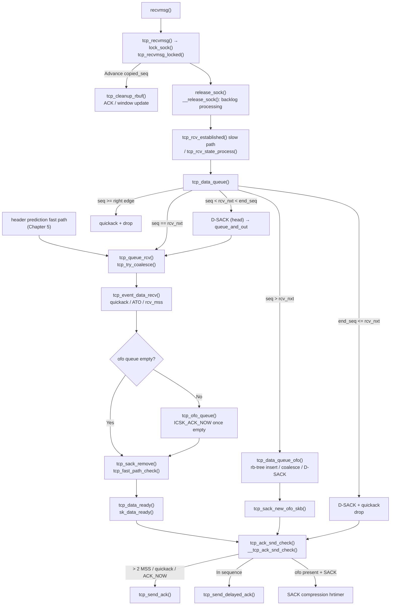

# 6. Receiving (2): queueing data and tcp_recvmsg

In Chapter 5, we saw how packets find their socket from `tcp_v4_rcv()` / `tcp_v6_rcv()` and proceed through either header prediction (the fast path) or the slow path in `tcp_rcv_established()`. This chapter picks up from there. We will walk line by line through `tcp_data_queue()`, which places the payload into either the **inbox (`sk_receive_queue`)** or the **holding shelf (`out_of_order_queue`)**; `__tcp_ack_snd_check()`, which decides whether to return a signed receipt (ACK) "right now, after waiting a bit, or batched together"; and `tcp_recvmsg()` / `tcp_cleanup_rbuf()`, where the application pulls data out via `recvmsg()`, opening up the window and triggering an ACK.

## The ELI5 version

Numbered parcels (`sk_buff`) arrive at the room's mailbox (socket). Each parcel has sequence numbers written on its shipping label (headers) indicating "from which byte to which byte of the overall stream" it contains.

- When a parcel arrives with the exact next sequence number you are waiting for, you put it straight into the **inbox**. If its contents can be merged with the preceding parcel, you combine them into a single box to save space.
- When a parcel arrives out of sequence with a gap in numbers, you arrange it in sequence order on the **holding shelf**. You then return a signed receipt (SACK) to the sender stating, "I have received up to this point, and separately I also hold this range."
- Once the missing parcel arrives, you move the parcels from the shelf into the inbox all at once, and return a signed receipt immediately.
- If a parcel arrives whose numbers you already hold, you discard the parcel and return a signed receipt (D-SACK) noting, "That arrived twice."
- Writing a signed receipt for every single parcel is tedious, so normally you write one "once every two parcels" or "wait a bit and batch them". However, if the sender seems to be in trouble (early on, when there is a gap, or when duplicates arrive), you write one immediately.
- When the resident (application) retrieves parcels from the inbox, room opens up in the household budget. Once the headroom increases significantly, you send a signed receipt announcing, "You may send more."
- Parcels that arrive while the resident is accessing the mailbox (holding the socket lock) are placed in a temporary holding area at the doorway (backlog), and processed all together when the resident closes the mailbox (`release_sock()`).

## What the RFCs say

### RFC 9293 — Core TCP (replacing RFC 793)

[RFC 9293](https://www.rfc-editor.org/rfc/rfc9293) is the current TCP specification, published in 2022 to consolidate and replace RFC 793 and the TCP portions of RFC 1122. On the receiving side, three parts are relevant to this chapter:

**Segment arrival processing ([RFC 9293 §3.10.7.4](https://www.rfc-editor.org/rfc/rfc9293#section-3.10.7.4))**

In synchronised states such as ESTABLISHED, arriving segments are processed in eight steps, from "first, check sequence number" to "eighth, check the FIN bit". The core topic of this chapter is the **seventh step: process the segment text**.

- As a prerequisite, the segment is treated as an "idealized segment" that begins at `RCV.NXT` and fits completely within the receive window. Any data lying outside the window is trimmed away, and processing only advances when the segment starts at `RCV.NXT`. Segments with a starting sequence number further ahead **SHOULD be held for later processing (SHLD-31)**. This provides the RFC foundation for the out-of-order queue.
- When the window is zero, no segments other than ACKs are accepted (though RST and URG are processed).
- Seventh step: in ESTABLISHED / FIN-WAIT-1 / FIN-WAIT-2, data is delivered to the user's receive buffer, `RCV.NXT` is advanced by the amount of data accepted, and `RCV.WND` is adjusted according to remaining buffer space. `RCV.NXT + RCV.WND` (the right edge of the window) MUST NOT shrink. An acknowledgement `<SEQ=SND.NXT><ACK=RCV.NXT><CTL=ACK>` is then returned. This ACK SHOULD be piggybacked on outgoing data so long as doing so does not introduce excessive delay.
- For unacceptable (duplicate or out-of-window) segments, an ACK is returned and the segment is dropped, provided it is not an RST (the rule in the first step).

**Delayed ACKs ([RFC 9293 §3.8.6.3](https://www.rfc-editor.org/rfc/rfc9293#section-3.8.6.3), originally [RFC 1122 §4.2.3.2](https://www.rfc-editor.org/rfc/rfc1122#section-4.2.3.2))**

- A TCP SHOULD implement delayed ACKs (SHLD-18), but the delay **MUST be less than 0.5 seconds** (MUST-40).
- In a stream of full-sized segments, **an ACK SHOULD be generated for at least every second segment (or 2*RMSS bytes)** (SHLD-19).
- On the congestion control side, [RFC 5681 §4.2](https://www.rfc-editor.org/rfc/rfc5681#section-4.2) further specifies that **an out-of-order segment SHOULD be acknowledged immediately**, and that **a segment that fills (part or all of) a gap in the sequence space SHOULD be acknowledged immediately**. These rules directly govern the sender's fast retransmit (3 duplicate ACKs) and recovery speed.

**Receiver SWS avoidance ([RFC 9293 §3.8.6.2.2](https://www.rfc-editor.org/rfc/rfc9293#section-3.8.6.2.2))**

The receiver MUST implement a Silly Window Syndrome avoidance algorithm (MUST-39). The recommended algorithm states that the receiver holds the right edge of the window `RCV.NXT + RCV.WND` fixed and does not advertise a larger window until:

```
RCV.BUFF - RCV.USER - RCV.WND >= min(Fr * RCV.BUFF, Eff.snd.MSS)    (Fr = 1/2 recommended)
```

In other words, "do not send tiny window updates until available space accumulates to at least an MSS or roughly half the buffer". In Linux, rounding the window value itself is handled by `__tcp_select_window()` (Chapter 10), whilst the **timing for sending window updates**—"send an ACK when reading data doubles the advertised window"—is implemented in `__tcp_cleanup_rbuf()` in this chapter.

### RFC 2018 — SACK (receiver rules)

[RFC 2018](https://www.rfc-editor.org/rfc/rfc2018) solves the problem where cumulative ACKs alone cannot tell the sender what arrived beyond a gap, by conveying non-contiguous received blocks using a TCP option. The receiver rules are detailed in [RFC 2018 §4](https://www.rfc-editor.org/rfc/rfc2018#section-4):

- If SACK is enabled, any ACK that does not acknowledge the highest sequence number in the receive queue (= there is a gap) SHOULD include the SACK option.
- **The first SACK block MUST specify the contiguous block of data containing the segment that triggered this ACK**, unless that segment advanced the cumulative ACK.
- Subsequent blocks SHOULD repeat previously reported blocks (the head blocks from earlier SACKs), unless they are subsets of blocks already included. This ensures that even if an ACK is lost, each block is reported multiple times.
- Because the maximum TCP option length is 40 bytes, at most 4 blocks fit, or 3 blocks when combined with Timestamps (10 bytes + 2 padding bytes).
- The receiver is permitted to discard previously SACKed data later (reneging). The sender treats SACKs purely as advisory hints. Linux does this via `tcp_prune_ofo_queue()` (Chapter 10).

### RFC 2883 — D-SACK

[RFC 2883](https://www.rfc-editor.org/rfc/rfc2883) extends SACK to enable reporting **duplicate received segments**. The sender uses this to determine that a retransmission was unnecessary (spurious), allowing it to undo congestion window reductions and adjust reordering tolerance (Chapter 8). The rules are laid out in [RFC 2883 §4](https://www.rfc-editor.org/rfc/rfc2883#section-4):

- A duplicate received block is placed in the **very first block** of the SACK option. This is the D-SACK block. It can report duplicates below the cumulative ACK (`< RCV.NXT`) as well as duplicates above it.
- If the D-SACK block reports a duplicate that is part of a larger received block above the cumulative ACK, the **second block SHOULD report that larger block**.
- Each contiguous duplicate range is **reported in at most one D-SACK block** (the duplicate is not repeated in subsequent ACKs).
- Any remaining blocks follow standard SACK rules.

## The big picture



The write side of the receive path (softirq, or backlog processing when releasing the socket lock) advances `rcv_nxt`, whilst the read side (process context) advances `copied_seq`. The difference `rcv_nxt - copied_seq` represents the "unread bytes buffered in the inbox". ACK decisions occur in two places: on the write side in `__tcp_ack_snd_check()`, and on the read side in `__tcp_cleanup_rbuf()`. The two sides coordinate via bit flags in `icsk->icsk_ack.pending`.

Note that pure in-order bulk receive hitting header prediction (Chapter 5) bypasses `tcp_data_queue()` entirely, directly invoking `tcp_queue_rcv()` → `tcp_event_data_recv()` → `__tcp_ack_snd_check(sk, 0)` from `tcp_rcv_established()` ([net/ipv4/tcp_input.c#L6520](https://git.kernel.org/pub/scm/linux/kernel/git/netdev/net-next.git/tree/net/ipv4/tcp_input.c?id=279d5c8afcd38bd841832a39bfe1aa4f8518d98e#n6520)). The building blocks examined in this chapter are used unchanged in the fast path as well.

## Walking through the code

### Step 1: Prerequisites — who calls this, and under which lock

There are two call sites for `tcp_data_queue()`:

- The `tcp_rcv_established()` slow path: called immediately after `tcp_validate_incoming()`, `tcp_ack()`, and `tcp_urg()`, following the comment `/* step 7: process the segment text */`, and followed in turn by `tcp_data_snd_check()` and `tcp_ack_snd_check()`. The sequence of code directly mirrors the 8-step procedure in RFC 9293.
- `tcp_rcv_state_process()`: when receiving data in states other than ESTABLISHED (such as a segment immediately after transitioning out of SYN-RECV, or during FIN-WAIT-1/2). If the local endpoint has already shut down the receive direction during FIN-WAIT, any incoming data prompts an RST (`TCPAbortOnData`). In CLOSE-WAIT / CLOSING / LAST-ACK, data past the remote peer's FIN is ignored.

In both cases, it is guaranteed that the **socket is not owned by user space**. In softirq, `tcp_v4_rcv()` acquires `bh_lock_sock_nested()`; if `sock_owned_by_user()` is false, it executes `tcp_v4_do_rcv()` on the spot. If true, it enqueues the skb onto the socket backlog via `tcp_add_backlog()`, and when the user later calls `release_sock()`, `__release_sock()` invokes `sk_backlog_rcv()` → `tcp_v4_do_rcv()` in process context (Step 15). Consequently, `tcp_data_queue()` runs either in "softirq + spinlock" or in "process context + owned=1 (spinlock released)", both of which guarantee **mutual exclusion on the socket**. The assertion `sock_owned_by_me()` in `tcp_rcv_nxt_update()` uses lockdep to verify this exact invariant.

On the other hand, because `rcv_nxt` and `copied_seq` are also inspected by lockless readers such as `tcp_poll()`, `tcp_inq_hint()`, and `tcp_diag`, writes to them use `WRITE_ONCE()`.

### Step 2: `tcp_data_queue()` — core demultiplexing

`tcp_data_queue()` ([net/ipv4/tcp_input.c#L5613](https://git.kernel.org/pub/scm/linux/kernel/git/netdev/net-next.git/tree/net/ipv4/tcp_input.c?id=279d5c8afcd38bd841832a39bfe1aa4f8518d98e#n5613)) classifies the payload position relative to `rcv_nxt` into five categories:

| Condition | Meaning | Action |
| --- | --- | --- |
| `seq == rcv_nxt` | In sequence | To receive queue (drop if window is 0, though bare FIN accepted) |
| `end_seq <= rcv_nxt` | Complete duplicate (retransmission) | D-SACK, quickack, drop |
| `seq >= rcv_nxt + rcv_window` | Outside right edge of window | quickack, drop |
| `seq < rcv_nxt < end_seq` | Duplicate head, new tail | D-SACK head, pass remainder to receive queue |
| Otherwise (`seq > rcv_nxt`) | Beyond the gap | `tcp_data_queue_ofo()` |

```c
static void tcp_data_queue(struct sock *sk, struct sk_buff *skb)
{
	struct tcp_sock *tp = tcp_sk(sk);
	enum skb_drop_reason reason;
	bool fragstolen;
	int eaten;

	/* If a subflow has been reset, the packet should not continue
	 * to be processed, drop the packet.
	 */
	if (sk_is_mptcp(sk) && !mptcp_incoming_options(sk, skb)) {
		__kfree_skb(skb);
		return;
	}

	if (TCP_SKB_CB(skb)->seq == TCP_SKB_CB(skb)->end_seq) {
		__kfree_skb(skb);
		return;
	}
	tcp_cleanup_skb(skb);
	__skb_pull(skb, tcp_hdr(skb)->doff * 4);

	reason = SKB_DROP_REASON_NOT_SPECIFIED;
	tp->rx_opt.dsack = 0;

	/*  Queue data for delivery to the user.
	 *  Packets in sequence go to the receive queue.
	 *  Out of sequence packets to the out_of_order_queue.
	 */
```

- `sk_is_mptcp()`: For an MPTCP subflow, options like DSS are processed in `mptcp_incoming_options()`, and if the subflow has been reset, the packet is discarded. For plain TCP, `sk_is_mptcp()` simply inspects a single bit.
- `seq == end_seq`: Since `end_seq` is computed as `seq + payload_len + SYN + FIN` (`tcp_v4_fill_cb()`), the only segments weeded out here are **pure ACKs carrying neither data nor FIN**. Pure ACKs have already been processed in `tcp_ack()`, so here they are simply freed. Note that `__kfree_skb()` is used rather than counting it as a drop (no drop reason attached), as this is an entirely normal path.
- `tcp_cleanup_skb()`: Calls `skb_dst_drop()` and `secpath_reset()`. This ensures that skbs potentially sitting in the receive queue for a prolonged period do not hold onto destination route references or xfrm secpath states, an invariant checked by `DEBUG_NET_WARN_ON_ONCE(skb_dst(skb))` in `tcp_add_receive_queue()`.
- `__skb_pull(skb, doff * 4)`: Strips the TCP header. From this point onwards, `skb->len` reflects the **payload length**. This simplifies subsequent offset calculations (`copied_seq - TCP_SKB_CB(skb)->seq`).
- `tp->rx_opt.dsack = 0`: Because **a D-SACK is only to be carried on the ACK answering this specific segment**, it is reset on every segment. This adheres to RFC 2883's requirement that "each duplicate range is reported in at most one D-SACK block". On transmission, `tcp_options_write()` likewise clears `rx_opt.dsack = 0` after writing out the D-SACK option.

```c
	if (TCP_SKB_CB(skb)->seq == tp->rcv_nxt) {
		if (tcp_receive_window(tp) == 0) {
			/* Some stacks are known to send bare FIN packets
			 * in a loop even if we send RWIN 0 in our ACK.
			 * Accepting this FIN does not hurt memory pressure
			 * because the FIN flag will simply be merged to the
			 * receive queue tail skb in most cases.
			 */
			if (!skb->len &&
			    (TCP_SKB_CB(skb)->tcp_flags & TCPHDR_FIN))
				goto queue_and_out;

			reason = SKB_DROP_REASON_TCP_ZEROWINDOW;
			NET_INC_STATS(sock_net(sk), LINUX_MIB_TCPZEROWINDOWDROP);
			goto out_of_window;
		}

		/* Ok. In sequence. In window. */
queue_and_out:
		if (tcp_try_rmem_schedule(sk, skb, skb->truesize)) {
			/* TODO: maybe ratelimit these WIN 0 ACK ? */
			inet_csk(sk)->icsk_ack.pending |=
					(ICSK_ACK_NOMEM | ICSK_ACK_NOW);
			inet_csk_schedule_ack(sk);
			READ_ONCE(sk->sk_data_ready)(sk);

			if (skb_queue_len(&sk->sk_receive_queue) && skb->len) {
				reason = SKB_DROP_REASON_PROTO_MEM;
				NET_INC_STATS(sock_net(sk), LINUX_MIB_TCPRCVQDROP);
				goto drop;
			}
			sk_forced_mem_schedule(sk, skb->truesize);
		}
```

- Even when `seq == rcv_nxt`, if `tcp_receive_window(tp) == 0` ([include/net/tcp.h#L956](https://git.kernel.org/pub/scm/linux/kernel/git/netdev/net-next.git/tree/include/net/tcp.h?id=279d5c8afcd38bd841832a39bfe1aa4f8518d98e#n956)), the segment is rejected. `tcp_receive_window()` calculates `rcv_wup + rcv_wnd - rcv_nxt`, which represents the **remaining space in the last advertised window** (or 0 if negative). This implements the RFC 9293 rule that "no segments other than ACKs are accepted when the window is zero". Dropping it increments `TCPZeroWindowDrop` and branches to `out_of_window` to trigger quickack, promptly sending back an ACK advertising a zero window to the peer (which also serves as the reply to zero window probes).
- The exception is a **bare FIN with no payload**. This accommodates an issue where certain stacks (such as older macOS versions) persistently retransmit FIN packets in a loop without exponential backoff even after receiving an ACK advertising RWIN 0, leading to a storm of FINs and dup ACKs (see Design history). A bare FIN rarely worsens memory pressure because its flag is typically coalesced into the tail skb of the receive queue without allocating additional skb memory.
- Under `queue_and_out:`, the segment is in sequence and in window. `tcp_try_rmem_schedule()` checks both the socket receive buffer limit `sk_rmem_alloc <= sk_rcvbuf` (`tcp_can_ingest()`) and the protocol-wide / memcg budget allocations (`sk_rmem_schedule()`); if resources are insufficient, it attempts to reclaim memory via `tcp_prune_queue()` / `tcp_prune_ofo_queue()` (covered in Chapter 10).
- If allocation still fails:
  - It sets `ICSK_ACK_NOMEM | ICSK_ACK_NOW`. `ICSK_ACK_NOMEM` is read by `tcp_select_window()` to **collapse the advertised window to 0 on the next ACK** (`rcv_wnd = 0`, `rcv_wup = rcv_nxt`). `ICSK_ACK_NOW` causes `__tcp_ack_snd_check()` to transmit an immediate ACK.
  - It calls `sk_data_ready()` directly to wake up the reader to drain the receive queue and free memory. Going through `tcp_data_ready()` would avoid waking readers until `SO_RCVLOWAT` is satisfied, which could result in a hang where an under-memory-pressure socket and an `SO_RCVLOWAT` reader deadlock waiting on each other (ba3bb0e76ccd).
  - If the receive queue is non-empty and the skb carries payload data, the skb is dropped (`TCPRcvQDrop`).
  - Conversely, **if the receive queue is empty**, `sk_forced_mem_schedule()` forcibly allocates budget to accept the packet. Dropping packets when the receive queue is empty would prevent the reader from reading anything, permanently blocking memory reclamation in a deadlock; this provides a forward-progress guarantee that "at least one skb per socket is always accepted". Bare FINs (`skb->len == 0`) are likewise always accepted.

```c
		eaten = tcp_queue_rcv(sk, skb, &fragstolen);
		if (skb->len)
			tcp_event_data_recv(sk, skb);
		if (TCP_SKB_CB(skb)->tcp_flags & TCPHDR_FIN)
			tcp_fin(sk);

		if (!RB_EMPTY_ROOT(&tp->out_of_order_queue)) {
			tcp_ofo_queue(sk);

			/* RFC5681. 4.2. SHOULD send immediate ACK, when
			 * gap in queue is filled.
			 */
			if (RB_EMPTY_ROOT(&tp->out_of_order_queue))
				inet_csk(sk)->icsk_ack.pending |= ICSK_ACK_NOW;
		}

		if (tp->rx_opt.num_sacks)
			tcp_sack_remove(tp);

		tcp_fast_path_check(sk);

		if (eaten > 0)
			kfree_skb_partial(skb, fragstolen);
		if (!sock_flag(sk, SOCK_DEAD))
			tcp_data_ready(sk);
		return;
	}
```

- `tcp_queue_rcv()`: Attempts to coalesce the segment with the tail of the receive queue and advances `rcv_nxt` (Step 3). The return value `eaten` indicates that the skb's data was absorbed into the tail skb, allowing the current skb structure itself to be freed.
- `if (skb->len) tcp_event_data_recv()`: The delayed ACK engine state is updated (Step 4) **only when payload data is present**. Bare FINs do not perturb ATO or rcv_mss estimations.
- `tcp_fin()`: Handles FIN processing (state transitions, `RCV_SHUTDOWN`, `SOCK_DONE`, purging the out-of-order queue, etc.; detailed in Chapter 2). Because `tcp_fin()` flushes the out-of-order queue, subsequent out-of-order handling is effectively skipped.
- If the out-of-order queue is not empty, `tcp_ofo_queue()` moves any skbs that can now be linked to the newly advanced `rcv_nxt` into the receive queue (Step 5). If **the out-of-order queue becomes completely empty as a result, `ICSK_ACK_NOW` is set**. This satisfies RFC 5681 §4.2 ("send immediate ACK when gap in queue is filled"). If the gap is only partially filled (skbs still remain on the holding shelf), the out-of-order queue remains non-empty, directing `__tcp_ack_snd_check()` into the SACK ACK (or SACK compression) branch.
- `tcp_sack_remove()`: Because `rcv_nxt` has moved forward, any SACK blocks that now fall at or below `rcv_nxt` are purged (Step 8).
- `tcp_fast_path_check()` ([include/net/tcp.h#L2007](https://git.kernel.org/pub/scm/linux/kernel/git/netdev/net-next.git/tree/include/net/tcp.h?id=279d5c8afcd38bd841832a39bfe1aa4f8518d98e#n2007)): When the out-of-order queue is empty, `rcv_wnd != 0`, `sk_rmem_alloc < sk_rcvbuf`, and there is no urgent data, this restores `pred_flags` to re-enable header prediction. `tcp_data_queue_ofo()` disables the fast path by setting `pred_flags = 0`, so it is restored here once the gap is resolved.
- `kfree_skb_partial(skb, fragstolen)`: Freeing a coalesced skb is deferred until the very **end**. Because `tcp_event_data_recv()` references `skb->len` and `skb->truesize`, the skb cannot be freed earlier. If `fragstolen` is true, the skb head (page frag) was transferred to the tail skb, so only the `struct sk_buff` container itself is released.
- Unless `SOCK_DEAD` is set, `tcp_data_ready()` wakes up sleeping readers (Step 11). Orphan sockets have no reader to awaken.

```c
	if (!after(TCP_SKB_CB(skb)->end_seq, tp->rcv_nxt)) {
		tcp_rcv_spurious_retrans(sk, skb);
		/* A retransmit, 2nd most common case.  Force an immediate ack. */
		reason = SKB_DROP_REASON_TCP_OLD_DATA;
		NET_INC_STATS(sock_net(sk), LINUX_MIB_DELAYEDACKLOST);
		tcp_dsack_set(sk, TCP_SKB_CB(skb)->seq, TCP_SKB_CB(skb)->end_seq);

out_of_window:
		tcp_enter_quickack_mode(sk, TCP_MAX_QUICKACKS);
		inet_csk_schedule_ack(sk);
drop:
		tcp_drop_reason(sk, skb, reason);
		return;
	}
```

- **Complete duplicate**: When `end_seq <= rcv_nxt`, every byte in the segment has already been received. As the comment notes, this is the "2nd most common case", typically occurring when our ACK was lost or delayed and the peer retransmitted via RTO or TLP. Note that stale duplicates with `end_seq < rcv_wup` (prior to the left edge of the last advertised window) do not reach here; they are caught earlier by `tcp_sequence()` in `tcp_validate_incoming()` and handled via `tcp_send_dupack()` (Step 6). The packets arriving here satisfy `rcv_wup <= end_seq <= rcv_nxt`.
- `tcp_rcv_spurious_retrans()` ([net/ipv4/tcp_input.c#L5043](https://git.kernel.org/pub/scm/linux/kernel/git/netdev/net-next.git/tree/net/ipv4/tcp_input.c?id=279d5c8afcd38bd841832a39bfe1aa4f8518d98e#n5043)): In IPv6, if the retransmitted segment arrives with a different IPv6 flow label than before (indicating the sender re-routed upon RTO), the kernel infers that **our return ACK path is impaired** and calls `__sk_rethink_txhash_reset_dst()` to rehash our local txhash (= outgoing flow label), steering ACKs onto a different network path (`TCPDuplicateDataRehash`). AccECN failure detection is also performed here.
- `LINUX_MIB_DELAYEDACKLOST` (nstat metric `TcpExtDelayedACKLost`): Named for the common scenario where "a (delayed) ACK was lost, causing the sender to retransmit".
- `tcp_dsack_set(seq, end_seq)`: Constructs a D-SACK covering the duplicate sequence range (Step 6).
- At `out_of_window:`, `tcp_enter_quickack_mode(sk, TCP_MAX_QUICKACKS)` schedules up to 16 quick ACKs, exits ping-pong (interactive) mode, and resets `ato` to its minimum. Since the peer is actively retransmitting, there is no rationale for delaying ACKs. This follows the first step rule in RFC 9293: "send an ACK for unacceptable segments".
- `tcp_drop_reason()` ([net/ipv4/tcp_input.c#L5303](https://git.kernel.org/pub/scm/linux/kernel/git/netdev/net-next.git/tree/net/ipv4/tcp_input.c?id=279d5c8afcd38bd841832a39bfe1aa4f8518d98e#n5303)) increments the socket drop counter via `sk_drops_skbadd()` (`d` in `ss -m`) and records the drop reason to the `kfree_skb` tracepoint via `sk_skb_reason_drop()`. Being marked `noinline_for_tracing`, it can also be hooked cleanly with kprobe/fentry.

```c
	/* Out of window. F.e. zero window probe. */
	if (!before(TCP_SKB_CB(skb)->seq,
		    tp->rcv_nxt + tcp_receive_window(tp))) {
		reason = SKB_DROP_REASON_TCP_OVERWINDOW;
		NET_INC_STATS(sock_net(sk), LINUX_MIB_BEYOND_WINDOW);
		goto out_of_window;
	}

	if (before(TCP_SKB_CB(skb)->seq, tp->rcv_nxt)) {
		/* Partial packet, seq < rcv_next < end_seq */
		tcp_dsack_set(sk, TCP_SKB_CB(skb)->seq, tp->rcv_nxt);

		/* If window is closed, drop tail of packet. But after
		 * remembering D-SACK for its head made in previous line.
		 */
		if (!tcp_receive_window(tp)) {
			reason = SKB_DROP_REASON_TCP_ZEROWINDOW;
			NET_INC_STATS(sock_net(sk), LINUX_MIB_TCPZEROWINDOWDROP);
			goto out_of_window;
		}
		goto queue_and_out;
	}

	tcp_data_queue_ofo(sk, skb);
}
```

- **Outside right edge of window**: `seq >= rcv_nxt + tcp_receive_window()` flags segments starting beyond the advertised window. While `tcp_sequence()` (Chapter 5) performs a coarse window check, this check strictly weeds out segments that start past `rcv_nxt` beyond the remaining window. It increments `TcpExtBeyondWindow` and returns an immediate ACK via quickack.
- **Partial overlap**: `seq < rcv_nxt < end_seq`. The duplicate head `[seq, rcv_nxt)` is recorded as a D-SACK, and provided the window is non-zero, processing branches to `queue_and_out` to place the segment in the receive queue. The skb is enqueued **without trimming its head**. Because `seq != tail->end_seq`, `tcp_try_coalesce()` will fail and it enters as an independent skb. `tcp_rcv_nxt_update(end_seq)` counts `bytes_received` using sequence deltas so duplicate bytes are not miscounted, and `tcp_recvmsg_locked()` skips the duplicate prefix using `offset = copied_seq - seq`. This design intentionally avoids the overhead of copying or trimming memory buffers.
- All remaining segments have `seq > rcv_nxt`, lying **beyond the gap**, and are directed to `tcp_data_queue_ofo()` (Step 7).

### Step 3: `tcp_queue_rcv()` and `tcp_try_coalesce()` — queueing to receive queue and coalescing

`tcp_queue_rcv()` ([net/ipv4/tcp_input.c#L5538](https://git.kernel.org/pub/scm/linux/kernel/git/netdev/net-next.git/tree/net/ipv4/tcp_input.c?id=279d5c8afcd38bd841832a39bfe1aa4f8518d98e#n5538)):

```c
static int __must_check tcp_queue_rcv(struct sock *sk, struct sk_buff *skb,
				      bool *fragstolen)
{
	int eaten;
	struct sk_buff *tail = skb_peek_tail(&sk->sk_receive_queue);

	eaten = (tail &&
		 tcp_try_coalesce(sk, tail,
				  skb, fragstolen)) ? 1 : 0;
	tcp_rcv_nxt_update(tcp_sk(sk), TCP_SKB_CB(skb)->end_seq);
	if (!eaten) {
		tcp_add_receive_queue(sk, skb);
		skb_set_owner_r(skb, sk);
	}
	return eaten;
}
```

- If coalescing with the tail skb succeeds, `eaten = 1`; if not, `tcp_add_receive_queue()` (a wrapper around `__skb_queue_tail()`) links it to the tail, and `skb_set_owner_r()` configures `skb->destructor = sock_rfree`, adding `sk_rmem_alloc += truesize` and deducting `sk_forward_alloc -= truesize`.
- `tcp_rcv_nxt_update()` is called regardless of whether coalescing succeeds. This is because **the instant `rcv_nxt` advances, those bytes are deemed accepted**. The `__must_check` attribute ensures callers do not overlook `eaten` and leak the skb.
- `__skb_queue_tail()` (the lockless version) can be used because all additions and deletions on `sk_receive_queue` take place strictly under the socket lock (`owned` or `bh_lock`). TCP essentially never touches `sk_receive_queue.lock`.

`tcp_rcv_nxt_update()` ([net/ipv4/tcp_input.c#L3936](https://git.kernel.org/pub/scm/linux/kernel/git/netdev/net-next.git/tree/net/ipv4/tcp_input.c?id=279d5c8afcd38bd841832a39bfe1aa4f8518d98e#n3936)):

```c
/* If we update tp->rcv_nxt, also update tp->bytes_received */
static void tcp_rcv_nxt_update(struct tcp_sock *tp, u32 seq)
{
	u32 delta = seq - tp->rcv_nxt;

	sock_owned_by_me((struct sock *)tp);
	tp->bytes_received += delta;
	tcp_rcv_sne_update(tp, seq);
	WRITE_ONCE(tp->rcv_nxt, seq);
}
```

- `bytes_received` (`tcpEStatsAppHCThruOctetsReceived` from RFC 4898, exposed as `tcpi_bytes_received`) tracks the sequence advance delta of `rcv_nxt`. This is why duplicate bytes are never counted.
- `tcp_rcv_sne_update()` updates the TCP-AO Sequence Number Extension (the wraparound counter for 32-bit sequence numbers).
- `WRITE_ONCE(tp->rcv_nxt, seq)` pairs with lockless readers like `tcp_poll()`, `tcp_epollin_ready()`, and `tcp_inq_hint()`.

`tcp_try_coalesce()` ([net/ipv4/tcp_input.c#L5250](https://git.kernel.org/pub/scm/linux/kernel/git/netdev/net-next.git/tree/net/ipv4/tcp_input.c?id=279d5c8afcd38bd841832a39bfe1aa4f8518d98e#n5250)):

```c
static bool tcp_try_coalesce(struct sock *sk,
			     struct sk_buff *to,
			     struct sk_buff *from,
			     bool *fragstolen)
{
	int delta;

	*fragstolen = false;

	/* Its possible this segment overlaps with prior segment in queue */
	if (TCP_SKB_CB(from)->seq != TCP_SKB_CB(to)->end_seq)
		return false;

	if (!tcp_skb_can_collapse_rx(to, from))
		return false;

	if (!skb_try_coalesce(to, from, fragstolen, &delta))
		return false;

	atomic_add(delta, &sk->sk_rmem_alloc);
	sk_mem_charge(sk, delta);
	NET_INC_STATS(sock_net(sk), LINUX_MIB_TCPRCVCOALESCE);
	TCP_SKB_CB(to)->end_seq = TCP_SKB_CB(from)->end_seq;
	TCP_SKB_CB(to)->ack_seq = TCP_SKB_CB(from)->ack_seq;
	TCP_SKB_CB(to)->tcp_flags |= TCP_SKB_CB(from)->tcp_flags;

	if (TCP_SKB_CB(from)->has_rxtstamp) {
		TCP_SKB_CB(to)->has_rxtstamp = true;
		to->tstamp = from->tstamp;
		skb_hwtstamps(to)->hwtstamp = skb_hwtstamps(from)->hwtstamp;
	}

	return true;
}
```

- Coalescing is rejected if `seq != to->end_seq`. Partially overlapping skbs (Step 2) and non-contiguous skbs from the out-of-order queue are filtered out here.
- `tcp_skb_can_collapse_rx()`: Verifies that MPTCP mappings are continuous and that decryption status (`skb_cmp_decrypted()`) matches for kTLS / PSP. Mixing decrypted and unencrypted bytes into a single skb would prevent upper layers from distinguishing them.
- `skb_try_coalesce()` (`net/core/skbuff.c`) performs the actual merge. Small amounts of data fitting in the tailroom of `to` are copied (`delta = 0`); otherwise, page frags from `from` are appended to `to`'s `frags[]`. If `from` has a linear head whose page frag is not locked, the head itself is "stolen" as a frag (`*fragstolen = true`). `delta` represents the truesize transferred from `from` to `to`. Coalescing is disallowed if `to` is cloned, if page_pool origins differ, if `skb_frags_readable()` (devmem / unreadable netmem) differs, if frag_list is present, if zerocopy is active (`skb_zcopy()`), or if `MAX_SKB_FRAGS` would be exceeded.
- Upon successful coalescing, the truesize `delta` shifts to `to`, so `sk_rmem_alloc += delta` and `sk_mem_charge()` are accounted against `to`'s owning socket. Because `skb_try_coalesce()` reduces `from->truesize` by that exact same delta, even if `from` had already undergone `skb_set_owner_r()` (when called from `tcp_ofo_queue()`), subsequent invocation of `kfree_skb_partial()` → `sock_rfree()` will deduct only the remaining truesize, keeping the accounting perfectly balanced.
- `end_seq`, `ack_seq`, and `tcp_flags` (such as FIN and PSH) are inherited. Because FIN is combined via bitwise OR, a bare FIN gets absorbed into the tail skb, allowing `tcp_recvmsg_locked()` to detect EOF simply by checking `TCPHDR_FIN` on the tail skb.
- Receive timestamps (RX timestamps for `SO_TIMESTAMPING`) are overwritten with those of the later skb. Timestamps returned by `recvmsg()` therefore correspond to the skb holding the last byte read.

The purpose of this coalescing is to improve the `truesize/len` ratio, cutting down on memory accounting waste and reducing the frequency of invoking the expensive `tcp_collapse()` helper (Chapter 10) later on. This is especially effective on paths where GRO does not take effect (e.g. per-packet load balancing or virtual NICs with small buffer allocations).

### Step 4: `tcp_event_data_recv()` — the heart of the delayed ACK engine

`tcp_event_data_recv()` ([net/ipv4/tcp_input.c#L1015](https://git.kernel.org/pub/scm/linux/kernel/git/netdev/net-next.git/tree/net/ipv4/tcp_input.c?id=279d5c8afcd38bd841832a39bfe1aa4f8518d98e#n1015)) is called whenever in-order data is received, learning "by how much the next signed receipt (ACK) may be delayed". All relevant state resides in `icsk_ack` ([include/net/inet_connection_sock.h#L113](https://git.kernel.org/pub/scm/linux/kernel/git/netdev/net-next.git/tree/include/net/inet_connection_sock.h?id=279d5c8afcd38bd841832a39bfe1aa4f8518d98e#n113)) within `inet_connection_sock`.

| Field | Meaning |
| --- | --- |
| `pending` | `ICSK_ACK_SCHED` (there is data to ACK), `ICSK_ACK_TIMER` (delayed ACK timer is running), `ICSK_ACK_PUSHED` / `PUSHED2` (saw a small / PSH-flagged segment), `ICSK_ACK_NOW` (next ACK must be immediate), `ICSK_ACK_NOMEM` (next ACK advertises window 0) |
| `quick` | Remaining number of quick ACKs (immediate ACKs) |
| `pingpong` | Degree to which the connection is determined to be interactive (sending data back as well) |
| `ato` | ACK timeout; duration of the delayed ACK timer (in jiffies) |
| `lrcvtime` | Timestamp when data was last received (in jiffies) |
| `last_seg_size` / `rcv_mss` | Estimate of the peer's MSS (used for delayed ACK decisions) |

```c
static void tcp_event_data_recv(struct sock *sk, struct sk_buff *skb)
{
	struct tcp_sock *tp = tcp_sk(sk);
	struct inet_connection_sock *icsk = inet_csk(sk);
	u32 now;

	inet_csk_schedule_ack(sk);

	tcp_measure_rcv_mss(sk, skb);

	tcp_rcv_rtt_measure(tp);

	now = tcp_jiffies32;

	if (!icsk->icsk_ack.ato) {
		/* The _first_ data packet received, initialize
		 * delayed ACK engine.
		 */
		tcp_incr_quickack(sk, TCP_MAX_QUICKACKS);
		icsk->icsk_ack.ato = TCP_ATO_MIN;
	} else {
```

- `inet_csk_schedule_ack()`: Sets `pending |= ICSK_ACK_SCHED`. A marker indicating that "there is new data that needs an ACK". When a segment carrying an ACK is sent (whether with data or as a pure ACK), `tcp_event_ack_sent()` → `inet_csk_clear_xmit_timer(sk, ICSK_TIME_DACK)` resets all of `pending` back to 0, so if the ACK can be piggybacked onto outgoing data, it will not be sent on its own.
- `tcp_measure_rcv_mss()`: Estimates the peer's effective MSS and inspects the PSH flag (described below).
- `tcp_rcv_rtt_measure()`: Receiver-side RTT estimation when Timestamps are absent. It treats "the time taken to receive one full window (`rcv_nxt + rcv_wnd`)" as the RTT. It is used for receive buffer autotuning (DRS) and SACK compression delay calculations ([Chapter 10](10-window-memory.md)).
- `now = tcp_jiffies32`: A coarse-grained clock in jiffies is sufficient for ATO estimation.
- `ato == 0` represents "the very first data on this connection". It reserves quick ACKs via `tcp_incr_quickack()` and sets `ato = TCP_ATO_MIN` (`HZ/25` = 40 ms). As DaveM's comment notes, the sender is in slow start and cannot expand its cwnd until ACKs arrive, so we ACK immediately at the start.

```c
		int m = now - icsk->icsk_ack.lrcvtime;

		if (m <= TCP_ATO_MIN / 2) {
			/* The fastest case is the first. */
			icsk->icsk_ack.ato = (icsk->icsk_ack.ato >> 1) + TCP_ATO_MIN / 2;
		} else if (m < icsk->icsk_ack.ato) {
			icsk->icsk_ack.ato = min3((icsk->icsk_ack.ato >> 1) + (u32)m,
						  icsk->icsk_rto,
						  (u32)TCP_DELACK_MAX);
		} else if (m > icsk->icsk_rto) {
			/* Too long gap. Apparently sender failed to
			 * restart window, so that we send ACKs quickly.
			 */
			tcp_incr_quickack(sk, TCP_MAX_QUICKACKS);
		}
	}
	icsk->icsk_ack.lrcvtime = now;
	tcp_save_lrcv_flowlabel(sk, skb);

	tcp_data_ecn_check(sk, skb);

	if (skb->len >= 128)
		tcp_grow_window(sk, skb, true);
}
```

`m` is the interval since the previous data packet arrived. ATO is an exponentially smoothed estimate of the "inter-packet arrival interval".

- `m <= TCP_ATO_MIN / 2` (20 ms or less): `ato = ato/2 + ATO_MIN/2`. Repeating this converges `ato` towards `TCP_ATO_MIN`. During bulk transfers, packets arrive closely spaced, so `ato` stays pinned at its minimum.
- `m < ato`: `ato = min(ato/2 + m, rto, TCP_DELACK_MAX)`. It tracks the inter-arrival interval whilst ensuring it never exceeds either the RTO or 200 ms (`TCP_DELACK_MAX` = `HZ/5`). This upper bound is stricter than the RFC requirement of "less than 0.5 seconds".
- `m > rto`: The sender has been silent for longer than an RTO; in other words, the sender's window has likely collapsed due to a cwnd restart after idle (RFC 5681 §4.1 / RFC 7661), so we switch back to quick ACKs.
- `ato <= m <= rto`: Does nothing.
- `tcp_save_lrcv_flowlabel()`: Records the IPv6 flow label (used for comparison by `tcp_rcv_spurious_retrans()` in Step 2).
- `tcp_data_ecn_check()`: Inspects the ECN bits in the IP header, invoking `tcp_enter_quickack_mode(sk, 2)` if CE is encountered, ensuring congestion notifications are not delayed ([Chapter 14](14-ecn-dctcp.md)).
- If `skb->len >= 128`, `tcp_grow_window()` expands `rcv_ssthresh` ([Chapter 10](10-window-memory.md)). Tiny segments are not expanded because their payload-to-truesize ratio is poor.

Quick ACK helper functions ([net/ipv4/tcp_input.c#L311](https://git.kernel.org/pub/scm/linux/kernel/git/netdev/net-next.git/tree/net/ipv4/tcp_input.c?id=279d5c8afcd38bd841832a39bfe1aa4f8518d98e#n311)):

```c
static void tcp_incr_quickack(struct sock *sk, unsigned int max_quickacks)
{
	struct inet_connection_sock *icsk = inet_csk(sk);
	unsigned int quickacks = tcp_sk(sk)->rcv_wnd / (2 * icsk->icsk_ack.rcv_mss);

	if (quickacks == 0)
		quickacks = 2;
	quickacks = min(quickacks, max_quickacks);
	if (quickacks > icsk->icsk_ack.quick)
		icsk->icsk_ack.quick = quickacks;
}

static void tcp_enter_quickack_mode(struct sock *sk, unsigned int max_quickacks)
{
	struct inet_connection_sock *icsk = inet_csk(sk);

	tcp_incr_quickack(sk, max_quickacks);
	inet_csk_exit_pingpong_mode(sk);
	icsk->icsk_ack.ato = TCP_ATO_MIN;
}

/* Send ACKs quickly, if "quick" count is not exhausted
 * and the session is not interactive.
 */

static bool tcp_in_quickack_mode(struct sock *sk)
{
	const struct inet_connection_sock *icsk = inet_csk(sk);

	return icsk->icsk_ack.dst_quick_ack ||
		(icsk->icsk_ack.quick && !inet_csk_in_pingpong_mode(sk));
}
```

- `tcp_incr_quickack()`: The reserved quota is `rcv_wnd / (2 * rcv_mss)`, in other words **"the number of ACKs required when acknowledging one out of every two segments spanning the receive window"**. This means ACKs are sent immediately until the sender exhausts the window during slow start. If this computes to 0, it falls back to 2; the upper limit is `max_quickacks` (normally `TCP_MAX_QUICKACKS` = 16, or 2 for ECN). It only raises `quick` if the computed count exceeds the existing one.
- `tcp_enter_quickack_mode()`: Additionally exits pingpong mode and resets `ato` to its minimum. This is the "full-throttle ACK mode" used upon detecting retransmissions or anomalies.
- `tcp_in_quickack_mode()`: Always true if `dst_quick_ack` is set from the route's cached `RTAX_QUICKACK` (`ip route ... quickack 1`). Otherwise, it is true when "`quick` remains and the connection is not in pingpong mode". The reason **interactive sessions avoid quick ACKs** is that there is a high likelihood of piggybacking the ACK onto response data. `quick` is decremented by 1 each time new data is acknowledged via `tcp_event_ack_sent()` → `tcp_dec_quickack_mode()`; once it reaches 0, `ato` is also reset back to `TCP_ATO_MIN`.

`tcp_measure_rcv_mss()` ([net/ipv4/tcp_input.c#L227](https://git.kernel.org/pub/scm/linux/kernel/git/netdev/net-next.git/tree/net/ipv4/tcp_input.c?id=279d5c8afcd38bd841832a39bfe1aa4f8518d98e#n227)) estimates `icsk_ack.rcv_mss`, which serves as the benchmark for "two full-sized segments".

```c
static void tcp_measure_rcv_mss(struct sock *sk, const struct sk_buff *skb)
{
	struct inet_connection_sock *icsk = inet_csk(sk);
	const unsigned int lss = icsk->icsk_ack.last_seg_size;
	unsigned int len;

	icsk->icsk_ack.last_seg_size = 0;

	/* skb->len may jitter because of SACKs, even if peer
	 * sends good full-sized frames.
	 */
	len = skb_shinfo(skb)->gso_size ? : skb->len;
	if (len >= icsk->icsk_ack.rcv_mss) {
		/* Note: divides are still a bit expensive.
		 * For the moment, only adjust scaling_ratio
		 * when we update icsk_ack.rcv_mss.
		 */
		if (unlikely(len != icsk->icsk_ack.rcv_mss)) {
			u64 val = (u64)skb->len << TCP_RMEM_TO_WIN_SCALE;
			u8 old_ratio = tcp_sk(sk)->scaling_ratio;

			do_div(val, skb->truesize);
			tcp_sk(sk)->scaling_ratio = val ? val : 1;

			if (old_ratio != tcp_sk(sk)->scaling_ratio) {
				struct tcp_sock *tp = tcp_sk(sk);

				val = tcp_win_from_space(sk, sk->sk_rcvbuf);
				WRITE_ONCE(tp->window_clamp, val);

				if (tp->window_clamp < tp->rcvq_space.space)
					tp->rcvq_space.space = tp->window_clamp;
			}
		}
		icsk->icsk_ack.rcv_mss = min_t(unsigned int, len,
					       tcp_sk(sk)->advmss);
		/* Account for possibly-removed options */
		DO_ONCE_LITE_IF(len > icsk->icsk_ack.rcv_mss + MAX_TCP_OPTION_SPACE,
				tcp_gro_dev_warn, sk, skb, len);
		/* If the skb has a len of exactly 1*MSS and has the PSH bit
		 * set then it is likely the end of an application write. So
		 * more data may not be arriving soon, and yet the data sender
```

- `len = gso_size ?: skb->len`: For an skb aggregated by GRO, `gso_size` contains the original segment length. Using `skb->len` would overestimate the MSS by tens of times.
- `len >= rcv_mss`: If a segment equal to or larger than the estimate arrives, `rcv_mss = min(len, advmss)` updates the value. In principle, it should never exceed `advmss` (our advertised MSS).
- Only when the size changes does it recalculate `scaling_ratio = len * 256 / truesize` (fixed-point arithmetic with `TCP_RMEM_TO_WIN_SCALE` = 8) and recompute `window_clamp`. Because division is expensive, this is not done on every packet. `scaling_ratio` represents "how many bytes of payload fit per byte of buffer space" and is used to translate between `sk_rcvbuf` and window sizes ([Chapter 10](10-window-memory.md)).
- `DO_ONCE_LITE_IF(...)`: Any length exceeding `rcv_mss + 40` indicates a driver GRO bug failing to set `gso_size`, triggering a one-time warning.
- If PSH is set and `len >= rcv_mss`, it sets `ICSK_ACK_PUSHED`. Exactly "1 MSS + PSH" is very likely the end of an application write, where the sender might be waiting for an ACK due to cwnd limits or awaiting TX zero-copy completion. With this bit set, `tcp_cleanup_rbuf()` immediately sends an ACK as soon as the application reads all available data (Neal Cardwell's commit `4720852ed9af`).

```c
		 * may be waiting for an ACK if cwnd-bound or using TX zero
		 * copy. So we set ICSK_ACK_PUSHED here so that
		 * tcp_cleanup_rbuf() will send an ACK immediately if the app
		 * reads all of the data and is not ping-pong. If len > MSS
		 * then this logic does not matter (and does not hurt) because
		 * tcp_cleanup_rbuf() will always ACK immediately if the app
		 * reads data and there is more than an MSS of unACKed data.
		 */
		if (TCP_SKB_CB(skb)->tcp_flags & TCPHDR_PSH)
			icsk->icsk_ack.pending |= ICSK_ACK_PUSHED;
	} else {
		/* Otherwise, we make more careful check taking into account,
		 * that SACKs block is variable.
		 *
		 * "len" is invariant segment length, including TCP header.
		 */
		len += skb->data - skb_transport_header(skb);
		if (len >= TCP_MSS_DEFAULT + sizeof(struct tcphdr) ||
		    /* If PSH is not set, packet should be
		     * full sized, provided peer TCP is not badly broken.
		     * This observation (if it is correct 8)) allows
		     * to handle super-low mtu links fairly.
		     */
		    (len >= TCP_MIN_MSS + sizeof(struct tcphdr) &&
		     !(tcp_flag_word(tcp_hdr(skb)) & TCP_REMNANT))) {
			/* Subtract also invariant (if peer is RFC compliant),
			 * tcp header plus fixed timestamp option length.
			 * Resulting "len" is MSS free of SACK jitter.
			 */
			len -= tcp_sk(sk)->tcp_header_len;
			icsk->icsk_ack.last_seg_size = len;
			if (len == lss) {
				icsk->icsk_ack.rcv_mss = len;
				return;
			}
		}
		if (icsk->icsk_ack.pending & ICSK_ACK_PUSHED)
			icsk->icsk_ack.pending |= ICSK_ACK_PUSHED2;
		icsk->icsk_ack.pending |= ICSK_ACK_PUSHED;
	}
}
```

- For small segments below `rcv_mss`, because the TCP header length fluctuates depending on the number of SACK blocks, evaluation is performed based on the **length including the TCP header**.
- If the length is at least `536 + 20`, or at least `88 + 20` without any remnant flags (`TCP_REMNANT` = FIN|URG|SYN|PSH), it is deemed "supposed to be full-sized". The value after subtracting `tcp_header_len` (base header + Timestamps) is recorded into `last_seg_size`. **If the same length occurs twice consecutively**, it becomes the new `rcv_mss`. This allows `rcv_mss` to adjust downwards on links with very low path MTUs (otherwise, failure to lower the MSS would mean the "received 2 MSS" condition is never met, leaving ACKs entirely reliant on delayed ACK timers).
- For small segments, it sets `ICSK_ACK_PUSHED`; if already set, it also sets `ICSK_ACK_PUSHED2`. Seeing "two small segments in a row" signals that consecutive small interactive writes are occurring, and `tcp_cleanup_rbuf()` will send an immediate ACK under PUSHED2 even in pingpong mode.

### Step 5: `tcp_ofo_queue()` — moving from shelf to inbox when a hole is filled

`tcp_ofo_queue()` ([net/ipv4/tcp_input.c#L5312](https://git.kernel.org/pub/scm/linux/kernel/git/netdev/net-next.git/tree/net/ipv4/tcp_input.c?id=279d5c8afcd38bd841832a39bfe1aa4f8518d98e#n5312)):

```c
static void tcp_ofo_queue(struct sock *sk)
{
	struct tcp_sock *tp = tcp_sk(sk);
	__u32 dsack_high = tp->rcv_nxt;
	bool fin, fragstolen, eaten;
	struct sk_buff *skb, *tail;
	struct rb_node *p;

	p = rb_first(&tp->out_of_order_queue);
	while (p) {
		skb = rb_to_skb(p);
		if (after(TCP_SKB_CB(skb)->seq, tp->rcv_nxt))
			break;

		if (before(TCP_SKB_CB(skb)->seq, dsack_high)) {
			__u32 dsack = dsack_high;

			if (before(TCP_SKB_CB(skb)->end_seq, dsack_high))
				dsack = TCP_SKB_CB(skb)->end_seq;
			tcp_dsack_extend(sk, TCP_SKB_CB(skb)->seq, dsack);
		}
		p = rb_next(p);
		rb_erase(&skb->rbnode, &tp->out_of_order_queue);

		if (unlikely(!after(TCP_SKB_CB(skb)->end_seq, tp->rcv_nxt))) {
			tcp_drop_reason(sk, skb, SKB_DROP_REASON_TCP_OFO_DROP);
			continue;
		}

		tail = skb_peek_tail(&sk->sk_receive_queue);
		eaten = tail && tcp_try_coalesce(sk, tail, skb, &fragstolen);
		tcp_rcv_nxt_update(tp, TCP_SKB_CB(skb)->end_seq);
		fin = TCP_SKB_CB(skb)->tcp_flags & TCPHDR_FIN;
		if (!eaten)
			tcp_add_receive_queue(sk, skb);
		else
			kfree_skb_partial(skb, fragstolen);

		if (unlikely(fin)) {
			tcp_fin(sk);
			/* tcp_fin() purges tp->out_of_order_queue,
			 * so we must end this loop right now.
			 */
			break;
		}
	}
}
```

- `dsack_high = tp->rcv_nxt`: The `rcv_nxt` at the moment of invocation, which is **the end of the in-order segment just received**.
- Traverses the rb-tree starting from the leftmost node (smallest seq). If `seq > rcv_nxt`, a hole still remains, so the loop terminates.
- `seq < dsack_high`: The beginning of this ofo skb overlaps with the in-order segment just received. The overlapping range `[seq, min(end_seq, dsack_high))` is added to the D-SACK via `tcp_dsack_extend()`. The reason a fixed `dsack_high` is used for overlap detection rather than `rcv_nxt` is that overlaps between ofo skbs were already recorded for D-SACK upon insertion (Step 7), preventing duplicate reporting.
- Fetches `rb_next()` prior to calling `rb_erase()` (since `p` cannot be traversed after being erased).
- If `end_seq <= rcv_nxt`, the segment is completely redundant and dropped with `TCP_OFO_DROP`. Because complete containment is pruned upon insertion, this only happens when the newly arrived in-order segment completely engulfs this ofo skb.
- Attempts coalescence with the tail of the inbox (receive queue) and advances `rcv_nxt` to `end_seq`. An skb partially overlapping with a preceding ofo skb cannot be coalesced and enters the inbox with the overlap intact; however, as seen in Step 2, `tcp_recvmsg_locked()` skips over the overlapping portion using an offset.
- Because ofo skbs already called `skb_set_owner_r()` upon insertion, only `tcp_add_receive_queue()` is needed here (unlike `tcp_queue_rcv()`).
- If the FIN bit is set, it invokes `tcp_fin()`, which purges the out-of-order queue (holding shelf), so the loop terminates immediately. This avoids leaving `p` pointing to a freed node.

### Step 6: Assembling D-SACK — `tcp_dsack_set()` and `tcp_dsack_extend()`

```c
static inline bool tcp_sack_extend(struct tcp_sack_block *sp, u32 seq,
				  u32 end_seq)
{
	if (!after(seq, sp->end_seq) && !after(sp->start_seq, end_seq)) {
		if (before(seq, sp->start_seq))
			sp->start_seq = seq;
		if (after(end_seq, sp->end_seq))
			sp->end_seq = end_seq;
		return true;
	}
	return false;
}

static void tcp_dsack_set(struct sock *sk, u32 seq, u32 end_seq)
{
	struct tcp_sock *tp = tcp_sk(sk);

	if (tcp_is_sack(tp) && READ_ONCE(sock_net(sk)->ipv4.sysctl_tcp_dsack)) {
		int mib_idx;

		if (before(seq, tp->rcv_nxt))
			mib_idx = LINUX_MIB_TCPDSACKOLDSENT;
		else
			mib_idx = LINUX_MIB_TCPDSACKOFOSENT;

		NET_INC_STATS(sock_net(sk), mib_idx);

		tp->rx_opt.dsack = 1;
		tp->duplicate_sack[0].start_seq = seq;
		tp->duplicate_sack[0].end_seq = end_seq;
	}
}

static void tcp_dsack_extend(struct sock *sk, u32 seq, u32 end_seq)
{
	struct tcp_sock *tp = tcp_sk(sk);

	if (!tp->rx_opt.dsack)
		tcp_dsack_set(sk, seq, end_seq);
	else
		tcp_sack_extend(tp->duplicate_sack, seq, end_seq);
}
```

- `tcp_sack_extend()`: Merges the two ranges into their union and returns true only if they **overlap or touch**. Comparisons use `before()` / `after()` for 32-bit modulo arithmetic in sequence space.
- `tcp_dsack_set()`: Records **one** D-SACK block only when SACK has been negotiated and `net.ipv4.tcp_dsack` is enabled. If `seq < rcv_nxt`, it increments `TCPDSACKOldSent` (a duplicate below cumulative ACK); otherwise, it counts `TCPDSACKOfoSent` (a duplicate within the out-of-order queue / holding shelf).
- `tcp_dsack_extend()`: Sets the D-SACK if none exists yet, or expands the existing block if it is contiguous with or overlapping it. **A second disjoint duplicate range is silently discarded**. Because only one D-SACK block can be sent (in RFC 2883, D-SACK occupies only the very first block), this is sufficient.
- On transmission, if `rx_opt.dsack` is set, `tcp_options_write()` places `duplicate_sack` first, emitting it together with the subsequent `selective_acks[]` **as a single contiguous array** (exploiting the `struct` layout where `selective_acks[4]` immediately follows `duplicate_sack[1]`). Clearing `rx_opt.dsack = 0` after writing satisfies RFC 2883's rule that "each duplicate is reported only once".

For reference, `tcp_send_dupack()` ([net/ipv4/tcp_input.c#L5078](https://git.kernel.org/pub/scm/linux/kernel/git/netdev/net-next.git/tree/net/ipv4/tcp_input.c?id=279d5c8afcd38bd841832a39bfe1aa4f8518d98e#n5078)), used by `tcp_validate_incoming()` ([Chapter 5](05-rcv-established.md)) for segments failing sequence number checks, uses the same building blocks:

```c
static void tcp_send_dupack(struct sock *sk, const struct sk_buff *skb)
{
	struct tcp_sock *tp = tcp_sk(sk);

	if (TCP_SKB_CB(skb)->end_seq != TCP_SKB_CB(skb)->seq &&
	    before(TCP_SKB_CB(skb)->seq, tp->rcv_nxt)) {
		NET_INC_STATS(sock_net(sk), LINUX_MIB_DELAYEDACKLOST);
		tcp_enter_quickack_mode(sk, TCP_MAX_QUICKACKS);

		if (tcp_is_sack(tp) && READ_ONCE(sock_net(sk)->ipv4.sysctl_tcp_dsack)) {
			u32 end_seq = TCP_SKB_CB(skb)->end_seq;

			tcp_rcv_spurious_retrans(sk, skb);
			if (after(TCP_SKB_CB(skb)->end_seq, tp->rcv_nxt))
				end_seq = tp->rcv_nxt;
			tcp_dsack_set(sk, TCP_SKB_CB(skb)->seq, end_seq);
		}
	}

	tcp_send_ack(sk);
}
```

If the segment carries data and `seq < rcv_nxt`, it forms a D-SACK trimmed at `rcv_nxt`, enters quick ACK mode, and immediately sends a signed receipt (ACK). This follows the same strategy as the duplicate handling in `tcp_data_queue()`, but handles cases where the segment failed the window check itself (e.g. PAWS failure or completely stale segments).

### Step 7: `tcp_data_queue_ofo()` — inserting into the holding shelf (rb-tree)

`out_of_order_queue` is a `struct rb_root`, a red-black tree ordering the `rbnode`s of skbs by `TCP_SKB_CB(skb)->seq` (prior to 2016, it was a linked list). It maintains two invariants:

- The tree is ordered by `seq` in ascending order.
- No skb is **completely covered** by another skb (partial overlaps are permitted).

`tp->ooo_last_skb` caches the rightmost node (the one with the largest seq).

`tcp_data_queue_ofo()` ([net/ipv4/tcp_input.c#L5387](https://git.kernel.org/pub/scm/linux/kernel/git/netdev/net-next.git/tree/net/ipv4/tcp_input.c?id=279d5c8afcd38bd841832a39bfe1aa4f8518d98e#n5387)):

```c
static void tcp_data_queue_ofo(struct sock *sk, struct sk_buff *skb)
{
	struct tcp_sock *tp = tcp_sk(sk);
	struct rb_node **p, *parent;
	struct sk_buff *skb1;
	u32 seq, end_seq;
	bool fragstolen;

	tcp_save_lrcv_flowlabel(sk, skb);
	tcp_data_ecn_check(sk, skb);

	if (unlikely(tcp_try_rmem_schedule(sk, skb, skb->truesize))) {
		NET_INC_STATS(sock_net(sk), LINUX_MIB_TCPOFODROP);
		READ_ONCE(sk->sk_data_ready)(sk);
		tcp_drop_reason(sk, skb, SKB_DROP_REASON_PROTO_MEM);
		return;
	}

	tcp_measure_rcv_mss(sk, skb);
	/* Disable header prediction. */
	tp->pred_flags = 0;
	inet_csk_schedule_ack(sk);

	tp->rcv_ooopack += max_t(u16, 1, skb_shinfo(skb)->gso_segs);
	NET_INC_STATS(sock_net(sk), LINUX_MIB_TCPOFOQUEUE);
	seq = TCP_SKB_CB(skb)->seq;
	end_seq = TCP_SKB_CB(skb)->end_seq;

	p = &tp->out_of_order_queue.rb_node;
	if (RB_EMPTY_ROOT(&tp->out_of_order_queue)) {
		/* Initial out of order segment, build 1 SACK. */
		if (tcp_is_sack(tp)) {
			tp->rx_opt.num_sacks = 1;
			tp->selective_acks[0].start_seq = seq;
			tp->selective_acks[0].end_seq = end_seq;
		}
		rb_link_node(&skb->rbnode, NULL, p);
		rb_insert_color(&skb->rbnode, &tp->out_of_order_queue);
		tp->ooo_last_skb = skb;
		goto end;
	}
```

- `tcp_save_lrcv_flowlabel()` and `tcp_data_ecn_check()` ensure that ECN (CE) marks are not missed even on out-of-order packets. In the in-order path, these are called inside `tcp_event_data_recv()`.
- If `tcp_try_rmem_schedule()` fails, it increments `TCPOFODrop`, wakes up the reader (ba3bb0e76ccd), and drops the packet. Discarding out-of-order data simply causes the sender to retransmit, so unlike in-order data, there is no forward-progress guarantee of "always accept at least 1 skb".
- `tcp_measure_rcv_mss()`: Learns `rcv_mss` and `scaling_ratio` from out-of-order packets as well. This ensures `sk_rcvbuf` is adjusted correctly when a new flow receives a large burst of out-of-order packets right from the start (38d7e4443365).
- `tp->pred_flags = 0`: Disables header prediction. While the out-of-order queue is not empty, all arriving packets must take the slow path so that `tcp_data_queue()` can inspect whether they fill a gap.
- `inet_csk_schedule_ack()`: Simply schedules an ACK (signed receipt); **it does not enter quickack mode here**. Previously, `tcp_enter_quickack_mode()` was called, but this was removed ahead of the introduction of SACK compression (a3893637e1eb). The decision to "ACK immediately on out-of-order data (RFC 5681)" is unified into the out-of-order branch of `__tcp_ack_snd_check()` (Step 9).
- `rcv_ooopack` is a counter exposed as `tcpi_rcv_ooopack`; if aggregated by GRO, it adds the original number of segments.
- If the tree is empty (the first out-of-order packet), it builds a single SACK block, inserts it as the root, records it in `ooo_last_skb`, and jumps to `end`. This directly implements RFC 2018's requirement that "the first block must be the one containing this segment".

```c
	/* In the typical case, we are adding an skb to the end of the list.
	 * Use of ooo_last_skb avoids the O(Log(N)) rbtree lookup.
	 */
	if (tcp_ooo_try_coalesce(sk, tp->ooo_last_skb,
				 skb, &fragstolen)) {
coalesce_done:
		/* For non sack flows, do not grow window to force DUPACK
		 * and trigger fast retransmit.
		 */
		if (tcp_is_sack(tp))
			tcp_grow_window(sk, skb, true);
		kfree_skb_partial(skb, fragstolen);
		skb = NULL;
		goto add_sack;
	}
	/* Can avoid an rbtree lookup if we are adding skb after ooo_last_skb */
	if (!before(seq, TCP_SKB_CB(tp->ooo_last_skb)->end_seq)) {
		parent = &tp->ooo_last_skb->rbnode;
		p = &parent->rb_right;
		goto insert;
	}
```

- **The typical case is appending to the end**. When a single loss occurs, all subsequent packets arrive in order right after `ooo_last_skb`. It first attempts coalescing with `ooo_last_skb` (`tcp_ooo_try_coalesce()` succeeds only when `seq == ooo_last_skb->end_seq`).
- On successful coalescing (`coalesce_done`), if it is a SACK flow, it expands the window with `tcp_grow_window()`, frees the skb, and jumps to update SACK. **For non-SACK flows, it does not grow the window**. RFC 5681's definition of a duplicate ACK requires that "the advertised window is unchanged"; if the window were to change on every out-of-order packet received, the sender would not count them as dupacks and could not trigger fast retransmit (662051215c75).
- Even if coalescing is not possible, if `seq >= ooo_last_skb->end_seq`, it directly inserts the skb as the right child of `ooo_last_skb`. This avoids an O(log N) traversal from the root of the tree (2594a2a928a0). Because the right child of the rightmost node is guaranteed to be empty, it can immediately proceed to `rb_link_node()`.

`tcp_ooo_try_coalesce()` ([net/ipv4/tcp_input.c#L5285](https://git.kernel.org/pub/scm/linux/kernel/git/netdev/net-next.git/tree/net/ipv4/tcp_input.c?id=279d5c8afcd38bd841832a39bfe1aa4f8518d98e#n5285)) performs `tcp_try_coalesce()` and additionally accumulates `gso_segs`. This ensures that when `tcp_drop_reason()` → `sk_drops_skbadd()` later counts drops by segment count, the original packet count of the coalesced skb is accurately reflected.

```c
	/* Find place to insert this segment. Handle overlaps on the way. */
	parent = NULL;
	while (*p) {
		parent = *p;
		skb1 = rb_to_skb(parent);
		if (before(seq, TCP_SKB_CB(skb1)->seq)) {
			p = &parent->rb_left;
			continue;
		}
		if (before(seq, TCP_SKB_CB(skb1)->end_seq)) {
			if (!after(end_seq, TCP_SKB_CB(skb1)->end_seq)) {
				/* All the bits are present. Drop. */
				NET_INC_STATS(sock_net(sk),
					      LINUX_MIB_TCPOFOMERGE);
				tcp_drop_reason(sk, skb,
						SKB_DROP_REASON_TCP_OFOMERGE);
				skb = NULL;
				tcp_dsack_set(sk, seq, end_seq);
				goto add_sack;
			}
			if (after(seq, TCP_SKB_CB(skb1)->seq)) {
				/* Partial overlap. */
				tcp_dsack_set(sk, seq, TCP_SKB_CB(skb1)->end_seq);
			} else {
				/* skb's seq == skb1's seq and skb covers skb1.
				 * Replace skb1 with skb.
				 */
				rb_replace_node(&skb1->rbnode, &skb->rbnode,
						&tp->out_of_order_queue);
				tcp_dsack_extend(sk,
						 TCP_SKB_CB(skb1)->seq,
						 TCP_SKB_CB(skb1)->end_seq);
				NET_INC_STATS(sock_net(sk),
					      LINUX_MIB_TCPOFOMERGE);
				tcp_drop_reason(sk, skb1,
						SKB_DROP_REASON_TCP_OFOMERGE);
				goto merge_right;
			}
		} else if (tcp_ooo_try_coalesce(sk, skb1,
						skb, &fragstolen)) {
			goto coalesce_done;
		}
		p = &parent->rb_right;
	}
```

This is the tree search for the general case. With `skb1` as the current node:

1. `seq < skb1->seq` → Go left.
2. `skb1->seq <= seq < skb1->end_seq` (the beginning overlaps with `skb1`):
   - `end_seq <= skb1->end_seq`: It is **completely covered**. The new skb is redundant, so it is discarded (`TCPOFOMerge`), `[seq, end_seq)` is recorded as a D-SACK, and it jumps to `add_sack`. When `tcp_sack_new_ofo_skb(seq, end_seq)` is called in `add_sack`, the existing SACK block containing this range rotates to the front, so the transmitted SACK option follows the order: "D-SACK block, the block containing it, ...". This satisfies RFC 2883 §4's requirement that "the second SACK block specifies the larger block that covers the duplicate segment".
   - `seq > skb1->seq`: **Partial overlap**. The overlap `[seq, skb1->end_seq)` is set as a D-SACK, and the search continues to the right. The new skb is inserted with the overlap intact (the front is not trimmed).
   - `seq == skb1->seq` and the new one is longer: Because the new skb **completely covers** `skb1`, it replaces it via `rb_replace_node()`, adds the range of `skb1` to the D-SACK, drops `skb1`, and branches to `merge_right`. Since this is an in-place replacement, no tree rebalancing is needed.
3. `seq >= skb1->end_seq` → If contiguous right after `skb1`, attempt coalescing; if that fails, go right.

```c
insert:
	/* Insert segment into RB tree. */
	rb_link_node(&skb->rbnode, parent, p);
	rb_insert_color(&skb->rbnode, &tp->out_of_order_queue);

merge_right:
	/* Remove other segments covered by skb. */
	while ((skb1 = skb_rb_next(skb)) != NULL) {
		if (!after(end_seq, TCP_SKB_CB(skb1)->seq))
			break;
		if (before(end_seq, TCP_SKB_CB(skb1)->end_seq)) {
			tcp_dsack_extend(sk, TCP_SKB_CB(skb1)->seq,
					 end_seq);
			break;
		}
		rb_erase(&skb1->rbnode, &tp->out_of_order_queue);
		tcp_dsack_extend(sk, TCP_SKB_CB(skb1)->seq,
				 TCP_SKB_CB(skb1)->end_seq);
		NET_INC_STATS(sock_net(sk), LINUX_MIB_TCPOFOMERGE);
		tcp_drop_reason(sk, skb1, SKB_DROP_REASON_TCP_OFOMERGE);
	}
	/* If there is no skb after us, we are the last_skb ! */
	if (!skb1)
		tp->ooo_last_skb = skb;

add_sack:
	if (tcp_is_sack(tp))
		tcp_sack_new_ofo_skb(sk, seq, end_seq);
end:
	if (skb) {
		/* For non sack flows, do not grow window to force DUPACK
		 * and trigger fast retransmit.
		 */
		if (tcp_is_sack(tp))
			tcp_grow_window(sk, skb, false);
		skb_condense(skb);
		skb_set_owner_r(skb, sk);
	}
	/* do not grow rcvbuf for not-yet-accepted or orphaned sockets. */
	if (sk->sk_socket)
		tcp_rcvbuf_grow(sk, tp->rcvq_space.space);
}
```

- `insert:` links the new node and rebalances the tree with `rb_insert_color()`.
- `merge_right:` Iteratively deletes any skbs to the right of the new skb that are **completely covered by the new skb**, adding them to the D-SACK. If there is a partial overlap with the right neighbour, it adds the overlapping range `[skb1->seq, end_seq)` to the D-SACK and stops. This preserves the "no complete coverage" invariant.
- If there is no right neighbour left (`skb1 == NULL`), the new skb is now the rightmost node, so `ooo_last_skb` is updated. Because the replacement path also passes through here, `ooo_last_skb` is never left pointing to a freed `skb1` (a bug fixed in 76f0dcbb5ae1).
- `add_sack:` Updates SACK blocks for SACK flows (Step 8). This is executed even if `skb` became `NULL` due to coalescing or full duplicate drops.
- `end:` Only when the skb is retained in the tree:
  - Calls `tcp_grow_window()` if it is a SACK flow.
  - `skb_condense()`: If frag data fits within the head's tailroom, copies it into the head to immediately release the page frag, shrinking `truesize` to `SKB_TRUESIZE(skb_end_offset(skb))`. Because skbs on the holding shelf may linger for a long time, this prevents small packets from tying up an entire page.
  - Accounts for it against receive memory via `skb_set_owner_r()`. Since `skb_condense()` modifies truesize, **accounting is done afterwards**.
- `tcp_rcvbuf_grow()`: Allows DRS to grow `sk_rcvbuf` even while holding an out-of-order queue (1a03edeb84e6). It does not grow it for not-yet-accepted or orphaned sockets (`sk->sk_socket == NULL`).

### Step 8: Maintaining SACK blocks

The receiver's SACK state consists of `tp->selective_acks[4]` and `tp->rx_opt.num_sacks`. The fundamental policy is to keep the array sorted such that **the head of the array holds the "most recently updated block"** (RFC 2018 §4: "the first block must be the one containing the segment that triggered the ACK").

`tcp_sack_new_ofo_skb()` ([net/ipv4/tcp_input.c#L5156](https://git.kernel.org/pub/scm/linux/kernel/git/netdev/net-next.git/tree/net/ipv4/tcp_input.c?id=279d5c8afcd38bd841832a39bfe1aa4f8518d98e#n5156)):

```c
/* Reasonable amount of sack blocks included in TCP SACK option
 * The max is 4, but this becomes 3 if TCP timestamps are there.
 * Given that SACK packets might be lost, be conservative and use 2.
 */
#define TCP_SACK_BLOCKS_EXPECTED 2

static void tcp_sack_new_ofo_skb(struct sock *sk, u32 seq, u32 end_seq)
{
	struct tcp_sock *tp = tcp_sk(sk);
	struct tcp_sack_block *sp = &tp->selective_acks[0];
	int cur_sacks = tp->rx_opt.num_sacks;
	int this_sack;

	if (!cur_sacks)
		goto new_sack;

	for (this_sack = 0; this_sack < cur_sacks; this_sack++, sp++) {
		if (tcp_sack_extend(sp, seq, end_seq)) {
			if (this_sack >= TCP_SACK_BLOCKS_EXPECTED)
				tcp_sack_compress_send_ack(sk);
			/* Rotate this_sack to the first one. */
			for (; this_sack > 0; this_sack--, sp--)
				swap(*sp, *(sp - 1));
			if (cur_sacks > 1)
				tcp_sack_maybe_coalesce(tp);
			return;
		}
	}

	if (this_sack >= TCP_SACK_BLOCKS_EXPECTED)
		tcp_sack_compress_send_ack(sk);
```

- `TCP_SACK_BLOCKS_EXPECTED = 2`: Although up to 4 blocks can fit in a SACK option, timestamps reduce this to 3, and taking into account that the SACK-bearing ACK itself may be lost, it conservatively assumes that "only the first 2 blocks will reliably reach the peer".
- If the segment overlaps with or adjoins an existing block, it extends that block and rotates it to the front (bubbling it forward one slot at a time via `swap`). Because extending the block now at the front might have caused it to connect with other blocks, it calls `tcp_sack_maybe_coalesce()`.
- If the extended block was the **third or later** (`this_sack >= 2`), or when building a new block there are already 2 or more existing blocks, `tcp_sack_compress_send_ack()` **flushes the compressed ACK immediately**. This ensures that any block pushed out to the third slot or beyond during reordering was reported to the peer at least once in the first two slots (ccd0628fca44).

```c
	/* Could not find an adjacent existing SACK, build a new one,
	 * put it at the front, and shift everyone else down.  We
	 * always know there is at least one SACK present already here.
	 *
	 * If the sack array is full, forget about the last one.
	 */
	if (this_sack >= TCP_NUM_SACKS) {
		this_sack--;
		tp->rx_opt.num_sacks--;
		sp--;
	}
	for (; this_sack > 0; this_sack--, sp--)
		*sp = *(sp - 1);

new_sack:
	/* Build the new head SACK, and we're done. */
	sp->start_seq = seq;
	sp->end_seq = end_seq;
	tp->rx_opt.num_sacks++;
}
```

- If it cannot connect to any existing block, it builds a new block at the head and shifts everyone else down by one slot.
- If all 4 slots are occupied, it discards the last (oldest) one. The sequence range of the discarded block remains on the holding shelf, so if the hole is later filled or merges with other blocks, it will be reported again.
- When `num_sacks` is 0 (branching straight to `new_sack`), the out-of-order queue is non-empty yet no SACK blocks exist. This happens, for example, after `tcp_prune_ofo_queue()` resets the SACK state (`tcp_sack_reset()`), or when only blocks that were discarded due to overflow remained.

`tcp_sack_maybe_coalesce()` ([net/ipv4/tcp_input.c#L5103](https://git.kernel.org/pub/scm/linux/kernel/git/netdev/net-next.git/tree/net/ipv4/tcp_input.c?id=279d5c8afcd38bd841832a39bfe1aa4f8518d98e#n5103)):

```c
/* These routines update the SACK block as out-of-order packets arrive or
 * in-order packets close up the sequence space.
 */
static void tcp_sack_maybe_coalesce(struct tcp_sock *tp)
{
	int this_sack;
	struct tcp_sack_block *sp = &tp->selective_acks[0];
	struct tcp_sack_block *swalk = sp + 1;

	/* See if the recent change to the first SACK eats into
	 * or hits the sequence space of other SACK blocks, if so coalesce.
	 */
	for (this_sack = 1; this_sack < tp->rx_opt.num_sacks;) {
		if (tcp_sack_extend(sp, swalk->start_seq, swalk->end_seq)) {
			int i;

			/* Zap SWALK, by moving every further SACK up by one slot.
			 * Decrease num_sacks.
			 */
			tp->rx_opt.num_sacks--;
			for (i = this_sack; i < tp->rx_opt.num_sacks; i++)
				sp[i] = sp[i + 1];
			continue;
		}
		this_sack++;
		swalk++;
	}
}
```

It compares the head block against the second and subsequent blocks, absorbs any adjoining blocks into the head, and compacts the array. It only compares against the head block because only the head block was modified (the relationships between other blocks remain unchanged).

`tcp_sack_compress_send_ack()` ([net/ipv4/tcp_input.c#L5129](https://git.kernel.org/pub/scm/linux/kernel/git/netdev/net-next.git/tree/net/ipv4/tcp_input.c?id=279d5c8afcd38bd841832a39bfe1aa4f8518d98e#n5129)):

```c
void tcp_sack_compress_send_ack(struct sock *sk)
{
	struct tcp_sock *tp = tcp_sk(sk);

	if (!tp->compressed_ack)
		return;

	if (hrtimer_try_to_cancel(&tp->compressed_ack_timer) == 1)
		__sock_put(sk);

	/* Since we have to send one ack finally,
	 * substract one from tp->compressed_ack to keep
	 * LINUX_MIB_TCPACKCOMPRESSED accurate.
	 */
	NET_ADD_STATS(sock_net(sk), LINUX_MIB_TCPACKCOMPRESSED,
		      tp->compressed_ack - 1);

	tp->compressed_ack = 0;
	tcp_send_ack(sk);
}
```

- Does nothing if there is no ACK currently being compressed.
- If cancelling the hrtimer succeeds (`== 1`), it drops the reference corresponding to the `sock_hold()` taken when arming the timer via `__sock_put()`. If cancellation fails (the timer handler is running), it leaves clean-up to the handler's `sock_put()`.
- Adds the "number of suppressed ACKs" to `TCPAckCompressed`. Because one ACK is ultimately sent, this is `tp->compressed_ack - 1`.

`tcp_sack_remove()` ([net/ipv4/tcp_input.c#L5205](https://git.kernel.org/pub/scm/linux/kernel/git/netdev/net-next.git/tree/net/ipv4/tcp_input.c?id=279d5c8afcd38bd841832a39bfe1aa4f8518d98e#n5205)):

```c
/* RCV.NXT advances, some SACKs should be eaten. */

static void tcp_sack_remove(struct tcp_sock *tp)
{
	struct tcp_sack_block *sp = &tp->selective_acks[0];
	int num_sacks = tp->rx_opt.num_sacks;
	int this_sack;

	/* Empty ofo queue, hence, all the SACKs are eaten. Clear. */
	if (RB_EMPTY_ROOT(&tp->out_of_order_queue)) {
		tp->rx_opt.num_sacks = 0;
		return;
	}

	for (this_sack = 0; this_sack < num_sacks;) {
		/* Check if the start of the sack is covered by RCV.NXT. */
		if (!before(tp->rcv_nxt, sp->start_seq)) {
			int i;

			/* RCV.NXT must cover all the block! */
			WARN_ON(before(tp->rcv_nxt, sp->end_seq));

			/* Zap this SACK, by moving forward any other SACKS. */
			for (i = this_sack+1; i < num_sacks; i++)
				tp->selective_acks[i-1] = tp->selective_acks[i];
			num_sacks--;
			continue;
		}
		this_sack++;
		sp++;
	}
	tp->rx_opt.num_sacks = num_sacks;
}
```

- If the out-of-order queue is empty, all blocks must now be covered by `rcv_nxt`, so it clears them all at once.
- Otherwise, it removes any blocks whose start sequence has been covered by `rcv_nxt`. The `WARN_ON` verifies the invariant that "if the start of a block is covered by `rcv_nxt`, its end must also be covered". This holds because SACK blocks represent contiguous ranges on the holding shelf, and `rcv_nxt` only advances by swallowing contiguous ranges of the out-of-order queue whole (as `tcp_ofo_queue()` moves them skb by skb).
- Compacting the array forward after removal preserves the relative order (recency order) of the remaining blocks.

### Step 9: `__tcp_ack_snd_check()` — now / delayed / compressed

Called at the very end of receive processing is `tcp_ack_snd_check()` ([net/ipv4/tcp_input.c#L6211](https://git.kernel.org/pub/scm/linux/kernel/git/netdev/net-next.git/tree/net/ipv4/tcp_input.c?id=279d5c8afcd38bd841832a39bfe1aa4f8518d98e#n6211)).

```c
static inline void tcp_ack_snd_check(struct sock *sk)
{
	if (!inet_csk_ack_scheduled(sk)) {
		/* We sent a data segment already. */
		return;
	}
	__tcp_ack_snd_check(sk, 1);
}
```

If `ICSK_ACK_SCHED` is absent — meaning there is no new data to acknowledge, or a signed receipt (ACK) was already piggybacked onto data transmitted in `tcp_data_snd_check()` — it does nothing. The slow path passes `ofo_possible = 1`, whilst the header prediction fast path calls `__tcp_ack_snd_check(sk, 0)` directly because it knows the holding shelf (out-of-order queue) is empty.

`__tcp_ack_snd_check()` ([net/ipv4/tcp_input.c#L6134](https://git.kernel.org/pub/scm/linux/kernel/git/netdev/net-next.git/tree/net/ipv4/tcp_input.c?id=279d5c8afcd38bd841832a39bfe1aa4f8518d98e#n6134)):

```c
static void __tcp_ack_snd_check(struct sock *sk, int ofo_possible)
{
	struct tcp_sock *tp = tcp_sk(sk);
	struct net *net = sock_net(sk);
	unsigned long rtt;
	u64 delay;

	    /* More than one full frame received... */
	if (((tp->rcv_nxt - tp->rcv_wup) > inet_csk(sk)->icsk_ack.rcv_mss &&
	     /* ... and right edge of window advances far enough.
	      * (tcp_recvmsg() will send ACK otherwise).
	      * If application uses SO_RCVLOWAT, we want send ack now if
	      * we have not received enough bytes to satisfy the condition.
	      */
	    (tp->rcv_nxt - tp->copied_seq < sk->sk_rcvlowat ||
	     __tcp_select_window(sk) >= tp->rcv_wnd)) ||
	    /* We ACK each frame or... */
	    tcp_in_quickack_mode(sk) ||
	    /* Protocol state mandates a one-time immediate ACK */
	    inet_csk(sk)->icsk_ack.pending & ICSK_ACK_NOW) {
		/* If we are running from __release_sock() in user context,
		 * Defer the ack until tcp_release_cb().
		 */
		if (sock_owned_by_user_nocheck(sk) &&
		    READ_ONCE(net->ipv4.sysctl_tcp_backlog_ack_defer)) {
			set_bit(TCP_ACK_DEFERRED, &sk->sk_tsq_flags);
			return;
		}
send_now:
		tcp_send_ack(sk);
		return;
	}

```

The condition for an immediate signed receipt (ACK) is the logical OR of the following three:

1. **"Unacknowledged by more than 1 MSS" AND "worth sending an ACK"**
   - `rcv_nxt - rcv_wup > rcv_mss`: `rcv_wup` is `rcv_nxt` at the time the window was last advertised (= when a signed receipt was sent). If more than 1 MSS has been received **beyond** that point — that is, once two full-sized segments have arrived — it sends an ACK. This is RFC 9293's rule to "ACK at least every second full-sized segment" (SHLD-19). Because `rcv_mss` is the estimated value from Step 4, an incoming 64 KB GRO skb satisfies this condition in a single shot.
   - Furthermore, one of the following two is required:
     - `rcv_nxt - copied_seq < sk_rcvlowat`: Unread data has not yet reached `SO_RCVLOWAT`, leaving the application unwoken. Since an ACK via the application's `recvmsg()` (`tcp_cleanup_rbuf()`) cannot be expected any time soon, it sends an ACK now to prompt the sender to send more (796f82eafcd9). When `SO_RCVLOWAT` is not configured, `sk_rcvlowat = 1`, and immediately after receiving data there is at least 1 byte of unread data, so this condition is practically false and only the next condition takes effect.
     - `__tcp_select_window(sk) >= rcv_wnd`: The newly recalculated window is greater than or equal to the current window — that is, the **right edge of the window advances sufficiently**. When the application is not reading and the buffer is filling up, the new window shrinks, rendering this condition false. Sending an ACK is then deferred either to `tcp_cleanup_rbuf()` when the application reads (which can advertise a larger window) or to the delayed ACK kitchen timer. This is part of receiver-side SWS (Silly Window Syndrome) avoidance to prevent firing off a barrage of small-window ACKs.
2. `tcp_in_quickack_mode()`: Quick ACK periods, such as immediately after connection establishment, coming out of idle, or following reception of a retransmission.
3. `ICSK_ACK_NOW`: "A one-time mandatory immediate ACK". This is set when a hole in the holding shelf (out-of-order queue) has been filled (Step 2), when notifying a zero window due to memory exhaustion, or when the ECN CE state changes (DCTCP, AccECN), among other events (466466dc6c28).

Even when decided as an immediate ACK, if it is **called from `__release_sock()` (the user owns the room's mailbox / socket)** and `net.ipv4.tcp_backlog_ack_defer` (default 1) is enabled, it sets `TCP_ACK_DEFERRED` and returns. Instead of returning a signed receipt for each of the dozens of packets in the backlog, it returns just a single ACK at the very end in `tcp_release_cb()`. Because ACKs are cumulative, no information is lost (133c4c0d3717). `sock_owned_by_user_nocheck()` is used so that it can be read without lockdep checks even from softirq context (owned = 0).

```c
	if (!ofo_possible || RB_EMPTY_ROOT(&tp->out_of_order_queue)) {
		tcp_send_delayed_ack(sk);
		return;
	}

	if (!tcp_is_sack(tp) ||
	    tp->compressed_ack >= READ_ONCE(net->ipv4.sysctl_tcp_comp_sack_nr))
		goto send_now;

	if (tp->compressed_ack_rcv_nxt != tp->rcv_nxt) {
		tp->compressed_ack_rcv_nxt = tp->rcv_nxt;
		tp->dup_ack_counter = 0;
	}
	if (tp->dup_ack_counter < TCP_FASTRETRANS_THRESH) {
		tp->dup_ack_counter++;
		goto send_now;
	}
	tp->compressed_ack++;
	if (hrtimer_is_queued(&tp->compressed_ack_timer))
		return;

	/* compress ack timer : comp_sack_rtt_percent of rtt,
	 * but no more than tcp_comp_sack_delay_ns.
	 */

	rtt = tp->rcv_rtt_est.rtt_us;
	if (tp->srtt_us && tp->srtt_us < rtt)
		rtt = tp->srtt_us;

	/* delay = (rtt >> 3) * NSEC_PER_USEC * comp_sack_rtt_percent / 100
	 * ->
	 * delay = rtt * 1.25 * comp_sack_rtt_percent
	 */
	delay = (u64)(rtt + (rtt >> 2)) *
		READ_ONCE(net->ipv4.sysctl_tcp_comp_sack_rtt_percent);

	delay = min(delay, READ_ONCE(net->ipv4.sysctl_tcp_comp_sack_delay_ns));

	sock_hold(sk);
	hrtimer_start_range_ns(&tp->compressed_ack_timer, ns_to_ktime(delay),
			       READ_ONCE(net->ipv4.sysctl_tcp_comp_sack_slack_ns),
			       HRTIMER_MODE_REL_PINNED_SOFT);
}
```

When not immediate:

- `!ofo_possible || holding shelf (out-of-order queue) is empty`: Regular **delayed ACK**. It arms the kitchen timer with `tcp_send_delayed_ack()` (Step 10).
- If the holding shelf (out-of-order queue) is not empty, RFC 5681 mandates an "immediate ACK (duplicate ACK with SACK)". However, returning a SACK for every single one of a flood of out-of-order packets (such as from Wi-Fi frame aggregation or path reordering) causes the signed receipts themselves to consume bandwidth and CPU, provoking pathological 1-MSS-at-a-time retransmissions from the sender. Hence, Linux performs **SACK compression** (5d9f4262b7ea).
  - Transmit immediately for non-SACK flows or when the count of compressed ACKs reaches `net.ipv4.tcp_comp_sack_nr` (default 44).
  - `compressed_ack_rcv_nxt != rcv_nxt`: If `rcv_nxt` has advanced since the last time, reset the duplicate ACK counter.
  - `dup_ack_counter < TCP_FASTRETRANS_THRESH (3)`: **The first 3 duplicate ACKs for the same `rcv_nxt` are always sent immediately**. This is because legacy stacks that do not implement RFC 6675 ("infer loss if SACK shows 3 or more segments ahead have arrived") will not trigger fast retransmit without counting 3 duplicate ACKs (86de5921a3d5). `dup_ack_counter` is a 2-bit bitfield that saturates at 3.
  - From the 4th packet onwards, it increments `compressed_ack++` and arms the hrtimer if it is not already running. The delay takes the smaller of `rcv_rtt_est.rtt_us` and `srtt_us` (both in 8x scaled µs) as `rtt`, computing `rtt / 8 * 1000 * percent / 100` ns using only multiplication and shifts as `(rtt + (rtt >> 2)) * percent` (`tcp_comp_sack_rtt_percent` default 33%, 416dd649f3aa). The upper bound is capped by `tcp_comp_sack_delay_ns` (default 1 ms).
  - `hrtimer_start_range_ns()` is started with slack specified by `tcp_comp_sack_slack_ns` (default 10 µs), using `HRTIMER_MODE_REL_PINNED_SOFT` (executed in softirq, pinned to the local CPU). Since the kitchen timer holds a reference to the socket, it calls `sock_hold()`.
  - When the kitchen timer expires, `tcp_compressed_ack_kick()` ([net/ipv4/tcp_timer.c#L870](https://git.kernel.org/pub/scm/linux/kernel/git/netdev/net-next.git/tree/net/ipv4/tcp_timer.c?id=279d5c8afcd38bd841832a39bfe1aa4f8518d98e#n870)) sends a single signed receipt with the latest SACK information. If the user currently owns the socket, it defers to `tcp_release_cb()` via `TCP_DELACK_TIMER_DEFERRED`. If any ACK is sent in the meantime (including one piggybacked on outgoing data), `tcp_event_ack_sent()` cancels the kitchen timer.

### Step 10: `tcp_send_delayed_ack()` — delayed ACK timer (overview)

`tcp_send_delayed_ack()` ([net/ipv4/tcp_output.c#L4428](https://git.kernel.org/pub/scm/linux/kernel/git/netdev/net-next.git/tree/net/ipv4/tcp_output.c?id=279d5c8afcd38bd841832a39bfe1aa4f8518d98e#n4428)) and kitchen timers in general are covered in detail in Chapter 9, so we only examine the key points here.

```c
void tcp_send_delayed_ack(struct sock *sk)
{
	struct inet_connection_sock *icsk = inet_csk(sk);
	int ato = icsk->icsk_ack.ato;
	unsigned long timeout;

	if (ato > TCP_DELACK_MIN) {
		const struct tcp_sock *tp = tcp_sk(sk);
		int max_ato = HZ / 2;

		if (inet_csk_in_pingpong_mode(sk) ||
		    (icsk->icsk_ack.pending & ICSK_ACK_PUSHED))
			max_ato = TCP_DELACK_MAX;

		/* Slow path, intersegment interval is "high". */

		/* If some rtt estimate is known, use it to bound delayed ack.
		 * Do not use inet_csk(sk)->icsk_rto here, use results of rtt measurements
		 * directly.
		 */
		if (tp->srtt_us) {
			int rtt = max_t(int, usecs_to_jiffies(tp->srtt_us >> 3),
					TCP_DELACK_MIN);

			if (rtt < max_ato)
				max_ato = rtt;
		}

		ato = min(ato, max_ato);
	}

	ato = min_t(u32, ato, tcp_delack_max(sk));

	/* Stay within the limit we were given */
	timeout = jiffies + ato;

	/* Use new timeout only if there wasn't a older one earlier. */
	if (icsk->icsk_ack.pending & ICSK_ACK_TIMER) {
		/* If delack timer is about to expire, send ACK now. */
		if (time_before_eq(icsk_delack_timeout(icsk), jiffies + (ato >> 2))) {
			tcp_send_ack(sk);
			return;
		}

		if (!time_before(timeout, icsk_delack_timeout(icsk)))
			timeout = icsk_delack_timeout(icsk);
	}
	smp_store_release(&icsk->icsk_ack.pending,
			  icsk->icsk_ack.pending | ICSK_ACK_SCHED | ICSK_ACK_TIMER);
	sk_reset_timer(sk, &icsk->icsk_delack_timer, timeout);
}
```

- Only when `ato > TCP_DELACK_MIN` (the "slow path" where the inter-packet interval is long) does it tighten the upper bound. The ceiling is normally `HZ / 2` (500 ms); in ping-pong mode or if `ICSK_ACK_PUSHED` is set, it becomes `TCP_DELACK_MAX` (200 ms); and if an RTT estimate is known, it is pulled down to `max(srtt, TCP_DELACK_MIN)`. Delaying an ACK longer than the RTT achieves nothing except making the sender wait.
- Finally, it is always clamped by `tcp_delack_max(sk)` (the smaller of per-socket `icsk_delack_max` (default 200 ms, tunable via BPF's `TCP_BPF_DELACK_MAX`, etc.) and `rto_min - 1`, bbf80d713fe7), ensuring the effective upper bound is substantially smaller than the RFC's 500 ms.
- If the kitchen timer is already running, **it sends an ACK right away if the remaining time is `ato / 4` or less**; otherwise, it keeps whichever deadline is earlier. This prevents repeatedly pushing back the delayed ACK deadline and starving the peer of signed receipts.
- Updating `pending` with `smp_store_release()` is necessary because the lockless fast path on the `tcp_delack_timer()` side (81df4fa94ee8) reads `pending`.

When the kitchen timer expires, `tcp_delack_timer_handler()` ([net/ipv4/tcp_timer.c#L309](https://git.kernel.org/pub/scm/linux/kernel/git/netdev/net-next.git/tree/net/ipv4/tcp_timer.c?id=279d5c8afcd38bd841832a39bfe1aa4f8518d98e#n309)) sends the signed receipt. If not in ping-pong mode, this means "the second segment did not arrive within `ato`", so it doubles `ato` (capped at `min(rto, 200ms)`); if in ping-pong mode, it means "we failed to piggyback the ACK onto a response to the peer", so it clears ping-pong mode and resets `ato` back to the minimum. `TcpExtDelayedACKs` counts the number of ACKs sent through this path.

### Step 11: `tcp_data_ready()` and SO_RCVLOWAT

`tcp_data_ready()` ([net/ipv4/tcp_input.c#L5607](https://git.kernel.org/pub/scm/linux/kernel/git/netdev/net-next.git/tree/net/ipv4/tcp_input.c?id=279d5c8afcd38bd841832a39bfe1aa4f8518d98e#n5607)) and `tcp_epollin_ready()` ([include/net/tcp.h#L1866](https://git.kernel.org/pub/scm/linux/kernel/git/netdev/net-next.git/tree/include/net/tcp.h?id=279d5c8afcd38bd841832a39bfe1aa4f8518d98e#n1866)):

```c
void tcp_data_ready(struct sock *sk)
{
	if (tcp_epollin_ready(sk, sk->sk_rcvlowat) || sock_flag(sk, SOCK_DONE))
		READ_ONCE(sk->sk_data_ready)(sk);
}
```

```c
static inline bool tcp_epollin_ready(const struct sock *sk, int target)
{
	const struct tcp_sock *tp = tcp_sk(sk);
	int avail = READ_ONCE(tp->rcv_nxt) - READ_ONCE(tp->copied_seq);

	if (avail <= 0)
		return false;

	return (avail >= target) || tcp_rmem_pressure(sk) ||
	       (tcp_receive_window(tp) <= inet_csk(sk)->icsk_ack.rcv_mss);
}
```

- The condition to call `sk_data_ready` (default `sock_def_readable()`, overridden by kTLS, sockmap, MPTCP, etc.) is when the unread bytes `rcv_nxt - copied_seq` satisfy:
  - Greater than or equal to `sk_rcvlowat`, or
  - `tcp_rmem_pressure()`: Global memory pressure is active, or `sk_rmem_alloc` exceeds 7/8 of `sk_rcvbuf`. This prevents a deadlock where the buffer fills up before satisfying `SO_RCVLOWAT`, causing the sender to halt on a zero window while the reader never wakes up (24adbc1676af).
  - The remaining window is less than or equal to `rcv_mss`. The sender cannot send any further data, so waiting longer will never satisfy `SO_RCVLOWAT`.
- It also wakes up on `SOCK_DONE` (reception of a FIN). This ensures `EPOLLIN` is delivered even if a FIN arrives before `SO_RCVLOWAT` is reached (39354eb29f59).
- `READ_ONCE()` is used because these functions are called locklessly from `tcp_poll()`. Reading `sk_data_ready` itself with `READ_ONCE()` is required because subsystems such as BPF sockmap can swap it at runtime (2ef2b20cf4e0).

Configuring `SO_RCVLOWAT` is handled by `tcp_set_rcvlowat()` ([net/ipv4/tcp.c#L1832](https://git.kernel.org/pub/scm/linux/kernel/git/netdev/net-next.git/tree/net/ipv4/tcp.c?id=279d5c8afcd38bd841832a39bfe1aa4f8518d98e#n1832)), which clamps the value to `sk_rcvbuf / 2` (when locked) or `tcp_rmem[2] / 2`, and expands `sk_rcvbuf` up to `tcp_space_from_win(val)` if necessary. Immediately after configuration, it calls `tcp_data_ready()` to wake the application right away if the condition is already met.

### Step 12: `tcp_recvmsg()` — the entry point

`tcp_recvmsg()` ([net/ipv4/tcp.c#L2935](https://git.kernel.org/pub/scm/linux/kernel/git/netdev/net-next.git/tree/net/ipv4/tcp.c?id=279d5c8afcd38bd841832a39bfe1aa4f8518d98e#n2935)) is invoked from `inet_recvmsg()` / `inet6_recvmsg()` as `sk->sk_prot->recvmsg`.

```c
int tcp_recvmsg(struct sock *sk, struct msghdr *msg, size_t len, int flags)
{
	int cmsg_flags = 0, ret;
	struct scm_timestamping_internal tss;

	if (unlikely(flags & MSG_ERRQUEUE))
		return inet_recv_error(sk, msg, len);

	if (sk_can_busy_loop(sk) &&
	    skb_queue_empty_lockless(&sk->sk_receive_queue) &&
	    sk->sk_state == TCP_ESTABLISHED)
		sk_busy_loop(sk, flags & MSG_DONTWAIT);

	lock_sock(sk);
	ret = tcp_recvmsg_locked(sk, msg, len, flags, &tss, &cmsg_flags);
	release_sock(sk);

	if ((cmsg_flags | msg->msg_get_inq) && ret >= 0) {
		if (cmsg_flags & TCP_CMSG_TS)
			tcp_recv_timestamp(msg, sk, &tss);
		if ((cmsg_flags & TCP_CMSG_INQ) | msg->msg_get_inq) {
			msg->msg_inq = tcp_inq_hint(sk);
			if (cmsg_flags & TCP_CMSG_INQ)
				put_cmsg(msg, SOL_TCP, TCP_CM_INQ,
					 sizeof(msg->msg_inq), &msg->msg_inq);
		}
	}
	return ret;
}
```

- `MSG_ERRQUEUE`: TX timestamps and `MSG_ZEROCOPY` completion notifications are read from `sk_error_queue`. Because this is completely separate from the data path, it branches off early.
- **Busy polling**: If `SO_BUSY_POLL` / `net.core.busy_read` is enabled, the inbox (receive queue) is empty, and the socket is in `TCP_ESTABLISHED`, it directly polls this socket's NAPI instance (`sk_napi_id`) via `sk_busy_loop()` **before acquiring the socket lock**. This bypasses interrupt → softirq → wakeup latency. Since the lock is not held, packets processed during polling enter the inbox via `tcp_v4_rcv()` as usual.
- `lock_sock()` → `tcp_recvmsg_locked()` → `release_sock()`. Packets arriving in softirq while the lock is held are queued onto the backlog and processed upon `release_sock()` (Step 15).
- Constructs control messages (cmsg) after releasing the socket lock. `TCP_CMSG_TS` supplies the RX timestamp, and `TCP_CMSG_INQ` (the `TCP_INQ` socket option) reports "how many bytes are still available to read", where `tcp_inq_hint()` ([net/ipv4/tcp.c#L2418](https://git.kernel.org/pub/scm/linux/kernel/git/netdev/net-next.git/tree/net/ipv4/tcp.c?id=279d5c8afcd38bd841832a39bfe1aa4f8518d98e#n2418)) reads `rcv_nxt - copied_seq` locklessly (re-acquiring the lock just once if the value is negative or unstable). `msg_get_inq` is intended for in-kernel callers such as io_uring.

### Step 13: `tcp_recvmsg_locked()` — line by line

`tcp_recvmsg_locked()` ([net/ipv4/tcp.c#L2661](https://git.kernel.org/pub/scm/linux/kernel/git/netdev/net-next.git/tree/net/ipv4/tcp.c?id=279d5c8afcd38bd841832a39bfe1aa4f8518d98e#n2661)) runs in process context holding the socket lock (the room's mailbox, owned = 1). Because the socket is in the owned state, softirq receive processing is diverted to the backlog, leaving this function as the sole accessor of `sk_receive_queue` (the inbox) and `copied_seq`. Sleeping on a page fault causes no issues.

```c
static int tcp_recvmsg_locked(struct sock *sk, struct msghdr *msg, size_t len,
			      int flags, struct scm_timestamping_internal *tss,
			      int *cmsg_flags)
{
	struct tcp_sock *tp = tcp_sk(sk);
	int last_copied_dmabuf = -1; /* uninitialized */
	int copied = 0;
	u32 peek_seq;
	u32 *seq;
	unsigned long used;
	int err;
	int target;		/* Read at least this many bytes */
	long timeo;
	struct sk_buff *skb, *last;
	u32 peek_offset = 0;
	u32 urg_hole = 0;

	err = -ENOTCONN;
	if (sk->sk_state == TCP_LISTEN)
		goto out;

	if (tp->recvmsg_inq)
		*cmsg_flags = TCP_CMSG_INQ;
	timeo = sock_rcvtimeo(sk, flags & MSG_DONTWAIT);

	/* Urgent data needs to be handled specially. */
	if (flags & MSG_OOB)
		goto recv_urg;

	if (unlikely(tp->repair)) {
		err = -EPERM;
		if (!(flags & MSG_PEEK))
			goto out;

		if (tp->repair_queue == TCP_SEND_QUEUE)
			goto recv_sndq;

		err = -EINVAL;
		if (tp->repair_queue == TCP_NO_QUEUE)
			goto out;

		/* 'common' recv queue MSG_PEEK-ing */
	}
```

- You cannot read from a LISTEN socket (`-ENOTCONN`).
- If `recvmsg_inq` (`TCP_INQ`) is enabled, it reserves the INQ control message (`cmsg`).
- `timeo`: `SO_RCVTIMEO` if blocking, or 0 if `MSG_DONTWAIT` / `O_NONBLOCK`.
- `MSG_OOB`: Urgent data (1 byte) is handled separately via `tcp_recv_urg()`.
- In TCP repair mode (used for CRIU checkpointing), only `MSG_PEEK` is permitted, peeking at either the send queue (outgoing shelf) or the receive queue (inbox) depending on `repair_queue`.

```c
	seq = &tp->copied_seq;
	if (flags & MSG_PEEK) {
		peek_offset = max(sk_peek_offset(sk, flags), 0);
		peek_seq = tp->copied_seq + peek_offset;
		seq = &peek_seq;
	}

	target = sock_rcvlowat(sk, flags & MSG_WAITALL, len);

	do {
		u32 offset;

		/* Are we at urgent data? Stop if we have read anything or have SIGURG pending. */
		if (unlikely(tp->urg_data) && tp->urg_seq == *seq) {
			if (copied)
				break;
			if (signal_pending(current)) {
				copied = timeo ? sock_intr_errno(timeo) : -EAGAIN;
				break;
			}
		}
```

- `seq` is a **pointer to `copied_seq`**. For a normal read, this function advances `copied_seq` directly. With `MSG_PEEK`, it advances the local variable `peek_seq` (adding the `SO_PEEK_OFF` offset) instead, leaving `copied_seq` untouched.
- `target = sock_rcvlowat()`: `len` if `MSG_WAITALL` is set; otherwise `min(sk_rcvlowat, len)` (at least 1). This is the "read at least this many bytes before returning" threshold.
- Urgent data check at the loop head: If the next read position lands right at the urgent pointer (`urg_seq`), and some data has already been read, it **stops there**. This is the BSD-compatible behaviour that boundaries a `read()` immediately before urgent data so that `SIOCATMARK` can determine the boundary. If nothing has been read yet and a signal is pending, it returns an `-EINTR`-family error (or `-EAGAIN` for non-blocking).

```c
		/* Next get a buffer. */

		last = skb_peek_tail(&sk->sk_receive_queue);
		skb_queue_walk(&sk->sk_receive_queue, skb) {
			last = skb;
			/* Now that we have two receive queues this
			 * shouldn't happen.
			 */
			if (WARN(before(*seq, TCP_SKB_CB(skb)->seq),
				 "TCP recvmsg seq # bug: copied %X, seq %X, rcvnxt %X, fl %X\n",
				 *seq, TCP_SKB_CB(skb)->seq, tp->rcv_nxt,
				 flags))
				break;

			offset = *seq - TCP_SKB_CB(skb)->seq;
			if (unlikely(TCP_SKB_CB(skb)->tcp_flags & TCPHDR_SYN)) {
				pr_err_once("%s: found a SYN, please report !\n", __func__);
				offset--;
			}
			if (offset < skb->len)
				goto found_ok_skb;
			if (TCP_SKB_CB(skb)->tcp_flags & TCPHDR_FIN)
				goto found_fin_ok;
			WARN(!(flags & MSG_PEEK),
			     "TCP recvmsg seq # bug 2: copied %X, seq %X, rcvnxt %X, fl %X\n",
			     *seq, TCP_SKB_CB(skb)->seq, tp->rcv_nxt, flags);
		}
```

- It walks the inbox (`sk_receive_queue`) from the head looking for the skb containing `*seq`. Since consumed skbs are freed immediately, it is **normally found at the very first skb**. Walking further is only necessary when `MSG_PEEK` has already peeked past the head skb.
- `last` is the last skb inspected; when there is no data, it is passed to `sk_wait_data()` to serve as the condition: "wake up if the tail changes from `last`".
- `before(*seq, skb->seq)` means "there is an skb starting after our read position" — an impossible gap in the inbox (receive queue) — so it emits a `WARN()`. Since the out-of-order queue (holding shelf) is kept separate, the inbox is always contiguous.
- `offset = *seq - seq`: Even for an skb accepted with a partial overlap (Step 2), this correctly skips the overlapping bytes.
- The `TCPHDR_SYN` adjustment is historical; because SYNs are never placed in the inbox today, it asks for a bug report via `pr_err_once()`.
- If `offset < skb->len`, data can be read from this skb (`found_ok_skb`). If an skb whose data has been fully drained carries a FIN, it is EOF (`found_fin_ok`).

```c
		/* Well, if we have backlog, try to process it now yet. */

		if (copied >= target && !READ_ONCE(sk->sk_backlog.tail))
			break;

		if (copied) {
			if (!timeo ||
			    tcp_recv_should_stop(sk))
				break;
		} else {
			if (sock_flag(sk, SOCK_DONE))
				break;

			copied = sock_error(sk);
			if (copied)
				break;

			if (sk->sk_shutdown & RCV_SHUTDOWN)
				break;

			if (sk->sk_state == TCP_CLOSE) {
				/* This occurs when user tries to read
				 * from never connected socket.
				 */
				copied = -ENOTCONN;
				break;
			}

			if (!timeo) {
				copied = -EAGAIN;
				break;
			}

			if (signal_pending(current)) {
				copied = sock_intr_errno(timeo);
				break;
			}
		}
```

This is the decision logic when no readable data is currently available.

- If `copied >= target` and the backlog is empty, it finishes. If there is anything in the backlog, it tries to process it because new data might be waiting there. Because softirq writes to `sk_backlog.tail` under a spinlock, it is peeked at locklessly here using `READ_ONCE()` (9ed498c6280a).
- If something has already been read (`copied > 0`), it finishes if it is non-blocking, or if an error, CLOSE, receive shutdown, or signal occurs (`tcp_recv_should_stop()`).
- If nothing has been read, it determines the error code: return 0 for EOF if `SOCK_DONE` (FIN already received); `sk_err` if set; 0 for receive shutdown; `-ENOTCONN` for CLOSE (never connected socket); `-EAGAIN` for non-blocking; or `-ERESTARTSYS` etc. for pending signals. Because `SOCK_DONE` is checked before `sk_err`, even if an RST arrives after a FIN, EOF is returned first.

```c
		if (copied >= target) {
			/* Do not sleep, just process backlog. */
			__sk_flush_backlog(sk);
		} else {
			tcp_cleanup_rbuf(sk, copied);
			err = sk_wait_data(sk, &timeo, last);
			if (err < 0) {
				err = copied ? : err;
				goto out;
			}
		}

		if ((flags & MSG_PEEK) &&
		    (peek_seq - peek_offset - copied - urg_hole != tp->copied_seq)) {
			net_dbg_ratelimited("TCP(%s:%d): Application bug, race in MSG_PEEK\n",
					    current->comm,
					    task_pid_nr(current));
			peek_seq = tp->copied_seq + peek_offset;
		}
		continue;
```

- `copied >= target` but backlog is non-empty: **Without sleeping**, it processes the backlog via `__sk_flush_backlog()` and continues the loop. If new data enters the inbox (receive queue), it can be read immediately. It does not call `tcp_cleanup_rbuf()` here because emitting a signed receipt (ACK) just before processing new segments from the backlog would be wasteful (29fbc26e6dfc).
- Not enough read yet: **Before sleeping, it sends a signed receipt (ACK) / window update via `tcp_cleanup_rbuf()`**. If the window opened up from what has been read so far, failing to inform the sender could leave the sender stalled at window 0, whilst this side sleeps forever.
- `sk_wait_data()` ([net/core/sock.c#L3356](https://git.kernel.org/pub/scm/linux/kernel/git/netdev/net-next.git/tree/net/core/sock.c?id=279d5c8afcd38bd841832a39bfe1aa4f8518d98e#n3356)) carries out `release_sock()` (where the backlog is processed) → condition check → `wait_woken()` → `lock_sock()` inside `sk_wait_event()`. If backlog processing brings in data, it returns without sleeping. If the return value is negative (`-EPIPE`: `tcp_disconnect()` occurred whilst waiting), it bails out with an error. `timeo` is updated to the remaining time.
- Race detection in `MSG_PEEK`: If another thread advances `copied_seq` via a normal read whilst this thread is peeking, `peek_seq` is recalculated. Multiple threads reading from the same TCP socket (mailbox) is considered an application bug, so it merely logs it via `net_dbg_ratelimited()`.

```c
found_ok_skb:
		/* Ok so how much can we use? */
		used = skb->len - offset;
		if (len < used)
			used = len;

		/* Do we have urgent data here? */
		if (unlikely(tp->urg_data)) {
			u32 urg_offset = tp->urg_seq - *seq;
			if (urg_offset < used) {
				if (!urg_offset) {
					if (!sock_flag(sk, SOCK_URGINLINE)) {
						WRITE_ONCE(*seq, *seq + 1);
						urg_hole++;
						offset++;
						used--;
						if (!used)
							goto skip_copy;
					}
				} else
					used = urg_offset;
			}
		}
```

- `used = min(skb->len - offset, len)`: The amount of bytes to read from this skb.
- If urgent data falls within this range:
  - If the very start of the range is the urgent byte, and `SO_OOBINLINE` is not set, it **skips the urgent byte by 1 byte** (`*seq + 1`, `urg_hole++`). Urgent bytes are meant to be read separately via `MSG_OOB`. If skipping it leaves nothing, copying is bypassed.
  - If the urgent byte is in the middle of the range, `used` is truncated just before it. The check at the start of the next iteration will then halt.
- Urgent data is a relic of the past, but the `urg_data` check is marked `unlikely()`, costing only a single branch when `urg_data` is 0.

```c
		if (!(flags & MSG_TRUNC)) {
			if (last_copied_dmabuf != -1 &&
			    last_copied_dmabuf != !skb_frags_readable(skb))
				break;

			if (skb_frags_readable(skb)) {
				err = skb_copy_datagram_msg(skb, offset, msg,
							    used);
				if (err) {
					/* Exception. Bailout! */
					if (!copied)
						copied = -EFAULT;
					break;
				}
			} else {
				if (!(flags & MSG_SOCK_DEVMEM)) {
					/* dmabuf skbs can only be received
					 * with the MSG_SOCK_DEVMEM flag.
					 */
					if (!copied)
						copied = -EFAULT;

					break;
				}

				err = tcp_recvmsg_dmabuf(sk, skb, offset, msg,
							 used);
				if (err < 0) {
					if (!copied)
						copied = err;

					break;
				}
				used = err;
			}
		}

		last_copied_dmabuf = !skb_frags_readable(skb);
```

- `MSG_TRUNC`: In TCP, this means "discard without copying". Since `copied_seq` still advances, the window opens.
- `skb_frags_readable()`: Devmem TCP skbs (payloads received directly into device memory) cannot be read by the host CPU. To avoid mixing readable and non-readable skbs within a single invocation, `last_copied_dmabuf` stops when the skb type changes.
- Normal skbs are copied into the user's `iovec` via `skb_copy_datagram_msg()`. **This is the only heavy operation in this chapter**, and it may sleep on a page fault. On failure, if nothing has been read yet, it returns `-EFAULT`; if something was already read, it returns the amount read so far.
- Devmem skbs require `MSG_SOCK_DEVMEM` (otherwise returning `-EFAULT`); when present, `tcp_recvmsg_dmabuf()` returns dmabuf tokens per frag via `cmsg`.

```c
		WRITE_ONCE(*seq, *seq + used);
		copied += used;
		len -= used;
		if (flags & MSG_PEEK)
			sk_peek_offset_fwd(sk, used);
		else
			sk_peek_offset_bwd(sk, used);
		tcp_rcv_space_adjust(sk);

skip_copy:
		if (unlikely(tp->urg_data) && after(tp->copied_seq, tp->urg_seq)) {
			WRITE_ONCE(tp->urg_data, 0);
			tcp_fast_path_check(sk);
		}

		if (TCP_SKB_CB(skb)->has_rxtstamp) {
			tcp_update_recv_tstamps(skb, tss);
			*cmsg_flags |= TCP_CMSG_TS;
		}

		if (used + offset < skb->len)
			continue;

		if (TCP_SKB_CB(skb)->tcp_flags & TCPHDR_FIN)
			goto found_fin_ok;
		if (!(flags & MSG_PEEK))
			tcp_eat_recv_skb(sk, skb);
		continue;

found_fin_ok:
		/* Process the FIN. */
		WRITE_ONCE(*seq, *seq + 1);
		if (!(flags & MSG_PEEK))
			tcp_eat_recv_skb(sk, skb);
		break;
	} while (len > 0);
```

- `WRITE_ONCE(*seq, *seq + used)`: Advances `copied_seq`. Because `tcp_poll()` / `tcp_epollin_ready()` and `tcp_inq_hint()` read it locklessly, `WRITE_ONCE()` is required. On the softirq side, `__tcp_ack_snd_check()` and `tcp_epollin_ready()` also inspect `copied_seq`, though the former is mutually excluded by the socket lock.
- `tcp_rcv_space_adjust()`: DRS (Dynamic Right-Sizing). Grows `sk_rcvbuf` based on the application's reading speed (Chapter 10). Because it is called on every read, it is optimised to use the cached `tcp_mstamp` rather than calling `ktime_get()` (0ae1ac7335ca).
- `skip_copy:` Once past the urgent byte, it clears `urg_data` and resumes header prediction via `tcp_fast_path_check()`.
- If an RX timestamp is present, it records it and converts it into a `cmsg` upon exiting `recvmsg()`.
- If the skb has not been fully consumed (the requested `len` ran out), the loop continues, exiting via `while (len > 0)`.
- If the fully consumed skb carries a FIN, it jumps to `found_fin_ok`; otherwise, it frees the skb via `tcp_eat_recv_skb()` ([net/ipv4/tcp.c#L1617](https://git.kernel.org/pub/scm/linux/kernel/git/netdev/net-next.git/tree/net/ipv4/tcp.c?id=279d5c8afcd38bd841832a39bfe1aa4f8518d98e#n1617)). After restoring the receive memory budget via `sock_rfree()`, `tcp_eat_recv_skb()` uses `skb_attempt_defer_free()` to **send the skb back to the allocating CPU (usually the NAPI CPU) for freeing**. Freeing slab objects and pages on their originating CPU yields far better cache and lock locality.
- `found_fin_ok:` Because FIN consumes 1 sequence number, it increments `*seq + 1` and terminates the loop. Subsequent `recvmsg()` calls will observe `SOCK_DONE` and return 0 (EOF).

```c

	/* According to UNIX98, msg_name/msg_namelen are ignored
	 * on connected socket. I was just happy when found this 8) --ANK
	 */

	/* Clean up data we have read: This will do ACK frames. */
	tcp_cleanup_rbuf(sk, copied);
	return copied;

out:
	return err;

recv_urg:
	err = tcp_recv_urg(sk, msg, len, flags);
	goto out;

recv_sndq:
	err = tcp_peek_sndq(sk, msg, len);
	goto out;
}
```

Finally, `tcp_cleanup_rbuf(sk, copied)` decides whether a signed receipt (ACK) or window update is warranted as a result of the data just read.

### Step 14: `tcp_cleanup_rbuf()` — opening the window after reading

`__tcp_cleanup_rbuf()` ([net/ipv4/tcp.c#L1554](https://git.kernel.org/pub/scm/linux/kernel/git/netdev/net-next.git/tree/net/ipv4/tcp.c?id=279d5c8afcd38bd841832a39bfe1aa4f8518d98e#n1554)):

```c
/* Clean up the receive buffer for full frames taken by the user,
 * then send an ACK if necessary.  COPIED is the number of bytes
 * tcp_recvmsg has given to the user so far, it speeds up the
 * calculation of whether or not we must ACK for the sake of
 * a window update.
 */
void __tcp_cleanup_rbuf(struct sock *sk, int copied)
{
	struct tcp_sock *tp = tcp_sk(sk);
	bool time_to_ack = false;

	if (inet_csk_ack_scheduled(sk)) {
		const struct inet_connection_sock *icsk = inet_csk(sk);

		if (/* Once-per-two-segments ACK was not sent by tcp_input.c */
		    tp->rcv_nxt - tp->rcv_wup > icsk->icsk_ack.rcv_mss ||
		    /*
		     * If this read emptied read buffer, we send ACK, if
		     * connection is not bidirectional, user drained
		     * receive buffer and there was a small segment
		     * in queue.
		     */
		    (copied > 0 &&
		     ((icsk->icsk_ack.pending & ICSK_ACK_PUSHED2) ||
		      ((icsk->icsk_ack.pending & ICSK_ACK_PUSHED) &&
		       !inet_csk_in_pingpong_mode(sk))) &&
		      !atomic_read(&sk->sk_rmem_alloc)))
			time_to_ack = true;
	}

	/* We send an ACK if we can now advertise a non-zero window
	 * which has been raised "significantly".
```

When an ACK is scheduled (`ICSK_ACK_SCHED`, i.e. there is data pending a delayed ACK), the conditions for sending an immediate ACK are:

- `rcv_nxt - rcv_wup > rcv_mss`: More than two full segments have not been acknowledged. An ACK that was delayed in Step 9 because "the right edge of the window did not advance" is now transmitted at this point when the application reads (along with the enlarged window). This is what the comment `(tcp_recvmsg() will send ACK otherwise)` in `__tcp_ack_snd_check()` refers to.
- Or, having read something this time (`copied > 0`), the **receive buffer has been drained** (`sk_rmem_alloc == 0`), and furthermore:
  - `ICSK_ACK_PUSHED2` (seen two or more small segments), or
  - `ICSK_ACK_PUSHED` (a small segment, or exactly 1 MSS with PSH set) and not in pingpong mode.
  
  Since the application has finished reading all the sender's write boundaries, no further data may be on its way. Because the sender might be waiting for an ACK (due to Nagle, cwnd limits, or waiting for TX zerocopy completion), an ACK is sent without waiting for the delayed ACK timer. If in pingpong (interactive) mode, it waits because the ACK can be piggybacked onto the upcoming response.

```c
	 *
	 * Even if window raised up to infinity, do not send window open ACK
	 * in states, where we will not receive more. It is useless.
	 */
	if (copied > 0 && !time_to_ack && !(sk->sk_shutdown & RCV_SHUTDOWN)) {
		__u32 rcv_window_now = tcp_receive_window(tp);

		/* Optimize, __tcp_select_window() is not cheap. */
		if (2*rcv_window_now <= tp->window_clamp) {
			__u32 new_window = __tcp_select_window(sk);

			/* Send ACK now, if this read freed lots of space
			 * in our buffer. Certainly, new_window is new window.
			 * We can advertise it now, if it is not less than current one.
			 * "Lots" means "at least twice" here.
			 */
			if (new_window && new_window >= 2 * rcv_window_now)
				time_to_ack = true;
		}
	}
	if (time_to_ack) {
		tcp_mstamp_refresh(tp);
		tcp_send_ack(sk);
	}
}
```

Even if no ACK is scheduled, there are cases where a **window update** must be sent:

- `copied > 0`, it has not yet been decided to send an ACK, and the receive side is not shut down (reopening the window when no more data will be accepted is pointless).
- `2 * rcv_window_now <= window_clamp`: Only when the remaining window is at most half of the maximum clamp is the expensive `__tcp_select_window()` invoked.
- `new_window >= 2 * rcv_window_now`: An ACK is sent if the new window is **at least twice the current remaining window**. This is the Linux implementation of receiver-side SWS avoidance from [RFC 9293 §3.8.6.2.2](https://www.rfc-editor.org/rfc/rfc9293#section-3.8.6.2.2) ("do not update until sufficient space accumulates"), avoiding firing off tiny window updates after reading just a few bytes. When reopening from window 0 (`rcv_window_now == 0`), an ACK is always sent as long as `new_window` is non-zero. Since the sender probes with the persist timer, opening early here allows transfer to resume immediately.
- When transmitting, `tcp_mstamp_refresh()` updates the timestamp before calling `tcp_send_ack()`. Because timestamp updates were eliminated from the `recvmsg()` path (0ae1ac7335ca), it is updated only in the rare case where an ACK is actually sent.

`tcp_cleanup_rbuf()` ([net/ipv4/tcp.c#L1606](https://git.kernel.org/pub/scm/linux/kernel/git/netdev/net-next.git/tree/net/ipv4/tcp.c?id=279d5c8afcd38bd841832a39bfe1aa4f8518d98e#n1606)) is a wrapper that adds invariant checking:

```c
void tcp_cleanup_rbuf(struct sock *sk, int copied)
{
	struct sk_buff *skb = skb_peek(&sk->sk_receive_queue);
	struct tcp_sock *tp = tcp_sk(sk);

	WARN(skb && !before(tp->copied_seq, TCP_SKB_CB(skb)->end_seq),
	     "cleanup rbuf bug: copied %X seq %X rcvnxt %X\n",
	     tp->copied_seq, TCP_SKB_CB(skb)->end_seq, tp->rcv_nxt);
	__tcp_cleanup_rbuf(sk, copied);
}
```

If the skb at the head of the inbox has been fully read (`copied_seq >= end_seq`), it represents a bug where freeing was omitted. Other reader paths such as `tcp_read_skb()` call `__tcp_cleanup_rbuf()` directly.

### Step 15: `release_sock()` and backlog processing

Packets arriving in softirq while the user owns the socket are queued onto `sk_backlog` via `tcp_add_backlog()` ([net/ipv4/tcp_ipv4.c#L1904](https://git.kernel.org/pub/scm/linux/kernel/git/netdev/net-next.git/tree/net/ipv4/tcp_ipv4.c?id=279d5c8afcd38bd841832a39bfe1aa4f8518d98e#n1904)) (coalescing of pure ACKs and contiguous data also occurs there; see Chapter 5). Processing them is the responsibility of `release_sock()` ([net/core/sock.c#L3906](https://git.kernel.org/pub/scm/linux/kernel/git/netdev/net-next.git/tree/net/core/sock.c?id=279d5c8afcd38bd841832a39bfe1aa4f8518d98e#n3906)).

```c
void release_sock(struct sock *sk)
{
	spin_lock_bh(&sk->sk_lock.slock);

	if (unlikely(sk->sk_backlog.tail))
		__release_sock(sk);

	if (sk->sk_prot->release_cb) {
		if (!tcp_release_cb_cond(sk))
			sk->sk_prot->release_cb(sk);
	}
	sock_release_ownership(sk);
	if (unlikely(waitqueue_active(&sk->sk_lock.wq)))
		wake_up(&sk->sk_lock.wq);

	spin_unlock_bh(&sk->sk_lock.slock);
}
```

- Acquires `sk_lock.slock` (spinlock with BH disabled), and if a backlog is present, processes it with `__release_sock()`.
- Subsequently, `tcp_release_cb()` processes work deferred while owned (transmission via TSQ, RTO / delayed ACK timers, PMTU reductions, and `TCP_ACK_DEFERRED`). For TCP, `tcp_release_cb_cond()` avoids an indirect call and does nothing if no flags are set.
- Clears ownership (owned = 0) with `sock_release_ownership()`, and wakes up any other threads waiting in `lock_sock()`.

`__release_sock()` ([net/core/sock.c#L3295](https://git.kernel.org/pub/scm/linux/kernel/git/netdev/net-next.git/tree/net/core/sock.c?id=279d5c8afcd38bd841832a39bfe1aa4f8518d98e#n3295)):

```c
void __release_sock(struct sock *sk)
	__releases(&sk->sk_lock.slock)
	__acquires(&sk->sk_lock.slock)
{
	struct sk_buff *skb, *next;
	int nb = 0;

	while ((skb = sk->sk_backlog.head) != NULL) {
		sk->sk_backlog.head = sk->sk_backlog.tail = NULL;

		spin_unlock_bh(&sk->sk_lock.slock);

		while (1) {
			next = skb->next;
			prefetch(next);
			DEBUG_NET_WARN_ON_ONCE(skb_dst_is_noref(skb));
			skb_mark_not_on_list(skb);
			sk_backlog_rcv(sk, skb);

			skb = next;
			if (!skb)
				break;

			if (!(++nb & 15))
				cond_resched();
		}

		spin_lock_bh(&sk->sk_lock.slock);
	}

	/*
	 * Doing the zeroing here guarantee we can not loop forever
	 * while a wild producer attempts to flood us.
	 */
	sk->sk_backlog.len = 0;
}
```

- Detaches the entire backlog list (`head = tail = NULL`), **releases the spinlock**, and calls `sk_backlog_rcv()` (`tcp_v4_do_rcv()` / `tcp_v6_do_rcv()` for TCP) one packet at a time. Because owned = 1 remains in effect, any packets arriving during this time are enqueued onto a new backlog, which is processed again in the outer loop. Because BH is enabled during processing, NIC interrupt handling is not blocked for long.
- Prefetches the next skb with `prefetch(next)`.
- Invokes `cond_resched()` every 16 packets. Running in process context, this prevents stalling the scheduler even under a heavy backlog.
- `sk_backlog.len = 0` is performed **at the very end**. Because the backlog ceiling (`2 * sk_rcvbuf + sk_sndbuf / 2 + 64KB`; see `tcp_add_backlog()`) is judged against `len`, the quota does not replenish during processing, preventing a fast sender from forcing infinite processing (livelock).

When `tcp_data_queue()` is invoked along this path, `__tcp_ack_snd_check()` defers the ACK because `sock_owned_by_user_nocheck()` is true, sending it only once at the end of `tcp_release_cb()`.

```c
void tcp_release_cb(struct sock *sk)
{
	unsigned long flags = smp_load_acquire(&sk->sk_tsq_flags);
	unsigned long nflags;

	/* perform an atomic operation only if at least one flag is set */
	do {
		if (!(flags & TCP_DEFERRED_ALL))
			return;
		nflags = flags & ~TCP_DEFERRED_ALL;
	} while (!try_cmpxchg(&sk->sk_tsq_flags, &flags, nflags));
	...
	if ((flags & TCPF_ACK_DEFERRED) && inet_csk_ack_scheduled(sk))
		tcp_send_ack(sk);
}
```

- Clears bits in `sk_tsq_flags` in one shot via a `try_cmpxchg()` loop and processes whichever flags were set (`...` denotes deferred processing for TSQ, RTO, delayed ACK timers, and PMTU, covered in Chapters 4 and 9). If no flags are set, not a single atomic operation is performed.
- For `TCPF_ACK_DEFERRED`, an ACK is sent **only if `ICSK_ACK_SCHED` is still set**. If an ACK was piggybacked onto outgoing data during preceding TSQ transmission, `pending` has been cleared, so none is sent.

`__sk_flush_backlog()` ([net/core/sock.c#L3332](https://git.kernel.org/pub/scm/linux/kernel/git/netdev/net-next.git/tree/net/core/sock.c?id=279d5c8afcd38bd841832a39bfe1aa4f8518d98e#n3332)), which processes the backlog midway through `tcp_recvmsg_locked()`, likewise simply invokes `__release_sock()` and `tcp_release_cb()` without relinquishing socket ownership.

## RFC vs Linux

| Item | RFC | Linux | Rationale |
| --- | --- | --- | --- |
| Out-of-order segments | Should be retained for later processing (RFC 9293 SHLD-31) | Retained in the rb-tree `out_of_order_queue` (holding shelf). Under memory pressure, pruned by `tcp_prune_ofo_queue()` and SACK state reset (reneging) | Retention is vital for performance, but memory protection (household budget) takes precedence |
| Reception when window is 0 | Accepts nothing other than ACKs (RST/URG processed) | **Accepts bare FINs without payload as well** | Breaks the FIN / dup ACK loop with stacks that continuously retransmit FIN without exponential backoff (2bd99aef1b19) |
| Segments straddling window / containing duplicates | Truncate out-of-window portions and process from `RCV.NXT` | Stored as whole skb without truncation; `recvmsg()` skips over via offset. Partial overlaps within holding shelf also tolerated | Avoids copies. Only full containment is removed to preserve invariants |
| In-order data under memory pressure | Not specified | Force-accepted if inbox is empty. Otherwise dropped and an immediate window 0 ACK sent | Forward-progress guarantee to prevent deadlocks (76dfa6082032) |
| Delayed ACK duration | Under 0.5 seconds (MUST) | Adaptively estimates `ato` from packet inter-arrival times (40 ms–200 ms), capped by RTT, further constrained by `tcp_delack_max()` | Waiting 200 ms on low-RTT networks is far too long |
| ACK every 2 segments | At least every 2 full-sized segments (SHOULD) | In addition to `rcv_nxt - rcv_wup > rcv_mss`, immediately ACKs only if "unread data is below SO_RCVLOWAT" or "the right edge of the window advances". Otherwise waits for application read (`tcp_cleanup_rbuf()`) or delayed timer | Avoids firing off ACKs with shrunk windows. ACKs with a larger window upon application read |
| Quick ACK | Not specified | Immediately ACKs up to 16 times at connection start, after idle, on retransmission receipt, or on ECN CE. Suppressed if interactive (pingpong) | Avoids stalling the sender during slow start |
| Immediate ACK on out-of-order reception | Should ACK immediately (RFC 5681 §4.2) | Immediately ACKs first 3 times for the same `rcv_nxt`; thereafter uses SACK compression (33% of RTT, max 1 ms, max 44 segments) | Striking a balance between suppressing ACK floods (e.g. on Wi-Fi) and compatibility with legacy senders that count dupacks |
| Immediate ACK on hole repairs | Should ACK immediately whether fully or partially repaired (RFC 5681 §4.2) | `ICSK_ACK_NOW` if completely repaired. If partial, `rcv_nxt` changes, resetting `dup_ack_counter`, triggering immediate ACK in the ofo branch | Corrected missed immediate ACKs when completely repaired in 15bdd5686c2c |
| SACK block ordering | First block MUST contain the triggering segment, remainder repeat most recent | `selective_acks[]` rotated and maintained in "most recently updated" order. Sends compressed ACK before being pushed out past 3rd block | Option length limits (3 blocks when combined with TS) and resilience to ACK loss |
| D-SACK | Reported once per duplicate in first block. Second block reports block containing duplicate | Records only 1 contiguous range (drops 2nd non-contiguous duplicate). Cleared after transmission and upon starting segment processing. Second block naturally satisfied by SACK array rotation | Implementation simplicity. Only 1 D-SACK block can be transmitted anyway |
| Receiver SWS avoidance | Hold right edge until `RCV.BUFF - RCV.USER - RCV.WND >= min(Fr*RCV.BUFF, Eff.snd.MSS)` | Window update upon read only if "new window is at least twice the current remaining window". Rounding handled in `__tcp_select_window()` (Chapter 10) | Achieves same objective with a cheaper check |
| ACKs during backlog processing | Not specified | Consolidates ACKs into one per backlog batch (`tcp_backlog_ack_defer`) | ACKs are cumulative, saving CPU and packets without losing information (133c4c0d3717) |
| ACK path change on retransmission receipt | Not specified | In IPv6, if the flow label of duplicate data changes, flips own txhash to alter the ACK's return path | Rescues sender from repeated RTOs when the ACK return path is broken (7788174e8726) |

## Design history

- **e86b291962cb tcp: introduce tcp_data_queue_ofo** (Eric Dumazet, 2012)
  Split the ofo path out of what was then a gigantic `tcp_data_queue()`. At the same time, moved `skb_set_owner_r()` to "after deciding not to drop", which became the prerequisite for later ofo coalescing (memory reduction).
- **1402d366019f tcp: introduce tcp_try_coalesce** / **b081f85c2977 net: implement tcp coalescing in tcp_queue_rcv()** (Eric Dumazet, 2012)
  On drivers like ixgbe that used 3 KB or more of truesize per segment, the truesize of skbs in the inbox was several times the actual payload size, causing `tcp_collapse()` and drops. Coalescing with neighbouring skbs upon queueing reduced truesize waste, proving especially effective when GRO is inactive.
- **bd1e75abf4b3 tcp: add coalescing attempt in tcp_ofo_queue()** (Eric Dumazet, 2014)
  Allowed coalescing at the point of moving from the ofo queue (holding shelf) to the inbox, even on paths where per-packet load balancing or other reordering completely disabled GRO.
- **76dfa6082032 tcp: allow one skb to be received per socket under memory pressure** (Eric Dumazet, 2015)
  Addressed the issue where under tight `tcp_mem` settings, sessions would stall without being able to receive a single skb. Force-accepting when the inbox is empty preserves fairness and eventually allows other sockets hogging memory to release it. This is the origin of the current `sk_forced_mem_schedule()` branch.
- **9f5afeae5152 tcp: use an RB tree for ooo receive queue** (Yaogong Wang, 2016)
  As BDP grew, the ofo queue could accumulate up to 10^5 skbs, making linear list searches (particularly when inserting near the head due to reordering, as well as pruning) a bottleneck. Switched to a red-black tree, reducing insertion to O(log N). Subsequently, **2594a2a928a0** (suggested by Willem de Bruijn) made tail insertions O(1) via `ooo_last_skb`, and **76f0dcbb5ae1** fixed a bug where `ooo_last_skb` was left stale upon replacement by reusing the `merge_right` path.
- **a3893637e1eb tcp: do not force quickack when receiving out-of-order packets** / **5d9f4262b7ea tcp: add SACK compression** (Eric Dumazet, 2018)
  Immediate SACKs for every ofo packet increased network load on links such as Wi-Fi and forced senders into pathological 1-MSS retransmissions. First, entering quickack on ofo was eliminated; next, SACK compression via hrtimer was introduced. **86de5921a3d5 tcp: defer SACK compression after DupThresh** ensured that the first three dupacks are always sent, addressing regressions where legacy stacks counting dupacks rather than parsing SACK information were forced to wait for an RTO. **ccd0628fca44** took into account that only three blocks fit when combined with TS, conservatively sending an ACK before blocks are pushed out past the third slot. **416dd649f3aa tcp: add net.ipv4.tcp_comp_sack_rtt_percent** (2025) changed the fixed 5% delay to a tunable ratio (default 33%), enabling benefits even for flows with short RTTs.
- **9a9c9b51e546 / 522040ea5fdd** (Eric Dumazet, 2018)
  Added the `max_quickacks` argument to `tcp_incr_quickack()` / `tcp_enter_quickack_mode()` so that ECN events only trigger a small number of quick ACKs rather than 16. Emitting up to 16 immediate ACKs on every CE was excessive in DCTCP environments. After reducing to 1 in 522040ea5fdd, it became the current 2 in **15ecbe94a45e** (reported by Neal Cardwell) to prevent delaying the ACK for the subsequent packet if the sender's cwnd drops to 1.
- **466466dc6c28 tcp: mandate a one-time immediate ACK** / **15bdd5686c2c tcp: always ACK immediately on hole repairs** (Yuchung Cheng, 2018)
  Introduced `ICSK_ACK_NOW` for situations requiring a "one-time immediate ACK" without corrupting pingpong or `ato` state. Previously, the kernel merely cancelled pingpong mode when a hole was completely filled; if the quickack counter was 0, no immediate ACK was sent, violating RFC 5681 §4.2.
- **7788174e8726 tcp: change IPv6 flow-label upon receiving spurious retransmission** (Yuchung Cheng, 2018)
  While senders change flow labels on RTO to alter data routing paths, this has no effect if it is the return ACK path that is broken. When a receiver detects a spurious retransmission (a candidate for D-SACK), it alters the path of its own ACKs as well. Today, this is consolidated into `tcp_rcv_spurious_retrans()` under the condition "if the retransmission's flow label has changed".
- **796f82eafcd9 tcp: fix delayed acks behavior for SO_RCVLOWAT** (Eric Dumazet, 2018)
  Because ACKs originating from `tcp_recvmsg()` cannot be expected when data falls short of SO_RCVLOWAT and the application does not wake up, conditions were added to `__tcp_ack_snd_check()` to ACK immediately without delay. Around the same time, **03f45c883c6f** eliminated unnecessary wakeups below SO_RCVLOWAT, **24adbc1676af** (2020) resolved stalls under memory pressure via `tcp_rmem_pressure()`, and **ba3bb0e76ccd** (2020) resolved stalls upon receive memory allocation failures by calling `sk_data_ready()` directly.
- **662051215c75 tcp: grow window for OOO packets only for SACK flows** (Eric Dumazet, 2020)
  A 2013 change (growing `rcv_ssthresh` on ofo packets) caused non-SACK flows to advertise a changed window with every ofo packet, preventing the sender from recognising dupacks and triggering fast retransmit.
- **2cd81161848d net-tcp: Introduce tcp_recvmsg_locked().** (Arjun Roy, 2020)
  Split `tcp_recvmsg()` into lock acquisition and the core logic to enable TCP receive zerocopy (`getsockopt(TCP_ZEROCOPY_RECEIVE)`) to read sub-page remainders via copying while holding the lock.
- **29fbc26e6dfc tcp: do not call tcp_cleanup_rbuf() if we have a backlog** (Eric Dumazet, 2021)
  Sending an ACK immediately before processing the backlog is wasteful because processing subsequent segments immediately ACKs again, so it was eliminated. There is no adverse impact on ACK clocking.
- **133c4c0d3717 tcp: defer regular ACK while processing socket backlog** (Eric Dumazet, 2023)
  User CPU frequently becomes the bottleneck in bulk transfers. Returning an ACK for every packet when `release_sock()` processes packets enqueued to the backlog by BH while the lock was held adds substantial overhead to user CPU. Since ACKs are cumulative, returning one at the end of the batch is sufficient. This was prompted by an incident where route quickack settings degraded bulk transfer performance.
- **4720852ed9af tcp: fix delayed ACKs for MSS boundary condition** (Neal Cardwell, 2023)
  When an application wrote exact multiples of MSS, the final segment was full-sized and thus did not set `ICSK_ACK_PUSHED`. Even after reading everything, the receiver did not ACK immediately, waiting instead for the delayed ACK timer (up to ~200 ms). Fixed by setting `ICSK_ACK_PUSHED` on full-sized segments carrying PSH.
- **2bd99aef1b19 tcp: accept bare FIN packets under memory pressure** (Eric Dumazet, 2024)
  Addressed an issue where certain macOS hosts repeatedly retransmitted FIN immediately upon receiving RWIN 0 dup ACKs, causing an infinite loop. Departing from RFC 9293's "accept nothing other than ACKs at window 0", bare FINs are accepted because they are simply coalesced onto the tail of the inbox without consuming extra memory. Packetdrill's `tcp_rcv_zero_wnd_fin.pkt` validates this behaviour.
- **38d7e4443365 tcp: call tcp_measure_rcv_mss() for ooo packets** / **1a03edeb84e6 tcp: refine sk_rcvbuf increase for ooo packets** (Eric Dumazet, 2025)
  After removing `sysctl_tcp_adv_win_scale` in favour of using `scaling_ratio` to translate between receive buffers and window values, flows receiving heavy ofo packets from the outset failed to learn `rcv_mss` and `scaling_ratio`, skewing `sk_rcvbuf` adjustments.
- **0ae1ac7335ca tcp: remove one ktime_get() from recvmsg() fast path** (Eric Dumazet, 2025)
  Eliminated calling `tcp_mstamp_refresh()` (`ktime_get_ns()`, taking 100+ cycles on AMD EPYC) on every `tcp_rcv_space_adjust()`, updating timestamps in `__tcp_cleanup_rbuf()` only in the rare case where an ACK is actually sent.

## Performance notes

**Execution context and locking**

| Processing | Context | Lock |
| --- | --- | --- |
| `tcp_data_queue()` to `__tcp_ack_snd_check()` (direct processing) | softirq (NET_RX) | `bh_lock_sock()` (spinlock), owned = 0 |
| Same as above (via backlog) | Process (`release_sock()` / `sk_wait_data()` / `__sk_flush_backlog()`) | owned = 1, spinlock released, BH enabled |
| `tcp_recvmsg_locked()`, `tcp_cleanup_rbuf()` | Process | owned = 1 (`lock_sock()`) |
| `sk_busy_loop()` | Process | No socket lock (polling NAPI) |
| `tcp_compressed_ack_kick()` | softirq (hrtimer, pinned soft) | `bh_lock_sock()`, deferred if owned |
| `tcp_poll()`, `tcp_inq_hint()`, `tcp_epollin_ready()` (poll side) | Process | Lockless (`READ_ONCE()`) |

While owned = 1, softirq merely enqueues onto the backlog, so mutations of `sk_receive_queue`, `out_of_order_queue`, `copied_seq`, and `rcv_nxt` are strictly performed by only one execution context at any given time. This is why `__skb_queue_tail()` and `rb_insert_color()` can be safely invoked without internal locks.

**Cachelines**

Fields in `struct tcp_sock` ([include/linux/tcp.h#L197](https://git.kernel.org/pub/scm/linux/kernel/git/netdev/net-next.git/tree/include/linux/tcp.h?id=279d5c8afcd38bd841832a39bfe1aa4f8518d98e#n197)) are grouped into cacheline sets via `__cacheline_group_begin()`. Key groups used in this chapter are:

- `tcp_sock_read_rx`: `copied_seq`, `urg_data`, `advmss`, `out_of_order_queue`, etc. Read-only fields from the perspective of receive softirq (`copied_seq` is written on the `recvmsg()` side).
- `tcp_sock_write_txrx`: `rcv_nxt`, `rcv_wnd`, `pred_flags`, `window_clamp`, `srtt_us`, etc. Written on both Tx and Rx paths.
- `tcp_sock_write_rx`: `bytes_received`, `rcv_wup`, `rcv_rtt_est`, `rcvq_space`, etc. Written on the Rx path.

The SACK arrays (`selective_acks[]`, `duplicate_sack[]`), `ooo_last_skb`, and `compressed_ack` reside outside hot-path groups. When an ofo segment arrives, it is no longer the fast path. `icsk_ack` is consolidated on the `inet_connection_sock` side, and `dst_quick_ack` caches RTAX_QUICKACK into a hot cacheline (15492700ac41).

**Branch prediction and avoiding division**

- `unlikely()`: Applied to exceptional paths: out-of-memory in the ofo path, FIN and full containment in `tcp_ofo_queue()`, urgent data and repair mode in `tcp_recvmsg_locked()`, and backlog presence in `release_sock()`.
- Division: `do_div()` in `tcp_measure_rcv_mss()` runs only when `rcv_mss` changes. Division in `tcp_incr_quickack()` occurs only when entering quickack. SACK compression delay is computed as `(rtt + (rtt >> 2)) * percent`, replacing `/ 8 * 1000 / 100` with multiplication and shifts. `__tcp_cleanup_rbuf()` calls the expensive `__tcp_select_window()` only when `2 * rcv_window_now <= window_clamp`.
- `scaling_ratio` uses an 8-bit fixed-point format (`TCP_RMEM_TO_WIN_SCALE`).

**Batching**

- Coalescing: GRO, backlog coalescing in `tcp_add_backlog()` (Chapter 5), `tcp_try_coalesce()`, coalescing in `tcp_ofo_queue()`, `skb_condense()`.
- ACK reduction: Delayed ACKs, SACK compression, ACK deferral during backlog processing, piggybacking (`tcp_event_ack_sent()` clears pending ACKs).
- Freeing: `tcp_eat_recv_skb()` → `skb_attempt_defer_free()` returns skbs to their allocating CPU for batched freeing, avoiding remote slab and page deallocations.
- `__release_sock()` detaches the backlog list in its entirety, processes it with the spinlock released, calls `cond_resched()` every 16 packets, and invokes `prefetch()` on the next skb.

**Lockless readers**

- `WRITE_ONCE(tp->rcv_nxt)` and `WRITE_ONCE(*seq)` (`copied_seq`) pair with `READ_ONCE()` in `tcp_epollin_ready()` and `tcp_inq_hint()`. `tcp_inq_hint()` employs a seqlock-like pattern that reads `copied_seq` twice and re-acquires the lock on mismatch.
- `READ_ONCE(sk->sk_backlog.tail)`, `READ_ONCE(sk->sk_rcvlowat)`, `READ_ONCE(sk->sk_data_ready)`, and sysctl `READ_ONCE()` accesses all inspect fields that may be modified concurrently by other contexts.
- `icsk_ack.pending` is updated via `smp_store_release()`, read by the pre-lock fast path of `tcp_delack_timer()`.

**Data structures**

- While the holding shelf (`out_of_order_queue`) is a red-black tree, `ooo_last_skb` makes typical tail insertions O(1) without traversing the tree.
- The inbox (`sk_receive_queue`) is a doubly linked list containing only in-order segments, so `recvmsg()` normally needs to inspect only the head skb.

## Observing it

**nstat (`TcpExt*` in `/proc/net/netstat`)**

| Counter | Increment location |
| --- | --- |
| `TcpExtTCPRcvCoalesce` | Successfully coalesced via `tcp_try_coalesce()` |
| `TcpExtTCPOFOQueue` | Entered `tcp_data_queue_ofo()` |
| `TcpExtTCPOFODrop` | Dropped ofo packet due to memory exhaustion |
| `TcpExtTCPOFOMerge` | Discarded duplicate / fully contained packet in ofo queue |
| `TcpExtTCPRcvQDrop` | Dropped in-order packet due to memory exhaustion |
| `TcpExtTCPZeroWindowDrop` | Dropped due to zero window |
| `TcpExtBeyondWindow` | Dropped because beyond the right edge of the window |
| `TcpExtDelayedACKLost` | Received complete duplicate (retransmission) |
| `TcpExtDelayedACKs` | Sent ACK from delayed ACK timer |
| `TcpExtDelayedACKLocked` | Delayed ACK timer fired while socket was owned; deferred |
| `TcpExtTCPDSACKOldSent` / `TcpExtTCPDSACKOfoSent` | Configured D-SACK below / above `rcv_nxt` |
| `TcpExtTCPAckCompressed` | Number of ACKs suppressed by SACK compression |
| `TcpExtTCPDuplicateDataRehash` | Changed ACK route upon duplicate data receipt (IPv6) |
| `TcpExtTCPHPHits` | Received data via header prediction fast path (Chapter 5) |
| `TcpExtTCPBacklogCoalesce` / `TcpExtTCPBacklogDrop` | Backlog coalescing / overflow (Chapter 5) |
| `TcpExtOfoPruned` / `TcpExtTCPRcvCollapsed` | Ofo prune / collapse (Chapter 10) |

**`ss -tin` / `tcp_info`**

- `rcv_mss` (`tcpi_rcv_mss`): `icsk_ack.rcv_mss` from Step 4.
- `ato` (`tcpi_ato`): Current ACK timeout.
- `rcv_ooopack` (`tcpi_rcv_ooopack`): Number of ofo packets received.
- `bytes_received`, `segs_in`, `data_segs_in`.
- `lastrcv` (`tcpi_last_data_recv`): Elapsed time since `icsk_ack.lrcvtime`.
- `rcv_rtt`, `rcv_space`, `rcv_wnd` (Chapter 10).
- `skmem:(r...,rb...,d...)` in `ss -tm`: `sk_rmem_alloc`, `sk_rcvbuf`, `sk_drops` (incremented by `tcp_drop_reason()`).

**Tracepoints and drop reasons**

- `skb:kfree_skb` `reason`: `TCP_OLD_DATA`, `TCP_ZEROWINDOW`, `TCP_OVERWINDOW`, `TCP_OFOMERGE`, `TCP_OFO_DROP`, `PROTO_MEM`, etc., pinpointing exactly which branch in this chapter dropped the packet. Observable via `perf record -e skb:kfree_skb` or `perf trace`.
- `tcp:tcp_probe` (entry of `tcp_rcv_established()`), `tcp:tcp_rcv_space_adjust`, `tcp:tcp_rcvbuf_grow`.
- `tcp_drop_reason()` is marked `noinline_for_tracing`, making it traceable via fentry/kprobe.

**Sysctls**

| Sysctl | Default | Effect |
| --- | --- | --- |
| `net.ipv4.tcp_sack` / `tcp_dsack` | 1 / 1 | Generation of SACK / D-SACK |
| `net.ipv4.tcp_comp_sack_nr` | 44 | Maximum number of SACKs to compress (0 disables compression) |
| `net.ipv4.tcp_comp_sack_delay_ns` | 1000000 | Upper bound on compression delay |
| `net.ipv4.tcp_comp_sack_rtt_percent` | 33 | Compression delay as a percentage of RTT |
| `net.ipv4.tcp_comp_sack_slack_ns` | 10000 | Slack for hrtimer |
| `net.ipv4.tcp_backlog_ack_defer` | 1 | Defer ACKs during backlog processing |
| `net.ipv4.tcp_pingpong_thresh` | 1 | Threshold for pingpong heuristic |
| `net.core.busy_read` | 0 | Busy poll duration in `recvmsg()` (µs) |

Socket options include `TCP_QUICKACK`, `SO_RCVLOWAT`, `TCP_INQ`, and `SO_BUSY_POLL`; routing metrics include `quickack` (`RTAX_QUICKACK`).

**packetdrill (`tools/testing/selftests/net/packetdrill/`)**

- `tcp_dsack_mult.pkt`: SACK block coalescing/ordering, and D-SACK for duplicates in holding shelf and below `rcv_nxt` (Steps 6–8). RFC 2883's requirement that "the second block is the block containing the duplicate" can be observed with expected values such as `sack 1001:3001 7001:8001`.
- `tcp_ooo_rcv_mss.pkt`: Learning `rcv_mss` from ofo packets (38d7e4443365).
- `tcp_rcv_zero_wnd_fin.pkt`: Accepting bare FINs during zero-window conditions (2bd99aef1b19).
- `tcp_rcv_big_endseq.pkt`, `tcp_rcv_neg_window.pkt`, `tcp_rcv_wnd_shrink_nomem.pkt`: Window boundaries, drops and ACKs on window 0 / out-of-memory.
- `tcp_inq_client.pkt` / `tcp_inq_server.pkt`: `TCP_INQ` and `TCP_CM_INQ` (`tcp_inq_hint()`).
- `tcp_tcp_info_tcp-info-last_data_recv.pkt`: `tcpi_last_data_recv` (`lrcvtime`).
- `tcp_slow_start_slow-start-ack-per-*.pkt`: Sender-side tests, but useful for seeing how receiver ACK patterns (every 1 packet, every 2 packets) influence the sender's cwnd expansion.

## IPv4 vs IPv6

The code in this chapter is **address-family independent**. Differences between IPv4 and IPv6 are confined to the entry points and two locations utilising IPv6 flow labels:

| | IPv4 | IPv6 |
| --- | --- | --- |
| Softirq entry point | `tcp_v4_rcv()` | `tcp_v6_rcv()` |
| Setting `TCP_SKB_CB` (`end_seq` calculation) | `tcp_v4_fill_cb()` ([net/ipv4/tcp_ipv4.c#L2048](https://git.kernel.org/pub/scm/linux/kernel/git/netdev/net-next.git/tree/net/ipv4/tcp_ipv4.c?id=279d5c8afcd38bd841832a39bfe1aa4f8518d98e#n2048)) | `tcp_v6_fill_cb()` ([net/ipv6/tcp_ipv6.c#L1711](https://git.kernel.org/pub/scm/linux/kernel/git/netdev/net-next.git/tree/net/ipv6/tcp_ipv6.c?id=279d5c8afcd38bd841832a39bfe1aa4f8518d98e#n1711)) |
| Direct / backlog handler (`sk_backlog_rcv`) | `tcp_v4_do_rcv()` ([net/ipv4/tcp_ipv4.c#L1833](https://git.kernel.org/pub/scm/linux/kernel/git/netdev/net-next.git/tree/net/ipv4/tcp_ipv4.c?id=279d5c8afcd38bd841832a39bfe1aa4f8518d98e#n1833)) | `tcp_v6_do_rcv()` ([net/ipv6/tcp_ipv6.c#L1570](https://git.kernel.org/pub/scm/linux/kernel/git/netdev/net-next.git/tree/net/ipv6/tcp_ipv6.c?id=279d5c8afcd38bd841832a39bfe1aa4f8518d98e#n1570)). For v4-mapped IPv6 sockets, swapped to `sk_backlog_rcv = tcp_v4_do_rcv` |
| Common path | `tcp_rcv_established()` / `tcp_rcv_state_process()` → all of `tcp_data_queue()` onward | Identical |
| `recvmsg()` | `inet_recvmsg()` → `tcp_recvmsg()` | `inet6_recvmsg()` → `tcp_recvmsg()` (`tcpv6_prot.recvmsg` is also `tcp_recvmsg`) |
| IPv6-specific | — | Records the last received flow label via `tcp_save_lrcv_flowlabel()`, and if a change is detected in `tcp_rcv_spurious_retrans()`, alters the ACK's txhash |

Constants in `tcp_measure_rcv_mss()` such as `TCP_MSS_DEFAULT` (536) and `TCP_MIN_MSS` (88) originate from IPv4, but the identical formulas are used in IPv6. Because their purpose is merely a rough check for whether a packet appears full-sized, not using values derived from IPv6 minimum MTU (1220) poses no practical issue.

## Check your understanding

1. In `tcp_data_queue()`, at `queue_and_out`, even if `tcp_try_rmem_schedule()` fails, `sk_forced_mem_schedule()` accepts the packet if the inbox is empty. What breaks if this branch is removed?

<details><summary>Answer</summary>

Under memory pressure reaching the `tcp_mem` limit (global memory pressure), sockets with empty inboxes would become entirely unable to accept in-order data. Because the inbox is empty, the application cannot read anything, and unless it reads, this socket's memory footprint cannot decrease, making recovery under its own power impossible. Until other sockets release memory, the sender would do nothing but retransmit indefinitely. Guaranteeing acceptance of at least one skb preserves fairness by allowing every socket to make forward progress, which eventually prompts other sockets holding memory to release it through application reads (76dfa6082032). This guarantee is absent from the ofo path because dropping ofo data does not impede forward progress (updating `rcv_nxt`).

</details>

2. In `tcp_data_queue_ofo()`, why is `tcp_grow_window()` not called for non-SACK flows?

<details><summary>Answer</summary>

In accordance with RFC 5681 definitions, a non-SACK sender counts an ACK as a duplicate ACK only when "the ACK number matches, there is no payload, and **the advertised window has not changed**", triggering fast retransmit on three dupacks. If `rcv_ssthresh` grew and changed the advertised window upon receiving each ofo packet, the ACKs would not be counted as dupacks, delaying loss recovery until an RTO occurs. Because SACK flows detect loss via SACK blocks, expanding the window poses no issue (662051215c75).

</details>

3. `tcp_ofo_queue()` uses `dsack_high` saved at function entry rather than `tp->rcv_nxt` which advances during the loop to evaluate D-SACK. When two partially overlapping skbs in the holding shelf are moved sequentially to the inbox, how are they handled?

<details><summary>Answer</summary>

Any overlap within the holding shelf was already reported as a D-SACK by `tcp_data_queue_ofo()` when the second skb was inserted (in the partial overlap branch). If evaluated against `rcv_nxt` during the move, the overlap between the second skb and `rcv_nxt` (which advanced after moving the first skb) would be reported as a D-SACK again, violating RFC 2883's rule that "each duplicate is reported only once". Because `dsack_high` represents "the end sequence of the in-order segment just received", only overlaps between the in-order segment and ofo skbs generate D-SACKs. The second skb enters the inbox with its head overlapping (`tcp_try_coalesce()` fails because `seq != tail->end_seq`), `tcp_rcv_nxt_update()` adds only the difference to `bytes_received`, and `tcp_recvmsg_locked()` skips the overlap using `offset = copied_seq - seq`.

</details>

4. Even when the holding shelf is not empty, `__tcp_ack_snd_check()` immediately ACKs the first three arrivals for the same `rcv_nxt` without SACK compression. Why three times, and why reset when `rcv_nxt` changes? Also, why is the header prediction fast path able to pass `ofo_possible = 0`?

<details><summary>Answer</summary>

While senders compliant with RFC 6675 can detect loss using SACK information alone, legacy stacks do not initiate fast retransmit until they count `DupThresh` (3) duplicate ACKs. If compression caused only a single dupack to arrive, such senders would be left waiting for an RTO (86de5921a3d5). Because the counter tracks "the number of dupacks for the same cumulative ACK value", when `rcv_nxt` advances (a hole is partially filled), a new sequence of dupacks begins, so it is reset by comparing against `compressed_ack_rcv_nxt`. This also naturally satisfies RFC 5681's requirement to "ACK immediately when a hole is partially repaired". The fast path is taken only when `pred_flags` is valid; `tcp_data_queue_ofo()` sets `pred_flags = 0` the moment an ofo packet arrives, and `tcp_fast_path_check()` re-enables it only when the holding shelf is empty, so the holding shelf is guaranteed to be empty whenever execution reaches the fast path.

</details>

5. `tcp_recvmsg_locked()` invokes `tcp_cleanup_rbuf()` before sleeping when `copied < target`, but does not call it before processing the backlog when `copied >= target`. What is the rationale for each?

<details><summary>Answer</summary>

Before sleeping: Even if space has opened in the window from the data read so far, going to sleep without sending an ACK (window update) could leave the sender frozen with a zero or tiny window. The receiver would then never wake up because no new data arrives, creating a deadlock. A window update or pending delayed ACK must be emitted before sleeping. Before processing backlog: Processing the backlog segments immediately afterwards will advance `rcv_nxt` and re-evaluate ACK conditions (furthermore, ACKs generated during backlog processing are deferred and batched until `tcp_release_cb()`). An ACK sent immediately beforehand would carry stale information and waste a packet (29fbc26e6dfc).

</details>

6. `tcp_data_queue()` always begins with `tp->rx_opt.dsack = 0`. During backlog processing (with ACK deferral active), if a new data segment B is processed in the same batch immediately following a duplicate segment A that passed `tcp_sequence()` (`end_seq >= rcv_wup`), will the transmitted ACK carry A's D-SACK?

<details><summary>Answer</summary>

No, it will not. While processing A, `tcp_dsack_set()` sets up the D-SACK, and quickack decides an immediate ACK is warranted; however, because `sock_owned_by_user_nocheck()` is true, it merely sets `TCP_ACK_DEFERRED` without transmitting an ACK. The subsequent invocation of `tcp_data_queue()` for B clears this via `rx_opt.dsack = 0`, so the single ACK emitted in `tcp_release_cb()` will not include the D-SACK (unless B itself is a new duplicate). D-SACK is designed as information attached to "the ACK for this specific segment", and when combined with ACK consolidation optimisations, it can be lost. The impact on the sender is missing an opportunity to detect spurious retransmissions (for undo or adjusting RACK reordering windows). Note that pure ACKs exit early via `seq == end_seq` before reaching this clearing step, so they do not erase D-SACK. Furthermore, stale duplicates with `end_seq < rcv_wup` are caught earlier by `tcp_validate_incoming()`, where `tcp_send_dupack()` transmits an immediate ACK without deferral, avoiding this issue entirely.

</details>

## Summary

- `tcp_data_queue()` classifies incoming payload into five categories: in-order, complete duplicate, beyond window, partial duplicate, and beyond a hole. Duplicates and out-of-window packets are dropped with D-SACK and quickack attached, while partial duplicates are stored without truncation.
- In-order data is coalesced onto the tail of the inbox via `tcp_queue_rcv()` (`tcp_try_coalesce()`), advancing `rcv_nxt`. Even under memory pressure, at least one skb is always accepted if the inbox is empty.
- `tcp_event_data_recv()` schedules quick ACKs (`rcv_wnd / (2 * rcv_mss)` times, up to 16), estimates `ato` from packet inter-arrival intervals, estimates `rcv_mss`, and records PSH.
- Out-of-order data enters the red-black tree holding shelf (tail insertions are O(1) via `ooo_last_skb`), full containment is eliminated, and partial duplicates generate D-SACKs and are retained. SACK blocks are ordered by "most recently updated", and an ACK is sent before any block is pushed past the third slot.
- Filling a hole completely triggers an immediate ACK via `ICSK_ACK_NOW`.
- `__tcp_ack_snd_check()` immediately ACKs if "exceeds 2 MSS and (below SO_RCVLOWAT or window advances)", "quick ACK", or "ACK_NOW"; delays ACKs if the holding shelf is empty; and immediately ACKs the first 3 packets then compresses SACKs if the holding shelf is populated. Immediate ACKs during backlog processing are batched into one.
- `tcp_recvmsg_locked()` advances `copied_seq` while copying data; if data is insufficient, it sends a window update via `tcp_cleanup_rbuf()` before sleeping, and processes the backlog via `release_sock()` inside `sk_wait_data()`.
- `tcp_cleanup_rbuf()` sends an ACK when "unacknowledged data exceeds 2 MSS" or "drained a PSH / small segment", and sends a window update if "the window opens to at least twice its current remaining size".

### Common pitfalls

- "A delayed ACK always sends an ACK every two segments": In Linux, if the right edge of the window does not advance (the application has not read data), an immediate ACK is not sent even if two segments have elapsed, waiting instead for application reads or timer expiry.
- "An out-of-order segment always triggers an immediate SACK": Only the first three times; subsequent ones undergo SACK compression (by default up to 1 ms, 33% of RTT).
- "Skbs in the inbox never overlap": Skbs accepted with partial overlaps may start before `copied_seq` (or before the end of the previous skb); the offset calculation on the `recvmsg()` side absorbs this.
- "`release_sock()` merely releases the lock": Reception processing for packets accumulated in the backlog (including `tcp_data_queue()`) as well as deferred ACK and timer handling take place here. This is why `recvmsg()` latency includes backlog processing.

## Next

In [7. ACK processing and RTT estimation](07-ack-processing.md), we explore how the sender processes the ACKs and SACKs returned in this chapter (`tcp_ack()`, `tcp_sacktag_write_queue()`, and RTT estimation).
