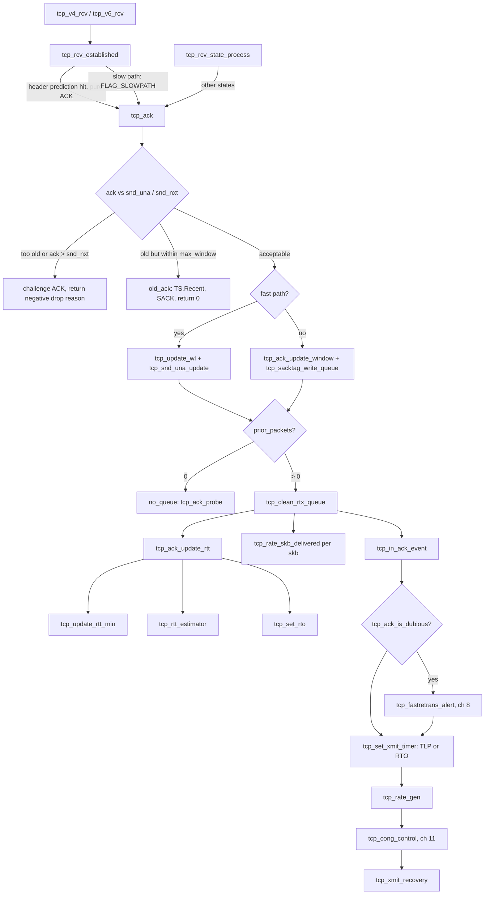

# 7. ACK processing and RTT estimation

## The ELI5 version

You are the clerk dispatching parcels (`sk_buff`) from a room (port).  Parcels that have been dispatched are kept on a "stub shelf" (retransmit queue) at the back of the **outgoing shelf** until they are confirmed to have arrived.

Postcards stamped with a **signed receipt** (ACK) arrive periodically from your peer.  The postcard says: "I have received all parcels up to number X" and "There is currently room for Y more parcels in my inbox".

When a signed receipt arrives, you do the following:

- Check whether the postcard is **too old or too far in the future**.  A signed receipt for parcels not yet dispatched might be a forgery.
- Discard the portion marked "received up to number X" from the stub shelf, freeing up shelf space.
- Check **when that parcel was dispatched** from the shipping label (`skb->skb_mstamp_ns`) to measure the round-trip time (RTT).  However, you do not measure from the signed receipt of a **re-shipped parcel**, because you cannot tell which dispatch the receipt was for (Karn's algorithm).
- Average the measured round-trip times and recalculate the duration of the **kitchen timer** (RTO) that dictates: "if a signed receipt does not arrive after waiting this long, re-ship the parcel".
- Transcribe the remaining space (window) in the peer's inbox.  Be careful, though, not to overwrite it with stale vacancy information from an old postcard that arrived late.
- Finally, pass "how many parcels arrived with this signed receipt" and "at what rate they are arriving" to the coordinator (congestion control) that decides the **trucks allowed on the road at once** (cwnd).

This chapter walks line by line through the process of "handling a single signed receipt" — namely `tcp_ack()`, along with the RTT estimation, RTO calculation, and delivery rate estimation invoked from it.

## What the RFCs say

### RFC 9293: Transmission Control Protocol (ACK field processing)

RFC 9293 is the current core TCP specification published in 2022 that obsoleted RFC 793.  Processing upon segment arrival is summarised as per-state pseudo-code in §3.10.7, and in synchronised states such as ESTABLISHED, "Fifth, check the ACK field" in [RFC 9293 §3.10.7.4](https://www.rfc-editor.org/rfc/rfc9293#section-3.10.7.4) constitutes the core of ACK processing.

Sender state variables ([RFC 9293 §3.3.1](https://www.rfc-editor.org/rfc/rfc9293#section-3.3.1)):

| RFC variable | Meaning | Linux field |
| --- | --- | --- |
| SND.UNA | Oldest unacknowledged sequence number | `tp->snd_una` |
| SND.NXT | Next sequence number to send | `tp->snd_nxt` |
| SND.WND | Send window (offset from SND.UNA) | `tp->snd_wnd` |
| SND.WL1 | SEG.SEQ of the segment last used to update the window | `tp->snd_wl1` |
| SND.WL2 | SEG.ACK of the segment last used to update the window | (Not held; `tp->snd_una` is used instead) |
| MAX.SND.WND (RFC 5961) | Maximum window advertised by peer | `tp->max_window` |

The rules in ESTABLISHED are three-fold:

1. If **SND.UNA < SEG.ACK =< SND.NXT**, set SND.UNA <- SEG.ACK, and remove completely acknowledged segments from the retransmit queue.
2. **SEG.ACK =< SND.UNA** (duplicate / stale ACK) can be ignored.  If **SEG.ACK > SND.NXT** (ACK for data not yet sent), send an ACK back and drop the segment.
3. If **SND.UNA =< SEG.ACK =< SND.NXT**, the send window may be updated provided that
   `SND.WL1 < SEG.SEQ  or  (SND.WL1 = SEG.SEQ and SND.WL2 =< SEG.ACK)`.
   If met, set SND.WND <- SEG.WND, SND.WL1 <- SEG.SEQ, SND.WL2 <- SEG.ACK.  This is a lexicographical comparison to avoid rewinding the window with an older segment.

### RFC 5961 §5.2: Blind Data Injection mitigation

RFC 5961 collates mitigations against attacks where an off-path attacker injects RST, SYN, or data segments using guessed sequence numbers.  [RFC 5961 §5.2](https://www.rfc-editor.org/rfc/rfc5961#section-5.2) requires dropping the segment and returning an ACK (challenge ACK) if the ACK value falls outside the range **(SND.UNA - MAX.SND.WND) =< SEG.ACK =< SND.NXT**.  RFC 9293 has also incorporated this as MAY-12.  Linux enforces this even more strictly by capping MAX.SND.WND at "the number of bytes acknowledged so far" (described below).

### RFC 6298: Computing TCP's Retransmission Timer

RFC 6298 is the standard defining how to compute the retransmission timer (RTO), obsoleting RFC 2988.  It is built on Van Jacobson's (1988) estimator based on smoothed RTT and mean deviation.

Rules of [RFC 6298 §2](https://www.rfc-editor.org/rfc/rfc6298#section-2):

- (2.1) Until the first RTT measurement is made, RTO = 1 second (Linux uses `TCP_TIMEOUT_INIT` = 1 second).
- (2.2) On the first measurement R, set `SRTT <- R`, `RTTVAR <- R/2`, and `RTO <- SRTT + max(G, K*RTTVAR)` (K = 4).
- (2.3) On subsequent measurements R', update **in this order**:
  `RTTVAR <- (1 - beta) * RTTVAR + beta * |SRTT - R'|`,
  `SRTT <- (1 - alpha) * SRTT + alpha * R'` (alpha = 1/8, beta = 1/4).  RTTVAR is updated using the SRTT value prior to updating SRTT.
- (2.4) When RTO is less than 1 second, it SHOULD be rounded up to 1 second.  Linux diverges sharply here, defaulting to a minimum of 200 ms (`TCP_RTO_MIN` = HZ/5).
- (2.5) A maximum may be imposed, in which case it must be at least 60 seconds (Linux uses `TCP_RTO_MAX` = 120 seconds).

[RFC 6298 §3](https://www.rfc-editor.org/rfc/rfc6298#section-3) makes **Karn's algorithm** mandatory (MUST).  RTT MUST NOT be measured from retransmitted segments, because it is ambiguous whether the ACK corresponds to the original transmission or the retransmission.  An exception is when the timestamp option is used, where the echoed value disambiguates the transmission instance.  Additionally, a measurement MUST be taken at least once per RTT.

[RFC 6298 §5](https://www.rfc-editor.org/rfc/rfc6298#section-5) governs timer management.  (5.2) Stop the timer when all outstanding data is acknowledged, and (5.3) restart it to expire after RTO when an ACK arrives acknowledging new data.  (5.5) Double RTO on expiration (backoff).  Furthermore, a note at the end of §5 states that when a new RTT measurement is obtained, the computation in §2 may be re-evaluated to "collapse" the backoff that inflated RTO.  Linux clearing `icsk_backoff` to 0 only when a valid RTT sample is obtained corresponds to this note.

### RFC 7323: TCP Extensions for High Performance (RTTM)

RFC 7323 obsoleted RFC 1323, specifying Window Scale, Timestamps, and PAWS.  Relevant to this chapter is RTT measurement via timestamps (RTTM).

- [RFC 7323 §2.2](https://www.rfc-editor.org/rfc/rfc7323#section-2.2): The window field in a SYN segment is never scaled.  This is why `tcp_ack_update_window()` does not shift by `snd_wscale` on a SYN.
- [RFC 7323 §3.2](https://www.rfc-editor.org/rfc/rfc7323#section-3.2): TSecr is only valid if the ACK bit is set.
- [RFC 7323 §4.1](https://www.rfc-editor.org/rfc/rfc7323#section-4.1): The sender places TSval in transmitted segments, and the receiver echoes it in TSecr.  The difference between the time the ACK was received and TSecr yields an RTT sample.  Because there is no ambiguity even for retransmissions, it is not bound by Karn's constraint.
- [RFC 7323 §4.2](https://www.rfc-editor.org/rfc/rfc7323#section-4.2): Because taking multiple samples per window shortens the effective history when using alpha/beta as-is, [Appendix G](https://www.rfc-editor.org/rfc/rfc7323#appendix-G) suggests scaling alpha and beta by dividing by `ExpectedSamples = ceil(FlightSize / (SMSS * 2))`.  Linux does not adopt this modification.  Instead, it employs its own approach of limiting RTTVAR decay to "once per RTT" (via `mdev_max_us` / `rttvar_us` discussed later).
- [RFC 7323 §4.3](https://www.rfc-editor.org/rfc/rfc7323#section-4.3): Defines which TSval to echo (rules for updating TS.Recent).  Under RTTM rules, "TSecr is used to update the averaged RTT measurement only if the segment acknowledges some new data, i.e., only if it advances the left edge of the send window."  This is why `tcp_ack_update_rtt()` conditions on `flag & FLAG_ACKED`.

### RFC 5681 §2: Definition of duplicate ACK

RFC 5681 is the standard for TCP congestion control (slow start / congestion avoidance / fast retransmit / fast recovery; detailed in Chapter 11).  [RFC 5681 §2](https://www.rfc-editor.org/rfc/rfc5681#section-2) defines a "DUPLICATE ACKNOWLEDGMENT" as an ACK satisfying all five of the following conditions:

- (a) The sender has outstanding unacknowledged data.
- (b) The incoming ACK carries no data.
- (c) Neither the SYN nor FIN bit is set.
- (d) The acknowledgment number equals the largest acknowledgment number seen so far (= SND.UNA).
- (e) The advertised window equals the window advertised in the previous ACK.

When SACK is used, there is also a caveat that SACK information is inspected in lieu of (e).  In Linux, this determination is expressed via combinations of `FLAG_*` bits (such as `FLAG_NOT_DUP`).

### RFC 3465: Appropriate Byte Counting (background)

RFC 3465 (Experimental) proposed increasing cwnd based on the number of bytes acknowledged rather than the number of ACKs received.  When the receiver uses delayed ACKs or ACK decimation, the count of ACKs decreases, causing cwnd to grow too slowly if counted per ACK.  The increase per ACK during slow start is capped at L*SMSS (L = 2 recommended).

Linux does not count "the number of ACKs"; rather, `tcp_ack()` counts the newly ACKed/SACKed **packet count** (`delivered` = `acked_sacked`) on that ACK and passes it to congestion control.  Consequently, it is effectively counted on a byte (segment) basis and tracks stretch ACKs accurately.  How cwnd is increased is covered in Chapter 11.  The key takeaway for this chapter is that `tcp_ack()` is the exact place where "how many packets' worth of data arrived with this ACK" is precisely tallied.

## The big picture



`tcp_ack()`'s job can be broadly divided into the following four stages:

1. **Validation check**: Verify whether the ACK number falls within `[snd_una - min(max_window, bytes_acked), snd_nxt]`.
2. **Sender state update**: Update `snd_una`, `snd_wnd`, and `snd_wl1`, and perform SACK tagging (SACK details are in Chapter 8).
3. **Cleaning the retransmit queue and measurements**: `tcp_clean_rtx_queue()` frees ACKed skbs while gathering RTT samples, delivered packet counts, and delivery rate samples.
4. **Decisions and transmission**: Pass samples to loss recovery (Chapter 8) and congestion control (Chapter 11), rearm TLP/RTO timers, and retransmit if necessary.

The key point is that **loss recovery and retransmission decisions are placed after congestion control** (`tcp_xmit_recovery()` comes last).  The order is arranged so that "how much can be sent (cwnd)" is decided before deciding "what to send".

## Walking through the code

### Step 1: Entry points and FLAG_* bits

`tcp_ack()` is called from the following five sites (all in [net/ipv4/tcp_input.c](https://git.kernel.org/pub/scm/linux/kernel/git/netdev/net-next.git/tree/net/ipv4/tcp_input.c?id=279d5c8afcd38bd841832a39bfe1aa4f8518d98e)):

| Call site | Passed flag | Circumstance |
| --- | --- | --- |
| Header prediction in `tcp_rcv_established()` (pure ACK) | `flag` (only result of `__tcp_replace_ts_recent()`) | Pure ACK as predicted. No `FLAG_SLOWPATH` |
| Header prediction in `tcp_rcv_established()` (with data) | `flag \| FLAG_DATA` | Predicted data segment when `ack_seq != snd_una` |
| Slow path in `tcp_rcv_established()` (`step5:`) | `FLAG_SLOWPATH \| FLAG_UPDATE_TS_RECENT` | Other ESTABLISHED segments |
| `tcp_rcv_synsent_state_process()` | `FLAG_SLOWPATH` | Receiving SYN-ACK |
| `tcp_rcv_state_process()` (step 5) | `FLAG_SLOWPATH \| FLAG_UPDATE_TS_RECENT \| FLAG_NO_CHALLENGE_ACK` | SYN_RECV, FIN_WAIT, CLOSING, etc. |

`tcp_rcv_established()` ([net/ipv4/tcp_input.c#L6520](https://git.kernel.org/pub/scm/linux/kernel/git/netdev/net-next.git/tree/net/ipv4/tcp_input.c?id=279d5c8afcd38bd841832a39bfe1aa4f8518d98e#n6520)) calls `tcp_mstamp_refresh_inline(tp)` at the outset, updating `tp->tcp_mstamp` to the "current time" of this receive processing.  All subsequent RTT calculations are performed as differences relative to this `tcp_mstamp`.  Header prediction itself is covered in Chapter 5.  What matters for this chapter is that **when header prediction hits, the window value is already guaranteed not to have changed by the `pred_flags` comparison**.  Therefore, `tcp_ack()` called without `FLAG_SLOWPATH` can skip the window update checks entirely.

The flag definitions are as follows:

```c
#define FLAG_DATA		0x01 /* Incoming frame contained data.		*/
#define FLAG_WIN_UPDATE		0x02 /* Incoming ACK was a window update.	*/
#define FLAG_DATA_ACKED		0x04 /* This ACK acknowledged new data.		*/
#define FLAG_RETRANS_DATA_ACKED	0x08 /* "" "" some of which was retransmitted.	*/
#define FLAG_SYN_ACKED		0x10 /* This ACK acknowledged SYN.		*/
#define FLAG_DATA_SACKED	0x20 /* New SACK.				*/
#define FLAG_ECE		0x40 /* ECE in this ACK				*/
#define FLAG_LOST_RETRANS	0x80 /* This ACK marks some retransmission lost */
#define FLAG_SLOWPATH		0x100 /* Do not skip RFC checks for window update.*/
#define FLAG_ORIG_SACK_ACKED	0x200 /* Never retransmitted data are (s)acked	*/
#define FLAG_SND_UNA_ADVANCED	0x400 /* Snd_una was changed (!= FLAG_DATA_ACKED) */
#define FLAG_DSACKING_ACK	0x800 /* SACK blocks contained D-SACK info */
#define FLAG_SET_XMIT_TIMER	0x1000 /* Set TLP or RTO timer */
#define FLAG_SACK_RENEGING	0x2000 /* snd_una advanced to a sacked seq */
#define FLAG_UPDATE_TS_RECENT	0x4000 /* tcp_replace_ts_recent() */
#define FLAG_NO_CHALLENGE_ACK	0x8000 /* do not call tcp_send_challenge_ack()	*/
#define FLAG_ACK_MAYBE_DELAYED	0x10000 /* Likely a delayed ACK */
#define FLAG_DSACK_TLP		0x20000 /* DSACK for tail loss probe */
#define FLAG_TS_PROGRESS	0x40000 /* Positive timestamp delta */

#define FLAG_ACKED		(FLAG_DATA_ACKED|FLAG_SYN_ACKED)
#define FLAG_NOT_DUP		(FLAG_DATA|FLAG_WIN_UPDATE|FLAG_ACKED)
#define FLAG_CA_ALERT		(FLAG_DATA_SACKED|FLAG_ECE|FLAG_DSACKING_ACK)
#define FLAG_FORWARD_PROGRESS	(FLAG_ACKED|FLAG_DATA_SACKED)

#define TCP_REMNANT (TCP_FLAG_FIN|TCP_FLAG_URG|TCP_FLAG_SYN|TCP_FLAG_PSH)
#define TCP_HP_BITS (~(TCP_RESERVED_BITS|TCP_FLAG_PSH))

#define REXMIT_NONE	0 /* no loss recovery to do */
#define REXMIT_LOST	1 /* retransmit packets marked lost */
#define REXMIT_NEW	2 /* FRTO-style transmit of unsent/new packets */
```

Four composite flags are worth remembering:

- `FLAG_ACKED` = Data or SYN was newly cumulatively ACKed.
- `FLAG_NOT_DUP` = Carries data, is a window update, or ACKed something.  An ACK where this is **not set** is a candidate duplicate ACK under RFC 5681.
- `FLAG_CA_ALERT` = Contains SACK, ECE, or DSACK.  Indicates whether the congestion state machine (Chapter 8) needs to be awoken.
- `FLAG_FORWARD_PROGRESS` = Something arrived via cumulative ACK or SACK.

The reason `FLAG_SND_UNA_ADVANCED` and `FLAG_DATA_ACKED` are distinct is that their meanings diverge when only a SYN is ACKed, or when only part of a TSO skb is ACKed in a partial ACK.  The comment `!= FLAG_DATA_ACKED` refers to this distinction.

`REXMIT_*` values are used by `tcp_fastretrans_alert()` to communicate "what should be retransmitted" to `tcp_xmit_recovery()`, deferring the retransmission itself until after congestion control.

### Step 2: `tcp_ack()` (1) — Snapshot of prior state

`tcp_ack()` ([net/ipv4/tcp_input.c#L4276](https://git.kernel.org/pub/scm/linux/kernel/git/netdev/net-next.git/tree/net/ipv4/tcp_input.c?id=279d5c8afcd38bd841832a39bfe1aa4f8518d98e#n4276))

```c
/* This routine deals with incoming acks, but not outgoing ones. */
static int tcp_ack(struct sock *sk, const struct sk_buff *skb, int flag)
{
	struct inet_connection_sock *icsk = inet_csk(sk);
	struct tcp_sock *tp = tcp_sk(sk);
	struct tcp_sacktag_state sack_state;
	struct rate_sample rs = { .prior_delivered = 0 };
	u32 prior_snd_una = tp->snd_una;
	bool is_sack_reneg = tp->is_sack_reneg;
	u32 ack_seq = TCP_SKB_CB(skb)->seq;
	u32 ack = TCP_SKB_CB(skb)->ack_seq;
	int num_dupack = 0;
	int prior_packets = tp->packets_out;
	u32 delivered = tp->delivered;
	u32 lost = tp->lost;
	int rexmit = REXMIT_NONE; /* Flag to (re)transmit to recover losses */
	u32 ecn_count = 0;	  /* Did we receive ECE/an AccECN ACE update? */
	u32 prior_fack;

	sack_state.first_sackt = 0;
	sack_state.rate = &rs;
	sack_state.sack_delivered = 0;
	sack_state.delivered_bytes = 0;

	/* We very likely will need to access rtx queue. */
	prefetch(sk->tcp_rtx_queue.rb_node);
```

- The return type is `int`.  A **negative value** is `-SKB_DROP_REASON_*` (drop segment), **0** indicates a "stale ACK but accepted", and **1** indicates normal processing completed.  `tcp_rcv_state_process()` notes that "in CLOSING-type states, old ACKs (0) are also accepted", distinguishing between these three values.
- `prior_snd_una`, `prior_packets`, `delivered`, `lost`, and `is_sack_reneg` are the values **before** processing this ACK.  At the end, `tcp_ack()` computes `tp->delivered - delivered` (packets newly delivered by this ACK) and `tp->lost - lost` (packets newly judged lost by this ACK).  By counting in deltas, double-counting is avoided regardless of how many paths increment counters (SACK tagging, cumulative ACK, RACK, Reno pseudo-SACK).
- `ack_seq` is **this segment's SEG.SEQ**, while `ack` is **SEG.ACK**.  Be careful not to confuse the names.  `ack_seq` is used for window update rules (comparison against SND.WL1).
- `rs` (`struct rate_sample`) is placed on the stack and initialised with `.prior_delivered = 0`.  `prior_delivered == 0` is a sentinel indicating "no sample has been taken from any skb yet" (referenced by `tcp_rate_skb_delivered()`).
- `sack_state` is likewise placed on the stack, serving as a container passed between SACK tagging and `tcp_clean_rtx_queue()` to convey RTT timestamps (`first_sackt` / `last_sackt`), delivered counts, and the rate sample pointer.
- `prefetch(sk->tcp_rtx_queue.rb_node)`: The retransmit queue is an rb-tree (since 75c119afe14f in 2017).  Because ACK processing almost certainly touches the head skb, prefetching the cacheline of the tree root hides memory latency during subsequent checks.

### Step 3: `tcp_ack()` (2) — Stale ACKs and futuristic ACKs

```c
	/* If the ack is older than previous acks
	 * then we can probably ignore it.
	 */
	if (before(ack, prior_snd_una)) {
		u32 max_window;

		/* do not accept ACK for bytes we never sent. */
		max_window = min_t(u64, tp->max_window, tp->bytes_acked);
		/* RFC 5961 5.2 [Blind Data Injection Attack].[Mitigation] */
		if (before(ack, prior_snd_una - max_window)) {
			if (!(flag & FLAG_NO_CHALLENGE_ACK))
				tcp_send_challenge_ack(sk, false);
			return -SKB_DROP_REASON_TCP_TOO_OLD_ACK;
		}
		goto old_ack;
	}

	/* If the ack includes data we haven't sent yet, drop the
	 * segment.  RFC 793 Section 3.9 and RFC 5961 Section 5.2
	 * require us to send an ACK back in that case.
	 */
	if (after(ack, tp->snd_nxt)) {
		if (!(flag & FLAG_NO_CHALLENGE_ACK))
			tcp_send_challenge_ack(sk, false);
		return -SKB_DROP_REASON_TCP_ACK_UNSENT_DATA;
	}

	if (after(ack, prior_snd_una)) {
		flag |= FLAG_SND_UNA_ADVANCED;
		WRITE_ONCE(icsk->icsk_retransmits, 0);

#if IS_ENABLED(CONFIG_TLS_DEVICE)
		if (static_branch_unlikely(&clean_acked_data_enabled.key))
			if (tp->tcp_clean_acked)
				tp->tcp_clean_acked(sk, ack);
#endif
	}
```

Here lies the implementation of RFC 9293 §3.10.7.4 and RFC 5961 §5.2.  Sequence comparisons are all performed using `before()` / `after()` (signed 32-bit arithmetic), correctly handling wraparound.

- **`before(ack, prior_snd_una)`**: SEG.ACK < SND.UNA.  While RFC 9293 states that this "can be ignored", Linux treats it in two tiers:
  - `max_window = min_t(u64, tp->max_window, tp->bytes_acked)` corresponds to MAX.SND.WND in RFC 5961.  However, it is capped at **the number of bytes actually acknowledged so far** (3d501dd326fb).  On new flows where `bytes_acked` is small, this rejects bogus ACKs pointing prior to the ISN (bytes never transmitted).  Under the literal RFC rule, any ACK value down to `snd_una - 64KB` would be accepted immediately after connection establishment.
  - An ACK older than that triggers a challenge ACK (unless `FLAG_NO_CHALLENGE_ACK` is set) and is dropped with `-SKB_DROP_REASON_TCP_TOO_OLD_ACK`.  `tcp_rcv_state_process()` passes `FLAG_NO_CHALLENGE_ACK` because the caller decides the response itself: upon receiving a negative return value, SYN_RECV returns a RST, whereas other states call `tcp_send_challenge_ack()`.
  - Stale ACKs within window bounds proceed to `old_ack:`.  Because they may carry data or SACK information, they are not dropped and processing continues.
- **`after(ack, tp->snd_nxt)`**: An ACK for data not yet sent.  Following RFC 9293's directive to "send an ACK, drop the segment, and return", a challenge ACK is sent back and the segment is dropped.  `tcp_send_challenge_ack()` ([net/ipv4/tcp_input.c#L4069](https://git.kernel.org/pub/scm/linux/kernel/git/netdev/net-next.git/tree/net/ipv4/tcp_input.c?id=279d5c8afcd38bd841832a39bfe1aa4f8518d98e#n4069)) is throttled by two tiers of rate limiting: a per-socket rate limit (`sysctl_tcp_invalid_ratelimit`, exceeding which increments `TCPACKSkippedChallenge`) and a per-netns RFC 5961 rate limit (`sysctl_tcp_challenge_ack_limit`).  This prevents challenge ACKs themselves from becoming an attack amplification vector.
- **`after(ack, prior_snd_una)`**: New data has been acknowledged, so `FLAG_SND_UNA_ADVANCED` is set.
  - `icsk_retransmits = 0`: Resets the consecutive RTO retransmission count.  This value is used by `tcp_write_timeout()` to determine whether to abort the connection (Chapter 9).  It uses `WRITE_ONCE()` because callers like `tcp_get_timestamping_opt_stats()` read it without holding locks.
  - `CONFIG_TLS_DEVICE`: Under kTLS device offload, invokes the callback `tcp_clean_acked` to release retransmission state for acknowledged records.  Protected by a static key, the overhead is virtually zero when TLS offload is not in use.

From this point onwards, the invariant **`snd_una <= ack <= snd_nxt`** holds for all subsequent processing.  The comment in `tcp_may_update_window()` ("The function assumes that snd_una<=ack<=snd_next.") refers to this premise.

### Step 4: `tcp_ack()` (3) — Fast path and slow path for window updates

```c
	prior_fack = tcp_is_sack(tp) ? tcp_highest_sack_seq(tp) : tp->snd_una;
	rs.prior_in_flight = tcp_packets_in_flight(tp);

	/* ts_recent update must be made after we are sure that the packet
	 * is in window.
	 */
	if (flag & FLAG_UPDATE_TS_RECENT)
		flag |= tcp_replace_ts_recent(tp, TCP_SKB_CB(skb)->seq);

	if ((flag & (FLAG_SLOWPATH | FLAG_SND_UNA_ADVANCED)) ==
	    FLAG_SND_UNA_ADVANCED) {
		/* Window is constant, pure forward advance.
		 * No more checks are required.
		 * Note, we use the fact that SND.UNA>=SND.WL2.
		 */
		tcp_update_wl(tp, ack_seq);
		tcp_snd_una_update(tp, ack);
		flag |= FLAG_WIN_UPDATE;

		NET_INC_STATS(sock_net(sk), LINUX_MIB_TCPHPACKS);
	} else {
		if (ack_seq != TCP_SKB_CB(skb)->end_seq)
			flag |= FLAG_DATA;
		else
			NET_INC_STATS(sock_net(sk), LINUX_MIB_TCPPUREACKS);

		flag |= tcp_ack_update_window(sk, skb, ack, ack_seq);

		if (TCP_SKB_CB(skb)->sacked)
			flag |= tcp_sacktag_write_queue(sk, skb, prior_snd_una,
							&sack_state);

		if (tcp_ecn_rcv_ecn_echo(tp, tcp_hdr(skb)))
			flag |= FLAG_ECE;

		if (sack_state.sack_delivered)
			tcp_count_delivered(tp, sack_state.sack_delivered,
					    flag & FLAG_ECE);
	}
```

- `prior_fack`: On SACK connections, the highest sequence SACKed; otherwise `snd_una`.  `tcp_clean_rtx_queue()` uses this to determine: "A hole never retransmitted was filled by cumulative ACK; if that was below `prior_fack`, it was reordering."
- `rs.prior_in_flight = tcp_packets_in_flight(tp)`: The in-flight volume prior to processing this ACK.  Used by PRR (Chapter 8) and BBR.
- `FLAG_UPDATE_TS_RECENT`: In slow path invocations, TS.Recent is updated **after verifying that the ACK is within the valid window**.  If TS.Recent were advanced on an out-of-window ACK, bogus segments could poison PAWS state (packetdrill's `tcp_ts_recent_invalid_ack.pkt` validates this behaviour).  `tcp_replace_ts_recent()` returns `FLAG_TS_PROGRESS` if TSval increased (used by AccECN).
- **fast path** (no `FLAG_SLOWPATH`, and `snd_una` advanced): Header prediction hit, so the window value is unchanged.  All that is required is updating `snd_wl1 = ack_seq` and `snd_una = ack`.  The comment "we use the fact that SND.UNA>=SND.WL2" refers to the fact that Linux does not maintain SND.WL2, substituting `snd_una` in its place.  Since ACKs advance monotonically, WL2 (the ACK last used to update the window) is always <= SND.UNA, so advancing `snd_una` serves as advancing WL2.  Because `FLAG_WIN_UPDATE` is set, this ACK is not counted as duplicate.  Increments the counter `TCPHPAcks`.
- **slow path**:
  - If `ack_seq != end_seq`, the segment carries data (or SYN/FIN), so `FLAG_DATA` is set (negating RFC 5681 dupack conditions (b) and (c)).  If it is a pure ACK, `TCPPureAcks` is incremented.
  - `tcp_ack_update_window()` updates the window according to the WL1/WL2 rules and advances `snd_una` (Step 5).
  - `TCP_SKB_CB(skb)->sacked` stores the offset within options when SACK blocks were found during option parsing.  If non-zero, the SACK scoreboard is updated via `tcp_sacktag_write_queue()` (Chapter 8).
  - If ECE (RFC 3168 ECN-Echo) is detected, `FLAG_ECE` is set.  Packets newly arrived via SACK (`sack_state.sack_delivered`) are added to `tp->delivered` here by `tcp_count_delivered()`.  Packets arriving via cumulative ACK are added later by `tcp_clean_rtx_queue()`.

### Step 5: `tcp_ack_update_window()` and `tcp_may_update_window()`

`tcp_may_update_window()` ([net/ipv4/tcp_input.c#L3881](https://git.kernel.org/pub/scm/linux/kernel/git/netdev/net-next.git/tree/net/ipv4/tcp_input.c?id=279d5c8afcd38bd841832a39bfe1aa4f8518d98e#n3881))

```c
/* Check that window update is acceptable.
 * The function assumes that snd_una<=ack<=snd_next.
 */
static inline bool tcp_may_update_window(const struct tcp_sock *tp,
					const u32 ack, const u32 ack_seq,
					const u32 nwin)
{
	return	after(ack, tp->snd_una) ||
		after(ack_seq, tp->snd_wl1) ||
		(ack_seq == tp->snd_wl1 && (nwin > tp->snd_wnd || !nwin));
}
```

RFC 9293's rule was "`SND.WL1 < SEG.SEQ` or (`SND.WL1 = SEG.SEQ` and `SND.WL2 =< SEG.ACK`)".  Linux's rule consists of three clauses:

1. `after(ack, tp->snd_una)`: Unconditionally update if ACK advances SND.UNA.  A segment acknowledging new data was transmitted at least as recently as the segment last used to update the window (a stronger form of SND.WL2 =< SEG.ACK).
2. `after(ack_seq, tp->snd_wl1)`: SND.WL1 < SEG.SEQ.  Identical to the RFC.
3. `ack_seq == tp->snd_wl1 && (nwin > tp->snd_wnd || !nwin)`: For segments where neither SEQ nor ACK has changed (`ack == snd_una`), the RFC rule would update unconditionally since `SND.WL2 =< SEG.ACK` always holds.  Linux updates **only if the window expands or drops to zero**.

The third clause is the substance behind the opening comment in `tcp_ack_update_window()`: "Window update algorithm, described in RFC793/RFC1122 ... is wrong."  In unidirectional transfers where the peer transmits no data, SEG.SEQ of pure ACKs remains constant.  If two pure ACKs (same SEQ, same ACK number) are reordered in the network, the RFC rule would overwrite `snd_wnd` with the **older**, smaller window arriving second, needlessly throttling the sender.  Linux avoids reordering-induced shrinkage by trusting equal-rank ACKs only when the window expands.  However, if the receiver genuinely closes its window (advertises 0), ignoring it would cause the sender to force data into a full buffer, so `!nwin` is exceptionally accepted.

Note that a pure ACK with `ack == snd_una`, identical SEQ, and identical window does not set `FLAG_WIN_UPDATE`.  This corresponds to RFC 5681 dupack conditions (d) and (e).

`tcp_ack_update_window()` ([net/ipv4/tcp_input.c#L3951](https://git.kernel.org/pub/scm/linux/kernel/git/netdev/net-next.git/tree/net/ipv4/tcp_input.c?id=279d5c8afcd38bd841832a39bfe1aa4f8518d98e#n3951))

```c
/* Update our send window.
 *
 * Window update algorithm, described in RFC793/RFC1122 (used in linux-2.2
 * and in FreeBSD. NetBSD's one is even worse.) is wrong.
 */
static int tcp_ack_update_window(struct sock *sk, const struct sk_buff *skb, u32 ack,
				 u32 ack_seq)
{
	struct tcp_sock *tp = tcp_sk(sk);
	int flag = 0;
	u32 nwin = ntohs(tcp_hdr(skb)->window);

	if (likely(!tcp_hdr(skb)->syn))
		nwin <<= tp->rx_opt.snd_wscale;

	if (tcp_may_update_window(tp, ack, ack_seq, nwin)) {
		flag |= FLAG_WIN_UPDATE;
		tcp_update_wl(tp, ack_seq);

		if (tp->snd_wnd != nwin) {
			tp->snd_wnd = nwin;

			/* Note, it is the only place, where
			 * fast path is recovered for sending TCP.
			 */
			tp->pred_flags = 0;
			tcp_fast_path_check(sk);

			if (!tcp_write_queue_empty(sk))
				tcp_slow_start_after_idle_check(sk);

			if (nwin > tp->max_window) {
				tp->max_window = nwin;
				tcp_sync_mss(sk, inet_csk(sk)->icsk_pmtu_cookie);
			}
		}
	}

	tcp_snd_una_update(tp, ack);

	return flag;
}
```

- `nwin <<= tp->rx_opt.snd_wscale`: Per RFC 7323 §2.2, the window field in a SYN segment is never scaled.  `likely(!tcp_hdr(skb)->syn)` is annotated because the SYN bit is only set when receiving a SYN-ACK.
- If `tcp_may_update_window()` is true, `FLAG_WIN_UPDATE` is set, and `tcp_update_wl()` ([include/net/tcp.h#L1712](https://git.kernel.org/pub/scm/linux/kernel/git/netdev/net-next.git/tree/include/net/tcp.h?id=279d5c8afcd38bd841832a39bfe1aa4f8518d98e#n1712)) sets `snd_wl1 = ack_seq`.  Even if the window value **does not change**, if the rule is satisfied, `snd_wl1` advances and `FLAG_WIN_UPDATE` is set, preventing this ACK from being counted as a dupack.
- Only when the window value actually changes does the following processing take place:
  - `tp->pred_flags = 0; tcp_fast_path_check(sk);`: The header prediction expectation `pred_flags` embeds the TCP header flags and the **unscaled window value** (Chapter 5).  If the window changes, prediction must be rebuilt.  `tcp_fast_path_check()` ([include/net/tcp.h#L2007](https://git.kernel.org/pub/scm/linux/kernel/git/netdev/net-next.git/tree/include/net/tcp.h?id=279d5c8afcd38bd841832a39bfe1aa4f8518d98e#n2007)) recomputes `pred_flags` via `tcp_fast_path_on()` provided the OOO queue is empty, receive window is non-zero, receive memory has headroom, and no urgent data exists.  This is what the comment "the only place, where fast path is recovered for sending TCP" refers to.
  - `tcp_slow_start_after_idle_check()` ([include/net/tcp.h#L1754](https://git.kernel.org/pub/scm/linux/kernel/git/netdev/net-next.git/tree/include/net/tcp.h?id=279d5c8afcd38bd841832a39bfe1aa4f8518d98e#n1754)): If there is data to send but in-flight is 0, and more than RTO has elapsed since the last transmission, `tcp_cwnd_restart()` reduces cwnd (RFC 5681 §4.1 restart window).  This prevents bursting with a stale cwnd when the window reopens after a prolonged zero-window stall.
  - If `nwin > tp->max_window`, `max_window` is updated, and `tcp_sync_mss()` is called.  `max_window` is used in Step 3 for the RFC 5961 check (MAX.SND.WND) and in `tcp_bound_to_half_wnd()` to enforce "MSS shall not exceed half of the peer's maximum window".  MSS is therefore recomputed.
- Finally, `tcp_snd_una_update()` is invoked regardless of whether the window was updated.

`tcp_snd_una_update()` ([net/ipv4/tcp_input.c#L3908](https://git.kernel.org/pub/scm/linux/kernel/git/netdev/net-next.git/tree/net/ipv4/tcp_input.c?id=279d5c8afcd38bd841832a39bfe1aa4f8518d98e#n3908))

```c
static void tcp_snd_sne_update(struct tcp_sock *tp, u32 ack)
{
#ifdef CONFIG_TCP_AO
	struct tcp_ao_info *ao;

	if (!static_branch_unlikely(&tcp_ao_needed.key))
		return;

	ao = rcu_dereference_protected(tp->ao_info,
				       lockdep_sock_is_held((struct sock *)tp));
	if (ao && ack < tp->snd_una) {
		ao->snd_sne++;
		trace_tcp_ao_snd_sne_update((struct sock *)tp, ao->snd_sne);
	}
#endif
}

/* If we update tp->snd_una, also update tp->bytes_acked */
static void tcp_snd_una_update(struct tcp_sock *tp, u32 ack)
{
	u32 delta = ack - tp->snd_una;

	sock_owned_by_me((struct sock *)tp);
	tp->bytes_acked += delta;
	tcp_snd_sne_update(tp, ack);
	WRITE_ONCE(tp->snd_una, ack);
}
```

- `delta = ack - tp->snd_una` is a u32 subtraction, wrapping correctly across boundaries.  It is added to `bytes_acked` (u64, RFC 4898 tcpEStatsAppHCThruOctetsAcked).  This is the source of the "bytes acknowledged so far" in Step 3.
- `sock_owned_by_me()`: A lockdep assertion.  Writing to `snd_una` occurs strictly under socket lock (in softirq via `bh_lock_sock()` while `!sock_owned_by_user()`, or in process context via `lock_sock()`).
- `tcp_snd_sne_update()`: Sequence Number Extension for TCP-AO (RFC 5925).  The **unsigned numerical comparison** `ack < tp->snd_una` indicates that "the 32-bit sequence space wrapped around", so the upper 32 bits (`snd_sne`) are incremented by 1.  Note that a raw `<` comparison is used here rather than `before()`.
- `WRITE_ONCE(tp->snd_una, ack)`: Annotated for lockless readers, such as `tcp_get_timestamping_opt_stats()` (which reads `write_seq - snd_una`) and TCP-AO SNE calculation.

### Step 6: `tcp_ack()` (4) — Cleaning the retransmit queue and notifying CA events

```c
	/* This is a deviation from RFC3168 since it states that:
	 * "When the TCP data sender is ready to set the CWR bit after reducing
	 * the congestion window, it SHOULD set the CWR bit only on the first
	 * new data packet that it transmits."
	 * We accept CWR on pure ACKs to be more robust
	 * with widely-deployed TCP implementations that do this.
	 */
	tcp_ecn_accept_cwr(sk, skb);

	/* We passed data and got it acked, remove any soft error
	 * log. Something worked...
	 */
	if (READ_ONCE(sk->sk_err_soft))
		WRITE_ONCE(sk->sk_err_soft, 0);
	WRITE_ONCE(icsk->icsk_probes_out, 0);
	tp->rcv_tstamp = tcp_jiffies32;
	if (!prior_packets)
		goto no_queue;

	/* See if we can take anything off of the retransmit queue. */
	flag |= tcp_clean_rtx_queue(sk, skb, prior_fack, prior_snd_una,
				    &sack_state, flag & FLAG_ECE);

	tcp_rack_update_reo_wnd(sk, &rs);

	if (tcp_ecn_mode_accecn(tp))
		ecn_count = tcp_accecn_process(sk, skb,
					       tp->delivered - delivered,
					       sack_state.delivered_bytes,
					       &flag);

	tcp_in_ack_event(sk, flag);
```

- `tcp_ecn_accept_cwr()`: An intentional deviation from RFC 3168, accepting CWR bits present on pure ACKs (Chapter 14).
- `sk_err_soft = 0`: Clears "soft errors" logged by ICMP and similar mechanisms (ultimately reported by `tcp_write_timeout()`), on the basis that receiving an ACK proves the network path is operational.  Access is annotated with `READ_ONCE()`/`WRITE_ONCE()`, reading first to avoid dirtying the cacheline if already 0.
- `icsk_probes_out = 0`: Resets the count of consecutive unanswered zero-window probes / keepalives.  Any ACK proves the peer is alive.
- `rcv_tstamp = tcp_jiffies32`: The timestamp when an ACK was last received.  Used for timeout determinations in keepalives and zero-window probes (Chapter 9).
- `!prior_packets` → `no_queue`: If in-flight was 0 prior to ACK processing, there is nothing to clean and no RTT to measure (e.g. window updates or probe replies).  Because RFC 5681 dupack condition (a) ("sender has unacknowledged data") is not met, this is not counted as a dupack.
- **`tcp_clean_rtx_queue()`**: The core of this chapter (Steps 9 to 13).  Its return flag is ORed in.  Passing `flag & FLAG_ECE` as `ece_ack` allows packets delivered via cumulative ACK to be counted towards RFC 3168-mode `delivered_ce`.
- `tcp_rack_update_reo_wnd()`: Adjusts RACK's reordering window (Chapter 8).
- `tcp_accecn_process()`: Processes AccECN ACE counters (Chapter 14).
- `tcp_in_ack_event()` ([net/ipv4/tcp_input.c#L4172](https://git.kernel.org/pub/scm/linux/kernel/git/netdev/net-next.git/tree/net/ipv4/tcp_input.c?id=279d5c8afcd38bd841832a39bfe1aa4f8518d98e#n4172)): Invokes the CA module's `in_ack_event` hook.  Converts internal `FLAG_*` bits into CA public flags `CA_ACK_WIN_UPDATE` / `CA_ACK_SLOWPATH` / `CA_ACK_ECE`.  ECE is reported only when `FLAG_SLOWPATH` is set because `tcp_ecn_rcv_ecn_echo()` (which sets `FLAG_ECE`) sits only in Step 4's slow path branch; segments with ECE set fail `pred_flags` matching and never reach the header prediction fast path in the first place.  DCTCP and Westwood utilise this hook.

### Step 7: `tcp_ack()` (5) — Dupack detection, timers, rate, and congestion control

```c
	if (unlikely(tp->tlp_high_seq))
		tcp_process_tlp_ack(sk, ack, flag);

	if (tcp_ack_is_dubious(sk, flag)) {
		if (!(flag & (FLAG_SND_UNA_ADVANCED |
			      FLAG_NOT_DUP | FLAG_DSACKING_ACK))) {
			num_dupack = 1;
			/* Consider if pure acks were aggregated in tcp_add_backlog() */
			if (!(flag & FLAG_DATA))
				num_dupack = max_t(u16, 1, skb_shinfo(skb)->gso_segs);
		}
		tcp_fastretrans_alert(sk, prior_snd_una, num_dupack, &flag,
				      &rexmit);
	}

	/* If needed, reset TLP/RTO timer when RACK doesn't set. */
	if (flag & FLAG_SET_XMIT_TIMER)
		tcp_set_xmit_timer(sk);

	if ((flag & FLAG_FORWARD_PROGRESS) || !(flag & FLAG_NOT_DUP))
		sk_dst_confirm(sk);

	delivered = tcp_newly_delivered(sk, delivered, ecn_count, flag);

	lost = tp->lost - lost;			/* freshly marked lost */
	rs.is_ack_delayed = !!(flag & FLAG_ACK_MAYBE_DELAYED);
	tcp_rate_gen(sk, delivered, lost, is_sack_reneg, sack_state.rate);
	tcp_cong_control(sk, ack, delivered, flag, sack_state.rate);
	tcp_xmit_recovery(sk, rexmit);
	return 1;
```

- If `tlp_high_seq` is non-zero, evaluate Tail Loss Probe results (`tcp_process_tlp_ack()`, Chapter 8).
- `tcp_ack_is_dubious()` ([net/ipv4/tcp_input.c#L3831](https://git.kernel.org/pub/scm/linux/kernel/git/netdev/net-next.git/tree/net/ipv4/tcp_input.c?id=279d5c8afcd38bd841832a39bfe1aa4f8518d98e#n3831)) determines whether "this ACK warrants cycling the congestion state machine":

  ```c
  static inline bool tcp_ack_is_dubious(const struct sock *sk, const int flag)
  {
  	return !(flag & FLAG_NOT_DUP) || (flag & FLAG_CA_ALERT) ||
  		inet_csk(sk)->icsk_ca_state != TCP_CA_Open;
  }
  ```

It evaluates to true for duplicate ACK candidates (`!(flag & FLAG_NOT_DUP)`), ACKs carrying SACK/ECE/DSACK, or when the CA state is not Open (Disorder/CWR/Recovery/Loss).  A standard ACK in Open state that acknowledges new data without SACK sails right through.  This check exists to keep the fast path lightweight.
- `num_dupack`: An ACK where `snd_una` did not advance, lacking `FLAG_NOT_DUP` (data, window update, or ACK) and lacking DSACK, is counted as a **duplicate ACK**.  The correspondence to RFC 5681 §2 conditions is: (a) Unacknowledged data outstanding = `prior_packets` non-zero (did not branch to `no_queue`). (b)(c) No data/SYN/FIN = `!FLAG_DATA`. (d) ACK equals SND.UNA = `!FLAG_SND_UNA_ADVANCED`. (e) Window unchanged = `!FLAG_WIN_UPDATE`.
  - `gso_segs`: When the socket is held by user space, `tcp_add_backlog()` ([net/ipv4/tcp_ipv4.c#L1904](https://git.kernel.org/pub/scm/linux/kernel/git/netdev/net-next.git/tree/net/ipv4/tcp_ipv4.c?id=279d5c8afcd38bd841832a39bfe1aa4f8518d98e#n1904)) may **coalesce pure ACKs into a single skb** on the backlog.  The number of coalesced segments is recorded in `gso_segs`.  Counting coalesced dupacks as just 1 would fail to meet Reno's dupthresh (3 segments) and delay fast retransmit, so the original count is restored (19119f298bb1).  Because segments with data are never coalesced, this applies only when `!(flag & FLAG_DATA)`.
- `tcp_fastretrans_alert()`: Handles loss detection, CA state transitions, and undo (Chapter 8).  It receives `&flag` and `&rexmit`, returning updated flags (e.g. clearing or setting `FLAG_SET_XMIT_TIMER`) and "what to retransmit".
- `FLAG_SET_XMIT_TIMER` → `tcp_set_xmit_timer()`: Corresponds to RFC 6298 (5.2)/(5.3) "restart timer when an ACK arrives acknowledging new data" (Step 17).  Designed to rearm **at most once per ACK** (df92c8394e6e).
- `sk_dst_confirm()`: On forward progress (`FLAG_FORWARD_PROGRESS`) or dupack (`!FLAG_NOT_DUP`, confirming the peer is alive and receiving segments), sets `sk_dst_pending_confirm`.  On the next transmit, `sock_confirm_neigh()` marks the neighbour entry (ARP/ND) as reachable, avoiding NUD re-probe overhead.
- `tcp_newly_delivered()` ([net/ipv4/tcp_input.c#L4213](https://git.kernel.org/pub/scm/linux/kernel/git/netdev/net-next.git/tree/net/ipv4/tcp_input.c?id=279d5c8afcd38bd841832a39bfe1aa4f8518d98e#n4213)): Adds `tp->delivered - delivered` to `TCPDelivered` (and `TCPDeliveredCE`), returning newly delivered packet count for this ACK.  This serves as `acked_sacked` (corresponding to RFC 3465's "bytes acknowledged") passed to congestion control.
- `lost = tp->lost - lost`: Packet count newly marked lost during this ACK's processing (SACK tagging, RACK, `tcp_fastretrans_alert()`).
- `rs.is_ack_delayed`: Conveys the "looks like delayed ACK" bit estimated by `tcp_clean_rtx_queue()` to BBR via the rate sample.
- `tcp_rate_gen()`: Finalises the delivery rate sample (Step 19).
- `tcp_cong_control()` ([net/ipv4/tcp_input.c#L3858](https://git.kernel.org/pub/scm/linux/kernel/git/netdev/net-next.git/tree/net/ipv4/tcp_input.c?id=279d5c8afcd38bd841832a39bfe1aa4f8518d98e#n3858)): If the CA provides a `cong_control` hook (e.g. BBR), invokes it.  Otherwise, calls `tcp_cwnd_reduction()` (PRR) during CWR/Recovery, or `tcp_cong_avoid()` when allowed to increase cwnd, followed by `tcp_update_pacing_rate()` (Chapter 11).
- `tcp_xmit_recovery()`: Once cwnd has been settled, executes retransmissions (or F-RTO new transmissions) according to `rexmit` (e662ca40de84).

### Step 8: `tcp_ack()` (6) — `no_queue` and `old_ack`

```c
no_queue:
	if (tcp_ecn_mode_accecn(tp))
		ecn_count = tcp_accecn_process(sk, skb,
					       tp->delivered - delivered,
					       sack_state.delivered_bytes,
					       &flag);
	tcp_in_ack_event(sk, flag);
	/* If data was DSACKed, see if we can undo a cwnd reduction. */
	if (flag & FLAG_DSACKING_ACK) {
		tcp_fastretrans_alert(sk, prior_snd_una, num_dupack, &flag,
				      &rexmit);
		tcp_newly_delivered(sk, delivered, ecn_count, flag);
	}
	/* If this ack opens up a zero window, clear backoff.  It was
	 * being used to time the probes, and is probably far higher than
	 * it needs to be for normal retransmission.
	 */
	tcp_ack_probe(sk);

	if (unlikely(tp->tlp_high_seq))
		tcp_process_tlp_ack(sk, ack, flag);
	return 1;
```

- `no_queue` is the path taken when in-flight was 0.  Although CA event notifications are performed, `tcp_clean_rtx_queue()`, `tcp_rate_gen()`, and `tcp_cong_control()` are not called.
- If `FLAG_DSACKING_ACK` is set, `tcp_fastretrans_alert()` is called.  This is because if a DSACK arrives after all data has been ACKed, revealing that "the previous retransmission was unneeded", cwnd reduction can potentially be undone.
- `tcp_ack_probe()` ([net/ipv4/tcp_input.c#L3807](https://git.kernel.org/pub/scm/linux/kernel/git/netdev/net-next.git/tree/net/ipv4/tcp_input.c?id=279d5c8afcd38bd841832a39bfe1aa4f8518d98e#n3807)) tidies up after zero-window probes:

```c
static void tcp_ack_probe(struct sock *sk)
{
	struct inet_connection_sock *icsk = inet_csk(sk);
	struct sk_buff *head = tcp_send_head(sk);
	const struct tcp_sock *tp = tcp_sk(sk);

	/* Was it a usable window open? */
	if (!head)
		return;
	if (!after(TCP_SKB_CB(head)->end_seq, tcp_wnd_end(tp))) {
		icsk->icsk_backoff = 0;
		icsk->icsk_probes_tstamp = 0;
		inet_csk_clear_xmit_timer(sk, ICSK_TIME_PROBE0);
		/* Socket must be waked up by subsequent tcp_data_snd_check().
		 * This function is not for random using!
		 */
	} else {
		unsigned long when = tcp_probe0_when(sk, tcp_rto_max(sk));

		when = tcp_clamp_probe0_to_user_timeout(sk, when);
		tcp_reset_xmit_timer(sk, ICSK_TIME_PROBE0, when, true);
	}
}
```

- If there is no skb to send (`tcp_send_head()`), it does nothing.
- If the head skb's `end_seq` fits within `tcp_wnd_end(tp)` (= `snd_una + snd_wnd`), meaning **the window opened sufficiently**, `icsk_backoff` and `icsk_probes_tstamp` are reset, and the PROBE0 timer is stopped.  As the comment notes, actual transmission is performed not by this function, but by the caller's subsequent `tcp_data_snd_check()`.  Resetting backoff to 0 ensures that the inflated backoff value used to pace probes does not persist into normal retransmissions.
- If the window remains insufficient, `tcp_probe0_when()` calculates an interval with backoff (capped by `TCP_USER_TIMEOUT`), and the PROBE0 timer is rearmed (Chapter 9).

```c
old_ack:
	/* An old ACK can carry new data. Update TS.Recent before SACK
	 * processing can trigger a retransmission.
	 */
	if (flag & FLAG_UPDATE_TS_RECENT)
		tcp_replace_ts_recent(tp, TCP_SKB_CB(skb)->seq);

	/* If data was SACKed, tag it and see if we should send more data.
	 * If data was DSACKed, see if we can undo a cwnd reduction.
	 */
	if (TCP_SKB_CB(skb)->sacked) {
		flag |= tcp_sacktag_write_queue(sk, skb, prior_snd_una,
						&sack_state);
		tcp_fastretrans_alert(sk, prior_snd_una, num_dupack, &flag,
				      &rexmit);
		tcp_newly_delivered(sk, delivered, ecn_count, flag);
		tcp_xmit_recovery(sk, rexmit);
	}

	return 0;
}
```

- `old_ack` is the path for ACKs in the range `snd_una - max_window <= ack < snd_una`.  This occurs, for example, when data segments arrive delayed due to reordering.
- As the comment states, even an old ACK can carry **new data**, so TS.Recent is updated.  Packetdrill's `tcp_old_ack_ts.pkt` verifies that "even if a hole-filling segment carries an old ACK, the reply must echo the TSval of that hole-filling segment".  Updating TS.Recent prior to SACK processing ensures that if SACK processing triggers a retransmission, that retransmission carries the correct TSecr.
- If SACK blocks are present, they might contain new information, so tagging and loss recovery are performed.
- The return value 0 means "did nothing as an ACK, but do not drop the segment".  The caller proceeds with processing the data payload.

### Step 9: `tcp_clean_rtx_queue()` (1) — Identifying ACKed skbs

`tcp_clean_rtx_queue()` ([net/ipv4/tcp_input.c#L3602](https://git.kernel.org/pub/scm/linux/kernel/git/netdev/net-next.git/tree/net/ipv4/tcp_input.c?id=279d5c8afcd38bd841832a39bfe1aa4f8518d98e#n3602)) unlinks acknowledged skbs from the head of the retransmit queue, collecting RTT, delivery, loss, and reordering information along the way.  By the time it is called, `tp->snd_una` has already assumed its new value (Steps 4/5).

```c
/* Remove acknowledged frames from the retransmission queue. If our packet
 * is before the ack sequence we can discard it as it's confirmed to have
 * arrived at the other end.
 */
static int tcp_clean_rtx_queue(struct sock *sk, const struct sk_buff *ack_skb,
			       u32 prior_fack, u32 prior_snd_una,
			       struct tcp_sacktag_state *sack, bool ece_ack)
{
	const struct inet_connection_sock *icsk = inet_csk(sk);
	u64 first_ackt, last_ackt;
	struct tcp_sock *tp = tcp_sk(sk);
	u32 prior_sacked = tp->sacked_out;
	u32 reord = tp->snd_nxt; /* lowest acked un-retx un-sacked seq */
	struct sk_buff *skb, *next;
	bool fully_acked = true;
	long sack_rtt_us = -1L;
	long seq_rtt_us = -1L;
	long ca_rtt_us = -1L;
	u32 pkts_acked = 0;
	bool rtt_update;
	int flag = 0;

	first_ackt = 0;

	for (skb = skb_rb_first(&sk->tcp_rtx_queue); skb; skb = next) {
		struct tcp_skb_cb *scb = TCP_SKB_CB(skb);
		const u32 start_seq = scb->seq;
		u8 sacked = scb->sacked;
		u32 acked_pcount;

		/* Determine how many packets and what bytes were acked, tso and else */
		if (after(scb->end_seq, tp->snd_una)) {
			if (tcp_skb_pcount(skb) == 1 ||
			    !after(tp->snd_una, scb->seq))
				break;

			acked_pcount = tcp_tso_acked(sk, skb);
			if (!acked_pcount)
				break;
			fully_acked = false;
		} else {
			acked_pcount = tcp_skb_pcount(skb);
		}
```

- The meanings of the local variables are as follows:
  - `first_ackt` / `last_ackt`: The earliest (oldest) and latest (newest) transmit timestamps among skbs cumulatively ACKed this turn that were **neither retransmitted nor SACKed**.
  - `reord`: The lowest sequence number among un-retransmitted, un-SACKed skbs ACKed this turn.  The initial value `snd_nxt` represents "none".
  - `seq_rtt_us` / `sack_rtt_us` / `ca_rtt_us`: -1 signifies "no sample available".  `long` is used so that negative values can represent absence of samples.
  - `flag`: A **local flag for this function**, starting at 0.  Distinct from `tcp_ack()`'s flag, it is ORed into the caller's flag as the return value.
- The loop walks the rb-tree sequentially from the head.  Because the retransmit queue is sorted by sequence order, the loop terminates upon encountering an skb with `end_seq > snd_una` (with the exception of partial ACK handling).
- **Partial ACKs (TSO/GSO skb)**: Even if `end_seq` exceeds `snd_una`, if `pcount > 1` and `snd_una > seq`, the front half of the skb has been acknowledged.  `tcp_tso_acked()` trims the front portion, returning the count of completely acknowledged segments.  If 0 (has not reached an MSS boundary), the loop terminates without further action.  `fully_acked = false` indicates that this skb must not be freed (the loop breaks at the end).

`tcp_tso_acked()` ([net/ipv4/tcp_input.c#L3560](https://git.kernel.org/pub/scm/linux/kernel/git/netdev/net-next.git/tree/net/ipv4/tcp_input.c?id=279d5c8afcd38bd841832a39bfe1aa4f8518d98e#n3560))

```c
/* If we get here, the whole TSO packet has not been acked. */
static u32 tcp_tso_acked(struct sock *sk, struct sk_buff *skb)
{
	struct tcp_sock *tp = tcp_sk(sk);
	u32 packets_acked;

	BUG_ON(!after(TCP_SKB_CB(skb)->end_seq, tp->snd_una));

	packets_acked = tcp_skb_pcount(skb);
	if (tcp_trim_head(sk, skb, tp->snd_una - TCP_SKB_CB(skb)->seq))
		return 0;
	packets_acked -= tcp_skb_pcount(skb);

	if (packets_acked) {
		BUG_ON(tcp_skb_pcount(skb) == 0);
		BUG_ON(!before(TCP_SKB_CB(skb)->seq, TCP_SKB_CB(skb)->end_seq));
	}

	return packets_acked;
}
```

`tcp_trim_head()` strips `snd_una - seq` bytes from the head of the skb, advances `seq`, and recalculates `pcount` via `tcp_set_skb_tso_segs()`.  Because this function returns "pcount before trimming − pcount after trimming", it represents the **count of completely acknowledged segments** even if the acknowledged bytes do not fall on an exact MSS multiple (fractional bytes remain in the skb and are counted in its remaining `pcount`).  If `tcp_trim_head()` fails (out of memory when unable to copy a cloned skb), it returns 0, treating it as if nothing was acknowledged.  Even in this event, `snd_una` has already advanced, so a retry will occur on the next ACK.

### Step 10: `tcp_clean_rtx_queue()` (2) — Karn, scoreboard, and delivery counts

```c
		if (unlikely(sacked & TCPCB_RETRANS)) {
			if (sacked & TCPCB_SACKED_RETRANS)
				tp->retrans_out -= acked_pcount;
			flag |= FLAG_RETRANS_DATA_ACKED;
		} else if (!(sacked & TCPCB_SACKED_ACKED)) {
			last_ackt = tcp_skb_timestamp_us(skb);
			WARN_ON_ONCE(last_ackt == 0);
			if (!first_ackt)
				first_ackt = last_ackt;

			if (before(start_seq, reord))
				reord = start_seq;
			if (!after(scb->end_seq, tp->high_seq))
				flag |= FLAG_ORIG_SACK_ACKED;
		}

		if (sacked & TCPCB_SACKED_ACKED) {
			tp->sacked_out -= acked_pcount;
			/* snd_una delta covers these skbs */
			sack->delivered_bytes -= skb->len;
		} else if (tcp_is_sack(tp)) {
			tcp_count_delivered(tp, acked_pcount, ece_ack);
			if (!tcp_skb_spurious_retrans(tp, skb))
				tcp_rack_advance(tp, sacked, scb->end_seq,
						 tcp_skb_timestamp_us(skb));
		}
		if (sacked & TCPCB_LOST)
			tp->lost_out -= acked_pcount;

		tp->packets_out -= acked_pcount;
		pkts_acked += acked_pcount;
		tcp_rate_skb_delivered(sk, skb, sack->rate);
```

- **`TCPCB_RETRANS`** (`TCPCB_SACKED_RETRANS | TCPCB_EVER_RETRANS`): An skb that was retransmitted at least once.
  - `TCPCB_SACKED_RETRANS` indicates that "a retransmitted packet is still in the network" and is accounted for in `retrans_out`.  Because it has now been ACKed, decrement it.
  - Set `FLAG_RETRANS_DATA_ACKED`.  This acts as the switch for **Karn's algorithm**, preventing `seq_rtt_us` from being computed later (RFC 6298 §3).
- For an skb that was not retransmitted and not previously SACKed:
  - Update `last_ackt`, and record the very first one in `first_ackt`.  `WARN_ON_ONCE(last_ackt == 0)` detects a violation of the invariant that an outgoing skb must have a transmission timestamp.
  - Update `reord` with the minimum sequence number.
  - If `!after(end_seq, high_seq)`, set `FLAG_ORIG_SACK_ACKED`.  `high_seq` is `snd_nxt` at the onset of loss recovery; having original data transmitted prior to that moment arrive (without retransmission) provides evidence of "no loss".  Used for F-RTO and undo evaluations (Chapter 8).
- For an skb previously SACKed (`TCPCB_SACKED_ACKED`), decrement `sacked_out`.  Because this skb was already counted in `delivered` when it was SACKed, do not count it again here.  Also subtract `skb->len` from AccECN's `delivered_bytes` to prevent double-counting when later recalculated from the `snd_una` delta.
- On SACK connections, for an skb not yet SACKed, increment `delivered` via `tcp_count_delivered()` ([net/ipv4/tcp_input.c#L483](https://git.kernel.org/pub/scm/linux/kernel/git/netdev/net-next.git/tree/net/ipv4/tcp_input.c?id=279d5c8afcd38bd841832a39bfe1aa4f8518d98e#n483)), and advance the timestamp of the "most recently sent and delivered packet" in RACK via `tcp_rack_advance()` ([net/ipv4/tcp_input.c#L1583](https://git.kernel.org/pub/scm/linux/kernel/git/netdev/net-next.git/tree/net/ipv4/tcp_input.c?id=279d5c8afcd38bd841832a39bfe1aa4f8518d98e#n1583)).  However, `tcp_skb_spurious_retrans()` (an skb where the original transmission appears to have arrived after retransmission) is excluded.  On non-SACK (Reno) connections, `delivered` is incremented later by `tcp_remove_reno_sacks()`.
- If `TCPCB_LOST`, decrement `lost_out`.
- Decrement `packets_out` and add to `pkts_acked`.
- Reflect this skb's transmission snapshot into the rate sample via `tcp_rate_skb_delivered()` (Step 19).

Crucially, to preserve the invariants `packets_out >= sacked_out + lost_out - retrans_out...` and `tcp_packets_in_flight() = packets_out - (sacked_out + lost_out) + retrans_out`, all counters are decremented in **identical units of `acked_pcount`**.  Even in partial ACKs, only the segment count returned by `tcp_tso_acked()` is decremented.

### Step 11: `tcp_clean_rtx_queue()` (3) — Freeing and post-loop processing

```c
		/* Initial outgoing SYN's get put onto the write_queue
		 * just like anything else we transmit.  It is not
		 * true data, and if we misinform our callers that
		 * this ACK acks real data, we will erroneously exit
		 * connection startup slow start one packet too
		 * quickly.  This is severely frowned upon behavior.
		 */
		if (likely(!(scb->tcp_flags & TCPHDR_SYN))) {
			flag |= FLAG_DATA_ACKED;
		} else {
			flag |= FLAG_SYN_ACKED;
			tp->retrans_stamp = 0;
		}

		if (!fully_acked)
			break;

		tcp_ack_tstamp(sk, skb, ack_skb, prior_snd_una);

		next = skb_rb_next(skb);
		if (unlikely(skb == tp->retransmit_skb_hint))
			tp->retransmit_skb_hint = NULL;
		tcp_highest_sack_replace(sk, skb, next);
		tcp_rtx_queue_unlink_and_free(skb, sk);
	}

	if (!skb)
		tcp_chrono_stop(sk, TCP_CHRONO_BUSY);

	if (likely(between(tp->snd_up, prior_snd_una, tp->snd_una)))
		tp->snd_up = tp->snd_una;

	if (skb) {
		tcp_ack_tstamp(sk, skb, ack_skb, prior_snd_una);
		if (TCP_SKB_CB(skb)->sacked & TCPCB_SACKED_ACKED)
			flag |= FLAG_SACK_RENEGING;
	}
```

- Initial SYNs (from active open, or SYN-ACK from SYN_RECV sockets) sit on the retransmit queue as ordinary skbs.  Reporting this as "data was acknowledged" causes malfunctions such as the CA exiting connection-startup slow start one packet too early; thus, it is distinguished with `FLAG_SYN_ACKED`.  `retrans_stamp = 0` clears the timestamp used for SYN retransmission timeouts.
- For a partial ACK (`!fully_acked`), break here; do not free the skb.
- `tcp_ack_tstamp()` ([net/ipv4/tcp_input.c#L3580](https://git.kernel.org/pub/scm/linux/kernel/git/netdev/net-next.git/tree/net/ipv4/tcp_input.c?id=279d5c8afcd38bd841832a39bfe1aa4f8518d98e#n3580)): If the skb requested `SOF_TIMESTAMPING_TX_ACK` under `SO_TIMESTAMPING`, enqueues `SCM_TSTAMP_ACK` onto the error queue.  `likely(!txstamp_ack)` skips touching `skb_shinfo()` cachelines for ordinary packets.
- If `retransmit_skb_hint` points to the skb being freed, clear it.  `tcp_highest_sack_replace()` advances `highest_sack` to `next` if it pointed to the freed skb, preventing dangling pointers (2bec445f9bf3).
- `tcp_rtx_queue_unlink_and_free()`: Unlinks from the rb-tree, returning send memory allocations (`sk_wmem_queued`, `sk_forward_alloc`) via `tcp_wmem_free_skb()` (Chapter 10).  Send buffer space freed here is subsequently used by `tcp_check_space()` → `sk_stream_write_space()` in `tcp_rcv_established()` to wake processes blocked in `sendmsg()`.
- Post-loop processing is as follows:
  - `!skb` → Retransmit queue is now empty, so stop measuring `TCP_CHRONO_BUSY` (`tcpi_busy_time`).
  - If `snd_up` falls within the range acknowledged this turn, adjust it to `snd_una` (urgent pointer tidy-up).
  - If the remaining head skb has `TCPCB_SACKED_ACKED`, set `FLAG_SACK_RENEGING`.  A cumulative ACK stalling midway through an already-SACKed block implies the receiver may have reneged on SACKed data (Chapter 8, d2a0fc372aca).

### Step 12: `tcp_clean_rtx_queue()` (4) — Computing RTT samples

```c
	if (likely(first_ackt) && !(flag & FLAG_RETRANS_DATA_ACKED)) {
		seq_rtt_us = tcp_stamp_us_delta(tp->tcp_mstamp, first_ackt);
		ca_rtt_us = tcp_stamp_us_delta(tp->tcp_mstamp, last_ackt);

		if (pkts_acked == 1 && fully_acked && !prior_sacked &&
		    (tp->snd_una - prior_snd_una) < tp->mss_cache &&
		    sack->rate->prior_delivered + 1 == tp->delivered &&
		    !(flag & (FLAG_CA_ALERT | FLAG_SYN_ACKED))) {
			/* Conservatively mark a delayed ACK. It's typically
			 * from a lone runt packet over the round trip to
			 * a receiver w/o out-of-order or CE events.
			 */
			flag |= FLAG_ACK_MAYBE_DELAYED;
		}
	}
	if (sack->first_sackt) {
		sack_rtt_us = tcp_stamp_us_delta(tp->tcp_mstamp, sack->first_sackt);
		ca_rtt_us = tcp_stamp_us_delta(tp->tcp_mstamp, sack->last_sackt);
	}
	rtt_update = tcp_ack_update_rtt(sk, flag, seq_rtt_us, sack_rtt_us,
					ca_rtt_us, sack->rate);
```

There are three varieties of RTT samples:

| Variable | Derived from | Nature | Purpose |
| --- | --- | --- | --- |
| `seq_rtt_us` | Earliest (**oldest**) transmission timestamp among cumulatively ACKed un-retransmitted skbs | Larger (conservative) | SRTT/RTTVAR → RTO |
| `sack_rtt_us` | Earliest among newly SACKed un-retransmitted skbs (`sack->first_sackt`) | Same as above | Fallback when `seq_rtt_us` is absent |
| `ca_rtt_us` | Latest (**newest**) transmission timestamp among skbs ACKed/SACKed this turn | Smaller (less impacted by delayed ACKs / ACK compression) | min_rtt filter, `rs->rtt_us`, CA `pkts_acked` |

- **Karn**: If `FLAG_RETRANS_DATA_ACKED` is set, neither `seq_rtt_us` nor `ca_rtt_us` is computed.  If even one retransmitted skb is included in this cumulative ACK, pairing the ACK timestamp with the send timestamp of an un-retransmitted skb cannot be deemed reliable.  If the ACK was generated because the retransmission arrived, the computed RTT for un-retransmitted skbs would appear artificially elongated.
- Timestamps are all differences between `tp->tcp_mstamp` (µs timestamp refreshed at the start of receive processing) and `tcp_skb_timestamp_us(skb)` (`skb->skb_mstamp_ns` / 1000 at transmission).  `tcp_stamp_us_delta()` ([include/net/tcp.h#L1057](https://git.kernel.org/pub/scm/linux/kernel/git/netdev/net-next.git/tree/include/net/tcp.h?id=279d5c8afcd38bd841832a39bfe1aa4f8518d98e#n1057)) clamps negative values to 0.  When pacing with EDT (Earliest Departure Time), `skb_mstamp_ns` represents the planned departure time, which can lie in the future.
- **`FLAG_ACK_MAYBE_DELAYED`** (eb36be0fd55e): When all of the following conditions align, the ACK is judged highly likely to have been delayed by the receiver's delayed ACK timer:
  - Exactly one packet was fully acknowledged (`pkts_acked == 1 && fully_acked`).
  - No prior SACK existed (`!prior_sacked`).
  - The acknowledged packet was smaller than 1 MSS (a runt).
  - Nothing else has arrived since that skb was sent (`prior_delivered + 1 == tp->delivered`).  That is, only this packet was traversing the network.
  - It is not a SYN.

  Because a receiver (such as Linux's `tcp_send_delayed_ack()`) delays ACKs unless two full MSS segments accumulate, the RTT of a small, isolated request inflates by up to the delayed ACK timeout (~40 ms).  Feeding such a sample into the min_rtt filter would cause algorithms like BBR to overestimate propagation delay by orders of magnitude.  This heuristic is crafted to be conservative (when in doubt, do not label as delayed).

  > [!NOTE]
  > In `!(flag & (FLAG_CA_ALERT | FLAG_SYN_ACKED))`, `flag` is the local variable of `tcp_clean_rtx_queue()` (initialised to 0).  Because `FLAG_DATA_SACKED`, `FLAG_ECE`, and `FLAG_DSACKING_ACK` are never set on this local flag, the `FLAG_CA_ALERT` portion is effectively inoperative in the current code (SACK is partially subsumed by `!prior_sacked`).

- If `sack->first_sackt` is non-zero (SACK tagging identified newly SACKed un-retransmitted skbs), `sack_rtt_us` is computed, and `ca_rtt_us` is **overwritten with the newest SACK timestamp**.  Because SACKed data was dispatched after cumulatively ACKed data, it provides a fresher sample less susceptible to delay.

### Step 13: `tcp_clean_rtx_queue()` (5) — Timer rearming flag and notifying CA

```c
	if (flag & FLAG_ACKED) {
		flag |= FLAG_SET_XMIT_TIMER;  /* set TLP or RTO timer */
		if (unlikely(icsk->icsk_mtup.probe_size &&
			     !after(tp->mtu_probe.probe_seq_end, tp->snd_una))) {
			tcp_mtup_probe_success(sk);
		}

		if (tcp_is_reno(tp)) {
			tcp_remove_reno_sacks(sk, pkts_acked, ece_ack);

			/* If any of the cumulatively ACKed segments was
			 * retransmitted, non-SACK case cannot confirm that
			 * progress was due to original transmission due to
			 * lack of TCPCB_SACKED_ACKED bits even if some of
			 * the packets may have been never retransmitted.
			 */
			if (flag & FLAG_RETRANS_DATA_ACKED)
				flag &= ~FLAG_ORIG_SACK_ACKED;
		} else {
			/* Non-retransmitted hole got filled? That's reordering */
			if (before(reord, prior_fack))
				tcp_check_sack_reordering(sk, reord, 0);
		}

		sack->delivered_bytes = (skb ?
					 TCP_SKB_CB(skb)->seq : tp->snd_una) -
					 prior_snd_una;
	} else if (skb && rtt_update && sack_rtt_us >= 0 &&
		   sack_rtt_us > tcp_stamp_us_delta(tp->tcp_mstamp,
						    tcp_skb_timestamp_us(skb))) {
		/* Do not re-arm RTO if the sack RTT is measured from data sent
		 * after when the head was last (re)transmitted. Otherwise the
		 * timeout may continue to extend in loss recovery.
		 */
		flag |= FLAG_SET_XMIT_TIMER;  /* set TLP or RTO timer */
	}
```

- If **`FLAG_ACKED`** is set (data or SYN was cumulatively ACKed), set `FLAG_SET_XMIT_TIMER`.  This implements RFC 6298 (5.3).
  - If acknowledged up to the MTU probe packet (Chapter 4), invoke `tcp_mtup_probe_success()`.
  - Under Reno (non-SACK), `tcp_remove_reno_sacks()` decrements the pseudo-SACK count (`sacked_out`) inferred from dupacks and counts `delivered`.  Furthermore, if the cumulative ACK covers retransmitted packets, `FLAG_ORIG_SACK_ACKED` is cleared.  Without SACK, it is impossible to distinguish whether progress was due to original transmissions or retransmissions.
  - Under SACK, if `reord < prior_fack` — that is, **an un-retransmitted packet was cumulatively ACKed below the highest sequence previously SACKed** — it indicates the segment was not lost but merely delayed by reordering, so `tcp_check_sack_reordering()` ([net/ipv4/tcp_input.c#L1275](https://git.kernel.org/pub/scm/linux/kernel/git/netdev/net-next.git/tree/net/ipv4/tcp_input.c?id=279d5c8afcd38bd841832a39bfe1aa4f8518d98e#n1275)) updates the reordering metric (Chapter 8).
  - Compute `delivered_bytes` (for AccECN) as the bytes advanced by cumulative ACK (up to the remaining skb's head, or `snd_una`).  Because SACKed bytes were subtracted in Step 10, no double-counting occurs.
- **If cumulative ACK did not advance but an RTT was obtained via SACK**, the timer is rearmed conditionally (2f715c1dde6e).  The condition `sack_rtt_us > (now - send timestamp of head skb)` signifies that "the SACKed skb was dispatched **before** the head skb's last (re)transmission".  Rearming the timer based on data dispatched *after* retransmitting the head skb would perpetually push out the timer during loss recovery, preventing the head hole from ever triggering an RTO.  This condition prevents that stall.

```c
	if (icsk->icsk_ca_ops->pkts_acked) {
		struct ack_sample sample = { .pkts_acked = pkts_acked,
					     .rtt_us = sack->rate->rtt_us };

		sample.in_flight = tp->mss_cache *
			(tp->delivered - sack->rate->prior_delivered);
		icsk->icsk_ca_ops->pkts_acked(sk, &sample);
	}
```

- The `pkts_acked` hook targets delay-based congestion control algorithms such as Vegas, Illinois, and HyStart (CUBIC).  `ack_sample.rtt_us` carries `rs->rtt_us` (= `ca_rtt_us`, set in `tcp_ack_update_rtt()`), while `in_flight` estimates in-flight bytes at transmit time via "packets delivered between that skb's dispatch and now × MSS".
- The `#if FASTRETRANS_DEBUG > 0` block that follows (omitted from quotes) asserts in debug builds that `sacked_out`, `lost_out`, and `retrans_out` do not turn negative, and that no scoreboard remnants leak once everything is ACKed.  It is not compiled in production builds.

### Step 14: `tcp_ack_update_rtt()` — Which sample to trust

`tcp_ack_update_rtt()` ([net/ipv4/tcp_input.c#L3459](https://git.kernel.org/pub/scm/linux/kernel/git/netdev/net-next.git/tree/net/ipv4/tcp_input.c?id=279d5c8afcd38bd841832a39bfe1aa4f8518d98e#n3459))

```c
static bool tcp_ack_update_rtt(struct sock *sk, const int flag,
			       long seq_rtt_us, long sack_rtt_us,
			       long ca_rtt_us, struct rate_sample *rs)
{
	const struct tcp_sock *tp = tcp_sk(sk);

	/* Prefer RTT measured from ACK's timing to TS-ECR. This is because
	 * broken middle-boxes or peers may corrupt TS-ECR fields. But
	 * Karn's algorithm forbids taking RTT if some retransmitted data
	 * is acked (RFC6298).
	 */
	if (seq_rtt_us < 0)
		seq_rtt_us = sack_rtt_us;

	/* RTTM Rule: A TSecr value received in a segment is used to
	 * update the averaged RTT measurement only if the segment
	 * acknowledges some new data, i.e., only if it advances the
	 * left edge of the send window.
	 * See draft-ietf-tcplw-high-performance-00, section 3.3.
	 */
	if (seq_rtt_us < 0 && tp->rx_opt.saw_tstamp &&
	    tp->rx_opt.rcv_tsecr && flag & FLAG_ACKED)
		seq_rtt_us = ca_rtt_us = tcp_rtt_tsopt_us(tp, 1);

	rs->rtt_us = ca_rtt_us; /* RTT of last (S)ACKed packet (or -1) */
	if (seq_rtt_us < 0)
		return false;

	/* ca_rtt_us >= 0 is counting on the invariant that ca_rtt_us is
	 * always taken together with ACK, SACK, or TS-opts. Any negative
	 * values will be skipped with the seq_rtt_us < 0 check above.
	 */
	tcp_update_rtt_min(sk, ca_rtt_us, flag);
	tcp_rtt_estimator(sk, seq_rtt_us);
	tcp_set_rto(sk);

	/* RFC6298: only reset backoff on valid RTT measurement. */
	inet_csk(sk)->icsk_backoff = 0;
	return true;
}
```

- **Priority**: Cumulative ACK timing → SACK timing → TS-ECR.  Packet send timestamps recorded locally are preferred over TS-ECR because broken middleboxes or peer implementations can corrupt TSecr fields (5b08e47caf1f notes incidents where RTT was wildly corrupted on production web servers).
- **TS fallback**: When packet timing cannot be taken (typically when Karn's rule triggers due to retransmitted data in the ACK), RTT is computed from TSecr provided `saw_tstamp && rcv_tsecr && (flag & FLAG_ACKED)`.
  - `flag & FLAG_ACKED` reflects RFC 7323 §4 RTTM rule: "use TSecr only from an ACK advancing the left edge".  TSecr on a pure dupack or SACK-only ACK may belong to older segments because receivers echo the TSval of the segment that last advanced the left edge (§4.3), risking severe RTT overestimation.
  - The condition `rcv_tsecr != 0` follows the convention treating TSecr = 0 as invalid.
  - `tcp_rtt_tsopt_us()` ([net/ipv4/tcp_input.c#L876](https://git.kernel.org/pub/scm/linux/kernel/git/netdev/net-next.git/tree/net/ipv4/tcp_input.c?id=279d5c8afcd38bd841832a39bfe1aa4f8518d98e#n876)) converts the delta against the current TS clock (default 1 ms tick, or µs if `tcp_usec_ts` is enabled) into µs.  A delta of 0 is rounded up to `min_delta` (here 1 tick = 1 ms), and anomalous values near `INT_MAX` (corrupted TSecr) return -1 to discard the sample.
- `rs->rtt_us = ca_rtt_us`: Intended for `cong_control` (e.g. BBR); -1 if no sample is present.
- When a valid sample exists, the following three actions proceed sequentially:
  1. `tcp_update_rtt_min(sk, ca_rtt_us, flag)`: The minimum RTT filter receives the **smaller** sample `ca_rtt_us`.
  2. `tcp_rtt_estimator(sk, seq_rtt_us)`: SRTT/RTTVAR receives the **larger, conservative** sample `seq_rtt_us`.  Underestimating RTO risks spurious retransmissions, so conservative numbers are warranted.
  3. `tcp_set_rto(sk)`: Recomputes RTO.
- `icsk_backoff = 0`: Corresponds to the note at the end of RFC 6298 §5 stating that "RTO backoff may be collapsed upon obtaining a new RTT measurement".  Conversely, while no valid RTT sample can be obtained (e.g. while Karn rejects ACKs covering retransmissions), backoff is never cleared.  This is Karn's rule verbatim: "maintain backed-off RTO until a valid sample is secured".

Passive-open SYN-ACK RTT is computed by `tcp_synack_rtt_meas()` ([net/ipv4/tcp_input.c#L3501](https://git.kernel.org/pub/scm/linux/kernel/git/netdev/net-next.git/tree/net/ipv4/tcp_input.c?id=279d5c8afcd38bd841832a39bfe1aa4f8518d98e#n3501)) from the SYN-ACK transmission timestamp (`snt_synack`) logged in `request_sock`.  If the SYN-ACK was retransmitted (`req->num_retrans`), Karn prevents sampling, calling `tcp_ack_update_rtt(sk, FLAG_SYN_ACKED, rtt_us, -1L, rtt_us, &rs)` with `rtt_us = -1`.

### Step 15: `tcp_rtt_estimator()` — Jacobson/Karels fixed-point implementation

`tcp_rtt_estimator()` ([net/ipv4/tcp_input.c#L1070](https://git.kernel.org/pub/scm/linux/kernel/git/netdev/net-next.git/tree/net/ipv4/tcp_input.c?id=279d5c8afcd38bd841832a39bfe1aa4f8518d98e#n1070))

```c
/* Called to compute a smoothed rtt estimate. The data fed to this
 * routine either comes from timestamps, or from segments that were
 * known _not_ to have been retransmitted [see Karn/Partridge
 * Proceedings SIGCOMM 87]. The algorithm is from the SIGCOMM 88
 * piece by Van Jacobson.
 * NOTE: the next three routines used to be one big routine.
 * To save cycles in the RFC 1323 implementation it was better to break
 * it up into three procedures. -- erics
 */
static void tcp_rtt_estimator(struct sock *sk, long mrtt_us)
{
	struct tcp_sock *tp = tcp_sk(sk);
	long m = mrtt_us; /* RTT */
	u32 srtt = tp->srtt_us;

	/*	The following amusing code comes from Jacobson's
	 *	article in SIGCOMM '88.  Note that rtt and mdev
	 *	are scaled versions of rtt and mean deviation.
	 *	This is designed to be as fast as possible
	 *	m stands for "measurement".
	 *
	 *	On a 1990 paper the rto value is changed to:
	 *	RTO = rtt + 4 * mdev
	 *
	 * Funny. This algorithm seems to be very broken.
	 * These formulae increase RTO, when it should be decreased, increase
	 * too slowly, when it should be increased quickly, decrease too quickly
	 * etc. I guess in BSD RTO takes ONE value, so that it is absolutely
	 * does not matter how to _calculate_ it. Seems, it was trap
	 * that VJ failed to avoid. 8)
	 */
	if (srtt != 0) {
		m -= (srtt >> 3);	/* m is now error in rtt est */
		srtt += m;		/* rtt = 7/8 rtt + 1/8 new */
```

First, let us clarify the units of the relevant fields (defined in `struct tcp_sock`, [include/linux/tcp.h](https://git.kernel.org/pub/scm/linux/kernel/git/netdev/net-next.git/tree/include/linux/tcp.h?id=279d5c8afcd38bd841832a39bfe1aa4f8518d98e)):

| Field | Contents | Correspondence to RFC 6298 |
| --- | --- | --- |
| `srtt_us` | SRTT × 8 (µs) | SRTT |
| `mdev_us` | Mean deviation × 4 (µs) | Equivalent to 4·RTTVAR = K·RTTVAR |
| `mdev_max_us` | Maximum `mdev_us` within the current RTT interval (floored at `tcp_rto_min_us()`) | None (Linux-specific) |
| `rttvar_us` | `mdev_max_us` smoothed once per RTT | Used as K·RTTVAR term in RTO formula |
| `rtt_seq` | End of current RTT interval (`snd_nxt` at start of interval) | None |

**Updating SRTT** (when `srtt != 0`):

- `m -= (srtt >> 3)` yields m = R − SRTT (error term `err`).
- `srtt += m` yields 8·SRTT + err = 8·(SRTT + err/8) = 8·((7/8)·SRTT + (1/8)·R).  This computes RFC 6298's `SRTT <- (1 - alpha)·SRTT + alpha·R'` (alpha = 1/8) scaled by 8 using **only shifts and additions**, without a single division.

**Updating mean deviation**:

- For positive error (RTT increased), `m -= (mdev_us >> 2)` produces m = |err| − mdev, and `mdev_us += m` produces 4·mdev + |err| − mdev = 4·((3/4)·mdev + (1/4)·|err|).  This scales RFC's `RTTVAR <- (1 - beta)·RTTVAR + beta·|SRTT - R'|` (beta = 1/4) by 4.  Because `err` was computed from the **un-updated SRTT**, it adheres to the RFC ordering requirement to update RTTVAR using the prior SRTT (`srtt` is a local variable updated only after computing `m`).
- For negative error (RTT decreased), Linux employs a bespoke approach.  After converting to |err| via `m = -m`, it computes `m -= mdev_us >> 2`.  If that is **positive** (|err| > mdev, meaning RTT dropped significantly below expectation), it shifts `m >>= 3` by 1/8.  The effective gain is beta × 1/8 = 1/32.
  - Under RFC equations, when RTT suddenly **drops**, |err| becomes large, counter-intuitively inflating RTTVAR and consequently RTO.  The comment "These formulae increase RTO, when it should be decreased" highlights this flaw.
  - Eifel (RFC 4015) halts deviation updates entirely when RTT decreases.  Rather than freezing updates, Linux scales down the gain, curbing unneeded RTO inflation while preventing deviation from collapsing too abruptly (hence the comment "it limits too fast rto decreases, happening in pure Eifel").
  - When |err| ≤ mdev, m ≤ 0, so deviation decays with the normal 1/4 gain.

```c
		if (m < 0) {
			m = -m;		/* m is now abs(error) */
			m -= (tp->mdev_us >> 2);   /* similar update on mdev */
			/* This is similar to one of Eifel findings.
			 * Eifel blocks mdev updates when rtt decreases.
			 * This solution is a bit different: we use finer gain
			 * for mdev in this case (alpha*beta).
			 * Like Eifel it also prevents growth of rto,
			 * but also it limits too fast rto decreases,
			 * happening in pure Eifel.
			 */
			if (m > 0)
				m >>= 3;
		} else {
			m -= (tp->mdev_us >> 2);   /* similar update on mdev */
		}
		tp->mdev_us += m;		/* mdev = 3/4 mdev + 1/4 new */
		if (tp->mdev_us > tp->mdev_max_us) {
			tp->mdev_max_us = tp->mdev_us;
			if (tp->mdev_max_us > tp->rttvar_us)
				tp->rttvar_us = tp->mdev_max_us;
		}
		if (after(tp->snd_una, tp->rtt_seq)) {
			if (tp->mdev_max_us < tp->rttvar_us)
				tp->rttvar_us -= (tp->rttvar_us - tp->mdev_max_us) >> 2;
			tp->rtt_seq = tp->snd_nxt;
			tp->mdev_max_us = tcp_rto_min_us(sk);

			tcp_bpf_rtt(sk, mrtt_us, srtt);
		}
	} else {
		/* no previous measure. */
		srtt = m << 3;		/* take the measured time to be rtt */
		tp->mdev_us = m << 1;	/* make sure rto = 3*rtt */
		tp->rttvar_us = max(tp->mdev_us, tcp_rto_min_us(sk));
		tp->mdev_max_us = tp->rttvar_us;
		tp->rtt_seq = tp->snd_nxt;

		tcp_bpf_rtt(sk, mrtt_us, srtt);
	}
	WRITE_ONCE(tp->srtt_us, max(1U, srtt));
}
```

**`mdev_max_us` and `rttvar_us` (Linux's bespoke RTTVAR)**:

- If `mdev_us` exceeds `mdev_max_us`, `mdev_max_us` is raised, and if that exceeds `rttvar_us`, `rttvar_us` is **immediately** raised as well.  Upward movement of variance tracks without delay.
- Only when `after(snd_una, rtt_seq)` holds — that is, **all data outstanding when the interval began has been acknowledged (1 RTT has elapsed)** — is the following executed:
  - `rttvar_us` is pulled down towards `mdev_max_us` by 1/4 of their difference.  Downward decay of variance occurs strictly **once per RTT**.  This is Linux's answer to the issue raised in RFC 7323 Appendix G, where taking numerous samples per window artificially amplifies alpha and beta, truncating history.  Regardless of sample count, decay is paced on an RTT scale.
  - `rtt_seq = snd_nxt` starts the next interval.
  - `mdev_max_us = tcp_rto_min_us(sk)` resets the tracking.  Because **the maximum is tracked starting from `rto_min`**, the invariant `mdev_max_us >= rto_min` holds continuously.
  - `tcp_bpf_rtt()`: Invokes BPF sockops `BPF_SOCK_OPS_RTT_CB` (if enabled) once per RTT.
- **First sample**: Initialised with `srtt = 8R`, `mdev_us = 2R` (= 4·R/2, matching RFC 2.2 RTTVAR = R/2), and `rttvar_us = max(2R, rto_min)`.  Since RTO = R + max(2R, rto_min), for large R this yields 3R, matching the RFC (hence the comment "make sure rto = 3*rtt").
- `WRITE_ONCE(tp->srtt_us, max(1U, srtt))`: Because `srtt_us == 0` is reserved to mean "unmeasured" (used by `tcp_rtt_estimator()` itself and `tcp_rcv_state_process()`'s `if (!tp->srtt_us)`), it is clamped to at least 1.  `WRITE_ONCE()` is annotated for lockless readers in `tcp_get_timestamping_opt_stats()` (290b693ce7c9).

**Where does the minimum RTO reside?**: `rttvar_us` never decays below `mdev_max_us`.  And `mdev_max_us` begins measuring from `rto_min` in every interval.  Consequently, **`rttvar_us >= tcp_rto_min_us()`** (assuming `rto_min` is unchanged) holds at all times, yielding:

RTO = SRTT + rttvar_us ≥ SRTT + rto_min

Linux's minimum RTO does not round up the overall RTO to 1 second as in RFC 6298 (2.4).  Instead, it **floors the variance term at 200 ms**.  This is what `tcp_set_rto()` means in its comment: "clamping at TCP_RTO_MIN is not required, current algo guarantees that rto is higher".

**Numerical examples**:

| Scenario | Calculation | Result |
| --- | --- | --- |
| WAN, first sample R = 100 ms | srtt_us = 800000, mdev_us = 200000, rttvar_us = max(200000, 200000) | RTO = 100 + 200 = 300 ms |
| Subsequent R = 120 ms | m = 120000 − 100000 = 20000; srtt_us = 820000 (102.5 ms); m = 20000 − 50000 = −30000; mdev_us = 170000 | mdev = 42.5 ms (matches RFC 3/4·50 + 1/4·20). rttvar_us stays 200000 until end of interval. RTO = 302.5 ms |
| Datacenter, first sample R = 50 µs | srtt_us = 400, mdev_us = 100, rttvar_us = max(100, 200000) | RTO = 0.05 + 200 ≈ 200 ms |

Within a datacenter, RTO collapses almost entirely to `rto_min`.  This is why it can be lowered via the `tcp_rto_min_us` sysctl, `TCP_RTO_MIN_US` socket option, or route `rto_min` metric.

### Step 16: `tcp_set_rto()`, `__tcp_set_rto()`, and `tcp_rto_min()`

`tcp_set_rto()` ([net/ipv4/tcp_input.c#L1175](https://git.kernel.org/pub/scm/linux/kernel/git/netdev/net-next.git/tree/net/ipv4/tcp_input.c?id=279d5c8afcd38bd841832a39bfe1aa4f8518d98e#n1175))

```c
/* Calculate rto without backoff.  This is the second half of Van Jacobson's
 * routine referred to above.
 */
void tcp_set_rto(struct sock *sk)
{
	const struct tcp_sock *tp = tcp_sk(sk);
	/* Old crap is replaced with new one. 8)
	 *
	 * More seriously:
	 * 1. If rtt variance happened to be less 50msec, it is hallucination.
	 *    It cannot be less due to utterly erratic ACK generation made
	 *    at least by solaris and freebsd. "Erratic ACKs" has _nothing_
	 *    to do with delayed acks, because at cwnd>2 true delack timeout
	 *    is invisible. Actually, Linux-2.4 also generates erratic
	 *    ACKs in some circumstances.
	 */
	inet_csk(sk)->icsk_rto = __tcp_set_rto(tp);

	/* 2. Fixups made earlier cannot be right.
	 *    If we do not estimate RTO correctly without them,
	 *    all the algo is pure shit and should be replaced
	 *    with correct one. It is exactly, which we pretend to do.
	 */

	/* NOTE: clamping at TCP_RTO_MIN is not required, current algo
	 * guarantees that rto is higher.
	 */
	tcp_bound_rto(sk);
}
```

`__tcp_set_rto()` ([include/net/tcp.h#L910](https://git.kernel.org/pub/scm/linux/kernel/git/netdev/net-next.git/tree/include/net/tcp.h?id=279d5c8afcd38bd841832a39bfe1aa4f8518d98e#n910)), `tcp_bound_rto()` ([include/net/tcp.h#L905](https://git.kernel.org/pub/scm/linux/kernel/git/netdev/net-next.git/tree/include/net/tcp.h?id=279d5c8afcd38bd841832a39bfe1aa4f8518d98e#n905)), and `tcp_rto_min()` ([include/net/tcp.h#L926](https://git.kernel.org/pub/scm/linux/kernel/git/netdev/net-next.git/tree/include/net/tcp.h?id=279d5c8afcd38bd841832a39bfe1aa4f8518d98e#n926))

```c
static inline unsigned int tcp_rto_max(const struct sock *sk)
{
	return READ_ONCE(inet_csk(sk)->icsk_rto_max);
}

static inline void tcp_bound_rto(struct sock *sk)
{
	inet_csk(sk)->icsk_rto = min(inet_csk(sk)->icsk_rto, tcp_rto_max(sk));
}

static inline u32 __tcp_set_rto(const struct tcp_sock *tp)
{
	return usecs_to_jiffies((tp->srtt_us >> 3) + tp->rttvar_us);
}
```


```c
/* Compute the actual rto_min value */
static inline u32 tcp_rto_min(const struct sock *sk)
{
	const struct dst_entry *dst = __sk_dst_get(sk);
	u32 rto_min = READ_ONCE(inet_csk(sk)->icsk_rto_min);

	if (dst && dst_metric_locked(dst, RTAX_RTO_MIN))
		rto_min = dst_metric_rtt(dst, RTAX_RTO_MIN);
	return rto_min;
}

static inline u32 tcp_rto_min_us(const struct sock *sk)
{
	return jiffies_to_usecs(tcp_rto_min(sk));
}
```

- `__tcp_set_rto()` simply converts `(srtt_us >> 3) + rttvar_us` to jiffies.  The RFC's `max(G, K·RTTVAR)` clause is implicitly satisfied because `rttvar_us >= rto_min` (≫ 1 jiffy) and `usecs_to_jiffies()` rounds upwards.
- The result is stored in `icsk_rto` (in jiffies), excluding backoff.  The active timer duration is evaluated as `icsk_rto << icsk_backoff` (e.g. in `inet_csk_rto_backoff()`), capped by `tcp_rto_max()` (Chapter 9).
- `tcp_bound_rto()` clamps at the upper bound `icsk_rto_max` (default `TCP_RTO_MAX` = 120 seconds, configurable via the `tcp_rto_max_ms` sysctl or `TCP_RTO_MAX_MS` socket option).
- `tcp_rto_min()` returns the socket-specific `icsk_rto_min` (initialised from `sysctl_tcp_rto_min_us` upon socket creation and modifiable via `TCP_RTO_MIN_US` or BPF `TCP_BPF_RTO_MIN`).  However, if the route metric `RTAX_RTO_MIN` is **locked** (`ip route ... rto_min 5ms lock`), that takes precedence.  `__sk_dst_get()` is the non-RCU variant under socket lock, called under the presumption that the socket lock is held.
- `READ_ONCE(icsk_rto_min)` / `READ_ONCE(icsk_rto_max)` are used because paths such as `setsockopt()` write these without taking the socket lock.

### Step 17: `tcp_rearm_rto()` and `tcp_set_xmit_timer()`

`tcp_rearm_rto()` ([net/ipv4/tcp_input.c#L3524](https://git.kernel.org/pub/scm/linux/kernel/git/netdev/net-next.git/tree/net/ipv4/tcp_input.c?id=279d5c8afcd38bd841832a39bfe1aa4f8518d98e#n3524))

```c
/* Restart timer after forward progress on connection.
 * RFC2988 recommends to restart timer to now+rto.
 */
void tcp_rearm_rto(struct sock *sk)
{
	const struct inet_connection_sock *icsk = inet_csk(sk);
	struct tcp_sock *tp = tcp_sk(sk);

	/* If the retrans timer is currently being used by Fast Open
	 * for SYN-ACK retrans purpose, stay put.
	 */
	if (rcu_access_pointer(tp->fastopen_rsk))
		return;

	if (!tp->packets_out) {
		inet_csk_clear_xmit_timer(sk, ICSK_TIME_RETRANS);
	} else {
		u32 rto = inet_csk(sk)->icsk_rto;
		/* Offset the time elapsed after installing regular RTO */
		if (icsk->icsk_pending == ICSK_TIME_REO_TIMEOUT ||
		    icsk->icsk_pending == ICSK_TIME_LOSS_PROBE) {
			s64 delta_us = tcp_rto_delta_us(sk);
			/* delta_us may not be positive if the socket is locked
			 * when the retrans timer fires and is rescheduled.
			 */
			rto = usecs_to_jiffies(max_t(int, delta_us, 1));
		}
		tcp_reset_xmit_timer(sk, ICSK_TIME_RETRANS, rto, true);
	}
}

/* Try to schedule a loss probe; if that doesn't work, then schedule an RTO. */
static void tcp_set_xmit_timer(struct sock *sk)
{
	if (!tcp_sk(sk)->packets_out || !tcp_schedule_loss_probe(sk, true))
		tcp_rearm_rto(sk);
}
```

- On a Fast Open server, while the retransmission timer is engaged for SYN-ACK retransmissions (`fastopen_rsk` non-NULL), it remains untouched.
- If `packets_out == 0`, stop the RTO timer, adhering to RFC 6298 (5.2).
- Otherwise, rearm using `icsk_rto` (5.3).  However, if the timer currently active is RACK's reordering timer (`ICSK_TIME_REO_TIMEOUT`) or a TLP (`ICSK_TIME_LOSS_PROBE`), `tcp_rto_delta_us()` uses "send timestamp of head skb + RTO − current time".  If RTO were repeatedly pushed back to "now + RTO" whenever a TLP or RACK timer fires, the original RTO would never mature (e1a10ef7fa87, df92c8394e6e).  `delta_us` can turn negative if the timer fires while the socket is locked and gets handled deferred; `max(..., 1)` ensures a minimum of 1 µs.
- `tcp_set_xmit_timer()` first attempts to schedule a TLP (RFC 8985) via `tcp_schedule_loss_probe()` ([net/ipv4/tcp_output.c#L3107](https://git.kernel.org/pub/scm/linux/kernel/git/netdev/net-next.git/tree/net/ipv4/tcp_output.c?id=279d5c8afcd38bd841832a39bfe1aa4f8518d98e#n3107)), falling back to rearming RTO if that cannot be installed.

### Step 18: `tcp_update_rtt_min()` and windowed min filter

`tcp_update_rtt_min()` ([net/ipv4/tcp_input.c#L3443](https://git.kernel.org/pub/scm/linux/kernel/git/netdev/net-next.git/tree/net/ipv4/tcp_input.c?id=279d5c8afcd38bd841832a39bfe1aa4f8518d98e#n3443))

```c
static void tcp_update_rtt_min(struct sock *sk, u32 rtt_us, const int flag)
{
	u32 wlen = READ_ONCE(sock_net(sk)->ipv4.sysctl_tcp_min_rtt_wlen) * HZ;
	struct tcp_sock *tp = tcp_sk(sk);

	if ((flag & FLAG_ACK_MAYBE_DELAYED) && rtt_us > tcp_min_rtt(tp)) {
		/* If the remote keeps returning delayed ACKs, eventually
		 * the min filter would pick it up and overestimate the
		 * prop. delay when it expires. Skip suspected delayed ACKs.
		 */
		return;
	}
	minmax_running_min(&tp->rtt_min, wlen, tcp_jiffies32,
			   rtt_us ? : jiffies_to_usecs(1));
}
```

- The window length is `sysctl_tcp_min_rtt_wlen` (default 300 seconds) × HZ, tracking time via `tcp_jiffies32`.
- If `FLAG_ACK_MAYBE_DELAYED` is set and the sample exceeds the current minimum, it is discarded.  If delayed ACK samples were accepted continually, once the tracking window expires, the "minimum" would be replaced by a sample contaminated with delayed ACK latency.  Samples **lower** than the current minimum are admitted even if suspected of being delayed, since being lower ensures they do not overestimate delay.
- `rtt_us ? : jiffies_to_usecs(1)`: A 0 µs sample (e.g. over loopback) is promoted to 1 jiffy equivalent, avoiding confusion with an unset/zero value in `minmax`.  `tcp_min_rtt()` treats `~0U` as unmeasured (`minmax_reset(&tp->rtt_min, tcp_jiffies32, ~0U)` during `tcp_sock` initialisation).

`minmax_running_min()` ([lib/win_minmax.c#L85](https://git.kernel.org/pub/scm/linux/kernel/git/netdev/net-next.git/tree/lib/win_minmax.c?id=279d5c8afcd38bd841832a39bfe1aa4f8518d98e#n85))

```c
/* Check if new measurement updates the 1st, 2nd or 3rd choice min. */
u32 minmax_running_min(struct minmax *m, u32 win, u32 t, u32 meas)
{
	struct minmax_sample val = { .t = t, .v = meas };

	if (unlikely(val.v <= m->s[0].v) ||	  /* found new min? */
	    unlikely(val.t - m->s[2].t > win))	  /* nothing left in window? */
		return minmax_reset(m, t, meas);  /* forget earlier samples */

	if (unlikely(val.v <= m->s[1].v))
		m->s[2] = m->s[1] = val;
	else if (unlikely(val.v <= m->s[2].v))
		m->s[2] = val;

	return minmax_subwin_update(m, win, &val);
}
EXPORT_SYMBOL(minmax_running_min);
```

Kathleen Nichols' algorithm tracks the minimum value within a sliding time window in **constant space and constant time** without retaining all historical samples.  `s[0]`, `s[1]`, and `s[2]` hold the best, second-best, and third-best (time, value) estimates, maintaining monotonic time order.

- If a new measurement is better than or equal to the current best, or if even the third-best has aged out of the window, the entire filter is reset to this new value (a fresh minimum invalidates all older samples).
- If better than the second or third, entries from that point backwards are replaced.
- `minmax_subwin_update()` promotes the second- and third-best samples when the best sample ages out.  Furthermore, if no update occurs past 1/4 and 1/2 of the window duration, it populates the second- and third-best slots with newer samples to keep them spaced over time.  This curbs errors upon window expiration even when values increase monotonically.

BBR's `min_rtt` (10-second window) is maintained separately within BBR itself (Chapter 13).  `tp->rtt_min` here is consulted by RACK's `reo_wnd` (`min_rtt/4`), `tcp_rate_gen()` validation, and HyStart.

### Step 19: Delivery rate estimation — `tcp_rate_skb_sent()`, `tcp_rate_skb_delivered()`, `tcp_rate_gen()`

Delivery rate estimation was originally housed in `net/ipv4/tcp_rate.c`.  In January 2026, Eric Dumazet dismantled that file to enable inlining; `tcp_rate.c` no longer exists.  Transmit-side snapshots reside in `tcp_output.c`, ACK processing in `tcp_input.c`, and application-limited detection in `tcp.c` (f10ab9d3a7ea, 670ade3bfae6, b814bdcecd79, bc1f0b1c98f5).  The design documentation comment remains directly above `tcp_rate_gen()` (draft-cheng-iccrg-delivery-rate-estimation).

The fundamental concept is: upon receiving an ACK, for the "most recently sent skb" acknowledged by that ACK:

- d0 = `tp->delivered` when that skb was sent
- t0 = `tp->delivered_mstamp` at that time (timestamp of the last increment to `delivered`)

By logging these in the skb, the delivery rate is calculated as `(tp->delivered − d0) / (now − t0)`.  To protect against intervals artificially shrunk by ACK compression, the denominator uses the **longer** of the transmit interval (send phase) and the ACK arrival interval (ACK phase).

`tcp_rate_skb_sent()` ([net/ipv4/tcp_output.c#L1473](https://git.kernel.org/pub/scm/linux/kernel/git/netdev/net-next.git/tree/net/ipv4/tcp_output.c?id=279d5c8afcd38bd841832a39bfe1aa4f8518d98e#n1473))

```c
/* Snapshot the current delivery information in the skb, to generate
 * a rate sample later when the skb is (s)acked in tcp_rate_skb_delivered().
 */
static void tcp_rate_skb_sent(struct sock *sk, struct sk_buff *skb)
{
	struct tcp_sock *tp = tcp_sk(sk);

	 /* In general we need to start delivery rate samples from the
	  * time we received the most recent ACK, to ensure we include
	  * the full time the network needs to deliver all in-flight
	  * packets. If there are no packets in flight yet, then we
	  * know that any ACKs after now indicate that the network was
	  * able to deliver those packets completely in the sampling
	  * interval between now and the next ACK.
	  *
	  * Note that we use packets_out instead of tcp_packets_in_flight(tp)
	  * because the latter is a guess based on RTO and loss-marking
	  * heuristics. We don't want spurious RTOs or loss markings to cause
	  * a spuriously small time interval, causing a spuriously high
	  * bandwidth estimate.
	  */
	if (!tp->packets_out) {
		u64 tstamp_us = tcp_skb_timestamp_us(skb);

		tp->first_tx_mstamp  = tstamp_us;
		tp->delivered_mstamp = tstamp_us;
	}

	TCP_SKB_CB(skb)->tx.first_tx_mstamp	= tp->first_tx_mstamp;
	TCP_SKB_CB(skb)->tx.delivered_mstamp	= tp->delivered_mstamp;
	TCP_SKB_CB(skb)->tx.delivered		= tp->delivered;
	TCP_SKB_CB(skb)->tx.delivered_ce	= tp->delivered_ce;
	TCP_SKB_CB(skb)->tx.is_app_limited	= tp->app_limited ? 1 : 0;
}
```

- Called whenever an skb is transmitted from `__tcp_transmit_skb()` and (certain paths of) `__tcp_retransmit_skb()`.
- If `packets_out == 0` (nothing in flight), resets `first_tx_mstamp` and `delivered_mstamp` to **the current transmission timestamp**.  Using a stale `delivered_mstamp` from before an idle spell as t0 would fold idle time into the denominator, drastically underestimating rate.  As the comment highlights, it checks `packets_out` rather than `tcp_packets_in_flight()`.  Because the latter incorporates RTO and loss-marking heuristics, a spurious RTO could falsely suggest the pipe is empty, shrinking the interval and dangerously inflating the bandwidth estimate.
- `TCP_SKB_CB(skb)->tx` is a union member used only on outgoing skbs, occupying the same storage as the IP control block (`header`) on receive skbs.

`tcp_rate_check_app_limited()` ([net/ipv4/tcp.c#L1102](https://git.kernel.org/pub/scm/linux/kernel/git/netdev/net-next.git/tree/net/ipv4/tcp.c?id=279d5c8afcd38bd841832a39bfe1aa4f8518d98e#n1102))

```c
/* If a gap is detected between sends, mark the socket application-limited. */
void tcp_rate_check_app_limited(struct sock *sk)
{
	struct tcp_sock *tp = tcp_sk(sk);

	if (/* We have less than one packet to send. */
	    tp->write_seq - tp->snd_nxt < tp->mss_cache &&
	    /* Nothing in sending host's qdisc queues or NIC tx queue. */
	    sk_wmem_alloc_get(sk) < SKB_TRUESIZE(1) &&
	    /* We are not limited by CWND. */
	    tcp_packets_in_flight(tp) < tcp_snd_cwnd(tp) &&
	    /* All lost packets have been retransmitted. */
	    tp->lost_out <= tp->retrans_out)
		tp->app_limited =
			(tp->delivered + tcp_packets_in_flight(tp)) ? : 1;
}
```

Invoked from call sites such as `tcp_sendmsg_locked()` (Chapter 3).  When all four of the following conditions align, the socket is deemed "application-limited", meaning a bubble exists in the pipe due to lack of application data:

- Less than 1 MSS of data to send.
- Nothing queued in host qdiscs or NIC TX rings.
- Room exists in cwnd.
- All lost packets have been retransmitted.

It then records in `app_limited` the `delivered` target where this bubble will have been acknowledged and cleared (`delivered + in_flight`, floored at 1).  Skbs transmitted during this period snapshot `is_app_limited = 1`.

`tcp_rate_skb_delivered()` ([net/ipv4/tcp_input.c#L1808](https://git.kernel.org/pub/scm/linux/kernel/git/netdev/net-next.git/tree/net/ipv4/tcp_input.c?id=279d5c8afcd38bd841832a39bfe1aa4f8518d98e#n1808))

```c
/* When an skb is sacked or acked, we fill in the rate sample with the (prior)
 * delivery information when the skb was last transmitted.
 *
 * If an ACK (s)acks multiple skbs (e.g., stretched-acks), this function is
 * called multiple times. We favor the information from the most recently
 * sent skb, i.e., the skb with the most recently sent time and the highest
 * sequence.
 */
static void tcp_rate_skb_delivered(struct sock *sk, struct sk_buff *skb,
				   struct rate_sample *rs)
{
	struct tcp_skb_cb *scb = TCP_SKB_CB(skb);
	struct tcp_sock *tp = tcp_sk(sk);
	u64 tx_tstamp;

	if (!scb->tx.delivered_mstamp)
		return;

	tx_tstamp = tcp_skb_timestamp_us(skb);
	if (!rs->prior_delivered ||
	    tcp_skb_sent_after(tx_tstamp, tp->first_tx_mstamp,
			       scb->end_seq, rs->last_end_seq)) {
		rs->prior_delivered_ce  = scb->tx.delivered_ce;
		rs->prior_delivered  = scb->tx.delivered;
		rs->prior_mstamp     = scb->tx.delivered_mstamp;
		rs->is_app_limited   = scb->tx.is_app_limited;
		rs->is_retrans	     = scb->sacked & TCPCB_RETRANS;
		rs->last_end_seq     = scb->end_seq;

		/* Record send time of most recently ACKed packet: */
		tp->first_tx_mstamp  = tx_tstamp;
		/* Find the duration of the "send phase" of this window: */
		rs->interval_us = tcp_stamp_us_delta(tp->first_tx_mstamp,
						     scb->tx.first_tx_mstamp);

	}
	/* Mark off the skb delivered once it's sacked to avoid being
	 * used again when it's cumulatively acked. For acked packets
	 * we don't need to reset since it'll be freed soon.
	 */
	if (scb->sacked & TCPCB_SACKED_ACKED)
		scb->tx.delivered_mstamp = 0;
}
```

- Called for each (S)ACKed skb from both `tcp_clean_rtx_queue()` (cumulative ACK) and SACK tagging (call sites of `tcp_sacktag_one()`, `tcp_shifted_skb()`).
- `delivered_mstamp == 0` identifies an skb already used for a rate sample under SACK (zeroed below) or one lacking a transmission snapshot.
- When a single ACK acknowledges multiple skbs (a stretch ACK), information from the **most recently sent** skb is selected.  `tcp_skb_sent_after()` ([include/net/tcp.h#L1508](https://git.kernel.org/pub/scm/linux/kernel/git/netdev/net-next.git/tree/include/net/tcp.h?id=279d5c8afcd38bd841832a39bfe1aa4f8518d98e#n1508)) treats whichever has the later transmission timestamp (or higher `end_seq` if timestamps match) as newer.  A retransmitted skb has a newer send timestamp, so it may be chosen even with a lower sequence number (b253a0680cea).
- `tp->first_tx_mstamp = tx_tstamp`: Records the send timestamp of the most recently ACKed skb.  Skbs sent subsequently carry this as their `tx.first_tx_mstamp`.  `rs->interval_us` spans from this skb's send timestamp back to the `first_tx_mstamp` recorded when this skb was sent, establishing the **send phase duration**.
- SACKed skbs have `delivered_mstamp = 0` set so they are not reused when subsequently cumulatively ACKed.

`tcp_rate_gen()` ([net/ipv4/tcp_input.c#L1724](https://git.kernel.org/pub/scm/linux/kernel/git/netdev/net-next.git/tree/net/ipv4/tcp_input.c?id=279d5c8afcd38bd841832a39bfe1aa4f8518d98e#n1724))

```c
/* Update the connection delivery information and generate a rate sample. */
static void tcp_rate_gen(struct sock *sk, u32 delivered, u32 lost,
			 bool is_sack_reneg, struct rate_sample *rs)
{
	struct tcp_sock *tp = tcp_sk(sk);
	u32 snd_us, ack_us;

	/* Clear app limited if bubble is acked and gone. */
	if (tp->app_limited && after(tp->delivered, tp->app_limited))
		tp->app_limited = 0;

	/* TODO: there are multiple places throughout tcp_ack() to get
	 * current time. Refactor the code using a new "tcp_acktag_state"
	 * to carry current time, flags, stats like "tcp_sacktag_state".
	 */
	if (delivered)
		tp->delivered_mstamp = tp->tcp_mstamp;

	rs->acked_sacked = delivered;	/* freshly ACKed or SACKed */
	rs->losses = lost;		/* freshly marked lost */
	/* Return an invalid sample if no timing information is available or
	 * in recovery from loss with SACK reneging. Rate samples taken during
	 * a SACK reneging event may overestimate bw by including packets that
	 * were SACKed before the reneg.
	 */
	if (!rs->prior_mstamp || is_sack_reneg) {
		rs->delivered = -1;
		rs->interval_us = -1;
		return;
	}
	rs->delivered   = tp->delivered - rs->prior_delivered;

	rs->delivered_ce = tp->delivered_ce - rs->prior_delivered_ce;
	/* delivered_ce occupies less than 32 bits in the skb control block */
	rs->delivered_ce &= TCPCB_DELIVERED_CE_MASK;

```

- Once the bubble recorded in `app_limited` is acknowledged and cleared (`delivered` exceeds that value), application-limited status is lifted.
- If data was delivered on this ACK, `delivered_mstamp = tcp_mstamp` records the timestamp, serving as t0 for skbs sent henceforth.
- `rs->acked_sacked` and `rs->losses` represent newly delivered and newly lost packet counts on this ACK (consumed by CA).
- If `prior_mstamp == 0` (no skb with a valid snapshot arrived on this ACK) or if recovering from SACK reneging (`is_sack_reneg`, d4761754b4fb), the sample is invalid (`delivered = interval_us = -1`).  During reneging, packets SACKed prior to the renege would be recounted upon cumulative ACK, inflating estimated bandwidth.
- `rs->delivered = tp->delivered − prior_delivered` captures packets delivered since that skb was transmitted.
- `delivered_ce` is masked to fit within its 20-bit field in `tcp_skb_cb`.

```c
	/* Model sending data and receiving ACKs as separate pipeline phases
	 * for a window. Usually the ACK phase is longer, but with ACK
	 * compression the send phase can be longer. To be safe we use the
	 * longer phase.
	 */
	snd_us = rs->interval_us;				/* send phase */
	ack_us = tcp_stamp_us_delta(tp->tcp_mstamp,
				    rs->prior_mstamp); /* ack phase */
	rs->interval_us = max(snd_us, ack_us);

	/* Record both segment send and ack receive intervals */
	rs->snd_interval_us = snd_us;
	rs->rcv_interval_us = ack_us;

	/* Normally we expect interval_us >= min-rtt.
	 * Note that rate may still be over-estimated when a spuriously
	 * retransmistted skb was first (s)acked because "interval_us"
	 * is under-estimated (up to an RTT). However continuously
	 * measuring the delivery rate during loss recovery is crucial
	 * for connections suffer heavy or prolonged losses.
	 */
	if (unlikely(rs->interval_us < tcp_min_rtt(tp))) {
		if (!rs->is_retrans)
			pr_debug("tcp rate: %ld %d %u %u %u\n",
				 rs->interval_us, rs->delivered,
				 inet_csk(sk)->icsk_ca_state,
				 tp->rx_opt.sack_ok, tcp_min_rtt(tp));
		rs->interval_us = -1;
		return;
	}

	/* Record the last non-app-limited or the highest app-limited bw */
	if (!rs->is_app_limited ||
	    ((u64)rs->delivered * tp->rate_interval_us >=
	     (u64)tp->rate_delivered * rs->interval_us)) {
		tp->rate_delivered = rs->delivered;
		tp->rate_interval_us = rs->interval_us;
		tp->rate_app_limited = rs->is_app_limited;
	}
}
```

- `snd_us` (send phase) and `ack_us` (ACK phase = current time − `prior_mstamp`): the longer of the two is assigned to `interval_us`.  When ACK compression occurs, the ACK phase shrinks, which would otherwise result in a physically impossible bandwidth calculation.
- `interval_us < min_rtt`: Implies packets arrived in less than 1 RTT, which is normally impossible, so the sample is discarded.  Because this anomaly can happen with retransmitted skbs (e.g. spurious retransmissions where the original transmission arrived), debug logging is emitted only for non-retransmissions.
- `rate_delivered` / `rate_interval_us` / `rate_app_limited`: Preserves the "most recent non-app-limited sample, or the highest among app-limited samples" for `tcpi_delivery_rate`.  It avoids division by performing a **cross-multiplication comparison**: `delivered × saved interval >= saved delivered × interval` (casting to u64 to avoid overflow).  Because app-limited samples tend to underestimate bandwidth due to an underfilled pipe, they are adopted only if strictly larger than previously stored estimates.

BBR consumes `rs` in its `cong_control` hook, deriving its bandwidth sample from `rs->delivered / rs->interval_us` (Chapter 13).

## RFC vs Linux

| Topic | RFC | Linux | Rationale |
| --- | --- | --- | --- |
| Acceptance window for old ACKs | RFC 9293: SEG.ACK < SND.UNA is ignored. RFC 5961 §5.2: Discard + ACK if below `SND.UNA - MAX.SND.WND` | Discard + challenge ACK if below `snd_una - min(max_window, bytes_acked)` | Rejects ACKs for "bytes never sent" on newly established flows (3d501dd326fb) |
| In-window stale ACKs | May be ignored | Updates TS.Recent, processes SACK, evaluates loss recovery at `old_ack:`, and proceeds with data payload | Reordered segments may still carry new payload or fresh SACK blocks |
| Challenge ACKs | RFC 5961 mandates transmission (rate limiting recommended) | Two-tier rate limits: per-socket (`tcp_invalid_ratelimit`) and per-netns (`tcp_challenge_ack_limit`) | Prevents challenge ACKs from acting as reflection/amplification vectors or side channels |
| SND.WL2 | Maintained as an explicit state variable | Omitted; `snd_una` is used in its stead | Because ACKs advance monotonically, WL2 ≤ SND.UNA holds invariably |
| Window update rule | `WL1 < SEQ` or (`WL1 = SEQ` and `WL2 ≤ ACK`) | `ACK > SND.UNA` or `SEQ > WL1` or (`SEQ = WL1` and (window expands or drops to zero)) | Prevents window shrinkage caused by reordering among equal-rank pure ACKs. Zero-window is exceptionally accepted (800a666141de) |
| Window check on header prediction | None | Window evaluation bypassed if `FLAG_SLOWPATH` is absent | `pred_flags` already guarantees that the window value matches expectation |
| Minimum RTO | (2.4) Round up to 1 second if RTO < 1 s (SHOULD) | Default 200 ms. Applied as a **floor on the variance term**, not the total RTO (RTO ≥ SRTT + rto_min) | 1 second is excessively long for LAN/DC environments. 200 ms empirically prevents spurious RTOs. Configurable via sysctl / sockopt / route |
| RTTVAR decay | Decays by beta = 1/4 on every sample | Increases immediately; decays strictly once per RTT (`mdev_max_us` → `rttvar_us`) | Prevents history truncation under dense sampling per window (substituting RFC 7323 Appendix G) |
| Deviation on RTT drop | Undifferentiated | Scales deviation gain to 1/32 if \|err\| > mdev | Prevents counter-intuitive RTO inflation when RTT drops (similar to Eifel) |
| RFC 7323 Appendix G alpha', beta' | MAY-level recommendation | Not adopted | Superseded by the per-RTT decay mechanism above |
| RTT sample sources | Karn or Timestamps | Priority order: Cumulative ACK timing → SACK timing → TSecr | TSecr is prone to corruption by middleboxes (5b08e47caf1f). RTT from SACK is an extension not specified in RFCs |
| RTO vs CA samples | Undifferentiated | RTO uses oldest skb RTT (`seq_rtt_us`); min_rtt/CA uses newest skb RTT (`ca_rtt_us`) | RTO stays conservative; min_rtt stays resilient against delayed ACK and ACK compression distortion |
| Collapsing backoff | Note in §5: New RTT measurement may collapse RTO | Clears `icsk_backoff = 0` only when a valid RTT sample is secured | Follows Karn's rule to maintain backoff until an uncompromised sample is obtained |
| Timer restart (5.3) | now + RTO on every ACK acknowledging new data | Tries TLP first. Under active TLP/RACK timers, uses "send timestamp of head skb + RTO". SACK extension is conditional | Prevents RTO from being pushed out indefinitely (df92c8394e6e, 2f715c1dde6e) |
| (5.7) RTO after SYN timeout | Reinitialise to 3 seconds | Reinitialises to `TCP_TIMEOUT_FALLBACK` (3 seconds) via `tcp_init_metrics()` if no RTT was taken during 3WHS | Matches RFC |
| Maximum RTO | Permissible if ≥ 60 seconds | Default 120 seconds (`tcp_rto_max_ms`, `TCP_RTO_MAX_MS`) | |
| Duplicate ACK | Five conditions in §2 | Bit checks via `FLAG_NOT_DUP` etc. Backlog-coalesced pure ACKs counted as `gso_segs` segments. ACKs carrying DSACK excluded | Accommodates GRO and socket backlog ACK coalescing (19119f298bb1) |
| ABC | Byte counting; L = 2 ceiling | Passes newly (S)ACKed packet count `acked_sacked` to CA | Accurately tracks stretch ACKs, SACK, and coalesced ACKs (growth mechanics in Chapter 11) |
| CWR on pure ACKs | RFC 3168: CWR set only on new data packets | Accepts CWR on pure ACKs | Ensures interoperability with widely deployed implementations (Chapter 14) |

## Design history

The following upstream commits, identified via `git log`, shaped the implementation in this chapter, presented chronologically (all reachable from the pinned commit):

- **1da177e4c3f4 "Linux-2.6.12-rc2"** (Linus Torvalds, 2005): Historical baseline inherited prior to git history.  The `mdev_max` / `rttvar` scheme in `tcp_rtt_estimator()` and the "equal SEQ updates window only when expanding" rule in `tcp_may_update_window()` were already in place (dating back to Alexey Kuznetsov's work in Linux 2.2/2.4).  The acerbic code comments ("Funny. This algorithm seems to be very broken.", "Old crap is replaced with new one. 8)") originate from this era.
- **354e4aa391ed "tcp: RFC 5961 5.2 Blind Data Injection Attack Mitigation"** (Eric Dumazet, 2012): Introduced checks dropping ACKs older than `snd_una - max_window` accompanied by a challenge ACK.
- **5b08e47caf1f "tcp: prefer packet timing to TS-ECR for RTT"** (Yuchung Cheng, 2013): Prioritised local packet send timestamps over TSecr as the RTT source.  Prompted by production web server outages where middlebox corruption of TSecr wrecked RTT measurements.  The comment "only reset backoff on valid RTT measurement" was introduced here.
- **2f715c1dde6e "tcp: do not rearm RTO when future data are sacked"** (Yuchung Cheng, 2013): Fixed a bug introduced in earlier commit ed08495c3 ("use RTT from SACK for RTO"), which indiscriminately rearmed RTO whenever SACK RTT was available.  Restricting rearming to SACKs of data dispatched *before* the head skb's last (re)transmission prevented RTO from being extended ad infinitum during loss recovery.
- **740b0f1841f6 "tcp: switch rtt estimations to usec resolution"** (Eric Dumazet, 2014): Converted `srtt`, `mdev`, and `rttvar` from jiffies to microsecond resolution (`*_us`) to accurately represent datacenter RTTs of tens of microseconds and drive FQ/pacing smoothly.  `tcp_rto_min_us()` was introduced here; at millisecond resolution, datacenter RTTs collapsed uniformly to 0 or 1 jiffy.
- **0df48c26d841 "tcp: add tcpi_bytes_acked to tcp_info"** (Eric Dumazet, 2015): Introduced `tcp_snd_una_update()`, consolidating `snd_una` updates and `bytes_acked` accounting into a unified helper.  This `bytes_acked` metric was later leveraged to harden RFC 5961 mitigation (3d501dd326fb).
- **e662ca40de84 "tcp: retransmit after recovery processing and congestion control"** (Yuchung Cheng, 2016): Relocated retransmission execution from inside `tcp_fastretrans_alert()` to the tail of `tcp_ack()` (`tcp_xmit_recovery()`).  This guaranteed that transmission decisions ("what to send") are made only after congestion control establishes transmission allowances ("how much can be sent"), introducing the `REXMIT_*` flags.
- **b9f64820fb22 "tcp: track data delivery rate for a TCP connection"** (Yuchung Cheng, 2016): Introduced delivery rate estimation (`tcp_rate.c`, `struct rate_sample`) as part of the BBR development effort.  Established the paradigm of snapshotting (d0, t0) upon packet transmission and calculating (d1 − d0)/(t1 − t0) upon ACK arrival.
- **6403389211e1 "tcp: use windowed min filter library for TCP min_rtt estimation"** (Neal Cardwell, 2016): Extracted TCP's min_rtt tracking into `lib/win_minmax.c`, sharing infrastructure with BBR's max bandwidth filter.
- **df92c8394e6e "tcp: fix xmit timer to only be reset if data ACKed/SACKed"** (Neal Cardwell, 2017) and **e1a10ef7fa87 "tcp: introduce tcp_rto_delta_us() helper for xmit timer fix"**: Solved issues where packets showing no forward progress repeatedly rearmed TLP/RTO timers, leading to infinite TLP looping on corrupted SACKs or delayed sender RTOs caused by inbound data packets.  Restricted timer resets to once per ACK via `FLAG_SET_XMIT_TIMER` and adjusted RTO using "send timestamp of head skb + RTO".
- **75c119afe14f "tcp: implement rb-tree based retransmit queue"** (Eric Dumazet, 2017): Migrated the retransmit queue from a doubly linked list to an rb-tree, avoiding O(n) traversal latency under large window regimes.  `prefetch(sk->tcp_rtx_queue.rb_node)` at the entrance of `tcp_ack()` was added here.
- **d4761754b4fb "tcp: invalidate rate samples during SACK reneging"** (Yousuk Seung, 2017): Invalidated rate samples during SACK reneging events, preventing packets SACKed prior to reneging from being double-counted upon cumulative ACK and inflating bandwidth.
- **eb36be0fd55e "tcp: avoid min-RTT overestimation from delayed ACKs"** and **e42866031ff0 "tcp: avoid min RTT bloat by skipping RTT from delayed-ACK in BBR"** (Yuchung Cheng, 2018): Introduced `FLAG_ACK_MAYBE_DELAYED`.  Addressed scenarios such as persistent health checks or small RPCs where single-packet exchanges inflated min_rtt by orders of magnitude due to receiver delayed-ACK timers.
- **19119f298bb1 "tcp: take care of compressed acks in tcp_add_reno_sack()"** (Eric Dumazet, 2018): Restored accurate duplicate ACK counts from `gso_segs` to properly handle ACK compression and backlog coalescing (`tcp_add_backlog()`).
- **2bec445f9bf3 "tcp: do not leave dangling pointers in tp->highest_sack"** (Eric Dumazet, 2020): Added `tcp_highest_sack_replace()` when unlinking skbs to eliminate dangling pointers.
- **b253a0680cea "tcp: ensure to use the most recently sent skb when filling the rate sample"** (Pengcheng Yang, 2022): Enhanced `tcp_skb_sent_after()` to compare transmission timestamps first, and sequence numbers on ties, correctly picking the most recently transmitted skb across retransmissions.
- **800a666141de "net: tcp: allow zero-window ACK update the window"** (Menglong Dong, 2023): Added `|| !nwin` to `tcp_may_update_window()`, allowing zero-window advertisements returned by receivers under memory pressure (where neither SEQ nor ACK changes) to be honoured instead of ignored.
- **3d501dd326fb "tcp: do not accept ACK of bytes we never sent"** (Eric Dumazet, 2023): Capped RFC 5961 MAX.SND.WND at `bytes_acked`.  Based on findings by Yepeng Pan and Christian Rossow; backported to stable trees despite the previous implementation adhering strictly to RFC text.
- **149dfb31615e "tcp: reorganize tcp_in_ack_event() and tcp_count_delivered()"** (Ilpo Järvinen, 2025): Streamlined CA event dispatch and ECE accounting in preparation for AccECN support.
- **f38805c5d26f "tcp: support TCP_RTO_MIN_US for set/getsockopt use"** (Jason Xing, 2025): Enabled configuring `icsk_rto_min` at microsecond granularity via socket options; previously, this required route metrics or BPF (`TCP_BPF_RTO_MIN` in ca584ba07086).
- **f10ab9d3a7ea / 670ade3bfae6 / b814bdcecd79 / bc1f0b1c98f5** (Eric Dumazet, 2026): Dismantled `tcp_rate.c`, migrating `tcp_rate_skb_sent()` into `tcp_output.c`, `tcp_rate_skb_delivered()` and `tcp_rate_gen()` into `tcp_input.c`, and `tcp_rate_check_app_limited()` into `tcp.c` as static functions to permit compiler inlining at call sites like `__tcp_transmit_skb()`.
- **290b693ce7c9 "tcp: annotate data-races around tp->srtt_us"** (Eric Dumazet, 2026): Added `WRITE_ONCE()` annotations on `srtt_us` to eliminate KCSAN warnings against lockless readers in `tcp_get_timestamping_opt_stats()`.

## Performance notes

**Execution context and locking**:

- When the socket is not held by user space, `tcp_ack()` executes in **softirq context (NET_RX)** via `tcp_v4_rcv()` / `tcp_v6_rcv()` under `bh_lock_sock_nested()`.  If held by user space, incoming skbs queue onto the socket backlog via `tcp_add_backlog()` and are later processed in **process context** (BH enabled, `sk_lock.owned = 1`) inside `release_sock()` → `__release_sock()` → `sk_backlog_rcv()`.  Because both paths are strictly mutual-exclusion domains governed by socket ownership, the vast majority of `tcp_sock` fields require only plain reads and writes.  `READ_ONCE()` / `WRITE_ONCE()` annotations are reserved exclusively for fields accessed by **lockless readers** such as `tcp_get_info()`, `tcp_diag`, `tcp_get_timestamping_opt_stats()`, `tcp_poll()`, and sch_fq (`sk_pacing_rate`).  In this chapter, `snd_una`, `srtt_us`, `delivered`, `delivered_ce`, `icsk_retransmits`, `icsk_probes_out`, and `sk_err_soft` fall into this category.
- Outbound transmissions (`tcp_xmit_recovery()`, `tcp_send_challenge_ack()`) triggered within `tcp_ack()` occur under this exact same socket lock.

**Cachelines**: `struct tcp_sock` groups its fields into cachelines via `__cacheline_group_begin/end` according to access patterns ([include/linux/tcp.h](https://git.kernel.org/pub/scm/linux/kernel/git/netdev/net-next.git/tree/include/linux/tcp.h?id=279d5c8afcd38bd841832a39bfe1aa4f8518d98e)):

| Cacheline group | Fields accessed in this chapter |
| --- | --- |
| `tcp_sock_read_tx` | `max_window` |
| `tcp_sock_read_txrx` | `snd_wnd` |
| `tcp_sock_read_rx` | `snd_wl1`, `rttvar_us`, `rtt_min` |
| `tcp_sock_write_tx` | `delivered`, `bytes_acked`, `first_tx_mstamp`, `delivered_mstamp`, `mdev_us`, `rtt_seq`, `rate_delivered`, `rate_interval_us` |
| `tcp_sock_write_txrx` | `tcp_mstamp`, `snd_una`, `srtt_us`, `packets_out`, `app_limited` |

Although ACK processing resides on the RX path, it modifies extensive TX state.  Fields updated by both TX and RX are strategically concentrated in `write_txrx`.  `mdev_max_us` sits outside these groups as a relatively cold field, accessed only when `tcp_rtt_estimator()` adjusts `rttvar_us`.

**Branch prediction and fast path**:

- Pure ACKs matching header prediction arrive without `FLAG_SLOWPATH`, entirely bypassing window evaluation, SACK parsing, and ECE inspection.  Furthermore, if `tcp_ack_is_dubious()` returns false (Open state, no SACK/ECE), `tcp_fastretrans_alert()` is skipped.  A steady-state ACK during bulk data transfer executes only: "`snd_una` update → free skbs → RTT estimation → `cong_avoid`".
- Directives such as `likely(!tcp_hdr(skb)->syn)`, `unlikely(sacked & TCPCB_RETRANS)`, `likely(first_ackt)`, `unlikely(tp->tlp_high_seq)`, and `likely(!TCP_SKB_CB(skb)->txstamp_ack)` streamline the fast path for steady-state data transfer without retransmissions or timestamp requests.
- Callbacks for TLS device offload and TCP-AO SNE updates are guarded by static keys (`clean_acked_data_enabled`, `tcp_ao_needed`), reducing to NOPs when unused.

**Arithmetic**:

- `tcp_rtt_estimator()` executes entirely through additions, subtractions, and bit shifts, containing zero divisions.  Scales of 8× and 4× preserve fixed-point precision while `>> 3` and `>> 2` achieve alpha and beta weighting.
- `tcp_rate_gen()` uses cross-multiplication between two ratios to compare app-limited bandwidth without division.
- `usecs_to_jiffies()` in `__tcp_set_rto()` expands into constant multiplications and bit shifts tailored to HZ.

**Batching and prefetching**:

- `prefetch(sk->tcp_rtx_queue.rb_node)` prefetches the root of the retransmit queue.
- A single stretch ACK (aggregated by GRO or receiver ACK decimation) frees multiple skbs in one go, invoking RTT estimation and CA routines **only once per ACK**.  While reducing sample density, ACK processing cost scales strictly with the number of ACKs.
- Coalescing pure ACKs in `tcp_add_backlog()` reduces the raw count of ACK processing invocations while the socket is busy in user space, reconstructing the dupack count via `gso_segs` (Step 7).
- `tcp_ack_tstamp()` checks `TCP_SKB_CB(skb)->txstamp_ack` first, avoiding pulling in the `skb_shinfo()` cacheline unnecessarily.

## Observing it

**nstat (MIB counters)**:

| Counter | Meaning |
| --- | --- |
| `TcpExtTCPHPAcks` | ACKs processed via `tcp_ack()` fast path (skipping window checks) |
| `TcpExtTCPPureAcks` | Pure ACKs processed via slow path |
| `TcpExtTCPDelivered` / `TcpExtTCPDeliveredCE` | Delivered packets tallied by `tcp_newly_delivered()` (including CE marked) |
| `TcpExtTCPChallengeACK` | Challenge ACKs transmitted |
| `TcpExtTCPACKSkippedChallenge` | Challenge ACKs suppressed by per-socket rate limiting |
| `TcpExtTCPLossProbeRecovery` | Losses recovered via TLP (Chapter 8) |
| `TcpRtoMin` / `TcpRtoMax` | RFC 4022 MIB counters. Return fixed constants (`TCP_RTO_MIN` / `TCP_RTO_MAX` in ms) and do not reflect sysctl overrides |

Drops due to out-of-bounds ACKs are surfaced via drop reasons `TCP_TOO_OLD_ACK` and `TCP_ACK_UNSENT_DATA` in `skb:kfree_skb` tracepoints and `dropwatch`.

**`ss -ti` / `tcp_info`** (`tcp_get_info()`):

| `ss` output | `tcp_info` field | Contents |
| --- | --- | --- |
| `rto:` | `tcpi_rto` | `icsk_rto` (in µs, excluding backoff) |
| `rtt:a/b` | `tcpi_rtt` / `tcpi_rttvar` | `srtt_us >> 3` / **`mdev_us >> 2`** |
| `minrtt:` | `tcpi_min_rtt` | `tcp_min_rtt()` |
| `backoff:` | `tcpi_backoff` | `icsk_backoff` |
| `bytes_acked:` | `tcpi_bytes_acked` | `bytes_acked` |
| `delivered:` | `tcpi_delivered` | `delivered` |
| `delivery_rate` / `app_limited` | `tcpi_delivery_rate` / `tcpi_delivery_rate_app_limited` | `rate_delivered × mss_cache × USEC_PER_SEC / rate_interval_us` (bytes/sec) |
| `snd_wnd:` | `tcpi_snd_wnd` | `snd_wnd` |
| `busy:` | `tcpi_busy_time` | `TCP_CHRONO_BUSY` |

> [!WARNING]
> The value following the slash in `ss`'s `rtt:` (`tcpi_rttvar`) is the mean deviation `mdev_us >> 2`, **not** the `rttvar_us` used in RTO calculations.  Attempting to verify `rto ≈ rtt + 4 × rttvar` in a datacenter will not match, because `rttvar_us` is floored at `rto_min`.

**Tracepoints and BPF**:

- `tcp:tcp_probe`: Fires at the entry of `tcp_rcv_established()`, capturing `snd_una`, `snd_wnd`, `srtt`, `snd_cwnd`, `ssthresh`, etc.  Ideal for tracking RTT trajectory across ACKs (`perf record -e tcp:tcp_probe`).
- `tcp:tcp_cong_state_set`: Captures CA state transitions (Chapter 8).
- BPF sockops `BPF_SOCK_OPS_RTT_CB` (enabled via `BPF_SOCK_OPS_RTT_CB_FLAG`): Receives raw samples and SRTT from `tcp_rtt_estimator()` once per RTT.
- `SO_TIMESTAMPING`'s `SOF_TIMESTAMPING_TX_ACK`: Notifies user space via `tcp_ack_tstamp()` when an outbound transmission was acknowledged.

**Sysctls and tunables**:

| Name | Default | Impact |
| --- | --- | --- |
| `net.ipv4.tcp_rto_min_us` | 200000 | Initial `icsk_rto_min` for new sockets |
| `net.ipv4.tcp_rto_max_ms` | 120000 | Initial `icsk_rto_max` for new sockets |
| `net.ipv4.tcp_min_rtt_wlen` | 300 | min_rtt filter window duration (in seconds) |
| `net.ipv4.tcp_invalid_ratelimit` | HZ/2 (500 ms) | Per-socket interval between challenge ACKs / invalid ACK replies |
| `net.ipv4.tcp_challenge_ack_limit` | `INT_MAX` (effectively unlimited) | Per-netns ceiling on challenge ACKs |
| `net.ipv4.tcp_slow_start_after_idle` | 1 | Controls `tcp_slow_start_after_idle_check()` |
| `TCP_RTO_MIN_US` / `TCP_RTO_MAX_MS` | — | Per-socket lower and upper bounds on RTO |
| `ip route ... rto_min X lock` | — | `RTAX_RTO_MIN`. Overrides socket-level configuration when locked |

**packetdrill** ([tools/testing/selftests/net/packetdrill/](https://git.kernel.org/pub/scm/linux/kernel/git/netdev/net-next.git/tree/tools/testing/selftests/net/packetdrill?id=279d5c8afcd38bd841832a39bfe1aa4f8518d98e)):

- `tcp_rfc5961_ack-out-of-window.pkt`: Confirms that ACKs falling outside `[SND.UNA - MAX.SND.WND, SND.NXT]` are dropped and provoke challenge ACKs (Step 3).
- `tcp_rfc5961_reject-old-ack.pkt`: Validates rejection of data segments bearing excessively stale ACKs.
- `tcp_old_ack_ts.pkt`: Verifies that a hole-filling segment bearing a stale ACK still updates TS.Recent and causes its TSval to be echoed (`tcp_replace_ts_recent()` at `old_ack:`).
- `tcp_ts_recent_invalid_ack.pkt`: Verifies that packets carrying invalid ACKs do not update TS.Recent (ordering in Step 4).
- `tcp_slow_start_slow-start-after-win-update.pkt`: Tests `tcp_slow_start_after_idle_check()` upon window updates (Step 5).
- `tcp_slow_start_slow-start-app-limited.pkt`, `tcp_slow_start_slow-start-app-limited-9-packets-out.pkt`: Verifies cwnd dynamics when application-limited (`tcp_rate_check_app_limited()` and Chapter 11).
- `tcp_slow_start_slow-start-ack-per-*.pkt`: Validates `acked_sacked` accounting under stretch ACKs.
- `tcp_tcp_info_tcp-info-rwnd-limited.pkt`: Verifies `tcp_info` reporting under zero-window and receive-window constrained states.
- `tcp_timestamping_*.pkt`: Validates emission conditions for `SCM_TSTAMP_ACK` (`tcp_ack_tstamp()`).
- `tcp_fast_recovery_prr-ss-ack-below-snd_una-cubic.pkt`: Verifies handling of ACKs below `snd_una` (`old_ack:`) received during loss recovery.

## IPv4 vs IPv6

The implementation in this chapter (from `tcp_ack()` downwards) is **completely address-family agnostic**.  Only the entry points diverge, converging seamlessly inside `tcp_rcv_established()` / `tcp_rcv_state_process()`.

| | IPv4 | IPv6 |
| --- | --- | --- |
| softirq entry point | `tcp_v4_rcv()` ([net/ipv4/tcp_ipv4.c#L2073](https://git.kernel.org/pub/scm/linux/kernel/git/netdev/net-next.git/tree/net/ipv4/tcp_ipv4.c?id=279d5c8afcd38bd841832a39bfe1aa4f8518d98e#n2073)) | `tcp_v6_rcv()` ([net/ipv6/tcp_ipv6.c#L1734](https://git.kernel.org/pub/scm/linux/kernel/git/netdev/net-next.git/tree/net/ipv6/tcp_ipv6.c?id=279d5c8afcd38bd841832a39bfe1aa4f8518d98e#n1734)) |
| Socket delivery | `tcp_v4_do_rcv()` ([net/ipv4/tcp_ipv4.c#L1833](https://git.kernel.org/pub/scm/linux/kernel/git/netdev/net-next.git/tree/net/ipv4/tcp_ipv4.c?id=279d5c8afcd38bd841832a39bfe1aa4f8518d98e#n1833)) | `tcp_v6_do_rcv()` ([net/ipv6/tcp_ipv6.c#L1570](https://git.kernel.org/pub/scm/linux/kernel/git/netdev/net-next.git/tree/net/ipv6/tcp_ipv6.c?id=279d5c8afcd38bd841832a39bfe1aa4f8518d98e#n1570)) |
| Backlog handling (pure ACK coalescing) | `tcp_add_backlog()` (shared) | Identical |
| Convergence point | `tcp_rcv_established()` → `tcp_ack()` | Identical |

Address-family differences surface only indirectly in two places:

- `sk_dst_confirm()` → `sock_confirm_neigh()` marks neighbour entries confirmed for ARP in IPv4 and ND in IPv6 (via `dst_ops->confirm_neigh`).
- The route metric `RTAX_RTO_MIN` consulted by `tcp_rto_min()` is configured in the FIB via `ip route` on IPv4 and `ip -6 route` on IPv6; mechanics are identical.

## Check your understanding

1. If the condition `nwin > tp->snd_wnd` were dropped from the third clause of `tcp_may_update_window()` to conform literally to RFC 9293 ("update if SEQ matches"), what pathological behaviour can arise in unidirectional bulk transfers?

<details><summary>Answer</summary>

When the receiver transmits no data, the SEG.SEQ of incoming pure ACKs remains constant.  If two pure ACKs carrying different window values (with the same ACK number — for instance, an ACK advertising an expanded window after the application read data, and its predecessor) are reordered in flight, `snd_wnd` is overwritten with the **older**, smaller window arriving second.  The sender needlessly pauses transmission until the subsequent window update.  In the worst case, it is interpreted as a zero window, forcing reliance on probe timers.  Linux guards against this reordering by accepting equal-rank ACKs only when the window expands (or drops to zero).  Note that ACKs advancing the ACK sequence number are unconditionally accepted by the first clause, ensuring that legitimate window shrinkage during active transfer is accurately honoured.

</details>

2. Following an RTO retransmission, a cumulative ACK arrives covering both the retransmitted skb and subsequent un-retransmitted skbs.  Is `seq_rtt_us` computed?  What happens to `icsk_backoff` depending on whether timestamps are enabled?

<details><summary>Answer</summary>

Because a retransmitted skb is acknowledged, `FLAG_RETRANS_DATA_ACKED` is set; even though `first_ackt` exists, neither `seq_rtt_us` nor `ca_rtt_us` is computed (Karn's algorithm).  If no new SACK information is present, `sack_rtt_us` is likewise -1.  If timestamps are active, `tcp_ack_update_rtt()` computes RTT from TSecr conditioned on `FLAG_ACKED` (the exception in RFC 6298 §3 / RFC 7323 §4), and via `tcp_rtt_estimator()` → `tcp_set_rto()`, `icsk_backoff` is cleared to 0.  Without timestamps, it returns `false` without a sample, leaving `icsk_backoff` untouched.  In other words, backoff is not cleared until an untainted RTT sample from un-retransmitted data is secured (Karn's rule to preserve backed-off RTO).  The RTO timer itself, however, is rearmed via `tcp_set_xmit_timer()` because `FLAG_ACKED` sets `FLAG_SET_XMIT_TIMER`.

</details>

3. In a datacenter connection where RTT is 20 µs with variance of only a few µs, why does `ss -ti` show `rto:` around 204 ms?  How does this diverge from RFC 6298's formula `SRTT + 4·RTTVAR`?

<details><summary>Answer</summary>

`tcp_rtt_estimator()` never decays `rttvar_us` below `mdev_max_us`.  And `mdev_max_us` is reset to `tcp_rto_min_us()` (default 200 ms) at each RTT interval boundary.  The initial sample likewise sets `rttvar_us = max(mdev_us, rto_min)`.  Consequently, `rttvar_us >= 200 ms` holds continuously, yielding RTO = SRTT + rttvar_us ≈ 0.02 ms + 200 ms.  The display of ~204 ms stems from `usecs_to_jiffies()` rounding upwards and the jiffies-to-microseconds conversion adding one tick of HZ (e.g. at HZ=250, a 4 ms slice).  Whereas RFC 6298 imposes a 1-second floor on the overall RTO, Linux floors the K·RTTVAR variance term at 200 ms.  To reduce this, use `tcp_rto_min_us`, `TCP_RTO_MIN_US`, or `ip route ... rto_min ... lock`.  Note that the `3` in `ss`'s `rtt:20/3` represents `mdev_us >> 2`, not `rttvar_us`.

</details>

4. Why does `tcp_rate_skb_sent()` use `packets_out` instead of `tcp_packets_in_flight()` when resetting state after an idle period?  What distortion occurs if the latter is used?

<details><summary>Answer</summary>

`tcp_packets_in_flight()` evaluates `packets_out - (sacked_out + lost_out) + retrans_out`, where `lost_out` relies on RTO or RACK **heuristics**.  If a spurious RTO marks all packets lost, `in_flight` drops to 0 even though packets are actively traversing the network.  If `first_tx_mstamp` and `delivered_mstamp` were reset to "now", when ACKs for the original transmissions subsequently arrive in quick succession, `interval_us` would measure much shorter than actual delivery duration, wildly overestimating `delivered / interval_us`.  Because BBR retains this inflated bandwidth sample in its max filter for up to 10 rounds, it would pace traffic at an excessively high rate.  `packets_out` counts packets physically dispatched and unacknowledged, avoiding this miscalculation.

</details>

5. Under what condition does `tcp_clean_rtx_queue()` set `FLAG_SET_XMIT_TIMER` via SACK alone (without `FLAG_ACKED`)?  What pathological failure occurs in the absence of this condition?

<details><summary>Answer</summary>

Only when `skb && rtt_update && sack_rtt_us >= 0 && sack_rtt_us > (now - send timestamp of head skb)`.  That is, the RTT of the newly SACKed un-retransmitted skb exceeds the elapsed time since the head skb's dispatch — meaning **the SACKed data was sent before the last (re)transmission of the head skb**.  Without this constraint, while the head hole remains unacknowledged, every SACK arriving for new data dispatched *after* the head was retransmitted would advance the RTO timer to "now + RTO".  As a result, during loss recovery, the RTO timer for the missing head packet would be postponed indefinitely and never expire (2f715c1dde6e).  Cumulative ACKs and TSecr RTT do not face this hazard because their samples are guaranteed to reflect transmissions preceding the head hole.

</details>

6. Why does `tcp_ack()` record into `rexmit` and invoke `tcp_xmit_recovery()` after `tcp_cong_control()`, rather than executing retransmissions immediately within `tcp_fastretrans_alert()`?

<details><summary>Answer</summary>

The transmission allowance is governed by cwnd (and PRR's `prr_delivered`), which is updated by `tcp_cong_control()` (`tcp_cwnd_reduction()` or CA `cong_control`) on this incoming ACK.  Retransmitting prematurely would evaluate budget against a stale cwnd, skewing PRR allocations by one ACK or bypassing pacing calculations on CAs like BBR that adjust rate on every ACK.  Commit e662ca40de84 established this pipeline to ensure that transmission allowances ("how much can be sent") are finalised before executing retransmission ("what to send").

</details>

## Summary

- `tcp_ack()` processes sequentially: (1) ACK number validation (RFC 9293 + RFC 5961, reinforced by `bytes_acked`), (2) updating `snd_una` / `snd_wnd` / `snd_wl1`, (3) queue cleanup and measurement via `tcp_clean_rtx_queue()`, and (4) loss recovery, timers, rate estimation, congestion control, and retransmission.
- The return value has three states: negative indicates a drop reason, 0 indicates a stale ACK (data processing continues), and 1 indicates normal completion.
- Window updates dispense with SND.WL2, substituting `snd_una`.  For pure ACKs with identical SEQ, only window expansions and drops to zero are accepted.
- RTT samples prioritise cumulative ACK timing → SACK timing → TSecr.  No packet-timing measurement is taken from ACKs covering retransmissions (Karn's algorithm).  The oldest skb's RTT is used for RTO, while the newest skb's RTT is used for min_rtt and CA.
- `tcp_rtt_estimator()` implements RFC 6298's alpha = 1/8 and beta = 1/4 using only shifts and additions with fixed-point scales `srtt_us` = 8·SRTT and `mdev_us` = 4·mdev.  The variance term for RTO is `rttvar_us`, which increases immediately, decays strictly once per RTT, and is floored at `rto_min`.
- Delivery rate is determined by snapshotting (delivered, delivered_mstamp) upon skb transmission, and on ACK arrival, dividing by the longer of the send phase and ACK phase relative to the most recently sent (S)ACKed skb.

**Common pitfalls**:

- Linux's minimum RTO is not a 200 ms clamp on the total RTO.  It is RTO ≥ **SRTT +** 200 ms.  On a path with 100 ms RTT, RTO will be at least ~300 ms.
- The `y` in `ss`'s `rtt:x/y` is not `rttvar_us` (it is `mdev_us >> 2`).
- The variable named `ack_seq` is SEG.SEQ, not SEG.ACK (`ack` is SEG.ACK).
- `FLAG_DATA_ACKED` and `FLAG_SND_UNA_ADVANCED` are not interchangeable (SYN, partial ACK).
- `tcp_rate.c` no longer exists.  Delivery rate estimation code is split across `tcp_output.c`, `tcp_input.c`, and `tcp.c`.
- `tcp_clean_rtx_queue()`'s `flag` is a local variable distinct from `tcp_ack()`'s `flag`.  SACK/ECE bits are not visible in flag checks within this function.

## Next

In [Chapter 8: Loss detection and recovery](08-loss-recovery.md), we explore `tcp_sacktag_write_queue()`, `tcp_fastretrans_alert()`, and RACK-TLP, whose invocations we touched upon in this chapter.
