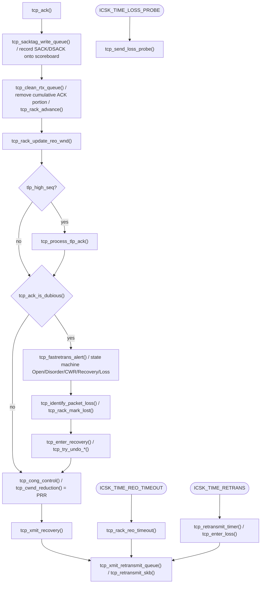

# 8. Loss detection and recovery

This chapter deals with how TCP realises that a segment that ought to have arrived has gone missing, how it re-ships it, how it slows down, and how it undoes those actions if it turns out to have been mistaken.  The scope covers the SACK scoreboard processing and congestion state machine in `net/ipv4/tcp_input.c`, RACK in `net/ipv4/tcp_recovery.c`, retransmission and TLP in `net/ipv4/tcp_output.c`, and the RTO handler in `net/ipv4/tcp_timer.c`.  The timer mechanics themselves (multiplexing via `icsk_pending` and dispatching in `tcp_write_timer_handler()`) are left to Chapter 9, the overall picture of ACK reception and RTT estimation to Chapter 7, and cwnd growth to Chapter 11.

## The ELI5 version

Suppose a courier company ships parcels numbered 1 to 10 (parcels with shipping labels) in order to the mailbox of a particular room.  The receiving end sends back a signed receipt saying "I have received up to number 3", along with a note (SACK) saying "however, numbers 5 to 7 and number 9 arrived early and have been placed on the holding shelf".

The shipping clerk marks off "delivered", "probably lost", and "re-shipped" in their ledger (the scoreboard).  The clerk cannot tell whether parcel 4 is lost or simply running late.  Therefore, a modern shipping clerk decides based on timestamps: "Parcel 7, which was **shipped after** parcel 4, has already arrived, yet parcel 4 has not arrived even after a 'recent round-trip time + a small margin' has elapsed since its dispatch.  So let us judge it as lost" (RACK).

Once it is judged lost, the clerk re-ships it, but because this is evidence that the roads were congested, they reduce the number of trucks allowed on the road at once (cwnd).  However, instead of slamming on the brakes, they reduce it gradually, ensuring that "each time a signed receipt comes back, trucks are dispatched in proportion to the new target number" (PRR).

If the last few parcels are lost all at once, signed receipts stop coming back entirely.  When that happens, they set a kitchen timer for a short duration, and when it goes off, they re-ship just the last parcel on a trial basis to probe the waters (TLP).  If even that fails, a longer kitchen timer (RTO) rings, treating almost all parcels on the outgoing shelf as "lost" and starting over from scratch.

And if it turns out later that "parcel 4 had actually arrived, and the re-shipped parcel arrived as a duplicate" (DSACK) or "the timestamp on the signed receipt for parcel 4 predated the re-shipping" (Eifel), they restore the reduced truck limit back to its previous value (undo).

## What the RFCs say

### Summary of relevant RFCs

- **RFC 2018 — TCP Selective Acknowledgment Options**: An option whereby the receiver reports back "ranges received beyond the cumulative ACK" up to a maximum of 4 blocks (usually 3 when timestamps are also used).  It provides the sender with information that "the SACKed ranges do not need to be retransmitted".  Sender behaviour is specified in [RFC 2018 §5](https://www.rfc-editor.org/rfc/rfc2018#section-5), while the possibility that the receiver may discard SACKed data (reneging) is covered in [RFC 2018 §8](https://www.rfc-editor.org/rfc/rfc2018#section-8).
- **RFC 2883 — An Extension to the SACK Option (D-SACK)**: An extension that reports duplicate received segments in the first SACK block.  This allows the sender to learn that "a retransmission was unnecessary" ([RFC 2883 §4](https://www.rfc-editor.org/rfc/rfc2883#section-4)).
- **RFC 6675 — A Conservative Loss Recovery Algorithm Based on SACK** (obsoletes RFC 3517): A classical algorithm that calculates `pipe` (the amount of data estimated to be in the network) from the SACK scoreboard, and identifies retransmission candidates using `IsLost()` (loss if there are at least DupThresh SACKed segments above it).  Linux **does not implement this verbatim**.  The related code was also removed in 2025 (discussed later).
- **RFC 8985 — The RACK-TLP Loss Detection Algorithm for TCP**: A Standards Track RFC defining RACK, which determines loss by **transmission timestamp** rather than packet count, and TLP, which detects tail losses faster than an RTO.  This forms the foundation of modern Linux loss detection.
- **RFC 6937 — Proportional Rate Reduction for TCP** (Experimental; obsoleted by the standards-track RFC 9937): An algorithm that dictates how cwnd is reduced to ssthresh during recovery.  It determines transmission amounts in proportion to the data acknowledged by ACKs.
- **RFC 6298 — Computing TCP's Retransmission Timer**: Specifies the calculation of RTO and the backoff procedure that doubles RTO upon a timeout ([RFC 6298 §5](https://www.rfc-editor.org/rfc/rfc6298#section-5)).
- **RFC 5682 — Forward RTO-Recovery (F-RTO)**: Inspects ACKs arriving after an RTO to determine whether the timeout was spurious (not actually a loss).  The SACK-based variant is in [RFC 5682 §3](https://www.rfc-editor.org/rfc/rfc5682#section-3).
- **RFC 3522 — The Eifel Detection Algorithm** and **RFC 4015 — The Eifel Response Algorithm**: Mechanisms to detect via timestamp echoes that "an ACK was for the original segment sent before the retransmission", and restore the congestion control state.
- **RFC 3708 — Using TCP DSACKs and SCTP Duplicate TSNs to Detect Spurious Retransmissions** (Experimental): The principle that if all retransmissions are reported by DSACKs, the recovery is deemed spurious.  Linux's `undo_retrans` counter corresponds to this.

### SACK sender rules (RFC 2018 / RFC 2883)

[RFC 2018 §5](https://www.rfc-editor.org/rfc/rfc2018#section-5) requires the sender to maintain a "SACKed" flag for each segment in the retransmission queue, and to refrain from retransmitting SACKed segments.  On the other hand, because [RFC 2018 §8](https://www.rfc-editor.org/rfc/rfc2018#section-8) permits the receiver to discard SACKed data (reneging), the sender must treat SACK flags as "hints" and must not place undue trust in SACK information during an RTO.  In Linux, this is manifested in the reneging handling of `tcp_timeout_mark_lost()` and in `tcp_check_sack_reneging()`.

The decision rules for D-SACK ([RFC 2883 §4](https://www.rfc-editor.org/rfc/rfc2883#section-4)) are twofold:

1. If the first SACK block is below the cumulative ACK (`start_seq < ack_seq`), it is a D-SACK.
2. Otherwise, if the first block is completely contained within the second block, it is a D-SACK (a duplicate of data already sitting on the holding shelf).

### RFC 6675 scoreboard, pipe, and IsLost

RFC 6675 defines the following functions over the scoreboard ([RFC 6675 §4](https://www.rfc-editor.org/rfc/rfc6675#section-4)):

- `IsLost(SeqNum)`: True if there are at least DupThresh discontinuous SACKed segments above `SeqNum`, or if more than `(DupThresh - 1) * SMSS` bytes have been SACKed above it.
- `SetPipe()`: Scans from `HighACK` to `HighData`; for each octet, adding 1 if it is "neither SACKed nor IsLost", and adding another 1 if it has been "retransmitted" yields `pipe`.
- `NextSeg()`: Rules to determine which segment to transmit next (lowest unSACKed lost segment -> new data -> unSACKed non-lost segment -> rescue retransmission).

The recovery procedure is detailed in [RFC 6675 §5](https://www.rfc-editor.org/rfc/rfc6675#section-5): enter recovery upon the DupThresh-th duplicate ACK (or `IsLost`), and transmit via `NextSeg()` as long as `cwnd - pipe >= 1 SMSS`.

Linux's correspondence is as follows:

- `pipe` is measured in **packets** rather than bytes, computed as `tcp_packets_in_flight()` = `packets_out - (sacked_out + lost_out) + retrans_out`.  This computes RFC's `SetPipe()` ("neither SACKed nor IsLost + retransmitted") in O(1) time through counter addition and subtraction.
- `IsLost()` has been replaced by RACK.  The concept of DupThresh is retained in `tcp_rack_reo_wnd()`, which "sets reo_wnd to 0 if SACKs reach or exceed `tp->reordering` on a connection that has not yet observed reordering".
- Rule 1 of `NextSeg()` (retransmitting lost segments) is handled by `tcp_xmit_retransmit_queue()`, and Rule 2 (new data) by `tcp_write_xmit()`.  Rule 3 (pre-emptive retransmission of holes not yet marked lost) and rescue retransmissions do not exist in Linux.  The role of the latter is fulfilled by TLP.

### RACK (RFC 8985 §6)

RACK maintains the following per-connection state ([RFC 8985 §5](https://www.rfc-editor.org/rfc/rfc8985#section-5)):

| RFC 8985 variable | Meaning | Linux |
| --- | --- | --- |
| `RACK.xmit_ts` | Transmission timestamp of the most recently sent segment that was (S)ACKed | `tp->rack.mstamp` |
| `RACK.end_seq` | The ending sequence number of that segment | `tp->rack.end_seq` |
| `RACK.rtt` | RTT measured from that segment | `tp->rack.rtt_us` |
| `RACK.min_RTT` | Min RTT | `tcp_min_rtt(tp)` (windowed min filter of `tp->rtt_min`) |
| `RACK.reo_wnd` | Reordering window | Return value of `tcp_rack_reo_wnd()` |
| `RACK.reo_wnd_mult` | Multiplier increased upon DSACK | `tp->rack.reo_wnd_steps` |
| `RACK.reo_wnd_persist` | Number of recoveries to persist the multiplier | `tp->rack.reo_wnd_persist` |
| `RACK.dsack_round` | Round in which DSACK was reacted to | `tp->rack.last_delivered` |
| `RACK.reordering_seen` | Whether reordering was observed | `tp->reord_seen` (count) |

The procedure upon receiving an ACK is given in [RFC 8985 §6.2](https://www.rfc-editor.org/rfc/rfc8985#section-6.2):

1. **Step 1**: Update `RACK.min_RTT` (in Linux, `tcp_update_rtt_min()` in Chapter 7).
2. **Step 2**: For each newly (S)ACKed segment, update `RACK.rtt`—excluding retransmitted segments whose RTT is smaller than `min_RTT` (which are ambiguous because they might be ACKs for the original transmission)—and advance `RACK.xmit_ts / end_seq` if the segment was transmitted later than `RACK.xmit_ts`.  "Transmitted later" is compared by transmission time, or by `end_seq` if sent at the same time.
3. **Step 3**: If a segment that was not retransmitted is (S)ACKed after a segment with a higher sequence number, it is considered reordered.
4. **Step 4**: Update the reordering window:

   ```
   RACK.reo_wnd = 0                         (no reordering observed, in recovery or SACK count >= DupThresh)
   RACK.reo_wnd = min(RACK.reo_wnd_mult * RACK.min_RTT / 4, SRTT)   (otherwise)
   ```

   For each round in which a DSACK is received, increment `reo_wnd_mult` by 1 and persist that value for 16 recovery episodes.
5. **Step 5**: For each un-(S)ACKed segment sent before `RACK.xmit_ts`, mark it as lost if:

   ```
   Segment.xmit_ts + RACK.rtt + RACK.reo_wnd - Now() <= 0
   ```

   If still positive, set the RACK reordering timer to the maximum of those remaining times.

When an RTO occurs ([RFC 8985 §6.3](https://www.rfc-editor.org/rfc/rfc8985#section-6.3)), only segments sent earlier than `RACK.rtt + RACK.reo_wnd` are treated as lost, whilst recently sent segments are not marked lost.  Linux's `tcp_timeout_mark_lost()` corresponds to this (computed with `reo_wnd` set to 0).

### TLP (RFC 8985 §7)

TLP is the answer to the problem that "if the last few segments are lost, neither duplicate ACKs nor SACKs arrive, so RACK cannot fire either" ([RFC 8985 §7](https://www.rfc-editor.org/rfc/rfc8985#section-7)).

- **PTO calculation** ([§7.2](https://www.rfc-editor.org/rfc/rfc8985#section-7.2)):

  ```
  PTO = 2 * SRTT
  if FlightSize == 1: PTO += WCDelAckT   (worst-case delayed ACK timer, recommended 200ms)
  PTO = min(PTO, remaining time until RTO)
  if no SRTT: PTO = 1 sec
  ```

- **On PTO expiration** ([§7.3](https://www.rfc-editor.org/rfc/rfc8985#section-7.3)): If there is new data to send, send 1 segment of it; otherwise, retransmit the last segment.  At most one probe is sent per tail loss episode.
- **Loss detection via probe ACK** ([§7.4](https://www.rfc-editor.org/rfc/rfc8985#section-7.4)): In general, RACK detects loss upon seeing SACKs ([§7.4.1](https://www.rfc-editor.org/rfc/rfc8985#section-7.4.1)).  As a special case, when "only a single segment was lost and the probe repaired it" ([§7.4.2](https://www.rfc-editor.org/rfc/rfc8985#section-7.4.2)), if an ACK acknowledging beyond `TLP.end_seq` arrives without a DSACK, it is judged that a loss occurred, and only congestion response (cwnd reduction) is performed.  If a DSACK arrives, both the original segment and the probe arrived, meaning no loss occurred.

### PRR (RFC 6937)

The pseudo-code for PRR is given in [RFC 6937 §3](https://www.rfc-editor.org/rfc/rfc6937#section-3):

```
On entering recovery:
   ssthresh      = CongCtrlAlg()
   prr_delivered = 0
   prr_out       = 0
   RecoverFS     = snd.nxt - snd.una

On each ACK during recovery:
   DeliveredData  = change_in(snd.una) + change_in(SACKd)
   prr_delivered += DeliveredData
   pipe = (pipe as in RFC 6675)
   if (pipe > ssthresh) {
       // Proportional Rate Reduction
       sndcnt = CEIL(prr_delivered * ssthresh / RecoverFS) - prr_out
   } else {
       // Reduction Bound
       if (conservative)  limit = prr_delivered - prr_out                         // PRR-CRB
       else               limit = MAX(prr_delivered - prr_out, DeliveredData) + MSS  // PRR-SSRB
       sndcnt = MIN(ssthresh - pipe, limit)
   }

On each transmission or retransmission:
   prr_out += (amount of data sent)
```

Intuitively, while `pipe > ssthresh`, it sends "amount acknowledged by ACK * ssthresh / RecoverFS", so transmission smoothly decreases to ssthresh over 1 RTT.  Once `pipe <= ssthresh`, PRR-SSRB sends up to "delivered amount + 1 MSS" per ACK to return to ssthresh in a slow-start-like fashion.  The standards-track [RFC 9937](https://www.rfc-editor.org/rfc/rfc9937) incorporates Linux's refinement (`9ad084d66619`, discussed later).

### RTO and backoff (RFC 6298 §5)

Among the rules of [RFC 6298 §5](https://www.rfc-editor.org/rfc/rfc6298#section-5), the following are relevant to this chapter:

- (5.4) When the timer expires, retransmit the earliest unacknowledged segment.
- (5.5) `RTO <- RTO * 2` ("back off the timer").  The upper bound is any value of at least 60 seconds pursuant to (2.5) of [§2](https://www.rfc-editor.org/rfc/rfc6298#section-2).
- (5.6) Restart the timer with the new RTO.
- When a valid RTT sample is obtained, clear the backoff and recompute RTO (Karn's algorithm prohibits taking samples from retransmitted segments; [§3](https://www.rfc-editor.org/rfc/rfc6298#section-3)).

### F-RTO (RFC 5682 §3)

SACK-based F-RTO ([RFC 5682 §3.1](https://www.rfc-editor.org/rfc/rfc5682#section-3.1)) inspects the first two ACKs following an RTO:

1. **Step 1**: When RTO expires, retransmit the earliest unacknowledged segment (SND.UNA).  If not in recovery, set `SpuriousRecovery = FALSE` and record `recover = SND.NXT`.
2. **Step 2**: On the first ACK:
   - (a) If it is a duplicate ACK, or if the ACK acknowledges `recover` or beyond, continue normal RTO recovery.
   - (b) If it advances SND.UNA but does not reach `recover`, transmit 2 segments of **new data** and proceed to Step 3 (if no new data can be sent, fall back to normal recovery).
3. **Step 3**: On the next ACK:
   - (a) If it is a duplicate ACK (or carries SACKs), the loss was genuine.  Continue normal recovery.
   - (b) If it advances SND.UNA and acknowledges a segment that **was not retransmitted**, the RTO was spurious.  Restore the congestion control state using an Eifel response (RFC 4015) or similar.

### Undo (RFC 3522 / RFC 4015 / RFC 2883 / RFC 3708)

- **Eifel detection** ([RFC 3522 §3.2](https://www.rfc-editor.org/rfc/rfc3522#section-3.2)): Records the timestamp value at the time of the first retransmission; if TSecr of the first ACK after recovery is older than that value, it concludes the ACK was "for the original segment prior to retransmission" and thus spurious.
- **Eifel response** ([RFC 4015](https://www.rfc-editor.org/rfc/rfc4015)): Upon judging spurious, restores cwnd and ssthresh saved prior to recovery.
- **DSACK-based undo** ([RFC 2883](https://www.rfc-editor.org/rfc/rfc2883) / [RFC 3708](https://www.rfc-editor.org/rfc/rfc3708)): If **all** retransmissions performed during that recovery are reported via DSACKs, all were unnecessary, and state is undone.

Linux implements these mechanisms using five variables: `undo_marker`, `undo_retrans`, `retrans_stamp`, `prior_ssthresh`, and `prior_cwnd` (Step 14).

## The big picture



Processing a single ACK is divided into the following three stages:

1. **Ingesting information**: Updates the scoreboard (per-skb bits and four counters) and RACK state from SACK and cumulative ACKs.
2. **Decision**: `tcp_fastretrans_alert()` invokes RACK to mark loss, transitions `icsk_ca_state`, and performs undo if necessary.  This function **does not reduce** cwnd.
3. **Execution**: `tcp_cong_control()` calculates cwnd via PRR, and `tcp_xmit_recovery()` re-ships segments.

The three entry points on the timer side (RACK's reordering timer, TLP's probe timer, and RTO) multiplex a single `icsk_retransmit_timer` via `icsk_pending` (detailed in Chapter 9).

The transitions of `icsk_ca_state` are summarised below:

| Current | Trigger | Next | Primary functions |
| --- | --- | --- | --- |
| Open | SACK / duplicate ACK received (no loss yet) | Disorder | `tcp_try_keep_open()` |
| Open / Disorder | RACK marks loss (`lost_out != 0`) | Recovery | `tcp_enter_recovery()` |
| Open / Disorder | ECE, local congestion, or TLP detects loss | CWR | `tcp_enter_cwr()` / `tcp_process_tlp_ack()` |
| CWR | `snd_una > high_seq` | Open | `tcp_end_cwnd_reduction()` |
| Recovery | `snd_una >= high_seq` | Open / Disorder | `tcp_try_undo_recovery()` -> `tcp_end_cwnd_reduction()` |
| Recovery | Identified as spurious via DSACK / timestamp | Open / Disorder | `tcp_try_undo_dsack()` / `tcp_try_undo_partial()` |
| Any | RTO expiration | Loss | `tcp_enter_loss()` |
| Loss | `snd_una >= high_seq`, spurious via F-RTO, or undo | Open | `tcp_process_loss()` |
| Loss | Retransmitted packet also lost (`FLAG_LOST_RETRANS`) | Recovery | `tcp_enter_recovery()` |

## Walking through the code

### Step 1: The scoreboard — 3 bits per skb and 4 counters

Each skb in the retransmission queue (`sk->tcp_rtx_queue`, an rbtree ordered by seq) carries tags in `TCP_SKB_CB(skb)->sacked`.  The definition is `enum tcp_skb_cb_sacked_flags` ([include/net/tcp.h#L1120](https://git.kernel.org/pub/scm/linux/kernel/git/netdev/net-next.git/tree/include/net/tcp.h?id=279d5c8afcd38bd841832a39bfe1aa4f8518d98e#n1120)).

```c
/* State flags for sacked in struct tcp_skb_cb */
enum tcp_skb_cb_sacked_flags {
	TCPCB_SACKED_ACKED	= (1 << 0),	/* SKB ACK'd by a SACK block	*/
	TCPCB_SACKED_RETRANS	= (1 << 1),	/* SKB retransmitted		*/
	TCPCB_LOST		= (1 << 2),	/* SKB is lost			*/
	TCPCB_TAGBITS		= (TCPCB_SACKED_ACKED | TCPCB_SACKED_RETRANS |
				   TCPCB_LOST),	/* All tag bits			*/
	TCPCB_REPAIRED		= (1 << 4),	/* SKB repaired (no skb_mstamp_ns)	*/
	TCPCB_EVER_RETRANS	= (1 << 7),	/* Ever retransmitted frame	*/
	TCPCB_RETRANS		= (TCPCB_SACKED_RETRANS | TCPCB_EVER_RETRANS |
				   TCPCB_REPAIRED),
};
```

- `TCPCB_SACKED_ACKED` (S): Segments confirmed delivered via SACK.
- `TCPCB_SACKED_RETRANS` (R): Segments that have been retransmitted and whose retransmissions are considered still in flight.
- `TCPCB_LOST` (L): Segments judged to be lost.
- `TCPCB_EVER_RETRANS`: Segments retransmitted at least once.  While R is cleared by DSACK or subsequent loss, this flag is never cleared.  It is used for Karn's algorithm (not sampling RTT from retransmitted segments) and RACK's ambiguity detection.
- `TCPCB_RETRANS` is not a single bit, but a mask grouping R, `EVER_RETRANS`, and `REPAIRED`.  `sacked & TCPCB_RETRANS` signifies "an skb that has been retransmitted (or has an inaccurate transmission timestamp due to repair)".  Note that `tcp_retransmit_skb()` does `sacked |= TCPCB_RETRANS`, which also sets the `REPAIRED` bit; however, because no code inspects `REPAIRED` in isolation, this causes no harm.

The sums of each flag constitute four counters in `tcp_sock`.  All of them count in **segments (`tcp_skb_pcount()`), not in skbs**.

| Counter | Meaning | Corresponding flag |
| --- | --- | --- |
| `packets_out` | Number of segments between `snd_una` and `snd_nxt` | (Overall) |
| `sacked_out` | Number of S segments (estimated from duplicate ACK count on non-SACK connections) | S |
| `lost_out` | Number of L segments | L |
| `retrans_out` | Number of R segments | R |

The extensive comment preceding `tcp_sacktag_write_queue()` tabulates the valid combinations:

```c
 * Valid combinations are:
 * Tag  InFlight	Description
 * 0	1		- orig segment is in flight.
 * S	0		- nothing flies, orig reached receiver.
 * L	0		- nothing flies, orig lost by net.
 * R	2		- both orig and retransmit are in flight.
 * L|R	1		- orig is lost, retransmit is in flight.
 * S|R  1		- orig reached receiver, retrans is still in flight.
 * (L|S|R is logically valid, it could occur when L|R is sacked,
 *  but it is equivalent to plain S and code short-circuits it to S.
 *  L|S is logically invalid, it would mean -1 packet in flight 8))
 *
```

`L|S` is invalid because it would imply "-1 packet in flight".  When a SACK matches an `L|R` skb, `tcp_sacktag_one()` clears both L and R and sets S (short-circuiting).  From this invariant, the number of segments in flight is expressed by the following formula:

```c
static inline unsigned int tcp_left_out(const struct tcp_sock *tp)
{
	return tp->sacked_out + tp->lost_out;
}

/* This determines how many packets are "in the network" to the best
 * of our knowledge.  In many cases it is conservative, but where
 * detailed information is available from the receiver (via SACK
 * blocks etc.) we can make more aggressive calculations.
 *
 * Use this for decisions involving congestion control, use just
 * tp->packets_out to determine if the send queue is empty or not.
 *
 * Read this equation as:
 *
 *	"Packets sent once on transmission queue" MINUS
 *	"Packets left network, but not honestly ACKed yet" PLUS
 *	"Packets fast retransmitted"
 */
static inline unsigned int tcp_packets_in_flight(const struct tcp_sock *tp)
{
	return tp->packets_out - tcp_left_out(tp) + tp->retrans_out;
}
```

`tcp_packets_in_flight()` ([include/net/tcp.h#L1549](https://git.kernel.org/pub/scm/linux/kernel/git/netdev/net-next.git/tree/include/net/tcp.h?id=279d5c8afcd38bd841832a39bfe1aa4f8518d98e#n1549)) is RFC 6675's `pipe`.  The `tcp_verify_left_out()` macro (`WARN_ON(tcp_left_out(tp) > tp->packets_out)`) acts as the guardian of the invariant that S and L do not overlap.  Both transmission decisions based on cwnd (`tcp_cwnd_test()`, Chapter 4) and PRR rely on this value; hence, an error of even a single segment in these counters can stall transmissions (if overestimated) or cause bursts (if underestimated).

All loss marking passes through `tcp_mark_skb_lost()` ([net/ipv4/tcp_input.c#L1329](https://git.kernel.org/pub/scm/linux/kernel/git/netdev/net-next.git/tree/net/ipv4/tcp_input.c?id=279d5c8afcd38bd841832a39bfe1aa4f8518d98e#n1329)).

```c
static void tcp_verify_retransmit_hint(struct tcp_sock *tp, struct sk_buff *skb)
{
	if ((!tp->retransmit_skb_hint && tp->retrans_out >= tp->lost_out) ||
	    (tp->retransmit_skb_hint &&
	     before(TCP_SKB_CB(skb)->seq,
		    TCP_SKB_CB(tp->retransmit_skb_hint)->seq)))
		tp->retransmit_skb_hint = skb;
}

/* Sum the number of packets on the wire we have marked as lost, and
 * notify the congestion control module that the given skb was marked lost.
 */
static void tcp_notify_skb_loss_event(struct tcp_sock *tp, const struct sk_buff *skb)
{
	tp->lost += tcp_skb_pcount(skb);
}

void tcp_mark_skb_lost(struct sock *sk, struct sk_buff *skb)
{
	__u8 sacked = TCP_SKB_CB(skb)->sacked;
	struct tcp_sock *tp = tcp_sk(sk);

	if (sacked & TCPCB_SACKED_ACKED)
		return;

	tcp_verify_retransmit_hint(tp, skb);
	if (sacked & TCPCB_LOST) {
		if (sacked & TCPCB_SACKED_RETRANS) {
			/* Account for retransmits that are lost again */
			TCP_SKB_CB(skb)->sacked &= ~TCPCB_SACKED_RETRANS;
			tp->retrans_out -= tcp_skb_pcount(skb);
			NET_ADD_STATS(sock_net(sk), LINUX_MIB_TCPLOSTRETRANSMIT,
				      tcp_skb_pcount(skb));
			tcp_notify_skb_loss_event(tp, skb);
		}
	} else {
		tp->lost_out += tcp_skb_pcount(skb);
		TCP_SKB_CB(skb)->sacked |= TCPCB_LOST;
		tcp_notify_skb_loss_event(tp, skb);
	}
}
```

- Line 1334: S skbs are never marked lost (prohibiting `L|S`).
- Line 1337: `tcp_verify_retransmit_hint()` rewinds `retransmit_skb_hint` (the position where `tcp_xmit_retransmit_queue()` begins scanning) if the newly lost skb precedes the hint.  When the hint is NULL, it sets this skb as the hint only if "all L segments have already been retransmitted (`retrans_out >= lost_out`)".  As noted in the comment, it must be called **before** updating `lost_out` / `retrans_out`.
- Lines 1338–1346: An skb already tagged L is judged lost again only when **a retransmission is lost** (`L|R -> L`).  Clearing R and decrementing `retrans_out` reduces pipe, allowing it to be retransmitted once more.  This is what `TCPLostRetransmit` counts.  Because RACK records transmission timestamps for retransmissions as well, it can detect the loss of a retransmission without waiting for an RTO.  This is a major advantage of RACK over FACK and RFC 6675.
- Lines 1347–1350: If it is the first loss, set L and increment `lost_out`.
- `tp->lost` is the cumulative loss count, which `tcp_rate_gen()` passes to congestion control modules (such as BBR) as `rs->losses` in the rate sample.  The name `tcp_notify_skb_loss_event()` remains as room for an explicit loss-event notification hook to congestion control.

### Step 2: Call sequence inside tcp_ack()

Overall ACK processing is covered in Chapter 7.  Here we focus only on the sequence relevant to loss recovery.  Below is an excerpt from `tcp_ack()` ([net/ipv4/tcp_input.c#L4276](https://git.kernel.org/pub/scm/linux/kernel/git/netdev/net-next.git/tree/net/ipv4/tcp_input.c?id=279d5c8afcd38bd841832a39bfe1aa4f8518d98e#n4276)).

```c
	prior_fack = tcp_is_sack(tp) ? tcp_highest_sack_seq(tp) : tp->snd_una;
	rs.prior_in_flight = tcp_packets_in_flight(tp);
...
		if (TCP_SKB_CB(skb)->sacked)
			flag |= tcp_sacktag_write_queue(sk, skb, prior_snd_una,
							&sack_state);
...
	/* See if we can take anything off of the retransmit queue. */
	flag |= tcp_clean_rtx_queue(sk, skb, prior_fack, prior_snd_una,
				    &sack_state, flag & FLAG_ECE);

	tcp_rack_update_reo_wnd(sk, &rs);
...
	if (unlikely(tp->tlp_high_seq))
		tcp_process_tlp_ack(sk, ack, flag);

	if (tcp_ack_is_dubious(sk, flag)) {
		if (!(flag & (FLAG_SND_UNA_ADVANCED |
			      FLAG_NOT_DUP | FLAG_DSACKING_ACK))) {
			num_dupack = 1;
			/* Consider if pure acks were aggregated in tcp_add_backlog() */
			if (!(flag & FLAG_DATA))
				num_dupack = max_t(u16, 1, skb_shinfo(skb)->gso_segs);
		}
		tcp_fastretrans_alert(sk, prior_snd_una, num_dupack, &flag,
				      &rexmit);
	}

	/* If needed, reset TLP/RTO timer when RACK doesn't set. */
	if (flag & FLAG_SET_XMIT_TIMER)
		tcp_set_xmit_timer(sk);

	if ((flag & FLAG_FORWARD_PROGRESS) || !(flag & FLAG_NOT_DUP))
		sk_dst_confirm(sk);

	delivered = tcp_newly_delivered(sk, delivered, ecn_count, flag);

	lost = tp->lost - lost;			/* freshly marked lost */
	rs.is_ack_delayed = !!(flag & FLAG_ACK_MAYBE_DELAYED);
	tcp_rate_gen(sk, delivered, lost, is_sack_reneg, sack_state.rate);
	tcp_cong_control(sk, ack, delivered, flag, sack_state.rate);
	tcp_xmit_recovery(sk, rexmit);
```

- `prior_fack` is the highest SACK sequence **prior** to SACK processing.  `tcp_clean_rtx_queue()` uses it to judge whether "a hole filled by the cumulative ACK was below a range that had already been SACKed" (= reordering).
- `rs.prior_in_flight` is the pipe before ACK processing (for congestion control).
- SACK processing (`tcp_sacktag_write_queue()`) runs only on slow-path ACKs, because ACKs taking the header prediction fast path (Chapter 5) carry no SACK options.
- The order is critical: **SACK tagging -> cumulative ACK removal -> reo_wnd update -> TLP evaluation -> state machine -> cwnd calculation -> re-shipping**.  `tcp_fastretrans_alert()` does not set cwnd.  It merely records in `rexmit` "what ought to be transmitted", and actual transmission is performed by `tcp_xmit_recovery()` **after** `tcp_cong_control()` calculates cwnd via PRR.  With the `tcp_cong_control()` helper (`d452e6caf836` "tcp: tcp_cong_control helper") and the subsequent `c0402760f565` "tcp: new CC hook to set sending rate with rate_sample in any CA state", cwnd determination was consolidated into the latter half of ACK processing, followed by transmission.
- `tcp_ack_is_dubious()` ([net/ipv4/tcp_input.c#L3831](https://git.kernel.org/pub/scm/linux/kernel/git/netdev/net-next.git/tree/net/ipv4/tcp_input.c?id=279d5c8afcd38bd841832a39bfe1aa4f8518d98e#n3831)) evaluates to true on any of: "duplicate ACK (`FLAG_NOT_DUP` absent)", "presence of SACK, ECE, or DSACK (`FLAG_CA_ALERT`)", or "state other than Open".  As long as pure cumulative ACKs arrive smoothly in Open state, the state machine is never entered.
- `num_dupack` counts as `gso_segs` duplicate ACKs if pure ACKs were coalesced in GRO / `tcp_add_backlog()`.  This is crucial for estimating `sacked_out` on non-SACK connections.

### Step 3: tcp_sacktag_write_queue() — Validation and ordering of SACK blocks

`tcp_sacktag_write_queue()` ([net/ipv4/tcp_input.c#L2219](https://git.kernel.org/pub/scm/linux/kernel/git/netdev/net-next.git/tree/net/ipv4/tcp_input.c?id=279d5c8afcd38bd841832a39bfe1aa4f8518d98e#n2219)) is the entry point for reflecting SACK options onto the scoreboard.  We examine it block by block.

```c
static int
tcp_sacktag_write_queue(struct sock *sk, const struct sk_buff *ack_skb,
			u32 prior_snd_una, struct tcp_sacktag_state *state)
{
	struct tcp_sock *tp = tcp_sk(sk);
	const unsigned char *ptr = (skb_transport_header(ack_skb) +
				    TCP_SKB_CB(ack_skb)->sacked);
	struct tcp_sack_block_wire *sp_wire = (struct tcp_sack_block_wire *)(ptr+2);
	struct tcp_sack_block sp[TCP_NUM_SACKS];
	struct tcp_sack_block *cache;
	struct sk_buff *skb;
	int num_sacks = min(TCP_NUM_SACKS, (ptr[1] - TCPOLEN_SACK_BASE) >> 3);
	int used_sacks;
	bool found_dup_sack = false;
	int i, j;
	int first_sack_index;

	state->flag = 0;
	state->reord = tp->snd_nxt;

	if (!tp->sacked_out)
		tcp_highest_sack_reset(sk);

	found_dup_sack = tcp_check_dsack(sk, ack_skb, sp_wire,
					 num_sacks, prior_snd_una, state);

	/* Eliminate too old ACKs, but take into
	 * account more or less fresh ones, they can
	 * contain valid SACK info.
	 */
	if (before(TCP_SKB_CB(ack_skb)->ack_seq, prior_snd_una - tp->max_window))
		return 0;

	if (!tp->packets_out)
		goto out;
```

- Lines 2224–2226: In `TCP_SKB_CB(ack_skb)->sacked`, option parsing (`tcp_parse_options()`) stores the offset of the SACK option from the beginning of the TCP header.  `ptr[1]` is the option length.
- Line 2230: The number of blocks is `(len - 2) / 8`, capped at `TCP_NUM_SACKS` (4).
- Line 2237: `state->reord` is a variable used to track the "lowest sequence number filled by reordering", and `snd_nxt` serves as a sentinel representing "not found".
- Lines 2239–2240: If `sacked_out == 0`, `highest_sack` (a pointer to the next skb after the highest SACK position) is reset to the head of the outgoing shelf (retransmission queue).
- Line 2242: DSACK evaluation is performed prior to block validation (Step 4).
- Lines 2249–2250: ACKs older than `prior_snd_una - max_window` are discarded.  ACKs that are only slightly old are processed because they may have arrived out of order due to ACK reordering and might still carry useful SACK information.
- Lines 2252–2253: If there are no packets in flight, only DSACK statistics are recorded before returning.

```c
	used_sacks = 0;
	first_sack_index = 0;
	for (i = 0; i < num_sacks; i++) {
		bool dup_sack = !i && found_dup_sack;

		sp[used_sacks].start_seq = get_unaligned_be32(&sp_wire[i].start_seq);
		sp[used_sacks].end_seq = get_unaligned_be32(&sp_wire[i].end_seq);

		if (!tcp_is_sackblock_valid(tp, dup_sack,
					    sp[used_sacks].start_seq,
					    sp[used_sacks].end_seq)) {
			int mib_idx;

			if (dup_sack) {
				if (!tp->undo_marker)
					mib_idx = LINUX_MIB_TCPDSACKIGNOREDNOUNDO;
				else
					mib_idx = LINUX_MIB_TCPDSACKIGNOREDOLD;
			} else {
				/* Don't count olds caused by ACK reordering */
				if ((TCP_SKB_CB(ack_skb)->ack_seq != tp->snd_una) &&
				    !after(sp[used_sacks].end_seq, tp->snd_una))
					continue;
				mib_idx = LINUX_MIB_TCPSACKDISCARD;
			}

			NET_INC_STATS(sock_net(sk), mib_idx);
			if (i == 0)
				first_sack_index = -1;
			continue;
		}

		/* Ignore very old stuff early */
		if (!after(sp[used_sacks].end_seq, prior_snd_una)) {
			if (i == 0)
				first_sack_index = -1;
			continue;
		}

		used_sacks++;
	}
```

Each block is validated whilst being copied into `sp[]` in host byte order.

- `dup_sack` is true only when the leading block (`i == 0`) is a DSACK.
- Blocks rejected by `tcp_is_sackblock_valid()` (Step 4) have statistics recorded and are discarded.  Blocks that fall at or below `snd_una` simply because the ACK itself is old (`ack_seq != snd_una`) represent normal behaviour caused by ACK reordering, and are therefore not counted in `TCPSACKDiscard`.
- `first_sack_index` tracks where the block initially written by the receiver ends up after sorting.  Under RFC 2018, the first block reflects the most recently received segment, and a DSACK is also placed at the head, making it necessary to track this position.  If the first block is discarded, it is set to -1.
- Line 2288: Blocks terminating at or below `prior_snd_una` (already cumulatively acknowledged) are also discarded.

```c
	/* order SACK blocks to allow in order walk of the retrans queue */
	for (i = used_sacks - 1; i > 0; i--) {
		for (j = 0; j < i; j++) {
			if (after(sp[j].start_seq, sp[j + 1].start_seq)) {
				swap(sp[j], sp[j + 1]);

				/* Track where the first SACK block goes to */
				if (j == first_sack_index)
					first_sack_index = j + 1;
			}
		}
	}

	state->mss_now = tcp_current_mss(sk);
	skb = NULL;
	i = 0;

	if (!tp->sacked_out) {
		/* It's already past, so skip checking against it */
		cache = tp->recv_sack_cache + ARRAY_SIZE(tp->recv_sack_cache);
	} else {
		cache = tp->recv_sack_cache;
		/* Skip empty blocks in at head of the cache */
		while (tcp_sack_cache_ok(tp, cache) && !cache->start_seq &&
		       !cache->end_seq)
			cache++;
	}
```

- Lines 2298–2308: Bubble sort is used since there are at most 4 elements.  Ordering them by sequence number ensures that the sequence-ordered rbtree only needs to be walked **once in a single direction**.
- Line 2310: `mss_now` is used in SACK shifting (Step 6).
- Lines 2314–2323: `recv_sack_cache[]` holds a copy of the **blocks processed during the previous ACK**.  Because the receiver resends SACK blocks with every ACK, re-tagging the same ranges repeatedly would incur an O(block length) traversal per ACK under large windows.  The subsequent loop skips ranges overlapping with this cache.

```c
	while (i < used_sacks) {
		u32 start_seq = sp[i].start_seq;
		u32 end_seq = sp[i].end_seq;
		bool dup_sack = (found_dup_sack && (i == first_sack_index));
		struct tcp_sack_block *next_dup = NULL;

		if (found_dup_sack && ((i + 1) == first_sack_index))
			next_dup = &sp[i + 1];

		/* Skip too early cached blocks */
		while (tcp_sack_cache_ok(tp, cache) &&
		       !before(start_seq, cache->end_seq))
			cache++;

		/* Can skip some work by looking recv_sack_cache? */
		if (tcp_sack_cache_ok(tp, cache) && !dup_sack &&
		    after(end_seq, cache->start_seq)) {

			/* Head todo? */
			if (before(start_seq, cache->start_seq)) {
				skb = tcp_sacktag_skip(skb, sk, start_seq);
				skb = tcp_sacktag_walk(skb, sk, next_dup,
						       state,
						       start_seq,
						       cache->start_seq,
						       dup_sack);
			}

			/* Rest of the block already fully processed? */
			if (!after(end_seq, cache->end_seq))
				goto advance_sp;

			skb = tcp_maybe_skipping_dsack(skb, sk, next_dup,
						       state,
						       cache->end_seq);

			/* ...tail remains todo... */
			if (tcp_highest_sack_seq(tp) == cache->end_seq) {
				/* ...but better entrypoint exists! */
				skb = tcp_highest_sack(sk);
				if (!skb)
					break;
				cache++;
				goto walk;
			}

			skb = tcp_sacktag_skip(skb, sk, cache->end_seq);
			/* Check overlap against next cached too (past this one already) */
			cache++;
			continue;
		}
```

This is the core of the cache-assisted traversal.

- Lines 2331–2332: A DSACK typically resides either below the cumulative ACK or entirely inside another SACK block.  In the latter case, the DSACK block will appear immediately afterwards (`i + 1`) following the sort, so it is passed as `next_dup` to detect skbs that also fall within the DSACK range whilst traversing the normal block.
- Lines 2335–2337: Cached blocks that end prior to the current block are skipped.
- Line 2340: For blocks overlapping with the cache (excluding DSACKs):
  - Lines 2344–2351: If the head of the block precedes the cache, only that portion (`start_seq` to `cache->start_seq`) is walked.
  - Lines 2354–2355: If the tail also falls entirely within the cache, this block has already been fully processed.
  - Lines 2357–2359: If a DSACK overlaps the cached range, that portion is walked separately (`tcp_maybe_skipping_dsack()`).
  - Lines 2362–2369: If the end of the cache coincides with the current highest SACK, traversal begins directly from the `highest_sack` skb.  This is a shortcut allowing the most common pattern—where only the right edge of a SACK block advances as reception continues behind a single hole—to be processed in O(newly received portion) time.
  - Lines 2371–2374: Otherwise, traversal skips forward to the end of the cache.  `tcp_sacktag_skip()` leaves the current skb untouched if it is already past the target; otherwise, it binary searches the rbtree (`tcp_sacktag_bsearch()`).  Since the outgoing shelf (retransmission queue) was converted to an rbtree in 2017 (`75c119afe14f`), skipping takes O(log n) time.

```c
		if (!before(start_seq, tcp_highest_sack_seq(tp))) {
			skb = tcp_highest_sack(sk);
			if (!skb)
				break;
		}
		skb = tcp_sacktag_skip(skb, sk, start_seq);

walk:
		skb = tcp_sacktag_walk(skb, sk, next_dup, state,
				       start_seq, end_seq, dup_sack);

advance_sp:
		i++;
	}
```

Processing for blocks that do not hit the cache.  If a block starts above `highest_sack` (when a new SACK block is added on the right-hand edge), traversal begins from there.  Otherwise, it skips to `start_seq` before tagging the skbs in `[start_seq, end_seq)` sequentially using `tcp_sacktag_walk()`.

```c
	/* Clear the head of the cache sack blocks so we can skip it next time */
	for (i = 0; i < ARRAY_SIZE(tp->recv_sack_cache) - used_sacks; i++) {
		tp->recv_sack_cache[i].start_seq = 0;
		tp->recv_sack_cache[i].end_seq = 0;
	}
	for (j = 0; j < used_sacks; j++)
		tp->recv_sack_cache[i++] = sp[j];

	if (inet_csk(sk)->icsk_ca_state != TCP_CA_Loss || tp->undo_marker)
		tcp_check_sack_reordering(sk, state->reord, 0);

	tcp_verify_left_out(tp);
out:

#if FASTRETRANS_DEBUG > 0
	WARN_ON((int)tp->sacked_out < 0);
	WARN_ON((int)tp->lost_out < 0);
	WARN_ON((int)tp->retrans_out < 0);
	WARN_ON((int)tcp_packets_in_flight(tp) < 0);
#endif
	return state->flag;
}
```

- Lines 2393–2398: The blocks used in this pass are stored **right-aligned** at the tail of `recv_sack_cache[]`, and the preceding entries are zeroed out.  This corresponds to line 2320 skipping empty entries at the head of the cache.
- Lines 2400–2401: The observed reordering degree (the difference between `state->reord` and the highest SACK) is reflected in `tp->reordering`.  This is omitted in the Loss state because it becomes ambiguous whether a packet is a re-shipping (retransmission) or the original transmission (with an exception if `undo_marker` is set, i.e. an undoable Loss).
- Line 2403: Verification of the invariant `sacked_out + lost_out <= packets_out`.
- The return value `state->flag` contains flags such as `FLAG_DATA_SACKED`, `FLAG_DSACKING_ACK`, `FLAG_ORIG_SACK_ACKED`, and `FLAG_DSACK_TLP`, which are bitwise-ORed into `tcp_ack()`'s `flag`.

### Step 4: DSACK detection and validation of SACK blocks

`tcp_check_dsack()` ([net/ipv4/tcp_input.c#L1484](https://git.kernel.org/pub/scm/linux/kernel/git/netdev/net-next.git/tree/net/ipv4/tcp_input.c?id=279d5c8afcd38bd841832a39bfe1aa4f8518d98e#n1484)) directly implements the two rules of RFC 2883.

```c
static bool tcp_check_dsack(struct sock *sk, const struct sk_buff *ack_skb,
			    struct tcp_sack_block_wire *sp, int num_sacks,
			    u32 prior_snd_una, struct tcp_sacktag_state *state)
{
	struct tcp_sock *tp = tcp_sk(sk);
	u32 start_seq_0 = get_unaligned_be32(&sp[0].start_seq);
	u32 end_seq_0 = get_unaligned_be32(&sp[0].end_seq);
	u32 dup_segs;

	if (before(start_seq_0, TCP_SKB_CB(ack_skb)->ack_seq)) {
		NET_INC_STATS(sock_net(sk), LINUX_MIB_TCPDSACKRECV);
	} else if (num_sacks > 1) {
		u32 end_seq_1 = get_unaligned_be32(&sp[1].end_seq);
		u32 start_seq_1 = get_unaligned_be32(&sp[1].start_seq);

		if (after(end_seq_0, end_seq_1) || before(start_seq_0, start_seq_1))
			return false;
		NET_INC_STATS(sock_net(sk), LINUX_MIB_TCPDSACKOFORECV);
	} else {
		return false;
	}

	dup_segs = tcp_dsack_seen(tp, start_seq_0, end_seq_0, state);
	if (!dup_segs) {	/* Skip dubious DSACK */
		NET_INC_STATS(sock_net(sk), LINUX_MIB_TCPDSACKIGNOREDDUBIOUS);
		return false;
	}

	NET_ADD_STATS(sock_net(sk), LINUX_MIB_TCPDSACKRECVSEGS, dup_segs);

	/* D-SACK for already forgotten data... Do dumb counting. */
	if (tp->undo_marker && tp->undo_retrans > 0 &&
	    !after(end_seq_0, prior_snd_una) &&
	    after(end_seq_0, tp->undo_marker))
		tp->undo_retrans = max_t(int, 0, tp->undo_retrans - dup_segs);

	return true;
}
```

- Line 1493: Rule 1.  If the first block falls below `ack_seq` of **this particular signed receipt (ACK)**, it is a DSACK.
- Lines 1495–1501: Rule 2.  If the first block is completely contained within the second block, it indicates duplicate data on the holding shelf (out-of-order queue) (`TCPDSACKOfoRecv`).
- Line 1506: `tcp_dsack_seen()` determines whether the DSACK is trustworthy and returns the number of duplicate segments.
- Lines 1515–1518: For a DSACK at or below `prior_snd_una`, the corresponding skb has already been purged from the outgoing shelf (retransmission queue), so it cannot be tagged via `tcp_sacktag_one()`.  Therefore, "dumb counting" directly decrements `undo_retrans`.  Restricting this to the range above `undo_marker` ensures that DSACKs for re-shipped packets (retransmissions) prior to the current recovery episode are not counted.

`tcp_dsack_seen()` ([net/ipv4/tcp_input.c#L1232](https://git.kernel.org/pub/scm/linux/kernel/git/netdev/net-next.git/tree/net/ipv4/tcp_input.c?id=279d5c8afcd38bd841832a39bfe1aa4f8518d98e#n1232)) does not trust DSACKs blindly.

```c
static u32 tcp_dsack_seen(struct tcp_sock *tp, u32 start_seq,
			  u32 end_seq, struct tcp_sacktag_state *state)
{
	u32 seq_len, dup_segs = 1;

	if (!before(start_seq, end_seq))
		return 0;

	seq_len = end_seq - start_seq;
	/* Dubious DSACK: DSACKed range greater than maximum advertised rwnd */
	if (seq_len > tp->max_window)
		return 0;
	if (seq_len > tp->mss_cache)
		dup_segs = DIV_ROUND_UP(seq_len, tp->mss_cache);
	else if (tp->tlp_high_seq && tp->tlp_high_seq == end_seq)
		state->flag |= FLAG_DSACK_TLP;

	WRITE_ONCE(tp->dsack_dups, tp->dsack_dups + dup_segs);
	/* Skip the DSACK if dup segs weren't retransmitted by sender */
	if (tp->dsack_dups > tp->total_retrans)
		return 0;

	tp->rx_opt.sack_ok |= TCP_DSACK_SEEN;
	/* We increase the RACK ordering window in rounds where we receive
	 * DSACKs that may have been due to reordering causing RACK to trigger
	 * a spurious fast recovery. Thus RACK ignores DSACKs that happen
	 * without having seen reordering, or that match TLP probes (TLP
	 * is timer-driven, not triggered by RACK).
	 */
	if (tp->reord_seen && !(state->flag & FLAG_DSACK_TLP))
		tp->rack.dsack_seen = 1;

	state->flag |= FLAG_DSACKING_ACK;
	/* A spurious retransmission is delivered */
	state->sack_delivered += dup_segs;

	return dup_segs;
}
```

- Line 1242: A DSACK longer than `max_window` is impossible and therefore ignored (`ad2b9b0f8d01`, protection against malicious receivers or broken middleboxes).
- Lines 1244–1247: If the range exceeds 1 MSS, it is rounded up in units of MSS and counted as multiple segments (`a71d77e6be1e`).  If it is 1 MSS or less and its end sequence matches `tlp_high_seq` (the sequence immediately following the TLP probe), it is flagged as a DSACK responding to a TLP probe (`FLAG_DSACK_TLP`, `63f367d9de77`).
- Lines 1249–1252: If the cumulative DSACK duplicate count exceeds the total number of re-shipped packets (`total_retrans`), it is assumed not to be caused by our own retransmissions (e.g. network replication) and ignored.  `WRITE_ONCE()` is used because `dsack_dups` is read locklessly from `tcp_info`.
- Lines 1261–1262: `rack.dsack_seen` triggers the expansion of RACK's `reo_wnd` (Step 7).  It is not widened on connections that have never witnessed reordering, nor for DSACKs originating from TLP.  Because TLP is driven by a kitchen timer rather than RACK, its DSACK does not provide evidence that `reo_wnd` was too narrow.
- Line 1266: Segments acknowledged by DSACK are also credited as "delivered" and added to `sack_delivered` (for rate sampling and `tp->delivered`).

The quickest path to understanding the validation logic in `tcp_is_sackblock_valid()` ([net/ipv4/tcp_input.c#L1447](https://git.kernel.org/pub/scm/linux/kernel/git/netdev/net-next.git/tree/net/ipv4/tcp_input.c?id=279d5c8afcd38bd841832a39bfe1aa4f8518d98e#n1447)) is to read the preceding lengthy comment (illustrating sequence space wrap-around).

```c
static bool tcp_is_sackblock_valid(struct tcp_sock *tp, bool is_dsack,
				   u32 start_seq, u32 end_seq)
{
	/* Too far in future, or reversed (interpretation is ambiguous) */
	if (after(end_seq, tp->snd_nxt) || !before(start_seq, end_seq))
		return false;

	/* Nasty start_seq wrap-around check (see comments above) */
	if (!before(start_seq, tp->snd_nxt))
		return false;

	/* In outstanding window? ...This is valid exit for D-SACKs too.
	 * start_seq == snd_una is non-sensical (see comments above)
	 */
	if (after(start_seq, tp->snd_una))
		return true;

	if (!is_dsack || !tp->undo_marker)
		return false;

	/* ...Then it's D-SACK, and must reside below snd_una completely */
	if (after(end_seq, tp->snd_una))
		return false;

	if (!before(start_seq, tp->undo_marker))
		return true;

	/* Too old */
	if (!after(end_seq, tp->undo_marker))
		return false;

	/* Undo_marker boundary crossing (overestimates a lot). Known already:
	 *   start_seq < undo_marker and end_seq >= undo_marker.
	 */
	return !before(start_seq, end_seq - tp->max_window);
}
```

- Line 1451: Blocks extending beyond `snd_nxt` or inverted are invalid.
- Line 1455: Rejects cases where only `start_seq` lies beyond `snd_nxt` (where `end_seq` wraps around and might appear "valid").
- Lines 1461–1462: If `snd_una < start_seq`, it is valid.  `start_seq == snd_una` is a contradictory state ("reported via SACK even though cumulative ACK should have advanced", a sign of reneging) and is not accepted here.  Handling of the head skb is left to normal loss recovery.
- Lines 1464–1481: Only DSACKs remain valid below `snd_una`.  However, they must reside above `undo_marker` (`snd_una` at the start of the current recovery episode).  Those crossing the boundary are permitted up to `max_window`.  If `undo_marker` is 0 (not in recovery), there is no rationale for using the DSACK, so it is discarded (`TCPDSACKIgnoredNoUndo`).

### Step 5: tcp_sacktag_walk() and tcp_sacktag_one()

`tcp_sacktag_walk()` ([net/ipv4/tcp_input.c#L2092](https://git.kernel.org/pub/scm/linux/kernel/git/netdev/net-next.git/tree/net/ipv4/tcp_input.c?id=279d5c8afcd38bd841832a39bfe1aa4f8518d98e#n2092)) processes skbs sequentially for a single SACK block.

```c
static struct sk_buff *tcp_sacktag_walk(struct sk_buff *skb, struct sock *sk,
					struct tcp_sack_block *next_dup,
					struct tcp_sacktag_state *state,
					u32 start_seq, u32 end_seq,
					bool dup_sack_in)
{
	struct tcp_sock *tp = tcp_sk(sk);
	struct sk_buff *tmp;

	skb_rbtree_walk_from(skb) {
		int in_sack = 0;
		bool dup_sack = dup_sack_in;

		/* queue is in-order => we can short-circuit the walk early */
		if (!before(TCP_SKB_CB(skb)->seq, end_seq))
			break;

		if (next_dup  &&
		    before(TCP_SKB_CB(skb)->seq, next_dup->end_seq)) {
			in_sack = tcp_match_skb_to_sack(sk, skb,
							next_dup->start_seq,
							next_dup->end_seq);
			if (in_sack > 0)
				dup_sack = true;
		}

		/* skb reference here is a bit tricky to get right, since
		 * shifting can eat and free both this skb and the next,
		 * so not even _safe variant of the loop is enough.
		 */
		if (in_sack <= 0) {
			tmp = tcp_shift_skb_data(sk, skb, state,
						 start_seq, end_seq, dup_sack);
			if (tmp) {
				if (tmp != skb) {
					skb = tmp;
					continue;
				}

				in_sack = 0;
			} else {
				in_sack = tcp_match_skb_to_sack(sk, skb,
								start_seq,
								end_seq);
			}
		}
```

- Lines 2106–2107: Since the rbtree is ordered by sequence number, traversal can be terminated early once the end of the block is exceeded.
- Lines 2109–2116: skbs overlapping with `next_dup` (a DSACK inside this block) are treated as DSACKs.
- Lines 2122–2137: First, SACK shifting (Step 6) is attempted.  `tcp_shift_skb_data()` returns one of three possible values:
  - A different skb (**absorbed** into the immediately preceding SACKed skb): Traversal continues from that skb.  As noted in the comment, shifting can free both the current and the next skb, so even a `_safe` variant of the loop is insufficient.  This is why the updated position is re-acquired from the return value.
  - The same skb (noop): It did not match this block, so `in_sack = 0` is set.
  - NULL (fallback): Shifting could not be performed, so it falls back to determining whether the skb is contained within the block using `tcp_match_skb_to_sack()` as usual.  If a GSO skb is only partially covered by the block, it is split along MSS boundaries with `tcp_fragment()`.

```c
		if (unlikely(in_sack < 0))
			break;

		if (in_sack) {
			TCP_SKB_CB(skb)->sacked =
				tcp_sacktag_one(sk,
						state,
						TCP_SKB_CB(skb)->sacked,
						TCP_SKB_CB(skb)->seq,
						TCP_SKB_CB(skb)->end_seq,
						dup_sack,
						tcp_skb_pcount(skb),
						skb->len,
						tcp_skb_timestamp_us(skb));
			tcp_rate_skb_delivered(sk, skb, state->rate);
			if (TCP_SKB_CB(skb)->sacked & TCPCB_SACKED_ACKED)
				list_del_init(&skb->tcp_tsorted_anchor);

			if (!before(TCP_SKB_CB(skb)->seq,
				    tcp_highest_sack_seq(tp)))
				tcp_advance_highest_sack(sk, skb);
		}
	}
	return skb;
}
```

- Lines 2139–2140: If `tcp_fragment()` fails (out of memory), processing of this block is abandoned.  Correctness is uncompromised, as SACK will be reported again on subsequent ACKs.
- Lines 2143–2152: The actual tagging logic is performed by `tcp_sacktag_one()`.
- Line 2153: Informs delivery rate estimation (rate sample in Chapter 7) that this skb has been delivered.
- Lines 2154–2155: skbs tagged with S are removed from `tsorted_sent_queue` (a list ordered by transmit timestamp).  Because RACK only needs to inspect skbs that have not yet been (S)ACKed in chronological order, keeping this list short is vital to RACK performance.
- Lines 2157–2159: Advances the highest SACK position.

`tcp_sacktag_one()` ([net/ipv4/tcp_input.c#L1612](https://git.kernel.org/pub/scm/linux/kernel/git/netdev/net-next.git/tree/net/ipv4/tcp_input.c?id=279d5c8afcd38bd841832a39bfe1aa4f8518d98e#n1612)) represents the scoreboard state transitions themselves.  It takes `[start_seq, end_seq)` and `pcount` rather than the entire skb as arguments because shifting may tag only a portion of an skb (`cc9a672ee522`).

```c
static u8 tcp_sacktag_one(struct sock *sk,
			  struct tcp_sacktag_state *state, u8 sacked,
			  u32 start_seq, u32 end_seq,
			  int dup_sack, int pcount, u32 plen,
			  u64 xmit_time)
{
	struct tcp_sock *tp = tcp_sk(sk);

	/* Account D-SACK for retransmitted packet. */
	if (dup_sack && (sacked & TCPCB_RETRANS)) {
		if (tp->undo_marker && tp->undo_retrans > 0 &&
		    after(end_seq, tp->undo_marker))
			tp->undo_retrans = max_t(int, 0, tp->undo_retrans - pcount);
		if ((sacked & TCPCB_SACKED_ACKED) &&
		    before(start_seq, state->reord))
				state->reord = start_seq;
	}

	/* Nothing to do; acked frame is about to be dropped (was ACKed). */
	if (!after(end_seq, tp->snd_una))
		return sacked;

	if (!(sacked & TCPCB_SACKED_ACKED)) {
		tcp_rack_advance(tp, sacked, end_seq, xmit_time);

		if (sacked & TCPCB_SACKED_RETRANS) {
			/* If the segment is not tagged as lost,
			 * we do not clear RETRANS, believing
			 * that retransmission is still in flight.
			 */
			if (sacked & TCPCB_LOST) {
				sacked &= ~(TCPCB_LOST|TCPCB_SACKED_RETRANS);
				tp->lost_out -= pcount;
				tp->retrans_out -= pcount;
			}
```

- Lines 1621–1628: DSACK for a re-shipped (retransmitted) skb.  If above `undo_marker`, it decrements `undo_retrans` (the approach of RFC 3708).  If a DSACK arrives for an skb already marked S, it indicates that the original transmission was SACKed and the retransmission also arrived.  In other words, the retransmission was an unnecessary re-shipping triggered by reordering, so `state->reord` is updated.
- Lines 1631–1632: Nothing is done for data at or below `snd_una`, as it will be purged shortly by `tcp_clean_rtx_queue()`.
- Line 1634: Counters are updated only when a segment transitions to S for the first time.  Counting only once regardless of how many times SACKs arrive for the same range is the cornerstone of idempotency.
- Line 1635: `tcp_rack_advance()` updates RACK's "most recently transmitted and delivered segment" (RFC 8985 Step 2).
- Lines 1637–1646: Case where an skb tagged with R is SACKed.
  - If L|R: Because the original transmission was lost, what was SACKed is the retransmission.  L and R are cleared to make it S (`lost_out--`, `retrans_out--`).
  - If R without L (re-shipped without the original transmission being deemed lost, such as head retransmissions after RTO or TLP retransmissions): R is retained.  The SACK may have acknowledged the original transmission, meaning the retransmission could still be in flight.  This corresponds to the "S|R: 1 in flight" state in the table.

```c
		} else {
			if (!(sacked & TCPCB_RETRANS)) {
				/* New sack for not retransmitted frame,
				 * which was in hole. It is reordering.
				 */
				if (before(start_seq,
					   tcp_highest_sack_seq(tp)) &&
				    before(start_seq, state->reord))
					state->reord = start_seq;

				if (!after(end_seq, tp->high_seq))
					state->flag |= FLAG_ORIG_SACK_ACKED;
				if (state->first_sackt == 0)
					state->first_sackt = xmit_time;
				state->last_sackt = xmit_time;
			}

			if (sacked & TCPCB_LOST) {
				sacked &= ~TCPCB_LOST;
				tp->lost_out -= pcount;
			}
		}

		sacked |= TCPCB_SACKED_ACKED;
		state->flag |= FLAG_DATA_SACKED;
		tp->sacked_out += pcount;
		/* Out-of-order packets delivered */
		state->sack_delivered += pcount;
		state->delivered_bytes += plen;
	}

	/* D-SACK. We can detect redundant retransmission in S|R and plain R
	 * frames and clear it. undo_retrans is decreased above, L|R frames
	 * are accounted above as well.
	 */
	if (dup_sack && (sacked & TCPCB_SACKED_RETRANS)) {
		sacked &= ~TCPCB_SACKED_RETRANS;
		tp->retrans_out -= pcount;
	}

	return sacked;
}
```

- Lines 1648–1662: Case where an skb that was never re-shipped is SACKed.
  - If it lies **below** the current highest SACK, a subsequently transmitted packet arrived earlier—conclusive evidence of reordering (RFC 8985 Step 3).  The lowest position is recorded in `state->reord`.
  - If at or below `high_seq` (`snd_nxt` at the start of recovery), `FLAG_ORIG_SACK_ACKED` is set.  This is used in F-RTO Step 3.b ("non-retransmitted data has been acknowledged").
  - `first_sackt` / `last_sackt` are used for RTT sampling from SACKs (Chapter 7).
- Lines 1664–1667: If an skb with only L set (deemed lost, but not yet re-shipped) is SACKed, L is removed.  The loss declaration was premature (it was reordering).
- Lines 1670–1675: Sets S, increments `sacked_out`, and records delivered data.
- Lines 1682–1685: When a DSACK hits an skb marked R, it is known that the retransmitted copy has also arrived, so R is cleared (S|R → S, R → 0).

`tcp_rack_advance()` ([net/ipv4/tcp_input.c#L1583](https://git.kernel.org/pub/scm/linux/kernel/git/netdev/net-next.git/tree/net/ipv4/tcp_input.c?id=279d5c8afcd38bd841832a39bfe1aa4f8518d98e#n1583)) was moved from `tcp_recovery.c` to `tcp_input.c` in 2026 (`d5fb143dbe8d`) to place it in the same translation unit as its caller for inlining.

```c
static void tcp_rack_advance(struct tcp_sock *tp, u8 sacked,
			     u32 end_seq, u64 xmit_time)
{
	u32 rtt_us;

	rtt_us = tcp_stamp_us_delta(tp->tcp_mstamp, xmit_time);
	if (rtt_us < tcp_min_rtt(tp) && (sacked & TCPCB_RETRANS)) {
		/* If the sacked packet was retransmitted, it's ambiguous
		 * whether the retransmission or the original (or the prior
		 * retransmission) was sacked.
		 *
		 * If the original is lost, there is no ambiguity. Otherwise
		 * we assume the original can be delayed up to aRTT + min_rtt.
		 * the aRTT term is bounded by the fast recovery or timeout,
		 * so it's at least one RTT (i.e., retransmission is at least
		 * an RTT later).
		 */
		return;
	}
	tp->rack.advanced = 1;
	tp->rack.rtt_us = rtt_us;
	if (tcp_skb_sent_after(xmit_time, tp->rack.mstamp,
			       end_seq, tp->rack.end_seq)) {
		tp->rack.mstamp = xmit_time;
		tp->rack.end_seq = end_seq;
	}
}
```

- Line 1588: `tp->tcp_mstamp` is the current time in µs sampled once via `tcp_mstamp_refresh()` at the start of ACK processing.  Avoiding reading the clock per skb is an intentional performance design.
- Lines 1589–1601: For an skb that has been retransmitted, if the measured RTT is smaller than `min_rtt`, it is ambiguous whether the (S)ACK corresponds to the original transmission or the retransmission, so it is discarded.  This is a direct implementation of RFC 8985 Step 2.  Conversely, if the RTT is greater than or equal to `min_rtt`, even if it were an ACK for the retransmission, the value is at least physically plausible and is therefore utilised.
- Lines 1602–1603: Setting `advanced` causes `tcp_rack_mark_lost()` to scan the queue after this ACK.  `rtt_us` is **overwritten on each call**.  Because calls proceed in sequence order, what ultimately remains is the "RTT of the last skb processed in this ACK".
- Lines 1604–1608: If the skb was transmitted later, `mstamp` / `end_seq` are advanced.  `tcp_skb_sent_after()` ([include/net/tcp.h#L1508](https://git.kernel.org/pub/scm/linux/kernel/git/netdev/net-next.git/tree/include/net/tcp.h?id=279d5c8afcd38bd841832a39bfe1aa4f8518d98e#n1508)) tests whether "the transmit timestamp is newer, or identical with a higher sequence number".  Because TSO can produce multiple skbs with the identical microsecond timestamp from a single `tcp_write_xmit()` invocation, a sequence-number tie-breaker is essential (`1d0833df5943`).

On the cumulative ACK side as well, `tcp_clean_rtx_queue()` invokes the same function.

```c
		if (sacked & TCPCB_SACKED_ACKED) {
			tp->sacked_out -= acked_pcount;
			/* snd_una delta covers these skbs */
			sack->delivered_bytes -= skb->len;
		} else if (tcp_is_sack(tp)) {
			tcp_count_delivered(tp, acked_pcount, ece_ack);
			if (!tcp_skb_spurious_retrans(tp, skb))
				tcp_rack_advance(tp, sacked, scb->end_seq,
						 tcp_skb_timestamp_us(skb));
		}
		if (sacked & TCPCB_LOST)
			tp->lost_out -= acked_pcount;
```

RACK is advanced when an skb that was not marked S is cumulatively acknowledged.  However, it is not advanced if `tcp_skb_spurious_retrans()` returns true (where TSecr precedes the skb's transmit timestamp, indicating via timestamps that the ACK was for the original transmission).

### Step 6: SACK shifting — Coalescing fragmented skbs

When non-contiguous SACKs arrive for large skbs transmitted via TSO, `tcp_match_skb_to_sack()` fragments them into MSS units via `tcp_fragment()`, leaving the outgoing shelf (retransmission queue) littered with 1-MSS skbs.  This incurs heavy overhead in both memory consumption (the `truesize` overhead of each skb) and subsequent queue traversal cost.  SACK shifting, introduced by Ilpo Järvinen in 2008 (`832d11c5cd07`), conversely coalesces SACKed ranges into a single large skb by **moving page references** of newly SACKed segments into the immediately preceding, already SACKed skb.

Prerequisite checks and determination of the transfer length in `tcp_shift_skb_data()` ([net/ipv4/tcp_input.c#L1954](https://git.kernel.org/pub/scm/linux/kernel/git/netdev/net-next.git/tree/net/ipv4/tcp_input.c?id=279d5c8afcd38bd841832a39bfe1aa4f8518d98e#n1954)).

```c
	/* Normally R but no L won't result in plain S */
	if (!dup_sack &&
	    (TCP_SKB_CB(skb)->sacked & (TCPCB_LOST|TCPCB_SACKED_RETRANS)) == TCPCB_SACKED_RETRANS)
		goto fallback;
	if (!skb_can_shift(skb))
		goto fallback;
	/* This frame is about to be dropped (was ACKed). */
	if (!after(TCP_SKB_CB(skb)->end_seq, tp->snd_una))
		goto fallback;

	/* Can only happen with delayed DSACK + discard craziness */
	prev = skb_rb_prev(skb);
	if (!prev)
		goto fallback;

	if ((TCP_SKB_CB(prev)->sacked & TCPCB_TAGBITS) != TCPCB_SACKED_ACKED)
		goto fallback;

	if (!tcp_skb_can_collapse(prev, skb))
		goto fallback;
...
		if (mss != tcp_skb_seglen(prev))
			goto fallback;
...
	/* tcp_sacktag_one() won't SACK-tag ranges below snd_una */
	if (!after(TCP_SKB_CB(skb)->seq + len, tp->snd_una))
		goto fallback;

	if (!tcp_skb_shift(prev, skb, pcount, len))
		goto fallback;
	if (!tcp_shifted_skb(sk, prev, skb, state, pcount, len, mss, dup_sack))
		goto out;

	/* Hole filled allows collapsing with the next as well, this is very
	 * useful when hole on every nth skb pattern happens
	 */
	skb = skb_rb_next(prev);
	if (!skb)
		goto out;

	if (!skb_can_shift(skb) ||
	    ((TCP_SKB_CB(skb)->sacked & TCPCB_TAGBITS) != TCPCB_SACKED_ACKED) ||
	    (mss != tcp_skb_seglen(skb)))
		goto out;

	if (!tcp_skb_can_collapse(prev, skb))
		goto out;
	len = skb->len;
	pcount = tcp_skb_pcount(skb);
	if (tcp_skb_shift(prev, skb, pcount, len))
		tcp_shifted_skb(sk, prev, skb, state, pcount,
				len, mss, 0);
```

- Lines 1967–1969: An skb with R but no L (which transitions to S|R) cannot be coalesced because its state differs from `prev` (a pure S).
- Lines 1970–1971: `skb_can_shift()` restricts shifting to skbs where the linear buffer is empty and only page fragments (`frags`) are present.  This is because it requires nothing more than reassigning page references.
- Lines 1981–1982: `prev` must be a **pure S** (neither L nor R set).
- Lines 1984–1985: `tcp_skb_can_collapse()` rejects skbs that must not be merged due to boundaries such as EOR (`MSG_EOR`) or zerocopy buffers.
- Lines 1998–1999: The MSS (`tcp_skb_seglen()`) must match `prev` in order to preserve `pcount` consistency (the identical check is performed on line 2039 when shifting only a portion of an skb).  The omitted code in between rounds the shifted length down to multiples of MSS when only part of the skb falls within the block.
- Lines 2052–2054: Data at or below `snd_una` is never shifted (`4648dc97af9d`).
- Lines 2056–2059: `tcp_skb_shift()` performs the actual page movement, while `tcp_shifted_skb()` updates the scoreboard and adjusts sequence numbers.
- Lines 2064–2079: Once a hole is filled and the skb following `prev` is also a pure S, it is successively absorbed as well.  This is particularly effective for patterns with a hole every nth skb.

Key highlights of `tcp_shifted_skb()` ([net/ipv4/tcp_input.c#L1847](https://git.kernel.org/pub/scm/linux/kernel/git/netdev/net-next.git/tree/net/ipv4/tcp_input.c?id=279d5c8afcd38bd841832a39bfe1aa4f8518d98e#n1847)).

```c
	tcp_sacktag_one(sk, state, TCP_SKB_CB(skb)->sacked,
			start_seq, end_seq, dup_sack, pcount, skb->len,
			tcp_skb_timestamp_us(skb));
	tcp_rate_skb_delivered(sk, skb, state->rate);

	TCP_SKB_CB(prev)->end_seq += shifted;
	TCP_SKB_CB(skb)->seq += shifted;

	tcp_skb_pcount_add(prev, pcount);
	WARN_ON_ONCE(tcp_skb_pcount(skb) < pcount);
	tcp_skb_pcount_add(skb, -pcount);
...
	/* Whole SKB was eaten :-) */

	if (skb == tp->retransmit_skb_hint)
		tp->retransmit_skb_hint = prev;

	TCP_SKB_CB(prev)->tcp_flags |= TCP_SKB_CB(skb)->tcp_flags;
	TCP_SKB_CB(prev)->eor = TCP_SKB_CB(skb)->eor;
	if (TCP_SKB_CB(skb)->tcp_flags & TCPHDR_FIN)
		TCP_SKB_CB(prev)->end_seq++;

	if (skb == tcp_highest_sack(sk))
		tcp_advance_highest_sack(sk, skb);

	tcp_skb_collapse_tstamp(prev, skb);
	if (unlikely(TCP_SKB_CB(prev)->tx.delivered_mstamp))
		TCP_SKB_CB(prev)->tx.delivered_mstamp = 0;

	tcp_rtx_queue_unlink_and_free(skb, sk);

	NET_INC_STATS(sock_net(sk), LINUX_MIB_SACKMERGED);

	return true;
```

- Lines 1865–1868: The shifted range is tagged via `tcp_sacktag_one()` **first**.  This is because adjusting `seq` beforehand would implicitly shift `tcp_highest_sack_seq()` if `skb` happened to be `highest_sack` (as explained in the source comments).
- Lines 1870–1875: Extends `end_seq` of `prev`, advances `seq` of `skb`, and transfers `pcount`.
- Lines 1898–1919: When an skb is completely absorbed, hints (`retransmit_skb_hint`, `highest_sack`) are transferred to `prev`, FIN and EOR flags are inherited, transmit timestamps are collapsed, and the skb is freed.  `TCPSackMerged` counts these full coalescences, whereas partial transfers increment `TCPSackShifted`.

### Step 7: RACK — net/ipv4/tcp_recovery.c

#### tcp_rack_reo_wnd(): reordering window

`tcp_rack_reo_wnd()` ([net/ipv4/tcp_recovery.c#L5](https://git.kernel.org/pub/scm/linux/kernel/git/netdev/net-next.git/tree/net/ipv4/tcp_recovery.c?id=279d5c8afcd38bd841832a39bfe1aa4f8518d98e#n5))

```c
static u32 tcp_rack_reo_wnd(const struct sock *sk)
{
	const struct tcp_sock *tp = tcp_sk(sk);

	if (!tp->reord_seen) {
		/* If reordering has not been observed, be aggressive during
		 * the recovery or starting the recovery by DUPACK threshold.
		 */
		if (inet_csk(sk)->icsk_ca_state >= TCP_CA_Recovery)
			return 0;

		if (tp->sacked_out >= tp->reordering &&
		    !(READ_ONCE(sock_net(sk)->ipv4.sysctl_tcp_recovery) &
		      TCP_RACK_NO_DUPTHRESH))
			return 0;
	}

	/* To be more reordering resilient, allow min_rtt/4 settling delay.
	 * Use min_rtt instead of the smoothed RTT because reordering is
	 * often a path property and less related to queuing or delayed ACKs.
	 * Upon receiving DSACKs, linearly increase the window up to the
	 * smoothed RTT.
	 */
	return min((tcp_min_rtt(tp) >> 2) * tp->rack.reo_wnd_steps,
		   tp->srtt_us >> 3);
}
```

- Line 9: `reord_seen` is the count of reordering events observed on this connection (incremented by functions such as `tcp_check_sack_reordering()`).
- Lines 13–14: If a connection that has not observed reordering is already in Recovery or Loss, reo_wnd = 0.  During recovery, all parcels sent prior to the most recently delivered parcel are immediately deemed lost, speeding up recovery.
- Lines 16–19: For a connection that has not observed reordering, if the SACKed segments equal or exceed `tp->reordering` (default is `sysctl_tcp_reordering` = 3 = DupThresh), reo_wnd = 0.  This is where the DupThresh rule from RFC 6675 is reproduced within RACK (`20b654dfe1be`).  Whereas RFC 6675 marks only segments that have DupThresh SACKs above them as lost, here, if total SACKed segments reach DupThresh, all un-SACKed parcels sent before RACK.xmit_ts are marked lost.  This rule can be disabled via `TCP_RACK_NO_DUPTHRESH` (bit 2 of sysctl `tcp_recovery`).
- Lines 28–29: Otherwise, it is `min(min_rtt/4 × steps, srtt)`.  Because `srtt_us` is maintained scaled by 8, `>> 3` yields the actual SRTT.  min_rtt is used because reordering is a path property and has little to do with queuing or delayed signed receipts (ACKs) (as noted in the comment).

`min_rtt/4` is computed by bit-shifting rather than division.  `reo_wnd_steps` is a u8, saturated at 0xFF.

#### tcp_rack_skb_timeout() and tcp_rack_detect_loss()

```c
s32 tcp_rack_skb_timeout(struct tcp_sock *tp, struct sk_buff *skb, u32 reo_wnd)
{
	return tp->rack.rtt_us + reo_wnd -
	       tcp_stamp_us_delta(tp->tcp_mstamp, tcp_skb_timestamp_us(skb));
}
```

`tcp_rack_skb_timeout()` ([net/ipv4/tcp_recovery.c#L32](https://git.kernel.org/pub/scm/linux/kernel/git/netdev/net-next.git/tree/net/ipv4/tcp_recovery.c?id=279d5c8afcd38bd841832a39bfe1aa4f8518d98e#n32)) is none other than `Segment.xmit_ts + RACK.rtt + RACK.reo_wnd - Now()` from RFC 8985 Step 5, returning a signed value in µs.  If negative or zero, the parcel is considered lost.

`tcp_rack_detect_loss()` ([net/ipv4/tcp_recovery.c#L58](https://git.kernel.org/pub/scm/linux/kernel/git/netdev/net-next.git/tree/net/ipv4/tcp_recovery.c?id=279d5c8afcd38bd841832a39bfe1aa4f8518d98e#n58))

```c
static void tcp_rack_detect_loss(struct sock *sk, u32 *reo_timeout)
{
	struct tcp_sock *tp = tcp_sk(sk);
	struct sk_buff *skb, *n;
	u32 reo_wnd;

	*reo_timeout = 0;
	reo_wnd = tcp_rack_reo_wnd(sk);
	list_for_each_entry_safe(skb, n, &tp->tsorted_sent_queue,
				 tcp_tsorted_anchor) {
		struct tcp_skb_cb *scb = TCP_SKB_CB(skb);
		s32 remaining;

		/* Skip ones marked lost but not yet retransmitted */
		if ((scb->sacked & TCPCB_LOST) &&
		    !(scb->sacked & TCPCB_SACKED_RETRANS))
			continue;

		if (!tcp_skb_sent_after(tp->rack.mstamp,
					tcp_skb_timestamp_us(skb),
					tp->rack.end_seq, scb->end_seq))
			break;

		/* A packet is lost if it has not been s/acked beyond
		 * the recent RTT plus the reordering window.
		 */
		remaining = tcp_rack_skb_timeout(tp, skb, reo_wnd);
		if (remaining <= 0) {
			tcp_mark_skb_lost(sk, skb);
			list_del_init(&skb->tcp_tsorted_anchor);
		} else {
			/* Record maximum wait time */
			*reo_timeout = max_t(u32, *reo_timeout, remaining);
		}
	}
}
```

- Lines 66–67: What is traversed is not the rbtree (ordered by sequence number) but `tsorted_sent_queue`, namely a list ordered by **the time when each parcel with a shipping label (skb) was last (re-)sent**.  Whenever an skb is transmitted or re-shipped, `tcp_update_skb_after_send()` ([net/ipv4/tcp_output.c#L1446](https://git.kernel.org/pub/scm/linux/kernel/git/netdev/net-next.git/tree/net/ipv4/tcp_output.c?id=279d5c8afcd38bd841832a39bfe1aa4f8518d98e#n1446)) moves it to the tail of the list; once marked S (SACKed), `tcp_sacktag_walk()` unlinks it; and when cumulatively acknowledged, it is unlinked upon being freed.  Therefore, this list holds "skbs that have not yet been (S)ACKed" in transmission timestamp order.
- Lines 72–74: skbs marked L without R (marked lost but not yet re-shipped) do not need to be evaluated again and are skipped.
- Lines 76–79: Traversal breaks once reaching an skb sent after or at `rack.mstamp` (the transmission timestamp of the most recently delivered parcel).  Because the list is ordered by transmission timestamp, everything beyond this point is strictly newer.  Thanks to this early termination, the scan touches only as many un-(S)ACKed skbs as were sent prior to `rack.mstamp`.  Until Eric Dumazet introduced this list in 2017 (`e2080072ed2d`), RACK walked the entire re-shipping queue (outgoing shelf).
- Lines 84–87: If expired, the parcel is marked lost and **unlinked from the list**.  Unlinking ensures it will not be inspected again in subsequent scans until it is re-shipped, at which point `tcp_update_skb_after_send()` places it back at the tail.
- Lines 88–91: If not yet expired, the **maximum** remaining time is recorded.  Because the list is sorted by transmission timestamp, skbs further along have longer remaining times, meaning the maximum corresponds to the remaining time of the newest skb sent before `rack.mstamp`.  In other words, the REO kitchen timer expires only once—at the exact time the **last** waiting skb expires—where all expired parcels are evaluated together as lost.  Earlier-expiring skbs experience a slight delay in evaluation, but since skbs within the same flight share very close transmission timestamps, the difference is minuscule, avoiding repeatedly resetting kitchen timers on every signed receipt (ACK).

#### tcp_rack_mark_lost(): Entry point from ACK processing

`tcp_rack_mark_lost()` ([net/ipv4/tcp_recovery.c#L95](https://git.kernel.org/pub/scm/linux/kernel/git/netdev/net-next.git/tree/net/ipv4/tcp_recovery.c?id=279d5c8afcd38bd841832a39bfe1aa4f8518d98e#n95))

```c
bool tcp_rack_mark_lost(struct sock *sk)
{
	struct tcp_sock *tp = tcp_sk(sk);
	u32 timeout;

	if (!tp->rack.advanced)
		return false;

	/* Reset the advanced flag to avoid unnecessary queue scanning */
	tp->rack.advanced = 0;
	tcp_rack_detect_loss(sk, &timeout);
	if (timeout) {
		timeout = usecs_to_jiffies(timeout + TCP_TIMEOUT_MIN_US);
		inet_csk_reset_xmit_timer(sk, ICSK_TIME_REO_TIMEOUT,
					  timeout, inet_csk(sk)->icsk_rto);
	}
	return !!timeout;
}
```

- Lines 100–104: `rack.advanced` is a flag raised by `tcp_rack_advance()` whenever a "new delivery" occurs.  Unless RACK.xmit_ts advances, nothing new can be deemed lost, so the scan itself is skipped.  This design avoids redundant scans even when flooded with duplicate signed receipts (ACKs).
- Lines 106–110: If there are parcels awaiting expiry, an `ICSK_TIME_REO_TIMEOUT` kitchen timer is armed.  Adding `TCP_TIMEOUT_MIN_US` (2 ms) prevents the kitchen timer from expiring prematurely due to rounding to HZ and terminating without detecting anything (`1c2709cfff1d`).  The final argument `icsk_rto` of `inet_csk_reset_xmit_timer()` serves as the upper bound.
- If the return value is true (a kitchen timer was armed), the caller `tcp_identify_packet_loss()` clears `FLAG_SET_XMIT_TIMER`.  Because a single kitchen timer is shared amongst RTO, TLP, and REO, having `tcp_set_xmit_timer()` overwrite the freshly armed REO kitchen timer must be prevented.

#### tcp_rack_reo_timeout(): Expiration of the reordering timer

`tcp_rack_reo_timeout()` ([net/ipv4/tcp_recovery.c#L117](https://git.kernel.org/pub/scm/linux/kernel/git/netdev/net-next.git/tree/net/ipv4/tcp_recovery.c?id=279d5c8afcd38bd841832a39bfe1aa4f8518d98e#n117))

```c
void tcp_rack_reo_timeout(struct sock *sk)
{
	struct tcp_sock *tp = tcp_sk(sk);
	u32 timeout, prior_inflight;
	u32 lost = tp->lost;

	prior_inflight = tcp_packets_in_flight(tp);
	tcp_rack_detect_loss(sk, &timeout);
	if (prior_inflight != tcp_packets_in_flight(tp)) {
		if (inet_csk(sk)->icsk_ca_state != TCP_CA_Recovery) {
			tcp_enter_recovery(sk, false);
			if (!inet_csk(sk)->icsk_ca_ops->cong_control)
				tcp_cwnd_reduction(sk, 1, tp->lost - lost, 0);
		}
		tcp_xmit_retransmit_queue(sk);
	}
	if (inet_csk(sk)->icsk_pending != ICSK_TIME_RETRANS)
		tcp_rearm_rto(sk);
}
```

- Lines 123–124: Because `tcp_write_timer_handler()` refreshed `tcp_mstamp_refresh()` immediately prior, `tcp_mstamp` represents the current time.  `tcp_rack_detect_loss()` is executed once again.  Here, `rack.advanced` is ignored; the passage of time itself constitutes fresh information.
- Line 125: Checked by whether pipe has changed—that is, whether new losses were marked.
- Lines 126–130: If not yet in Recovery, the connection enters Recovery.  Because this occurs outside signed receipt (ACK) processing, PRR (`tcp_cwnd_reduction()`) is invoked directly once without going through `tcp_cong_control()`, establishing a cwnd (trucks allowed on the road at once) capable of transmitting at least one segment.  It is not called for congestion control modules providing `cong_control` (such as BBR).
- Line 131: Re-ships parcels.
- Lines 133–134: Upon expiration of the REO kitchen timer, `icsk_pending` remains ICSK_TIME_REO_TIMEOUT.  If `tcp_xmit_retransmit_queue()` did not re-arm an RTO (i.e. not `ICSK_TIME_RETRANS`), an RTO kitchen timer is re-armed here.

#### tcp_rack_update_reo_wnd(): Expanding reo_wnd with DSACK

`tcp_rack_update_reo_wnd()` ([net/ipv4/tcp_input.c#L4250](https://git.kernel.org/pub/scm/linux/kernel/git/netdev/net-next.git/tree/net/ipv4/tcp_input.c?id=279d5c8afcd38bd841832a39bfe1aa4f8518d98e#n4250)) is called inside `tcp_ack()` immediately after `tcp_clean_rtx_queue()`.  This too was moved to `tcp_input.c` in 2026 (`629a68865abb`).

```c
static void tcp_rack_update_reo_wnd(struct sock *sk, struct rate_sample *rs)
{
	struct tcp_sock *tp = tcp_sk(sk);

	if ((READ_ONCE(sock_net(sk)->ipv4.sysctl_tcp_recovery) &
	     TCP_RACK_STATIC_REO_WND) ||
	    !rs->prior_delivered)
		return;

	/* Disregard DSACK if a rtt has not passed since we adjusted reo_wnd */
	if (before(rs->prior_delivered, tp->rack.last_delivered))
		tp->rack.dsack_seen = 0;

	/* Adjust the reo_wnd if update is pending */
	if (tp->rack.dsack_seen) {
		tp->rack.reo_wnd_steps = min_t(u32, 0xFF,
					       tp->rack.reo_wnd_steps + 1);
		tp->rack.dsack_seen = 0;
		tp->rack.last_delivered = tp->delivered;
		tp->rack.reo_wnd_persist = TCP_RACK_RECOVERY_THRESH;
	} else if (!tp->rack.reo_wnd_persist) {
		tp->rack.reo_wnd_steps = 1;
	}
}
```

- Lines 4254–4257: If `TCP_RACK_STATIC_REO_WND` (bit 1 of sysctl `tcp_recovery`) is set, no adaptation occurs.  `rs->prior_delivered` being 0 signifies that no newly (S)ACKed data arrived with this signed receipt (no rate sample could be drawn).
- Lines 4260–4261: Test for whether "1 RTT has elapsed since reo_wnd was previously widened".  `rs->prior_delivered` reflects `tp->delivered` at the point when the newest skb acknowledged by this signed receipt was **originally transmitted**.  If that is smaller than `tp->delivered` when reo_wnd was last widened (`last_delivered`), that skb was transmitted prior to the previous adjustment, and the resulting DSACK is merely an artefact of false detection under the old reo_wnd.  Hence it is disregarded.  This is the implementation of RFC 8985's "at most once per round trip".
- Lines 4264–4269: When expanding, `reo_wnd_steps++` is executed, and this value is held across 16 recovery episodes (`reo_wnd_persist = 16`).
- Lines 4270–4272: Once the persistence period expires, it drops back to 1 step (min_rtt/4).

`reo_wnd_persist` decrements by 1 at the end of a non-spurious recovery (when `tcp_try_undo_recovery()` fails to undo) and increments by 1 with each DSACK undo (`tcp_try_undo_dsack()`), capped at 16.  This embodies the heuristic: "if 16 consecutive recoveries were prompted by genuine losses, relax vigilance against reordering".  This matches the philosophy of RFC 8985 §6.2 Step 4.

#### tcp_check_sack_reordering(): tp->reordering and reord_seen

`tcp_check_sack_reordering()` ([net/ipv4/tcp_input.c#L1275](https://git.kernel.org/pub/scm/linux/kernel/git/netdev/net-next.git/tree/net/ipv4/tcp_input.c?id=279d5c8afcd38bd841832a39bfe1aa4f8518d98e#n1275))

```c
static void tcp_check_sack_reordering(struct sock *sk, const u32 low_seq,
				      const int ts)
{
	struct tcp_sock *tp = tcp_sk(sk);
	const u32 mss = tp->mss_cache;
	u32 fack, metric;

	fack = tcp_highest_sack_seq(tp);
	if (!before(low_seq, fack))
		return;

	metric = fack - low_seq;
	if ((metric > tp->reordering * mss) && mss) {
...
		WRITE_ONCE(tp->reordering,
			   min_t(u32, (metric + mss - 1) / mss,
				 READ_ONCE(sock_net(sk)->ipv4.sysctl_tcp_max_reordering)));
	}

	/* This exciting event is worth to be remembered. 8) */
	WRITE_ONCE(tp->reord_seen, tp->reord_seen + 1);
	NET_INC_STATS(sock_net(sk),
		      ts ? LINUX_MIB_TCPTSREORDER : LINUX_MIB_TCPSACKREORDER);
}
```

The reordering distance (highest SACK − position of the filled hole) is rounded up in units of MSS to increase `tp->reordering` (capped by `sysctl_tcp_max_reordering`, default 300).  What matters most to RACK is the increment of `reord_seen`.  Once this becomes 1 or greater, `tcp_rack_reo_wnd()` stops using the DupThresh rule and the "reo_wnd = 0 during recovery" policy, shifting to loss detection purely via the time-based reordering window.  `tp->reordering` itself is used in RACK evaluation solely as DupThresh; its primary impact lies in `tcp_may_raise_cwnd()` (allowing cwnd growth even upon SACK if heavy reordering is present) and `tcpi_reordering` in `tcp_info`.

### Step 8: tcp_fastretrans_alert() — Congestion state machine

`tcp_fastretrans_alert()` ([net/ipv4/tcp_input.c#L3328](https://git.kernel.org/pub/scm/linux/kernel/git/netdev/net-next.git/tree/net/ipv4/tcp_input.c?id=279d5c8afcd38bd841832a39bfe1aa4f8518d98e#n3328)) is called on every "dubious signed receipt (ACK)" to perform loss detection, state transitions, and undos, returning whatever needs to be sent in `*rexmit`.

```c
static void tcp_fastretrans_alert(struct sock *sk, const u32 prior_snd_una,
				  int num_dupack, int *ack_flag, int *rexmit)
{
	struct inet_connection_sock *icsk = inet_csk(sk);
	struct tcp_sock *tp = tcp_sk(sk);
	int flag = *ack_flag;
	bool ece_ack = flag & FLAG_ECE;

	if (!tp->packets_out && tp->sacked_out)
		tp->sacked_out = 0;

	/* Now state machine starts.
	 * A. ECE, hence prohibit cwnd undoing, the reduction is required. */
	if (ece_ack)
		tp->prior_ssthresh = 0;

	/* B. In all the states check for reneging SACKs. */
	if (tcp_check_sack_reneging(sk, ack_flag))
		return;

	/* C. Check consistency of the current state. */
	tcp_verify_left_out(tp);
```

- Lines 3336–3337: If all parcels have been acknowledged yet `sacked_out` remains non-zero (due to estimation discrepancies on non-SACK connections, etc.), it is reset to 0.
- Lines 3341–3342: **A**.  Upon receiving ECE, `prior_ssthresh = 0` prohibits cwnd undo.  Because ECN is explicit evidence of congestion, that cwnd reduction could not have been spurious.
- Lines 3345–3346: **B**.  Inspection for SACK reneging.  `tcp_check_sack_reneging()` examines `FLAG_SACK_RENEGING`, raised by `tcp_clean_rtx_queue()` when "the head skb after cumulative ACK was already marked S" (the receiver discarded previously SACKed data and stopped cumulative ACK short of it).

```c
static bool tcp_check_sack_reneging(struct sock *sk, int *ack_flag)
{
	if (*ack_flag & FLAG_SACK_RENEGING &&
	    *ack_flag & FLAG_SND_UNA_ADVANCED) {
		struct tcp_sock *tp = tcp_sk(sk);
		unsigned long delay = max(usecs_to_jiffies(tp->srtt_us >> 4),
					  msecs_to_jiffies(10));

		tcp_reset_xmit_timer(sk, ICSK_TIME_RETRANS, delay, false);
		*ack_flag &= ~FLAG_SET_XMIT_TIMER;
		return true;
	}
	return false;
}
```

Even when reneging is suspected, everything is not treated as lost on the spot.  An RTO kitchen timer is armed to wait for `max(RTT/2, 10ms)`, allowing subsequent signed receipts (ACKs) a chance to restore the scoreboard to normal (`5ae344c949e7`; subsequently, `3d2af9cce313` and `d2a0fc372aca` fixed an issue where the delay was indefinitely postponed and corrected the wait calculation).  If reneging is genuine, the RTO kitchen timer will expire and `tcp_timeout_mark_lost()` will discard SACK information (Step 12).  Clearing `FLAG_SET_XMIT_TIMER` prevents `tcp_set_xmit_timer()` from overwriting this short RTO.

```c
	/* D. Check state exit conditions. State can be terminated
	 *    when high_seq is ACKed. */
	if (icsk->icsk_ca_state == TCP_CA_Open) {
		WARN_ON(tp->retrans_out != 0 && !tp->syn_data);
		tp->retrans_stamp = 0;
	} else if (!before(tp->snd_una, tp->high_seq)) {
		switch (icsk->icsk_ca_state) {
		case TCP_CA_CWR:
			/* CWR is to be held something *above* high_seq
			 * is ACKed for CWR bit to reach receiver. */
			if (tp->snd_una != tp->high_seq) {
				tcp_end_cwnd_reduction(sk);
				tcp_set_ca_state(sk, TCP_CA_Open);
			}
			break;

		case TCP_CA_Recovery:
			if (tcp_is_reno(tp))
				tcp_reset_reno_sack(tp);
			if (tcp_try_undo_recovery(sk))
				return;
			tcp_end_cwnd_reduction(sk);
			break;
		}
	}
```

**D**.  State exit conditions.

- Lines 3353–3355: In Open, no re-shipping should remain in flight, so `retrans_stamp` is cleared (with SYN data re-shipping under TFO as the sole exception).
- Line 3356: `high_seq` is `snd_nxt` recorded upon entering CWR / Recovery / Loss.  When `snd_una` reaches it, all data dispatched during that episode has safely arrived.
- Lines 3358–3365: CWR does not terminate at `snd_una == high_seq`; it persists until something **beyond** that point is acknowledged.  As the comment notes, this confirms that a segment carrying the CWR bit (new data transmitted after `high_seq`) has reached the receiver (RFC 3168).
- Lines 3367–3373: Termination of Recovery.  First, `tcp_try_undo_recovery()` checks whether an undo is possible.  Even if undo is not possible, for non-SACK connections where `snd_una == high_seq`, it returns true to sustain the state (NewReno's rule of "continuing recovery until acknowledged **above** high_seq").  Then `tcp_end_cwnd_reduction()` aligns cwnd with ssthresh.  Evaluation of Loss termination is conducted in `tcp_process_loss()`, not here.

```c
	/* E. Process state. */
	switch (icsk->icsk_ca_state) {
	case TCP_CA_Recovery:
		if (!(flag & FLAG_SND_UNA_ADVANCED)) {
			if (tcp_is_reno(tp))
				tcp_add_reno_sack(sk, num_dupack, ece_ack);
		} else if (tcp_try_undo_partial(sk, prior_snd_una))
			return;

		if (tcp_try_undo_dsack(sk))
			tcp_try_to_open(sk, flag);

		tcp_identify_packet_loss(sk, ack_flag);
		if (icsk->icsk_ca_state != TCP_CA_Recovery) {
			if (!tcp_time_to_recover(tp))
				return;
			/* Undo reverts the recovery state. If loss is evident,
			 * starts a new recovery (e.g. reordering then loss);
			 */
			tcp_enter_recovery(sk, ece_ack);
		}
		break;
```

**E**.  Per-state processing.  First, let us examine **Recovery**.

- Lines 3380–3384: For signed receipts (ACKs) where `snd_una` does not advance, on non-SACK connections duplicate signed receipts are added to `sacked_out` as "1 SACK equivalent".  If `snd_una` advances (a partial ACK), `tcp_try_undo_partial()` attempts timestamp-based undo.  If that returns true (undo conditions met but re-shipping is still in flight), it returns without marking losses or re-shipping parcels.
- Lines 3386–3387: If `undo_retrans` has reached 0 through DSACKs, undo is executed, and `tcp_try_to_open()` transitions back to Open / Disorder / CWR.  Calling `tcp_try_to_open()` here is a fix from `a6458ab7fd4f`; previously, the socket (room's mailbox) lingered in Recovery even after undo.
- Line 3389: Searches for losses via RACK.
- Lines 3390–3397: If the socket exited Recovery through undo, but RACK has discovered fresh losses (`lost_out != 0`), it re-enters Recovery **within the same signed receipt (ACK)**.  This handles scenarios where spurious recovery was triggered by reordering, undone, and genuine loss was found immediately thereafter (`a29cb6914681`).

```c
	case TCP_CA_Loss:
		tcp_process_loss(sk, flag, num_dupack, rexmit);
		if (icsk->icsk_ca_state != TCP_CA_Loss)
			tcp_update_rto_time(tp);
		tcp_identify_packet_loss(sk, ack_flag);
		if (!(icsk->icsk_ca_state == TCP_CA_Open ||
		      (*ack_flag & FLAG_LOST_RETRANS)))
			return;
		/* Change state if cwnd is undone or retransmits are lost */
		fallthrough;
	default:
		if (tcp_is_reno(tp)) {
			if (flag & FLAG_SND_UNA_ADVANCED)
				tcp_reset_reno_sack(tp);
			tcp_add_reno_sack(sk, num_dupack, ece_ack);
		}

		if (icsk->icsk_ca_state <= TCP_CA_Disorder)
			tcp_try_undo_dsack(sk);

		tcp_identify_packet_loss(sk, ack_flag);
		if (!tcp_time_to_recover(tp)) {
			tcp_try_to_open(sk, flag);
			return;
		}
```

The **Loss** case.

- Line 3400: Signed receipt (ACK) processing in Loss (F-RTO and undo) is delegated to `tcp_process_loss()` (Step 13).
- Lines 3401–3402: Upon exiting Loss, the duration spent in RTO recovery is added to `total_rto_time` (`tcpi_total_rto_time` in `tcp_info`).
- Line 3403: RACK remains active even during Loss.  While L flags upon entering Loss were assigned by `tcp_timeout_mark_lost()`, RACK detects if post-RTO re-shipped parcels are lost again.
- Lines 3404–3408: If undo restored Open, or if `FLAG_LOST_RETRANS` is set (loss of a re-shipped parcel was detected in this signed receipt), execution **falls through to default**.  In the latter case, `tcp_enter_recovery()` is called at the end of default, moving from Loss to Recovery and lowering ssthresh once more (`291a00d1a70f`).  Losing even re-shipped parcels is proof of severe congestion.

The **default** (Open / Disorder / CWR) case.

- Lines 3410–3414: For non-SACK connections, duplicate signed receipts are counted into `sacked_out`.
- Lines 3416–3417: DSACK undo in Open / Disorder.  For example, this applies when a DSACK for re-shipped data from a recovery episode arrives **after** leaving Recovery.
- Line 3419: Searches for losses via RACK.
- Lines 3420–3423: If there are no losses, `tcp_try_to_open()` keeps the state in Open or Disorder (or CWR if ECE is present).

```c
		/* MTU probe failure: don't reduce cwnd */
		if (icsk->icsk_ca_state < TCP_CA_CWR &&
		    icsk->icsk_mtup.probe_size &&
		    tp->snd_una == tp->mtu_probe.probe_seq_start) {
			tcp_mtup_probe_failed(sk);
			/* Restores the reduction we did in tcp_mtup_probe() */
			tcp_snd_cwnd_set(tp, tcp_snd_cwnd(tp) + 1);
			tcp_simple_retransmit(sk);
			return;
		}

		/* Otherwise enter Recovery state */
		tcp_enter_recovery(sk, ece_ack);
	}

	*rexmit = REXMIT_LOST;
}
```

- Lines 3426–3434: If an MTU probe parcel (probing Path MTU with larger segments) was simply lost, that reveals a smaller MTU rather than congestion.  Rather than lowering cwnd (trucks allowed on the road at once), `tcp_simple_retransmit()` marks skbs exceeding MTU as lost and re-ships them.
- Line 3437: Otherwise, the connection enters Recovery.
- Line 3440: Reaching here through any branch—Recovery, Loss, or default—returns `REXMIT_LOST` (instructing re-shipping of parcels marked L).

#### tcp_identify_packet_loss() and tcp_time_to_recover()

```c
static void tcp_identify_packet_loss(struct sock *sk, int *ack_flag)
{
	struct tcp_sock *tp = tcp_sk(sk);

	if (tcp_rtx_queue_empty(sk))
		return;

	if (unlikely(tcp_is_reno(tp))) {
		tcp_newreno_mark_lost(sk, *ack_flag & FLAG_SND_UNA_ADVANCED);
	} else {
		u32 prior_retrans = tp->retrans_out;

		if (tcp_rack_mark_lost(sk))
			*ack_flag &= ~FLAG_SET_XMIT_TIMER;
		if (prior_retrans > tp->retrans_out)
			*ack_flag |= FLAG_LOST_RETRANS;
	}
}
```

`tcp_identify_packet_loss()` ([net/ipv4/tcp_input.c#L3297](https://git.kernel.org/pub/scm/linux/kernel/git/netdev/net-next.git/tree/net/ipv4/tcp_input.c?id=279d5c8afcd38bd841832a39bfe1aa4f8518d98e#n3297)) is the sole remaining entry point in Linux for "identifying losses".  Non-SACK connections use NewReno (Step 15), while SACK connections use RACK.  Whether re-shipped parcels were lost is judged by whether `retrans_out` decreased (as `tcp_mark_skb_lost()` transitions L|R → L and decrements it).

```c
static bool tcp_time_to_recover(const struct tcp_sock *tp)
{
	/* Has loss detection marked at least one packet lost? */
	return tp->lost_out != 0;
}
```

`tcp_time_to_recover()` ([net/ipv4/tcp_input.c#L2717](https://git.kernel.org/pub/scm/linux/kernel/git/netdev/net-next.git/tree/net/ipv4/tcp_input.c?id=279d5c8afcd38bd841832a39bfe1aa4f8518d98e#n2717)) has simplified to nothing more than "enter recovery if at least one parcel is marked L".  In the past, this was packed with checks for DupThresh, FACK, early retransmit, and more; but with loss detection consolidated into RACK (and NewReno), this function simply reads the "verdict of the detection".

#### tcp_enter_recovery() and tcp_init_undo()

`tcp_enter_recovery()` ([net/ipv4/tcp_input.c#L3177](https://git.kernel.org/pub/scm/linux/kernel/git/netdev/net-next.git/tree/net/ipv4/tcp_input.c?id=279d5c8afcd38bd841832a39bfe1aa4f8518d98e#n3177))

```c
void tcp_enter_recovery(struct sock *sk, bool ece_ack)
{
	struct tcp_sock *tp = tcp_sk(sk);
	int mib_idx;

	/* Start the clock with our fast retransmit, for undo and ETIMEDOUT. */
	tcp_retrans_stamp_cleanup(sk);

	if (tcp_is_reno(tp))
		mib_idx = LINUX_MIB_TCPRENORECOVERY;
	else
		mib_idx = LINUX_MIB_TCPSACKRECOVERY;

	NET_INC_STATS(sock_net(sk), mib_idx);

	tp->prior_ssthresh = 0;
	tcp_init_undo(tp);

	if (!tcp_in_cwnd_reduction(sk)) {
		if (!ece_ack)
			tp->prior_ssthresh = tcp_current_ssthresh(sk);
		tcp_init_cwnd_reduction(sk);
	}
	tcp_set_ca_state(sk, TCP_CA_Recovery);
}
```

- Line 3183: If no re-shipping is currently in flight, `retrans_stamp` is cleared and restarted from the timestamp of the fast retransmit about to be performed.  This is because `retrans_stamp` serves both undo (Eifel) and connection timeout determination (ETIMEDOUT) via `tcp_write_timeout()` (`b41b4cbd9655`).
- Lines 3192–3193: Prepares for undo.
- Lines 3195–3199: If already in CWR (reducing cwnd due to ECN, etc.), PRR continues without doubly decreasing ssthresh.  Otherwise, unless triggered by ECE, `prior_ssthresh` is saved to enable undo, and PRR is initialised via `tcp_init_cwnd_reduction()`.  `tcp_current_ssthresh()` returns "the greater of 3/4 cwnd and ssthresh", preserving the value needed to restore ssthresh to pre-recovery levels upon undo.

`tcp_init_undo()` ([net/ipv4/tcp_input.c#L2505](https://git.kernel.org/pub/scm/linux/kernel/git/netdev/net-next.git/tree/net/ipv4/tcp_input.c?id=279d5c8afcd38bd841832a39bfe1aa4f8518d98e#n2505))

```c
static inline void tcp_init_undo(struct tcp_sock *tp)
{
	tp->undo_marker = tp->snd_una;

	/* Retransmission still in flight may cause DSACKs later. */
	/* First, account for regular retransmits in flight: */
	tp->undo_retrans = tp->retrans_out;
	/* Next, account for TLP retransmits in flight: */
	if (tp->tlp_high_seq && tp->tlp_retrans)
		tp->undo_retrans++;
	/* Finally, avoid 0, because undo_retrans==0 means "can undo now": */
	if (!tp->undo_retrans)
		tp->undo_retrans = -1;
}
```

- `undo_marker = snd_una`: The starting boundary of this episode.  0 signifies "cannot undo".
- `undo_retrans`: The count of re-shipped parcels in this episode for which "a DSACK should return".  Re-shipped parcels already in flight at the onset are counted as well, preventing spurious drops to 0 when DSACKs for those earlier transmissions arrive.
- If a TLP probe re-shipping is in flight, an additional 1 is added.  Otherwise, a DSACK for a TLP probe might be mistaken for a DSACK for a genuine re-transmission, triggering an undo despite genuine loss (`0ec986ed7bab`, commit log example P1–P4).
- 0 is converted to -1 because 0 specifically denotes "all re-transmissions have received DSACKs = perform undo".  Upon each re-shipping, `tcp_retransmit_skb()` resets -1 back to 0 before incrementing.

#### tcp_try_to_open() and tcp_try_keep_open()

```c
static void tcp_try_keep_open(struct sock *sk)
{
	struct tcp_sock *tp = tcp_sk(sk);
	int state = TCP_CA_Open;

	if (tcp_left_out(tp) || tcp_any_retrans_done(sk))
		state = TCP_CA_Disorder;

	if (inet_csk(sk)->icsk_ca_state != state) {
		tcp_set_ca_state(sk, state);
		tp->high_seq = tp->snd_nxt;
	}
}
```

`tcp_try_to_open()` ([net/ipv4/tcp_input.c#L3057](https://git.kernel.org/pub/scm/linux/kernel/git/netdev/net-next.git/tree/net/ipv4/tcp_input.c?id=279d5c8afcd38bd841832a39bfe1aa4f8518d98e#n3057)) zeroes `retrans_stamp` if no re-shipping remains, enters CWR via `tcp_enter_cwr()` if ECE is flagged, and otherwise calls `tcp_try_keep_open()` above.  The state selection when there are no losses is: Disorder if SACK or L parcels remain, or if re-shipped data is still present; otherwise Open.  Disorder is functionally almost identical to Open, but because `tcp_ack_is_dubious()` returns true, every signed receipt passes through the state machine.  In other words, it is "Open with a heightened watchfulness".  Whenever state changes, `high_seq = snd_nxt` is also updated.

### Step 9: PRR — tcp_cwnd_reduction()

#### Entry point: tcp_cong_control()

`tcp_cong_control()` ([net/ipv4/tcp_input.c#L3858](https://git.kernel.org/pub/scm/linux/kernel/git/netdev/net-next.git/tree/net/ipv4/tcp_input.c?id=279d5c8afcd38bd841832a39bfe1aa4f8518d98e#n3858)), invoked toward the conclusion of `tcp_ack()`, routes cwnd adjustments.

```c
static void tcp_cong_control(struct sock *sk, u32 ack, u32 acked_sacked,
			     int flag, const struct rate_sample *rs)
{
	const struct inet_connection_sock *icsk = inet_csk(sk);

	if (icsk->icsk_ca_ops->cong_control) {
		icsk->icsk_ca_ops->cong_control(sk, ack, flag, rs);
		return;
	}

	if (tcp_in_cwnd_reduction(sk)) {
		/* Reduce cwnd if state mandates */
		tcp_cwnd_reduction(sk, acked_sacked, rs->losses, flag);
	} else if (tcp_may_raise_cwnd(sk, flag)) {
		/* Advance cwnd if state allows */
		tcp_cong_avoid(sk, ack, acked_sacked);
	}
	tcp_update_pacing_rate(sk);
}
```

- Congestion control algorithms possessing `cong_control` (such as BBR, Chapter 13) govern cwnd (trucks allowed on the road at once) and pacing rate autonomously, bypassing PRR.
- Under CWR / Recovery (`tcp_in_cwnd_reduction()`), cwnd is reduced via PRR; in other states, if signed receipts are "eligible to raise cwnd", it is enlarged via `cong_avoid` (Chapter 11).  Disorder state qualifies as "eligible to raise".
- `acked_sacked` represents the delta in `tp->delivered`, while `rs->losses` represents the delta in `tp->lost`.  Because `tcp_dsack_seen()` adds DSACKed duplicate parcels into `sack_delivered`, they too are counted as "delivered".

#### tcp_init_cwnd_reduction(): Initialising PRR

`tcp_init_cwnd_reduction()` ([net/ipv4/tcp_input.c#L2971](https://git.kernel.org/pub/scm/linux/kernel/git/netdev/net-next.git/tree/net/ipv4/tcp_input.c?id=279d5c8afcd38bd841832a39bfe1aa4f8518d98e#n2971))

```c
/* The cwnd reduction in CWR and Recovery uses the PRR algorithm in RFC 6937.
 * It computes the number of packets to send (sndcnt) based on packets newly
 * delivered:
 *   1) If the packets in flight is larger than ssthresh, PRR spreads the
 *	cwnd reductions across a full RTT.
 *   2) Otherwise PRR uses packet conservation to send as much as delivered.
 *      But when SND_UNA is acked without further losses,
 *      slow starts cwnd up to ssthresh to speed up the recovery.
 */
static void tcp_init_cwnd_reduction(struct sock *sk)
{
	struct tcp_sock *tp = tcp_sk(sk);

	tp->high_seq = tp->snd_nxt;
	tp->tlp_high_seq = 0;
	tp->snd_cwnd_cnt = 0;
	tp->prior_cwnd = tcp_snd_cwnd(tp);
	tp->prr_delivered = 0;
	tp->prr_out = 0;
	WRITE_ONCE(tp->snd_ssthresh, inet_csk(sk)->icsk_ca_ops->ssthresh(sk));
	tcp_ecn_queue_cwr(tp);
}
```

- `high_seq = snd_nxt`: The termination boundary of this episode (`recover` in RFC 6582).
- `tlp_high_seq = 0`: Concludes any active TLP episode.  Having entered recovery, congestion response via TLP is no longer required.
- `prior_cwnd = cwnd`: Corresponds to `RecoverFS` in RFC 6937 (distinctions from the RFC are detailed below).
- `prr_delivered = prr_out = 0`.
- `snd_ssthresh = ca_ops->ssthresh(sk)`: cwnd/2 for Reno, cwnd × 0.7 for CUBIC (Chapters 11 and 12).  `WRITE_ONCE()` is employed because `snd_ssthresh` may be read locklessly from `tcp_get_timestamping_opt_stats()`, etc.
- `tcp_ecn_queue_cwr()`: For ECN connections, schedules the CWR flag to be set on the next new data parcel (Chapter 14).

#### tcp_cwnd_reduction(): Line-by-line mapping to RFC 6937 pseudo-code

`tcp_cwnd_reduction()` ([net/ipv4/tcp_input.c#L2985](https://git.kernel.org/pub/scm/linux/kernel/git/netdev/net-next.git/tree/net/ipv4/tcp_input.c?id=279d5c8afcd38bd841832a39bfe1aa4f8518d98e#n2985))

```c
void tcp_cwnd_reduction(struct sock *sk, int newly_acked_sacked, int newly_lost, int flag)
{
	struct tcp_sock *tp = tcp_sk(sk);
	int sndcnt = 0;
	int delta = tp->snd_ssthresh - tcp_packets_in_flight(tp);

	if (newly_acked_sacked <= 0 || WARN_ON_ONCE(!tp->prior_cwnd))
		return;

	trace_tcp_cwnd_reduction_tp(sk, newly_acked_sacked, newly_lost, flag);

	tp->prr_delivered += newly_acked_sacked;
	if (delta < 0) {
		u64 dividend = (u64)tp->snd_ssthresh * tp->prr_delivered +
			       tp->prior_cwnd - 1;
		sndcnt = div_u64(dividend, tp->prior_cwnd) - tp->prr_out;
	} else {
		sndcnt = max_t(int, tp->prr_delivered - tp->prr_out,
			       newly_acked_sacked);
		if (flag & FLAG_SND_UNA_ADVANCED && !newly_lost)
			sndcnt++;
		sndcnt = min(delta, sndcnt);
	}
	/* Force a fast retransmit upon entering fast recovery */
	sndcnt = max(sndcnt, (tp->prr_out ? 0 : 1));
	tcp_snd_cwnd_set(tp, tcp_packets_in_flight(tp) + sndcnt);
}
```

| Line | Linux | RFC 6937 |
| --- | --- | --- |
| 2989 | `delta = ssthresh - tcp_packets_in_flight(tp)` | `ssthresh - pipe` |
| 2991 | If `newly_acked_sacked <= 0`, do nothing | (No transmission on signed receipts with DeliveredData == 0) |
| 2996 | `prr_delivered += newly_acked_sacked` | `prr_delivered += DeliveredData` |
| 2997–3000 | If `delta < 0`, `ceil(ssthresh * prr_delivered / prior_cwnd) - prr_out` | Proportional Rate Reduction when `pipe > ssthresh` |
| 3002–3003 | `max(prr_delivered - prr_out, newly_acked_sacked)` | `MAX(prr_delivered - prr_out, DeliveredData)` of PRR-SSRB |
| 3004–3005 | If `snd_una` advances with no new losses, +1 | `+ MSS` of PRR-SSRB |
| 3006 | `min(delta, sndcnt)` | `MIN(ssthresh - pipe, limit)` |
| 3009 | If `prr_out == 0`, at least 1 | (Guarantee fast retransmit upon recovery entry) |
| 3010 | `cwnd = pipe + sndcnt` | (Directly map sndcnt to transmission allowance) |

Let us inspect each line in detail.

- Line 2989: `pipe` is the value **after** SACK tagging and loss marking have completed for this signed receipt.  Retransmission prompted by this signed receipt has not yet occurred.
- Line 2991: Signed receipts that deliver no parcels do not alter cwnd.  However, if RACK marked fresh losses on that same signed receipt, pipe has decreased, so even with cwnd unchanged, `cwnd - pipe > 0` may hold, occasionally permitting re-shipping.
- Line 2994: `trace_tcp_cwnd_reduction_tp()` is a bare tracepoint (`DECLARE_TRACE`) emitting no events to tracefs, provided specifically for BPF attachment (`8e677a466145`).
- Lines 2998–3000: The product is computed in u64 (both ssthresh and prr_delivered are u32).  `+ prior_cwnd - 1` performs ceiling division, corresponding to CEIL in the RFC.  Although a 64-bit division is performed once per signed receipt, this is confined strictly to recovery episodes and hence acceptable.
- Lines 3002–3006: Processing for when pipe drops to or below ssthresh (e.g. heavy losses reducing pipe beneath ssthresh).  `prr_delivered - prr_out` represents "the deficit between total delivered so far and total sent" (incorporating credit accumulated when the application previously withheld transmission).  Prior to `9ad084d66619`, this credit was utilised only when "snd_una advanced with no losses", falling back otherwise to `newly_acked_sacked` alone (equivalent to PRR-CRB).  Currently, credit is always leveraged, reserving the +1 MSS slow-start increment solely for when "recovery is proceeding smoothly" (`7e901ee7b6ab`).
- Line 3009: On the initial signed receipt entering recovery, even if proportional calculation yields 0, at least one segment is mandated, guaranteeing fast retransmit.
- Line 3010: PRR in Linux expresses delivery allowance not by dispatching sndcnt directly, but as `cwnd = pipe + sndcnt`.  Because the transmission path (`tcp_cwnd_test()` in `tcp_write_xmit()` and `tcp_xmit_retransmit_queue()`) sends up to `cwnd - pipe`, it results in sending exactly sndcnt segments.  Dispatched parcels are subsequently added to `prr_out` (lines 3096–3097 in `tcp_write_xmit()` and lines 3793–3794 in `tcp_xmit_retransmit_queue()`).

Let us verify with a concrete scenario.  Suppose a connection with cwnd = 10 enters Recovery under Reno (ssthresh = 5), having pipe = 8 at the moment of the entry signed receipt (reflecting SACK and loss marking), and that signed receipt delivered 1 newly arrived parcel.  Assume subsequent signed receipts likewise each deliver 1 parcel.

- 1st signed receipt (ACK): pipe = 8 > 5, prr_delivered = 1; hence sndcnt = ceil(5 × 1 / 10) − 0 = 1, giving cwnd = 8 + 1 = 9 and re-shipping 1 lost parcel.  Post-retransmission, prr_out = 1 and pipe = 9.
- 2nd signed receipt (ACK): pipe = 8, prr_delivered = 2; hence sndcnt = ceil(10 / 10) − 1 = 0, giving cwnd = 8 and sending nothing.
- 3rd signed receipt (ACK): pipe = 7, prr_delivered = 3; hence sndcnt = ceil(15 / 10) − 1 = 1, dispatching 1 parcel and returning pipe to 8.
- Continuing identically, 1 segment is dispatched for every 2 delivered parcels; once pipe drops to 5, execution shifts to the `delta >= 0` branch.

In this manner, parcels are dispatched at a pace of "1 parcel per 2 signed receipts (ACKs)", converging over approximately 1 RTT to pipe ≒ 5 = ssthresh.  packetdrill tests such as `tcp_fast_recovery_prr-ss-*.pkt` validate this exact behaviour.

#### tcp_end_cwnd_reduction(): Ending recovery

`tcp_end_cwnd_reduction()` ([net/ipv4/tcp_input.c#L3013](https://git.kernel.org/pub/scm/linux/kernel/git/netdev/net-next.git/tree/net/ipv4/tcp_input.c?id=279d5c8afcd38bd841832a39bfe1aa4f8518d98e#n3013))

```c
static inline void tcp_end_cwnd_reduction(struct sock *sk)
{
	struct tcp_sock *tp = tcp_sk(sk);

	if (inet_csk(sk)->icsk_ca_ops->cong_control)
		return;

	/* Reset cwnd to ssthresh in CWR or Recovery (unless it's undone) */
	if (tp->snd_ssthresh < TCP_INFINITE_SSTHRESH &&
	    (inet_csk(sk)->icsk_ca_state == TCP_CA_CWR || tp->undo_marker)) {
		tcp_snd_cwnd_set(tp, tp->snd_ssthresh);
		tp->snd_cwnd_stamp = tcp_jiffies32;
	}
	tcp_ca_event(sk, CA_EVENT_COMPLETE_CWR);
}
```

- Does nothing for congestion control modules with `cong_control`.
- Under CWR, or Recovery that was not undone (where `undo_marker` remains), sets cwnd = ssthresh.  Because pipe can be smaller than ssthresh at the conclusion of PRR (e.g. due to application stalls), cwnd is aligned here.  In an undone Recovery, `tcp_undo_cwnd_reduction()` sets `undo_marker = 0`, preserving cwnd as is.  In CWR, `tcp_enter_cwr()` sets `undo_marker = 0`, making explicit evaluation of `icsk_ca_state == TCP_CA_CWR` necessary.
- Emits `CA_EVENT_COMPLETE_CWR` to the congestion control module (utilised by CUBIC, DCTCP, etc.).

### Step 10: What to retransmit — tcp_xmit_retransmit_queue()

#### tcp_xmit_recovery()

`tcp_xmit_recovery()` ([net/ipv4/tcp_input.c#L4195](https://git.kernel.org/pub/scm/linux/kernel/git/netdev/net-next.git/tree/net/ipv4/tcp_input.c?id=279d5c8afcd38bd841832a39bfe1aa4f8518d98e#n4195))

```c
static void tcp_xmit_recovery(struct sock *sk, int rexmit)
{
	struct tcp_sock *tp = tcp_sk(sk);

	if (rexmit == REXMIT_NONE || sk->sk_state == TCP_SYN_SENT)
		return;

	if (unlikely(rexmit == REXMIT_NEW)) {
		__tcp_push_pending_frames(sk, tcp_current_mss(sk),
					  TCP_NAGLE_OFF);
		if (after(tp->snd_nxt, tp->high_seq))
			return;
		tp->frto = 0;
	}
	tcp_xmit_retransmit_queue(sk);
}
```

`REXMIT_NEW` corresponds to "transmitting new data" in F-RTO Step 2.b (Step 13).  If transmission succeeds and `snd_nxt` advances beyond `high_seq`, execution finishes there; if it cannot transmit, it gives up on F-RTO and falls back to standard re-shipping (retransmission).  `REXMIT_LOST` indicates the re-shipping of parcels with shipping labels (`sk_buff`) marked with L (`TCPCB_LOST`).

#### tcp_xmit_retransmit_queue()

`tcp_xmit_retransmit_queue()` ([net/ipv4/tcp_output.c#L3733](https://git.kernel.org/pub/scm/linux/kernel/git/netdev/net-next.git/tree/net/ipv4/tcp_output.c?id=279d5c8afcd38bd841832a39bfe1aa4f8518d98e#n3733))

```c
void tcp_xmit_retransmit_queue(struct sock *sk)
{
	const struct inet_connection_sock *icsk = inet_csk(sk);
	struct sk_buff *skb, *rtx_head, *hole = NULL;
	struct tcp_sock *tp = tcp_sk(sk);
	bool rearm_timer = false;
	u32 max_segs;
	int mib_idx;

	if (!tp->packets_out)
		return;

	rtx_head = tcp_rtx_queue_head(sk);
	skb = tp->retransmit_skb_hint ?: rtx_head;
	max_segs = tcp_tso_segs(sk, tcp_current_mss(sk));
	skb_rbtree_walk_from(skb) {
		__u8 sacked;
		int segs;

		if (tcp_pacing_check(sk))
			break;

		/* we could do better than to assign each time */
		if (!hole)
			tp->retransmit_skb_hint = skb;

		segs = tcp_snd_cwnd(tp) - tcp_packets_in_flight(tp);
		if (segs <= 0)
			break;
		sacked = TCP_SKB_CB(skb)->sacked;
		/* In case tcp_shift_skb_data() have aggregated large skbs,
		 * we need to make sure not sending too bigs TSO packets
		 */
		segs = min_t(int, segs, max_segs);

```

- Line 3746: Scanning begins from `retransmit_skb_hint`.  Walking from the head of the retransmission queue on the outgoing shelf every time would mean skipping thousands of SACKed parcels (`sk_buff`) under large windows.  The hint is rewound by `tcp_verify_retransmit_hint()`, and cleared via `tcp_clear_all_retrans_hints()` when parcels are acknowledged by signed receipts and removed in `tcp_clean_rtx_queue()`.
- Line 3747: The maximum number of segments to send in a single re-shipping operation.  This prevents re-shipping parcels that grew large through SACK shifting as a single monstrous TSO packet.
- Lines 3752–3753: Under internal pacing (pacing via `tcp_wstamp_ns` when not using the fq qdisc, Chapter 4), if it is not yet time to transmit, execution halts.  The pacing kitchen timer will invoke it again later.
- Lines 3756–3757: Whilst "no hole has been observed yet", the hint is advanced to the current position.
- Lines 3759–3761: If there is no allowance left in cwnd (trucks allowed on the road at once), execution stops.  The calculation results from PRR take effect here.

```c
		if (tp->retrans_out >= tp->lost_out) {
			break;
		} else if (!(sacked & TCPCB_LOST)) {
			if (!hole && !(sacked & (TCPCB_SACKED_RETRANS|TCPCB_SACKED_ACKED)))
				hole = skb;
			continue;

		} else {
			if (icsk->icsk_ca_state != TCP_CA_Loss)
				mib_idx = LINUX_MIB_TCPFASTRETRANS;
			else
				mib_idx = LINUX_MIB_TCPSLOWSTARTRETRANS;
		}

		if (sacked & (TCPCB_SACKED_ACKED|TCPCB_SACKED_RETRANS))
			continue;

		if (tcp_small_queue_check(sk, skb, 1))
			break;

		if (tcp_retransmit_skb(sk, skb, segs))
			break;

		NET_ADD_STATS(sock_net(sk), mib_idx, tcp_skb_pcount(skb));

		if (tcp_in_cwnd_reduction(sk))
			tp->prr_out += tcp_skb_pcount(skb);

		if (skb == rtx_head &&
		    icsk->icsk_pending != ICSK_TIME_REO_TIMEOUT)
			rearm_timer = true;

	}
	if (rearm_timer)
		tcp_reset_xmit_timer(sk, ICSK_TIME_RETRANS,
				     inet_csk(sk)->icsk_rto, true);
}
```

- Lines 3768–3769: If all parcels marked L have already been re-shipped (`retrans_out >= lost_out`), scanning terminates.  Because parcels marked L|R are also counted as R, this comparison determines whether any un-retransmitted L parcels remain.  This serves as a crucial condition for terminating the traversal early.
- Lines 3770–3773: Parcels not marked L are not re-shipped.  When a hole that has not been classified as lost (a parcel that is neither S nor R) is encountered for the first time, it is recorded as `hole`, and the hint is not advanced any further.  This is because the next scan should resume from that hole.  In the past, this `hole` was utilised for RFC 6675 NextSeg() Rule 3 (pre-emptive re-shipping of holes not yet marked lost), but that handling was removed in 2025 (`1c120191dcec`), leaving only the role of stopping the hint.
- Lines 3776–3779: Re-shipping during Recovery is accounted under `TCPFastRetrans`, whilst re-shipping during Loss is counted under `TCPSlowStartRetrans`.
- Lines 3782–3783: Parcels marked S (which cannot coexist with L) or already marked R (L|R) are skipped.
- Lines 3785–3786: TSQ (TCP Small Queues).  If the byte budget buffered in the qdisc or device driver exceeds the limit, transmission halts.  Doubling the limit with `factor` = 1 reflects the priority given to re-shipping over brand-new data.  When halted, `tcp_tsq_write()` ([net/ipv4/tcp_output.c#L1271](https://git.kernel.org/pub/scm/linux/kernel/git/netdev/net-next.git/tree/net/ipv4/tcp_output.c?id=279d5c8afcd38bd841832a39bfe1aa4f8518d98e#n1271)) re-invokes `tcp_xmit_retransmit_queue()` following TX completion once it verifies that un-retransmitted L parcels remain and cwnd has room.
- Lines 3788–3789: If re-shipping fails (e.g. out of memory, or the original parcel is still lingering in the host queue), the loop breaks.
- Lines 3793–3794: In CWR or Recovery, the retransmitted segments are added to `prr_out`.
- Lines 3796–3798 and 3801–3803: When re-shipping the head parcel (`rtx_head`), the RTO kitchen timer is rearmed.  However, rather than rearming it inside the loop, it is reset only once at the conclusion (`916e6d1a5ef1`).  The reason it is not reset whilst awaiting the REO kitchen timer is to avoid overwriting RACK's kitchen timer with an RTO.

#### tcp_retransmit_skb(): Updating the scoreboard

`tcp_retransmit_skb()` ([net/ipv4/tcp_output.c#L3703](https://git.kernel.org/pub/scm/linux/kernel/git/netdev/net-next.git/tree/net/ipv4/tcp_output.c?id=279d5c8afcd38bd841832a39bfe1aa4f8518d98e#n3703))

```c
int tcp_retransmit_skb(struct sock *sk, struct sk_buff *skb, int segs)
{
	struct tcp_sock *tp = tcp_sk(sk);
	int err = __tcp_retransmit_skb(sk, skb, segs);

	if (err == 0) {
#if FASTRETRANS_DEBUG > 0
		if (TCP_SKB_CB(skb)->sacked & TCPCB_SACKED_RETRANS) {
			net_dbg_ratelimited("retrans_out leaked\n");
		}
#endif
		TCP_SKB_CB(skb)->sacked |= TCPCB_RETRANS;
		tp->retrans_out += tcp_skb_pcount(skb);
	}

	/* Save stamp of the first (attempted) retransmit. */
	if (!tp->retrans_stamp)
		tp->retrans_stamp = tcp_skb_timestamp_ts(tp->tcp_usec_ts, skb);

	if (tp->undo_retrans < 0)
		tp->undo_retrans = 0;
	tp->undo_retrans += tcp_skb_pcount(skb);
	return err;
}
```

- Upon successful transmission, the R flag (and EVER_RETRANS) is set, and `retrans_out` is incremented.  This increases `pipe` by 1.
- `retrans_stamp` stores the timestamp of the **first** re-shipping attempt in the episode.  It is recorded even for failed attempts.  This is consumed by `tcp_packet_delayed()` (Eifel) and `tcp_write_timeout()`.
- Increments `undo_retrans`.  This represents the count of re-shipped parcels for which duplicate signed receipts (DSACKs) are expected.

#### __tcp_retransmit_skb(): The actual retransmission

`__tcp_retransmit_skb()` ([net/ipv4/tcp_output.c#L3558](https://git.kernel.org/pub/scm/linux/kernel/git/netdev/net-next.git/tree/net/ipv4/tcp_output.c?id=279d5c8afcd38bd841832a39bfe1aa4f8518d98e#n3558))

```c
int __tcp_retransmit_skb(struct sock *sk, struct sk_buff *skb, int segs)
{
	struct inet_connection_sock *icsk = inet_csk(sk);
	struct tcp_sock *tp = tcp_sk(sk);
	unsigned int cur_mss;
	int diff, len, err;
	int avail_wnd;

	/* Inconclusive MTU probe */
	if (icsk->icsk_mtup.probe_size)
		icsk->icsk_mtup.probe_size = 0;

	if (skb_still_in_host_queue(sk, skb)) {
		err = -EBUSY;
		goto out;
	}

start:
	if (before(TCP_SKB_CB(skb)->seq, tp->snd_una)) {
		if (unlikely(TCP_SKB_CB(skb)->tcp_flags & TCPHDR_SYN)) {
			TCP_SKB_CB(skb)->tcp_flags &= ~TCPHDR_SYN;
			TCP_SKB_CB(skb)->seq++;
			goto start;
		}
		if (unlikely(before(TCP_SKB_CB(skb)->end_seq, tp->snd_una))) {
			WARN_ON_ONCE(1);
			err = -EINVAL;
			goto out;
		}
		if (tcp_trim_head(sk, skb, tp->snd_una - TCP_SKB_CB(skb)->seq)) {
			err = -ENOMEM;
			goto out;
		}
	}

	if (inet_csk(sk)->icsk_af_ops->rebuild_header(sk)) {
		err = -EHOSTUNREACH; /* Routing failure or similar. */
		goto out;
	}
```

- Lines 3567–3568: Because the outcome of an MTU probe becomes inconclusive the moment re-shipping occurs, the probe is aborted.
- Lines 3570–3573: `skb_still_in_host_queue()` (explained below).
- Lines 3576–3591: If part of the parcel has already been cumulatively acknowledged by signed receipts, `tcp_trim_head()` trims the leading portion.  In the case of a TFO SYN parcel, the SYN flag is stripped and `seq` is advanced by 1.
- Lines 3593–3596: `rebuild_header` revalidates the route to the destination building address.  This invokes `inet_sk_rebuild_header()` for IPv4 and `inet6_sk_rebuild_header()` for IPv6.  This is the sole piece of code in this chapter that depends on the building address format (address family).

```c
	cur_mss = tcp_current_mss(sk);
	avail_wnd = tcp_wnd_end(tp) - TCP_SKB_CB(skb)->seq;

	/* If receiver has shrunk his window, and skb is out of
	 * new window, do not retransmit it. The exception is the
	 * case, when window is shrunk to zero. In this case
	 * our retransmit of one segment serves as a zero window probe.
	 */
	if (avail_wnd <= 0) {
		if (TCP_SKB_CB(skb)->seq != tp->snd_una) {
			err = -EAGAIN;
			goto out;
		}
		avail_wnd = cur_mss;
	}

	len = cur_mss * (tcp_urg_mode(tp) ? 1 : segs);
	if (len > avail_wnd) {
		len = rounddown(avail_wnd, cur_mss);
		if (!len)
			len = avail_wnd;
	}
	if (skb->len > len) {
		if (tcp_fragment(sk, TCP_FRAG_IN_RTX_QUEUE, skb, len,
				 cur_mss, GFP_ATOMIC)) {
			err = -ENOMEM;  /* We'll try again later. */
			goto out;
		}
	} else {
		if (skb_unclone_keeptruesize(skb, GFP_ATOMIC)) {
			err = -ENOMEM;
			goto out;
		}

		diff = tcp_skb_pcount(skb);
		tcp_set_skb_tso_segs(skb, cur_mss);
		diff -= tcp_skb_pcount(skb);
		if (diff)
			tcp_adjust_pcount(sk, skb, diff);
		avail_wnd = min_t(int, avail_wnd, cur_mss);
		if (skb->len < avail_wnd)
			tcp_retrans_try_collapse(sk, skb, avail_wnd);
	}
```

- Lines 3599–3612: Data falling outside the receive window is not re-shipped (in cases where the receiver shrank its window).  However, for the head parcel (`snd_una`), 1 MSS is re-shipped even against a zero window so that it doubles as a zero window probe.
- Lines 3614–3619: The transmission length is the lesser of (`segs` × MSS) and the available window.  In urgent mode, it is restricted to 1 MSS (logic to clamp within the window was introduced in `536a6c8e05f9`).
- Lines 3620–3625: If the parcel length exceeds `len`, it is split via `tcp_fragment()`.  The tail portion remains on the outgoing shelf in the retransmission queue and retains its L marking, making it eligible for subsequent re-shipping.
- Lines 3626–3640: Otherwise, if cloned, it is uncloned, and the TSO segment count is recalculated using the current MSS (if the MSS changed, scoreboard counters are adjusted via `tcp_adjust_pcount()`).  If it is smaller than the available window, it attempts to collapse with subsequent parcels (`tcp_retrans_try_collapse()`) to minimise the number of re-shipped packets.

```c
	if (!tcp_ecn_mode_pending(tp) || icsk->icsk_retransmits > 1) {
		/* RFC3168, section 6.1.1.1. ECN fallback
		 * As AccECN uses the same SYN flags (+ AE), this check
		 * covers both cases.
		 */
		if ((TCP_SKB_CB(skb)->tcp_flags & TCPHDR_SYN_ECN) ==
		    TCPHDR_SYN_ECN)
			tcp_ecn_clear_syn(sk, skb);
	}

	/* Update global and local TCP statistics. */
	segs = tcp_skb_pcount(skb);
	TCP_ADD_STATS(sock_net(sk), TCP_MIB_RETRANSSEGS, segs);
	if (TCP_SKB_CB(skb)->tcp_flags & TCPHDR_SYN)
		__NET_INC_STATS(sock_net(sk), LINUX_MIB_TCPSYNRETRANS);
	WRITE_ONCE(tp->total_retrans, tp->total_retrans + segs);
	WRITE_ONCE(tp->bytes_retrans, tp->bytes_retrans + skb->len);

	/* make sure skb->data is aligned on arches that require it
	 * and check if ack-trimming & collapsing extended the headroom
	 * beyond what csum_start can cover.
	 */
	if (unlikely((NET_IP_ALIGN && ((unsigned long)skb->data & 3)) ||
		     skb_headroom(skb) >= 0xFFFF)) {
		struct sk_buff *nskb;

		tcp_skb_tsorted_save(skb) {
			nskb = __pskb_copy(skb, MAX_TCP_HEADER, GFP_ATOMIC);
			if (nskb) {
				nskb->dev = NULL;
				err = tcp_transmit_skb(sk, nskb, 0, GFP_ATOMIC);
			} else {
				err = -ENOBUFS;
			}
		} tcp_skb_tsorted_restore(skb);

		if (!err) {
			tcp_update_skb_after_send(sk, skb, tp->tcp_wstamp_ns);
			tcp_rate_skb_sent(sk, skb);
		}
	} else {
		err = tcp_transmit_skb(sk, skb, 1, GFP_ATOMIC);
	}
```

- Lines 3642–3650: Logic to abort ECN negotiation upon SYN re-shipping (ECN fallback per RFC 3168 §6.1.1.1).
- Lines 3653–3658: Updates `RetransSegs` (SNMP `TCP_MIB_RETRANSSEGS`) as well as `total_retrans` and `bytes_retrans` for `tcp_info`.  The latter fields use `WRITE_ONCE()` and are read locklessly.
- Lines 3664–3681: On architectures where data is not aligned to a 4-byte boundary, or if headroom has grown excessively large (resulting from signed receipt trimming and collapsing), a copy is transmitted using `__pskb_copy()`.  During this operation, `tcp_skb_tsorted_save()` / `tcp_skb_tsorted_restore()` save and restore `tcp_tsorted_anchor` (which shares a union with `_skb_refdst` / `destructor` inside `sk_buff`).  Because a copy was sent, transmission timestamp updating (`tcp_update_skb_after_send()`) and rate sampling (`tcp_rate_skb_sent()`) must be manually executed on the original parcel.
- Line 3683: Under normal conditions, a clone is transmitted (`tcp_transmit_skb(sk, skb, 1, ...)`, Chapter 4).

```c
	if (BPF_SOCK_OPS_TEST_FLAG(tp, BPF_SOCK_OPS_RETRANS_CB_FLAG))
		tcp_call_bpf_3arg(sk, BPF_SOCK_OPS_RETRANS_CB,
				  TCP_SKB_CB(skb)->seq, segs, err);

	if (unlikely(err) && err != -EBUSY)
		NET_ADD_STATS(sock_net(sk), LINUX_MIB_TCPRETRANSFAIL, segs);

	/* To avoid taking spuriously low RTT samples based on a timestamp
	 * for a transmit that never happened, always mark EVER_RETRANS
	 */
	TCP_SKB_CB(skb)->sacked |= TCPCB_EVER_RETRANS;

out:
	trace_tcp_retransmit_skb(sk, skb, err);
	return err;
}
```

- Notifies BPF sock_ops of the re-shipping event.
- `-EBUSY` (parcel is still in the host queue) is not counted as a failure.
- Line 3696: EVER_RETRANS is unconditionally set even if transmission fails.  Sampling RTT from a parcel whose transmit timestamp might not have been refreshed could otherwise yield an impossibly small value.
- `trace_tcp_retransmit_skb` is an event observable via tracefs and records the error code as well.

`skb_still_in_host_queue()` ([net/ipv4/tcp_output.c#L3160](https://git.kernel.org/pub/scm/linux/kernel/git/netdev/net-next.git/tree/net/ipv4/tcp_output.c?id=279d5c8afcd38bd841832a39bfe1aa4f8518d98e#n3160))

```c
/* Thanks to skb fast clones, we can detect if a prior transmit of
 * a packet is still in a qdisc or driver queue.
 * In this case, there is very little point doing a retransmit !
 */
static bool skb_still_in_host_queue(struct sock *sk,
				    const struct sk_buff *skb)
{
	if (unlikely(skb_fclone_busy(sk, skb))) {
		set_bit(TSQ_THROTTLED, &sk->sk_tsq_flags);
		smp_mb__after_atomic();
		if (skb_fclone_busy(sk, skb)) {
			NET_INC_STATS(sock_net(sk),
				      LINUX_MIB_TCPSPURIOUS_RTX_HOSTQUEUES);
			return true;
		}
	}
	return false;
}
```

During transmission, TCP creates a fast clone of the parcel (`sk_buff`) and passes the clone to lower layers.  If the clone has not yet been released (`skb_fclone_busy()`), the previous transmission remains queued in the qdisc or device driver queue.  Re-shipping at this juncture would merely queue the identical payload twice; thus, it sets `TSQ_THROTTLED` and awaits a callback from TX completion.  Performing a secondary check across an `smp_mb__after_atomic()` prevents race conditions where completion occurs immediately before the bit is set.  This optimisation is particularly effective in data centres with tight RTOs or under congested qdiscs (`TCPSpuriousRtxHostQueues`).

### Step 11: TLP — Detecting tail losses earlier than RTO

#### tcp_schedule_loss_probe()

`tcp_write_xmit()` schedules a TLP probe upon concluding the transmission of new data from the outgoing shelf.

```c
	if (likely(sent_pkts)) {
		if (tcp_in_cwnd_reduction(sk))
			tp->prr_out += sent_pkts;

		/* Send one loss probe per tail loss episode. */
		if (push_one != 2)
			tcp_schedule_loss_probe(sk, false);
		return false;
	}
	return !tp->packets_out && !tcp_write_queue_empty(sk);
}
```

`push_one == 2` signifies that "`tcp_write_xmit()` was invoked by TLP itself", in which case it is not rescheduled.  This is because only a single probe is permitted per tail loss episode.  On the signed receipt processing path, `tcp_set_xmit_timer()` ([net/ipv4/tcp_input.c#L3553](https://git.kernel.org/pub/scm/linux/kernel/git/netdev/net-next.git/tree/net/ipv4/tcp_input.c?id=279d5c8afcd38bd841832a39bfe1aa4f8518d98e#n3553)) arms the TLP kitchen timer first, falling back to RTO if ineligible.

`tcp_schedule_loss_probe()` ([net/ipv4/tcp_output.c#L3107](https://git.kernel.org/pub/scm/linux/kernel/git/netdev/net-next.git/tree/net/ipv4/tcp_output.c?id=279d5c8afcd38bd841832a39bfe1aa4f8518d98e#n3107))

```c
bool tcp_schedule_loss_probe(struct sock *sk, bool advancing_rto)
{
	struct inet_connection_sock *icsk = inet_csk(sk);
	struct tcp_sock *tp = tcp_sk(sk);
	u32 timeout, timeout_us, rto_delta_us;
	int early_retrans;

	/* Don't do any loss probe on a Fast Open connection before 3WHS
	 * finishes.
	 */
	if (rcu_access_pointer(tp->fastopen_rsk))
		return false;

	early_retrans = READ_ONCE(sock_net(sk)->ipv4.sysctl_tcp_early_retrans);
	/* Schedule a loss probe in 2*RTT for SACK capable connections
	 * not in loss recovery, that are either limited by cwnd or application.
	 */
	if ((early_retrans != 3 && early_retrans != 4) ||
	    !tcp_is_sack(tp) ||
	    (icsk->icsk_ca_state != TCP_CA_Open &&
	     icsk->icsk_ca_state != TCP_CA_CWR))
		return false;
```

- Lines 3117–3118: TLP is not utilised until the TFO 3WHS completes.
- Lines 3120–3128: TLP is armed only when `sysctl_tcp_early_retrans` is 3 or 4 (default is 3), the connection is SACK-capable, and the state is either Open or CWR.  Under Disorder, Recovery, or Loss, RACK and the re-shipping machinery are already operational.  Permitting CWR was introduced in commit `b4f70c3d4ec3` (because if a tail loss occurs whilst cwnd is being reduced by ECN, the socket mailbox would otherwise have to stall until an RTO fires).

```c
	/* Probe timeout is 2*rtt. Add minimum RTO to account
	 * for delayed ack when there's one outstanding packet. If no RTT
	 * sample is available then probe after TCP_TIMEOUT_INIT.
	 */
	if (tp->srtt_us) {
		timeout_us = tp->srtt_us >> 2;
		if (tp->packets_out == 1)
			timeout_us += tcp_rto_min_us(sk);
		else
			timeout_us += TCP_TIMEOUT_MIN_US;
		timeout = usecs_to_jiffies(timeout_us);
	} else {
		timeout = TCP_TIMEOUT_INIT;
	}

	/* If the RTO formula yields an earlier time, then use that time. */
	rto_delta_us = advancing_rto ?
			jiffies_to_usecs(inet_csk(sk)->icsk_rto) :
			tcp_rto_delta_us(sk);  /* How far in future is RTO? */
	if (rto_delta_us > 0)
		timeout = min_t(u32, timeout, usecs_to_jiffies(rto_delta_us));

	tcp_reset_xmit_timer(sk, ICSK_TIME_LOSS_PROBE, timeout, true);
	return true;
}
```

- Line 3135: Because `srtt_us` is maintained scaled by 8, `>> 2` yields 2 × SRTT.  This matches `PTO = 2 * SRTT` in RFC 8985.
- Lines 3136–3139: If only a single segment is inflight, it adds `tcp_rto_min_us()` (default 200 ms; adjustable via per-route `rto_min` or sysctl) to account for delayed signed receipts at the receiver (WCDelAckT in the RFC).  If two or more segments are outstanding, delayed signed receipts should be sent promptly, so it adds only 2 ms to absorb HZ rounding inaccuracies (`1c2709cfff1d`).
- Lines 3141–3142: If no RTT sample is available, it defaults to 1 second (`TCP_TIMEOUT_INIT`).
- Lines 3146–3150: If the RTO formula yields an earlier expiration time, it clamps the timeout to that value.  `advancing_rto` is true when invoked from signed receipt processing, taking into account that this signed receipt will rearm the RTO (at `icsk_rto` from now) (`ed66dfaf236c`).  Otherwise, it uses the remaining time until head parcel transmit time + RTO (`tcp_rto_delta_us()`).
- Line 3152: Sets the kitchen timer with `ICSK_TIME_LOSS_PROBE`.  Because it shares the identical kitchen timer structure with RTO, the RTO kitchen timer is not armed whilst TLP is active.  Once TLP expires, RTO is rearmed via `tcp_rearm_rto()`.

#### tcp_send_loss_probe()

`tcp_send_loss_probe()` ([net/ipv4/tcp_output.c#L3178](https://git.kernel.org/pub/scm/linux/kernel/git/netdev/net-next.git/tree/net/ipv4/tcp_output.c?id=279d5c8afcd38bd841832a39bfe1aa4f8518d98e#n3178))

```c
void tcp_send_loss_probe(struct sock *sk)
{
	struct tcp_sock *tp = tcp_sk(sk);
	struct sk_buff *skb;
	int pcount;
	int mss = tcp_current_mss(sk);

	/* At most one outstanding TLP */
	if (tp->tlp_high_seq)
		goto rearm_timer;

	tp->tlp_retrans = 0;
	skb = tcp_send_head(sk);
	if (skb && tcp_snd_wnd_test(tp, skb, mss)) {
		pcount = tp->packets_out;
		tcp_write_xmit(sk, mss, TCP_NAGLE_OFF, 2, GFP_ATOMIC);
		if (tp->packets_out > pcount)
			goto probe_sent;
		goto rearm_timer;
	}
	skb = skb_rb_last(&sk->tcp_rtx_queue);
	if (unlikely(!skb)) {
		tcp_warn_once(sk, tp->packets_out, "invalid inflight: ");
		smp_store_release(&inet_csk(sk)->icsk_pending, 0);
		return;
	}
```

- Lines 3186–3187: If already within an active TLP episode (`tlp_high_seq != 0`), it skips sending a probe and simply rearms the RTO kitchen timer.  Only one probe is allowed per tail loss episode, even when probing with new data (`76be93fc0702`).
- Lines 3190–3197: If there is unsent new data on the outgoing shelf fitting within the receive window, one segment is transmitted (`push_one = 2`).  Probing with new data allows RACK to detect prior losses via subsequent SACK receipts, and avoids any DSACK ambiguity since it is not a re-shipping.  Nagle is disabled and cwnd availability (trucks allowed on the road at once) is ignored (`tcp_write_xmit()` can transmit one packet past cwnd when `push_one` is non-zero).
- Lines 3198–3203: If no new data is pending, it selects the **very last** parcel in the retransmission queue on the outgoing shelf.

```c
	if (skb_still_in_host_queue(sk, skb))
		goto rearm_timer;

	pcount = tcp_skb_pcount(skb);
	if (WARN_ON(!pcount))
		goto rearm_timer;

	if ((pcount > 1) && (skb->len > (pcount - 1) * mss)) {
		if (unlikely(tcp_fragment(sk, TCP_FRAG_IN_RTX_QUEUE, skb,
					  (pcount - 1) * mss, mss,
					  GFP_ATOMIC)))
			goto rearm_timer;
		skb = skb_rb_next(skb);
	}

	if (WARN_ON(!skb || !tcp_skb_pcount(skb)))
		goto rearm_timer;

	if (__tcp_retransmit_skb(sk, skb, 1))
		goto rearm_timer;

	tp->tlp_retrans = 1;

probe_sent:
	/* Record snd_nxt for loss detection. */
	tp->tlp_high_seq = tp->snd_nxt;

	NET_INC_STATS(sock_net(sk), LINUX_MIB_TCPLOSSPROBES);
	/* Reset s.t. tcp_rearm_rto will restart timer from now */
	smp_store_release(&inet_csk(sk)->icsk_pending, 0);
rearm_timer:
	tcp_rearm_rto(sk);
}
```

- Lines 3205–3206: If the last parcel is still lingering in the host queue, probing serves no purpose.
- Lines 3212–3218: If the last parcel spans multiple segments, it carves out only the final 1 MSS for re-shipping, keeping the probe small.
- Lines 3223–3226: It invokes `__tcp_retransmit_skb()` directly.  Because this is not `tcp_retransmit_skb()`, it **does not update** `retrans_out`, the R bit, or `undo_retrans`.  Treating a probe as exempt from "re-shipping" accounting on the scoreboard is a core design principle of TLP.  Instead, `tlp_retrans = 1` records that "the probe was a re-transmission".
- Line 3230: `tlp_high_seq = snd_nxt` corresponds to `TLP.end_seq` in the RFC.
- Line 3234: Setting `icsk_pending = 0` ensures that the subsequent `tcp_rearm_rto()` will not deduct remaining TLP time, but instead rearms a full RTO from the current moment.  `smp_store_release()` is used because `icsk_pending` is read locklessly from the timer softirq context.

#### tcp_process_tlp_ack(): Evaluating the probe outcome

`tcp_process_tlp_ack()` ([net/ipv4/tcp_input.c#L4142](https://git.kernel.org/pub/scm/linux/kernel/git/netdev/net-next.git/tree/net/ipv4/tcp_input.c?id=279d5c8afcd38bd841832a39bfe1aa4f8518d98e#n4142)) is called from `tcp_ack()` only when `unlikely(tp->tlp_high_seq)` evaluates to true (`773a70021313`).

```c
/* This routine deals with acks during a TLP episode and ends an episode by
 * resetting tlp_high_seq. Ref: TLP algorithm in RFC8985
 */
static void tcp_process_tlp_ack(struct sock *sk, u32 ack, int flag)
{
	struct tcp_sock *tp = tcp_sk(sk);

	if (before(ack, tp->tlp_high_seq))
		return;

	if (!tp->tlp_retrans) {
		/* TLP of new data has been acknowledged */
		tp->tlp_high_seq = 0;
	} else if (flag & FLAG_DSACK_TLP) {
		/* This DSACK means original and TLP probe arrived; no loss */
		tp->tlp_high_seq = 0;
	} else if (after(ack, tp->tlp_high_seq)) {
		/* ACK advances: there was a loss, so reduce cwnd. Reset
		 * tlp_high_seq in tcp_init_cwnd_reduction()
		 */
		tcp_init_cwnd_reduction(sk);
		tcp_set_ca_state(sk, TCP_CA_CWR);
		tcp_end_cwnd_reduction(sk);
		tcp_try_keep_open(sk);
		NET_INC_STATS(sock_net(sk),
				LINUX_MIB_TCPLOSSPROBERECOVERY);
	} else if (!(flag & (FLAG_SND_UNA_ADVANCED |
			     FLAG_NOT_DUP | FLAG_DATA_SACKED))) {
		/* Pure dupack: original and TLP probe arrived; no loss */
		tp->tlp_high_seq = 0;
	}
}
```

- Lines 4146–4147: If signed receipts have not yet acknowledged up to `tlp_high_seq`, evaluation is deferred.
- Lines 4149–4151: If the probe carried new data, duplicate signed receipt (DSACK) evaluation is impossible, so the episode terminates here.  If any loss occurred, RACK should have detected it and entered standard recovery.
- Lines 4152–4154: If a DSACK spans the probe range (`FLAG_DSACK_TLP`), both the original segment and the probe arrived at the destination, signifying that no loss occurred (RFC 8985 §7.4.2).
- Lines 4155–4164: If the cumulative signed receipt advances **beyond** `tlp_high_seq` and no DSACK is present, it deduces that the probe repaired a lost parcel.  It proceeds solely to reduce cwnd (trucks allowed on the road at once).  Specifically, it enters CWR, initialises PRR (reducing ssthresh), terminates reduction immediately setting cwnd = ssthresh, and transitions back to Open (or Disorder).  This is because re-shipping was already achieved by the probe parcel itself.  This recovery path is accounted under `TCPLossProbeRecovery`.
- Lines 4165–4169: If the signed receipt is a pure duplicate ACK that stops exactly at `tlp_high_seq`, it infers that the probe simply arrived as a duplicate and no loss occurred.  If the signed receipt stops exactly at `tlp_high_seq` but some state advanced, evaluation is deferred (as a subsequent signed receipt might carry a DSACK).

### Step 12: RTO — tcp_retransmit_timer() and tcp_enter_loss()

#### tcp_retransmit_timer()

This is the loss recovery portion of `tcp_retransmit_timer()` ([net/ipv4/tcp_timer.c#L537](https://git.kernel.org/pub/scm/linux/kernel/git/netdev/net-next.git/tree/net/ipv4/tcp_timer.c?id=279d5c8afcd38bd841832a39bfe1aa4f8518d98e#n537)), called by `tcp_write_timer_handler()` on `ICSK_TIME_RETRANS`.  The execution context is either immediately within the kitchen timer softirq if the room's mailbox is not owned by user space, or deferred via `tcp_release_cb()` if it is owned.  Both run whilst holding the lock for the room's mailbox (Chapter 9).

```c
	if (!tp->packets_out)
		return;

	skb = tcp_rtx_queue_head(sk);
	if (WARN_ON_ONCE(!skb))
		return;

	if (!tp->snd_wnd && !sock_flag(sk, SOCK_DEAD) &&
	    !((1 << sk->sk_state) & (TCPF_SYN_SENT | TCPF_SYN_RECV))) {
...
		if (tcp_rtx_probe0_timed_out(sk, skb, rtx_delta)) {
			tcp_write_err(sk);
			goto out;
		}
		tcp_enter_loss(sk);
		tcp_retransmit_skb(sk, skb, 1);
		__sk_dst_reset(sk);
		goto out_reset_timer;
	}
```

- In the omitted leading section, if it is a child room's mailbox awaiting a SYN-ACK under TFO, it simply re-ships the SYN-ACK and returns.
- When the receive window is 0 (the peer has shrunk its window), re-shipping is treated as a zero-window probe.  Instead of `tcp_write_timeout()`, it determines the expiry time via `tcp_rtx_probe0_timed_out()`, enters Loss, and re-ships the head parcel.

```c
	__NET_INC_STATS(sock_net(sk), LINUX_MIB_TCPTIMEOUTS);
	if (tcp_write_timeout(sk))
		goto out;

	if (icsk->icsk_retransmits == 0) {
		int mib_idx = 0;

		if (icsk->icsk_ca_state == TCP_CA_Recovery) {
			if (tcp_is_sack(tp))
				mib_idx = LINUX_MIB_TCPSACKRECOVERYFAIL;
			else
				mib_idx = LINUX_MIB_TCPRENORECOVERYFAIL;
		} else if (icsk->icsk_ca_state == TCP_CA_Loss) {
			mib_idx = LINUX_MIB_TCPLOSSFAILURES;
		} else if ((icsk->icsk_ca_state == TCP_CA_Disorder) ||
			   tp->sacked_out) {
			if (tcp_is_sack(tp))
				mib_idx = LINUX_MIB_TCPSACKFAILURES;
			else
				mib_idx = LINUX_MIB_TCPRENOFAILURES;
		}
		if (mib_idx)
			__NET_INC_STATS(sock_net(sk), mib_idx);
	}

	tcp_enter_loss(sk);

	tcp_update_rto_stats(sk);
	if (tcp_retransmit_skb(sk, tcp_rtx_queue_head(sk), 1) > 0) {
		/* Retransmission failed because of local congestion,
		 * Let senders fight for local resources conservatively.
		 */
		tcp_reset_xmit_timer(sk, ICSK_TIME_RETRANS,
				     TCP_RESOURCE_PROBE_INTERVAL,
				     false);
		goto out;
	}
```

- Lines 605–607: Counts `TCPTimeouts`, and terminates the connection if the re-shipping retry count or time limit (`tcp_retries2`, `TCP_USER_TIMEOUT`, etc.; Chapter 9) has been exceeded via `tcp_write_timeout()`.
- Lines 609–628: If this is the first of consecutive RTOs, it records in the MIB which state the RTO occurred in.  An RTO during Recovery indicates that "fast recovery failed" (`TCPSackRecoveryFail`), whilst an RTO during Disorder or with remaining SACKs signifies that "recovery could not be entered despite SACKs being present" (`TCPSackFailures`).  The ratio between these serves as a metric for how well loss detection is performing.
- Line 630: Enters Loss (explained below).
- Line 632: Increments `icsk_retransmits++` and updates RTO statistics (`total_rto`, `total_rto_recoveries`).  Because `icsk_retransmits` resets to 0 when `snd_una` advances in `tcp_ack()`, it represents the "number of consecutive RTOs at the same `snd_una`".
- Lines 633–641: Re-ships only 1 segment of the head parcel (`skb`) (RFC 6298 (5.4)).  For the remaining parcels marked L (`skb`s), each time a signed receipt (ACK) arrives, `tcp_xmit_retransmit_queue()` re-ships them within the limit of trucks allowed on the road at once (`cwnd`) (recovering via slow start).  If transmission failed due to local congestion (such as a full qdisc), it retries after 0.5 seconds without backing off.

```c
out_reset_timer:
...
	if (sk->sk_state == TCP_ESTABLISHED &&
	    (tp->thin_lto || READ_ONCE(net->ipv4.sysctl_tcp_thin_linear_timeouts)) &&
	    tcp_stream_is_thin(tp) &&
	    icsk->icsk_retransmits <= TCP_THIN_LINEAR_RETRIES) {
		icsk->icsk_backoff = 0;
		icsk->icsk_rto = clamp(__tcp_set_rto(tp),
				       tcp_rto_min(sk),
				       tcp_rto_max(sk));
	} else if (sk->sk_state != TCP_SYN_SENT ||
		   tp->total_rto >
		   READ_ONCE(net->ipv4.sysctl_tcp_syn_linear_timeouts)) {
		/* Use normal (exponential) backoff unless linear timeouts are
		 * activated.
		 */
		icsk->icsk_backoff++;
		icsk->icsk_rto = min(icsk->icsk_rto << 1, tcp_rto_max(sk));
	}
	tcp_reset_xmit_timer(sk, ICSK_TIME_RETRANS,
			     tcp_clamp_rto_to_user_timeout(sk), false);
	if (retransmits_timed_out(sk, READ_ONCE(net->ipv4.sysctl_tcp_retries1) + 1, 0))
		__sk_dst_reset(sk);

out:;
}
```

- Lines 669–676: On a thin stream (fewer than 4 parcels in flight) with `TCP_THIN_LINEAR_TIMEOUTS` enabled, it does not back off for the first 6 attempts.
- Lines 677–685: Otherwise, it performs exponential backoff `RTO <- RTO * 2` per RFC 6298 (5.5), capped at `tcp_rto_max()` (default 120 seconds; `TCP_RTO_MAX_SEC` and the socket option / sysctl `tcp_rto_max_ms`).  `icsk_backoff` is reset to 0 by `tcp_ack_update_rtt()` whenever a valid RTT sample is obtained (Karn's algorithm in RFC 6298).  In `SYN_SENT`, it does not back off until `tcp_syn_linear_timeouts` attempts have elapsed.
- Lines 686–687: Kitchen timer restart per RFC 6298 (5.6).  Clamps the value so as not to exceed `TCP_USER_TIMEOUT`.
- Lines 688–689: Once attempts exceed `tcp_retries1`, it discards the route cache and triggers re-resolution of the path (selecting an alternative route or next hop).

#### tcp_enter_loss()

`tcp_enter_loss()` ([net/ipv4/tcp_input.c#L2554](https://git.kernel.org/pub/scm/linux/kernel/git/netdev/net-next.git/tree/net/ipv4/tcp_input.c?id=279d5c8afcd38bd841832a39bfe1aa4f8518d98e#n2554))

```c
/* Enter Loss state. */
void tcp_enter_loss(struct sock *sk)
{
	const struct inet_connection_sock *icsk = inet_csk(sk);
	struct tcp_sock *tp = tcp_sk(sk);
	struct net *net = sock_net(sk);
	bool new_recovery = icsk->icsk_ca_state < TCP_CA_Recovery;
	u8 reordering;

	tcp_timeout_mark_lost(sk);

	/* Reduce ssthresh if it has not yet been made inside this window. */
	if (icsk->icsk_ca_state <= TCP_CA_Disorder ||
	    !after(tp->high_seq, tp->snd_una) ||
	    (icsk->icsk_ca_state == TCP_CA_Loss && !icsk->icsk_retransmits)) {
		tp->prior_ssthresh = tcp_current_ssthresh(sk);
		tp->prior_cwnd = tcp_snd_cwnd(tp);
		WRITE_ONCE(tp->snd_ssthresh, icsk->icsk_ca_ops->ssthresh(sk));
		tcp_ca_event(sk, CA_EVENT_LOSS);
		tcp_init_undo(tp);
	}
	tcp_snd_cwnd_set(tp, tcp_packets_in_flight(tp) + 1);
	tp->snd_cwnd_cnt   = 0;
	tp->snd_cwnd_stamp = tcp_jiffies32;
```

- Line 2559: `new_recovery` evaluates whether the RTO occurred from a state other than Recovery or Loss, which is used to determine whether to employ F-RTO.
- Line 2562: It first marks parcels with L (`tcp_timeout_mark_lost()` below).
- Lines 2565–2573: `ssthresh` is reduced in the following three cases:
  1. When RTO occurred from Open, Disorder, or CWR.
  2. When the sequence range of the prior recovery episode (`high_seq`) has already been acknowledged (ACKed).  In other words, even if remaining in Recovery or Loss, this is a fresh loss distinct from the previous episode.
  3. When in Loss, but `snd_una` advanced after the previous RTO (`icsk_retransmits` reset to 0).  This indicates that newly transmitted data was lost again.

  Conversely, for consecutive RTOs on the same data, or an RTO triggered by a loss below `high_seq` whilst in Recovery, `ssthresh` is not reduced twice since it was already reduced for that episode.  When reducing, `prior_ssthresh` and `prior_cwnd` are preserved in preparation for an undo, and `CA_EVENT_LOSS` is signalled to the CC (congestion control algorithms such as CUBIC reset their state here).
- Line 2574: `cwnd = pipe + 1` (the number of trucks allowed on the road at once is set to `pipe + 1`).  Immediately after marking L, `pipe` is near 0 (accounting only for re-shipped parcels currently in flight and recently sent parcels not yet deemed lost), resulting in a slow start from 1 segment.  This aligns with the RFC 5681 principle of "cwnd = 1 (loss window, LW) after an RTO"; however, because `tcp_timeout_mark_lost()` does not treat recently dispatched parcels (`skb`s) as lost, `cwnd` can end up larger than 1 (`56f8c5d78f57`).

```c
	/* Timeout in disordered state after receiving substantial DUPACKs
	 * suggests that the degree of reordering is over-estimated.
	 */
	reordering = READ_ONCE(net->ipv4.sysctl_tcp_reordering);
	if (icsk->icsk_ca_state <= TCP_CA_Disorder &&
	    tp->sacked_out >= reordering)
		WRITE_ONCE(tp->reordering,
			   min_t(unsigned int, tp->reordering, reordering));

	tcp_set_ca_state(sk, TCP_CA_Loss);
	tp->high_seq = tp->snd_nxt;
	tp->tlp_high_seq = 0;
	tcp_ecn_queue_cwr(tp);

	/* F-RTO RFC5682 sec 3.1 step 1: retransmit SND.UNA if no previous
	 * loss recovery is underway except recurring timeout(s) on
	 * the same SND.UNA (sec 3.2). Disable F-RTO on path MTU probing
	 */
	tp->frto = READ_ONCE(net->ipv4.sysctl_tcp_frto) &&
		   (new_recovery || icsk->icsk_retransmits) &&
		   !inet_csk(sk)->icsk_mtup.probe_size;
}
```

- Lines 2581–2585: If an RTO occurred despite having received a substantial number of SACKs in Disorder, it is deduced that `tp->reordering` was over-estimated, reverting it back to the sysctl value.
- Lines 2587–2590: Enters Loss, sets `high_seq` to the current `snd_nxt`, aborts the TLP episode, and queues an ECN CWR.
- Lines 2596–2598: F-RTO is enabled if the sysctl `tcp_frto` is enabled (default 2), and either "no recovery was underway" or "it is a recurring RTO at the same `snd_una`".  For the latter, the in-code comment cites RFC 5682 §3.2 (recurring timeouts on the same `snd_una` are not considered "another recovery underway").  It is disabled during path MTU probing.

`tcp_timeout_mark_lost()` ([net/ipv4/tcp_input.c#L2524](https://git.kernel.org/pub/scm/linux/kernel/git/netdev/net-next.git/tree/net/ipv4/tcp_input.c?id=279d5c8afcd38bd841832a39bfe1aa4f8518d98e#n2524))

```c
/* If we detect SACK reneging, forget all SACK information
 * and reset tags completely, otherwise preserve SACKs. If receiver
 * dropped its ofo queue, we will know this due to reneging detection.
 */
static void tcp_timeout_mark_lost(struct sock *sk)
{
	struct tcp_sock *tp = tcp_sk(sk);
	struct sk_buff *skb, *head;
	bool is_reneg;			/* is receiver reneging on SACKs? */

	head = tcp_rtx_queue_head(sk);
	is_reneg = head && (TCP_SKB_CB(head)->sacked & TCPCB_SACKED_ACKED);
	if (is_reneg) {
		NET_INC_STATS(sock_net(sk), LINUX_MIB_TCPSACKRENEGING);
		tp->sacked_out = 0;
		/* Mark SACK reneging until we recover from this loss event. */
		tp->is_sack_reneg = 1;
	} else if (tcp_is_reno(tp)) {
		tcp_reset_reno_sack(tp);
	}

	skb = head;
	skb_rbtree_walk_from(skb) {
		if (is_reneg)
			TCP_SKB_CB(skb)->sacked &= ~TCPCB_SACKED_ACKED;
		else if (skb != head && tcp_rack_skb_timeout(tp, skb, 0) > 0)
			continue; /* Don't mark recently sent ones lost yet */
		tcp_mark_skb_lost(sk, skb);
	}
	tcp_verify_left_out(tp);
	tcp_clear_all_retrans_hints(tp);
}
```

- Lines 2530–2536: If the head parcel (`skb`) is marked S at the time of RTO, it infers that the receiver discarded previously SACKed data (reneging, such as dropping its holding shelf / out-of-order queue).  It resets `sacked_out` to 0, sets `is_sack_reneg = 1`, and invalidates rate samples until recovery completes (`is_sack_reneg` in `tcp_rate_gen()`).
- Lines 2541–2548: Traverses the entire retransmission queue on the outgoing shelf.
  - In the case of reneging, it strips S and marks everything as L.
  - Otherwise, for parcels other than the head, any parcel where `tcp_rack_skb_timeout(tp, skb, 0) > 0` (less than `rack.rtt_us` has elapsed since it was sent) is not marked L.  This follows RFC 8985 §6.3.  The head parcel is always marked L.  This ensures that at minimum the head parcel is re-shipped, even if `rack.rtt_us` exceeds the RTO (e.g. if the RTT suddenly surged).
  - Because `tcp_mark_skb_lost()` skips parcels marked S, SACK information is preserved (unless reneging occurred).  Unlike RFC 2018, which permits discarding SACK information upon RTO, Linux retains it.
- Line 2550: Clears all retransmission hints.

### Step 13: ACK processing in Loss state and F-RTO — tcp_process_loss()

`tcp_process_loss()` ([net/ipv4/tcp_input.c#L3214](https://git.kernel.org/pub/scm/linux/kernel/git/netdev/net-next.git/tree/net/ipv4/tcp_input.c?id=279d5c8afcd38bd841832a39bfe1aa4f8518d98e#n3214))

```c
/* Process an ACK in CA_Loss state. Move to CA_Open if lost data are
 * recovered or spurious. Otherwise retransmits more on partial ACKs.
 */
static void tcp_process_loss(struct sock *sk, int flag, int num_dupack,
			     int *rexmit)
{
	struct tcp_sock *tp = tcp_sk(sk);
	bool recovered = !before(tp->snd_una, tp->high_seq);

	if ((flag & FLAG_SND_UNA_ADVANCED || rcu_access_pointer(tp->fastopen_rsk)) &&
	    tcp_try_undo_loss(sk, false))
		return;

	if (tp->frto) { /* F-RTO RFC5682 sec 3.1 (sack enhanced version). */
		/* Step 3.b. A timeout is spurious if not all data are
		 * lost, i.e., never-retransmitted data are (s)acked.
		 */
		if ((flag & FLAG_ORIG_SACK_ACKED) &&
		    tcp_try_undo_loss(sk, true))
			return;

		if (after(tp->snd_nxt, tp->high_seq)) {
			if (flag & FLAG_DATA_SACKED || num_dupack)
				tp->frto = 0; /* Step 3.a. loss was real */
		} else if (flag & FLAG_SND_UNA_ADVANCED && !recovered) {
			tp->high_seq = tp->snd_nxt;
			/* Step 2.b. Try send new data (but deferred until cwnd
			 * is updated in tcp_ack()). Otherwise fall back to
			 * the conventional recovery.
			 */
			if (!tcp_write_queue_empty(sk) &&
			    after(tcp_wnd_end(tp), tp->snd_nxt)) {
				*rexmit = REXMIT_NEW;
				return;
			}
			tp->frto = 0;
		}
	}
```

- Line 3218: `recovered` indicates whether all data in flight at the time of the RTO has been acknowledged by signed receipts (ACKed).
- Lines 3220–3222: On a signed receipt (ACK) that advances `snd_una`, it attempts `tcp_try_undo_loss(sk, false)`.  The prerequisite is `tcp_may_undo()`, namely that all re-shipped parcels were DSACKed (`undo_retrans == 0`) or TCP timestamps reveal that the signed receipt was elicited by the original transmission (Eifel).  During TFO with `fastopen_rsk`, `snd_una` does not advance, so it is attempted exceptionally.
- Lines 3224–3248: F-RTO logic (active only when `tp->frto` is true).
  - Lines 3228–3230: **Step 3.b**.  If never-retransmitted data (from the original transmission) is (S)ACKed (`FLAG_ORIG_SACK_ACKED`), the RTO was spurious.  It executes an undo with `frto_undo = true`.  It rolls back even without meeting the `tcp_may_undo()` condition, counting `TCPSpuriousRTOs`.
  - Lines 3232–3234: If new data has already been dispatched in Step 2.b (`snd_nxt > high_seq`) and a SACK or duplicate signed receipt (DUPACK) arrives, **Step 3.a** applies: the loss was genuine.  It terminates F-RTO and transitions to conventional recovery.
  - Lines 3235–3247: If new data has not yet been sent and `snd_una` has advanced without reaching `high_seq`, this is **Step 2.b**.  It updates `high_seq` to the current `snd_nxt` (so that in Step 3, data sent prior to this moment constitutes "original transmissions"), returning `REXMIT_NEW` if there is new data available to transmit on the outgoing shelf.  Actual transmission takes place in `tcp_xmit_recovery()` after `cwnd` is updated.  If no new data is present, it abandons F-RTO.  Whilst the RFC specifies sending "two segments" of new data in Step 2.b, Linux sends as much as `cwnd` permits (since `tcp_enter_loss()` set `cwnd = pipe + 1`, the advancement of `snd_una` creates headroom, typically accommodating 1 to 2 segments).

```c
	if (recovered) {
		/* F-RTO RFC5682 sec 3.1 step 2.a and 1st part of step 3.a */
		tcp_try_undo_recovery(sk);
		return;
	}
	if (tcp_is_reno(tp)) {
		/* A Reno DUPACK means new data in F-RTO step 2.b above are
		 * delivered. Lower inflight to clock out (re)transmissions.
		 */
		if (after(tp->snd_nxt, tp->high_seq) && num_dupack)
			tcp_add_reno_sack(sk, num_dupack, flag & FLAG_ECE);
		else if (flag & FLAG_SND_UNA_ADVANCED)
			tcp_reset_reno_sack(tp);
	}
	*rexmit = REXMIT_LOST;
}
```

- Lines 3250–3254: If all data outstanding at the time of RTO has been acknowledged by signed receipts, it exits Loss.  `tcp_try_undo_recovery()` performs an undo if possible, and even if not, returns the state to Open (RFC 5682 Step 2.a and the first part of Step 3.a).
- Lines 3255–3263: On non-SACK connections, duplicate signed receipts (DUPACKs) arriving after the transmission of new data in F-RTO are counted toward `sacked_out`, decrementing `pipe` to clock out further transmissions.
- Line 3264: Otherwise, parcels marked L (`skb`s) are re-shipped.

### Step 14: Undo — Restoring an overly reduced cwnd

#### Ingredients for undo

| Variable | Where initialised / set | Meaning |
| --- | --- | --- |
| `undo_marker` | `tcp_init_undo()` (at Recovery / Loss entry) | `snd_una` at episode start; 0 means undo is disabled |
| `undo_retrans` | `tcp_init_undo()`, `tcp_retransmit_skb()`, DSACK processing | Remaining count of re-shipped parcels expected to receive DSACKs |
| `retrans_stamp` | `tcp_retransmit_skb()` | `TSval` of the first re-shipped parcel in the episode |
| `prior_ssthresh` | `tcp_enter_recovery()` / `tcp_enter_loss()` | `ssthresh` prior to recovery; if 0, `cwnd`/`ssthresh` are not restored |
| `prior_cwnd` | `tcp_init_cwnd_reduction()` / `tcp_enter_loss()` | `cwnd` prior to recovery; consumed by `undo_cwnd` |

#### tcp_packet_delayed(): Eifel detection

`tcp_packet_delayed()` ([net/ipv4/tcp_input.c#L2742](https://git.kernel.org/pub/scm/linux/kernel/git/netdev/net-next.git/tree/net/ipv4/tcp_input.c?id=279d5c8afcd38bd841832a39bfe1aa4f8518d98e#n2742))

```c
static inline bool tcp_packet_delayed(const struct tcp_sock *tp)
{
	const struct sock *sk = (const struct sock *)tp;

	/* Received an echoed timestamp before the first retransmission? */
	if (tp->retrans_stamp)
		return tcp_tsopt_ecr_before(tp, tp->retrans_stamp);
...

	/* (1) For non-SACK connections, tcp_is_non_sack_preventing_reopen()
	 * clears tp->retrans_stamp when snd_una == high_seq.
	 */
	if (!tcp_is_sack(tp) && !before(tp->snd_una, tp->high_seq))
		return false;

	/* (2) In TCP_SYN_SENT tcp_clean_rtx_queue() clears tp->retrans_stamp
	 * when setting FLAG_SYN_ACKED is set, even if the SYN was
	 * retransmitted.
	 */
	if (sk->sk_state == TCP_SYN_SENT)
		return false;

	return true;	/* tp->retrans_stamp is zero; no retransmit yet */
}
```

- Lines 2747–2748: This is the exact determination defined in RFC 3522.  If the signed receipt's (ACK's) `TSecr` is older than the `TSval` of the first re-shipped parcel, that signed receipt was generated by the arrival of the original transmission.  `tcp_tsopt_ecr_before()` ([net/ipv4/tcp_input.c#L2723](https://git.kernel.org/pub/scm/linux/kernel/git/netdev/net-next.git/tree/net/ipv4/tcp_input.c?id=279d5c8afcd38bd841832a39bfe1aa4f8518d98e#n2723)) returns false if `TSecr` is 0 (the peer did not echo it).  `TSval` is in units of milliseconds, or microseconds if `tcp_usec_ts` is enabled, and `tcp_skb_timestamp_ts()` aligns the units.
- Lines 2758–2772: `retrans_stamp == 0` signifies that "not a single parcel has been re-shipped yet"; if `snd_una` advanced in the interim, the parcels were simply delayed in transit (`e37ab7373696`).  This occurs when a fast retransmit was never actually dispatched due to TSQ or `skb_still_in_host_queue()`.  However, this excludes cases where a non-SACK connection cleared `retrans_stamp` to 0 via `tcp_is_non_sack_preventing_reopen()` (`d0fa59897e04`), as well as the `SYN_SENT` state.

`tcp_may_undo()` ([net/ipv4/tcp_input.c#L2872](https://git.kernel.org/pub/scm/linux/kernel/git/netdev/net-next.git/tree/net/ipv4/tcp_input.c?id=279d5c8afcd38bd841832a39bfe1aa4f8518d98e#n2872))

```c
static inline bool tcp_may_undo(const struct tcp_sock *tp)
{
	return tp->undo_marker && (!tp->undo_retrans || tcp_packet_delayed(tp));
}
```

The conditions for undo are: "an episode is ongoing, and either 'all re-shipped parcels have been DSACKed' or 'Eifel declares the loss spurious'".

#### tcp_undo_cwnd_reduction(): Eifel response

`tcp_undo_cwnd_reduction()` ([net/ipv4/tcp_input.c#L2843](https://git.kernel.org/pub/scm/linux/kernel/git/netdev/net-next.git/tree/net/ipv4/tcp_input.c?id=279d5c8afcd38bd841832a39bfe1aa4f8518d98e#n2843))

```c
static void tcp_undo_cwnd_reduction(struct sock *sk, bool unmark_loss)
{
	struct tcp_sock *tp = tcp_sk(sk);

	if (unmark_loss) {
		struct sk_buff *skb;

		skb_rbtree_walk(skb, &sk->tcp_rtx_queue) {
			TCP_SKB_CB(skb)->sacked &= ~TCPCB_LOST;
		}
		tp->lost_out = 0;
		tcp_clear_all_retrans_hints(tp);
	}

	if (tp->prior_ssthresh) {
		const struct inet_connection_sock *icsk = inet_csk(sk);

		tcp_snd_cwnd_set(tp, icsk->icsk_ca_ops->undo_cwnd(sk));

		if (tp->prior_ssthresh > tp->snd_ssthresh) {
			WRITE_ONCE(tp->snd_ssthresh, tp->prior_ssthresh);
			tcp_ecn_withdraw_cwr(tp);
		}
	}
	tp->snd_cwnd_stamp = tcp_jiffies32;
	tp->undo_marker = 0;
	tp->rack.advanced = 1; /* Force RACK to re-exam losses */
}
```

- Lines 2847–2855: If `unmark_loss` is true, it strips L from all parcels (`skb`s) and sets `lost_out = 0`.  This is used when undoing from Loss and in partial undos.  At the end of Recovery or during undos triggered by DSACK, no un-retransmitted parcels marked L remain, so it does not strip them.
- Lines 2857–2866: If `prior_ssthresh` remains intact (not overwritten by ECE), it restores `cwnd` via `ca_ops->undo_cwnd()`.  Reno's `tcp_reno_undo_cwnd()` returns `max(cwnd, prior_cwnd)`, as does CUBIC (Chapters 11 and 12).  `ssthresh` is restored to the higher value, and the queued ECN CWR is withdrawn (`tcp_ecn_withdraw_cwr()`).
- Line 2868: Closes this episode with `undo_marker = 0`.  This prevents duplicate undos and informs `tcp_end_cwnd_reduction()` that an undo has already been executed.
- Line 2869: Sets `rack.advanced = 1` to force the next `tcp_rack_mark_lost()` to re-evaluate the queue.  If genuine losses are mingled amongst the parcels that had their L tags stripped by the undo, RACK quickly discovers them anew (`cd1fc85b4399`).

#### The four tcp_try_undo_*() functions

```c
static bool tcp_is_non_sack_preventing_reopen(struct sock *sk)
{
	struct tcp_sock *tp = tcp_sk(sk);

	if (tp->snd_una == tp->high_seq && tcp_is_reno(tp)) {
		/* Hold old state until something *above* high_seq
		 * is ACKed. For Reno it is MUST to prevent false
		 * fast retransmits (RFC2582). SACK TCP is safe. */
		if (!tcp_any_retrans_done(sk))
			tp->retrans_stamp = 0;
		return true;
	}
	return false;
}

/* People celebrate: "We love our President!" */
static bool tcp_try_undo_recovery(struct sock *sk)
{
	struct tcp_sock *tp = tcp_sk(sk);

	if (tcp_may_undo(tp)) {
		int mib_idx;

		/* Happy end! We did not retransmit anything
		 * or our original transmission succeeded.
		 */
		DBGUNDO(sk, inet_csk(sk)->icsk_ca_state == TCP_CA_Loss ? "loss" : "retrans");
		tcp_undo_cwnd_reduction(sk, false);
		if (inet_csk(sk)->icsk_ca_state == TCP_CA_Loss)
			mib_idx = LINUX_MIB_TCPLOSSUNDO;
		else
			mib_idx = LINUX_MIB_TCPFULLUNDO;

		NET_INC_STATS(sock_net(sk), mib_idx);
	} else if (tp->rack.reo_wnd_persist) {
		tp->rack.reo_wnd_persist--;
	}
	if (tcp_is_non_sack_preventing_reopen(sk))
		return true;
	tcp_set_ca_state(sk, TCP_CA_Open);
	tp->is_sack_reneg = 0;
	return false;
}
```

`tcp_try_undo_recovery()` ([net/ipv4/tcp_input.c#L2893](https://git.kernel.org/pub/scm/linux/kernel/git/netdev/net-next.git/tree/net/ipv4/tcp_input.c?id=279d5c8afcd38bd841832a39bfe1aa4f8518d98e#n2893)) is called at the **end** of Recovery / Loss (`snd_una >= high_seq`).

- If `tcp_may_undo()` is true, it performs an undo, counting `TCPFullUndo` for Recovery or `TCPLossUndo` for Loss.
- If it could not undo (the loss was genuine), it decrements `reo_wnd_persist` (Step 7).
- `tcp_is_non_sack_preventing_reopen()`: On non-SACK connections, returning to Open at the moment `snd_una == high_seq` would cause subsequent duplicate signed receipts (ACKs elicited by re-shipped parcels sent during recovery) to trigger a spurious fast retransmit all over again (RFC 6582, formerly RFC 2582).  It therefore holds the state until something **above** `high_seq` is acknowledged by signed receipts.  SACK connections maintain a scoreboard, making this unnecessary.
- Finally, it returns the state to Open and clears the reneging flag.

`tcp_try_undo_dsack()` ([net/ipv4/tcp_input.c#L2922](https://git.kernel.org/pub/scm/linux/kernel/git/netdev/net-next.git/tree/net/ipv4/tcp_input.c?id=279d5c8afcd38bd841832a39bfe1aa4f8518d98e#n2922))

```c
/* Try to undo cwnd reduction, because D-SACKs acked all retransmitted data */
static bool tcp_try_undo_dsack(struct sock *sk)
{
	struct tcp_sock *tp = tcp_sk(sk);

	if (tp->undo_marker && !tp->undo_retrans) {
		tp->rack.reo_wnd_persist = min(TCP_RACK_RECOVERY_THRESH,
					       tp->rack.reo_wnd_persist + 1);
		DBGUNDO(sk, "D-SACK");
		tcp_undo_cwnd_reduction(sk, false);
		NET_INC_STATS(sock_net(sk), LINUX_MIB_TCPDSACKUNDO);
		return true;
	}
	return false;
}
```

This undo occurs when `undo_retrans` reaches 0 via DSACKs, meaning that every re-shipped parcel in this episode was entirely unnecessary (RFC 3708).  It does not strip L.  Because recovery was triggered due to reordering, it increments `reo_wnd_persist` to sustain the expanded reordering window for longer.

`tcp_try_undo_loss()` ([net/ipv4/tcp_input.c#L2938](https://git.kernel.org/pub/scm/linux/kernel/git/netdev/net-next.git/tree/net/ipv4/tcp_input.c?id=279d5c8afcd38bd841832a39bfe1aa4f8518d98e#n2938))

```c
/* Undo during loss recovery after partial ACK or using F-RTO. */
static bool tcp_try_undo_loss(struct sock *sk, bool frto_undo)
{
	struct tcp_sock *tp = tcp_sk(sk);

	if (frto_undo || tcp_may_undo(tp)) {
		tcp_undo_cwnd_reduction(sk, true);

		DBGUNDO(sk, "partial loss");
		NET_INC_STATS(sock_net(sk), LINUX_MIB_TCPLOSSUNDO);
		if (frto_undo)
			NET_INC_STATS(sock_net(sk),
					LINUX_MIB_TCPSPURIOUSRTOS);
		WRITE_ONCE(inet_csk(sk)->icsk_retransmits, 0);
		if (tcp_is_non_sack_preventing_reopen(sk))
			return true;
		if (frto_undo || tcp_is_sack(tp)) {
			tcp_set_ca_state(sk, TCP_CA_Open);
			tp->is_sack_reneg = 0;
		}
		return true;
	}
	return false;
}
```

This handles an undo from Loss.  It strips all L marks with `unmark_loss = true`.  Without this, the multitude of parcels (`skb`s) tagged L during RTO would end up needlessly re-shipped despite the RTO being spurious.  It resets `icsk_retransmits` to 0, returning to Open on SACK connections (or when undoing via F-RTO).  The rationale for not returning to Open during standard undos on non-SACK connections is identical to the reopen prevention described above.

`tcp_try_undo_partial()` ([net/ipv4/tcp_input.c#L3268](https://git.kernel.org/pub/scm/linux/kernel/git/netdev/net-next.git/tree/net/ipv4/tcp_input.c?id=279d5c8afcd38bd841832a39bfe1aa4f8518d98e#n3268))

```c
/* Undo during fast recovery after partial ACK. */
static bool tcp_try_undo_partial(struct sock *sk, u32 prior_snd_una)
{
	struct tcp_sock *tp = tcp_sk(sk);

	if (tp->undo_marker && tcp_packet_delayed(tp)) {
		/* Plain luck! Hole if filled with delayed
		 * packet, rather than with a retransmit. Check reordering.
		 */
		tcp_check_sack_reordering(sk, prior_snd_una, 1);

		/* We are getting evidence that the reordering degree is higher
		 * than we realized. If there are no retransmits out then we
		 * can undo. Otherwise we clock out new packets but do not
		 * mark more packets lost or retransmit more.
		 */
		if (tp->retrans_out)
			return true;

		if (!tcp_any_retrans_done(sk))
			tp->retrans_stamp = 0;

		DBGUNDO(sk, "partial recovery");
		tcp_undo_cwnd_reduction(sk, true);
		NET_INC_STATS(sock_net(sk), LINUX_MIB_TCPPARTIALUNDO);
		tcp_try_keep_open(sk);
	}
	return false;
}
```

This applies to a partial signed receipt (partial ACK: `snd_una` advanced but has not reached `high_seq`) during Recovery, where timestamps reveal that "the filled hole was not a re-shipped parcel, but rather the delayed arrival of the original transmission".

- Line 3276: Records reordering at the location of that sequence hole (`TCPTSReorder`).  This increments `reord_seen`, switching subsequent RACK assessments to time-based evaluations.
- Lines 3283–3284: If re-shipped parcels are still in flight, it refrains from undoing and returns true.  The caller (`tcp_fastretrans_alert()`) will neither mark further losses nor re-ship on this signed receipt (ACK).  Having discovered that the degree of reordering exceeds earlier assumptions, it holds back new re-shipments and clocks out only fresh data.
- Lines 3286–3292: If no re-shipped parcels remain outstanding, it strips L, undoes the reduction, and transitions back to Open or Disorder (`TCPPartialUndo`).

### Step 15: Connections without SACK — NewReno

For connections where SACK was not negotiated (`tcp_is_reno()`), `sacked_out` on the scoreboard is approximated by the tally of duplicate signed receipts (DUPACKs).

```c
/* Emulate SACKs for SACKless connection: account for a new dupack. */

static void tcp_add_reno_sack(struct sock *sk, int num_dupack, bool ece_ack)
{
	if (num_dupack) {
		struct tcp_sock *tp = tcp_sk(sk);
		u32 prior_sacked = tp->sacked_out;
		s32 delivered;

		tp->sacked_out += num_dupack;
		tcp_check_reno_reordering(sk, 0);
		delivered = tp->sacked_out - prior_sacked;
		if (delivered > 0)
			tcp_count_delivered(tp, delivered, ece_ack);
		tcp_verify_left_out(tp);
	}
}
```

`tcp_newreno_mark_lost()` ([net/ipv4/tcp_recovery.c#L142](https://git.kernel.org/pub/scm/linux/kernel/git/netdev/net-next.git/tree/net/ipv4/tcp_recovery.c?id=279d5c8afcd38bd841832a39bfe1aa4f8518d98e#n142)) evaluates losses (`6ac06ecd3a5d`).

```c
/* RFC6582 NewReno recovery for non-SACK connection. It simply retransmits
 * the next unacked packet upon receiving
 * a) three or more DUPACKs to start the fast recovery
 * b) an ACK acknowledging new data during the fast recovery.
 */
void tcp_newreno_mark_lost(struct sock *sk, bool snd_una_advanced)
{
	const u8 state = inet_csk(sk)->icsk_ca_state;
	struct tcp_sock *tp = tcp_sk(sk);

	if ((state < TCP_CA_Recovery && tp->sacked_out >= tp->reordering) ||
	    (state == TCP_CA_Recovery && snd_una_advanced)) {
		struct sk_buff *skb = tcp_rtx_queue_head(sk);
		u32 mss;

		if (TCP_SKB_CB(skb)->sacked & TCPCB_LOST)
			return;

		mss = tcp_skb_mss(skb);
		if (tcp_skb_pcount(skb) > 1 && skb->len > mss)
			tcp_fragment(sk, TCP_FRAG_IN_RTX_QUEUE, skb,
				     mss, mss, GFP_ATOMIC);

		tcp_mark_skb_lost(sk, skb);
	}
}
```

- Line 147: Before entering recovery, when duplicate signed receipts (DUPACKs) reach `tp->reordering` (DupThresh, default 3), or during recovery upon a partial signed receipt (partial ACK, when `snd_una` advances), it marks the head parcel (`skb`) as L.  This faithfully implements RFC 6582.
- Lines 155–158: If the head parcel is a multi-segment GSO parcel (`skb`), it fragments it down to 1 MSS before marking it L.  This complies with NewReno's rule of re-shipping precisely 1 segment per partial signed receipt.

Because neither TLP nor RACK is employed on non-SACK connections, tail losses must await the expiry of an RTO kitchen timer.

## RFC vs Linux

| Item | RFC | Linux | Rationale |
| --- | --- | --- | --- |
| Unit of pipe | Octets (RFC 6675 SetPipe()) | Segment count (`tcp_packets_in_flight()`) | To maintain O(1) complexity via per-skb bits and counters |
| Loss detection | RFC 6675 `IsLost()` (DupThresh SACKs) | RACK only (`tcp_rack_detect_loss()`).  DupThresh remains as "reo_wnd = 0 on connections where reordering has not been observed" | Handles losses of re-shipped parcels and tail loss, and is resilient against reordering.  RFC 6675 code was removed in 2025 (`1c120191dcec`) |
| Scope of DupThresh rule | DupThresh SACKs above `SeqNum` | If total SACKs reach DupThresh, all un-SACKed parcels sent prior to RACK.xmit_ts are marked (example in commit `20b654dfe1be`: when 3, 5, 7 are SACKed, RFC 6675 marks 1, 2 as lost, whereas Linux marks 1, 2, 4, 6 as lost) | To accelerate recovery of the initial flight.  Never used once reordering has been observed even once |
| NextSeg() Rule 3 / rescue retransmission | Present | None | To avoid unnecessary re-shipping.  TLP takes care of the tail |
| RACK.rtt update order | Updated for each (S)ACKed segment | Processed in sequence order, retaining the RTT of the last processed skb (`tcp_rack_advance()`) | For implementation simplicity.  The result becomes the RTT of one of the parcels delivered by this signed receipt (ACK) |
| Traversal target of RACK | All un-(S)ACKed segments | Transmission-timestamp ordered list `tsorted_sent_queue` up to `rack.mstamp` | To make the traversal O(number of candidates) |
| reo_wnd timer margin | Unspecified | `+ TCP_TIMEOUT_MIN_US` (2 ms) | To prevent premature expiry due to rounding to jiffies (`1c2709cfff1d`) |
| PTO (when 2 or more parcels in flight) | `2 * SRTT` | `2 * SRTT + 2ms` | Same as above |
| PTO (when 1 parcel in flight) | `+ WCDelAckT` (200 ms) | `+ tcp_rto_min_us()` (reflects per-route `rto_min`) | To treat the delayed signed receipt upper bound and RTO minimum as the same value |
| TLP probe | 1 per episode in RFC | Same (applied to new data probes as well in `76be93fc0702`) | — |
| Scoreboard for TLP retransmission | Unspecified | Does not update `retrans_out` / R bit / `undo_retrans` (only `tlp_retrans`) | To distinguish probes from genuine re-shipping.  DSACK evaluation is performed via `tlp_high_seq` |
| RecoverFS of PRR | `snd.nxt - snd.una` (at start of recovery) | `prior_cwnd` (cwnd at start of recovery) | For implementation simplicity.  Differences arise in cases such as application-limited transfers |
| +MSS in PRR-SSRB | Always | Only on signed receipts (ACKs) that advance `snd_una` without new losses (`7e901ee7b6ab`) | To prevent slow start whilst losses are ongoing |
| PRR credit savings | Choice between CRB / SSRB | Always `max(prr_delivered - prr_out, newly_acked_sacked)` (`9ad084d66619`).  Also reflected in RFC 9937 | To reduce recovery delay during application-limited transfers |
| Scope of PRR | Fast recovery | Recovery and CWR (ECN, local congestion, loss detection via TLP) | To perform all reductions using the same smooth approach (`684bad110757`) |
| SACK information after RTO | May be discarded (RFC 2018 §8) | Discarded only when determined as reneging | To avoid unnecessary re-shipping |
| Range marked lost after RTO | All in RFC 6298 | Excludes parcels sent within `rack.rtt_us` (`56f8c5d78f57`, matching RFC 8985 §6.3) | To avoid re-shipping parcels transmitted later under application limits |
| Upper bound of RTO | Any value >= 60 seconds | Default 120 seconds (configurable via `tcp_rto_max_ms`) | Historical value |
| New data in F-RTO Step 2.b | 2 segments | As permitted by cwnd (trucks allowed on the road at once) (`REXMIT_NEW`) | Because cwnd calculation and transmission are consolidated at the end of `tcp_ack()` |
| D-SACK acceptance range | Unspecified | Above `undo_marker`, length at most `max_window`, cumulative at most `total_retrans` | Countermeasure against false undo and attacks |
| Conditions for undo | Either Eifel (timestamps) or DSACK | Both OR-ed in `tcp_may_undo()`; partial signed receipts (ACKs) also permitted.  Forbidden if ECE is present | Because ECN is explicit evidence of congestion |
| Loss of re-shipped parcels during Loss | Unspecified | Transitions to Recovery via `FLAG_LOST_RETRANS` and lowers ssthresh further (`291a00d1a70f`) | Because losing even re-shipped parcels is evidence of severe congestion |

## Design history

The loss recovery code rests upon roughly 15 years of history transitioning from an era of "counting by packet numbers" to "measuring in time".

- **Accelerating SACK processing (2007–2008, Ilpo Järvinen)**: Commit `68f8353b480e` ("[TCP]: Rewrite SACK block processing & sack_recv_cache use") established the current structure of "sorting SACK blocks and skipping overlapping regions with the previous block (`recv_sack_cache`)".  Commit `9e10c47cb9fe` ("[TCP]: Create tcp_sacktag_one().") consolidated scoreboard state transitions into a single location, and `832d11c5cd07` ("tcp: Try to restore large SKBs while SACK processing") introduced SACK shifting.  These were countermeasures against the problem where non-contiguous SACK blocks over a large window turned single-ACK processing into O(window), consuming immense CPU time.
- **Fixing SACK shifting (2012, Neal Cardwell)**: Commits `cc9a672ee522` ("tcp: allow tcp_sacktag_one() to tag ranges not aligned with skbs"), `daef52bab1fd`, and `4648dc97af9d` ("tcp: fix tcp_shift_skb_data() to not shift SACKed data below snd_una") corrected accounting discrepancies when shift operations tag sub-ranges.
- **PRR (2011, Nandita Dukkipati)**: Commit `a262f0cdf1f2` ("Proportional Rate Reduction for TCP.") resolved issues with legacy rate halving (sending one parcel for every two signed receipts), which reduced cwnd (trucks allowed on the road at once) excessively under heavy loss and produced bursts at the end of recovery under light loss.  Proposed to the IETF based on measurements on Google production web servers, it became RFC 6937.  Subsequently, Yuchung Cheng extended PRR to CWR in `684bad110757` ("tcp: use PRR to reduce cwin in CWR state"), and consolidated `prr_out` accounting into `tcp_write_xmit()` / `tcp_xmit_retransmit_queue()` in `6804973ffb42` ("tcp: consolidate PRR packet accounting").
- **TLP (2013, Nandita Dukkipati)**: Commit `6ba8a3b19e76` ("tcp: Tail loss probe (TLP)").  In short web responses, the majority of losses occur at the tail (the final few parcels), and relying on RTO (minimum 200 ms) for recovery was a primary source of latency.  This was the outcome of "Reducing Web Latency: the Virtue of Gentle Aggression" (SIGCOMM 2013).
- **Rewriting F-RTO (2013, Yuchung Cheng)**: Commits `9b44190dc114` ("tcp: refactor F-RTO"), `ab42d9ee3d21` ("tcp: refactor CA_Loss state processing"), and `e33099f96d99` ("tcp: implement RFC5682 F-RTO") brought F-RTO—which had accumulated many bespoke extensions—into alignment with RFC 5682's SACK specification, and unified Loss state handling into `tcp_process_loss()`.
- **Introducing RACK (2015–2017, Yuchung Cheng)**: Commit `4f41b1c58a32` ("tcp: use RACK to detect losses") initially introduced RACK to detect losses of re-shipped parcels during recovery.  A series of patches in January 2017 (`deed7be78f51` "tcp: record most recent RTT in RACK loss detection", `57dde7f70de3` "tcp: add reordering timer in RACK loss detection", `1d0833df5943` "tcp: use sequence to break TS ties for RACK loss detection", `a0370b3f3f2c` "tcp: enable RACK loss detection to trigger recovery") equipped RACK with a reordering kitchen timer and empowered it to trigger recovery entry.  Early retransmit (RFC 5827) was absorbed into RACK at this point.
- **Revamping data structures (2017, Eric Dumazet)**: Commit `e2080072ed2d` ("tcp: new list for sent but unacked skbs for RACK recovery") introduced `tsorted_sent_queue`, restricting RACK traversal strictly to "older un-SACKed skbs".  Commit `75c119afe14f` ("tcp: implement rb-tree based retransmit queue") transformed the re-shipping queue (outgoing shelf) from a linear list into an rbtree, rendering SACK skipping O(log n) via `tcp_sacktag_bsearch()`.  This tackled the issue of SACK processing exhausting CPU over windows of tens of thousands of parcels.
- **Adaptive reordering window (2017, Priyaranjan Jha)**: Commit `1f2556916d97` ("tcp: higher throughput under reordering with adaptive RACK reordering wnd") introduced a mechanism (`reo_wnd_steps` / `reo_wnd_persist`) that widens reo_wnd by min_rtt/4 upon each DSACK and persists it across 16 recovery episodes.
- **Retirement of FACK and RFC 6675 (2017–2025)**: Following `713bafea9292` ("tcp: retire FACK loss detection") and `737ff314563c` ("tcp: use sequence distance to detect reordering"), May 2018 commits `b38a51fec1c1` ("tcp: disable RFC6675 loss detection"), `20b654dfe1be` ("tcp: support DUPACK threshold in RACK"), `6ac06ecd3a5d` ("tcp: simpler NewReno implementation"), and `56f8c5d78f57` ("tcp: don't mark recently sent packets lost on RTO") left RACK as the sole loss detection engine for SACK connections.  Finally, Neal Cardwell eliminated the remaining code and state entirely in `1c120191dcec` ("tcp: remove obsolete and unused RFC3517/RFC6675 loss recovery code"), `ba4618885b23` (removing `lost_skb_hint` / `lost_cnt_hint`), and `db16319efcc7`.  According to the commit messages, no reports of reverting to `tcp_recovery = 0` had been received for 7 years, RACK-TLP had been standardised as RFC 8985, and other major implementations had enabled it by default.  `struct tcp_sock` also shrank by 12 bytes on 64-bit architectures.  The fact that `tcp_time_to_recover()` today simply checks `lost_out != 0` is the direct outcome of this.
- **Refining TLP precision (2020–2024)**: Commits `76be93fc0702` ("tcp: allow at most one TLP probe per flight") (addressing the bug of repeatedly sending new-data probes under cwnd limits), `63f367d9de77` ("tcp: more accurately detect spurious TLP probes") (verifying whether the DSACK range matches the probe), and `0ec986ed7bab` ("tcp: fix incorrect undo caused by DSACK of TLP retransmit") (counting TLP re-shipping in `undo_retrans` via `tcp_init_undo()`) were merged.
- **Improving PRR (2020–2022, Yuchung Cheng)**: Commits `7e901ee7b6ab` ("tcp: avoid slow start during fast recovery on new losses") and `9ad084d66619` ("tcp: improve PRR loss recovery") shaped the current `else` branch of `tcp_cwnd_reduction()`.  The rationale of the latter was incorporated into RFC 6937bis (RFC 9937).
- **Coexistence of reordering and loss (2021)**: Commit `a29cb6914681` ("net: tcp better handling of reordering then loss cases") enabled running RACK immediately following an undo, allowing Recovery to be re-entered on the same signed receipt (ACK).
- **Fixing retrans_stamp and undo (2024–2025, Neal Cardwell)**: Commits `e37ab7373696` ("tcp: fix to allow timestamp undo if no retransmits were sent"), `b41b4cbd9655` ("tcp: fix tcp_enter_recovery() to zero retrans_stamp when it's safe"), and `d0fa59897e04` ("tcp: fix tcp_packet_delayed() for tcp_is_non_sack_preventing_reopen() behavior").  Because `retrans_stamp` is used for both undo and ETIMEDOUT evaluation, incorrect timing in resetting it to zero led to both "inability to undo" and "premature ETIMEDOUT" bugs.
- **Recent clean-ups (2026, Eric Dumazet)**: Commits `d5fb143dbe8d` ("tcp: move tcp_rack_advance() to tcp_input.c"), `629a68865abb` ("tcp: move tcp_rack_update_reo_wnd() to tcp_input.c"), and `773a70021313` ("tcp: mark tcp_process_tlp_ack() as unlikely").  These relocations and annotations optimise code generation on the fast path for signed receipts (ACKs).

## Performance notes

### Execution context and locking

| Operation | Context | Locks / Ownership Held |
| --- | --- | --- |
| `tcp_ack()` and below (SACK, RACK, state machine, PRR, re-shipping) | Inbound softirq (`tcp_v4_rcv()` / `tcp_v6_rcv()` → `tcp_v4_do_rcv()` / `tcp_v6_do_rcv()`), or backlog processing in `release_sock()` → `__release_sock()` if the socket is owned | Socket spinlock (softirq) or socket ownership (`sock_owned_by_user()`).  Either way, exclusive to the room's mailbox (socket) |
| `tcp_rack_reo_timeout()`, `tcp_send_loss_probe()`, `tcp_retransmit_timer()` | Kitchen timer softirq (`tcp_write_timer()`).  If owned, sets `TCP_WRITE_TIMER_DEFERRED` and executes via `tcp_release_cb()` | Same as above |
| `tcp_xmit_retransmit_queue()` via `tcp_tsq_write()` | TSQ after TX completion (per-CPU work or `tcp_release_cb()`) | Same as above |
| `tcp_get_info()` (`ss -ti`) | Process context | `lock_sock_fast()` |
| `tcp_get_timestamping_opt_stats()` (`OPT_STATS` for `SO_TIMESTAMPING`) | TX completion and related paths | No socket lock.  Read via `READ_ONCE()` |

All scoreboard bits and counters are updated under the socket lock (protecting the room's mailbox).  Because `tcp_get_info()` also acquires `lock_sock_fast()`, `sacked_out`, `lost_out`, and `retrans_out` remain plain assignments.  On the other hand, `tcp_get_timestamping_opt_stats()` ([net/ipv4/tcp.c#L4413](https://git.kernel.org/pub/scm/linux/kernel/git/netdev/net-next.git/tree/net/ipv4/tcp.c?id=279d5c8afcd38bd841832a39bfe1aa4f8518d98e#n4413)) reads `dsack_dups`, `reord_seen`, `reordering`, `total_retrans`, `bytes_retrans`, `snd_ssthresh`, `snd_cwnd`, `icsk_retransmits`, etc. without the socket lock; consequently, writes to these fields are annotated with `WRITE_ONCE()` (including `tcp_snd_cwnd_set()`) (e.g. commit `a984705ca88b` "tcp: annotate data-races around tp->dsack_dups").  Because sysctls (`tcp_recovery`, `tcp_frto`, `tcp_reordering`, `tcp_early_retrans`, etc.) can be modified concurrently by other processes, all reader sites employ `READ_ONCE()` (fixing data races as in `e7d2ef837e14` "tcp: Fix data-races around sysctl_tcp_recovery.").

### Cacheline layout

`struct tcp_sock` ([include/linux/tcp.h#L197](https://git.kernel.org/pub/scm/linux/kernel/git/netdev/net-next.git/tree/include/linux/tcp.h?id=279d5c8afcd38bd841832a39bfe1aa4f8518d98e#n197)) groups hot fields together via `__cacheline_group_begin()` / `__cacheline_group_end()` (Chapter 1).

- `tcp_sock_read_txrx`: `snd_cwnd`, `prr_out`, `lost_out`, `sacked_out`, `mss_cache`.  Read by both the transmit path (cwnd check for trucks allowed on the road) and signed receipt (ACK) processing.
- `tcp_sock_read_rx`: `tlp_high_seq`, `retrans_out`, `lost`, `snd_ssthresh`, `rtt_min`.  Read by signed receipt (ACK) processing.  The `unlikely(tp->tlp_high_seq)` check in `tcp_ack()` only needs to access this line.
- `tcp_sock_write_txrx`: `packets_out`, etc.
- `tcp_sock_read_tx`: `reordering`, `retransmit_skb_hint`.
- `rack`, `undo_marker`, `undo_retrans`, `prior_ssthresh`, `high_seq`, `recv_sack_cache`, and similar fields **do not belong to any group**.  These are "slow path" fields touched only during recovery or upon receiving SACKs.  On normal signed receipts (ACKs) in the Open state (where `tcp_ack_is_dubious()` evaluates to false), they are never read because execution does not enter `tcp_fastretrans_alert()`.

### Keeping the fast path fast

- **Signed receipts (ACKs) in Open state bypass the state machine**: When `tcp_ack_is_dubious()` is false, loss recovery code is not executed at all (only a few lines in `tcp_rack_update_reo_wnd()` and the `unlikely` check in `tcp_process_tlp_ack()`).
- **Skipping traversals via `rack.advanced`**: On signed receipts (ACKs) delivering no newly acknowledged data (pure duplicate ACKs), `tcp_rack_mark_lost()` checks the flag and returns immediately.
- **`tsorted_sent_queue` and early break**: RACK traversal is proportional to the number of "un-(S)ACKed skbs (parcels) sent prior to `rack.mstamp`".  Because parcels marked lost are unlinked from the list, the same skb is not evaluated repeatedly.
- **`recv_sack_cache` and `highest_sack`**: In the typical pattern where only the right edge of a SACK block advances, traversal visits only newly SACKed skbs (parcels).
- **Binary search in rbtree**: `tcp_sacktag_skip()` achieves O(log n) when jumping past the current position.
- **`retransmit_skb_hint`**: Avoids restarting re-shipping traversals from the head of the queue (outgoing shelf).
- **SACK shifting**: Coalesces SACKed ranges into larger skbs, keeping skb counts (and thus memory and traversal overhead) low.
- **Reading the clock once per signed receipt (ACK)**: Reusing `tp->tcp_mstamp` avoids reading the clock source during RACK timestamp calculations.
- **Avoiding division**: `min_rtt/4` uses bit shifts; `srtt_us` is stored as an 8x fixed-point value (`>> 3` yields SRTT, `>> 2` yields 2×SRTT).  64-bit division in PRR occurs only during CWR / Recovery.  `DIV_ROUND_UP` for DSACK is executed only when the DSACK spans more than 1 MSS.
- **`likely()` / `unlikely()`**: `tcp_is_sack()` contains `likely()`, whilst the Reno branch in `tcp_identify_packet_loss()` is marked `unlikely()`.  The head skb check in `tcp_any_retrans_done()`, error branches in `tcp_rate_gen()`, and calls to `tcp_process_tlp_ack()` are also marked `unlikely()`.

### Retransmission burst control

- `tcp_xmit_retransmit_queue()` is throttled by pacing (`tcp_pacing_check()`) and TSQ (`tcp_small_queue_check()`).  When paused, transmission is resumed respectively by the pacing kitchen timer or TX completion, preventing re-shipped parcels from overflowing qdiscs.
- `skb_still_in_host_queue()` avoids re-shipping any skb whose previous transmission remains queued within the local host.  In datacentre environments with extremely low RTOs, this prevents spurious re-shipping caused by local delays.
- Following an RTO, only a single segment is re-shipped initially; remaining parcels are transmitted in slow start synchronised with incoming signed receipts (ACKs).

## Observing it

### MIB counters with nstat

| Counter | Meaning | Location Incremented |
| --- | --- | --- |
| `TcpRetransSegs` | Re-shipped segments count (RFC 1213) | `__tcp_retransmit_skb()` |
| `TcpExtTCPSackRecovery` / `TCPRenoRecovery` | Number of times Recovery was entered | `tcp_enter_recovery()` |
| `TcpExtTCPFastRetrans` / `TCPSlowStartRetrans` | Segments re-shipped during Recovery / Loss | `tcp_xmit_retransmit_queue()` |
| `TcpExtTCPLostRetransmit` | Number of times re-shipped parcels were lost | `tcp_mark_skb_lost()` |
| `TcpExtTCPTimeouts` | Number of RTO expirations | `tcp_retransmit_timer()` |
| `TcpExtTCPSackRecoveryFail` / `TCPSackFailures` / `TCPLossFailures` | RTO during Recovery / Disorder / Loss | `tcp_retransmit_timer()` |
| `TcpExtTCPLossProbes` / `TCPLossProbeRecovery` | Number of TLPs sent / Number of times TLP repaired losses | `tcp_send_loss_probe()` / `tcp_process_tlp_ack()` |
| `TcpExtTCPFullUndo` / `TCPPartialUndo` / `TCPDSACKUndo` / `TCPLossUndo` | Various undo operations | `tcp_try_undo_*()` |
| `TcpExtTCPSpuriousRTOs` | RTOs determined to be spurious by F-RTO | `tcp_try_undo_loss()` |
| `TcpExtTCPDSACKRecv` / `TCPDSACKOfoRecv` / `TCPDSACKRecvSegs` | DSACKs received (Rule 1 / Rule 2 / segment count) | `tcp_check_dsack()` |
| `TcpExtTCPDSACKIgnoredOld` / `TCPDSACKIgnoredNoUndo` / `TCPDSACKIgnoredDubious` | Discarded DSACKs | `tcp_sacktag_write_queue()` / `tcp_check_dsack()` |
| `TcpExtTCPSACKReorder` / `TCPTSReorder` / `TCPRenoReorder` | Reordering detections | `tcp_check_sack_reordering()`, etc. |
| `TcpExtTCPSACKReneging` | Number of times reneging was determined upon RTO | `tcp_timeout_mark_lost()` |
| `TcpExtTCPSACKDiscard` | Malformed SACK blocks | `tcp_sacktag_write_queue()` |
| `TcpExtTCPSackShifted` / `TCPSackMerged` / `TCPSackShiftFallback` | SACK shifting partial shift / complete coalesce / abandonment | `tcp_shifted_skb()` / `tcp_shift_skb_data()` |
| `TcpExtTCPSpuriousRtxHostQueues` | Suppressed re-shipping attempts because parcel was still in host queues | `skb_still_in_host_queue()` |
| `TcpExtTCPRetransFail` | Failed re-shipping attempts | `__tcp_retransmit_skb()` |

These can be inspected collectively via `nstat -az | grep -E 'Retrans|Recovery|Undo|DSACK|LossProbe|Reorder|Timeouts'`.  `TCPLossProbeRecovery / TCPLossProbes` serves as a metric for the proportion of times TLP proved effective, whilst `(TCPFullUndo + TCPDSACKUndo + TCPPartialUndo) / TCPSackRecovery` provides an indicator of the spurious recovery rate (which rises on paths experiencing significant reordering).

### tcp_info (ss -ti)

| `tcp_info` | `ss -ti` Display | Field Contents |
| --- | --- | --- |
| `tcpi_ca_state` | (Read directly from `TCP_INFO`) | `icsk_ca_state` |
| `tcpi_retransmits` | (Read directly from `TCP_INFO`) | `icsk_retransmits` (consecutive RTO count for the same `snd_una`) |
| `tcpi_retrans` | X in `retrans:X/Y` | `retrans_out` |
| `tcpi_total_retrans` | Y in `retrans:X/Y` | `total_retrans` |
| `tcpi_lost` | `lost:` | `lost_out` |
| `tcpi_sacked` | `sacked:` | `sacked_out` |
| `tcpi_reordering` | `reordering:` | `tp->reordering` |
| `tcpi_reord_seen` | `reord_seen:` | `reord_seen` |
| `tcpi_dsack_dups` | `dsack_dups:` | `dsack_dups` |
| `tcpi_backoff` | `backoff:` | `icsk_backoff` |
| `tcpi_rto` | `rto:` | `icsk_rto` |
| `tcpi_bytes_retrans` | `bytes_retrans:` | `bytes_retrans` |
| `tcpi_total_rto` / `tcpi_total_rto_recoveries` / `tcpi_total_rto_time` | (Read directly from `TCP_INFO`) | Cumulative RTO count / RTO recovery count / time spent in RTO recovery (ms) |

> [!NOTE]
> The fields displayed by `ss` vary depending on the iproute2 version.  For fields omitted from the table above or not rendered by your local `ss`, query them directly via `getsockopt(TCP_INFO)`.

### Tracepoints

- `tcp:tcp_retransmit_skb`: Records the 4-tuple, seq, state, and error code on each re-shipping attempt.  Usable with `perf record -e tcp:tcp_retransmit_skb` or `bpftrace`.
- `tcp:tcp_cong_state_set`: Records transitions of `icsk_ca_state` via `tcp_set_ca_state()`.  Ideal for observing the state machine described in this chapter.
- `tcp_cwnd_reduction_tp`: Bare tracepoint for observing PRR inputs (`newly_acked_sacked`, `newly_lost`, `flag`) (does not appear in tracefs; attached via BPF `tp_btf`, etc.).
- `tcp:tcp_probe`: Records cwnd (trucks allowed on the road at once), ssthresh, srtt, etc. upon each received signed receipt (ACK).

### sysctls

| sysctl | Default | Meaning |
| --- | --- | --- |
| `net.ipv4.tcp_recovery` | 1 | bit 0: RACK (always enabled; setting to 0 no longer reverts to RFC 6675), bit 1: `TCP_RACK_STATIC_REO_WND`, bit 2: `TCP_RACK_NO_DUPTHRESH` |
| `net.ipv4.tcp_early_retrans` | 3 | TLP enabled if 3 or 4; disabled otherwise |
| `net.ipv4.tcp_frto` | 2 | F-RTO enabled if non-zero |
| `net.ipv4.tcp_reordering` | 3 | Initial value of `tp->reordering` (DupThresh) |
| `net.ipv4.tcp_max_reordering` | 300 | Upper bound for `tp->reordering` |
| `net.ipv4.tcp_sack` / `tcp_dsack` | 1 / 1 | Negotiation of SACK / DSACK (receiver generation) |
| `net.ipv4.tcp_retries1` / `tcp_retries2` | 3 / 15 | Guidelines for RTO count before route re-resolution / connection abort |
| `net.ipv4.tcp_thin_linear_timeouts` | 0 | Do not back off timeouts on thin streams |
| `net.ipv4.tcp_rto_min_us` / `tcp_rto_max_ms` | 200000 / 120000 | Lower bound / upper bound for RTO |

### packetdrill

Tests in `tools/testing/selftests/net/packetdrill/` directly validating the code in this chapter:

- `tcp_fast_recovery_prr-ss-10pkt-lost-1.pkt`, `tcp_fast_recovery_prr-ss-30pkt-lost-1_4-11_16.pkt`, `tcp_fast_recovery_prr-ss-30pkt-lost1_4.pkt`: Progression of sndcnt in PRR-SSRB.  Validates how many segments are transmitted per signed receipt (ACK) across different relationships between pipe and ssthresh.
- `tcp_fast_recovery_prr-ss-ack-below-snd_una-cubic.pkt`: PRR with CUBIC and signed receipts (ACKs) containing SACKs below `snd_una`.
- `tcp_dsack_mult.pkt`: Accounting for multi-segment DSACKs (`DIV_ROUND_UP` in `tcp_dsack_seen()`).
- `tcp_sack_sack-shift-sacked-2-6-8-3-9-nofack.pkt`, `tcp_sack_sack-shift-sacked-7-3-4-8-9-fack.pkt`, `tcp_sack_sack-shift-sacked-7-5-6-8-9-fack.pkt`: SACK shifting and scoreboard state depending on block arrival order ("fack" in the filenames is a remnant from when FACK existed).
- `tcp_limited_transmit_limited-transmit-sack.pkt`, `tcp_limited_transmit_limited-transmit-no-sack.pkt`: Limited transmit (RFC 3042), sending new data on duplicate signed receipts (ACKs) prior to recovery, leading into recovery entry.
- `tcp_eor_no-coalesce-retrans.pkt`: Verifying that re-shipping coalescing (`tcp_retrans_try_collapse()`) and SACK shifting do not cross `MSG_EOR` boundaries.

Executing e.g. `./ksft_runner.sh tcp_dsack_mult.pkt` runs the test across all three modes: IPv4, IPv6, and IPv4-mapped IPv6.

## IPv4 vs IPv6

All code in this chapter is address-family independent.  The loss detection, state machine, PRR, TLP, and RTO logic beneath `tcp_ack()` traverse identical functions in both stacks.  Differences exist solely at the entry and exit points.

| | IPv4 | IPv6 |
| --- | --- | --- |
| Signed receipt (ACK) ingress | `tcp_v4_rcv()` → `tcp_v4_do_rcv()` → `tcp_rcv_established()` | `tcp_v6_rcv()` → `tcp_v6_do_rcv()` → `tcp_rcv_established()` |
| Route validation on re-shipping (`icsk_af_ops->rebuild_header`) | `inet_sk_rebuild_header()` | `inet6_sk_rebuild_header()` |
| Re-shipping transmission (`icsk_af_ops->queue_xmit`) | `ip_queue_xmit()` | `inet6_csk_xmit()` |
| Route cache invalidation on RTO | `__sk_dst_reset()` (shared) | Same as left |

One difference taking effect in IPv6 is that upon each RTO, `tcp_write_timeout()` re-selects `sk_txhash` via `__sk_rethink_txhash_reset_dst()` (`TcpExtTCPTimeoutRehash`).  In IPv6, because this hash is used in the flow label, ECMP routing paths may change, offering an escape from blackholed network paths.  The corresponding handling upon receiving duplicate data on the receiver side (`tcp_rcv_spurious_retrans()`) falls within the scope of Chapter 6.

## Check your understanding

1. `tcp_rack_detect_loss()` unlinks skbs marked as lost from `tsorted_sent_queue` using `list_del_init()`.  What would happen if this line were removed?

<details><summary>Answer</summary>

In terms of correctness, skbs marked as lost are skipped by the condition in lines 72–74 ("skip skb if L is set without R"), so they will never be double-marked.  However, until re-shipped, subsequent traversals would repeatedly read and skip those skbs, increasing the traversal cost by the "number of un-re-shipped losses".  When re-shipping is delayed by cwnd (trucks allowed on the road at once), pacing, or TSQ and extensive losses exist (e.g. burst losses over a wide window), per-ACK traversals degrade to O(loss count).  Furthermore, because `tcp_update_skb_after_send()` during re-shipping executes `list_move_tail()`, leaving the skb on the list would not compromise list integrity.  Unlinking it is done primarily for performance reasons.

</details>

2. `tcp_send_loss_probe()` transmits re-shipping probes via `__tcp_retransmit_skb()` rather than `tcp_retransmit_skb()`.  If `tcp_retransmit_skb()` were used instead, what would happen to the scoreboard and undo?

<details><summary>Answer</summary>

- The R bit would be set and `retrans_out` incremented.  However, because TLP targets skbs that are not L, the state would become "R without L: 2 parcels in flight" from the scoreboard table, inflating pipe by 1.  In Open state when cwnd (trucks allowed on the road at once) is fully saturated, transmission of new data would be reduced by 1 parcel.
- If that skb is later deemed lost by RACK, `tcp_mark_skb_lost()` merely sets L without clearing R (since it arrived from a non-L state).  Consequently, as L|R, it would be treated as "already re-shipped", causing `tcp_xmit_retransmit_queue()` to skip re-shipping it.  If the probe itself was lost, recovery would stall until RACK re-evaluates that skb (since re-evaluating L|R is based on transmission timestamp, this would occur rtt + reo_wnd after the probe's transmission time).
- `undo_retrans` would increment, resulting in the inverse problem of pre-`0ec986ed7bab` kernels—undo would be impossible without a DSACK acknowledging the probe.  Currently, Linux handles probes independently from recovery re-shipping using `tlp_retrans`, the +1 in `tcp_init_undo()`, and matching via `FLAG_DSACK_TLP`.

</details>

3. At the end of `tcp_cwnd_reduction()`, `max(sndcnt, prr_out ? 0 : 1)` is evaluated.  Under what conditions, and what would happen, if this logic were removed?

<details><summary>Answer</summary>

On the first signed receipt (ACK) upon entering recovery, if `delta >= 0` (pipe ≤ ssthresh) and `delta == 0`, `sndcnt = min(0, ...) = 0`.  This occurs, for example, when loss is detected while pipe was already reduced near ssthresh (such as when extensive SACKs had shrunk pipe).  Under proportional calculation (`delta < 0`), as long as `prr_delivered >= 1` and ssthresh >= 2, CEIL ensures the result is at least 1; therefore, the problematic scenario is strictly `delta == 0`.  If sndcnt = 0, cwnd becomes equal to pipe, postponing fast re-shipping until the next signed receipt (ACK).  If no subsequent ACK arrives (e.g. loss near the tail), TLP cannot be used during Recovery, causing the connection to stall until RTO expires.  This single line guarantees re-shipping at the inception of recovery.

</details>

4. In `tcp_enter_loss()`, ssthresh is not lowered on a second RTO for the same `snd_una` (`icsk_ca_state == TCP_CA_Loss` and `icsk_retransmits != 0`).  Why?  Additionally, what happens to F-RTO at that time?

<details><summary>Answer</summary>

Consecutive RTOs for the identical unacknowledged data represent the continuation of the same congestion event; halving ssthresh again would constitute multiple reductions for a single congestion episode (violating RFC 5681's "at most once per RTT reduction" rule).  Because cwnd is reset to `packets_in_flight + 1` and the RTO interval itself doubles via exponential backoff, transmission volume is sufficiently constrained.  `prior_ssthresh` and `undo_marker` also retain their initial values, allowing state prior to the initial RTO to be restored if later determined to be spurious.  Regarding F-RTO: although `new_recovery` is false, `icsk_retransmits != 0` re-enables `tp->frto` (lines 2596–2598).  Even following consecutive RTOs, once the first signed receipt (ACK) advances `snd_una`, evaluation resumes from F-RTO Step 2.

</details>

5. Under what circumstances does `tcp_try_undo_partial()` return true on a partial signed receipt (ACK) during Recovery?  Why does `tcp_fastretrans_alert()` return immediately without taking action in that case?

<details><summary>Answer</summary>

This occurs when `undo_marker` is present and TSecr is older than `retrans_stamp` (indicating the filled hole resulted from the original transmission rather than re-shipping—i.e. packet reordering), yet other re-shipped parcels remain in flight (`retrans_out != 0`).  Having established that the extent of reordering was underestimated (which also increments `reord_seen` via `tcp_check_sack_reordering(..., 1)`), Linux refrains from marking new losses (RACK) or re-shipping parcels on this signed receipt (ACK).  Because remaining in-flight re-shipped parcels may also prove redundant, it awaits DSACKs for them.  Meanwhile, cwnd (trucks allowed on the road at once) continues to be calculated by PRR in `tcp_cong_control()`, allowing transmission of new data to proceed.  Once all re-shipped parcels are accounted for, subsequent ACKs trigger an undo either via `tcp_try_undo_partial()` or via DSACK in `tcp_try_undo_dsack()`.

</details>

6. In `tcp_rack_update_reo_wnd()`, what does the comparison `before(rs->prior_delivered, tp->rack.last_delivered)` measure?

<details><summary>Answer</summary>

`rs->prior_delivered` represents `tp->delivered` at the **moment of transmission** of the most recently sent skb acknowledged or SACKed by this signed receipt (ACK) (retrieved by `tcp_rate_skb_delivered()` from `scb->tx.delivered`).  `rack.last_delivered` is `tp->delivered` recorded when reo_wnd was last widened.  The former being strictly before the latter indicates that the skb was transmitted prior to the previous adjustment—that is, the spurious re-shipping triggering the DSACK was executed under the older (narrower) reo_wnd.  Widening reo_wnd again on such a DSACK would cause a single reordering event to expand the window across multiple increments.  By enforcing the rule to "only count DSACKs for data transmitted after the adjustment", Linux implements RFC 8985's requirement of widening by at most one step per round trip (a DSACK round) using delivery counters rather than timestamps.

</details>

## Summary

- The scoreboard comprises three per-skb bits (S / R / L) and the counters `sacked_out` / `retrans_out` / `lost_out` / `packets_out`.  The pipe (`tcp_packets_in_flight()`) is `packets_out - sacked_out - lost_out + retrans_out`, serving as the baseline for cwnd checks (trucks allowed on the road at once) and PRR.
- `tcp_sacktag_write_queue()` validates and sorts SACK blocks, skips processed regions using `recv_sack_cache` and `highest_sack`, and accelerates skips via binary search on the rbtree.  DSACK is detected via the two rules of RFC 2883 and validated for trustworthiness against `max_window` and `total_retrans`.
- Loss detection on SACK-enabled connections relies solely on RACK (RFC 8985).  A parcel is declared lost if "a later-sent parcel was delivered, yet this parcel has not arrived after `rack.rtt + reo_wnd` elapsed since transmission".  Until reordering is observed, reo_wnd remains 0 (the DupThresh rule); once observed, it scales as `min_rtt/4 × steps` (widening upon DSACK).
- `tcp_fastretrans_alert()` implements the state machine across Open / Disorder / CWR / Recovery / Loss, performing loss marking, state transitions, and undo without directly altering cwnd.  Instead, cwnd is determined as `pipe + sndcnt` by PRR (`tcp_cwnd_reduction()`) inside `tcp_cong_control()`, and `tcp_xmit_recovery()` performs re-shipping at the conclusion.
- TLP transmits exactly one segment—either new data or the final segment—after `2×SRTT (+ delayed ACK allowance)`.  This re-shipping is omitted from scoreboard accounting, and loss presence is determined via `tlp_high_seq` and DSACK.
- Upon RTO, `tcp_enter_loss()` marks all parcels except those sent recently as lost (L), sets `cwnd = pipe + 1`, and doubles the kitchen timer duration.  F-RTO infers spurious RTOs if signed receipts (ACKs) following the timeout indicate that "un-re-shipped data arrived".
- Undo evaluates conditions via `undo_marker` / `undo_retrans` (DSACK) and `retrans_stamp` (Eifel), restoring state to `prior_ssthresh` / `prior_cwnd`.  Undo is strictly prohibited if ECE is present.

### Common pitfalls

- "Linux implements RFC 6675": It does not.  Linux inherits only the conceptual pipe definition; loss detection is governed entirely by RACK, and candidate selection simply picks "parcels marked L that have not been re-shipped".  Legacy code originating from RFC 6675 was removed in 2025.
- "Fast retransmit triggers on 3 duplicate ACKs": Whilst true for non-SACK connections (NewReno), on SACK connections Linux merely sets "reo_wnd = 0 if total SACKed packets reach `tp->reordering`", delegating the actual loss declaration to RACK.  Once reordering has been observed on a connection, the duplicate ACK count is irrelevant.
- "`tcp_fastretrans_alert()` halves cwnd": `tcp_init_cwnd_reduction()` configures ssthresh, whilst PRR calculates cwnd on every signed receipt (ACK).  Congestion controls implementing bespoke `cong_control` methods, such as BBR, bypass PRR entirely.
- "TLP re-shipping is counted in `retrans_out`": It is not.
- "RTO marks the entire retransmission queue (outgoing shelf) as lost": SACKed parcels and parcels transmitted within `rack.rtt_us` are excluded (except in cases of receiver reneging).

## Next

Next is [9. Timers](09-timers.md), where we examine how `ICSK_TIME_RETRANS`, `ICSK_TIME_LOSS_PROBE`, and `ICSK_TIME_REO_TIMEOUT` used throughout this chapter are multiplexed onto a single kitchen timer, and how their execution is deferred while the room's mailbox (socket) is owned by userspace.
