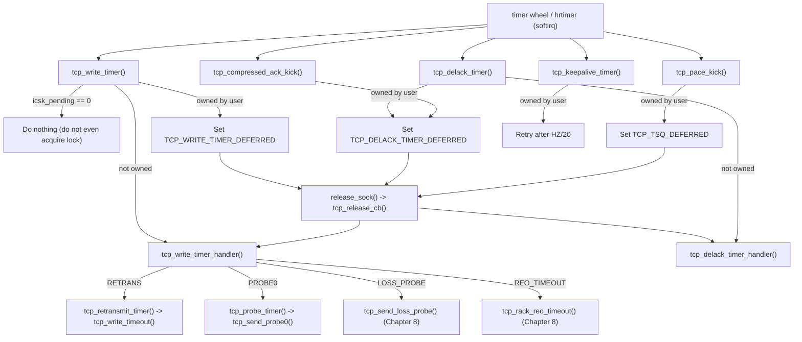

# 9. Timers

## The ELI5 version

Next to the room's mailbox (socket), several kitchen timers are lined up:

- **Re-shipping timer**: When a parcel has been sent but no signed receipt returns, this timer sounds an alarm saying "it is about time to re-ship". Each time it re-ships, the waiting time is doubled, and if there is no reply for far too long, it gives up, concluding "the peer is no longer there".
- **Window check timer**: When the peer's inbox is full (window 0) and parcels are piling up on the outgoing shelf, this timer periodically sends a small enquiry asking "is there room yet?". As long as the peer replies "still full", it continues to wait indefinitely.
- **Batched signed receipt timer**: Returning a signed receipt every single time a parcel arrives is arduous, so it waits just a little and returns several at once. To avoid waiting too long, whenever this timer rings, a signed receipt must be sent.
- **Keep-alive timer**: This timer calls out "are you still there?" to a peer with whom there has been no communication for hours.

There is one important rule. When a timer goes off whilst the mailbox is being used by the resident (the user process), the clerk (softirq) cannot touch the inside. Instead, a note saying "a timer went off" is posted on the mailbox, and the moment the resident lets go of the mailbox (`release_sock()`), the resident reads the note and takes care of the work.

## What the RFCs say

### RFC 6298: Computing TCP's Retransmission Timer

RFC 6298 defines how to compute RTO (Retransmission TimeOut) and specifies the rules for managing the retransmission timer (obsoleting RFC 2988). Calculating RTO (SRTT / RTTVAR) is covered in Chapter 7; here we focus on the rules in §5 governing when to start, stop, and what to do upon timer expiration.

The rules in [RFC 6298 §5](https://www.rfc-editor.org/rfc/rfc6298#section-5) are as follows:

| Rule | Description | Linux counterpart |
| --- | --- | --- |
| (5.1) | Every time a packet containing data is sent (including a retransmission), if the timer is not running, start it running so that it expires after RTO | `tcp_event_new_data_sent()` → `tcp_rearm_rto()` |
| (5.2) | When all outstanding data has been acknowledged, turn off the retransmission timer | Branch `!tp->packets_out` in `tcp_rearm_rto()` |
| (5.3) | When an ACK is received that acknowledges new data, restart the retransmission timer so that it will expire after RTO | `tcp_rearm_rto()` (Chapter 7) |
| (5.4) | When the retransmission timer expires, retransmit the earliest segment that has not been acknowledged | `tcp_retransmit_skb(sk, tcp_rtx_queue_head(sk), 1)` in `tcp_retransmit_timer()` |
| (5.5) | RTO ← RTO × 2 ("back off the timer"). A maximum value (from §2.5, at least 60 seconds) MAY be used to clamp RTO | `icsk_rto = min(icsk_rto << 1, tcp_rto_max(sk))` |
| (5.6) | Start the retransmission timer so that it expires after RTO | `tcp_reset_xmit_timer(sk, ICSK_TIME_RETRANS, ...)` |
| (5.7) | If the timer expires on a SYN ACK, and RTO was less than 3 seconds, reset RTO to 3 seconds when data transmission begins | `TCP_TIMEOUT_FALLBACK` in `tcp_init_metrics()` |

[§2.4](https://www.rfc-editor.org/rfc/rfc6298#section-2) states as a "SHOULD" that the RTO lower bound is 1 second, and §2.5 sets the upper bound to "at least 60 seconds". The Linux lower bound is `TCP_RTO_MIN` = 200 ms (configurable per-route / per-socket / sysctl), and the upper bound is `TCP_RTO_MAX` = 120 seconds (configurable via `TCP_RTO_MAX_MS` / `tcp_rto_max_ms`).

### RFC 1122 §4.2.3.5 / RFC 9293 §3.8.3: R1 and R2

[RFC 1122 §4.2.3.5](https://www.rfc-editor.org/rfc/rfc1122#section-4.2.3.5) defines two thresholds for how long retransmissions should continue before giving up. In RFC 9293 (the modern TCP specification that obsoleted RFC 793), the same specification is collected under [§3.8.3 "TCP Connection Failures"](https://www.rfc-editor.org/rfc/rfc9293#section-3.8.3) (§3.8.1 is "Retransmission Timeout", referencing RFC 6298).

- **R1**: When retransmissions of the same segment reach R1, provide "negative advice" to the IP layer to provoke route (dead gateway) re-evaluation. R1 SHOULD correspond to at least 3 retransmissions at the current RTO.
- **R2**: When retransmissions reach R2, close the connection. For data segments, R2 SHOULD correspond to at least 100 seconds; for SYN segments, it MUST correspond to at least 3 minutes.
- R1/R2 MAY be measured as retry counts or elapsed time. Applications MUST be able to configure R2.

In Linux, R1 = `tcp_retries1` (default 3), R2 = `tcp_retries2` (default 15), and the SYN R2 = `tcp_syn_retries` (default 6) / `tcp_synack_retries` (default 5). The application-configurable R2 is `TCP_USER_TIMEOUT` (the local side of [RFC 5482](https://www.rfc-editor.org/rfc/rfc5482) User Timeout). However, as explained later, Linux **converts retry counts into time** when evaluating these thresholds.

### RFC 1122 §4.2.2.17 / RFC 9293 §3.8.6.1: Zero-window probes (persist timer)

When the receiver advertises a receive window of 0, the sender must periodically probe the window to detect when it reopens. Because ACKs carrying window updates are not reliably transmitted, losing such an ACK would otherwise result in a deadlock.

- [RFC 1122 §4.2.2.17](https://www.rfc-editor.org/rfc/rfc1122#page-92): The sender MUST probe a zero window. The first probe SHOULD be sent after one RTO, with subsequent probes backed off exponentially. The sender MUST NOT close the connection as long as the receiver continues to respond to probes.
- [RFC 9293 §3.8.6.1](https://www.rfc-editor.org/rfc/rfc9293#section-3.8.6.1) reaffirms the exact same requirements (MUST-36/37).

### RFC 1122 §4.2.3.6 / RFC 9293 §3.8.4: Keep-alive

Under [RFC 1122 §4.2.3.6](https://www.rfc-editor.org/rfc/rfc1122#page-101) / [RFC 9293 §3.8.4](https://www.rfc-editor.org/rfc/rfc9293#section-3.8.4), keep-alives MAY be implemented, but if implemented, they MUST be configurable per connection and default to off (MUST). The default interval MUST be at least 2 hours, and a connection MUST NOT be declared dead due to the loss of an ACK that carries no data. Probes are described as having `SEG.SEQ = SND.NXT-1` and containing 0 or 1 byte of garbage data.

### RFC 1122 §4.2.3.2 / RFC 9293 §3.8.6.3: Delayed ACK

[RFC 1122 §4.2.3.2](https://www.rfc-editor.org/rfc/rfc1122#page-96) / [RFC 9293 §3.8.6.3](https://www.rfc-editor.org/rfc/rfc9293#section-3.8.6.3) state that a host SHOULD implement delayed ACKs, but the delay MUST be less than 0.5 seconds, and an ACK SHOULD be generated for at least every second full-sized segment in a stream. Deciding *when* to send an ACK is discussed in Chapter 6; here we examine the timer side that implements this delay.

### RFC 8985: RACK-TLP

The Tail Loss Probe (PTO) and the RACK reordering timer in [RFC 8985](https://www.rfc-editor.org/rfc/rfc8985) also reuse this same retransmission timer. Their semantic meaning and evaluation criteria are explored in Chapter 8; in this chapter, we only examine the mechanism by which they share a single timer.

## The big picture

A TCP socket has the following 5 timers (plus 1 timer per request_sock):

| Timer | Instance | Purpose | Callback |
| --- | --- | --- | --- |
| Retransmit timer | `sk->tcp_retransmit_timer` (union with `sk_timer`) | Multiplexes `ICSK_TIME_RETRANS` / `PROBE0` / `LOSS_PROBE` / `REO_TIMEOUT` | `tcp_write_timer()` |
| Delayed ACK | `icsk->icsk_delack_timer` | Delayed ACK | `tcp_delack_timer()` |
| Keepalive | `icsk->icsk_keepalive_timer` | Keep-alive and orphan FIN_WAIT2 | `tcp_keepalive_timer()` |
| Pacing | `tp->pacing_timer` (hrtimer) | Resuming transmission for internal pacing | `tcp_pace_kick()` |
| SACK compression | `tp->compressed_ack_timer` (hrtimer) | Sending batched SACKs | `tcp_compressed_ack_kick()` |
| SYN-ACK retransmit | `req->rsk_timer` | SYN-ACK retransmissions for request_sock | `reqsk_timer_handler()` |



All callbacks run in softirq (`TIMER_SOFTIRQ` for the timer wheel; `HRTIMER_SOFTIRQ` because the hrtimers use `*_SOFT` mode), acquiring the socket spinlock via `bh_lock_sock()`. The common pattern is: if the user currently owns the socket (`sock_owned_by_user()`), queue the work onto bits in `sk->sk_tsq_flags` and entrust it to `tcp_release_cb()`. Keepalive alone is insensitive to small delays, so it retains the traditional approach of retrying after 50 ms.

## Walking through the code

### Step 1: Timer state and arming / clearing

First, the fields holding timer state. Extracted from `struct inet_connection_sock` ([include/net/inet_connection_sock.h#L81](https://git.kernel.org/pub/scm/linux/kernel/git/netdev/net-next.git/tree/include/net/inet_connection_sock.h?id=279d5c8afcd38bd841832a39bfe1aa4f8518d98e#n81)):

```c
struct inet_connection_sock {
	/* inet_sock has to be the first member! */
	struct inet_sock	  icsk_inet;
	struct request_sock_queue icsk_accept_queue;
	struct inet_bind_bucket	  *icsk_bind_hash;
	struct inet_bind2_bucket  *icsk_bind2_hash;
	struct timer_list	  icsk_delack_timer;
	union {
		struct timer_list icsk_keepalive_timer;
		struct timer_list mptcp_tout_timer;
	};
	__u32			  icsk_rto;
	__u32                     icsk_rto_min;
	u32			  icsk_rto_max;
	__u32                     icsk_delack_max;
...
	__u8			  icsk_retransmits;
	__u8			  icsk_pending;
	__u8			  icsk_backoff;
	__u8			  icsk_syn_retries;
	__u8			  icsk_probes_out;
...
	u32			  icsk_probes_tstamp;
	u32			  icsk_user_timeout;
```

- `icsk_pending`: Which event is currently scheduled on the retransmit timer (one of `ICSK_TIME_*`, or 0). An essential invariant is that **only one event can be scheduled on this single timer at any time**.
- `icsk_retransmits`: The number of RTOs that have occurred during the current RTO recovery. Reset to 0 when `snd_una` advances in `tcp_ack()`. Used by R1/R2 evaluation to check "whether the retry count is non-zero".
- `icsk_backoff`: Exponential backoff exponent. Shared between RTO and zero-window probes. Reset to 0 only when a valid RTT sample is obtained (`tcp_ack_update_rtt()`, Karn's algorithm in RFC 6298).
- `icsk_probes_out`: The number of unacknowledged probes. **Shared** between zero-window probes and keep-alives (it cannot collide because the former only runs when the send queue is not empty, whilst the latter only runs when the queue is empty). Reset to 0 upon receiving any ACK in `tcp_ack()`.
- `icsk_probes_tstamp`: The timestamp when zero-window probing began (used for `TCP_USER_TIMEOUT` evaluation).
- `icsk_user_timeout`: `TCP_USER_TIMEOUT` in milliseconds. Written locklessly via setsockopt, so readers always use `READ_ONCE()`.

The retransmit timer itself is `tcp_retransmit_timer`, which forms a union with `sk_timer` in `struct sock`; its expiration time is returned by `tcp_timeout_expires()` ([include/net/inet_connection_sock.h#L194](https://git.kernel.org/pub/scm/linux/kernel/git/netdev/net-next.git/tree/include/net/inet_connection_sock.h?id=279d5c8afcd38bd841832a39bfe1aa4f8518d98e#n194)) via `READ_ONCE(sk->tcp_retransmit_timer.expires)`. Previously, the expiration timestamp was duplicated in a separate field called `icsk_timeout`, but using `timer_list.expires` directly eliminated 8 bytes (see design history below).

Definitions of `ICSK_TIME_*` ([include/net/inet_connection_sock.h#L146](https://git.kernel.org/pub/scm/linux/kernel/git/netdev/net-next.git/tree/include/net/inet_connection_sock.h?id=279d5c8afcd38bd841832a39bfe1aa4f8518d98e#n146)):

```c
#define ICSK_TIME_RETRANS	1	/* Retransmit timer */
#define ICSK_TIME_DACK		2	/* Delayed ack timer */
#define ICSK_TIME_PROBE0	3	/* Zero window probe timer */
#define ICSK_TIME_LOSS_PROBE	5	/* Tail loss probe timer */
#define ICSK_TIME_REO_TIMEOUT	6	/* Reordering timer */
```

`DACK` alone uses a separate timer (`icsk_delack_timer`), with its state tracked via the `ICSK_ACK_TIMER` bit in `icsk_ack.pending`. The remaining 4 share the single retransmit timer.

Arming is handled by `inet_csk_reset_xmit_timer()` ([include/net/inet_connection_sock.h#L228](https://git.kernel.org/pub/scm/linux/kernel/git/netdev/net-next.git/tree/include/net/inet_connection_sock.h?id=279d5c8afcd38bd841832a39bfe1aa4f8518d98e#n228)):

```c
static inline void inet_csk_reset_xmit_timer(struct sock *sk, const int what,
					     unsigned long when,
					     const unsigned long max_when)
{
	struct inet_connection_sock *icsk = inet_csk(sk);

	if (when > max_when) {
		pr_debug("reset_xmit_timer: sk=%p %d when=0x%lx, caller=%p\n",
			 sk, what, when, (void *)_THIS_IP_);
		when = max_when;
	}

	when += jiffies;
	if (what == ICSK_TIME_RETRANS || what == ICSK_TIME_PROBE0 ||
	    what == ICSK_TIME_LOSS_PROBE || what == ICSK_TIME_REO_TIMEOUT) {
		smp_store_release(&icsk->icsk_pending, what);
		sk_reset_timer(sk, &sk->tcp_retransmit_timer, when);
	} else if (what == ICSK_TIME_DACK) {
		smp_store_release(&icsk->icsk_ack.pending,
				  icsk->icsk_ack.pending | ICSK_ACK_TIMER);
		sk_reset_timer(sk, &icsk->icsk_delack_timer, when);
	} else {
		pr_debug("inet_csk BUG: unknown timer value\n");
	}
}
```

- `when` is relative jiffies, clamped to `max_when` (in TCP, `tcp_rto_max(sk)`), fulfilling the upper bound requirement of RFC 6298 (5.5).
- `icsk_pending` is **overwritten** with `what`. For instance, when arming TLP, any prior RETRANS event is overwritten. This is why the TLP / RACK handlers call `tcp_rearm_rto()` at the end to re-arm RETRANS.
- `smp_store_release()` pairs with `smp_load_acquire()` in lockless readers of `icsk_pending`, such as `tcp_write_timer()` and `get_tcp4_sock()`.
- `sk_reset_timer()` ([net/core/sock.c#L3773](https://git.kernel.org/pub/scm/linux/kernel/git/netdev/net-next.git/tree/net/core/sock.c?id=279d5c8afcd38bd841832a39bfe1aa4f8518d98e#n3773)) calls `sock_hold()` only when `mod_timer()` returns 0 (meaning the timer was not pending). In other words, there is an invariant: "**whilst a timer is pending, it holds one socket reference**", and the callback always performs a `sock_put()` at the end.

The TCP-side wrapper `tcp_reset_xmit_timer()` ([include/net/tcp.h#L1667](https://git.kernel.org/pub/scm/linux/kernel/git/netdev/net-next.git/tree/include/net/tcp.h?id=279d5c8afcd38bd841832a39bfe1aa4f8518d98e#n1667)) adds `tcp_pacing_delay()` (the remaining time until the next scheduled transmission `tcp_wstamp_ns`) if `pace_delay` is true. This prevents RTO or probe timers from expiring prematurely and triggering spurious retransmissions whilst transmissions are postponed by pacing. Internally, it simply does `when += tcp_pacing_delay(sk)` followed by `inet_csk_reset_xmit_timer(sk, what, when, tcp_rto_max(sk))`.

Conversely, clearing is handled by `inet_csk_clear_xmit_timer()` ([include/net/inet_connection_sock.h#L205](https://git.kernel.org/pub/scm/linux/kernel/git/netdev/net-next.git/tree/include/net/inet_connection_sock.h?id=279d5c8afcd38bd841832a39bfe1aa4f8518d98e#n205)). Because `INET_CSK_CLEAR_TIMERS` is not defined, it **does not actually stop the timer itself**; it merely clears `icsk_pending` (or `icsk_ack.pending` and `icsk_ack.retry` for DACK) to 0 via `smp_store_release()` (`sk_stop_timer()` resides inside `#ifdef INET_CSK_CLEAR_TIMERS`).

This is a deliberate design choice. In an active flow, every arriving ACK would otherwise trigger "stop timer → re-arm timer", but `timer_delete()` acquires the timer base lock and is often invoked from a different CPU, causing false sharing and lock contention. If left alone without stopping, the next arming requires only a single `mod_timer()`, which can even be a no-op if the expiration time remains unchanged. As a trade-off, the timer may fire "spud" (empty) expirations, so the callback must detect `icsk_pending == 0` cheaply (Step 2). Actually stopping the timers only happens upon socket destruction in `inet_csk_clear_xmit_timers()` / `tcp_clear_xmit_timers()`.

### Step 2: `tcp_write_timer()` — entry point to the retransmit timer

`tcp_write_timer()` ([net/ipv4/tcp_timer.c#L732](https://git.kernel.org/pub/scm/linux/kernel/git/netdev/net-next.git/tree/net/ipv4/tcp_timer.c?id=279d5c8afcd38bd841832a39bfe1aa4f8518d98e#n732)) is invoked from the timer wheel in softirq:

```c
static void tcp_write_timer(struct timer_list *t)
{
	struct sock *sk = timer_container_of(sk, t, tcp_retransmit_timer);

	/* Avoid locking the socket when there is no pending event. */
	if (!smp_load_acquire(&inet_csk(sk)->icsk_pending))
		goto out;

	bh_lock_sock(sk);
	if (!sock_owned_by_user(sk)) {
		tcp_write_timer_handler(sk);
	} else {
		/* delegate our work to tcp_release_cb() */
		if (!test_and_set_bit(TCP_WRITE_TIMER_DEFERRED, &sk->sk_tsq_flags))
			sock_hold(sk);
	}
	bh_unlock_sock(sk);
out:
	sock_put(sk);
}
```

- `smp_load_acquire(&icsk_pending)`: As explained in Step 1, timers are never cancelled on the clear path, so empty expirations occur frequently. This fast path returns immediately without even acquiring the socket spinlock. Because it reads without locks, it pairs with `smp_store_release()` on other CPUs. Even if a race causes it to momentarily miss a newly scheduled event, the arming side always calls `mod_timer()`, so the timer will fire again without dropping work.
- `bh_lock_sock()`: Because we are in softirq, only the spinlock is acquired. If user space owns the socket via `lock_sock()`, `sock_owned_by_user()` evaluates to true.
- If owned by user, set `TCP_WRITE_TIMER_DEFERRED`. Only when `test_and_set_bit()` returns 0 (we were the first to set the bit) do we call `sock_hold()`; this reference is subsequently returned by `__sock_put()` in `tcp_release_cb()`. No matter how many times the timer fires whilst owned, the reference count increases by only one.
- The trailing `sock_put()` releases the reference acquired by `sk_reset_timer()` when the timer was armed.

In older kernels, an owned socket triggered a "retry in 50 ms" fallback, but that introduced up to a 50 ms jitter into RTO and TLP timing; it was therefore changed to delegate work to `tcp_release_cb()` (see design history).

### Step 3: `tcp_write_timer_handler()` — demultiplexing events

`tcp_write_timer_handler()` ([net/ipv4/tcp_timer.c#L697](https://git.kernel.org/pub/scm/linux/kernel/git/netdev/net-next.git/tree/net/ipv4/tcp_timer.c?id=279d5c8afcd38bd841832a39bfe1aa4f8518d98e#n697)) is called from both `tcp_write_timer()` and `tcp_release_cb()`, with BH disabled and the socket spinlock held (in the latter case, user ownership is held as well):

```c
void tcp_write_timer_handler(struct sock *sk)
{
	struct inet_connection_sock *icsk = inet_csk(sk);
	int event;

	if (((1 << sk->sk_state) & (TCPF_CLOSE | TCPF_LISTEN)) ||
	    !icsk->icsk_pending)
		return;

	if (time_after(tcp_timeout_expires(sk), jiffies)) {
		sk_reset_timer(sk, &sk->tcp_retransmit_timer,
			       tcp_timeout_expires(sk));
		return;
	}
	tcp_mstamp_refresh(tcp_sk(sk));
	event = icsk->icsk_pending;

	switch (event) {
	case ICSK_TIME_REO_TIMEOUT:
		tcp_rack_reo_timeout(sk);
		break;
	case ICSK_TIME_LOSS_PROBE:
		tcp_send_loss_probe(sk);
		break;
	case ICSK_TIME_RETRANS:
		smp_store_release(&icsk->icsk_pending, 0);
		tcp_retransmit_timer(sk);
		break;
	case ICSK_TIME_PROBE0:
		smp_store_release(&icsk->icsk_pending, 0);
		tcp_probe_timer(sk);
		break;
	}
}
```

- In CLOSE or LISTEN, do nothing. This renders lingering timers harmless during transitions to `tcp_disconnect()` or `listen()`. Re-checking `icsk_pending` after acquiring the lock guards against races where it was cleared right after the lockless check in Step 2.
- `time_after(tcp_timeout_expires(sk), jiffies)`: If **the expiration time is still in the future**, re-arm the timer and return. This path exists primarily for the delegated route: after the timer expired and `TCP_WRITE_TIMER_DEFERRED` was set, backlog ACKs processed whilst user space held the lock might have caused `tcp_rearm_rto()` to push the expiration further into the future. Handling it immediately from `tcp_release_cb()` would cause a premature retransmission, which this check prevents. `sk_reset_timer()` does not increment the reference count if the timer is already pending.
- `tcp_mstamp_refresh()`: Updates `tp->tcp_mstamp` so that TSval, RTT measurements, and `skb->skb_mstamp_ns` on packets transmitted via timers do not use a stale cached timestamp.
- For RETRANS and PROBE0, `icsk_pending` is set to 0 **before calling the handler**, because the handlers either re-arm themselves or give up and terminate.
- For REO_TIMEOUT and LOSS_PROBE, the handlers are called leaving `icsk_pending` intact. These handlers eventually call `tcp_rearm_rto()` ([net/ipv4/tcp_input.c#L3524](https://git.kernel.org/pub/scm/linux/kernel/git/netdev/net-next.git/tree/net/ipv4/tcp_input.c?id=279d5c8afcd38bd841832a39bfe1aa4f8518d98e#n3524)), which checks whether `icsk_pending == ICSK_TIME_REO_TIMEOUT / LOSS_PROBE` to deduct the elapsed portion from the original RTO (`tcp_rto_delta_us()`) when re-scheduling RETRANS. Clearing `pending` beforehand would lose this deduction, artificially extending the effective RTO.

### Step 4: `tcp_retransmit_timer()` — RTO overview

The core operations of `tcp_retransmit_timer()` ([net/ipv4/tcp_timer.c#L537](https://git.kernel.org/pub/scm/linux/kernel/git/netdev/net-next.git/tree/net/ipv4/tcp_timer.c?id=279d5c8afcd38bd841832a39bfe1aa4f8518d98e#n537))—`tcp_enter_loss()` and `tcp_retransmit_skb()`—belong to Chapter 8, so here we trace its skeleton from the timer's perspective:

```c
	req = rcu_dereference_protected(tp->fastopen_rsk,
					lockdep_sock_is_held(sk));
	if (req) {
		WARN_ON_ONCE(sk->sk_state != TCP_SYN_RECV &&
			     sk->sk_state != TCP_FIN_WAIT1);
		tcp_fastopen_synack_timer(sk, req);
		/* Before we receive ACK to our SYN-ACK don't retransmit
		 * anything else (e.g., data or FIN segments).
		 */
		return;
	}

	if (!tp->packets_out)
		return;

	skb = tcp_rtx_queue_head(sk);
	if (WARN_ON_ONCE(!skb))
		return;
```

- On a TFO server, child sockets exist as full sockets before the 3WHS completes and reuse this retransmit timer for SYN-ACK retransmissions (standard SYN-ACK retransmissions use `rsk_timer` in request_sock, Step 11).
- `!tp->packets_out`: If there is no unacknowledged in-flight data, do nothing (an empty expiration).

```c
	if (!tp->snd_wnd && !sock_flag(sk, SOCK_DEAD) &&
	    !((1 << sk->sk_state) & (TCPF_SYN_SENT | TCPF_SYN_RECV))) {
		/* Receiver dastardly shrinks window. Our retransmits
		 * become zero probes, but we should not timeout this
		 * connection. If the socket is an orphan, time it out,
		 * we cannot allow such beasts to hang infinitely.
		 */
		struct inet_sock *inet = inet_sk(sk);
		u32 rtx_delta;

		rtx_delta = tcp_time_stamp_ts(tp) - (tp->retrans_stamp ?: 
				tcp_skb_timestamp_ts(tp->tcp_usec_ts, skb));
		if (tp->tcp_usec_ts)
			rtx_delta /= USEC_PER_MSEC;
...
		if (tcp_rtx_probe0_timed_out(sk, skb, rtx_delta)) {
			tcp_write_err(sk);
			goto out;
		}
		tcp_enter_loss(sk);
		tcp_retransmit_skb(sk, skb, 1);
		__sk_dst_reset(sk);
		goto out_reset_timer;
	}
```

(`...` represents rate-limited debug output separated for IPv4 / IPv6 via `net_dbg_ratelimited()`.)

This implements part of RFC 1122 §4.2.2.17. When transmitted data is in flight but the peer dastardly **shrinks** its advertised window to 0, our retransmissions effectively become zero-window probes. As long as the peer continues responding to probes (refreshing `rcv_tstamp`), the connection must not be killed; hence, this path bypasses `tcp_write_timeout()` and avoids incrementing `icsk_retransmits`. Instead, `tcp_rtx_probe0_timed_out()` ([net/ipv4/tcp_timer.c#L496](https://git.kernel.org/pub/scm/linux/kernel/git/netdev/net-next.git/tree/net/ipv4/tcp_timer.c?id=279d5c8afcd38bd841832a39bfe1aa4f8518d98e#n496)) gives up only when both the time since the last received ACK exceeds `2 * tcp_rto_max` (or `TCP_USER_TIMEOUT`) **and** the same duration has elapsed since retransmissions began. Measuring `rcv_delta` from `tcp_timeout_expires(sk)` (the intended expiration) rather than raw `jiffies` prevents timer wheel scheduling latencies (up to 63 ms in the 512 ms–4 s tier at HZ=1000) from being falsely counted as elapsed time; since an ACK arriving during this latency makes `rcv_delta` negative, signed comparisons are used.

```c
	__NET_INC_STATS(sock_net(sk), LINUX_MIB_TCPTIMEOUTS);
	if (tcp_write_timeout(sk))
		goto out;

	if (icsk->icsk_retransmits == 0) {
		int mib_idx = 0;
...
	}

	tcp_enter_loss(sk);

	tcp_update_rto_stats(sk);
	if (tcp_retransmit_skb(sk, tcp_rtx_queue_head(sk), 1) > 0) {
		/* Retransmission failed because of local congestion,
		 * Let senders fight for local resources conservatively.
		 */
		tcp_reset_xmit_timer(sk, ICSK_TIME_RETRANS,
				     TCP_RESOURCE_PROBE_INTERVAL,
				     false);
		goto out;
	}
```

- `TCPTimeouts` counts all RTO events regardless of whether they occur on SYN, data, or FIN segments.
- If `tcp_write_timeout()` (Step 5) returns 1, the socket has already been closed.
- When `icsk_retransmits == 0` (the first RTO of this recovery), statistics such as `TCPSackRecoveryFail`, `TCPLossFailures`, or `TCPSackFailures` are incremented depending on the previous recovery state (omitted).
- `tcp_update_rto_stats()` ([net/ipv4/tcp_timer.c#L442](https://git.kernel.org/pub/scm/linux/kernel/git/netdev/net-next.git/tree/net/ipv4/tcp_timer.c?id=279d5c8afcd38bd841832a39bfe1aa4f8518d98e#n442)) increments `icsk_retransmits` and `total_rto`. The transition of `icsk_retransmits` from 0 to 1 records `total_rto_recoveries` and `rto_stamp`.
- `tcp_retransmit_skb()` returns a positive value when transmission fails due to local congestion (e.g. qdisc queues full). In that event, RTO is not backed off; instead, it retries after `TCP_RESOURCE_PROBE_INTERVAL` (500 ms). This prevents a storm of retransmissions during local congestion in low-RTO environments like datacentres where RTO is only a few milliseconds. Because `icsk_retransmits` has already been incremented, R2 evaluation progresses correctly.

```c
out_reset_timer:
...
	if (sk->sk_state == TCP_ESTABLISHED &&
	    (tp->thin_lto || READ_ONCE(net->ipv4.sysctl_tcp_thin_linear_timeouts)) &&
	    tcp_stream_is_thin(tp) &&
	    icsk->icsk_retransmits <= TCP_THIN_LINEAR_RETRIES) {
		icsk->icsk_backoff = 0;
		icsk->icsk_rto = clamp(__tcp_set_rto(tp),
				       tcp_rto_min(sk),
				       tcp_rto_max(sk));
	} else if (sk->sk_state != TCP_SYN_SENT ||
		   tp->total_rto >
		   READ_ONCE(net->ipv4.sysctl_tcp_syn_linear_timeouts)) {
		/* Use normal (exponential) backoff unless linear timeouts are
		 * activated.
		 */
		icsk->icsk_backoff++;
		icsk->icsk_rto = min(icsk->icsk_rto << 1, tcp_rto_max(sk));
	}
	tcp_reset_xmit_timer(sk, ICSK_TIME_RETRANS,
			     tcp_clamp_rto_to_user_timeout(sk), false);
	if (retransmits_timed_out(sk, READ_ONCE(net->ipv4.sysctl_tcp_retries1) + 1, 0))
		__sk_dst_reset(sk);

out:;
```

- For thin streams (fewer than 4 packets in flight) with `TCP_THIN_LINEAR_TIMEOUTS` / `tcp_thin_linear_timeouts` enabled, the first `TCP_THIN_LINEAR_RETRIES` (6) timeouts do not double RTO; instead, RTO is recomputed linearly from SRTT/RTTVAR.
- In `SYN_SENT`, the first `tcp_syn_linear_timeouts` (default 4) RTOs are not backed off (progressing as 1, 1, 1, 1, 1, 2, 4, ... seconds). Using `total_rto` rather than `icsk_backoff` ensures correct behaviour even if an ICMP-triggered RTO revert (`tcp_ld_RTO_revert()`) decrements `icsk_backoff`.
- Otherwise, exponential backoff proceeds per RFC 6298 (5.5) with `icsk_backoff++` and doubling RTO up to `tcp_rto_max(sk)`. RTO itself is doubled, while `icsk_backoff` records how many doublings have occurred (used by `inet_csk_rto_backoff()` and zero-window probing).
- In the re-arming step (5.6), `tcp_clamp_rto_to_user_timeout()` ([net/ipv4/tcp_timer.c#L28](https://git.kernel.org/pub/scm/linux/kernel/git/netdev/net-next.git/tree/net/ipv4/tcp_timer.c?id=279d5c8afcd38bd841832a39bfe1aa4f8518d98e#n28)) clamps the interval to the remaining `TCP_USER_TIMEOUT`. Otherwise, if RTO were 60 seconds and the user timeout was due to expire in 5 seconds, the expiration would be missed until the next RTO timeout.
- Once elapsed time exceeds R1 + 1 retransmissions, `__sk_dst_reset()` invalidates the cached routing entry, forcing route re-resolution on the next packet (providing the extra negative advice required by R1).

### Step 5: `tcp_write_timeout()` and `retransmits_timed_out()` — R1 / R2

`retransmits_timed_out()` ([net/ipv4/tcp_timer.c#L215](https://git.kernel.org/pub/scm/linux/kernel/git/netdev/net-next.git/tree/net/ipv4/tcp_timer.c?id=279d5c8afcd38bd841832a39bfe1aa4f8518d98e#n215)) converts "`boundary` retransmissions" into **time** and compares it against the elapsed time since `retrans_stamp` (the timestamp of the initial retransmission in this recovery cycle):

```c
static bool retransmits_timed_out(struct sock *sk,
				  unsigned int boundary,
				  unsigned int timeout)
{
	struct tcp_sock *tp = tcp_sk(sk);
	unsigned int start_ts, delta;

	if (!inet_csk(sk)->icsk_retransmits)
		return false;

	start_ts = tp->retrans_stamp;
	if (likely(timeout == 0)) {
		unsigned int rto_base = TCP_RTO_MIN;

		if ((1 << sk->sk_state) & (TCPF_SYN_SENT | TCPF_SYN_RECV))
			rto_base = tcp_timeout_init(sk);
		timeout = tcp_model_timeout(sk, boundary, rto_base);
	}

	if (tp->tcp_usec_ts) {
		/* delta maybe off up to a jiffy due to timer granularity. */
		delta = tp->tcp_mstamp - start_ts + jiffies_to_usecs(1);
		return (s32)(delta - timeout * USEC_PER_MSEC) >= 0;
	}
	return (s32)(tcp_time_stamp_ts(tp) - start_ts - timeout) >= 0;
}
```

- If `icsk_retransmits == 0`, no retransmission has occurred yet, so it never times out. This check guarantees that `retrans_stamp` is valid.
- If `timeout` (in milliseconds) is non-zero, it represents `TCP_USER_TIMEOUT`. When 0, `tcp_model_timeout()` calculates the time taken for a connection with initial RTO `rto_base` to back off exponentially `boundary` times. In SYN states, `rto_base` is `tcp_timeout_init()` (default 1 second, configurable via BPF); elsewhere, it is 200 ms.
- `retrans_stamp` uses the same clock as the TCP timestamp option (ms, or µs if `TCP_USEC_TS` is active). With microsecond timestamps, 1 jiffy is added to compensate for timer wheel granularity.
- Whether actual RTO is larger or smaller than 200 ms, the evaluation is based on the "modelled time". Thus, `tcp_retries2 = 15` signifies "approximately 924.6 seconds" rather than "15 attempts".

`tcp_model_timeout()` ([net/ipv4/tcp_timer.c#L188](https://git.kernel.org/pub/scm/linux/kernel/git/netdev/net-next.git/tree/net/ipv4/tcp_timer.c?id=279d5c8afcd38bd841832a39bfe1aa4f8518d98e#n188)):

```c
static unsigned int tcp_model_timeout(struct sock *sk,
				      unsigned int boundary,
				      unsigned int rto_base)
{
	unsigned int linear_backoff_thresh, timeout;

	linear_backoff_thresh = ilog2(tcp_rto_max(sk) / rto_base);
	if (boundary <= linear_backoff_thresh)
		timeout = ((2 << boundary) - 1) * rto_base;
	else
		timeout = ((2 << linear_backoff_thresh) - 1) * rto_base +
			(boundary - linear_backoff_thresh) * tcp_rto_max(sk);
	return jiffies_to_msecs(timeout);
}
```

This sums a geometric progression (doubling from `rto_base`) and an arithmetic progression (linear after pegging at `tcp_rto_max`). Under default values (200 ms, 120 s), `linear_backoff_thresh = ilog2(600) = 9`:

| Call site | boundary | Time |
| --- | --- | --- |
| R1 (`tcp_retries1` = 3) | 3 | (2^4 − 1) × 0.2 = 3.0 s |
| R1 + 1 (route reset) | 4 | (2^5 − 1) × 0.2 = 6.2 s |
| R2 (`tcp_retries2` = 15) | 15 | (2^10 − 1) × 0.2 + 6 × 120 = 924.6 s |

First half of `tcp_write_timeout()` ([net/ipv4/tcp_timer.c#L243](https://git.kernel.org/pub/scm/linux/kernel/git/netdev/net-next.git/tree/net/ipv4/tcp_timer.c?id=279d5c8afcd38bd841832a39bfe1aa4f8518d98e#n243)):

```c
static int tcp_write_timeout(struct sock *sk)
{
	struct inet_connection_sock *icsk = inet_csk(sk);
	struct tcp_sock *tp = tcp_sk(sk);
	struct net *net = sock_net(sk);
	bool expired = false, do_reset;
	int retry_until, max_retransmits;

	if ((1 << sk->sk_state) & (TCPF_SYN_SENT | TCPF_SYN_RECV)) {
		if (icsk->icsk_retransmits)
			__dst_negative_advice(sk);
		/* Paired with WRITE_ONCE() in tcp_sock_set_syncnt() */
		retry_until = READ_ONCE(icsk->icsk_syn_retries) ? :
			READ_ONCE(net->ipv4.sysctl_tcp_syn_retries);

		max_retransmits = retry_until;
		if (sk->sk_state == TCP_SYN_SENT)
			max_retransmits += READ_ONCE(net->ipv4.sysctl_tcp_syn_linear_timeouts);

		expired = icsk->icsk_retransmits >= max_retransmits;
	} else {
		if (retransmits_timed_out(sk, READ_ONCE(net->ipv4.sysctl_tcp_retries1), 0)) {
			/* Black hole detection */
			tcp_mtu_probing(icsk, sk);

			__dst_negative_advice(sk);
		}

		retry_until = READ_ONCE(net->ipv4.sysctl_tcp_retries2);
		if (sock_flag(sk, SOCK_DEAD)) {
			const bool alive = icsk->icsk_rto < tcp_rto_max(sk);

			retry_until = tcp_orphan_retries(sk, alive);
			do_reset = alive ||
				!retransmits_timed_out(sk, retry_until, 0);

			if (tcp_out_of_resources(sk, do_reset))
				return 1;
		}
	}
```

- **SYN states**: From the second SYN (or SYN-ACK) timeout onward, `__dst_negative_advice()` is called on every failure to urge route re-selection. R2 is initially tested against **retry counts** (`TCP_SYNCNT` → `tcp_syn_retries`). In `SYN_SENT`, the count of linear timeouts is added to the limit; otherwise, linear backoff would shorten the total elapsed wait time, straying from the RFC requirement that SYN timeouts last at least 3 minutes.
- **Synchronised states**: Once elapsed time passes R1, `tcp_mtu_probing()` ([net/ipv4/tcp_timer.c#L166](https://git.kernel.org/pub/scm/linux/kernel/git/netdev/net-next.git/tree/net/ipv4/tcp_timer.c?id=279d5c8afcd38bd841832a39bfe1aa4f8518d98e#n166)) activates PMTU black hole detection (or halves the probe search floor MSS if already enabled), and `__dst_negative_advice()` passes negative advice to the IPv4/IPv6 dst. This implements RFC 1122 R1.
- R2 defaults to `tcp_retries2`, but if orphaned (`close()` has been called, marked by `SOCK_DEAD`), it is replaced by `tcp_orphan_retries()` ([net/ipv4/tcp_timer.c#L150](https://git.kernel.org/pub/scm/linux/kernel/git/netdev/net-next.git/tree/net/ipv4/tcp_timer.c?id=279d5c8afcd38bd841832a39bfe1aa4f8518d98e#n150)). `tcp_orphan_retries` defaults to 0, which translates to 8 retries if RTO has not reached its ceiling (i.e. the peer was alive recently), or 0 if soft errors (ICMP) have arrived and the connection appears dead.
- Orphans are subject to immediate termination via `tcp_out_of_resources()` ([net/ipv4/tcp_timer.c#L107](https://git.kernel.org/pub/scm/linux/kernel/git/netdev/net-next.git/tree/net/ipv4/tcp_timer.c?id=279d5c8afcd38bd841832a39bfe1aa4f8518d98e#n107)) if orphan limits are exceeded, memory pressure occurs (`tcp_check_oom()`), or the netns is shutting down. Although violating RFCs, this is an explicit defence against DoS attacks.

Second half:

```c
	if (!expired)
		expired = retransmits_timed_out(sk, retry_until,
						READ_ONCE(icsk->icsk_user_timeout));
	tcp_fastopen_active_detect_blackhole(sk, expired);
	mptcp_active_detect_blackhole(sk, expired);

	if (BPF_SOCK_OPS_TEST_FLAG(tp, BPF_SOCK_OPS_RTO_CB_FLAG))
		tcp_call_bpf_3arg(sk, BPF_SOCK_OPS_RTO_CB,
				  icsk->icsk_retransmits,
				  icsk->icsk_rto, (int)expired);

	if (expired) {
		/* Has it gone just too far? */
		tcp_write_err(sk);
		return 1;
	}

	if (__sk_rethink_txhash_reset_dst(sk)) {
		WRITE_ONCE(tp->timeout_rehash, tp->timeout_rehash + 1);
		__NET_INC_STATS(sock_net(sk), LINUX_MIB_TCPTIMEOUTREHASH);
	}

	return 0;
}
```

- Even if retry counts have not expired, exceeding the **modelled duration** of `retry_until` retries (or `TCP_USER_TIMEOUT` if configured) triggers expiration. `TCP_USER_TIMEOUT` overrides R2 as an absolute time limit, taking effect in both SYN and synchronised states.
- TFO and MPTCP detect whether middleboxes are dropping packets carrying their options (black hole detection), disabling the feature for subsequent connections if needed.
- If expired, `tcp_write_err()` ([net/ipv4/tcp_timer.c#L77](https://git.kernel.org/pub/scm/linux/kernel/git/netdev/net-next.git/tree/net/ipv4/tcp_timer.c?id=279d5c8afcd38bd841832a39bfe1aa4f8518d98e#n77)) closes the socket with `sk_err_soft` (an ICMP-recorded error such as `EHOSTUNREACH`) or `ETIMEDOUT`, incrementing `TCPAbortOnTimeout`.
- If continuing, `__sk_rethink_txhash_reset_dst()` recalculates `sk_txhash` (governed by `sysctl net.core.txrehash` / `SO_TXREHASH`), altering the IPv6 flow label or ECMP path selection to give the connection a chance to route around broken links. Clearing cached routing entries forces local ECMP re-selection as well.

### Step 6: `tcp_probe_timer()` — zero-window probe (persist timer)

When data sits in the send queue, `packets_out == 0` (nothing in flight), but send window is insufficient, `tcp_check_probe_timer()` ([include/net/tcp.h#L1700](https://git.kernel.org/pub/scm/linux/kernel/git/netdev/net-next.git/tree/include/net/tcp.h?id=279d5c8afcd38bd841832a39bfe1aa4f8518d98e#n1700)) arms `ICSK_TIME_PROBE0` after `tcp_probe0_base()` = max(RTO, 200 ms). When it expires, `tcp_probe_timer()` ([net/ipv4/tcp_timer.c#L391](https://git.kernel.org/pub/scm/linux/kernel/git/netdev/net-next.git/tree/net/ipv4/tcp_timer.c?id=279d5c8afcd38bd841832a39bfe1aa4f8518d98e#n391)) is invoked:

```c
static void tcp_probe_timer(struct sock *sk)
{
	struct inet_connection_sock *icsk = inet_csk(sk);
	struct sk_buff *skb = tcp_send_head(sk);
	struct tcp_sock *tp = tcp_sk(sk);
	int max_probes;

	if (tp->packets_out || !skb) {
		WRITE_ONCE(icsk->icsk_probes_out, 0);
		icsk->icsk_probes_tstamp = 0;
		return;
	}

	/* RFC 1122 4.2.2.17 requires the sender to stay open indefinitely as
	 * long as the receiver continues to respond probes. We support this by
	 * default and reset icsk_probes_out with incoming ACKs. But if the
	 * socket is orphaned or the user specifies TCP_USER_TIMEOUT, we
	 * kill the socket when the retry count and the time exceeds the
	 * corresponding system limit. We also implement similar policy when
	 * we use RTO to probe window in tcp_retransmit_timer().
	 */
	if (!icsk->icsk_probes_tstamp) {
		icsk->icsk_probes_tstamp = tcp_jiffies32;
	} else {
		u32 user_timeout = READ_ONCE(icsk->icsk_user_timeout);

		if (user_timeout &&
		    (s32)(tcp_jiffies32 - icsk->icsk_probes_tstamp) >=
		     msecs_to_jiffies(user_timeout))
			goto abort;
	}
```

- If packets are already in flight (where RTO takes charge) or nothing is left to send, probing is unnecessary. Counters are cleared and the function exits (PROBE0 was already cleared in `tcp_write_timer_handler()`, so the timer is not re-armed).
- `icsk_probes_tstamp` records when the zero-window state was first probed. Because `icsk_probes_out` resets to 0 upon receiving **any ACK** (even one advertising window 0), it cannot track how long the "peer responds but refuses to open the window" condition persists. Hence, a dedicated start timestamp tracks total duration to enforce `TCP_USER_TIMEOUT`. `icsk_probes_tstamp` is reset to 0 only when a usable window opens (`tcp_ack_probe()`).

```c
	max_probes = READ_ONCE(sock_net(sk)->ipv4.sysctl_tcp_retries2);
	if (sock_flag(sk, SOCK_DEAD)) {
		unsigned int rto_max = tcp_rto_max(sk);
		const bool alive = inet_csk_rto_backoff(icsk, rto_max) < rto_max;

		max_probes = tcp_orphan_retries(sk, alive);
		if (!alive && icsk->icsk_backoff >= max_probes)
			goto abort;
		if (tcp_out_of_resources(sk, true))
			return;
	}

	if (icsk->icsk_probes_out >= max_probes) {
abort:		tcp_write_err(sk);
	} else {
		/* Only send another probe if we didn't close things up. */
		tcp_send_probe0(sk);
	}
}
```

- The threshold is `tcp_retries2` **consecutive unacknowledged** probes. As long as responses arrive, `icsk_probes_out` resets to 0, honouring RFC 1122's mandate to keep the connection alive indefinitely.
- Orphans apply `tcp_orphan_retries()` and abort if backoff reaches its ceiling.
- `tcp_send_probe0()` ([net/ipv4/tcp_output.c#L4619](https://git.kernel.org/pub/scm/linux/kernel/git/netdev/net-next.git/tree/net/ipv4/tcp_output.c?id=279d5c8afcd38bd841832a39bfe1aa4f8518d98e#n4619)) sends the probe via `tcp_write_wakeup()`, increments `icsk_probes_out` and `icsk_backoff` (capped at `tcp_retries2`), and re-arms after `tcp_probe0_when()` ([include/net/tcp.h#L1690](https://git.kernel.org/pub/scm/linux/kernel/git/netdev/net-next.git/tree/include/net/tcp.h?id=279d5c8afcd38bd841832a39bfe1aa4f8518d98e#n1690)) = `tcp_probe0_base() << backoff` (capped at `tcp_rto_max`). If transmission fails due to local congestion, it retries in 500 ms. `tcp_clamp_probe0_to_user_timeout()` ([net/ipv4/tcp_timer.c#L50](https://git.kernel.org/pub/scm/linux/kernel/git/netdev/net-next.git/tree/net/ipv4/tcp_timer.c?id=279d5c8afcd38bd841832a39bfe1aa4f8518d98e#n50)) caps the delay with the remaining user timeout, or sets it to `TCP_TIMEOUT_MIN` (2 jiffies) if already expired, prompting an immediate abort on the subsequent `tcp_probe_timer()` invocation.

Notice also the contents of the probe sent in `tcp_write_wakeup()` ([net/ipv4/tcp_output.c#L4573](https://git.kernel.org/pub/scm/linux/kernel/git/netdev/net-next.git/tree/net/ipv4/tcp_output.c?id=279d5c8afcd38bd841832a39bfe1aa4f8518d98e#n4573)). If the window is completely 0, `tcp_xmit_probe_skb()` sends a zero-length ACK with `SEG.SEQ = snd_una - 1` (which, appearing "old" to the receiver, guarantees an immediate ACK response). If the window has opened slightly (e.g. held back to prevent silly window syndrome), it splits and transmits as much payload data as will fit. Although RFCs illustrate probes carrying 1 byte of payload, Linux relies on zero-length probe segments.

### Step 7: Delayed ACK timer

When the receive path chooses to delay an ACK, `tcp_send_delayed_ack()` ([net/ipv4/tcp_output.c#L4428](https://git.kernel.org/pub/scm/linux/kernel/git/netdev/net-next.git/tree/net/ipv4/tcp_output.c?id=279d5c8afcd38bd841832a39bfe1aa4f8518d98e#n4428)) arms the timer (the decision of when to delay is covered in Chapter 6):

```c
	ato = min_t(u32, ato, tcp_delack_max(sk));

	/* Stay within the limit we were given */
	timeout = jiffies + ato;

	/* Use new timeout only if there wasn't a older one earlier. */
	if (icsk->icsk_ack.pending & ICSK_ACK_TIMER) {
		/* If delack timer is about to expire, send ACK now. */
		if (time_before_eq(icsk_delack_timeout(icsk), jiffies + (ato >> 2))) {
			tcp_send_ack(sk);
			return;
		}

		if (!time_before(timeout, icsk_delack_timeout(icsk)))
			timeout = icsk_delack_timeout(icsk);
	}
	smp_store_release(&icsk->icsk_ack.pending,
			  icsk->icsk_ack.pending | ICSK_ACK_SCHED | ICSK_ACK_TIMER);
	sk_reset_timer(sk, &icsk->icsk_delack_timer, timeout);
```

`ato` (ACK timeout) is estimated from inter-arrival packet spacing (`tcp_event_data_recv()`, Chapter 6) and capped by `tcp_delack_max()` ([net/ipv4/tcp_output.c#L4417](https://git.kernel.org/pub/scm/linux/kernel/git/netdev/net-next.git/tree/net/ipv4/tcp_output.c?id=279d5c8afcd38bd841832a39bfe1aa4f8518d98e#n4417)). This upper bound is the minimum of per-socket `icsk_delack_max` (default `TCP_DELACK_MAX` = 200 ms, configurable via BPF `TCP_BPF_DELACK_MAX`) and `rto_min - 1`, well within the RFC limit of 0.5 seconds. If already armed, it preserves the earlier expiration time to avoid postponing ACKs indefinitely.

When the timer fires, `tcp_delack_timer()` ([net/ipv4/tcp_timer.c#L363](https://git.kernel.org/pub/scm/linux/kernel/git/netdev/net-next.git/tree/net/ipv4/tcp_timer.c?id=279d5c8afcd38bd841832a39bfe1aa4f8518d98e#n363)) is invoked:

```c
static void tcp_delack_timer(struct timer_list *t)
{
	struct inet_connection_sock *icsk =
			timer_container_of(icsk, t, icsk_delack_timer);
	struct sock *sk = &icsk->icsk_inet.sk;

	/* Avoid taking socket spinlock if there is no ACK to send.
	 * The compressed_ack check is racy, but a separate hrtimer
	 * will take care of it eventually.
	 */
	if (!(smp_load_acquire(&icsk->icsk_ack.pending) & ICSK_ACK_TIMER) &&
	    !READ_ONCE(tcp_sk(sk)->compressed_ack))
		goto out;

	bh_lock_sock(sk);
	if (!sock_owned_by_user(sk)) {
		tcp_delack_timer_handler(sk);
	} else {
		__NET_INC_STATS(sock_net(sk), LINUX_MIB_DELAYEDACKLOCKED);
		/* deleguate our work to tcp_release_cb() */
		if (!test_and_set_bit(TCP_DELACK_TIMER_DEFERRED, &sk->sk_tsq_flags))
			sock_hold(sk);
	}
	bh_unlock_sock(sk);
out:
	sock_put(sk);
}
```

- When an outgoing data packet piggybacks the pending ACK, `inet_csk_clear_xmit_timer(sk, ICSK_TIME_DACK)` clears `icsk_ack.pending` to 0, but the timer is not stopped. This lockless check filters out such empty timer expirations.
- `compressed_ack` is also inspected because if the SACK compression hrtimer expires whilst user space owns the socket, it delegates its work to `tcp_delack_timer_handler()` via `TCP_DELACK_TIMER_DEFERRED` (Step 8). Even though reading `compressed_ack` here is racy, the SACK compression hrtimer itself will ultimately handle it if missed.
- If user space owns the socket, `DelayedACKLocked` is incremented and work is deferred.

`tcp_delack_timer_handler()` ([net/ipv4/tcp_timer.c#L309](https://git.kernel.org/pub/scm/linux/kernel/git/netdev/net-next.git/tree/net/ipv4/tcp_timer.c?id=279d5c8afcd38bd841832a39bfe1aa4f8518d98e#n309)):

```c
void tcp_delack_timer_handler(struct sock *sk)
{
	struct inet_connection_sock *icsk = inet_csk(sk);
	struct tcp_sock *tp = tcp_sk(sk);

	if ((1 << sk->sk_state) & (TCPF_CLOSE | TCPF_LISTEN))
		return;

	/* Handling the sack compression case */
	if (tp->compressed_ack) {
		tcp_mstamp_refresh(tp);
		tcp_sack_compress_send_ack(sk);
		return;
	}

	if (!(icsk->icsk_ack.pending & ICSK_ACK_TIMER))
		return;

	if (time_after(icsk_delack_timeout(icsk), jiffies)) {
		sk_reset_timer(sk, &icsk->icsk_delack_timer,
			       icsk_delack_timeout(icsk));
		return;
	}
	icsk->icsk_ack.pending &= ~ICSK_ACK_TIMER;

	if (inet_csk_ack_scheduled(sk)) {
		if (!inet_csk_in_pingpong_mode(sk)) {
			/* Delayed ACK missed: inflate ATO. */
			icsk->icsk_ack.ato = min3((u32)icsk->icsk_ack.ato << 1,
						  icsk->icsk_rto,
						  (u32)TCP_DELACK_MAX);
		} else {
			/* Delayed ACK missed: leave pingpong mode and
			 * deflate ATO.
			 */
			inet_csk_exit_pingpong_mode(sk);
			icsk->icsk_ack.ato      = TCP_ATO_MIN;
		}
		tcp_mstamp_refresh(tp);
		tcp_send_ack(sk);
		__NET_INC_STATS(sock_net(sk), LINUX_MIB_DELAYEDACKS);
	}
}
```

- If `compressed_ack` is non-zero, this invocation is cleaning up a deferred SACK compression event. `tcp_sack_compress_send_ack()` cancels the hrtimer and emits the SACK. Placing this check ahead of `ICSK_ACK_TIMER` is essential: because SACK compression does not arm the delack timer, `ICSK_ACK_TIMER` is not set, and placing it later would drop the SACK, stalling the sender until RTO.
- `time_after(...)`: For the same reasons discussed in Step 3, if the target expiration was extended during delegation, the timer is re-armed and the handler returns.
- `ICSK_ACK_TIMER` is cleared (since the spinlock is held, plain assignment suffices; lockless readers treat it merely as a heuristic).
- Having to send an ACK via a timer means piggybacking on outgoing data failed. In bulk transfer (non-pingpong mode), `ato` is doubled to wait longer next time, capped by `icsk_rto` and `TCP_DELACK_MAX` (because `ato` is an 8-bit bitfield, capping at `TCP_DELACK_MAX` is vital to prevent wrap-around; see design history). In interactive (pingpong) mode, failing to produce reply data exits the mode and deflates `ato` back to minimum.
- `tcp_send_ack()` transmits the ACK and increments `DelayedACKs`. Transmitting the ACK clears the delack state via `__tcp_transmit_skb()` → `tcp_event_ack_sent()`.

### Step 8: hrtimers: pacing and SACK compression

Jiffies timers operate at 1 ms resolution even under HZ=1000, and timer wheels coarsen their granularity as expiration times stretch further into the future. Because pacing and SACK compression require microsecond precision, both rely on softirq-based hrtimers. Initialisation occurs in `tcp_init_xmit_timers()` ([net/ipv4/tcp_timer.c#L898](https://git.kernel.org/pub/scm/linux/kernel/git/netdev/net-next.git/tree/net/ipv4/tcp_timer.c?id=279d5c8afcd38bd841832a39bfe1aa4f8518d98e#n898)). After setting up the three `timer_list` structures in `inet_csk_init_xmit_timers()`, `pacing_timer` is initialised via `hrtimer_setup()` with `HRTIMER_MODE_ABS_PINNED_SOFT`, and `compressed_ack_timer` with `HRTIMER_MODE_REL_PINNED_SOFT` (both on `CLOCK_MONOTONIC`).

Pacing is armed with an absolute timestamp (`ABS`, the scheduled departure time `tcp_wstamp_ns`), whereas SACK compression is armed with a relative duration (`REL`, nanoseconds from now). `PINNED` forces expiration on the CPU that armed the timer, while `SOFT` executes the callback in `HRTIMER_SOFTIRQ` rather than hardirq context so that socket spinlocks can be acquired safely from BH. Both call `sock_hold()` upon arming and `sock_put()` at the end of their callbacks. On teardown, `tcp_clear_xmit_timers()` drops the reference if `hrtimer_try_to_cancel() == 1` (meaning cancellation succeeded).

Under internal pacing (when not using the `fq` qdisc), `tcp_pacing_check()` called from `tcp_write_xmit()` arms the hrtimer if the scheduled departure timestamp has not yet arrived (detailed in Chapter 4). Upon expiration, `tcp_pace_kick()` ([net/ipv4/tcp_output.c#L1435](https://git.kernel.org/pub/scm/linux/kernel/git/netdev/net-next.git/tree/net/ipv4/tcp_output.c?id=279d5c8afcd38bd841832a39bfe1aa4f8518d98e#n1435)) converges into the same handler as TSQ:

```c
enum hrtimer_restart tcp_pace_kick(struct hrtimer *timer)
{
	struct tcp_sock *tp = container_of(timer, struct tcp_sock, pacing_timer);
	struct sock *sk = (struct sock *)tp;

	tcp_tsq_handler(sk);
	sock_put(sk);

	return HRTIMER_NORESTART;
}
```

`tcp_tsq_handler()` ([net/ipv4/tcp_output.c#L1289](https://git.kernel.org/pub/scm/linux/kernel/git/netdev/net-next.git/tree/net/ipv4/tcp_output.c?id=279d5c8afcd38bd841832a39bfe1aa4f8518d98e#n1289)) processes the retransmit queue and `tcp_write_xmit()` via `tcp_tsq_write()` if the socket is not owned, or sets `TCP_TSQ_DEFERRED` if owned. Ultimately, pacing's "time has arrived" and TSQ's "qdisc / NIC budget freed up" represent the exact same task: "transmit data if permitted".

For SACK compression, rather than returning a SACK for every packet received out of order on the holding shelf (OOO queue), `__tcp_ack_snd_check()` ([net/ipv4/tcp_input.c#L6134](https://git.kernel.org/pub/scm/linux/kernel/git/netdev/net-next.git/tree/net/ipv4/tcp_input.c?id=279d5c8afcd38bd841832a39bfe1aa4f8518d98e#n6134)) increments `tp->compressed_ack` and arms the hrtimer for `tcp_comp_sack_rtt_percent` of RTT (default 33%), capped by `tcp_comp_sack_delay_ns` (default 1 ms) with `tcp_comp_sack_slack_ns` slack (default 10 µs). The first `TCP_FASTRETRANS_THRESH` (3) duplicate ACKs are sent immediately to avoid delaying the peer's fast retransmit. Upon expiration, `tcp_compressed_ack_kick()` ([net/ipv4/tcp_timer.c#L870](https://git.kernel.org/pub/scm/linux/kernel/git/netdev/net-next.git/tree/net/ipv4/tcp_timer.c?id=279d5c8afcd38bd841832a39bfe1aa4f8518d98e#n870)) executes:

```c
static enum hrtimer_restart tcp_compressed_ack_kick(struct hrtimer *timer)
{
	struct tcp_sock *tp = container_of(timer, struct tcp_sock, compressed_ack_timer);
	struct sock *sk = (struct sock *)tp;

	bh_lock_sock(sk);
	if (!sock_owned_by_user(sk)) {
		if (tp->compressed_ack) {
			/* Since we have to send one ack finally,
			 * subtract one from tp->compressed_ack to keep
			 * LINUX_MIB_TCPACKCOMPRESSED accurate.
			 */
			tp->compressed_ack--;
			tcp_mstamp_refresh(tp);
			tcp_send_ack(sk);
		}
	} else {
		if (!test_and_set_bit(TCP_DELACK_TIMER_DEFERRED,
				      &sk->sk_tsq_flags))
			sock_hold(sk);
	}
	bh_unlock_sock(sk);

	sock_put(sk);

	return HRTIMER_NORESTART;
}
```

- If `compressed_ack` is 0, an intervening ACK (from outgoing data or in-order reception) has already discharged the compressed state.
- Because `tcp_event_ack_sent()` credits all remaining `compressed_ack` counts to `TCPAckCompressed` during transmission, one count is subtracted here to account for the single ACK being emitted.
- If the socket is owned by user space, it does not allocate a dedicated flag, borrowing `TCP_DELACK_TIMER_DEFERRED` instead. This is why `tcp_delack_timer_handler()` in Step 7 checks `compressed_ack` at its very beginning.

### Step 9: Deferring work whilst socket is owned and `tcp_release_cb()`

The deferral flags are organised in `enum tsq_enum` ([include/linux/tcp.h#L535](https://git.kernel.org/pub/scm/linux/kernel/git/netdev/net-next.git/tree/include/linux/tcp.h?id=279d5c8afcd38bd841832a39bfe1aa4f8518d98e#n535)):

```c
enum tsq_enum {
	TSQ_THROTTLED,
	TSQ_QUEUED,
	TCP_TSQ_DEFERRED,	   /* tcp_tasklet_func() found socket was owned */
	TCP_WRITE_TIMER_DEFERRED,  /* tcp_write_timer() found socket was owned */
	TCP_DELACK_TIMER_DEFERRED, /* tcp_delack_timer() found socket was owned */
	TCP_MTU_REDUCED_DEFERRED,  /* tcp_v{4|6}_err() could not call
				    * tcp_v{4|6}_mtu_reduced()
				    */
	TCP_ACK_DEFERRED,	   /* TX pure ack is deferred */
};
```

`TCP_DEFERRED_ALL` ([include/linux/tcp.h#L558](https://git.kernel.org/pub/scm/linux/kernel/git/netdev/net-next.git/tree/include/linux/tcp.h?id=279d5c8afcd38bd841832a39bfe1aa4f8518d98e#n558)) is defined as `TSQ_DEFERRED | WRITE_TIMER_DEFERRED | DELACK_TIMER_DEFERRED | MTU_REDUCED_DEFERRED | ACK_DEFERRED`. `sk_tsq_flags` shares the same word as TSQ and is placed near `sk_wmem_alloc` (accessed by `tcp_wfree()` upon TX completion).

`release_sock()` acquires `sk_lock.slock` with BH disabled, processes the backlog via `__release_sock()`, and then, prior to relinquishing ownership, calls `tcp_release_cb()` ([net/ipv4/tcp_output.c#L1337](https://git.kernel.org/pub/scm/linux/kernel/git/netdev/net-next.git/tree/net/ipv4/tcp_output.c?id=279d5c8afcd38bd841832a39bfe1aa4f8518d98e#n1337)). The inline wrapper `tcp_release_cb_cond()` ([include/net/tcp.h#L379](https://git.kernel.org/pub/scm/linux/kernel/git/netdev/net-next.git/tree/include/net/tcp.h?id=279d5c8afcd38bd841832a39bfe1aa4f8518d98e#n379)) avoids the indirect function call altogether if no flags are set:

```c
void tcp_release_cb(struct sock *sk)
{
	unsigned long flags = smp_load_acquire(&sk->sk_tsq_flags);
	unsigned long nflags;

	/* perform an atomic operation only if at least one flag is set */
	do {
		if (!(flags & TCP_DEFERRED_ALL))
			return;
		nflags = flags & ~TCP_DEFERRED_ALL;
	} while (!try_cmpxchg(&sk->sk_tsq_flags, &flags, nflags));

	if (flags & TCPF_TSQ_DEFERRED) {
		tcp_tsq_write(sk);
		__sock_put(sk);
	}

	if (flags & TCPF_WRITE_TIMER_DEFERRED) {
		tcp_write_timer_handler(sk);
		__sock_put(sk);
	}
	if (flags & TCPF_DELACK_TIMER_DEFERRED) {
		tcp_delack_timer_handler(sk);
		__sock_put(sk);
	}
	if (flags & TCPF_MTU_REDUCED_DEFERRED) {
		inet_csk(sk)->icsk_af_ops->mtu_reduced(sk);
		__sock_put(sk);
	}
	if ((flags & TCPF_ACK_DEFERRED) && inet_csk_ack_scheduled(sk))
		tcp_send_ack(sk);
}
```

- The flags are read, and if no `TCP_DEFERRED_ALL` bits are set, the function returns without performing any atomic operations. The vast majority of `release_sock()` calls conclude right here.
- The `try_cmpxchg()` loop **extracts and clears all deferral bits in a single batch**. `TSQ_THROTTLED` and `TSQ_QUEUED` are preserved because `tcp_wfree()` modifies them concurrently. If softirq subsequently sets fresh bits after extraction, they will be processed during the next `release_sock()`.
- The handlers invoked are identical to those in softirq, but here they run in process context with spinlock held, BH disabled, and user ownership active. Because each handler checks whether the expiration time remains in the future or whether pending flags were cleared, executing them after state shifts during deferral is completely safe.
- Each `__sock_put()` drops the reference acquired via `sock_hold()` when setting the deferral bit. Since the caller holds a reference, this will never be the final reference, making `__sock_put()` (bypassing destruction checks) sufficient. `TCP_ACK_DEFERRED` is set from process context via `set_bit()` without taking references, so it requires no `__sock_put()`.
- The order of execution is intentional: TSQ (transmission) → retransmit timer → delayed ACK. If transmitting data piggybacks the pending ACK, the subsequent delack handler observes `ICSK_ACK_TIMER` cleared and does nothing.

### Step 10: `tcp_keepalive_timer()` — keep-alive and orphan FIN_WAIT2

First half of `tcp_keepalive_timer()` ([net/ipv4/tcp_timer.c#L781](https://git.kernel.org/pub/scm/linux/kernel/git/netdev/net-next.git/tree/net/ipv4/tcp_timer.c?id=279d5c8afcd38bd841832a39bfe1aa4f8518d98e#n781)):

```c
static void tcp_keepalive_timer(struct timer_list *t)
{
	struct inet_connection_sock *icsk =
		timer_container_of(icsk, t, icsk_keepalive_timer);
	struct sock *sk = &icsk->icsk_inet.sk;
	struct tcp_sock *tp = tcp_sk(sk);
	u32 elapsed;

	/* Only process if socket is not in use. */
	bh_lock_sock(sk);
	if (sock_owned_by_user(sk)) {
		/* Try again later. */
		tcp_reset_keepalive_timer(sk, HZ/20);
		goto out;
	}

	if (sk->sk_state == TCP_LISTEN) {
		pr_err("Hmm... keepalive on a LISTEN ???\n");
		goto out;
	}

	tcp_mstamp_refresh(tp);
	if (sk->sk_state == TCP_FIN_WAIT2 && sock_flag(sk, SOCK_DEAD)) {
		if (READ_ONCE(tp->linger2) >= 0) {
			const int tmo = tcp_fin_time(sk) - TCP_TIMEWAIT_LEN;

			if (tmo > 0) {
				tcp_time_wait(sk, TCP_FIN_WAIT2, tmo);
				goto out;
			}
		}
		tcp_send_active_reset(sk, SK_RST_REASON_TCP_STATE);
		goto death;
	}

	if (!sock_flag(sk, SOCK_KEEPOPEN) ||
	    ((1 << sk->sk_state) & (TCPF_CLOSE | TCPF_SYN_SENT)))
		goto out;
```

- If owned by user space, retry in 50 ms. Keep-alives operate on timescales of minutes to hours, making the complexity of deferral flags unnecessary.
- Firing on a LISTEN socket indicates a bug (`tcp_set_keepalive()` never arms listen sockets).
- **Orphan FIN_WAIT2**: This timer is repurposed to handle timeouts in FIN_WAIT2. For an orphaned socket in FIN_WAIT2 whose `tcp_fin_time()` ([include/net/tcp.h#L1930](https://git.kernel.org/pub/scm/linux/kernel/git/netdev/net-next.git/tree/include/net/tcp.h?id=279d5c8afcd38bd841832a39bfe1aa4f8518d98e#n1930), from `TCP_LINGER2` or `tcp_fin_timeout`, at least 3.5 RTOs) exceeds `TCP_TIMEWAIT_LEN` (60 seconds), `tcp_close()` or `tcp_rcv_state_process()` arms the keepalive timer for `tmo - TCP_TIMEWAIT_LEN`. It lingers as a full socket only for this excess duration; once expired, the remaining 60 seconds are spent in a lightweight TIME_WAIT minisocket (`tcp_time_wait(sk, TCP_FIN_WAIT2, tmo)` with substate FIN_WAIT2, Chapter 2). If `linger2 < 0` or no remaining time exists, it sends an RST and is torn down.
- Subsequent logic handles genuine keep-alives. If `SO_KEEPALIVE` is absent, or if the socket is in CLOSE or SYN_SENT, it returns.

Second half:

```c
	elapsed = keepalive_time_when(tp);

	/* It is alive without keepalive 8) */
	if (tp->packets_out || !tcp_write_queue_empty(sk))
		goto resched;

	elapsed = keepalive_time_elapsed(tp);

	if (elapsed >= keepalive_time_when(tp)) {
		u32 user_timeout = READ_ONCE(icsk->icsk_user_timeout);

		/* If the TCP_USER_TIMEOUT option is enabled, use that
		 * to determine when to timeout instead.
		 */
		if ((user_timeout != 0 &&
		    elapsed >= msecs_to_jiffies(user_timeout) &&
		    icsk->icsk_probes_out > 0) ||
		    (user_timeout == 0 &&
		    icsk->icsk_probes_out >= keepalive_probes(tp))) {
			tcp_send_active_reset(sk,
					      SK_RST_REASON_TCP_KEEPALIVE_TIMEOUT);
			tcp_write_err(sk);
			goto out;
		}
		if (tcp_write_wakeup(sk, LINUX_MIB_TCPKEEPALIVE) <= 0) {
			WRITE_ONCE(icsk->icsk_probes_out, icsk->icsk_probes_out + 1);
			elapsed = keepalive_intvl_when(tp);
		} else {
			/* If keepalive was lost due to local congestion,
			 * try harder.
			 */
			elapsed = TCP_RESOURCE_PROBE_INTERVAL;
		}
	} else {
		/* It is tp->rcv_tstamp + keepalive_time_when(tp) */
		elapsed = keepalive_time_when(tp) - elapsed;
	}

resched:
	tcp_reset_keepalive_timer(sk, elapsed);
	goto out;

death:
	tcp_done(sk);

out:
	bh_unlock_sock(sk);
	sock_put(sk);
}
```

- If unacknowledged packets or unsent data exist, connectivity is monitored by the retransmit or probe timers; keepalive is therefore deferred by `keepalive_time`. This ensures keep-alives operate strictly according to the definition of "idle" (RFC 9293 §3.8.4).
- `keepalive_time_elapsed()` ([include/net/tcp.h#L1922](https://git.kernel.org/pub/scm/linux/kernel/git/netdev/net-next.git/tree/include/net/tcp.h?id=279d5c8afcd38bd841832a39bfe1aa4f8518d98e#n1922)) calculates the elapsed time from the later of the last data reception timestamp (`icsk_ack.lrcvtime`) and the last ACK reception timestamp (`rcv_tstamp`). Rather than ticking periodically, the timer is re-armed for the "remaining duration" upon each expiration, avoiding timer manipulations on every packet arrival (protecting the receive fast path).
- The abort criteria are: if `TCP_USER_TIMEOUT` is set, the idle duration exceeds user timeout and at least one probe was sent; otherwise, unacknowledged probes reach `TCP_KEEPCNT` / `tcp_keepalive_probes`. An RST is sent (to resolve half-open state if the peer happens to be alive) and the socket is closed with `ETIMEDOUT`.
- Probes are dispatched via `tcp_write_wakeup()`. Because the send queue is empty, this becomes a zero-length ACK with `SEG.SEQ = snd_una - 1`. Serving the same role as RFC's "SND.NXT-1", it prompts the peer to return a duplicate ACK. `icsk_probes_out` resets to 0 upon receiving any ACK.
- If idle time has not elapsed, the timer is re-armed for the remaining duration.

`keepalive_time_when()`, `keepalive_intvl_when()`, and `keepalive_probes()` read `TCP_KEEPIDLE`, `TCP_KEEPINTVL`, and `TCP_KEEPCNT` with `READ_ONCE()`, falling back to netns sysctls (defaults 7200 s / 75 s / 9) if 0.

### Step 11: SYN-ACK retransmissions (`reqsk_timer_handler()`)

In standard (non-TFO) passive open, full sockets do not yet exist, so each request_sock uses `rsk_timer` to retransmit SYN-ACKs. Key highlights of `reqsk_timer_handler()` ([net/ipv4/inet_connection_sock.c#L1033](https://git.kernel.org/pub/scm/linux/kernel/git/netdev/net-next.git/tree/net/ipv4/inet_connection_sock.c?id=279d5c8afcd38bd841832a39bfe1aa4f8518d98e#n1033)):

```c
	icsk = inet_csk(sk_listener);
	net = sock_net(sk_listener);
	max_syn_ack_retries = READ_ONCE(icsk->icsk_syn_retries) ? :
		READ_ONCE(net->ipv4.sysctl_tcp_synack_retries);
...
	queue = &icsk->icsk_accept_queue;
	qlen = reqsk_queue_len(queue);
	if ((qlen << 1) > max(8U, READ_ONCE(sk_listener->sk_max_ack_backlog))) {
		int young = reqsk_queue_len_young(queue) << 1;

		while (max_syn_ack_retries > 2) {
			if (qlen < young)
				break;
			max_syn_ack_retries--;
			young <<= 1;
		}
	}

	syn_ack_recalc(req, max_syn_ack_retries, READ_ONCE(queue->rskq_defer_accept),
		       &expire, &resend);
	tcp_syn_ack_timeout(req);

	if (!expire &&
	    (!resend ||
	     !tcp_rtx_synack(sk_listener, req) ||
	     inet_rsk(req)->acked)) {
...
		if (req->num_timeout++ == 0)
			atomic_dec(&queue->young);
		mod_timer(&req->rsk_timer, jiffies + tcp_reqsk_timeout(req));
```

- The omitted opening migrates request_socks to another listener within the `SO_REUSEPORT` group (`tcp_migrate_req`) if the original listener was closed.
- The limit is `TCP_SYNCNT` or `tcp_synack_retries` (default 5). If the SYN queue is more than half full and "young" requests (those that have never timed out) are scarce, retransmissions for older requests are throttled down to a minimum of 2. This prevents old connection tickets from congesting the reception desk during SYN floods.
- `syn_ack_recalc()` ([net/ipv4/inet_connection_sock.c#L829](https://git.kernel.org/pub/scm/linux/kernel/git/netdev/net-next.git/tree/net/ipv4/inet_connection_sock.c?id=279d5c8afcd38bd841832a39bfe1aa4f8518d98e#n829)) determines whether the request has expired or should be resent, taking `TCP_DEFER_ACCEPT` into account.
- Retransmission intervals back off exponentially as `tcp_reqsk_timeout()` = `req->timeout << num_timeout` (capped at `tcp_rto_max`). `tcp_syn_ack_timeout()` merely increments `TCPTimeouts`, marked `noinline_for_tracing` so that BPF can trace it.

For TFO child sockets, `tcp_fastopen_synack_timer()` ([net/ipv4/tcp_timer.c#L459](https://git.kernel.org/pub/scm/linux/kernel/git/netdev/net-next.git/tree/net/ipv4/tcp_timer.c?id=279d5c8afcd38bd841832a39bfe1aa4f8518d98e#n459)) referenced in Step 4 fulfills this role, with an upper limit of `tcp_synack_retries + 1` (avoiding premature abandonment of child sockets that may already have been accepted).

### Step 12: Related sysctls and socket options

| sysctl (`net.ipv4.`) | Default | Socket option | Description |
| --- | --- | --- | --- |
| `tcp_retries1` | 3 | — | R1 (time for 3 retries ≈ 3 s) for negative advice and MTU probing |
| `tcp_retries2` | 15 | `TCP_USER_TIMEOUT` | R2 (≈ 924.6 s), max consecutive unacknowledged zero-window probes |
| `tcp_orphan_retries` | 0 (→ 8) | — | R2 for orphaned sockets |
| `tcp_syn_retries` | 6 | `TCP_SYNCNT` | Maximum SYN retransmissions |
| `tcp_synack_retries` | 5 | `TCP_SYNCNT` (listener) | Maximum SYN-ACK retransmissions |
| `tcp_syn_linear_timeouts` | 4 | — | Number of initial linear RTOs in `SYN_SENT` |
| `tcp_thin_linear_timeouts` | 0 | `TCP_THIN_LINEAR_TIMEOUTS` | Linear RTOs for thin streams |
| `tcp_rto_min_us` | 200000 | `TCP_RTO_MIN_US`, route `rto_min` | Lower bound on RTO |
| `tcp_rto_max_ms` | 120000 | `TCP_RTO_MAX_MS` | Upper bound on RTO (`tcp_rto_max()`) |
| `tcp_keepalive_time` / `_intvl` / `_probes` | 7200 / 75 / 9 | `TCP_KEEPIDLE` / `TCP_KEEPINTVL` / `TCP_KEEPCNT`, `SO_KEEPALIVE` | Keep-alive configuration |
| `tcp_fin_timeout` | 60 | `TCP_LINGER2` | Lifetime of orphaned sockets in FIN_WAIT2 |
| `tcp_comp_sack_delay_ns` / `_slack_ns` / `_nr` / `_rtt_percent` | 1 ms / 10 µs / 44 / 33 | — | SACK compression configuration |
| `tcp_backlog_ack_defer` | 1 | — | Defer pure ACKs during backlog processing via `TCP_ACK_DEFERRED` |
| — | 200 ms | `TCP_BPF_DELACK_MAX` (BPF) | `icsk_delack_max` |

## RFC vs Linux

| Topic | RFC specification | Linux implementation | Reason |
| --- | --- | --- | --- |
| RTO lower bound | 1 s (RFC 6298 §2.4, SHOULD) | 200 ms (`TCP_RTO_MIN`, configurable per-socket / route / sysctl) | 1 s is excessively conservative in low-RTT environments. 200 ms balances well against delayed ACKs (≤ 200 ms) |
| RTO upper bound | At least 60 s (§2.5) | 120 s (configurable from 1 to 120 s via `tcp_rto_max_ms` / `TCP_RTO_MAX_MS`) | Historical value. Made configurable for applications desiring faster failure recovery |
| R1 / R2 | Counts or time | Converts counts into **modelled time** via `tcp_model_timeout()` | Maintains predictable elapsed failure durations across RTO reverts (RFC 6069) and varying backoffs |
| R2 = at least 100 s | SHOULD | `tcp_retries2` = 15 → approx. 924.6 s | Conservative default to tolerate prolonged transient network partitions |
| Configurable R2 | MUST | `TCP_USER_TIMEOUT` (ms) | Local interface for RFC 5482 |
| Notification on R1 | SHOULD notify application | Does not notify application. Only issues negative advice, MTU probing, txhash rehash, and dst reset | `sk_err_soft` is reserved exclusively for ICMP errors |
| SYN R2 ≥ 3 min | MUST | `tcp_syn_retries` = 6 plus 4 linear timeouts. Approximately 2 minutes by default | Shorter to prevent user applications from hanging excessively during connect |
| Orphan handling | Unspecified | Early termination via `tcp_orphan_retries` and `tcp_out_of_resources()` | Mitigates DoS vulnerabilities (explicitly documented as violating RFCs) |
| Retransmissions during zero window | Unspecified | RTO with `snd_wnd == 0` acts as a probe without incrementing `icsk_retransmits` | Avoids killing responding peers via R2 (RFC 1122 §4.2.2.17) |
| Zero-window probe payload | 1 byte of data (illustrated) | Length 0 with `seq = snd_una - 1` (carries payload if window is non-zero) | Reliably elicits an ACK regardless of receiver implementation quirks |
| Waiting indefinitely on zero window | MUST NOT close | Persists indefinitely as long as peer responds (`icsk_probes_out` resets). Aborts on `TCP_USER_TIMEOUT` or orphans | Respects application preferences whilst guarding system resources |
| Keep-alive probes | `SND.NXT-1`, 0 to 1 byte | `snd_una - 1`, length 0 | Equivalent during idle periods because `snd_una == snd_nxt` |
| Keep-alive interval | Default ≥ 2 hours | 7200 s, with 9 probes spaced at 75 s intervals | Fully conforms to RFC |
| Delayed ACK delay | < 0.5 s | ≤ 200 ms (`TCP_DELACK_MAX`), with `ato` adapting to receive spacing | Balances throughput for bulk flows and responsiveness for interactive traffic |
| Immediate SACK delivery | RFC 2018 / 5681 recommend immediate ACKs on OOO | First 3 sent immediately; subsequent SACKs compressed via hrtimer | Prevents ACK floods over Wi-Fi and under congestion |
| Linear timeouts | Exponential backoff (5.5) | Initial timeouts for thin streams and `SYN_SENT` are linear | Speeds up rerouting around link failures and reduces thin-stream latency |

## Design history

- `6fa12c850314` "Revert Backoff [v3]: Calculate TCP's connection close threshold as a time value." (Damian Lukowski, 2009): Introduced `retransmits_timed_out()`. When reverting RTO backoff in response to ICMP messages (TCP-LCD, later RFC 6069), count-based R2 could tear down connections in as little as 3.2 seconds. This established the current philosophy: modelling elapsed threshold time as "the time a TCP with initial RTO `TCP_RTO_MIN` takes to back off N times".
- `dca43c75e7e5` "tcp: Add TCP_USER_TIMEOUT socket option." (Jerry Chu, 2010): Implemented user timeouts from RFC 793 and the local side of RFC 5482, allowing applications to shorten or extend WAN disconnection detection that previously defaulted to up to 20 minutes.
- `6f458dfb4092` "tcp: improve latencies of timer triggered events" (Eric Dumazet, 2012): Replaced the 50 ms delayed retry mechanism for user-owned sockets with `TCP_*_DEFERRED` flags delegated to `tcp_release_cb()`, ensuring events fire the instant user space releases the lock.
- `57dde7f70de3` "tcp: add reordering timer in RACK loss detection" (Yuchung Cheng, 2017): Introduced `ICSK_TIME_REO_TIMEOUT`, extending the existing paradigm of multiplexing loss detection timers onto the single retransmit timer.
- `218af599fa63` "tcp: internal implementation for pacing" and `73a6bab5aa2a` "tcp: switch pacing timer to softirq based hrtimer" (Eric Dumazet, 2017/2018): Added hrtimer-based internal pacing independent of `fq`, later migrating to softirq-based hrtimers to bypass tasklet overhead.
- `5d9f4262b7ea` "tcp: add SACK compression" (Eric Dumazet, 2018): Sending immediate SACKs on every out-of-order segment burdened networks and induced pathological 1-MSS retransmissions that bloated sender retransmit queues. Introduced hrtimers (scaled to a percentage of RTT and capped at 1 ms) to batch SACKs. `30c6f0bf9579` "tcp: fix mishandling when the sack compression is deferred." (fuyuanli, 2023) fixed a bug where deferred SACK compression was dropped due to a missing `ICSK_ACK_TIMER` bit, causing recovery stalls until sender RTO; it added the `compressed_ack` branch at the head of `tcp_delack_timer_handler()`.
- `01a523b07161` "tcp: create a helper to model exponential backoff" and `590d2026d624` "tcp: retry more conservatively on local congestion" (Yuchung Cheng, 2019): Refactored `tcp_model_timeout()` and mitigated retransmission storms in datacentres with millisecond RTOs by pacing local congestion failures at 500 ms while correctly advancing `icsk_retransmits`.
- `3256a2d6ab1f` "tcp: adjust rto_base in retransmits_timed_out()" (Eric Dumazet, 2019): Corrected a mismatch where SYN states modelled initial RTO at 200 ms despite an actual 1-second initial RTO, which had inadvertently reduced SYN retries from 6 to 4.
- `9d9b1ee0b2d1` "tcp: fix TCP_USER_TIMEOUT with zero window" and `344db93ae3ee` "tcp: make TCP_USER_TIMEOUT accurate for zero window probes" (Enke Chen, 2021): Because `icsk_probes_out` resets on every incoming ACK, it failed to measure persistent zero-window durations. Introduced `icsk_probes_tstamp` and clamped probe intervals against the remaining user timeout. `2b9f6f7065d4` "tcp: make probe0 timer handle expired user timeout" (Altan Hacigumus, 2026) fixed an unsigned underflow in remaining time calculation that granted an extra backoff cycle to expired timeouts, replacing it with `max_t(int, remaining, TCP_TIMEOUT_MIN)`.
- `e89688e3e978` "net: tcp: fix unexcepted socket die when snd_wnd is 0" (Menglong Dong, 2023), `36534d3c5453` "tcp: use signed arithmetic in tcp_rtx_probe0_timed_out()", and `97a9063518f1` "tcp: avoid too many retransmit packets" (Eric Dumazet, 2024): Sequentially fixed abort evaluations during zero-window RTOs by handling timer wheel scheduling delays (using intended expirations rather than raw `jiffies`), adopting signed arithmetic, and eliminating continuous 2-jiffy retransmission loops under expired `TCP_USER_TIMEOUT`.
- `ccce324dabfe` "tcp: make the first N SYN RTO backoffs linear" (David Morley, 2023) and `14dd92d0a117` "tcp: use tp->total_rto to track number of linear timeouts in SYN_SENT state" (Eric Dumazet, 2023): Adopted initial linear SYN retransmissions matching macOS / iOS behaviour to expedite failure detection on dead links, shifting the counter from `icsk_backoff` to `total_rto`.
- `5a9071a760a6` "tcp: annotate data-races around icsk->icsk_pending", `3b7842930162` "tcp: add a fast path in tcp_write_timer()", and `81df4fa94ee8` "tcp: add a fast path in tcp_delack_timer()" (Eric Dumazet, 2024): Because timers are intentionally left running when cleared (`INET_CSK_CLEAR_TIMERS` undefined), empty expirations happen regularly. Added fast paths inspecting `icsk_pending` via `smp_load_acquire()` to return immediately without touching socket spinlocks.
- `a7c428ee8f59` "tcp/dccp: remove icsk->icsk_timeout" and `f1e30061e8a5` "tcp/dccp: remove icsk->icsk_ack.timeout" (Eric Dumazet, 2025): Removed duplicated expiration fields in favour of reading `timer_list.expires` directly, shrinking the socket by 16 bytes.
- `54a378f43425` "tcp: add the ability to control max RTO" (Eric Dumazet, 2025): Replaced the hard-coded 120-second RTO ceiling with configurable bounds via `TCP_RTO_MAX_MS` and `tcp_rto_max_ms`, dynamically scaling `tcp_model_timeout()` and R2 durations.
- `08dfe370239e` "tcp: introduce icsk->icsk_keepalive_timer", `3a6e8fd0bf40` "tcp: rename icsk_timeout() to tcp_timeout_expires()", and `9a5e5334adc0` "tcp: remove icsk->icsk_retransmit_timer" (Eric Dumazet, 2025): Relocated keepalive from `sk->sk_timer` to a dedicated timer, allowing `sk_timer` (in a cache-hot location within `struct sock`) to house the retransmit timer for improved cache locality.
- `60837e4b840a` "tcp: fix icsk_ack.ato bitfield overflow" (Jiayuan Chen, 2026): When `ato` was packed into an 8-bit bitfield, capping it at `icsk_rto` caused overflows beyond 256 jiffies, wrapping to `ato == 0` (the sentinel for "initial data segment") and triggering unintended quickack storms. Aligned the cap to `TCP_DELACK_MAX`.
- `658eb696544c` "tcp: rehash onto different local ECMP path on retransmit timeout" (Neil Spring, 2026): Fixed an issue where txhash recalculations at RTO were masked by cached routing destinations for local ECMP path selection, combining it with `__sk_dst_reset()`.

## Performance notes

- **Execution context and locking**: Timer wheel callbacks (`tcp_write_timer()`, `tcp_delack_timer()`, `tcp_keepalive_timer()`) execute under `TIMER_SOFTIRQ`, whereas the two hrtimers execute under `HRTIMER_SOFTIRQ`. Both operate in BH context and acquire `sk_lock.slock` via `bh_lock_sock()`. The `*_handler()` functions require BH disabled and spinlocks held; when invoked via `tcp_release_cb()`, they run in process context with user ownership (`sk_lock.owned`) held as well. The assertion `lockdep_sock_is_held()` in `tcp_retransmit_timer()` accommodates both scenarios.
- **Never stopping timers**: `inet_csk_clear_xmit_timer()` merely sets pending flags to 0. Performing `timer_delete()` followed by `mod_timer()` on every ACK would acquire the timer base lock twice. Furthermore, because timers reside on the base of the CPU that armed them, doing so would bounce cachelines back and forth against CPUs processing incoming ACKs. Leaving them uncancelled allows subsequent arming to succeed in a single `mod_timer()`, which can even take an optimised no-op path if expiration is unchanged. Empty expirations are cleanly intercepted via a single `smp_load_acquire()` in the fast path.
- **`smp_load_acquire()` / `smp_store_release()`**: `icsk_pending` and `icsk_ack.pending` are read locklessly by timer fast paths, `/proc/net/tcp` (`get_tcp4_sock()` / `get_tcp6_sock()`), and `inet_diag`. Using acquire/release semantics rather than `READ_ONCE()/WRITE_ONCE()` guarantees that once the fast path observes a pending event, any preceding state updates written by other CPUs are strictly visible.
- **Fields requiring `READ_ONCE()`**: `icsk_user_timeout`, `icsk_syn_retries`, `linger2`, `keepalive_*`, and `icsk_rto_max` can be modified locklessly from setsockopt (`tcp_sock_set_*()` via `WRITE_ONCE()`), requiring timer logic to read them with `READ_ONCE()`. Sysctls are likewise read via `READ_ONCE(net->ipv4.sysctl_*)`. Because `tcp_info` reads `icsk_retransmits` and `icsk_probes_out` locklessly, writes to them use `WRITE_ONCE()`.
- **Reference counting invariants**: Exactly one socket reference is held per pending timer, and exactly one reference per active deferral bit. Calling `sock_hold()` only when `test_and_set_bit()` transitions a bit from 0 to 1 ensures references do not leak regardless of how many timer iterations fire during ownership. Because the caller of `tcp_release_cb()` already owns a reference, using `__sock_put()` suffices.
- **Low overhead in `tcp_release_cb()`**: `tcp_release_cb_cond()` performs an inline `smp_load_acquire()` paired with an `unlikely()` check, bypassing indirect calls entirely when no work is deferred. If work is deferred, a single `try_cmpxchg()` extracts all bits simultaneously.
- **Differentiating jiffies vs hrtimers**: RTO, zero-window probes, keepalive, and delayed ACKs operate on scales of milliseconds to minutes, where inexpensive timer wheels (and acceptable scheduling latencies) are ideal. Because of timer wheel latencies, `tcp_rtx_probe0_timed_out()` references `tcp_timeout_expires()` rather than raw jiffies. Only pacing and SACK compression demand microsecond accuracy and employ hrtimers; `PINNED` preserves CPU cache affinity by executing on the arming CPU, while `hrtimer_start_range_ns()` coalesces SACK compression expirations using slack (10 µs).
- **Timestamp caching**: Packets dispatched from timer routines update `tp->tcp_mstamp` via `tcp_mstamp_refresh()` before transmission. While normal receive and transmit paths capture timestamps once at the softirq entry point, external entry points like timers must refresh the cached timestamp explicitly.
- **Protecting the fast path from keep-alives**: Keepalive avoids touching timers on every incoming packet. Instead, upon expiration, it inspects `lrcvtime` / `rcv_tstamp` to recompute remaining idle time. `rcv_tstamp` resides in `tcp_sock_write_txrx` and `lsndtime` in `tcp_sock_write_tx` (fast-path cacheline groups), but timer-specific fields like `retrans_stamp` and `total_rto` are relegated to cold cachelines outside these groups.
- **Retransmit timer cache placement**: The retransmit timer forms a union with `sk_timer` inside `struct sock`, adjacent to `sk_write_queue`. Eliminating `icsk_timeout` to read `timer_list.expires` directly keeps accesses within this same cacheline.
- **Branch hints**: Branch prediction hints are used sparingly (`likely(timeout == 0)` in `retransmits_timed_out()` since user timeouts are rare, and `unlikely(elapsed < 0)` in `tcp_clamp_probe0_to_user_timeout()`), reflecting that timer logic lies off the critical fast path.

## Observing it

**MIB counters (`nstat -az`)**

| Name | Description |
| --- | --- |
| `TcpExtTCPTimeouts` | All RTO events (SYN / SYN-ACK / data / FIN) |
| `TcpExtTCPAbortOnTimeout` | Aborts triggered by R2 / user timeout / keepalive / probe0 |
| `TcpExtTCPAbortOnMemory` | Orphan teardowns in `tcp_out_of_resources()` |
| `TcpExtTCPTimeoutRehash` | Txhash rehashes provoked by RTO |
| `TcpExtTCPSackRecoveryFail` / `TCPRenoRecoveryFail` / `TCPLossFailures` / `TCPSackFailures` / `TCPRenoFailures` | State preceding transition into initial RTO |
| `TcpExtTCPWinProbe` | Zero-window probes |
| `TcpExtTCPKeepAlive` | Keep-alive probes |
| `TcpExtDelayedACKs` | ACKs sent via delayed ACK timer |
| `TcpExtDelayedACKLocked` | Delayed ACKs deferred due to socket ownership |
| `TcpExtTCPAckCompressed` | SACKs omitted through compression |
| `TcpExtTCPLossProbes` | Tail Loss Probes (Chapter 8) |

**`tcp_info` / `ss -ti`**

- `tcpi_retransmits` (`icsk_retransmits`), `tcpi_backoff` (`icsk_backoff`), `tcpi_probes` (`icsk_probes_out`).
- `tcpi_rto`, `tcpi_ato` (in µs). Displayed in `ss` as `rto:`, `ato:`, `backoff:`.
- `tcpi_total_rto`, `tcpi_total_rto_recoveries`, `tcpi_total_rto_time`, `tcpi_timeout_rehash`.
- In `ss -o`, timer output such as `timer:(on,...)` / `(probe,...)` / `(keepalive,...)` originates from `idiag_timer` in `inet_diag`. In `/proc/net/tcp`, the `tr` column is formatted from `icsk_pending` by `get_tcp4_sock()` ([net/ipv4/tcp_ipv4.c#L2772](https://git.kernel.org/pub/scm/linux/kernel/git/netdev/net-next.git/tree/net/ipv4/tcp_ipv4.c?id=279d5c8afcd38bd841832a39bfe1aa4f8518d98e#n2772)) / `get_tcp6_sock()` ([net/ipv6/tcp_ipv6.c#L2130](https://git.kernel.org/pub/scm/linux/kernel/git/netdev/net-next.git/tree/net/ipv6/tcp_ipv6.c?id=279d5c8afcd38bd841832a39bfe1aa4f8518d98e#n2130)): 1 = RETRANS / REO / TLP, 4 = PROBE0, 2 = keepalive (delayed ACK is omitted).

**Tracepoints and BPF**

- `tcp:tcp_retransmit_skb` (including RTO / TLP retransmissions), `tcp:tcp_retransmit_synack`, `tcp:tcp_send_reset` (distinguishing keepalive vs FIN_WAIT2 resets via `SK_RST_REASON_TCP_KEEPALIVE_TIMEOUT` and `SK_RST_REASON_TCP_STATE`).
- No dedicated TCP timer tracepoints exist. Generic timer tracepoints such as `timer:timer_expire_entry` (`function=tcp_write_timer`, etc.) and `timer:hrtimer_expire_entry` capture expirations, while kprobes / fentry can trace `tcp_retransmit_timer()`, `tcp_probe_timer()`, `tcp_keepalive_timer()`, and `tcp_syn_ack_timeout()` (`noinline_for_tracing`).
- `BPF_SOCK_OPS_RTO_CB` (`BPF_SOCK_OPS_RTO_CB_FLAG`) receives `icsk_retransmits`, `icsk_rto`, and `expired` from `tcp_write_timeout()`.

**packetdrill tests** (`tools/testing/selftests/net/packetdrill/`)

- `tcp_user_timeout_user-timeout-probe.pkt`: Drops all packets at the qdisc, verifying 500 ms retry intervals under local congestion, `ETIMEDOUT` termination via `TCP_USER_TIMEOUT`, and `tcpi_probes` / `tcpi_backoff` progressions.
- `tcp_user_timeout_user_timeout.pkt`: Validates `TCP_USER_TIMEOUT` during normal retransmission recovery.
- `tcp_rto_synack_rto_max.pkt`: Verifies that setting `tcp_rto_max_ms=1000` caps TFO SYN-ACK retransmissions (`tcp_fastopen_synack_timer()`) at 1 second.
- `tcp_close_close-on-syn-sent.pkt`, `tcp_rcv_zero_wnd_fin.pkt`, and related tests. Standalone tests exclusively dedicated to keep-alive or zero-window probes are not present in this pinned tree's selftests.

## IPv4 vs IPv6

The code in this chapter is address-family agnostic. All timers reside in `inet_connection_sock` / `tcp_sock` and are initialised uniformly by `tcp_init_xmit_timers()` (from `tcp_init_sock()`). Minor variations are confined to:

| Area | IPv4 | IPv6 |
| --- | --- | --- |
| Zero-window RTO debug logging | `%pI4` printing `inet_daddr` | `%pI6` printing `sk_v6_daddr` |
| `TCP_MTU_REDUCED_DEFERRED` handling | `icsk_af_ops->mtu_reduced` = `tcp_v4_mtu_reduced()` | `tcp_v6_mtu_reduced()` |
| `__dst_negative_advice()` on R1 | `ipv4_negative_advice()` | `ip6_negative_advice()` |
| RTO txhash rehash effect | ECMP hash (`fib_multipath_hash_policy`) | Flow label, and `mp_hash` under policy 0 (`658eb696544c`) |
| `/proc/net/tcp*` output | `get_tcp4_sock()` | `get_tcp6_sock()` |

## Check your understanding

1. In `tcp_write_timer_handler()`, why are RETRANS and PROBE0 cleared from `icsk_pending` before invoking their handlers, whereas LOSS_PROBE and REO_TIMEOUT leave it untouched? What would break if the latter were cleared first?

<details><summary>Answer</summary>

TLP and RACK handlers call `tcp_rearm_rto()` upon completion. When `icsk_pending` matches `ICSK_TIME_REO_TIMEOUT` or `ICSK_TIME_LOSS_PROBE`, `tcp_rearm_rto()` uses `tcp_rto_delta_us()` to calculate the remaining duration until "earliest unacknowledged packet transmission timestamp + RTO" and re-arms RETRANS with that remainder. Clearing pending beforehand would bypass this branch, arming the timer for "a full RTO from now" and artificially extending the effective RTO on every probe or reordering timeout. Conversely, RETRANS and PROBE0 handlers handle backoff and re-arming autonomously (or terminate without re-arming), requiring pending to be cleared beforehand.

</details>

2. If the check `time_after(tcp_timeout_expires(sk), jiffies)` in `tcp_write_timer_handler()` were removed, under what scenario would improper behaviour occur?

<details><summary>Answer</summary>

Suppose the retransmit timer expires whilst user space owns the socket, setting `TCP_WRITE_TIMER_DEFERRED`. Subsequently, `release_sock()` invokes `__release_sock()`, which processes backlog ACKs; newly acknowledged data causes `tcp_rearm_rto()` to push the timer expiration further into the future. If `tcp_release_cb()` then called the handler without verifying expiration, `tcp_retransmit_timer()` would execute for an RTO that is no longer expired, triggering spurious retransmissions, collapsing cwnd via `tcp_enter_loss()`, and backing off the timer. The check safely re-arms the timer to the future expiration via `sk_reset_timer()` (which holds no extra reference since the timer is already pending). The delayed ACK handler includes an identical check for the exact same reason.

</details>

3. Under default configuration, comparing a datacentre flow whose RTO is consistently 5 ms against a WAN flow pegged at 120 s, what is the elapsed time until disconnection under `tcp_retries2 = 15` for each?

<details><summary>Answer</summary>

Both time out after approximately 924.6 seconds from `retrans_stamp`. `retransmits_timed_out()` does not evaluate actual RTO; it compares elapsed time against the **modelled duration** calculated by `tcp_model_timeout(15, TCP_RTO_MIN)` = (2^10 − 1) × 200 ms + 6 × 120 s. A connection with a 5 ms RTO will perform far more than 15 retransmissions before terminating, while one with a large RTO will perform fewer than 15 (since timeouts are evaluated only upon timer expiration, termination occurs at the next scheduled timeout). However, if `icsk_retransmits == 0`, timeout evaluation never triggers, and lowering `tcp_rto_max_ms` will reduce the modelled duration accordingly.

</details>

4. When a peer continuously advertises a zero window but dutifully returns ACKs to incoming probes, a socket without `TCP_USER_TIMEOUT` remains alive indefinitely. Why is `icsk_probes_tstamp` required rather than relying on `icsk_probes_out`, and how do orphaned sockets terminate?

<details><summary>Answer</summary>

Because `tcp_ack()` resets `icsk_probes_out` to 0 upon receiving any ACK, a responding peer ensures that `icsk_probes_out >= tcp_retries2` is never satisfied (as mandated by RFC 1122 §4.2.2.17). Consequently, retry counts cannot reflect total duration spent in zero-window state; tracking `TCP_USER_TIMEOUT` requires the dedicated start timestamp `icsk_probes_tstamp` (reset only when a usable window opens in `tcp_ack_probe()`). For orphans, `tcp_orphan_retries()` and `inet_csk_rto_backoff()` abort the connection once backoff reaches `tcp_rto_max` and `icsk_backoff >= max_probes`, while `tcp_out_of_resources()` terminates orphans under memory pressure or orphan count limits. If the window shrunk to 0 whilst unacknowledged data was already in flight, `tcp_rtx_probe0_timed_out()` inside `tcp_retransmit_timer()` aborts after `2 * tcp_rto_max` without response.

</details>

5. `tcp_compressed_ack_kick()` sets `TCP_DELACK_TIMER_DEFERRED` rather than allocating a dedicated deferral bit when the socket is owned. What would happen if the `compressed_ack` branch in `tcp_delack_timer_handler()` were placed after the `ICSK_ACK_TIMER` check?

<details><summary>Answer</summary>

Because SACK compression does not arm the delayed ACK timer, `ICSK_ACK_TIMER` is not set in `icsk_ack.pending`. Moving the branch down would cause deferred SACK compression to encounter `!(pending & ICSK_ACK_TIMER)` and return early without sending an ACK. Because the hrtimer has already expired, no further entity would emit the batched SACK, depriving the sender of SACK information and stalling recovery until the sender's RTO expires. This was a real bug resolved by commit `30c6f0bf9579`.

</details>

6. How does the design of `inet_csk_clear_xmit_timer()`, which refrains from cancelling pending timers, affect reference counting and socket destruction?

<details><summary>Answer</summary>

Because the timer remains pending, the socket reference acquired by `sk_reset_timer()` remains held. Even if `packets_out == 0` clears the RETRANS state, the socket structure cannot be freed until the timer expires. Upon expiration, `tcp_write_timer()` observes `icsk_pending == 0` and drops the reference via `sock_put()` without acquiring locks. When the socket is truly destroyed (e.g. in `tcp_done()`), `tcp_clear_xmit_timers()` → `inet_csk_clear_xmit_timers()` calls `sk_stop_timer()` (which calls `__sock_put()` if `timer_delete()` succeeded), while hrtimers release references only when `hrtimer_try_to_cancel() == 1`. Because executing callbacks hold their own references, synchronous waiting is unnecessary during teardown (though synchronous cancellation helpers like `inet_csk_clear_xmit_timers_sync()` exist where required).

</details>

## Summary

- TCP sockets feature a retransmission timer (multiplexing RETRANS / PROBE0 / LOSS_PROBE / REO_TIMEOUT via `icsk_pending`), a delayed ACK timer, a keepalive timer (shared with orphan FIN_WAIT2 timeouts), a pacing hrtimer, and a SACK compression hrtimer, accompanied by per-request_sock SYN-ACK timers during passive open.
- All callbacks execute in softirq, acquiring `bh_lock_sock()`; if user space owns the socket, work is enqueued onto `TCP_*_DEFERRED` flags in `sk_tsq_flags` and executed by `tcp_release_cb()` upon lock release (keep-alives alone retry after 50 ms).
- Clearing a timer does not stop it. Empty expirations are filtered out via an `smp_load_acquire()` fast path, and handlers verify whether expiration times have been pushed into the future before executing.
- R1 (`tcp_retries1`) and R2 (`tcp_retries2`) are converted into **modelled durations** via `tcp_model_timeout()` and evaluated against time elapsed from `retrans_stamp`. Defaults approximate R1 ≈ 3 s and R2 ≈ 924.6 s. `TCP_USER_TIMEOUT` overrides this threshold, clamping RTO and zero-window probe intervals to the remaining time.
- Under a zero window, connections persist indefinitely as long as the peer responds (resetting `icsk_probes_out` on every ACK). Only `TCP_USER_TIMEOUT` (`icsk_probes_tstamp`) or orphan status will force termination.
- Expiration of the delayed ACK timer indicates a failure to piggyback ACKs onto outgoing data; bulk connections double `ato`, whilst interactive connections exit pingpong mode.

**Common pitfalls**

- "Setting `tcp_retries2 = 15` guarantees 15 retransmissions" → It models an elapsed duration of roughly 924.6 seconds. With low RTOs, actual retransmission counts will be substantially higher.
- "`inet_csk_clear_xmit_timer()` stops the kernel timer" → It only resets pending flags; the timer still fires an empty expiration.
- "Keep-alive monitors active data transfers" → Any in-flight or unsent data postpones keep-alives, delegating failure detection to RTO or persist timers. To accelerate failure detection during active transfer to dead peers, use `TCP_USER_TIMEOUT`.
- "`icsk_probes_out` is dedicated exclusively to zero-window probes" → It is shared with keep-alives; both reset to 0 upon receiving any ACK.

## Next

Next up is [10. Windows and memory management](10-window-memory.md), where we examine receive window calculation, send and receive buffer autotuning, and memory accounting.
