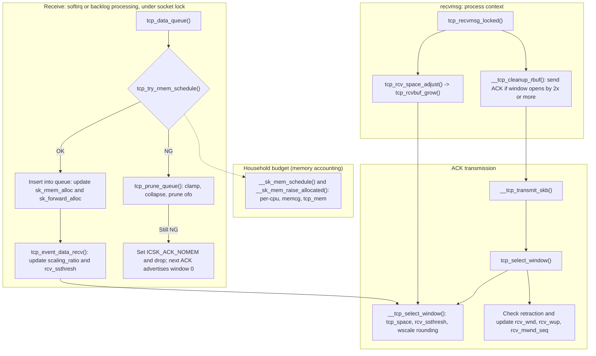

# 10. Windows and memory management

## The ELI5 version

The room's mailbox (socket) has an inbox where parcels (`sk_buff`) are kept. The size of the inbox is governed by a **household budget** (memory accounting), and until the resident (application) takes the contents out, nothing more will fit inside.

So every time the mailbox returns a signed receipt (ACK), it attaches a note (receive window) saying: "I can accept **this much more**."

- The number written on the note is not the "free space in the box" itself. Because parcels come with packaging materials (`truesize` overhead), the free space is converted into its **payload equivalent** before writing it down.
- Once you have written "there is room for 10 more", turning around on the next note and reducing it to "actually, only 3" is bad manners (never shrink the window). So if the box starts filling up, you write "room for 0 more" early on.
- If the resident is someone who retrieves contents rapidly, you upgrade to a bigger box altogether (autotuning). Giving a huge box to someone who retrieves contents slowly is a waste of money.
- The entire building (host) also has a budget (`tcp_mem`). When the building's budget gets tight, each room repacks the packaging (collapse) to use the box more compactly; if that is still not enough, it discards parcels from the back of the holding shelf (prune).
- The same applies to the sender side: the size of the outgoing shelf is expanded to match the "trucks allowed on the road at once" (cwnd).

This chapter walks through how the numbers on this note are decided and how the household budget is kept, line by line.

## What the RFCs say

### RFC 9293 §3.8.6: Managing the Window

[RFC 9293](https://www.rfc-editor.org/rfc/rfc9293) is the core TCP specification, consolidating and obsoleting RFC 793, the TCP portions of RFC 1122, RFC 879, RFC 6093, RFC 6429, RFC 6528, and RFC 6691. [§3.8.6](https://www.rfc-editor.org/rfc/rfc9293#section-3.8.6) specifies flow control—the mechanism by which the receiver informs the sender of how much data it can accept. Put simply, on each ACK the receiver conveys via `SEG.WND` that "you may send up to this many bytes starting from `SEG.ACK`", and the sender never transmits beyond `SND.UNA + SND.WND`.

The rules directly affecting the code are as follows:

- **SHOULD NOT shrink the window**: Moving the right edge `RCV.NXT + RCV.WND` to the left is strongly discouraged. The sender MUST be robust against window shrinking (MUST-34); if the usable window becomes negative, it must not send new data, but retransmissions continue.
- **Zero windows**: A receiver is permitted to advertise a zero window indefinitely, and the sender MUST send zero-window probes ([§3.8.6.1](https://www.rfc-editor.org/rfc/rfc9293#section-3.8.6.1); probe timers are covered in Chapter 9).
- **Receiver Silly Window Syndrome (SWS) avoidance** ([§3.8.6.2.2](https://www.rfc-editor.org/rfc/rfc9293#section-3.8.6.2.2), MUST-39): Letting `RCV.BUFF` be the receive buffer size, `RCV.USER` be received but unread data, and `RCV.WND` be the currently advertised window, the recommended algorithm keeps the right edge fixed until:

  ```text
  RCV.BUFF - RCV.USER - RCV.WND  >=  min(Fr * RCV.BUFF, Eff.snd.MSS)     (Fr = 1/2 recommended)
  ```

  and once this condition is met, advances to `RCV.WND = RCV.BUFF - RCV.USER`. This prevents Silly Window Syndrome, where continuously advertising small amounts of free space in 1-byte increments forces the sender to transmit tiny segments.

### RFC 1122 §4.2.2.16 / §4.2.2.17 / §4.2.3.3

[RFC 1122](https://www.rfc-editor.org/rfc/rfc1122) covers Host Requirements. Although its TCP portion was absorbed into RFC 9293, Linux comments still cite RFC 1122 directly, so we map them here:

- [§4.2.2.16 Managing the Window](https://www.rfc-editor.org/rfc/rfc1122#section-4.2.2.16): The original source for "receiver SHOULD NOT shrink the window".
- [§4.2.2.17 Probing Zero Windows](https://www.rfc-editor.org/rfc/rfc1122#section-4.2.2.17): The receiver is allowed to keep the window closed, and the sender must keep the connection open as long as the peer responds to probes with ACKs. This is the rationale behind Linux choosing to advertise a zero window rather than dropping packets silently under memory pressure.
- [§4.2.3.3 When to Send a Window Update](https://www.rfc-editor.org/rfc/rfc1122#section-4.2.3.3): The original source for receiver SWS avoidance, from which the formula `RCV.BUFF - RCV.USER - RCV.WND >= min(1/2 RCV.BUFF, MSS)` originates. The long comment preceding `__tcp_select_window()` quotes this section.

### RFC 7323 §2: Window Scale

[RFC 7323](https://www.rfc-editor.org/rfc/rfc7323) (TCP Extensions for High Performance, obsoleting RFC 1323) solves the limitation where a 16-bit window field can only advertise up to 64 KB, failing to fully utilise bandwidth on high-BDP paths, via the Window Scale option.

- [§2.2](https://www.rfc-editor.org/rfc/rfc7323#section-2.2): A 3-byte option `shift.cnt` carried only in SYN / SYN-ACK segments. It is negotiated independently in each direction, up to a maximum value of 14 (Linux's `TCP_MAX_WSCALE`).
- [§2.3](https://www.rfc-editor.org/rfc/rfc7323#section-2.3): A received `SEG.WND` is interpreted as `SND.WND = SEG.WND << Snd.Wind.Shift`. When transmitting, the internal 32-bit value is shifted right by `Rcv.Wind.Shift` before being placed into the header. Windows in SYN / SYN-ACK segments are never scaled.
- [§2.4 Addressing Window Retraction](https://www.rfc-editor.org/rfc/rfc7323#section-2.4): With scaling, the window granularity becomes `2^shift` bytes, meaning free space cannot be expressed with exact byte precision. Rounding up results in a "commitment beyond buffer", whilst rounding down causes "window retraction" (see [Appendix F](https://www.rfc-editor.org/rfc/rfc7323#appendix-F) for concrete examples). RFC 7323 therefore recognises that "window retraction can occur", requiring that a receiver **MUST accept segments falling within any window previously offered**, and **SHOULD track the maximum right edge ever advertised** when scaling is in use.

Linux defaults towards the "never shrink (round up)" behaviour, allowing retraction only when `net.ipv4.tcp_shrink_window=1` and `rcv_wscale` is non-zero. Furthermore, to satisfy the receiver MUST even when shrinking, it tracks the maximum right edge in `tp->rcv_mwnd_seq` for use in `tcp_sequence()`.

### DRS (Dynamic Right-Sizing): The concept behind autotuning

DRS is not an RFC, but an approach proposed around 2001 by Mike Fisk and Wu-chun Feng at Los Alamos. If the receiver's buffer (= upper limit on the advertised window) is smaller than the BDP, the sender's throughput hits a ceiling at rwnd no matter how large its cwnd grows. Conversely, assigning huge buffers to all sockets exhausts memory. DRS operates on the following principle:

1. Estimate the RTT at the receiver (using timestamps if present, or otherwise approximating it by the time taken to receive one window's worth of data).
2. Measure the number of bytes **consumed** by the application during one RTT. This serves as an estimate of the sender's effective cwnd.
3. Expand the receive buffer to approximately double that amount, ensuring the sender is not constrained by rwnd if it doubles its cwnd during slow start in the next RTT.

Linux's implementation (by John Heffner et al.) measures the RTT with `tcp_rcv_rtt_measure()` / `tcp_rcv_rtt_measure_ts()`, measures consumption per RTT with `tcp_rcv_space_adjust()`, and expands `sk_rcvbuf` with `tcp_rcvbuf_grow()`. This is enabled by `net.ipv4.tcp_moderate_rcvbuf` (default 1), and is disabled if the application sets `SO_RCVBUF` (`SOCK_RCVBUF_LOCK`).

### RFC variables vs Linux variables

| RFC | Linux | Notes |
| --- | --- | --- |
| `RCV.NXT` | `tp->rcv_nxt` | Next expected sequence number |
| `RCV.WND` | `tp->rcv_wnd` | **Last advertised** window (bytes, unscaled) |
| (advertised `RCV.NXT`) | `tp->rcv_wup` | Right edge is `rcv_wup + rcv_wnd` |
| (maximum right edge, RFC 7323 §2.4) | `tp->rcv_mwnd_seq` | Acceptance check when window is retracted |
| `RCV.BUFF` | `sk->sk_rcvbuf` | Measured in memory units (`truesize`) |
| `RCV.USER` | `sk->sk_rmem_alloc` + `sk->sk_backlog.len` | Same as above |
| `Rcv.Wind.Shift` | `tp->rx_opt.rcv_wscale` | Shift count for locally advertised window |
| `Snd.Wind.Shift` | `tp->rx_opt.snd_wscale` | Peer's window shift count |
| `Eff.snd.MSS` (peer's) | `icsk->icsk_ack.rcv_mss` | Estimated MSS of the peer |
| — | `tp->window_clamp` | Upper limit on advertised window |
| — | `tp->rcv_ssthresh` | Soft ceiling ("only open this far for now") |
| — | `tp->scaling_ratio` | Memory-to-payload conversion ratio (/256) |

The most critical distinction is that while RFC `RCV.BUFF` / `RCV.USER` are in **payload bytes**, Linux's `sk_rcvbuf` / `sk_rmem_alloc` represent **total `skb->truesize` (actual memory consumed)**. Bridging this gap is the job of `scaling_ratio`.

## The big picture



On the receiver side, each arriving data segment triggers the sequence: "securing memory budget" -> "inserting into queue" -> "updating conversion ratio and `rcv_ssthresh`". Every time the application reads, DRS expands `sk_rcvbuf`, and whenever an ACK is sent, `tcp_select_window()` calculates the advertised window from these values. Sender-side expansion of `sk_sndbuf` and EPOLLOUT evaluation are covered in Step 12.

> [!NOTE]
> When to send an ACK (delayed ACK, quickack) is covered in Chapters 6 and 7, zero-window probe timers are discussed in Chapter 9, and how the sender uses `snd_wnd` belongs to Chapter 4. This chapter focuses on **what** to write into the ACK and the underlying memory accounting.

## Walking through the code

### Step 1: Converting memory into window — `scaling_ratio`

Both the receive queue limit `sk_rcvbuf` and usage `sk_rmem_alloc` are measured as the sum of `skb->truesize` (`struct sk_buff` structure + `skb_shared_info` + data buffer + entire page frag). In contrast, what can be advertised to the peer is strictly payload bytes. On drivers that receive MTU 1500 frames into 4 KB pages or half-page frags, `truesize` is 1.5 to 3 times the payload size. An incorrect conversion leads to either "running out of memory despite the peer sending exactly what was advertised" (= collapse or drop) or "a throttled window despite plenty of spare memory" (= degraded throughput).

The conversion function is `__tcp_win_from_space()` ([include/net/tcp.h#L1774](https://git.kernel.org/pub/scm/linux/kernel/git/netdev/net-next.git/tree/include/net/tcp.h?id=279d5c8afcd38bd841832a39bfe1aa4f8518d98e#n1774)) along with its inverse.

```c
static inline int __tcp_win_from_space(u8 scaling_ratio, int space)
{
	s64 scaled_space = (s64)space * scaling_ratio;

	return scaled_space >> TCP_RMEM_TO_WIN_SCALE;
}

static inline int tcp_win_from_space(const struct sock *sk, int space)
{
	return __tcp_win_from_space(tcp_sk(sk)->scaling_ratio, space);
}

/* inverse of __tcp_win_from_space() */
static inline int __tcp_space_from_win(u8 scaling_ratio, int win)
{
	u64 val = (u64)win << TCP_RMEM_TO_WIN_SCALE;

	do_div(val, scaling_ratio);
	return val;
}

static inline int tcp_space_from_win(const struct sock *sk, int win)
{
	return __tcp_space_from_win(tcp_sk(sk)->scaling_ratio, win);
}
```

`TCP_RMEM_TO_WIN_SCALE` is 8 ([include/linux/tcp.h#L195](https://git.kernel.org/pub/scm/linux/kernel/git/netdev/net-next.git/tree/include/linux/tcp.h?id=279d5c8afcd38bd841832a39bfe1aa4f8518d98e#n195)). In other words, `scaling_ratio` is a `u8` fixed-point value representing `(payload / truesize) * 256`, giving `win = space * ratio / 256`.

- Performing the multiplication in `s64` prevents `space * 255` from overflowing 32 bits (`sk_rcvbuf` can be configured up near `INT_MAX`).
- The inverse function `__tcp_space_from_win()` requires division and therefore uses `do_div()`. This is only invoked in paths executed once per RTT, such as DRS (Step 6). Because the forward conversion is called on every ACK, it is designed to use only multiplication and shifts.
- `scaling_ratio` is clamped to a minimum of 1 in `tcp_measure_rcv_mss()` to prevent division by zero in the inverse function.

Initial value and two wrappers:

```c
/* Assume a 50% default for skb->len/skb->truesize ratio.
 * This may be adjusted later in tcp_measure_rcv_mss().
 */
#define TCP_DEFAULT_SCALING_RATIO (1 << (TCP_RMEM_TO_WIN_SCALE - 1))

static inline void tcp_scaling_ratio_init(struct sock *sk)
{
	tcp_sk(sk)->scaling_ratio = TCP_DEFAULT_SCALING_RATIO;
}

/* Note: caller must be prepared to deal with negative returns */
static inline int tcp_space(const struct sock *sk)
{
	return tcp_win_from_space(sk, READ_ONCE(sk->sk_rcvbuf) -
				  READ_ONCE(sk->sk_backlog.len) -
				  atomic_read(&sk->sk_rmem_alloc));
}

static inline int tcp_full_space(const struct sock *sk)
{
	return tcp_win_from_space(sk, READ_ONCE(sk->sk_rcvbuf));
}
```

- `TCP_DEFAULT_SCALING_RATIO` is `1 << 7` = 128, representing 50%. It is initialised alongside `sk_rcvbuf = tcp_rmem[1]` in `tcp_init_sock()` ([net/ipv4/tcp.c#L421](https://git.kernel.org/pub/scm/linux/kernel/git/netdev/net-next.git/tree/net/ipv4/tcp.c?id=279d5c8afcd38bd841832a39bfe1aa4f8518d98e#n421)).
- `tcp_space()` returns the unconsumed receive budget converted into window units. Note that `sk_backlog.len` is also subtracted. While the user process holds the socket lock, skbs enqueued to the backlog by softirq are not yet accounted for in `sk_rmem_alloc`, but the memory is already consumed. Because all three values may be updated without a lock, they are read using `READ_ONCE()` / `atomic_read()`, and the return value **can be negative** (as noted in the comment). Callers receive and compare the result as a signed `int`.
- `tcp_full_space()` represents the maximum window that could be advertised if the entire budget were utilised.

#### Where `scaling_ratio` is measured

Measurement takes place in `tcp_measure_rcv_mss()` ([net/ipv4/tcp_input.c#L227](https://git.kernel.org/pub/scm/linux/kernel/git/netdev/net-next.git/tree/net/ipv4/tcp_input.c?id=279d5c8afcd38bd841832a39bfe1aa4f8518d98e#n227)), invoked on every received data segment from `tcp_event_data_recv()` (and also for ofo packets since `38d7e4443365`). Only the relevant portion is shown:

```c
static void tcp_measure_rcv_mss(struct sock *sk, const struct sk_buff *skb)
{
...
	len = skb_shinfo(skb)->gso_size ? : skb->len;
	if (len >= icsk->icsk_ack.rcv_mss) {
		/* Note: divides are still a bit expensive.
		 * For the moment, only adjust scaling_ratio
		 * when we update icsk_ack.rcv_mss.
		 */
		if (unlikely(len != icsk->icsk_ack.rcv_mss)) {
			u64 val = (u64)skb->len << TCP_RMEM_TO_WIN_SCALE;
			u8 old_ratio = tcp_sk(sk)->scaling_ratio;

			do_div(val, skb->truesize);
			tcp_sk(sk)->scaling_ratio = val ? val : 1;

			if (old_ratio != tcp_sk(sk)->scaling_ratio) {
				struct tcp_sock *tp = tcp_sk(sk);

				val = tcp_win_from_space(sk, sk->sk_rcvbuf);
				WRITE_ONCE(tp->window_clamp, val);

				if (tp->window_clamp < tp->rcvq_space.space)
					tp->rcvq_space.space = tp->window_clamp;
			}
		}
		icsk->icsk_ack.rcv_mss = min_t(unsigned int, len,
					       tcp_sk(sk)->advmss);
```

- For GRO-aggregated skbs, `len` is `gso_size`, i.e., the size of an individual segment. This estimates the peer's MSS (`rcv_mss`), a value used for delayed ACK decisions (detailed in Chapter 6).
- Recalculating the ratio is restricted to `len != rcv_mss`—that is, only when the estimated MSS changes (`unlikely()`). As noted in the comment, this avoids expensive divisions. In steady state, no divisions run at all.
- The ratio itself is `skb->len / skb->truesize`, evaluated across the entire GRO-aggregated skb. Aggregation amortises the `sk_buff` overhead, yielding a higher ratio.
- When the ratio changes, `window_clamp` is rewritten **directly** to `tcp_win_from_space(sk_rcvbuf)`. Because `window_clamp` must reflect the window when all of `sk_rcvbuf` is utilised, updating the conversion ratio requires shifting it accordingly. `WRITE_ONCE()` is used because functions like `tcp_get_info()` read it locklessly.
- `rcvq_space.space` (the DRS baseline of bytes consumed in the previous RTT) is capped so it does not exceed the new `window_clamp` (`f5da7c45188e`).
- Previously, `tcp_set_window_clamp()` was called here, which had the side effect of slashing `rcv_ssthresh`. For flows with fluctuating ratios, this caused the window to fail to recover, so commit `0e125ecfe20c` reverted this to a straightforward `WRITE_ONCE()`. This maintains the invariant that `rcv_ssthresh` is only lowered during memory pressure (packetdrill `tcp_rcv_ssthresh_scaling_ratio.pkt`).

Numerical example: With `len = 1448` and `truesize = 2304` (half-page frag + `sk_buff`), `1448 * 256 / 2304 = 160` (approx. 62.5%). If `sk_rcvbuf = 131072` (the default `tcp_rmem[1]`), `tcp_full_space()` evaluates to `131072 * 160 / 256 = 81920` bytes.

### Step 2: Initial window and initialising `window_clamp` / `rcv_ssthresh`

At SYN / SYN-ACK time, `tcp_select_initial_window()` ([net/ipv4/tcp_output.c#L223](https://git.kernel.org/pub/scm/linux/kernel/git/netdev/net-next.git/tree/net/ipv4/tcp_output.c?id=279d5c8afcd38bd841832a39bfe1aa4f8518d98e#n223)) first establishes the initial window and `rcv_wscale`.

```c
void tcp_select_initial_window(const struct sock *sk, int __space, __u32 mss,
			       __u32 *rcv_wnd, __u32 *__window_clamp,
			       int wscale_ok, __u8 *rcv_wscale,
			       __u32 init_rcv_wnd)
{
	unsigned int space = (__space < 0 ? 0 : __space);
	u32 window_clamp = READ_ONCE(*__window_clamp);

	/* If no clamp set the clamp to the max possible scaled window */
	if (window_clamp == 0)
		window_clamp = (U16_MAX << TCP_MAX_WSCALE);
	space = min(window_clamp, space);

	/* Quantize space offering to a multiple of mss if possible. */
	if (space > mss)
		space = rounddown(space, mss);

...
	if (READ_ONCE(sock_net(sk)->ipv4.sysctl_tcp_workaround_signed_windows))
		(*rcv_wnd) = min(space, MAX_TCP_WINDOW);
	else
		(*rcv_wnd) = space;

	if (init_rcv_wnd)
		*rcv_wnd = min_t(u64, *rcv_wnd, (u64)init_rcv_wnd * mss);

	*rcv_wscale = 0;
	if (wscale_ok) {
		/* Set window scaling on max possible window */
		space = max_t(u32, space, READ_ONCE(sock_net(sk)->ipv4.sysctl_tcp_rmem[2]));
		space = max_t(u32, space, READ_ONCE(sysctl_rmem_max));
		space = min_t(u32, space, window_clamp);
		*rcv_wscale = clamp_t(int, ilog2(space) - 15,
				      0, TCP_MAX_WSCALE);
	}
	/* Set the clamp no higher than max representable value */
	WRITE_ONCE(*__window_clamp,
		   min_t(__u32, U16_MAX << (*rcv_wscale), window_clamp));
}
```

- If `window_clamp == 0` (`TCP_WINDOW_CLAMP` not set), the maximum representable scaled window `65535 << 14` is chosen as a provisional upper bound.
- `space` is rounded down to a multiple of MSS. Aligning the initial window to segment boundaries helps prevent the peer from generating fractional segments.
- `tcp_workaround_signed_windows` is a workaround for legacy stacks that misinterpret the window field as signed (default 0).
- `init_rcv_wnd` originates from route metrics (`initrwnd`) or BPF programs, constraining the initial window in units of segments.
- **The calculation of `wscale` is crucial.** Instead of using current `space`, it computes `ilog2(space) - 15` from the larger of `tcp_rmem[2]` and `rmem_max` (clamped to `window_clamp`)—representing the maximum size autotuning could ever reach in the future. Because wscale can only be negotiated during the SYN handshake, it cannot be increased later. When `tcp_rmem[2]` is 32 MB (the default since `572be9bf9d0d`), this yields `ilog2(32M) - 15 = 25 - 15 = 10`. This is why `wscale 10` frequently appears in packetdrill tests.
- Finally, `window_clamp` is capped to `65535 << rcv_wscale`, as larger values cannot be represented.

The initial value of `rcv_ssthresh` is this `*rcv_wnd` (initial window) (set by the caller via `tp->rcv_ssthresh = tp->rcv_wnd`; see Chapter 2 for details). Immediately after entering ESTABLISHED, `tcp_init_buffer_space()` ([net/ipv4/tcp_input.c#L740](https://git.kernel.org/pub/scm/linux/kernel/git/netdev/net-next.git/tree/net/ipv4/tcp_input.c?id=279d5c8afcd38bd841832a39bfe1aa4f8518d98e#n740)) is called.

```c
static void tcp_init_buffer_space(struct sock *sk)
{
	int tcp_app_win = READ_ONCE(sock_net(sk)->ipv4.sysctl_tcp_app_win);
	struct tcp_sock *tp = tcp_sk(sk);
	int maxwin;

	if (!(sk->sk_userlocks & SOCK_SNDBUF_LOCK))
		tcp_sndbuf_expand(sk);

	tcp_mstamp_refresh(tp);
	tp->rcvq_space.time = tp->tcp_mstamp;
	tp->rcvq_space.seq = tp->copied_seq;

	maxwin = tcp_full_space(sk);

	if (tp->window_clamp >= maxwin) {
		WRITE_ONCE(tp->window_clamp, maxwin);

		if (tcp_app_win && maxwin > 4 * tp->advmss)
			WRITE_ONCE(tp->window_clamp,
				   max(maxwin - (maxwin >> tcp_app_win),
				       4 * tp->advmss));
	}

	/* Force reservation of one segment. */
	if (tcp_app_win &&
	    tp->window_clamp > 2 * tp->advmss &&
	    tp->window_clamp + tp->advmss > maxwin)
		WRITE_ONCE(tp->window_clamp,
			   max(2 * tp->advmss, maxwin - tp->advmss));

	tp->rcv_ssthresh = min(tp->rcv_ssthresh, tp->window_clamp);
	tp->snd_cwnd_stamp = tcp_jiffies32;
	tp->rcvq_space.space = min3(tp->rcv_ssthresh, tp->rcv_wnd,
				    (u32)TCP_INIT_CWND * tp->advmss);
}
```

- If `SO_SNDBUF` has not been set, the send buffer is first expanded to match cwnd (Step 12).
- The measurement origin for DRS (`rcvq_space.time` / `.seq`) is initialised here.
- `window_clamp` is clamped to `tcp_full_space()`. `tcp_app_win` (default 31) is a legacy mechanism that withholds `1 / 2^tcp_app_win` of the window as application buffer; with 31, this reservation is practically 0.
- `rcv_ssthresh <= window_clamp` is enforced.
- `rcvq_space.space` (the baseline against which DRS compares consumption in the previous RTT) is set to `min3(rcv_ssthresh, rcv_wnd, 10 * advmss)`. This matches what an IW10 sender can transmit in the first RTT (`72d05c00d7ec`).

The relationship between the three upper bounds:

```text
rcv_wnd (advertised)  <=  rcv_ssthresh  <=  window_clamp  <=  tcp_full_space() = win(sk_rcvbuf)
                         (soft ceiling,      (hard ceiling,      (memory budget)
                          grows on data       DRS / SO_RCVBUF /
                          arrival)            TCP_WINDOW_CLAMP)
```

`rcv_ssthresh` acts like a "receiver-side slow start threshold". Because the peer might transmit packets with poor `truesize` ratios (i.e. fragmented data), the receiver does not open the window all the way to `window_clamp` immediately. Instead, it expands the window incrementally only after verifying that packets of that size fit within the budget (Step 5).

> [!NOTE]
> The actual `rcv_wnd` may temporarily slightly exceed `rcv_ssthresh` due to wscale rounding up or the "never shrink" rule, as discussed in Step 4. The inequality above describes the target values aimed for by `__tcp_select_window()`.

### Step 3: `tcp_select_window()` — Deciding the advertised value and updating state

`tcp_select_window()` ([net/ipv4/tcp_output.c#L275](https://git.kernel.org/pub/scm/linux/kernel/git/netdev/net-next.git/tree/net/ipv4/tcp_output.c?id=279d5c8afcd38bd841832a39bfe1aa4f8518d98e#n275)) is called by `__tcp_transmit_skb()` via `th->window = htons(tcp_select_window(sk))` on every transmitted segment except SYNs. Because data segments also carry ACKs, this is invoked for every outgoing packet, not merely standalone ACKs. The execution context is whichever path initiated transmission—either softirq (processing an incoming packet) or process context (`sendmsg` / `recvmsg` / `tcp_release_cb`). In either case, the socket lock (`bh_lock_sock` or socket ownership) is held.

```c
static u16 tcp_select_window(struct sock *sk)
{
	struct tcp_sock *tp = tcp_sk(sk);
	struct net *net = sock_net(sk);
	u32 old_win = tp->rcv_wnd;
	u32 cur_win, new_win;

	/* Make the window 0 if we failed to queue the data because we
	 * are out of memory.
	 */
	if (unlikely(inet_csk(sk)->icsk_ack.pending & ICSK_ACK_NOMEM)) {
		tp->pred_flags = 0;
		tp->rcv_wnd = 0;
		tp->rcv_wup = tp->rcv_nxt;
		tcp_update_max_rcv_wnd_seq(tp);
		return 0;
	}
```

- **Immediate zero window on memory exhaustion**: When `tcp_data_queue()` cannot accept even in-sequence data (Step 11), it schedules an ACK with `ICSK_ACK_NOMEM | ICSK_ACK_NOW`. Here, detecting this flag bypasses calculation and returns 0 immediately.
- `pred_flags = 0` disables header prediction (Chapter 5). Header prediction relies on incoming packets having an unchanged window to take the fast path; during a zero-window state, incoming traffic must be handled carefully via the slow path.
- **Recording `rcv_wnd = 0` and `rcv_wup = rcv_nxt` is vital** (`8c670bdfa58e`). Previously, advertising zero did not persist to state, leaving `tcp_receive_window()` large. Consequently, when the application subsequently read data to free up space, `__tcp_cleanup_rbuf()` failed its check ("send ACK if window opens by at least 2x"), deadlocking while the peer waited on the zero window. Recording 0 in socket state ensures that as soon as space frees up, `new_window >= 2 * 0` holds, triggering a window update.
- This is an **intentional exception** to the "never shrink" rule, as the right edge retreats leftwards to `rcv_nxt`. `tcp_update_max_rcv_wnd_seq()` therefore preserves the maximum right edge so that in-flight packets sent within the previously offered window are still accepted by `tcp_sequence()` (satisfying RFC 7323 §2.4 receiver MUST).
- After the ACK is transmitted, `ICSK_ACK_NOMEM` is cleared alongside `icsk_ack.pending` in `tcp_event_ack_sent()` -> `inet_csk_clear_xmit_timer(sk, ICSK_TIME_DACK)`. In short, it produces "0 for just this one ACK".

```c
	cur_win = tcp_receive_window(tp);
	new_win = __tcp_select_window(sk);
	if (new_win < cur_win) {
		/* Danger Will Robinson!
		 * Don't update rcv_wup/rcv_wnd here or else
		 * we will not be able to advertise a zero
		 * window in time.  --DaveM
		 *
		 * Relax Will Robinson.
		 */
		if (!READ_ONCE(net->ipv4.sysctl_tcp_shrink_window) || !tp->rx_opt.rcv_wscale) {
			/* Never shrink the offered window */
			if (new_win == 0)
				NET_INC_STATS(net, LINUX_MIB_TCPWANTZEROWINDOWADV);
			new_win = ALIGN(cur_win, 1 << tp->rx_opt.rcv_wscale);
		}
	}

	tp->rcv_wnd = new_win;
	tp->rcv_wup = tp->rcv_nxt;
	tcp_update_max_rcv_wnd_seq(tp);
```

- `cur_win` is "previously advertised right edge minus current `rcv_nxt`"—the **remaining window still valid from the peer's viewpoint**. `tcp_receive_window()` ([include/net/tcp.h#L956](https://git.kernel.org/pub/scm/linux/kernel/git/netdev/net-next.git/tree/include/net/tcp.h?id=279d5c8afcd38bd841832a39bfe1aa4f8518d98e#n956)) clamps this at 0 to prevent negative values should the peer transmit beyond the window.
- `new_win` is the "ideal window" computed from current memory conditions (Step 4).
- **`new_win < cur_win` signifies "window shrinking (retraction)".** By default (`tcp_shrink_window=0`) or when `rcv_wscale` is 0, `new_win` is raised back to `cur_win` to prevent retraction. Crucially, it is **rounded up** via `ALIGN(cur_win, 1 << tp->rx_opt.rcv_wscale)`. If fractional bits were discarded when later shifting right by `rcv_wscale`, the right edge perceived by the peer would move leftwards. As a result of rounding up, the right edge may advance up to `2^wscale - 1` bytes rightwards. This corresponds to the "Beyond Buffer" option in RFC 7323 §2.4.
- `LINUX_MIB_TCPWANTZEROWINDOWADV` counts instances where the stack intended to advertise zero, but could not do so due to the "never shrink" rule. A high count suggests the receiving application is too slow or the receive buffer is undersized.
- When shrinking is permitted (`tcp_shrink_window=1` and `rcv_wscale != 0`), `new_win` is adopted directly. Shrinking is never permitted with wscale 0 because an unscaled window can represent free space with 1-byte granularity, eliminating granularity-induced retraction altogether (the design decision in `b650d953cd39`).
- The "Danger Will Robinson" comment is a historical relic from when `rcv_wup` / `rcv_wnd` were not updated here; today, they are unconditionally updated below.
- `rcv_wnd` and `rcv_wup` are updated, and `tcp_update_max_rcv_wnd_seq()` ([include/net/tcp.h#L979](https://git.kernel.org/pub/scm/linux/kernel/git/netdev/net-next.git/tree/include/net/tcp.h?id=279d5c8afcd38bd841832a39bfe1aa4f8518d98e#n979)) maintains `rcv_mwnd_seq = max(rcv_mwnd_seq, rcv_wup + rcv_wnd)`. Using `after()` handles sequence number wrap-around correctly.

```c
	/* Make sure we do not exceed the maximum possible
	 * scaled window.
	 */
	if (!tp->rx_opt.rcv_wscale &&
	    READ_ONCE(net->ipv4.sysctl_tcp_workaround_signed_windows))
		new_win = min(new_win, MAX_TCP_WINDOW);
	else
		new_win = min(new_win, (65535U << tp->rx_opt.rcv_wscale));

	/* RFC1323 scaling applied */
	new_win >>= tp->rx_opt.rcv_wscale;

	/* If we advertise zero window, disable fast path. */
	if (new_win == 0) {
		tp->pred_flags = 0;
		if (old_win)
			NET_INC_STATS(net, LINUX_MIB_TCPTOZEROWINDOWADV);
	} else if (old_win == 0) {
		NET_INC_STATS(net, LINUX_MIB_TCPFROMZEROWINDOWADV);
	}

	return new_win;
}
```

- When wscale is 0, the window is capped at 65535 (or 32767 with `workaround_signed_windows`); with wscale enabled, it is capped at `65535 << wscale`. The value clamped here is not written back to `rcv_wnd`. Because `window_clamp` was already capped to `65535 << wscale` in `tcp_select_initial_window()`, this capping rarely trims the value under normal operation.
- `new_win >>= tp->rx_opt.rcv_wscale` implements RFC 7323 §2.3 ("right shift before transmitting"). Thanks to the prior `ALIGN` and rounding within `__tcp_select_window()`, no fractional truncation occurs here that would cause unintended retraction.
- Advertising a zero window disables header prediction. Transitions to zero and recoveries from zero are counted in `TCPToZeroWindowAdv` and `TCPFromZeroWindowAdv` respectively (`8e165e20348b`). `old_win` is the value of `rcv_wnd` read at the entry of the function.

### Step 4: `__tcp_select_window()` — Calculating the ideal window

`__tcp_select_window()` ([net/ipv4/tcp_output.c#L3322](https://git.kernel.org/pub/scm/linux/kernel/git/netdev/net-next.git/tree/net/ipv4/tcp_output.c?id=279d5c8afcd38bd841832a39bfe1aa4f8518d98e#n3322)) returns the "raw window before retraction checks and scaling". In addition to `tcp_select_window()`, it is called by `__tcp_cleanup_rbuf()` (to check if the window opened sufficiently) and `__tcp_ack_snd_check()` (to decide if an immediate ACK is warranted). Because neither caller is allowed to modify connection state, this function does not write `rcv_wnd` (though it does update `rcv_ssthresh` and `icsk_ack.quick`, as discussed below).

```c
u32 __tcp_select_window(struct sock *sk)
{
	struct inet_connection_sock *icsk = inet_csk(sk);
	struct tcp_sock *tp = tcp_sk(sk);
	struct net *net = sock_net(sk);
	/* MSS for the peer's data.  Previous versions used mss_clamp
	 * here.  I don't know if the value based on our guesses
	 * of peer's MSS is better for the performance.  It's more correct
	 * but may be worse for the performance because of rcv_mss
	 * fluctuations.  --SAW  1998/11/1
	 */
	int mss = icsk->icsk_ack.rcv_mss;
	int free_space = tcp_space(sk);
	int allowed_space = tcp_full_space(sk);
	int full_space, window;

	if (sk_is_mptcp(sk))
		mptcp_space(sk, &free_space, &allowed_space);

	full_space = min_t(int, tp->window_clamp, allowed_space);

	if (unlikely(mss > full_space)) {
		mss = full_space;
		if (mss <= 0)
			return 0;
	}
```

- `mss` is the estimated MSS of the **peer** (`rcv_mss`), not the local `mss_cache`. The comment by Alexey Kuznetsov (SAW) from 1998 explains the rationale for switching from `mss_clamp` to an estimated value.
- `free_space` is `tcp_space()` (which can be negative), and `allowed_space` is `tcp_full_space()`. For MPTCP subflows, these are overridden with the parent MPTCP socket's receive buffer space.
- `full_space = min(tp->window_clamp, allowed_space)` represents the absolute ceiling on the window for this call.
- If `mss > full_space`—an extreme condition where the receive buffer is smaller than a single MSS (e.g. `SO_RCVBUF` set exceptionally small)—`mss` is clamped down to `full_space`. If `full_space <= 0`, it returns 0 immediately. Historically, omitting this check caused a division by zero in downstream `rounddown(free_space, mss)` (`06425c308b92`).

```c
	/* Only allow window shrink if the sysctl is enabled and we have
	 * a non-zero scaling factor in effect.
	 */
	if (READ_ONCE(net->ipv4.sysctl_tcp_shrink_window) && tp->rx_opt.rcv_wscale)
		goto shrink_window_allowed;

	/* do not allow window to shrink */

	if (free_space < (full_space >> 1)) {
		icsk->icsk_ack.quick = 0;

		if (tcp_under_memory_pressure(sk))
			tcp_adjust_rcv_ssthresh(sk);

		/* free_space might become our new window, make sure we don't
		 * increase it due to wscale.
		 */
		free_space = round_down(free_space, 1 << tp->rx_opt.rcv_wscale);

		/* if free space is less than mss estimate, or is below 1/16th
		 * of the maximum allowed, try to move to zero-window, else
		 * tcp_clamp_window() will grow rcv buf up to tcp_rmem[2], and
		 * new incoming data is dropped due to memory limits.
		 * With large window, mss test triggers way too late in order
		 * to announce zero window in time before rmem limit kicks in.
		 */
		if (free_space < (allowed_space >> 4) || free_space < mss)
			return 0;
	}
```

- When window shrinking is permitted, execution jumps to a dedicated label (detailed below).
- **`free_space < full_space / 2`**: More than half of the receive buffer is occupied. This corresponds to the `1/2` threshold in RFC 1122 receiver SWS avoidance (`min(1/2 RCV.BUFF, MSS)`).
  - Setting `icsk_ack.quick = 0` suppresses quickack. There is no justification for rushing ACKs and encouraging the peer to transmit faster when buffer space is tight.
  - Under memory pressure, `tcp_adjust_rcv_ssthresh()` reduces `rcv_ssthresh` down to `4 * advmss` (or up to unused `SO_RESERVE_MEM` memory).
  - `free_space` is **rounded down** to the wscale granularity (`round_down`). This value may become the new window, and rounding up later with `ALIGN` would commit to more space than actually available.
  - **Condition for transitioning to a zero window**: `free_space < allowed_space / 16` or `free_space < mss`. Relying solely on the MSS condition would mean a 32 MB buffer would not close its window until free space drops below 1 MSS. Throughout that period, the "never shrink" rule would keep rounding up and advertising the old window, causing the peer to continue sending until the buffer overflows and packets are dropped. The 1/16 threshold prevents this scenario (`86c1a045640d`, with context explained in the comment). Even though 0 is returned here, caller `tcp_select_window()` restores the window up to `cur_win`, so a zero window is only transmitted on the wire **once the peer catches up to the right edge**.
- Because `free_space` is a signed `int`, negative values naturally enter this branch and return 0.

```c
	if (free_space > tp->rcv_ssthresh)
		free_space = tp->rcv_ssthresh;

	/* Don't do rounding if we are using window scaling, since the
	 * scaled window will not line up with the MSS boundary anyway.
	 */
	if (tp->rx_opt.rcv_wscale) {
		window = free_space;

		/* Advertise enough space so that it won't get scaled away.
		 * Import case: prevent zero window announcement if
		 * 1<<rcv_wscale > mss.
		 */
		window = ALIGN(window, (1 << tp->rx_opt.rcv_wscale));
	} else {
		window = tp->rcv_wnd;
		/* Get the largest window that is a nice multiple of mss.
		 * Window clamp already applied above.
		 * If our current window offering is within 1 mss of the
		 * free space we just keep it. This prevents the divide
		 * and multiply from happening most of the time.
		 * We also don't do any window rounding when the free space
		 * is too small.
		 */
		if (window <= free_space - mss || window > free_space)
			window = rounddown(free_space, mss);
		else if (mss == full_space &&
			 free_space > window + (full_space >> 1))
			window = free_space;
	}

	return window;
```

- **Capped by `rcv_ssthresh`**: Even with ample free space, the window only opens as far as `rcv_ssthresh`. This is where the principle from Step 5 ("only open as much as verified") takes effect.
- **When wscale is in effect**: No MSS alignment is performed, as the scaled window cannot align to MSS boundaries anyway. Instead, `ALIGN` **rounds up** to the wscale granularity. The "Import case" (a typo for "Important") in the comment addresses the situation where `1 << rcv_wscale > mss` (16 KB at wscale 14); rounding down could collapse several MSS of free space to zero after scaling. Rounding up commits to at most `2^wscale - 1` bytes extra, operating on the premise that `rcv_ssthresh` and `full_space` are soft limits (absorbed by collapsing in Step 11).
  - However, if `free_space` was rounded down in the previous branch (buffer over half full), it is already aligned to the granularity, so `ALIGN` leaves it unchanged. In short: round up when plenty of room remains, round down when space is constrained.
- **When wscale is not in effect**: RFC 1122 SWS avoidance is approximated using multiples of MSS.
  - If the current `rcv_wnd` falls within `(free_space - mss, free_space]`, the current value is preserved. This avoids performing `rounddown()` (a division) on every packet, keeps the window moving exclusively in MSS increments, and preserves header prediction efficiency (BSD-compatible behaviour; see the long comment above the function).
  - Outside that range, it calculates `rounddown(free_space, mss)`.
  - If `mss == full_space` (receive buffer shrunk to 1 MSS or less) and free space exceeds the current window by `full_space / 2` or more, `free_space` is used directly without rounding. This comes from John Heffner's `84565070e442` ("receiver SWS avoidance when rcvbuf < MSS"), avoiding deadlocks where rounding by MSS would perpetually evaluate to 0.

Path when window shrinking is permitted:

```c
shrink_window_allowed:
	/* new window should always be an exact multiple of scaling factor */
	free_space = round_down(free_space, 1 << tp->rx_opt.rcv_wscale);

	if (free_space < (full_space >> 1)) {
		icsk->icsk_ack.quick = 0;

		if (tcp_under_memory_pressure(sk))
			tcp_adjust_rcv_ssthresh(sk);

		/* if free space is too low, return a zero window */
		if (free_space < (allowed_space >> 4) || free_space < mss ||
			free_space < (1 << tp->rx_opt.rcv_wscale))
			return 0;
	}

	if (free_space > tp->rcv_ssthresh) {
		free_space = tp->rcv_ssthresh;
		/* new window should always be an exact multiple of scaling factor
		 *
		 * For this case, we ALIGN "up" (increase free_space) because
		 * we know free_space is not zero here, it has been reduced from
		 * the memory-based limit, and rcv_ssthresh is not a hard limit
		 * (unlike sk_rcvbuf).
		 */
		free_space = ALIGN(free_space, (1 << tp->rx_opt.rcv_wscale));
	}

	return free_space;
}
```

- `free_space` is first rounded down to wscale granularity (the new window is always an exact multiple).
- The zero-window condition adds `free_space < (1 << rcv_wscale)`. If the rounded value is less than the scaling unit, it would shift to 0 anyway.
- Only when capped by `rcv_ssthresh` does `ALIGN` round up. As the comment notes, `rcv_ssthresh` is not a hard limit and is known to be smaller than the memory-based limit, so rounding up will not exceed the memory boundary.

Why permit window retraction? The reproducer in commit `b650d953cd39` involved a sender transmitting 4-byte packets at 1 ms intervals while the receiving application read nothing. Even a 4-byte skb carries nearly 1 KB of `truesize`, consuming memory hundreds of times faster than payload bytes. Under a strict non-shrinking policy, `tcp_clamp_window()` inflates `sk_rcvbuf` up to `tcp_rmem[2]` trying to honour the advertised window. Permitting retraction allows the window to immediately reflect actual available memory.

### Step 5: Growing `rcv_ssthresh` — `tcp_grow_window()`

`tcp_grow_window()` ([net/ipv4/tcp_input.c#L700](https://git.kernel.org/pub/scm/linux/kernel/git/netdev/net-next.git/tree/net/ipv4/tcp_input.c?id=279d5c8afcd38bd841832a39bfe1aa4f8518d98e#n700)) is called upon receiving in-sequence data (`tcp_event_data_recv()`, when `skb->len >= 128`) and ofo data (`tcp_data_queue_ofo()`, only when SACK is enabled). The extensive introductory comment ("2. Tuning advertised window") outlines the design philosophy behind this mechanism. `rcv_ssthresh` serves two purposes:

1. **Check #1**: Reserve buffer space for the application while maintaining sender header prediction (keeping the advertised window stable).
2. **Check #2**: Prevent overestimating the receive window, which would eventually force pruning of the receive queue.

```c
static void tcp_grow_window(struct sock *sk, const struct sk_buff *skb,
			    bool adjust)
{
	struct tcp_sock *tp = tcp_sk(sk);
	int room;

	room = min_t(int, tp->window_clamp, tcp_space(sk)) - tp->rcv_ssthresh;

	if (room <= 0)
		return;

	/* Check #1 */
	if (!tcp_under_memory_pressure(sk)) {
		unsigned int truesize = truesize_adjust(adjust, skb);
		int incr;

		/* Check #2. Increase window, if skb with such overhead
		 * will fit to rcvbuf in future.
		 */
		if (tcp_win_from_space(sk, truesize) <= skb->len)
			incr = 2 * tp->advmss;
		else
			incr = __tcp_grow_window(sk, skb, truesize);

		if (incr) {
			incr = max_t(int, incr, 2 * skb->len);
			tp->rcv_ssthresh += min(room, incr);
			inet_csk(sk)->icsk_ack.quick |= 1;
		}
	} else {
		/* Under pressure:
		 * Adjust rcv_ssthresh according to reserved mem
		 */
		tcp_adjust_rcv_ssthresh(sk);
	}
}
```

- `room` represents how much further `rcv_ssthresh` can be increased. The ceiling is the smaller of `window_clamp` and current free space `tcp_space()`.
- Under memory pressure, growth is halted; instead, `tcp_adjust_rcv_ssthresh()` lowers it towards `4 * advmss`.
- `truesize_adjust()` is examined in the latter half of Step 5.
- **Fast evaluation for Check #2**: If `tcp_win_from_space(truesize) <= skb->len`—meaning this skb's payload-to-truesize ratio is equal to or better than the average (`scaling_ratio`)—the stack concludes that packets with this overhead profile will fit within budget and increments by `2 * advmss`.
- Otherwise, `__tcp_grow_window()` performs a detailed evaluation.
- The increment is taken as `max(incr, 2 * skb->len)`. Incrementing by merely 2 MSS when receiving a 64 KB GRO aggregate would grow far too slowly.
- `icsk_ack.quick |= 1` schedules one quickack, promptly informing the peer of the opened window so as not to stall slow start.

```c
static int __tcp_grow_window(const struct sock *sk, const struct sk_buff *skb,
			     unsigned int skbtruesize)
{
	const struct tcp_sock *tp = tcp_sk(sk);
	/* Optimize this! */
	int truesize = tcp_win_from_space(sk, skbtruesize) >> 1;
	int window = tcp_win_from_space(sk, READ_ONCE(sock_net(sk)->ipv4.sysctl_tcp_rmem[2])) >> 1;

	while (tp->rcv_ssthresh <= window) {
		if (truesize <= skb->len)
			return 2 * inet_csk(sk)->icsk_ack.rcv_mss;

		truesize >>= 1;
		window >>= 1;
	}
	return 0;
}

/* Even if skb appears to have a bad len/truesize ratio, TCP coalescing
 * can play nice with us, as sk_buff and skb->head might be either
 * freed or shared with up to MAX_SKB_FRAGS segments.
 * Only give a boost to drivers using page frag(s) to hold the frame(s),
 * and if no payload was pulled in skb->head before reaching us.
 */
static u32 truesize_adjust(bool adjust, const struct sk_buff *skb)
{
	u32 truesize = skb->truesize;

	if (adjust && !skb_headlen(skb)) {
		truesize -= SKB_TRUESIZE(skb_end_offset(skb));
		/* paranoid check, some drivers might be buggy */
		if (unlikely((int)truesize < (int)skb->len))
			truesize = skb->truesize;
	}
	return truesize;
}
```

`__tcp_grow_window()` originates from John Heffner's `326f36e9e7de` ("limiting receive buffer growth with mixed MTUs").

- Initialising `window` from `win(tcp_rmem[2]) / 2` and `truesize` from `win(skb->truesize) / 2`, both are repeatedly halved.
- The heuristic dictates: "While `rcv_ssthresh` is small, packets with poor ratios may still grow the window up to a moderate size. As `rcv_ssthresh` grows larger, an increasingly favourable ratio is demanded." Specifically, the number of halvings required for `truesize` to drop to `skb->len` while satisfying `rcv_ssthresh <= window` corresponds to the tolerated overhead inefficiency.
- If growth is permitted, it returns `2 * rcv_mss` (ultimately expanded to `max(..., 2 * skb->len)`).
- The loop terminates and returns 0 once `window` drops below `rcv_ssthresh`. For peers that persist in sending fragmented packets, the window will not be grown any further.

`truesize_adjust()` was introduced by Eric Dumazet in `240bfd134c59`. When an skb has all its payload in page frags and its linear buffer is empty (`!skb_headlen(skb)`), `tcp_try_coalesce()` will merge its frags into the preceding skb upon queue insertion, freeing the `struct sk_buff` descriptor and `skb->head`. Therefore, it evaluates the packet by subtracting `SKB_TRUESIZE(skb_end_offset(skb))` (the descriptor and head overhead). `adjust` is passed as `true` in the in-sequence path and `false` in the ofo path (because coalescing cannot be guaranteed in the ofo queue).

In conjunction, let us examine `__tcp_adjust_rcv_ssthresh()` ([include/net/tcp.h#L1828](https://git.kernel.org/pub/scm/linux/kernel/git/netdev/net-next.git/tree/include/net/tcp.h?id=279d5c8afcd38bd841832a39bfe1aa4f8518d98e#n1828)):

```c
static inline void __tcp_adjust_rcv_ssthresh(struct sock *sk, u32 new_ssthresh)
{
	int unused_mem = sk_unused_reserved_mem(sk);
	struct tcp_sock *tp = tcp_sk(sk);

	tp->rcv_ssthresh = min(tp->rcv_ssthresh, new_ssthresh);
	if (unused_mem)
		tp->rcv_ssthresh = max_t(u32, tp->rcv_ssthresh,
					 tcp_win_from_space(sk, unused_mem));
}

static inline void tcp_adjust_rcv_ssthresh(struct sock *sk)
{
	__tcp_adjust_rcv_ssthresh(sk, 4U * tcp_sk(sk)->advmss);
}
```

- Under memory pressure, `rcv_ssthresh` is reduced down to `4 * advmss`, but if unused memory reserved in advance via `SO_RESERVE_MEM` (`sk_unused_reserved_mem()`) exists, it is preserved up to that converted equivalent (`053f368412c9`). This reservation mechanism ensures sockets in a memcg can maintain a minimal functional window even during memory pressure.

### Step 6: DRS — `tcp_rcv_space_adjust()` and `tcp_rcvbuf_grow()`

#### Receiver-side RTT estimation

DRS requires an RTT estimate from the receiver's perspective. Sender-side RTT estimation (Chapter 7) measures the RTT using ACKs (signed receipts) for data it sent itself, but a receive-only socket has no outgoing data. Therefore, samples are fed into `tcp_rcv_rtt_update()` ([net/ipv4/tcp_input.c#L829](https://git.kernel.org/pub/scm/linux/kernel/git/netdev/net-next.git/tree/net/ipv4/tcp_input.c?id=279d5c8afcd38bd841832a39bfe1aa4f8518d98e#n829)) via two different paths.

```c
static void tcp_rcv_rtt_update(struct tcp_sock *tp, u32 sample, int win_dep)
{
	u32 new_sample, old_sample = tp->rcv_rtt_est.rtt_us;
	long m = sample << 3;

	if (old_sample == 0 || m < old_sample) {
		new_sample = m;
	} else {
...
		if (win_dep)
			return;
		/* Do not use this sample if receive queue is not empty. */
		if (tp->rcv_nxt != tp->copied_seq)
			return;
		new_sample = old_sample - (old_sample >> 3) + sample;
	}

	tp->rcv_rtt_est.rtt_us = new_sample;
}

static inline void tcp_rcv_rtt_measure(struct tcp_sock *tp)
{
	u32 delta_us;

	if (tp->rcv_rtt_est.time == 0)
		goto new_measure;
	if (before(tp->rcv_nxt, tp->rcv_rtt_est.seq))
		return;
	delta_us = tcp_stamp_us_delta(tp->tcp_mstamp, tp->rcv_rtt_est.time);
	if (!delta_us)
		delta_us = 1;
	tcp_rcv_rtt_update(tp, delta_us, 1);

new_measure:
	tp->rcv_rtt_est.seq = tp->rcv_nxt + tp->rcv_wnd;
	tp->rcv_rtt_est.time = tp->tcp_mstamp;
}
```

- `rcv_rtt_est.rtt_us` is a fixed-point value scaled by 8 (`m = sample << 3`).
- On the first measurement, or whenever a new sample is smaller than the current value, it is adopted immediately. It is an estimate biased towards the **minimum value**.
- When `win_dep = 1` (the path without TCP timestamps), larger samples are discarded. Because this method measures "the time taken to receive one full window", an application-limited sender would cause the RTT to be grossly overestimated.
- Even on the timestamp path, smoothing is skipped if the inbox (receive queue) is not empty (`rcv_nxt != copied_seq`). If the application is slow, the peer's transmission is blocked by rwnd, making the reflected TS echo appear delayed.
- The smoothing formula is `new = old - old/8 + sample`, and because `old` is scaled by 8, this is an EWMA with a weight of 1/8, just like standard SRTT.
- `tcp_rcv_rtt_measure()` is the path without timestamps. It records "current `rcv_nxt + rcv_wnd`" in `rcv_rtt_est.seq`, and once `rcv_nxt` advances past that point (i.e. one full window of data has been received), the elapsed time is taken as a sample.
- `tcp_rcv_rtt_measure_ts()` ([net/ipv4/tcp_input.c#L893](https://git.kernel.org/pub/scm/linux/kernel/git/netdev/net-next.git/tree/net/ipv4/tcp_input.c?id=279d5c8afcd38bd841832a39bfe1aa4f8518d98e#n893)) is the timestamp path: only when `rcv_tsecr` has advanced and the segment is at least 1 MSS does it take `tcp_time_stamp - tsecr` as a sample. Samples with a delta of 0 are discarded (`d59fc95be9d0`; with 1 ms timestamp granularity, zeroes occur frequently at low RTTs, corrupting the minimum estimation).

#### `tcp_rcv_space_adjust()`

`tcp_rcv_space_adjust()` ([net/ipv4/tcp_input.c#L960](https://git.kernel.org/pub/scm/linux/kernel/git/netdev/net-next.git/tree/net/ipv4/tcp_input.c?id=279d5c8afcd38bd841832a39bfe1aa4f8518d98e#n960)) is called **after delivering data to user space** by functions such as `tcp_recvmsg_locked()`, `tcp_read_sock()`, `tcp_zerocopy_receive()`, and BPF sockmap. It runs in process context whilst holding the socket lock.

```c
void tcp_rcv_space_adjust(struct sock *sk)
{
	struct tcp_sock *tp = tcp_sk(sk);
	int time, inq, copied;

	trace_tcp_rcv_space_adjust(sk);

	if (unlikely(!tp->rcv_rtt_est.rtt_us))
		return;

	/* We do not refresh tp->tcp_mstamp here.
	 * Some platforms have expensive ktime_get() implementations.
	 * Using the last cached value is enough for DRS.
	 */
	time = tcp_stamp_us_delta(tp->tcp_mstamp, tp->rcvq_space.time);
	if (time < (tp->rcv_rtt_est.rtt_us >> 3))
		return;

	/* Number of bytes copied to user in last RTT */
	copied = tp->copied_seq - tp->rcvq_space.seq;
	/* Number of bytes in receive queue. */
	inq = tp->rcv_nxt - tp->copied_seq;
	copied -= inq;
	if (copied <= tp->rcvq_space.space)
		goto new_measure;

	trace_tcp_rcvbuf_grow(sk, time);

	tcp_rcvbuf_grow(sk, copied);

new_measure:
	tp->rcvq_space.seq = tp->copied_seq;
	tp->rcvq_space.time = tp->tcp_mstamp;
}
```

- The tracepoint `tcp:tcp_rcv_space_adjust` fires every time.
- If the receiver RTT has not been measured yet, it does nothing (`unlikely()`).
- Note that it **does not refresh `tcp_mstamp`**. `tcp_mstamp` is a cached timestamp updated during recent receives or transmits. Calling `ktime_get()` on every `recvmsg()` can be expensive on certain platforms, so DRS pragmatically accepts that the cached value is accurate enough (`0ae1ac7335ca`).
- If at least **one RTT** has not elapsed since the previous measurement, it does nothing. Shifting right by 3 (`rtt_us >> 3`) converts the scaled-by-8 value back to microseconds. DRS makes decisions only once per RTT.
- `copied = copied_seq - rcvq_space.seq` represents the number of bytes read by the application during this RTT.
- `inq = rcv_nxt - copied_seq` is the number of bytes still waiting in the inbox (receive queue). **`copied -= inq` subtracts this backlog** (`ea33537d8292`). When the application cannot keep up—that is, when the queue is backing up—expanding the receive buffer does not increase the rate at which the application consumes data; it merely wastes memory and cache lines. While this subtraction might seem peculiar at first glance, it means only the volume that the application is actively keeping pace with serves as justification for growth.
- If `copied` is less than or equal to the previous `rcvq_space.space`, the buffer is not grown, and only the measurement window is reset. DRS **never shrinks** the buffer; shrinking is reserved exclusively for the memory pressure paths in Step 11.
- If growing the buffer, it emits the tracepoint `tcp:tcp_rcvbuf_grow` (logging time, rtt, copied, inq, space, ooo, rcvbuf, rcv_ssthresh, window_clamp, rcv_wnd, and scaling_ratio) before invoking `tcp_rcvbuf_grow()`.
- `copied` is a signed `int`. Whilst `copied_seq - rcvq_space.seq` is exceedingly unlikely to exceed 2 GB in a single RTT, care has been taken across the codebase since `607065bad993` to prevent overflow.

#### `tcp_rcvbuf_grow()`

`tcp_rcvbuf_grow()` ([net/ipv4/tcp_input.c#L911](https://git.kernel.org/pub/scm/linux/kernel/git/netdev/net-next.git/tree/net/ipv4/tcp_input.c?id=279d5c8afcd38bd841832a39bfe1aa4f8518d98e#n911)) is called from two places: `tcp_rcv_space_adjust()` (`newval = copied`), and right after inserting an skb into the holding shelf (out-of-order queue) in `tcp_data_queue_ofo()` (`newval = rcvq_space.space`, which re-evaluates the space needed for out-of-order packets without altering the measured value). MPTCP also uses it.

```c
void tcp_rcvbuf_grow(struct sock *sk, u32 newval)
{
	const struct net *net = sock_net(sk);
	struct tcp_sock *tp = tcp_sk(sk);
	u32 rcvwin, rcvbuf, cap, oldval;
	u32 rtt_threshold, rtt_us;
	u64 grow;

	oldval = tp->rcvq_space.space;
	tp->rcvq_space.space = newval;

	if (!READ_ONCE(net->ipv4.sysctl_tcp_moderate_rcvbuf) ||
	    (sk->sk_userlocks & SOCK_RCVBUF_LOCK))
		return;

	/* DRS is always one RTT late. */
	rcvwin = newval << 1;

	rtt_us = tp->rcv_rtt_est.rtt_us >> 3;
	rtt_threshold = READ_ONCE(net->ipv4.sysctl_tcp_rcvbuf_low_rtt);
	if (rtt_us < rtt_threshold) {
		/* For small RTT, we set @grow to rcvwin * rtt_us/rtt_threshold.
		 * It might take few additional ms to reach 'line rate',
		 * but will avoid sk_rcvbuf inflation and poor cache use.
		 */
		grow = div_u64((u64)rcvwin * rtt_us, rtt_threshold);
	} else {
		/* slow start: allow the sender to double its rate. */
		grow = div_u64(((u64)rcvwin << 1) * (newval - oldval), oldval);
	}
	rcvwin += grow;

	if (!RB_EMPTY_ROOT(&tp->out_of_order_queue))
		rcvwin += TCP_SKB_CB(tp->ooo_last_skb)->end_seq - tp->rcv_nxt;

	cap = READ_ONCE(net->ipv4.sysctl_tcp_rmem[2]);

	rcvbuf = min_t(u32, tcp_space_from_win(sk, rcvwin), cap);
	if (rcvbuf > sk->sk_rcvbuf) {
		WRITE_ONCE(sk->sk_rcvbuf, rcvbuf);
		/* Make the window clamp follow along.  */
		WRITE_ONCE(tp->window_clamp,
			   tcp_win_from_space(sk, rcvbuf));
	}
}
```

- It records `rcvq_space.space = newval` upfront. Even when autotuning is disabled, the baseline for subsequent comparisons is kept up to date.
- If `tcp_moderate_rcvbuf=0` or `SO_RCVBUF` has been explicitly configured (`SOCK_RCVBUF_LOCK`), execution ends here.
- **`rcvwin = newval << 1`**: "DRS is always one RTT late". Because what was measured was consumption during the previous RTT, a sender in slow start might already be transmitting at twice the rate in the current RTT. Doubling is therefore used as the base.
- **At low RTT (`rtt_us < tcp_rcvbuf_low_rtt`, default 1 ms)**, growth is throttled to `grow = rcvwin * rtt / threshold` (`ecfea98b7d0d`). For intra-datacentre low-RTT flows where the BDP is small, inflating `sk_rcvbuf` excessively impedes page reuse in the NIC's page pool and evicts lines from the DDIO-allocated LLC. The trade-off favours taking a few extra milliseconds to ramp up rather than suffering poor cache utilisation.
- **At normal RTT**, `grow = 2 * rcvwin * (newval - oldval) / oldval`. Growth is scaled proportionally to the rate of increase in consumption since the last measurement. If slow start is doubling throughput every RTT, `(newval - oldval) / oldval ≈ 1`, so `4 * newval` is added to `rcvwin = 2 * newval`, yielding `6 * newval` in total. If growth has plateaued, `grow ≈ 0`, leaving `2 * newval`. This formula was introduced in `aa251c84636c` to fix a regression where attempts to avoid buffer overshoot caused the sender to become rwnd-limited and unable to double its BDP.
- When called via `tcp_rcv_space_adjust()`, `newval > oldval` is guaranteed. When called via the holding shelf (out-of-order queue) path, `newval == oldval`, so `grow = 0`.
- **If the holding shelf (out-of-order queue) is populated, its span (`ooo_last_skb->end_seq - rcv_nxt`) is added** (`63ad7dfedfae`). When packet loss occurs, subsequent data accumulates on the holding shelf; because the application cannot read it yet, it does not show up in `copied`. Nevertheless, the socket must hold onto this data for at least one RTT until the retransmission arrives. If this space were not accounted for, the receive buffer would run out during loss recovery, collapsing the advertised window and stalling the pipe.
- `tcp_space_from_win()` converts the window back to memory footprint, which is then capped at `tcp_rmem[2]`.
- `sk_rcvbuf` is updated **only when it increases**, and `window_clamp` tracks it accordingly. Because `sk_rcvbuf` can be read without locks (e.g. by `tcp_space()` or socket diagnostics via `sock_rcvbuf`), `WRITE_ONCE()` is used. `rcv_ssthresh` is not raised here; the window actually opens only after `tcp_grow_window()` increments `rcv_ssthresh` upon packet arrival.

The invocation on the out-of-order side is at the end of `tcp_data_queue_ofo()` ([net/ipv4/tcp_input.c#L5387](https://git.kernel.org/pub/scm/linux/kernel/git/netdev/net-next.git/tree/net/ipv4/tcp_input.c?id=279d5c8afcd38bd841832a39bfe1aa4f8518d98e#n5387)):

```c
end:
	if (skb) {
		/* For non sack flows, do not grow window to force DUPACK
		 * and trigger fast retransmit.
		 */
		if (tcp_is_sack(tp))
			tcp_grow_window(sk, skb, false);
		skb_condense(skb);
		skb_set_owner_r(skb, sk);
	}
	/* do not grow rcvbuf for not-yet-accepted or orphaned sockets. */
	if (sk->sk_socket)
		tcp_rcvbuf_grow(sk, tp->rcvq_space.space);
}
```

For non-SACK flows, the window is not grown. Without SACK, the sender relies solely on duplicate signed receipts (DUPACKs) to detect loss; an ACK containing an updated window would not qualify as a duplicate ACK (the definition of a duplicate ACK in RFC 5681 requires that the advertised window remains unchanged). Sockets where `sk->sk_socket` is NULL (unaccepted or orphaned sockets) have no reader, so `sk_rcvbuf` is not grown for them.

### Step 7: Announcing that the window has opened — `__tcp_cleanup_rbuf()`

Because the window is calculated only when transmitting an ACK (signed receipt), the peer has no way of knowing that space has been freed up by the application unless an ACK is sent. `__tcp_cleanup_rbuf()` ([net/ipv4/tcp.c#L1554](https://git.kernel.org/pub/scm/linux/kernel/git/netdev/net-next.git/tree/net/ipv4/tcp.c?id=279d5c8afcd38bd841832a39bfe1aa4f8518d98e#n1554)) makes this determination after `recvmsg()` (ACK timing in general is covered in Chapter 6). Only the window-related logic is shown here:

```c
	/* We send an ACK if we can now advertise a non-zero window
	 * which has been raised "significantly".
	 *
	 * Even if window raised up to infinity, do not send window open ACK
	 * in states, where we will not receive more. It is useless.
	 */
	if (copied > 0 && !time_to_ack && !(sk->sk_shutdown & RCV_SHUTDOWN)) {
		__u32 rcv_window_now = tcp_receive_window(tp);

		/* Optimize, __tcp_select_window() is not cheap. */
		if (2*rcv_window_now <= tp->window_clamp) {
			__u32 new_window = __tcp_select_window(sk);

			/* Send ACK now, if this read freed lots of space
			 * in our buffer. Certainly, new_window is new window.
			 * We can advertise it now, if it is not less than current one.
			 * "Lots" means "at least twice" here.
			 */
			if (new_window && new_window >= 2 * rcv_window_now)
				time_to_ack = true;
		}
	}
```

- After `RCV_SHUTDOWN` (such as after receiving a FIN), no further data will arrive, making window update ACKs futile.
- **`2 * rcv_window_now <= window_clamp`**: `__tcp_select_window()` is invoked only when the currently available window is less than or equal to half of the upper clamp. Because `__tcp_select_window()` is relatively expensive and may involve division, it avoids calculating it altogether when plenty of window remains.
- **`new_window >= 2 * rcv_window_now`**: If the window opens by "at least a factor of two", an ACK is sent. This represents the second half of Linux's receiver-side SWS avoidance. Instead of the RFC rule ("when space opens by at least `min(RCV.BUFF/2, MSS)`"), Linux uses the relative criterion of doubling the remaining window.
- When `rcv_window_now == 0` (such as following NOMEM in Step 3), an ACK is sent the moment `new_window` becomes non-zero. The reason `8c670bdfa58e` ensured `rcv_wnd = 0` was recorded was specifically to make this conditional check succeed.

Similarly, `__tcp_ack_snd_check()` triggers an immediate ACK if unacknowledged data exceeds 1 MSS and either `SO_RCVLOWAT` has not been reached or `__tcp_select_window(sk) >= tp->rcv_wnd` (meaning the right window edge can be advanced).

### Step 8: Socket household budget — Four counters and `sk_forward_alloc`

We now turn to the household budget (memory accounting). Memory accounting in TCP is structured across three tiers:

| Tier | Variable | Unit | Meaning |
| --- | --- | --- | --- |
| Socket (receive) | `sk->sk_rmem_alloc` | Bytes (truesize) | Total of skbs on the inbox (receive queue) + holding shelf (out-of-order queue). Incremented by `skb_set_owner_r()` and decremented by `sock_rfree()` |
| Socket (send) | `sk->sk_wmem_queued` | Bytes (truesize) | Total of skbs on the outgoing shelf (write queue) + retransmit queue. Updated via `sk_wmem_queued_add()` |
| Socket (pre-allocated) | `sk->sk_forward_alloc` | Bytes | Portion **pre-allocated from protocol budget but not yet spent** |
| Protocol-wide | `*sk->sk_prot->memory_allocated` (for TCP, `tcp_memory_allocated`) + per-CPU `tcp_memory_per_cpu_fw_alloc` | Pages | Total pre-allocations across all TCP sockets. Compared against `tcp_mem[0..2]` |
| memcg | `memcg->memory` (v2) / `tcpmem` (v1) | Pages | Charged to the cgroup the socket belongs to |

Note that `sk_wmem_alloc` is the reference count and byte count of "transmit skbs still held by qdisc / NIC", used by TSQ (Chapter 4). It is separate from the household budget discussed here.

The basic flow is as follows:

1. Before queueing an skb, `sk_wmem_schedule()` / `sk_rmem_schedule()` checks whether sufficient pre-allocated budget covers its `truesize`. If insufficient, `__sk_mem_schedule()` batches a pre-allocation in page units.
2. Once queued, `sk_mem_charge()` deducts it from `sk_forward_alloc` (called internally by `skb_set_owner_r()`).
3. When the skb is freed, `sk_mem_uncharge()` credits it back to `sk_forward_alloc`, and if a surplus of one or more pages accumulates, `__sk_mem_reclaim()` returns it to the protocol budget.

Pre-allocations are batched in page units to minimise writes to the global `memory_allocated` (an atomic variable shared across all CPUs).

```c
/* sysctl_mem values are in pages */
static inline long sk_prot_mem_limits(const struct sock *sk, int index)
{
	return READ_ONCE(sk->sk_prot->sysctl_mem[index]);
}

static inline int sk_mem_pages(int amt)
{
	return (amt + PAGE_SIZE - 1) >> PAGE_SHIFT;
}

static inline bool sk_has_account(struct sock *sk)
{
	/* return true if protocol supports memory accounting */
	return !!sk->sk_prot->memory_allocated;
}

static inline bool sk_wmem_schedule(struct sock *sk, int size)
{
	int delta;

	if (!sk_has_account(sk))
		return true;
	delta = size - sk->sk_forward_alloc;
	return delta <= 0 || __sk_mem_schedule(sk, delta, SK_MEM_SEND);
}

static inline bool
__sk_rmem_schedule(struct sock *sk, int size, bool pfmemalloc)
{
	int delta;

	if (!sk_has_account(sk))
		return true;
	delta = size - sk->sk_forward_alloc;
	return delta <= 0 || __sk_mem_schedule(sk, delta, SK_MEM_RECV) ||
	       pfmemalloc;
}

static inline bool
sk_rmem_schedule(struct sock *sk, const struct sk_buff *skb, int size)
{
	return __sk_rmem_schedule(sk, size, skb_pfmemalloc(skb));
}
```

- `sk_has_account()`: Only protocols with a `memory_allocated` counter (TCP, UDP, SCTP, etc.) participate in memory accounting.
- `sk_mem_pages()` rounds up.
- `sk_wmem_schedule()` / `__sk_rmem_schedule()`: If remaining pre-allocated budget suffices (`delta <= 0`), it returns true immediately without further work. This is the **fast path**, where the vast majority of skbs terminate.
- On the receive path, if the skb has `pfmemalloc` set, it returns true even upon failure. When memory reclaim itself operates over the network (such as swap-over-NFS or NBD), dropping skbs allocated from emergency memory reserves would induce a deadlock.
- Even if it fails, `__sk_mem_schedule()` restores `sk_forward_alloc` to its original value, so callers do not need to perform any unwinding.

```c
static inline int sk_unused_reserved_mem(const struct sock *sk)
{
	int unused_mem;

	if (likely(!sk->sk_reserved_mem))
		return 0;

	unused_mem = sk->sk_reserved_mem - sk->sk_wmem_queued -
			atomic_read(&sk->sk_rmem_alloc);

	return unused_mem > 0 ? unused_mem : 0;
}

static inline void sk_mem_reclaim(struct sock *sk)
{
	int reclaimable;

	if (!sk_has_account(sk))
		return;

	reclaimable = sk->sk_forward_alloc - sk_unused_reserved_mem(sk);

	if (reclaimable >= (int)PAGE_SIZE)
		__sk_mem_reclaim(sk, reclaimable);
}

static inline void sk_mem_reclaim_final(struct sock *sk)
{
	sk->sk_reserved_mem = 0;
	sk_mem_reclaim(sk);
}

static inline void sk_mem_charge(struct sock *sk, int size)
{
	if (!sk_has_account(sk))
		return;
	sk_forward_alloc_add(sk, -size);
}

static inline void sk_mem_uncharge(struct sock *sk, int size)
{
	if (!sk_has_account(sk))
		return;
	sk_forward_alloc_add(sk, size);
	sk_mem_reclaim(sk);
}
```

- `sk_unused_reserved_mem()`: The portion of `sk_reserved_mem` reserved via `SO_RESERVE_MEM` that has not yet been consumed by the transmit or receive queues. Guarded by `likely(!sk->sk_reserved_mem)`, it normally returns 0 immediately.
- `sk_mem_reclaim()`: If the remaining pre-allocation (excluding reserved memory) amounts to one or more pages, it is refunded in page increments. Because the ceiling on unreturned memory held by a socket is less than one page, even with huge numbers of idle sockets, each socket holds onto at most just under 4 KB of pre-allocated budget.
- `sk_mem_charge()` / `sk_mem_uncharge()` simply adjust `sk_forward_alloc`. `sk_forward_alloc_add()` ([include/net/sock.h#L1125](https://git.kernel.org/pub/scm/linux/kernel/git/netdev/net-next.git/tree/include/net/sock.h?id=279d5c8afcd38bd841832a39bfe1aa4f8518d98e#n1125)) uses `WRITE_ONCE()` (because `ss -m` / `inet_diag` reads it locklessly). Because **writers must hold the socket lock**, the read-modify-write operation itself does not require an atomic instruction.

`__sk_mem_schedule()` ([net/core/sock.c#L3503](https://git.kernel.org/pub/scm/linux/kernel/git/netdev/net-next.git/tree/net/core/sock.c?id=279d5c8afcd38bd841832a39bfe1aa4f8518d98e#n3503)) optimistically adds the pre-allocation to `sk_forward_alloc` before delegating the decision to `__sk_mem_raise_allocated()`, reverting the addition if it fails:

```c
int __sk_mem_schedule(struct sock *sk, int size, int kind)
{
	int ret, amt = sk_mem_pages(size);

	sk_forward_alloc_add(sk, amt << PAGE_SHIFT);
	ret = __sk_mem_raise_allocated(sk, size, amt, kind);
	if (!ret)
		sk_forward_alloc_add(sk, -(amt << PAGE_SHIFT));
	return ret;
}
```

### Step 9: `__sk_mem_raise_allocated()` — Can the budget be increased?

`__sk_mem_raise_allocated()` ([net/core/sock.c#L3385](https://git.kernel.org/pub/scm/linux/kernel/git/netdev/net-next.git/tree/net/core/sock.c?id=279d5c8afcd38bd841832a39bfe1aa4f8518d98e#n3385)) is the most crucial decision-making function in this chapter. It decides whether `amt` pages may be charged to the protocol-wide total and to the memcg. Although called while holding the socket lock, it is invoked from both softirq and process contexts.

```c
int __sk_mem_raise_allocated(struct sock *sk, int size, int amt, int kind)
{
	bool memcg_enabled = false, charged = false;
	struct proto *prot = sk->sk_prot;
	long allocated = 0;

	if (!sk->sk_bypass_prot_mem) {
		sk_memory_allocated_add(sk, amt);
		allocated = sk_memory_allocated(sk);
	}

	if (mem_cgroup_sk_enabled(sk)) {
		memcg_enabled = true;
		charged = mem_cgroup_sk_charge(sk, amt, gfp_memcg_charge());
		if (!charged)
			goto suppress_allocation;
	}

	if (!allocated)
		return 1;

	/* Under limit. */
	if (allocated <= sk_prot_mem_limits(sk, 0)) {
		sk_leave_memory_pressure(sk);
		return 1;
	}

	/* Under pressure. */
	if (allocated > sk_prot_mem_limits(sk, 1))
		sk_enter_memory_pressure(sk);

	/* Over hard limit. */
	if (allocated > sk_prot_mem_limits(sk, 2))
		goto suppress_allocation;
```

- **It adds optimistically first.** It accounts for the memory via `sk_memory_allocated_add()` prior to validation, rolling it back at the end upon failure. If it validated first and added later, another CPU could add in between validation and addition and overshoot the limit—a TOCTOU race. By "adding first and checking after", any overshoot of the limit remains strictly transient.
- Sockets with `sk_bypass_prot_mem` set (`7c268eaeec63`, configured via `net.core.bypass_prot_mem` or BPF) bypass protocol-wide accounting. This avoids subjecting container sockets managed via memcg to dual accounting overhead. In this case, `allocated` remains 0.
- **Charging to memcg**: `mem_cgroup_sk_enabled()` indicates that memcg socket accounting is enabled and this socket belongs to a memcg. `mem_cgroup_sk_charge()` ([mm/memcontrol.c#L5621](https://git.kernel.org/pub/scm/linux/kernel/git/netdev/net-next.git/tree/mm/memcontrol.c?id=279d5c8afcd38bd841832a39bfe1aa4f8518d98e#n5621)) calls `try_charge_memcg()` under v2, attempting direct reclaim if approaching the cgroup's `memory.max`. The GFP flags are determined by `gfp_memcg_charge()`, corresponding to `GFP_ATOMIC` (no reclaim) in softirq context and `GFP_KERNEL` in process context. If this fails, it jumps straight to `suppress_allocation`, because the memcg limit is a hard ceiling.
- If `allocated == 0` (either due to bypass or the rare case where per-CPU reservations cause the aggregate to appear <= 0), the allocation succeeds on the strength of the memcg charge alone.
- **At or below `tcp_mem[0]`**: Plenty of headroom. `sk_leave_memory_pressure()` clears memory pressure if currently set, and the allocation succeeds.
- **Above `tcp_mem[1]`**: Memory pressure is entered (`sk_enter_memory_pressure()` → `tcp_enter_memory_pressure()`). However, allocation is not failed just yet.
- **Above `tcp_mem[2]`**: This is the hard ceiling, so the allocation fails.

The defaults for `tcp_mem` are configured in `tcp_init_mem()` ([net/ipv4/tcp.c#L5192](https://git.kernel.org/pub/scm/linux/kernel/git/netdev/net-next.git/tree/net/ipv4/tcp.c?id=279d5c8afcd38bd841832a39bfe1aa4f8518d98e#n5192)), based on 1/16th of available buffer pages, scaled by `[0] = 3/4`, `[1] = 1`, and `[2] = 3/2` (roughly 4.68%, 6.25%, and 9.37% of physical RAM according to comments). The range between `[0]` and `[1]` forms a hysteresis band: pressure is entered when crossing above `[1]`, and is not exited until dropping below `[0]`.

```c
	/* Guarantee minimum buffer size under pressure (either global
	 * or memcg) to make sure features described in RFC 7323 (TCP
	 * Extensions for High Performance) work properly.
	 *
	 * This rule does NOT stand when exceeds global or memcg's hard
	 * limit, or else a DoS attack can be taken place by spawning
	 * lots of sockets whose usage are under minimum buffer size.
	 */
	if (kind == SK_MEM_RECV) {
		if (atomic_read(&sk->sk_rmem_alloc) < sk_get_rmem0(sk, prot))
			return 1;

	} else { /* SK_MEM_SEND */
		int wmem0 = sk_get_wmem0(sk, prot);

		if (sk->sk_type == SOCK_STREAM) {
			if (sk->sk_wmem_queued < wmem0)
				return 1;
		} else if (refcount_read(&sk->sk_wmem_alloc) < wmem0) {
				return 1;
		}
	}

	if (sk_has_memory_pressure(sk)) {
		u64 alloc;

		/* The following 'average' heuristic is within the
		 * scope of global accounting, so it only makes
		 * sense for global memory pressure.
		 */
		if (!sk_under_global_memory_pressure(sk))
			return 1;

		/* Try to be fair among all the sockets under global
		 * pressure by allowing the ones that below average
		 * usage to raise.
		 */
		alloc = sk_sockets_allocated_read_positive(sk);
		if (sk_prot_mem_limits(sk, 2) > alloc *
		    sk_mem_pages(sk->sk_wmem_queued +
				 atomic_read(&sk->sk_rmem_alloc) +
				 sk->sk_forward_alloc))
			return 1;
	}
```

Execution reaches here when allocation is strictly between `tcp_mem[0]` and `tcp_mem[2]`.

- **Minimum guarantee**: Even under memory pressure, sockets where `sk_rmem_alloc < tcp_rmem[0]` for receives, or `sk_wmem_queued < tcp_wmem[0]` for sends, are allowed to succeed. As noted in the comment, this guarantees that features described in RFC 7323 (large windows, timestamps) function properly at a minimum. However, upholding this guarantee past hard ceilings (`tcp_mem[2]` or memcg limits) would open the door to DoS attacks by spawning hordes of tiny sockets, which is why it is evaluated beforehand.
- `sk_get_rmem0()` / `sk_get_wmem0()` retrieve the per-netns `tcp_rmem[0]` / `tcp_wmem[0]` via `proto->sysctl_rmem_offset`.
- **Fairness heuristic**: Under global memory pressure (when `tcp_memory_pressure` is active), if `tcp_mem[2] > sockets_allocated * socket_pages_used`—that is, if the socket's usage is below the average quota obtained by dividing the hard limit equally among all sockets—the allocation succeeds. This mechanism forces memory hogs to yield first.
- `sk_sockets_allocated_read_positive()` is an approximate read of a `percpu_counter` (it does not perform an exact summation).
- **When the global pressure flag is not active**—meaning the system is still climbing the hysteresis band between `tcp_mem[0] < allocated <= tcp_mem[1]` (where `tcp_memory_pressure` is 0)—`!sk_under_global_memory_pressure()` allows the allocation to succeed. As the source comment explains, the average heuristic operates within global accounting and only makes sense under global pressure. For pressure originating from memcg, callers observe `tcp_under_memory_pressure()` and react by throttling windows and `sndbuf` (which is what the kernel-doc at the start of the function means by being "optimistic" regarding memcg).

```c
suppress_allocation:

	if (kind == SK_MEM_SEND && sk->sk_type == SOCK_STREAM) {
		sk_stream_moderate_sndbuf(sk);

		/* Fail only if socket is _under_ its sndbuf.
		 * In this case we cannot block, so that we have to fail.
		 */
		if (sk->sk_wmem_queued + size >= sk->sk_sndbuf) {
			/* Force charge with __GFP_NOFAIL */
			if (memcg_enabled && !charged)
				mem_cgroup_sk_charge(sk, amt,
						     gfp_memcg_charge() | __GFP_NOFAIL);
			return 1;
		}
	}

	trace_sock_exceed_buf_limit(sk, prot, allocated, kind);

	if (allocated)
		sk_memory_allocated_sub(sk, amt);

	if (charged)
		mem_cgroup_sk_uncharge(sk, amt);

	return 0;
}
```

- **Special handling for the send path**: When a TCP send allocation fails, it first invokes `sk_stream_moderate_sndbuf()` to clamp `sk_sndbuf` down to roughly `sk_wmem_queued / 2`, preventing the outgoing shelf (write queue) from growing any further. On top of that, **if `sk_wmem_queued + size >= sk_sndbuf` (i.e. it already exceeds the clamped sndbuf), it returns success**. While this seems counter-intuitive, the comment explains the reasoning: if it exceeds `sndbuf`, `tcp_sendmsg()` will subsequently fail `sk_stream_memory_free()` and can **block to wait** in `sk_stream_wait_memory()`, so there is no need to fail here. Conversely, failing when usage is still below `sndbuf` would leave the application unable to send with no valid reason to block and wait.
- In that scenario, if the allocation had failed at the memcg stage, it forces the charge using `__GFP_NOFAIL` to preserve accounting consistency.
- Upon failure, it fires the tracepoint `sock:sock_exceed_buf_limit` and backs out the protocol allocation and memcg charge added earlier.

#### `mem_cgroup_sk_under_memory_pressure()`

The memcg-side check called by `tcp_under_memory_pressure()` is `mem_cgroup_sk_under_memory_pressure()` ([include/net/sock.h#L2706](https://git.kernel.org/pub/scm/linux/kernel/git/netdev/net-next.git/tree/include/net/sock.h?id=279d5c8afcd38bd841832a39bfe1aa4f8518d98e#n2706)):

```c
static inline bool mem_cgroup_sk_under_memory_pressure(const struct sock *sk)
{
	struct mem_cgroup *memcg = mem_cgroup_from_sk(sk);

#ifdef CONFIG_MEMCG_V1
	if (!cgroup_subsys_on_dfl(memory_cgrp_subsys))
		return !!memcg->tcpmem_pressure;
#endif /* CONFIG_MEMCG_V1 */

	do {
		if (time_before64(get_jiffies_64(),
				  mem_cgroup_get_socket_pressure(memcg))) {
			memcg_memory_event(mem_cgroup_from_sk(sk),
					   MEMCG_SOCK_THROTTLED);
			return true;
		}
	} while ((memcg = parent_mem_cgroup(memcg)));

	return false;
}
```

- In v1, this is the `tcpmem_pressure` flag (set upon exceeding `memory.kmem.tcp.limit_in_bytes`).
- In v2, if the "socket pressure expiry (in jiffies)" lies in the future for **either this memcg or any of its ancestors**, it is considered under pressure. When vmpressure or PSI detects reclaim difficulties, the expiry returned by `mem_cgroup_get_socket_pressure()` is extended. Every time pressure is detected, the `MEMCG_SOCK_THROTTLED` event (`sock_throttled` in `memory.events`) is counted.

### Step 10: Per-CPU reservation and releasing budget

`sk_memory_allocated_add()` ([include/net/proto_memory.h#L65](https://git.kernel.org/pub/scm/linux/kernel/git/netdev/net-next.git/tree/include/net/proto_memory.h?id=279d5c8afcd38bd841832a39bfe1aa4f8518d98e#n65)) and `sk_memory_allocated_sub()` ([include/net/proto_memory.h#L76](https://git.kernel.org/pub/scm/linux/kernel/git/netdev/net-next.git/tree/include/net/proto_memory.h?id=279d5c8afcd38bd841832a39bfe1aa4f8518d98e#n76)) do not directly touch the global atomic variable:

```c
static inline long
sk_memory_allocated(const struct sock *sk)
{
	return proto_memory_allocated(sk->sk_prot);
}

static inline void proto_memory_pcpu_drain(struct proto *proto)
{
	int val = this_cpu_xchg(*proto->per_cpu_fw_alloc, 0);

	if (val)
		atomic_long_add(val, proto->memory_allocated);
}

static inline void
sk_memory_allocated_add(const struct sock *sk, int val)
{
	struct proto *proto = sk->sk_prot;

	val = this_cpu_add_return(*proto->per_cpu_fw_alloc, val);

	if (unlikely(val >= READ_ONCE(net_hotdata.sysctl_mem_pcpu_rsv)))
		proto_memory_pcpu_drain(proto);
}

static inline void
sk_memory_allocated_sub(const struct sock *sk, int val)
{
	struct proto *proto = sk->sk_prot;

	val = this_cpu_sub_return(*proto->per_cpu_fw_alloc, val);

	if (unlikely(val <= -READ_ONCE(net_hotdata.sysctl_mem_pcpu_rsv)))
		proto_memory_pcpu_drain(proto);
}
```

- Each CPU maintains a delta counter named `per_cpu_fw_alloc`. It accumulates deltas using `this_cpu_add_return()`, and only when the absolute value exceeds `net.core.mem_pcpu_rsv` (default `SK_MEMORY_PCPU_RESERVE` = pages corresponding to 1 MB) does it flush the delta into the global counter via `this_cpu_xchg()`, zeroing the local counter (`3cd3399dd7a8`; exposed as a tunable in `12a686c2e761`).
- When TCP operates across many CPUs, the cache line containing `tcp_memory_allocated` bounces violently. With per-CPU batching, writes to the global variable occur only once every 1 MB of fluctuation per CPU.
- The trade-off is that the global aggregate can drift by up to roughly `number of CPUs × 1 MB`. For this reason, `proto_memory_allocated()` clamps negative values to 0 using `max(0L, ...)` (if positive deltas linger on one CPU whilst negative deltas from another flush to global, the aggregate can transiently turn negative). The `tcp_mem` decision logic tolerates this margin of error.
- `this_cpu_*()` (rather than `__this_cpu_*()`) is used because even when holding the socket lock, process context can be interrupted by a softirq. On non-x86 architectures, `__this_cpu_add_return()` was not irq-safe and corrupted the counter (`3584718cf2ec`). Using `this_cpu_*()` also eliminates the need for `preempt_disable()`, making it faster overall.
- `sysctl_mem_pcpu_rsv` resides in `net_hotdata` (`c204fef97ee6`) to group sysctls read on the fast path together and reduce cache misses.

On the release side are `__sk_mem_reduce_allocated()` ([net/core/sock.c#L3522](https://git.kernel.org/pub/scm/linux/kernel/git/netdev/net-next.git/tree/net/core/sock.c?id=279d5c8afcd38bd841832a39bfe1aa4f8518d98e#n3522)) and `__sk_mem_reclaim()` ([net/core/sock.c#L3542](https://git.kernel.org/pub/scm/linux/kernel/git/netdev/net-next.git/tree/net/core/sock.c?id=279d5c8afcd38bd841832a39bfe1aa4f8518d98e#n3542)):

```c
void __sk_mem_reduce_allocated(struct sock *sk, int amount)
{
	if (mem_cgroup_sk_enabled(sk))
		mem_cgroup_sk_uncharge(sk, amount);

	if (sk->sk_bypass_prot_mem)
		return;

	sk_memory_allocated_sub(sk, amount);

	if (sk_under_global_memory_pressure(sk) &&
	    (sk_memory_allocated(sk) < sk_prot_mem_limits(sk, 0)))
		sk_leave_memory_pressure(sk);
}

/**
 *	__sk_mem_reclaim - reclaim sk_forward_alloc and memory_allocated
 *	@sk: socket
 *	@amount: number of bytes (rounded down to a PAGE_SIZE multiple)
 */
void __sk_mem_reclaim(struct sock *sk, int amount)
{
	amount >>= PAGE_SHIFT;
	sk_forward_alloc_add(sk, -(amount << PAGE_SHIFT));
	__sk_mem_reduce_allocated(sk, amount);
}
```

- It uncharges the memcg allocation (memcg is uncharged even when bypass is enabled) and reduces the protocol budget.
- If memory drops below `tcp_mem[0]` while under pressure, it leaves memory pressure. Because this exit is performed by whichever socket drops the usage below the threshold, clearing pressure can happen from both the allocation side (the branch for `<= tcp_mem[0]` in `__sk_mem_raise_allocated()`) and the reclaim side.
- `__sk_mem_reclaim()` rounds bytes down to whole pages before refunding. Any leftover remainder stays in `sk_forward_alloc`.

The pressure flag management itself is in `tcp_enter_memory_pressure()` ([net/ipv4/tcp.c#L326](https://git.kernel.org/pub/scm/linux/kernel/git/netdev/net-next.git/tree/net/ipv4/tcp.c?id=279d5c8afcd38bd841832a39bfe1aa4f8518d98e#n326)) and `tcp_leave_memory_pressure()` ([net/ipv4/tcp.c#L340](https://git.kernel.org/pub/scm/linux/kernel/git/netdev/net-next.git/tree/net/ipv4/tcp.c?id=279d5c8afcd38bd841832a39bfe1aa4f8518d98e#n340)):

```c
void tcp_enter_memory_pressure(struct sock *sk)
{
	unsigned long val;

	if (READ_ONCE(tcp_memory_pressure))
		return;
	val = jiffies;

	if (!val)
		val--;
	if (!cmpxchg(&tcp_memory_pressure, 0, val))
		NET_INC_STATS(sock_net(sk), LINUX_MIB_TCPMEMORYPRESSURES);
}

void tcp_leave_memory_pressure(struct sock *sk)
{
	unsigned long val;

	if (!READ_ONCE(tcp_memory_pressure))
		return;
	val = xchg(&tcp_memory_pressure, 0);
	if (val)
		NET_ADD_STATS(sock_net(sk), LINUX_MIB_TCPMEMORYPRESSURESCHRONO,
			      jiffies_to_msecs(jiffies - val));
}
```

- `tcp_memory_pressure` is not a boolean, but rather the **timestamp (in jiffies) when memory pressure began**. When `jiffies` happens to be exactly 0, it would be indistinguishable from "no pressure", so `val--` prevents it from being 0.
- The preliminary check with `READ_ONCE()` avoids writing if already under pressure, preventing every CPU from hammering `cmpxchg` onto the same cache line (the same philosophy as avoiding false sharing in `sk_leave_memory_pressure()` in `503978aca461`).
- Only the CPU that successfully transitions the state from 0 via `cmpxchg` increments `TCPMemoryPressures`.
- Upon leaving pressure, the duration spent under pressure is calculated from the start timestamp retrieved via `xchg` and added to `TCPMemoryPressuresChrono` in milliseconds (`0604475119de`).
- The design philosophy is captured in the comment at the top of `tcp.c`: "accounting is strict, actions are advisory and have some latency". Accounting (`memory_allocated`) is rigorous, but actions based on the pressure flag (throttling windows, suppressing sndbuf growth) are relaxed and tolerant of latency.

`tcp_under_memory_pressure()` ([include/net/tcp.h#L299](https://git.kernel.org/pub/scm/linux/kernel/git/netdev/net-next.git/tree/include/net/tcp.h?id=279d5c8afcd38bd841832a39bfe1aa4f8518d98e#n299)) is a specialised TCP optimisation of the generic `sk_under_memory_pressure()` (`b8da51ebb1aa`):

```c
/* optimized version of sk_under_memory_pressure() for TCP sockets */
static inline bool tcp_under_memory_pressure(const struct sock *sk)
{
	if (mem_cgroup_sk_enabled(sk) &&
	    mem_cgroup_sk_under_memory_pressure(sk))
		return true;

	if (sk->sk_bypass_prot_mem)
		return false;

	return READ_ONCE(tcp_memory_pressure);
}
```

Because TCP always has a `memory_pressure` pointer, it avoids the NULL check and pointer indirection of `sk_prot->memory_pressure`, reading the global variable directly. If memcg is under pressure, it takes precedence over global pressure, and bypass sockets ignore global pressure.

#### Allocating without regard to budget — `sk_forced_mem_schedule()`

`sk_forced_mem_schedule()` ([net/ipv4/tcp.c#L909](https://git.kernel.org/pub/scm/linux/kernel/git/netdev/net-next.git/tree/net/ipv4/tcp.c?id=279d5c8afcd38bd841832a39bfe1aa4f8518d98e#n909)) forces a pre-allocation without checking against limits:

```c
void sk_forced_mem_schedule(struct sock *sk, int size)
{
	int delta, amt;

	delta = size - sk->sk_forward_alloc;
	if (delta <= 0)
		return;

	amt = sk_mem_pages(delta);
	sk_forward_alloc_add(sk, amt << PAGE_SHIFT);

	if (mem_cgroup_sk_enabled(sk))
		mem_cgroup_sk_charge(sk, amt, gfp_memcg_charge() | __GFP_NOFAIL);

	if (sk->sk_bypass_prot_mem)
		return;

	sk_memory_allocated_add(sk, amt);
}
```

It is used when transmitting FIN or RST packets, TFO SYN data, and for in-sequence data when the inbox (receive queue) is empty (Step 11). As noted in the comments, "allowing 1 skb per socket" prevents edge-triggered epoll from hanging or connections from becoming unclosable due to inability to send a FIN. memcg is charged with `__GFP_NOFAIL`. Excessive `tcp_mem` usage is separately caught by `tcp_out_of_memory()` (`sk_wmem_queued > SOCK_MIN_SNDBUF` and over `tcp_mem[2]`), and connections are discarded via timers (`tcp_check_oom()`).

On the send path, `tcp_wmem_schedule()` ([net/ipv4/tcp.c#L1029](https://git.kernel.org/pub/scm/linux/kernel/git/netdev/net-next.git/tree/net/ipv4/tcp.c?id=279d5c8afcd38bd841832a39bfe1aa4f8518d98e#n1029)) shares the same philosophy:

```c
int tcp_wmem_schedule(struct sock *sk, int copy)
{
	int left;

	if (likely(sk_wmem_schedule(sk, copy)))
		return copy;

	/* We could be in trouble if we have nothing queued.
	 * Use whatever is left in sk->sk_forward_alloc and tcp_wmem[0]
	 * to guarantee some progress.
	 */
	left = READ_ONCE(sock_net(sk)->ipv4.sysctl_tcp_wmem[0]) - sk->sk_wmem_queued;
	if (left > 0)
		sk_forced_mem_schedule(sk, min(left, copy));
	return min(copy, sk->sk_forward_alloc);
}
```

Even if `sk_wmem_schedule()` fails, as long as `sk_wmem_queued` is below `tcp_wmem[0]`, it forces allocation up to that difference and proceeds with copying within the bounds of `sk_forward_alloc`. This guarantees that "no matter how severe memory pressure becomes, an outgoing shelf (write queue) up to `tcp_wmem[0]` is always permitted".

### Step 11: When the receiver runs out of memory — Pruning and collapsing

The gateway before queuing received data is `tcp_try_rmem_schedule()` ([net/ipv4/tcp_input.c#L5370](https://git.kernel.org/pub/scm/linux/kernel/git/netdev/net-next.git/tree/net/ipv4/tcp_input.c?id=279d5c8afcd38bd841832a39bfe1aa4f8518d98e#n5370)). It is called from the in-sequence path (`tcp_data_queue()`), the out-of-order queue path (`tcp_data_queue_ofo()`), and `tcp_send_rcvq()` (for socket repair).

```c
static bool tcp_can_ingest(const struct sock *sk, const struct sk_buff *skb)
{
	unsigned int rmem = atomic_read(&sk->sk_rmem_alloc);

	return rmem <= sk->sk_rcvbuf;
}

static int tcp_try_rmem_schedule(struct sock *sk, const struct sk_buff *skb,
				 unsigned int size)
{
	if (!tcp_can_ingest(sk, skb) ||
	    !sk_rmem_schedule(sk, skb, size)) {

		if (tcp_prune_queue(sk, skb) < 0)
			return -1;

		while (!sk_rmem_schedule(sk, skb, size)) {
			if (!tcp_prune_ofo_queue(sk, skb))
				return -1;
		}
	}
	return 0;
}
```

- There are **two gateways**. The first is `tcp_can_ingest()`, which checks the per-socket limit `sk_rmem_alloc <= sk_rcvbuf`. The second is `sk_rmem_schedule()`, which checks the protocol-wide and memcg household budget (Steps 8–9).
- `tcp_can_ingest()` checks only whether the limit is already exceeded without adding the incoming skb's size. In 2025, commit `1d2fbaad7cd8` ("stronger sk_rcvbuf checks") strengthened this to `rmem + skb->truesize <= sk_rcvbuf`, but this caused frequent drops with small `SO_RCVBUF` values or LRO/HW-GRO (relaxed to `skb->len` in `f017c1f768b6`), and was eventually reverted in `026dfef287c0`. The `skb` argument is unused, but its parameter signature remains.
- If either check fails, it tries `tcp_prune_queue()`; if that returns a negative value (nothing more can be done), it fails.
- Even if `tcp_prune_queue()` returns 0 (usage returned within the per-socket limit), if the protocol budget still cannot be scheduled, it repeatedly drops one batch at a time from the tail of the out-of-order queue (holding shelf) and retries `sk_rmem_schedule()`. If the out-of-order queue becomes empty, it fails.

Handling upon failure differs depending on the caller. Here is the in-sequence case (`tcp_data_queue()`):

```c
queue_and_out:
		if (tcp_try_rmem_schedule(sk, skb, skb->truesize)) {
			/* TODO: maybe ratelimit these WIN 0 ACK ? */
			inet_csk(sk)->icsk_ack.pending |=
					(ICSK_ACK_NOMEM | ICSK_ACK_NOW);
			inet_csk_schedule_ack(sk);
			READ_ONCE(sk->sk_data_ready)(sk);

			if (skb_queue_len(&sk->sk_receive_queue) && skb->len) {
				reason = SKB_DROP_REASON_PROTO_MEM;
				NET_INC_STATS(sock_net(sk), LINUX_MIB_TCPRCVQDROP);
				goto drop;
			}
			sk_forced_mem_schedule(sk, skb->truesize);
		}
```

- It schedules an ACK with `ICSK_ACK_NOMEM | ICSK_ACK_NOW` set and wakes up the application via `sk_data_ready()` (reading data will free up space). As shown in Step 3, this ACK advertises a zero window (`e2142825c120`). If the packet were dropped silently, the peer would repeatedly retransmit on RTO and eventually abort the connection on timeout. With a zero window, the peer enters persist (probe) mode instead, maintaining the connection ([RFC 1122 §4.2.2.17](https://www.rfc-editor.org/rfc/rfc1122#section-4.2.2.17)).
- **If the receive queue (inbox) is empty (or `skb->len == 0`, i.e. a pure FIN), it is not dropped.** It is forcibly accepted via `sk_forced_mem_schedule()`. If packets were dropped when the queue is empty yet memory cannot be scheduled (e.g. when a GRO skb larger than `tcp_rmem[0]` arrives), forward progress might stall indefinitely. If the queue is not empty, it increments `TCPRcvQDrop` and drops the skb.
- For out-of-order packets, it increments `TCPOFODrop` and simply drops the packet, because out-of-order data can easily be retransmitted via SACK.

#### `tcp_prune_queue()`

`tcp_prune_queue()` ([net/ipv4/tcp_input.c#L6006](https://git.kernel.org/pub/scm/linux/kernel/git/netdev/net-next.git/tree/net/ipv4/tcp_input.c?id=279d5c8afcd38bd841832a39bfe1aa4f8518d98e#n6006)) proceeds progressively from non-destructive to destructive measures.

```c
static int tcp_prune_queue(struct sock *sk, const struct sk_buff *in_skb)
{
	struct tcp_sock *tp = tcp_sk(sk);

	/* Do nothing if our queues are empty. */
	if (!atomic_read(&sk->sk_rmem_alloc))
		return -1;

	NET_INC_STATS(sock_net(sk), LINUX_MIB_PRUNECALLED);

	if (!tcp_can_ingest(sk, in_skb))
		tcp_clamp_window(sk);
	else if (tcp_under_memory_pressure(sk))
		tcp_adjust_rcv_ssthresh(sk);

	if (tcp_can_ingest(sk, in_skb))
		return 0;

	tcp_collapse_ofo_queue(sk);
	if (!skb_queue_empty(&sk->sk_receive_queue))
		tcp_collapse(sk, &sk->sk_receive_queue, NULL,
			     skb_peek(&sk->sk_receive_queue),
			     NULL,
			     tp->copied_seq, tp->rcv_nxt);

	if (tcp_can_ingest(sk, in_skb))
		return 0;

	/* Collapsing did not help, destructive actions follow.
	 * This must not ever occur. */

	tcp_prune_ofo_queue(sk, in_skb);

	if (tcp_can_ingest(sk, in_skb))
		return 0;

	/* If we are really being abused, tell the caller to silently
	 * drop receive data on the floor.  It will get retransmitted
	 * and hopefully then we'll have sufficient space.
	 */
	NET_INC_STATS(sock_net(sk), LINUX_MIB_RCVPRUNED);

	/* Massive buffer overcommit. */
	tp->pred_flags = 0;
	return -1;
}
```

1. If the queues are completely empty, nothing can be done, so it returns -1.
2. It increments `PruneCalled`.
3. **If the socket limit is exceeded, it calls `tcp_clamp_window()`**; if usage is within the socket limit (i.e. protocol memory budget issue) but under memory pressure, it merely lowers `rcv_ssthresh` via `tcp_adjust_rcv_ssthresh()`.
4. If usage is back within limits, it returns 0.
5. **Collapse (non-destructive)**: It repacks skbs in the out-of-order queue and the receive queue into new skbs with smaller `truesize`. No data is lost.
6. **OFO prune (destructive)**: It discards skbs from the tail of the out-of-order queue. Although the comment states "This must not ever occur", in practice it happens under attacks or extreme conditions. Discarding data already reported as received via SACK causes SACK reneging, which the peer cannot detect until an RTO occurs.
7. If that still does not suffice, it increments `RcvPruned`, disables header prediction, and returns -1. The caller then drops the packet.

#### `tcp_clamp_window()`

```c
static void tcp_clamp_window(struct sock *sk)
{
	struct tcp_sock *tp = tcp_sk(sk);
	struct inet_connection_sock *icsk = inet_csk(sk);
	struct net *net = sock_net(sk);
	int rmem2;

	icsk->icsk_ack.quick = 0;
	rmem2 = READ_ONCE(net->ipv4.sysctl_tcp_rmem[2]);

	if (sk->sk_rcvbuf < rmem2 &&
	    !(sk->sk_userlocks & SOCK_RCVBUF_LOCK) &&
	    !tcp_under_memory_pressure(sk) &&
	    sk_memory_allocated(sk) < sk_prot_mem_limits(sk, 0)) {
		WRITE_ONCE(sk->sk_rcvbuf,
			   min(atomic_read(&sk->sk_rmem_alloc), rmem2));
	}
	if (atomic_read(&sk->sk_rmem_alloc) > sk->sk_rcvbuf)
		tp->rcv_ssthresh = min(tp->window_clamp, 2U * tp->advmss);
}
```

This is the true identity of the comment seen in Step 4: "`tcp_clamp_window()` will grow rcv buf up to `tcp_rmem[2]`".

- This occurs when incoming data matches the advertised window yet exceeds `sk_rcvbuf`—in other words, when the memory estimate was too optimistic. If autotuning is enabled and there is plenty of memory available (not under pressure, below `tcp_mem[0]`), **it raises `sk_rcvbuf` up to the current usage to accept the data** (capped at `tcp_rmem[2]`). This measure protects the previously advertised window.
- If usage still exceeds the limit, it slashes `rcv_ssthresh` down to `2 * advmss`, clamping future window advertisements.
- It also stops quickacks by clearing `icsk_ack.quick = 0`.

This behaviour of "raising `sk_rcvbuf` just to accept packets" was precisely the cause described in `b650d953cd39` where "tiny packets blow up `sk_rcvbuf` to `tcp_rmem[2]`". Setting `tcp_shrink_window=1` allows the window to shrink immediately, reducing how often this path is taken.

#### `tcp_collapse_ofo_queue()` and `tcp_collapse()`

`tcp_collapse_ofo_queue()` ([net/ipv4/tcp_input.c#L5892](https://git.kernel.org/pub/scm/linux/kernel/git/netdev/net-next.git/tree/net/ipv4/tcp_input.c?id=279d5c8afcd38bd841832a39bfe1aa4f8518d98e#n5892)) divides the out-of-order queue into sequence-contiguous ranges and calls `tcp_collapse()` for each range.

```c
static void tcp_collapse_ofo_queue(struct sock *sk)
{
	struct tcp_sock *tp = tcp_sk(sk);
	u32 range_truesize, sum_tiny = 0;
	struct sk_buff *skb, *head;
	u32 start, end;

	skb = skb_rb_first(&tp->out_of_order_queue);
new_range:
	if (!skb) {
		tp->ooo_last_skb = skb_rb_last(&tp->out_of_order_queue);
		return;
	}
	start = TCP_SKB_CB(skb)->seq;
	end = TCP_SKB_CB(skb)->end_seq;
	range_truesize = skb->truesize;

	for (head = skb;;) {
		skb = skb_rb_next(skb);

		/* Range is terminated when we see a gap or when
		 * we are at the queue end.
		 */
		if (!skb ||
		    after(TCP_SKB_CB(skb)->seq, end) ||
		    before(TCP_SKB_CB(skb)->end_seq, start)) {
			/* Do not attempt collapsing tiny skbs */
			if (range_truesize != head->truesize ||
			    end - start >= SKB_WITH_OVERHEAD(PAGE_SIZE)) {
				tcp_collapse(sk, NULL, &tp->out_of_order_queue,
					     head, skb, start, end);
			} else {
				sum_tiny += range_truesize;
				if (sum_tiny > sk->sk_rcvbuf >> 3)
					return;
			}
			goto new_range;
		}

		range_truesize += skb->truesize;
		if (unlikely(before(TCP_SKB_CB(skb)->seq, start)))
			start = TCP_SKB_CB(skb)->seq;
		if (after(TCP_SKB_CB(skb)->end_seq, end))
			end = TCP_SKB_CB(skb)->end_seq;
	}
}
```

- A range terminates when a sequence gap is encountered or when the end of the queue is reached.
- **Tiny ranges are not collapsed.** If a range consists of only a single skb (`range_truesize == head->truesize`) and contains less than a page of data, collapsing it yields no memory savings. If the sum of `truesize` of such tiny ranges exceeds `sk_rcvbuf / 8`, it assumes an attack is fragmenting the out-of-order queue and aborts collapsing (`3d4bf93ac120`, a mitigation for SegmentSmack). Because collapsing requires O(n) copying, an attacker sending 1-byte packets full of holes could exhaust CPU. In that case, it bails out and leaves recovery to the subsequent pruning stage.
- Finally, it rebuilds `ooo_last_skb` because collapsing replaces skbs.

The core of `tcp_collapse()` ([net/ipv4/tcp_input.c#L5779](https://git.kernel.org/pub/scm/linux/kernel/git/netdev/net-next.git/tree/net/ipv4/tcp_input.c?id=279d5c8afcd38bd841832a39bfe1aa4f8518d98e#n5779)) consists of two stages. Let us examine it block by block.

```c
static void
tcp_collapse(struct sock *sk, struct sk_buff_head *list, struct rb_root *root,
	     struct sk_buff *head, struct sk_buff *tail, u32 start, u32 end)
{
	struct sk_buff *skb = head, *n;
	struct sk_buff_head tmp;
	bool end_of_skbs;

	/* First, check that queue is collapsible and find
	 * the point where collapsing can be useful.
	 */
restart:
	for (end_of_skbs = true; skb != NULL && skb != tail; skb = n) {
		n = tcp_skb_next(skb, list);

		if (!skb_frags_readable(skb))
			goto skip_this;

		/* No new bits? It is possible on ofo queue. */
		if (!before(start, TCP_SKB_CB(skb)->end_seq)) {
			skb = tcp_collapse_one(sk, skb, list, root);
			if (!skb)
				break;
			goto restart;
		}

		/* The first skb to collapse is:
		 * - not SYN/FIN and
		 * - bloated or contains data before "start" or
		 *   overlaps to the next one and mptcp allow collapsing.
		 */
		if (!(TCP_SKB_CB(skb)->tcp_flags & (TCPHDR_SYN | TCPHDR_FIN)) &&
		    (tcp_win_from_space(sk, skb->truesize) > skb->len ||
		     before(TCP_SKB_CB(skb)->seq, start))) {
			end_of_skbs = false;
			break;
		}

		if (n && n != tail && skb_frags_readable(n) &&
		    tcp_skb_can_collapse_rx(skb, n) &&
		    TCP_SKB_CB(skb)->end_seq != TCP_SKB_CB(n)->seq) {
			end_of_skbs = false;
			break;
		}

skip_this:
		/* Decided to skip this, advance start seq. */
		start = TCP_SKB_CB(skb)->end_seq;
	}
	if (end_of_skbs ||
	    (TCP_SKB_CB(skb)->tcp_flags & (TCPHDR_SYN | TCPHDR_FIN)) ||
	    !skb_frags_readable(skb))
		return;
```

**First half (finding where to start collapsing)**:

- Any skb where `skb_frags_readable()` is false (such as devmem TCP skbs carrying non-CPU-readable frags) cannot be copied, so it is skipped.
- If the leading skb ends before `start` (overlaps can happen in the out-of-order queue), the skb is entirely redundant; it is freed via `tcp_collapse_one()` and the scan restarts. `tcp_collapse_one()` increments `TCPRcvCollapsed`.
- **The first skb worth collapsing** is one that does not contain SYN/FIN and matches any of the following:
  - "Bloated": `tcp_win_from_space(truesize) > len`, meaning its efficiency ratio is worse than average.
  - Contains data before `start` (has overlap).
  - Does not abut the next skb contiguously (overlaps).
- Any skb matching none of these criteria—i.e. already packed efficiently—is left untouched, advancing only `start`.
- If no skb worth collapsing is found up to the end, it returns without doing anything.

```c
	__skb_queue_head_init(&tmp);

	while (before(start, end)) {
		int copy = min_t(int, SKB_MAX_ORDER(0, 0), end - start);
		struct sk_buff *nskb;

		nskb = alloc_skb(copy, GFP_ATOMIC);
		if (!nskb)
			break;

		memcpy(nskb->cb, skb->cb, sizeof(skb->cb));
		TCP_SKB_CB(nskb)->has_rxtstamp = false;
		skb_copy_decrypted(nskb, skb);
		TCP_SKB_CB(nskb)->seq = TCP_SKB_CB(nskb)->end_seq = start;
		if (list)
			__skb_queue_before(list, skb, nskb);
		else
			__skb_queue_tail(&tmp, nskb); /* defer rbtree insertion */
		skb_set_owner_r(nskb, sk);
		mptcp_skb_ext_move(nskb, skb);

		/* Copy data, releasing collapsed skbs. */
		while (copy > 0) {
			int offset = start - TCP_SKB_CB(skb)->seq;
			int size = TCP_SKB_CB(skb)->end_seq - start;

			BUG_ON(offset < 0);
			if (size > 0) {
				size = min(copy, size);
				if (skb_copy_bits(skb, offset, skb_put(nskb, size), size))
					BUG();
				TCP_SKB_CB(nskb)->end_seq += size;
...
				copy -= size;
				start += size;
			}
			if (!before(start, TCP_SKB_CB(skb)->end_seq)) {
				skb = tcp_collapse_one(sk, skb, list, root);
				if (!skb ||
				    skb == tail ||
				    !tcp_skb_can_collapse_rx(nskb, skb) ||
				    (TCP_SKB_CB(skb)->tcp_flags & (TCPHDR_SYN | TCPHDR_FIN)) ||
				    !skb_frags_readable(skb))
					goto end;
			}
		}
	}
end:
	skb_queue_walk_safe(&tmp, skb, n)
		tcp_rbtree_insert(root, skb);
}
```

**Second half (copying and repacking)**:

- It allocates a linear skb with `GFP_ATOMIC` sized up to `SKB_MAX_ORDER(0, 0)`—an order-0 page (since this can be called from softirq). If allocation fails, it gives up at that point.
- It copies the `cb` (sequence numbers and flags). For the receive queue, the new skb is inserted immediately before the original skb. For the out-of-order queue (rbtree), it buffers new skbs in the temporary list `tmp` and inserts them all at the end; modifying the rbtree during traversal would break iteration by `tcp_skb_next()`.
- It charges the new skb to `sk_rmem_alloc` with `skb_set_owner_r()`. The old skb is freed via `__kfree_skb()`, whose destructor (`sock_rfree()`) decrements `sk_rmem_alloc`, netting a reduction equal to the difference in `truesize`.
- As data is copied, fully consumed original skbs are freed and the loop advances to the next skb. If the next skb is `tail`, contains SYN/FIN, cannot be collapsed (`!tcp_skb_can_collapse_rx()`, e.g. differing MPTCP extensions or decryption states), or has unreadable frags, it terminates.
- Receive timestamps (`has_rxtstamp`, `tstamp`, hwtstamp) are also preserved (the part omitted with `...` above, required for `SO_TIMESTAMPING`).
- Copying costs O(data volume) in CPU time, and while `truesize` is saved, `memcpy` overhead is substantial. A major motivation for introducing `scaling_ratio` (`dfa2f0483360`) was resolving the issue where over-advertising windows caused frequent collapses.

#### `tcp_prune_ofo_queue()`

`tcp_prune_ofo_queue()` ([net/ipv4/tcp_input.c#L5952](https://git.kernel.org/pub/scm/linux/kernel/git/netdev/net-next.git/tree/net/ipv4/tcp_input.c?id=279d5c8afcd38bd841832a39bfe1aa4f8518d98e#n5952)) drops skbs from the tail (highest sequence numbers) of the out-of-order queue (holding shelf).

```c
static bool tcp_prune_ofo_queue(struct sock *sk, const struct sk_buff *in_skb)
{
	struct tcp_sock *tp = tcp_sk(sk);
	struct rb_node *node, *prev;
	bool pruned = false;
	int goal;

	if (RB_EMPTY_ROOT(&tp->out_of_order_queue))
		return false;

	goal = sk->sk_rcvbuf >> 3;
	node = &tp->ooo_last_skb->rbnode;

	do {
		struct sk_buff *skb = rb_to_skb(node);

		/* If incoming skb would land last in ofo queue, stop pruning. */
		if (after(TCP_SKB_CB(in_skb)->seq, TCP_SKB_CB(skb)->seq))
			break;
		pruned = true;
		prev = rb_prev(node);
		rb_erase(node, &tp->out_of_order_queue);
		goal -= skb->truesize;
		tcp_drop_reason(sk, skb, SKB_DROP_REASON_TCP_OFO_QUEUE_PRUNE);
		tp->ooo_last_skb = rb_to_skb(prev);
		if (!prev || goal <= 0) {
			if (tcp_can_ingest(sk, in_skb) &&
			    !tcp_under_memory_pressure(sk))
				break;
			goal = sk->sk_rcvbuf >> 3;
		}
		node = prev;
	} while (node);

	if (pruned) {
		NET_INC_STATS(sock_net(sk), LINUX_MIB_OFOPRUNED);
		/* Reset SACK state.  A conforming SACK implementation will
		 * do the same at a timeout based retransmit.  When a connection
		 * is in a sad state like this, we care only about integrity
		 * of the connection not performance.
		 */
		if (tp->rx_opt.sack_ok)
			tcp_sack_reset(&tp->rx_opt);
	}
	return pruned;
}
```

- **Why drop from the tail** (comment above the function): If the hole at the front is filled, data immediately following the hole can promptly move into the receive queue. Data at the back will linger in the out-of-order queue for much longer.
- **Only skbs behind `in_skb` are dropped** (`b0e01253a764`). If the newly arrived packet would land at the end of the out-of-order queue, pruning stops immediately before it. If the arriving packet might fill a hole, dropping data ahead of it would be counter-productive.
- **Dropping occurs in batches of `sk_rcvbuf / 8`** (`72cd43ba64fc`). Evaluating `tcp_can_ingest()` after every single dropped skb would allow an attacker to trigger pruning on every packet. Linux guarantees that at least 12.5% of buffer space is reclaimed per cycle. After each batch, pruning stops if usage is within socket limits and not under memory pressure.
- If even a single skb is pruned, it increments `OfoPruned` and **resets SACK state**. Because blocks previously reported as received were discarded, it prevents further SACK blocks from being transmitted. The sender treats this as SACK reneging (behaviour permitted by RFC 2018; sender handling is discussed in Chapter 8).
- Updating `ooo_last_skb` at each step follows the pattern introduced in `7eeabfb23738` (UAF fix).

### Step 12: Sender side — Expanding sndbuf and EPOLLOUT

#### `tcp_sndbuf_expand()`

The initial value of the send buffer `sk_sndbuf` is `tcp_wmem[1]` (default 16 KB). Upon entering ESTABLISHED (`tcp_init_buffer_space()`) and whenever space is freed by ACKs (`tcp_new_space()`), `tcp_sndbuf_expand()` ([net/ipv4/tcp_input.c#L605](https://git.kernel.org/pub/scm/linux/kernel/git/netdev/net-next.git/tree/net/ipv4/tcp_input.c?id=279d5c8afcd38bd841832a39bfe1aa4f8518d98e#n605)) expands it to a size commensurate with cwnd (trucks allowed on the road at once).

```c
static void tcp_sndbuf_expand(struct sock *sk)
{
	const struct tcp_sock *tp = tcp_sk(sk);
	const struct tcp_congestion_ops *ca_ops = inet_csk(sk)->icsk_ca_ops;
	int sndmem, per_mss;
	u32 nr_segs;

	/* Worst case is non GSO/TSO : each frame consumes one skb
	 * and skb->head is kmalloced using power of two area of memory
	 */
	per_mss = max_t(u32, tp->rx_opt.mss_clamp, tp->mss_cache) +
		  MAX_TCP_HEADER +
		  SKB_DATA_ALIGN(sizeof(struct skb_shared_info));

	per_mss = roundup_pow_of_two(per_mss) +
		  SKB_DATA_ALIGN(sizeof(struct sk_buff));

	nr_segs = max_t(u32, TCP_INIT_CWND, tcp_snd_cwnd(tp));
	nr_segs = max_t(u32, nr_segs, tp->reordering + 1);

	/* Fast Recovery (RFC 5681 3.2) :
	 * Cubic needs 1.7 factor, rounded to 2 to include
	 * extra cushion (application might react slowly to EPOLLOUT)
	 */
	sndmem = ca_ops->sndbuf_expand ? ca_ops->sndbuf_expand(sk) : 2;
	sndmem *= nr_segs * per_mss;

	if (sk->sk_sndbuf < sndmem)
		WRITE_ONCE(sk->sk_sndbuf,
			   min(sndmem, READ_ONCE(sock_net(sk)->ipv4.sysctl_tcp_wmem[2])));
}
```

- `per_mss` is the per-segment `truesize` under the **worst-case scenario** (no TSO/GSO, one segment = one skb, and `skb->head` kmalloced to a power-of-two size).
- `nr_segs` is `max(TCP_INIT_CWND, cwnd, reordering + 1)`.
- The expansion factor is 2 (customisable via the CC module's `sndbuf_expand` callback; BBR returns 3, as discussed in Chapter 13). As noted in the comment, during fast recovery the socket holds roughly 1.7× cwnd in in-flight data (retransmission queue plus new transmissions), so a factor of 2 provides adequate cushion.
- It caps the buffer at `tcp_wmem[2]` and only writes if the new size is larger.

#### `tcp_should_expand_sndbuf()` and `tcp_new_space()`

```c
static bool tcp_should_expand_sndbuf(struct sock *sk)
{
	const struct tcp_sock *tp = tcp_sk(sk);

	/* If the user specified a specific send buffer setting, do
	 * not modify it.
	 */
	if (sk->sk_userlocks & SOCK_SNDBUF_LOCK)
		return false;

	/* If we are under global TCP memory pressure, do not expand.  */
	if (tcp_under_memory_pressure(sk)) {
		int unused_mem = sk_unused_reserved_mem(sk);

		/* Adjust sndbuf according to reserved mem. But make sure
		 * it never goes below SOCK_MIN_SNDBUF.
		 * See sk_stream_moderate_sndbuf() for more details.
		 */
		if (unused_mem > SOCK_MIN_SNDBUF)
			WRITE_ONCE(sk->sk_sndbuf, unused_mem);

		return false;
	}

	/* If we are under soft global TCP memory pressure, do not expand.  */
	if (sk_memory_allocated(sk) >= sk_prot_mem_limits(sk, 0))
		return false;

	/* If we filled the congestion window, do not expand.  */
	if (tcp_packets_in_flight(tp) >= tcp_snd_cwnd(tp))
		return false;

	return true;
}

static void tcp_new_space(struct sock *sk)
{
	struct tcp_sock *tp = tcp_sk(sk);

	if (tcp_should_expand_sndbuf(sk)) {
		tcp_sndbuf_expand(sk);
		tp->snd_cwnd_stamp = tcp_jiffies32;
	}

	INDIRECT_CALL_1(READ_ONCE(sk->sk_write_space),
			sk_stream_write_space,
			sk);
}
```

There are four conditions for allowing expansion:

1. `SO_SNDBUF` has not been set by the user.
2. Not under global TCP memory pressure. Under pressure, it actually shrinks `sk_sndbuf` down to the unused portion of reserved memory (at least `SOCK_MIN_SNDBUF`).
3. Below `tcp_mem[0]` (not under soft pressure).
4. **cwnd is not fully utilised** (`packets_in_flight < cwnd`). If cwnd is exhausted, the bottleneck is the network, so expanding the send buffer yields no benefit. Conversely, if cwnd has spare capacity yet transmission stalls, sndbuf may be the limiting factor.

`tcp_new_space()` updates `snd_cwnd_stamp` upon expansion (timestamp used by RFC 2861 cwnd validation and `tcp_cwnd_application_limited()`, Chapter 11) and invokes `sk_write_space`. For TCP, this is normally `sk_stream_write_space()`, so `INDIRECT_CALL_1` avoids indirect branch overhead (retpoline mitigation).

#### `tcp_check_space()` and `tp->tcp_nospace`

`tcp_check_space()` ([include/net/tcp.h#L813](https://git.kernel.org/pub/scm/linux/kernel/git/netdev/net-next.git/tree/include/net/tcp.h?id=279d5c8afcd38bd841832a39bfe1aa4f8518d98e#n813)) is called every time an ACK is processed (`tcp_data_snd_check()`) and whenever a packet is transmitted in `tcp_write_xmit()`.

```c
/* Mirror of SOCK_NOSPACE in tcp_sock, maintained by sk_set_nospace()
 * and sk_clear_nospace().
 *
 * MPTCP subflows share the parent socket, and thus its SOCK_NOSPACE bit.
 * Keep their mirror always set (see subflow_ulp_init()) so that they
 * always reach __tcp_check_space() and behave as before.
 */
static inline void tcp_set_nospace(struct sock *sk)
{
	if (sk_is_tcp(sk)) {
		/* pairs with smp_mb__before_atomic() in tcp_clear_nospace() */
		smp_mb__after_atomic();
		/* pairs with smp_mb() in tcp_check_space() */
		smp_store_mb(tcp_sk(sk)->tcp_nospace, 1);
	}
}

static inline void tcp_clear_nospace(struct sock *sk)
{
	if (sk_is_tcp(sk) && !sk_is_mptcp(sk)) {
		WRITE_ONCE(tcp_sk(sk)->tcp_nospace, 0);
		/* pairs with smp_mb__after_atomic() in tcp_set_nospace() */
		smp_mb__before_atomic();
	}
}

static inline void tcp_check_space(struct sock *sk)
{
	/* pairs with tcp_poll() */
	smp_mb();

	if (unlikely(READ_ONCE(tcp_sk(sk)->tcp_nospace)))
		__tcp_check_space(sk);
}
```

`__tcp_check_space()` ([net/ipv4/tcp_input.c#L6112](https://git.kernel.org/pub/scm/linux/kernel/git/netdev/net-next.git/tree/net/ipv4/tcp_input.c?id=279d5c8afcd38bd841832a39bfe1aa4f8518d98e#n6112)) contains the following:

```c
void __tcp_check_space(struct sock *sk)
{
	struct socket *sock = sk->sk_socket;

	/* tp->tcp_nospace is only a hint, SOCK_NOSPACE is authoritative. */
	if (!sock || !test_bit(SOCK_NOSPACE, &sock->flags))
		return;

	tcp_new_space(sk);
	if (!test_bit(SOCK_NOSPACE, &sock->flags))
		tcp_chrono_stop(sk, TCP_CHRONO_SNDBUF_LIMITED);
}
```

- Only when the writer gave up waiting due to lack of space (`SOCK_NOSPACE`) does it wake the writer via `tcp_new_space()`. Evaluating wakeup logic when nobody is waiting is wasteful.
- **`tp->tcp_nospace` is a 2026 optimisation** (`4eee6d58ad14`). Previously, `sk->sk_socket->flags` was read on every check, but `struct socket` resides on a cacheline untouched by TCP's fast path, causing cache misses under high socket counts. Placing a 1-byte mirror in the `tcp_sock_write_tx` group (a line already touched by both the transmit and ACK paths) allows normal checks to read only this local field.
- The invariant is one-directional: **`SOCK_NOSPACE` is set ⇒ `tcp_nospace` is set**. `sk_set_nospace()` sets `SOCK_NOSPACE` followed by `tcp_nospace`, while `sk_clear_nospace()` clears `tcp_nospace` followed by `SOCK_NOSPACE`. If `tcp_nospace` is stale and remains 1, `__tcp_check_space()` merely checks authoritative `SOCK_NOSPACE` (the legacy cost). Conversely, if `SOCK_NOSPACE` were set while `tcp_nospace` remained 0, EPOLLOUT would be missed, which the ordering strictly prevents.
- The `smp_mb()` remains necessary. `tcp_poll()` executes lockless "check no space → `sk_set_nospace()` → check space again", while the ACK side executes "free space → `smp_mb()` → inspect nospace". This is a classic store-buffer pattern requiring full barriers on both sides (`tcp_poll()` uses `smp_store_mb()` and `smp_mb__after_atomic()`). If either side omitted the barrier, both sides could observe stale values and permanently miss EPOLLOUT.
- MPTCP subflows share the parent `struct socket`, so their mirror flag is kept permanently set to preserve prior behaviour.

#### `sk_stream_memory_free()` and `TCP_NOTSENT_LOWAT`

Whether write space is available is evaluated by `__sk_stream_memory_free()` ([include/net/sock.h#L1415](https://git.kernel.org/pub/scm/linux/kernel/git/netdev/net-next.git/tree/include/net/sock.h?id=279d5c8afcd38bd841832a39bfe1aa4f8518d98e#n1415)).

```c
static inline bool __sk_stream_memory_free(const struct sock *sk, int wake)
{
	if (READ_ONCE(sk->sk_wmem_queued) >= READ_ONCE(sk->sk_sndbuf))
		return false;

	return sk->sk_prot->stream_memory_free ?
		INDIRECT_CALL_INET_1(sk->sk_prot->stream_memory_free,
				     tcp_stream_memory_free, sk, wake) : true;
}

static inline bool sk_stream_memory_free(const struct sock *sk)
{
	return __sk_stream_memory_free(sk, 0);
}

static inline bool __sk_stream_is_writeable(const struct sock *sk, int wake)
{
	return sk_stream_wspace(sk) >= sk_stream_min_wspace(sk) &&
	       __sk_stream_memory_free(sk, wake);
}

static inline bool sk_stream_is_writeable(const struct sock *sk)
{
	return __sk_stream_is_writeable(sk, 0);
}
```

- First, if `sk_wmem_queued >= sk_sndbuf`, writing is blocked.
- Next, it calls the protocol-specific `stream_memory_free` callback—`tcp_stream_memory_free()` for TCP. `INDIRECT_CALL_INET_1` turns this into a direct call.
- `__sk_stream_is_writeable()` further requires for wakeup evaluation that available space (`sk_sndbuf - sk_wmem_queued`) is at least half of the total space. This hysteresis matches `sock_def_write_space()`, avoiding thundering wakeups where a task is woken for each freed skb only to sleep immediately afterwards.

```c
/* @wake is one when sk_stream_write_space() calls us.
 * This sends EPOLLOUT only if notsent_bytes is half the limit.
 * This mimics the strategy used in sock_def_write_space().
 */
bool tcp_stream_memory_free(const struct sock *sk, int wake)
{
	const struct tcp_sock *tp = tcp_sk(sk);
	u32 notsent_bytes = READ_ONCE(tp->write_seq) - READ_ONCE(tp->snd_nxt);

	return (notsent_bytes << wake) < tcp_notsent_lowat(tp);
}
```

- `notsent_bytes = write_seq - snd_nxt` represents the bytes currently in the write queue that have **never been sent**. Data already transmitted and awaiting ACK (in the retransmit queue) is not included.
- Writing is permitted if this value is below `TCP_NOTSENT_LOWAT` (socket option) or `net.ipv4.tcp_notsent_lowat` (default `UINT_MAX` = disabled) (`c9bee3b7fdec`). Even if sndbuf scales with cwnd, queuing huge volumes of unsent data deprives applications of the opportunity to substitute fresher data (such as HTTP/2 stream prioritisation), inflating latency. Keeping unsent data small allows sndbuf to remain large for retransmission buffering while keeping application queueing minimal.
- **When `wake` is 1** (called from `sk_stream_write_space()` and `tcp_poll()`), it compares against `notsent_bytes << 1`. That is, it only wakes the application when unsent bytes drop to **half** the threshold (`a74f0fa082b7`, aligned with `tcp_poll()` in `8ba3c9d1c6d7`). The `sendmsg()` path (`wake = 0`) can write right up to the threshold. This hysteresis also minimises wakeup frequency.
- Because these two sequence numbers are updated on the transmit path and read locklessly by `tcp_poll()`, `READ_ONCE()` is used.

Finally, the wakeup helper `sk_stream_write_space()` ([net/core/stream.c#L34](https://git.kernel.org/pub/scm/linux/kernel/git/netdev/net-next.git/tree/net/core/stream.c?id=279d5c8afcd38bd841832a39bfe1aa4f8518d98e#n34)):

```c
void sk_stream_write_space(struct sock *sk)
{
	struct socket *sock = sk->sk_socket;
	struct socket_wq *wq;

	if (__sk_stream_is_writeable(sk, 1) && sock) {
		sk_clear_nospace(sk);

		rcu_read_lock();
		wq = rcu_dereference(sk->sk_wq);
		if (skwq_has_sleeper(wq))
			wake_up_interruptible_poll(&wq->wait, EPOLLOUT |
						EPOLLWRNORM | EPOLLWRBAND);
		if (wq && wq->fasync_list && !(sk->sk_shutdown & SEND_SHUTDOWN))
			sock_wake_async(wq, SOCK_WAKE_SPACE, POLL_OUT);
		rcu_read_unlock();
	}
}
```

Only when `__sk_stream_is_writeable(sk, 1)` evaluates to true does it clear `SOCK_NOSPACE` (and its mirror), wake waiting tasks, and send SIGIO. If the condition is not met, `SOCK_NOSPACE` remains asserted, and subsequent ACKs will invoke `__tcp_check_space()` again.

#### Shrinking under sender-side pressure — `sk_stream_moderate_sndbuf()`

```c
static inline void sk_stream_moderate_sndbuf(struct sock *sk)
{
	u32 val;

	if (sk->sk_userlocks & SOCK_SNDBUF_LOCK)
		return;

	val = min(sk->sk_sndbuf, sk->sk_wmem_queued >> 1);
	val = max_t(u32, val, sk_unused_reserved_mem(sk));

	WRITE_ONCE(sk->sk_sndbuf, max_t(u32, val, SOCK_MIN_SNDBUF));
}
```

Called when skb allocation fails (`tcp_stream_alloc_skb()`) or along the suppress path in `__sk_mem_raise_allocated()`. It reduces `sk_sndbuf` down to "half of the queued volume". Because data already queued drains as ACKs arrive, this halts new writes while allowing the queue to shrink naturally. The floor is `SOCK_MIN_SNDBUF` (equivalent to 2 skbs) and any unused reserved memory.

## RFC vs Linux

| Item | RFC | Linux | Reason |
| --- | --- | --- | --- |
| Receive buffer units | `RCV.BUFF` / `RCV.USER` are in bytes of payload | `sk_rcvbuf` / `sk_rmem_alloc` track `truesize`. Converted via `scaling_ratio` | Limiting by actual memory consumed is essential, otherwise fragmented packets could exhaust system memory |
| Window shrinking | SHOULD NOT ([RFC 9293 §3.8.6](https://www.rfc-editor.org/rfc/rfc9293#section-3.8.6)). [RFC 7323 §2.4](https://www.rfc-editor.org/rfc/rfc7323#section-2.4) permits shrinking when window scaling is used | By default does not shrink; **rounds up** to wscale granularity. If `tcp_shrink_window=1` and wscale > 0, shrinking is allowed. On NOMEM, window is always set to 0 | Prioritises compatibility by default while providing an option (`b650d953cd39`) for deployments requiring strict memory bounds |
| Accepting segments after shrinking | [RFC 7323 §2.4](https://www.rfc-editor.org/rfc/rfc7323#section-2.4): MUST accept segments falling within previously offered windows; SHOULD track the maximum right edge | Tracks `rcv_mwnd_seq` and checks against it in `tcp_sequence()` (`0e24d17bd966`) | Dropping incoming segments or pure ACKs immediately after shrinking would lead to a deadlock |
| Receiver SWS avoidance | Hold right edge until `RCV.BUFF - RCV.USER - RCV.WND >= min(RCV.BUFF/2, MSS)` | Without wscale: rounds to multiples of MSS, ignoring fluctuations under 1 MSS. With wscale: rounds to scaling granularity. Sends window update ACKs only when space is at least twice the remaining window | Balances header prediction (constant window) while avoiding integer divisions. As noted in comments, does not strictly conform to the RFC letter |
| Transition to zero window | Unspecified (naturally drops to 0 when available space < MSS) | Aims for 0 whenever `free_space < full_space / 16` | For large buffers, relying solely on the MSS threshold closes the window far too late (`86c1a045640d`) |
| Out-of-memory condition | Unspecified | Instead of dropping silently, returns a zero-window ACK. Forcibly accepts packet if queue is empty | Pushes peer into persist mode ([RFC 1122 §4.2.2.17](https://www.rfc-editor.org/rfc/rfc1122#section-4.2.2.17)) to keep the connection alive (`e2142825c120`) |
| Selecting wscale factor | Unspecified | Determined from `max(tcp_rmem[2], rmem_max)` rather than initial buffer size | Window scaling can only be negotiated during SYN exchange, but the buffer grows later via autotuning |
| Receive buffer autotuning | None (defined in DRS paper) | `tcp_rcv_space_adjust()` / `tcp_rcvbuf_grow()`. Subtracts queue backlog, damps low-RTT flows, adds out-of-order space | Balances tracking BDP with maintaining CPU cache efficiency |
| Discarding SACKed blocks | RFC 2018 permits receiver reneging | Prunes out-of-order queue under memory pressure and resets SACK state | Prioritises system memory protection. Sender remains unaware until RTO fires |

## Design history

- `1da177e4c3f4` (Linux-2.6.12-rc2, 2005): The pre-git skeleton of `tcp_select_window()`, `__tcp_select_window()`, `tcp_grow_window()`, `tcp_prune_queue()`, and `tcp_collapse()`. Comments like "Danger Will Robinson" (DaveM) and "SAW 1998/11/1" (Alexey Kuznetsov) originate from this era.
- `326f36e9e7de` ("[TCP]: receive buffer growth limiting with mixed MTU", John Heffner, 2005): Origin of the loop in `__tcp_grow_window()` demanding higher efficiency ratios as `rcv_ssthresh` grows. Prevents `rcv_ssthresh` from growing excessively when packets with mixed MTUs arrive.
- `6fcf9412de64` ("[TCP]: rcvbuf lock when tcp_moderate_rcvbuf enabled", John Heffner, 2006): The `SOCK_RCVBUF_LOCK` rule stating that sockets with explicit `SO_RCVBUF` do not undergo autotuning.
- `84565070e442` ("[TCP]: Do receiver-side SWS avoidance for rcvbuf < MSS.", John Heffner, 2007): The `mss == full_space` branch in `__tcp_select_window()`.
- `607bfbf2d55d` ("[TCP]: Fix shrinking windows with window scaling", Patrick McHardy, 2008): Archetype of **rounding up** `cur_win` to wscale granularity when shrinking is not allowed. Rounding down caused the right edge to shrink after scaling.
- `b0983d3c9b13` ("tcp: fix dynamic right sizing", Eric Dumazet, 2013): Cleaned up DRS calculations and made `rcvq_space.space` consistently reflect "consumption over the previous round".
- `c9bee3b7fdec` ("tcp: TCP_NOTSENT_LOWAT socket option", Eric Dumazet, 2013): Mechanism controlling EPOLLOUT via unsent byte counts. `a74f0fa082b7` (2018) set wakeup to half the threshold, and `8ba3c9d1c6d7` (Soheil Hassas Yeganeh, 2020) aligned `tcp_poll()`.
- `86c1a045640d` ("tcp: use zero-window when free_space is low", Florian Westphal, 2014): The 1/16 rule. The commit message explains that since shrinking is prohibited, aiming early for zero is the only viable path. `8e165e20348b` added MIB counters for zero-window transitions.
- `b8da51ebb1aa` ("tcp: introduce tcp_under_memory_pressure()", Eric Dumazet, 2015): Dedicated TCP version eliminating pointer dereferences.
- `c3916ad9320e` ("tcp: smoother receiver autotuning", Eric Dumazet, 2017) and `645f4c6f2ebd` (2017): Switched DRS to microsecond precision and smoothed out step-wise growth increments.
- `72cd43ba64fc` / `3d4bf93ac120` (Eric Dumazet, 2018): Mitigations for SegmentSmack (CVE-2018-5390). Batched out-of-order queue pruning and aborted collapsing of tiny out-of-order fragments. Commits `36a6503fedda` (2016) and `b0e01253a764` (2022) refined pruning to "only behind `in_skb`" and "12.5% batches".
- `240bfd134c59` ("tcp: tweak len/truesize ratio for coalesce candidates", Eric Dumazet, 2021): `truesize_adjust()`. Anticipates that page-frag-only skbs have their skb headers eliminated upon coalescing.
- `053f368412c9` ("tcp: adjust rcv_ssthresh according to sk_reserved_mem", Wei Wang, 2021): Integration with `SO_RESERVE_MEM`.
- `3cd3399dd7a8` ("net: implement per-cpu reserves for memory_allocated", Eric Dumazet, 2022): Mitigated false sharing on `memory_allocated`. Introduced as a prerequisite for keeping `sk_forward_alloc` small (which increases global additions/subtractions). Fixed to irq-safe `this_cpu_*()` in `3584718cf2ec` (2024), and made tunable as `net.core.mem_pcpu_rsv` in `12a686c2e761` (Adam Li, 2024).
- `b650d953cd39` ("tcp: enforce receive buffer memory limits by allowing the tcp window to shrink", Mike Freemon, 2023): The `tcp_shrink_window` sysctl. Analysed that the root cause was the granularity issue in RFC 7323 Appendix F, causing `sk_rcvbuf` to inflate to `tcp_rmem[2]` unless shrinking is allowed. Default remains 0.
- `dfa2f0483360` ("tcp: get rid of sysctl_tcp_adv_win_scale", Eric Dumazet, 2023): Replaced static `tcp_adv_win_scale` (default 50%) with dynamic measured `scaling_ratio`. Resolved both issues: MTU 1500 drivers using order-0 pages over-advertising windows and suffering frequent collapses, and BIG TCP advertising windows that were too small. Commit `697a6c8cec03` (Hechao Li, 2024) increased the initial value from 25% equivalent to 50%, fixing regressions for applications with fixed `SO_RCVBUF`. Moved `scaling_ratio` to the `tcp_sock_read_txrx` group in `119ff04864a2`.
- `e2142825c120` ("net: tcp: send zero-window ACK when no memory", Menglong Dong, 2023) and `8c670bdfa58e` ("tcp: correct handling of extreme memory squeeze", Jon Maloy, 2025): Sent zero-window ACKs under NOMEM and recorded 0 into `rcv_wnd`. The commit message of the latter includes a trace showing how window updates permanently stalled if 0 was not recorded.
- `65c5287892e9` / `ea33537d8292` / `63ad7dfedfae` / `c1269d3d12b8` (Eric Dumazet, May 2025): Major DRS overhaul. Eliminated overshooting, accounted only for slow start growth, subtracted in-queue backlog, added out-of-order space separately, and introduced tracepoints. Concurrently, `572be9bf9d0d` raised `tcp_rmem[2]` to 32 MB.
- `aa251c84636c` ("tcp: fix too slow tcp_rcvbuf_grow() action") and `ecfea98b7d0d` ("tcp: add net.ipv4.tcp_rcvbuf_low_rtt", Eric Dumazet, 2025): Restored growth speed via a growth-proportional formula after the overhaul slowed it down excessively, then damped low-RTT overshoot with an RTT-proportional clamp. Represents the current state of the tug-of-war between "growing quickly" and "not overgrowing".
- `1d2fbaad7cd8` ("tcp: stronger sk_rcvbuf checks", Eric Dumazet, 2025) → `f017c1f768b6` (relaxation) → `026dfef287c0` ("tcp: give up on stronger sk_rcvbuf checks (for now)", Jakub Kicinski, 2026): Attempting to include incoming skb size into acceptance checks conflicted with `__tcp_select_window()` rounding windows up to wscale granularity, causing repeated spurious drops and leading to its reversion. Deferred until a broader rethink of rmem management.
- `7c268eaeec63` / `b46ab63181ff` ("net: Allow opt-out from global protocol memory accounting." / "net: Introduce net.core.bypass_prot_mem sysctl.", Kuniyuki Iwashima, 2025): Introduced `sk_bypass_prot_mem` to allow memcg-governed sockets to opt out of double accounting in `tcp_mem`. Placed on the same cacheline as `sk_prot` read by `sk_has_account()`, introducing no extra cache misses.
- `0e24d17bd966` ("tcp: implement RFC 7323 window retraction receiver requirements", Simon Baatz, 2026): Introduced `rcv_mwnd_seq`. Fixed the issue where legitimate segments and pure ACKs from the peer were discarded following window retraction (NOMEM zero window or `tcp_shrink_window`).
- `0e125ecfe20c` ("tcp: do not change rcv_ssthresh in tcp_measure_rcv_mss()", Nathan Gao, 2026) and `b025461303d8` ("tcp: update window_clamp when SO_RCVBUF is set", Jakub Kicinski, 2026): Cleaned up `window_clamp` adjustments when `scaling_ratio` changes. Ensured `rcv_ssthresh` is not inadvertently altered, and ensured clamp is updated immediately upon setting `SO_RCVBUF`.
- `4eee6d58ad14` ("tcp: add tp->tcp_nospace", Eric Dumazet, 2026): Prevented `tcp_check_space()` from touching the `struct socket` cacheline. The commit message cites microbenchmark results showing overhead dropping from ~48 cycles to ~0 cycles per call under high socket counts.

## Performance notes

- **Execution context and locking**
  - `tcp_select_window()` / `__tcp_select_window()`: Transmit path. Runs either in softirq (transmitting in response to ACK, delayed ACK timer) or process context (`sendmsg`, `recvmsg`'s `tcp_cleanup_rbuf()`, `tcp_release_cb()`), always under socket lock.
  - `tcp_grow_window()` / `tcp_measure_rcv_mss()` / `tcp_try_rmem_schedule()` / `tcp_prune_queue()`: Receive path. Runs in softirq (`bh_lock_sock` without socket owner) or backlog processing via `__release_sock()` when an owner was present (process context, socket owner).
  - `tcp_rcv_space_adjust()` / `tcp_rcvbuf_grow()` (via recvmsg): Process context, socket owner. Invocations of `tcp_rcvbuf_grow()` from the out-of-order path run in the receive path.
  - `tcp_poll()` / `tcp_get_info()` / `inet_diag`: **Lockless** readers. Writes to `sk_rcvbuf`, `sk_sndbuf`, `window_clamp`, `sk_forward_alloc`, `notsent_lowat`, `write_seq`, `snd_nxt`, etc., use `WRITE_ONCE()` for this reason. Conversely, `rcv_ssthresh` and `rcvq_space` are only read under lock, so plain accesses suffice.
- **Cacheline groups** (`struct tcp_sock` ([include/linux/tcp.h#L197](https://git.kernel.org/pub/scm/linux/kernel/git/netdev/net-next.git/tree/include/linux/tcp.h?id=279d5c8afcd38bd841832a39bfe1aa4f8518d98e#n197)))
  - `tcp_sock_read_tx`: `rcv_ssthresh`, `notsent_lowat`. Values read on the transmit path (`__tcp_select_window()`, `tcp_stream_memory_free()`).
  - `tcp_sock_read_txrx`: `scaling_ratio`. Read on both transmit and receive paths.
  - `tcp_sock_write_txrx`: `window_clamp`, `rcv_wnd`, `rcv_mwnd_seq`. Written by `tcp_select_window()`, read by `tcp_sequence()` on the receive path.
  - `tcp_sock_write_rx`: `rcv_wup`, `rcv_rtt_est`, `rcvq_space`.
  - `tcp_sock_write_tx`: `tcp_nospace`. Placed on a cacheline already touched by both ACK and transmit paths, avoiding accesses to `struct socket`.
  - Within `struct sock`: `sk_rmem_alloc` (padding `sk_backlog`) is in `sock_write_rx`, `sk_rcvbuf` in `sock_read_rx`, `sk_forward_alloc` / `sk_reserved_mem` in `sock_write_rxtx`, `sk_wmem_queued` in `sock_write_tx`, and `sk_sndbuf` in `sock_read_tx`.
- **Avoiding division**
  - `scaling_ratio` is a `u8` fixed-point value scaled by 256, allowing per-ACK conversions using only multiplication and bit shifts. Recomputing the ratio (`do_div()`) occurs only when `rcv_mss` changes.
  - Without wscale, `__tcp_select_window()` skips `rounddown()` if "the current window is within 1 MSS". `__tcp_cleanup_rbuf()` calls `__tcp_select_window()` only when "remaining window is half of clamp or less".
  - `tcp_space_from_win()` (involving division) is only used within DRS (once per RTT).
- **Batching**
  - Pre-allocations (`sk_forward_alloc`) are batched in page units, and surplus is reclaimed only once at least one full page accumulates.
  - Global `memory_allocated` is only updated when per-CPU deviations exceed ±`mem_pcpu_rsv` (1 MB).
  - Out-of-order queue pruning proceeds in chunks of `sk_rcvbuf / 8`.
- **`likely()` / `unlikely()`**
  - Annotations such as `unlikely(ICSK_ACK_NOMEM)`, `unlikely(mss > full_space)`, `unlikely(len != rcv_mss)`, `unlikely(!rtt_us)`, `unlikely(tcp_nospace)`, and `unlikely(val >= mem_pcpu_rsv)` all mark exceptional paths. The fast path of `sk_wmem_schedule()` is marked `likely()` inside `tcp_wmem_schedule()`.
- **Avoiding global variable writes**
  - `tcp_enter_memory_pressure()` / `tcp_leave_memory_pressure()` inspect state with `READ_ONCE()` before executing `cmpxchg` / `xchg`. Writing on every packet under memory pressure would bounce cachelines across all CPUs.
- **Memory barriers**
  - The `smp_mb()` in `tcp_check_space()` and `smp_mb__after_atomic()` / `smp_store_mb()` on the `tcp_poll()` side implement the store-buffer pattern against lockless `tcp_poll()`. Removing them carelessly leads to missed EPOLLOUT notifications.
- **Trade-off between cache efficiency and window size**
  - Inflating the receive buffer degrades the reuse rate of NIC page pools and LLC hit rates with DDIO. Having `tcp_rcv_space_adjust()` subtract the queued backlog and damping growth on low-RTT flows via `tcp_rcvbuf_low_rtt` both reflect the principle of "sizing the window to exactly what BDP requires".

## Observing it

**nstat (`TcpExt` in `/proc/net/netstat`)**

| Counter | Description |
| --- | --- |
| `TcpExtTCPWantZeroWindowAdv` | Wanted to advertise 0, but could not due to the rule against shrinking |
| `TcpExtTCPToZeroWindowAdv` / `TcpExtTCPFromZeroWindowAdv` | Transitions to / from zero window |
| `TcpExtTCPZeroWindowDrop` | Dropped incoming data while zero window was advertised (Chapter 6) |
| `TcpExtPruneCalled` | Invocations of `tcp_prune_queue()` |
| `TcpExtTCPRcvCollapsed` | Number of skbs freed by collapsing |
| `TcpExtOfoPruned` | Number of times out-of-order queue was pruned |
| `TcpExtRcvPruned` | Pruning proved insufficient; packets dropped |
| `TcpExtTCPRcvQDrop` / `TcpExtTCPOFODrop` | In-sequence / out-of-order packets dropped due to out-of-memory |
| `TcpExtTCPMemoryPressures` / `TcpExtTCPMemoryPressuresChrono` | Times entered global memory pressure / total milliseconds spent under pressure |
| `TcpExtTCPBacklogDrop` | Backlog queue capacity exceeded (Chapter 5) |

**`ss -tim` (`tcp_info` and `skmem`)**

- `skmem:(r…,rb…,t…,tb…,f…,w…,o…,bl…,d…)`: `r` = `sk_rmem_alloc`, `rb` = `sk_rcvbuf`, `t` = `sk_wmem_alloc`, `tb` = `sk_sndbuf`, `f` = `sk_forward_alloc`, `w` = `sk_wmem_queued`, `bl` = backlog, `d` = drops (`SK_MEMINFO_*`).
- Displays `rcv_space` (`tcpi_rcv_space` = `rcvq_space.space`), `rcv_ssthresh` (`tcpi_rcv_ssthresh`), `rcv_wnd` (`tcpi_rcv_wnd` = `tp->rcv_wnd`), `snd_wnd`, `rcv_rtt`, `rcvmss`, etc.
- `rwnd_limited` / `sndbuf_limited` (`tcpi_rwnd_limited` / `tcpi_sndbuf_limited`): Cumulative time (µs) transmission was stalled by peer rwnd or local sndbuf. `TCP_CHRONO_SNDBUF_LIMITED` is stopped in `__tcp_check_space()`.
- `notsent` (`tcpi_notsent_bytes`): `write_seq - snd_nxt`.

**tracepoint**

- `tcp:tcp_rcv_space_adjust`: Fires on each recvmsg.
- `tcp:tcp_rcvbuf_grow`: Fires when DRS expands `sk_rcvbuf`. With `perf record -e tcp:tcp_rcvbuf_grow`, one can track `copied`, `inq`, `space`, `ooo_space`, `rcvbuf`, `window_clamp`, and `scaling_ratio` per RTT. The commit message of `aa251c84636c` serves as a direct example of its usage.
- `sock:sock_exceed_buf_limit`: Fires when `__sk_mem_raise_allocated()` fails (`tcp_mem` / memcg exceeded).
- Drop reasons can be observed via `skb:kfree_skb` reason field (`SKB_DROP_REASON_PROTO_MEM`, `TCP_OFO_QUEUE_PRUNE`, `TCP_ZEROWINDOW`, etc.).

**sysctl**

- `net.ipv4.tcp_rmem` / `tcp_wmem` (min / default / max, bytes), `net.ipv4.tcp_mem` (min / pressure / max, pages)
- `net.ipv4.tcp_moderate_rcvbuf` (1), `net.ipv4.tcp_rcvbuf_low_rtt` (1000 µs), `net.ipv4.tcp_shrink_window` (0)
- `net.ipv4.tcp_app_win` (31), `net.ipv4.tcp_workaround_signed_windows` (0), `net.ipv4.tcp_notsent_lowat` (`UINT_MAX`)
- `net.core.mem_pcpu_rsv` (number of pages equivalent to 1 MB), `net.core.bypass_prot_mem` (0), `net.core.rmem_max` (also affects wscale calculation)
- memcg: `sock` in `memory.stat`, `sock_throttled` in `memory.events`

**packetdrill** (`tools/testing/selftests/net/packetdrill/`)

- `tcp_rcv_ssthresh_scaling_ratio.pkt`: Verifies that a drop in `scaling_ratio` lowers `window_clamp` but does not lower `rcv_ssthresh` (`0e125ecfe20c`).
- `tcp_rcv_wnd_shrink_allowed.pkt`: Verifies that window shrinks when `tcp_shrink_window=1`.
- `tcp_rcv_wnd_shrink_nomem.pkt`: Verifies that after advertising zero window on NOMEM, packets within the previously offered window up to `rcv_mwnd_seq` are accepted.
- `tcp_rcv_neg_window.pkt`: Verifies that when `rcv_nxt` passes `rcv_mwnd_seq`, maximum window clamps to 0 rather than turning negative, and that packets exceeding the window are accepted if the receive queue is empty.
- `tcp_rcv_zero_wnd_fin.pkt`: Verifies that FIN is accepted even during a zero-window state.
- `tcp_ooo_rcv_mss.pkt`: Verifies that out-of-order packets update `rcv_mss` / `scaling_ratio` (`38d7e4443365`).
- `tcp_tcp_info_tcp-info-sndbuf-limited.pkt`: Measurement of `tcpi_sndbuf_limited`.
- `tcp_slow_start_slow-start-after-win-update.pkt`: Sender behaviour after window updates (Chapter 4, Chapter 11).

## IPv4 vs IPv6

All code in this chapter is address-family agnostic. `tcp_select_window()`, `tcp_rcv_space_adjust()`, and memory accounting are shared identically between `tcp_prot` and `tcpv6_prot`. Both protocols point to the exact same variables for `memory_allocated` (`tcp_memory_allocated`), `per_cpu_fw_alloc`, `memory_pressure` (`tcp_memory_pressure`), and `sysctl_mem` (`sysctl_tcp_mem`), meaning IPv4 and IPv6 TCP **share a single unified `tcp_mem` budget**. Differences arise only where differing MSS values alter `advmss`, `rcv_mss`, `scaling_ratio`, and `per_mss` in `tcp_sndbuf_expand()` (IPv6 headers are 20 bytes larger), plus minor differences in header overhead included in `truesize`.

## Check your understanding

1. In `tcp_select_window()`, why does the non-shrinking path compute `ALIGN(cur_win, 1 << rcv_wscale)` instead of simply `new_win = cur_win`? What happens, and under what conditions, if `ALIGN` is omitted?

<details><summary>Answer</summary>

`cur_win` is in byte units and is immediately shifted right via `new_win >>= rcv_wscale`. If `cur_win` is not an exact multiple of `2^wscale`, the right shift truncates the fractional bits, causing the peer's observed right edge (`SEG.ACK + (SEG.WND << shift)`) to move to the left of the previous announcement. This would trigger window retraction on a path explicitly meant not to shrink. This is the window scaling granularity issue described in [RFC 7323 §2.4](https://www.rfc-editor.org/rfc/rfc7323#section-2.4) and Appendix F, and was precisely the bug fixed in commit `607bfbf2d55d`. The trade-off of rounding up is that the socket promises up to `2^wscale - 1` bytes beyond its buffer budget. This is why `tcp_clamp_window()` raises `sk_rcvbuf` to accept arriving packets, and why `tcp_shrink_window` was introduced.

</details>

2. What happens if `rcv_wnd = 0` and `rcv_wup = rcv_nxt` are **not recorded** along the `ICSK_ACK_NOMEM` path? Also, once they are recorded, which requirement of [RFC 7323 §2.4](https://www.rfc-editor.org/rfc/rfc7323#section-2.4) must be carefully observed?

<details><summary>Answer</summary>

If not recorded, the peer observes a window of 0 while local `tcp_receive_window()` remains at the previous large value. Even when the application reads data and frees space, the condition `new_window >= 2 * rcv_window_now` in `__tcp_cleanup_rbuf()` fails to hold, preventing a window update from being emitted. The peer remains blocked on 0 while the receiver assumes the window is wide open, resulting in a deadlocked state (as traced in `8c670bdfa58e`). Once recorded, the right edge retreats to `rcv_nxt`—constituting window retraction. To avoid discarding valid segments or pure ACKs that the peer already transmitted within the previously advertised window, the receiver MUST accept any segment that fell within the window of any previously sent ACK ([RFC 7323 §2.4](https://www.rfc-editor.org/rfc/rfc7323#section-2.4)). Linux tracks this maximum right edge in `rcv_mwnd_seq` and verifies incoming segments against it in `tcp_sequence()` (`0e24d17bd966`).

</details>

3. Why does `tcp_rcv_space_adjust()` subtract the receive queue backlog with `copied -= inq`? If it did not subtract it, what would happen under what kind of workload?

<details><summary>Answer</summary>

The goal of DRS is to provision a window matching the sender's effective throughput, using "bytes consumed by the application over one RTT" as its estimator. When the application is lagging behind and data accumulates in the queue, widening the receive buffer cannot increase transmission throughput (since the bottleneck is the application) and merely piles up more buffered data. Without subtracting `inq`, workloads with slow consumers (e.g. backup reception waiting on disk I/O) would drastically overestimate `rcvq_space.space`, causing `sk_rcvbuf` to balloon all the way to `tcp_rmem[2]` (32 MB). This wastes memory, degrades NIC page pool recycling rates, and pollutes the LLC (`ea33537d8292`).

</details>

4. In `__sk_mem_raise_allocated()`, why does a sender (`SK_MEM_SEND`, `SOCK_STREAM`) exceeding the limit return **success** if `sk_wmem_queued + size >= sk_sndbuf`?

<details><summary>Answer</summary>

Because `sk_stream_moderate_sndbuf()` immediately beforehand shrinks `sk_sndbuf`, this condition implies that queued data already exceeds `sk_sndbuf`. In that state, `sk_stream_memory_free()` in `tcp_sendmsg_locked()` will evaluate to false on the next iteration, allowing the thread to **block and sleep** in `sk_stream_wait_memory()`. Failing the allocation here would merely add another reason to wait, so it is allowed to succeed (if necessary, charging memcg with `__GFP_NOFAIL` to maintain consistency). Conversely, failing when usage is below `sk_sndbuf` would leave the socket in a state where "the queue has room but memory cannot be allocated"; because waiting on sndbuf would not free up memory, it cannot sleep and has no choice but to return an error. This is the rationale behind the comment "Fail only if socket is _under_ its sndbuf".

</details>

5. `tcp_check_space()` inspects only `tp->tcp_nospace` to decide whether to call `__tcp_check_space()`. Why does `sk_set_nospace()` set `SOCK_NOSPACE` followed by `tcp_nospace`, while `sk_clear_nospace()` clears them in reverse order? What would happen if `smp_mb()` were replaced with `smp_wmb()`?

<details><summary>Answer</summary>

The invariant to preserve is "`SOCK_NOSPACE` is set ⇒ `tcp_nospace` is set". Even if lockless `tcp_poll()` (set) races with `sk_stream_write_space()` during ACK processing (clear), the setter operates on `SOCK_NOSPACE` first and the clearer operates on `tcp_nospace` first, guaranteeing that if `SOCK_NOSPACE` ultimately remains set, `tcp_nospace` will also remain set. A transient state where only `tcp_nospace` remains set is benign (resulting in at most one extra redundant call to `__tcp_check_space()`). The `smp_mb()` is required for the store-buffer pattern between "ACK side: free space (decrement `sk_wmem_queued`) → read nospace" and "poll side: set nospace → read space". Because store-to-load ordering is only guaranteed by a full barrier, using `smp_wmb()` would allow both sides to observe stale values, leading to a missed EPOLLOUT where poll concludes there is no space and sleeps, while the ACK path fails to see nospace and never wakes it.

</details>

6. Why does `tcp_prune_ofo_queue()` only discard packets located behind `in_skb`, and why does it prune in units of `sk_rcvbuf >> 3`?

<details><summary>Answer</summary>

If `in_skb` lands ahead of the out-of-order queue (at a lower sequence number), it might be the very packet that fills a gap. Discarding packets ahead of it would reduce the amount of contiguous data that can be moved to the receive queue once the gap is filled, delaying recovery. Higher-sequence packets further back will linger in the out-of-order queue until the hole is plugged anyway, so discarding them incurs less immediate penalty (`b0e01253a764`). Batching in increments of at least 12.5% (`sk_rcvbuf >> 3`) prevents an attacker from sending tiny packets to trigger pruning (and SACK resets) on every single packet (`72cd43ba64fc`, SegmentSmack mitigation). Because pruning triggers SACK reneging, reducing the frequency of pruning cycles is vital.

</details>

## Summary

- The advertised window is generated in `tcp_select_window()` → `__tcp_select_window()` by **converting the memory budget (`sk_rcvbuf - sk_rmem_alloc - backlog`) via `scaling_ratio`**. It is constrained by `rcv_ssthresh` (soft cap), `window_clamp` (hard cap), and rounding to wscale granularity.
- Non-shrinking is the default. To avoid shrinking, windows are **rounded up** to wscale granularity, and when available space drops below `full_space / 16` or MSS, the window targets 0. Shrinking is permitted when `tcp_shrink_window=1` (with wscale > 0), and under NOMEM the window is always forced to 0; in both cases, `rcv_mwnd_seq` upholds the receiver requirements of [RFC 7323 §2.4](https://www.rfc-editor.org/rfc/rfc7323#section-2.4).
- `scaling_ratio` represents `skb->len / skb->truesize` scaled by 256, recalculated only when `rcv_mss` changes. `window_clamp` tracks adjustments to `scaling_ratio`.
- `rcv_ssthresh` grows on each arriving packet as `tcp_grow_window()` verifies that the skb's efficiency fits within budget, and drops to `4 * advmss` under memory pressure.
- DRS (`tcp_rcv_space_adjust()` → `tcp_rcvbuf_grow()`) measures "application consumption minus queued backlog" once per RTT, growing `sk_rcvbuf` and `window_clamp` to accommodate slow start. Growth is damped on low-RTT flows and augmented for out-of-order data; buffers are never shrunk.
- Memory accounting is multi-layered: socket (`sk_rmem_alloc` / `sk_wmem_queued`) → pre-allocations (`sk_forward_alloc`, page units) → protocol-wide (per-CPU reserves + global `tcp_mem`) → memcg. Scheduling decisions converge in `__sk_mem_raise_allocated()`.
- When the receiver runs out of memory, it progresses through `tcp_clamp_window()` → collapse → out-of-order pruning → packet drop. Dropping in-sequence data triggers a zero-window ACK, but packets are forcibly accepted if the receive queue is empty.
- The sender expands its send buffer via `tcp_sndbuf_expand()` up to `2 × max(cwnd, IW, reordering + 1) × worst-case truesize`, and wakes waiting writers via `tcp_check_space()` / `tcp_nospace` / `sk_stream_write_space()`. `TCP_NOTSENT_LOWAT` regulates EPOLLOUT based on unsent byte volume.

### Common pitfalls

- "`rcv_wnd` is the currently available space": False. It is the **most recently advertised window value**. Currently available remaining window is `tcp_receive_window()` = `rcv_wup + rcv_wnd - rcv_nxt`.
- "`sk_rcvbuf` is the buffer size in payload bytes": It is the sum of `truesize`. Setting `SO_RCVBUF` doubles the requested value into `sk_rcvbuf` (standard `sock_setsockopt()` behaviour), and only a fraction determined by `scaling_ratio` is converted into window space.
- "Setting a huge `SO_RCVBUF` makes connections faster": Setting `SO_RCVBUF` disables autotuning and freezes wscale based on the initial buffer at SYN time. In most cases, leaving autotuning enabled yields better throughput.
- "Exceeding `tcp_mem` triggers immediate drops": Crossing `tcp_mem[1]` merely enters memory pressure mode; allocations continue up to `tcp_mem[2]` guided by fairness heuristics and minimum guarantees (`tcp_rmem[0]` / `tcp_wmem[0]`).
- "Collapsing is a harmless optimisation": It performs O(data volume) memory copies at high CPU cost. If `TCPRcvCollapsed` is rising, investigate window estimation accuracy (`scaling_ratio`) or application read latency.
- "`tcp_shrink_window=1` violates RFCs": [RFC 7323 §2.4](https://www.rfc-editor.org/rfc/rfc7323#section-2.4) explicitly permits window shrinking when window scaling is negotiated. The critical requirement is accepting previously advertised in-window segments, which Linux satisfies via `rcv_mwnd_seq`.

## Next

Next is Chapter 11, "Congestion Control Framework and Reno". We move on to the mechanism that determines the sender's counterpart to the receiver's window (rwnd)—the "trucks allowed on the road at once" (cwnd).
