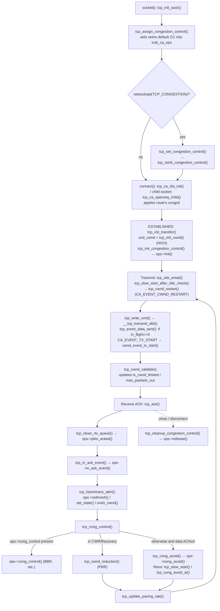

# 11. The congestion control framework and Reno

In this chapter, we read line by line Linux TCP's "framework for pluggable congestion control (CC)" alongside its default implementation and fallback, Reno (in reality, NewReno's increase and decrease rules).  Because CUBIC (Chapter 12), BBR (Chapter 13), and DCTCP (Chapter 14) are all built on top of the `struct tcp_congestion_ops` covered in this chapter, establishing here "which hooks are called, when, under which lock, and with what expectations" allows later chapters to focus purely on the algorithms themselves.

---

## The ELI5 version

A dispatcher in a building is delivering parcels with shipping labels to a destination building.  Because trucks from other companies are also running on the road (the network), they must decide the number of **trucks allowed on the road at once (cwnd)**.

- At first, not knowing how congested the road is, they send out just 10 trucks for now (IW10).
- Every time 1 signed receipt (ACK) returns, they add 1 truck.  Across 1 round trip, the truck count roughly doubles (slow start).
- Once they exceed a certain truck count (the signpost called ssthresh), they cautiously increase by only "1 truck per round trip" (congestion avoidance).
- If they learn along the way that parcels were lost (loss), they conclude they "sent out too many", halve the truck count, and lower the signpost there too.
- If they take a break from shipping for a while, they no longer know the state of the road, so they return the truck count close to its initial value before starting over (restart after idle).
- When there is little cargo and they are not using up the permitted truck count, increasing the truck count regardless would be dangerous, so there is also a rule: "only increase when genuinely using the full count of trucks" (cwnd validation).

This **dispatcher** who decides "how many trucks to send out" is swappable.  The Reno dispatcher, CUBIC dispatcher, BBR dispatcher, and so on can be swapped in; headquarters (the TCP core) merely provides **counters to notify the dispatcher of events** such as "a signed receipt arrived", "first shipment after a break", or "an incident occurred".  The list of these counters is `struct tcp_congestion_ops`.

---

## What the RFCs say

### Overview of relevant RFCs

- **[RFC 5681](https://www.rfc-editor.org/rfc/rfc5681) — TCP Congestion Control (2009)**
  This document standardises Jacobson's four algorithms: slow start, congestion avoidance, fast retransmit, and fast recovery.  It obsoleted RFC 2581 (and RFC 2001 before that).  It defines the state variables `cwnd` and `ssthresh`, the increase formulas, loss handling with `ssthresh = max(FlightSize/2, 2*SMSS)`, restart after idle (§4.1), and more.  It is the "parent" of Linux's Reno implementation.
- **[RFC 6582](https://www.rfc-editor.org/rfc/rfc6582) — The NewReno Modification to TCP's Fast Recovery Algorithm (2012)**
  For connections without SACK, this fixes Reno's weakness of prematurely exiting fast recovery when multiple losses occur within a single window, using the `recover` variable and partial ACK handling.  It obsoleted RFC 3782.  In Linux, this governs loss recovery for non-SACK connections (Chapter 8).
- **[RFC 3465](https://www.rfc-editor.org/rfc/rfc3465) — TCP Congestion Control with Appropriate Byte Counting (ABC) (2003, Experimental)**
  This proposes increasing cwnd based on the "amount ACKed" rather than the "number of ACKs".  Its goal is resilience against receivers fragmenting ACKs (ACK division) and addressing slow start degradation caused by delayed ACKs.  Linux adopts this concept in a unique form: counting "completely ACKed packets" rather than bytes.
- **[RFC 2861](https://www.rfc-editor.org/rfc/rfc2861) — TCP Congestion Window Validation (2000, Experimental)** and **[RFC 7661](https://www.rfc-editor.org/rfc/rfc7661) — Updating TCP to Support Rate-Limited Traffic (2015, Experimental)**
  These address the problem where cwnd inflates or persists "unvalidated" while the application is not using up cwnd (application-limited) or during idle periods.  RFC 2861 decays unutilised cwnd, whereas RFC 7661 replaces it with a policy of preserving cwnd for a period (NVP) without increasing it.  Linux implements RFC 2861 decay under the `tcp_slow_start_after_idle` sysctl, whilst the "do not increase if cwnd is not fully utilized" aspect is implemented as a custom measurement-based approach close to RFC 7661.
- **[RFC 6928](https://www.rfc-editor.org/rfc/rfc6928) — Increasing TCP's Initial Window (2013, Experimental)**
  This raises the initial window to at most 10 segments (approximately 14,600 bytes).  Linux's `TCP_INIT_CWND` is 10.
- **[RFC 3168](https://www.rfc-editor.org/rfc/rfc3168) — The Addition of Explicit Congestion Notification (ECN) to IP (2001)**
  A mechanism where routers mark CE instead of dropping packets, receivers echo it with ECE, and senders reduce cwnd "just like loss" and respond with CWR.  This chapter touches only on the sender response (`tcp_enter_cwr()`), leaving details to Chapter 14.

### State variables and formulas (RFC 5681 §2, §3.1)

Among the definitions in [RFC 5681 §2](https://www.rfc-editor.org/rfc/rfc5681#section-2), we organise those directly appearing in code.

| RFC variable | Meaning | Linux equivalent |
| --- | --- | --- |
| `SMSS` | Sender Maximum Segment Size (bytes) | `tp->mss_cache`.  However, because cwnd is in units of packets, it does not appear in formulas |
| `cwnd` | Congestion window (bytes) | `tp->snd_cwnd` (**number of packets**) |
| `ssthresh` | Boundary between slow start and CA | `tp->snd_ssthresh` (number of packets, initial value `TCP_INFINITE_SSTHRESH`) |
| `FlightSize` | Amount of data outstanding and unacknowledged | `tcp_packets_in_flight()` = `packets_out - (sacked_out + lost_out) + retrans_out` |
| `IW` | Initial window | `tcp_init_cwnd()` (default 10, overridable via route `initcwnd`) |
| `LW` | Loss window after RTO (1 SMSS) | `in_flight + 1` in `tcp_enter_loss()` |
| `RW` | Restart window after idle | `restart_cwnd` in `tcp_cwnd_restart()` |

The key points of [RFC 5681 §3.1](https://www.rfc-editor.org/rfc/rfc5681#section-3.1) are as follows:

- Slow start when `cwnd < ssthresh`, congestion avoidance when `cwnd > ssthresh`.  When `cwnd == ssthresh`, either is permitted.
- In slow start, upon receiving an ACK acknowledging new data:

  ```text
  cwnd += min(N, SMSS)        (2)
  ```

  Here, `N` is the number of bytes newly acknowledged by that ACK.  The `min` defends against ACK division (derived from ABC).
- In congestion avoidance, increase by approximately 1 SMSS per RTT.  The recommendation is "count bytes ACKed, and add 1 SMSS when cwnd worth has accumulated", with a widely used approximation being:

  ```text
  cwnd += SMSS*SMSS/cwnd      (3)
  ```

- Upon detecting loss via RTO:

  ```text
  ssthresh = max(FlightSize / 2, 2*SMSS)   (4)
  ```

  and restart slow start from `cwnd = LW = 1 SMSS`.  The RFC even notes that "using `cwnd` instead of `FlightSize` is a common mistake" (Linux deliberately uses `cwnd`, as explained later).

### Fast retransmit / Fast recovery (RFC 5681 §3.2, RFC 6582)

The procedure in [RFC 5681 §3.2](https://www.rfc-editor.org/rfc/rfc5681#section-3.2) is as follows:

1. Upon receiving 3 duplicate ACKs (dupACKs), update `ssthresh` using formula (4).
2. Retransmit the presumed lost segment and set `cwnd = ssthresh + 3*SMSS` (inflating by 3 packets that left the network).
3. For each additional dupACK, `cwnd += SMSS` (inflation).
4. When an ACK arrives acknowledging new data, set `cwnd = ssthresh` (deflation) and return to CA.

NewReno in [RFC 6582 §3.2](https://www.rfc-editor.org/rfc/rfc6582#section-3.2) adds `recover` (the highest sequence transmitted at the start of fast retransmit).  A **partial ACK**, which acknowledges up to less than `recover`, does not exit fast recovery; it retransmits the next hole and partially deflates cwnd.  A **full ACK**, which acknowledges `recover` or beyond, finally exits fast recovery, setting `cwnd = min(ssthresh, max(FlightSize, SMSS) + SMSS)` or `cwnd = ssthresh`.

Linux's fast recovery does not use inflation/deflation, but rather **PRR (RFC 6937)** to smoothly bring cwnd toward `ssthresh` (`tcp_cwnd_reduction()`, Chapter 8).  What is visible from CC modules are merely two contact points: "`ssthresh()` is called to return the new ssthresh" and "if recovery was spurious, `undo_cwnd()` is called".  In this chapter, we inspect these two interfaces.

### Appropriate Byte Counting (RFC 3465)

- [RFC 3465 §2.1](https://www.rfc-editor.org/rfc/rfc3465#section-2.1): In CA, accumulate "bytes ACKed" into `bytes_acked`; once it exceeds `cwnd`, perform `cwnd += SMSS` and `bytes_acked -= cwnd`.
- [RFC 3465 §2.2](https://www.rfc-editor.org/rfc/rfc3465#section-2.2): In slow start, increase by the "number of bytes newly ACKed" on each ACK, subject to an upper limit `L`.
- [RFC 3465 §2.3](https://www.rfc-editor.org/rfc/rfc3465#section-2.3): `L = 2*SMSS` is a MAY, while `L > 2*SMSS` is a MUST NOT.  This offsets delayed ACKs (1 ACK per 2 segments) while preventing large bursts from stretch ACKs.

In Linux, `snd_cwnd_cnt` in `tcp_cong_avoid_ai()` is identical to `bytes_acked` in §2.1, but in **units of packets**.  Meanwhile, slow start does not impose an upper limit equivalent to `L`, increasing by the number of ACKed packets even for stretch ACKs (discussed later).

### Restart after idle and CWV (RFC 5681 §4.1, RFC 2861, RFC 7661)

- [RFC 5681 §4.1](https://www.rfc-editor.org/rfc/rfc5681#section-4.1): If nothing has been sent for an RTO or longer since the last transmission, set `cwnd = RW = min(IW, cwnd)` before transmitting (SHOULD).
- [RFC 2861 §3](https://www.rfc-editor.org/rfc/rfc2861#section-3): More gently, halve cwnd for each RTO that the idle period exceeds (bounded below by RW).  Before doing so, record the previous peak into ssthresh with `ssthresh = max(ssthresh, 3/4 * cwnd)`.  Also, if an application-limited period persists for an RTO, reduce `cwnd = (cwnd + actual_used) / 2`.
- [RFC 7661 §4.3](https://www.rfc-editor.org/rfc/rfc7661#section-4.3) / [§5](https://www.rfc-editor.org/rfc/rfc7661#section-5): During rate-limited periods (non-validated phase, NVP; default 6 minutes), preserve cwnd without decaying it.  However, if `pipeACK` (the amount actually ACKed) is less than half of cwnd, cwnd is "unvalidated" and MUST NOT be increased.

Among these, Linux implements RFC 2861 idle decay in `tcp_cwnd_restart()`, application-limited decay in `tcp_cwnd_application_limited()` (both gated under the `tcp_slow_start_after_idle=1` sysctl), and RFC 7661's "do not increase unvalidated cwnd" via `tcp_is_cwnd_limited()` + `tcp_cwnd_validate()` (always active).

### Initial window (RFC 6928)

[RFC 6928 §2](https://www.rfc-editor.org/rfc/rfc6928#section-2) permits `IW = min(10*MSS, max(2*MSS, 14600))`.  Linux simply sets this to 10 in packet units, customizable per route via `ip route ... initcwnd N` (`RTAX_INITCWND`).  Additionally, RFC 5681 §3.1 mandates that "if SYN or SYN-ACK is lost, IW MUST be set to 1 SMSS", which `tcp_init_transfer()` implements (with a slightly relaxed rule).

### Response to ECN (RFC 3168 §6.1.2)

[RFC 3168 §6.1.2](https://www.rfc-editor.org/rfc/rfc3168#section-6.1.2): Senders receiving an ACK with ECE halve cwnd and ssthresh just like packet loss, but at most once per window (1 RTT), and set CWR on the next new data transmitted.  In Linux, this becomes `tcp_enter_cwr()` → `TCP_CA_CWR` state → phased reduction via PRR.

---

## The big picture

The locations where CC modules are called from the TCP core, ordered along the lifecycle of a socket, are arranged as follows:



There are three key points:

- **CC only "decides"; it does not "transmit".**  It merely adjusts the knobs of cwnd (and pacing rate, TSO size); what and when to actually send is decided by `tcp_write_xmit()` (Chapter 4) consulting cwnd.  This is why `tcp_xmit_recovery()` and `tcp_data_snd_check()` execute after `tcp_cong_control()`.
- **Loss reduction is owned by the TCP core.**  CC only returns the new value of `ssthresh`; how cwnd is lowered to that point (PRR) and whether it is restored upon false alarm (undo) are determined by the core.  Only CCs implementing `cong_control` (such as BBR) bypass this framework.
- **Almost all hooks are called either in process context holding the socket lock, or in BH-disabled softirq context (`tcp_v4_rcv()` / `tcp_v6_rcv()` under `bh_lock_sock()` where `sock_owned_by_user()` is false).**  Hooks never execute concurrently for a single socket.  This invariant is why CC private data `icsk_ca_priv` can be read and written without locks.

The callers of each hook are summarised below (examined in detail in Step 1):

| Hook | Mandatory? | Primary caller | Timing |
| --- | --- | --- | --- |
| `cong_avoid` | Either this or `cong_control` | `tcp_cong_avoid()` ← `tcp_cong_control()` | End of ACK processing, when data is ACKed in Open/Disorder/Loss state |
| `cong_control` | Either this or `cong_avoid` | `tcp_cong_control()` | End of ACK processing, on every ACK across **all states** |
| `ssthresh` | Mandatory | `tcp_init_cwnd_reduction()`, `tcp_enter_loss()` | On entering fast recovery / CWR, or on RTO |
| `undo_cwnd` | Mandatory | `tcp_undo_cwnd_reduction()` | When loss recovery is deemed spurious |
| `set_state` | Optional | `tcp_set_ca_state()` | **Immediately before** writing `icsk_ca_state` |
| `cwnd_event` | Optional | `tcp_ca_event()` | On `CA_EVENT_*` (except TX_START) |
| `cwnd_event_tx_start` | Optional | `tcp_ca_event()` ← `tcp_event_data_sent()` | When transmitting first data from zero in-flight |
| `in_ack_event` | Optional | `tcp_in_ack_event()` ← `tcp_ack()` | On every ACK (prior to `tcp_fastretrans_alert()`) |
| `pkts_acked` | Optional | `tcp_clean_rtx_queue()` | When packets are freed from retransmit queue (or SACKed) |
| `tso_segs` | Optional | `tcp_tso_segs()` | When deciding target segment count for TSO |
| `sndbuf_expand` | Optional | `tcp_sndbuf_expand()` | Multiplier for send buffer auto-tuning |
| `get_info` | Optional | `inet_sk_diag_fill()`, `do_tcp_getsockopt()` | `ss -i` / `TCP_CC_INFO` |
| `init` | Optional | `tcp_init_congestion_control()` | When reaching ESTABLISHED, or when switching CC mid-stream |
| `release` | Optional | `tcp_cleanup_congestion_control()`, `tcp_disconnect()` | Socket destruction, CC switch, or disconnect |

---

## Walking through the code

### Step 1: `struct tcp_congestion_ops` — the contract between CC and the TCP core

We read `struct tcp_congestion_ops` ([include/net/tcp.h#L1355](https://git.kernel.org/pub/scm/linux/kernel/git/netdev/net-next.git/tree/include/net/tcp.h?id=279d5c8afcd38bd841832a39bfe1aa4f8518d98e#n1355)) starting from the first half:

```c
struct tcp_congestion_ops {
/* fast path fields are put first to fill one cache line */

	/* A congestion control (CC) must provide one of either:
	 *
	 * (a) a cong_avoid function, if the CC wants to use the core TCP
	 *     stack's default functionality to implement a "classic"
	 *     (Reno/CUBIC-style) response to packet loss, RFC3168 ECN,
	 *     idle periods, pacing rate computations, etc.
	 *
	 * (b) a cong_control function, if the CC wants custom behavior and
	 *      complete control of all congestion control behaviors.
	 */
	/* (a) "classic" response: calculate new cwnd.
	 */
	void (*cong_avoid)(struct sock *sk, u32 ack, u32 acked);
	/* (b) "custom" response: call when packets are delivered to update
	 * cwnd and pacing rate, after all the ca_state processing.
	 */
	void (*cong_control)(struct sock *sk, u32 ack, int flag, const struct rate_sample *rs);

	/* return slow start threshold (required) */
	u32 (*ssthresh)(struct sock *sk);

	/* call before changing ca_state (optional) */
	void (*set_state)(struct sock *sk, u8 new_state);

	/* call when cwnd event occurs (optional) */
	void (*cwnd_event)(struct sock *sk, enum tcp_ca_event ev);

	/* call when CA_EVENT_TX_START cwnd event occurs (optional) */
	void (*cwnd_event_tx_start)(struct sock *sk);

	/* call when ack arrives (optional) */
	void (*in_ack_event)(struct sock *sk, u32 flags);

	/* hook for packet ack accounting (optional) */
	void (*pkts_acked)(struct sock *sk, const struct ack_sample *sample);
```

- The opening comment "fast path fields are put first to fill one cache line" reflects the design philosophy of the entire structure.  Function pointers dereferenced on every ACK and transmit are packed into the leading 64 bytes, while control-path fields such as `name` and `list` are relegated to the back.  Because the structure is `____cacheline_aligned_in_smp`, the beginning is guaranteed to align with the start of a cacheline.
- `cong_avoid(sk, ack, acked)`: The core of "classical" CCs.  `ack` is the current cumulative ACK number, and `acked` is the **number of packets newly delivered this time** (the delta of `tp->delivered` returned by `tcp_newly_delivered()`, summing cumulative ACK and SACK deliveries).  Although named "congestion avoidance", slow start is also handled here.  It is called only when the core decides cwnd is permitted to grow (Step 5).
- `cong_control(sk, ack, flag, rs)`: The "delegated authority" style.  A CC providing this hook has PRR during loss recovery, restart after idle, application-limited decay, and default pacing rate calculations all **skipped**, determining cwnd and `sk_pacing_rate` on its own.  `rs` is the delivery rate sample generated by `tcp_rate_gen()`.  BBR uses this hook (Chapter 13).  `ack` and `flag` are arguments added in 2024 (see design history below).
- `ssthresh(sk)`: Mandatory.  Returns the new ssthresh when "reducing" on loss or ECE.  It does not modify cwnd itself (the core modifies it).
- `set_state(sk, new_state)`: Called **immediately before** `icsk_ca_state` is updated.  The old state can still be read via `inet_csk(sk)->icsk_ca_state`.
- `cwnd_event(sk, ev)` and `cwnd_event_tx_start(sk)`: The latter is a dedicated hook separated in 2026.  Because dispatching the former via `switch (ev)` every time hurts branch prediction, the most frequent event, `CA_EVENT_TX_START`, was split into its own pointer (Step 10).
- `in_ack_event(sk, flags)`: Called per ACK, passing `CA_ACK_SLOWPATH` / `CA_ACK_WIN_UPDATE` / `CA_ACK_ECE`.  Used by DCTCP and Westwood.
- `pkts_acked(sk, sample)`: Receives `struct ack_sample { pkts_acked, rtt_us, in_flight }`.  This is where CUBIC's HyStart and delay-based CCs like Vegas obtain RTT samples.

```c
	/* Override tcp_tso_autosize() (optional)
	 *
	 * If provided, this callback supplies the TSO segment target count
	 * instead of using tcp_tso_autosize(). The returned value is
	 * subsequently clamped to [1, sk->sk_gso_max_segs] by the caller.
	 *
	 * For the kernel callback path, mss_now originates from
	 * tcp_current_mss() and should never be zero.
	 */
	u32 (*tso_segs)(struct sock *sk, u32 mss_now);

	/* new value of cwnd after loss (required) */
	u32  (*undo_cwnd)(struct sock *sk);
	/* returns the multiplier used in tcp_sndbuf_expand (optional) */
	u32 (*sndbuf_expand)(struct sock *sk);

/* control/slow paths put last */
	/* get info for inet_diag (optional) */
	size_t (*get_info)(struct sock *sk, u32 ext, int *attr,
			   union tcp_cc_info *info);

	char 			name[TCP_CA_NAME_MAX];
	struct module		*owner;
	struct list_head	list;
	u32			key;
	u32			flags;

	/* initialize private data (optional) */
	void (*init)(struct sock *sk);
	/* cleanup private data  (optional) */
	void (*release)(struct sock *sk);
} ____cacheline_aligned_in_smp;
```

- `tso_segs`: Used when a CC wants to decide the segment count packed into a single skb under TSO (e.g. BBR).
- `undo_cwnd`: Mandatory.  The comment states "new value of cwnd after loss", but in practice it returns the **cwnd to restore when loss detection is determined to be false** (Step 9).
- `sndbuf_expand`: Determines the multiplier of cwnd used by `tcp_sndbuf_expand()` when sizing `sk_sndbuf`.  The default is 2, while BBR returns 3.
- From here downwards are the "control/slow paths".  `name` is up to 16 bytes (`TCP_CA_NAME_MAX`), and `key` is the jhash of `name`, used to store this 32-bit value in the route metric `RTAX_CC_ALGO` instead of the string name.
- `flags` is a bitwise combination of the following:

  | Flag | Meaning |
  | --- | --- |
  | `TCP_CONG_NON_RESTRICTED` | Selectable via `TCP_CONGESTION` without `CAP_NET_ADMIN` (appears in `tcp_allowed_congestion_control`) |
  | `TCP_CONG_NEEDS_ECN` | Demands ECT marking on all packets (DCTCP) |
  | `TCP_CONG_NEEDS_ACCECN` | Requires successful AccECN negotiation |
  | `TCP_CONG_ECT_1_NEGOTIATION` | Uses ECT(1) rather than ECT(0) prior to CA initialisation |
  | `TCP_CONG_NO_FALLBACK_RFC3168` | Must not fall back to RFC 3168 ECN during AccECN negotiation |

- `init` / `release` appear last because they are called only once per connection.

#### Per-socket state: `icsk_ca_ops`, `icsk_ca_state`, and `icsk_ca_priv`

CC state is stored in `struct inet_connection_sock` ([include/net/inet_connection_sock.h#L81](https://git.kernel.org/pub/scm/linux/kernel/git/netdev/net-next.git/tree/include/net/inet_connection_sock.h?id=279d5c8afcd38bd841832a39bfe1aa4f8518d98e#n81)):

```c
	const struct tcp_congestion_ops *icsk_ca_ops;
...
	__u8			  icsk_ca_state:5,
				  icsk_ca_initialized:1,
				  icsk_ca_setsockopt:1,
				  icsk_ca_dst_locked:1;
...
	u64			  icsk_ca_priv[104 / sizeof(u64)];
```

- `icsk_ca_ops`: The current CC.  It is modified under the socket lock, but because `getsockopt(TCP_CONGESTION)` and inet_diag read it locklessly, writes use `WRITE_ONCE()` and reads use `READ_ONCE()` under RCU (Step 3).
- `icsk_ca_state`: The 5 states: `TCP_CA_Open` / `Disorder` / `CWR` / `Recovery` / `Loss` (`enum tcp_ca_state`, [include/uapi/linux/tcp.h#L194](https://git.kernel.org/pub/scm/linux/kernel/git/netdev/net-next.git/tree/include/uapi/linux/tcp.h?id=279d5c8afcd38bd841832a39bfe1aa4f8518d98e#n194)).  State transitions themselves are covered in Chapter 8.
- `icsk_ca_initialized`: Whether `init()` has been called.  Used to determine whether to call `release()` and to prevent double initialisation if BPF initialised it earlier.
- `icsk_ca_setsockopt`: A marker indicating the application (or BPF) explicitly chose the CC.  Used when creating child sockets to decide whether to inherit the parent's choice or revert to the system default (Step 3).
- `icsk_ca_dst_locked`: Set if the route specified `congctl lock`; subsequent attempts to change it via `TCP_CONGESTION` are rejected with `-EPERM`.
- `icsk_ca_priv`: The CC private storage area, sized at 104 bytes.  A CC accesses this as its own structure via `inet_csk_ca(sk)` and checks its size statically, e.g. `BUILD_BUG_ON(sizeof(struct bictcp) > ICSK_CA_PRIV_SIZE)`.  Reno uses none of it.

#### Events and ACK flags

`enum tcp_ca_event` ([include/net/tcp.h#L1281](https://git.kernel.org/pub/scm/linux/kernel/git/netdev/net-next.git/tree/include/net/tcp.h?id=279d5c8afcd38bd841832a39bfe1aa4f8518d98e#n1281)):

```c
enum tcp_ca_event {
	CA_EVENT_TX_START,	/* first transmit when no packets in flight */
	CA_EVENT_CWND_RESTART,	/* congestion window restart */
	CA_EVENT_COMPLETE_CWR,	/* end of congestion recovery */
	CA_EVENT_LOSS,		/* loss timeout */
	CA_EVENT_ECN_NO_CE,	/* ECT set, but not CE marked */
	CA_EVENT_ECN_IS_CE,	/* received CE marked IP packet */
};
```

| Event | Source | Meaning |
| --- | --- | --- |
| `CA_EVENT_TX_START` | `tcp_event_data_sent()` | Data transmitted when in-flight is 0 (resuming after idle) |
| `CA_EVENT_CWND_RESTART` | `tcp_cwnd_restart()` | Immediately before performing an RFC 2861 restart |
| `CA_EVENT_COMPLETE_CWR` | `tcp_end_cwnd_reduction()` | Exited CWR / Recovery |
| `CA_EVENT_LOSS` | `tcp_enter_loss()` | Transitioned to Loss state on RTO (only when ssthresh was reduced) |
| `CA_EVENT_ECN_NO_CE` / `CA_EVENT_ECN_IS_CE` | `tcp_data_ecn_check()` | Notifies received packet ECN codepoint only to CCs with `TCP_CONG_NEEDS_ECN` (for DCTCP) |

---

### Step 2: Registration — `tcp_register_congestion_control()`

CCs are registered on an RCU list called `tcp_cong_list`.  `tcp_ca_find()` ([net/ipv4/tcp_cong.c#L26](https://git.kernel.org/pub/scm/linux/kernel/git/netdev/net-next.git/tree/net/ipv4/tcp_cong.c?id=279d5c8afcd38bd841832a39bfe1aa4f8518d98e#n26)) searches by name, and `tcp_ca_find_key()` ([net/ipv4/tcp_cong.c#L66](https://git.kernel.org/pub/scm/linux/kernel/git/netdev/net-next.git/tree/net/ipv4/tcp_cong.c?id=279d5c8afcd38bd841832a39bfe1aa4f8518d98e#n66)) searches by key, both performing a linear search via `list_for_each_entry_rcu()` ("Simple linear search, don't expect many entries!").

- Writers take `tcp_cong_list_lock` (a spinlock), while readers use RCU.  All reads resolve "name / key → ops", running only during connection establishment or setsockopt, making linear search completely adequate.  The fast data path traverses `icsk_ca_ops` directly without touching this list.

`tcp_ca_find_autoload()` ([net/ipv4/tcp_cong.c#L50](https://git.kernel.org/pub/scm/linux/kernel/git/netdev/net-next.git/tree/net/ipv4/tcp_cong.c?id=279d5c8afcd38bd841832a39bfe1aa4f8518d98e#n50)) automatically loads modules like `tcp_cubic.ko` via `request_module("tcp_%s", name)` if not found:

```c
#ifdef CONFIG_MODULES
	if (!ca && capable(CAP_NET_ADMIN)) {
		rcu_read_unlock();
		request_module("tcp_%s", name);
		rcu_read_lock();
		ca = tcp_ca_find(name);
	}
#endif
```

- Because `request_module()` may sleep, RCU is temporarily exited.  Callers must assume that even if called inside RCU, the read lock was temporarily dropped, making it crucial not to retain pointers across the call (all callers use only the returned `ca`).
- `capable(CAP_NET_ADMIN)` checks capability in the **initial user namespace**.  This prevents unprivileged containers from triggering arbitrary module loads.  Note that this differs from the `cap_net_admin` argument in `tcp_set_congestion_control()` examined later (`ns_capable` against the netns user_ns).

`tcp_validate_congestion_control()` ([net/ipv4/tcp_cong.c#L78](https://git.kernel.org/pub/scm/linux/kernel/git/netdev/net-next.git/tree/net/ipv4/tcp_cong.c?id=279d5c8afcd38bd841832a39bfe1aa4f8518d98e#n78)) and `tcp_register_congestion_control()` ([net/ipv4/tcp_cong.c#L93](https://git.kernel.org/pub/scm/linux/kernel/git/netdev/net-next.git/tree/net/ipv4/tcp_cong.c?id=279d5c8afcd38bd841832a39bfe1aa4f8518d98e#n93)):

```c
int tcp_validate_congestion_control(struct tcp_congestion_ops *ca)
{
	/* all algorithms must implement these */
	if (!ca->ssthresh || !ca->undo_cwnd ||
	    !(ca->cong_avoid || ca->cong_control)) {
		pr_err("%s does not implement required ops\n", ca->name);
		return -EINVAL;
	}

	return 0;
}

/* Attach new congestion control algorithm to the list
 * of available options.
 */
int tcp_register_congestion_control(struct tcp_congestion_ops *ca)
{
	int ret;

	ret = tcp_validate_congestion_control(ca);
	if (ret)
		return ret;

	ca->key = jhash(ca->name, sizeof(ca->name), strlen(ca->name));

	spin_lock(&tcp_cong_list_lock);
	if (ca->key == TCP_CA_UNSPEC || tcp_ca_find_key(ca->key)) {
		pr_notice("%s already registered or non-unique key\n",
			  ca->name);
		ret = -EEXIST;
	} else {
		list_add_tail_rcu(&ca->list, &tcp_cong_list);
		pr_debug("%s registered\n", ca->name);
	}
	spin_unlock(&tcp_cong_list_lock);

	return ret;
}
```

- Mandatory hooks are `ssthresh`, `undo_cwnd`, and either `cong_avoid` or `cong_control`.  The core invokes these three without NULL checks (`tcp_cong_avoid()` unconditionally calls `cong_avoid`, but because execution never reaches it when `cong_control` is present, CCs implementing only `cong_control` can safely leave `cong_avoid` NULL).
- `key` is computed as `jhash(name, sizeof(name), strlen(name))`.  Note that because `sizeof(ca->name)` is 16, **trailing bytes after the NUL terminator are included in the hash calculation**.  Because CC `name` arrays are statically initialised, remaining bytes are zero-padded and pose no issue.
- Key collisions (or a key of 0 = `TCP_CA_UNSPEC`) are rejected with `-EEXIST`.  Because the key is stored in route metrics, two CCs sharing the same key cannot be resolved unambiguously from routes.
- Checking for duplicate names relies solely on `tcp_ca_find_key()` because identical names necessarily yield identical keys.

`tcp_unregister_congestion_control()` ([net/ipv4/tcp_cong.c#L124](https://git.kernel.org/pub/scm/linux/kernel/git/netdev/net-next.git/tree/net/ipv4/tcp_cong.c?id=279d5c8afcd38bd841832a39bfe1aa4f8518d98e#n124)) simply removes the entry from the list and calls `synchronize_rcu()`.  **Module reference counts guarantee that no sockets are actively using the CC.**  Each socket holds a reference to `owner` via `bpf_try_module_get()`, preventing `rmmod` while in use.  For BPF-based CCs, `bpf_try_module_get()` holds a refcount on the struct_ops map.

`tcp_update_congestion_control()` ([net/ipv4/tcp_cong.c#L146](https://git.kernel.org/pub/scm/linux/kernel/git/netdev/net-next.git/tree/net/ipv4/tcp_cong.c?id=279d5c8afcd38bd841832a39bfe1aa4f8518d98e#n146)) is used by BPF struct_ops `bpf_link_update` to swap a CC of the same name by adding the new one before unlinking the old.  Existing sockets continue using the old implementation, while new connections pick up the new one.

---

### Step 3: Selection — default, setsockopt, and routes

#### Socket creation: `tcp_assign_congestion_control()`

Inside `tcp_init_sock()` ([net/ipv4/tcp.c#L421](https://git.kernel.org/pub/scm/linux/kernel/git/netdev/net-next.git/tree/net/ipv4/tcp.c?id=279d5c8afcd38bd841832a39bfe1aa4f8518d98e#n421)), the CC is assigned alongside cwnd-related initial values:

```c
	tcp_snd_cwnd_set(tp, TCP_INIT_CWND);
...
	tp->snd_ssthresh = TCP_INFINITE_SSTHRESH;
	tp->snd_cwnd_clamp = ~0;
	tp->mss_cache = TCP_MSS_DEFAULT;

	tp->reordering = READ_ONCE(sock_net(sk)->ipv4.sysctl_tcp_reordering);
	tcp_assign_congestion_control(sk);
```

- `snd_ssthresh = TCP_INFINITE_SSTHRESH` (`0x7fffffff`): Follows RFC 5681 §3.1's rule that "the initial value of ssthresh MAY be arbitrarily high".  Slow start continues until the first loss.  `tcp_in_initial_slowstart()` uses this value to determine that "loss has never occurred yet".
- `snd_cwnd_clamp = ~0`: The upper clamp for cwnd.  Can be constrained via route `cwnd` metrics (with `lock`) or `TCP_BPF_SNDCWND_CLAMP`.  Both `tcp_slow_start()` and `tcp_cong_avoid_ai()` always take a `min` with this at the end.
- `snd_cwnd = TCP_INIT_CWND` is a placeholder here; the genuine initial value is set upon reaching ESTABLISHED by `tcp_init_transfer()` (Step 4).

`tcp_assign_congestion_control()` ([net/ipv4/tcp_cong.c#L216](https://git.kernel.org/pub/scm/linux/kernel/git/netdev/net-next.git/tree/net/ipv4/tcp_cong.c?id=279d5c8afcd38bd841832a39bfe1aa4f8518d98e#n216)):

```c
/* Assign choice of congestion control. */
void tcp_assign_congestion_control(struct sock *sk)
{
	struct net *net = sock_net(sk);
	struct inet_connection_sock *icsk = inet_csk(sk);
	const struct tcp_congestion_ops *ca;

	rcu_read_lock();
	ca = rcu_dereference(net->ipv4.tcp_congestion_control);
	if (unlikely(!bpf_try_module_get(ca, ca->owner)))
		ca = &tcp_reno;
	WRITE_ONCE(icsk->icsk_ca_ops, ca);
	rcu_read_unlock();

	memset(icsk->icsk_ca_priv, 0, sizeof(icsk->icsk_ca_priv));
	if (ca->flags & TCP_CONG_NEEDS_ECN)
		INET_ECN_xmit_ect_1_negotiation(sk);
	else
		INET_ECN_dontxmit(sk);
}
```

- The default CC is stored **per netns** in `net->ipv4.tcp_congestion_control`, modified via `sysctl net.ipv4.tcp_congestion_control`.
- `bpf_try_module_get()` fails when the default CC's module is in the middle of unloading (in the "going" state) or when a BPF CC's map is being freed.  In that case, it falls back to built-in, un-unloadable `tcp_reno`.  **This is why Reno is called the "fallback".**  `tcp_reno` is permanently registered in `tcp_init()` with `BUG_ON(tcp_register_congestion_control(&tcp_reno) != 0)`.
- Zeroing `icsk_ca_priv` ensures private storage is in a known state even before `init()` is called.  Because `init()` is not called until ESTABLISHED, hooks invoked prior to that (such as `get_info()`) must not read uninitialised memory.
- If the CC has `TCP_CONG_NEEDS_ECN` (e.g. DCTCP), it prepares to mark ECT starting from the SYN stage.

#### sysctl: `tcp_set_default_congestion_control()`

`tcp_set_default_congestion_control()` ([net/ipv4/tcp_cong.c#L281](https://git.kernel.org/pub/scm/linux/kernel/git/netdev/net-next.git/tree/net/ipv4/tcp_cong.c?id=279d5c8afcd38bd841832a39bfe1aa4f8518d98e#n281)), called from `proc_tcp_congestion_control()` ([net/ipv4/sysctl_net_ipv4.c#L220](https://git.kernel.org/pub/scm/linux/kernel/git/netdev/net-next.git/tree/net/ipv4/sysctl_net_ipv4.c?id=279d5c8afcd38bd841832a39bfe1aa4f8518d98e#n220)):

```c
int tcp_set_default_congestion_control(struct net *net, const char *name)
{
	struct tcp_congestion_ops *ca;
	const struct tcp_congestion_ops *prev;
	int ret;

	rcu_read_lock();
	ca = tcp_ca_find_autoload(name);
	if (!ca) {
		ret = -ENOENT;
	} else if (!bpf_try_module_get(ca, ca->owner)) {
		ret = -EBUSY;
	} else if (!net_eq(net, &init_net) &&
			!(ca->flags & TCP_CONG_NON_RESTRICTED)) {
		/* Only init netns can set default to a restricted algorithm */
		ret = -EPERM;
	} else {
		prev = xchg(&net->ipv4.tcp_congestion_control, ca);
		if (prev)
			bpf_module_put(prev, prev->owner);

		ca->flags |= TCP_CONG_NON_RESTRICTED;
		ret = 0;
	}
	rcu_read_unlock();

	return ret;
}
```

- The netns default retains one module reference.  It is swapped using `xchg()`, dropping the previous reference.  Readers (`tcp_assign_congestion_control()`) read via `rcu_dereference()` under RCU, requiring no lock.
- **A non-init netns may only set default CCs that are in the allowed list (`tcp_allowed_congestion_control`).**  Conversely, configuring a CC as default in `init_net` automatically grants it `TCP_CONG_NON_RESTRICTED` ("anything made default by the system administrator is fair game for everyone").
- Notice a subtle detail in the code: on the `-EPERM` branch, the reference acquired by the preceding `bpf_try_module_get()` is not released.  If setting a modular CC as default in a non-init netns is rejected, one refcount on that module remains leaked.  This is a notable asymmetry worth keeping in mind when reading the source.
- A newly created netns inherits its default in `tcp_sk_init()` ([net/ipv4/tcp_ipv4.c#L3440](https://git.kernel.org/pub/scm/linux/kernel/git/netdev/net-next.git/tree/net/ipv4/tcp_ipv4.c?id=279d5c8afcd38bd841832a39bfe1aa4f8518d98e#n3440)) from `init_net`, falling back to Reno if acquiring a reference fails.

`tcp_set_allowed_congestion_control()` ([net/ipv4/tcp_cong.c#L369](https://git.kernel.org/pub/scm/linux/kernel/git/netdev/net-next.git/tree/net/ipv4/tcp_cong.c?id=279d5c8afcd38bd841832a39bfe1aa4f8518d98e#n369)) handles writes to the `tcp_allowed_congestion_control` sysctl in three passes: validate all → clear all → set specified entries, reapplying `TCP_CONG_NON_RESTRICTED`.  Because this flag attaches to **the ops structure itself**, this is a global setting across all netns (and the sysctl itself is visible only in `init_net`).

#### setsockopt: `tcp_set_congestion_control()`

The `TCP_CONGESTION` branch in `do_tcp_setsockopt()` ([net/ipv4/tcp.c#L3841](https://git.kernel.org/pub/scm/linux/kernel/git/netdev/net-next.git/tree/net/ipv4/tcp.c?id=279d5c8afcd38bd841832a39bfe1aa4f8518d98e#n3841)):

```c
	case TCP_CONGESTION: {
		char name[TCP_CA_NAME_MAX];
...
		sockopt_lock_sock(sk);
		err = tcp_set_congestion_control(sk, name, !has_current_bpf_ctx(),
						 sockopt_ns_capable(sock_net(sk)->user_ns,
								    CAP_NET_ADMIN));
		sockopt_release_sock(sk);
		return err;
	}
```

- `load = !has_current_bpf_ctx()`: Automatic module loading is bypassed when invoked from a BPF program (`bpf_setsockopt()`), because BPF may execute in non-sleepable contexts like softirq.
- `cap_net_admin` represents `CAP_NET_ADMIN` **with respect to the netns user_ns**.  A root user inside a container can select restricted CCs, but cannot trigger kernel module loading (`capable()` in Step 2).

`tcp_set_congestion_control()` ([net/ipv4/tcp_cong.c#L412](https://git.kernel.org/pub/scm/linux/kernel/git/netdev/net-next.git/tree/net/ipv4/tcp_cong.c?id=279d5c8afcd38bd841832a39bfe1aa4f8518d98e#n412)):

```c
int tcp_set_congestion_control(struct sock *sk, const char *name, bool load,
			       bool cap_net_admin)
{
	struct inet_connection_sock *icsk = inet_csk(sk);
	const struct tcp_congestion_ops *ca;
	int err = 0;

	if (icsk->icsk_ca_dst_locked)
		return -EPERM;

	rcu_read_lock();
	if (!load)
		ca = tcp_ca_find(name);
	else
		ca = tcp_ca_find_autoload(name);

	/* No change asking for existing value */
	if (ca == icsk->icsk_ca_ops) {
		icsk->icsk_ca_setsockopt = 1;
		goto out;
	}

	if (!ca)
		err = -ENOENT;
	else if (!((ca->flags & TCP_CONG_NON_RESTRICTED) || cap_net_admin))
		err = -EPERM;
	else if (!bpf_try_module_get(ca, ca->owner))
		err = -EBUSY;
	else
		tcp_reinit_congestion_control(sk, ca);
 out:
	rcu_read_unlock();
	return err;
}
```

- `icsk_ca_dst_locked` is checked first.  Connections locked by routes via `congctl lock` cannot have their CC changed by applications.
- Re-specifying the currently active CC still sets `icsk_ca_setsockopt = 1`.  This preserves the semantics where if a listener explicitly selects the current default CC, child sockets retain that CC even if the system default changes later (see `tcp_ca_openreq_child()`).
- After taking a reference, execution proceeds to `tcp_reinit_congestion_control()`.  The reference to the previous CC is dropped inside `tcp_cleanup_congestion_control()`.

`tcp_reinit_congestion_control()` ([net/ipv4/tcp_cong.c#L250](https://git.kernel.org/pub/scm/linux/kernel/git/netdev/net-next.git/tree/net/ipv4/tcp_cong.c?id=279d5c8afcd38bd841832a39bfe1aa4f8518d98e#n250)):

```c
static void tcp_reinit_congestion_control(struct sock *sk,
					  const struct tcp_congestion_ops *ca)
{
	struct inet_connection_sock *icsk = inet_csk(sk);

	tcp_cleanup_congestion_control(sk);
	WRITE_ONCE(icsk->icsk_ca_ops, ca);
	icsk->icsk_ca_setsockopt = 1;
	memset(icsk->icsk_ca_priv, 0, sizeof(icsk->icsk_ca_priv));

	if (ca->flags & TCP_CONG_NEEDS_ECN)
		INET_ECN_xmit_ect_1_negotiation(sk);
	else
		INET_ECN_dontxmit(sk);

	if (!((1 << sk->sk_state) & (TCPF_CLOSE | TCPF_LISTEN)))
		tcp_init_congestion_control(sk);
}
```

- The sequence is: call old CC `release()` → replace pointer → zero private storage.  `WRITE_ONCE()` caters to lockless readers (`do_tcp_getsockopt()` and inet_diag).
- Only on **mid-stream switches** (called when in ESTABLISHED, etc.) is `tcp_init_congestion_control()` invoked immediately on the spot.  In CLOSE or LISTEN states, no connection exists yet, deferring initialisation to `tcp_init_transfer()` at ESTABLISHED time.
- Note: On switching, both `snd_cwnd` and `snd_ssthresh` are **inherited unchanged**.  The new CC starts from the cwnd left by the previous CC.  `tcp_init_congestion_control()` sets `prior_ssthresh = 0` to prevent an undo operation from incorrectly restoring the ssthresh recorded by the prior CC (Step 4).

#### Per-route CC: `tcp_ca_dst_init()` and `tcp_ca_openreq_child()`

A CC configured via `ip route add ... congctl [lock] dctcp` is saved as a **key** in the `RTAX_CC_ALGO` metric.  On the active open side, it is applied in `tcp_ca_dst_init()` ([net/ipv4/tcp_output.c#L4092](https://git.kernel.org/pub/scm/linux/kernel/git/netdev/net-next.git/tree/net/ipv4/tcp_output.c?id=279d5c8afcd38bd841832a39bfe1aa4f8518d98e#n4092)), called from `tcp_connect_init()`:

```c
static void tcp_ca_dst_init(struct sock *sk, const struct dst_entry *dst)
{
	struct inet_connection_sock *icsk = inet_csk(sk);
	const struct tcp_congestion_ops *ca;
	u32 ca_key = dst_metric(dst, RTAX_CC_ALGO);

	if (ca_key == TCP_CA_UNSPEC)
		return;

	rcu_read_lock();
	ca = tcp_ca_find_key(ca_key);
	if (likely(ca && bpf_try_module_get(ca, ca->owner))) {
		bpf_module_put(icsk->icsk_ca_ops, icsk->icsk_ca_ops->owner);
		icsk->icsk_ca_dst_locked = tcp_ca_dst_locked(dst);
		WRITE_ONCE(icsk->icsk_ca_ops, ca);
	}
	rcu_read_unlock();
}
```

- Notice that route configuration **overrides setsockopt**.  Even if chosen via `TCP_CONGESTION` before `connect()`, a route specifying `congctl` takes precedence.  References are swapped without calling `release()` because `init()` has not been called yet (prior to sending SYN).
- On the passive open side, `tcp_ca_openreq_child()` ([net/ipv4/tcp_minisocks.c#L497](https://git.kernel.org/pub/scm/linux/kernel/git/netdev/net-next.git/tree/net/ipv4/tcp_minisocks.c?id=279d5c8afcd38bd841832a39bfe1aa4f8518d98e#n497)) is called from `tcp_v4_syn_recv_sock()` / `tcp_v6_syn_recv_sock()`:

```c
void tcp_ca_openreq_child(struct sock *sk, const struct dst_entry *dst)
{
	struct inet_connection_sock *icsk = inet_csk(sk);
	u32 ca_key = dst_metric(dst, RTAX_CC_ALGO);
	bool ca_got_dst = false;

	if (ca_key != TCP_CA_UNSPEC) {
		const struct tcp_congestion_ops *ca;

		rcu_read_lock();
		ca = tcp_ca_find_key(ca_key);
		if (likely(ca && bpf_try_module_get(ca, ca->owner))) {
			icsk->icsk_ca_dst_locked = tcp_ca_dst_locked(dst);
			WRITE_ONCE(icsk->icsk_ca_ops, ca);
			ca_got_dst = true;
		}
		rcu_read_unlock();
	}

	/* If no valid choice made yet, assign current system default ca. */
	if (!ca_got_dst &&
	    (!icsk->icsk_ca_setsockopt ||
	     !bpf_try_module_get(icsk->icsk_ca_ops, icsk->icsk_ca_ops->owner)))
		tcp_assign_congestion_control(sk);

	tcp_set_ca_state(sk, TCP_CA_Open);
}
```

- Because child sockets are cloned from the parent listener via `sk_clone_lock()`, `icsk_ca_ops` contains the parent pointer, but **a reference has not yet been acquired**.  The reference is acquired anew here.
- Priority follows: route `congctl` > explicitly chosen CC on listener (`icsk_ca_setsockopt`) > system default **at the time of child creation**.  If the default sysctl is altered after creating the listener, children of listeners without an explicit selection receive the new default.
- Calling `tcp_set_ca_state(sk, TCP_CA_Open)` here notifies the initial state to the new CC's `set_state()` callback.

---

### Step 4: Initialisation — `tcp_init_transfer()`, `tcp_init_cwnd()`, and `tcp_init_congestion_control()`

When the 3WHS completes and the connection enters ESTABLISHED, `tcp_init_transfer()` ([net/ipv4/tcp_input.c#L6725](https://git.kernel.org/pub/scm/linux/kernel/git/netdev/net-next.git/tree/net/ipv4/tcp_input.c?id=279d5c8afcd38bd841832a39bfe1aa4f8518d98e#n6725)) is called from `tcp_finish_connect()` on active open and from SYN_RECV processing in `tcp_rcv_state_process()` on passive open:

```c
void tcp_init_transfer(struct sock *sk, int bpf_op, struct sk_buff *skb)
{
	struct inet_connection_sock *icsk = inet_csk(sk);
	struct tcp_sock *tp = tcp_sk(sk);

	tcp_mtup_init(sk);
	icsk->icsk_af_ops->rebuild_header(sk);
	tcp_init_metrics(sk);

	/* Initialize the congestion window to start the transfer.
	 * Cut cwnd down to 1 per RFC5681 if SYN or SYN-ACK has been
	 * retransmitted. In light of RFC6298 more aggressive 1sec
	 * initRTO, we only reset cwnd when more than 1 SYN/SYN-ACK
	 * retransmission has occurred.
	 */
	if (tp->total_retrans > 1 && tp->undo_marker)
		tcp_snd_cwnd_set(tp, 1);
	else
		tcp_snd_cwnd_set(tp, tcp_init_cwnd(tp, __sk_dst_get(sk)));
	tp->snd_cwnd_stamp = tcp_jiffies32;

	bpf_skops_established(sk, bpf_op, skb);
	/* Initialize congestion control unless BPF initialized it already: */
	if (!icsk->icsk_ca_initialized)
		tcp_init_congestion_control(sk);
	tcp_init_buffer_space(sk);
}
```

- Because `tcp_init_metrics()` runs first, if a previous ssthresh was cached in `tcp_metrics` (`TCP_METRIC_SSTHRESH`), `snd_ssthresh` is initialised from it.  This is an exceptional case where slow start begins with a non-infinite ssthresh.
- **IW = 1 on SYN / SYN-ACK retransmission**: RFC 5681 §3.1 mandates that "if SYN or SYN-ACK is lost, IW MUST be 1", but Linux, considering that RFC 6298 shortened initial RTO to 1 second, cuts cwnd to 1 only after **more than 1** retransmission.  A single retransmission might simply be due to an overly aggressive initial RTO.  Furthermore, `tp->undo_marker` is included so that if a SYN retransmission is found to be spurious (answering the original SYN), `undo_marker` is cleared, avoiding an unnecessary drop to IW=1 (a series of fixes by Yuchung Cheng in 2019).
- If BPF invokes `bpf_setsockopt(TCP_CONGESTION)` inside `bpf_skops_established()`, `tcp_reinit_congestion_control()` → `tcp_init_congestion_control()` runs at that point, setting `icsk_ca_initialized = 1`.  The subsequent `if (!icsk->icsk_ca_initialized)` prevents reinitialisation from wiping CC-specific settings applied by BPF.

`tcp_init_cwnd()` ([net/ipv4/tcp_input.c#L1202](https://git.kernel.org/pub/scm/linux/kernel/git/netdev/net-next.git/tree/net/ipv4/tcp_input.c?id=279d5c8afcd38bd841832a39bfe1aa4f8518d98e#n1202)):

```c
__u32 tcp_init_cwnd(const struct tcp_sock *tp, const struct dst_entry *dst)
{
	__u32 cwnd = (dst ? dst_metric(dst, RTAX_INITCWND) : 0);

	if (!cwnd)
		cwnd = TCP_INIT_CWND;
	return min_t(__u32, cwnd, tp->snd_cwnd_clamp);
}
```

- Uses route `initcwnd` if present, falling back to `TCP_INIT_CWND` ([include/net/tcp.h#L269](https://git.kernel.org/pub/scm/linux/kernel/git/netdev/net-next.git/tree/include/net/tcp.h?id=279d5c8afcd38bd841832a39bfe1aa4f8518d98e#n269)) = 10.  The byte cap of `min(10*MSS, max(2*MSS, 14600))` from RFC 6928 is **not implemented**.  Even on jumbo frame routes with an MSS of 9000, 10 packets = 90 KB are initially transmitted.
- This helper is reused not only for initialisation, but also as a lower bound in `tcp_cwnd_restart()` and `tcp_cwnd_application_limited()`.

`tcp_init_congestion_control()` ([net/ipv4/tcp_cong.c#L236](https://git.kernel.org/pub/scm/linux/kernel/git/netdev/net-next.git/tree/net/ipv4/tcp_cong.c?id=279d5c8afcd38bd841832a39bfe1aa4f8518d98e#n236)):

```c
void tcp_init_congestion_control(struct sock *sk)
{
	struct inet_connection_sock *icsk = inet_csk(sk);

	tcp_sk(sk)->prior_ssthresh = 0;
	if (icsk->icsk_ca_ops->init)
		icsk->icsk_ca_ops->init(sk);
	if (tcp_ca_needs_ecn(sk))
		INET_ECN_xmit(sk);
	else
		INET_ECN_dontxmit(sk);
	icsk->icsk_ca_initialized = 1;
}
```

- `prior_ssthresh = 0`: Whether an undo is permissible is checked by `prior_ssthresh != 0` (`tcp_undo_cwnd_reduction()`).  Resetting this prevents an accidental restore back to an ssthresh saved during a previous CC (such as infinity in BBR) when switching CCs mid-connection.
- `init()` initialises CC private data.  Reno provides no `init` callback.
- If `TCP_CONG_NEEDS_ECN` is set, ECT is marked on subsequent data packets (`INET_ECN_xmit()`).

Teardown is handled by `tcp_cleanup_congestion_control()` ([net/ipv4/tcp_cong.c#L270](https://git.kernel.org/pub/scm/linux/kernel/git/netdev/net-next.git/tree/net/ipv4/tcp_cong.c?id=279d5c8afcd38bd841832a39bfe1aa4f8518d98e#n270)):

```c
void tcp_cleanup_congestion_control(struct sock *sk)
{
	struct inet_connection_sock *icsk = inet_csk(sk);

	if (icsk->icsk_ca_initialized && icsk->icsk_ca_ops->release)
		icsk->icsk_ca_ops->release(sk);
	icsk->icsk_ca_initialized = 0;
	bpf_module_put(icsk->icsk_ca_ops, icsk->icsk_ca_ops->owner);
}
```

- `release()` is called only if `init()` was previously called, ensuring symmetry in freeing resources allocated by `init()`.  Conversely, releasing module references is **always** performed, because references are acquired during assignment (`tcp_assign_congestion_control()`, etc.), not by `init()`.
- `tcp_disconnect()` ([net/ipv4/tcp.c#L3365](https://git.kernel.org/pub/scm/linux/kernel/git/netdev/net-next.git/tree/net/ipv4/tcp.c?id=279d5c8afcd38bd841832a39bfe1aa4f8518d98e#n3365)) retains the CC while calling only `release()`, resetting `snd_cwnd = TCP_INIT_CWND`, `snd_ssthresh = TCP_INFINITE_SSTHRESH`, `snd_cwnd_cnt = 0`, `is_cwnd_limited = 0`, `max_packets_out = 0`, before calling `tcp_set_ca_state(sk, TCP_CA_Open)`.  This prevents dragging cwnd state from a previous connection when reconnecting the same socket.

---

### Step 5: From ACK to CC — the end of `tcp_ack()` and `tcp_cong_control()`

The full ACK processing path is covered in Chapter 7.  Here, we extract only the portion leading into CC.  At the beginning of `tcp_ack()` ([net/ipv4/tcp_input.c#L4276](https://git.kernel.org/pub/scm/linux/kernel/git/netdev/net-next.git/tree/net/ipv4/tcp_input.c?id=279d5c8afcd38bd841832a39bfe1aa4f8518d98e#n4276)):

```c
	int prior_packets = tp->packets_out;
	u32 delivered = tp->delivered;
	u32 lost = tp->lost;
```

pre-processing snapshots are saved, and the deltas are evaluated towards the end:

```c
	/* See if we can take anything off of the retransmit queue. */
	flag |= tcp_clean_rtx_queue(sk, skb, prior_fack, prior_snd_una,
				    &sack_state, flag & FLAG_ECE);

	tcp_rack_update_reo_wnd(sk, &rs);
...
	tcp_in_ack_event(sk, flag);
...
	if (tcp_ack_is_dubious(sk, flag)) {
...
		tcp_fastretrans_alert(sk, prior_snd_una, num_dupack, &flag,
				      &rexmit);
	}
...
	delivered = tcp_newly_delivered(sk, delivered, ecn_count, flag);

	lost = tp->lost - lost;			/* freshly marked lost */
	rs.is_ack_delayed = !!(flag & FLAG_ACK_MAYBE_DELAYED);
	tcp_rate_gen(sk, delivered, lost, is_sack_reneg, sack_state.rate);
	tcp_cong_control(sk, ack, delivered, flag, sack_state.rate);
	tcp_xmit_recovery(sk, rexmit);
	return 1;
```

The invocation order of the CC hooks matches this excerpt precisely:

1. Inside `tcp_clean_rtx_queue()`: `pkts_acked()` (with RTT sample).
2. Inside `tcp_in_ack_event()`: `in_ack_event()`.
3. Inside `tcp_fastretrans_alert()`: `ssthresh()`, `set_state()`, `undo_cwnd()`, and `cwnd_event(CA_EVENT_COMPLETE_CWR)` depending on state transitions.
4. Inside `tcp_cong_control()`: `cong_control()` or `cong_avoid()`.

The **sequence of "determine state first, then adjust cwnd"** is critical.  For example, on an ACK that detects loss via SACK, `tcp_fastretrans_alert()` first transitions into Recovery and lowers ssthresh; the subsequent `tcp_cong_control()`, observing that the socket is now in Recovery, invokes PRR rather than `cong_avoid()`.  Conversely, on an ACK exiting Recovery, `tcp_end_cwnd_reduction()` sets `cwnd = ssthresh`, after which `cong_avoid()` within the same ACK may slightly increase cwnd.

`delivered` (`tcp_newly_delivered()`, [net/ipv4/tcp_input.c#L4213](https://git.kernel.org/pub/scm/linux/kernel/git/netdev/net-next.git/tree/net/ipv4/tcp_input.c?id=279d5c8afcd38bd841832a39bfe1aa4f8518d98e#n4213)) represents the delta of `tp->delivered`.  `tp->delivered` increments for packets cleared by cumulative ACKs, newly SACKed packets, and—on non-SACK connections—each dupACK assumed to indicate one packet reached the receiver (`tcp_add_reno_sack()`).  In other words, `acked` in `cong_avoid()` represents "the number of packets known to have reached the receiver via this ACK", and is **neither byte count nor ACK count.**  It is a packet-granularity implementation of RFC 3465's "count by acknowledged volume".

`tcp_in_ack_event()` ([net/ipv4/tcp_input.c#L4172](https://git.kernel.org/pub/scm/linux/kernel/git/netdev/net-next.git/tree/net/ipv4/tcp_input.c?id=279d5c8afcd38bd841832a39bfe1aa4f8518d98e#n4172)):

```c
static void tcp_in_ack_event(struct sock *sk, int flag)
{
	const struct inet_connection_sock *icsk = inet_csk(sk);

	if (icsk->icsk_ca_ops->in_ack_event) {
		u32 ack_ev_flags = 0;

		if (flag & FLAG_WIN_UPDATE)
			ack_ev_flags |= CA_ACK_WIN_UPDATE;
		if (flag & FLAG_SLOWPATH) {
			ack_ev_flags |= CA_ACK_SLOWPATH;
			if (flag & FLAG_ECE)
				ack_ev_flags |= CA_ACK_ECE;
		}

		icsk->icsk_ca_ops->in_ack_event(sk, ack_ev_flags);
	}
}
```

- Translates internal `FLAG_*` bits into stable `CA_ACK_*` bits for CC consumption.  Because internal flags change frequently, this translation layer prevents exposing them directly to CCs (especially BPF CCs).
- `CA_ACK_ECE` is asserted only on the slow path, because the fast path (where header prediction succeeds on pure window-preserving forward ACKs) does not inspect ECE.  An ACK carrying ECE has TCP header flags differing from prediction and never enters the fast path.
- Follows the typical pattern: "NULL check → indirect invocation, do nothing if absent".

Let us read `tcp_cong_control()` ([net/ipv4/tcp_input.c#L3858](https://git.kernel.org/pub/scm/linux/kernel/git/netdev/net-next.git/tree/net/ipv4/tcp_input.c?id=279d5c8afcd38bd841832a39bfe1aa4f8518d98e#n3858)) line by line:

```c
/* The "ultimate" congestion control function that aims to replace the rigid
 * cwnd increase and decrease control (tcp_cong_avoid,tcp_*cwnd_reduction).
 * It's called toward the end of processing an ACK with precise rate
 * information. All transmission or retransmission are delayed afterwards.
 */
static void tcp_cong_control(struct sock *sk, u32 ack, u32 acked_sacked,
			     int flag, const struct rate_sample *rs)
{
	const struct inet_connection_sock *icsk = inet_csk(sk);

	if (icsk->icsk_ca_ops->cong_control) {
		icsk->icsk_ca_ops->cong_control(sk, ack, flag, rs);
		return;
	}

	if (tcp_in_cwnd_reduction(sk)) {
		/* Reduce cwnd if state mandates */
		tcp_cwnd_reduction(sk, acked_sacked, rs->losses, flag);
	} else if (tcp_may_raise_cwnd(sk, flag)) {
		/* Advance cwnd if state allows */
		tcp_cong_avoid(sk, ack, acked_sacked);
	}
	tcp_update_pacing_rate(sk);
}
```

- The comment "All transmission or retransmission are delayed afterwards" highlights the architectural pivot.  `tcp_fastretrans_alert()` merely queues what needs retransmission into `rexmit`; the actual retransmissions occur **after** `tcp_cong_control()` in `tcp_xmit_recovery()`.  This ensures packets are sent only after cwnd has been finalised.
- If `cong_control` is present, it delegates immediately and executes `return`.  Neither PRR nor `tcp_update_pacing_rate()` runs, because algorithms like BBR manage their own pacing rate and must not have it overwritten by the core.
- `tcp_in_cwnd_reduction()` is true when `icsk_ca_state` is `CWR` or `Recovery` ([include/net/tcp.h#L1577](https://git.kernel.org/pub/scm/linux/kernel/git/netdev/net-next.git/tree/include/net/tcp.h?id=279d5c8afcd38bd841832a39bfe1aa4f8518d98e#n1577)).  **Loss state is not included.**  After an RTO, `tcp_enter_loss()` drops cwnd down to `in_flight + 1` in one stroke, after which normal slow start (`cong_avoid()`) takes over to grow it back.  This corresponds to RFC 5681 §3.1's "slow start from LW after RTO".
- `tcp_cwnd_reduction()` runs PRR.  Using `acked_sacked` (delivered volume) and `rs->losses` (freshly marked losses), it steps cwnd down toward `ssthresh` across 1 RTT (Chapter 8).
- If `tcp_may_raise_cwnd()` is false, cwnd is not increased even in Open, Disorder, or Loss states (examined below).
- `tcp_update_pacing_rate()` calculates the default pacing rate for `cong_avoid`-style CCs.  During slow start (`cwnd < ssthresh/2`), it sets 200% (`tcp_pacing_ss_ratio`) of `mss * cwnd / srtt`, and 120% (`tcp_pacing_ca_ratio`) otherwise.  This feeds into `sch_fq` or internal TCP pacing.

`tcp_may_raise_cwnd()` ([net/ipv4/tcp_input.c#L3838](https://git.kernel.org/pub/scm/linux/kernel/git/netdev/net-next.git/tree/net/ipv4/tcp_input.c?id=279d5c8afcd38bd841832a39bfe1aa4f8518d98e#n3838)):

```c
/* Decide wheather to run the increase function of congestion control. */
static inline bool tcp_may_raise_cwnd(const struct sock *sk, const int flag)
{
	/* If reordering is high then always grow cwnd whenever data is
	 * delivered regardless of its ordering. Otherwise stay conservative
	 * and only grow cwnd on in-order delivery (RFC5681). A stretched ACK w/
	 * new SACK or ECE mark may first advance cwnd here and later reduce
	 * cwnd in tcp_fastretrans_alert() based on more states.
	 */
	if (tcp_sk(sk)->reordering >
	    READ_ONCE(sock_net(sk)->ipv4.sysctl_tcp_reordering))
		return flag & FLAG_FORWARD_PROGRESS;

	return flag & FLAG_DATA_ACKED;
}
```

- Ordinarily requires `FLAG_DATA_ACKED`—meaning cwnd grows **only when the cumulative ACK acknowledges new data**.  This remains faithful to RFC 5681 §3.1's "upon receiving an ACK that acknowledges new data".  ACKs that only advance SACK blocks while leaving holes unacknowledged do not trigger cwnd growth.
- If the socket's `tp->reordering` exceeds the sysctl default (3)—meaning **the path is learned to experience frequent reordering**—forward progress via SACK (`FLAG_FORWARD_PROGRESS` = ACKed | SACKed) is also allowed to grow cwnd.  On heavily reordered paths, SACK blocks are continually present, so waiting solely for cumulative ACK advances would stall cwnd growth.
- The latter half of the comment cautions that on a stretch ACK carrying new SACK or ECE marks, cwnd might first advance here and later be reduced in `tcp_fastretrans_alert()`.  However, as seen in Step 5, in current kernels `tcp_fastretrans_alert()` is called **before** `tcp_cong_control()`.  An ACK discovering loss via ECE or SACK already transitions into CWR or Recovery, causing `tcp_in_cwnd_reduction()` to be true and never reaching the increase branch.  This comment reflects legacy calling sequences.
- `READ_ONCE()` reads the sysctl locklessly (part of the 2022 series resolving sysctl data races).

`tcp_cong_avoid()` ([net/ipv4/tcp_input.c#L3513](https://git.kernel.org/pub/scm/linux/kernel/git/netdev/net-next.git/tree/net/ipv4/tcp_input.c?id=279d5c8afcd38bd841832a39bfe1aa4f8518d98e#n3513)):

```c
static void tcp_cong_avoid(struct sock *sk, u32 ack, u32 acked)
{
	const struct inet_connection_sock *icsk = inet_csk(sk);

	icsk->icsk_ca_ops->cong_avoid(sk, ack, acked);
	tcp_sk(sk)->snd_cwnd_stamp = tcp_jiffies32;
}
```

- `snd_cwnd_stamp` records "the timestamp when cwnd was last validated (fully utilised or adjusted)".  This serves as the reference timestamp when `tcp_cwnd_validate()` checks whether cwnd has gone unutilised for longer than an RTO (Step 11).  The stamp is updated even if `cong_avoid()` does not actually increase cwnd (e.g. returning early because `tcp_is_cwnd_limited()` is false).

---

### Step 6: `tcp_reno_cong_avoid()` — Reno's increase rule

`tcp_reno_cong_avoid()` ([net/ipv4/tcp_cong.c#L496](https://git.kernel.org/pub/scm/linux/kernel/git/netdev/net-next.git/tree/net/ipv4/tcp_cong.c?id=279d5c8afcd38bd841832a39bfe1aa4f8518d98e#n496)):

```c
/*
 * TCP Reno congestion control
 * This is special case used for fallback as well.
 */
/* This is Jacobson's slow start and congestion avoidance.
 * SIGCOMM '88, p. 328.
 */
__bpf_kfunc void tcp_reno_cong_avoid(struct sock *sk, u32 ack, u32 acked)
{
	struct tcp_sock *tp = tcp_sk(sk);

	if (!tcp_is_cwnd_limited(sk))
		return;

	/* In "safe" area, increase. */
	if (tcp_in_slow_start(tp)) {
		acked = tcp_slow_start(tp, acked);
		if (!acked)
			return;
	}
	/* In dangerous area, increase slowly. */
	tcp_cong_avoid_ai(tp, tcp_snd_cwnd(tp), acked);
}
EXPORT_SYMBOL_GPL(tcp_reno_cong_avoid);
```

- `__bpf_kfunc`: Marked as a kfunc so that BPF struct_ops CCs can call it directly.  Developers authoring CUBIC variants in BPF can reuse these increase primitives.
- **If `tcp_is_cwnd_limited()` is false, nothing is done.**  Increasing cwnd when it is not being fully utilized causes cwnd to inflate unchecked to "unvalidated" levels, creating huge bursts when the application suddenly dumps data.  This aligns with RFC 7661's core philosophy, examined in detail below.
- `tcp_in_slow_start()` tests `snd_cwnd < snd_ssthresh` ([include/net/tcp.h#L1567](https://git.kernel.org/pub/scm/linux/kernel/git/netdev/net-next.git/tree/include/net/tcp.h?id=279d5c8afcd38bd841832a39bfe1aa4f8518d98e#n1567)).  **When equal, it enters CA.**  RFC 5681 allows either, but Linux decided in 2015 that "equal does not slow start" (detailed later).
- `tcp_slow_start()` returns any "leftover" ACKs beyond ssthresh.  If leftover is 0, execution finishes; if positive, the leftover is fed directly into CA increase.  When a single stretch ACK spans across the slow start and CA boundary, the remaining credit is preserved rather than discarded.
- `tcp_cong_avoid_ai(tp, w, acked)` passes `snd_cwnd` as `w`.  "Increase by 1 after cwnd packets are acknowledged" (approximately 1 packet per RTT) represents the Additive Increase of Reno's AIMD.  CUBIC passes its own calculated `ca->cnt` into `w` (Chapter 12).

`tcp_is_cwnd_limited()` ([include/net/tcp.h#L1632](https://git.kernel.org/pub/scm/linux/kernel/git/netdev/net-next.git/tree/include/net/tcp.h?id=279d5c8afcd38bd841832a39bfe1aa4f8518d98e#n1632)):

```c
/* We follow the spirit of RFC2861 to validate cwnd but implement a more
 * flexible approach. The RFC suggests cwnd should not be raised unless
 * it was fully used previously. And that's exactly what we do in
 * congestion avoidance mode. But in slow start we allow cwnd to grow
 * as long as the application has used half the cwnd.
 * Example :
 *    cwnd is 10 (IW10), but application sends 9 frames.
 *    We allow cwnd to reach 18 when all frames are ACKed.
 * This check is safe because it's as aggressive as slow start which already
 * risks 100% overshoot. The advantage is that we discourage application to
 * either send more filler packets or data to artificially blow up the cwnd
 * usage, and allow application-limited process to probe bw more aggressively.
 */
static inline bool tcp_is_cwnd_limited(const struct sock *sk)
{
	const struct tcp_sock *tp = tcp_sk(sk);

	if (tp->is_cwnd_limited)
		return true;

	/* If in slow start, ensure cwnd grows to twice what was ACKed. */
	if (tcp_in_slow_start(tp))
		return tcp_snd_cwnd(tp) < 2 * tp->max_packets_out;

	return false;
}
```

- `tp->is_cwnd_limited`: Did transmission stall due to cwnd exhaustion during the recent transmit window?  Recorded by `tcp_cwnd_validate()` on the sender side (Step 11).  If true, cwnd growth is allowed in both CA and slow start.
- In slow start, even if cwnd was not fully utilized, growth is permitted up to **twice `max_packets_out` (the maximum packets actually in flight during this window)**.  As illustrated in the comment, if an application sends only 9 packets at IW10, receiving 9 ACKs grows cwnd from 10 to 18 (not 19).  Because slow start naturally doubles cwnd every RTT, growing up to twice what was actually sent does not exceed slow start's inherent aggressiveness.
- This condition matches RFC 7661's rule treating `pipeACK >= cwnd/2` as validated.  While RFC 7661 permits this 50% threshold in CA as well, Linux is more conservative in CA, requiring cwnd to have been completely filled.
- The comment's note on "discouraging filler packets" reflects practical engineering: without this relaxation, applications would be incentivised to transmit dummy padding simply to pump cwnd.

---

### Step 7: `tcp_slow_start()` — packet version of RFC 5681 formula (2)

`tcp_slow_start()` ([net/ipv4/tcp_cong.c#L456](https://git.kernel.org/pub/scm/linux/kernel/git/netdev/net-next.git/tree/net/ipv4/tcp_cong.c?id=279d5c8afcd38bd841832a39bfe1aa4f8518d98e#n456)):

```c
/* Slow start is used when congestion window is no greater than the slow start
 * threshold. We base on RFC2581 and also handle stretch ACKs properly.
 * We do not implement RFC3465 Appropriate Byte Counting (ABC) per se but
 * something better;) a packet is only considered (s)acked in its entirety to
 * defend the ACK attacks described in the RFC. Slow start processes a stretch
 * ACK of degree N as if N acks of degree 1 are received back to back except
 * ABC caps N to 2. Slow start exits when cwnd grows over ssthresh and
 * returns the leftover acks to adjust cwnd in congestion avoidance mode.
 */
__bpf_kfunc u32 tcp_slow_start(struct tcp_sock *tp, u32 acked)
{
	u32 cwnd = min(tcp_snd_cwnd(tp) + acked, tp->snd_ssthresh);

	acked -= cwnd - tcp_snd_cwnd(tp);
	tcp_snd_cwnd_set(tp, min(cwnd, tp->snd_cwnd_clamp));

	return acked;
}
EXPORT_SYMBOL_GPL(tcp_slow_start);
```

Let us unpack the comment first:

- "Slow start is used when congestion window is no greater than ..." is older phrasing; the actual condition in `tcp_in_slow_start()` is `cwnd < ssthresh` (strictly less).
- "a packet is only considered (s)acked in its entirety": Defends against ACK division attacks (where an attacker ACKs a single segment byte by byte to inflate cwnd).  Because Linux's `acked` represents the count of **completely** ACKed or SACKed packets, dividing 1 segment across 100 partial ACKs yields a cumulative `acked` sum of 1.  What RFC 3465 sought to protect via byte counting and an `L` cap is achieved naturally through packet-level accounting.
- "processes a stretch ACK of degree N as if N acks of degree 1 ... except ABC caps N to 2": Where RFC 3465 ABC would cap N to 2, Linux imposes no such cap.  With GRO/LRO and ACK thinning frequently aggregating 10+ packets into a single ACK, capping `L = 2` would artificially cripple slow start.

The 3 operational lines:

- `cwnd = min(snd_cwnd + acked, snd_ssthresh)`: Applies RFC 5681 formula (2) `cwnd += min(N, SMSS)` as "+1 cwnd per ACKed packet" across N packets in a batch, capped by ssthresh.  While formula (2)'s `min(N, SMSS)` meant "at most 1 SMSS per ACK", Linux counts delivered packets rather than ACK counts, transforming this bound into "at most 1 per packet".
- `acked -= cwnd - snd_cwnd`: Subtracts the amount actually added, leaving any leftover.  Because called only when `tcp_in_slow_start()` is true, `cwnd >= snd_cwnd` is guaranteed, preventing negative results.  Leftover is positive only when capped by ssthresh.
- `tcp_snd_cwnd_set(tp, min(cwnd, snd_cwnd_clamp))`: Applies the clamp.  Note that amounts suppressed by the clamp are not refunded into `acked`.  If clamped, leftover is still forwarded to CA, but because `tcp_cong_avoid_ai()` enforces the exact same clamp at its end, the outcome is unchanged.

Numerical examples:

| Previous cwnd | ssthresh | acked | New cwnd | Return value | Follow-up |
| --- | --- | --- | --- | --- | --- |
| 10 | ∞ | 2 | 12 | 0 | Done |
| 10 | ∞ | 20 (stretch ACK) | 30 | 0 | Done (would be 12 under ABC) |
| 10 | 15 | 8 | 15 | 3 | Dispatched to `tcp_cong_avoid_ai(tp, 15, 3)` |

In packetdrill, `tcp_slow_start_slow-start-ack-per-2pkt.pkt` verifies that with an ACK every 2 packets, cwnd increments by 2 per ACK, transmitting 4000 bytes each time.

---

### Step 8: `tcp_cong_avoid_ai()` — additive increase accumulating fractional credits

`tcp_cong_avoid_ai()` ([net/ipv4/tcp_cong.c#L470](https://git.kernel.org/pub/scm/linux/kernel/git/netdev/net-next.git/tree/net/ipv4/tcp_cong.c?id=279d5c8afcd38bd841832a39bfe1aa4f8518d98e#n470)):

```c
/* In theory this is tp->snd_cwnd += 1 / tp->snd_cwnd (or alternative w),
 * for every packet that was ACKed.
 */
__bpf_kfunc void tcp_cong_avoid_ai(struct tcp_sock *tp, u32 w, u32 acked)
{
	/* If credits accumulated at a higher w, apply them gently now. */
	if (tp->snd_cwnd_cnt >= w) {
		tp->snd_cwnd_cnt = 0;
		tcp_snd_cwnd_set(tp, tcp_snd_cwnd(tp) + 1);
	}

	tp->snd_cwnd_cnt += acked;
	if (tp->snd_cwnd_cnt >= w) {
		u32 delta = tp->snd_cwnd_cnt / w;

		tp->snd_cwnd_cnt -= delta * w;
		tcp_snd_cwnd_set(tp, tcp_snd_cwnd(tp) + delta);
	}
	tcp_snd_cwnd_set(tp, min(tcp_snd_cwnd(tp), tp->snd_cwnd_clamp));
}
EXPORT_SYMBOL_GPL(tcp_cong_avoid_ai);
```

- The comment "`snd_cwnd += 1 / snd_cwnd` for every packet ACKed" translates RFC 5681 formula (3) `cwnd += SMSS*SMSS/cwnd` into packet units (dividing both sides by SMSS yields `cwnd_pkts += 1/cwnd_pkts`).  Because cwnd is an integer, fractions of 1/cwnd accumulate inside `snd_cwnd_cnt`.  This mirrors `bytes_acked` in RFC 3465 §2.1 converted to packets, matching RFC 5681 §3.1's recommendation to "count bytes acknowledged and add 1 SMSS when cwnd worth has accumulated".  It completely avoids formula (3)'s approximation bias where large cwnd values fail to grow by 1 SMSS per RTT.
- **First if (gentle application of accumulated credit)**: A safety mechanism for when `w` drops sharply compared to previous calls.  CUBIC supplies `ca->cnt` into `w`, which fluctuates wildly—from `100 * cwnd` on flat plateaus down to small values.  Dividing `snd_cwnd_cnt` accumulated during a large `w` by a suddenly smaller `w` would produce a massive delta in a single ACK, inducing bursts and packet drops.  Hence, "if already exceeding `w`, these are credits from a larger `w`, so grant +1 and discard the rest".  Added by Neal Cardwell in 2015 (see history).
- `snd_cwnd_cnt += acked` and `delta = snd_cwnd_cnt / w`: When stretch ACKs deliver multiple `w` equivalents in `acked`, cwnd increments by that multiple in one pass.  For example, with `w = 10` and `acked = 20`, `delta = 2` and `snd_cwnd_cnt` resets to 0.  This division executes at most once per ACK, but only when `snd_cwnd_cnt >= w` (approximately once per RTT in CA).
- `snd_cwnd_cnt -= delta * w`: Obtains the remainder via multiplication and subtraction rather than `%`, reusing the preceding division result.
- Finally, clamps cwnd.  Because clamping happens after incrementing, `snd_cwnd_cnt` continues cycling even while pinned at the clamp.

Note that functions **reducing** cwnd (`tcp_init_cwnd_reduction()`, `tcp_enter_loss()`) reset `snd_cwnd_cnt = 0`.  This avoids carrying stale fractional credits across window reductions.

Numerical examples (Reno, `w = cwnd`):

| cwnd | snd_cwnd_cnt (before) | acked | Operation | cwnd (after) | snd_cwnd_cnt (after) |
| --- | --- | --- | --- | --- | --- |
| 20 | 0 | 2 | Addition only | 20 | 2 |
| 20 | 18 | 2 | `delta = 1` | 21 | 0 |
| 20 | 0 | 45 | `delta = 2` | 22 | 5 |

---

### Step 9: `tcp_reno_ssthresh()` and `tcp_reno_undo_cwnd()` — decreasing and restoring

`tcp_reno_ssthresh()` ([net/ipv4/tcp_cong.c#L515](https://git.kernel.org/pub/scm/linux/kernel/git/netdev/net-next.git/tree/net/ipv4/tcp_cong.c?id=279d5c8afcd38bd841832a39bfe1aa4f8518d98e#n515)), `tcp_reno_undo_cwnd()` ([net/ipv4/tcp_cong.c#L523](https://git.kernel.org/pub/scm/linux/kernel/git/netdev/net-next.git/tree/net/ipv4/tcp_cong.c?id=279d5c8afcd38bd841832a39bfe1aa4f8518d98e#n523)), and the ops instance `tcp_reno` ([net/ipv4/tcp_cong.c#L531](https://git.kernel.org/pub/scm/linux/kernel/git/netdev/net-next.git/tree/net/ipv4/tcp_cong.c?id=279d5c8afcd38bd841832a39bfe1aa4f8518d98e#n531)):

```c
/* Slow start threshold is half the congestion window (min 2) */
__bpf_kfunc u32 tcp_reno_ssthresh(struct sock *sk)
{
	const struct tcp_sock *tp = tcp_sk(sk);

	return max(tcp_snd_cwnd(tp) >> 1U, 2U);
}
EXPORT_SYMBOL_GPL(tcp_reno_ssthresh);

__bpf_kfunc u32 tcp_reno_undo_cwnd(struct sock *sk)
{
	const struct tcp_sock *tp = tcp_sk(sk);

	return max(tcp_snd_cwnd(tp), tp->prior_cwnd);
}
EXPORT_SYMBOL_GPL(tcp_reno_undo_cwnd);

struct tcp_congestion_ops tcp_reno = {
	.flags		= TCP_CONG_NON_RESTRICTED,
	.name		= "reno",
	.owner		= THIS_MODULE,
	.ssthresh	= tcp_reno_ssthresh,
	.cong_avoid	= tcp_reno_cong_avoid,
	.undo_cwnd	= tcp_reno_undo_cwnd,
};
```

- `tcp_reno_ssthresh()` implements RFC 5681 formula (4) `max(FlightSize/2, 2*SMSS)` using **`cwnd/2`**.  Although the RFC labels this a "common mistake", in Linux this causes practically no harm due to the following:
  - Thanks to `tcp_is_cwnd_limited()` in Step 6, cwnd during CA only advances if it was genuinely fully utilized.  The scenario feared by the RFC—where an application-limited flow inflates cwnd unchecked, making `cwnd/2` vastly larger than `FlightSize/2`—rarely occurs.
  - The actual window reduction is metered by PRR watching actual in-flight packets, preventing sudden burst dumps even if ssthresh is somewhat generous.
  - In slow start, cwnd may lead actual flight size up to `2 * max_packets_out`, meaning `cwnd/2` can equal or slightly exceed actual FlightSize.  This is accepted within slow start's tolerable 100% overshoot envelope.
- `>> 1U` replaces division with a bitshift, while the lower bound `2U` implements `2*SMSS` from formula (4).
- `tcp_reno_undo_cwnd()`: The cwnd restored during an undo operation.  `prior_cwnd` stores "cwnd immediately before reduction", captured by `tcp_init_cwnd_reduction()` and `tcp_enter_loss()`.  Taking the `max` ensures that if cwnd has already grown beyond `prior_cwnd` during false-alarm recovery, it is not downgraded.
- `.flags = TCP_CONG_NON_RESTRICTED`: Reno is unrestrictedly selectable by anyone.
- Reno provides no `init`, `release`, `set_state`, `cwnd_event`, or `pkts_acked`.  It is the only built-in CC that **uses zero private storage**.  All required state resides in `struct tcp_sock` (`snd_cwnd`, `snd_ssthresh`, `snd_cwnd_cnt`, and `prior_cwnd`).

Let us observe where these hooks are invoked (detailed in Chapter 8), focusing on the CC touchpoints.  `tcp_init_cwnd_reduction()` ([net/ipv4/tcp_input.c#L2971](https://git.kernel.org/pub/scm/linux/kernel/git/netdev/net-next.git/tree/net/ipv4/tcp_input.c?id=279d5c8afcd38bd841832a39bfe1aa4f8518d98e#n2971)) is the entry point into fast recovery and CWR:

```c
static void tcp_init_cwnd_reduction(struct sock *sk)
{
	struct tcp_sock *tp = tcp_sk(sk);

	tp->high_seq = tp->snd_nxt;
	tp->tlp_high_seq = 0;
	tp->snd_cwnd_cnt = 0;
	tp->prior_cwnd = tcp_snd_cwnd(tp);
	tp->prr_delivered = 0;
	tp->prr_out = 0;
	WRITE_ONCE(tp->snd_ssthresh, inet_csk(sk)->icsk_ca_ops->ssthresh(sk));
	tcp_ecn_queue_cwr(tp);
}
```

- `high_seq = snd_nxt` corresponds to `recover` in RFC 6582.  When `snd_una` advances past `high_seq` (a full ACK), recovery concludes.
- `prior_cwnd` is captured before calling `ssthresh()`, allowing CC `ssthresh()` callbacks to inspect the unreduced cwnd.
- Writing to `snd_ssthresh` uses `WRITE_ONCE()` due to lockless readers like `tcp_get_info()`.
- `tcp_ecn_queue_cwr()`: On ECN connections, schedules CWR to be marked on the next new data segment.  Under RFC 3168, CWR is sent whether reduction was triggered by ECE or by packet loss.

The CC portion of `tcp_enter_loss()` ([net/ipv4/tcp_input.c#L2554](https://git.kernel.org/pub/scm/linux/kernel/git/netdev/net-next.git/tree/net/ipv4/tcp_input.c?id=279d5c8afcd38bd841832a39bfe1aa4f8518d98e#n2554)):

```c
	/* Reduce ssthresh if it has not yet been made inside this window. */
	if (icsk->icsk_ca_state <= TCP_CA_Disorder ||
	    !after(tp->high_seq, tp->snd_una) ||
	    (icsk->icsk_ca_state == TCP_CA_Loss && !icsk->icsk_retransmits)) {
		tp->prior_ssthresh = tcp_current_ssthresh(sk);
		tp->prior_cwnd = tcp_snd_cwnd(tp);
		WRITE_ONCE(tp->snd_ssthresh, icsk->icsk_ca_ops->ssthresh(sk));
		tcp_ca_event(sk, CA_EVENT_LOSS);
		tcp_init_undo(tp);
	}
	tcp_snd_cwnd_set(tp, tcp_packets_in_flight(tp) + 1);
	tp->snd_cwnd_cnt   = 0;
	tp->snd_cwnd_stamp = tcp_jiffies32;
```

- Enforces the condition: "do not reduce ssthresh again if already reduced within this window".  If an RTO occurs while already in fast recovery, ssthresh was already halved at fast recovery entry and is not halved a second time (RFC 5681 §3.1 similarly recommends avoiding double ssthresh reductions for losses in the same window).
- `prior_ssthresh = tcp_current_ssthresh()` saves state for undo, set to `max(ssthresh, 3/4 cwnd)` ([include/net/tcp.h#L1587](https://git.kernel.org/pub/scm/linux/kernel/git/netdev/net-next.git/tree/include/net/tcp.h?id=279d5c8afcd38bd841832a39bfe1aa4f8518d98e#n1587)).
- `cwnd = in_flight + 1`: Corresponds to RFC's `LW = 1 SMSS`.  At RTO expiration, `tcp_timeout_mark_lost()` has marked almost all outstanding packets as lost, so `in_flight` is typically near 0, making cwnd ≈ 1.
- `CA_EVENT_LOSS` is notified only when ssthresh is actually lowered.  DCTCP reacts via `dctcp_react_to_loss()` to reduce on RTO (CUBIC instead monitors transitions to `TCP_CA_Loss` via `set_state()` to reset internal variables).

The CC portion of `tcp_undo_cwnd_reduction()` ([net/ipv4/tcp_input.c#L2843](https://git.kernel.org/pub/scm/linux/kernel/git/netdev/net-next.git/tree/net/ipv4/tcp_input.c?id=279d5c8afcd38bd841832a39bfe1aa4f8518d98e#n2843)):

```c
	if (tp->prior_ssthresh) {
		const struct inet_connection_sock *icsk = inet_csk(sk);

		tcp_snd_cwnd_set(tp, icsk->icsk_ca_ops->undo_cwnd(sk));

		if (tp->prior_ssthresh > tp->snd_ssthresh) {
			WRITE_ONCE(tp->snd_ssthresh, tp->prior_ssthresh);
			tcp_ecn_withdraw_cwr(tp);
		}
	}
```

- `prior_ssthresh == 0` signifies "undo prohibited".  Reductions induced by ECE (`tcp_enter_cwr()` and `tcp_enter_recovery(sk, true)`) leave `prior_ssthresh` as 0, meaning **congestion signalled via ECN is never undone**.  ECN is an unambiguous explicit notification free of false alarms.  The same applies during CC switches (Step 4).
- cwnd restoration is delegated to the CC's `undo_cwnd()`, while ssthresh is restored by the core to `prior_ssthresh`.  Because appropriate cwnd restoration targets vary across CCs (e.g. CUBIC uses `last_max_cwnd`), cwnd is left to the CC while ssthresh remains generic.
- `tcp_ecn_withdraw_cwr()`: Cancels any pending CWR marking that has not yet been transmitted.

`tcp_end_cwnd_reduction()` ([net/ipv4/tcp_input.c#L3013](https://git.kernel.org/pub/scm/linux/kernel/git/netdev/net-next.git/tree/net/ipv4/tcp_input.c?id=279d5c8afcd38bd841832a39bfe1aa4f8518d98e#n3013)) exits CWR / Recovery:

```c
static inline void tcp_end_cwnd_reduction(struct sock *sk)
{
	struct tcp_sock *tp = tcp_sk(sk);

	if (inet_csk(sk)->icsk_ca_ops->cong_control)
		return;

	/* Reset cwnd to ssthresh in CWR or Recovery (unless it's undone) */
	if (tp->snd_ssthresh < TCP_INFINITE_SSTHRESH &&
	    (inet_csk(sk)->icsk_ca_state == TCP_CA_CWR || tp->undo_marker)) {
		tcp_snd_cwnd_set(tp, tp->snd_ssthresh);
		tp->snd_cwnd_stamp = tcp_jiffies32;
	}
	tcp_ca_event(sk, CA_EVENT_COMPLETE_CWR);
}
```

- Corresponds to RFC 5681 §3.2 step 6 / RFC 6582 "set `cwnd = ssthresh` on full ACK" (in Linux, PRR has smoothly brought cwnd near ssthresh already, so this is usually a minor adjustment to exact equality).
- `cong_control` CCs decide cwnd autonomously and are not touched here (nor do they receive event notifications).
- `snd_ssthresh < TCP_INFINITE_SSTHRESH`: Protects against setting cwnd to infinity, for instance right after switching away from a CC that leaves ssthresh infinite.
- If `undo_marker` is 0 (already undone), cwnd is not pulled down to ssthresh, ensuring an undone cwnd is not crushed at exit.

---

### Step 10: State and event notifications — `tcp_set_ca_state()` and `tcp_ca_event()`

`tcp_set_ca_state()` ([net/ipv4/tcp_cong.c#L38](https://git.kernel.org/pub/scm/linux/kernel/git/netdev/net-next.git/tree/net/ipv4/tcp_cong.c?id=279d5c8afcd38bd841832a39bfe1aa4f8518d98e#n38)):

```c
void tcp_set_ca_state(struct sock *sk, const u8 ca_state)
{
	struct inet_connection_sock *icsk = inet_csk(sk);

	trace_tcp_cong_state_set(sk, ca_state);

	if (icsk->icsk_ca_ops->set_state)
		icsk->icsk_ca_ops->set_state(sk, ca_state);
	icsk->icsk_ca_state = ca_state;
}
```

- Sequence: tracepoint `tcp:tcp_cong_state_set` → CC `set_state()` callback → write state.  Inside `set_state()`, the CC can compare `icsk_ca_state` (old state) against `new_state`.  For instance, DCTCP's `dctcp_state()` detects entry into Recovery via `new_state == TCP_CA_Recovery && new_state != icsk_ca_state`, while BBR's `bbr_set_state()` detects transitions into Loss.
- Can be called even when transitioning to the same state (some callers omit delta checks); CC implementations should remain idempotent.
- Because `icsk_ca_state` is a 5-bit bitfield, `WRITE_ONCE()` cannot be used.  `tcp_get_info()` may read `icsk_ca_state` locklessly, but since reads and writes are contained within a single byte, values do not tear, yielding at worst a slightly stale read.

`tcp_ca_event()` ([include/net/tcp.h#L1491](https://git.kernel.org/pub/scm/linux/kernel/git/netdev/net-next.git/tree/include/net/tcp.h?id=279d5c8afcd38bd841832a39bfe1aa4f8518d98e#n1491)):

```c
static inline void tcp_ca_event(struct sock *sk, const enum tcp_ca_event event)
{
	const struct inet_connection_sock *icsk = inet_csk(sk);

	if (event == CA_EVENT_TX_START) {
		if (icsk->icsk_ca_ops->cwnd_event_tx_start)
			icsk->icsk_ca_ops->cwnd_event_tx_start(sk);
		return;
	}
	if (icsk->icsk_ca_ops->cwnd_event)
		icsk->icsk_ca_ops->cwnd_event(sk, event);
}
```

- As a `static inline` function where `event` is a compile-time constant at almost all call sites, `event == CA_EVENT_TX_START` folds away at compile time, leaving only one branch in each caller.
- `CA_EVENT_TX_START` **never reaches `cwnd_event()`**.  Since March 2026, CCs wishing to receive TX_START must implement `cwnd_event_tx_start`.  This is an easy pitfall when porting older out-of-tree modules or BPF CCs.

The origin of `CA_EVENT_TX_START`, `tcp_event_data_sent()` ([net/ipv4/tcp_output.c#L179](https://git.kernel.org/pub/scm/linux/kernel/git/netdev/net-next.git/tree/net/ipv4/tcp_output.c?id=279d5c8afcd38bd841832a39bfe1aa4f8518d98e#n179)):

```c
/* Congestion state accounting after a packet has been sent. */
static void tcp_event_data_sent(struct tcp_sock *tp,
				struct sock *sk)
{
	struct inet_connection_sock *icsk = inet_csk(sk);
	const u32 now = tcp_jiffies32;

	if (tcp_packets_in_flight(tp) == 0)
		tcp_ca_event(sk, CA_EVENT_TX_START);

	tp->lsndtime = now;

	/* If it is a reply for ato after last received
	 * packet, increase pingpong count.
	 */
	if ((u32)(now - icsk->icsk_ack.lrcvtime) < icsk->icsk_ack.ato)
		inet_csk_inc_pingpong_cnt(sk);
}
```

- Invoked every time an skb with payload is transmitted in `__tcp_transmit_skb()` ([net/ipv4/tcp_output.c#L1536](https://git.kernel.org/pub/scm/linux/kernel/git/netdev/net-next.git/tree/net/ipv4/tcp_output.c?id=279d5c8afcd38bd841832a39bfe1aa4f8518d98e#n1536)).  Because new data increments `packets_out` post-transmission in `tcp_event_new_data_sent()`, the first skb transmitted after an idle period observes `in_flight == 0` here.
- Because it is also invoked on retransmissions, an RTO where all outstanding packets are marked lost (`in_flight == 0`) also generates TX_START on its first retransmission.  CUBIC treats this as an idle period and shifts `epoch_start`, making it necessary for CCs to verify whether transmission was genuinely idle using timestamps like `lsndtime`.
- `lsndtime` tracks the "timestamp of last data transmission", used in Step 12 for idle detection.
- The pingpong count calculation at the end determines delayed ACK interactive mode and is unrelated to CC (Chapter 6).

---

### Step 11: Validating cwnd utilization — `tcp_cwnd_validate()` (RFC 7661 / RFC 2861)

In `tcp_write_xmit()` ([net/ipv4/tcp_output.c#L2972](https://git.kernel.org/pub/scm/linux/kernel/git/netdev/net-next.git/tree/net/ipv4/tcp_output.c?id=279d5c8afcd38bd841832a39bfe1aa4f8518d98e#n2972)), the transmission loop sets the local variable `is_cwnd_limited` whenever `tcp_cwnd_test()` returns 0 (transmission blocked due to cwnd exhaustion) or `tcp_tso_should_defer()` decides to "defer sending to await the next ACK due to low remaining cwnd".  The loop concludes as follows:

```c
	is_cwnd_limited |= (tcp_packets_in_flight(tp) >= tcp_snd_cwnd(tp));
	if (likely(sent_pkts || is_cwnd_limited))
		tcp_cwnd_validate(sk, is_cwnd_limited);
...
```

- Having `in_flight >= cwnd` also classifies the connection as cwnd-limited.  This ensures that when the final chunk of data in the write queue perfectly fills cwnd (leaving no further data to send and thus not tripping `tcp_cwnd_test()`), the window is still counted as fully utilised (a 2015 fix for thin streams, detailed later).
- Even if `sent_pkts == 0`, `tcp_cwnd_validate()` is invoked as long as `is_cwnd_limited` is true.  This avoids missing cases where TSO deferral prevented transmission specifically because cwnd was constrained (a 2020 fix).

`tcp_cwnd_validate()` ([net/ipv4/tcp_output.c#L2156](https://git.kernel.org/pub/scm/linux/kernel/git/netdev/net-next.git/tree/net/ipv4/tcp_output.c?id=279d5c8afcd38bd841832a39bfe1aa4f8518d98e#n2156)):

```c
static void tcp_cwnd_validate(struct sock *sk, bool is_cwnd_limited)
{
	const struct tcp_congestion_ops *ca_ops = inet_csk(sk)->icsk_ca_ops;
	struct tcp_sock *tp = tcp_sk(sk);

	/* Track the strongest available signal of the degree to which the cwnd
	 * is fully utilized. If cwnd-limited then remember that fact for the
	 * current window. If not cwnd-limited then track the maximum number of
	 * outstanding packets in the current window. (If cwnd-limited then we
	 * chose to not update tp->max_packets_out to avoid an extra else
	 * clause with no functional impact.)
	 */
	if (!before(tp->snd_una, tp->cwnd_usage_seq) ||
	    is_cwnd_limited ||
	    (!tp->is_cwnd_limited &&
	     tp->packets_out > tp->max_packets_out)) {
		tp->is_cwnd_limited = is_cwnd_limited;
		tp->max_packets_out = tp->packets_out;
		tp->cwnd_usage_seq = tp->snd_nxt;
	}
```

This single `if` statement constitutes the entire mechanism for tracking cwnd utilization across 1 window (approximately 1 RTT).  Let us examine the three update triggers:

- `!before(snd_una, cwnd_usage_seq)`: ACKs have advanced up to `snd_nxt` recorded at the previous update—meaning **the previous window has concluded**.  Tracking for a new window restarts using the current values.  This ensures `is_cwnd_limited` reflects "whether the connection was cwnd-limited at least once during the most recently transmitted window", surviving throughout the RTT during which ACKs return.
- `is_cwnd_limited`: Transmission was cwnd-limited this time.  Because this represents the "strongest available signal", it immediately updates `tp->is_cwnd_limited` to true even mid-window.
- `!tp->is_cwnd_limited && packets_out > max_packets_out`: If the socket is not yet marked cwnd-limited in this window, it records the peak number of outstanding packets.  The presence of `!tp->is_cwnd_limited &&` is the crux of the 2022 fix: without it, if a connection was cwnd-limited (true) in the first half of a window and then became pacing-limited in the second half where `packets_out` grew (with `is_cwnd_limited` false), the true state was improperly overwritten by false.
- Under any of these conditions, all three fields are updated together.  `cwnd_usage_seq = snd_nxt` marks the boundary: "once all packets transmitted up to now are ACKed, the next window begins".

```c
	if (tcp_is_cwnd_limited(sk)) {
		/* Network is feed fully. */
		tp->snd_cwnd_used = 0;
		tp->snd_cwnd_stamp = tcp_jiffies32;
	} else {
		/* Network starves. */
		if (tp->packets_out > tp->snd_cwnd_used)
			tp->snd_cwnd_used = tp->packets_out;

		if (READ_ONCE(sock_net(sk)->ipv4.sysctl_tcp_slow_start_after_idle) &&
		    (s32)(tcp_jiffies32 - tp->snd_cwnd_stamp) >= inet_csk(sk)->icsk_rto &&
		    !ca_ops->cong_control)
			tcp_cwnd_application_limited(sk);

		/* The following conditions together indicate the starvation
		 * is caused by insufficient sender buffer:
		 * 1) just sent some data (see tcp_write_xmit)
		 * 2) not cwnd limited (this else condition)
		 * 3) no more data to send (tcp_write_queue_empty())
		 * 4) application is hitting buffer limit (SOCK_NOSPACE)
		 */
		if (tcp_write_queue_empty(sk) && sk->sk_socket &&
		    test_bit(SOCK_NOSPACE, &sk->sk_socket->flags) &&
		    (1 << sk->sk_state) & (TCPF_ESTABLISHED | TCPF_CLOSE_WAIT))
			tcp_chrono_start(sk, TCP_CHRONO_SNDBUF_LIMITED);
	}
}
```

The second half implements the RFC 2861 policy of decaying cwnd during application-limited phases:

- If cwnd-limited, `snd_cwnd_used` (peak packets used during application-limited periods) is cleared, and `snd_cwnd_stamp` is refreshed to now, signifying "cwnd was validated just now".
- Otherwise ("network starves"), the peak outstanding count is recorded into `snd_cwnd_used`, and if elapsed time since `snd_cwnd_stamp` reaches or exceeds RTO, `tcp_cwnd_application_limited()` decays cwnd.  This corresponds to RFC 2861's rule: "if application-limited for an RTO".
- This decay is tied to the `tcp_slow_start_after_idle` sysctl.  Administrators disabling this sysctl typically want cwnd maintained even across pauses, and do not desire application-limited decay either (David S. Miller's 2007 fix).  It does not apply to `cong_control` CCs.
- The concluding four conditions identify starvation caused by sender buffer constraints, timing it under `TCP_CHRONO_SNDBUF_LIMITED` for diagnostic accounting (independent of CC).
- `(s32)(tcp_jiffies32 - snd_cwnd_stamp)` safely handles 32-bit jiffies wraparound.

`tcp_cwnd_application_limited()` ([net/ipv4/tcp_output.c#L2138](https://git.kernel.org/pub/scm/linux/kernel/git/netdev/net-next.git/tree/net/ipv4/tcp_output.c?id=279d5c8afcd38bd841832a39bfe1aa4f8518d98e#n2138)):

```c
/* RFC2861, slow part. Adjust cwnd, after it was not full during one rto.
 * As additional protections, we do not touch cwnd in retransmission phases,
 * and if application hit its sndbuf limit recently.
 */
static void tcp_cwnd_application_limited(struct sock *sk)
{
	struct tcp_sock *tp = tcp_sk(sk);

	if (inet_csk(sk)->icsk_ca_state == TCP_CA_Open &&
	    sk->sk_socket && !test_bit(SOCK_NOSPACE, &sk->sk_socket->flags)) {
		/* Limited by application or receiver window. */
		u32 init_win = tcp_init_cwnd(tp, __sk_dst_get(sk));
		u32 win_used = max(tp->snd_cwnd_used, init_win);
		if (win_used < tcp_snd_cwnd(tp)) {
			WRITE_ONCE(tp->snd_ssthresh, tcp_current_ssthresh(sk));
			tcp_snd_cwnd_set(tp, (tcp_snd_cwnd(tp) + win_used) >> 1);
		}
		tp->snd_cwnd_used = 0;
	}
	tp->snd_cwnd_stamp = tcp_jiffies32;
}
```

- Decays cwnd only while in Open state.  During loss recovery, cwnd is managed by PRR and undo.
- Does not decay if `SOCK_NOSPACE` is set.  If the application is stalled against the socket send buffer limit, throughput is constrained by sndbuf rather than cwnd; cutting cwnd would only compound the starvation.
- `win_used = max(snd_cwnd_used, init_win)`: Never decays cwnd below the initial window (IW).
- `ssthresh = tcp_current_ssthresh()` = `max(ssthresh, 3/4 * cwnd)`, and `cwnd = (cwnd + win_used) / 2`.  These are the exact formulas from RFC 2861 §3.  Preserving the previous peak in ssthresh allows the connection to rapidly recover via slow start should the application resume bulk transmission.

---

### Step 12: Restart after idle — `tcp_slow_start_after_idle_check()` and `tcp_cwnd_restart()`

Idle checks occur when appending skbs to the send queue, at the tail of `tcp_skb_entail()` ([net/ipv4/tcp.c#L700](https://git.kernel.org/pub/scm/linux/kernel/git/netdev/net-next.git/tree/net/ipv4/tcp.c?id=279d5c8afcd38bd841832a39bfe1aa4f8518d98e#n700)):

```c
	tcp_add_write_queue_tail(sk, skb);
	sk_wmem_queued_add(sk, skb->truesize);
	sk_mem_charge(sk, skb->truesize);
	if (tp->nonagle & TCP_NAGLE_PUSH)
		tp->nonagle &= ~TCP_NAGLE_PUSH;

	tcp_slow_start_after_idle_check(sk);
}
```

- Checking **when creating a new skb** rather than when actually transmitting on the wire is deliberate.  Under TSO, the initial skb can be up to 64 KB; checking at wire transmission time would cause the segmentation size of that massive skb to be locked in before cwnd is decayed (Eric Dumazet's 2015 fix).

`tcp_slow_start_after_idle_check()` ([include/net/tcp.h#L1754](https://git.kernel.org/pub/scm/linux/kernel/git/netdev/net-next.git/tree/include/net/tcp.h?id=279d5c8afcd38bd841832a39bfe1aa4f8518d98e#n1754)):

```c
static inline void tcp_slow_start_after_idle_check(struct sock *sk)
{
	const struct tcp_congestion_ops *ca_ops = inet_csk(sk)->icsk_ca_ops;
	struct tcp_sock *tp = tcp_sk(sk);
	s32 delta;

	if (!READ_ONCE(sock_net(sk)->ipv4.sysctl_tcp_slow_start_after_idle) ||
	    tp->packets_out || ca_ops->cong_control)
		return;
	delta = tcp_jiffies32 - tp->lsndtime;
	if (delta > inet_csk(sk)->icsk_rto)
		tcp_cwnd_restart(sk, delta);
}
```

- Three early-return conditions: the sysctl is 0, packets are currently in flight (not idle), or the CC implements `cong_control` (BBR handles idle periods autonomously).
- `delta = now - lsndtime > icsk_rto` checks RFC 5681 §4.1's condition: "has not sent data for longer than an RTO".  `lsndtime` is refreshed by `tcp_event_data_sent()` (Step 10).
- Setting `tp->lsndtime = tcp_jiffies32` in `tcp_finish_connect()` and upon passive ESTABLISHED entry ensures connections taking significant time to complete the 3WHS are not mistakenly diagnosed as idle upon their first data transmission (as noted in the source comment: "Prevent spurious tcp_cwnd_restart() on first data packet").
- In addition to `tcp_skb_entail()`, this check runs when the receiver window reopens via `tcp_ack_update_window()` (tested by packetdrill's `tcp_slow_start_slow-start-after-win-update.pkt`).

`tcp_cwnd_restart()` ([net/ipv4/tcp_output.c#L160](https://git.kernel.org/pub/scm/linux/kernel/git/netdev/net-next.git/tree/net/ipv4/tcp_output.c?id=279d5c8afcd38bd841832a39bfe1aa4f8518d98e#n160)):

```c
/* RFC2861. Reset CWND after idle period longer RTO to "restart window".
 * This is the first part of cwnd validation mechanism.
 */
void tcp_cwnd_restart(struct sock *sk, s32 delta)
{
	struct tcp_sock *tp = tcp_sk(sk);
	u32 restart_cwnd = tcp_init_cwnd(tp, __sk_dst_get(sk));
	u32 cwnd = tcp_snd_cwnd(tp);

	tcp_ca_event(sk, CA_EVENT_CWND_RESTART);

	WRITE_ONCE(tp->snd_ssthresh, tcp_current_ssthresh(sk));
	restart_cwnd = min(restart_cwnd, cwnd);

	while ((delta -= inet_csk(sk)->icsk_rto) > 0 && cwnd > restart_cwnd)
		cwnd >>= 1;
	tcp_snd_cwnd_set(tp, max(cwnd, restart_cwnd));
	tp->snd_cwnd_stamp = tcp_jiffies32;
	tp->snd_cwnd_used = 0;
}
```

- `restart_cwnd = min(IW, cwnd)` implements `RW = min(IW, cwnd)` from RFC 5681 §4.1.
- `CA_EVENT_CWND_RESTART` is fired first, allowing algorithms like Vegas to reset internal timers and history.
- `ssthresh = max(ssthresh, 3/4 * cwnd)` records the prior window in ssthresh per RFC 2861, enabling the connection to rapidly ramp back to 75% of its previous peak via slow start upon resuming.
- The `while` loop subtracts one RTO at a time from idle time `delta`, halving cwnd **as long as remaining delta is positive**.  Where RFC 5681 §4.1 collapses cwnd immediately down to RW, Linux follows RFC 2861 by halving cwnd once per RTO of idle time, bounded below by RW.  For instance, `delta = 1.5 * RTO` halves cwnd once, while `delta = 3.5 * RTO` halves it three times (if `delta` is exactly an integer multiple of RTO, it halves one fewer time).
- Finally, `max(cwnd, restart_cwnd)` enforces the floor, resetting `snd_cwnd_stamp` and `snd_cwnd_used` to initiate a fresh validation epoch.

In packetdrill, `tcp_slow_start_slow-start-after-idle.pkt` verifies that after growing cwnd to 36 and idling for 2 seconds, the subsequent `write()` observes cwnd reset to 10.

---

### Step 13: Response to ECN (RFC 3168) — `tcp_enter_cwr()`

Detailed ECN mechanics are deferred to Chapter 14; here we examine its integration with the CC framework.  An ACK carrying ECE follows the path: `FLAG_ECE` → `tcp_ack_is_dubious()` → `tcp_fastretrans_alert()` → `tcp_try_to_open()` ([net/ipv4/tcp_input.c#L3057](https://git.kernel.org/pub/scm/linux/kernel/git/netdev/net-next.git/tree/net/ipv4/tcp_input.c?id=279d5c8afcd38bd841832a39bfe1aa4f8518d98e#n3057)):

```c
static void tcp_try_to_open(struct sock *sk, int flag)
{
	struct tcp_sock *tp = tcp_sk(sk);

	tcp_verify_left_out(tp);

	if (!tcp_any_retrans_done(sk))
		tp->retrans_stamp = 0;

	if (flag & FLAG_ECE)
		tcp_enter_cwr(sk);

	if (inet_csk(sk)->icsk_ca_state != TCP_CA_CWR) {
		tcp_try_keep_open(sk);
	}
}
```

`tcp_enter_cwr()` ([net/ipv4/tcp_input.c#L3030](https://git.kernel.org/pub/scm/linux/kernel/git/netdev/net-next.git/tree/net/ipv4/tcp_input.c?id=279d5c8afcd38bd841832a39bfe1aa4f8518d98e#n3030)):

```c
/* Enter CWR state. Disable cwnd undo since congestion is proven with ECN */
void tcp_enter_cwr(struct sock *sk)
{
	struct tcp_sock *tp = tcp_sk(sk);

	tp->prior_ssthresh = 0;
	if (inet_csk(sk)->icsk_ca_state < TCP_CA_CWR) {
		tp->undo_marker = 0;
		tcp_init_cwnd_reduction(sk);
		tcp_set_ca_state(sk, TCP_CA_CWR);
	}
}
```

- `prior_ssthresh = 0` and `undo_marker = 0`: Disables cwnd undo for ECN-triggered reductions (Step 9).
- Initiates reduction only if `icsk_ca_state < TCP_CA_CWR`.  If already in CWR, Recovery, or Loss, it does nothing.  This implements RFC 3168 §6.1.2's constraint of "at most once per window (1 RTT)": until CWR concludes (`snd_una` advances past `high_seq`), additional ECE notifications trigger no further reductions.
- The reduction depth is determined by the CC's `ssthresh()` (halved for Reno), and reduction rate is metered by PRR.  While RFC 3168 specifies "halve cwnd immediately", Linux halves ssthresh and allows PRR to smoothly bring cwnd down over 1 RTT.
- `tcp_enter_cwr()` is triggered not only by remote ECE, but also by **local congestion**: when `queue_xmit()` inside `__tcp_transmit_skb()` returns a positive status code (`NET_XMIT_CN`, indicating the local qdisc encountered congestion).  Local queuing backpressure is treated as congestion, reducing cwnd accordingly.

By overriding `ssthresh()` with a formula proportional to the fraction of CE marks (as done in DCTCP), a CC can alter the reaction magnitude while keeping this exact `tcp_enter_cwr()` control path intact.  This exemplifies the flexibility of the CC framework.

---

### Step 14: CC via BPF struct_ops (overview)

`net/ipv4/bpf_tcp_ca.c` exposes `struct tcp_congestion_ops` as a BPF struct_ops map (`bpf_tcp_congestion_ops`, [net/ipv4/bpf_tcp_ca.c#L333](https://git.kernel.org/pub/scm/linux/kernel/git/netdev/net-next.git/tree/net/ipv4/bpf_tcp_ca.c?id=279d5c8afcd38bd841832a39bfe1aa4f8518d98e#n333)).

- Its `.reg`, `.unreg`, `.update`, and `.validate` operations delegate directly to `tcp_register_congestion_control()`, `tcp_unregister_congestion_control()`, `tcp_update_congestion_control()`, and `tcp_validate_congestion_control()` respectively (`bpf_tcp_ca_reg()`, [net/ipv4/bpf_tcp_ca.c#L239](https://git.kernel.org/pub/scm/linux/kernel/git/netdev/net-next.git/tree/net/ipv4/bpf_tcp_ca.c?id=279d5c8afcd38bd841832a39bfe1aa4f8518d98e#n239)).  BPF CCs are registered into the **exact same list under identical rules** as kernel-native modular CCs.
- The `owner` of a BPF CC holds a sentinel value `BPF_MODULE_OWNER`, redirecting `bpf_try_module_get()` and `bpf_module_put()` to adjust the reference count of the BPF struct_ops map instead of a kernel module.  This ensures the map is not freed while sockets actively reference it.
- Key helpers—`tcp_reno_ssthresh`, `tcp_reno_cong_avoid`, `tcp_reno_undo_cwnd`, `tcp_slow_start`, `tcp_cong_avoid_ai`, and `tcp_tso_autosize`—are exposed as kfuncs callable from BPF programs, allowing custom BPF CCs to reuse core arithmetic blocks.
- `cfi_stubs` provides dummy stub implementations ensuring indirect calls via BPF trampolines match function type signatures under kCFI kernels.  When adding new hooks (such as `cwnd_event_tx_start`), corresponding stubs must be supplied here.
- The introduction of BPF CCs made `icsk_ca_ops` point to dynamically freed memory, necessitating RCU protection for lockless readers like `getsockopt(TCP_CONGESTION)` (the August 2026 UAF fix, detailed below).

---

## RFC vs Linux

| Item | RFC | Linux | Rationale |
| --- | --- | --- | --- |
| Units of cwnd | Bytes (multiples of SMSS) | Packets (`snd_cwnd`, `snd_cwnd_cnt`) | The transmission loop, TSO, and SACK scoreboard operate natively in packet units (`pcount`).  Avoids rescale recomputation on MSS changes |
| Slow start vs CA boundary | Slow start when `cwnd < ssthresh`, either when `==` (RFC 5681 §3.1) | Slow start strictly when `cwnd < ssthresh` (`tcp_in_slow_start()`) | Doubling cwnd via slow start immediately after HyStart or loss recovery sets `cwnd == ssthresh` contradicts design goals and inflates bufferbloat (2015) |
| Slow start growth | `cwnd += min(N, SMSS)` per ACK (RFC 5681 formula (2)), capped at `L = 2*SMSS` under ABC (RFC 3465 §2.3) | Increments by completely ACKed/SACKed packet count, uncapped (`tcp_slow_start()`) | Stretch ACKs are omnipresent due to GRO, LRO, and ACK thinning.  Counting packets natively protects against ACK division without needing `L = 2` throttling |
| ACK spanning SS → CA boundary | Unspecified | Leftover credit carries over to `tcp_cong_avoid_ai()` | Avoids discarding valid packet credits carried by stretch ACKs |
| CA growth | `cwnd += SMSS*SMSS/cwnd` (formula (3)) or byte counting | Accumulates packet count in `snd_cwnd_cnt`, incrementing `delta = cnt / w` when reaching `w` | Eliminates formula (3)'s approximation truncation.  Remains exact on stretch ACKs |
| Growth prerequisite | Every ACK acknowledging new data | `FLAG_DATA_ACKED` (or SACK forward progress under high reordering) AND `tcp_is_cwnd_limited()` | Adopts RFC 7661 philosophy to avoid growing unvalidated windows |
| ssthresh calculation | `max(FlightSize/2, 2*SMSS)` (formula (4)) | `max(cwnd/2, 2)` (`tcp_reno_ssthresh()`) | CWV ensures cwnd closely tracks actual utilization.  Actual reduction is metered by PRR watching in-flight packets |
| Fast recovery cwnd | `ssthresh + 3` → inflate per dupACK → deflate to `ssthresh` | PRR (RFC 6937) smoothly steers in-flight to `ssthresh` | Prevents packet bursts, ensuring cwnd settles cleanly at ssthresh upon exiting recovery |
| Undoing loss recovery | Unspecified (RFC 3522 Eifel / RFC 5682 F-RTO are separate documents) | Restores state via `undo_cwnd()` and `prior_ssthresh`.  ECN reductions are never undone | Restores throughput after spurious retransmissions |
| Initial window | `min(10*MSS, max(2*MSS, 14600))` (RFC 6928) | 10 packets (tunable per route via `initcwnd`) | Implementation simplicity.  Permitted to exceed byte bounds on jumbo-frame networks |
| IW on SYN loss | 1 SMSS (RFC 5681 §3.1) | Drops to 1 only after **more than 1** SYN / SYN-ACK retransmission | Initial RTO was reduced to 1 second (RFC 6298), making single retransmissions frequently spurious |
| Restart after idle | `cwnd = min(IW, cwnd)` (RFC 5681 §4.1) | Halves cwnd per idle RTO down to `min(IW, cwnd)`, saving 3/4 cwnd in ssthresh (RFC 2861 style).  Tunable via sysctl; bypassed by `cong_control` CCs | Avoids discarding the entire window across short pauses |
| Application-limited | RFC 7661: Preserve cwnd during NVP, do not increase if `pipeACK < cwnd/2` | "Do not increase" check is always active (SS allows up to `2 * max_packets_out`).  Decay follows RFC 2861 under sysctl | Developed independently prior to RFC 7661.  More conservative in CA (requires 100% utilization) |
| Response to ECN | Halve cwnd and ssthresh once per RTT (RFC 3168 §6.1.2) | `tcp_enter_cwr()` enters CWR; CC sets ssthresh, PRR lowers cwnd.  Undo disabled | Allows CCs to customize reduction depth (e.g. DCTCP) |
| Local congestion | Unspecified | Invokes `tcp_enter_cwr()` if qdisc returns `NET_XMIT_CN` | Treats local transmission bottlenecks as genuine congestion signals |

---

## Design history

### Birth of pluggable CC (2005)

- `317a76f9a44b` "[TCP]: Add pluggable congestion control algorithm infrastructure." (Stephen Hemminger, 2005): Factored out hardcoded sysctl algorithm branches in `tcp_input.c` into an ops structure inspired by I/O schedulers.  NewReno was embedded as the "baseline and fallback", a role `tcp_reno` still fulfills today.
- `5f8ef48d2409` "[TCP]: Allow choosing TCP congestion control via sockopt." (Stephen Hemminger, 2005) introduced `TCP_CONGESTION`, and `ce7bc3bf15cb` "[TCP]: Restrict congestion control choices." (Stephen Hemminger, 2006) introduced `TCP_CONG_NON_RESTRICTED` and the allowed list, letting administrators restrict algorithms unprivileged users can select (defaulting to "reno and the default CC").

### Introduction and removal of ABC, moving to packet counting

- `9772efb97078` "[TCP]: Appropriate Byte Count support" (Stephen Hemminger, 2005) added RFC 3465 behind sysctl `tcp_abc`, but was later disabled by default and finally removed in `ca2eb5679f8d` "tcp: remove Appropriate Byte Count support" (Stephen Hemminger, 2013).  The rationale: "ABC is buggy and Linux has better heuristics to defend against window inflation", namely counting completely ACKed packets.
- `9f9843a751d0` "tcp: properly handle stretch acks in slow start" (Yuchung Cheng, 2013): Changed slow start from "+1 per ACK" to "+N for N ACKed packets", preventing slow start from being throttled by delayed ACKs or GRO aggregation.  Simultaneously, experimental Limited Slow-Start (RFC 3742, `tcp_max_ssthresh`) was dropped as HyStart superseded it for overshoot mitigation.
- `e73ebb0881ea` "tcp: stretch ACK fixes prep", `814d488c6126` "tcp: fix the timid additive increase on stretch ACKs", and `c22bdca94782` "tcp: fix stretch ACK bugs in Reno" (all Neal Cardwell, 2015): Addressed stretch ACKs in CA.  Added the `acked` argument to `tcp_cong_avoid_ai()` ("if `w = 10` and 20 packets are ACKed, increment by 2"), and had `tcp_slow_start()` return leftover ACKs to carry credit across the slow start boundary into CA.
- `9949afa42be0` "tcp: fix tcp_cong_avoid_ai() credit accumulation bug with decreases in w" (Neal Cardwell, 2015): A bug discovered immediately following the above changes.  While CUBIC's `bictcp_update()` set a huge `w` like `ca->cnt = 100 * cwnd`, credits accumulated inside `snd_cwnd_cnt`; when `w` suddenly shrank, cwnd surged in a single ACK, inducing bursts and drops.  This led to the opening check: "if accumulated credit exceeds `w`, increment by 1 and discard the rest".
- `76174004a0f1` "tcp: do not slow start when cwnd equals ssthresh" and `071d5080e33d` "tcp: add tcp_in_slow_start helper" (Yuchung Cheng, 2015): Unified the slow start boundary to `cwnd < ssthresh`.  Doubling cwnd right after HyStart or loss recovery sets `cwnd == ssthresh` defeated design intent and worsened bufferbloat.

### Tracking cwnd-limited state (CWV)

- `35089bb203f4` "[TCP]: Add tcp_slow_start_after_idle sysctl." (David S. Miller, 2006): Added sysctl support to disable `tcp_cwnd_restart()`.  Subsequently, `15d33c070ddd` "[TCP]: slow_start_after_idle should influence cwnd validation too" (David S. Miller, 2007) fixed the issue where disabling the sysctl still caused cwnd to decay due to application-limited checks, tying `tcp_cwnd_application_limited()` to the same sysctl while retaining internal tracking state across runtime toggles.
- `e114a710aa50` "tcp: fix cwnd limited checking to improve congestion control" (Eric Dumazet, 2014): Fixed an issue where TSO deferral or TCP Small Queues throttled transmission, leaving in-flight packets below cwnd even with full queues, causing `tcp_is_cwnd_limited()` to be false and stalling slow start.  This originated the concept of allowing growth up to twice in-flight.
- `ca8a22634381` "tcp: make cwnd-limited checks measurement-based, and gentler" (Neal Cardwell, 2014): The previous fix estimated "future queued transmissions", inflating cwnd excessively and inducing giant skbs in TSO autosizing.  This replaced queue forecasting with empirically measured `max_packets_out` over the previous window, restricting the 2x allowance strictly to slow start, establishing modern `tcp_is_cwnd_limited()`.
- `d2e1339f40db` "tcp: Fix CWV being too strict on thin streams" (Bendik Rønning Opstad, 2015): Periodic thin streams transmitting small chunks were never blocked by cwnd, preventing cwnd from growing in CA.  Added `in_flight >= cwnd` as a cwnd-limited condition.
- `299bcb55ecd1` "tcp: fix cwnd-limited bug for TSO deferral where we send nothing" (Neal Cardwell, 2020): When cwnd was not an exact multiple of TSO size, sending a full skb left residual cwnd ("not limited"), and deferral held back the rest, causing bulk transfers to register as unvalidated for seconds.  Fixed by calling `tcp_cwnd_validate()` on `is_cwnd_limited` even when `sent_pkts == 0`.
- `f4ce91ce12a7` "tcp: fix tcp_cwnd_validate() to not forget is_cwnd_limited" (Neal Cardwell, 2022): When a flow was cwnd-limited early in a window and pacing-limited later, updating `max_packets_out` falsely overwrote `is_cwnd_limited` with false.  Instead of adding a new sequence variable and bloating `struct tcp_sock`, Cardwell chose to "remember only the strongest signal" (`!tp->is_cwnd_limited &&`), illustrating maintainer diligence regarding data structure memory footprint.

### Restart after idle and initial window

- `6f021c62d64f` "tcp: fix slow start after idle vs TSO/GSO" (Eric Dumazet, 2015): Moved idle checks from wire transmission to `tcp_skb_entail()`, preventing initial TSO packets from being assembled at unreduced sizes.  Prompted by Neal Cardwell, the check was also added upon receiver window reopening.
- `1b1fc3fddabf` "tcp: make congestion control optionally skip slow start after idle" (Wei Wang, 2017): Allowed `cong_control` CCs (BBR) to bypass restart after idle and application-limited decay, preventing kernel interference with pacing and rate estimation.
- `4845b5713ab1` "tcp: Fix data-races around sysctl_tcp_slow_start_after_idle." (Kuniyuki Iwashima, 2022): Added `READ_ONCE()` for lockless sysctl reads as part of a tree-wide data-race resolution series.
- `442b9635c569` "tcp: Increase the initial congestion window to 10." (David S. Miller, 2011): Raised the default initial window to 10 based on the IW10 draft (later RFC 6928), prior to RFC publication.
- `98fa6271cfcb` "tcp: refactor setting the initial congestion window" alongside `7c1f08154c4e` / `336c39a03151` / `794200d66273` (Yuchung Cheng, 2019): Relocated IW setup from `tcp_init_metrics()` to `tcp_init_transfer()`, allowing spurious SYN/SYN-ACK timeout detections to undo IW reductions (`tp->undo_marker`).

### Extending hooks

- `d452e6caf836` "tcp: tcp_cong_control helper" and `c0402760f565` "tcp: new CC hook to set sending rate with rate_sample in any CA state" (Yuchung Cheng, 2016): Consolidated window adjustments into `tcp_cong_control()` and introduced the "delegated authority" `cong_control()` hook.  Invoked at the **tail** of ACK processing (after scoreboard and loss evaluation), providing exact delivery rate samples.  Leveraged earlier F-RTO refactorings that delayed retransmissions until after `tcp_cong_control()`, laying the foundation for BBR.
- `57bfc7605ca5` "tcp: Add new args for cong_control in tcp_congestion_ops" (Miao Xu, 2024): Added `ack` and `flag` arguments to `cong_control()` so CCs can decide whether to increment on a given ACK.
- `d1e59a469737` "tcp: add cwnd_event_tx_start to tcp_congestion_ops" (Eric Dumazet, 2026): Because `cwnd_event()` alternated between `CA_EVENT_TX_START` and other events, degrading branch prediction, TX_START was separated into its own pointer.  Because CUBIC and BBR only care about TX_START, `cwnd_event()` itself became unnecessary for them, reducing kernel text size by 4 bytes.

### Mandatory hooks, undo, and selection semantics

- `e97991832a4e` "tcp: make undo_cwnd mandatory for congestion modules" (Florian Westphal, 2016): Because core fallback undo assumed doubling ssthresh (Reno's halving), CC modules were mandated to provide matched pairs of `ssthresh` and `undo_cwnd`.
- `4faf783998b8` "tcp: fix cwnd undo in Reno and HTCP congestion controls" (Yuchung Cheng, 2017): Restoring cwnd from ssthresh failed when ssthresh hit the floor of 2; updated to restore from pre-reduction `prior_cwnd`.
- `44abafc4cc09` "tcp: disallow cwnd undo when switching congestion control" (Yuchung Cheng, 2017): Addressed issues where switching from BBR (ssthresh = infinity) caused subsequent undo operations to set cwnd to infinity; implemented via `prior_ssthresh = 0` in `tcp_init_congestion_control()`.
- `81164413ad09` "net: tcp: add per route congestion control" and `c5c6a8ab45ec` "net: tcp: add key management to congestion control" (Daniel Borkmann, 2015): Introduced per-route CC and name-to-32-bit key mapping, enabling DCTCP on specific intra-datacentre destinations.  Placed on routes rather than netns because CC selection reflects underlying link characteristics.
- `9f950415e4e2` "tcp: fix child sockets to use system default congestion control if not set" (Neal Cardwell, 2015): Restored 2007 semantics where child sockets use the system default **at time of child creation** unless the listener explicitly configured a CC (`icsk_ca_setsockopt`).
- `8919a9b31eb4` "tcp: Only init congestion control if not initialized already" and `29a949325c6c` "tcp: simplify tcp_set_congestion_control(): Always reinitialize" (Neal Cardwell, 2020): Resolved issues where CCs set in `BPF_SOCK_OPS_*_ESTABLISHED_CB` were overwritten by `tcp_init_transfer()`, leveraging `icsk_ca_initialized`.
- `0baf26b0fcd7` "bpf: tcp: Support tcp_congestion_ops in bpf" (Martin KaFai Lau, 2020) and `8fb1a76a0f35` "net: Update an existing TCP congestion control algorithm." (Kui-Feng Lee, 2023): Introduced BPF struct_ops CCs and seamless in-place replacement of identically named CCs.  The latter factored validation into `tcp_validate_congestion_control()`.
- `5271b79b7ad6` "tcp: fix use-after-free in do_tcp_getsockopt(TCP_CONGESTION)" (Cen Zhang, 2026): Because BPF CCs can be unloaded dynamically, lockless reads of `icsk_ca_ops->name` in `getsockopt()` racing against `setsockopt()` caused use-after-free bugs.  Resolved by copying under `rcu_read_lock()` + `READ_ONCE()` and wrapping `icsk_ca_ops` assignments in `WRITE_ONCE()`.
- `40570375356c` "tcp: add accessors to read/set tp->snd_cwnd" (Eric Dumazet, 2022): After recurring bugs where `snd_cwnd` fell to 0 or negative values surfaced far downstream (e.g. `WARN_ON_ONCE(!tp->prior_cwnd)` in `tcp_cwnd_reduction()`), all writes were routed through `tcp_snd_cwnd_set()`, catching corruptions **at the exact point of write** via `WARN_ON_ONCE((int)val <= 0)`.

---

## Performance notes

### Execution context and locking

| Operation | Context | Locking |
| --- | --- | --- |
| `tcp_register_congestion_control()`, etc. | Process (module_init, BPF link) | `tcp_cong_list_lock` (spinlock), readers use RCU |
| `tcp_set_default_congestion_control()` | Process (sysctl write) | RCU + `xchg()` |
| `tcp_assign_congestion_control()` | Process (`socket()`), softirq (child socket via `tcp_ca_openreq_child()`) | New socket invisible to external threads; default CC read under RCU |
| `tcp_set_congestion_control()` | Process (setsockopt), BPF (may be softirq) | Socket lock (`sockopt_lock_sock()`) + RCU |
| `tcp_init_transfer()` | Softirq (receive path) or Process (backlog processing) | Socket lock equivalent (`bh_lock_sock()` + unowned, or owned) |
| `tcp_ack()` → CC hooks | Same as above | Same as above |
| `tcp_write_xmit()` → `tcp_cwnd_validate()` | Process (sendmsg), softirq (post-ACK, TSQ tasklet, pacing hrtimer) | Same as above |
| `tcp_skb_entail()` → `tcp_cwnd_restart()` | Process (sendmsg) | Socket lock |

All CC hooks execute on behalf of a single execution entity owning the socket.  Consequently, `tcp_slow_start()` and `tcp_cong_avoid_ai()` safely update `snd_cwnd_cnt` using regular `+=`.  `snd_cwnd` and `snd_ssthresh` use `WRITE_ONCE()` solely because **lockless readers** exist (`tcp_get_info()` / `ss -ti`, inet_diag, `tcp_probe` tracepoint, BPF iterators).  Unpublished variables like `snd_cwnd_cnt` and `prior_cwnd` use plain scalar assignments.

### Cachelines

Following the 2023 reorganisation (`d5fed5addb2b` "tcp: reorganize tcp_sock fast path variables", Coco Li), `struct tcp_sock` ([include/linux/tcp.h#L197](https://git.kernel.org/pub/scm/linux/kernel/git/netdev/net-next.git/tree/include/linux/tcp.h?id=279d5c8afcd38bd841832a39bfe1aa4f8518d98e#n197)) groups variables by access profile:

| Field | Group | Primary access |
| --- | --- | --- |
| `snd_cwnd`, `is_cwnd_limited` | `tcp_sock_read_txrx` | Read during both transmit (cwnd test) and receive (ACK processing) |
| `snd_ssthresh` | `tcp_sock_read_rx` | Read during ACK processing (`tcp_in_slow_start()`) |
| `lsndtime`, `max_packets_out`, `cwnd_usage_seq` | `tcp_sock_write_tx` | Written during transmission |
| `snd_cwnd_cnt`, `snd_cwnd_clamp`, `snd_cwnd_used`, `snd_cwnd_stamp`, `prior_cwnd`, `prior_ssthresh` | Ungrouped (tail) | CA ACKs, recovery entry/exit |

`snd_cwnd` resides in `read_txrx` (a predominantly read cacheline).  While writes occur once per RTT in CA (or once per ACK in slow start), reads occur on every transmission attempt.  `CACHELINE_ASSERT_GROUP_MEMBER()` (`tcp_struct_check()`) validates these layouts at build time.

`struct tcp_congestion_ops` itself is a `____cacheline_aligned_in_smp` structure packing fast-path function pointers at the front.  Because all sockets share and read the same ops instance, packing it into a single cacheline keeps it warm in L1/L2 across all cores.

### Indirect calls, arithmetic, branch hints, and batching

- **Indirect calls**: Under retpoline / kCFI, indirect calls incur noticeable overhead.  Optional hooks are skipped via NULL checks; because Reno implements zero optional hooks, it incurs only a single indirect call (`cong_avoid()`) per ACK.  `tcp_ca_event()` is `static inline` with compile-time event folding, and splitting `cwnd_event_tx_start` (2026) eliminates branch mispredictions in callers.
- **Arithmetic**: `tcp_reno_ssthresh()` uses `>> 1`, `tcp_current_ssthresh()` uses `(cwnd >> 1) + (cwnd >> 2)` for 3/4, and `tcp_cwnd_restart()` halves via bitshifts.  In `tcp_cong_avoid_ai()`, division occurs only when `snd_cwnd_cnt >= w` (roughly once per RTT in CA), and remainder computation uses `cnt -= delta * w` to avoid duplicate division instructions.
- **likely / unlikely**: Exemplified by `tcp_assign_congestion_control()`'s `unlikely(!bpf_try_module_get(...))` (racing with unload), `tcp_ca_dst_init()` / `tcp_ca_openreq_child()`'s `likely(ca && bpf_try_module_get(...))`, and `tcp_write_xmit()`'s `likely(sent_pkts || is_cwnd_limited)`.
- **Stretch ACKs as batching**: When GRO coalesces dozens of packets into one ACK, `tcp_cong_control()` → `cong_avoid()` runs only once.  Passing the aggregate `acked` into `tcp_slow_start()` / `tcp_cong_avoid_ai()` to process N packets simultaneously benefits both correctness (preventing ACK compression from starving cwnd) and efficiency (minimising per-ACK instruction cycles).

---

## Observing it

### sysctls

| sysctl | Default | Meaning |
| --- | --- | --- |
| `net.ipv4.tcp_congestion_control` | `CONFIG_DEFAULT_TCP_CONG` (usually `cubic`) | Per-netns default CC |
| `net.ipv4.tcp_available_congestion_control` | Read-only | List of registered CCs |
| `net.ipv4.tcp_allowed_congestion_control` | Default CC and `reno` | Unprivileged-selectable CCs (global, init_net only) |
| `net.ipv4.tcp_slow_start_after_idle` | 1 | RFC 2861 restart and application-limited decay (per-netns) |
| `net.ipv4.tcp_reordering` | 3 | Baseline threshold used by `tcp_may_raise_cwnd()` |
| `net.ipv4.tcp_pacing_ss_ratio` / `tcp_pacing_ca_ratio` | 200 / 120 | Pacing rate multipliers in `tcp_update_pacing_rate()` |
| `net.ipv4.tcp_no_ssthresh_metrics_save` | 1 | When 1, avoids saving/restoring ssthresh in tcp_metrics |

Per-route customization is available via `ip route add ... congctl [lock] <name> initcwnd <N> cwnd lock <N>` (`RTAX_CC_ALGO`, `RTAX_INITCWND`, `RTAX_CWND`).

### `ss -ti` and `tcp_info`

Mapping between `ss -tin` output fields (e.g. `cubic wscale:7,7 rto:204 rtt:1.2/0.3 mss:1448 cwnd:87 ssthresh:62 ... pacing_rate 1.0Gbps ... app_limited ... rwnd_limited:2ms(20.0%)`) and `tcp_info`:

| Display | `tcp_info` field | Source |
| --- | --- | --- |
| `reno` / `cubic` | `INET_DIAG_CONG` | `icsk_ca_ops->name` |
| `cwnd:` | `tcpi_snd_cwnd` | `tcp_snd_cwnd(tp)` |
| `ssthresh:` | `tcpi_snd_ssthresh` | `tp->snd_ssthresh` (omitted if infinite) |
| (`ca_state`) | `tcpi_ca_state` | `icsk_ca_state` |
| `app_limited` | `tcpi_delivery_rate_app_limited` | `tp->rate_app_limited` |
| `rwnd_limited:` / `sndbuf_limited:` | `tcpi_rwnd_limited` / `tcpi_sndbuf_limited` | `TCP_CHRONO_*` (started in `tcp_cwnd_validate()`) |
| `pacing_rate` | `tcpi_pacing_rate` | `sk_pacing_rate` (`tcp_update_pacing_rate()`) |

Algorithm-specific metadata (CUBIC's `bic_*`, BBR's `bbr:(bw:...)`, DCTCP's `dctcp:(ce_state...)`) is exported via the `get_info()` hook under `INET_DIAG_VEGASINFO`, `INET_DIAG_DCTCPINFO`, or `INET_DIAG_BBRINFO`.  Reno implements no `get_info` callback and exports nothing extra.

### nstat (MIB)

Congestion control increase rules maintain no dedicated MIB counters.  Relevant counters touching CC hooks include:

| nstat counter | Meaning |
| --- | --- |
| `TcpExtTCPRenoRecovery` / `TcpExtTCPSackRecovery` | Fast recovery entries (non-SACK / SACK); proxy for `ssthresh()` calls |
| `TcpExtTCPFullUndo` / `TcpExtTCPPartialUndo` / `TcpExtTCPDSACKUndo` / `TcpExtTCPLossUndo` | Undo events (invoking `undo_cwnd()`) |
| `TcpExtTCPTimeouts` | RTO events (`tcp_enter_loss()`) |
| `TcpExtTCPRenoRecoveryFail` | RTO during fast recovery on non-SACK connections |
| `TcpExtTCPDelivered` / `TcpExtTCPDeliveredCE` | Delivered packets credited by `tcp_newly_delivered()` (sum of `acked` in `cong_avoid()`), and portion carrying ECE |
| `TcpExtTCPHPAcks` | ACKs processed on fast path (header prediction) |

### Tracepoints

- `tcp:tcp_cong_state_set`: Fires at the entry of `tcp_set_ca_state()`, tracking CA state transitions.
- `tcp:tcp_probe`: Logs `snd_cwnd` alongside `ssthresh` (`tcp_current_ssthresh()`).  Commonly recorded via `perf record -e tcp:tcp_probe` to trace cwnd trajectories over time.
- `tcp:tcp_cwnd_reduction_tp`: Captures PRR reduction phases (Chapter 8).
- Under BPF, tracing `fentry/tcp_reno_cong_avoid` or `fentry/tcp_slow_start` directly records `acked` and surrounding window adjustments.

### packetdrill

Under `tools/testing/selftests/net/packetdrill/` ([tools/testing/selftests/net/packetdrill/](https://git.kernel.org/pub/scm/linux/kernel/git/netdev/net-next.git/tree/tools/testing/selftests/net/packetdrill/?id=279d5c8afcd38bd841832a39bfe1aa4f8518d98e)), the following scripts directly validate the mechanics in this chapter (noting that `defaults.sh` sets `tcp_congestion_control=cubic` and `tcp_slow_start_after_idle=0`):

| Test | Validation Target |
| --- | --- |
| `tcp_slow_start_slow-start-ack-per-1pkt.pkt` | cwnd increments by 1 per 1-packet ACK |
| `tcp_slow_start_slow-start-ack-per-2pkt.pkt` | cwnd increments by 2 per 2-packet ACK (stretch ACK handling) |
| `tcp_slow_start_slow-start-ack-per-4pkt.pkt` | Handling of 4-packet stretch ACKs |
| `tcp_slow_start_slow-start-ack-per-2pkt-send-5pkt.pkt` / `-send-6pkt.pkt` | The `2 * max_packets_out` ceiling during application-limited phases |
| `tcp_slow_start_slow-start-app-limited.pkt` | Transmitting exactly 10 packets at IW10 allows cwnd to reach 20 |
| `tcp_slow_start_slow-start-app-limited-9-packets-out.pkt` | Transmitting 9 packets caps cwnd at 18 (example from `tcp_is_cwnd_limited()` comments) |
| `tcp_slow_start_slow-start-after-idle.pkt` | cwnd resets to IW after idling (`tcp_cwnd_restart()`) |
| `tcp_slow_start_slow-start-after-win-update.pkt` | Idle evaluation upon receiver window reopening |
| `tcp_slow_start_slow-start-fq-ack-per-2pkt.pkt` | Slow start under `sch_fq` pacing |
| `tcp_fast_recovery_prr-ss-*.pkt` | PRR during recovery and slow start post-recovery (Chapter 8) |
| `tcp_tcp_info_tcp-info-rwnd-limited.pkt` / `tcp_tcp_info_tcp-info-sndbuf-limited.pkt` | Chrono metrics surrounding `tcp_cwnd_validate()` |

Run tests via `make -C tools/testing/selftests TARGETS=net/packetdrill run_tests` (requires packetdrill binary).

---

## IPv4 vs IPv6

The code in this chapter is completely address-family agnostic.  Because CC modules interact strictly with `struct sock` and `struct tcp_sock`, identical functions execute in identical sequence for both IPv4 and IPv6.  Differences are confined to setup entry points, converging immediately onto common helpers:

| Entry | IPv4 | IPv6 | Convergence Point |
| --- | --- | --- | --- |
| Active open route CC | `tcp_v4_connect()` → `tcp_connect()` → `tcp_connect_init()` | `tcp_v6_connect()` → `tcp_connect()` → `tcp_connect_init()` | `tcp_ca_dst_init()` |
| Passive open child socket | `tcp_v4_syn_recv_sock()` | `tcp_v6_syn_recv_sock()` | `tcp_ca_openreq_child()` |
| Route metrics | `fib_metrics` (`ip route ... congctl`) | `fib6_info` metrics (`ip -6 route ... congctl`) | `dst_metric(dst, RTAX_CC_ALGO)` |
| ECN codepoint setting | `INET_ECN_xmit()` updates `inet->tos` | Same helper updates `np->tclass` | `INET_ECN_xmit()` / `INET_ECN_dontxmit()` |

The default CC sysctl is `net.ipv4.tcp_congestion_control` for IPv6 as well (residing under `net->ipv4` for historical reasons).

---

## Check your understanding

**Q1.** What breaks if `if (!tcp_is_cwnd_limited(sk)) return;` is removed from `tcp_reno_cong_avoid()`?  Consider a long-lived connection that periodically returns a few KB of data, such as HTTP RPCs.

<details><summary>Answer</summary>

Every time a response is sent, cwnd will grow upon each ACK regardless of the volume of data actually transmitted.  Even for connections sending only small amounts of data, each returning ACK advances slow start (or CA), inflating cwnd to a massive value that has never been validated against actual network capacity.  If idle periods exceed RTO, `tcp_cwnd_restart()` would decay cwnd, but on systems with `tcp_slow_start_after_idle=0` or with short idle gaps, this inflated window persists.  When the application eventually writes a large response, it dumps a massive burst of packets matching that bloated cwnd all at once (with TSO generating huge skbs), overflowing bottleneck buffers and triggering severe packet loss.  This is the exact "unvalidated cwnd" hazard RFC 2861 and RFC 7661 were designed to prevent.  Furthermore, because ssthresh is calculated as `cwnd/2`, ssthresh after loss would also be severely inflated.

</details>

**Q2.** On a Reno connection with ssthresh = 15, cwnd = 10, and `snd_cwnd_cnt` = 0, a stretch ACK arrives acknowledging 12 packets at once (assume cwnd-limited).  What are the values of `snd_cwnd` and `snd_cwnd_cnt` after `tcp_reno_cong_avoid()` finishes?  How does this compare against applying RFC 3465 `L = 2*SMSS`?

<details><summary>Answer</summary>

In `tcp_slow_start()`: `cwnd = min(10 + 12, 15) = 15`, returning `acked = 12 - (15 - 10) = 7`.  Next, in `tcp_cong_avoid_ai(tp, 15, 7)`: the opening check `0 >= 15` is false; `snd_cwnd_cnt` becomes 7; `7 >= 15` is false, so no increment occurs.  The result is `snd_cwnd = 15` and `snd_cwnd_cnt = 7`.  Under RFC 3465 with `L = 2` applied per ACK, growth on this ACK would be restricted to 2, yielding cwnd = 12.  Linux treats stretch ACKs as 12 individual single-packet ACKs processed back to back, carrying leftover credits across the slow start boundary into CA.

</details>

**Q3.** What happens, and to which congestion control algorithms, if the opening check "if `snd_cwnd_cnt >= w`, reset to 0 and add +1" is removed from `tcp_cong_avoid_ai()`?

<details><summary>Answer</summary>

It breaks CC algorithms that vary `w` significantly across invocations, most prominently CUBIC.  CUBIC supplies `ca->cnt` into `w`; when cwnd is near `W_max` on the flat plateau of the cubic curve, `ca->cnt` can grow very large (e.g. `100 * cwnd`).  During that period, `snd_cwnd_cnt` accumulates hundreds or thousands of credits.  When `ca->cnt` subsequently drops sharply, `delta = snd_cwnd_cnt / w` becomes massive, causing cwnd to jump by tens or hundreds of packets in a single ACK, inducing sudden bursts and heavy packet drops.  This is the bug resolved in commit `9949afa42be0`.  In Reno, `w` always equals `cwnd`, which increments smoothly by 1 and resets `snd_cwnd_cnt = 0` on reductions, so this issue rarely surfaces in Reno alone.

</details>

**Q4.** After entering `tcp_enter_cwr()` on an ECE-marked ACK, cwnd is not restored even if the ACK is subsequently proven to be a DSACK for a spurious retransmission.  Why is this the case, and where in the code is it enforced?

<details><summary>Answer</summary>

A CE mark from ECN is an explicit notification that a router along the path genuinely experienced queue buildup; unlike packet loss, it cannot be a false alarm caused by path delay jitter or packet reordering.  `tcp_enter_cwr()` sets `tp->prior_ssthresh = 0` and `tp->undo_marker = 0`.  Because `tcp_undo_cwnd_reduction()` only invokes `undo_cwnd()` and restores ssthresh when `if (tp->prior_ssthresh)` evaluates to true, neither cwnd nor ssthresh is restored.  Furthermore, `undo_marker == 0` ensures `tcp_may_undo()` heuristics fail outright.  Fast recovery initiated with ECE (`tcp_enter_recovery(sk, true)`) behaves identically by omitting `prior_ssthresh` setup when `ece_ack` is true.

</details>

**Q5.** If `!tp->is_cwnd_limited &&` is removed from the update conditions in `tcp_cwnd_validate()`, under what scenario will throughput degrade?

<details><summary>Answer</summary>

During the first half of a window, transmission stalls due to TSO deferral or cwnd exhaustion, setting `is_cwnd_limited = true` and recording a small `max_packets_out`.  During the second half of the same window, pacing regulates transmission (no longer cwnd-limited); when `packets_out` surpasses the earlier `max_packets_out`, the condition `packets_out > max_packets_out` succeeds, overwriting `is_cwnd_limited` with false.  Consequently, when ACKs return, `tcp_is_cwnd_limited()` returns false in CA, suppressing cwnd growth.  In slow start, growth is prematurely capped at `2 * max_packets_out`.  Despite having bulk data to transmit, cwnd fails to ramp up, leading to suboptimal throughput (the bug resolved in `f4ce91ce12a7`).

</details>

**Q6.** `getsockopt(TCP_CONGESTION)` does not acquire the socket lock.  What do `WRITE_ONCE(icsk->icsk_ca_ops, ca)` in `tcp_reinit_congestion_control()` and `rcu_read_lock()` on the reader side protect against?

<details><summary>Answer</summary>

`WRITE_ONCE()` guarantees the compiler does not split or reorder the pointer write into multiple store instructions, preventing lockless readers from observing partially written pointers (and silencing KCSAN data race reports).  On the reader side, `rcu_read_lock()` paired with `READ_ONCE()` ensures the referenced ops structure cannot be freed while `name` is being copied.  While kernel modular CCs cannot be unloaded while referenced by active sockets, BPF struct_ops CCs are released after an RCU grace period once their last reference is dropped via `setsockopt()`.  Copying inside an RCU read-side critical section defers deallocation until the read completes, eliminating use-after-free vulnerabilities (`5271b79b7ad6`).

</details>

---

## Summary

- `struct tcp_congestion_ops` establishes the contract: "CC decides, TCP core transmits".  Mandatory hooks are `ssthresh`, `undo_cwnd`, and either `cong_avoid` or `cong_control`.  CCs implementing `cong_control` bypass PRR, restart after idle, application-limited decay, and default pacing rate calculations.
- CC selection priority follows: route `congctl` > explicit `TCP_CONGESTION` (inherited from listener for child sockets) > netns default.  Unprivileged users are limited to algorithms in `tcp_allowed_congestion_control`, and automatic module loading requires initial user namespace `CAP_NET_ADMIN`.  The built-in fallback is always `tcp_reno`.
- During ACK processing, hooks execute in strict sequence: `pkts_acked()` → `in_ack_event()` → `tcp_fastretrans_alert()` (`ssthresh()` / `set_state()` / `undo_cwnd()`) → `tcp_cong_control()`.  Transmission and retransmission execute after cwnd has been finalised.
- Linux tracks cwnd in **packet units**, and `acked` represents "completely ACKed or SACKed packets".  This provides natural immunity against ACK division and properly credits stretch ACKs across N packets.
- `tcp_slow_start()` implements RFC 5681 formula (2) in packet units without ABC caps, returning leftover credits exceeding ssthresh.  `tcp_cong_avoid_ai()` implements formula (3) via exact fractional packet counting in `snd_cwnd_cnt`, guarding against credit bursts when `w` drops.
- `tcp_reno_ssthresh()` computes `max(cwnd/2, 2)`, while `tcp_reno_undo_cwnd()` computes `max(cwnd, prior_cwnd)`.
- cwnd increases only when `tcp_is_cwnd_limited()` is true: requiring cwnd exhaustion in the recent window during CA, or in-flight within `2 * max_packets_out` during slow start.  This is tracked on the transmit path by `tcp_cwnd_validate()`.
- Under `tcp_slow_start_after_idle=1`, idling beyond an RTO halves cwnd for each RTO of pause (bounded below by `min(IW, cwnd)`), and application-limited phases lasting an RTO decay cwnd to `(cwnd + used) / 2` (RFC 2861).
- ECN reductions (`tcp_enter_cwr()`) occur at most once per window and are never undone.

### Common pitfalls

- "cong_avoid() is only called during congestion avoidance" → Slow start is also handled here.  It is skipped only during CWR / Recovery and on ACKs that do not acknowledge new data.  It is actively invoked in Loss state (following RTO).
- "The CC halves cwnd on loss" → The CC merely returns ssthresh; lowering cwnd to that target is handled by the core (PRR, `tcp_end_cwnd_reduction()`, or `tcp_enter_loss()`).
- "CA_EVENT_TX_START arrives in cwnd_event()" → It now routes strictly to the dedicated `cwnd_event_tx_start()` pointer.
- "Setting tcp_slow_start_after_idle=0 prevents cwnd from ever decreasing" → Restart and application-limited decays are disabled, but `tcp_is_cwnd_limited()` still actively suppresses increases when windows are underutilised.
- "setsockopt guarantees the chosen CC is used" → If a matching route specifies `congctl`, it overrides the socket choice upon `connect()`.  If marked with `lock`, modifications are disallowed.
- "Switching CC mid-connection resets cwnd" → `snd_cwnd` and `snd_ssthresh` carry over untouched.  Only private CC storage and `prior_ssthresh` are reset.

---

## Next

Next is [12. CUBIC](12-cubic.md), where we examine Linux's default congestion control algorithm, which computes `w` passed to `tcp_cong_avoid_ai()` using a cubic function of elapsed time.
