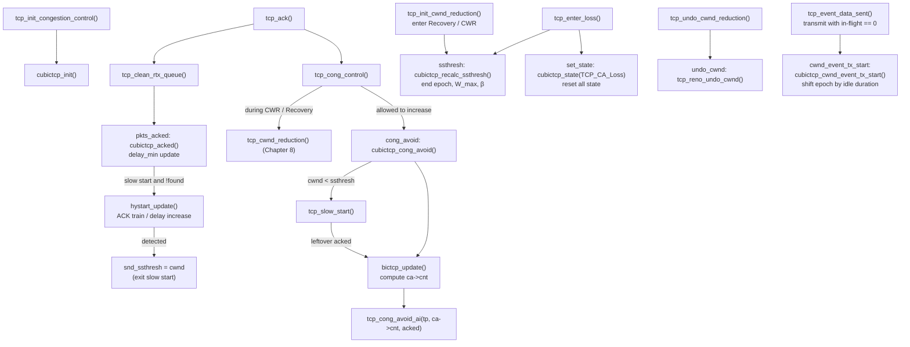

# 12. CUBIC

We read CUBIC, Linux's default congestion control algorithm, by comparing the formulas of RFC 9438 and the fixed-point implementation in `net/ipv4/tcp_cubic.c` line by line.  The first half covers "how cwnd is increased after loss" (the cubic function, Reno-friendly region, and fast convergence); the second half covers "where to stop the initial slow start" (HyStart).  We assume familiarity with the framework side (where each `tcp_congestion_ops` hook is called from, details of `tcp_slow_start()` / `tcp_cong_avoid_ai()`, and Reno) from Chapter 11, loss detection and PRR from Chapter 8, and how RTT samples are formed from Chapter 7.

## The ELI5 version

This is the story of a dispatcher who decides how many trucks are allowed on the road at once (cwnd) on the road (the network).

- The Reno dispatcher is a simple person: "Every time a round trip's worth of signed receipts (ACKs) returns, increase by 1 truck; if congestion (loss) occurs, halve the number of trucks."  If the road is long and wide (high bandwidth-delay product), it takes tens of minutes to return to the original number of trucks.
- The CUBIC dispatcher jots down the number of trucks when congestion occurred, **W_max**.  When congestion occurs, they reduce the truck count to 70%, and from there increase it while watching the **clock (elapsed time)**.  At first, they rush back towards W_max; as they approach W_max, they think "this is where congestion hit last time" and cautiously keep things almost flat to observe.  If no congestion occurs for a while, they think "perhaps the road has cleared up" and begin increasing the count—gently at first, then increasingly boldly—to probe for a new ceiling.  This shape of "fast → slow → fast again" is a cubic function.
- Because it increases according to the clock rather than the number of signed receipts, dispatchers with long round trips and those with short round trips can increase by the same number of trucks over the same amount of time.
- However, on narrow, short roads, the traditional Reno method can sometimes increase faster.  Therefore, CUBIC also calculates in the background "how many trucks Reno would have had by now" (W_est), ensuring it never drops below that number.
- During the very first departure (slow start), doubling the count repeatedly will inevitably cause massive congestion somewhere.  HyStart watches for two tell-tale signs—"signed receipts are returning in an unbroken, long train" and "the return of signed receipts is starting to slow down"—and quits the doubling game before congestion strikes.

## What the RFCs say

### Overview of RFC 9438

[RFC 9438](https://www.rfc-editor.org/rfc/rfc9438) "CUBIC for Fast and Long-Distance Networks" (2023, Standards Track) is a congestion control algorithm designed to solve the problem where Reno's AIMD (increase by 1 MSS per RTT, halved on loss) is too slow on high-BDP paths.  Because it determines cwnd as a "cubic function of elapsed time t since the last congestion event", the growth rate does not depend on RTT (RTT-fairness); growth slows down near the pre-loss window W_max, and accelerates again once past W_max.  RFC 9438 obsoleted the Informational [RFC 8312](https://www.rfc-editor.org/rfc/rfc8312), primarily introducing the following changes:

- Generalised the formula for K from `W_max * (1 - β)` to one based on `W_max - cwnd_epoch` ([§4.2](https://www.rfc-editor.org/rfc/rfc9438#section-4.2)).
- Clamped target to `[cwnd, 1.5 * cwnd]` (ibid.).
- Switched α to 1 once W_est reaches cwnd_prior ([§4.3](https://www.rfc-editor.org/rfc/rfc9438#section-4.3)).
- Made calculating ssthresh from flight_size rather than cwnd the default, obligating implementations that use cwnd to perform cwnd validation ([§4.6](https://www.rfc-editor.org/rfc/rfc9438#section-4.6)).
- Defined an undo procedure for spurious congestion events ([§4.9](https://www.rfc-editor.org/rfc/rfc9438#section-4.9)).
- Made HyStart++ (RFC 9406) a SHOULD for slow start, categorising the original HyStart used by Linux as an "experimental alternative" ([§4.10](https://www.rfc-editor.org/rfc/rfc9438#section-4.10)).

The Linux implementation started from CUBIC v2.3 in 2008 (the paper implementation by Ha, Rhee, and Xu), predating RFC 8312; the RFCs largely documented Linux's operational experience.  Consequently, rather than "translating RFC formulas into code", much of the RFC was "catching up with code behaviour".  The discrepancies between the two are summarised later in [RFC vs Linux](#rfc-vs-linux).

### Overview of HyStart and RFC 9406 HyStart++

- **HyStart** (Sangtae Ha, Injong Rhee, "Taming the Elephants: New TCP Slow Start", 2008/2011): The exponential doubling of the initial slow start overshoots BDP by up to 2x, causing heavy packet loss and prolonged recovery.  HyStart terminates slow start early using two independent detectors: (1) **ACK train**: when the length of an ACK train returning closely spaced (within 2 ms intervals) in a single round exceeds half of the min RTT, it decides that in-flight has reached BDP.  (2) **Delay increase**: when the minimum of the RTT samples in a round (at least the first 8) exceeds the connection's min RTT by more than a threshold, it decides that a queue has begun to build up.  When either fires, it sets `ssthresh = cwnd` and transitions immediately to congestion avoidance.
- **HyStart++** ([RFC 9406](https://www.rfc-editor.org/rfc/rfc9406), 2023, Standards Track): An improved version standardised from Microsoft Windows operational experience.  It **lacks** ACK train detection, relying solely on delay increase (comparing against the "previous round's min RTT" rather than the "connection-wide min RTT").  Furthermore, rather than entering congestion avoidance immediately upon detection, it reduces the growth rate to 1/4 under **Conservative Slow Start (CSS)** for up to 5 rounds to observe; if RTT drops, it treats the trigger as a false alarm and returns to slow start ([§4.2](https://www.rfc-editor.org/rfc/rfc9406#section-4.2)).  The recommended constants are `MIN_RTT_THRESH = 4 ms`, `MAX_RTT_THRESH = 16 ms`, `MIN_RTT_DIVISOR = 8`, `N_RTT_SAMPLE = 8`, `CSS_GROWTH_DIVISOR = 4`, `CSS_ROUNDS = 5`, and `L = 8` (without pacing) ([§4.3](https://www.rfc-editor.org/rfc/rfc9406#section-4.3)).

Checking the pinned tree, Linux's `tcp_cubic.c` implements the **original HyStart (ACK train + delay increase)** and does not have HyStart++'s CSS.  However, the delay increase constants (4 ms / 16 ms / `>> 3` / 8 samples) are identical to HyStart++'s recommended values.  This is no coincidence; HyStart++ adopted Linux's longstanding values.  Grepping for `hystart` under `net/ipv4/` reveals no code derived from HyStart++ (only a simplified copy of the original HyStart exists in `tcp_cdg.c`).

### Constants and variables ([RFC 9438 §4.1](https://www.rfc-editor.org/rfc/rfc9438#section-4.1))

The RFC defines windows in units of segments and time in seconds.  We extract only those necessary for reading the code.

| RFC symbol | Meaning | Linux equivalent |
| --- | --- | --- |
| β_cubic | Multiplicative decrease factor (0.7) | `beta / BICTCP_BETA_SCALE` = 717/1024 |
| α_cubic | Additive factor for Reno-friendly region | `beta_scale` (value of reciprocal multiplied by 8) |
| C | Aggressiveness constant (0.4 segment/s³) | `bic_scale * 10 / 1024` = 410/1024 |
| cwnd_prior | cwnd when ssthresh was most recently set | `tp->prior_cwnd` (for undo; CUBIC itself does not store it) |
| W_max | cwnd just before the previous congestion event (may shrink via fast convergence) | `ca->last_max_cwnd` |
| K | Time to return to W_max from cwnd at start of current CA stage | `ca->bic_K` (in units of 1/1024 seconds) |
| t_epoch | Start time of current CA stage | `ca->epoch_start` (jiffies) |
| cwnd_epoch | cwnd at t_epoch | `cwnd` at head of `bictcp_update()` |
| W_est | Estimated Reno window for Reno-friendly region | `ca->tcp_cwnd` |
| target | W_cubic(t + RTT) | `bic_target` |
| RTT | Smoothed RTT (RFC 6298) | `ca->delay_min` (uses **minimum** RTT) |
| segments_acked | Number of segments acknowledged by new ACK | `acked` argument |

### Window growth function ([RFC 9438 §4.2](https://www.rfc-editor.org/rfc/rfc9438#section-4.2))

During congestion avoidance, CUBIC determines its window with the following functions:

```text
W_cubic(t) = C * (t - K)^3 + W_max            (Figure 1)
K = cbrt((W_max - cwnd_epoch) / C)            (Figure 2)
t = t_current - t_epoch
```

Immediately after loss, if `cwnd_epoch = β * W_max`, then `K = cbrt(W_max * (1 - β) / C)`, matching RFC 8312's formula.  For example, with W_max = 100, K = cbrt(100 × 0.3 / 0.4) = cbrt(75) ≈ 4.22 seconds.  Whether RTT is 10 ms or 200 ms, cwnd returns to 100 roughly 4.2 seconds after loss.  This is the true nature of RTT-fairness ([§3.3](https://www.rfc-editor.org/rfc/rfc9438#section-3.3)).

On receiving each new ACK, the target value one RTT ahead is calculated and clamped:

```text
target = cwnd              if W_cubic(t + RTT) < cwnd
       = 1.5 * cwnd        if W_cubic(t + RTT) > 1.5 * cwnd
       = W_cubic(t + RTT)  otherwise
```

The lower bound guarantees "growth rate is never negative", and the upper bound guarantees "growth is no faster than slow start".  Additionally, t **MUST NOT include periods during which cwnd was not updated due to being application-limited** ([§5.8](https://www.rfc-editor.org/rfc/rfc9438#section-5.8)).  If included, W_cubic(t) would balloon during the idle period, causing cwnd to explode upon resumption.  In Linux, `cubictcp_cwnd_event_tx_start()` handles this.

### Reno-friendly region ([§4.3](https://www.rfc-editor.org/rfc/rfc9438#section-4.3))

With short RTTs and low bandwidth (low BDP), Reno can sometimes grow faster.  Because the average window of AIMD(α, β) is `sqrt(α(1+β) / (2(1-β)p))`, achieving the same average window as Reno (AIMD(1, 0.5)) requires the following values:

```text
α_cubic = 3 * (1 - β_cubic) / (1 + β_cubic)   = 3 * 0.3 / 1.7 ≈ 0.529
W_est   = cwnd_epoch                          (CA ステージ開始時)
W_est  += α_cubic * segments_acked / cwnd     (新しい ACK ごと, Figure 4)
```

If `W_cubic(t) < W_est`, we are in the Reno-friendly region, so cwnd is set to W_est (SHOULD).  Furthermore, once W_est reaches cwnd_prior, α_cubic is set to 1 to match Reno's growth rate (SHOULD).

### Concave / Convex region ([§4.4](https://www.rfc-editor.org/rfc/rfc9438#section-4.4), [§4.5](https://www.rfc-editor.org/rfc/rfc9438#section-4.5))

If not in the Reno-friendly region, it is concave when cwnd < W_max (decelerating as it approaches W_max), and convex when cwnd ≥ W_max ("max probing", accelerating to search for a new ceiling).  In both regions, the per-ACK increment follows the same formula:

```text
cwnd += (target - cwnd) / cwnd
```

That is, cwnd reaches target over 1 RTT (approximately cwnd ACKs).  Linux rewrites this as "increase by 1 every `cnt = cwnd / (target - cwnd)` ACKs".

### Multiplicative decrease ([§4.6](https://www.rfc-editor.org/rfc/rfc9438#section-4.6))

```text
ssthresh   = flight_size * β_cubic
cwnd_prior = cwnd
cwnd       = max(ssthresh, 2)   (ロス)  / max(ssthresh, 1) (ECE)
ssthresh   = max(ssthresh, 2)
```

β_cubic is 0.7 (SHOULD).  The RFC notes: "While implementations that calculate ssthresh using cwnd are permitted, they MUST provide an alternative mechanism to prevent cwnd from increasing when in-flight is less than cwnd."  Linux is precisely an implementation that uses cwnd, and that "alternative mechanism" is `tcp_is_cwnd_limited()` (Step 7).

### Fast convergence ([§4.7](https://www.rfc-editor.org/rfc/rfc9438#section-4.7))

```text
W_max = cwnd * (1 + β_cubic) / 2   if cwnd < W_max and fast convergence enabled
W_max = cwnd                       otherwise
```

If loss occurs again before reaching the previous W_max, it assumes a new flow has likely arrived to compete for bandwidth; it lowers W_max by a factor of 0.85 to cap early and yield bandwidth (SHOULD).

### Timeout ([§4.8](https://www.rfc-editor.org/rfc/rfc9438#section-4.8))

On RTO, cwnd is dropped just as in Reno, but ssthresh is determined using β_cubic.  In the first CA stage following an RTO, **K = 0, W_max = cwnd at the start of that stage**, and W_est also starts from that cwnd.  In other words, past W_max is forgotten and it restarts from the convex region.

### Spurious congestion events ([§4.9](https://www.rfc-editor.org/rfc/rfc9438#section-4.9))

When detected as spurious via F-RTO (RFC 5682), Eifel (RFC 3522), D-SACK (RFC 2883 / 3708), etc., cwnd, cwnd_prior, ssthresh, W_max, K, t_epoch, and W_est MAY be restored to their saved values.

### Slow start ([§4.10](https://www.rfc-editor.org/rfc/rfc9438#section-4.10))

Slow start is a MUST when cwnd ≤ ssthresh.  HyStart++ is a SHOULD, Reno slow start is a MAY, and the original HyStart ([HR11]) is listed as an experimental alternative as the "predecessor used by default in some CUBIC implementations over the past decade".  When HyStart(++) exits slow start without loss, W_max is undefined, so Figure 1 is used with **K = 0, W_max = cwnd at start of CA**.

### The two detectors of HyStart (paper and Linux)

Summing up the reasoning for ACK train detection in one sentence: "Because slow start sends 2 segments per ACK, once the bottleneck saturates and ACKs begin returning spaced at the bottleneck bandwidth BW, in-flight becomes 2·BW·Δ at Δ seconds from the start of the round.  At Δ = minRTT/2, in-flight = BW·minRTT = BDP."  Therefore, "a closely spaced ACK train continuing for at least minRTT/2 from round start" acts as the signal that BDP has been reached.

Delay increase detection considers that a queue has begun to build when `curr_rtt`, the minimum of the first N samples in a round, exceeds `delay_min + clamp(delay_min / 8, 4 ms, 16 ms)`.  Its form is identical to HyStart++'s `RttThresh = max(4 ms, min(lastRoundMinRTT / 8, 16 ms))`, but the baseline differs: whether it is compared against the "previous round's min" or the "connection-wide min".

## The big picture

CUBIC is a module that uses the "classical" hooks (`cong_avoid` / `ssthresh`) of `struct tcp_congestion_ops`.  Rather than seizing full control of both cwnd and the pacing rate via `cong_control` as BBR does, it supplies only the **growth method** and **reduction amount** for cwnd, leaving cwnd control during loss recovery (PRR) and pacing rate calculations to the core (`tcp_input.c`).



In a single ACK, `pkts_acked` (RTT samples and HyStart), called from `tcp_clean_rtx_queue()`, runs first, followed by `cong_avoid` (cwnd increase), called from `tcp_cong_control()`.  Because of this, when HyStart lowers `snd_ssthresh`, the `cong_avoid` call for the **very same ACK** already enters the congestion avoidance path.

We tabulate the caller and execution context for each hook.  All of them run under `struct sock`'s socket lock (with `lock_sock()` in process context, or `bh_lock_sock()` with `!sock_owned_by_user()` in softirq), so access to `struct bictcp` itself is serialised; CUBIC uses neither locks nor atomics for its own state.

| `tcp_congestion_ops` field | CUBIC function | Primary caller | Context |
| --- | --- | --- | --- |
| `.init` | `cubictcp_init()` | `tcp_init_congestion_control()` (from `tcp_init_transfer()` or `TCP_CONGESTION` setsockopt) | Softirq / process upon transition to ESTABLISHED |
| `.cong_avoid` | `cubictcp_cong_avoid()` | `tcp_cong_avoid()` ← `tcp_cong_control()` ← `tcp_ack()` | ACK reception (softirq or backlog processing) |
| `.pkts_acked` | `cubictcp_acked()` | `tcp_clean_rtx_queue()` ← `tcp_ack()` | Same as above |
| `.ssthresh` | `cubictcp_recalc_ssthresh()` | `tcp_init_cwnd_reduction()` (Recovery / CWR), `tcp_enter_loss()` (RTO) | ACK reception / RTO timer |
| `.set_state` | `cubictcp_state()` | `tcp_set_ca_state()` | Same as above |
| `.undo_cwnd` | `tcp_reno_undo_cwnd()` | `tcp_undo_cwnd_reduction()` | ACK reception |
| `.cwnd_event_tx_start` | `cubictcp_cwnd_event_tx_start()` | `tcp_ca_event(sk, CA_EVENT_TX_START)` ← `tcp_event_data_sent()` | Transmit path (sendmsg / ACK-driven / timer) |

## Walking through the code

### Step 1: Constants, module parameters, and precomputations (`cubictcp_register()`)

First, the constants and module parameters at the top of the file.  All of CUBIC's formulas depend on the fixed-point scaling decided here.

```c
#define BICTCP_BETA_SCALE    1024	/* Scale factor beta calculation
					 * max_cwnd = snd_cwnd * beta
					 */
#define	BICTCP_HZ		10	/* BIC HZ 2^10 = 1024 */

/* Two methods of hybrid slow start */
#define HYSTART_ACK_TRAIN	0x1
#define HYSTART_DELAY		0x2

/* Number of delay samples for detecting the increase of delay */
#define HYSTART_MIN_SAMPLES	8
#define HYSTART_DELAY_MIN	(4000U)	/* 4 ms */
#define HYSTART_DELAY_MAX	(16000U)	/* 16 ms */
#define HYSTART_DELAY_THRESH(x)	clamp(x, HYSTART_DELAY_MIN, HYSTART_DELAY_MAX)

static int fast_convergence __read_mostly = 1;
static int beta __read_mostly = 717;	/* = 717/1024 (BICTCP_BETA_SCALE) */
static int initial_ssthresh __read_mostly;
static int bic_scale __read_mostly = 41;
static int tcp_friendliness __read_mostly = 1;

static int hystart __read_mostly = 1;
static int hystart_detect __read_mostly = HYSTART_ACK_TRAIN | HYSTART_DELAY;
static int hystart_low_window __read_mostly = 16;
static int hystart_ack_delta_us __read_mostly = 2000;

static u32 cube_rtt_scale __read_mostly;
static u32 beta_scale __read_mostly;
static u64 cube_factor __read_mostly;
```

- `BICTCP_BETA_SCALE = 1024`: Scale factor representing β in parts per 1024.  With `beta = 717`, β = 717/1024 = 0.7002, corresponding to RFC 9438's β_cubic = 0.7.
- `BICTCP_HZ = 10`: The internal time unit in CUBIC is neither jiffies nor seconds, but **1/1024 seconds** (1 / 2^10 seconds).  `bic_K` and `t` inside `bictcp_update()` are all in this unit.  By choosing a fixed resolution independent of HZ, the bit-width required for `t^3` calculations can be estimated independently of HZ.
- `HYSTART_ACK_TRAIN` / `HYSTART_DELAY`: Bit flags for `hystart_detect`.  By default, both are enabled (3).
- `HYSTART_MIN_SAMPLES = 8`, `HYSTART_DELAY_MIN = 4000U`, `HYSTART_DELAY_MAX = 16000U`: Constants for delay increase detection, measured in **microseconds** (converted to usec in 2019, discussed below).  These match the values of `N_RTT_SAMPLE`, `MIN_RTT_THRESH`, and `MAX_RTT_THRESH` in HyStart++.
- `HYSTART_DELAY_THRESH(x)`: `clamp(x, 4ms, 16ms)`.  The caller passes `delay_min >> 3`, which corresponds to `MIN_RTT_DIVISOR = 8`.
- `fast_convergence = 1`: Enables fast convergence from RFC §4.7.
- `initial_ssthresh = 0`: If 0, the initial ssthresh remains `TCP_INFINITE_SSTHRESH` as set by the core; this only takes effect when HyStart is disabled (Step 3).
- `bic_scale = 41`: Determines C.  See the description of `cube_rtt_scale` below.
- `tcp_friendliness = 1`: Enables the Reno-friendly region from RFC §4.3.
- `hystart_low_window = 16`: While cwnd is below 16, HyStart detection is not performed.
- `hystart_ack_delta_us = 2000`: Upper bound on the ACK spacing considered part of an ACK train (2 ms).
- `cube_rtt_scale`, `beta_scale`, `cube_factor`: Precomputed values calculated once at module load to avoid per-ACK division.

```c
/* Note parameters that are used for precomputing scale factors are read-only */
module_param(fast_convergence, int, 0644);
MODULE_PARM_DESC(fast_convergence, "turn on/off fast convergence");
module_param(beta, int, 0644);
MODULE_PARM_DESC(beta, "beta for multiplicative increase");
module_param(initial_ssthresh, int, 0644);
MODULE_PARM_DESC(initial_ssthresh, "initial value of slow start threshold");
module_param(bic_scale, int, 0444);
MODULE_PARM_DESC(bic_scale, "scale (scaled by 1024) value for bic function (bic_scale/1024)");
module_param(tcp_friendliness, int, 0644);
MODULE_PARM_DESC(tcp_friendliness, "turn on/off tcp friendliness");
module_param(hystart, int, 0644);
MODULE_PARM_DESC(hystart, "turn on/off hybrid slow start algorithm");
module_param(hystart_detect, int, 0644);
MODULE_PARM_DESC(hystart_detect, "hybrid slow start detection mechanisms"
		 " 1: packet-train 2: delay 3: both packet-train and delay");
module_param(hystart_low_window, int, 0644);
MODULE_PARM_DESC(hystart_low_window, "lower bound cwnd for hybrid slow start");
module_param(hystart_ack_delta_us, int, 0644);
MODULE_PARM_DESC(hystart_ack_delta_us, "spacing between ack's indicating train (usecs)");
```

Pay attention to permissions.  Only `bic_scale` is `0444` (read-only), whilst the others are `0644`.  As noted in the comment, the intent was "parameters used for precomputing scale factors are read-only", but **`beta` is `0644` even though it is used to compute `beta_scale`**.  If `/sys/module/tcp_cubic/parameters/beta` is rewritten at runtime, β in `cubictcp_recalc_ssthresh()` and the fast convergence factor change immediately, whilst α for the Reno-friendly region (`beta_scale`) remains at its load-time value.  Moreover, all of these are global variables across the entire module, not per-netns sysctls (in contrast to `net.ipv4.tcp_congestion_control` being per-netns).

The precomputations reside in `cubictcp_register()` ([net/ipv4/tcp_cubic.c#L501](https://git.kernel.org/pub/scm/linux/kernel/git/netdev/net-next.git/tree/net/ipv4/tcp_cubic.c?id=279d5c8afcd38bd841832a39bfe1aa4f8518d98e#n501)) at the end of the file.  For narrative clarity, we examine them here.

```c
static int __init cubictcp_register(void)
{
	int b = READ_ONCE(beta);
	int ret;

	BUILD_BUG_ON(sizeof(struct bictcp) > ICSK_CA_PRIV_SIZE);

	if (b < 0 || b >= BICTCP_BETA_SCALE ||
	    bic_scale <= 0 || bic_scale > INT_MAX / 10) {
		pr_err("tcp_cubic: invalid beta %d or bic_scale %d\n",
		       b, bic_scale);
		return -EINVAL;
	}
```

Next comes the precomputation and registration of scale factors used per ACK.

```c
	/* Precompute a bunch of the scaling factors that are used per-packet
	 * based on SRTT of 100ms
	 */

	beta_scale = 8 * (BICTCP_BETA_SCALE + b) / 3
		/ (BICTCP_BETA_SCALE - b);
	/* bictcp_update() needs (cwnd * beta_scale) >> 3 to be >= 1 */
	beta_scale = max(beta_scale, 8U);

	cube_rtt_scale = (bic_scale * 10);	/* 1024*c/rtt */

	/* calculate the "K" for (wmax-cwnd) = c/rtt * K^3
	 *  so K = cubic_root( (wmax-cwnd)*rtt/c )
	 * the unit of K is bictcp_HZ=2^10, not HZ
	 *
	 *  c = bic_scale >> 10
	 *  rtt = 100ms
	 *
	 * the following code has been designed and tested for
	 * cwnd < 1 million packets
	 * RTT < 100 seconds
	 * HZ < 1,000,00  (corresponding to 10 nano-second)
	 */

	/* 1/c * 2^2*bictcp_HZ * srtt */
	cube_factor = 1ull << (10+3*BICTCP_HZ); /* 2^40 */

	/* divide by bic_scale and by constant Srtt (100ms) */
	do_div(cube_factor, bic_scale * 10);

	ret = register_btf_kfunc_id_set(BPF_PROG_TYPE_STRUCT_OPS, &tcp_cubic_kfunc_set);
	if (ret < 0)
		return ret;
	return tcp_register_congestion_control(&cubictcp);
}
```

- `BUILD_BUG_ON(sizeof(struct bictcp) > ICSK_CA_PRIV_SIZE)`: The CC module's private state is placed in `icsk_ca_priv[]` (currently 104 bytes) embedded inside `inet_connection_sock`.  `struct bictcp` is 60 bytes, so it fits comfortably.  Because it is not dynamically allocated, there is neither an extra per-socket allocation nor pointer chasing.
- `b = READ_ONCE(beta)` and range check: Added in 2026 by 7d52b5d16afc.  `beta == 1024` or `bic_scale == 0` would cause division by zero below, and `bic_scale * 10` could overflow an int.  Because `beta` can be written via sysfs before the init function runs during built-in compilation—in addition to `insmod tcp_cubic beta=...`—it is read once with `READ_ONCE()`.
- `beta_scale = 8 * (1024 + b) / 3 / (1024 - b)`: This is **8 times the reciprocal** of α in the Reno-friendly region.  Since α = 3(1-β)/(1+β), 1/α = (1+β)/(3(1-β)) = (1024+b)/(3(1024-b)).  In C, evaluation proceeds left-to-right: `((8 * 1741) / 3) / 307` = `4642 / 307` = **15**.  `bictcp_update()` increments W_est by 1 every `(cwnd * 15) >> 3` = 1.875·cwnd ACKs, resulting in an effective α = 8/15 = 0.533, which matches the RFC's 0.529 almost perfectly.
- `beta_scale = max(beta_scale, 8U)`: If β were extremely small, `beta_scale` would decrease, causing `(cwnd * beta_scale) >> 3` to become 0 at small cwnd, causing the `while` loop in `bictcp_update()` to loop infinitely.  Guaranteeing at least 8 ensures delta ≥ 1 for `cwnd >= 1`.
- `cube_rtt_scale = bic_scale * 10` (= 410): The comment "1024*c/rtt" is a leftover from the BIC era.  The original implementation held C as a value per "standard RTT of 100 ms", c = 41/1024 ≈ 0.04, and multiplied by `c/rtt = c / 0.1 = c * 10`.  As a result, it does not depend on RTT, effectively yielding **C = 410/1024 ≈ 0.4004 segment/s³**, which is RFC's C = 0.4.
- `cube_factor = 2^40 / 410` (= 2681735677): The factor used to find `bic_K`.  Since we want K in units of 1/1024 seconds where K[s] = cbrt(ΔW / C), K·1024 = cbrt(ΔW · 1024³ / C) = cbrt(ΔW · 2^30 · 1024 / 410) = cbrt(ΔW · 2^40 / 410); taking the cube root of `cube_factor * ΔW` gives K directly in 1/1024 seconds.  `do_div()` performs a 64-bit ÷ 32-bit division, working correctly on 32-bit architectures.
- Finally, it registers CUBIC functions as kfuncs so they can be called from BPF struct_ops (allowing CCs written in BPF to reuse parts of CUBIC), and registers into the CC list via `tcp_register_congestion_control()`.

We summarise the correspondence up to this point in a table.

| RFC 9438 / RFC 9406 | Value | Linux representation | Effective value |
| --- | --- | --- | --- |
| β_cubic | 0.7 | `beta / BICTCP_BETA_SCALE` = 717/1024 | 0.7002 |
| C | 0.4 | `cube_rtt_scale / 2^10` = 410/1024 (`bic_scale = 41` × 10) | 0.4004 |
| Time unit of K | Seconds | `bic_K` in 1/1024 seconds (`BICTCP_HZ = 10`) | — |
| Calculation of K | cbrt(ΔW / C) | `cubic_root(cube_factor * ΔW)`, `cube_factor = 2^40 / 410` | Error ~0.2% |
| α_cubic | 3(1-β)/(1+β) ≈ 0.529 | `beta_scale = 15` → +1 per `(cwnd * 15) >> 3` ACKs | 8/15 ≈ 0.533 |
| Fast convergence factor | (1+β)/2 = 0.85 | `(1024 + 717) / 2048` | 0.850 |
| Upper bound on target | 1.5·cwnd | `ca->cnt >= 2` (1 increase per 2 ACKs) | 1.5x / RTT |
| RTT in W_cubic(t + RTT) | SRTT | `usecs_to_jiffies(ca->delay_min)` (min RTT) | — |
| MIN_RTT_THRESH / MAX_RTT_THRESH | 4 ms / 16 ms | `HYSTART_DELAY_MIN` / `HYSTART_DELAY_MAX` (usec) | Same |
| MIN_RTT_DIVISOR | 8 | `ca->delay_min >> 3` | Same |
| N_RTT_SAMPLE | 8 | `HYSTART_MIN_SAMPLES` | Same |
| CSS_GROWTH_DIVISOR / CSS_ROUNDS / L | 4 / 5 / 8 | None (CSS not implemented; slow start increment bounded only by ssthresh) | — |

### Step 2: `struct bictcp` and small helpers

`struct bictcp` ([net/ipv4/tcp_cubic.c#L86](https://git.kernel.org/pub/scm/linux/kernel/git/netdev/net-next.git/tree/net/ipv4/tcp_cubic.c?id=279d5c8afcd38bd841832a39bfe1aa4f8518d98e#n86)) is CUBIC's per-socket state.  The name remains BIC due to CUBIC's history of deriving from BIC-TCP (the rename of function names from `bictcp_` to `cubictcp_` occurred in 2021 with d22f6ad18709 to prevent name collisions as BPF kfuncs; internal helpers and structure names remained as BIC).

```c
/* BIC TCP Parameters */
struct bictcp {
	u32	cnt;		/* increase cwnd by 1 after ACKs */
	u32	last_max_cwnd;	/* last maximum snd_cwnd */
	u32	last_cwnd;	/* the last snd_cwnd */
	u32	last_time;	/* time when updated last_cwnd */
	u32	bic_origin_point;/* origin point of bic function */
	u32	bic_K;		/* time to origin point
				   from the beginning of the current epoch */
	u32	delay_min;	/* min delay (usec) */
	u32	epoch_start;	/* beginning of an epoch */
	u32	ack_cnt;	/* number of acks */
	u32	tcp_cwnd;	/* estimated tcp cwnd */
	u16	unused;
	u8	sample_cnt;	/* number of samples to decide curr_rtt */
	u8	found;		/* the exit point is found? */
	u32	round_start;	/* beginning of each round */
	u32	end_seq;	/* end_seq of the round */
	u32	last_ack;	/* last time when the ACK spacing is close */
	u32	curr_rtt;	/* the minimum rtt of current round */
};
```

Dividing the fields into three groups makes them easier to understand:

- **Cubic curve state** (changes per loss / per epoch)
  - `cnt`: "Increase cwnd by 1 every how many ACKs".  Passed as the `w` argument to `tcp_cong_avoid_ai()`.  This is the reciprocal of the cubic curve's slope.
  - `last_max_cwnd`: RFC's W_max.  The value after applying fast convergence.  0 denotes "unknown W_max" (immediately after initial slow start or after RTO).
  - `last_cwnd`, `last_time`: Cache for throttling recalculations in `bictcp_update()` (skips recalculation if cwnd is unchanged and within 1/32 second).
  - `bic_origin_point`: Height of the cubic function's inflection point.  Usually W_max, but if an epoch starts with W_max unknown or cwnd ≥ W_max, it becomes the cwnd at epoch start.
  - `bic_K`: Time to the inflection point (in 1/1024 seconds).
  - `epoch_start`: Start time of the epoch (RFC's "CA stage") in jiffies.  **0 is a sentinel meaning "epoch has not started"**.  Reset to 0 on loss.
- **Reno-friendly region state**
  - `ack_cnt`: ACK counter for advancing W_est (carrying over leftovers).
  - `tcp_cwnd`: RFC's W_est.
- **HyStart / RTT state**
  - `delay_min`: Connection's minimum RTT (usec).  0 means unmeasured.  Used both by HyStart and for "t + RTT" in `bictcp_update()`.
  - `unused`, `sample_cnt`, `found`: `found` is the "exit point found" flag for slow start.  `sample_cnt` is the count of RTT samples within the round.
  - `round_start`, `end_seq`, `last_ack`, `curr_rtt`: Round management for HyStart.  A round ends when acknowledged up to `end_seq`.  Times are in usec (lower 32 bits of `tcp_mstamp`).

```c
static inline void bictcp_reset(struct bictcp *ca)
{
	memset(ca, 0, offsetof(struct bictcp, unused));
	ca->found = 0;
}

static inline u32 bictcp_clock_us(const struct sock *sk)
{
	return tcp_sk(sk)->tcp_mstamp;
}

static inline void bictcp_hystart_reset(struct sock *sk)
{
	struct tcp_sock *tp = tcp_sk(sk);
	struct bictcp *ca = inet_csk_ca(sk);

	ca->round_start = ca->last_ack = bictcp_clock_us(sk);
	ca->end_seq = tp->snd_nxt;
	ca->curr_rtt = ~0U;
	ca->sample_cnt = 0;
}
```

- `bictcp_reset()`: Uses `memset(ca, 0, offsetof(struct bictcp, unused))` to bulk-zero the curve state and `delay_min` from `cnt` to `tcp_cwnd`, and sets `found` to 0.  It leaves `sample_cnt`, `round_start`, and subsequent fields untouched, because `bictcp_hystart_reset()`, called immediately afterwards, sets them (f4d133d86af7 changed this from individual assignments to `memset` + `offsetof`.  Field ordering matters, so when adding fields to `struct bictcp`, care must be taken whether to place them before or after `unused`).
- `bictcp_clock_us()`: Truncates `tp->tcp_mstamp` (u64 usec timestamp) to u32 and returns it.  Because `tcp_mstamp` is refreshed by `tcp_mstamp_refresh()` at entry points such as ACK processing, reading it incurs no fresh clock reading cost.  A u32 in usecs wraps in roughly 71 minutes, but because HyStart always computes `(s32)(now - x)` deltas, it is completely fine as long as the difference is less than 35 minutes.
- `bictcp_hystart_reset()`: Starts a new round.  Initialises `round_start` and `last_ack` to the current time, sets `end_seq = snd_nxt` (the round ends once the current tail of sent data is ACKed), `curr_rtt = ~0U` (infinity), and `sample_cnt = 0`.  Setting `curr_rtt` to `~0U` rather than 0 eliminates branches for "if not yet set" inside `hystart_update()` (35821fc2b41c).  This matches RFC 9406's "windowEnd = SND.NXT" and "currentRoundMinRTT = infinity".

### Step 3: `cubictcp_init()`

`cubictcp_init()` ([net/ipv4/tcp_cubic.c#L129](https://git.kernel.org/pub/scm/linux/kernel/git/netdev/net-next.git/tree/net/ipv4/tcp_cubic.c?id=279d5c8afcd38bd841832a39bfe1aa4f8518d98e#n129)) is called when a connection enters ESTABLISHED (`tcp_init_transfer()` → `tcp_init_congestion_control()`), or when switching CC via `TCP_CONGESTION`.

```c
__bpf_kfunc static void cubictcp_init(struct sock *sk)
{
	struct bictcp *ca = inet_csk_ca(sk);

	bictcp_reset(ca);

	if (hystart)
		bictcp_hystart_reset(sk);

	if (!hystart && initial_ssthresh)
		WRITE_ONCE(tcp_sk(sk)->snd_ssthresh, initial_ssthresh);
}
```

- `bictcp_reset(ca)`: Zeroes all state.  With `last_max_cwnd = 0`, it begins with "W_max unknown".
- `if (hystart) bictcp_hystart_reset(sk)`: Starts the first round based on `snd_nxt`.
- `if (!hystart && initial_ssthresh)`: Only when HyStart is disabled can initial ssthresh be fixed via a module parameter.  When HyStart is enabled, this is ignored because HyStart itself determines the exit point for slow start.  The write to `snd_ssthresh` uses `WRITE_ONCE()` because `tcp_get_info()` and `SCM_TIMESTAMPING_OPT_STATS` read it locklessly (fd571afb05eb).

### Step 4: `cubictcp_cwnd_event_tx_start()` — excluding idle periods from the curve

This function implements RFC 9438 §4.2/§5.8's rule that "t must not include periods during which cwnd was not updated due to being application-limited" ([net/ipv4/tcp_cubic.c#L142](https://git.kernel.org/pub/scm/linux/kernel/git/netdev/net-next.git/tree/net/ipv4/tcp_cubic.c?id=279d5c8afcd38bd841832a39bfe1aa4f8518d98e#n142)).  Its caller is `tcp_event_data_sent()` ([net/ipv4/tcp_output.c#L179](https://git.kernel.org/pub/scm/linux/kernel/git/netdev/net-next.git/tree/net/ipv4/tcp_output.c?id=279d5c8afcd38bd841832a39bfe1aa4f8518d98e#n179)) on the transmit path, which raises `CA_EVENT_TX_START` **when sending data from an in-flight == 0 state**.

```c
static void tcp_event_data_sent(struct tcp_sock *tp,
				struct sock *sk)
{
	struct inet_connection_sock *icsk = inet_csk(sk);
	const u32 now = tcp_jiffies32;

	if (tcp_packets_in_flight(tp) == 0)
		tcp_ca_event(sk, CA_EVENT_TX_START);

	tp->lsndtime = now;

	/* If it is a reply for ato after last received
	 * packet, increase pingpong count.
	 */
	if ((u32)(now - icsk->icsk_ack.lrcvtime) < icsk->icsk_ack.ato)
		inet_csk_inc_pingpong_cnt(sk);
}
```

`tcp_ca_event(sk, CA_EVENT_TX_START)` is invoked **before** updating `tp->lsndtime = now`.  Therefore, from CUBIC's viewpoint, `lsndtime` appears as "the time data was last sent previously".

```c
__bpf_kfunc static void cubictcp_cwnd_event_tx_start(struct sock *sk)
{
	struct bictcp *ca = inet_csk_ca(sk);
	u32 now = tcp_jiffies32;
	s32 delta;

	delta = now - tcp_sk(sk)->lsndtime;

	/* We were application limited (idle) for a while.
	 * Shift epoch_start to keep cwnd growth to cubic curve.
	 */
	if (ca->epoch_start && delta > 0) {
		ca->epoch_start += delta;
		if (after(ca->epoch_start, now))
			ca->epoch_start = now;
	}
}
```

- `delta = now - tcp_sk(sk)->lsndtime`: Elapsed jiffies since the last transmission, representing the idle time.
- `if (ca->epoch_start && delta > 0)`: Only when an epoch is ongoing (during CA), `epoch_start` is shifted forward by the idle duration.  Consequently, `t = now - epoch_start` excludes the idle period, and the cubic curve **translates horizontally along the time axis while preserving its shape**.
- `if (after(ca->epoch_start, now)) ca->epoch_start = now`: Prevents `epoch_start` from moving into the future.  Because `epoch_start` is set during ACK processing (`bictcp_update()`) and `lsndtime` is set on transmission, the sequence "last transmission → epoch start (ACK) → idle → transmission resumes" can produce `epoch_start + delta > now`.  A future `epoch_start` would make `(s32)(tcp_jiffies32 - ca->epoch_start)` negative in `bictcp_update()`, which, when assigned to u64 `t`, sign-extends to an astronomical value and derails the curve (c2e7204d180f).

Why not simply reset `epoch_start = 0`?  If reset, the next ACK would start a new epoch, recalculating K to surge aggressively towards W_max if `cwnd < last_max_cwnd`, repeating the same aggressive post-loss growth.  Following Neal Cardwell's observation, the method of "shifting time while keeping curve shape intact" was chosen (30927520dbae).  Note that during slow start (`epoch_start == 0`), it does nothing.  Shrinking cwnd itself after idle is handled by `tcp_cwnd_restart()` (RFC 2861) via `tcp_slow_start_after_idle`; CUBIC independently adjusts only the "time axis of the curve".

In 2026, d1e59a469737 decoupled this function from the generic `cwnd_event(sk, ev)` into an independent hook `cwnd_event_tx_start`.  This was because `cwnd_event()` was called alternately on transmission for `CA_EVENT_TX_START` and other events, harming indirect branch prediction.  Because CUBIC and BBR only care about `CA_EVENT_TX_START`, using a dedicated pointer allows `tcp_ca_event()` ([include/net/tcp.h#L1491](https://git.kernel.org/pub/scm/linux/kernel/git/netdev/net-next.git/tree/include/net/tcp.h?id=279d5c8afcd38bd841832a39bfe1aa4f8518d98e#n1491)) to resolve the branch statically.

```c
static inline void tcp_ca_event(struct sock *sk, const enum tcp_ca_event event)
{
	const struct inet_connection_sock *icsk = inet_csk(sk);

	if (event == CA_EVENT_TX_START) {
		if (icsk->icsk_ca_ops->cwnd_event_tx_start)
			icsk->icsk_ca_ops->cwnd_event_tx_start(sk);
		return;
	}
	if (icsk->icsk_ca_ops->cwnd_event)
		icsk->icsk_ca_ops->cwnd_event(sk, event);
}
```

### Step 5: `cubic_root()` — fixed-point cube root

Calculating K requires the cube root of a 64-bit integer.  Because the kernel cannot use floating-point arithmetic, `cubic_root()` ([net/ipv4/tcp_cubic.c#L164](https://git.kernel.org/pub/scm/linux/kernel/git/netdev/net-next.git/tree/net/ipv4/tcp_cubic.c?id=279d5c8afcd38bd841832a39bfe1aa4f8518d98e#n164)) solves this by **generating an initial estimate via table lookup and running a single Newton-Raphson iteration**.  The average error is approximately 0.195%.

```c
/* calculate the cubic root of x using a table lookup followed by one
 * Newton-Raphson iteration.
 * Avg err ~= 0.195%
 */
static u32 cubic_root(u64 a)
{
	u32 x, b, shift;
	/*
	 * cbrt(x) MSB values for x MSB values in [0..63].
	 * Precomputed then refined by hand - Willy Tarreau
	 *
	 * For x in [0..63],
	 *   v = cbrt(x << 18) - 1
	 *   cbrt(x) = (v[x] + 10) >> 6
	 */
	static const u8 v[] = {
		/* 0x00 */    0,   54,   54,   54,  118,  118,  118,  118,
		/* 0x08 */  123,  129,  134,  138,  143,  147,  151,  156,
		/* 0x10 */  157,  161,  164,  168,  170,  173,  176,  179,
		/* 0x18 */  181,  185,  187,  190,  192,  194,  197,  199,
		/* 0x20 */  200,  202,  204,  206,  209,  211,  213,  215,
		/* 0x28 */  217,  219,  221,  222,  224,  225,  227,  229,
		/* 0x30 */  231,  232,  234,  236,  237,  239,  240,  242,
		/* 0x38 */  244,  245,  246,  248,  250,  251,  252,  254,
	};

	b = fls64(a);
	if (b < 7) {
		/* a in [0..63] */
		return ((u32)v[(u32)a] + 35) >> 6;
	}

	b = ((b * 84) >> 8) - 1;
	shift = (a >> (b * 3));

	x = ((u32)(((u32)v[shift] + 10) << b)) >> 6;
```

The latter half performs the single Newton-Raphson iteration.

```c
	/*
	 * Newton-Raphson iteration
	 *                         2
	 * x    = ( 2 * x  +  a / x  ) / 3
	 *  k+1          k         k
	 */
	x = (2 * x + (u32)div64_u64(a, (u64)x * (u64)(x - 1)));
	x = ((x * 341) >> 10);
	return x;
}
```

We break down the mathematics step by step:

1. **Meaning of table `v[]`**: Stores (with manual adjustments) `v[x] = cbrt(x << 18) - 1` for x from 0 to 63.  Since `x << 18` is x·2^18 = x·64³, `cbrt(x << 18) = 64·cbrt(x)`, meaning `v[x]` represents cbrt(x) as a **6-bit fixed-point number (×64)**.  1 is subtracted to fit within u8 (cbrt(63)·64 ≈ 254.7).
2. **Small inputs (a < 64)**: If `fls64(a) < 7`, a fits within 6 bits, returning `(v[a] + 35) >> 6` directly from the table.  The +35 is a rounding adjustment when converting the ×64 fixed-point value back to an integer: e.g. a = 1 → (54+35)>>6 = 1, a = 8 → (123+35)>>6 = 2, a = 27 → (190+35)>>6 = 3, and a = 63 → 4.
3. **Normalising large inputs**: `b = fls64(a)` is the bit length.  `((b * 84) >> 8) - 1` approximates "b/3 − 1" using 84/256 ≈ 0.328 ≈ 1/3 to estimate the cube root's bit length.  `shift = a >> (b * 3)` extracts the high bits of a divided by 2^(3b), which, by choice of b, always falls between 0 and 63 (e.g. for bit length 64, b = 20, 64 − 60 = 4 bits; for bit length 63, b = 19, 63 − 57 = 6 bits).
4. **Initial estimate**: Because cbrt(a) = cbrt(shift · 2^(3b)) = cbrt(shift) · 2^b, `x = ((v[shift] + 10) << b) >> 6` takes cbrt(shift) (×64) from the table, scales it by 2^b, and removes the ×64 factor.  The +10 here is an adjustment accounting for the 1 subtracted in the table and the error contraction in the subsequent Newton step.
5. **One Newton-Raphson step**: For f(x) = x³ − a, the iteration is x' = x − (x³ − a)/(3x²) = (2x + a/x²)/3.  The code computes `2 * x + a / (x * (x - 1))` and divides by 3 via `* 341 >> 10` (341/1024 = 0.333).  Using `x * (x - 1)` rather than x² in the denominator can be understood as slightly compensating for integer truncation and the downward bias of `341/1024 < 1/3`.  Because the denominator is computed in u64, it does not overflow even if x is around 2^21 (a ≈ 2^64).
6. Because Newton's method exhibits quadratic convergence, an initial estimate within a few percent narrows the error to roughly 0.2% in a single step.  Avoiding loops ensures execution time remains virtually constant regardless of the input.

Let us verify a concrete example by hand (`cube_factor = 2681735677`).  When W_max − cwnd = 30, `a = 80452070310` (37 bits), giving `b = ((37 * 84) >> 8) - 1 = 11`, `shift = a >> 33 = 9`, and `x = ((129 + 10) << 11) >> 6 = 4448`.  One Newton step yields **4316**.  The true value is cbrt(a) = 4316.97, yielding K = 4316/1024 ≈ 4.215 seconds.  This closely matches RFC's formula cbrt(30/0.4) = 4.217 seconds.

This function is invoked only once at the start of an epoch (on the first CA ACK after loss).  Because it is not computed per ACK, a single `div64_u64()` is harmless.

### Step 6: `bictcp_update()` — determining `ca->cnt` from the cubic curve

This is the heart of CUBIC ([net/ipv4/tcp_cubic.c#L211](https://git.kernel.org/pub/scm/linux/kernel/git/netdev/net-next.git/tree/net/ipv4/tcp_cubic.c?id=279d5c8afcd38bd841832a39bfe1aa4f8518d98e#n211)).  This function does not touch cwnd directly.  It merely writes "increase cwnd by 1 every how many ACKs" into `ca->cnt`, leaving the actual addition to the caller `tcp_cong_avoid_ai()`.  This transforms RFC's "increase by `(target - cwnd) / cwnd` per ACK" into the integer-friendly form "increase by 1 every `cwnd / (target - cwnd)` ACKs".

#### 6-1: Throttling recalculations and starting an epoch

```c
/*
 * Compute congestion window to use.
 */
static inline void bictcp_update(struct bictcp *ca, u32 cwnd, u32 acked)
{
	u32 delta, bic_target, max_cnt;
	u64 offs, t;

	ca->ack_cnt += acked;	/* count the number of ACKed packets */

	if (ca->last_cwnd == cwnd &&
	    (s32)(tcp_jiffies32 - ca->last_time) <= HZ / 32)
		return;

	/* The CUBIC function can update ca->cnt at most once per jiffy.
	 * On all cwnd reduction events, ca->epoch_start is set to 0,
	 * which will force a recalculation of ca->cnt.
	 */
	if (ca->epoch_start && tcp_jiffies32 == ca->last_time)
		goto tcp_friendliness;

	ca->last_cwnd = cwnd;
	ca->last_time = tcp_jiffies32;

	if (ca->epoch_start == 0) {
		ca->epoch_start = tcp_jiffies32;	/* record beginning */
		ca->ack_cnt = acked;			/* start counting */
		ca->tcp_cwnd = cwnd;			/* syn with cubic */

		if (ca->last_max_cwnd <= cwnd) {
			ca->bic_K = 0;
			ca->bic_origin_point = cwnd;
		} else {
			/* Compute new K based on
			 * (wmax-cwnd) * (srtt>>3 / HZ) / c * 2^(3*bictcp_HZ)
			 */
			ca->bic_K = cubic_root(cube_factor
					       * (ca->last_max_cwnd - cwnd));
			ca->bic_origin_point = ca->last_max_cwnd;
		}
	}
```

- `ca->ack_cnt += acked`: The ACK counter for the Reno-friendly region (W_est) is **always incremented first**, even on early return.  Otherwise, W_est's growth would lag by the skipped ACKs.  `acked` is the number of newly delivered segments confirmed by this ACK, including stretch ACKs and delayed ACKs (prior to 9cd981dcf174, it attempted to estimate and compensate for `delayed_ack`).
- `if (ca->last_cwnd == cwnd && (s32)(tcp_jiffies32 - ca->last_time) <= HZ / 32) return`: If cwnd has not changed since the last calculation and less than 1/32 second (roughly 31 ms) has passed, it does nothing.  Because the cubic curve is a function of time, if neither cwnd nor time has changed noticeably, `cnt` will barely change either.  This throttles calculations so a flow at 1,000,000 pps does not evaluate a 64-bit cube on every ACK.  While this early return also skips the friendliness calculation, `ack_cnt` was already incremented above, so it will be reflected in W_est during the next calculation.
- `if (ca->epoch_start && tcp_jiffies32 == ca->last_time) goto tcp_friendliness`: If cwnd has changed but within the same jiffy, recalculation of the cubic part (`cnt`) is skipped, evaluating only friendliness.  This was introduced by Neal Cardwell in d6b1a8a92a14.  Because `bic_target` is calculated from a timestamp in jiffies, it does not increase within the same jiffy.  However, cwnd continues to increase during that time, so recalculating `cnt = cwnd / (bic_target - cwnd)` every time would shrink the denominator and inflate `cnt`, slowing down growth (example from commit message: cwnd = 40, target = 44 yields cnt = 10; once cwnd reaches 41 after 10 ACKs, cnt deteriorates to 41/3 = 13).  When `epoch_start` is 0 (immediately after loss), this shortcut is bypassed, forcing a full recalculation.  This is what the comment refers to: "On all cwnd reduction events, ca->epoch_start is set to 0, which will force a recalculation".
- `ca->last_cwnd = cwnd; ca->last_time = tcp_jiffies32`: Updates the cache.
- `if (ca->epoch_start == 0)`: Starts a new epoch (RFC's CA stage).  `epoch_start` is never set during slow start (as `bictcp_update()` is not called during slow start) and resets to 0 on loss.  Hence, an epoch always starts on the "**first ACK entering CA**", exactly matching RFC's definition of t_epoch.
  - `ca->epoch_start = tcp_jiffies32`: Records the timestamp.  If jiffies happens to be 0, it cannot be distinguished from the sentinel, but it will simply restart the epoch on the next ACK with no ill effect.
  - `ca->ack_cnt = acked; ca->tcp_cwnd = cwnd`: Initialises W_est = cwnd_epoch (RFC §4.3: "W_est is set equal to cwnd_epoch").
  - `if (ca->last_max_cwnd <= cwnd)`: When W_max is unknown (0) or the epoch begins at or above W_max.  Setting `bic_K = 0` and `bic_origin_point = cwnd` starts the curve immediately in the convex (max probing) region, treating the current cwnd as the inflection point.  This matches RFC §4.8 (post-RTO) and §4.10 (exiting slow start without loss via HyStart): "K = 0, W_max = cwnd at start of CA".
  - `else`: Normal post-loss case.  Calculates K in units of 1/1024 seconds with `bic_K = cubic_root(cube_factor * (W_max - cwnd))` and places the inflection point at W_max.  This is RFC 9438's `K = cbrt((W_max - cwnd_epoch) / C)` itself, rather than RFC 8312's `W_max * (1 - β)` version.  While cwnd has dropped to ssthresh via PRR so `ΔW ≈ 0.3·W_max` normally holds, K remains correct even after undo or if ECN returns to CA with a cwnd differing from W_max·β.  `cube_factor * ΔW` is roughly 2^52 even for ΔW of 2^20 (~1 million), fitting within u64.

#### 6-2: Evaluating the cubic function and computing `cnt`

```c
	/* cubic function - calc*/
	/* calculate c * time^3 / rtt,
	 *  while considering overflow in calculation of time^3
	 * (so time^3 is done by using 64 bit)
	 * and without the support of division of 64bit numbers
	 * (so all divisions are done by using 32 bit)
	 *  also NOTE the unit of those veriables
	 *	  time  = (t - K) / 2^bictcp_HZ
	 *	  c = bic_scale >> 10
	 * rtt  = (srtt >> 3) / HZ
	 * !!! The following code does not have overflow problems,
	 * if the cwnd < 1 million packets !!!
	 */

	t = (s32)(tcp_jiffies32 - ca->epoch_start);
	t += usecs_to_jiffies(ca->delay_min);
	/* change the unit from HZ to bictcp_HZ */
	t <<= BICTCP_HZ;
	do_div(t, HZ);

	if (t < ca->bic_K)		/* t - K */
		offs = ca->bic_K - t;
	else
		offs = t - ca->bic_K;

	/* c/rtt * (t-K)^3 */
	delta = (cube_rtt_scale * offs * offs * offs) >> (10+3*BICTCP_HZ);
	if (t < ca->bic_K)                            /* below origin*/
		bic_target = ca->bic_origin_point - delta;
	else                                          /* above origin*/
		bic_target = ca->bic_origin_point + delta;
```

From the computed `bic_target`, it determines how many ACKs are needed per window increment.

```c
	/* cubic function - calc bictcp_cnt*/
	if (bic_target > cwnd) {
		ca->cnt = cwnd / (bic_target - cwnd);
	} else {
		ca->cnt = 100 * cwnd;              /* very small increment*/
	}

	/*
	 * The initial growth of cubic function may be too conservative
	 * when the available bandwidth is still unknown.
	 */
	if (ca->last_max_cwnd == 0 && ca->cnt > 20)
		ca->cnt = 20;	/* increase cwnd 5% per RTT */
```

- `t = (s32)(tcp_jiffies32 - ca->epoch_start)`: Elapsed jiffies since epoch start.  Casting to `(s32)` is essential.  Prior to 2ed0edf9090b in 2013, implicit promotion to `unsigned long` caused a bug where `t` exploded roughly 24 days after boot on HZ=1000 hosts (when the 2^31 bit of jiffies is set), elevating retransmission rates (discovered by Van Jacobson).
- `t += usecs_to_jiffies(ca->delay_min)`: Adds RTT to determine the target one RTT ahead, W_cubic(**t + RTT**).  The RTT used here is **minimum RTT**, not SRTT.  This is a conservative choice that avoids overshooting the target when queuing delay inflates SRTT.
- `t <<= BICTCP_HZ; do_div(t, HZ)`: Converts jiffies to 1/1024 seconds.  `do_div()` divides 64-bit by 32-bit; because HZ is a compile-time constant, the compiler can optimise it into multiplication.
- `offs = |t - K|`: Distance from the inflection point.  The sign is handled later when adding/subtracting for `bic_target`.  This branching prevents underflow in unsigned u64 arithmetic.
- `delta = (cube_rtt_scale * offs * offs * offs) >> (10 + 3 * BICTCP_HZ)`: Computes C·(t − K)³.  Because `offs` is in 1/1024 seconds, offs³ is scaled by 2^30; since `cube_rtt_scale = 410` is C × 1024, dividing by 2^40 in total gives C·(t − K)³ in units of segments.  Although `cube_rtt_scale` is u32, `offs` is u64, so multiplication is done in u64.  `410 * offs^3` exceeds 2^64 only when offs ≈ 3.5×10^5 (~340 seconds).  Within the design envelope of "cwnd < 1 million packets" stated in the file comments, cwnd hits a clamp or encounters loss well before that.
- `bic_target = origin ∓ delta`: W_max − δ before the inflection point (concave), W_max + δ after it (convex).
- `if (bic_target > cwnd) ca->cnt = cwnd / (bic_target - cwnd)`: The reciprocal of RFC §4.4/§4.5's "`(target − cwnd) / cwnd` per ACK".  Reaches target in cwnd ACKs, roughly 1 RTT.  If target exceeds 2·cwnd, the quotient becomes 0, but it is rounded up to 2 at the end of the function.
- `else ca->cnt = 100 * cwnd`: When target is at or below cwnd—namely on the plateau near W_max when already above the curve.  While the RFC specifies "target = cwnd" (no increase), Linux retains a tiny growth of 1 segment per 100 RTTs.  Not stopping entirely keeps `w` non-zero in `tcp_cong_avoid_ai()` and simplifies the arithmetic.
- `if (ca->last_max_cwnd == 0 && ca->cnt > 20) ca->cnt = 20`: When W_max is unknown (immediately after exiting the initial slow start via HyStart or after an RTO), K = 0 means the curve begins from the inflection point, staying virtually flat for the first few seconds.  Because this would be too slow, it guarantees growth of at least cwnd/20, or 5% per RTT.  Added by Sangtae Ha in b5ccd0733748 to address link underutilisation when HyStart exits at 0.5·BDP.  This is a Linux-specific rule not present in RFC 9438.

Let us examine a concrete example.  Suppose loss occurs with HZ = 1000, `delay_min` = 100 ms, and W_max (`last_max_cwnd`) = 100, returning to CA at cwnd = 70.  With K = 4316 (4.215 seconds), `bic_target` behaves as follows (ignoring cwnd growth):

| Time since epoch start | `t` (1/1024 s, including RTT) | `delta` | `bic_target` |
| --- | --- | --- | --- |
| 0 ms | 102 | 27 | 73 |
| 1000 ms | 1126 | 12 | 88 |
| 2000 ms | 2150 | 3 | 97 |
| 3000 ms | 3174 | 0 | 100 |
| 4000 ms | 4198 | 0 | 100 |
| 5000 ms | 5222 | 0 | 100 |
| 6000 ms | 6246 | 2 | 102 |

On the first ACK, `cnt = 70 / (73 - 70) = 23`, increasing by 1 segment every 23 ACKs (~3 segments per RTT).  Around 3–5 seconds, `delta` is 0 and flat (cautiously observing near W_max); past 6 seconds, it accelerates again in the convex region.

#### 6-3: Reno-friendly region and the 1.5x cap

```c
tcp_friendliness:
	/* TCP Friendly */
	if (tcp_friendliness) {
		u32 scale = beta_scale;

		delta = (cwnd * scale) >> 3;
		while (ca->ack_cnt > delta) {		/* update tcp cwnd */
			ca->ack_cnt -= delta;
			ca->tcp_cwnd++;
		}

		if (ca->tcp_cwnd > cwnd) {	/* if bic is slower than tcp */
			delta = ca->tcp_cwnd - cwnd;
			max_cnt = cwnd / delta;
			if (ca->cnt > max_cnt)
				ca->cnt = max_cnt;
		}
	}

	/* The maximum rate of cwnd increase CUBIC allows is 1 packet per
	 * 2 packets ACKed, meaning cwnd grows at 1.5x per RTT.
	 */
	ca->cnt = max(ca->cnt, 2U);
}
```

- `delta = (cwnd * scale) >> 3`: Number of ACKs required to increment W_est by 1, equal to `cwnd * 15 / 8 = 1.875·cwnd`.  In other words, "W_est += 1/(1.875·cwnd) = 0.533/cwnd per ACK", implementing RFC Figure 4's `W_est += α_cubic * segments_acked / cwnd` with integer counters.
- `while (ca->ack_cnt > delta)`: Consumes accumulated ACKs in chunks of `delta` to increment `tcp_cwnd`.  A `while` rather than `if` allows processing stretch ACKs or batches of skipped ACKs in one go.  `delta >= 1` is guaranteed by `beta_scale >= 8` (Step 1).
- `if (ca->tcp_cwnd > cwnd)`: When W_est exceeds actual cwnd—that is, when CUBIC is slower than Reno (RFC's "W_cubic < W_est").
  - `max_cnt = cwnd / (ca->tcp_cwnd - cwnd)`: Growth rate needed to catch up with W_est in 1 RTT.
  - `if (ca->cnt > max_cnt) ca->cnt = max_cnt`: If the cubic growth rate is slower, it is replaced with the Reno rate.  While the RFC states cwnd SHOULD be **set** to W_est, Linux uses a rate that **converges** to W_est over 1 RTT, preventing sudden bursts caused by instant cwnd jumps.
- `ca->cnt = max(ca->cnt, 2U)`: Caps growth at 1 packet per 2 ACKs, or **at most 1.5x per RTT**, corresponding to RFC's "target ≤ 1.5·cwnd".  This line has history.  In 2015, when Neal Cardwell fixed stretch ACK bugs (9cd981dcf174, 814d488c6126), `tcp_cong_avoid_ai()` began operating accurately, allowing CUBIC to grow at "1 packet per ACK = 2x per RTT".  While algorithmically sound, this nearly doubled YouTube retransmission rates over shallow-buffered paths, prompting d578e18ce93f to restore the 1.5x cap.  RFC 9438's 1.5x upper bound reflects this operational experience from Linux.

Whether the Reno-friendly region engages depends on RTT.  Consider the earlier example (W_max = 100 → cwnd = 70).  Because W_est increases by ~0.53 per RTT, with **RTT = 10 ms**, after 1 second (100 RTTs) W_est ≈ 70 + 53 = 123, far exceeding CUBIC's target (88); this flow runs in the Reno-friendly region.  Conversely, with **RTT = 100 ms**, after 1 second (10 RTTs) W_est reaches only ~75; CUBIC's 88 is larger, so it stays in the cubic region.  The RFC §4.3 property that smaller BDPs (shorter RTTs) lean Reno-friendly is demonstrated directly by the numbers.

### Step 7: `cubictcp_cong_avoid()` — dispatching slow start vs CA

`cubictcp_cong_avoid()` ([net/ipv4/tcp_cubic.c#L321](https://git.kernel.org/pub/scm/linux/kernel/git/netdev/net-next.git/tree/net/ipv4/tcp_cubic.c?id=279d5c8afcd38bd841832a39bfe1aa4f8518d98e#n321)) is called from `tcp_cong_control()` for every ACK where the state is neither CWR nor Recovery and cwnd is eligible to grow.

```c
__bpf_kfunc static void cubictcp_cong_avoid(struct sock *sk, u32 ack, u32 acked)
{
	struct tcp_sock *tp = tcp_sk(sk);
	struct bictcp *ca = inet_csk_ca(sk);

	if (!tcp_is_cwnd_limited(sk))
		return;

	if (tcp_in_slow_start(tp)) {
		acked = tcp_slow_start(tp, acked);
		if (!acked)
			return;
	}
	bictcp_update(ca, tcp_snd_cwnd(tp), acked);
	tcp_cong_avoid_ai(tp, ca->cnt, acked);
}
```

- `if (!tcp_is_cwnd_limited(sk)) return`: If cwnd is not fully utilised (application-limited or receive-window-limited), do not grow.  This is the mechanism fulfilling RFC 9438 §4.6's MUST that "implementations calculating ssthresh from cwnd must prevent cwnd growth when in-flight is less than cwnd".  It also satisfies §5.8: "cwnd must not grow for application-limited flows".  `tcp_is_cwnd_limited()` ([include/net/tcp.h#L1632](https://git.kernel.org/pub/scm/linux/kernel/git/netdev/net-next.git/tree/include/net/tcp.h?id=279d5c8afcd38bd841832a39bfe1aa4f8518d98e#n1632)) checks `tp->is_cwnd_limited` during CA (recorded by transmitter `tcp_cwnd_validate()` when hitting cwnd during the last window) and checks whether cwnd is less than 2x `max_packets_out` during slow start.  Because CUBIC's clock (`epoch_start`) continues ticking even when cwnd does not grow, Step 4's idle adjustment is required separately.
- `if (tcp_in_slow_start(tp))`: If `snd_cwnd < snd_ssthresh`, `tcp_slow_start()` ([net/ipv4/tcp_cong.c#L456](https://git.kernel.org/pub/scm/linux/kernel/git/netdev/net-next.git/tree/net/ipv4/tcp_cong.c?id=279d5c8afcd38bd841832a39bfe1aa4f8518d98e#n456)) increases cwnd by `acked`.  Any amount exceeding ssthresh is returned as leftover.  `if (!acked) return` exits if fully consumed within slow start; any leftover flows directly into the CA calculation (designed to accurately handle stretch ACKs crossing ssthresh; 9f9843a751d0 / e73ebb0881ea).
- `bictcp_update(ca, tcp_snd_cwnd(tp), acked)`: Updates `ca->cnt`.
- `tcp_cong_avoid_ai(tp, ca->cnt, acked)` ([net/ipv4/tcp_cong.c#L470](https://git.kernel.org/pub/scm/linux/kernel/git/netdev/net-next.git/tree/net/ipv4/tcp_cong.c?id=279d5c8afcd38bd841832a39bfe1aa4f8518d98e#n470)): Adds `acked` to `snd_cwnd_cnt`, increasing cwnd once it exceeds `cnt` (carrying over leftovers).  When `cnt` becomes smaller than before (the curve steepens), accumulated `snd_cwnd_cnt` is relaxed by incrementing by "only 1" and resetting (see Chapter 11).  Finally, it clamps at `snd_cwnd_clamp`.

Slow start itself uses the standard `tcp_slow_start()` shared with Reno; CUBIC has no proprietary slow start growth law.  CUBIC's only involvement in slow start is **lowering ssthresh to construct an exit point** via HyStart, examined next.

### Step 8: `cubictcp_recalc_ssthresh()` — ending an epoch, fast convergence, and β

`cubictcp_recalc_ssthresh()` ([net/ipv4/tcp_cubic.c#L338](https://git.kernel.org/pub/scm/linux/kernel/git/netdev/net-next.git/tree/net/ipv4/tcp_cubic.c?id=279d5c8afcd38bd841832a39bfe1aa4f8518d98e#n338)) is called on every congestion event.  Specifically, it is called from `tcp_init_cwnd_reduction()` ([net/ipv4/tcp_input.c#L2971](https://git.kernel.org/pub/scm/linux/kernel/git/netdev/net-next.git/tree/net/ipv4/tcp_input.c?id=279d5c8afcd38bd841832a39bfe1aa4f8518d98e#n2971)) when entering Recovery due to loss or CWR due to ECE, and from `tcp_enter_loss()` ([net/ipv4/tcp_input.c#L2554](https://git.kernel.org/pub/scm/linux/kernel/git/netdev/net-next.git/tree/net/ipv4/tcp_input.c?id=279d5c8afcd38bd841832a39bfe1aa4f8518d98e#n2554)) on RTO.  Its return value directly sets `snd_ssthresh`.

```c
__bpf_kfunc static u32 cubictcp_recalc_ssthresh(struct sock *sk)
{
	const struct tcp_sock *tp = tcp_sk(sk);
	struct bictcp *ca = inet_csk_ca(sk);

	ca->epoch_start = 0;	/* end of epoch */

	/* Wmax and fast convergence */
	if (tcp_snd_cwnd(tp) < ca->last_max_cwnd && fast_convergence)
		ca->last_max_cwnd = (tcp_snd_cwnd(tp) * (BICTCP_BETA_SCALE + beta))
			/ (2 * BICTCP_BETA_SCALE);
	else
		ca->last_max_cwnd = tcp_snd_cwnd(tp);

	return max((tcp_snd_cwnd(tp) * beta) / BICTCP_BETA_SCALE, 2U);
}
```

- `ca->epoch_start = 0`: Ends the current epoch.  On the first ACK returning to CA, `bictcp_update()` will compute a new K.  Because `cong_avoid` is not called during Recovery (`tcp_cong_control()` takes the `tcp_cwnd_reduction()` branch), the epoch naturally begins from the moment recovery finishes and CA resumes.
- `if (tcp_snd_cwnd(tp) < ca->last_max_cwnd && fast_convergence)`: If loss occurs again before reaching the previous W_max, it sets `W_max = cwnd * (1024 + 717) / 2048 = 0.85·cwnd`, exactly matching RFC §4.7's `cwnd * (1 + β) / 2`.  `cwnd * 1741` is evaluated in u32, which would overflow only above ~2.46 million packets, safely inside the design range of "under 1 million packets".
- `else ca->last_max_cwnd = tcp_snd_cwnd(tp)`: Sets W_max to cwnd just before loss.
- `return max((cwnd * beta) / BICTCP_BETA_SCALE, 2U)`: Returns ssthresh = 0.7·cwnd (at least 2).  It uses **cwnd** rather than `flight_size * β` from RFC §4.6 (an RFC-permitted "implementation using cwnd", with Step 7's `tcp_is_cwnd_limited()` satisfying the prerequisite).  `beta` is read directly from the `0644` module parameter every time.

Note that `ssthresh()` has **side effects**: in addition to computing ssthresh, it closes the epoch and records W_max.  It relies on the core promise that a CC's `ssthresh` hook is invoked "exactly once per congestion event" (`tcp_init_cwnd_reduction()` is invoked only at the entrance of Recovery/CWR, and `tcp_enter_loss()` is not called a second time within the same window).  If invoked twice for the same event, the second call would observe "cwnd < W_max", mistakenly triggering fast convergence and shrinking W_max to 0.85x.

### Step 9: `cubictcp_state()` and undo

`cubictcp_state()` ([net/ipv4/tcp_cubic.c#L355](https://git.kernel.org/pub/scm/linux/kernel/git/netdev/net-next.git/tree/net/ipv4/tcp_cubic.c?id=279d5c8afcd38bd841832a39bfe1aa4f8518d98e#n355)) is called from `tcp_set_ca_state()` ([net/ipv4/tcp_cong.c#L38](https://git.kernel.org/pub/scm/linux/kernel/git/netdev/net-next.git/tree/net/ipv4/tcp_cong.c?id=279d5c8afcd38bd841832a39bfe1aa4f8518d98e#n38)) **immediately before** updating `icsk_ca_state`.

```c
__bpf_kfunc static void cubictcp_state(struct sock *sk, u8 new_state)
{
	if (new_state == TCP_CA_Loss) {
		bictcp_reset(inet_csk_ca(sk));
		bictcp_hystart_reset(sk);
	}
}
```

CUBIC reacts solely to `TCP_CA_Loss` (RTO), wiping out curve state, `delay_min`, and `found`, while restarting the HyStart round.  The ordering within `tcp_enter_loss()` is crucial:

```c
	/* Reduce ssthresh if it has not yet been made inside this window. */
	if (icsk->icsk_ca_state <= TCP_CA_Disorder ||
	    !after(tp->high_seq, tp->snd_una) ||
	    (icsk->icsk_ca_state == TCP_CA_Loss && !icsk->icsk_retransmits)) {
		tp->prior_ssthresh = tcp_current_ssthresh(sk);
		tp->prior_cwnd = tcp_snd_cwnd(tp);
		WRITE_ONCE(tp->snd_ssthresh, icsk->icsk_ca_ops->ssthresh(sk));
		tcp_ca_event(sk, CA_EVENT_LOSS);
		tcp_init_undo(tp);
	}
	tcp_snd_cwnd_set(tp, tcp_packets_in_flight(tp) + 1);
	tp->snd_cwnd_cnt   = 0;
	tp->snd_cwnd_stamp = tcp_jiffies32;

	/* Timeout in disordered state after receiving substantial DUPACKs
	 * suggests that the degree of reordering is over-estimated.
	 */
	reordering = READ_ONCE(net->ipv4.sysctl_tcp_reordering);
	if (icsk->icsk_ca_state <= TCP_CA_Disorder &&
	    tp->sacked_out >= reordering)
		WRITE_ONCE(tp->reordering,
			   min_t(unsigned int, tp->reordering, reordering));

	tcp_set_ca_state(sk, TCP_CA_Loss);
```

`ssthresh()` (Step 8) is called first, recording `last_max_cwnd` and returning ssthresh = 0.7·cwnd.  Subsequently, `tcp_set_ca_state(sk, TCP_CA_Loss)` → `cubictcp_state()` → `bictcp_reset()` executes, **resetting the freshly recorded `last_max_cwnd` back to 0**.  As a result, after an RTO:

- ssthresh is determined by β_cubic (RFC §4.8: "sets ssthresh using β_cubic"),
- cwnd is dropped to in-flight + 1 by `tcp_enter_loss()`, climbing back to ssthresh via slow start,
- on the first ACK entering CA, because `last_max_cwnd == 0 <= cwnd`, K = 0, inflection point = current cwnd, and W_est = current cwnd (matching RFC §4.8 completely),
- furthermore, `cnt` is capped at 20, guaranteeing at least a 5% increase per RTT.

Because `found = 0` and `delay_min = 0` are also reset, HyStart is re-enabled during post-RTO slow start, and min RTT is re-measured.  If a route change (lengthened RTT) caused the RTO, this avoids carrying forward a stale, small `delay_min`.

For state transitions other than RTO (Open → Disorder → Recovery → Open, CWR), it does nothing.  During loss recovery, core PRR (Chapter 8) brings cwnd down towards ssthresh, and CUBIC starts an epoch on the first post-recovery CA ACK.

Undo (`.undo_cwnd`) uses `tcp_reno_undo_cwnd()` ([net/ipv4/tcp_cong.c#L523](https://git.kernel.org/pub/scm/linux/kernel/git/netdev/net-next.git/tree/net/ipv4/tcp_cong.c?id=279d5c8afcd38bd841832a39bfe1aa4f8518d98e#n523)), shared with Reno:

```c
__bpf_kfunc u32 tcp_reno_undo_cwnd(struct sock *sk)
{
	const struct tcp_sock *tp = tcp_sk(sk);

	return max(tcp_snd_cwnd(tp), tp->prior_cwnd);
}
```

When D-SACK, timestamps (Eifel), or F-RTO indicate that loss was spurious, `tcp_undo_cwnd_reduction()` restores `snd_cwnd = max(cwnd, prior_cwnd)` and `snd_ssthresh = prior_ssthresh`.  However, **it does not restore CUBIC's internal state**.  `epoch_start` remains 0, and `last_max_cwnd` retains the value shrunken by fast convergence.  Consequently, on the first CA ACK after undo, it almost always sees "`last_max_cwnd` (e.g. 0.85·cwnd) ≤ restored cwnd", restarting from the convex region with K = 0.  While RFC 9438 §4.9 states that W_max, K, t_epoch, and W_est MAY also be restored, Linux only restores cwnd and ssthresh.  Historically, BIC variants attempted to restore cwnd from `last_max_cwnd`, but failed to undo correctly because RTO cleared it to 0 or fast convergence shrank it (5a45f0086a2d); Yuchung Cheng eventually consolidated them into a shared function using `prior_cwnd` (f1722a1be19d).

### Step 10: `cubictcp_acked()` — tracking `delay_min`

`cubictcp_acked()` ([net/ipv4/tcp_cubic.c#L449](https://git.kernel.org/pub/scm/linux/kernel/git/netdev/net-next.git/tree/net/ipv4/tcp_cubic.c?id=279d5c8afcd38bd841832a39bfe1aa4f8518d98e#n449)) is called at the end of `tcp_clean_rtx_queue()` whenever packets are newly ACKed or SACKed.  `sample->rtt_us` is `ca_rtt_us` computed by `tcp_clean_rtx_queue()`.  This represents the RTT of the **most recently transmitted segment** among those ACKed (or SACKed); if only retransmitted segments were ACKed (Karn's algorithm) or RTT cannot be sampled, it is -1 (Chapter 7).

```c
__bpf_kfunc static void cubictcp_acked(struct sock *sk, const struct ack_sample *sample)
{
	const struct tcp_sock *tp = tcp_sk(sk);
	struct bictcp *ca = inet_csk_ca(sk);
	u32 delay;

	/* Some calls are for duplicates without timetamps */
	if (sample->rtt_us < 0)
		return;

	/* Discard delay samples right after fast recovery */
	if (ca->epoch_start && (s32)(tcp_jiffies32 - ca->epoch_start) < HZ)
		return;

	delay = sample->rtt_us;
	if (delay == 0)
		delay = 1;

	/* first time call or link delay decreases */
	if (ca->delay_min == 0 || ca->delay_min > delay)
		ca->delay_min = delay;

	if (!ca->found && tcp_in_slow_start(tp) && hystart)
		hystart_update(sk, delay);
}
```

- `if (sample->rtt_us < 0) return`: Ignores ACKs lacking RTT samples.
- `if (ca->epoch_start && (s32)(tcp_jiffies32 - ca->epoch_start) < HZ) return`: Discards samples within 1 second of epoch start (first CA ACK after recovery), as the comment notes ("Discard delay samples right after fast recovery").  The condition `epoch_start != 0` is critical.  Prior to cd6b423afd3c in 2013, this check was absent; when `epoch_start == 0` (initial state or post-RTO), setting the high bit of `tcp_time_stamp` made `(s32)(now - 0) < HZ` true, disabling HyStart for 24 days starting 24 days after boot (also discovered by Van Jacobson).  Because HyStart does not run during CA (within an epoch), this filter only affects cases where `delay_min` drops within 1 second of entering CA.
- `delay = sample->rtt_us; if (delay == 0) delay = 1`: Since 0 is the "unmeasured" sentinel, even if loopback produces 0 us, it is set to 1.
- `if (ca->delay_min == 0 || ca->delay_min > delay) ca->delay_min = delay`: Connection-wide minimum RTT.  **It updates only downwards**.  Only RTO (`bictcp_reset()`) can increase it.  If a route change permanently increases RTT, the stale, smaller value lingers unless an RTO occurs.  For HyStart's delay detection, this keeps the threshold low, biasing towards exiting slow start early.  This contrasts with BBR's min_rtt, which expires over a 10-second window.
- `if (!ca->found && tcp_in_slow_start(tp) && hystart) hystart_update(sk, delay)`: If in slow start, exit has not yet been found, and HyStart is enabled, runs the detector.  Evaluating `found` first avoids reading the global variable `hystart` once an exit is found (473900a504e5: "possibly avoiding one cache line miss").  Because `tcp_in_slow_start()` compares against ssthresh, once HyStart lowers ssthresh, this call stops being made on subsequent ACKs.

### Step 11: `hystart_ack_delay()` — cushion for TSO/GRO aggregation

`hystart_ack_delay()` ([net/ipv4/tcp_cubic.c#L372](https://git.kernel.org/pub/scm/linux/kernel/git/netdev/net-next.git/tree/net/ipv4/tcp_cubic.c?id=279d5c8afcd38bd841832a39bfe1aa4f8518d98e#n372)) provides a cushion added to the ACK train detection threshold.

```c
/* Account for TSO/GRO delays.
 * Otherwise short RTT flows could get too small ssthresh, since during
 * slow start we begin with small TSO packets and ca->delay_min would
 * not account for long aggregation delay when TSO packets get bigger.
 * Ideally even with a very small RTT we would like to have at least one
 * TSO packet being sent and received by GRO, and another one in qdisc layer.
 * We apply another 100% factor because @rate is doubled at this point.
 * We cap the cushion to 1ms.
 */
static u32 hystart_ack_delay(const struct sock *sk)
{
	unsigned long rate;

	rate = READ_ONCE(sk->sk_pacing_rate);
	if (!rate)
		return 0;
	return min_t(u64, USEC_PER_MSEC,
		     div64_ul((u64)sk->sk_gso_max_size * 4 * USEC_PER_SEC, rate));
}
```

`delay_min` is measured early in slow start using small TSO packets.  As cwnd grows, TSO packets reach up to 64KB (or up to `sk_gso_max_size` with BIG TCP); GRO/LRO aggregation and interrupt moderation on the receiver delay ACKs, making RTT appear larger than it actually is.  For datacentre flows with RTTs of tens of microseconds, this aggregation delay alone caused false positives where "ACK train exceeded delay_min/2", prematurely exiting slow start around cwnd = 20 (42f3a8aaae66).

- `rate = READ_ONCE(sk->sk_pacing_rate)`: Pacing rate (bytes/sec) computed per ACK by `tcp_update_pacing_rate()`.  Even without fq, it is constantly calculated for TSO autosizing.  Read with `READ_ONCE()` because qdiscs like `sch_fq` read it locklessly.
- `sk_gso_max_size * 4 * USEC_PER_SEC / rate`: Time (usec) required to transmit 4 maximum-sized GSO packets at the pacing rate.  As the comment explains: 2 packets ("one TSO packet being received by GRO, and another one in qdisc layer"), multiplied by another 2x because `rate` in slow start is doubled by `tcp_pacing_ss_ratio` (200%), giving 4 packets in total.  `sk_gso_max_size` replaced the `GSO_MAX_SIZE` constant in 9957b38b5e7a for BIG TCP support.
- `min_t(u64, USEC_PER_MSEC, ...)`: Caps the cushion at 1 ms.
- Because it involves 64-bit division (`div64_ul()`), it is positioned to be invoked only when a candidate for ACK train detection emerges (f278b99ca6b2).

### Step 12: `hystart_update()` — ACK train and delay increase

`hystart_update()` ([net/ipv4/tcp_cubic.c#L383](https://git.kernel.org/pub/scm/linux/kernel/git/netdev/net-next.git/tree/net/ipv4/tcp_cubic.c?id=279d5c8afcd38bd841832a39bfe1aa4f8518d98e#n383)) is called for each ACK carrying an RTT sample during slow start.

#### 12-1: Round management and ACK train detection

```c
static void hystart_update(struct sock *sk, u32 delay)
{
	struct tcp_sock *tp = tcp_sk(sk);
	struct bictcp *ca = inet_csk_ca(sk);
	u32 threshold;

	if (after(tp->snd_una, ca->end_seq))
		bictcp_hystart_reset(sk);

	/* hystart triggers when cwnd is larger than some threshold */
	if (tcp_snd_cwnd(tp) < hystart_low_window)
		return;
```

Up to here is round management and cwnd lower bound checking; what follows is ACK train detection.

```c
	if (hystart_detect & HYSTART_ACK_TRAIN) {
		u32 now = bictcp_clock_us(sk);

		/* first detection parameter - ack-train detection */
		if ((s32)(now - ca->last_ack) <= hystart_ack_delta_us) {
			ca->last_ack = now;

			threshold = ca->delay_min + hystart_ack_delay(sk);

			/* Hystart ack train triggers if we get ack past
			 * ca->delay_min/2.
			 * Pacing might have delayed packets up to RTT/2
			 * during slow start.
			 */
			if (sk->sk_pacing_status == SK_PACING_NONE)
				threshold >>= 1;

			if ((s32)(now - ca->round_start) > threshold) {
				ca->found = 1;
				pr_debug("hystart_ack_train (%u > %u) delay_min %u (+ ack_delay %u) cwnd %u\n",
					 now - ca->round_start, threshold,
					 ca->delay_min, hystart_ack_delay(sk), tcp_snd_cwnd(tp));
				NET_INC_STATS(sock_net(sk),
					      LINUX_MIB_TCPHYSTARTTRAINDETECT);
				NET_ADD_STATS(sock_net(sk),
					      LINUX_MIB_TCPHYSTARTTRAINCWND,
					      tcp_snd_cwnd(tp));
				WRITE_ONCE(tp->snd_ssthresh, tcp_snd_cwnd(tp));
			}
		}
	}
```

- `if (after(tp->snd_una, ca->end_seq)) bictcp_hystart_reset(sk)`: When ACKs advance past `snd_nxt` recorded at the start of the previous round, one RTT's worth of data has completed a round trip, starting a new round (matching RFC 9406's "When windowEnd is ACKed, the current round ends").  Until 4e1fddc98d25 in 2021, this check was located inside `cubictcp_cong_avoid()`.  Because `cong_avoid` returns early if `tcp_is_cwnd_limited()` is false, in flows that did not saturate cwnd (such as RPCs), **rounds were never reset**, causing long "ACK trains" spanning multiple RPCs to trigger HyStart falsely around cwnd = 30 (discovered by Eric Dumazet while testing BIG TCP).  Moving it here ensures rounds advance on every ACK carrying an RTT sample.
- `if (tcp_snd_cwnd(tp) < hystart_low_window) return`: Does not detect while cwnd is below 16, as neither ACK trains nor RTT samples are statistically meaningful at small cwnds.  Crucially, this check occurs **after** round resetting.  Prior to 25c1a9ca53db in 2025, the order was reversed (`cubictcp_acked()` checked cwnd before calling `hystart_update()`), preventing round demarcation from updating while cwnd < 16; the first round after cwnd exceeded 16 became illegitimately long and corrupted `sample_cnt` (fix by Mahdi Arghavani: in a 150 ms / 50 Mbps setup where delay detection previously triggered prematurely at cwnd = 516, ACK train now triggered correctly at cwnd = 632 ≈ 1 BDP).
- `if (hystart_detect & HYSTART_ACK_TRAIN)`: When ACK train detection is enabled:
  - `now = bictcp_clock_us(sk)`: Time in usecs.  Prior to cff04e2da308 in 2019, a 1 ms clock was used, causing random triggers on jiffy boundaries for datacentre flows with `delay_min` < 1 ms.
  - `if ((s32)(now - ca->last_ack) <= hystart_ack_delta_us)`: Treats an ACK as part of the train and advances `last_ack` only if it arrived within 2 ms of the preceding train ACK.  If an ACK arrives with a spacing exceeding 2 ms, `last_ack` is never updated again for that round, **leaving the train broken** until the next round reset.  This avoids misidentifying gaps caused by application stalls as long trains.
  - `threshold = ca->delay_min + hystart_ack_delay(sk)`: The baseline is min RTT plus the TSO/GRO cushion.
  - `if (sk->sk_pacing_status == SK_PACING_NONE) threshold >>= 1`: Without pacing, it halves the threshold to min RTT / 2 as in the paper (since slow start sends 2 segments per ACK, a train lasting RTT/2 implies in-flight ≈ BDP; see RFC section).  Conversely, with fq or BBR-derived internal pacing, packets are dispersed across the entire RTT and ACKs spread out by up to RTT/2, making halving trigger prematurely.  Thus, the threshold is kept at the full RTT (ede656e84658; commit message notes Google had disabled ACK train detection for years due to pacing).
  - `if ((s32)(now - ca->round_start) > threshold)`: Triggered if the train has persisted past the threshold from round start.  Sets `ca->found = 1`, increments `TcpExtTCPHystartTrainDetect`, adds current cwnd to `TcpExtTCPHystartTrainCwnd` (average exit cwnd = Cwnd / Detect), and terminates slow start with `WRITE_ONCE(tp->snd_ssthresh, tcp_snd_cwnd(tp))`.  cwnd itself is not reduced; because cwnd at this point is roughly BDP, it is used directly in CA.
  - `pr_debug()`: Enabled via dynamic debug (`echo 'file tcp_cubic.c +p' > /sys/kernel/debug/dynamic_debug/control`), printing threshold breakdowns in dmesg (examples shown in f278b99ca6b2 commit message).

Even after setting `found = 1`, ACK train detection falls through to the delay detection check in the same call.  Writing `ssthresh` twice with the same value and incrementing two MIB counters is harmless, prioritising reduced branching (473900a504e5 simplified `found` from bit flags to a boolean 1).

#### 12-2: Delay increase detection

```c
	if (hystart_detect & HYSTART_DELAY) {
		/* obtain the minimum delay of more than sampling packets */
		if (ca->curr_rtt > delay)
			ca->curr_rtt = delay;
		if (ca->sample_cnt < HYSTART_MIN_SAMPLES) {
			ca->sample_cnt++;
		} else {
			if (ca->curr_rtt > ca->delay_min +
			    HYSTART_DELAY_THRESH(ca->delay_min >> 3)) {
				ca->found = 1;
				NET_INC_STATS(sock_net(sk),
					      LINUX_MIB_TCPHYSTARTDELAYDETECT);
				NET_ADD_STATS(sock_net(sk),
					      LINUX_MIB_TCPHYSTARTDELAYCWND,
					      tcp_snd_cwnd(tp));
				WRITE_ONCE(tp->snd_ssthresh, tcp_snd_cwnd(tp));
			}
		}
	}
}
```

- `if (ca->curr_rtt > delay) ca->curr_rtt = delay`: Updates the round's minimum RTT **on every sample**.  Prior to b344579ca847 in 2020, `curr_rtt` was updated only for the first 8 samples.  Consequently, if the first 8 samples were 150 ms (`curr_rtt = delay_min = 150 ms`) and the 9th was 100 ms, lowering `delay_min` alone to 100 ms triggered a false alarm (150 > 100 + 12.5; reported by Mirja Kühlewind, fixed by Neal Cardwell).  Because `delay_min` is updated in `cubictcp_acked()` prior to this function, `curr_rtt` must also be lowered with the same sample to avoid asymmetric comparison.
- `if (ca->sample_cnt < HYSTART_MIN_SAMPLES) ca->sample_cnt++`: Counts the first 8 samples without making decisions, as the initial ACKs of a round experience noise from the prior round's bursts (RFC 9406's `rttSampleCount >= N_RTT_SAMPLE`).
- `else if (ca->curr_rtt > ca->delay_min + HYSTART_DELAY_THRESH(ca->delay_min >> 3))`: From the 9th sample onwards, if the round's minimum RTT exceeds `delay_min + clamp(delay_min/8, 4 ms, 16 ms)`, it concludes a queue has begun to build.  `delay_min >> 3` (12.5%) was relaxed from `>> 4` (6.25%) in 2014 by 42eef7a0bb09; at 80 ms RTT, 6.25% (5 ms) jitter caused false triggers, causing throughput to oscillate wildly between 20 Mbps and 250 Mbps.  The 4 ms lower bound was added in 2011 by 2b4636a5f8ca to desensitise against abrupt bufferbloat variations.  Consequently, datacentres (RTT ≪ 32 ms) always use a 4 ms threshold, whilst RTTs ≥ 128 ms use 16 ms.
- Detection actions mirror ACK train: `found = 1`, increments `TcpExtTCPHystartDelayDetect` / `TcpExtTCPHystartDelayCwnd`, and sets `ssthresh = cwnd`.

We re-summarise differences with HyStart++:

| Aspect | Linux (Original HyStart) | RFC 9406 HyStart++ |
| --- | --- | --- |
| ACK train detection | Present (adjusts threshold based on pacing) | None |
| Delay baseline | Connection-wide min RTT `delay_min` | Previous round's min RTT |
| Round min RTT | Min of all samples (judged from 9th) | Min of all samples (judged from 8th) |
| Post-detection | Immediate `ssthresh = cwnd` (to CA) | CSS at 1/4 growth rate for up to 5 rounds; returns to slow start if RTT recovers |
| Per-ACK increase cap L | None (`tcp_slow_start()` takes all `acked` up to ssthresh) | 8 SMSS without pacing |
| Scope | Slow start with `found == 0` (initial and post-RTO) | Recommended only for initial slow start |
| Minimum cwnd | `hystart_low_window = 16` | Unspecified |

### Step 13: `struct tcp_congestion_ops cubictcp` and BPF kfuncs

```c
static struct tcp_congestion_ops cubictcp __read_mostly = {
	.init		= cubictcp_init,
	.ssthresh	= cubictcp_recalc_ssthresh,
	.cong_avoid	= cubictcp_cong_avoid,
	.set_state	= cubictcp_state,
	.undo_cwnd	= tcp_reno_undo_cwnd,
	.cwnd_event_tx_start = cubictcp_cwnd_event_tx_start,
	.pkts_acked     = cubictcp_acked,
	.owner		= THIS_MODULE,
	.name		= "cubic",
};

BTF_KFUNCS_START(tcp_cubic_check_kfunc_ids)
BTF_ID_FLAGS(func, cubictcp_init)
BTF_ID_FLAGS(func, cubictcp_recalc_ssthresh)
BTF_ID_FLAGS(func, cubictcp_cong_avoid)
BTF_ID_FLAGS(func, cubictcp_state)
BTF_ID_FLAGS(func, cubictcp_cwnd_event_tx_start)
BTF_ID_FLAGS(func, cubictcp_acked)
BTF_KFUNCS_END(tcp_cubic_check_kfunc_ids)

static const struct btf_kfunc_id_set tcp_cubic_kfunc_set = {
	.owner = THIS_MODULE,
	.set   = &tcp_cubic_check_kfunc_ids,
};
```

- With `.ssthresh` and `.cong_avoid` present and `.cong_control` absent, the core uses the "classical" path (deciding between PRR and `tcp_cong_avoid()` inside `tcp_cong_control()`).
- `.undo_cwnd = tcp_reno_undo_cwnd` (Step 9).
- `.cwnd_event` is absent; only `.cwnd_event_tx_start` is present (Step 4).  It does not react to ECN-related events (`CA_EVENT_ECN_IS_CE`, etc.).  CUBIC treats RFC 3168 ECN as a "congestion event equivalent to loss"; the core invokes `tcp_enter_cwr()` → `tcp_init_cwnd_reduction()` → `cubictcp_recalc_ssthresh()` on ECE, applying β = 0.7 reduction and updating W_max even for ECN.
- Omitting `.flags` leaves `TCP_CONG_NON_RESTRICTED` unset.  Nevertheless, the default CC is automatically included in `tcp_allowed_congestion_control`, so unprivileged users can use CUBIC whenever it is default (see Chapter 11).
- `BTF_KFUNCS_START ... BTF_ID_FLAGS(func, ...)`: Exports 6 hook functions as kfuncs for BPF struct_ops.  `__bpf_kfunc` annotations prevent them from being inlined or discarded despite being `static` (400031e05adf).  CCs written in BPF (such as `tools/testing/selftests/bpf/progs/bpf_cc_cubic.c`) can invoke these to reuse parts of CUBIC.

## RFC vs Linux

| Item | RFC 9438 / RFC 9406 | Linux `tcp_cubic.c` | Rationale / Commentary |
| --- | --- | --- | --- |
| Basis for ssthresh | `flight_size * β` (§4.6) | `cwnd * β` (`cubictcp_recalc_ssthresh()`) | Permitted by RFC as an "implementation using cwnd"; prerequisite cwnd validation is handled by `tcp_is_cwnd_limited()` |
| Lower bound on target | `target = cwnd` (no growth) | `cnt = 100 * cwnd` (1 segment per 100 RTTs) | Simplification avoiding division by zero or `w = 0`; practically identical |
| Upper bound on target | `1.5 * cwnd` | `cnt >= 2` | Linux's 2015 operational experience (d578e18ce93f) adopted by RFC |
| RTT in W_cubic(t + RTT) | Smoothed RTT | `delay_min` (connection min RTT) | Conservative choice avoiding overshooting due to queue delay |
| Applying Reno-friendly region | Sets `cwnd = W_est` | Reduces `cnt` to rate that catches up to W_est in 1 RTT | Avoids bursts from instantaneous cwnd jumps |
| Switching α_cubic | α = 1 when W_est ≥ cwnd_prior (SHOULD) | Fixed at 8/15 ≈ 0.533 | New rule in RFC 9438, not yet implemented in Linux |
| Growth with W_max unknown | K = 0, W_max = cwnd_epoch (§4.8, §4.10) | Same, plus `cnt <= 20` (≥5% per RTT) | Prevents link underutilisation when HyStart exits early (b5ccd0733748) |
| Application-limited periods | Excluded from t (MUST NOT, §4.2/§5.8) | Shifts `epoch_start` by idle time in `cwnd_event_tx_start` | Compensates only when in-flight = 0.  Non-cwnd-limited flows that keep transmitting are handled by `tcp_is_cwnd_limited()` suppressing cwnd growth |
| Spurious undo | Restores cwnd, ssthresh, W_max, K, t_epoch, W_est (MAY) | Restores only cwnd (`prior_cwnd`) and ssthresh | Internal state is not restored; next epoch starts with K = 0 |
| ECN | Reduces cwnd to minimum of 1 on ECE | Lower bound on ssthresh/cwnd is 2 (`max(..., 2U)`) | Handling below 1 SMSS is left to core (RTO backoff) |
| Time resolution | Seconds (real numbers) | jiffies → 1/1024-second integers; usec for HyStart | Fixed-point implementation; `bictcp_update()` updates `cnt` at most once per jiffy |
| C, β | 0.4, 0.7 | 410/1024, 717/1024 | Fixed-point scaling in parts per 1024 |
| Slow start | HyStart++ as SHOULD | Original HyStart (ACK train + delay); no CSS, no L | Retains proven 2008 implementation; ACK train refined for pacing and TSO/GRO |
| HyStart delay baseline | Previous round's min RTT | Connection-wide min RTT (`delay_min`) | — |
| Scope of HyStart | Recommended only for initial slow start | Slow start with `found == 0` (initial and post-RTO) | Because RTO resets `found` and `delay_min` |
| Fast convergence | SHOULD; SHOULD be disabled in single-flow environments | Enabled by default (toggleable via module parameter) | — |

## Design history

Tracing `git log -- net/ipv4/tcp_cubic.c` chronologically, this file evolved across distinct stages: "Birth and fixed-point arithmetic (2005–2008)", "HyStart clock and thresholds (2011–2014)", "Stretch ACKs and the 1.5x cap (2015)", "Consolidating undo (2012, 2017)", "The datacentre, pacing, and TSO era (2019–2022)", and "Recent fixes (2025–2026)".

### Birth and fixed-point arithmetic (2005–2008)

- **df3271f3361b** "[TCP] BIC: CUBIC window growth (2.0)" (Stephen Hemminger, 2005): Introduced CUBIC as successor to BIC-TCP, from which names like `struct bictcp` and `bic_K` originate.
- **89b3d9aaf467** "[TCP] cubic: precompute constants", **9eb2d627190a** "[TCP] cubic: use Newton-Raphson" (Stephen Hemminger, 2005): Precomputed `cube_factor` to eliminate per-ACK division, switching cube root from binary search to Newton-Raphson.  The commit message notes "scaled div64 is faster on 64bit cpu than real 64bit divide".
- **c5f5877c043c** "[TCP] tcp_cubic: faster cube root", **7e58886b45bc** "[TCP]: cubic optimization" (Stephen Hemminger, 2007): Unrolled the Newton loop and adopted Willy Tarreau's lookup table for small values, establishing the current "table + single Newton iteration" form.
- **6b3d626321c1** "[TCP]: TCP cubic v2.2" (Sangtae Ha, 2008): Removed the growth cap (smax) in the convex region, eliminating slow growth on high BDPs.
- **ae27e98a5152** "[TCP] CUBIC v2.3" (Sangtae Ha, 2008): Introduced HyStart (ACK train + delay increase).  The current `hystart_*` parameters, `found`, `round_start`, and `curr_rtt` originate here.

### HyStart clock and thresholds (2011–2014)

- **17a6e9f1aa9b** "tcp_cubic: fix clock dependency", **3b585b34493e** "tcp_cubic: enable high resolution ack time if needed" (Stephen Hemminger, 2011): Introduced `bictcp_clock()` in ms to remove the HZ = 1000 assumption; later converted to usec in 2019.
- **2b4636a5f8ca** "tcp_cubic: make the delay threshold of HyStart less sensitive", **b5ccd0733748** "tcp_cubic: fix low utilization of CUBIC with HyStart" (Sangtae Ha, 2011): Set 4 ms floor on delay threshold and added `cnt <= 20` when W_max is unknown, tackling premature HyStart exit from both threshold and CA sides.
- **2ed0edf9090b** "tcp: cubic: fix overflow error in bictcp_update()", **cd6b423afd3c** "tcp: cubic: fix bug in bictcp_acked()" (Eric Dumazet, 2013): Fixed bugs where the high bit of jiffies caused elevated retransmissions ~24 days after boot, identified by Van Jacobson.  Introduced the `(s32)` cast and `epoch_start &&` guard, highlighting the classic lesson of treating 32-bit timestamp deltas as signed.
- **6e3a8a937c2f** "tcp_cubic: add SNMP counters to track how effective is Hystart", **42eef7a0bb09** "tcp_cubic: refine Hystart delay threshold" (Eric Dumazet, 2014): Noticed premature HyStart triggering when deploying FQ pacing; added MIB counters (`TCPHystart*`) first before relaxing delay threshold from 6.25% to 12.5%.  This "add observability before changing behaviour" approach is a hallmark of Eric Dumazet's patches.

### Stretch ACKs and the 1.5x cap (2015)

- **e73ebb0881ea** "tcp: stretch ACK fixes prep", **9cd981dcf174** "tcp: fix stretch ACK bugs in CUBIC", **d6b1a8a92a14** "tcp: fix timing issue in CUBIC slope calculation" (Neal Cardwell, 2015): Fixed slow CUBIC growth under stretch ACKs (>2 segments per ACK from GRO/LRO or delayed ACKs).  Passed `acked` cleanly to `tcp_cong_avoid_ai()`, removed `delayed_ack` heuristics, and avoided growth slowdowns from intra-jiffy `cnt` recalculations via `goto tcp_friendliness`.
- **d578e18ce93f** "tcp: restore 1.5x per RTT limit to CUBIC cwnd growth in congestion avoidance" (Neal Cardwell, 2015): Re-imposed `cnt >= 2` after the stretch ACK fixes allowed 2x growth per RTT, which nearly doubled YouTube retransmissions on shallow buffers.  A pragmatic recognition that theoretical optimality can diverge from network reality.
- **30927520dbae** "tcp_cubic: better follow cubic curve after idle period", **c2e7204d180f** "tcp_cubic: do not set epoch_start in the future" (Eric Dumazet, 2015): Addressed Jana Iyengar's report of cwnd ballooning 1.5x in 1 RTT after idle.  While an initial proposal reset the epoch on application limitation, Neal Cardwell observed that would restart an aggressive post-loss surge; shifting time while preserving curve shape was chosen instead.  Followed by preventing `epoch_start` from landing in the future after flaky packetdrill runs.

### Consolidating undo (2012, 2017)

- **5a45f0086a2d** "tcp: fix undo after RTO for CUBIC" (Neal Cardwell, 2012): Restoring from `last_max_cwnd` was broken because RTO zeroed it and fast convergence shrank it; switched to `loss_cwnd`.
- **f1722a1be19d** "tcp: consolidate congestion control undo functions" (Yuchung Cheng, 2017): Consolidated divergent undo functions across CCs into `tcp_reno_undo_cwnd()` using `tp->prior_cwnd`, removing `loss_cwnd` from CUBIC.

### The datacentre, pacing, and TSO era (2019–2022)

A December 2019 patch series by Eric Dumazet overhauled HyStart's ACK train detection on 40/10 Gbps testbeds.

- **473900a504e5** "tcp_cubic: optimize hystart_update()", **35821fc2b41c** "tcp_cubic: remove one conditional from hystart_update()": Reduced branches and cache misses by reordering `found` evaluation and initialising `curr_rtt = ~0U`.
- **cff04e2da308** "tcp_cubic: switch bictcp_clock() to usec resolution": Switched to a usec clock via `tp->tcp_mstamp` because a 1 ms clock triggered randomly on flows with `delay_min` < 1 ms.  The commit noted that short RTT flows would prematurely exit at cwnd = 20 until addressed in the next patch, intentionally staged in two steps.
- **42f3a8aaae66** "tcp_cubic: tweak Hystart detection for short RTT flows": Introduced `hystart_ack_delay()` to add TSO/GRO aggregation delay to the threshold.
- **ede656e84658** "tcp_cubic: make Hystart aware of pacing": Kept the threshold at full RTT rather than RTT/2 under pacing, allowing Google to re-enable ACK train detection after having it disabled for years.
- **f278b99ca6b2** "tcp_cubic: refactor code to perform a divide only when needed" (Eric Dumazet, 30 Dec 2019): Following Neal Cardwell's suggestion, left `delay_min` intact and performed 64-bit division only when an ACK train candidate arises.
- **b344579ca847** "tcp_cubic: fix spurious HYSTART_DELAY exit upon drop in min RTT" (Neal Cardwell, 2020): Updated `curr_rtt` on every sample.
- **d22f6ad18709** "tcp: Rename bictcp function prefix to cubictcp" (Martin KaFai Lau, 2021): Renamed function prefixes to avoid collisions with `tcp_bic.c` when exporting as BPF kfuncs.
- **4e1fddc98d25** "tcp_cubic: fix spurious Hystart ACK train detections for not-cwnd-limited flows" (Eric Dumazet, Neal Cardwell, 2021): Moved round resetting from `cong_avoid` to `hystart_update()`, fixing false detections on non-cwnd-limited RPC flows.
- **9957b38b5e7a** "tcp_cubic: make hystart_ack_delay() aware of BIG TCP" (Eric Dumazet, 2022): Replaced `GSO_MAX_SIZE` with `sk->sk_gso_max_size`.

### Recent fixes (2025–2026)

- **25c1a9ca53db** "tcp_cubic: fix incorrect HyStart round start detection" (Mahdi Arghavani, 2025): Fixed a regression from 4e1fddc98d25 where rounds failed to reset while cwnd < 16, by checking `hystart_low_window` after resetting rounds.
- **d1e59a469737** "tcp: add cwnd_event_tx_start to tcp_congestion_ops" (Eric Dumazet, 2026): Added a dedicated hook for `CA_EVENT_TX_START` to optimise branch prediction.
- **fd571afb05eb** "tcp: annotate data-races around tp->snd_ssthresh" (Eric Dumazet, 2026): Annotated writes to `snd_ssthresh` with `WRITE_ONCE()`.
- **7d52b5d16afc** "tcp_cubic: fix divide by zero and endless loop on bad module params" (Jiayuan Chen, 2026): Added parameter validation in `cubictcp_register()` and ensured `beta_scale >= 8`.  Followed Eric Dumazet's suggestion to enforce invariants during init rather than adding checks on every ACK.

## Performance notes

- **Execution context and locking**: All CUBIC hooks run under the socket lock.  ACK processing (`cong_avoid`, `pkts_acked`, `ssthresh`, `set_state`, `undo_cwnd`) executes in softirq under `bh_lock_sock()` with `!sock_owned_by_user()` in `tcp_v4_rcv()` / `tcp_v6_rcv()` → `tcp_rcv_established()` → `tcp_ack()`, or in process context during backlog processing in `release_sock()` if the user held the socket lock.  `ssthresh` / `set_state` via RTO run in timer softirq (`tcp_write_timer()`, deferred to `tcp_release_cb()` if user-owned).  `cwnd_event_tx_start` is on the transmit path, called from `tcp_sendmsg()` in process context, ACK-driven `tcp_data_snd_check()`, or timer retransmissions, all under the socket lock.  Therefore, `struct bictcp` requires neither atomics nor `READ_ONCE()`.
- **Lockless readers**: The only shared socket field written by CUBIC is `snd_ssthresh`, which uses `WRITE_ONCE()` because `tcp_get_info()` (`ss -ti`) and `tcp_get_timestamping_opt_stats()` read it locklessly.  `snd_cwnd` is written via core helpers like `tcp_snd_cwnd_set()` (which uses `WRITE_ONCE()` internally).  Conversely, the field read locklessly by CUBIC is `sk->sk_pacing_rate` (`READ_ONCE()`).
- **Reading module parameters**: Global variables such as `beta`, `fast_convergence`, and `hystart*` reside in `__read_mostly` and are read directly on the ACK path (only `beta` in `cubictcp_register()` uses `READ_ONCE()`).  Races against sysfs writes simply yield either the old or new value; being a single int, no corruption occurs.  Evaluating `!ca->found` before `hystart_update()` avoids touching the cacheline of the `hystart` global once an exit has been found.
- **Avoiding division**: In `bictcp_update()`, which can run on every ACK, the only 64-bit division is `do_div(t, HZ)` (optimised to multiplication because HZ is a constant).  `cube_factor` and `beta_scale` are precomputed; `div64_u64()` in `cubic_root()` runs once at epoch start, and `div64_ul()` in `hystart_ack_delay()` runs only when an ACK train candidate emerges.  While the 32-bit division `cnt = cwnd / (bic_target - cwnd)` remains, throttling via `last_cwnd` / `last_time` (skipping if cwnd is unchanged within 31 ms, or within the same jiffy) bounds its frequency.
- **Fixed-point design envelope**: As noted in comments, design limits assume cwnd < 1 million packets and RTT < 100 seconds.  The respective boundaries are `cube_factor * ΔW` (u64), `410 * offs^3` (u64, overflowing when the distance from epoch start to inflection point exceeds ~340 seconds), and `cwnd * 1741` (u32).
- **Private state layout**: `struct bictcp` (60 bytes) is embedded directly in `icsk_ca_priv[]`.  It typically resides in cache alongside other `tcp_sock` fields during ACK processing, requiring no pointer dereferencing.  `bictcp_reset()` can bulk-clear via `memset()` + `offsetof()` precisely because HyStart round state is grouped at the tail of the struct.
- **Reusing clocks**: HyStart uses `tp->tcp_mstamp` (refreshed at ACK entry) rather than issuing a new `ktime_get()`.  The CA side uses `tcp_jiffies32`.
- **Indirect calls**: Separating `tcp_ca_event()` into a dedicated `cwnd_event_tx_start` hook stabilises indirect branch prediction under retpolines (d1e59a469737).  As CUBIC is the default CC, single-instruction optimisations benefit the entire system.

## Observing it

- **nstat (MIB counters)**: Four counters are specific to HyStart:
  - `TcpExtTCPHystartTrainDetect` / `TcpExtTCPHystartTrainCwnd`: ACK train detection count and cumulative cwnd at detection.
  - `TcpExtTCPHystartDelayDetect` / `TcpExtTCPHystartDelayCwnd`: Delay increase detection count and cumulative cwnd at detection.
  - `Cwnd / Detect` gives the average slow start exit cwnd.  If substantially smaller than BDP, suspect false triggering and compare by setting `hystart_detect` to 1 (train only) or 2 (delay only).
  - Refer to Chapter 8 for loss and recovery counters (`TcpExtTCPLossProbes`, `TcpExtTCPSackRecovery`, `TcpExtTCPTimeouts`, `TcpExtTCPLossUndo`, `TcpExtTCPFullUndo`, etc.).
- **`ss -ti` / `tcp_info`**: Because CUBIC does not implement `.get_info`, CC-specific extensions like BBR or DCTCP (`INET_DIAG_BBRINFO`, etc.) are absent.  Standard fields are visible:
  - `cubic`: CC name (`INET_DIAG_CONG` attribute rather than `tcpi_...`).
  - `cwnd:` / `ssthresh:` (`tcpi_snd_cwnd` / `tcpi_snd_ssthresh`): When exiting via HyStart, ssthresh changes from its initial unset state to match cwnd.
  - `rtt:` / `minrtt:` (`tcpi_rtt` / `tcpi_min_rtt`): `minrtt` is the core's `tcp_min_rtt()` (windowed minimum), distinct from CUBIC's `delay_min` (lifetime minimum).
  - `retrans:`, `lost:`, `delivery_rate`, `app_limited`, plus `busy:` / `rwnd_limited:` / `sndbuf_limited:` (`tcpi_busy_time` / `tcpi_rwnd_limited` / `tcpi_sndbuf_limited`): Useful for diagnosing whether stalled cwnd growth in Step 7's `tcp_is_cwnd_limited()` stems from application, receive window, or send buffer constraints.  `tcpi_ca_state` is also present in `struct tcp_info`.
- **Tracepoints**:
  - `tcp:tcp_probe`: Emits `snd_cwnd` and `ssthresh` on every ACK, ideal for plotting cubic curves over time (`perf record -e tcp:tcp_probe`).
  - `tcp:tcp_cong_state_set`: Emitted in `tcp_set_ca_state()`, revealing the timing of `cubictcp_state()` resets via `TCP_CA_Loss`.
  - `cubictcp_*` are `noinline` as kfuncs, so they can be hooked directly via `bpftrace -e 'kprobe:cubictcp_recalc_ssthresh Ellipsis'` or fentry.  `bictcp_update()` and `hystart_update()` are `static` (the former `inline`) and may be inlined, preventing direct probing.
  - `pr_debug()` in `hystart_update()` can be enabled via dynamic debug.
- **Sysctl and module parameters**:
  - `net.ipv4.tcp_congestion_control` (per-netns, default `cubic`), `net.ipv4.tcp_available_congestion_control`, `net.ipv4.tcp_allowed_congestion_control`.
  - `net.ipv4.tcp_slow_start_after_idle`: cwnd reduction after idle (`tcp_cwnd_restart()`), independent of CUBIC's epoch shift.
  - `net.ipv4.tcp_pacing_ss_ratio` / `tcp_pacing_ca_ratio`: Affects `hystart_ack_delay()` via `sk_pacing_rate`.
  - `/sys/module/tcp_cubic/parameters/{beta,fast_convergence,tcp_friendliness,hystart,hystart_detect,hystart_low_window,hystart_ack_delta_us,initial_ssthresh}` (`0644`, global), `bic_scale` (`0444`).  Note that modifying `beta` at runtime does not alter `beta_scale`.
- **packetdrill**: Because `tools/testing/selftests/net/packetdrill/defaults.sh` sets `net.ipv4.tcp_congestion_control=cubic`, all TCP tests in that directory execute atop CUBIC.  Particularly relevant tests include:
  - `tcp_slow_start_slow-start-ack-per-1pkt.pkt`, `-ack-per-2pkt.pkt`, `-ack-per-4pkt.pkt`, `-ack-per-2pkt-send-5pkt.pkt`, `-ack-per-2pkt-send-6pkt.pkt`: Stretch ACK handling in `cubictcp_cong_avoid()` → `tcp_slow_start()`.
  - `tcp_slow_start_slow-start-app-limited.pkt`, `-app-limited-9-packets-out.pkt`: Growth suppression during application limitation via `tcp_is_cwnd_limited()`.
  - `tcp_slow_start_slow-start-after-idle.pkt`, `-after-win-update.pkt`: Resumption after idle (`tcp_cwnd_restart()` and `CA_EVENT_TX_START`).
  - `tcp_slow_start_slow-start-fq-ack-per-2pkt.pkt`: Slow start under fq pacing.
  - `tcp_fast_recovery_prr-ss-ack-below-snd_una-cubic.pkt`: Interaction between CUBIC's ssthresh (β = 0.7) and PRR.
  - Packetdrill tests validating HyStart triggering directly (requiring cwnd ≥ 16 and microsecond timing) or long-term cubic curve shapes are not present in this directory.

## IPv4 vs IPv6

`tcp_cubic.c` is completely address-family agnostic.  ACKs entering from `tcp_v4_rcv()` in IPv4 and `tcp_v6_rcv()` in IPv6 both converge at `tcp_rcv_established()` → `tcp_ack()`, invoking CUBIC through the same `icsk->icsk_ca_ops` (Chapters 5 and 7).  Differences can only appear via indirect inputs: `sk->sk_gso_max_size` used by `hystart_ack_delay()` is configured in `sk_setup_caps()` → `sk_dst_gso_max_size()`, where IPv6 sockets use the device's `gso_max_size` whilst IPv4 sockets (and v4-mapped IPv6 sockets) use `gso_ipv4_max_size`.  Depending on BIG TCP settings, the size of the ACK train cushion may thus differ across families.  Additionally, despite its name, `net.ipv4.tcp_congestion_control` applies to IPv6 sockets as well.

## Check your understanding

1. What breaks if `ca->epoch_start = 0;` is removed from `cubictcp_recalc_ssthresh()`?

<details><summary>Answer</summary>

A new epoch fails to start after loss, leaving K and the inflection point (`bic_origin_point`) at their pre-loss values.  `bictcp_update()` continues calculating `bic_target` using the elapsed time from the stale `epoch_start`; if it was in the late convex region before loss, after recovery it resumes with a target far exceeding W_max, pinning `cnt` to the minimum of 2 and expanding cwnd by 1.5x per RTT.  Immediately after cutting cwnd with β = 0.7, it causes congestion once again.  Furthermore, because `last_max_cwnd` is updated whilst K is not recalculated, recorded W_max and the curve diverge.  Because `epoch_start` is non-zero, the intra-jiffy shortcut (`goto tcp_friendliness`) in `bictcp_update()` also triggers right from the first post-loss ACK.

</details>

2. If `if (after(ca->epoch_start, now)) ca->epoch_start = now;` were absent in `cubictcp_cwnd_event_tx_start()`, in what sequence of events would what happen?

<details><summary>Answer</summary>

`lsndtime` is set on transmission, whereas `epoch_start` is set during ACK processing.  In the sequence "last data transmission (`lsndtime = T0`) → recovery finishes on that ACK, and first CA ACK sets `epoch_start = T1 > T0` → idle with no data to send → transmission resumes at T2", adding `delta = T2 - T0` yields `epoch_start = T1 + T2 - T0`, which is in the future relative to T2 by `T1 - T0`.  Then `(s32)(tcp_jiffies32 - ca->epoch_start)` in `bictcp_update()` becomes negative, and assigning it to u64 `t` sign-extends it to ~2^64.  The results of `<< BICTCP_HZ` and `do_div()` also become huge; cubing `offs` overflows, generating nonsensical `bic_target` values that cause cwnd to surge erratically or stall completely (c2e7204d180f).

</details>

3. In `hystart_update()`, what happens if round resetting (`after(tp->snd_una, ca->end_seq)`) is placed after the `tcp_snd_cwnd(tp) < hystart_low_window` check? Furthermore, what problem arose when round resetting was placed in `cubictcp_cong_avoid()`?

<details><summary>Answer</summary>

The former reproduces the bug fixed in 2025 (25c1a9ca53db).  Because round boundaries fail to update while cwnd < 16, `round_start` remains anchored several rounds in the past once cwnd crosses 16.  Because ACK train detection evaluates `now - round_start`, it misidentifies the duration as a longer train and triggers prematurely, while `sample_cnt` and `curr_rtt` also become contaminated across multiple rounds.

The latter was the pre-2021 implementation (fixed in 4e1fddc98d25).  `cubictcp_cong_avoid()` returns early if `tcp_is_cwnd_limited()` is false; for flows that do not saturate cwnd (such as RPCs), rounds went un-reset for long durations.  Response ACKs from multiple distinct RPCs appeared as a single elongated ACK train, prematurely forcing `ssthresh = cwnd` around cwnd = 30.

</details>

4. Why can CUBIC use `tcp_reno_undo_cwnd()` for `.undo_cwnd`? Furthermore, where does the cubic curve resume after undo?

<details><summary>Answer</summary>

`tcp_reno_undo_cwnd()` returns `max(snd_cwnd, prior_cwnd)`, where `prior_cwnd` is recorded by the core (`tcp_init_cwnd_reduction()` / `tcp_enter_loss()`) immediately before calling `ssthresh()`.  Because it relies on no CC-specific state, CUBIC can use it as is (`last_max_cwnd` cannot serve as an undo reference because RTO zeroes it and fast convergence shrinks it; 5a45f0086a2d, f1722a1be19d).

Because undo restores only cwnd and ssthresh, `epoch_start` remains 0, and `last_max_cwnd` retains the value set by `ssthresh()` (0.85·cwnd under fast convergence, 0 on RTO).  The first CA ACK after undo starts a new epoch; since `last_max_cwnd <= cwnd` holds in most cases, K = 0 and inflection point = restored cwnd, resuming from the start of the convex region (initially flat, then gradually accelerating).  This diverges from RFC 9438 §4.9, which specifies restoring K and t_epoch as well.

</details>

5. For an intra-datacentre flow with 50 us RTT, what is the effective threshold for HyStart's delay increase detection? Why is that rarely problematic, and what became an issue on the ACK train side instead?

<details><summary>Answer</summary>

`delay_min >> 3` ≈ 6 us is rounded up to 4 ms by `HYSTART_DELAY_MIN`, so the threshold becomes `delay_min + 4 ms`; it will not fire unless RTT inflates by more than 80x.  Hence, delay detection effectively never triggers and rarely causes false alarms.  Conversely, the ACK train threshold is `(delay_min + hystart_ack_delay) / 2`, which is tens of microseconds under a usec clock (cff04e2da308).  As TSO packets grew larger, GRO aggregation and interrupt moderation delayed ACKs in clusters, easily pushing trains past the threshold and exiting slow start prematurely around cwnd = 20.  This was addressed by adding `hystart_ack_delay()` (up to 1 ms, covering the transmission time of 4 maximum GSO packets; 42f3a8aaae66) and not halving the threshold under pacing (ede656e84658).

</details>

6. A value of 512 is written into `/sys/module/tcp_cubic/parameters/beta`. What changes and what does not change for existing and new connections?

<details><summary>Answer</summary>

Because `beta` is read on every invocation of `cubictcp_recalc_ssthresh()`, from the next congestion event onwards, all sockets (across all netns) will use ssthresh = 0.5·cwnd and a fast convergence factor of (1024+512)/2048 = 0.75.  However, `beta_scale` remains at 15 as computed at module load with 717; α for the Reno-friendly region remains 0.533 rather than becoming α = 1 (`beta_scale` = 8) corresponding to β = 0.5.  Lowering β puts CUBIC at an unintended disadvantage relative to Reno, desynchronising from `tcp_friendliness` estimations.  To change it properly, it must be specified at module load (or via boot parameter `tcp_cubic.beta=`).  Additionally, out-of-range validation (negative or ≥1024) is only performed at load time, so writing invalid values at runtime can corrupt ssthresh calculations (though `max(..., 2U)` protects the lower bound).

</details>

## Summary

- CUBIC is a "classical" CC composed solely of 5 hooks (`cong_avoid`, `ssthresh`, `pkts_acked`, `set_state`, `cwnd_event_tx_start`) and shared `tcp_reno_undo_cwnd()`, leaving cwnd during recovery (PRR) and pacing to the core.
- `bictcp_update()` does not alter cwnd directly; it calculates the slope "increase by 1 every `cnt` ACKs", which is the reciprocal of RFC's "`(target − cwnd)/cwnd` per ACK".
- Fixed-point correspondences: β = 717/1024, C = 410/1024 (`bic_scale = 41` × 10; "standard RTT of 100 ms" is historical phrasing), time in 1/1024 seconds, K = `cubic_root(2^40/410 × ΔW)`, α = 8/15, fast convergence = 1741/2048.
- The target is evaluated at `delay_min` (minimum RTT) ahead in time, subject to three adjustments: `cnt >= 2` (1.5x/RTT cap), `cnt <= 20` (≥5%/RTT when W_max is unknown), and matching the slope to catch up with W_est in 1 RTT if slower than Reno.
- An epoch begins on the "first ACK in CA", ends on a congestion event (`ssthresh()`), and shifts horizontally in time during idle periods (transmissions from in-flight = 0).
- On RTO, `cubictcp_state()` discards W_max, `delay_min`, and HyStart state, restarting from K = 0 as mandated by RFC §4.8.
- HyStart remains the original algorithm (ACK train + delay increase) without HyStart++'s CSS.  ACK train detection has been repeatedly refined for pacing, TSO/GRO, microsecond clocks, and non-cwnd-limited flows.

### Common pitfalls

- "CUBIC uses SRTT to calculate target" → It uses `delay_min` (the connection's lifetime minimum RTT), which never increases except on RTO.
- "`minrtt` in `ss -ti` is the same as CUBIC's `delay_min`" → They are distinct: the former is the core's windowed minimum, while the latter is CUBIC's private state, invisible from the outside.
- "Linux implements HyStart++" → It does not; only the delay threshold constants happen to match.
- "Undoing restores CUBIC to its original curve" → Only cwnd and ssthresh are restored; the curve restarts from K = 0.
- "Changing `beta` via sysfs updates both β and α" → α (`beta_scale`) is permanently fixed at load time.
- "CUBIC does not react to ECN" → While it lacks `.cwnd_event`, the core calls `tcp_enter_cwr()` → `ssthresh()` on ECE, applying the same β = 0.7 reduction and W_max update as loss (ECN details in Chapter 14).

## Next

In [13. BBR](13-bbr.md), we explore a `cong_control`-style CC that determines cwnd and pacing rates from a model of bandwidth and RTT rather than packet loss.
