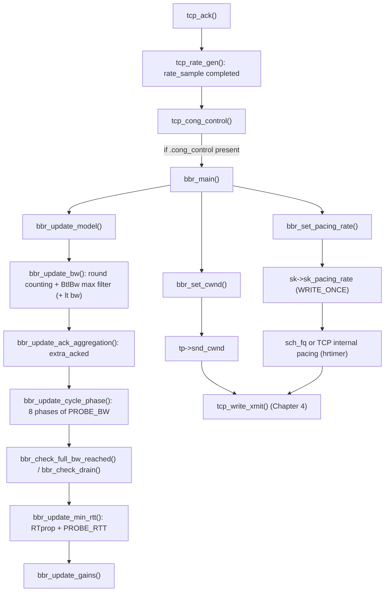

# 13. BBR

## The ELI5 version

Up until now, Reno and CUBIC were like drivers who only reflect after an accident occurs: "if the road (network) becomes congested and parcels are dropped (loss), reduce the number of trucks allowed on the road at once (cwnd)." If the roadside parking lot (router buffer) is large, they keep sending trucks until the parking lot is completely full, so parcels are rarely dropped; however, deliveries end up taking an exceptionally long time instead (bufferbloat).

The BBR driver works differently. Every time a signed receipt (ACK) returns, they jot down two things in their notebook:

- "What was the highest arrival rate recently in parcels per second?" (the width of the narrowest point of the road = **BtlBw**)
- "What was the fastest round trip recently in milliseconds?" (round-trip time without traffic congestion = **RTprop**)

Multiplying these two together reveals the "number of parcels that fit exactly on the road" (**BDP**), which they use to determine the "departure interval" (pacing rate) and the "number of trucks allowed on the road at once" (cwnd).

However, there is a dilemma: you cannot gauge the width of the road without sending a bit extra, and you cannot measure the round-trip time without emptying the road. Therefore, BBR tries to fully utilise the road without creating traffic congestion by occasionally sending at 1.25x speed (probing bandwidth), or dropping the truck count down to just 4 trucks for a brief moment once every 10 seconds (re-measuring round-trip time).

## What the RFCs say

### Specification status: BBR is not an RFC

BBR is not an IETF standard (RFC). The three documents to refer to are:

- **Original paper**: N. Cardwell, Y. Cheng, C. S. Gunn, S. Hassas Yeganeh, V. Jacobson, "[BBR: Congestion-Based Congestion Control](https://queue.acm.org/detail.cfm?id=3022184)", ACM Queue, Vol. 14 No. 5, 2016. This paper proposed a model that, rather than relying on loss, "estimates two parameters—bottleneck bandwidth and round-trip propagation delay—aiming for Kleinrock's optimal operating point (maximising throughput while maintaining zero queues)". The header comment of upstream `tcp_bbr.c` references this paper.
- **IETF CCWG draft**: [draft-ietf-ccwg-bbr-06](https://datatracker.ietf.org/doc/html/draft-ietf-ccwg-bbr-06) (targeted for Experimental, July 2026 version). The content describes **BBRv3**, which adds mechanisms absent in the paper's v1, such as responses to loss and ECN (`inflight_longterm` / `inflight_shortterm`, etc.) and a 4-phase ProbeBW cycle (DOWN / CRUISE / REFILL / UP).
- **Delivery rate estimation draft**: [draft-cheng-iccrg-delivery-rate-estimation-02](https://datatracker.ietf.org/doc/html/draft-cheng-iccrg-delivery-rate-estimation-02). An algorithm that produces a rate sample on each ACK: "how many packets were delivered over this interval / how many µs it took". This serves as the direct input to BBR. It is now also incorporated into [§4.1](https://datatracker.ietf.org/doc/html/draft-ietf-ccwg-bbr-06#section-4.1) of the BBR draft. In Linux, functions like `tcp_rate_gen()` ([net/ipv4/tcp_input.c#L1724](https://git.kernel.org/pub/scm/linux/kernel/git/netdev/net-next.git/tree/net/ipv4/tcp_input.c?id=279d5c8afcd38bd841832a39bfe1aa4f8518d98e#n1724)), which we cover in Chapter 7, implement this (the former `net/ipv4/tcp_rate.c` no longer exists in the current tree and is dispersed across `tcp_input.c` / `tcp_output.c` / `tcp.c`).

RFC 9293 (the core TCP specification) does not specify congestion control algorithms, so it does not apply to this chapter.

> [!IMPORTANT]
> `net/ipv4/tcp_bbr.c` in upstream net-next is **BBR v1**. The file header references only the ACM Queue 2016 paper, and the implementation retains all characteristic traits of v1 (a 10-round max filter, an 8-phase pacing_gain cycle, cwnd = 4 packets in PROBE_RTT, policer detection via long-term bandwidth, and no model-level response to loss or ECN). Mechanisms from the draft BBRv3 (`inflight_longterm`, `BBR.Beta = 0.7`, ProbeBW_DOWN/CRUISE/REFILL/UP, etc.) are not present in upstream.

### The model: BtlBw, RTprop, BDP

The model of BBR v1 is stated directly in the comment at the head of the file:

```c
/* Bottleneck Bandwidth and RTT (BBR) congestion control
 *
 * BBR congestion control computes the sending rate based on the delivery
 * rate (throughput) estimated from ACKs. In a nutshell:
 *
 *   On each ACK, update our model of the network path:
 *      bottleneck_bandwidth = windowed_max(delivered / elapsed, 10 round trips)
 *      min_rtt = windowed_min(rtt, 10 seconds)
 *   pacing_rate = pacing_gain * bottleneck_bandwidth
 *   cwnd = max(cwnd_gain * bottleneck_bandwidth * min_rtt, 4)
 *
 * The core algorithm does not react directly to packet losses or delays,
 * although BBR may adjust the size of next send per ACK when loss is
 * observed, or adjust the sending rate if it estimates there is a
 * traffic policer, in order to keep the drop rate reasonable.
```

Expressed as formulas:

- `delivery_rate = Δdelivered / Δt` (per-ACK rate sample; Δt is the max of the send interval and ACK interval, [delivery-rate-estimation §3.3](https://datatracker.ietf.org/doc/html/draft-cheng-iccrg-delivery-rate-estimation-02#section-3.3))
- `BtlBw = max(delivery_rate)` taken over the most recent **approx. 10 round trips** (max filter)
- `RTprop = min(rtt)` taken over the most recent **10 seconds** (min filter)
- `BDP = BtlBw × RTprop`
- `pacing_rate = pacing_gain × BtlBw`
- `cwnd = cwnd_gain × BDP` (Linux further adds ACK aggregation and TSO quantum components, clamped to at least 4 packets)

Why max and min are used is the core insight of the paper. Delivery rate samples may appear **smaller** due to application limits or ACK delays, but (barring ACK compression) can never appear **larger** than the bottleneck bandwidth. Conversely, RTT samples may appear **larger** due to queueing delay or delayed ACKs, but can never appear **smaller** than the propagation delay. Therefore, tracking the "maximum" and "minimum" respectively approaches their true physical values.

Furthermore, measuring bandwidth requires filling the pipe (which creates a slight queue), while measuring RTprop requires draining the pipe. Because these two cannot be measured simultaneously (an ambiguity principle in the paper), BBR alternates between measuring them over time. This is the raison d'être of the state machine.

### State machine

The state transition diagram from the comments in the code:

```c
 * Here is a state transition diagram for BBR:
 *
 *             |
 *             V
 *    +---> STARTUP  ----+
 *    |        |         |
 *    |        V         |
 *    |      DRAIN   ----+
 *    |        |         |
 *    |        V         |
 *    +---> PROBE_BW ----+
 *    |      ^    |      |
 *    |      |    |      |
 *    |      +----+      |
 *    |                  |
 *    +---- PROBE_RTT <--+
 *
 * A BBR flow starts in STARTUP, and ramps up its sending rate quickly.
 * When it estimates the pipe is full, it enters DRAIN to drain the queue.
 * In steady state a BBR flow only uses PROBE_BW and PROBE_RTT.
 * A long-lived BBR flow spends the vast majority of its time remaining
 * (repeatedly) in PROBE_BW, fully probing and utilizing the pipe's bandwidth
 * in a fair manner, with a small, bounded queue. *If* a flow has been
 * continuously sending for the entire min_rtt window, and hasn't seen an RTT
 * sample that matches or decreases its min_rtt estimate for 10 seconds, then
 * it briefly enters PROBE_RTT to cut inflight to a minimum value to re-probe
 * the path's two-way propagation delay (min_rtt). When exiting PROBE_RTT, if
 * we estimated that we reached the full bw of the pipe then we enter PROBE_BW;
 * otherwise we enter STARTUP to try to fill the pipe.
```

| State | Purpose | v1 pacing_gain | v1 cwnd_gain | Draft (v3) values |
| --- | --- | --- | --- | --- |
| STARTUP | Probe for bandwidth exponentially | 2/ln2 ≈ 2.885 | 2.885 | pacing 4·ln2 ≈ 2.77, cwnd 2 ([§5.3.1](https://datatracker.ietf.org/doc/html/draft-ietf-ccwg-bbr-06#section-5.3.1)) |
| DRAIN | Drain the queue created in STARTUP | 1/2.885 ≈ 0.35 | 2.885 | pacing 0.5, cwnd 2 ([§5.3.2](https://datatracker.ietf.org/doc/html/draft-ietf-ccwg-bbr-06#section-5.3.2)) |
| PROBE_BW | Steady state; discover and share bandwidth | 8 phases: 1.25, 0.75, 1×6 | 2 | DOWN 0.90 / CRUISE 1.0 / REFILL 1.0 / UP 1.25 ([§5.3.3](https://datatracker.ietf.org/doc/html/draft-ietf-ccwg-bbr-06#section-5.3.3)) |
| PROBE_RTT | Drain the queue to re-probe RTprop | 1 | 1 (cwnd capped at 4 packets) | cwnd = 0.5 × BDP ([§5.3.4](https://datatracker.ietf.org/doc/html/draft-ietf-ccwg-bbr-06#section-5.3.4)) |

Detailed rules for each state (as implemented by Linux for v1):

- **STARTUP → DRAIN**: If BtlBw fails to grow by at least 1.25x for 3 consecutive non-application-limited rounds, it decides that the "pipe is full" (`full_bw_reached`). In the draft, this corresponds to the "bandwidth plateau" in [§5.3.1.2](https://datatracker.ietf.org/doc/html/draft-ietf-ccwg-bbr-06#section-5.3.1.2) (v3 also terminates Startup based on loss rate, but v1 does not).
- **DRAIN → PROBE_BW**: Transitions once estimated in-flight drops to or below 1.0 × BDP.
- **PROBE_BW**: Cycles through an 8-phase gain sequence `[5/4, 3/4, 1, 1, 1, 1, 1, 1]`, spending roughly one RTprop in each phase. It probes for bandwidth at 1.25, drains the self-induced queue at 0.75 immediately afterwards, and cruises at 1.0 for the remaining 6 phases. The starting phase is randomised (it never starts from the 0.75 phase).
- **PROBE_RTT**: Entered if the RTprop estimate has not been updated for 10 seconds; clamps cwnd to 4 packets and holds it for `max(200 ms, 1 round)`. The duty cycle cost is roughly 200 ms / 10 s = 2%. Draft v3 changes the ProbeRTT interval to 5 seconds and sets cwnd to 0.5 × BDP ([§5.3.4](https://datatracker.ietf.org/doc/html/draft-ietf-ccwg-bbr-06#section-5.3.4)).
- **Long-term bandwidth (policer detection)**: A mechanism unique to v1. When encountering a token-bucket policer, sending faster causes packets to be dropped while the average rate stays constant. Therefore, if two consecutive intervals exhibit a loss rate of ~20% or higher and a nearly constant delivery rate, it estimates that a policer is present and substitutes the average rate `lt_bw` in place of BtlBw for 48 rounds. In draft v3, policers are treated as a test case in Appendix [A.17](https://datatracker.ietf.org/doc/html/draft-ietf-ccwg-bbr-06#appendix-A.17), redesigned to be handled via loss response using `inflight_longterm`.

### Delivery rate estimation (BBR's input)

In the draft [delivery-rate-estimation §3.2](https://datatracker.ietf.org/doc/html/draft-cheng-iccrg-delivery-rate-estimation-02#section-3.2), each packet takes a snapshot of `C.delivered` and `C.delivered_time` at transmission time, and in [§3.3](https://datatracker.ietf.org/doc/html/draft-cheng-iccrg-delivery-rate-estimation-02#section-3.3), when an ACK is received, a delivery rate is computed from the delta against the snapshot of the most recently (S)ACKed packet. In [§3.4](https://datatracker.ietf.org/doc/html/draft-cheng-iccrg-delivery-rate-estimation-02#section-3.4), samples generated while the application was unable to feed data—leaving "bubbles" in the pipe—are marked as **app-limited**. BBR uses this to enforce the rule that "app-limited samples must not push down BtlBw (though they are allowed to push it up)" ([§5.5.4](https://datatracker.ietf.org/doc/html/draft-ietf-ccwg-bbr-06#section-5.5.4) of draft v3).

The Linux-side counterparts are as follows (covered in detail in Chapter 7):

- At send time: `tcp_rate_skb_sent()` ([net/ipv4/tcp_output.c#L1473](https://git.kernel.org/pub/scm/linux/kernel/git/netdev/net-next.git/tree/net/ipv4/tcp_output.c?id=279d5c8afcd38bd841832a39bfe1aa4f8518d98e#n1473))
- At (S)ACK time: `tcp_rate_skb_delivered()` ([net/ipv4/tcp_input.c#L1808](https://git.kernel.org/pub/scm/linux/kernel/git/netdev/net-next.git/tree/net/ipv4/tcp_input.c?id=279d5c8afcd38bd841832a39bfe1aa4f8518d98e#n1808))
- At the end of ACK processing: `tcp_rate_gen()` ([net/ipv4/tcp_input.c#L1724](https://git.kernel.org/pub/scm/linux/kernel/git/netdev/net-next.git/tree/net/ipv4/tcp_input.c?id=279d5c8afcd38bd841832a39bfe1aa4f8518d98e#n1724)) finishes constructing `struct rate_sample`
- App-limited detection: `tcp_rate_check_app_limited()` ([net/ipv4/tcp.c#L1102](https://git.kernel.org/pub/scm/linux/kernel/git/netdev/net-next.git/tree/net/ipv4/tcp.c?id=279d5c8afcd38bd841832a39bfe1aa4f8518d98e#n1102))

The `struct rate_sample` ([include/net/tcp.h#L1336](https://git.kernel.org/pub/scm/linux/kernel/git/netdev/net-next.git/tree/include/net/tcp.h?id=279d5c8afcd38bd841832a39bfe1aa4f8518d98e#n1336)) received by BBR is as follows:

```c
struct rate_sample {
	u64  prior_mstamp; /* starting timestamp for interval */
	u32  prior_delivered;	/* tp->delivered at "prior_mstamp" */
	u32  prior_delivered_ce;/* tp->delivered_ce at "prior_mstamp" */
	s32  delivered;		/* number of packets delivered over interval */
	s32  delivered_ce;	/* number of packets delivered w/ CE marks*/
	long interval_us;	/* time for tp->delivered to incr "delivered" */
	u32 snd_interval_us;	/* snd interval for delivered packets */
	u32 rcv_interval_us;	/* rcv interval for delivered packets */
	long rtt_us;		/* RTT of last (S)ACKed packet (or -1) */
	int  losses;		/* number of packets marked lost upon ACK */
	u32  acked_sacked;	/* number of packets newly (S)ACKed upon ACK */
	u32  prior_in_flight;	/* in flight before this ACK */
	u32  last_end_seq;	/* end_seq of most recently ACKed packet */
	bool is_app_limited;	/* is sample from packet with bubble in pipe? */
	bool is_retrans;	/* is sample from retransmission? */
	bool is_ack_delayed;	/* is this (likely) a delayed ACK? */
};
```

BBR uses `prior_delivered` (round counting), `delivered` and `interval_us` (bandwidth samples), `rtt_us` and `is_ack_delayed` (min_rtt), `is_app_limited`, `acked_sacked` (cwnd increment and ACK aggregation), `losses` (cwnd reduction during recovery, and long-term bandwidth), and `prior_in_flight` (gain cycling). In samples lacking timing information, during SACK reneging, or where `interval_us < min_rtt`, `tcp_rate_gen()` sets `delivered` or `interval_us` to `-1` to indicate an invalid sample. BBR filters these out with `rs->delivered < 0 || rs->interval_us <= 0`.

## The big picture



BBR's job boils down to "updating the model on every ACK and determining two outputs (`sk_pacing_rate` and `snd_cwnd`)". While Reno / CUBIC only increase cwnd via `.cong_avoid` and leave reductions upon loss to core TCP (PRR, Chapter 8), BBR implements `.cong_control` to manage both the increase/decrease of cwnd and the pacing rate **entirely on its own**. The actual transmission timing is decided by the pacing layer (`sch_fq` or TCP internal pacing) according to `sk_pacing_rate`, and `tcp_write_xmit()` is constrained by both cwnd and pacing (Chapter 4).

## Walking through the code

### Step 1: State and parameters (`struct bbr` and constants)

There are 4 modes. `enum bbr_mode` ([net/ipv4/tcp_bbr.c#L82](https://git.kernel.org/pub/scm/linux/kernel/git/netdev/net-next.git/tree/net/ipv4/tcp_bbr.c?id=279d5c8afcd38bd841832a39bfe1aa4f8518d98e#n82)):

```c
/* BBR has the following modes for deciding how fast to send: */
enum bbr_mode {
	BBR_STARTUP,	/* ramp up sending rate rapidly to fill pipe */
	BBR_DRAIN,	/* drain any queue created during startup */
	BBR_PROBE_BW,	/* discover, share bw: pace around estimated bw */
	BBR_PROBE_RTT,	/* cut inflight to min to probe min_rtt */
};
```

`struct bbr` ([net/ipv4/tcp_bbr.c#L90](https://git.kernel.org/pub/scm/linux/kernel/git/netdev/net-next.git/tree/net/ipv4/tcp_bbr.c?id=279d5c8afcd38bd841832a39bfe1aa4f8518d98e#n90)) resides in `inet_csk_ca(sk)`, which is `icsk_ca_priv[]` (104 bytes) inside `inet_connection_sock`. Because no separate memory is allocated, fields are tightly packed using bitfields.

```c
/* BBR congestion control block */
struct bbr {
	u32	min_rtt_us;	        /* min RTT in min_rtt_win_sec window */
	u32	min_rtt_stamp;	        /* timestamp of min_rtt_us */
	u32	probe_rtt_done_stamp;   /* end time for BBR_PROBE_RTT mode */
	struct minmax bw;	/* Max recent delivery rate in pkts/uS << 24 */
	u32	rtt_cnt;	    /* count of packet-timed rounds elapsed */
	u32     next_rtt_delivered; /* scb->tx.delivered at end of round */
	u64	cycle_mstamp;	     /* time of this cycle phase start */
	u32     mode:3,		     /* current bbr_mode in state machine */
		prev_ca_state:3,     /* CA state on previous ACK */
		packet_conservation:1,  /* use packet conservation? */
		round_start:1,	     /* start of packet-timed tx->ack round? */
		idle_restart:1,	     /* restarting after idle? */
		probe_rtt_round_done:1,  /* a BBR_PROBE_RTT round at 4 pkts? */
		unused:13,
		lt_is_sampling:1,    /* taking long-term ("LT") samples now? */
		lt_rtt_cnt:7,	     /* round trips in long-term interval */
		lt_use_bw:1;	     /* use lt_bw as our bw estimate? */
	u32	lt_bw;		     /* LT est delivery rate in pkts/uS << 24 */
	u32	lt_last_delivered;   /* LT intvl start: tp->delivered */
	u32	lt_last_stamp;	     /* LT intvl start: tp->delivered_mstamp */
	u32	lt_last_lost;	     /* LT intvl start: tp->lost */
	u32	pacing_gain:10,	/* current gain for setting pacing rate */
		cwnd_gain:10,	/* current gain for setting cwnd */
		full_bw_reached:1,   /* reached full bw in Startup? */
		full_bw_cnt:2,	/* number of rounds without large bw gains */
		cycle_idx:3,	/* current index in pacing_gain cycle array */
		has_seen_rtt:1, /* have we seen an RTT sample yet? */
		unused_b:5;
	u32	prior_cwnd;	/* prior cwnd upon entering loss recovery */
	u32	full_bw;	/* recent bw, to estimate if pipe is full */

	/* For tracking ACK aggregation: */
	u64	ack_epoch_mstamp;	/* start of ACK sampling epoch */
	u16	extra_acked[2];		/* max excess data ACKed in epoch */
	u32	ack_epoch_acked:20,	/* packets (S)ACKed in sampling epoch */
		extra_acked_win_rtts:5,	/* age of extra_acked, in round trips */
		extra_acked_win_idx:1,	/* current index in extra_acked array */
		unused_c:6;
};
```

Meaning and invariants for each field:

- `min_rtt_us` / `min_rtt_stamp`: The min filter for RTprop. v1 uses a simple filter holding only "a single minimum value and its timestamp", without using `win_minmax`. `min_rtt_stamp` is in `tcp_jiffies32` (jiffies units), as jiffies resolution is sufficient for a 10-second window. The initial value is `tcp_min_rtt(tp)`, which defaults to `~0U` if no sample is available yet (handled specially by `bbr_bdp()`, described later).
- `probe_rtt_done_stamp`: The time (in jiffies) when PROBE_RTT may be exited. A value of 0 means "in-flight has not dropped to 4 or below yet (timer not started)".
- `bw`: The max filter for BtlBw (`struct minmax`, 3 samples). The unit is "packets/µs scaled by 2^24".
- `rtt_cnt` / `next_rtt_delivered`: **Rounds counted in packet time**. A round advances by 1 on the ACK where `tp->delivered` reaches `next_rtt_delivered`; this is measured in delivered packets rather than wall-clock time.
- `cycle_mstamp`: The start timestamp (`delivered_mstamp`, in µs) of the current phase in PROBE_BW.
- `mode:3`, `prev_ca_state:3` (holds up to `TCP_CA_Loss` = 4), `packet_conservation:1`, `round_start:1` (whether a round advanced on this ACK), `idle_restart:1`, `probe_rtt_round_done:1`.
- `lt_*`: For long-term (policer) estimation. `lt_rtt_cnt:7` holds up to 127, which is ample for the limits used (48 and 16). `lt_last_stamp` is a u32 in **milliseconds** (`delivered_mstamp` in µs divided by 1000 and saved).
- `pacing_gain:10` / `cwnd_gain:10`: Fixed-point values with `BBR_UNIT` (256) representing 1.0, holding up to 1023 (~4.0). 10 bits are allocated so the maximum value `bbr_high_gain` = 739 fits.
- `full_bw_reached:1`, `full_bw_cnt:2` (only needs to count up to 3), `cycle_idx:3` (`CYCLE_LEN` = 8), `has_seen_rtt:1`.
- `prior_cwnd`: The "good cwnd" prior to temporarily cutting cwnd during loss recovery or PROBE_RTT.
- `ack_epoch_mstamp` / `ack_epoch_acked:20` / `extra_acked[2]` / `extra_acked_win_rtts:5` / `extra_acked_win_idx:1`: For estimating ACK aggregation. `extra_acked[2]` is a 2-slot "approximate sliding max".

Calculating the layout by hand, including the alignment of two `u64` fields, yields exactly 104 bytes, completely filling `icsk_ca_priv`. This is enforced in `bbr_register()` by `BUILD_BUG_ON(sizeof(struct bbr) > ICSK_CA_PRIV_SIZE)`. It is worth remembering this constraint: adding even a single field can break the build.

Fixed-point scales and constants:

```c
/* Scale factor for rate in pkt/uSec unit to avoid truncation in bandwidth
 * estimation. The rate unit ~= (1500 bytes / 1 usec / 2^24) ~= 715 bps.
 * This handles bandwidths from 0.06pps (715bps) to 256Mpps (3Tbps) in a u32.
 * Since the minimum window is >=4 packets, the lower bound isn't
 * an issue. The upper bound isn't an issue with existing technologies.
 */
#define BW_SCALE 24
#define BW_UNIT (1 << BW_SCALE)

#define BBR_SCALE 8	/* scaling factor for fractions in BBR (e.g. gains) */
#define BBR_UNIT (1 << BBR_SCALE)
```

`BW_SCALE` = 24 is the scaling factor used to handle values in packets/µs—which are much smaller than 1—within a u32 without truncation. One unit is approximately 715 bps, with an upper limit of around 3 Tbps in a u32. `BBR_SCALE` = 8 is used for gains, where 1.0 = 256.

```c
#define CYCLE_LEN	8	/* number of phases in a pacing gain cycle */

/* Window length of bw filter (in rounds): */
static const int bbr_bw_rtts = CYCLE_LEN + 2;
/* Window length of min_rtt filter (in sec): */
static const u32 bbr_min_rtt_win_sec = 10;
/* Minimum time (in ms) spent at bbr_cwnd_min_target in BBR_PROBE_RTT mode: */
static const u32 bbr_probe_rtt_mode_ms = 200;
/* Skip TSO below the following bandwidth (bits/sec): */
static const int bbr_min_tso_rate = 1200000;

/* Pace at ~1% below estimated bw, on average, to reduce queue at bottleneck.
 * In order to help drive the network toward lower queues and low latency while
 * maintaining high utilization, the average pacing rate aims to be slightly
 * lower than the estimated bandwidth. This is an important aspect of the
 * design.
 */
static const int bbr_pacing_margin_percent = 1;

/* We use a high_gain value of 2/ln(2) because it's the smallest pacing gain
 * that will allow a smoothly increasing pacing rate that will double each RTT
 * and send the same number of packets per RTT that an un-paced, slow-starting
 * Reno or CUBIC flow would:
 */
static const int bbr_high_gain  = BBR_UNIT * 2885 / 1000 + 1;
/* The pacing gain of 1/high_gain in BBR_DRAIN is calculated to typically drain
 * the queue created in BBR_STARTUP in a single round:
 */
static const int bbr_drain_gain = BBR_UNIT * 1000 / 2885;
/* The gain for deriving steady-state cwnd tolerates delayed/stretched ACKs: */
static const int bbr_cwnd_gain  = BBR_UNIT * 2;
/* The pacing_gain values for the PROBE_BW gain cycle, to discover/share bw: */
static const int bbr_pacing_gain[] = {
	BBR_UNIT * 5 / 4,	/* probe for more available bw */
	BBR_UNIT * 3 / 4,	/* drain queue and/or yield bw to other flows */
	BBR_UNIT, BBR_UNIT, BBR_UNIT,	/* cruise at 1.0*bw to utilize pipe, */
	BBR_UNIT, BBR_UNIT, BBR_UNIT	/* without creating excess queue... */
};
/* Randomize the starting gain cycling phase over N phases: */
static const u32 bbr_cycle_rand = 7;
```

- `bbr_bw_rtts = CYCLE_LEN + 2 = 10`: The BtlBw window is 10 rounds. Setting it slightly longer than one full gain cycle (8 phases ≈ 8 RTprop) ensures the window always contains samples from the 1.25x probing phase. If the window were shorter than the cycle, only samples from the 1.0 / 0.75 phases would remain, causing BtlBw to decay steadily.
- `bbr_min_rtt_win_sec = 10`, `bbr_probe_rtt_mode_ms = 200`: A combination that limits the duty cycle cost of PROBE_RTT to roughly 2%.
- `bbr_min_tso_rate = 1200000` (bits/sec): Below this rate, TSO is reduced to 1 segment (`bbr_min_tso_segs()`).
- `bbr_pacing_margin_percent = 1`: Paces at 1% below the estimated bandwidth, helping prevent queues from accumulating at the bottleneck. As noted in the comment, this is an "important aspect of the design".
- `bbr_high_gain = 256 * 2885 / 1000 + 1 = 739` (≈ 2.887). Represents 2/ln2 ≈ 2.885 in fixed-point, adding +1 to ensure truncation does not drop below 2/ln2. The comment explains this as "the smallest pacing gain that will allow a smoothly increasing pacing rate that will double each RTT and send the same number of packets per RTT that an un-paced, slow-starting Reno or CUBIC flow would".
- `bbr_drain_gain = 256 * 1000 / 2885 = 88` (≈ 0.344). The reciprocal designed to drain the queue created in STARTUP typically within a single round.
- `bbr_cwnd_gain = 512` (2.0): Headroom to avoid being bound by cwnd even when delayed or stretched ACKs occur.
- `bbr_pacing_gain[]` = {320, 192, 256 × 6}.
- `bbr_cycle_rand = 7`: Randomises the starting phase across 7 possibilities (Step 8).

```c
/* Try to keep at least this many packets in flight, if things go smoothly. For
 * smooth functioning, a sliding window protocol ACKing every other packet
 * needs at least 4 packets in flight:
 */
static const u32 bbr_cwnd_min_target = 4;

/* To estimate if BBR_STARTUP mode (i.e. high_gain) has filled pipe... */
/* If bw has increased significantly (1.25x), there may be more bw available: */
static const u32 bbr_full_bw_thresh = BBR_UNIT * 5 / 4;
/* But after 3 rounds w/o significant bw growth, estimate pipe is full: */
static const u32 bbr_full_bw_cnt = 3;

/* "long-term" ("LT") bandwidth estimator parameters... */
/* The minimum number of rounds in an LT bw sampling interval: */
static const u32 bbr_lt_intvl_min_rtts = 4;
/* If lost/delivered ratio > 20%, interval is "lossy" and we may be policed: */
static const u32 bbr_lt_loss_thresh = 50;
/* If 2 intervals have a bw ratio <= 1/8, their bw is "consistent": */
static const u32 bbr_lt_bw_ratio = BBR_UNIT / 8;
/* If 2 intervals have a bw diff <= 4 Kbit/sec their bw is "consistent": */
static const u32 bbr_lt_bw_diff = 4000 / 8;
/* If we estimate we're policed, use lt_bw for this many round trips: */
static const u32 bbr_lt_bw_max_rtts = 48;

/* Gain factor for adding extra_acked to target cwnd: */
static const int bbr_extra_acked_gain = BBR_UNIT;
/* Window length of extra_acked window. */
static const u32 bbr_extra_acked_win_rtts = 5;
/* Max allowed val for ack_epoch_acked, after which sampling epoch is reset */
static const u32 bbr_ack_epoch_acked_reset_thresh = 1U << 20;
/* Time period for clamping cwnd increment due to ack aggregation */
static const u32 bbr_extra_acked_max_us = 100 * 1000;
```

- `bbr_cwnd_min_target = 4`: The minimum value needed to avoid stalling the pipe even with a receiver that ACKs every other packet; it also serves as the cwnd in PROBE_RTT.
- `bbr_full_bw_thresh = 320` (1.25) and `bbr_full_bw_cnt = 3`: Used to detect the end of STARTUP.
- For LT estimation: Intervals require at least 4 rounds; a loss ratio threshold of `50/256 ≈ 19.5%` (comment says "20%"); if the bandwidth difference between two intervals is within 1/8 or within 4 kbit/s (= 500 bytes/sec), they are considered "consistent", and `lt_bw` is used for 48 rounds.
- For ACK aggregation: Gain of 1.0; a 5-round window (approximating 5–10 rounds across 2 slots); a reset threshold for `ack_epoch_acked` of 2^20 (to fit within the 20-bit field); and an upper clamp equal to 100 ms worth of bandwidth.

Small accessors:

```c
/* Do we estimate that STARTUP filled the pipe? */
static bool bbr_full_bw_reached(const struct sock *sk)
{
	const struct bbr *bbr = inet_csk_ca(sk);

	return bbr->full_bw_reached;
}

/* Return the windowed max recent bandwidth sample, in pkts/uS << BW_SCALE. */
static u32 bbr_max_bw(const struct sock *sk)
{
	struct bbr *bbr = inet_csk_ca(sk);

	return minmax_get(&bbr->bw);
}

/* Return the estimated bandwidth of the path, in pkts/uS << BW_SCALE. */
static u32 bbr_bw(const struct sock *sk)
{
	struct bbr *bbr = inet_csk_ca(sk);

	return bbr->lt_use_bw ? bbr->lt_bw : bbr_max_bw(sk);
}

/* Return maximum extra acked in past k-2k round trips,
 * where k = bbr_extra_acked_win_rtts.
 */
static u16 bbr_extra_acked(const struct sock *sk)
{
	struct bbr *bbr = inet_csk_ca(sk);

	return max(bbr->extra_acked[0], bbr->extra_acked[1]);
}
```

`bbr_bw()` ([net/ipv4/tcp_bbr.c#L224](https://git.kernel.org/pub/scm/linux/kernel/git/netdev/net-next.git/tree/net/ipv4/tcp_bbr.c?id=279d5c8afcd38bd841832a39bfe1aa4f8518d98e#n224)) returns the "bandwidth used for control". While estimating a policer (`lt_use_bw`), it returns `lt_bw`; otherwise, it returns the value from the max filter. `bbr_max_bw()` ([net/ipv4/tcp_bbr.c#L216](https://git.kernel.org/pub/scm/linux/kernel/git/netdev/net-next.git/tree/net/ipv4/tcp_bbr.c?id=279d5c8afcd38bd841832a39bfe1aa4f8518d98e#n216)) always returns the value from the max filter. Because these two are used selectively, pay close attention to which one is invoked in Steps 6–8.

### Step 2: Registration and invocation (`.cong_control`)

`tcp_bbr_cong_ops` ([net/ipv4/tcp_bbr.c#L1151](https://git.kernel.org/pub/scm/linux/kernel/git/netdev/net-next.git/tree/net/ipv4/tcp_bbr.c?id=279d5c8afcd38bd841832a39bfe1aa4f8518d98e#n1151)):

```c
static struct tcp_congestion_ops tcp_bbr_cong_ops __read_mostly = {
	.flags		= TCP_CONG_NON_RESTRICTED,
	.name		= "bbr",
	.owner		= THIS_MODULE,
	.init		= bbr_init,
	.cong_control	= bbr_main,
	.sndbuf_expand	= bbr_sndbuf_expand,
	.undo_cwnd	= bbr_undo_cwnd,
	.cwnd_event_tx_start	= bbr_cwnd_event_tx_start,
	.ssthresh	= bbr_ssthresh,
	.tso_segs	= bbr_tso_segs,
	.get_info	= bbr_get_info,
	.set_state	= bbr_set_state,
};
```

- Its defining feature is that it provides `.cong_control` instead of `.cong_avoid`. `struct tcp_congestion_ops` ([include/net/tcp.h#L1355](https://git.kernel.org/pub/scm/linux/kernel/git/netdev/net-next.git/tree/include/net/tcp.h?id=279d5c8afcd38bd841832a39bfe1aa4f8518d98e#n1355)) mandates that "one or the other must always be provided".
- `.ssthresh` / `.undo_cwnd` are called from core TCP's loss recovery engine, but BBR uses them as attachment points to "not reduce ssthresh" and "save/restore cwnd" (Step 14).
- `.cwnd_event_tx_start` is a dedicated hook called only when resuming from idle (Step 10).
- `.tso_segs` is a hook allowing BBR to determine the TSO burst size (Step 12).
- Because `.flags = TCP_CONG_NON_RESTRICTED`, unprivileged users can select it via `setsockopt(TCP_CONGESTION, "bbr")` even if it is not listed in `net.ipv4.tcp_allowed_congestion_control`.

On the caller side, here is `tcp_cong_control()` ([net/ipv4/tcp_input.c#L3858](https://git.kernel.org/pub/scm/linux/kernel/git/netdev/net-next.git/tree/net/ipv4/tcp_input.c?id=279d5c8afcd38bd841832a39bfe1aa4f8518d98e#n3858)) (covered in detail in Chapter 11).

```c
static void tcp_cong_control(struct sock *sk, u32 ack, u32 acked_sacked,
			     int flag, const struct rate_sample *rs)
{
	const struct inet_connection_sock *icsk = inet_csk(sk);

	if (icsk->icsk_ca_ops->cong_control) {
		icsk->icsk_ca_ops->cong_control(sk, ack, flag, rs);
		return;
	}

	if (tcp_in_cwnd_reduction(sk)) {
		/* Reduce cwnd if state mandates */
		tcp_cwnd_reduction(sk, acked_sacked, rs->losses, flag);
	} else if (tcp_may_raise_cwnd(sk, flag)) {
		/* Advance cwnd if state allows */
		tcp_cong_avoid(sk, ack, acked_sacked);
	}
	tcp_update_pacing_rate(sk);
}
```

When `.cong_control` is present, PRR-based cwnd reduction (`tcp_cwnd_reduction()`), `tcp_cong_avoid()`, and pacing based on "cwnd / srtt × 200% or 120%" in `tcp_update_pacing_rate()` ([net/ipv4/tcp_input.c#L1138](https://git.kernel.org/pub/scm/linux/kernel/git/netdev/net-next.git/tree/net/ipv4/tcp_input.c?id=279d5c8afcd38bd841832a39bfe1aa4f8518d98e#n1138)) are **all skipped**. The same applies to `tcp_end_cwnd_reduction()` ([net/ipv4/tcp_input.c#L3013](https://git.kernel.org/pub/scm/linux/kernel/git/netdev/net-next.git/tree/net/ipv4/tcp_input.c?id=279d5c8afcd38bd841832a39bfe1aa4f8518d98e#n3013)), which avoids resetting cwnd back to ssthresh when recovery ends.

```c
static inline void tcp_end_cwnd_reduction(struct sock *sk)
{
	struct tcp_sock *tp = tcp_sk(sk);

	if (inet_csk(sk)->icsk_ca_ops->cong_control)
```

At the end of `tcp_ack()` ([net/ipv4/tcp_input.c#L4276](https://git.kernel.org/pub/scm/linux/kernel/git/netdev/net-next.git/tree/net/ipv4/tcp_input.c?id=279d5c8afcd38bd841832a39bfe1aa4f8518d98e#n4276)), `tcp_cong_control()` is called immediately after generating the rate sample.

```c
	lost = tp->lost - lost;			/* freshly marked lost */
	rs.is_ack_delayed = !!(flag & FLAG_ACK_MAYBE_DELAYED);
	tcp_rate_gen(sk, delivered, lost, is_sack_reneg, sack_state.rate);
	tcp_cong_control(sk, ack, delivered, flag, sack_state.rate);
```

`rs.is_ack_delayed` is constructed from `FLAG_ACK_MAYBE_DELAYED`, and is used by BBR's min_rtt filter to ignore RTT samples from delayed ACKs (Step 10).

Here is module registration:

```c
static int __init bbr_register(void)
{
	int ret;

	BUILD_BUG_ON(sizeof(struct bbr) > ICSK_CA_PRIV_SIZE);

	ret = register_btf_kfunc_id_set(BPF_PROG_TYPE_STRUCT_OPS, &tcp_bbr_kfunc_set);
	if (ret < 0)
		return ret;
	return tcp_register_congestion_control(&tcp_bbr_cong_ops);
}
```

BBR's functions are registered in BTF as `__bpf_kfunc` (lines 1166–1180). This allows congestion control algorithms implemented via BPF struct_ops to call functions such as `bbr_main()` (used by `tools/testing/selftests/bpf/progs/tcp_ca_kfunc.c`).

### Step 3: `bbr_init()` and initial pacing rate

`bbr_init()` ([net/ipv4/tcp_bbr.c#L1047](https://git.kernel.org/pub/scm/linux/kernel/git/netdev/net-next.git/tree/net/ipv4/tcp_bbr.c?id=279d5c8afcd38bd841832a39bfe1aa4f8518d98e#n1047)) is called from `tcp_init_congestion_control()` ([net/ipv4/tcp_cong.c#L236](https://git.kernel.org/pub/scm/linux/kernel/git/netdev/net-next.git/tree/net/ipv4/tcp_cong.c?id=279d5c8afcd38bd841832a39bfe1aa4f8518d98e#n236)) while holding the socket lock, when a connection enters ESTABLISHED or when switched mid-stream via `setsockopt(TCP_CONGESTION)`.

```c
__bpf_kfunc static void bbr_init(struct sock *sk)
{
	struct tcp_sock *tp = tcp_sk(sk);
	struct bbr *bbr = inet_csk_ca(sk);

	bbr->prior_cwnd = 0;
	WRITE_ONCE(tp->snd_ssthresh, TCP_INFINITE_SSTHRESH);
	bbr->rtt_cnt = 0;
	bbr->next_rtt_delivered = tp->delivered;
	bbr->prev_ca_state = TCP_CA_Open;
	bbr->packet_conservation = 0;

	bbr->probe_rtt_done_stamp = 0;
	bbr->probe_rtt_round_done = 0;
	bbr->min_rtt_us = tcp_min_rtt(tp);
	bbr->min_rtt_stamp = tcp_jiffies32;

	minmax_reset(&bbr->bw, bbr->rtt_cnt, 0);  /* init max bw to 0 */

	bbr->has_seen_rtt = 0;
	bbr_init_pacing_rate_from_rtt(sk);

	bbr->round_start = 0;
	bbr->idle_restart = 0;
	bbr->full_bw_reached = 0;
	bbr->full_bw = 0;
	bbr->full_bw_cnt = 0;
	bbr->cycle_mstamp = 0;
	bbr->cycle_idx = 0;
	bbr_reset_lt_bw_sampling(sk);
	bbr_reset_startup_mode(sk);

	bbr->ack_epoch_mstamp = tp->tcp_mstamp;
	bbr->ack_epoch_acked = 0;
	bbr->extra_acked_win_rtts = 0;
	bbr->extra_acked_win_idx = 0;
	bbr->extra_acked[0] = 0;
	bbr->extra_acked[1] = 0;

	cmpxchg(&sk->sk_pacing_status, SK_PACING_NONE, SK_PACING_NEEDED);
}
```

- `snd_ssthresh = TCP_INFINITE_SSTHRESH`: BBR does not use ssthresh, but sets it to "infinity" because it affects core TCP checks such as `tcp_in_slow_start()` as well as `tcp_info` reporting. `WRITE_ONCE()` is used because functions like `tcp_get_timestamping_opt_stats()` read it without locks.
- `next_rtt_delivered = tp->delivered`: Aligns the round boundary to "now". In older kernels it was initialised to 0; when `tp->delivered` fell in the range of 2^31 to 2^32, the `before()` comparison inverted, resulting in a bug where rounds would not advance for 2 billion packets (6de035fec045; see "Design history"). This problem affected sockets switching to BBR midway.
- `min_rtt_us = tcp_min_rtt(tp)`: Inherits the min RTT tracked by core TCP (`tp->rtt_min`, Chapter 7). If an RTT from SYN/SYN-ACK exists, it takes that value; otherwise, `~0U`.
- `minmax_reset(&bbr->bw, bbr->rtt_cnt, 0)`: Initialises BtlBw to 0.
- `bbr_init_pacing_rate_from_rtt()`: Determines the initial pacing rate (below).
- `cycle_mstamp = 0`, `bbr_reset_lt_bw_sampling()`, `bbr_reset_startup_mode()`: Starts in STARTUP.
- `cmpxchg(&sk->sk_pacing_status, SK_PACING_NONE, SK_PACING_NEEDED)`: Declares that **pacing is required**. Only changes it to `NEEDED` when it is `SK_PACING_NONE`. If `sch_fq` has already set it to `SK_PACING_FQ`, it is left untouched (unconditionally writing to it would downgrade FQ-based pacing to internal TCP pacing). The meaning of this value is explained in Step 12.

`bbr_init_pacing_rate_from_rtt()` ([net/ipv4/tcp_bbr.c#L267](https://git.kernel.org/pub/scm/linux/kernel/git/netdev/net-next.git/tree/net/ipv4/tcp_bbr.c?id=279d5c8afcd38bd841832a39bfe1aa4f8518d98e#n267)):

```c
/* Initialize pacing rate to: high_gain * init_cwnd / RTT. */
static void bbr_init_pacing_rate_from_rtt(struct sock *sk)
{
	struct tcp_sock *tp = tcp_sk(sk);
	struct bbr *bbr = inet_csk_ca(sk);
	u64 bw;
	u32 rtt_us;

	if (tp->srtt_us) {		/* any RTT sample yet? */
		rtt_us = max(tp->srtt_us >> 3, 1U);
		bbr->has_seen_rtt = 1;
	} else {			 /* no RTT sample yet */
		rtt_us = USEC_PER_MSEC;	 /* use nominal default RTT */
	}
	bw = (u64)tcp_snd_cwnd(tp) * BW_UNIT;
	do_div(bw, rtt_us);
	WRITE_ONCE(sk->sk_pacing_rate,
		   bbr_bw_to_pacing_rate(sk, bw, bbr_high_gain));
}
```

- If an RTT sample exists, it uses `srtt_us >> 3` (`srtt_us` is maintained scaled by 8); otherwise, it assumes 1 ms. This is an optimistic default assuming a LAN.
- `bw = cwnd * BW_UNIT / rtt_us` is "the rate to send the initial cwnd in 1 RTT", and multiplying this by `bbr_high_gain` gives the initial pacing rate. This means starting with a 2.885× multiplier right from the beginning of STARTUP.
- `has_seen_rtt` indicates whether it was initialised based on a real RTT. When initialised under the 1 ms assumption, `bbr_set_pacing_rate()` re-invokes this function as soon as the first RTT sample becomes available (32984565574d). Otherwise, an application-limited connection writing only small amounts would remain stuck with an overly high pacing rate based on the 1 ms assumption without ever filling the pipe.

### Step 4: `bbr_main()` and `bbr_update_model()`

Here is `bbr_main()` ([net/ipv4/tcp_bbr.c#L1035](https://git.kernel.org/pub/scm/linux/kernel/git/netdev/net-next.git/tree/net/ipv4/tcp_bbr.c?id=279d5c8afcd38bd841832a39bfe1aa4f8518d98e#n1035)), the entry point for each ACK, and `bbr_update_model()` ([net/ipv4/tcp_bbr.c#L1024](https://git.kernel.org/pub/scm/linux/kernel/git/netdev/net-next.git/tree/net/ipv4/tcp_bbr.c?id=279d5c8afcd38bd841832a39bfe1aa4f8518d98e#n1024)), which determines the order of model updates:

```c
static void bbr_update_model(struct sock *sk, const struct rate_sample *rs)
{
	bbr_update_bw(sk, rs);
	bbr_update_ack_aggregation(sk, rs);
	bbr_update_cycle_phase(sk, rs);
	bbr_check_full_bw_reached(sk, rs);
	bbr_check_drain(sk, rs);
	bbr_update_min_rtt(sk, rs);
	bbr_update_gains(sk);
}

__bpf_kfunc static void bbr_main(struct sock *sk, u32 ack, int flag, const struct rate_sample *rs)
{
	struct bbr *bbr = inet_csk_ca(sk);
	u32 bw;

	bbr_update_model(sk, rs);

	bw = bbr_bw(sk);
	bbr_set_pacing_rate(sk, bw, bbr->pacing_gain);
	bbr_set_cwnd(sk, rs, rs->acked_sacked, bw, bbr->cwnd_gain);
}
```

The entirety of BBR is summarised in these 20 lines:

1. `bbr_update_bw()`: Counts rounds (sets `round_start`), samples LT bandwidth, and updates the BtlBw max filter. Because **`round_start` is only set here**, all subsequent functions depend on this result. The order must not be altered.
2. `bbr_update_ack_aggregation()`: Updates extra_acked using the new BtlBw.
3. `bbr_update_cycle_phase()`: Advances the phase of PROBE_BW.
4. `bbr_check_full_bw_reached()`: Checks whether the pipe is full in STARTUP (only when `round_start` is true).
5. `bbr_check_drain()`: Handles transitions from STARTUP → DRAIN → PROBE_BW.
6. `bbr_update_min_rtt()`: Updates RTprop and decides entry into/exit from PROBE_RTT. Because PROBE_RTT can interrupt any other mode, it is evaluated near the end.
7. `bbr_update_gains()`: Determines `pacing_gain` / `cwnd_gain` based on the final mode. Functions that perform mode transitions (`bbr_check_drain()`, `bbr_update_min_rtt()`, `bbr_lt_bw_interval_done()`, etc.) do not manipulate gains directly; gains are determined collectively here (cf33e25c0dcf).

After that, it sets the pacing rate and cwnd using `bbr_bw()` (`lt_bw` if a policer is suspected) and the gains. Notice also that `rs->acked_sacked` (the number of packets newly (S)ACKed by this ACK) is passed into the cwnd calculation. The `acked_sacked` argument of `tcp_cong_control()` is not passed to `.cong_control`, but receives the identical value via `rs`.

### Step 5: `bbr_update_bw()` — round counting and BtlBw max filter

`bbr_update_bw()` ([net/ipv4/tcp_bbr.c#L769](https://git.kernel.org/pub/scm/linux/kernel/git/netdev/net-next.git/tree/net/ipv4/tcp_bbr.c?id=279d5c8afcd38bd841832a39bfe1aa4f8518d98e#n769)):

```c
/* Estimate the bandwidth based on how fast packets are delivered */
static void bbr_update_bw(struct sock *sk, const struct rate_sample *rs)
{
	struct tcp_sock *tp = tcp_sk(sk);
	struct bbr *bbr = inet_csk_ca(sk);
	u64 bw;

	bbr->round_start = 0;
	if (rs->delivered < 0 || rs->interval_us <= 0)
		return; /* Not a valid observation */

	/* See if we've reached the next RTT */
	if (!before(rs->prior_delivered, bbr->next_rtt_delivered)) {
		bbr->next_rtt_delivered = tp->delivered;
		bbr->rtt_cnt++;
		bbr->round_start = 1;
		bbr->packet_conservation = 0;
	}

	bbr_lt_bw_sampling(sk, rs);
```

- Because `round_start = 0` is executed first, `round_start` becomes a one-ACK-only flag indicating whether "a round advanced **on this ACK**". Even on an ACK with an invalid sample, it always resets to 0.
- Does nothing on invalid samples (where `tcp_rate_gen()` set -1). In this case, the round does not advance either.
- **Packet-timed rounds**: `rs->prior_delivered` is "`tp->delivered` at the time the most recently sent packet amongst those acknowledged by this ACK was transmitted". If that is greater than or equal to `next_rtt_delivered` (`tp->delivered` at the start of the previous round), it means "a packet sent after the start of the previous round has been acknowledged" — in other words, one round trip has completed. This is precisely `BBR.round_count` from draft [§5.5.1](https://datatracker.ietf.org/doc/html/draft-ietf-ccwg-bbr-06#section-5.5.1). Counting by delivered packet count rather than time (RTT) keeps it immune to RTT fluctuations or idle periods. Because `before()` is used, it handles u32 wrap-around robustly (provided the difference is less than 2^31, which is the assumption violated in 6de035fec045).
- When a round advances, `packet_conservation = 0` is set. This is the exit condition for the mechanism in Step 13, which applies packet conservation for only the first round immediately after entering recovery.
- `bbr_lt_bw_sampling()` (Step 6) is invoked after `round_start` has been determined, but before updating BtlBw.

```c
	/* Divide delivered by the interval to find a (lower bound) bottleneck
	 * bandwidth sample. Delivered is in packets and interval_us in uS and
	 * ratio will be <<1 for most connections. So delivered is first scaled.
	 */
	bw = div64_long((u64)rs->delivered * BW_UNIT, rs->interval_us);

	/* If this sample is application-limited, it is likely to have a very
	 * low delivered count that represents application behavior rather than
	 * the available network rate. Such a sample could drag down estimated
	 * bw, causing needless slow-down. Thus, to continue to send at the
	 * last measured network rate, we filter out app-limited samples unless
	 * they describe the path bw at least as well as our bw model.
	 *
	 * So the goal during app-limited phase is to proceed with the best
	 * network rate no matter how long. We automatically leave this
	 * phase when app writes faster than the network can deliver :)
	 */
	if (!rs->is_app_limited || bw >= bbr_max_bw(sk)) {
		/* Incorporate new sample into our max bw filter. */
		minmax_running_max(&bbr->bw, bbr_bw_rtts, bbr->rtt_cnt, bw);
	}
}
```

- `bw = delivered * 2^24 / interval_us`. Because `interval_us` is a `long`, `div64_long()` is used (changed in 5b2f1f3070b6 to avoid truncation by the 32-bit divisor of `do_div()`). Although a 64-bit division occurs once per ACK, this is the main variable division on BBR's per-ACK path.
- **Handling of app-limited samples**: App-limited samples are only incorporated into the filter if they are greater than or equal to the current max. This prevents an application simply being slow from pulling down BtlBw, which would otherwise lead to sending too slowly the moment the application speeds up. This is the same rule as draft [§5.5.4](https://datatracker.ietf.org/doc/html/draft-ietf-ccwg-bbr-06#section-5.5.4). Notably, window expiration checks are **only performed when `minmax_running_max()` is called**. While app-limited samples lower than the current max keep arriving, the filter is never updated at all, so BtlBw is maintained at its old maximum even after 10 rounds have passed. This is what the comment means by "the best network rate no matter how long". Expiration is evaluated only when the application starts writing faster than the network can deliver again and a non-app-limited sample arrives.
- `minmax_running_max(&bbr->bw, bbr_bw_rtts, bbr->rtt_cnt, bw)`: Because `rtt_cnt` (round count) is passed as the timestamp, a window length of 10 represents "10 rounds".

`minmax_running_max()` ([lib/win_minmax.c#L67](https://git.kernel.org/pub/scm/linux/kernel/git/netdev/net-next.git/tree/lib/win_minmax.c?id=279d5c8afcd38bd841832a39bfe1aa4f8518d98e#n67)) and `minmax_subwin_update()` ([lib/win_minmax.c#L29](https://git.kernel.org/pub/scm/linux/kernel/git/netdev/net-next.git/tree/lib/win_minmax.c?id=279d5c8afcd38bd841832a39bfe1aa4f8518d98e#n29)) implement Kathleen Nichols' algorithm, approximating a windowed max with just three samples: 1st, 2nd, and 3rd choice.

```c
/* Check if new measurement updates the 1st, 2nd or 3rd choice max. */
u32 minmax_running_max(struct minmax *m, u32 win, u32 t, u32 meas)
{
	struct minmax_sample val = { .t = t, .v = meas };

	if (unlikely(val.v >= m->s[0].v) ||	  /* found new max? */
	    unlikely(val.t - m->s[2].t > win))	  /* nothing left in window? */
		return minmax_reset(m, t, meas);  /* forget earlier samples */

	if (unlikely(val.v >= m->s[1].v))
		m->s[2] = m->s[1] = val;
	else if (unlikely(val.v >= m->s[2].v))
		m->s[2] = val;

	return minmax_subwin_update(m, win, &val);
}
EXPORT_SYMBOL(minmax_running_max);
```

- If the new value is greater than or equal to the current max, or if the entire window has expired, it resets all three slots with the new value (anything older than the new maximum can never become the maximum again, so discarding them is safe).
- Otherwise, it replaces lower-tier slots with values larger than the 2nd or 3rd choice.
- `minmax_subwin_update()` promotes the 2nd and 3rd choices when the best sample becomes older than the window (10 rounds). Additionally, if the 2nd or 3rd choices have not been updated past 1/4 or 1/2 of the window, it takes the new value as a candidate. This ensures that the three samples are distributed temporally across the window, bounding error on monotonically decreasing inputs.

In BBR, since time is tracked as round counts, once 10 rounds elapse the best sample expires, and the 2nd choice (taken from the latter half of the window) is promoted. BtlBw tracking downward bandwidth shifts relies entirely on this expiration mechanism. Draft v3 changed this to a window of "2 ProbeBW cycles" ([§5.5.3](https://datatracker.ietf.org/doc/html/draft-ietf-ccwg-bbr-06#section-5.5.3)).

### Step 6: Long-term bandwidth (policer detection)

`bbr_lt_bw_sampling()` ([net/ipv4/tcp_bbr.c#L696](https://git.kernel.org/pub/scm/linux/kernel/git/netdev/net-next.git/tree/net/ipv4/tcp_bbr.c?id=279d5c8afcd38bd841832a39bfe1aa4f8518d98e#n696)) is a mechanism unique to v1 that explicitly models the "token rate" allowed by token-bucket traffic policers:

```c
/* Token-bucket traffic policers are common (see "An Internet-Wide Analysis of
 * Traffic Policing", SIGCOMM 2016). BBR detects token-bucket policers and
 * explicitly models their policed rate, to reduce unnecessary losses. We
 * estimate that we're policed if we see 2 consecutive sampling intervals with
 * consistent throughput and high packet loss. If we think we're being policed,
 * set lt_bw to the "long-term" average delivery rate from those 2 intervals.
 */
static void bbr_lt_bw_sampling(struct sock *sk, const struct rate_sample *rs)
{
	struct tcp_sock *tp = tcp_sk(sk);
	struct bbr *bbr = inet_csk_ca(sk);
	u32 lost, delivered;
	u64 bw;
	u32 t;

	if (bbr->lt_use_bw) {	/* already using long-term rate, lt_bw? */
		if (bbr->mode == BBR_PROBE_BW && bbr->round_start &&
		    ++bbr->lt_rtt_cnt >= bbr_lt_bw_max_rtts) {
			bbr_reset_lt_bw_sampling(sk);    /* stop using lt_bw */
			bbr_reset_probe_bw_mode(sk);  /* restart gain cycling */
		}
		return;
	}

	/* Wait for the first loss before sampling, to let the policer exhaust
	 * its tokens and estimate the steady-state rate allowed by the policer.
	 * Starting samples earlier includes bursts that over-estimate the bw.
	 */
	if (!bbr->lt_is_sampling) {
		if (!rs->losses)
			return;
		bbr_reset_lt_bw_sampling_interval(sk);
		bbr->lt_is_sampling = true;
	}
```

- **When already using `lt_bw`**: Once 48 rounds have elapsed in PROBE_BW, it ceases using `lt_bw` and restarts gain cycling via `bbr_reset_probe_bw_mode()`. Because the only way to check whether the policer is gone is to stop using `lt_bw` and probe again, it resets periodically. Rounds are counted on `round_start`, so periods such as PROBE_RTT do not count towards the 48 rounds.
- **Waiting for the first loss**: Because a policer lets bursts through while tokens remain accumulated, sampling start is deferred until the first loss (the signal that tokens have been exhausted). Starting earlier would overestimate bandwidth due to the burst.

```c
	/* To avoid underestimates, reset sampling if we run out of data. */
	if (rs->is_app_limited) {
		bbr_reset_lt_bw_sampling(sk);
		return;
	}

	if (bbr->round_start)
		bbr->lt_rtt_cnt++;	/* count round trips in this interval */
	if (bbr->lt_rtt_cnt < bbr_lt_intvl_min_rtts)
		return;		/* sampling interval needs to be longer */
	if (bbr->lt_rtt_cnt > 4 * bbr_lt_intvl_min_rtts) {
		bbr_reset_lt_bw_sampling(sk);  /* interval is too long */
		return;
	}

	/* End sampling interval when a packet is lost, so we estimate the
	 * policer tokens were exhausted. Stopping the sampling before the
	 * tokens are exhausted under-estimates the policed rate.
	 */
	if (!rs->losses)
		return;

	/* Calculate packets lost and delivered in sampling interval. */
	lost = tp->lost - bbr->lt_last_lost;
	delivered = tp->delivered - bbr->lt_last_delivered;
	/* Is loss rate (lost/delivered) >= lt_loss_thresh? If not, wait. */
	if (!delivered || (lost << BBR_SCALE) < bbr_lt_loss_thresh * delivered)
		return;
```

- **Resetting when becoming app-limited**: Mistaking a lower delivery rate caused simply by a lack of data for a policer would result in an underestimation.
- **Interval length**: At least 4 rounds and at most 16 rounds (`4 * bbr_lt_intvl_min_rtts`). Intervals that are too long are discarded because path conditions are likely to have changed.
- **Interval ends on a loss**: Measuring right up until tokens are exhausted is necessary to avoid underestimating the policed rate.
- **Loss rate ≥ 50/256**: Evaluates `lost / delivered >= 50/256` without division, as the negation of `(lost << 8) < 50 * delivered`. The `!delivered` check guards not against division by zero, but against meaningless intervals. `tp->lost` / `tp->delivered` are connection-wide cumulative counters (u32); taking differences computes correct values even across wrap-around.

```c
	/* Find average delivery rate in this sampling interval. */
	t = div_u64(tp->delivered_mstamp, USEC_PER_MSEC) - bbr->lt_last_stamp;
	if ((s32)t < 1)
		return;		/* interval is less than one ms, so wait */
	/* Check if can multiply without overflow */
	if (t >= ~0U / USEC_PER_MSEC) {
		bbr_reset_lt_bw_sampling(sk);  /* interval too long; reset */
		return;
	}
	t *= USEC_PER_MSEC;
	bw = (u64)delivered * BW_UNIT;
	do_div(bw, t);
	bbr_lt_bw_interval_done(sk, bw);
}
```

- Calculates interval duration in ms. Since `lt_last_stamp` is in ms as a u32, `(s32)t < 1` rejects both intervals of "less than 1 ms" and negative time steps.
- The `t >= ~0U / USEC_PER_MSEC` check guarantees that the subsequent `t *= USEC_PER_MSEC` does not overflow a u32 (intervals of ~71 minutes or longer are reset).
- `bw = delivered * 2^24 / t_us` computes the average rate in the same units as BtlBw and passes it to `bbr_lt_bw_interval_done()`.

`bbr_lt_bw_interval_done()` ([net/ipv4/tcp_bbr.c#L666](https://git.kernel.org/pub/scm/linux/kernel/git/netdev/net-next.git/tree/net/ipv4/tcp_bbr.c?id=279d5c8afcd38bd841832a39bfe1aa4f8518d98e#n666)):

```c
/* Long-term bw sampling interval is done. Estimate whether we're policed. */
static void bbr_lt_bw_interval_done(struct sock *sk, u32 bw)
{
	struct bbr *bbr = inet_csk_ca(sk);
	u32 diff;

	if (bbr->lt_bw) {  /* do we have bw from a previous interval? */
		/* Is new bw close to the lt_bw from the previous interval? */
		diff = abs(bw - bbr->lt_bw);
		if ((diff * BBR_UNIT <= bbr_lt_bw_ratio * bbr->lt_bw) ||
		    (bbr_rate_bytes_per_sec(sk, diff, BBR_UNIT) <=
		     bbr_lt_bw_diff)) {
			/* All criteria are met; estimate we're policed. */
			bbr->lt_bw = (bw + bbr->lt_bw) >> 1;  /* avg 2 intvls */
			bbr->lt_use_bw = 1;
			bbr->pacing_gain = BBR_UNIT;  /* try to avoid drops */
			bbr->lt_rtt_cnt = 0;
			return;
		}
	}
	bbr->lt_bw = bw;
	bbr_reset_lt_bw_sampling_interval(sk);
}
```

- If `lt_bw` from a previous interval exists and the difference with the current `bw` is "within 1/8 of `lt_bw`" or "within 4 kbit/s", it deduces that "rate is constant despite high losses" = policer. The latter condition compensates for cases where a 1/8 relative difference is overly strict at low bitrates. The difference is converted to bytes/sec via `bbr_rate_bytes_per_sec(sk, diff, BBR_UNIT)` for comparison (including the 1% pacing margin causes a slight theoretical discrepancy, but has no practical impact).
- If judged to be a policer, it sets `lt_bw` to the average of the two intervals and marks `lt_use_bw = 1`. Although `pacing_gain = BBR_UNIT` is assigned here as well, the final gain is re-evaluated immediately afterwards in `bbr_update_gains()` for PROBE_BW as `lt_use_bw ? BBR_UNIT : ...`. `lt_rtt_cnt = 0` starts the 48-round counter.
- If they do not match, the current `bw` is saved as the baseline for the next comparison, and a new interval begins.

Here are the reset helpers:

```c
/* Start a new long-term sampling interval. */
static void bbr_reset_lt_bw_sampling_interval(struct sock *sk)
{
	struct tcp_sock *tp = tcp_sk(sk);
	struct bbr *bbr = inet_csk_ca(sk);

	bbr->lt_last_stamp = div_u64(tp->delivered_mstamp, USEC_PER_MSEC);
	bbr->lt_last_delivered = tp->delivered;
	bbr->lt_last_lost = tp->lost;
	bbr->lt_rtt_cnt = 0;
}

/* Completely reset long-term bandwidth sampling. */
static void bbr_reset_lt_bw_sampling(struct sock *sk)
{
	struct bbr *bbr = inet_csk_ca(sk);

	bbr->lt_bw = 0;
	bbr->lt_use_bw = 0;
	bbr->lt_is_sampling = false;
	bbr_reset_lt_bw_sampling_interval(sk);
}
```

`bbr_reset_lt_bw_sampling_interval()` ([net/ipv4/tcp_bbr.c#L643](https://git.kernel.org/pub/scm/linux/kernel/git/netdev/net-next.git/tree/net/ipv4/tcp_bbr.c?id=279d5c8afcd38bd841832a39bfe1aa4f8518d98e#n643)) only captures a fresh origin for the interval, whereas `bbr_reset_lt_bw_sampling()` ([net/ipv4/tcp_bbr.c#L655](https://git.kernel.org/pub/scm/linux/kernel/git/netdev/net-next.git/tree/net/ipv4/tcp_bbr.c?id=279d5c8afcd38bd841832a39bfe1aa4f8518d98e#n655)) is a full reset that also stops using `lt_bw`. The latter is also called during loss recovery undo (`bbr_undo_cwnd()`). This avoids misclassifying spurious losses caused by reordering as a policer (600647d467c6).
### Step 7: ACK aggregation (`extra_acked`)

On Wi-Fi, cellular, cable modems, middleboxes that thin out ACKs, or with GRO/LRO on the receiver, ACKs tend to arrive in aggregated bursts. If cwnd remains at 2 × BDP, cwnd is exhausted during the pauses between ACKs, transmission stalls, and the bottleneck sits idle. Therefore, BBR adds the maximum amount of "data ACKed beyond what was expected" on top of cwnd (78dc70ebaa38). In Draft v3, this corresponds to `BBR.extra_acked` in [§5.5.9](https://datatracker.ietf.org/doc/html/draft-ietf-ccwg-bbr-06#section-5.5.9).

`bbr_update_ack_aggregation()` ([net/ipv4/tcp_bbr.c#L825](https://git.kernel.org/pub/scm/linux/kernel/git/netdev/net-next.git/tree/net/ipv4/tcp_bbr.c?id=279d5c8afcd38bd841832a39bfe1aa4f8518d98e#n825)):

```c
static void bbr_update_ack_aggregation(struct sock *sk,
				       const struct rate_sample *rs)
{
	u32 epoch_us, expected_acked, extra_acked;
	struct bbr *bbr = inet_csk_ca(sk);
	struct tcp_sock *tp = tcp_sk(sk);

	if (!bbr_extra_acked_gain || rs->acked_sacked <= 0 ||
	    rs->delivered < 0 || rs->interval_us <= 0)
		return;

	if (bbr->round_start) {
		bbr->extra_acked_win_rtts = min(0x1F,
						bbr->extra_acked_win_rtts + 1);
		if (bbr->extra_acked_win_rtts >= bbr_extra_acked_win_rtts) {
			bbr->extra_acked_win_rtts = 0;
			bbr->extra_acked_win_idx = bbr->extra_acked_win_idx ?
						   0 : 1;
			bbr->extra_acked[bbr->extra_acked_win_idx] = 0;
		}
	}
```

- It ignores invalid samples and ACKs that have not (S)ACKed anything.
- **2-slot approximate sliding max**: It counts `extra_acked_win_rtts` at every `round_start` (saturating at 5 bits), switches slots every 5 rounds, and clears the new slot to 0. Since the reader `bbr_extra_acked()` takes the max of the 2 slots, this yields the "maximum over the last 5 to 10 rounds". The design rationale is that this is cheaper than `minmax` (only two `u16`s) whilst offering sufficient precision.

```c
	/* Compute how many packets we expected to be delivered over epoch. */
	epoch_us = tcp_stamp_us_delta(tp->delivered_mstamp,
				      bbr->ack_epoch_mstamp);
	expected_acked = ((u64)bbr_bw(sk) * epoch_us) / BW_UNIT;

	/* Reset the aggregation epoch if ACK rate is below expected rate or
	 * significantly large no. of ack received since epoch (potentially
	 * quite old epoch).
	 */
	if (bbr->ack_epoch_acked <= expected_acked ||
	    (bbr->ack_epoch_acked + rs->acked_sacked >=
	     bbr_ack_epoch_acked_reset_thresh)) {
		bbr->ack_epoch_acked = 0;
		bbr->ack_epoch_mstamp = tp->delivered_mstamp;
		expected_acked = 0;
	}

	/* Compute excess data delivered, beyond what was expected. */
	bbr->ack_epoch_acked = min_t(u32, 0xFFFFF,
				     bbr->ack_epoch_acked + rs->acked_sacked);
	extra_acked = bbr->ack_epoch_acked - expected_acked;
	extra_acked = min(extra_acked, tcp_snd_cwnd(tp));
	if (extra_acked > bbr->extra_acked[bbr->extra_acked_win_idx])
		bbr->extra_acked[bbr->extra_acked_win_idx] = extra_acked;
}
```

- `epoch_us` is the elapsed time since the start of the current epoch, and `expected_acked = bw × epoch_us` is the "amount expected to have been ACKed according to the estimated bandwidth".
- **Epoch reset**: If the actual ACKed volume is below or equal to expectations (no aggregation is occurring, or ACKs are not delayed), this point becomes the start of a new epoch. In other words, an epoch is an interval where "ACKs continue arriving faster than expected". It also resets when `ack_epoch_acked` is about to reach 2^20 to prevent the 20-bit field from overflowing.
- `extra_acked = ack_epoch_acked - expected_acked` represents the "excess data ACKed", which is **capped by cwnd**. Since one could not have sent more than cwnd at that time, any value above that is treated as measurement noise.
- It updates the maximum for the current slot.

On the consumer side, `bbr_ack_aggregation_cwnd()` ([net/ipv4/tcp_bbr.c#L465](https://git.kernel.org/pub/scm/linux/kernel/git/netdev/net-next.git/tree/net/ipv4/tcp_bbr.c?id=279d5c8afcd38bd841832a39bfe1aa4f8518d98e#n465)):

```c
/* Find the cwnd increment based on estimate of ack aggregation */
static u32 bbr_ack_aggregation_cwnd(struct sock *sk)
{
	u32 max_aggr_cwnd, aggr_cwnd = 0;

	if (bbr_extra_acked_gain && bbr_full_bw_reached(sk)) {
		max_aggr_cwnd = ((u64)bbr_bw(sk) * bbr_extra_acked_max_us)
				/ BW_UNIT;
		aggr_cwnd = (bbr_extra_acked_gain * bbr_extra_acked(sk))
			     >> BBR_SCALE;
		aggr_cwnd = min(aggr_cwnd, max_aggr_cwnd);
	}

	return aggr_cwnd;
}
```

- It is not used until `full_bw_reached` is achieved (during STARTUP). This is because cwnd in STARTUP is already 2.885 × BDP, so adding further increments on top would be excessive.
- The added amount is `extra_acked × gain(1.0)`, capped at `bw × 100 ms`. This is a sanity check to prevent building up massive queues swayed by extreme aggregation.

### Step 8: PROBE_BW gain cycle

`bbr_update_cycle_phase()` ([net/ipv4/tcp_bbr.c#L609](https://git.kernel.org/pub/scm/linux/kernel/git/netdev/net-next.git/tree/net/ipv4/tcp_bbr.c?id=279d5c8afcd38bd841832a39bfe1aa4f8518d98e#n609)), `bbr_advance_cycle_phase()` ([net/ipv4/tcp_bbr.c#L599](https://git.kernel.org/pub/scm/linux/kernel/git/netdev/net-next.git/tree/net/ipv4/tcp_bbr.c?id=279d5c8afcd38bd841832a39bfe1aa4f8518d98e#n599)), and the mode-reset functions:

```c
static void bbr_advance_cycle_phase(struct sock *sk)
{
	struct tcp_sock *tp = tcp_sk(sk);
	struct bbr *bbr = inet_csk_ca(sk);

	bbr->cycle_idx = (bbr->cycle_idx + 1) & (CYCLE_LEN - 1);
	bbr->cycle_mstamp = tp->delivered_mstamp;
}

/* Gain cycling: cycle pacing gain to converge to fair share of available bw. */
static void bbr_update_cycle_phase(struct sock *sk,
				   const struct rate_sample *rs)
{
	struct bbr *bbr = inet_csk_ca(sk);

	if (bbr->mode == BBR_PROBE_BW && bbr_is_next_cycle_phase(sk, rs))
		bbr_advance_cycle_phase(sk);
}
```

- It advances `cycle_idx` by 1 (wrapping with `& 7`) and records the phase start time in `delivered_mstamp`. Using `delivered_mstamp` (the time delivery was last recorded) rather than `tcp_mstamp` ensures measurement is aligned with the delivery rate estimation timeline ("when something was delivered by an ACK").
- The check is performed only during PROBE_BW.

```c
static void bbr_reset_startup_mode(struct sock *sk)
{
	struct bbr *bbr = inet_csk_ca(sk);

	bbr->mode = BBR_STARTUP;
}

static void bbr_reset_probe_bw_mode(struct sock *sk)
{
	struct bbr *bbr = inet_csk_ca(sk);

	bbr->mode = BBR_PROBE_BW;
	bbr->cycle_idx = CYCLE_LEN - 1 - get_random_u32_below(bbr_cycle_rand);
	bbr_advance_cycle_phase(sk);	/* flip to next phase of gain cycle */
}

static void bbr_reset_mode(struct sock *sk)
{
	if (!bbr_full_bw_reached(sk))
		bbr_reset_startup_mode(sk);
	else
		bbr_reset_probe_bw_mode(sk);
}
```

`bbr_reset_probe_bw_mode()` ([net/ipv4/tcp_bbr.c#L625](https://git.kernel.org/pub/scm/linux/kernel/git/netdev/net-next.git/tree/net/ipv4/tcp_bbr.c?id=279d5c8afcd38bd841832a39bfe1aa4f8518d98e#n625)) sets `cycle_idx = 7 - rand(0..6)` = 1..7 before advancing it by one, so the starting phase is always one of {2, 3, 4, 5, 6, 7, 0}. **It never starts in phase 1 (0.75)**. Immediately after DRAIN or PROBE_RTT, the queue is already empty, so decelerating further at 0.75 would merely waste bandwidth. Randomisation prevents multiple BBR flows from synchronising by entering the 1.25 phase simultaneously, which would compromise fairness. `bbr_reset_mode()` ([net/ipv4/tcp_bbr.c#L634](https://git.kernel.org/pub/scm/linux/kernel/git/netdev/net-next.git/tree/net/ipv4/tcp_bbr.c?id=279d5c8afcd38bd841832a39bfe1aa4f8518d98e#n634)) is used when exiting PROBE_RTT; it returns to PROBE_BW if the pipe was ever filled, or to STARTUP otherwise.

The decision to end a cycle phase is made in `bbr_is_next_cycle_phase()` ([net/ipv4/tcp_bbr.c#L562](https://git.kernel.org/pub/scm/linux/kernel/git/netdev/net-next.git/tree/net/ipv4/tcp_bbr.c?id=279d5c8afcd38bd841832a39bfe1aa4f8518d98e#n562)):

```c
/* End cycle phase if it's time and/or we hit the phase's in-flight target. */
static bool bbr_is_next_cycle_phase(struct sock *sk,
				    const struct rate_sample *rs)
{
	struct tcp_sock *tp = tcp_sk(sk);
	struct bbr *bbr = inet_csk_ca(sk);
	bool is_full_length =
		tcp_stamp_us_delta(tp->delivered_mstamp, bbr->cycle_mstamp) >
		bbr->min_rtt_us;
	u32 inflight, bw;

	/* The pacing_gain of 1.0 paces at the estimated bw to try to fully
	 * use the pipe without increasing the queue.
	 */
	if (bbr->pacing_gain == BBR_UNIT)
		return is_full_length;		/* just use wall clock time */

	inflight = bbr_packets_in_net_at_edt(sk, rs->prior_in_flight);
	bw = bbr_max_bw(sk);

	/* A pacing_gain > 1.0 probes for bw by trying to raise inflight to at
	 * least pacing_gain*BDP; this may take more than min_rtt if min_rtt is
	 * small (e.g. on a LAN). We do not persist if packets are lost, since
	 * a path with small buffers may not hold that much.
	 */
	if (bbr->pacing_gain > BBR_UNIT)
		return is_full_length &&
			(rs->losses ||  /* perhaps pacing_gain*BDP won't fit */
			 inflight >= bbr_inflight(sk, bw, bbr->pacing_gain));

	/* A pacing_gain < 1.0 tries to drain extra queue we added if bw
	 * probing didn't find more bw. If inflight falls to match BDP then we
	 * estimate queue is drained; persisting would underutilize the pipe.
	 */
	return is_full_length ||
		inflight <= bbr_inflight(sk, bw, BBR_UNIT);
}
```

- `is_full_length`: Determines whether at least `min_rtt_us` has elapsed since the start of the phase. The baseline duration of each phase is 1 RTprop.
- **gain = 1.0**: Evaluated purely on time.
- **gain > 1.0 (probing at 1.25)**: It does not finish merely because 1 RTprop has elapsed; it continues until either "in-flight reaches 1.25 × BDP" or "loss occurs". On a LAN with a small RTprop, in-flight may not have enough time to ramp up to 1.25x within a single RTprop. On the other hand, if losses occur, it does not persist any longer, as a path with shallow buffers may not be able to hold 1.25 × BDP.
- **gain < 1.0 (draining at 0.75)**: It ends when 1 RTprop has elapsed, or as soon as in-flight drops to 1.0 × BDP. Persisting with deceleration once the queue has drained would underutilise the pipe.
- `inflight` does not directly use `rs->prior_in_flight` (in-flight before processing this ACK); instead, it uses the quantity adjusted by `bbr_packets_in_net_at_edt()` to reflect "the amount likely in the network at EDT" (see below).
- The reference BDP uses `bbr_max_bw()` (not `bbr_bw()`). During `lt_use_bw`, the gain is always 1.0, so execution never reaches this branch.
- The comparison target `bbr_inflight()` includes `bbr_quantization_budget()`, adding +2 packets in phase 0. This ensures that even for small BDPs, the 1.25x target remains strictly larger than 1.0x (383d470936c0, Step 13).

`bbr_packets_in_net_at_edt()` ([net/ipv4/tcp_bbr.c#L445](https://git.kernel.org/pub/scm/linux/kernel/git/netdev/net-next.git/tree/net/ipv4/tcp_bbr.c?id=279d5c8afcd38bd841832a39bfe1aa4f8518d98e#n445)) is an adjustment to align with the Earliest Departure Time (EDT) model (Chapter 4):

```c
static u32 bbr_packets_in_net_at_edt(struct sock *sk, u32 inflight_now)
{
	struct tcp_sock *tp = tcp_sk(sk);
	struct bbr *bbr = inet_csk_ca(sk);
	u64 now_ns, edt_ns, interval_us;
	u32 interval_delivered, inflight_at_edt;

	now_ns = tp->tcp_clock_cache;
	edt_ns = max(tp->tcp_wstamp_ns, now_ns);
	interval_us = div_u64(edt_ns - now_ns, NSEC_PER_USEC);
	interval_delivered = (u64)bbr_bw(sk) * interval_us >> BW_SCALE;
	inflight_at_edt = inflight_now;
	if (bbr->pacing_gain > BBR_UNIT)              /* increasing inflight */
		inflight_at_edt += bbr_tso_segs_goal(sk);  /* include EDT skb */
	if (interval_delivered >= inflight_at_edt)
		return 0;
	return inflight_at_edt - interval_delivered;
}
```

- In `sch_fq` or TCP internal pacing, the departure time (`skb->tstamp`) of an skb already enqueued in the qdisc is fixed and does not change even if the pacing rate is altered afterwards. If the most recent `tcp_wstamp_ns` (the scheduled departure time of the next skb) is further into the future than `now`, `bw × interval` packets should leave the network during that interval.
- Subtracting that amount from "in-flight (based on `packets_out`)" yields the "amount in the network at EDT". In phases where in-flight is increasing (gain > 1), it also adds the skb departing at EDT (`bbr_tso_segs_goal()`) to check whether the target will be exceeded. In phases where in-flight is decreasing, it omits this addition, checking whether inflight drops too low right before EDT.
- Both `tcp_clock_cache` and `tcp_wstamp_ns` are in nanoseconds, cached at the start of ACK processing just like `tcp_mstamp` (see Chapters 4 and 7 for `tcp_clock_cache` updates).

### Step 9: Ending STARTUP and DRAIN

`bbr_check_full_bw_reached()` ([net/ipv4/tcp_bbr.c#L881](https://git.kernel.org/pub/scm/linux/kernel/git/netdev/net-next.git/tree/net/ipv4/tcp_bbr.c?id=279d5c8afcd38bd841832a39bfe1aa4f8518d98e#n881)):

```c
/* Estimate when the pipe is full, using the change in delivery rate: BBR
 * estimates that STARTUP filled the pipe if the estimated bw hasn't changed by
 * at least bbr_full_bw_thresh (25%) after bbr_full_bw_cnt (3) non-app-limited
 * rounds. Why 3 rounds: 1: rwin autotuning grows the rwin, 2: we fill the
 * higher rwin, 3: we get higher delivery rate samples. Or transient
 * cross-traffic or radio noise can go away. CUBIC Hystart shares a similar
 * design goal, but uses delay and inter-ACK spacing instead of bandwidth.
 */
static void bbr_check_full_bw_reached(struct sock *sk,
				      const struct rate_sample *rs)
{
	struct bbr *bbr = inet_csk_ca(sk);
	u32 bw_thresh;

	if (bbr_full_bw_reached(sk) || !bbr->round_start || rs->is_app_limited)
		return;

	bw_thresh = (u64)bbr->full_bw * bbr_full_bw_thresh >> BBR_SCALE;
	if (bbr_max_bw(sk) >= bw_thresh) {
		bbr->full_bw = bbr_max_bw(sk);
		bbr->full_bw_cnt = 0;
		return;
	}
	++bbr->full_bw_cnt;
	bbr->full_bw_reached = bbr->full_bw_cnt >= bbr_full_bw_cnt;
}
```

- It is evaluated only at round boundaries and only on non-app-limited samples. Counting an app-limited round as having "failed to grow" would exit STARTUP simply because the application was slow.
- `full_bw` is the "BtlBw when delivery rate last grew by at least 25%". If current BtlBw is `full_bw × 1.25` or higher, it considers growth to still be ongoing and resets the counter to 0.
- If it fails to grow for 3 consecutive rounds, it sets `full_bw_reached = 1`. As stated in the comment, 3 rounds are needed because it takes 3 rounds for "receive window autotuning to grow rwin → filling the higher rwin → higher delivery rate samples to return". CUBIC's HyStart (Chapter 12) shares a similar objective, but differs in that it monitors delay and inter-ACK spacing.
- Once set, `full_bw_reached` is never cleared ("whether the pipe was filled at least once in the connection's lifetime"). While `full_bw` and `full_bw_cnt` are reset to 0 upon undo or RTO, `full_bw_reached` persists (the reason these bits were split in c589e69b508d).

`bbr_check_drain()` ([net/ipv4/tcp_bbr.c#L901](https://git.kernel.org/pub/scm/linux/kernel/git/netdev/net-next.git/tree/net/ipv4/tcp_bbr.c?id=279d5c8afcd38bd841832a39bfe1aa4f8518d98e#n901)):

```c
/* If pipe is probably full, drain the queue and then enter steady-state. */
static void bbr_check_drain(struct sock *sk, const struct rate_sample *rs)
{
	struct bbr *bbr = inet_csk_ca(sk);

	if (bbr->mode == BBR_STARTUP && bbr_full_bw_reached(sk)) {
		bbr->mode = BBR_DRAIN;	/* drain queue we created */
		WRITE_ONCE(tcp_sk(sk)->snd_ssthresh,
			   bbr_inflight(sk, bbr_max_bw(sk), BBR_UNIT));
	}	/* fall through to check if in-flight is already small: */
	if (bbr->mode == BBR_DRAIN &&
	    bbr_packets_in_net_at_edt(sk, tcp_packets_in_flight(tcp_sk(sk))) <=
	    bbr_inflight(sk, bbr_max_bw(sk), BBR_UNIT))
		bbr_reset_probe_bw_mode(sk);  /* we estimate queue is drained */
}
```

- When STARTUP fills the pipe, it enters DRAIN. At this point, it writes 1.0 × BDP (including quantisation) into `snd_ssthresh`. While this does not affect BBR's operation, it allows `SCM_TIMESTAMPING_OPT_STATS` and `tcp_info.tcpi_snd_ssthresh` to observe "whether STARTUP has exited" and "what the BDP was at that time" (53794570049d).
- The reason there are two separate `if` statements that "fall through" is so that if in-flight is already small enough on the very ACK that triggered entry to DRAIN (for example, if transmission was somewhat app-limited), it can immediately transition to PROBE_BW.
- The exit condition for DRAIN also uses the EDT-adjusted in-flight. `tcp_packets_in_flight()` is `packets_out - (sacked_out + lost_out) + retrans_out` (Chapter 8).

### Step 10: RTprop and PROBE_RTT

`bbr_update_min_rtt()` ([net/ipv4/tcp_bbr.c#L949](https://git.kernel.org/pub/scm/linux/kernel/git/netdev/net-next.git/tree/net/ipv4/tcp_bbr.c?id=279d5c8afcd38bd841832a39bfe1aa4f8518d98e#n949)): The comments preceding the code explain that the purpose of PROBE_RTT is for "multiple BBR flows to coordinate in periodically draining the bottleneck queue to measure the true min_rtt", holding 4 packets for at least 200 ms and at least 1 round to bound the throughput cost to roughly 2%. They also note that connections with natural quiets, such as Web or RPC traffic, measure low RTTs on their own within 10 seconds, rarely entering PROBE_RTT.

```c
static void bbr_update_min_rtt(struct sock *sk, const struct rate_sample *rs)
{
	struct tcp_sock *tp = tcp_sk(sk);
	struct bbr *bbr = inet_csk_ca(sk);
	bool filter_expired;

	/* Track min RTT seen in the min_rtt_win_sec filter window: */
	filter_expired = after(tcp_jiffies32,
			       bbr->min_rtt_stamp + bbr_min_rtt_win_sec * HZ);
	if (rs->rtt_us >= 0 &&
	    (rs->rtt_us < bbr->min_rtt_us ||
	     (filter_expired && !rs->is_ack_delayed))) {
		bbr->min_rtt_us = rs->rtt_us;
		bbr->min_rtt_stamp = tcp_jiffies32;
	}

	if (bbr_probe_rtt_mode_ms > 0 && filter_expired &&
	    !bbr->idle_restart && bbr->mode != BBR_PROBE_RTT) {
		bbr->mode = BBR_PROBE_RTT;  /* dip, drain queue */
		bbr_save_cwnd(sk);  /* note cwnd so we can restore it */
		bbr->probe_rtt_done_stamp = 0;
	}
```

- `filter_expired`: Checks whether at least 10 seconds have elapsed since min_rtt was last updated (`after()` handles jiffies wrapping).
- **Update condition**: A valid RTT sample satisfies either (a) **strictly** smaller than the current min, or (b) the filter has expired and the RTT is not from a delayed ACK.
  - Using `<` instead of `<=` in (a) comes from 1b9e2a8c99a5. During loss recovery, retransmitted packet RTTs are calculated from TCP timestamps (millisecond precision); if consecutive samples rounded to the same value occurred, `<=` kept updating `min_rtt_stamp`, preventing the connection from ever entering PROBE_RTT.
  - Excluding delayed ACKs in (b) comes from e42866031ff0. Thin connections such as health checks only receive delayed ACK RTTs; if every expiration adopted an "RTT inflated by delayed ACKs" as the minimum, RTprop would be severely overestimated.
- **Entering PROBE_RTT**: Entered if the filter has expired, the connection is not restarting from idle, and it is not already in PROBE_RTT. Even if min_rtt was just updated via (b), `filter_expired` is a local variable, so it does not affect the decision to enter PROBE_RTT. That is, once expired, the connection enters PROBE_RTT to measure the true RTprop. It saves cwnd with `bbr_save_cwnd()` and sets `probe_rtt_done_stamp = 0` (timer not yet started).
- It does not enter upon restarting from idle (`idle_restart`) because the queue should have drained naturally during the idle period, making the first RTT sample after resumption a good measurement of RTprop.

```c
	if (bbr->mode == BBR_PROBE_RTT) {
		/* Ignore low rate samples during this mode. */
		tp->app_limited =
			(tp->delivered + tcp_packets_in_flight(tp)) ? : 1;
		/* Maintain min packets in flight for max(200 ms, 1 round). */
		if (!bbr->probe_rtt_done_stamp &&
		    tcp_packets_in_flight(tp) <= bbr_cwnd_min_target) {
			bbr->probe_rtt_done_stamp = tcp_jiffies32 +
				msecs_to_jiffies(bbr_probe_rtt_mode_ms);
			bbr->probe_rtt_round_done = 0;
			bbr->next_rtt_delivered = tp->delivered;
		} else if (bbr->probe_rtt_done_stamp) {
			if (bbr->round_start)
				bbr->probe_rtt_round_done = 1;
			if (bbr->probe_rtt_round_done)
				bbr_check_probe_rtt_done(sk);
		}
	}
	/* Restart after idle ends only once we process a new S/ACK for data */
	if (rs->delivered > 0)
		bbr->idle_restart = 0;
}
```

- During PROBE_RTT, `tp->app_limited` is kept asserted. Its value is "delivered + in-flight at this point" (or 1 if 0), matching the formula in `tcp_rate_check_app_limited()`. Consequently, all rate samples for packets sent during PROBE_RTT are treated as app-limited, preventing samples artificially lowered by throttling down to 4 packets from pulling down BtlBw (the rule in Step 5).
- **Starting the timer**: The 200 ms timer is only started once in-flight drops to 4 or fewer packets, at which point the round boundary is also re-anchored to "now" (`next_rtt_delivered = tp->delivered`). Setting cwnd to 4 does not immediately reduce in-flight, so it only begins counting once in-flight has actually dropped.
- **Exit condition**: It exits once 1 round has elapsed after starting the timer (`probe_rtt_round_done`) and 200 ms have elapsed (evaluated inside `bbr_check_probe_rtt_done()`). The 1-round requirement guarantees that at least one RTT is measured for packets transmitted whilst in-flight was 4 packets or fewer.
- `idle_restart` is only cleared once an ACK arrives that (S)ACKed data (`rs->delivered > 0`). If it were cleared on ACKs that carry no data (such as ACKs for received data or window updates), a bug caused connections to enter PROBE_RTT immediately upon restarting (e6e6a278b1ea).

`bbr_check_probe_rtt_done()` ([net/ipv4/tcp_bbr.c#L916](https://git.kernel.org/pub/scm/linux/kernel/git/netdev/net-next.git/tree/net/ipv4/tcp_bbr.c?id=279d5c8afcd38bd841832a39bfe1aa4f8518d98e#n916)):

```c
static void bbr_check_probe_rtt_done(struct sock *sk)
{
	struct tcp_sock *tp = tcp_sk(sk);
	struct bbr *bbr = inet_csk_ca(sk);

	if (!(bbr->probe_rtt_done_stamp &&
	      after(tcp_jiffies32, bbr->probe_rtt_done_stamp)))
		return;

	bbr->min_rtt_stamp = tcp_jiffies32;  /* wait a while until PROBE_RTT */
	tcp_snd_cwnd_set(tp, max(tcp_snd_cwnd(tp), bbr->prior_cwnd));
	bbr_reset_mode(sk);
}
```

- If `probe_rtt_done_stamp` is set and that timestamp has passed, it exits.
- `min_rtt_stamp = tcp_jiffies32`: Even if a new min_rtt was not discovered in PROBE_RTT (for instance, if the queue was filled by competing flows), the next PROBE_RTT is postponed for 10 seconds. Otherwise, it would immediately re-enter PROBE_RTT upon exiting.
- It restores cwnd back to the saved `prior_cwnd` and returns to STARTUP or PROBE_BW via `bbr_reset_mode()`.

Saving cwnd, `bbr_save_cwnd()` ([net/ipv4/tcp_bbr.c#L329](https://git.kernel.org/pub/scm/linux/kernel/git/netdev/net-next.git/tree/net/ipv4/tcp_bbr.c?id=279d5c8afcd38bd841832a39bfe1aa4f8518d98e#n329)):

```c
/* Save "last known good" cwnd so we can restore it after losses or PROBE_RTT */
static void bbr_save_cwnd(struct sock *sk)
{
	struct tcp_sock *tp = tcp_sk(sk);
	struct bbr *bbr = inet_csk_ca(sk);

	if (bbr->prev_ca_state < TCP_CA_Recovery && bbr->mode != BBR_PROBE_RTT)
		bbr->prior_cwnd = tcp_snd_cwnd(tp);  /* this cwnd is good enough */
	else  /* loss recovery or BBR_PROBE_RTT have temporarily cut cwnd */
		bbr->prior_cwnd = max(bbr->prior_cwnd, tcp_snd_cwnd(tp));
}
```

During loss recovery or PROBE_RTT, cwnd has already been temporarily lowered, so it preserves the larger value rather than overwriting it. Otherwise, it saves the current cwnd as a "sufficiently good value". This function is called upon entering PROBE_RTT and at the start of loss recovery (`bbr_ssthresh()`).

Restarting from idle, `bbr_cwnd_event_tx_start()` ([net/ipv4/tcp_bbr.c#L340](https://git.kernel.org/pub/scm/linux/kernel/git/netdev/net-next.git/tree/net/ipv4/tcp_bbr.c?id=279d5c8afcd38bd841832a39bfe1aa4f8518d98e#n340)):

```c
__bpf_kfunc static void bbr_cwnd_event_tx_start(struct sock *sk)
{
	struct tcp_sock *tp = tcp_sk(sk);
	struct bbr *bbr = inet_csk_ca(sk);

	if (tp->app_limited) {
		bbr->idle_restart = 1;
		bbr->ack_epoch_mstamp = tp->tcp_mstamp;
		bbr->ack_epoch_acked = 0;
		/* Avoid pointless buffer overflows: pace at est. bw if we don't
		 * need more speed (we're restarting from idle and app-limited).
		 */
		if (bbr->mode == BBR_PROBE_BW)
			bbr_set_pacing_rate(sk, bbr_bw(sk), BBR_UNIT);
		else if (bbr->mode == BBR_PROBE_RTT)
			bbr_check_probe_rtt_done(sk);
	}
}
```

- The caller is `tcp_event_data_sent()` ([net/ipv4/tcp_output.c#L179](https://git.kernel.org/pub/scm/linux/kernel/git/netdev/net-next.git/tree/net/ipv4/tcp_output.c?id=279d5c8afcd38bd841832a39bfe1aa4f8518d98e#n179)), invoked via `tcp_ca_event(sk, CA_EVENT_TX_START)` ([include/net/tcp.h#L1491](https://git.kernel.org/pub/scm/linux/kernel/git/netdev/net-next.git/tree/include/net/tcp.h?id=279d5c8afcd38bd841832a39bfe1aa4f8518d98e#n1491)) when transmitting data while in-flight is 0. Previously, a generic `.cwnd_event` switched on `CA_EVENT_TX_START`, but because event types changed frequently hurting branch prediction, it was separated into a dedicated pointer (d1e59a469737).
- It executes only when `tp->app_limited` is set (= restarting after going idle due to the application failing to supply data).
- It sets `idle_restart = 1` and resets the ACK aggregation epoch (preventing the first burst of ACKs after idle from being misidentified as "aggregation").
- In PROBE_BW, it restores the pacing rate to the value with a gain of 1.0. Even if it was in the 1.25x phase right after restart, restarting while application-limited does not require faster transmission, thus avoiding pointless buffer overflows. If in PROBE_RTT, 200 ms might have already passed, so it checks whether it can exit (5490b32dce69). This is necessary because no ACKs arrive during idle, meaning the condition would not be evaluated via `bbr_main()`.
### Step 11: Deciding gains

`bbr_update_gains()` ([net/ipv4/tcp_bbr.c#L995](https://git.kernel.org/pub/scm/linux/kernel/git/netdev/net-next.git/tree/net/ipv4/tcp_bbr.c?id=279d5c8afcd38bd841832a39bfe1aa4f8518d98e#n995)):

```c
static void bbr_update_gains(struct sock *sk)
{
	struct bbr *bbr = inet_csk_ca(sk);

	switch (bbr->mode) {
	case BBR_STARTUP:
		bbr->pacing_gain = bbr_high_gain;
		bbr->cwnd_gain	 = bbr_high_gain;
		break;
	case BBR_DRAIN:
		bbr->pacing_gain = bbr_drain_gain;	/* slow, to drain */
		bbr->cwnd_gain	 = bbr_high_gain;	/* keep cwnd */
		break;
	case BBR_PROBE_BW:
		bbr->pacing_gain = (bbr->lt_use_bw ?
				    BBR_UNIT :
				    bbr_pacing_gain[bbr->cycle_idx]);
		bbr->cwnd_gain	 = bbr_cwnd_gain;
		break;
	case BBR_PROBE_RTT:
		bbr->pacing_gain = BBR_UNIT;
		bbr->cwnd_gain	 = BBR_UNIT;
		break;
	default:
		WARN_ONCE(1, "BBR bad mode: %u\n", bbr->mode);
		break;
	}
}
```

- STARTUP: Both pacing and cwnd gains are 2.885.
- DRAIN: Pacing gain is lowered to 0.35, but cwnd gain is kept at 2.885. If cwnd were dropped abruptly, transmissions would stall before the queue is drained (draining is left to pacing).
- PROBE_BW: Fixed at 1.0 while estimating a policer; otherwise, it takes values from the cycle table. cwnd gain is 2. Forcing 1.0 during `lt_use_bw` is the result of fixing a bug where returning from PROBE_RTT caused `bbr_reset_probe_bw_mode()` to pick phase 0, sending at 1.25x and causing heavy drops by the policer (3aff3b4b986e).
- PROBE_RTT: Both are 1.0 (cwnd is separately capped at 4).

### Step 12: Calculating pacing rate

`bbr_rate_bytes_per_sec()` ([net/ipv4/tcp_bbr.c#L245](https://git.kernel.org/pub/scm/linux/kernel/git/netdev/net-next.git/tree/net/ipv4/tcp_bbr.c?id=279d5c8afcd38bd841832a39bfe1aa4f8518d98e#n245)) and `bbr_bw_to_pacing_rate()` ([net/ipv4/tcp_bbr.c#L257](https://git.kernel.org/pub/scm/linux/kernel/git/netdev/net-next.git/tree/net/ipv4/tcp_bbr.c?id=279d5c8afcd38bd841832a39bfe1aa4f8518d98e#n257)):

```c
/* Return rate in bytes per second, optionally with a gain.
 * The order here is chosen carefully to avoid overflow of u64. This should
 * work for input rates of up to 2.9Tbit/sec and gain of 2.89x.
 */
static u64 bbr_rate_bytes_per_sec(struct sock *sk, u64 rate, int gain)
{
	unsigned int mss = tcp_sk(sk)->mss_cache;

	rate *= mss;
	rate *= gain;
	rate >>= BBR_SCALE;
	rate *= USEC_PER_SEC / 100 * (100 - bbr_pacing_margin_percent);
	return rate >> BW_SCALE;
}

/* Convert a BBR bw and gain factor to a pacing rate in bytes per second. */
static unsigned long bbr_bw_to_pacing_rate(struct sock *sk, u32 bw, int gain)
{
	u64 rate = bw;

	rate = bbr_rate_bytes_per_sec(sk, rate, gain);
	rate = min_t(u64, rate, READ_ONCE(sk->sk_max_pacing_rate));
	return rate;
}
```

- The unit conversion is `bw [pkt/µs << 24] × mss [byte/pkt] × gain [<< 8] >> 8 × (10^6 × 0.99) [µs/s] >> 24`.
- The order of operations is chosen carefully to avoid overflow. At 2.9 Tbit/s with MSS 1500, `bw` ≈ 2^32, `× mss × gain(739)` gives ≈ 2^52, `>> 8` yields 2^44, and `× 990000` (≈ 2^20) lands just under 2^64, fitting into a `u64` by a hair. The comment's "up to 2.9Tbit/sec and gain of 2.89x" comes from this arithmetic.
- `mss_cache` is the MSS for the **payload length**, excluding headers. This matches how TCP internal pacing computes intervals based on payload length (cadefe5f584a).
- `USEC_PER_SEC / 100 * (100 - 1)` applies a 1% margin.
- The upper limit is capped by `sk_max_pacing_rate` (`SO_MAX_PACING_RATE`). Since setsockopt now writes this without the socket lock (28b24f90020f), it is read via `READ_ONCE()`.

`bbr_set_pacing_rate()` ([net/ipv4/tcp_bbr.c#L287](https://git.kernel.org/pub/scm/linux/kernel/git/netdev/net-next.git/tree/net/ipv4/tcp_bbr.c?id=279d5c8afcd38bd841832a39bfe1aa4f8518d98e#n287)):

```c
/* Pace using current bw estimate and a gain factor. */
static void bbr_set_pacing_rate(struct sock *sk, u32 bw, int gain)
{
	struct tcp_sock *tp = tcp_sk(sk);
	struct bbr *bbr = inet_csk_ca(sk);
	unsigned long rate = bbr_bw_to_pacing_rate(sk, bw, gain);

	if (unlikely(!bbr->has_seen_rtt && tp->srtt_us))
		bbr_init_pacing_rate_from_rtt(sk);
	if (bbr_full_bw_reached(sk) || rate > READ_ONCE(sk->sk_pacing_rate))
		WRITE_ONCE(sk->sk_pacing_rate, rate);
}
```

- If not yet initialised with a real RTT, it re-initialises as soon as the first RTT sample is obtained (Step 3).
- **The pacing rate is not reduced before filling the pipe**. Samples during STARTUP are often smaller than the actual bandwidth due to a small cwnd or application limits; slowing down based on them would stall STARTUP. Conditioning on `full_bw_reached` was introduced in 4aea287e90dd. Previously, it checked "whether STARTUP had exited", so entering PROBE_RTT during STARTUP caused the pacing rate to be drastically slashed based on small app-limited samples.
- `sk_pacing_rate` is read by `sch_fq` holding only the qdisc lock (without the socket lock) and is also read from `tcp_update_skb_after_send()`, so `WRITE_ONCE()` / `READ_ONCE()` are used.

TSO sizing: `bbr_min_tso_segs()` ([net/ipv4/tcp_bbr.c#L300](https://git.kernel.org/pub/scm/linux/kernel/git/netdev/net-next.git/tree/net/ipv4/tcp_bbr.c?id=279d5c8afcd38bd841832a39bfe1aa4f8518d98e#n300)), `bbr_tso_segs()` ([net/ipv4/tcp_bbr.c#L305](https://git.kernel.org/pub/scm/linux/kernel/git/netdev/net-next.git/tree/net/ipv4/tcp_bbr.c?id=279d5c8afcd38bd841832a39bfe1aa4f8518d98e#n305)), and `bbr_tso_segs_goal()` ([net/ipv4/tcp_bbr.c#L312](https://git.kernel.org/pub/scm/linux/kernel/git/netdev/net-next.git/tree/net/ipv4/tcp_bbr.c?id=279d5c8afcd38bd841832a39bfe1aa4f8518d98e#n312)):

```c
/* override sysctl_tcp_min_tso_segs */
static u32 bbr_min_tso_segs(struct sock *sk)
{
	return READ_ONCE(sk->sk_pacing_rate) < (bbr_min_tso_rate >> 3) ? 1 : 2;
}

__bpf_kfunc static u32 bbr_tso_segs(struct sock *sk, u32 mss_now)
{
	if (unlikely(!mss_now))
		return bbr_min_tso_segs(sk);
	return tcp_tso_autosize(sk, mss_now, bbr_min_tso_segs(sk));
}

static u32 bbr_tso_segs_goal(struct sock *sk)
{
	struct tcp_sock *tp = tcp_sk(sk);
	u32 segs, bytes;

	/* Sort of tcp_tso_autosize() but ignoring
	 * driver provided sk_gso_max_size.
	 */
	bytes = min_t(unsigned long,
		      READ_ONCE(sk->sk_pacing_rate) >> READ_ONCE(sk->sk_pacing_shift),
		      GSO_LEGACY_MAX_SIZE - 1 - MAX_TCP_HEADER);
	segs = max_t(u32, bytes / tp->mss_cache, bbr_min_tso_segs(sk));

	return min(segs, 0x7FU);
}
```

- If the pacing rate is below 1.2 Mbit/s (= 150 kB/s), the minimum is 1 segment; otherwise, it is 2 segments. Sending a 2-segment burst at low rates would make the interval too long, causing excessive queue jitter.
- `.tso_segs` is called from `tcp_tso_segs()` ([net/ipv4/tcp_output.c#L2285](https://git.kernel.org/pub/scm/linux/kernel/git/netdev/net-next.git/tree/net/ipv4/tcp_output.c?id=279d5c8afcd38bd841832a39bfe1aa4f8518d98e#n2285)) and is a callback that recently (cb145191e9d3) replaced `min_tso_segs()`. BBR merely passes its minimum value to `tcp_tso_autosize()` ([net/ipv4/tcp_output.c#L2260](https://git.kernel.org/pub/scm/linux/kernel/git/netdev/net-next.git/tree/net/ipv4/tcp_output.c?id=279d5c8afcd38bd841832a39bfe1aa4f8518d98e#n2260)), so the behaviour is identical to the former `min_tso_segs`. When `mss_now == 0`, it returns the minimum value without calling autosize.
- `bbr_tso_segs_goal()` is dedicated to calculating the cwnd quantisation budget; it resembles `tcp_tso_autosize()`, but **ignores** the device's `sk_gso_max_size`. This ensures that BBR's estimated cwnd does not depend on the device even if the device restricts GSO to a small size (dcb8c9b4373a, 71abf467bb63). It clamps `sk_pacing_rate >> sk_pacing_shift` (roughly 1 ms worth at the default shift of 10) to the legacy 64 KB limit, capped at 127 segments.

**How pacing actually happens**: BBR itself does not schedule packet departure times. Depending on `sk_pacing_status`, one of the following mechanisms takes charge:

- `SK_PACING_FQ`: `sch_fq` sets this via `smp_store_release()` when seeing packets for this socket in `fq_classify()` ([net/sched/sch_fq.c#L379](https://git.kernel.org/pub/scm/linux/kernel/git/netdev/net-next.git/tree/net/sched/sch_fq.c?id=279d5c8afcd38bd841832a39bfe1aa4f8518d98e#n379)). From then on, fq schedules departure times on a per-flow basis according to `sk_pacing_rate`.
- `SK_PACING_NEEDED`: When fq is absent, TCP internal pacing kicks in. `tcp_needs_internal_pacing()` ([include/net/tcp.h#L1652](https://git.kernel.org/pub/scm/linux/kernel/git/netdev/net-next.git/tree/include/net/tcp.h?id=279d5c8afcd38bd841832a39bfe1aa4f8518d98e#n1652)) reads this via `smp_load_acquire()`, `tcp_update_skb_after_send()` ([net/ipv4/tcp_output.c#L1446](https://git.kernel.org/pub/scm/linux/kernel/git/netdev/net-next.git/tree/net/ipv4/tcp_output.c?id=279d5c8afcd38bd841832a39bfe1aa4f8518d98e#n1446)) advances `tcp_wstamp_ns` by `len / rate` for each skb, and `tcp_pacing_check()` ([net/ipv4/tcp_output.c#L2823](https://git.kernel.org/pub/scm/linux/kernel/git/netdev/net-next.git/tree/net/ipv4/tcp_output.c?id=279d5c8afcd38bd841832a39bfe1aa4f8518d98e#n2823)) sets an hrtimer to pause transmission if the departure time is in the future.

Because internal pacing uses an hrtimer per socket, as noted in the file header NOTE, it consumes more CPU than pairing with fq (prior to 218af599fa63, fq was practically mandatory).

### Step 13: Calculating cwnd

`bbr_bdp()` ([net/ipv4/tcp_bbr.c#L368](https://git.kernel.org/pub/scm/linux/kernel/git/netdev/net-next.git/tree/net/ipv4/tcp_bbr.c?id=279d5c8afcd38bd841832a39bfe1aa4f8518d98e#n368)):

```c
/* Calculate bdp based on min RTT and the estimated bottleneck bandwidth:
 *
 * bdp = ceil(bw * min_rtt * gain)
 *
 * The key factor, gain, controls the amount of queue. While a small gain
 * builds a smaller queue, it becomes more vulnerable to noise in RTT
 * measurements (e.g., delayed ACKs or other ACK compression effects). This
 * noise may cause BBR to under-estimate the rate.
 */
static u32 bbr_bdp(struct sock *sk, u32 bw, int gain)
{
	struct bbr *bbr = inet_csk_ca(sk);
	u32 bdp;
	u64 w;

	/* If we've never had a valid RTT sample, cap cwnd at the initial
	 * default. This should only happen when the connection is not using TCP
	 * timestamps and has retransmitted all of the SYN/SYNACK/data packets
	 * ACKed so far. In this case, an RTO can cut cwnd to 1, in which
	 * case we need to slow-start up toward something safe: TCP_INIT_CWND.
	 */
	if (unlikely(bbr->min_rtt_us == ~0U))	 /* no valid RTT samples yet? */
		return TCP_INIT_CWND;  /* be safe: cap at default initial cwnd*/

	w = (u64)bw * bbr->min_rtt_us;

	/* Apply a gain to the given value, remove the BW_SCALE shift, and
	 * round the value up to avoid a negative feedback loop.
	 */
	bdp = (((w * gain) >> BBR_SCALE) + BW_UNIT - 1) / BW_UNIT;

	return bdp;
}
```

- If there has never been a valid RTT sample (`min_rtt_us == ~0U`), it returns `TCP_INIT_CWND` (10). This happens when timestamps are not used and all SYN/SYN-ACK/data packets acknowledged so far have been retransmitted, preventing RTT measurement. If an RTO cuts cwnd down to 1, this allows it to slow-start back up to 10.
- `w = bw × min_rtt_us` (u64), and `bdp = ceil(w × gain >> 8 / 2^24)`. It rounds **up** because rounding down could create a negative feedback loop: "smaller cwnd → lower delivery rate → lower BtlBw → even smaller cwnd" (clarified in comments via de8e1beb1919).

`bbr_quantization_budget()` ([net/ipv4/tcp_bbr.c#L403](https://git.kernel.org/pub/scm/linux/kernel/git/netdev/net-next.git/tree/net/ipv4/tcp_bbr.c?id=279d5c8afcd38bd841832a39bfe1aa4f8518d98e#n403)) and `bbr_inflight()` ([net/ipv4/tcp_bbr.c#L421](https://git.kernel.org/pub/scm/linux/kernel/git/netdev/net-next.git/tree/net/ipv4/tcp_bbr.c?id=279d5c8afcd38bd841832a39bfe1aa4f8518d98e#n421)):

```c
/* To achieve full performance in high-speed paths, we budget enough cwnd to
 * fit full-sized skbs in-flight on both end hosts to fully utilize the path:
 *   - one skb in sending host Qdisc,
 *   - one skb in sending host TSO/GSO engine
 *   - one skb being received by receiver host LRO/GRO/delayed-ACK engine
 * Don't worry, at low rates (bbr_min_tso_rate) this won't bloat cwnd because
 * in such cases tso_segs_goal is 1. The minimum cwnd is 4 packets,
 * which allows 2 outstanding 2-packet sequences, to try to keep pipe
 * full even with ACK-every-other-packet delayed ACKs.
 */
static u32 bbr_quantization_budget(struct sock *sk, u32 cwnd)
{
	struct bbr *bbr = inet_csk_ca(sk);

	/* Allow enough full-sized skbs in flight to utilize end systems. */
	cwnd += 3 * bbr_tso_segs_goal(sk);

	/* Reduce delayed ACKs by rounding up cwnd to the next even number. */
	cwnd = (cwnd + 1) & ~1U;

	/* Ensure gain cycling gets inflight above BDP even for small BDPs. */
	if (bbr->mode == BBR_PROBE_BW && bbr->cycle_idx == 0)
		cwnd += 2;

	return cwnd;
}

/* Find inflight based on min RTT and the estimated bottleneck bandwidth. */
static u32 bbr_inflight(struct sock *sk, u32 bw, int gain)
{
	u32 inflight;

	inflight = bbr_bdp(sk, bw, gain);
	inflight = bbr_quantization_budget(sk, inflight);

	return inflight;
}
```

- `+ 3 × tso_segs_goal`: Budgets enough cwnd so that even if one full-sized skb lingers in the sender's qdisc, another in the sender's TSO/GSO engine, and a third in the receiver's GRO/LRO/delayed ACK engine, the path remains fully utilised. It accounts for "in-flight data inside the end hosts" that the pure BDP calculation misses on high-speed paths. At low rates, `goal` is 1, so it hardly bloats cwnd.
- Rounding up to an even number: For receivers acknowledging every other packet, this prevents an odd fractional packet from waiting on the delayed ACK timer.
- `+ 2` only during PROBE_BW phase 0 (1.25): When BDP is only a few packets, multiplying by 1.25 yields the same value as 1.0x even after rounding up, preventing probing. Adding 2 packets ensures that extra packets are sent (383d470936c0). Initially, this `+ 2` was applied in other phases as well, causing small-BDP flows to remain pinned to cwnd without probing or yielding, preventing convergence (6b3656a60f20).

Cwnd during loss recovery, `bbr_set_cwnd_to_recover_or_restore()` ([net/ipv4/tcp_bbr.c#L488](https://git.kernel.org/pub/scm/linux/kernel/git/netdev/net-next.git/tree/net/ipv4/tcp_bbr.c?id=279d5c8afcd38bd841832a39bfe1aa4f8518d98e#n488)):

```c
/* An optimization in BBR to reduce losses: On the first round of recovery, we
 * follow the packet conservation principle: send P packets per P packets acked.
 * After that, we slow-start and send at most 2*P packets per P packets acked.
 * After recovery finishes, or upon undo, we restore the cwnd we had when
 * recovery started (capped by the target cwnd based on estimated BDP).
 *
 * TODO(ycheng/ncardwell): implement a rate-based approach.
 */
static bool bbr_set_cwnd_to_recover_or_restore(
	struct sock *sk, const struct rate_sample *rs, u32 acked, u32 *new_cwnd)
{
	struct tcp_sock *tp = tcp_sk(sk);
	struct bbr *bbr = inet_csk_ca(sk);
	u8 prev_state = bbr->prev_ca_state, state = inet_csk(sk)->icsk_ca_state;
	u32 cwnd = tcp_snd_cwnd(tp);

	/* An ACK for P pkts should release at most 2*P packets. We do this
	 * in two steps. First, here we deduct the number of lost packets.
	 * Then, in bbr_set_cwnd() we slow start up toward the target cwnd.
	 */
	if (rs->losses > 0)
		cwnd = max_t(s32, cwnd - rs->losses, 1);

	if (state == TCP_CA_Recovery && prev_state != TCP_CA_Recovery) {
		/* Starting 1st round of Recovery, so do packet conservation. */
		bbr->packet_conservation = 1;
		bbr->next_rtt_delivered = tp->delivered;  /* start round now */
		/* Cut unused cwnd from app behavior, TSQ, or TSO deferral: */
		cwnd = tcp_packets_in_flight(tp) + acked;
	} else if (prev_state >= TCP_CA_Recovery && state < TCP_CA_Recovery) {
		/* Exiting loss recovery; restore cwnd saved before recovery. */
		cwnd = max(cwnd, bbr->prior_cwnd);
		bbr->packet_conservation = 0;
	}
	bbr->prev_ca_state = state;
```

While BBR v1's model (BtlBw / RTprop) does not respond to loss, its cwnd includes safety measures for loss events:

- **Deducting lost packets**: Packets newly judged lost on this ACK (`rs->losses`) are deducted from cwnd (minimum 1). Because `bbr_set_cwnd()` subsequently adds `+acked`, growth is capped at a slow-start-like rate of "sending at most 2P packets when P packets are acknowledged".
- **First round of recovery uses packet conservation**: On the ACK entering Recovery, `packet_conservation = 1` is set, resetting the round boundary to now (`next_rtt_delivered = tp->delivered`). cwnd is trimmed to `in-flight + acked`. This discards unused "leftover" cwnd resulting from application behaviour, TSQ, or TSO deferral, sending only what was acknowledged (Van Jacobson's packet conservation principle). One round later, `bbr_update_bw()` restores `packet_conservation = 0`.
- **Exiting recovery (or undo)**: When leaving states of Recovery or above, cwnd is restored to the saved `prior_cwnd`. It is then capped to target cwnd in `bbr_set_cwnd()`.
- `prev_ca_state` is updated on each ACK and is used to detect state transitions (edges entering or exiting).

```c
	if (bbr->packet_conservation) {
		*new_cwnd = max(cwnd, tcp_packets_in_flight(tp) + acked);
		return true;	/* yes, using packet conservation */
	}
	*new_cwnd = cwnd;
	return false;
}
```

During packet conservation, it returns `max(cwnd, in-flight + acked)` and signals `true` to indicate that target cwnd computation should be skipped.

`bbr_set_cwnd()` ([net/ipv4/tcp_bbr.c#L527](https://git.kernel.org/pub/scm/linux/kernel/git/netdev/net-next.git/tree/net/ipv4/tcp_bbr.c?id=279d5c8afcd38bd841832a39bfe1aa4f8518d98e#n527)):

```c
/* Slow-start up toward target cwnd (if bw estimate is growing, or packet loss
 * has drawn us down below target), or snap down to target if we're above it.
 */
static void bbr_set_cwnd(struct sock *sk, const struct rate_sample *rs,
			 u32 acked, u32 bw, int gain)
{
	struct tcp_sock *tp = tcp_sk(sk);
	struct bbr *bbr = inet_csk_ca(sk);
	u32 cwnd = tcp_snd_cwnd(tp), target_cwnd = 0;

	if (!acked)
		goto done;  /* no packet fully ACKed; just apply caps */

	if (bbr_set_cwnd_to_recover_or_restore(sk, rs, acked, &cwnd))
		goto done;

	target_cwnd = bbr_bdp(sk, bw, gain);

	/* Increment the cwnd to account for excess ACKed data that seems
	 * due to aggregation (of data and/or ACKs) visible in the ACK stream.
	 */
	target_cwnd += bbr_ack_aggregation_cwnd(sk);
	target_cwnd = bbr_quantization_budget(sk, target_cwnd);

	/* If we're below target cwnd, slow start cwnd toward target cwnd. */
	if (bbr_full_bw_reached(sk))  /* only cut cwnd if we filled the pipe */
		cwnd = min(cwnd + acked, target_cwnd);
	else if (cwnd < target_cwnd || tp->delivered < TCP_INIT_CWND)
		cwnd = cwnd + acked;
	cwnd = max(cwnd, bbr_cwnd_min_target);

done:
	tcp_snd_cwnd_set(tp, min(cwnd, tp->snd_cwnd_clamp));	/* apply global cap */
	if (bbr->mode == BBR_PROBE_RTT)  /* drain queue, refresh min_rtt */
		tcp_snd_cwnd_set(tp, min(tcp_snd_cwnd(tp), bbr_cwnd_min_target));
}
```

- When `acked == 0` (no new packet fully acknowledged), computation is skipped and only the caps are applied. Previously, the function did an early `return`, which caused a bug where PROBE_RTT's `cwnd = 4` was not applied if less than 1 MSS was acknowledged (8e995bf14fdb).
- Target cwnd = `cwnd_gain × BDP + ACK aggregation allowance + quantisation budget`.
- **After filling the pipe**: It sets `min(cwnd + acked, target)`. If below the target, it approaches via slow start; if above, it immediately snaps down to the target.
- **Before filling the pipe**: If cwnd is below target, or until the first 10 packets are delivered, it increases by `+acked` (slow start). **It does not reduce cwnd even if it exceeds the target**. BtlBw tends to be underestimated during STARTUP, so clipping cwnd based on it would stall STARTUP (the same rationale as not reducing the pacing rate in Step 12).
- Enforces a minimum of 4 packets.
- From `done:` onward, caps are unconditionally applied. It enforces `snd_cwnd_clamp` (from `TCP_WINDOW_CLAMP` or route metrics) and caps cwnd at 4 if in PROBE_RTT.

Note that BBR handles cwnd changes entirely on its own. Because `tcp_cong_control()` does not invoke PRR, cwnd during loss recovery is also governed solely by the packet conservation and loss deductions shown above. However, for an RTO (`tcp_enter_loss()`), the core TCP stack cuts cwnd down to `in-flight + 1` (see the next Step).

### Step 14: Loss and recovery event hooks

`bbr_sndbuf_expand()` ([net/ipv4/tcp_bbr.c#L1089](https://git.kernel.org/pub/scm/linux/kernel/git/netdev/net-next.git/tree/net/ipv4/tcp_bbr.c?id=279d5c8afcd38bd841832a39bfe1aa4f8518d98e#n1089)), `bbr_undo_cwnd()` ([net/ipv4/tcp_bbr.c#L1098](https://git.kernel.org/pub/scm/linux/kernel/git/netdev/net-next.git/tree/net/ipv4/tcp_bbr.c?id=279d5c8afcd38bd841832a39bfe1aa4f8518d98e#n1098)), and `bbr_ssthresh()` ([net/ipv4/tcp_bbr.c#L1109](https://git.kernel.org/pub/scm/linux/kernel/git/netdev/net-next.git/tree/net/ipv4/tcp_bbr.c?id=279d5c8afcd38bd841832a39bfe1aa4f8518d98e#n1109)):

```c
__bpf_kfunc static u32 bbr_sndbuf_expand(struct sock *sk)
{
	/* Provision 3 * cwnd since BBR may slow-start even during recovery. */
	return 3;
}

/* In theory BBR does not need to undo the cwnd since it does not
 * always reduce cwnd on losses (see bbr_main()). Keep it for now.
 */
__bpf_kfunc static u32 bbr_undo_cwnd(struct sock *sk)
{
	struct bbr *bbr = inet_csk_ca(sk);

	bbr->full_bw = 0;   /* spurious slow-down; reset full pipe detection */
	bbr->full_bw_cnt = 0;
	bbr_reset_lt_bw_sampling(sk);
	return tcp_snd_cwnd(tcp_sk(sk));
}

/* Entering loss recovery, so save cwnd for when we exit or undo recovery. */
__bpf_kfunc static u32 bbr_ssthresh(struct sock *sk)
{
	bbr_save_cwnd(sk);
	return tcp_sk(sk)->snd_ssthresh;
}
```

- `bbr_sndbuf_expand()`: Used in send-buffer autotuning (`tcp_sndbuf_expand()` in Chapter 10) to determine how many cwnd multiples of `sk_sndbuf` to reserve. The default is 2x, but BBR uses 3x because it may slow-start even during recovery.
- `bbr_undo_cwnd()`: Called from `tcp_undo_cwnd_reduction()` ([net/ipv4/tcp_input.c#L2843](https://git.kernel.org/pub/scm/linux/kernel/git/netdev/net-next.git/tree/net/ipv4/tcp_input.c?id=279d5c8afcd38bd841832a39bfe1aa4f8518d98e#n2843)) upon detecting a spurious loss recovery (e.g. via DSACK). Because BBR largely preserves cwnd even during recovery, it **returns the current cwnd as is** (unlike other CCs that return `max(cwnd, prior_cwnd)`; restoring `prior_cwnd` is handled at the end of recovery by `bbr_set_cwnd_to_recover_or_restore()`). Furthermore, to prevent a spurious loss from corrupting the STARTUP exit check or LT sampling, it resets `full_bw` / `full_bw_cnt` and the LT state (2f6c498e4f15, 600647d467c6). On paths with heavy reordering, this prevents falsely concluding that "the pipe is full" or "a policer is present" due to misidentified loss.
- `bbr_ssthresh()`: Called when entering Recovery / Loss from `tcp_init_cwnd_reduction()` ([net/ipv4/tcp_input.c#L2971](https://git.kernel.org/pub/scm/linux/kernel/git/netdev/net-next.git/tree/net/ipv4/tcp_input.c?id=279d5c8afcd38bd841832a39bfe1aa4f8518d98e#n2971)) or `tcp_enter_loss()` ([net/ipv4/tcp_input.c#L2554](https://git.kernel.org/pub/scm/linux/kernel/git/netdev/net-next.git/tree/net/ipv4/tcp_input.c?id=279d5c8afcd38bd841832a39bfe1aa4f8518d98e#n2554)). BBR **does not alter ssthresh** (simply returning the current value), using this hook solely as an opportunity to save cwnd.

The relevant section of `tcp_enter_loss()`:

```c

	/* Reduce ssthresh if it has not yet been made inside this window. */
	if (icsk->icsk_ca_state <= TCP_CA_Disorder ||
	    !after(tp->high_seq, tp->snd_una) ||
	    (icsk->icsk_ca_state == TCP_CA_Loss && !icsk->icsk_retransmits)) {
		tp->prior_ssthresh = tcp_current_ssthresh(sk);
		tp->prior_cwnd = tcp_snd_cwnd(tp);
		WRITE_ONCE(tp->snd_ssthresh, icsk->icsk_ca_ops->ssthresh(sk));
		tcp_ca_event(sk, CA_EVENT_LOSS);
		tcp_init_undo(tp);
	}
	tcp_snd_cwnd_set(tp, tcp_packets_in_flight(tp) + 1);
	tp->snd_cwnd_cnt   = 0;
```

On an RTO, the core TCP stack cuts cwnd down to `in-flight + 1` and subsequently calls `tcp_set_ca_state(sk, TCP_CA_Loss)`. BBR then slow-starts back towards the target in `bbr_set_cwnd()`, and restores `prior_cwnd` upon exiting the Loss state.

`tcp_set_ca_state()` ([net/ipv4/tcp_cong.c#L38](https://git.kernel.org/pub/scm/linux/kernel/git/netdev/net-next.git/tree/net/ipv4/tcp_cong.c?id=279d5c8afcd38bd841832a39bfe1aa4f8518d98e#n38)) calls `.set_state` **before** writing the new state:

```c
void tcp_set_ca_state(struct sock *sk, const u8 ca_state)
{
	struct inet_connection_sock *icsk = inet_csk(sk);

	trace_tcp_cong_state_set(sk, ca_state);

	if (icsk->icsk_ca_ops->set_state)
		icsk->icsk_ca_ops->set_state(sk, ca_state);
	icsk->icsk_ca_state = ca_state;
```

`bbr_set_state()` ([net/ipv4/tcp_bbr.c#L1137](https://git.kernel.org/pub/scm/linux/kernel/git/netdev/net-next.git/tree/net/ipv4/tcp_bbr.c?id=279d5c8afcd38bd841832a39bfe1aa4f8518d98e#n1137)):

```c
__bpf_kfunc static void bbr_set_state(struct sock *sk, u8 new_state)
{
	struct bbr *bbr = inet_csk_ca(sk);

	if (new_state == TCP_CA_Loss) {
		struct rate_sample rs = { .losses = 1 };

		bbr->prev_ca_state = TCP_CA_Loss;
		bbr->full_bw = 0;
		bbr->round_start = 1;	/* treat RTO like end of a round */
		bbr_lt_bw_sampling(sk, &rs);
	}
}
```

- Only acts on an RTO (`TCP_CA_Loss`).
- `prev_ca_state = TCP_CA_Loss`: Normally, `prev_ca_state` is updated on the next ACK by `bbr_set_cwnd_to_recover_or_restore()`, but here it is set to Loss in advance at the moment of RTO. Consequently, if repeated RTOs trigger `tcp_enter_loss()` → `bbr_ssthresh()` → `bbr_save_cwnd()` before an ACK arrives, execution enters the "during recovery" branch (`max(prior_cwnd, cwnd)`), avoiding overwriting `prior_cwnd` with the cwnd slashed to `in-flight + 1`. Furthermore, on the ACK exiting Loss, an edge transition of "Recovery or above → below Recovery" is detected, restoring `prior_cwnd`.
- `full_bw = 0`: Allows the STARTUP termination check to run again after an RTO (`full_bw_reached` itself remains set).
- Setting `round_start = 1`, it calls `bbr_lt_bw_sampling()` with a synthetic rate sample having `losses = 1`. Because an RTO represents both the "end of a round" and a "loss event", it advances (or initiates) the policer detection sampling interval. This is because token-bucket policer losses frequently manifest as RTOs.

### Step 15: `bbr_get_info()` for observation

`bbr_get_info()` ([net/ipv4/tcp_bbr.c#L1115](https://git.kernel.org/pub/scm/linux/kernel/git/netdev/net-next.git/tree/net/ipv4/tcp_bbr.c?id=279d5c8afcd38bd841832a39bfe1aa4f8518d98e#n1115)):

```c
static size_t bbr_get_info(struct sock *sk, u32 ext, int *attr,
			   union tcp_cc_info *info)
{
	if (ext & (1 << (INET_DIAG_BBRINFO - 1)) ||
	    ext & (1 << (INET_DIAG_VEGASINFO - 1))) {
		struct tcp_sock *tp = tcp_sk(sk);
		struct bbr *bbr = inet_csk_ca(sk);
		u64 bw = bbr_bw(sk);

		bw = bw * tp->mss_cache * USEC_PER_SEC >> BW_SCALE;
		memset(&info->bbr, 0, sizeof(info->bbr));
		info->bbr.bbr_bw_lo		= (u32)bw;
		info->bbr.bbr_bw_hi		= (u32)(bw >> 32);
		info->bbr.bbr_min_rtt		= bbr->min_rtt_us;
		info->bbr.bbr_pacing_gain	= bbr->pacing_gain;
		info->bbr.bbr_cwnd_gain		= bbr->cwnd_gain;
		*attr = INET_DIAG_BBRINFO;
		return sizeof(info->bbr);
	}
	return 0;
}
```

When `INET_DIAG_BBRINFO` (or `INET_DIAG_VEGASINFO` for compatibility with older tools) is requested, it fills in `struct tcp_bbr_info` ([include/uapi/linux/inet_diag.h#L234](https://git.kernel.org/pub/scm/linux/kernel/git/netdev/net-next.git/tree/include/uapi/linux/inet_diag.h?id=279d5c8afcd38bd841832a39bfe1aa4f8518d98e#n234)). `bw` is `bbr_bw()` (or `lt_bw` during policer estimation) converted into bytes per second, **without the 1% margin or any gain applied**. `pacing_gain` / `cwnd_gain` remain in fixed-point format with 256 = 1.0. The `bbr:(bw:...,mrtt:...,pacing_gain:...,cwnd_gain:...)` output in `ss -ti` displays these fields.
## RFC vs Linux

Because BBR has no RFC, here we compare the "original paper / draft v3" against the "upstream v1 implementation".

| Item | Paper / draft (v3) | Linux (`tcp_bbr.c`, v1) | Rationale / notes |
| --- | --- | --- | --- |
| Version | Draft is BBRv3 | v1 (paper compliant + fixes from 2017–2021) | v2/v3 have not been submitted upstream |
| BtlBw filter window | v3: 2 ProbeBW cycles (`MaxBwFilterLen = 2`) | 10 packet-timed rounds (`CYCLE_LEN + 2`) | v1 chose a length guaranteed to cover an 8-phase cycle |
| RTprop filter | 10 seconds (decoupled from the 5-second ProbeRTT interval in v3) | 10 seconds, PROBE_RTT interval is also 10 seconds | v1 uses a single timestamp for both |
| STARTUP gain | v3: pacing 4·ln2 ≈ 2.77, cwnd 2 | Both pacing and cwnd use 2/ln2 ≈ 2.885 | v3 revised values following updated analysis |
| STARTUP exit | v3: bandwidth plateau or excessive loss rate | Bandwidth plateau only (less than +25% over 3 rounds) | v1 does not modify its model based on loss |
| DRAIN gain | v3: 0.5 | 1/2.885 ≈ 0.35 | — |
| PROBE_BW | v3: DOWN 0.90 / CRUISE / REFILL / UP 1.25, time-based multi-second period | 8 phases `[1.25, 0.75, 1×6]`, each phase ≈ min_rtt | v1 cycle is short; noted for being overly aggressive when coexisting with Reno/CUBIC |
| PROBE_RTT | v3: cwnd = 0.5 × BDP, every 5 seconds | cwnd = 4 packets, every 10 seconds, `max(200 ms, 1 round)` | v1 suffers substantial temporary throughput drops on large-BDP flows |
| Response to loss / ECN | v3: `inflight_longterm` / `inflight_shortterm`, `Beta = 0.7`, ECN | Model does not react. Only packet conservation during 1st round of recovery and subtracting lost packets from cwnd | v1 design (treats loss as noise) |
| Policer | v3: Handled indirectly via loss response (Appendix A.17) | `lt_bw`: interval of 4–16 rounds, loss rate ≥ ~20%, used for 48 rounds if 2 intervals match | v1's own explicit model |
| ACK aggregation | v3: `extra_acked`, window of 10 rounds | 2-slot approximation with `extra_acked[2]` (5–10 rounds), capped at cwnd and bw×100 ms, unused during STARTUP | Added in 78dc70ebaa38 |
| Offload budget | v3: `BBR.offload_budget` | `bbr_quantization_budget()`: +3×TSO goal, rounded to even, +2 in phase 0 | Tailored to Linux's TSO/GSO/GRO reality |
| Pacing margin | 1% | 1% (`bbr_pacing_margin_percent`) | Identical |
| EDT compensation | Not described | `bbr_packets_in_net_at_edt()` | Specific to Linux's EDT model (fq / internal pacing) |
| Delayed-ACK RTT | Implementation-dependent | Ignores `is_ack_delayed` when updating expired min_rtt | e42866031ff0 |
| App-limited | Does not lower bandwidth | Identical (enters filter only when ≥ max). Forces `tp->app_limited` during PROBE_RTT | — |
| ssthresh | Unused | Starts at `TCP_INFINITE_SSTHRESH`, writes BDP upon entering DRAIN (for observability only) | 53794570049d |
| Pacing | Mandatory | Requests fq or internal pacing via `sk_pacing_status = SK_PACING_NEEDED` | Operates without fq since 218af599fa63 |

## Design history

Tracing `git log -- net/ipv4/tcp_bbr.c` chronologically reveals that the "v1 design itself" was largely complete in the initial commit; subsequent evolution followed (1) fixing state machine edge cases, (2) tracking Linux's transmit model (internal pacing, EDT), (3) adding ACK aggregation handling, and (4) general annotations / API updates.

- **0f8782ea1497** "tcp_bbr: add BBR congestion control" (Neal Cardwell, 2016): Initial version. The commit message points out that loss-based CC overreacts in shallow buffers and causes bufferbloat in deep buffers, explaining that BBR explicitly models BtlBw and RTprop to target Kleinrock's optimal operating point. Around the same time, the `.cong_control` hook and rate sampling (`tcp_rate.c`, now integrated into `tcp_input.c` and elsewhere) were introduced.
- **9b9375b5b7fd** "tcp_bbr: add a state transition diagram and accompanying comment" (Neal Cardwell, 2016): Added the state transition diagram and comments at the top of the file.
- **218af599fa63** "tcp: internal implementation for pacing" (Eric Dumazet, 2017): Allowed TCP itself to pace via hrtimers even without fq. The mechanism where BBR requests `SK_PACING_NEEDED` began here.
- **4aea287e90dd** "tcp_bbr: cut pacing rate only if filled pipe" (Neal Cardwell, 2017): Changed the condition for lowering pacing rate from "exited STARTUP" to "filled the pipe". Fixed an issue where entering PROBE_RTT from STARTUP caused the pacing rate to drop drastically based on small, app-limited samples. In the same series, **79135b89b8af** / **f19fd62dafaf** / **1d3648eb5d1f** / **32984565574d** introduced `bbr_init_pacing_rate_from_rtt()`, eliminated transient moments where `sk_pacing_rate = 0` during initialisation, and reinitialised on the first RTT sample.
- **2660bfa84e92** "tcp_bbr: use tcp_jiffies32 instead of tcp_time_stamp" (Eric Dumazet, 2017): Switched BBR's second-based timer to `tcp_jiffies32` in preparation for migrating the TCP timestamp clock to 1 ms.
- **c589e69b508d** / **2f6c498e4f15** / **600647d467c6** (Neal Cardwell, 2017): Made `full_bw_reached` an independent bit, resetting `full_bw` / `full_bw_cnt` and LT sampling during undo. Addressed spurious pipe-full / policer detections caused by mistaking reordering for loss. Separating the bit allowed counters to be reset safely without losing the "pipe has been filled" assessment.
- **e42866031ff0** "tcp: avoid min RTT bloat by skipping RTT from delayed-ACK in BBR" (Yuchung Cheng, 2018): Introduced `FLAG_ACK_MAYBE_DELAYED` → `rs->is_ack_delayed`, skipping delayed-ACK samples when updating expired min_rtt. Fixed overestimation of RTprop on thin, persistent connections.
- **3aff3b4b986e** "tcp_bbr: fix pacing_gain to always be unity when using lt_bw" (Neal Cardwell, 2018): Fixed a bug where returning from PROBE_RTT while using `lt_bw` randomly picked phase 0 and transmitted at 1.25x.
- **350c9f484bde** (precursor to `dcb8c9b4373a`) / **dcb8c9b4373a** "tcp_bbr: better deal with suboptimal GSO (II)" / **71abf467bb63** (Eric Dumazet, 2018): Replaced the `tso_segs_goal` callback with `min_tso_segs` and confined `bbr_tso_segs_goal()` to BBR's internal calculations, ensuring BBR's cwnd estimation remains unaffected even when a device has small `gso_max_size` / `gso_max_segs`.
- **53794570049d** "net-tcp_bbr: set tp->snd_ssthresh to BDP upon STARTUP exit" (Yousuk Seung, 2018): Wrote BDP to ssthresh purely for observability.
- **e6e6a278b1ea** "tcp_bbr: fix to zero idle_restart only upon S/ACKed data" (Neal Cardwell, 2018): Fixed a bug where ACKs acknowledging no data cleared `idle_restart`, triggering an unnecessary PROBE_RTT right after resumption.
- **cadefe5f584a** "tcp_bbr: fix bbr pacing rate for internal pacing" (Eric Dumazet, 2018): Restricted pacing rate calculations to payload MSS only (because internal pacing calculates intervals based on payload length).
- **383d470936c0** "tcp_bbr: fix bw probing to raise in-flight data for very small BDPs" (Neal Cardwell, 2018): Solved an issue where rounding up caused the 1.25x target to equal 1.0x on very small BDPs, pinning flows to low bandwidth on multi-flow LANs, by adding +2 in phase 0. **6b3656a60f20** (Kevin Yang, 2019) fixed a bug where that +2 was applied to other phases as well, preventing small-BDP flows from converging.
- **fb9988622429** / **5490b32dce69** / **8e995bf14fdb** (Kevin Yang, 2018): Factored out `bbr_check_probe_rtt_done()`, checked for PROBE_RTT completion upon restarting from idle, and ensured the PROBE_RTT cap is applied even when `acked == 0`.
- **ab408b6dc744** "tcp: switch tcp and sch_fq to new earliest departure time model" (Eric Dumazet, 2018) and **a87c83d5ee25** "tcp_bbr: adjust TCP BBR for departure time pacing" (Neal Cardwell, 2018): Under the EDT model, skb departure times within the qdisc are fixed, creating a delay before changes in pacing rate are reflected in in-flight data. To prevent in-flight overshoot from ignoring this delay, added compensation via `bbr_packets_in_net_at_edt()`. **cf33e25c0dcf** "tcp_bbr: centralize code to set gains" was part of this series, consolidating gain assignment into `bbr_update_gains()`.
- **76a9ebe811fb** "net: extend sk_pacing_rate to unsigned long" (Eric Dumazet, 2018): Enabled handling pacing rates exceeding a 32-bit bytes/sec limit (~34 Gbit/s). This is why BBR's `bbr_bw_to_pacing_rate()` returns `unsigned long`.
- **232aa8ec3ed9** / **78dc70ebaa38** "tcp_bbr: adapt cwnd based on ack aggregation estimation" (Priyaranjan Jha, 2019): Split `bbr_target_cwnd()` into `bbr_bdp()` + `bbr_quantization_budget()` + `bbr_inflight()`, adding extra cwnd based on `extra_acked`. The commit message reported an improvement from 73 Mbit/s to 102 Mbit/s (CUBIC 100 Mbit/s) on Wi-Fi.
- **de8e1beb1919** "tcp_bbr: clarify that bbr_bdp() rounds up in comments" (Luke Hsiao, 2019): Documented in comments the reason for rounding up (avoiding negative feedback).
- **5b2f1f3070b6** "tcp_bbr: improve arithmetic division in bbr_update_bw()" (Wen Yang, 2020): Replaced `do_div()` (32-bit divisor) with `div64_long()`.
- **1b9e2a8c99a5** "tcp: only postpone PROBE_RTT if RTT is < current min_rtt estimate" (Ryan Sharpelletti, 2020): Changed `<=` to `<`. Fixed an issue discovered by the Netflix team where ms-granularity RTTs rounding to the same value postponed PROBE_RTT indefinitely.
- **6de035fec045** "tcp_bbr: fix u32 wrap bug in round logic if bbr_init() called after 2B packets" (Neal Cardwell, 2021): Initialised `next_rtt_delivered` to `tp->delivered` rather than 0.
- **28b24f90020f** "net: implement lockless SO_MAX_PACING_RATE" (Eric Dumazet, 2023), **7c68fa2bddda** (annotating `sk_pacing_shift`, 2019), and **fd571afb05eb** "tcp: annotate data-races around tp->snd_ssthresh" (Eric Dumazet, 2026): Added `READ_ONCE()` / `WRITE_ONCE()` to accommodate lockless readers and writers.
- **57bfc7605ca5** "tcp: Add new args for cong_control in tcp_congestion_ops" (Miao Xu, 2024): Added `ack` and `flag` arguments to `.cong_control` (for BPF CC). Unused by BBR itself.
- **d1e59a469737** "tcp: add cwnd_event_tx_start to tcp_congestion_ops" (Eric Dumazet, 2026): Switching on `CA_EVENT_TX_START` inside `.cwnd_event` hurt branch prediction, so it was split into a dedicated hook. `bbr_cwnd_event()` became `bbr_cwnd_event_tx_start()`.
- **4490516d2109** "tcp_bbr: fix SPDX-License-Identifier to be GPL-2.0 OR BSD-3-Clause" (Neal Cardwell, 2026): Fixed the SPDX identifier, which had inadvertently become GPL-2.0 only, matching the original "Dual BSD/GPL" intent.
- **cb145191e9d3** "tcp: Replace min_tso_segs() with tso_segs() CC callback" (Chia-Yu Chang, 2026): Replaced `.min_tso_segs` with `.tso_segs`, which returns the final number of TSO segments. BBR preserves identical behaviour by internally calling `tcp_tso_autosize()`.

## Performance notes

### Execution context and locking

| Hook | Caller | Context / lock |
| --- | --- | --- |
| `bbr_main()` | `tcp_ack()` → `tcp_cong_control()` | Receive softirq (holding `bh_lock_sock()` when user does not own socket), or backlog processing via `release_sock()` → `__release_sock()` (process context, socket owned). Both are mutually exclusive with respect to the socket |
| `bbr_init()` | `tcp_init_congestion_control()` | Transition to ESTABLISHED (softirq or `connect()`/`accept()` paths) or `setsockopt(TCP_CONGESTION)`. Holds the socket lock |
| `bbr_cwnd_event_tx_start()` | `tcp_event_data_sent()` | Transmit path. Process context in `sendmsg`, ACK receive softirq, TSQ tasklet, or pacing hrtimer softirq (deferred to `tcp_release_cb()` if socket is owned) |
| `bbr_ssthresh()` / `bbr_undo_cwnd()` | Loss recovery entry / undo | During ACK processing, or RTO timer (`tcp_write_timer()`, deferred if owned) |
| `bbr_set_state()` | `tcp_set_ca_state()` | As above. Called **before** rewriting the state |
| `bbr_get_info()` | inet_diag / `TCP_CC_INFO` | Read-only. Strict consistency of values is not guaranteed (for diagnostic use) |

In other words, all paths mutating `struct bbr` run under the socket lock (or its equivalent: `bh_lock_sock()` + unowned), so no locks or atomics are required for internal BBR state. Only the following fields have lockless readers or writers:

- `sk->sk_pacing_rate`: `sch_fq` reads this from another CPU holding only the qdisc lock. BBR writes it with `WRITE_ONCE()` and reads it with `READ_ONCE()` for its own comparisons.
- `sk->sk_max_pacing_rate`: Written locklessly by `SO_MAX_PACING_RATE`, so read with `READ_ONCE()`.
- `sk->sk_pacing_shift`: Modified by certain drivers (such as Wi-Fi) via `sk_pacing_shift_update()`, so read with `READ_ONCE()`.
- `tp->snd_ssthresh`: Read locklessly by `tcp_get_timestamping_opt_stats()` and others, so written with `WRITE_ONCE()`.
- `sk->sk_pacing_status`: Transitioned only from `NONE → NEEDED` via `cmpxchg()`. `sch_fq` sets it to `FQ` using `smp_store_release()`, and TCP's transmit side reads it with `smp_load_acquire()` (`tcp_needs_internal_pacing()`). If BBR were to write `NEEDED` unconditionally, it would overwrite `FQ` configured by fq and cause double pacing (both fq and internal hrtimer), which is why `cmpxchg` is required.

### Fixed-point arithmetic and division

- Gains use `<< 8` and bandwidth uses `<< 24` fixed-point arithmetic; floating-point is not used (and cannot be used in the kernel).
- Variable divisions on the per-ACK path are minimal: `div64_long()` in `bbr_update_bw()`, `bytes / mss_cache` in `bbr_tso_segs_goal()` (called multiple times during quantisation budget calculation), and `do_div()` in `bbr_lt_bw_sampling()` (only at interval boundaries). Division by `/ BW_UNIT` or `>> BBR_SCALE` involves powers of two and becomes shifts; constant divisions like `div_u64(..., NSEC_PER_USEC)` / `USEC_PER_MSEC` are converted into multiplications by the compiler.
- `bbr_rate_bytes_per_sec()` arranges its multiplications and divisions in an order that maximises precision without overflowing (Step 12).
- Ratio comparisons (loss rate, relative bandwidth differences) are formulated as `a × 256 <= b × ratio`, avoiding division.

### Memory layout and cache

- `struct bbr` is packed with bitfields to fit snugly within `icsk_ca_priv` (104 bytes). Because it resides in the same object as `tcp_sock`, no additional allocation or pointer dereference is needed. Read-modify-write on bitfields is safe because there is a single writer under the socket lock.
- `tcp_bbr_cong_ops` is `__read_mostly`, and `.cong_control` is an indirect call. Because `tcp_cong_control()` lacks direct call optimisation via `INDIRECT_CALL_*()`, an indirect call cost is incurred on every ACK in environments where retpolines are enabled (this applies equally to CCs using `.cong_avoid`).
- Many `tcp_sock` fields touched by `bbr_main()` (`delivered`, `delivered_mstamp`, `snd_cwnd`, `mss_cache`, `srtt_us`, `tcp_wstamp_ns`, `tcp_clock_cache`, etc.) are placed in the `tcp_sock` cacheline groups described in Chapter 1 (`__cacheline_group_begin(tcp_sock_read_tx)`, etc.) and already reside in cache from `tcp_ack()` processing.

### likely / unlikely

- `unlikely(!bbr->has_seen_rtt && tp->srtt_us)` in `bbr_set_pacing_rate()`: Evaluates to true only once per connection.
- `unlikely(bbr->min_rtt_us == ~0U)` in `bbr_bdp()`: Exceptional case where no RTT sample has ever been obtained.
- `unlikely(!mss_now)` in `bbr_tso_segs()`.
- `unlikely()` in `minmax_subwin_update()`: Window expiration is infrequent.

### CPU cost of pacing

When using fq, pacing is performed via per-flow red-black trees and a single qdisc timer shared across many sockets. With internal pacing, a per-socket hrtimer is used, calling `sock_hold()` each time `tcp_pacing_check()` sets the timer. This is why the note at the head of the file recommends fq on high-speed, high-concurrency servers. Furthermore, because BBR requires pacing, TSO burst sizes are constrained by `tcp_tso_autosize()` to roughly 1 ms worth of the pacing rate (`sk_pacing_shift = 10`).

## Observing it

### sysctls and settings

- `net.ipv4.tcp_congestion_control = bbr` (default CC), `net.ipv4.tcp_available_congestion_control`, `net.ipv4.tcp_allowed_congestion_control` (BBR has `TCP_CONG_NON_RESTRICTED`, so unprivileged users can select it even if not listed here). On a per-socket basis, use `setsockopt(IPPROTO_TCP, TCP_CONGESTION, "bbr")`.
- Pacing: `tc qdisc replace dev <dev> root fq` or `net.core.default_qdisc = fq`. If fq is absent, internal pacing is used. An upper bound can be configured via `SO_MAX_PACING_RATE`.
- `net.ipv4.tcp_pacing_ss_ratio` / `tcp_pacing_ca_ratio` are for `tcp_update_pacing_rate()`, so they **do not affect BBR**.
- `net.ipv4.tcp_min_tso_segs` also does not affect BBR, which implements `.tso_segs`.
- Constants within BBR itself (gains, windows, etc.) are `static const` and cannot be modified via sysctls or module parameters.

### `ss -ti` / `tcp_info`

- `bbr:(bw:…,mrtt:…,pacing_gain:…,cwnd_gain:…)`: Output from `bbr_get_info()`. `bw` is `bbr_bw()` (`lt_bw` during policer estimation), `mrtt` is `min_rtt_us`, and gains are fixed-point values (256 = 1.0) converted to decimals by ss. A `pacing_gain` of 2.88 indicates STARTUP, 0.34 indicates DRAIN, cycling through 1.25 / 0.75 / 1 indicates PROBE_BW, and a `cwnd_gain` of 1 indicates PROBE_RTT.
- `pacing_rate` (`tcpi_pacing_rate`), `max_pacing_rate`, `delivery_rate` (`tcpi_delivery_rate`, latest rate sample), `app_limited` (`tcpi_delivery_rate_app_limited`), `minrtt` (`tcpi_min_rtt`, the core's `rtt_min`, distinct from BBR's `min_rtt_us`), `cwnd`, `ssthresh` (contains BDP after exiting STARTUP), `delivered`, `lost`, `busy` / `rwnd_limited` / `sndbuf_limited` (chrono statistics).
- `SCM_TIMESTAMPING_OPT_STATS` also provides `TCP_NLA_PACING_RATE`, `TCP_NLA_DELIVERY_RATE`, `TCP_NLA_SND_SSTHRESH`, and more.

### MIB counters (`nstat`)

There are no dedicated MIB counters for BBR. Indirect observation relies on loss recovery metrics (`TcpExtTCPLossProbes`, `TcpExtTCPSackRecovery`, `TcpExtTCPTimeouts`, `TcpExtTCPSpuriousRTOs`, `TcpExtTCPLossUndo`, etc., Chapter 8) and reordering metrics like `TcpExtTCPDSACKRecv`. Qdisc-side statistics for fq can be viewed via `tc -s qdisc show dev <dev>` (`flows`, `throttled`, `pkts too long`, etc.).

### tracepoints / BPF

- `tcp:tcp_cong_state_set`: Fires at the head of `tcp_set_ca_state()`, showing transitions into and out of Recovery / Loss.
- `tcp:tcp_probe`: Emits cwnd, ssthresh, srtt, snd_wnd, etc. on every received packet (`sk_pacing_rate` is not included).
- There is no tracepoint to directly inspect BBR's internal state (`mode`, `cycle_idx`, `lt_use_bw`, etc.). Because `bbr_main()` is registered in BTF as a `__bpf_kfunc`, inspecting `inet_csk_ca(sk)` via fentry/kprobe is practical.
- BPF selftest: `tools/testing/selftests/bpf/progs/tcp_ca_kfunc.c` verifies that BBR's kfuncs (`bbr_init()`, `bbr_main()`, etc.) can be called from struct_ops.

### packetdrill

There are **no** tests specifically targeting BBR under `tools/testing/selftests/net/packetdrill/`. About the only test validating the combination of pacing and fq is `tcp_slow_start_slow-start-fq-ack-per-2pkt.pkt` (a slow start test using `tc qdisc replace dev tun0 root fq`, running the default CC). To verify BBR behaviour with packetdrill, the standard approach is to add `setsockopt(..., TCP_CONGESTION, "bbr", 3)` and assert `tcpi_pacing_rate` or `tcpi_snd_cwnd` using `%{ assert ... }%`.

## IPv4 vs IPv6

`tcp_bbr.c` is address-family agnostic. Packets arriving via either `tcp_v4_rcv()` or `tcp_v6_rcv()` converge on the same path: `tcp_rcv_established()` → `tcp_ack()` → `tcp_cong_control()` → `bbr_main()`. The only difference arises in `mss_cache` (IPv6 headers are 20 bytes larger, meaning MSS is smaller for the same MTU, yielding slightly more packets/sec for the same bytes/sec pacing rate); BBR maintains its model in units of packets and converts to bytes via `mss_cache`, absorbing this difference automatically.

## Check your understanding

1. What happens if `bbr_full_bw_reached(sk) ||` is removed from `bbr_full_bw_reached(sk) || rate > READ_ONCE(sk->sk_pacing_rate)` in `bbr_set_pacing_rate()`? Conversely, what was the problem with using `bbr->mode != BBR_STARTUP` as the condition?

<details><summary>Answer</summary>

Removing the condition prevents the pacing rate from ever being lowered once the pipe is filled. DRAIN's 0.35x, PROBE_BW's 0.75x, and tracking downward shifts in bandwidth all cease to function, preventing queue drainage. If `mode != BBR_STARTUP` were used, entering PROBE_RTT from STARTUP satisfies "not STARTUP", permitting reductions; the pacing rate would then drop drastically based on small (app-limited) samples before filling the pipe. This is precisely the bug fixed in 4aea287e90dd. Because samples during STARTUP are prone to underestimation, reductions are only permitted once it has been determined that the pipe was filled at least once. `bbr_set_cwnd()` adopts the same policy for cwnd (never reducing below target before filling the pipe, even if currently larger).

</details>

2. Why does `bbr_update_min_rtt()` continuously set `tp->app_limited` during PROBE_RTT? If this were removed, what would happen after exiting PROBE_RTT?

<details><summary>Answer</summary>

During PROBE_RTT, cwnd is 4 packets, so rate samples are far smaller than the actual path bandwidth. Marking the flow as app-limited ensures `bbr_update_bw()` only enters samples into the filter when they are greater than or equal to the current max, preventing BtlBw from degrading. If removed, small samples would enter the filter continuously for over 200 ms (several to many rounds); on paths with short RTTs, old maximum values would expire within the 10-round window, causing BtlBw to drop significantly. Upon exiting PROBE_RTT, pacing rate and cwnd would start from depressed values and recover only sluggishly during the 1.25x phases of PROBE_BW, causing throughput to collapse.

</details>

3. Show from the code that the starting phase in `bbr_reset_probe_bw_mode()` never becomes phase 1 (gain 0.75). What is the purpose of this randomisation?

<details><summary>Answer</summary>

`cycle_idx = CYCLE_LEN - 1 - get_random_u32_below(7)` computes 7 − {0..6} = {1..7}. Immediately afterwards, `bbr_advance_cycle_phase()` performs `(idx + 1) & 7`, yielding {2..7, 0}, so 1 is never produced. Right after DRAIN or PROBE_RTT the queue is already empty, so decelerating with 0.75 would merely waste bandwidth. Randomisation prevents multiple BBR flows that started (or exited PROBE_RTT) simultaneously from synchronising their 1.25x probing phases, which would otherwise build queues in unison or skew bandwidth allocation. Note that during `lt_use_bw`, `bbr_update_gains()` locks the gain to 1.0 in all phases (3aff3b4b986e).

</details>

4. Why does `bbr_set_cwnd()` use `goto done;` rather than `return` in `if (!acked) goto done;`? What kind of ACKs result in `acked == 0`?

<details><summary>Answer</summary>

To ensure that `snd_cwnd_clamp` and the PROBE_RTT cap (4 packets) are unconditionally applied past the `done:` label. `acked` is `rs->acked_sacked`, the number of **packets** newly acknowledged or SACKed by this ACK; it evaluates to 0 for partial ACKs acknowledging less than 1 MSS, pure window updates, duplicate ACKs (without new SACK ranges), data-carrying ACKs without new data acknowledgement, etc. Previously, `return` was used; if only partial ACKs arrived upon entering PROBE_RTT, cwnd failed to drop to 4, failing to drain the queue and corrupting RTprop measurement (8e995bf14fdb).

</details>

5. If `next_rtt_delivered` in `bbr_init()` were initialised to 0 rather than `tp->delivered`, under what condition does it break? Which functions stall in a chain reaction?

<details><summary>Answer</summary>

The round boundary check `!before(rs->prior_delivered, bbr->next_rtt_delivered)` in `bbr_update_bw()` tests sequence order via signed u32 difference. If a connection switches to BBR via `setsockopt(TCP_CONGESTION)` when `tp->delivered` is in the range 2^31 to 2^32, 0 is judged to be in the "future". Consequently, `round_start` will not assert for up to ~2 billion packets. Everything relying on `round_start` stalls: `bbr_check_full_bw_reached()` (cannot exit STARTUP), `bbr_lt_bw_sampling()`, the window for `bbr_update_ack_aggregation()`, `probe_rtt_round_done` in PROBE_RTT (cannot exit PROBE_RTT), and the timestamp for `minmax_running_max()` (stalling `rtt_cnt` prevents BtlBw expiration) (6de035fec045).

</details>

6. Although BBR does not reduce ssthresh in `.ssthresh`, why does cwnd drop near 1 after an RTO? How does it recover from there?

<details><summary>Answer</summary>

Regardless of CC, `tcp_enter_loss()` executes `tcp_snd_cwnd_set(tp, tcp_packets_in_flight(tp) + 1)`. Following `tcp_timeout_mark_lost()`, in-flight is near 0, so cwnd drops near 1. In `bbr_ssthresh()`, BBR calls `bbr_save_cwnd()` to preserve `prior_cwnd`. In the ensuing `bbr_set_state(TCP_CA_Loss)`, it sets `prev_ca_state = TCP_CA_Loss`, resets `full_bw`, and feeds the RTO as a loss event into LT sampling. On subsequent ACKs, `bbr_set_cwnd()` grows cwnd via `cwnd + acked` (slow start with 2 packets sent per ACK received) towards the target cwnd. On the ACK exiting Loss state, `bbr_set_cwnd_to_recover_or_restore()` restores cwnd to `max(cwnd, prior_cwnd)` and clamps it to the target cwnd. Because pacing rate is based on BtlBw (a 10-round max filter), it does not drop immediately upon RTO.

</details>

## Summary

- Upstream `tcp_bbr.c` is **BBR v1** (ACM Queue 2016 paper). The IETF draft-ietf-ccwg-bbr is BBRv3, differing in loss/ECN response and ProbeBW structure. Delivery rate estimation (draft-cheng-iccrg-delivery-rate-estimation), which provides input to BBR, is implemented as `tcp_rate_gen()` and related code covered in Chapter 7.
- Model: BtlBw = 10 packet-timed round max filter (`minmax_running_max()`), RTprop = 10-second min filter, BDP = BtlBw × RTprop. Outputs are `sk_pacing_rate = pacing_gain × BtlBw × 0.99` and `cwnd = cwnd_gain × BDP + extra_acked + quantisation budget` (minimum 4).
- State machine: STARTUP (2.885) → DRAIN (0.35) if less than +25% over 3 rounds → PROBE_BW (`[1.25, 0.75, 1×6]`, never starting at 0.75) once in-flight ≤ BDP. If min_rtt is not updated for 10 seconds, enters PROBE_RTT (cwnd 4, `max(200 ms, 1 round)`).
- Implementing `.cong_control` bypasses PRR, `tcp_cong_avoid()`, `tcp_update_pacing_rate()`, and `tcp_end_cwnd_reduction()`; cwnd and pacing rate are governed solely by BBR. Only `in-flight + 1` during RTO is handled by core TCP.
- Pacing is mandatory. `cmpxchg()` sets `SK_PACING_NEEDED`; transmissions follow `sk_pacing_rate` via fq if present, or via TCP internal pacing (hrtimer + EDT) otherwise.
- All state is updated under the socket lock. The only fields accessed locklessly are `sk_pacing_rate`, `sk_max_pacing_rate`, `sk_pacing_shift`, `snd_ssthresh`, and `sk_pacing_status`, each guarded by `READ_ONCE()` / `WRITE_ONCE()` / acquire-release / cmpxchg.

### Common pitfalls

- "BBR ignores loss completely": While the model (BtlBw / RTprop) does not respond to loss, cwnd subtracts lost packets, and the first round of recovery operates under packet conservation. Furthermore, high loss rates trigger LT (policer) estimation.
- "`minrtt` in `ss -ti` is BBR's RTprop": `minrtt` is core TCP's `rtt_min` (`tcp_min_rtt()`); BBR's value is reported under `bbr:(…mrtt:…)`. Their windows and update rules differ (BBR excludes delayed ACKs and couples with PROBE_RTT).
- "`snd_ssthresh` controls something in BBR": It is written purely for observability and is unused in BBR's decisions.
- "BBR cannot run without fq": Since 2017 it operates via TCP internal pacing, albeit with higher CPU overhead.
- "BBR pacing can be adjusted via `tcp_pacing_ss_ratio` etc.": It cannot; BBR does not traverse `tcp_update_pacing_rate()`.

## Next

In [14. ECN and DCTCP](14-ecn-dctcp.md), we explore DCTCP, which uses ECN CE marks as congestion signals instead of packet loss, and the role played by `delivered_ce` in `rate_sample`.
