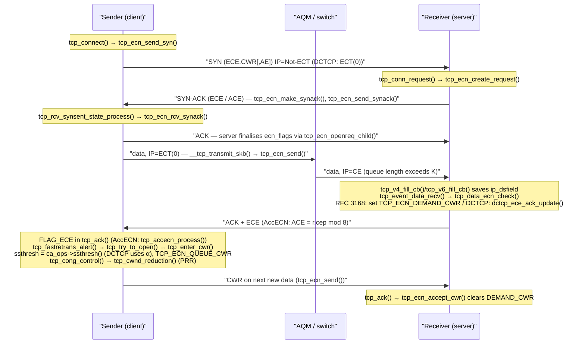

# 14. ECN and DCTCP

> All code in this chapter is based on net-next `279d5c8afcd3`.
> Loss detection and cwnd reduction via PRR are covered in Chapter 8, and the `tcp_congestion_ops` framework and Reno are covered in Chapter 11. Here we focus on "where ECN signals are born, how they are carried, and who reduces cwnd", along with a line-by-line breakdown of DCTCP.

## The ELI5 version

At the tollbooths of the motorway (the network), there are attendants (routers / switches). In the old days, when the road became congested, attendants would simply shove trucks (packets) off onto the hard shoulder (drop them). The sender (the shipper) only realised there was congestion when "no signed receipt (ACK) came back", panicking and halving the number of trucks allowed on the road at once (cwnd). Dropped parcels had to be re-shipped, wasting both time and fuel.

ECN is a mechanism where, instead of dropping parcels, the attendant **stamps "congestion" (CE) onto the shipping label (IP header)** and lets them pass. However, they may only stamp parcels whose label says "stamp-capable" (ECT). When the receiver (recipient) spots the stamp, they add a note saying "there was congestion" (ECE) onto the signed receipt they send back. The shipper sees this, reduces their trucks, and attaches a "reduced" (CWR) tag to the next parcel. The recipient keeps writing "there was congestion" until they see that tag.

Classic ECN (RFC 3168) only conveys a single bit: "was there congestion during this round trip or not?". DCTCP works by having the recipient faithfully send back a signed receipt **every time the presence or absence of a stamp changes**, allowing the shipper to count "what proportion of parcels were stamped" (α) and reduce trucks in proportion to the severity of congestion. AccECN (RFC 9768) takes this even further by writing a counter directly into the signed receipt itself recording "how many stamped parcels have been received so far".

## What the RFCs say

### RFC 3168: The Addition of Explicit Congestion Notification (ECN) to IP

**In a nutshell**: The standard that defines 2 bits in the IP header (the lower 2 bits of TOS in IPv4 / Traffic Class in IPv6) as the "ECN field", allowing AQM to mark packets instead of dropping them. On the TCP side, it adds two flags, ECE and CWR, and negotiates their use via SYN / SYN-ACK. An ECN mark is treated as "a congestion signal equivalent to a packet loss", and the sender reduces cwnd by the same amount as it would for a loss ([RFC 3168 §5](https://www.rfc-editor.org/rfc/rfc3168#section-5), [§6.1](https://www.rfc-editor.org/rfc/rfc3168#section-6.1)). The ECN nonce (RFC 3540) was later moved to Historic status by RFC 8311, and ECT(1) has been repurposed as the identifier for L4S.

ECN field codepoints ([RFC 3168 §5](https://www.rfc-editor.org/rfc/rfc3168#section-5)):

| Bits | Name | Meaning | Linux constant |
| --- | --- | --- | --- |
| `00` | Not-ECT | ECN not capable; dropped under congestion | `INET_ECN_NOT_ECT` (0) |
| `01` | ECT(1) | ECN capable; currently the L4S identifier (RFC 9331) | `INET_ECN_ECT_1` (1) |
| `10` | ECT(0) | ECN capable (standard value for classic ECN) | `INET_ECN_ECT_0` (2) |
| `11` | CE | Congestion Experienced (marked in transit) | `INET_ECN_CE` (3) |

Rules the TCP implementation must follow that appear directly in code:

- **Negotiation** ([§6.1.1](https://www.rfc-editor.org/rfc/rfc3168#section-6.1.1)): The client sends an "ECN-setup SYN" with both ECE and CWR set, and the server replies with an "ECN-setup SYN-ACK" with only ECE set. A SYN and SYN-ACK MUST NOT be ECT-marked.
- **Fallback** ([§6.1.1.1](https://www.rfc-editor.org/rfc/rfc3168#section-6.1.1.1)): If there is no response to the ECN-setup SYN (e.g. broken middleboxes dropping it), the client MAY retransmit a SYN with ECE/CWR cleared.
- **Sender** ([§6.1.2](https://www.rfc-editor.org/rfc/rfc3168#section-6.1.2)): Upon receiving an ACK with ECE set, reduce cwnd. However, do this **at most once per window (≒ 1 RTT)**. Whenever cwnd is reduced for any reason (RTO, fast retransmit, ECN), set CWR on the **first new data segment transmitted thereafter**. Do not set CWR on retransmissions.
- **Receiver** ([§6.1.3](https://www.rfc-editor.org/rfc/rfc3168#section-6.1.3)): Upon receiving data marked with CE, set ECE. To protect against ACK loss, **keep setting ECE on every ACK** until a CWR segment is received (latching behaviour).
- **Packets that MUST NOT be ECT-marked**: pure ACKs ([§6.1.4](https://www.rfc-editor.org/rfc/rfc3168#section-6.1.4)), retransmissions ([§6.1.5](https://www.rfc-editor.org/rfc/rfc3168#section-6.1.5)), window probes ([§6.1.6](https://www.rfc-editor.org/rfc/rfc3168#section-6.1.6)). If ECT were set on packets whose loss is not detected as congestion, nobody would notice if a CE mark failed to arrive ([§5.2](https://www.rfc-editor.org/rfc/rfc3168#section-5.2)).

Because of this "ECE remains latched until CWR" design, from the sender's viewpoint **the number of ACKs with ECE set is unrelated to the number of packets that received CE**. No matter how many CEs occurred in one RTT, all the sender knows is that "there was at least one". DCTCP and AccECN are mechanisms designed to lift this limitation.

### RFC 8311: Relaxing Restrictions on Explicit Congestion Notification (ECN) Experimentation

**In a nutshell**: An RFC that relaxes RFC 3168's constraints—such as "treat ECN marks the same as loss" and "do not set ECT on SYNs or retransmissions"—strictly for experiments specified in IETF documents. It obsoleted the ECN nonce (RFC 3540) as Historic and freed up ECT(1) ([RFC 8311 §3](https://www.rfc-editor.org/rfc/rfc8311#section-3)).

- [§4.1](https://www.rfc-editor.org/rfc/rfc8311#section-4.1) Congestion Response Differences: A response to an ECN mark that is less aggressive than for a packet loss is permitted (e.g. ABE, RFC 8511). DCTCP's "reduction proportional to α" also follows this lineage.
- [§4.2](https://www.rfc-editor.org/rfc/rfc8311#section-4.2) Congestion Marking Differences: ECT(1) may be used as an identifier for alternative AQM behaviours (→ L4S).
- [§4.3](https://www.rfc-editor.org/rfc/rfc8311#section-4.3) TCP Control Packets and Retransmissions: Allows experiments that set ECT on SYNs, pure ACKs, retransmissions, etc. Comments in Linux's `tcp_ecn_create_request()` cite this section as justification for treating a SYN with a reserved bit (`th->res1`) set as indicating future extensions (such as AccECN).

### RFC 8257: Data Center TCP (DCTCP): TCP Congestion Control for Data Centers

**In a nutshell**: Congestion control specifically designed for data centres (single administrative domains). Switches mark CE the moment the queue length exceeds a threshold K (instantaneous rather than average queue length); the receiver reflects CE accurately; and the sender uses an exponential moving average α of the "fraction of bytes marked with CE in the last RTT" to proportionally reduce cwnd as `cwnd = cwnd * (1 - α/2)`. Even with shallow-buffered switches, it simultaneously achieves low latency, high throughput, and burst tolerance. This is an Informational RFC and is not intended for deployment over the public Internet ([RFC 8257 §5](https://www.rfc-editor.org/rfc/rfc8257#section-5)).

Rules implemented in the code:

- [§3.1](https://www.rfc-editor.org/rfc/rfc8257#section-3.1): Switches set CE whenever the instantaneous queue length exceeds a threshold K (RED with min=max=K, no averaging).
- [§3.2](https://www.rfc-editor.org/rfc/rfc8257#section-3.2): The receiver maintains a 1-bit state `DCTCP.CE`. If the CE status of an incoming packet **differs from `DCTCP.CE`, it immediately transmits any pending delayed ACK with the old ECE state** before updating its state. This ensures that even with delayed ACKs, "which byte ranges had CE" is conveyed almost precisely to the sender. ECE is not latched; it directly mirrors `DCTCP.CE`.
- [§3.3](https://www.rfc-editor.org/rfc/rfc8257#section-3.3): Sender-side estimation:

  ```text
  DCTCP.Alpha = DCTCP.Alpha * (1 - g) + g * M
  M = BytesMarked / BytesAcked   (over 1 observation window ≒ 1 RTT)
  The observation window starts at WindowEnd = SND.NXT and ends when SND.UNA exceeds WindowEnd
  Upon receiving ECE (once per window): cwnd = cwnd * (1 - DCTCP.Alpha / 2)
  ```

  The initial value of α is 1 (assuming the worst case).
- [§3.4](https://www.rfc-editor.org/rfc/rfc8257#section-3.4): cwnd growth is identical to standard TCP (slow start / congestion avoidance).
- [§3.5](https://www.rfc-editor.org/rfc/rfc8257#section-3.5): **Must react to packet loss in the same way as standard TCP (MUST)**. At most one reduction per window across both ECN and loss.
- [§3.6](https://www.rfc-editor.org/rfc/rfc8257#section-3.6): SYN, SYN-ACK, and RST packets SHOULD be ECT-marked, because packets without ECT are prone to drops in shallow buffers. The receiver ignores CE marks on these packets.
- [§4.2](https://www.rfc-editor.org/rfc/rfc8257#section-4.2): Fixed-point implementation: if g = 1/16, multiplication is just a 4-bit shift. It requires that "when α falls below the minimum value representable after shifting, it can be set to 0" and "α MUST be clamped so that it does not exceed 1.0 (MUST)".

### RFC 9330 / 9331 / 9332: L4S (in brief)

**In a nutshell**: L4S (Low Latency, Low Loss, and Scalable Throughput) is an architecture that enables DCTCP-style "scalable" congestion control—reacting in proportion to the fraction of marks—to be used across the public Internet ([RFC 9330](https://www.rfc-editor.org/rfc/rfc9330)). It uses ECT(1) as the identifier for "L4S packets" (RFC 9331), and at bottleneck links it balances fairness between L4S and classic traffic using DualQ Coupled AQM ([RFC 9332 §2](https://www.rfc-editor.org/rfc/rfc9332#section-2)), which couples a shallow queue for L4S with a classic queue. Because an L4S sender needs to know the exact number of CE marks, AccECN is a prerequisite in TCP.

Upstream Linux does not yet include an L4S congestion control module such as TCP Prague. However, for the benefit of such modules (including BPF struct_ops), flags such as `TCP_CONG_ECT_1_NEGOTIATION` (use ECT(1) starting during the handshake), `TCP_CONG_NEEDS_ACCECN` (require AccECN), and `TCP_CONG_NO_FALLBACK_RFC3168` (fall back to non-ECN rather than classic ECN if AccECN negotiation fails) are already present.

### RFC 9768: More Accurate Explicit Congestion Notification (AccECN) Feedback in TCP

**In a nutshell**: AccECN, which spent years as draft-ietf-tcpm-accurate-ecn, has now been published as RFC 9768. It departs from RFC 3168's "ECE latching", using a 3-bit **ACE field** in the TCP header (renaming the former NS bit to AE, alongside CWR and ECE) to carry the "lower 3 bits of the number of received CE packets". Furthermore, an optional **AccECN option** reports the received **byte counts** (24 bits) for each of the ECT(0), ECT(1), and CE codepoints. This allows the sender to know exactly how many packets (and how many bytes) were marked with CE within an RTT.

Rules implemented in the code:

- [§3.1.1](https://www.rfc-editor.org/rfc/rfc9768#section-3.1.1): Negotiation: An AccECN client sets (AE,CWR,ECE) = (1,1,1) on its SYN. An AccECN server echoes the **IP-ECN codepoint with which the SYN arrived** in the ACE field of the SYN-ACK (Table 2: Not-ECT→010, ECT(1)→011, ECT(0)→100, CE→110). If the SYN-ACK has 001, the peer supports classic ECN; if 000, it is non-ECN.
- [§3.1.2](https://www.rfc-editor.org/rfc/rfc9768#section-3.1.2): Backwards compatibility: A server MUST treat combinations of SYN flags other than 000, 011, or 111 identically to 111.
- [§3.1.4](https://www.rfc-editor.org/rfc/rfc9768#section-3.1.4): Handling retransmitted SYNs and SYN-ACKs (e.g. retransmissions with ACE=0).
- [§3.1.5](https://www.rfc-editor.org/rfc/rfc9768#section-3.1.5): If an ACE=0 SYN or SYN-ACK is sent or received, ECT MUST NOT be set thereafter.
- [§3.2.1](https://www.rfc-editor.org/rfc/rfc9768#section-3.2.1): Initial counter values: The packet counters `r.cep` / `s.cep` start at 5; byte counters start at 1 for ECT(0)/ECT(1) and 0 for CE. This design allows detection of zeroing by middleboxes.
- [§3.2.2.1](https://www.rfc-editor.org/rfc/rfc9768#section-3.2.2.1): The third ACK of the handshake echoes the SYN-ACK's IP-ECN in its ACE field (Table 4).
- [§3.2.2.2](https://www.rfc-editor.org/rfc/rfc9768#section-3.2.2.2): ACE encoding and decoding: The receiver encodes `ACE = r.cep mod 8`, and the sender recovers the increment via `Δ = (ACE - s.cep) mod 8`.
- [§3.2.2.5](https://www.rfc-editor.org/rfc/rfc9768#section-3.2.2.5): Safeguards against ACE ambiguity (wrapping of the 3-bit counter): The receiver does not thin ACKs excessively, and the sender estimates conservatively when a large number of bytes are acknowledged at once.
- [§3.2.3](https://www.rfc-editor.org/rfc/rfc9768#section-3.2.3): AccECN option (Kind 172 = Order 0 / 174 = Order 1) and 24-bit byte counter encoding; [§3.2.3.2](https://www.rfc-editor.org/rfc/rfc9768#section-3.2.3.2) detecting middlebox stripping or zeroing of options; [§3.2.3.3](https://www.rfc-editor.org/rfc/rfc9768#section-3.2.3.3) when to send options (on transitions, periodic beacons at least a few times per RTT, etc.).
- [§5.1](https://www.rfc-editor.org/rfc/rfc9768#section-5.1): SYN cookie compatibility: If the third ACK carries an ACE between 0b010 and 0b111, the server can deduce that AccECN was negotiated.

> [!NOTE]
> Although comments in the source code still refer to "draft-ietf-tcpm-accurate-ecn", they denote what has now become RFC 9768. Commit messages from `100f946b8d44` onward cite RFC 9768.

## The big picture



ECN processing is cleanly split between the sender and receiver roles:

- The **receiver** reads the ECN field from the IP header (this is the only place where the logic differs between address families; once stored into `TCP_SKB_CB(skb)->ip_dsfield`, it is AF-independent). It records the result in `tp->ecn_flags` (RFC 3168) or counters such as `tp->received_ce` (AccECN), reflecting it in the ECE / ACE fields of subsequent ACKs.
- The **sender** reads ECE / ACE from incoming ACKs, converting them into `FLAG_ECE` and `tp->delivered_ce`. It passes these to congestion control (transitioning into the CWR state, updating DCTCP's α).
- Whether to set ECT on an outgoing packet is determined on a per-packet basis by rewriting the whole-socket `inet->tos` / `np->tclass`. This seemingly blunt approach leads to differences in how IPv4 and IPv6 are handled (see Step 1 and the "IPv4 vs IPv6" section below).

DCTCP is composed of two components: **receiver-side reflection** of ECN signals (`tcp_dctcp.h`) and a **sender-side response function** (`tcp_dctcp.c`). The former is called from core TCP's `tcp_data_ecn_check()` via `CA_EVENT_ECN_IS_CE` / `CA_EVENT_ECN_NO_CE` events, while the latter is invoked through the `in_ack_event` and `ssthresh` hooks.

## Walking through the code

### Step 1: Reading and writing the ECN field (`inet_ecn.h` / `dsfield.h`)

First, the codepoints and predicates:

```c
enum {
	INET_ECN_NOT_ECT = 0,
	INET_ECN_ECT_1 = 1,
	INET_ECN_ECT_0 = 2,
	INET_ECN_CE = 3,
	INET_ECN_MASK = 3,
};

extern int sysctl_tunnel_ecn_log;

static inline int INET_ECN_is_ce(__u8 dsfield)
{
	return (dsfield & INET_ECN_MASK) == INET_ECN_CE;
}

static inline int INET_ECN_is_not_ect(__u8 dsfield)
{
	return (dsfield & INET_ECN_MASK) == INET_ECN_NOT_ECT;
}

static inline int INET_ECN_is_capable(__u8 dsfield)
{
	return dsfield & INET_ECN_ECT_0;
}
```

- `INET_ECN_is_capable()` checks only `& INET_ECN_ECT_0` (bit 1) because it treats ECT(0)=`10` and CE=`11` as "ECN capable". ECT(1)=`01` evaluates to false. This is a historical remnant from when ECT(1) was reserved for the ECN nonce and was not considered "regular ECN capable". It is only used when deciding whether to add ECT to a SYN-ACK's `tos` (Step 4), so the practical impact remains minimal even with the rise of L4S using ECT(1).
- `INET_ECN_is_not_ect()` returns false if the field is any of ECT(1), ECT(0), or CE; the receiver uses this helper to determine whether ECN is in use (`TCP_ECN_SEEN`).

The sender-side helpers for setting and clearing ECT are `__INET_ECN_xmit()` ([include/net/inet_ecn.h#L55](https://git.kernel.org/pub/scm/linux/kernel/git/netdev/net-next.git/tree/include/net/inet_ecn.h?id=279d5c8afcd38bd841832a39bfe1aa4f8518d98e#n55)), `INET_ECN_xmit()`, and `INET_ECN_dontxmit()`:

```c
/* Apply either ECT(0) or ECT(1) */
static inline void __INET_ECN_xmit(struct sock *sk, bool use_ect_1)
{
	__u8 ect = use_ect_1 ? INET_ECN_ECT_1 : INET_ECN_ECT_0;

	/* Mask the complete byte in case the connection alternates between
	 * ECT(0) and ECT(1).
	 */
	inet_sk(sk)->tos &= ~INET_ECN_MASK;
	inet_sk(sk)->tos |= ect;
	if (inet6_sk(sk)) {
		inet6_sk(sk)->tclass &= ~INET_ECN_MASK;
		inet6_sk(sk)->tclass |= ect;
	}
}

static inline void INET_ECN_xmit(struct sock *sk)
{
	__INET_ECN_xmit(sk, false);
}

static inline void INET_ECN_dontxmit(struct sock *sk)
{
	inet_sk(sk)->tos &= ~INET_ECN_MASK;
	if (inet6_sk(sk) != NULL)
		inet6_sk(sk)->tclass &= ~INET_ECN_MASK;
}
```

This is the most distinctive design choice in TCP's ECN implementation:

- Instead of attaching ECT "to the packet", it **rewrites the bottom 2 bits of the socket's `inet_sk(sk)->tos`**. The IPv4 transmission function `ip_queue_xmit()` ([net/ipv4/ip_output.c#L545](https://git.kernel.org/pub/scm/linux/kernel/git/netdev/net-next.git/tree/net/ipv4/ip_output.c?id=279d5c8afcd38bd841832a39bfe1aa4f8518d98e#n545)) puts `READ_ONCE(inet_sk(sk)->tos)` directly into `iph->tos`. IPv6's `inet6_csk_xmit()` ([net/ipv6/inet6_connection_sock.c#L97](https://git.kernel.org/pub/scm/linux/kernel/git/netdev/net-next.git/tree/net/ipv6/inet6_connection_sock.c?id=279d5c8afcd38bd841832a39bfe1aa4f8518d98e#n97)) passes `np->tclass` to `ip6_xmit()`. In other words, **by rewriting `tos` immediately prior to transmission, exactly that one packet gets ECT**. Because `tcp_transmit_skb()` runs under the socket lock (or equivalent mutual exclusion, such as `bh_lock_sock()` when sending ACKs from softirq), no other transmission can intervene between the rewrite and IP header construction.
- When `inet6_sk(sk)` is non-NULL (an AF_INET6 socket), `tclass` is updated at the same time. If an AF_INET6 socket communicates over an IPv4-mapped address, packets pass through `ip_queue_xmit()`, so `tos` is still needed. That is why both are written.
- As the comment notes, for connections that alternate between ECT(0) and ECT(1) (e.g. L4S using ECT(1) during the handshake and ECT(0) afterwards), the bits are always cleared with `~INET_ECN_MASK` before OR-ing the new value.

Even if user space modifies the DSCP via `setsockopt(IP_TOS)` or `setsockopt(IPV6_TCLASS)`, the ECN bits are preserved on TCP sockets (`__ip_sock_set_tos()` ([net/ipv4/ip_sockglue.c#L586](https://git.kernel.org/pub/scm/linux/kernel/git/netdev/net-next.git/tree/net/ipv4/ip_sockglue.c?id=279d5c8afcd38bd841832a39bfe1aa4f8518d98e#n586)) and the `IPV6_TCLASS` branch in `do_ipv6_setsockopt()` ([net/ipv6/ipv6_sockglue.c#L376](https://git.kernel.org/pub/scm/linux/kernel/git/netdev/net-next.git/tree/net/ipv6/ipv6_sockglue.c?id=279d5c8afcd38bd841832a39bfe1aa4f8518d98e#n376)) both execute `val &= ~INET_ECN_MASK; val |= old & INET_ECN_MASK;` if the socket is `SOCK_STREAM`). Without this, an application setting DSCP would corrupt TCP's ECN state.

On the receiver side, extracting the ECN field from the IP header is performed by helpers in `dsfield.h`:

```c
static inline __u8 ipv4_get_dsfield(const struct iphdr *iph)
{
	return iph->tos;
}


static inline __u8 ipv6_get_dsfield(const struct ipv6hdr *ipv6h)
{
	return ntohs(*(__force const __be16 *)ipv6h) >> 4;
}


static inline void ipv4_change_dsfield(struct iphdr *iph,__u8 mask,
    __u8 value)
{
        __u32 check = ntohs((__force __be16)iph->check);
	__u8 dsfield;

	dsfield = (iph->tos & mask) | value;
	check += iph->tos;
	if ((check+1) >> 16) check = (check+1) & 0xffff;
	check -= dsfield;
	check += check >> 16; /* adjust carry */
	iph->check = (__force __sum16)htons(check);
	iph->tos = dsfield;
}


static inline void ipv6_change_dsfield(struct ipv6hdr *ipv6h,__u8 mask,
    __u8 value)
{
	__be16 *p = (__force __be16 *)ipv6h;

	*p = (*p & htons((((u16)mask << 4) | 0xf00f))) | htons((u16)value << 4);
}
```

- IPv4 simply returns the single `iph->tos` byte as-is.
- IPv6 takes the first 16 bits containing Version(4) | Traffic Class(8) | Flow Label(20), applies `ntohs()`, and shifts right by 4 bits, because Traffic Class straddles a byte boundary.
- For modifications: IPv4 has an IP header checksum, so `ipv4_change_dsfield()` performs an RFC 1624-style incremental update. IPv6 has no header checksum, so a 16-bit mask-and-shift operation suffices. The AQM (`sch_*`) helpers that mark CE, `IP_ECN_set_ce()` ([include/net/inet_ecn.h#L91](https://git.kernel.org/pub/scm/linux/kernel/git/netdev/net-next.git/tree/include/net/inet_ecn.h?id=279d5c8afcd38bd841832a39bfe1aa4f8518d98e#n91)) and `IP6_ECN_set_ce()` ([include/net/inet_ecn.h#L148](https://git.kernel.org/pub/scm/linux/kernel/git/netdev/net-next.git/tree/include/net/inet_ecn.h?id=279d5c8afcd38bd841832a39bfe1aa4f8518d98e#n148)), exhibit the exact same asymmetry.

TCP copies this value into `TCP_SKB_CB` once at the entry point of the receive path, after which all processing is address-family independent.

`tcp_v4_fill_cb()` ([net/ipv4/tcp_ipv4.c#L2048](https://git.kernel.org/pub/scm/linux/kernel/git/netdev/net-next.git/tree/net/ipv4/tcp_ipv4.c?id=279d5c8afcd38bd841832a39bfe1aa4f8518d98e#n2048)):

```c
	TCP_SKB_CB(skb)->seq = ntohl(th->seq);
	TCP_SKB_CB(skb)->end_seq = (TCP_SKB_CB(skb)->seq + th->syn + th->fin +
				    skb->len - th->doff * 4);
	TCP_SKB_CB(skb)->ack_seq = ntohl(th->ack_seq);
	TCP_SKB_CB(skb)->tcp_flags = tcp_flags_ntohs(th);
	TCP_SKB_CB(skb)->ip_dsfield = ipv4_get_dsfield(iph);
```

`tcp_v6_fill_cb()` ([net/ipv6/tcp_ipv6.c#L1711](https://git.kernel.org/pub/scm/linux/kernel/git/netdev/net-next.git/tree/net/ipv6/tcp_ipv6.c?id=279d5c8afcd38bd841832a39bfe1aa4f8518d98e#n1711)):

```c
	TCP_SKB_CB(skb)->seq = ntohl(th->seq);
	TCP_SKB_CB(skb)->end_seq = (TCP_SKB_CB(skb)->seq + th->syn + th->fin +
				    skb->len - th->doff*4);
	TCP_SKB_CB(skb)->ack_seq = ntohl(th->ack_seq);
	TCP_SKB_CB(skb)->tcp_flags = tcp_flags_ntohs(th);
	TCP_SKB_CB(skb)->ip_dsfield = ipv6_get_dsfield(hdr);
```

`ip_dsfield` is a field in `tcp_skb_cb`; downstream routines such as `tcp_data_ecn_check()` and `tcp_ecn_received_counters()` read exclusively from here. Furthermore, `tcp_add_backlog()` ([net/ipv4/tcp_ipv4.c#L1904](https://git.kernel.org/pub/scm/linux/kernel/git/netdev/net-next.git/tree/net/ipv4/tcp_ipv4.c?id=279d5c8afcd38bd841832a39bfe1aa4f8518d98e#n1904)) requires matching `ip_dsfield` values as a condition for coalescing segments on the socket backlog, since merging segments with differing ECN fields could erroneously lose or duplicate CE marks. GRO does the same: it flushes and stops coalescing whenever TOS / Traffic Class differs (`inet_gro_flush()` ([include/net/gro.h#L443](https://git.kernel.org/pub/scm/linux/kernel/git/netdev/net-next.git/tree/include/net/gro.h?id=279d5c8afcd38bd841832a39bfe1aa4f8518d98e#n443)) for IPv4, `ipv6_gro_flush()` ([include/net/gro.h#L465](https://git.kernel.org/pub/scm/linux/kernel/git/netdev/net-next.git/tree/include/net/gro.h?id=279d5c8afcd38bd841832a39bfe1aa4f8518d98e#n465)) for IPv6).

### Step 2: `tp->ecn_flags` and ECN modes

All ECN state is stored within the single byte `ecn_flags` of `tcp_sock` (within the `tcp_sock_write_tx` cacheline group).

```c
#define	TCP_ECN_MODE_RFC3168	BIT(0)
#define	TCP_ECN_QUEUE_CWR	BIT(1)
#define	TCP_ECN_DEMAND_CWR	BIT(2)
#define	TCP_ECN_SEEN		BIT(3)
#define	TCP_ECN_MODE_ACCECN	BIT(4)

#define	TCP_ECN_DISABLED	0
#define	TCP_ECN_MODE_PENDING	(TCP_ECN_MODE_RFC3168 | TCP_ECN_MODE_ACCECN)
#define	TCP_ECN_MODE_ANY	(TCP_ECN_MODE_RFC3168 | TCP_ECN_MODE_ACCECN)

static inline bool tcp_ecn_mode_any(const struct tcp_sock *tp)
{
	return tp->ecn_flags & TCP_ECN_MODE_ANY;
}

static inline bool tcp_ecn_mode_rfc3168(const struct tcp_sock *tp)
{
	return (tp->ecn_flags & TCP_ECN_MODE_ANY) == TCP_ECN_MODE_RFC3168;
}

static inline bool tcp_ecn_mode_accecn(const struct tcp_sock *tp)
{
	return (tp->ecn_flags & TCP_ECN_MODE_ANY) == TCP_ECN_MODE_ACCECN;
}

static inline bool tcp_ecn_disabled(const struct tcp_sock *tp)
{
	return !tcp_ecn_mode_any(tp);
}

static inline bool tcp_ecn_mode_pending(const struct tcp_sock *tp)
{
	return (tp->ecn_flags & TCP_ECN_MODE_PENDING) == TCP_ECN_MODE_PENDING;
}

static inline void tcp_ecn_mode_set(struct tcp_sock *tp, u8 mode)
{
	tp->ecn_flags &= ~TCP_ECN_MODE_ANY;
	tp->ecn_flags |= mode;
}
```

- Two bits, `TCP_ECN_MODE_RFC3168` (bit 0) and `TCP_ECN_MODE_ACCECN` (bit 4), **encode the operating mode**: 00 = disabled, 01 = RFC 3168, 10 = AccECN, and 11 = **PENDING** (AccECN requested in SYN, but SYN-ACK not yet received). Because both bits are set in PENDING, `tcp_ecn_mode_any()` evaluates to true, whilst `tcp_ecn_mode_rfc3168()` and `tcp_ecn_mode_accecn()` both evaluate to false. Purely through bit representation, this naturally enforces that "neither feedback mechanism is used whilst negotiation is still in progress".
- `TCP_ECN_QUEUE_CWR`: Set by the **sender** to reserve "setting CWR on the next new data segment".
- `TCP_ECN_DEMAND_CWR`: Set by the **receiver** to maintain "keep setting ECE until a CWR segment arrives" (the latching rule of RFC 3168 §6.1.3). DCTCP repurposes this bit to represent the CE state directly (Step 13).
- `TCP_ECN_SEEN`: Set when at least one segment marked with ECT or CE has been received. Exposed in `tcpi_options` as `TCPI_OPT_ECN_SEEN`.
- `tcp_ecn_mode_set()` swaps out only the two mode bits, leaving state bits like `QUEUE_CWR` intact.

### Step 3: Active open side — requesting ECN in SYN

`tcp_connect()` ([net/ipv4/tcp_output.c#L4309](https://git.kernel.org/pub/scm/linux/kernel/git/netdev/net-next.git/tree/net/ipv4/tcp_output.c?id=279d5c8afcd38bd841832a39bfe1aa4f8518d98e#n4309)) calls `tcp_ecn_send_syn()` immediately after allocating the SYN skb.

`tcp_ecn_send_syn()` ([include/net/tcp_ecn.h#L597](https://git.kernel.org/pub/scm/linux/kernel/git/netdev/net-next.git/tree/include/net/tcp_ecn.h?id=279d5c8afcd38bd841832a39bfe1aa4f8518d98e#n597)):

```c
/* Packet ECN state for a SYN.  */
static inline void tcp_ecn_send_syn(struct sock *sk, struct sk_buff *skb)
{
	struct tcp_sock *tp = tcp_sk(sk);
	bool bpf_needs_ecn = tcp_bpf_ca_needs_ecn(sk);
	bool use_ecn, use_accecn;
	u8 tcp_ecn = READ_ONCE(sock_net(sk)->ipv4.sysctl_tcp_ecn);

	use_accecn = tcp_ecn == TCP_ECN_IN_ACCECN_OUT_ACCECN ||
		     tcp_ca_needs_accecn(sk);
	use_ecn = tcp_ecn == TCP_ECN_IN_ECN_OUT_ECN ||
		  tcp_ecn == TCP_ECN_IN_ACCECN_OUT_ECN ||
		  tcp_ca_needs_ecn(sk) || bpf_needs_ecn || use_accecn;

	if (!use_ecn) {
		const struct dst_entry *dst = __sk_dst_get(sk);

		if (dst && dst_feature(dst, RTAX_FEATURE_ECN))
			use_ecn = true;
	}

	tp->ecn_flags = 0;

	if (use_ecn) {
		if (tcp_ca_needs_ecn(sk) || bpf_needs_ecn)
			INET_ECN_xmit_ect_1_negotiation(sk);

		TCP_SKB_CB(skb)->tcp_flags |= TCPHDR_ECE | TCPHDR_CWR;
		if (use_accecn) {
			TCP_SKB_CB(skb)->tcp_flags |= TCPHDR_AE;
			tcp_ecn_mode_set(tp, TCP_ECN_MODE_PENDING);
			tp->syn_ect_snt = inet_sk(sk)->tos & INET_ECN_MASK;
		} else {
			tcp_ecn_mode_set(tp, TCP_ECN_MODE_RFC3168);
		}
	}
}
```

- The value of `sysctl_tcp_ecn` (`enum tcp_ecn_mode` ([include/net/tcp_ecn.h#L18](https://git.kernel.org/pub/scm/linux/kernel/git/netdev/net-next.git/tree/include/net/tcp_ecn.h?id=279d5c8afcd38bd841832a39bfe1aa4f8518d98e#n18))) encodes pairs of "highest mode accepted on incoming connections" and "mode actively requested on outgoing connections". The default is 2 (`TCP_ECN_IN_ECN_OUT_NOECN`), which configures Linux to **not request ECN as a client, but accept it as a server** (`tcp_sk_init()` sets `net->ipv4.sysctl_tcp_ecn = TCP_ECN_IN_ECN_OUT_NOECN`). Setting it to 3 requests AccECN.
- `use_accecn` is true when sysctl is 3 or when the congestion control algorithm requests `TCP_CONG_NEEDS_ACCECN`. `use_ecn` indicates "request some form of ECN", which naturally holds if AccECN is requested.
- Even if disabled via sysctl, ECN can be enabled per-route (`ip route ... features ecn`, `RTAX_FEATURE_ECN`). `__sk_dst_get()` retrieves the route cached at connect time.
- `tp->ecn_flags = 0;` resets the state whenever a SYN is constructed. Because `tcp_connect()` can be invoked on reconnections, this prevents carrying over stale state from a previous attempt.
- Only when `tcp_ca_needs_ecn()` (DCTCP) or BPF's `BPF_SOCK_OPS_NEEDS_ECN` is true does it **mark the SYN itself with ECT** (RFC 8257 §3.6). In classic ECN, a SYN is Not-ECT (RFC 3168 §6.1.1). In reality, for DCTCP, `tcp_assign_congestion_control()` ([net/ipv4/tcp_cong.c#L216](https://git.kernel.org/pub/scm/linux/kernel/git/netdev/net-next.git/tree/net/ipv4/tcp_cong.c?id=279d5c8afcd38bd841832a39bfe1aa4f8518d98e#n216)) already sets ECT at socket creation time, so this call serves to ensure ECT remains set even if `tos` was subsequently modified.
- For a SYN, `TCPHDR_ECE | TCPHDR_CWR` are set (an RFC 3168 ECN-setup SYN); if AccECN is enabled, `TCPHDR_AE` is also set, making ACE=111. Only for AccECN is the SYN's ECT value recorded into `tp->syn_ect_snt`. Because the server echoes in the SYN-ACK's ACE "which ECT the SYN arrived with", this is used to detect on-path mangling (RFC 9768 §3.2.2.3).
- The mode is set to PENDING when requesting AccECN, and RFC3168 otherwise. Even if set to RFC3168 mode, it will later be disabled if the SYN-ACK does not return ECE (Step 5).

Fallback upon SYN retransmission (RFC 3168 §6.1.1.1) is handled inside `__tcp_retransmit_skb()` ([net/ipv4/tcp_output.c#L3558](https://git.kernel.org/pub/scm/linux/kernel/git/netdev/net-next.git/tree/net/ipv4/tcp_output.c?id=279d5c8afcd38bd841832a39bfe1aa4f8518d98e#n3558)):

```c
	if (!tcp_ecn_mode_pending(tp) || icsk->icsk_retransmits > 1) {
		/* RFC3168, section 6.1.1.1. ECN fallback
		 * As AccECN uses the same SYN flags (+ AE), this check
		 * covers both cases.
		 */
		if ((TCP_SKB_CB(skb)->tcp_flags & TCPHDR_SYN_ECN) ==
		    TCPHDR_SYN_ECN)
			tcp_ecn_clear_syn(sk, skb);
	}
```

`tcp_ecn_clear_syn()` ([include/net/tcp_ecn.h#L634](https://git.kernel.org/pub/scm/linux/kernel/git/netdev/net-next.git/tree/include/net/tcp_ecn.h?id=279d5c8afcd38bd841832a39bfe1aa4f8518d98e#n634)):

```c
static inline void tcp_ecn_clear_syn(struct sock *sk, struct sk_buff *skb)
{
	if (READ_ONCE(sock_net(sk)->ipv4.sysctl_tcp_ecn_fallback)) {
		/* tp->ecn_flags are cleared at a later point in time when
		 * SYN ACK is ultimatively being received.
		 */
		TCP_SKB_CB(skb)->tcp_flags &= ~TCPHDR_ACE;
	}
}
```

- The condition is "not PENDING (not requesting AccECN), or retransmit count > 1". Classic ECN SYNs strip ECE/CWR **from the very first retransmission**. An AccECN SYN is retransmitted with AccECN flags intact on the first retransmission, and only strips them on the second and subsequent attempts (matching RFC 9768 §3.1.4.1: "it MAY be retransmitted at least once").
- Because `TCPHDR_ACE` encompasses AE as well, AccECN SYNs have all their flags cleared at once.
- `tp->ecn_flags` is not cleared here. As the comment notes, `tcp_ecn_rcv_synack()` will determine the final mode upon receiving the SYN-ACK by inspecting its ACE field. A SYN-ACK lacking ECE has ACE=000, which disables ECN.
- Setting `sysctl_tcp_ecn_fallback=0` disables this fallback behaviour.

### Step 4: Passive open side — inspecting SYN, recording in `request_sock`, and constructing SYN-ACK

On the server, `tcp_conn_request()` calls `tcp_ecn_create_request()` after allocating the mini-socket upon receiving a SYN. (When using SYN cookies, `ecn_ok` is cleared unless timestamps are enabled, because the ECN capability is encoded into the low-order bits of the cookie's timestamp value).

`tcp_ecn_create_request()` ([net/ipv4/tcp_input.c#L7469](https://git.kernel.org/pub/scm/linux/kernel/git/netdev/net-next.git/tree/net/ipv4/tcp_input.c?id=279d5c8afcd38bd841832a39bfe1aa4f8518d98e#n7469)):

```c
static void tcp_ecn_create_request(struct request_sock *req,
				   const struct sk_buff *skb,
				   const struct sock *listen_sk,
				   const struct dst_entry *dst)
{
	const struct tcphdr *th = tcp_hdr(skb);
	const struct net *net = sock_net(listen_sk);
	bool th_ecn = th->ece && th->cwr;
	bool ect, ecn_ok;
	u32 ecn_ok_dst;

	if (tcp_accecn_syn_requested(th) &&
	    (READ_ONCE(net->ipv4.sysctl_tcp_ecn) >= 3 ||
	     tcp_ca_needs_accecn(listen_sk))) {
		inet_rsk(req)->ecn_ok = 1;
		tcp_rsk(req)->accecn_ok = 1;
		tcp_rsk(req)->syn_ect_rcv = TCP_SKB_CB(skb)->ip_dsfield &
					    INET_ECN_MASK;
		return;
	}

	if (!th_ecn)
		return;

	ect = !INET_ECN_is_not_ect(TCP_SKB_CB(skb)->ip_dsfield);
	ecn_ok_dst = dst_feature(dst, DST_FEATURE_ECN_MASK);
	ecn_ok = READ_ONCE(net->ipv4.sysctl_tcp_ecn) || ecn_ok_dst;

	if (((!ect || th->res1 || th->ae) && ecn_ok) ||
	    tcp_ca_needs_ecn(listen_sk) ||
	    (ecn_ok_dst & DST_FEATURE_ECN_CA) ||
	    tcp_bpf_ca_needs_ecn((struct sock *)req))
		inet_rsk(req)->ecn_ok = 1;
}
```

- AccECN evaluation comes first. `tcp_accecn_syn_requested()` ([include/net/tcp_ecn.h#L375](https://git.kernel.org/pub/scm/linux/kernel/git/netdev/net-next.git/tree/include/net/tcp_ecn.h?id=279d5c8afcd38bd841832a39bfe1aa4f8518d98e#n375)) returns true as long as ACE is neither 000 nor 011 (RFC 9768 §3.1.2: combinations other than 000, 011, and 111 MUST be treated as 111; 011 is a classic ECN SYN, so not AccECN). If sysctl is 3 or higher (server accepts AccECN in modes 3/4/5), or if the listener's congestion control requires AccECN, `accecn_ok` is set. Furthermore, the **IP-ECN codepoint with which the SYN arrived** is saved in `syn_ect_rcv` before returning. This value will be echoed in the ACE field of the SYN-ACK.
- Classic ECN applies only to SYNs where both `th->ece && th->cwr` are set.
- Meaning of the condition `((!ect || th->res1 || th->ae) && ecn_ok) || ...`:
  - "The SYN is Not-ECT". According to RFC 3168 §6.1.1, a SYN MUST NOT be ECT-marked. A SYN marked with ECT or CE indicates that "a middlebox on the path is tampering with TOS", so ECN is refused to avoid false congestion signals (see the comment at the beginning of the function).
  - However, if `res1` (reserved bit) or AE is set, ECT-marked SYNs are permitted as future extensions (RFC 8311 §4.3).
  - If the congestion control requires ECN (DCTCP), if `DST_FEATURE_ECN_CA` (`ip route ... congctl dctcp`) is specified on the route, or if BPF requested it, ECT-marked SYNs are unconditionally accepted. This is because Linux's DCTCP sets ECT on the SYN itself (the comment "FreeBSD does not do so" provides this contrast).
- `ecn_ok_dst` checks route features, enabling ECN on a per-route basis even when `sysctl_tcp_ecn=0`.

Writing the SYN-ACK header is handled by `tcp_ecn_make_synack()` ([include/net/tcp_ecn.h#L644](https://git.kernel.org/pub/scm/linux/kernel/git/netdev/net-next.git/tree/include/net/tcp_ecn.h?id=279d5c8afcd38bd841832a39bfe1aa4f8518d98e#n644)), called from `tcp_make_synack()` ([net/ipv4/tcp_output.c#L3942](https://git.kernel.org/pub/scm/linux/kernel/git/netdev/net-next.git/tree/net/ipv4/tcp_output.c?id=279d5c8afcd38bd841832a39bfe1aa4f8518d98e#n3942)).

```c
static inline void
tcp_ecn_make_synack(const struct request_sock *req, struct tcphdr *th,
		    enum tcp_synack_type synack_type)
{
	/* Accurate ECN shall retransmit SYN/ACK with ACE=0 if the
	 * previously retransmitted SYN/ACK also times out.
	 */
	if (!req->num_timeout || synack_type != TCP_SYNACK_RETRANS) {
		if (tcp_rsk(req)->accecn_ok)
			tcp_accecn_echo_syn_ect(th, tcp_rsk(req)->syn_ect_rcv);
		else if (inet_rsk(req)->ecn_ok)
			th->ece = 1;
	} else if (tcp_rsk(req)->accecn_ok) {
		th->ae  = 0;
		th->cwr = 0;
		th->ece = 0;
	}
}
```

- On the initial SYN-ACK and any SYN-ACK sent in response to a retransmitted SYN: for AccECN, `tcp_accecn_echo_syn_ect()` ([include/net/tcp_ecn.h#L406](https://git.kernel.org/pub/scm/linux/kernel/git/netdev/net-next.git/tree/include/net/tcp_ecn.h?id=279d5c8afcd38bd841832a39bfe1aa4f8518d98e#n406)) reflects the SYN's IP-ECN into the ACE field (Not-ECT→010, ECT(1)→011, ECT(0)→100, CE→110). For classic ECN, only ECE is set (an RFC 3168 ECN-setup SYN-ACK).
- **If the SYN-ACK itself times out and enters its second or subsequent retransmission**, AccECN transmits with ACE=000 (RFC 9768 §3.1.4.2). This fallback guards against middleboxes dropping SYN-ACKs carrying ACE marks. `req->num_timeout` tracks timer-driven retransmissions, distinguishing them from responses to retransmitted SYNs via `synack_type`.

When a full socket (other than `TCP_LISTEN`) sends a SYN-ACK (such as during simultaneous open or following TFO), the path is `tcp_send_synack()` ([net/ipv4/tcp_output.c#L3895](https://git.kernel.org/pub/scm/linux/kernel/git/netdev/net-next.git/tree/net/ipv4/tcp_output.c?id=279d5c8afcd38bd841832a39bfe1aa4f8518d98e#n3895)) → `tcp_ecn_send_synack()`.

`tcp_ecn_send_synack()` ([include/net/tcp_ecn.h#L577](https://git.kernel.org/pub/scm/linux/kernel/git/netdev/net-next.git/tree/include/net/tcp_ecn.h?id=279d5c8afcd38bd841832a39bfe1aa4f8518d98e#n577)):

```c
/* Packet ECN state for a SYN-ACK */
static inline void tcp_ecn_send_synack(struct sock *sk, struct sk_buff *skb)
{
	struct tcp_sock *tp = tcp_sk(sk);

	TCP_SKB_CB(skb)->tcp_flags &= ~TCPHDR_CWR;
	if (tcp_ecn_disabled(tp))
		TCP_SKB_CB(skb)->tcp_flags &= ~TCPHDR_ECE;
	else if (tcp_ca_needs_ecn(sk) ||
		 tcp_bpf_ca_needs_ecn(sk))
		INET_ECN_xmit_ect_1_negotiation(sk);

	if (tp->ecn_flags & TCP_ECN_MODE_ACCECN) {
		TCP_SKB_CB(skb)->tcp_flags &= ~TCPHDR_ACE;
		TCP_SKB_CB(skb)->tcp_flags |=
			tcp_accecn_reflector_flags(tp->syn_ect_rcv);
		tp->syn_ect_snt = inet_sk(sk)->tos & INET_ECN_MASK;
	}
}
```

- CWR is never set on a SYN-ACK. If ECN is disabled, ECE is also cleared.
- Under DCTCP and similar algorithms, ECT is also placed onto the SYN-ACK (RFC 8257 §3.6).
- In AccECN mode, the ACE field is reconstructed via `tcp_accecn_reflector_flags()` ([include/net/tcp_ecn.h#L354](https://git.kernel.org/pub/scm/linux/kernel/git/netdev/net-next.git/tree/include/net/tcp_ecn.h?id=279d5c8afcd38bd841832a39bfe1aa4f8518d98e#n354)), and the ECT value of the outgoing SYN-ACK is recorded in `syn_ect_snt` (for verification upon receipt of the third ACK).

The TOS / Traffic Class of the SYN-ACK's IP header is determined by the AF-specific `send_synack` handler. This is where differences between IPv4 and IPv6 emerge (shown side by side in the "IPv4 vs IPv6" section below).

When the third ACK arrives and a full socket is created, `tcp_create_openreq_child()` calls `tcp_ecn_openreq_child()` ([net/ipv4/tcp_minisocks.c#L470](https://git.kernel.org/pub/scm/linux/kernel/git/netdev/net-next.git/tree/net/ipv4/tcp_minisocks.c?id=279d5c8afcd38bd841832a39bfe1aa4f8518d98e#n470)) to finalise the child socket's ECN mode:

```c
static void tcp_ecn_openreq_child(struct sock *sk,
				  const struct request_sock *req,
				  const struct sk_buff *skb)
{
	const struct tcp_request_sock *treq = tcp_rsk(req);
	struct tcp_sock *tp = tcp_sk(sk);

	if (treq->accecn_ok) {
		tcp_ecn_mode_set(tp, TCP_ECN_MODE_ACCECN);
		tp->syn_ect_snt = treq->syn_ect_snt;
		tcp_accecn_third_ack(sk, skb, treq->syn_ect_snt);
		tp->saw_accecn_opt = treq->saw_accecn_opt;
		if (treq->accecn_fail_mode & TCP_ACCECN_ACE_FAIL_SEND)
			tcp_accecn_fail_mode_set(tp, TCP_ACCECN_ACE_FAIL_SEND);
		if (treq->accecn_fail_mode & TCP_ACCECN_ACE_FAIL_RECV)
			tcp_accecn_fail_mode_set(tp, TCP_ACCECN_ACE_FAIL_RECV);
		tp->prev_ecnfield = treq->syn_ect_rcv;
		tp->accecn_opt_demand = 1;
		tcp_ecn_received_counters_payload(sk, skb);
	} else {
		if (inet_rsk(req)->ecn_ok && !tcp_ca_no_fallback_rfc3168(sk))
			tcp_ecn_mode_set(tp, TCP_ECN_MODE_RFC3168);
		else
			tcp_ecn_mode_set(tp, TCP_ECN_DISABLED);
	}
}
```

- For AccECN, the third ACK's ACE field is validated via `tcp_accecn_third_ack()` (Step 11), and failure modes recorded on the `request_sock` are inherited. Setting `accecn_opt_demand = 1` requests that "the very next outgoing packet carry an AccECN option", and receive counters are updated for any payload delivered in the third ACK.
- For classic ECN, if the congestion control algorithm sets `TCP_CONG_NO_FALLBACK_RFC3168`, ECN is disabled (because L4S congestion control behaves poorly with classic ECN AQMs).

### Step 5: Active open side — determining mode from SYN-ACK's ACE

When `tcp_rcv_synsent_state_process()` receives a SYN-ACK, if any mode is active (PENDING or RFC3168), it calls `tcp_ecn_rcv_synack()`.

`tcp_ecn_rcv_synack()` ([include/net/tcp_ecn.h#L490](https://git.kernel.org/pub/scm/linux/kernel/git/netdev/net-next.git/tree/include/net/tcp_ecn.h?id=279d5c8afcd38bd841832a39bfe1aa4f8518d98e#n490)) (first half):

```c
/* See Table 2 of the AccECN draft */
static inline void tcp_ecn_rcv_synack(struct sock *sk, const struct sk_buff *skb,
				      const struct tcphdr *th, u8 ip_dsfield)
{
	struct tcp_sock *tp = tcp_sk(sk);
	u8 ace = tcp_accecn_ace(th);

	switch (ace) {
	case 0x0:
	case 0x7:
		/* +========+========+============+=============+
		 * | A      | B      |  SYN/ACK   |  Feedback   |
		 * |        |        |    B->A    |  Mode of A  |
		 * |        |        | AE CWR ECE |             |
		 * +========+========+============+=============+
		 * | AccECN | No ECN | 0   0   0  |   Not ECN   |
		 * | AccECN | Broken | 1   1   1  |   Not ECN   |
		 * +========+========+============+=============+
		 */
		tcp_ecn_mode_set(tp, TCP_ECN_DISABLED);
		break;
	case 0x1:
		/* +========+========+============+=============+
		 * | A      | B      |  SYN/ACK   |  Feedback   |
		 * |        |        |    B->A    |  Mode of A  |
		 * |        |        | AE CWR ECE |             |
		 * +========+========+============+=============+
		 * | AccECN | ECN    | 0   0   1  | Classic ECN |
		 * | Nonce  | AccECN | 0   0   1  | Classic ECN |
		 * | ECN    | AccECN | 0   0   1  | Classic ECN |
		 * +========+========+============+=============+
		 */
		if (tcp_ca_no_fallback_rfc3168(sk))
			tcp_ecn_mode_set(tp, TCP_ECN_DISABLED);
		else
			tcp_ecn_mode_set(tp, TCP_ECN_MODE_RFC3168);
		break;
```

- 000 means "the peer does not support ECN", and 111 means "a broken implementation reflecting the SYN's ACE unchanged". Both disable ECN (RFC 9768 Table 2).
- 001 (ECE only) is RFC 3168's ECN-setup SYN-ACK. Even if we requested AccECN, if the peer only supports classic ECN, we fall back to classic ECN. However, if the CC has `TCP_CONG_NO_FALLBACK_RFC3168`, ECN is disabled instead. Note that if we sent a classic ECN SYN (ACE=011), it also arrives at this branch, so **normal classic ECN negotiation is also handled by this `case 0x1`**.
- If we sent a classic ECN SYN but the ACE in the response was anything other than 001, execution flows to the `default` branch instead of here. In that case, it might appear that `tcp_ecn_rcv_synack_accecn()` sets the connection to AccECN mode. In practice, however, an AccECN-compliant server will not respond with AccECN to an ACE=011 SYN (`tcp_accecn_syn_requested()` returns false), so this combination only ever occurs with a non-compliant peer.

`tcp_ecn_rcv_synack()` (second half):

```c
	case 0x5:
		if (tcp_ecn_mode_pending(tp)) {
			tcp_ecn_rcv_synack_accecn(sk, skb, ip_dsfield);
			if (INET_ECN_is_ce(ip_dsfield)) {
				tp->received_ce++;
				tp->received_ce_pending++;
			}
		}
		break;
	default:
		tcp_ecn_rcv_synack_accecn(sk, skb, ip_dsfield);
		if (INET_ECN_is_ce(ip_dsfield) &&
		    tcp_accecn_validate_syn_feedback(sk, ace,
						     tp->syn_ect_snt)) {
			tp->received_ce++;
			tp->received_ce_pending++;
		}
		break;
	}
}
```

- 101 is "Reserved" in Table 2. Only when we requested AccECN (PENDING) is it accepted as AccECN, and validation of the SYN-ACK is skipped.
- Any other value (010, 011, 100, 110) represents an AccECN SYN-ACK. If the SYN-ACK itself arrived with CE marked, `received_ce` is incremented by 1 (meaning the third ACK's ACE will return 6 = 5 + 1). However, if the SYN's ECT mirrored back in the ACE represents an invalid transition relative to what was sent in `syn_ect_snt` (e.g. Not-ECT became ECT, CE reverted to ECT, etc.; see `tcp_ect_transition_valid()` ([include/net/tcp_ecn.h#L119](https://git.kernel.org/pub/scm/linux/kernel/git/netdev/net-next.git/tree/include/net/tcp_ecn.h?id=279d5c8afcd38bd841832a39bfe1aa4f8518d98e#n119))), the path is judged to be modifying the ECN field. In this case, `TCP_ACCECN_ACE_FAIL_RECV` is flagged and CE is not counted.

`tcp_ecn_rcv_synack_accecn()` ([include/net/tcp_ecn.h#L469](https://git.kernel.org/pub/scm/linux/kernel/git/netdev/net-next.git/tree/include/net/tcp_ecn.h?id=279d5c8afcd38bd841832a39bfe1aa4f8518d98e#n469)):

```c
static inline void tcp_ecn_rcv_synack_accecn(struct sock *sk,
					     const struct sk_buff *skb, u8 dsf)
{
	struct tcp_sock *tp = tcp_sk(sk);

	tcp_ecn_mode_set(tp, TCP_ECN_MODE_ACCECN);
	tp->syn_ect_rcv = dsf & INET_ECN_MASK;
	/* Demand Accurate ECN option in response to the SYN on the SYN/ACK
	 * and the TCP server will try to send one more packet with an AccECN
	 * Option at a later point during the connection.
	 */
	if (tp->rx_opt.accecn &&
	    tp->saw_accecn_opt < TCP_ACCECN_OPT_COUNTER_SEEN) {
		u8 saw_opt = tcp_accecn_option_init(skb, tp->rx_opt.accecn);

		tcp_accecn_saw_opt_fail_recv(tp, saw_opt);
		tp->accecn_opt_demand = 2;
	}
}
```

- Saves the IP-ECN of the SYN-ACK into `syn_ect_rcv`. This is the value echoed back in the third ACK's ACE (RFC 9768 §3.2.2.1).
- If the SYN-ACK carries an AccECN option, `tcp_accecn_option_init()` ([include/net/tcp_ecn.h#L443](https://git.kernel.org/pub/scm/linux/kernel/git/netdev/net-next.git/tree/include/net/tcp_ecn.h?id=279d5c8afcd38bd841832a39bfe1aa4f8518d98e#n443)) checks that the counters are initialised to zero, and requests that the option be sent on the next two packets (`accecn_opt_demand = 2`).

In simultaneous open (a SYN_SENT socket receiving a SYN), `tcp_ecn_rcv_syn()` ([include/net/tcp_ecn.h#L547](https://git.kernel.org/pub/scm/linux/kernel/git/netdev/net-next.git/tree/include/net/tcp_ecn.h?id=279d5c8afcd38bd841832a39bfe1aa4f8518d98e#n547)) is used instead. If the mode was PENDING and the peer did not request AccECN, it downgrades to classic ECN; under classic ECN, if the peer SYN does not have both ECE and CWR set, ECN is disabled.

### Step 6: Determining ECT / CWR / ECE on every transmission — `tcp_ecn_send()`

All segments sent once the connection is established (both data and pure ACKs) pass through `__tcp_transmit_skb()` ([net/ipv4/tcp_output.c#L1536](https://git.kernel.org/pub/scm/linux/kernel/git/netdev/net-next.git/tree/net/ipv4/tcp_output.c?id=279d5c8afcd38bd841832a39bfe1aa4f8518d98e#n1536)). For anything other than a SYN, this is called right after assembling the TCP header:

```c
	if (likely(!(tcb->tcp_flags & TCPHDR_SYN))) {
		th->window      = htons(tcp_select_window(sk));
		tcp_ecn_send(sk, skb, th, tcp_header_size);
	} else {
```

Since `skb_shinfo(skb)->gso_type` has just been initialised to `sk->sk_gso_type` immediately beforehand, `tcp_ecn_send()` can bitwise-OR `SKB_GSO_TCP_ECN` or `SKB_GSO_TCP_ACCECN` into it.

`tcp_ecn_send()` ([net/ipv4/tcp_output.c#L342](https://git.kernel.org/pub/scm/linux/kernel/git/netdev/net-next.git/tree/net/ipv4/tcp_output.c?id=279d5c8afcd38bd841832a39bfe1aa4f8518d98e#n342)):

```c
/* Set up ECN state for a packet on a ESTABLISHED socket that is about to
 * be sent.
 */
static void tcp_ecn_send(struct sock *sk, struct sk_buff *skb,
			 struct tcphdr *th, int tcp_header_len)
{
	struct tcp_sock *tp = tcp_sk(sk);

	if (!tcp_ecn_mode_any(tp))
		return;

	if (tcp_ecn_mode_accecn(tp)) {
		if (!tcp_accecn_ace_fail_recv(tp) &&
		    !tcp_accecn_ace_fail_send(tp))
			INET_ECN_xmit(sk);
		else
			INET_ECN_dontxmit(sk);
		tcp_accecn_set_ace(tp, skb, th);
		skb_shinfo(skb)->gso_type |= SKB_GSO_TCP_ACCECN;
	} else {
		/* Not-retransmitted data segment: set ECT and inject CWR. */
		if (skb->len != tcp_header_len &&
		    !before(TCP_SKB_CB(skb)->seq, tp->snd_nxt)) {
			INET_ECN_xmit(sk);
			if (tp->ecn_flags & TCP_ECN_QUEUE_CWR) {
				tp->ecn_flags &= ~TCP_ECN_QUEUE_CWR;
				th->cwr = 1;
				skb_shinfo(skb)->gso_type |= SKB_GSO_TCP_ECN;
			}
		} else if (!tcp_ca_needs_ecn(sk)) {
			/* ACK or retransmitted segment: clear ECT|CE */
			INET_ECN_dontxmit(sk);
		}
		if (tp->ecn_flags & TCP_ECN_DEMAND_CWR)
			th->ece = 1;
	}
}
```

**Classic ECN (`else` branch)** directly implements the rules of RFC 3168:

- `skb->len != tcp_header_len`: At this point, `skb->data` points to the TCP header, so this condition checks whether the segment carries payload. Pure ACKs are sent as Not-ECT (§6.1.4).
- `!before(TCP_SKB_CB(skb)->seq, tp->snd_nxt)`: The start sequence number of this segment is at or beyond `snd_nxt`, which means it is **new data**. Because `snd_nxt` is advanced after `tcp_transmit_skb()`, `seq == snd_nxt` holds on fresh transmissions. On re-shipping (retransmissions), `seq < snd_nxt` holds, so ECT is cleared (§6.1.5). Zero-window probes send a pure ACK at `snd_una - 1` via `tcp_xmit_probe_skb()`, which likewise results in Not-ECT (§6.1.6).
- CWR is attached only to the very first new data segment, clearing the queued flag once attached (§6.1.2). When setting CWR on a TSO / GSO skb, `SKB_GSO_TCP_ECN` is flagged. The NIC (`NETIF_F_TSO_ECN`) or software GSO **must preserve CWR on the first segment only, and strip it from all subsequent segments**. This flag communicates that requirement.
- `else if (!tcp_ca_needs_ecn(sk))`: DCTCP leaves ECT set even on pure ACKs and re-shipped segments (leaving the socket's `tos` untouched). In shallow-buffered data-centre switches, Not-ECT packets are prone to being dropped, and dropped ACKs degrade DCTCP's feedback accuracy (following the spirit of RFC 8257 §3.6, and the relaxation in RFC 8311 §4.3).
- If `TCP_ECN_DEMAND_CWR` is set, ECE is set on every transmitted packet, whether data or a pure ACK (the receiver's duty, §6.1.3).

**AccECN (`if` branch)** is much simpler:

- ECT is set on all packets regardless of whether they are re-shipped segments or pure ACKs. Because AccECN counts CE on pure ACKs as well (ACE is an "all-segments" counter), it leverages the relaxation permitted by RFC 8311 §4.3. However, if ACE=0 was sent or received during negotiation (`ACE_FAIL_*`), ECT is not set, conforming to RFC 9768 §3.1.5 (commit `4024081feb87`).
- `tcp_accecn_set_ace()` writes `r.cep` into the ACE field (Step 9).
- `SKB_GSO_TCP_ACCECN` signals that "the CWR bit is part of the ACE field, so GSO must not strip it from subsequent segments".

The GSO side distinguishes this in `tcp_gso_segment()` ([net/ipv4/tcp_offload.c#L133](https://git.kernel.org/pub/scm/linux/kernel/git/netdev/net-next.git/tree/net/ipv4/tcp_offload.c?id=279d5c8afcd38bd841832a39bfe1aa4f8518d98e#n133)):

```c
	ecn_cwr_mask = !!(skb_shinfo(gso_skb)->gso_type & SKB_GSO_TCP_ACCECN);

	while (skb->next) {
		th->fin = th->psh = 0;
...
			sum_truesize += skb->truesize;
		}
		skb = skb->next;
		th = tcp_hdr(skb);

		th->seq = htonl(seq);

		th->cwr &= ecn_cwr_mask;
	}
```

- For the second and subsequent segments, `th->cwr &= ecn_cwr_mask` is applied. For classic ECN (without `SKB_GSO_TCP_ACCECN`), CWR is stripped; for AccECN, it is retained.
- Receiver-side GRO is symmetric. `tcp_gro_complete()` ([net/ipv4/tcp_offload.c#L370](https://git.kernel.org/pub/scm/linux/kernel/git/netdev/net-next.git/tree/net/ipv4/tcp_offload.c?id=279d5c8afcd38bd841832a39bfe1aa4f8518d98e#n370)) tags aggregated skbs that have CWR set with `SKB_GSO_TCP_ACCECN`. This ensures that CWR is retained across all segments if re-segmentation occurs (e.g. during forwarding). Replicating CWR under classic ECN causes little harm beyond dropping the receiver's DEMAND_CWR slightly earlier. Erasing AccECN's ACE, on the other hand, corrupts the counter. It is a design that errs strictly on the side of safety.

### Step 7: Receiver side — detecting CE and latching ECE

Upon receiving a data segment, `tcp_data_ecn_check()` is invoked at the end of `tcp_event_data_recv()` for in-order arrivals, or at the beginning of `tcp_data_queue_ofo()` for out-of-order arrivals (both run in softirq or process context, holding the socket lock).

`tcp_data_ecn_check()` ([net/ipv4/tcp_input.c#L344](https://git.kernel.org/pub/scm/linux/kernel/git/netdev/net-next.git/tree/net/ipv4/tcp_input.c?id=279d5c8afcd38bd841832a39bfe1aa4f8518d98e#n344)):

```c
static void tcp_data_ecn_check(struct sock *sk, const struct sk_buff *skb)
{
	struct tcp_sock *tp = tcp_sk(sk);

	if (tcp_ecn_disabled(tp))
		return;

	switch (TCP_SKB_CB(skb)->ip_dsfield & INET_ECN_MASK) {
	case INET_ECN_NOT_ECT:
		/* Funny extension: if ECT is not set on a segment,
		 * and we already seen ECT on a previous segment,
		 * it is probably a retransmit.
		 */
		if (tp->ecn_flags & TCP_ECN_SEEN)
			tcp_enter_quickack_mode(sk, 2);
		break;
	case INET_ECN_CE:
		if (tcp_ca_needs_ecn(sk))
			tcp_ca_event(sk, CA_EVENT_ECN_IS_CE);

		if (!(tp->ecn_flags & TCP_ECN_DEMAND_CWR) &&
		    tcp_ecn_mode_rfc3168(tp)) {
			/* Better not delay acks, sender can have a very low cwnd */
			tcp_enter_quickack_mode(sk, 2);
			tp->ecn_flags |= TCP_ECN_DEMAND_CWR;
		}
		/* As for RFC3168 ECN, the TCP_ECN_SEEN flag is set by
		 * tcp_data_ecn_check() when the ECN codepoint of
		 * received TCP data contains ECT(0), ECT(1), or CE.
		 */
		if (!tcp_ecn_mode_rfc3168(tp))
			break;
		tp->ecn_flags |= TCP_ECN_SEEN;
		break;
	default:
		if (tcp_ca_needs_ecn(sk))
			tcp_ca_event(sk, CA_EVENT_ECN_NO_CE);
		if (!tcp_ecn_mode_rfc3168(tp))
			break;
		tp->ecn_flags |= TCP_ECN_SEEN;
		break;
	}
}
```

- This function is called **only for data segments** (ECN on pure ACKs is inspected separately for AccECN by `tcp_ecn_received_counters()`). For this reason, it was renamed from `tcp_ecn_check_ce()` in 2025 (`f0db2bca0cf9`).
- **Not-ECT**: On an ECN connection where ECT was previously observed, receiving Not-ECT data suggests that the peer is re-shipping a segment (since retransmissions are Not-ECT per RFC 3168 §6.1.5). Calling `tcp_enter_quickack_mode(sk, 2)` prevents the immediately following ACK from being delayed. Because the sender is in loss recovery, it needs ACKs promptly. Skipping this when `TCP_ECN_SEEN` is unset prevents triggering quickack continuously in an ECN black-hole scenario where the path clears all ECT markings (`7a269ffad72f`). In AccECN, re-shipped packets also carry ECT, so this heuristic rarely fires.
- **CE**:
  - The event is first dispatched to the congestion control module. For DCTCP, `tcp_ca_needs_ecn()` is true, triggering `dctcp_cwnd_event(CA_EVENT_ECN_IS_CE)` here (Step 13).
  - Under classic ECN, if `DEMAND_CWR` is not yet set, two quickacks are requested and `DEMAND_CWR` is latched. From then on, `tcp_ecn_send()` attaches ECE to all outgoing ACKs. The reason for quickack is as stated in the comment: if the sender's cwnd is very small, a delayed ACK (up to 40 ms or more) would postpone the arrival of ECE and stall transmission (`aae06bf5f904`). Requesting two quickacks instead of one handles the case where the sender reduces cwnd down to 1; without immediately ACKing the subsequent packet, transmission would stall again on a delayed ACK (`15ecbe94a45e`).
  - **Subtle ordering with DCTCP**: Inside `tcp_ca_event()`, DCTCP sets `DEMAND_CWR` ahead of time, making `!(tp->ecn_flags & TCP_ECN_DEMAND_CWR)` false. Consequently, classic ECN's quickack does not run. Instead, DCTCP triggers an immediate ACK via `ICSK_ACK_NOW` only when the CE state toggles (RFC 8257 §3.2).
  - `TCP_ECN_SEEN` is set here only in classic ECN mode (in AccECN, it is set by `tcp_ecn_received_counters()`).
- **ECT(0) / ECT(1)**: Dispatches `CA_EVENT_ECN_NO_CE` to the CC module (to reset DCTCP's CE tracking to 0) and sets `TCP_ECN_SEEN`. Under classic ECN, `DEMAND_CWR` is **not unlatched** here; it is cleared only upon receiving CWR (latching).

Clearing `DEMAND_CWR` is performed by `tcp_ecn_accept_cwr()`, called from `tcp_ack()`.

`tcp_ecn_queue_cwr()` ([include/net/tcp_ecn.h#L41](https://git.kernel.org/pub/scm/linux/kernel/git/netdev/net-next.git/tree/include/net/tcp_ecn.h?id=279d5c8afcd38bd841832a39bfe1aa4f8518d98e#n41)), `tcp_ecn_accept_cwr()` ([include/net/tcp_ecn.h#L48](https://git.kernel.org/pub/scm/linux/kernel/git/netdev/net-next.git/tree/include/net/tcp_ecn.h?id=279d5c8afcd38bd841832a39bfe1aa4f8518d98e#n48)), `tcp_ecn_withdraw_cwr()` ([include/net/tcp_ecn.h#L65](https://git.kernel.org/pub/scm/linux/kernel/git/netdev/net-next.git/tree/include/net/tcp_ecn.h?id=279d5c8afcd38bd841832a39bfe1aa4f8518d98e#n65)):

```c
static inline void tcp_ecn_queue_cwr(struct tcp_sock *tp)
{
	/* Do not set CWR if in AccECN mode! */
	if (tcp_ecn_mode_rfc3168(tp))
		tp->ecn_flags |= TCP_ECN_QUEUE_CWR;
}

static inline void tcp_ecn_accept_cwr(struct sock *sk,
				      const struct sk_buff *skb)
{
	struct tcp_sock *tp = tcp_sk(sk);

	if (tcp_ecn_mode_rfc3168(tp) && tcp_hdr(skb)->cwr) {
		tp->ecn_flags &= ~TCP_ECN_DEMAND_CWR;

		/* If the sender is telling us it has entered CWR, then its
		 * cwnd may be very low (even just 1 packet), so we should ACK
		 * immediately.
		 */
		if (TCP_SKB_CB(skb)->seq != TCP_SKB_CB(skb)->end_seq)
			inet_csk(sk)->icsk_ack.pending |= ICSK_ACK_NOW;
	}
}

static inline void tcp_ecn_withdraw_cwr(struct tcp_sock *tp)
{
	tp->ecn_flags &= ~TCP_ECN_QUEUE_CWR;
}
```

- `tcp_ecn_queue_cwr()` is queued on the sender side. In AccECN, the CWR bit forms part of ACE, so the notion of "setting CWR" does not exist. Hence, it is queued only in classic ECN mode.
- `tcp_ecn_accept_cwr()` runs on the receiver side. Upon seeing CWR, it clears `DEMAND_CWR`. Furthermore, if the segment **carries data**, an immediate ACK is scheduled. Sending CWR indicates that the sender has just lowered its cwnd, potentially down to 1 packet; delaying an ACK here would stall the sender's next transmission for 40 ms (`9aee40006190`).
- RFC 3168 §6.1.2 states that "the CWR bit SHOULD be set only on the first new data packet". However, as noted in the comment inside `tcp_ack()`, Linux **also accepts CWR set on pure ACKs**. Implementations exhibiting this behaviour are widely deployed, and ignoring them would leave ECE latched indefinitely (`2570284060b4`).
- `tcp_ecn_withdraw_cwr()` cancels any pending CWR transmission when cwnd reduction is undone (`tcp_undo_cwnd_reduction()`). Transmitting CWR after cancelling the reduction itself would misinform the receiver.

### Step 8: Sender side — receiving ECE and entering CWR state

#### 8-1. Generating `FLAG_ECE` in `tcp_ack()`

In classic ECN, an ACK carrying ECE **never traverses the header prediction fast path**. Because `tp->pred_flags` matches only headers containing purely the ACK flag (+PSH) (Chapter 5), any ACK with ECE is forced onto the slow path, where `tcp_ack()` is invoked with `FLAG_SLOWPATH`.

`tcp_ack()` ([net/ipv4/tcp_input.c#L4276](https://git.kernel.org/pub/scm/linux/kernel/git/netdev/net-next.git/tree/net/ipv4/tcp_input.c?id=279d5c8afcd38bd841832a39bfe1aa4f8518d98e#n4276)) (excerpt):

```c
	} else {
		if (ack_seq != TCP_SKB_CB(skb)->end_seq)
			flag |= FLAG_DATA;
		else
			NET_INC_STATS(sock_net(sk), LINUX_MIB_TCPPUREACKS);

		flag |= tcp_ack_update_window(sk, skb, ack, ack_seq);

		if (TCP_SKB_CB(skb)->sacked)
			flag |= tcp_sacktag_write_queue(sk, skb, prior_snd_una,
							&sack_state);

		if (tcp_ecn_rcv_ecn_echo(tp, tcp_hdr(skb)))
			flag |= FLAG_ECE;

		if (sack_state.sack_delivered)
			tcp_count_delivered(tp, sack_state.sack_delivered,
					    flag & FLAG_ECE);
	}

	/* This is a deviation from RFC3168 since it states that:
	 * "When the TCP data sender is ready to set the CWR bit after reducing
	 * the congestion window, it SHOULD set the CWR bit only on the first
	 * new data packet that it transmits."
	 * We accept CWR on pure ACKs to be more robust
	 * with widely-deployed TCP implementations that do this.
	 */
	tcp_ecn_accept_cwr(sk, skb);
```

`tcp_ecn_rcv_ecn_echo()` ([include/net/tcp_ecn.h#L568](https://git.kernel.org/pub/scm/linux/kernel/git/netdev/net-next.git/tree/include/net/tcp_ecn.h?id=279d5c8afcd38bd841832a39bfe1aa4f8518d98e#n568)):

```c
static inline bool tcp_ecn_rcv_ecn_echo(const struct tcp_sock *tp,
					const struct tcphdr *th)
{
	if (th->ece && !th->syn && tcp_ecn_mode_rfc3168(tp))
		return true;
	return false;
}
```

- `!th->syn` filters out ECE on a SYN-ACK. That is part of handshake negotiation, not a congestion signal.
- Evaluated only in classic ECN mode. In AccECN, the ECE bit is merely the lowest bit of the ACE counter; `tcp_accecn_process()` sets `FLAG_ECE` only after calculating the counter increment (Step 10).
- `FLAG_ECE` is a component of `FLAG_CA_ALERT` (`FLAG_DATA_SACKED|FLAG_ECE|FLAG_DSACKING_ACK`). It makes `tcp_ack_is_dubious()` return true, prompting an entry into `tcp_fastretrans_alert()`.

Accounting for `delivered_ce` is performed in `tcp_count_delivered()`:

```c
static void tcp_count_delivered_ce(struct tcp_sock *tp, u32 ecn_count)
{
	WRITE_ONCE(tp->delivered_ce, tp->delivered_ce + ecn_count);
}

/* Updates the delivered and delivered_ce counts */
static void tcp_count_delivered(struct tcp_sock *tp, u32 delivered,
				bool ece_ack)
{
	WRITE_ONCE(tp->delivered, tp->delivered + delivered);
	if (tcp_ecn_mode_rfc3168(tp) && ece_ack)
		tcp_count_delivered_ce(tp, delivered);
}
```

- Under classic ECN, every newly delivered packet acknowledged by an ACK carrying ECE is credited to `delivered_ce` as if it were marked CE. Because ECE is latched, this is an **overestimate** of the actual CE count (as noted in the commit message of `e21db6f69a95` itself). Conversely, DCTCP receivers do not latch ECE, yielding an almost exact count. This is why DCTCP's $$\alpha$$ calculation relies on this `delivered_ce` (Step 12).
- `WRITE_ONCE()` accommodates lockless readers such as `tcp_get_info()` (`faa886ad3ce5`, 2026).
- Called with `ece_ack` from three sites: cumulative ACKs in `tcp_clean_rtx_queue()`, SACK updates (excerpt above), and Reno dupacks (`tcp_add_reno_sack()`).

The MIB counter `TCPDeliveredCE` is incremented in `tcp_newly_delivered()` ([net/ipv4/tcp_input.c#L4213](https://git.kernel.org/pub/scm/linux/kernel/git/netdev/net-next.git/tree/net/ipv4/tcp_input.c?id=279d5c8afcd38bd841832a39bfe1aa4f8518d98e#n4213)):

```c
static u32 tcp_newly_delivered(struct sock *sk, u32 prior_delivered,
			       u32 ecn_count, int flag)
{
	const struct net *net = sock_net(sk);
	struct tcp_sock *tp = tcp_sk(sk);
	u32 delivered;

	delivered = tp->delivered - prior_delivered;
	NET_ADD_STATS(net, LINUX_MIB_TCPDELIVERED, delivered);

	if (flag & FLAG_ECE) {
		if (tcp_ecn_mode_rfc3168(tp))
			ecn_count = delivered;
		NET_ADD_STATS(net, LINUX_MIB_TCPDELIVEREDCE, ecn_count);
	}

	return delivered;
}
```

Under classic ECN, "the number of packets delivered by this ACK" is added, whereas under AccECN, the CE increment `ecn_count` reconstructed from the ACE counter is added.

#### 8-2. `tcp_fastretrans_alert()` → `tcp_try_to_open()` → `tcp_enter_cwr()`

`tcp_fastretrans_alert()` ([net/ipv4/tcp_input.c#L3328](https://git.kernel.org/pub/scm/linux/kernel/git/netdev/net-next.git/tree/net/ipv4/tcp_input.c?id=279d5c8afcd38bd841832a39bfe1aa4f8518d98e#n3328)) (opening):

```c
static void tcp_fastretrans_alert(struct sock *sk, const u32 prior_snd_una,
				  int num_dupack, int *ack_flag, int *rexmit)
{
	struct inet_connection_sock *icsk = inet_csk(sk);
	struct tcp_sock *tp = tcp_sk(sk);
	int flag = *ack_flag;
	bool ece_ack = flag & FLAG_ECE;

	if (!tp->packets_out && tp->sacked_out)
		tp->sacked_out = 0;

	/* Now state machine starts.
	 * A. ECE, hence prohibit cwnd undoing, the reduction is required. */
	if (ece_ack)
		tp->prior_ssthresh = 0;
```

- "A. ECE, hence prohibit cwnd undoing": Setting `prior_ssthresh = 0` prevents restoring cwnd even if subsequent clues (like DSACK) suggest that loss detection was spurious. While loss can be falsely inferred due to reordering or delay, **ECN provides explicit, unambiguous evidence of congestion**. In `tcp_enter_recovery()` ([net/ipv4/tcp_input.c#L3177](https://git.kernel.org/pub/scm/linux/kernel/git/netdev/net-next.git/tree/net/ipv4/tcp_input.c?id=279d5c8afcd38bd841832a39bfe1aa4f8518d98e#n3177)), `prior_ssthresh` is likewise not preserved when `ece_ack` is true.

An ACK carrying ECE without indications of loss (`!tcp_time_to_recover()`) eventually reaches `tcp_try_to_open()`.

`tcp_try_to_open()` ([net/ipv4/tcp_input.c#L3057](https://git.kernel.org/pub/scm/linux/kernel/git/netdev/net-next.git/tree/net/ipv4/tcp_input.c?id=279d5c8afcd38bd841832a39bfe1aa4f8518d98e#n3057)):

```c
static void tcp_try_to_open(struct sock *sk, int flag)
{
	struct tcp_sock *tp = tcp_sk(sk);

	tcp_verify_left_out(tp);

	if (!tcp_any_retrans_done(sk))
		tp->retrans_stamp = 0;

	if (flag & FLAG_ECE)
		tcp_enter_cwr(sk);

	if (inet_csk(sk)->icsk_ca_state != TCP_CA_CWR) {
		tcp_try_keep_open(sk);
	}
}
```

`tcp_enter_cwr()` ([net/ipv4/tcp_input.c#L3030](https://git.kernel.org/pub/scm/linux/kernel/git/netdev/net-next.git/tree/net/ipv4/tcp_input.c?id=279d5c8afcd38bd841832a39bfe1aa4f8518d98e#n3030)):

```c
/* Enter CWR state. Disable cwnd undo since congestion is proven with ECN */
void tcp_enter_cwr(struct sock *sk)
{
	struct tcp_sock *tp = tcp_sk(sk);

	tp->prior_ssthresh = 0;
	if (inet_csk(sk)->icsk_ca_state < TCP_CA_CWR) {
		tp->undo_marker = 0;
		tcp_init_cwnd_reduction(sk);
		tcp_set_ca_state(sk, TCP_CA_CWR);
	}
}
```

- CWR is entered only when `icsk_ca_state < TCP_CA_CWR`, i.e., in Open or Disorder state. If the connection is already in CWR, Recovery, or Loss, it does nothing. This is the concrete implementation of **"at most once per window"** (RFC 3168 §6.1.2).
- `undo_marker = 0` also prohibits undoing cwnd reductions.
- `tcp_enter_cwr()` is an `EXPORT_SYMBOL`. Beyond ECN, it is also invoked on local device congestion (when `tcp_transmit_skb()` receives `NET_XMIT_CN`), amongst other triggers.

`tcp_init_cwnd_reduction()` ([net/ipv4/tcp_input.c#L2971](https://git.kernel.org/pub/scm/linux/kernel/git/netdev/net-next.git/tree/net/ipv4/tcp_input.c?id=279d5c8afcd38bd841832a39bfe1aa4f8518d98e#n2971)):

```c
static void tcp_init_cwnd_reduction(struct sock *sk)
{
	struct tcp_sock *tp = tcp_sk(sk);

	tp->high_seq = tp->snd_nxt;
	tp->tlp_high_seq = 0;
	tp->snd_cwnd_cnt = 0;
	tp->prior_cwnd = tcp_snd_cwnd(tp);
	tp->prr_delivered = 0;
	tp->prr_out = 0;
	WRITE_ONCE(tp->snd_ssthresh, inet_csk(sk)->icsk_ca_ops->ssthresh(sk));
	tcp_ecn_queue_cwr(tp);
}
```

- `high_seq = snd_nxt` marks the boundary for the end of the CWR period. Once all data currently in flight has been acknowledged, one RTT is deemed to have elapsed.
- ssthresh is determined by the CC module's `ssthresh` hook: halved or reduced to 0.7× for Reno / CUBIC, or `cwnd * (1 - α/2)` for DCTCP (Step 12).
- The final `tcp_ecn_queue_cwr()` queues "set CWR on the next new data segment". Because this function is also called outside ECN (such as when starting fast recovery or when loss is detected via TLP), **loss-driven reductions also set CWR**. This faithfully adheres to RFC 3168 §6.1.2: "reduce cwnd for whatever reason, then set CWR". `tcp_enter_loss()` on RTO ([net/ipv4/tcp_input.c#L2554](https://git.kernel.org/pub/scm/linux/kernel/git/netdev/net-next.git/tree/net/ipv4/tcp_input.c?id=279d5c8afcd38bd841832a39bfe1aa4f8518d98e#n2554)) similarly calls `tcp_ecn_queue_cwr()`.

The actual cwnd reduction that follows is performed gradually over one RTT by `tcp_cwnd_reduction()` ([net/ipv4/tcp_input.c#L2985](https://git.kernel.org/pub/scm/linux/kernel/git/netdev/net-next.git/tree/net/ipv4/tcp_input.c?id=279d5c8afcd38bd841832a39bfe1aa4f8518d98e#n2985)) using PRR (RFC 6937), orchestrated by `tcp_cong_control()` ([net/ipv4/tcp_input.c#L3858](https://git.kernel.org/pub/scm/linux/kernel/git/netdev/net-next.git/tree/net/ipv4/tcp_input.c?id=279d5c8afcd38bd841832a39bfe1aa4f8518d98e#n3858)) whenever `tcp_in_cwnd_reduction()` (CWR or Recovery) is true. For details on PRR, see Chapter 8.

```c
static void tcp_cong_control(struct sock *sk, u32 ack, u32 acked_sacked,
			     int flag, const struct rate_sample *rs)
{
	const struct inet_connection_sock *icsk = inet_csk(sk);

	if (icsk->icsk_ca_ops->cong_control) {
		icsk->icsk_ca_ops->cong_control(sk, ack, flag, rs);
		return;
	}

	if (tcp_in_cwnd_reduction(sk)) {
		/* Reduce cwnd if state mandates */
		tcp_cwnd_reduction(sk, acked_sacked, rs->losses, flag);
	} else if (tcp_may_raise_cwnd(sk, flag)) {
		/* Advance cwnd if state allows */
		tcp_cong_avoid(sk, ack, acked_sacked);
	}
	tcp_update_pacing_rate(sk);
```

When the CC module provides its own `cong_control` hook (such as BBR), this shared processing is bypassed, and the CC module interprets ECN itself (Chapter 13).

#### 8-3. Leaving CWR state

Section D of `tcp_fastretrans_alert()`:

```c
	/* D. Check state exit conditions. State can be terminated
	 *    when high_seq is ACKed. */
	if (icsk->icsk_ca_state == TCP_CA_Open) {
		WARN_ON(tp->retrans_out != 0 && !tp->syn_data);
		tp->retrans_stamp = 0;
	} else if (!before(tp->snd_una, tp->high_seq)) {
		switch (icsk->icsk_ca_state) {
		case TCP_CA_CWR:
			/* CWR is to be held something *above* high_seq
			 * is ACKed for CWR bit to reach receiver. */
			if (tp->snd_una != tp->high_seq) {
				tcp_end_cwnd_reduction(sk);
				tcp_set_ca_state(sk, TCP_CA_Open);
			}
			break;

```

- The state does not exit simply because `snd_una` has caught up with `high_seq`; it exits **only once an ACK acknowledges something beyond `high_seq`**. As explained in the comment, because the packet bearing CWR was new data sent at or beyond `high_seq`, the sender must confirm its arrival before returning to Open. If it exited at exactly `high_seq`, an in-flight ECE (arriving before CWR reaches the receiver, which is still latching ECE) would immediately force the sender back into CWR.
- `tcp_end_cwnd_reduction()` ([net/ipv4/tcp_input.c#L3013](https://git.kernel.org/pub/scm/linux/kernel/git/netdev/net-next.git/tree/net/ipv4/tcp_input.c?id=279d5c8afcd38bd841832a39bfe1aa4f8518d98e#n3013)) aligns cwnd with ssthresh and notifies the CC module of `CA_EVENT_COMPLETE_CWR`.

### Step 9: AccECN receiver side — `r.cep` and byte counters

In AccECN, the receiver maintains "cumulative counters" rather than an ECN field "state". The mapping onto `tcp_sock` is as follows (corresponding to the variable names in [RFC 9768 §3.2](https://www.rfc-editor.org/rfc/rfc9768#section-3.2)):

| RFC 9768 | Linux | Meaning | Cacheline group |
| --- | --- | --- | --- |
| `r.cep` | `tp->received_ce` | Number of received CE **segments** (including pure ACKs) | `tcp_sock_write_txrx` |
| `r.e0b` / `r.e1b` / `r.ceb` | `tp->received_ecn_bytes[3]` | Number of **payload bytes** received with ECT(0)/ECT(1)/CE | `tcp_sock_write_txrx` |
| `s.cep` | `tp->delivered_ce` | Sender's estimate of "how many of its segments reached the peer with CE" | `tcp_sock_write_tx` |
| `s.e0b` / … | `tp->delivered_ecn_bytes[3]` | Sender's estimated byte counts | `tcp_sock_write_rx` |
| — | `tp->received_ce_pending:4` | Number of CE marks not yet sent via ACE (safeguard against ACE ambiguity) | `tcp_sock_write_txrx` |

The array index is `ecnfield - 1`, meaning [0]=ECT(1), [1]=ECT(0), and [2]=CE. A `BUILD_BUG_ON()` in `__tcp_accecn_init_bytes_counters()` fixes this mapping at build time. The initial counter values from the RFC (5 / 1 / 1 / 0) are not stored in memory; instead, `TCP_ACCECN_*_INIT_OFFSET` is added whenever writing them onto the wire.

`tcp_ecn_received_counters()` ([include/net/tcp_ecn.h#L275](https://git.kernel.org/pub/scm/linux/kernel/git/netdev/net-next.git/tree/include/net/tcp_ecn.h?id=279d5c8afcd38bd841832a39bfe1aa4f8518d98e#n275)) (first half):

```c
/* Updates Accurate ECN received counters from the received IP ECN field */
static inline void tcp_ecn_received_counters(struct sock *sk,
					     const struct sk_buff *skb, u32 len)
{
	u8 ecnfield = TCP_SKB_CB(skb)->ip_dsfield & INET_ECN_MASK;
	u8 is_ce = INET_ECN_is_ce(ecnfield);
	struct tcp_sock *tp = tcp_sk(sk);
	bool ecn_edge;

	if (!INET_ECN_is_not_ect(ecnfield)) {
		u32 pcount = is_ce * max_t(u16, 1, skb_shinfo(skb)->gso_segs);

		/* As for accurate ECN, the TCP_ECN_SEEN flag is set by
		 * tcp_ecn_received_counters() when the ECN codepoint of
		 * received TCP data or ACK contains ECT(0), ECT(1), or CE.
		 */
		if (!tcp_ecn_mode_rfc3168(tp))
			tp->ecn_flags |= TCP_ECN_SEEN;

		/* ACE counter tracks *all* segments including pure ACKs */
		tp->received_ce += pcount;
		tp->received_ce_pending = min(tp->received_ce_pending + pcount,
					      0xfU);

		if (len > 0) {
			u8 minlen = tcp_ecnfield_to_accecn_optfield(ecnfield);
			u32 oldbytes = tp->received_ecn_bytes[ecnfield - 1];
			u32 bytes_mask = GENMASK_U32(31, 22);

			tp->received_ecn_bytes[ecnfield - 1] += len;
			tp->accecn_minlen = max_t(u8, tp->accecn_minlen,
						  minlen);

			/* Send AccECN option at least once per 2^22-byte
			 * increase in any ECN byte counter.
			 */
			if ((tp->received_ecn_bytes[ecnfield - 1] ^ oldbytes) &
			    bytes_mask) {
				tcp_accecn_opt_demand_min(sk, 1);
			}
		}
	}
```

- The caller is `tcp_rcv_established()`. It is invoked from three locations: fast path pure ACKs (called with `len == 0`), fast path data (`len - tcp_header_len`), and the slow path (`tcp_ecn_received_counters_payload()`). In other words, **it is called on every packet, even along the header prediction fast path**. For this reason, it is designed with very few branches regardless of mode. It is also called under classic ECN, but it only updates the AccECN-specific counters and does not affect classic ECN behaviour.
- `pcount = is_ce * max(1, gso_segs)`: An skb aggregated by GRO represents the CE marks of multiple segments. Because GRO only aggregates packets sharing identical ECN fields (Step 1), multiplying by `gso_segs` is completely safe. Multiplying by `is_ce` is done to avoid a branch.
- `received_ce_pending` is 4 bits wide and saturates at 15. Because the ACE field is only 3 bits wide, if 8 or more unsent CE marks accumulate, the sender can no longer tell them apart. `__tcp_accecn_process()` demands an immediate signed receipt (ACK) as soon as this reaches or exceeds `TCP_ACCECN_ACE_MAX_DELTA` (6) (the receiver safety recommendation in [RFC 9768 §3.2.2.5.1](https://www.rfc-editor.org/rfc/rfc9768#section-3.2.2.5.1)).
- The byte counters count **payload length only** ([RFC 9768 §3.2](https://www.rfc-editor.org/rfc/rfc9768#section-3.2): excluding TCP headers and options).
- `accecn_minlen` represents "how many fields are at minimum required in the AccECN option". The option fields follow Order 1 (ECT(1), CE, ECT(0)), so `tcp_ecnfield_to_accecn_optfield()` returns ECT(1)=1, CE=2, and ECT(0)=3. If a CE mark was received, at least 2 fields must be sent, or the information will not be conveyed.
- `(new ^ old) & GENMASK(31, 22)`: If bit 22 or higher has flipped—that is, a 2^22-byte (4 MiB) boundary has been crossed—it demands that the option be sent at least once. Since the counters in the option wire format are 24 bits wide, sending them at intervals of less than 2^23 bytes is required to avoid ambiguity in signed deltas at the sender. Guaranteeing a transmission every 2^22 bytes—half that interval—is a conservative design ([RFC 9768 §3.2.3.3](https://www.rfc-editor.org/rfc/rfc9768#section-3.2.3.3)).

(Second half):

```c
	ecn_edge = tp->prev_ecnfield != ecnfield;
	if (ecn_edge || is_ce) {
		tp->prev_ecnfield = ecnfield;
		/* Demand Accurate ECN change-triggered ACKs. Two ACK are
		 * demanded to indicate unambiguously the ecnfield value
		 * in the latter ACK.
		 */
		if (tcp_ecn_mode_accecn(tp)) {
			if (ecn_edge)
				inet_csk(sk)->icsk_ack.pending |= ICSK_ACK_NOW;
			tp->accecn_opt_demand = 2;
		}
	}
}
```

- When the ECN field changes from the previous segment (an edge) or a CE mark is received, it demands that an AccECN option be included on the next two signed receipts (`accecn_opt_demand = 2`). Furthermore, an edge triggers an immediate ACK (`ICSK_ACK_NOW`). As the comment notes, demanding two ACKs unambiguously communicates after which ECN value the latter ACK was sent. This generalises the same principle used on the DCTCP receiver side (Step 13).

Writing the ACE field is handled by `tcp_accecn_set_ace()` ([include/net/tcp_ecn.h#L425](https://git.kernel.org/pub/scm/linux/kernel/git/netdev/net-next.git/tree/include/net/tcp_ecn.h?id=279d5c8afcd38bd841832a39bfe1aa4f8518d98e#n425)), called from `tcp_ecn_send()`.

```c
static inline void tcp_accecn_set_ace(struct tcp_sock *tp, struct sk_buff *skb,
				      struct tcphdr *th)
{
	u32 wire_ace;

	/* The final packet of the 3WHS or anything like it must reflect
	 * the SYN/ACK ECT instead of putting CEP into ACE field, such
	 * case show up in tcp_flags.
	 */
	if (likely(!(TCP_SKB_CB(skb)->tcp_flags & TCPHDR_ACE))) {
		wire_ace = tp->received_ce + TCP_ACCECN_CEP_INIT_OFFSET;
		th->ece = !!(wire_ace & 0x1);
		th->cwr = !!(wire_ace & 0x2);
		th->ae = !!(wire_ace & 0x4);
		tp->received_ce_pending = 0;
	}
}
```

- The lowest 3 bits of `wire_ace = r.cep + 5` are mapped across AE, CWR, and ECE ([RFC 9768 §3.2.2.2](https://www.rfc-editor.org/rfc/rfc9768#section-3.2.2.2)). Having sent it, `received_ce_pending` is reset to 0.
- `likely(!(tcp_flags & TCPHDR_ACE))`: In packets where the ACE field must reflect a **handshake echo value**, such as the third ACK, the caller has already set the ACE flags in `tcp_flags`. In that case, it is not overwritten with the counter.

To allow AccECN ACKs to travel along the header prediction fast path as well, `__tcp_fast_path_on()` ([include/net/tcp.h#L1984](https://git.kernel.org/pub/scm/linux/kernel/git/netdev/net-next.git/tree/include/net/tcp.h?id=279d5c8afcd38bd841832a39bfe1aa4f8518d98e#n1984)) embeds the "expected ACE value" inside `pred_flags`.

```c
static inline void __tcp_fast_path_on(struct tcp_sock *tp, u32 snd_wnd)
{
	u32 ace;

	/* mptcp hooks are only on the slow path */
	if (sk_is_mptcp((struct sock *)tp))
		return;

	ace = tcp_ecn_mode_accecn(tp) ?
	      ((tp->delivered_ce + TCP_ACCECN_CEP_INIT_OFFSET) &
	       TCP_ACCECN_CEP_ACE_MASK) : 0;

	tp->pred_flags = htonl((tp->tcp_header_len << 26) |
			       (ace << 22) |
			       ntohl(TCP_FLAG_ACK) |
			       snd_wnd);
}
```

`pred_flags` is compared against the fourth 32-bit word of the TCP header (doff / flags / window). In AccECN, any ACK whose ACE field matches the local `delivered_ce + 5`—in other words, **an ACK carrying no new CE marks**—qualifies for the fast path. Only ACKs with newly reported CE marks drop into the slow path. Consequently, once `tcp_accecn_process()` updates `delivered_ce`, it regenerates the predicted value using `tcp_fast_path_on()` (Step 10). Compared to classic ECN where any ACK bearing ECE always falls onto the slow path, this is a neat design.

### Step 10: AccECN sender side — restoring `delivered_ce` from ACE and options

After `tcp_clean_rtx_queue()`, `tcp_ack()` invokes `tcp_accecn_process()` if in AccECN mode (immediately following the excerpt in Step 8).

`tcp_accecn_process()` ([net/ipv4/tcp_input.c#L581](https://git.kernel.org/pub/scm/linux/kernel/git/netdev/net-next.git/tree/net/ipv4/tcp_input.c?id=279d5c8afcd38bd841832a39bfe1aa4f8518d98e#n581)):

```c
static u32 tcp_accecn_process(struct sock *sk, const struct sk_buff *skb,
			      u32 delivered_pkts, u32 delivered_bytes,
			      int *flag)
{
	struct tcp_sock *tp = tcp_sk(sk);
	u32 delta;

	delta = __tcp_accecn_process(sk, skb, delivered_pkts,
				     delivered_bytes, *flag);
	if (delta > 0) {
		tcp_count_delivered_ce(tp, delta);
		*flag |= FLAG_ECE;
		/* Recalculate header predictor */
		if (tp->pred_flags)
			tcp_fast_path_on(tp);
	}
	return delta;
}
```

- If the increment `delta` is positive, it is added to `delivered_ce`, and `FLAG_ECE` is set. The subsequent CWR state transitions (Step 8-2) are shared with classic ECN. In other words, **AccECN in Linux currently serves to improve "feedback accuracy"; the Reno / CUBIC response remains identical to classic ECN—cutting cwnd once per RTT**. Taking full advantage of this high precision is left to CC algorithms that inspect `delivered_ce` (such as DCTCP and the ECN-aware components of BBR).
- If `pred_flags` is valid (fast path is active), it updates the predicted ACE value.

The core logic, `__tcp_accecn_process()` ([net/ipv4/tcp_input.c#L496](https://git.kernel.org/pub/scm/linux/kernel/git/netdev/net-next.git/tree/net/ipv4/tcp_input.c?id=279d5c8afcd38bd841832a39bfe1aa4f8518d98e#n496)) (first half):

```c
#define PKTS_ACKED_WEIGHT	6
#define PKTS_ACKED_PREC		6
#define ACK_COMP_THRESH		4

/* Returns the ECN CE delta */
static u32 __tcp_accecn_process(struct sock *sk, const struct sk_buff *skb,
				u32 delivered_pkts, u32 delivered_bytes,
				int flag)
{
	u32 old_ceb = tcp_sk(sk)->delivered_ecn_bytes[INET_ECN_CE - 1];
	const struct tcphdr *th = tcp_hdr(skb);
	struct tcp_sock *tp = tcp_sk(sk);
	u32 delta, safe_delta, d_ceb;
	bool opt_deltas_valid;
	u32 corrected_ace;
	u32 ewma;

	/* Reordered ACK or uncertain due to lack of data to send and ts */
	if (!(flag & (FLAG_FORWARD_PROGRESS | FLAG_TS_PROGRESS)))
		return 0;

	opt_deltas_valid = tcp_accecn_process_option(tp, skb,
						     delivered_bytes, flag);

	if (delivered_pkts) {
		if (!tp->pkts_acked_ewma) {
			ewma = delivered_pkts << PKTS_ACKED_PREC;
		} else {
			ewma = tp->pkts_acked_ewma;
			ewma = (((ewma << PKTS_ACKED_WEIGHT) - ewma) +
				(delivered_pkts << PKTS_ACKED_PREC)) >>
				PKTS_ACKED_WEIGHT;
		}
		tp->pkts_acked_ewma = min_t(u32, ewma, 0xFFFFU);
	}

	if (!(flag & FLAG_SLOWPATH)) {
		/* AccECN counter might overflow on large ACKs */
		if (delivered_pkts <= TCP_ACCECN_CEP_ACE_MASK)
			return 0;
	}

	/* ACE field is not available during handshake */
	if (flag & FLAG_SYN_ACKED)
		return 0;

	if (tp->received_ce_pending >= TCP_ACCECN_ACE_MAX_DELTA)
		inet_csk(sk)->icsk_ack.pending |= ICSK_ACK_NOW;
```

- ACKs that make no forward progress (out-of-order stale ACKs, or ACKs carrying no data and making no timestamp progress) are ignored. Because ACE is a monotonically increasing counter, using the ACE from a reordered older ACK would make the counter appear to run backwards (as tested in packetdrill's `tcp_accecn_noprogress.pkt` and `tcp_accecn_tsprogress.pkt`).
- It processes options first (`tcp_accecn_process_option()`, detailed below).
- `pkts_acked_ewma` is an EWMA of "how many packets are acknowledged per ACK", stored in fixed-point with 6 bits of precision and a weight of 1/64. It is used to determine whether the peer is heavily coalescing ACKs (severe ACK compression or GRO).
- **The ACE field is not inspected on the fast path (`!FLAG_SLOWPATH`)**. Hitting the fast path means the incoming ACE matched the predicted value, which implies a CE delta of zero. The only exception is when the number of acknowledged packets exceeds 7, where ACE might have wrapped around 8 counts and coincided by chance, so it falls through below.
- The ACE on an ACK that acknowledges a SYN (equivalent to the third ACK of the 3WHS) is a handshake echo value, so it is not used as a counter.

(Second half):

```c
	corrected_ace = tcp_accecn_ace(th) - TCP_ACCECN_CEP_INIT_OFFSET;
	delta = (corrected_ace - tp->delivered_ce) & TCP_ACCECN_CEP_ACE_MASK;
	if (delivered_pkts <= TCP_ACCECN_CEP_ACE_MASK)
		return delta;

	safe_delta = delivered_pkts -
		     ((delivered_pkts - delta) & TCP_ACCECN_CEP_ACE_MASK);

	if (opt_deltas_valid) {
		d_ceb = tp->delivered_ecn_bytes[INET_ECN_CE - 1] - old_ceb;
		if (!d_ceb)
			return delta;

		if ((delivered_pkts >= (TCP_ACCECN_CEP_ACE_MASK + 1) * 2) &&
		    (tcp_is_sack(tp) ||
		     ((1 << inet_csk(sk)->icsk_ca_state) &
		      (TCPF_CA_Open | TCPF_CA_CWR)))) {
			u32 est_d_cep;

			if (delivered_bytes <= d_ceb)
				return safe_delta;

			est_d_cep = DIV_ROUND_UP_ULL((u64)d_ceb *
						     delivered_pkts,
						     delivered_bytes);
			return min(safe_delta,
				   delta +
				   (est_d_cep & ~TCP_ACCECN_CEP_ACE_MASK));
		}

		if (d_ceb > delta * tp->mss_cache)
			return safe_delta;
		if (d_ceb <
		    safe_delta * tp->mss_cache >> TCP_ACCECN_SAFETY_SHIFT)
			return delta;
	} else if (tp->pkts_acked_ewma > (ACK_COMP_THRESH << PKTS_ACKED_PREC))
		return delta;

	return safe_delta;
}
```

- `delta = (ACE - 5 - delivered_ce) mod 8` is the baseline delta ([RFC 9768 §3.2.2.2](https://www.rfc-editor.org/rfc/rfc9768#section-3.2.2.2)). If 7 or fewer packets were acknowledged, wrapping cannot have occurred, so it is returned directly.
- Beyond that, the true delta is one of `delta + 8k` (k ≥ 0). `safe_delta` represents the largest candidate that does not exceed the number of acknowledged packets. This is a **conservative (upper-bound) estimate** considering the possibility that every single acknowledged packet could have carried a CE mark ([RFC 9768 §3.2.2.5.2](https://www.rfc-editor.org/rfc/rfc9768#section-3.2.2.5.2) sender safety recommendation).
- If the byte counter (option) is valid, it narrows the delta down using the CE byte delta `d_ceb`:
  - If `d_ceb == 0`, no CE marks could have arrived, so `delta` is returned as-is.
  - On a large ACK (16 packets or more) where SACK is enabled or the socket is in Open/CWR state, it estimates the number of CE packets from `d_ceb * pkts / bytes`. It adds the "multiple-of-8 component" to `delta`, capped at `safe_delta`.
  - Otherwise, it strictly follows the `SAFETY_FACTOR = 2` algorithm from [RFC 9768 Appendix A.2.2](https://www.rfc-editor.org/rfc/rfc9768#appendix-A.2.2) (`TCP_ACCECN_SAFETY_SHIFT` = 1). If `d_ceb` exceeds `delta * MSS`, then `delta` cannot explain the CE bytes received, so it returns `safe_delta`. If `d_ceb` is small enough that dividing it across `safe_delta` segments yields less than MSS/2 per segment, `delta` is considered sufficiently safe and returned.
- When options are unavailable, it follows the advice of [RFC 9768 Appendix A.2.1](https://www.rfc-editor.org/rfc/rfc9768#appendix-A.2.1). For peers where `pkts_acked_ewma` exceeds 4 packets/ACK—meaning **large ACKs are the norm** (due to data-centre ACK compression or GRO)—using `safe_delta` every time would overestimate congestion and destroy performance. Hence it uses `delta`. It only resorts to `safe_delta` if an abnormally large ACK arrives from a peer whose ACKs are usually small (hinting at possible ACK loss).

`tcp_accecn_process_option()` ([net/ipv4/tcp_input.c#L389](https://git.kernel.org/pub/scm/linux/kernel/git/netdev/net-next.git/tree/net/ipv4/tcp_input.c?id=279d5c8afcd38bd841832a39bfe1aa4f8518d98e#n389)) is explained block by block.

```c
	if (tcp_accecn_opt_fail_recv(tp))
		return false;

	if (!(flag & FLAG_SLOWPATH) || !tp->rx_opt.accecn) {
		if (!tp->saw_accecn_opt) {
			/* Too late to enable after this point due to
			 * potential counter wraps
			 */
			if (tp->bytes_sent >= (1 << 23) - 1) {
				u8 saw_opt = TCP_ACCECN_OPT_FAIL_SEEN;

				tcp_accecn_saw_opt_fail_recv(tp, saw_opt);
			}
			return false;
		}

		if (estimate_ecnfield) {
			u8 ecnfield = estimate_ecnfield - 1;

			tp->delivered_ecn_bytes[ecnfield] += delivered_bytes;
			return true;
		}
		return false;
	}
...
	ptr = skb_transport_header(skb) + tp->rx_opt.accecn;
	optlen = ptr[1] - 2;
	if (WARN_ON_ONCE(ptr[0] != TCPOPT_ACCECN0 && ptr[0] != TCPOPT_ACCECN1))
		return false;
	order1 = (ptr[0] == TCPOPT_ACCECN1);
	ptr += 2;

	if (tp->saw_accecn_opt < TCP_ACCECN_OPT_COUNTER_SEEN) {
		tp->saw_accecn_opt = tcp_accecn_option_init(skb,
							    tp->rx_opt.accecn);
		if (tp->saw_accecn_opt == TCP_ACCECN_OPT_FAIL_SEEN)
			tcp_accecn_fail_mode_set(tp, TCP_ACCECN_OPT_FAIL_RECV);
	}
...
	res = !!estimate_ecnfield;
	for (i = 0; i < 3; i++) {
		u32 init_offset;
		u8 ecnfield;
		s32 delta;
		u32 *cnt;

		if (optlen < TCPOLEN_ACCECN_PERFIELD)
			break;

		ecnfield = tcp_accecn_optfield_to_ecnfield(i, order1);
		init_offset = tcp_accecn_field_init_offset(ecnfield);
		cnt = &tp->delivered_ecn_bytes[ecnfield - 1];
		delta = tcp_update_ecn_bytes(cnt, ptr, init_offset);
		if (delta && delta < 0) {
			res = false;
			ambiguous_ecn_bytes_incr = true;
		}
		if (delta && ecnfield != estimate_ecnfield) {
			if (!first_changed) {
				tp->est_ecnfield = ecnfield;
				first_changed = true;
			} else {
				res = false;
				ambiguous_ecn_bytes_incr = true;
			}
		}

		optlen -= TCPOLEN_ACCECN_PERFIELD;
		ptr += TCPOLEN_ACCECN_PERFIELD;
	}
	if (ambiguous_ecn_bytes_incr)
		tp->est_ecnfield = 0;

	return res;
```

- **ACK without an option** (fast path or `rx_opt.accecn == 0`): If 2^23 - 1 bytes or more have been sent without ever seeing an option from the peer, it infers that options are being stripped along the path and marks `OPT_FAIL_SEEN` (the option will no longer be trusted; given the wrap-around of 24-bit counters, enabling it after this point would be too late). Otherwise, it adds all acknowledged bytes to the previously estimated codepoint (`est_ecnfield`). This interpolation advances the byte counters even when options are not present on every ACK.
- **ACK with an option**: It checks whether it is Order 0 or 1 based on Kind, and reads up to 3 fields via `tcp_update_ecn_bytes()`.
- If only one field increased, that field becomes the new `est_ecnfield`. If two or more fields increased, or if a counter decreased (negative delta), the codepoint under which the packets arrived is ambiguous; it clears the estimate (`est_ecnfield = 0`) and returns `false`, preventing `__tcp_accecn_process()` from using byte counters for disambiguation.

`tcp_update_ecn_bytes()` ([include/net/tcp_ecn.h#L258](https://git.kernel.org/pub/scm/linux/kernel/git/netdev/net-next.git/tree/include/net/tcp_ecn.h?id=279d5c8afcd38bd841832a39bfe1aa4f8518d98e#n258)):

```c
/* Handles AccECN option ECT and CE 24-bit byte counters update into
 * the u32 value in tcp_sock. As we're processing TCP options, it is
 * safe to access from - 1.
 */
static inline s32 tcp_update_ecn_bytes(u32 *cnt, const char *from,
				       u32 init_offset)
{
	u32 truncated = (get_unaligned_be32(from - 1) - init_offset) &
			0xFFFFFFU;
	u32 delta = (truncated - *cnt) & 0xFFFFFFU;

	/* If delta has the highest bit set (24th bit) indicating
	 * negative, sign extend to correct an estimation using
	 * sign_extend32(delta, 24 - 1)
	 */
	delta = sign_extend32(delta, 23);
	*cnt += delta;
	return (s32)delta;
}
```

- The option fields are 24-bit, big-endian, and unaligned. By reading 32 bits from `from - 1` and taking the lower 24 bits, it achieves the equivalent of `get_unaligned_be24()` (as the comment assures, the byte preceding `from` is guaranteed to be valid during option parsing).
- After subtracting the initial offset, it converts the 24-bit modular delta to a signed quantity using `sign_extend32(delta, 23)`. If ACKs arrive out of order and deliver a stale value, this evaluates to a negative number.

The **sending side** of options is decided in `tcp_established_options()` ([net/ipv4/tcp_output.c#L1151](https://git.kernel.org/pub/scm/linux/kernel/git/netdev/net-next.git/tree/net/ipv4/tcp_output.c?id=279d5c8afcd38bd841832a39bfe1aa4f8518d98e#n1151)).

```c
	if (tcp_ecn_mode_accecn(tp)) {
		int ecn_opt = READ_ONCE(sock_net(sk)->ipv4.sysctl_tcp_ecn_option);

		if (ecn_opt && tp->saw_accecn_opt &&
		    (ecn_opt >= TCP_ACCECN_OPTION_PERSIST ||
		     !tcp_accecn_opt_fail_send(tp)) &&
		    (ecn_opt >= TCP_ACCECN_OPTION_FULL || tp->accecn_opt_demand ||
		     tcp_accecn_option_beacon_check(sk))) {
			opts->use_synack_ecn_bytes = 0;
			size += tcp_options_fit_accecn(opts, tp->accecn_minlen,
						       MAX_TCP_OPTION_SPACE - size);
		}
	}
```

- If sysctl `tcp_ecn_option` is 0, none are sent. It also refrains from sending if no option has ever been seen from the peer (`saw_accecn_opt == 0`), as the network path might not permit them.
- Once sender failure is detected (`OPT_FAIL_SEND`: options on ACKs were repeatedly dropped), it will not send them unless set to `TCP_ACCECN_OPTION_PERSIST` (3).
- Under `FULL` (2, the default), it sends them on every ACK; under `MINIMUM` (1), it sends them when `accecn_opt_demand` is non-zero (an ECN transition occurred) or when the beacon interval expires (`tcp_accecn_option_beacon_check()` ([include/net/tcp_ecn.h#L663](https://git.kernel.org/pub/scm/linux/kernel/git/netdev/net-next.git/tree/include/net/tcp_ecn.h?id=279d5c8afcd38bd841832a39bfe1aa4f8518d98e#n663)): when `srtt / tcp_ecn_option_beacon` has elapsed since the last transmission).
- `tcp_options_fit_accecn()` ([net/ipv4/tcp_output.c#L903](https://git.kernel.org/pub/scm/linux/kernel/git/netdev/net-next.git/tree/net/ipv4/tcp_output.c?id=279d5c8afcd38bd841832a39bfe1aa4f8518d98e#n903)) calculates how many fields can fit into the remaining option space left by SACK blocks and other options. It goes as far as recycling NOP padding bytes to squeeze fields in.

The actual writing is performed in `tcp_options_write()` ([net/ipv4/tcp_output.c#L653](https://git.kernel.org/pub/scm/linux/kernel/git/netdev/net-next.git/tree/net/ipv4/tcp_output.c?id=279d5c8afcd38bd841832a39bfe1aa4f8518d98e#n653)), which adds the initial offsets to `received_ecn_bytes[]` and packs them 24 bits at a time. Once sent, it decrements `accecn_opt_demand` by 1 and updates `accecn_opt_tstamp`.

### Step 11: Validating the AccECN handshake — the third ACK

In AccECN, the ACE field of the third ACK echoes "which IP-ECN codepoint the SYN-ACK arrived with" ([RFC 9768 §3.2.2.1, Table 4](https://www.rfc-editor.org/rfc/rfc9768#section-3.2.2.1)). The server validates this via `tcp_accecn_third_ack()` from `tcp_ecn_openreq_child()` (Step 4) or from the SYN_RECV processing in `tcp_rcv_state_process()`.

`tcp_accecn_third_ack()` ([include/net/tcp_ecn.h#L159](https://git.kernel.org/pub/scm/linux/kernel/git/netdev/net-next.git/tree/include/net/tcp_ecn.h?id=279d5c8afcd38bd841832a39bfe1aa4f8518d98e#n159)):

```c
/* Validate the 3rd ACK based on the ACE field, see Table 4 of AccECN spec */
static inline void tcp_accecn_third_ack(struct sock *sk,
					const struct sk_buff *skb, u8 sent_ect)
{
	u8 ace = tcp_accecn_ace(tcp_hdr(skb));
	struct tcp_sock *tp = tcp_sk(sk);

	switch (ace) {
	case 0x0:
		/* Invalid value */
		if (!TCP_SKB_CB(skb)->sacked)
			tcp_accecn_fail_mode_set(tp, TCP_ACCECN_ACE_FAIL_RECV |
						     TCP_ACCECN_OPT_FAIL_RECV);
		break;
	case 0x7:
	case 0x5:
	case 0x1:
		/* Unused but legal values */
		break;
	default:
		/* Validation only applies to first non-data packet */
		if (TCP_SKB_CB(skb)->seq == TCP_SKB_CB(skb)->end_seq &&
		    !TCP_SKB_CB(skb)->sacked &&
		    tcp_accecn_validate_syn_feedback(sk, ace, sent_ect)) {
			if ((tcp_accecn_extract_syn_ect(ace) == INET_ECN_CE) &&
			    !tp->delivered_ce)
				WRITE_ONCE(tp->delivered_ce, 1);
		}
		break;
	}
}
```

- ACE=000 is invalid. The server infers that a middlebox has zeroed the ACE field ([RFC 9768 §3.2.2.4](https://www.rfc-editor.org/rfc/rfc9768#section-3.2.2.4) zeroing) and marks both ACE and options as failed on the receive path. However, an ACK bearing SACK options (`sacked != 0`) is excluded, as it might not be the true third ACK.
- 001 / 101 / 111 are "unused but legal" values, so no action is taken.
- For all other values, validation is performed **only on the very first non-data packet**. If the ECT codepoint indicated by ACE is a valid transition given the `syn_ect_snt` set on the outgoing SYN-ACK, it is accepted. If that codepoint is CE (110), it means the SYN-ACK was delivered with CE, so `delivered_ce` is set to 1. `WRITE_ONCE()` is used for the benefit of lockless readers (`tcp_get_info()`).

`tcp_accecn_extract_syn_ect()` ([include/net/tcp_ecn.h#L101](https://git.kernel.org/pub/scm/linux/kernel/git/netdev/net-next.git/tree/include/net/tcp_ecn.h?id=279d5c8afcd38bd841832a39bfe1aa4f8518d98e#n101)) is a lookup table for Table 2, whilst `tcp_accecn_validate_syn_feedback()` ([include/net/tcp_ecn.h#L133](https://git.kernel.org/pub/scm/linux/kernel/git/netdev/net-next.git/tree/include/net/tcp_ecn.h?id=279d5c8afcd38bd841832a39bfe1aa4f8518d98e#n133)) bypasses validation entirely when `sysctl_tcp_ecn_fallback=0`.

### Step 12: DCTCP sender side — reading all lines of `net/ipv4/tcp_dctcp.c`

#### 12-1. State and module parameters

```c
#define DCTCP_MAX_ALPHA	1024U

struct dctcp {
	u32 old_delivered;
	u32 old_delivered_ce;
	u32 prior_rcv_nxt;
	u32 dctcp_alpha;
	u32 next_seq;
	u32 ce_state;
	u32 loss_cwnd;
	struct tcp_plb_state plb;
};

static unsigned int dctcp_shift_g __read_mostly = 4; /* g = 1/2^4 */

static int dctcp_shift_g_set(const char *val, const struct kernel_param *kp)
{
	return param_set_uint_minmax(val, kp, 0, 10);
}

static const struct kernel_param_ops dctcp_shift_g_ops = {
	.set = dctcp_shift_g_set,
	.get = param_get_uint,
};

module_param_cb(dctcp_shift_g, &dctcp_shift_g_ops, &dctcp_shift_g, 0644);
MODULE_PARM_DESC(dctcp_shift_g, "parameter g for updating dctcp_alpha");

static unsigned int dctcp_alpha_on_init __read_mostly = DCTCP_MAX_ALPHA;
module_param(dctcp_alpha_on_init, uint, 0644);
MODULE_PARM_DESC(dctcp_alpha_on_init, "parameter for initial alpha value");

```

- `DCTCP_MAX_ALPHA = 1024`: α is represented in 10-bit fixed-point arithmetic where 1.0 equals 1024 (corresponding to SCF in RFC 8257 §4.2; the RFC's example uses 65536).
- `struct dctcp` fits into `icsk_ca_priv` (`ICSK_CA_PRIV_SIZE`).  Its size is verified via `BUILD_BUG_ON()` in `dctcp_register()`.
  - `old_delivered` / `old_delivered_ce`: `tp->delivered` / `tp->delivered_ce` at the start of the observation window.  They represent RFC's `BytesAcked` / `BytesMarked` **as differences in packet counts rather than bytes**.
  - `next_seq`: RFC's `DCTCP.WindowEnd`.
  - `prior_rcv_nxt` / `ce_state`: Used for the receiver-side CE state machine (Step 13).
  - `loss_cwnd`: Pre-reduction cwnd saved for undo purposes.
  - `plb`: State for Protective Load Balancing (`tcp_plb.c`).  When the CE ratio remains high consecutively, it alters the flow label / hash to re-route across paths.
- `dctcp_shift_g`: Defaults to g = 1/2^4 = 1/16 (identical to RFC 8257 §4.2's example).  Clamped to 0–10 via `param_set_uint_minmax(…, 0, 10)`.  This was introduced after syzkaller wrote 100 into the module parameter, triggering shift-out-of-bounds in `alpha >> 100` / `<< (10 - 100)` (`3ebc46ca8675`).  The upper bound is 10 so that the shift count in `delivered_ce <<= (10 - dctcp_shift_g)` does not become negative.
- `dctcp_alpha_on_init`: Initial value of α.  Defaults to 1024 (= 1.0, RFC 8257 §3.3's "initial value 1").  A conservative setting that halves cwnd on the very first ECE.

#### 12-2. `dctcp_reset()` and `dctcp_init()`

`dctcp_reset()` ([net/ipv4/tcp_dctcp.c#L81](https://git.kernel.org/pub/scm/linux/kernel/git/netdev/net-next.git/tree/net/ipv4/tcp_dctcp.c?id=279d5c8afcd38bd841832a39bfe1aa4f8518d98e#n81)), `dctcp_init()` ([net/ipv4/tcp_dctcp.c#L89](https://git.kernel.org/pub/scm/linux/kernel/git/netdev/net-next.git/tree/net/ipv4/tcp_dctcp.c?id=279d5c8afcd38bd841832a39bfe1aa4f8518d98e#n89)):

```c
static struct tcp_congestion_ops dctcp_reno;

static void dctcp_reset(const struct tcp_sock *tp, struct dctcp *ca)
{
	ca->next_seq = tp->snd_nxt;

	ca->old_delivered = tp->delivered;
	ca->old_delivered_ce = tp->delivered_ce;
}

__bpf_kfunc static void dctcp_init(struct sock *sk)
{
	const struct tcp_sock *tp = tcp_sk(sk);

	if (tcp_ecn_mode_any(tp) ||
	    (sk->sk_state == TCP_LISTEN ||
	     sk->sk_state == TCP_CLOSE)) {
		struct dctcp *ca = inet_csk_ca(sk);

		ca->prior_rcv_nxt = tp->rcv_nxt;

		ca->dctcp_alpha = min(dctcp_alpha_on_init, DCTCP_MAX_ALPHA);

		ca->loss_cwnd = 0;
		ca->ce_state = 0;

		dctcp_reset(tp, ca);
		tcp_plb_init(sk, &ca->plb);

		return;
	}

	/* No ECN support? Fall back to Reno. Also need to clear
	 * ECT from sk since it is set during 3WHS for DCTCP.
	 */
	WRITE_ONCE(inet_csk(sk)->icsk_ca_ops, &dctcp_reno);
	INET_ECN_dontxmit(sk);
}
```

- `dctcp_reset()` starts a fresh observation window.  `next_seq = snd_nxt` implements RFC Step 7 "`WindowEnd = SND.NXT`" directly: once all data currently in flight has been ACKed, one RTT is considered to have elapsed.
- `dctcp_init()` is called from `tcp_init_congestion_control()`.  This occurs at connection establishment (completion of 3WHS) or when switched post-establishment via `setsockopt(TCP_CONGESTION)`.
  - If ECN was negotiated (classical or AccECN), standard initialisation proceeds.
  - Initialising even in `TCP_LISTEN` / `TCP_CLOSE` accounts for calls via `tcp_reinit_congestion_control()` when `setsockopt(TCP_CONGESTION, "dctcp")` is issued prior to listen / connect (negotiation has not occurred yet, so judgment is deferred and only basic initialisation is performed).
- **If ECN is unavailable on the connection, it falls back to Reno**.  `icsk_ca_ops` is replaced with `dctcp_reno`, and `INET_ECN_dontxmit()` clears ECT from the socket (because DCTCP set ECT in the socket's `tos` during 3WHS, leaving it set would cause ECT to be sent continuously on a non-ECN connection).  `dctcp_reno` has no `.init`, preventing recursion.  Its `.get_info` is shared with DCTCP, so `ss` displays it as "dctcp but disabled".
- `WRITE_ONCE(icsk_ca_ops)` is used because lockless readers like `tcp_get_info()` / `inet_diag` / `getsockopt(TCP_CONGESTION)` read this pointer via `READ_ONCE()`.

#### 12-3. `dctcp_ssthresh()` — `cwnd * (1 - α/2)`

`dctcp_ssthresh()` ([net/ipv4/tcp_dctcp.c#L118](https://git.kernel.org/pub/scm/linux/kernel/git/netdev/net-next.git/tree/net/ipv4/tcp_dctcp.c?id=279d5c8afcd38bd841832a39bfe1aa4f8518d98e#n118)):

```c
__bpf_kfunc static u32 dctcp_ssthresh(struct sock *sk)
{
	struct dctcp *ca = inet_csk_ca(sk);
	struct tcp_sock *tp = tcp_sk(sk);

	ca->loss_cwnd = tcp_snd_cwnd(tp);
	return max(tcp_snd_cwnd(tp) - ((tcp_snd_cwnd(tp) * ca->dctcp_alpha) >> 11U), 2U);
}
```

- `(cwnd * alpha) >> 11` = `cwnd * (alpha / 1024) / 2` = `cwnd * α / 2`.  Subtracting this from cwnd implements RFC 8257 §3.3 Step 9 `cwnd = cwnd * (1 - α/2)`.  The floor is 2.
- It is invoked by `tcp_init_cwnd_reduction()` (entry into CWR upon ECE, or entry into fast recovery) and `tcp_enter_loss()` (RTO).  Reductions due to ECE use this value directly.  For reductions due to packet loss, `dctcp_react_to_loss()` immediately overwrites ssthresh with "half" (12-5).
- The return value is ssthresh; it does not overwrite cwnd directly.  The actual reduction of cwnd is paced across 1 RTT by the core's PRR (`tcp_cwnd_reduction()`).  Unlike the DCTCP paper's "immediate cwnd drop", this achieves smooth reduction respecting packet conservation.
- Saving the pre-reduction cwnd in `loss_cwnd` is for undo support (12-7).

#### 12-4. `dctcp_update_alpha()` — EWMA of α

As the `in_ack_event` hook, it is called from `tcp_in_ack_event()` on **every ACK** (in both fast path and slow path).

`dctcp_update_alpha()` ([net/ipv4/tcp_dctcp.c#L127](https://git.kernel.org/pub/scm/linux/kernel/git/netdev/net-next.git/tree/net/ipv4/tcp_dctcp.c?id=279d5c8afcd38bd841832a39bfe1aa4f8518d98e#n127)) (first half):

```c
__bpf_kfunc static void dctcp_update_alpha(struct sock *sk, u32 flags)
{
	const struct tcp_sock *tp = tcp_sk(sk);
	struct dctcp *ca = inet_csk_ca(sk);

	/* Expired RTT */
	if (!before(tp->snd_una, ca->next_seq)) {
		u32 delivered = tp->delivered - ca->old_delivered;
		u32 delivered_ce = tp->delivered_ce - ca->old_delivered_ce;
		u32 alpha = ca->dctcp_alpha;
		u32 ce_ratio = 0;

		if (delivered > 0) {
			/* dctcp_alpha keeps EWMA of fraction of ECN marked
			 * packets. Because of EWMA smoothing, PLB reaction can
			 * be slow so we use ce_ratio which is an instantaneous
			 * measure of congestion. ce_ratio is the fraction of
			 * ECN marked packets in the previous RTT.
			 */
			if (delivered_ce > 0)
				ce_ratio = (delivered_ce << TCP_PLB_SCALE) / delivered;
			tcp_plb_update_state(sk, &ca->plb, (int)ce_ratio);
			tcp_plb_check_rehash(sk, &ca->plb);
		}
```

- `!before(snd_una, next_seq)`: Mirroring RFC Step 4, α is updated once cumulative ACKs reach the end of the window (`WindowEnd`).  On all other ACKs it does almost nothing, keeping per-ACK overhead minimal.
- `delivered` / `delivered_ce` represent the packets delivered during this window and the subset delivered with ECE (classical ECN) or recovered CE count from ACE (AccECN).  While the RFC counts "bytes ACKed (ignoring SACK)", Linux uses core-managed `tp->delivered` (which accounts for SACK and retransmissions).  Historically DCTCP counted `acked_bytes_ecn` / `acked_bytes_total` internally.  However, the core's `delivered_ce` (`e21db6f69a95`) correctly handles loss, GRO, and ACK aggregation, prompting DCTCP to switch to it (`e30584509659`).
- `u32` subtraction yields correct modular differences across wraparound.
- For PLB, the unsmoothed "instantaneous CE ratio over the previous RTT" `ce_ratio` is calculated using `TCP_PLB_SCALE` fixed-point scaling and passed to `tcp_plb_update_state()` / `tcp_plb_check_rehash()`.  Because α is smoothed via EWMA and reacts slowly, instantaneous values are better suited for path re-routing decisions (`c30f8e0b0480`).

(second half):

```c

		/* alpha = (1 - g) * alpha + g * F */

		alpha -= min_not_zero(alpha, alpha >> dctcp_shift_g);
		if (delivered_ce) {

			/* If dctcp_shift_g == 1, a 32bit value would overflow
			 * after 8 M packets.
			 */
			delivered_ce <<= (10 - dctcp_shift_g);
			delivered_ce /= max(1U, delivered);

			alpha = min(alpha + delivered_ce, DCTCP_MAX_ALPHA);
		}
		/* dctcp_alpha can be read from dctcp_get_info() without
		 * synchro, so we ask compiler to not use dctcp_alpha
		 * as a temporary variable in prior operations.
		 */
		WRITE_ONCE(ca->dctcp_alpha, alpha);
		dctcp_reset(tp, ca);
	}
}
```

- `alpha -= min_not_zero(alpha, alpha >> dctcp_shift_g)` computes `α ← α(1 - g)`.  The key detail is `min_not_zero()`:
  - Normally it subtracts `alpha >> 4`, computing `α * 15/16`.
  - When α drops below 16, `alpha >> 4` evaluates to 0.  Without special handling, α would never decay back to 0.  `min_not_zero(alpha, 0)` returns `alpha`, cleanly dropping α to 0.  This implements RFC 8257 §4.2's rule that "when α drops below the minimal value produced by shifts, it SHOULD be allowed to clear to zero" (`c80dbe046129`).  Prior to this fix, α remained stuck at 15, causing congestion-free long-lived flows to unnecessarily shed 0.7% cwnd on every ECE.
  - When α = 0, `min_not_zero(0, 0)` = 0, subtracting nothing.
- The `g * F` term is `delivered_ce * 1024 / 2^g / delivered`.  By shifting `<< (10 - g)` first before dividing, it preserves precision whilst requiring only a single division.
  - As the comment notes, if g is small, `delivered_ce << (10 - g)` could potentially overflow 32 bits.  With g = 1, overflow would require over 2^23 = 8M CE packets, which cannot realistically be delivered within a single RTT.
  - `max(1U, delivered)` avoids division by zero (though `delivered_ce > 0` implies `delivered > 0`, conservative ACE estimation could theoretically produce `delivered_ce > delivered`).
  - `min(…, DCTCP_MAX_ALPHA)` enforces RFC 8257 §4.2: "α MUST NOT exceed 1.0 (SCF)".
- Division occurs only once per RTT.  Historically, a 64-bit division was executed on every ACK (`e30584509659` eliminated this).
- `WRITE_ONCE(ca->dctcp_alpha, alpha)`: `dctcp_get_info()` may read α without holding the socket lock (during `inet_diag` dumps).  This prevents the compiler from using `ca->dctcp_alpha` as a scratch variable during intermediate computations.  Calculating in a local `alpha` variable and storing once at the end serves this purpose (`f9c2ff22bb2d`).
- Finally, `dctcp_reset()` initialises the next window.

#### 12-5. Reaction to loss — `dctcp_react_to_loss()` / `dctcp_state()`

`dctcp_react_to_loss()` ([net/ipv4/tcp_dctcp.c#L174](https://git.kernel.org/pub/scm/linux/kernel/git/netdev/net-next.git/tree/net/ipv4/tcp_dctcp.c?id=279d5c8afcd38bd841832a39bfe1aa4f8518d98e#n174)), `dctcp_state()` ([net/ipv4/tcp_dctcp.c#L183](https://git.kernel.org/pub/scm/linux/kernel/git/netdev/net-next.git/tree/net/ipv4/tcp_dctcp.c?id=279d5c8afcd38bd841832a39bfe1aa4f8518d98e#n183)):

```c
static void dctcp_react_to_loss(struct sock *sk)
{
	struct dctcp *ca = inet_csk_ca(sk);
	struct tcp_sock *tp = tcp_sk(sk);

	ca->loss_cwnd = tcp_snd_cwnd(tp);
	WRITE_ONCE(tp->snd_ssthresh, max(tcp_snd_cwnd(tp) >> 1U, 2U));
}

__bpf_kfunc static void dctcp_state(struct sock *sk, u8 new_state)
{
	if (new_state == TCP_CA_Recovery &&
	    new_state != inet_csk(sk)->icsk_ca_state)
		dctcp_react_to_loss(sk);
	/* We handle RTO in dctcp_cwnd_event to ensure that we perform only
	 * one loss-adjustment per RTT.
	 */
}
```

- RFC 8257 §3.5 dictates that "upon packet loss, it MUST react the same as standard TCP".  Therefore, upon loss, α is ignored and ssthresh is halved (matching Reno's β = 0.5).
- In fast recovery: `tcp_enter_recovery()` first calls `tcp_init_cwnd_reduction()` to set `dctcp_ssthresh()` (α-based), and then calls `tcp_set_ca_state(TCP_CA_Recovery)`.  Because `tcp_set_ca_state()` ([net/ipv4/tcp_cong.c#L38](https://git.kernel.org/pub/scm/linux/kernel/git/netdev/net-next.git/tree/net/ipv4/tcp_cong.c?id=279d5c8afcd38bd841832a39bfe1aa4f8518d98e#n38)) invokes the `set_state` hook **before updating `icsk_ca_state`**, `new_state != icsk_ca_state` detects newly entering Recovery.  Consequently, ssthresh is overwritten with "half of cwnd".
- In RTO: `tcp_enter_loss()` dispatches `tcp_ca_event(CA_EVENT_LOSS)` right after the ssthresh hook, invoking the same helper via `dctcp_cwnd_event()`.  Because `tcp_enter_loss()` drops cwnd to `packets_in_flight + 1` only afterwards, `tcp_snd_cwnd(tp)` still holds the pre-reduction value.  `TCP_CA_Loss` is not handled in `dctcp_state()` because `tcp_enter_loss()` dispatches `CA_EVENT_LOSS` only if ssthresh has not already been reduced within this window.  Even with successive RTOs, halving occurs at most once per window (as explained in the comment).
- `snd_ssthresh` is updated with `WRITE_ONCE()` for lockless readers in `tcp_get_info()` (`fd571afb05eb`).
- History: Until 2019, Linux's DCTCP did not reduce cwnd upon loss; it merely had an optional setting to reset α to 1.0 on RTO.  Koen De Schepper (Nokia Bell Labs) highlighted this RFC non-compliance, demonstrating experimental drop rates reaching 25% under PIE AQM, and revised it to the present behaviour (`aecfde23108b`).

> [!NOTE]
> Reading the code strictly reveals that if loss is detected whilst in CWR state (triggered by ECE), `tcp_enter_recovery()` skips `tcp_init_cwnd_reduction()` because `tcp_in_cwnd_reduction()` is already true.  However, `dctcp_state()` still calls `dctcp_react_to_loss()` during the CWR→Recovery transition.  Consequently, ssthresh is overwritten with half of the current (PRR-deflating) cwnd.  From the perspective of RFC 8257 §3.5 ("at most one reduction per window for combined ECN and loss"), this can result in an extra reduction.  This represents the author's code-level reading; whether this was intentional cannot be determined from commit logs.

#### 12-6. Events — `dctcp_cwnd_event()` / `dctcp_cwnd_event_tx_start()`

`dctcp_cwnd_event()` ([net/ipv4/tcp_dctcp.c#L193](https://git.kernel.org/pub/scm/linux/kernel/git/netdev/net-next.git/tree/net/ipv4/tcp_dctcp.c?id=279d5c8afcd38bd841832a39bfe1aa4f8518d98e#n193)):

```c
__bpf_kfunc static void dctcp_cwnd_event(struct sock *sk, enum tcp_ca_event ev)
{
	struct dctcp *ca = inet_csk_ca(sk);

	switch (ev) {
	case CA_EVENT_ECN_IS_CE:
	case CA_EVENT_ECN_NO_CE:
		dctcp_ece_ack_update(sk, ev, &ca->prior_rcv_nxt, &ca->ce_state);
		break;
	case CA_EVENT_LOSS:
		tcp_plb_update_state_upon_rto(sk, &ca->plb);
		dctcp_react_to_loss(sk);
		break;
	default:
		/* Don't care for the rest. */
		break;
	}
}

__bpf_kfunc static void dctcp_cwnd_event_tx_start(struct sock *sk)
{
	struct dctcp *ca = inet_csk_ca(sk);

	tcp_plb_check_rehash(sk, &ca->plb); /* Maybe rehash when inflight is 0 */
}
```

- `CA_EVENT_ECN_IS_CE` / `CA_EVENT_ECN_NO_CE` handle **receiver-side processing**, dispatched from `tcp_data_ecn_check()` (Step 7, Step 13).  In DCTCP, the same module handles both sender and receiver duties.
- `CA_EVENT_LOSS` indicates an RTO, notifying PLB as well (since repeated RTOs suggest path failure, prompting PLB to evaluate re-routing).
- `cwnd_event_tx_start` is a dedicated hook for resuming transmissions after an idle pause (when in-flight drops to 0).  Previously dispatched as `cwnd_event(CA_EVENT_TX_START)`, it became a standalone callback in 2026 (`d1e59a469737`).  Because modifying the hash when in-flight is 0 avoids reordering packets, PLB performs any deferred rehash operations here.

#### 12-7. `dctcp_get_info()` and `dctcp_cwnd_undo()`

`dctcp_get_info()` ([net/ipv4/tcp_dctcp.c#L219](https://git.kernel.org/pub/scm/linux/kernel/git/netdev/net-next.git/tree/net/ipv4/tcp_dctcp.c?id=279d5c8afcd38bd841832a39bfe1aa4f8518d98e#n219)), `dctcp_cwnd_undo()` ([net/ipv4/tcp_dctcp.c#L247](https://git.kernel.org/pub/scm/linux/kernel/git/netdev/net-next.git/tree/net/ipv4/tcp_dctcp.c?id=279d5c8afcd38bd841832a39bfe1aa4f8518d98e#n247)):

```c
static size_t dctcp_get_info(struct sock *sk, u32 ext, int *attr,
			     union tcp_cc_info *info)
{
	const struct dctcp *ca = inet_csk_ca(sk);
	const struct tcp_sock *tp = tcp_sk(sk);

	/* Fill it also in case of VEGASINFO due to req struct limits.
	 * We can still correctly retrieve it later.
	 */
	if (ext & (1 << (INET_DIAG_DCTCPINFO - 1)) ||
	    ext & (1 << (INET_DIAG_VEGASINFO - 1))) {
		memset(&info->dctcp, 0, sizeof(info->dctcp));
		if (READ_ONCE(inet_csk(sk)->icsk_ca_ops) != &dctcp_reno) {
			info->dctcp.dctcp_enabled = 1;
			info->dctcp.dctcp_ce_state = (u16) ca->ce_state;
			info->dctcp.dctcp_alpha = ca->dctcp_alpha;
			info->dctcp.dctcp_ab_ecn = tp->mss_cache *
						   (tp->delivered_ce - ca->old_delivered_ce);
			info->dctcp.dctcp_ab_tot = tp->mss_cache *
						   (tp->delivered - ca->old_delivered);
		}

		*attr = INET_DIAG_DCTCPINFO;
		return sizeof(info->dctcp);
	}
	return 0;
}

__bpf_kfunc static u32 dctcp_cwnd_undo(struct sock *sk)
{
	const struct dctcp *ca = inet_csk_ca(sk);
	struct tcp_sock *tp = tcp_sk(sk);

	return max(tcp_snd_cwnd(tp), ca->loss_cwnd);
}
```

- `get_info` is called by `inet_diag` (`ss -i`) and `getsockopt(TCP_CC_INFO)`.  Because the former can be called without holding the socket lock, `icsk_ca_ops` is read with `READ_ONCE()` (paired with `dctcp_init()`'s `WRITE_ONCE()`).
- Returning DCTCP info even when `INET_DIAG_VEGASINFO` is requested is due to legacy inet_diag requests providing only an 8-bit `idiag_ext` field, which cannot set bit flags for extensions past index 9 like `INET_DIAG_DCTCPINFO` (UAPI headers explicitly note "request as INET_DIAG_VEGASINFO"; this is the "req struct limits" noted in the comment).
- `dctcp_ab_ecn` / `dctcp_ab_tot` represent "bytes ACKed with ECE / total bytes ACKed in this window".  Because current implementations count packets, this is approximated by multiplying by `mss_cache` to preserve UAPI byte-oriented field semantics.
- `return sizeof(info->dctcp)` fixes a previous bug where returning 0 left `TCP_CC_INFO` empty (`dcf1158b275f`).
- `dctcp_cwnd_undo()` is invoked when a loss event is determined to have been spurious (via DSACK, F-RTO, etc.).  It restores cwnd to the larger of the pre-reduction cwnd (`loss_cwnd`) or current cwnd.  Without `undo_cwnd`, the core defaults to Reno's `max(cwnd, ssthresh << 1)`.  Since DCTCP's ssthresh is `cwnd * (1 - α/2)`, doubling it exceeds the original cwnd, leading to a bug where **cwnd grew without bound** (`ce6dd23329b1`).  Today, `undo_cwnd` is mandatory across all CC modules (`e97991832a4e`).  Note that reductions from ECE cannot be undone (as shown in Step 8); only loss-driven reductions are subject to undo.

#### 12-8. `tcp_congestion_ops` and registration

```c
static struct tcp_congestion_ops dctcp __read_mostly = {
	.init		= dctcp_init,
	.in_ack_event   = dctcp_update_alpha,
	.cwnd_event	= dctcp_cwnd_event,
	.cwnd_event_tx_start = dctcp_cwnd_event_tx_start,
	.ssthresh	= dctcp_ssthresh,
	.cong_avoid	= tcp_reno_cong_avoid,
	.undo_cwnd	= dctcp_cwnd_undo,
	.set_state	= dctcp_state,
	.get_info	= dctcp_get_info,
	.flags		= TCP_CONG_NEEDS_ECN,
	.owner		= THIS_MODULE,
	.name		= "dctcp",
};

static struct tcp_congestion_ops dctcp_reno __read_mostly = {
	.ssthresh	= tcp_reno_ssthresh,
	.cong_avoid	= tcp_reno_cong_avoid,
	.undo_cwnd	= tcp_reno_undo_cwnd,
	.get_info	= dctcp_get_info,
	.owner		= THIS_MODULE,
	.name		= "dctcp-reno",
};
...
static int __init dctcp_register(void)
{
	int ret;

	BUILD_BUG_ON(sizeof(struct dctcp) > ICSK_CA_PRIV_SIZE);

	ret = register_btf_kfunc_id_set(BPF_PROG_TYPE_STRUCT_OPS, &tcp_dctcp_kfunc_set);
	if (ret < 0)
		return ret;
	return tcp_register_congestion_control(&dctcp);
}
```

- `.in_ack_event = dctcp_update_alpha`: Updating α is wired to the hook called on every ACK.
- `.cong_avoid = tcp_reno_cong_avoid`: cwnd growth matches Reno exactly (RFC 8257 §3.4).  DCTCP modifies only the back-off behaviour.
- Because it defines no `.cong_control`, reductions during CWR / Recovery are handled by the core's PRR, whilst normal progression uses `tcp_reno_cong_avoid()`, sharing Step 8's common path.
- `.flags = TCP_CONG_NEEDS_ECN`: When present, `tcp_assign_congestion_control()` sets ECT from socket instantiation onwards.  Additionally, `tcp_ecn_send_syn()` demands ECN regardless of sysctl, `tcp_ecn_create_request()` accepts ECT-marked SYNs, and `tcp_ecn_send()` refrains from stripping ECT from pure ACKs and retransmissions.
- `dctcp_reno` is an internal fallback module and is not registered with the CC registry (it cannot be selected by name).
- Registering BTF kfuncs allows BPF-implemented CC modules (e.g. `tools/testing/selftests/bpf/progs/bpf_dctcp.c`) to invoke `dctcp_*` functions as building blocks.
- Selecting DCTCP per route via `ip route add … congctl dctcp` applies `DST_FEATURE_ECN_CA`, causing the server-side `tcp_ecn_create_request()` to unconditionally permit ECN (`c3a8d9474684`).

### Step 13: DCTCP receiver side — CE state machine in `tcp_dctcp.h`

`dctcp_ece_ack_cwr()` ([net/ipv4/tcp_dctcp.h#L5](https://git.kernel.org/pub/scm/linux/kernel/git/netdev/net-next.git/tree/net/ipv4/tcp_dctcp.h?id=279d5c8afcd38bd841832a39bfe1aa4f8518d98e#n5)), `dctcp_ece_ack_update()` ([net/ipv4/tcp_dctcp.h#L20](https://git.kernel.org/pub/scm/linux/kernel/git/netdev/net-next.git/tree/net/ipv4/tcp_dctcp.h?id=279d5c8afcd38bd841832a39bfe1aa4f8518d98e#n20)):

```c
static inline void dctcp_ece_ack_cwr(struct sock *sk, u32 ce_state)
{
	struct tcp_sock *tp = tcp_sk(sk);

	if (ce_state == 1)
		tp->ecn_flags |= TCP_ECN_DEMAND_CWR;
	else
		tp->ecn_flags &= ~TCP_ECN_DEMAND_CWR;
}

/* Minimal DCTP CE state machine:
 *
 * S:	0 <- last pkt was non-CE
 *	1 <- last pkt was CE
 */
static inline void dctcp_ece_ack_update(struct sock *sk, enum tcp_ca_event evt,
					u32 *prior_rcv_nxt, u32 *ce_state)
{
	u32 new_ce_state = (evt == CA_EVENT_ECN_IS_CE) ? 1 : 0;

	if (*ce_state != new_ce_state) {
		/* CE state has changed, force an immediate ACK to
		 * reflect the new CE state. If an ACK was delayed,
		 * send that first to reflect the prior CE state.
		 */
		if (inet_csk(sk)->icsk_ack.pending & ICSK_ACK_TIMER) {
			dctcp_ece_ack_cwr(sk, *ce_state);
			__tcp_send_ack(sk, *prior_rcv_nxt, 0);
		}
		inet_csk(sk)->icsk_ack.pending |= ICSK_ACK_NOW;
	}
	*prior_rcv_nxt = tcp_sk(sk)->rcv_nxt;
	*ce_state = new_ce_state;
	dctcp_ece_ack_cwr(sk, new_ce_state);
}
```

This implements the receiver rules of RFC 8257 §3.2, invoked for every data segment from `tcp_data_ecn_check()`.

- `dctcp_ece_ack_cwr()`: DCTCP uses `TCP_ECN_DEMAND_CWR` not as a "latch", but **to represent the instantaneous CE state itself**.  It is set for 1 and cleared for 0.  Since `tcp_ecn_send()` checks this bit to attach ECE, "ECE = whether the preceding segment carried CE".  This is why classical ECN's latching behaviour does not occur in DCTCP.
- When `new_ce_state != *ce_state` (the CE state transitions):
  - If a delayed ACK is pending (`ICSK_ACK_TIMER`), **an immediate ACK is sent covering up to the old `rcv_nxt` (`prior_rcv_nxt`) with the old CE state's ECE**.  `__tcp_send_ack(sk, rcv_nxt, flags)` permits specifying the ACK number, purposefully excluding the current segment (the one that changed the state).  This accurately informs the sender that "data up to `prior_rcv_nxt` experienced the prior CE state".
  - Subsequently, `ICSK_ACK_NOW` forces an immediate ACK for the current segment as well (carrying the new CE state in ECE).
- If the state remains unchanged, nothing extra is done, leaving acknowledgement to normal delayed ACKs (even if one ACK covers m segments, information is preserved because all segments share the same CE status).
- `prior_rcv_nxt` holds `rcv_nxt` as of the last invocation of this function, reflecting the receive boundary prior to the current segment.
- Because this special ACK carries an older `rcv_nxt`, `tcp_event_ack_sent()` ([net/ipv4/tcp_output.c#L198](https://git.kernel.org/pub/scm/linux/kernel/git/netdev/net-next.git/tree/net/ipv4/tcp_output.c?id=279d5c8afcd38bd841832a39bfe1aa4f8518d98e#n198)) does not cancel the delayed ACK timer or decrement quickacks when `rcv_nxt != tp->rcv_nxt` ("Special ACK sent by DCTCP to reflect ECN").  Cancelling the timer caused a bug where ACKs for newly arrived data were delayed indefinitely, stalling the sender until RTO (`b0c05d0e99d9`, `27cde44a259c`).

These two helpers are decoupled into `tcp_dctcp.h` so other CC modules can adopt "DCTCP-style ECN feedback" (`ffd177dea5c1`; envisioned for BBRv2 at the time).

> [!IMPORTANT]
> DCTCP's receiver-side behaviour is active **only when the receiver's socket CC is DCTCP** (`CA_EVENT_ECN_*` is dispatched only when `tcp_ca_needs_ecn()` is true).  If the sender runs DCTCP but the receiver runs CUBIC, ECE is latched according to classical ECN rules.  The sender's `delivered_ce` then counts all ACKs arriving between the first CE and the arrival of CWR, pegging α at 1.0 and causing DCTCP to collapse into Reno-like 50% back-offs.  Negotiating AccECN ensures accurate CE counts regardless of the receiver's CC.

## RFC vs Linux

| Item | RFC | Linux | Reason |
| --- | --- | --- | --- |
| Client-side ECN default | RFC 3168 leaves enablement policy open | `tcp_ecn=2` (server-only) by default | Widely enables server-side ECN whilst avoiding connection drops from broken middleboxes (since `255cac91c3c9` in 2009) |
| Accepting CWR on pure ACKs | §6.1.2: CWR set only on new data | `tcp_ecn_accept_cwr()` also accepts CWR on pure ACKs | In-the-wild implementations set CWR on pure ACKs; ignoring them permanently latches ECE (`2570284060b4`) |
| Immediate ACK upon CE | §6.1.3 does not specify ACK timing | Classical ECN quickacks 2 packets; CWR-marked data is ACKed immediately | With small sender cwnd, delayed ACKs stall ECE and new transmissions for tens of ms |
| Treating Not-ECT data as retransmissions | Unspecified | Quickacks Not-ECT data arriving after `TCP_ECN_SEEN` | Retransmissions indicate loss recovery and warrant prompt ACKs; guarded by `ECN_SEEN` to avoid ECN blackholes |
| ECT on SYNs | §6.1.1: SYN / SYN-ACK MUST NOT carry ECT | DCTCP (`TCP_CONG_NEEDS_ECN`) and BPF set ECT on SYN / SYN-ACK | Based on RFC 8257 §3.6 / RFC 8311 §4.3; prevents SYN drops in shallow data-centre buffers |
| Accepting ECT-marked SYNs | ECT-marked SYN is abnormal | Normally declines ECN, but accepts if `res1` / AE is set, or if CC / route requires ECN | Protects against TOS-mangling middleboxes whilst accommodating future extensions and DCTCP |
| ECT on pure ACKs / retransmissions | §6.1.4 / §6.1.5: Not-ECT | DCTCP and AccECN mark all packets with ECT | Relaxation via RFC 8311 §4.3; AccECN counts CE across ACKs as well |
| Magnitude of response to ECE | RFC 3168: Same as loss (halved for Reno) | Determined by CC's `ssthresh` (0.7 for CUBIC, 1-α/2 for DCTCP) | Relaxed via RFC 8311 §4.1; ABE (RFC 8511) not implemented in upstream |
| Mechanism of cwnd reduction | Drop cwnd immediately | PRR paces reduction down to ssthresh across 1 RTT | Preserves packet conservation and prevents bursts (RFC 6937) |
| Undo following ECE | Unspecified | Receiving ECE clears `prior_ssthresh = 0` / `undo_marker = 0`, forbidding undo | ECN represents verified congestion and cannot be spurious |
| DCTCP accounting units | Bytes (`BytesAcked` / `BytesMarked`, ignoring SACK) | Packets (`tp->delivered` / `tp->delivered_ce`, including SACK and retransmissions) | Reuses core delivery accounting, resolving loss, GRO, ACK compression, and 64-bit division issues (`e30584509659`) |
| DCTCP fixed-point α | Example uses SCF=65536 | 1024 (10-bit), g spans 2^-0 to 2^-10 | Keeps arithmetic within 32 bits and reduces division to a single operation via `<< (10-g)` |
| DCTCP receiver | Immediate ACK with prior state upon transition | Sends special ACK with older ACK sequence via `__tcp_send_ack(prior_rcv_nxt)` | Matches RFC; delayed ACK timer kept active (`tcp_event_ack_sent()`) |
| Non-DCTCP peer fallback | DCTCP is data-centre only | Automatically falls back to `dctcp_reno` if ECN is missing | Ensures safe operation over Internet-facing paths |
| AccECN reaction | RFC 9768 specifies feedback only, delegating response to CC | Reno / CUBIC react identically to classical ECN via `FLAG_ECE`; only CCs reading `delivered_ce` leverage full precision | Introduces AccECN without altering existing CC dynamics |
| AccECN SYN retransmissions | §3.1.4.1: Retransmission count left to implementation | Keeps AccECN through first retransmission, drops ECN on second and beyond | Persists one round longer than RFC 3168 classical ECN (which drops on the first retransmission) |

## Design history

- **Prior to `1da177e4c3f4` (2005, Linus Torvalds)**: ECN was originally implemented during the 2.4 era by J Hadi Salim (credited at the head of `tcp_input.c`).  The `TCP_ECN_*` macros were moved from the former `tcp_ecn.h` to `tcp_input.c` / `tcp_output.c` in 2007 by Ilpo Järvinen (`bdf1ee5d3bd3` "[TCP]: Move code from tcp_ecn.h to tcp*.c and tcp.h & remove it").  TSO and ECN compatibility (`SKB_GSO_TCP_ECN`, retaining CWR on only the first segment) was added by Michael Chan in `b0da8537037f` "[NET]: Add ECN support for TSO" (2006).
- **`7a269ffad72f` "tcp: ECN blackhole should not force quickack mode" (2011, Eric Dumazet)**: Discovered on a home ADSL router: when middleboxes stripped ECT, all arriving data appeared as "Not-ECT = retransmissions", triggering immediate ACKs on every packet.  It was adjusted to treat Not-ECT as retransmissions only if ECT had been observed previously.
- **`aae06bf5f904` "tcp: ecn: dont delay ACKS after CE" (2012, Eric Dumazet)**: During CoDel + ECN experiments, delayed ACKs (40 ms) on the receiver became a bottleneck when the sender's cwnd was small.  Since CE represents the same signal as loss, delaying ACKs made no sense.
- **`e3118e8359bb` "net: tcp: add DCTCP congestion control algorithm" (2014, Daniel Borkmann)**: Initial implementation by Daniel Borkmann, Florian Westphal (Red Hat), and Glenn Judd (Morgan Stanley).  Concurrently, `30e502a34b8b` "net: tcp: add flag for ca to indicate that ECN is required" (`TCP_CONG_NEEDS_ECN`) and `9890092e46b2` "net: tcp: more detailed ACK events and events for CE marked packets" (`CA_EVENT_ECN_IS_CE` / `in_ack_event`) landed in the core, establishing the **framework allowing CCs to inspect packet-level ECN**.
- **`f7b3bec6f516` "net: allow setting ecn via routing table" (2014, Florian Westphal), `c3a8d9474684` "tcp: use dctcp if enabled on the route to the initiator" (2015, Daniel Borkmann)**: Enabled deploying ECN / DCTCP exclusively across intra-datacenter routes whilst maintaining standard behaviour towards the Internet.
- **`492135557dc0` "tcp: add rfc3168, section 6.1.1.1. fallback" (2015, Daniel Borkmann)**: Resolved drops caused by broken middleboxes discarding ECN-setup SYNs by dropping ECE/CWR upon SYN retransmissions, controlled by `sysctl_tcp_ecn_fallback`.
- **`f9c2ff22bb2d` "net: tcp: dctcp_update_alpha() fixes." (2015, Eric Dumazet)**: Added `WRITE_ONCE()` for lockless readers in `dctcp_get_info()`, and fixed 32-bit overflow under small g values.
- **`c80dbe046129` "tcp: allow dctcp alpha to drop to zero" (2015, Andrew Shewmaker)**: Introduced `min_not_zero()`, highlighting that with α < 16 decay halted, potentially capping congestion-free flows to cwnd ≈ 137.
- **`ce6dd23329b1` "dctcp: avoid bogus doubling of cwnd after loss" (2016, Florian Westphal)**: Lacking `undo_cwnd`, Reno-style `ssthresh << 1` caused cwnd to balloon and overflow u32; fixed using `loss_cwnd`.  Shortly after, `e97991832a4e` made `undo_cwnd` mandatory for all CC modules.
- **`e21db6f69a95` "tcp: track total bytes delivered with ECN CE marks" (2018, Yuchung Cheng)**: Added `tp->delivered_ce` to the core.  The commit log foresaw future evolutions: "gross overestimate with classic ECN, near exact with DCTCP unless ACKs are lost, and precise with AccECN".
- **`522040ea5fdd` / `15ecbe94a45e` (2018, Eric Dumazet)**: Reduced post-ECN quickacks from up to 16 down to 1 (reducing pure ACKs in DCTCP environments), then adjusted back to 2 following input from Neal Cardwell to avoid stalling cwnd=1 senders behind delayed ACKs.
- **`b0c05d0e99d9` / `a69258f7aa26` / `27cde44a259c` / `a0496ef2c23b` / `d2ccd7bc8acd` (2018, Yuchung Cheng)**: DCTCP originally maintained independent delayed ACK tracking via `delayed_ack_reserved`.  Mismatches with the core caused receivers to stop ACKing fresh data, hanging until sender RTOs.  Streamlined to directly check core's `ICSK_ACK_TIMER`.
- **`ffd177dea5c1` "tcp: refactor DCTCP ECN ACK handling" (2018, Yuchung Cheng)**: Separated receiver-side CE state machine into `tcp_dctcp.h`, allowing algorithms like BBRv2 to reuse DCTCP-style ECN feedback.
- **`9aee40006190` "tcp: ack immediately when a cwr packet arrives" (2018, Lawrence Brakmo)**: Implemented immediate ACKs upon receiving CWR-marked data.
- **`aecfde23108b` "tcp: Ensure DCTCP reacts to losses" (2019, Koen De Schepper)**: Halved ssthresh upon loss to comply with RFC 8257 §3.5 (previously, it only offered an option to reset α to 1.0 on RTO).
- **`e30584509659` "dctcp: more accurate tracking of packets delivery" (2019, Eric Dumazet)**: Replaced DCTCP's custom byte accounting with the core's `delivered` / `delivered_ce`.  Improved resilience against loss, GRO, and ACK aggregation whilst eliminating `icsk_ack.rcv_mss` misuse and per-ACK 64-bit divisions.
- **`2570284060b4` "tcp: don't ignore ECN CWR on pure ACK" (2020, Denis Kirjanov)**: Fixed permanent ECE latching demonstrated via packetdrill.
- **`c30f8e0b0480` "tcp: add support for PLB in DCTCP" (2022, Mubashir Adnan Qureshi)**: Integrated Protective Load Balancing (PLB) based on CE ratios into DCTCP.
- **`3ebc46ca8675` "tcp: Fix shift-out-of-bounds in dctcp_update_alpha()." (2024, Kuniyuki Iwashima)**: Fixed syzkaller module parameter fuzzing finding by clamping `dctcp_shift_g` to 0–10.
- **AccECN series (2025–2026, Ilpo Järvinen, Chia-Yu Chang et al., Nokia Bell Labs)**:
  - `041fb11d518f` "tcp: helpers for ECN mode handling", `f0db2bca0cf9` "tcp: rework {__,}tcp_ecn_check_ce() -> tcp_data_ecn_check()" (2025-03): Preparatory restructuring, introducing 2-bit mode helpers for `ecn_flags`.
  - `30f5ca006243` "tcp: ecn functions in separated include file" (2025-09): Re-introduced `include/net/tcp_ecn.h` after 18 years.
  - `542a495cbaa6` "tcp: AccECN core": Added `r.cep` / `s.cep` via ACE, adopting conservative estimation against ACE wraparound.
  - `3cae34274c79` "tcp: accecn: AccECN negotiation": IP-ECN reflection on SYN / SYN-ACK / third ACK.  The commit log noted complexity arose because "Linux TCP was not designed to use the third ACK as a signalling channel".
  - `9a0112774455` "tcp: accecn: add AccECN rx byte counters", `b5e74132dfbe` "tcp: accecn: AccECN option", `aa55a7dde7ec` "tcp: accecn: AccECN option send control", `b40671b5ee58` "tcp: accecn: AccECN option failure handling": Byte counters and option logic; `9a0112774455` included pahole analysis to justify cacheline grouping.
  - `100f946b8d44` "tcp: ECT_1_NEGOTIATION and NEEDS_ACCECN identifiers", `e68c28f22f46` "tcp: disable RFC3168 fallback identifier for CC modules" (2026-01): Flags supporting L4S CC modules.
  - `4024081feb87` "tcp: accecn: unset ECT if receive or send ACE=0 in AccECN negotiaion", `f326f1f17f37`, `c5ff6b837159`, `2ed661248e2b`, `1247fb19cafe`, `4fa4ac5e5848` (2026-01): RFC 9768 failure handling, SYN-ACK retransmissions, `TCP_ACCECN_OPTION_PERSIST`, `tcpi_ecn_mode`, etc.
- **`faa886ad3ce5` "tcp: annotate data-races around tp->delivered and tp->delivered_ce", `fd571afb05eb` "tcp: annotate data-races around tp->snd_ssthresh" (2026, Eric Dumazet)**: Added `WRITE_ONCE()` annotations accommodating lockless `tcp_get_info()`.
- **`385e474086c2` / `5271b79b7ad6` (2026, Cen Zhang)**: Fixed use-after-free bugs in `getsockopt(TCP_CC_INFO / TCP_CONGESTION)`, updating `icsk_ca_ops` handling across DCTCP (`READ_ONCE()` in `dctcp_get_info()`).

## Performance notes

- **Execution contexts and locking**:
  - Receiver-side `tcp_data_ecn_check()`, `tcp_ecn_received_counters()`, and DCTCP's `dctcp_ece_ack_update()` run inside `tcp_v4_rcv()` / `tcp_v6_rcv()` → `tcp_rcv_established()`.  They execute in softirq if the socket is unowned, or via backlog during `release_sock()` in process context, always under socket lock protection (`bh_lock_sock()` or `lock_sock()` ownership).
  - Sender-side `tcp_ack()` → `tcp_fastretrans_alert()` → `tcp_enter_cwr()` → `dctcp_ssthresh()` and `dctcp_update_alpha()` run under the same socket lock.
  - `tcp_ecn_send()` runs in `__tcp_transmit_skb()`, called from sendmsg (process context), post-ACK transmissions (softirq), or timers (softirq with socket lock).  Because all callers are serialised by the socket lock, temporarily rewriting the socket's `inet->tos` / `np->tclass` remains completely safe.
  - Lockless readers include `tcp_get_info()` / `inet_diag` / `dctcp_get_info()`.  Consequently, `delivered_ce`, `snd_ssthresh`, `dctcp_alpha`, and `icsk_ca_ops` are updated using `WRITE_ONCE()`.  Conversely, fields like `received_ce` or `ecn_flags` lack annotations (even if exposed via tcp_info).  Because lockless exposure differs per field, inspect `tcp_get_info()` when drafting patches.
- **Cacheline groups** (`struct tcp_sock` ([include/linux/tcp.h#L197](https://git.kernel.org/pub/scm/linux/kernel/git/netdev/net-next.git/tree/include/linux/tcp.h?id=279d5c8afcd38bd841832a39bfe1aa4f8518d98e#n197))):
  - `ecn_flags` and `delivered` / `delivered_ce` reside in `tcp_sock_write_tx`, modified by both the transmit path (`tcp_ecn_send()`) and ACK processing.
  - `received_ce`, `received_ecn_bytes[]`, `received_ce_pending`, `prev_ecnfield`, and `accecn_opt_demand` reside in `tcp_sock_write_txrx`, written on the receive path and read by the ACK transmit path (when writing options).
  - `delivered_ecn_bytes[]` and `pkts_acked_ewma` reside in `tcp_sock_write_rx`, accessed exclusively upon ACK reception.
  - This layout was explicitly vetted with pahole during AccECN development.
- **Preserving the fast path**:
  - In classical ECN, ECE breaks header prediction, forcing all ECE-marked ACKs into the slow path.  Fast path hit rates degrade while ECN signals persist (especially with DCTCP where ECE toggles frequently).
  - AccECN embeds predicted ACE values into `pred_flags`, allowing ACKs that do not advance CE to remain in the fast path.  On the fast path, `__tcp_accecn_process()` returns without inspecting ACE.
  - `tcp_ecn_received_counters()` is called even on the fast path, substituting branches with arithmetic like `is_ce * max(1, gso_segs)`.
- **likely / unlikely**: `likely(!(tcp_flags & TCPHDR_ACE))` in `tcp_accecn_set_ace()` reflects that outside 3WHS, ACE is routinely populated from counters.  `unlikely(rcv_nxt != tp->rcv_nxt)` in `tcp_event_ack_sent()` matches only DCTCP's special ACKs.
- **Fixed-point arithmetic and division**:
  - DCTCP's α uses 10-bit fixed point.  Per-ACK handling involves a single comparison, with 32-bit division executed only once per RTT.  ssthresh is computed via simple shifts.
  - AccECN's `pkts_acked_ewma` uses 6-bit precision with 1/64 shift weights, reserving 64-bit division in `est_d_cep` for the rare case where large ACKs (>= 16 packets) coincide with potential ACE wraparound and active options.
- **Cohesion with batching (GRO / GSO)**:
  - Ingress GRO coalesces segments only if their ECN fields match, validating scaling CE counts by `gso_segs`.
  - Egress GSO differentiates CWR handling via `SKB_GSO_TCP_ECN` / `SKB_GSO_TCP_ACCECN`.  Replicating classical ECN CWR across all segments would prematurely clear the receiver's `DEMAND_CWR`.  Stripping CWR under AccECN would corrupt ACE.
  - Backlog coalescing (`tcp_add_backlog()`) similarly checks `ip_dsfield`.
- **ACK volume**: DCTCP emits up to two immediate ACKs upon CE transitions, whilst AccECN demands immediate ACKs and two option-carrying ACKs on ECN edges.  Around 50% marking rates where states alternate frequently, delayed ACKs are essentially disabled, increasing pure ACK traffic.  The 2018 quickack reduction (`522040ea5fdd`) targeted this DCTCP ACK burden.

## Observing it

- **nstat (MIB)**:
  - `TcpExtTCPDeliveredCE`: Delivered packets deemed to have carried CE on the sender side (`tcp_newly_delivered()`).  Note that in classical ECN this reflects "packets ACKed by ECE-marked ACKs", representing an overestimate.
  - `TcpExtTCPDelivered`: Total delivered packets for comparison.  `TCPDeliveredCE / TCPDelivered` indicates the host-wide approximate marking fraction.
  - No dedicated MIB counters exist for ECE/CWR transmissions or entries into CWR state; monitor transitions using the `tcp:tcp_cong_state_set` tracepoint.
- **`ss -ti` / `tcp_info`**:
  - `ecn` (`TCPI_OPT_ECN`: active ECN mode), `ecnseen` (`TCPI_OPT_ECN_SEEN`).
  - `tcpi_delivered_ce`: Sender's `tp->delivered_ce`.  Because display in `ss` varies by iproute2 version, querying via `getsockopt(TCP_INFO)` is most reliable.
  - AccECN: `tcpi_ecn_mode` (0=disabled, 1=RFC3168, 2=AccECN, 3=PENDING), `tcpi_accecn_opt_seen`, `tcpi_accecn_fail_mode`, `tcpi_received_ce`, `tcpi_delivered_e0/e1/ce_bytes`, `tcpi_received_e0/e1/ce_bytes`, populated via `tcp_get_info()` ([net/ipv4/tcp.c#L4214](https://git.kernel.org/pub/scm/linux/kernel/git/netdev/net-next.git/tree/net/ipv4/tcp.c?id=279d5c8afcd38bd841832a39bfe1aa4f8518d98e#n4214)).
  - DCTCP: `ss -ti` exposes `dctcp:(ce_state:…,alpha:…,ab_ecn:…,ab_tot:…)` (`INET_DIAG_DCTCPINFO`, `dctcp_get_info()`).  Connections falling back to Reno without ECN display `dctcp:fallback_mode` (`dctcp_enabled = 0`).
  - OPT_STATS in `SO_TIMESTAMPING` (`TCP_NLA_DELIVERED_CE`) also exposes `delivered_ce`.
- **Tracepoints**:
  - `tcp:tcp_cong_state_set` (`tcp_set_ca_state()`) reveals Open→CWR→Open transitions.
  - `tcp:tcp_cwnd_reduction_tp` (`tcp_cwnd_reduction()`) traces PRR reduction progress.
  - Inspect on-the-wire ECN bits via `tcpdump -v` (IPv4 `tos 0x2`=ECT(0) / `0x3`=CE; IPv6 lowest 2 bits of `class 0x..`) and TCP flags `E` (ECE) / `W` (CWR).
- **sysctl**:
  - `net.ipv4.tcp_ecn` (0–5, default 2).  Applies equally to IPv6 TCP (resides in netns `ipv4` struct but shared across families).
  - `net.ipv4.tcp_ecn_fallback` (default 1): Governs RFC 3168 §6.1.1.1 fallback and AccECN middlebox detection.
  - `net.ipv4.tcp_ecn_option` (0–3, default 2), `net.ipv4.tcp_ecn_option_beacon` (default 3).
  - Per-route configuration: `ip route change … features ecn`, `ip route … congctl dctcp`.
  - DCTCP module parameters: `/sys/module/tcp_dctcp/parameters/dctcp_shift_g` (0–10), `dctcp_alpha_on_init`.
  - Emulating switch threshold K is possible via qdiscs (`tc qdisc add … red … ecn`, `fq_codel ce_threshold`, or `fq ce_threshold`), enabling standalone DCTCP experimentation.
- **packetdrill** (`tools/testing/selftests/net/packetdrill/`):
  - Classical ECN: `tcp_ecn_ecn-uses-ect0.pkt` (verifies `tcp_ecn=1` SYN sets `SEW` and data carries `[ect0]`).
  - AccECN negotiation: `tcp_accecn_negotiation_connect.pkt` / `_listen.pkt` / `_bleach.pkt`, `tcp_accecn_accecn_to_rfc3168.pkt`, `tcp_accecn_rfc3168_to_fallback.pkt`, `tcp_accecn_serverside_broken.pkt` (ACE=111 SYN-ACK).
  - SYN / SYN-ACK IP-ECN reflection: `tcp_accecn_syn_ect0.pkt` / `_ect1.pkt` / `_ce.pkt`, `tcp_accecn_synack_ect0.pkt` / `_ect1.pkt` / `_ce.pkt`, `tcp_accecn_synack_ce_updates_delivered_ce.pkt`, `tcp_accecn_3rd_ack_ce_updates_received_ce.pkt`.
  - Retransmissions and fallback: `tcp_accecn_multiple_syn_drop.pkt`, `tcp_accecn_multiple_syn_ack_drop.pkt`, `tcp_accecn_synack_rexmit.pkt`, `tcp_accecn_syn_ace_flags_drop.pkt`.
  - ACE recovery and safety measures: `tcp_accecn_delivered_updates.pkt` (8-cycle CEP wraparound), `tcp_accecn_delivered_largeack.pkt` / `_largeack2.pkt` / `_maxack.pkt` / `_2ndlargeack.pkt` / `_falseoverflow_detect.pkt` (`safe_delta` dynamics), `tcp_accecn_noprogress.pkt` / `tcp_accecn_tsprogress.pkt` / `tcp_accecn_tsnoprogress.pkt` (ignoring non-progressing ACKs).
  - Options: `tcp_accecn_ecn_field_updates_opt.pkt`, `tcp_accecn_client_accecn_options_drop.pkt` / `_lost.pkt`, `tcp_accecn_sack_space_grab.pkt` / `_with_ts.pkt` (option space contention with SACK).
  - DCTCP-specific packetdrill tests do not exist in this directory; `b0c05d0e99d9`'s commit log includes scripts verifying DCTCP special ACKs.  BPF DCTCP tests reside in `tools/testing/selftests/bpf/prog_tests/bpf_tcp_ca.c`.

## IPv4 vs IPv6

TCP's core ECN logic is completely address-family agnostic.  Differences are confined to the layer defining where ECN bits sit in IP headers and which socket fields populate them during transmission.

| Operation | IPv4 | IPv6 | Convergence point |
| --- | --- | --- | --- |
| Receive: extracting ECN field | `tcp_v4_fill_cb()` reads `ipv4_get_dsfield(iph)` = `iph->tos` | `tcp_v6_fill_cb()` reads `ipv6_get_dsfield(hdr)` = leading 16 bits `>> 4` | `TCP_SKB_CB(skb)->ip_dsfield` |
| Transmit: ECT on data / ACKs | `INET_ECN_xmit()` updates `inet->tos`, `ip_queue_xmit()` copies to `iph->tos` | `INET_ECN_xmit()` also updates `np->tclass`, `inet6_csk_xmit()` → `ip6_xmit()` → `ip6_flow_hdr()` populates header | `__INET_ECN_xmit()` updates both concurrently |
| SYN-ACK TOS | `tcp_v4_send_synack()` ([net/ipv4/tcp_ipv4.c#L1165](https://git.kernel.org/pub/scm/linux/kernel/git/netdev/net-next.git/tree/net/ipv4/tcp_ipv4.c?id=279d5c8afcd38bd841832a39bfe1aa4f8518d98e#n1165)): Listener's `inet->tos`. With `tcp_reflect_tos`: SYN's DSCP + own ECN | `tcp_v6_send_synack()` ([net/ipv6/tcp_ipv6.c#L553](https://git.kernel.org/pub/scm/linux/kernel/git/netdev/net-next.git/tree/net/ipv6/tcp_ipv6.c?id=279d5c8afcd38bd841832a39bfe1aa4f8518d98e#n553)): Listener's `np->tclass`. Similar with `tcp_reflect_tos` | Both log SYN-ACK ECT in `syn_ect_snt`, adding ECT(0) if requested by BPF |
| Child socket TOS inheritance (`tcp_reflect_tos`) | `newinet->tos = syn_tos & ~INET_ECN_MASK` | `newnp->tclass = syn_tos & ~INET_ECN_MASK` | SYN's ECN bits are not inherited |
| TIME_WAIT ACK | `tcp_v4_timewait_ack()` ([net/ipv4/tcp_ipv4.c#L1018](https://git.kernel.org/pub/scm/linux/kernel/git/netdev/net-next.git/tree/net/ipv4/tcp_ipv4.c?id=279d5c8afcd38bd841832a39bfe1aa4f8518d98e#n1018)): `tw_tos`. Clears ECN only for out-of-window / PAWS rejects | `tcp_v6_timewait_ack()` ([net/ipv6/tcp_ipv6.c#L1154](https://git.kernel.org/pub/scm/linux/kernel/git/netdev/net-next.git/tree/net/ipv6/tcp_ipv6.c?id=279d5c8afcd38bd841832a39bfe1aa4f8518d98e#n1154)): `tw_tclass`. Similar | Normal TW ACKs preserve ECN to prevent upsetting L4S queue classification |
| RST | `tcp_v4_send_reset()`: Ingress skb `tos & ~INET_ECN_MASK` | `tcp_v6_send_reset()`: `ipv6_get_dsfield() & ~INET_ECN_MASK` | RST packets are Not-ECT |
| Header rewrite (AQM marking CE) | `IP_ECN_set_ce()`: Requires checksum incremental update | `IP6_ECN_set_ce()`: No header checksum; compensates `CHECKSUM_COMPLETE` skb->csum | `INET_ECN_set_ce()` demuxes via `skb->protocol` |
| DSCP modification via `setsockopt` | `IP_TOS`: Preserves ECN bits if `SOCK_STREAM` (`__ip_sock_set_tos()`) | `IPV6_TCLASS`: Similar | — |
| GRO coalescing condition | `inet_gro_flush()`: Flushes on TOS mismatch | `ipv6_gro_flush()`: Flushes on Traffic Class mismatch | Aggregates only identical ECN markings |
| v4-mapped (IPv4 over AF_INET6 socket) | Uses `ip_queue_xmit()`, making `inet->tos` effective | — | Explains why `__INET_ECN_xmit()` updates `tos` as well |

Key considerations:

- `sysctl_tcp_ecn` tunables reside under `net->ipv4`, yet apply equally to IPv6 TCP (`tcp_ecn_send_syn()` etc. read `sock_net(sk)->ipv4.sysctl_tcp_ecn`).  There are no IPv6-specific ECN sysctls.
- IPv6 flow labels and Traffic Class share the same 32-bit word.  `ipv6_change_dsfield()` rewrites only Traffic Class in 16-bit units, using mask `0xf00f` (and shifted mask) to avoid corrupting the top 4 bits of the flow label.
- Both `tcp_v4_send_synack()` and `tcp_v6_send_synack()` pull from the **listener socket's** `tos` / `tclass`.  DCTCP listeners set ECT during `tcp_assign_congestion_control()`, producing ECT-marked SYN-ACKs.  Classical ECN listeners remain Not-ECT, naturally observing RFC 3168 §6.1.1's mandate that "SYN-ACKs MUST NOT carry ECT".

## Check your understanding

1. What occurs if the condition `!before(TCP_SKB_CB(skb)->seq, tp->snd_nxt)` is removed from the classical ECN branch in `tcp_ecn_send()`?

<details><summary>Answer</summary>

Retransmitted segments would carry ECT, and if `TCP_ECN_QUEUE_CWR` is set, CWR would be attached to retransmissions.  This violates RFC 3168 §6.1.5 and §6.1.2.  Even if a retransmission receives a CE mark, to the receiver it is either a duplicate of already processed data or an in-flight repair segment.  Even if reflected via ECE, the sender is already in Recovery or Loss state where `tcp_enter_cwr()` does nothing, effectively causing the congestion mark to be lost.  Furthermore, the receiver heuristic "Not-ECT data arriving after `TCP_ECN_SEEN` = retransmission" (`tcp_data_ecn_check()`) would fail, eliminating quickacks on retransmitted data.  Setting CWR on a retransmission strips CWR of its semantic meaning ("cwnd was reduced following new data"), prompting the receiver to unlatch ECE prematurely.

</details>

2. On a DCTCP receiver, when the CE state transitions 0→1, an ACK with the old `rcv_nxt` is sent via `__tcp_send_ack(sk, *prior_rcv_nxt, 0)` if a delayed ACK was pending.  What would happen if `tcp_event_ack_sent()` cancelled the delayed ACK timer as normal after sending this special ACK?

<details><summary>Answer</summary>

The special ACK only acknowledges data up to the segment immediately preceding the state change.  The segment that triggered the state transition is scheduled to be acknowledged immediately via the subsequent `ICSK_ACK_NOW`.  However, if that immediate ACK fails to transmit for any reason (e.g. `inet_csk_ack_scheduled()` evaluating to false along `tcp_ack_snd_check()`), and the timer has been cancelled, no ACK will ever be emitted for the latest data.  The sender is left waiting until an RTO fires.  This exact bug existed in 2018, resolved by updating `tcp_event_ack_sent()` to avoid clearing the timer or decrementing quickacks when `rcv_nxt != tp->rcv_nxt` (`b0c05d0e99d9`, `27cde44a259c`).

</details>

3. On a connection that entered CWR state upon receiving ECE, an ACK arrives making `snd_una == high_seq`.  Why does Linux not return to Open state at this point?

<details><summary>Answer</summary>

`high_seq` represents `snd_nxt` at the time CWR was entered.  The CWR flag is attached to the first new data segment sent after entering CWR, which falls at or beyond `high_seq`.  `snd_una == high_seq` indicates merely that all data sent prior to entering CWR has been acknowledged; the segment carrying CWR may not have reached the receiver yet (or its ACK has not returned).  Because the receiver is still latching ECE, returning to Open now would cause the next incoming ECE-marked ACK (stemming from pre-CWR congestion) to invoke `tcp_enter_cwr()` again, triggering two cwnd reductions for a single congestion event.  Consequently, `tcp_fastretrans_alert()` requires `snd_una != high_seq` (acknowledging beyond `high_seq`).

</details>

4. On an AccECN sender, an ACK acknowledges 20 packets, and the ACE delta increment is 2.  No AccECN Options have arrived.  What values do `__tcp_accecn_process()` return when `pkts_acked_ewma` is 1.5 packets/ACK versus 6 packets/ACK?

<details><summary>Answer</summary>

First, `safe_delta = 20 - ((20 - 2) & 7) = 20 - 2 = 18` (since ACE wraps modulo 8, CE could be 2, 10, or 18; the maximum integer not exceeding ACKed packets is 18).

- When ewma is 1.5 (`1.5 << 6` = 96 ≤ `4 << 6` = 256), ACKs are normally small, so an ACK covering 20 packets represents an anomaly.  The possibility that intervening ACKs were lost and ACE wrapped cannot be ruled out, so it returns `safe_delta` = 18.
- When ewma is 6 (384 > 256), large ACKs are the established norm for this peer.  Estimating conservatively on every ACK would persistently overestimate congestion, so it returns `delta` = 2 (adhering to advice in RFC 9768 Appendix A.2.1).

Tests such as `tcp_accecn_delivered_largeack*.pkt` and `tcp_accecn_delivered_falseoverflow_detect.pkt` exercise these dynamics.

</details>

5. In `dctcp_update_alpha()`, what problems arise if `WRITE_ONCE(ca->dctcp_alpha, alpha)` is replaced with plain assignment `ca->dctcp_alpha = alpha`, and the local variable `alpha` is eliminated in favour of updating `ca->dctcp_alpha` in place with `-=` and `+=`?

<details><summary>Answer</summary>

`dctcp_get_info()` may be invoked without holding the socket lock during `inet_diag` dumps.  Modifying `ca->dctcp_alpha` progressively in place exposes transient intermediate values—such as `alpha - (alpha >> g)` prior to adding `g*F`, or values exceeding 1024 prior to clamping—to tools like `ss`.  Without `WRITE_ONCE()`, the compiler may split stores or spill intermediate states into memory (using `ca->dctcp_alpha` as temporary storage).  KCSAN will also flag data races.  While CC internal state execution remains uncorrupted (since active CC execution runs under socket locking), telemetry becomes unreliable.  This addresses the exact bug resolved in `f9c2ff22bb2d`.

</details>

6. A connection negotiates classical ECN with DCTCP active exclusively on the sender, while the receiver runs standard CUBIC.  Switches mark CE based on threshold K.  How do DCTCP's α and cwnd behave?  How does this change under AccECN?

<details><summary>Answer</summary>

Because the receiver's CC is not DCTCP, `tcp_data_ecn_check()` never dispatches `CA_EVENT_ECN_*` to the CC.  Only classical ECN processing executes: upon receiving a single CE mark, the receiver sets ECE on every outgoing ACK until CWR arrives.  The sender's `tcp_count_delivered()` treats every packet acknowledged by an ECE-marked ACK as carrying CE, causing approximately one full RTT of packets following a CE event to be counted as marked.  This pushes M ≈ 1, pegging α near 1.0.  `dctcp_ssthresh()` returns approximately `cwnd / 2`, collapsing DCTCP into behaviour virtually identical to Reno with ECN (nullifying DCTCP's advantages).

If AccECN is negotiated instead, `tcp_ecn_received_counters()` accurately tallies CE marks and echoes them via ACE / options regardless of the receiver's CC.  The sender's `delivered_ce` accurately reflects true CE counts, allowing α to be estimated correctly.  DCTCP's receiver state machine (`tcp_dctcp.h`) can thus be understood historically as a stopgap to achieve unlatched ECE prior to the existence of AccECN.

</details>

## Summary

- ECN signalling flows: **IP ECN field (2 bits) → `TCP_SKB_CB(skb)->ip_dsfield` → `ecn_flags` / AccECN counters → ACK ECE / ACE → `FLAG_ECE` and `delivered_ce` → CC**.  Address-family dependency is strictly limited to initial extraction and populating the IP header from `inet->tos` / `np->tclass` on transmission.
- Attaching ECT relies on temporarily rewriting the socket's `tos` / `tclass` per packet, depending on socket lock serialisation for safety.
- Classical ECN relies on receiver ECE latching (`TCP_ECN_DEMAND_CWR`), sender CWR reservation (`TCP_ECN_QUEUE_CWR`), and `tcp_enter_cwr()`'s `ca_state < CWR` check enforcing "at most once per RTT".  Actual cwnd reduction is handled by core PRR, and undo is prohibited following ECE.
- DCTCP pairs an accurate per-transition receiver ACK mechanism (`tcp_dctcp.h`) with a sender CC that applies EWMA α over `delivered_ce / delivered` to set `ssthresh = cwnd * (1 - α/2)`.  Window growth and PRR reuse core Reno components directly.  It reacts to loss with 50% halving (RFC 8257 §3.5) and falls back to Reno without ECN.
- AccECN (RFC 9768) provides precise CE feedback via 3-bit ACE counters and optional byte counters.  Linux implements 3WHS IP-ECN reflection, middlebox detection, conservative estimation across ACE wraparound, and predicted ACE in `pred_flags`.  Reno / CUBIC maintain classical ECN responses, leaving enhanced precision to CCs that consume `delivered_ce`.

### Common pitfalls

- "Number of ACKs with ECE = number of packets with CE" is false.  Because classical ECN latches ECE, `TCPDeliveredCE` represents an overestimate.
- "DCTCP needs to be enabled only on the sender" is false.  Under classical ECN, unless the receiver also runs DCTCP, α pegs at 1.0.
- "`tcp_ecn=1` is required to use ECN" is false.  The default value of 2 participates in ECN as a server.  It can also be enabled per route or CC (DCTCP).
- "`dctcp_ssthresh()` lowers cwnd directly" is false.  It calculates ssthresh; cwnd reduction is paced across 1 RTT by PRR.

## Next

This concludes the main body of this book.  To return to the overall roadmap, refer to the [Table of Contents](SUMMARY.md); to revisit the shared framework of congestion control, refer to Chapter 11, "[Congestion Control Framework and Reno](11-cc-framework-reno.md)".
