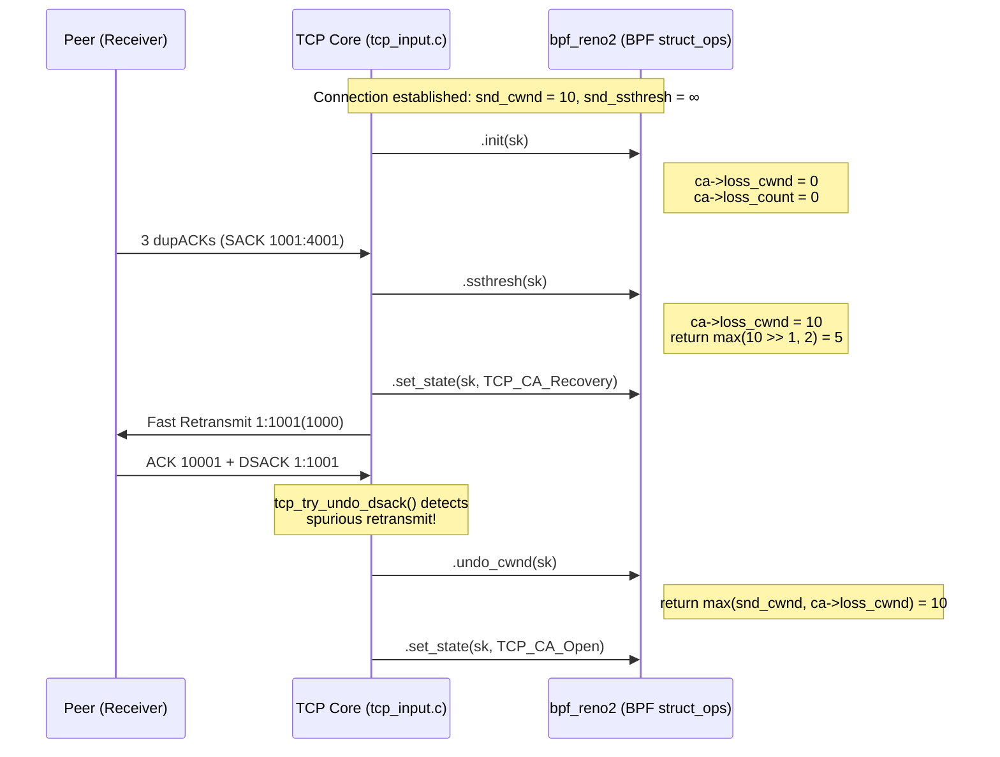

# 15. Hands-on lab: Building CUBIC with BPF CC and packetdrill

This chapter collects the 6 hands-on steps under `labs/cubic/`. Work through the Design Checkpoints first, fill in the `TODO`s in `starter.bpf.c`, and run `./labs/run_test.sh cubic/<step>` to verify your implementation in `vng` with `bpftool` and `packetdrill`.


## Step 1: Minimal BPF Congestion Control Skeleton + Slow Start & Reno AI

### Goal

In this step, you will implement a Linux kernel `struct tcp_congestion_ops` in BPF using `struct_ops`, building **TCP Reno (Slow Start and Additive Increase)** from scratch.

Rather than delegating to kernel `extern __ksym` helpers such as `tcp_slow_start()` or `tcp_cong_avoid_ai()`, you will write every line in pure BPF so you can see and verify how `tp->snd_cwnd`, `tp->snd_ssthresh`, and `tp->snd_cwnd_cnt` evolve on every incoming ACK.

---

### Design Checkpoints (Think before coding)

Before opening `starter.bpf.c` or `solution.bpf.c`, pause and work through these four design questions on your own.

#### Q1. State Design: Does Reno need a custom private state struct (`icsk_ca_priv`)?

Algorithms like CUBIC and BBR store per-socket state in `inet_csk_ca(sk)`. Are the fields already present in `struct tcp_sock` sufficient to implement Reno Slow Start and Additive Increase (`+1 cwnd` per RTT)?

<details>
<summary>Hint & Answer</summary>

- **Hint**: Check `struct tcp_sock` for the congestion window, slow start threshold, and a counter that accumulates sub-window ACK credits.
- **Answer**: No custom `icsk_ca_priv` struct is needed. `struct tcp_sock` already provides everything Reno requires:
  - `tp->snd_cwnd`: current congestion window (in segments)
  - `tp->snd_ssthresh`: slow start threshold where Slow Start transitions into Congestion Avoidance
  - `tp->snd_cwnd_cnt`: linear counter accumulating ACKed segments during Congestion Avoidance
  - `tp->prior_cwnd`: saved `snd_cwnd` before loss recovery (used when undoing a spurious cwnd reduction)

</details>

#### Q2. Hook Selection & Guard Condition: Should `snd_cwnd` grow when the application is send-limited?

The `.cong_avoid(sk, ack, acked)` hook runs on every ACK that acknowledges new data. What goes wrong if we grow `tp->snd_cwnd` unconditionally — for example, when `snd_cwnd = 10` but the application only sends 1 segment per RTT?

<details>
<summary>Hint & Answer</summary>

- **Hint**: If `snd_cwnd` grows without the sender ever filling the pipe to test network capacity, a sudden application burst can inject an arbitrarily large flight of packets into an untested path (see RFC 7661 Cwnd Validation).
- **Answer**: You must only grow `snd_cwnd` when transmission is genuinely limited by `snd_cwnd`. At the very start of `.cong_avoid()`, check `if (!tcp_is_cwnd_limited(sk)) return;` so that application-limited flights do not inflate `snd_cwnd`.

</details>

#### Q3. Boundary Condition: What happens when a stretch ACK crosses `snd_ssthresh` during Slow Start?

Suppose `tp->snd_cwnd = 20` and `tp->snd_ssthresh = 22`. If a single stretch ACK arrives acknowledging `acked = 20` segments at once, what should the resulting `snd_cwnd` and `snd_cwnd_cnt` be?

<details>
<summary>Hint & Answer</summary>

- **Hint**: Slow Start increases `snd_cwnd` by 1 per ACKed segment up to `snd_ssthresh` (22). What should happen to the remaining ACKed segments in the same ACK?
- **Answer**:
  - First, Slow Start consumes `22 - 20 = 2` segments from `acked`, raising `tp->snd_cwnd` to `22` (`tp->snd_ssthresh`).
  - The remaining `acked = 20 - 2 = 18` segments must not be discarded; they fall through to Congestion Avoidance and are added to `tp->snd_cwnd_cnt` (`tp->snd_cwnd_cnt += 18`).
  - Conversely, if all `acked` segments are consumed in Slow Start (`!acked`), we return early before Congestion Avoidance.

</details>

#### Q4. Integer-Only Additive Increase: How do we express `cwnd += acked / cwnd` without floating-point maths in BPF?

BPF programs cannot use floating-point instructions. In Congestion Avoidance, each ACKed segment should increase `snd_cwnd` by `1 / snd_cwnd` (so that one full `snd_cwnd` of ACKs increases `snd_cwnd` by `+1`). How do we write this using only integers?

<details>
<summary>Hint & Answer</summary>

- **Hint**: Keep the numerator of the fraction `tp->snd_cwnd_cnt / tp->snd_cwnd` in `tp->snd_cwnd_cnt`.
- **Answer**:
  - On each ACK in Congestion Avoidance, add `acked` to the numerator: `tp->snd_cwnd_cnt += acked`.
  - Once `tp->snd_cwnd_cnt >= tp->snd_cwnd` (a full window of segments has been acknowledged), subtract `tp->snd_cwnd` from `tp->snd_cwnd_cnt` and increment `tp->snd_cwnd` by `1` (clamped at `tp->snd_cwnd_clamp`).

</details>

---

### Step-by-step Walkthrough

Let's walk through each function in [`solution.bpf.c`](file:///usr/local/google/home/kuniyu/tcp-eli5/labs/cubic/step01-reno/solution.bpf.c).

#### 1. `bpf_reno1_init()` — Initialising the Socket

```c
SEC("struct_ops")
void BPF_PROG(bpf_reno1_init, struct sock *sk)
{
	struct tcp_sock *tp = tcp_sk(sk);

	tp->snd_cwnd_cnt = 0;
	tp->snd_ssthresh = 22;
}
```

- Called when the TCP connection is established (or when `setsockopt(TCP_CONGESTION)` switches the socket to `bpf_reno1`).
- Resets the linear congestion avoidance counter `tp->snd_cwnd_cnt` to `0`.
- Sets `tp->snd_ssthresh = 22` so that `test.pkt` can exercise pure Slow Start (`10 -> 20`), the exact `snd_ssthresh` boundary transition with leftover `acked` credits (`20 -> 22`), and Reno Additive Increase (`22 -> 23`) in three clean rounds.

#### 2. `bpf_reno1_ssthresh()` — Multiplicative Decrease Threshold

```c
SEC("struct_ops")
__u32 BPF_PROG(bpf_reno1_ssthresh, struct sock *sk)
{
	const struct tcp_sock *tp = tcp_sk(sk);

	return max(tp->snd_cwnd >> 1U, 2U);
}
```

- Called when entering loss recovery to compute the new slow start threshold.
- Halves `tp->snd_cwnd` (`tp->snd_cwnd >> 1U`), floored at `2U` as required by RFC 5681.

#### 3. `bpf_reno1_cong_avoid()` — Slow Start and Reno Additive Increase

```c
SEC("struct_ops")
void BPF_PROG(bpf_reno1_cong_avoid, struct sock *sk, __u32 ack, __u32 acked)
{
	struct tcp_sock *tp = tcp_sk(sk);

	if (!tcp_is_cwnd_limited(sk))
		return;

	if (tcp_in_slow_start(tp)) {
		__u32 cwnd = min(tp->snd_cwnd + acked, tp->snd_ssthresh);

		acked -= cwnd - tp->snd_cwnd;
		tp->snd_cwnd = min(cwnd, tp->snd_cwnd_clamp);
		if (!acked)
			return;
	}

	tp->snd_cwnd_cnt += acked;
	if (tp->snd_cwnd_cnt >= tp->snd_cwnd) {
		tp->snd_cwnd_cnt -= tp->snd_cwnd;
		tp->snd_cwnd = min(tp->snd_cwnd + 1, tp->snd_cwnd_clamp);
	}
}
```

- **Cwnd-limited check**: Returns immediately if `!tcp_is_cwnd_limited(sk)`.
- **Slow Start phase**: While `tcp_in_slow_start(tp)` (`tp->snd_cwnd < tp->snd_ssthresh`), computes `cwnd = min(tp->snd_cwnd + acked, tp->snd_ssthresh)`, subtracts the consumed growth `cwnd - tp->snd_cwnd` from `acked`, updates `tp->snd_cwnd`, and returns early if `acked == 0`.
- **Congestion Avoidance (Reno AI) phase**: Adds any remaining `acked` segments to `tp->snd_cwnd_cnt`. When `tp->snd_cwnd_cnt >= tp->snd_cwnd`, subtracts `tp->snd_cwnd` and increments `tp->snd_cwnd` by `1` (clamped at `tp->snd_cwnd_clamp`).
- **BPF Verifier note**: Because this implementation uses bounded arithmetic without loops, the BPF verifier proves termination and safety trivially.

#### 4. `bpf_reno1_undo_cwnd()` — Undoing a Spurious Window Reduction

```c
SEC("struct_ops")
__u32 BPF_PROG(bpf_reno1_undo_cwnd, struct sock *sk)
{
	const struct tcp_sock *tp = tcp_sk(sk);

	return max(tp->snd_cwnd, tp->prior_cwnd);
}
```

- Restores `snd_cwnd` to `max(tp->snd_cwnd, tp->prior_cwnd)` when the kernel detects that a loss recovery episode was spurious (explored in detail in Step 2).

---

### Understanding `test.pkt`

[`test.pkt`](file:///usr/local/google/home/kuniyu/tcp-eli5/labs/cubic/step01-reno/test.pkt) drives `bpf_reno1` through three deterministic rounds:

1. **Handshake with 1000-byte Effective MSS**:
   - The incoming SYN advertises `<mss 1012,sackOK,TS val 100 ecr 0,nop,wscale 7>`.
   - With 12-byte TCP Timestamps (`nop,nop,TS`), `tp->mss_cache` becomes `1012 - 12 = 1000` bytes, making segment arithmetic exact (`10,000` bytes = `10` segments).
   - Immediately after `accept()`, `test.pkt` asserts `tcpi_snd_cwnd == 10` and `tcpi_snd_ssthresh == 22`.
2. **Round 1 — Pure Slow Start (`cwnd: 10 -> 20`)**:
   - `write(4, ..., 10000)` sends 10 segments (`1:10001`), filling `cwnd = 10` so `tp->is_cwnd_limited` becomes `true`.
   - Receiving `ack 10001` (`acked = 10`) doubles `tcpi_snd_cwnd` from `10` to `20`.
3. **Round 2 — Clamping at `snd_ssthresh` & Carrying Leftover Credits (`cwnd: 20 -> 22`)**:
   - `write(4, ..., 20000)` sends 20 segments (`10001:30001`), filling `cwnd = 20`.
   - Receiving `ack 30001` (`acked = 20`) grows `cwnd` by `2` in Slow Start to reach `snd_ssthresh = 22`, and carries the remaining `18` ACKed segments into `tp->snd_cwnd_cnt = 18`.
4. **Round 3 — Reno Additive Increase (`cwnd: 22 -> 23`)**:
   - `write(4, ..., 22000)` sends 22 segments (`30001:52001`), filling `cwnd = 22`.
   - Receiving `ack 52001` (`acked = 22`) raises `tp->snd_cwnd_cnt` to `18 + 22 = 40 >= 22`, incrementing `tcpi_snd_cwnd` from `22` to `23`.

---

### How to run

Run the following commands from `/usr/local/google/home/kuniyu/tcp-eli5/labs/cubic/step01-reno` (or from `labs/`):

```sh
## 1. Verify that starter.bpf.c fails the packetdrill assertion
../../run_test.sh cubic/step01-reno starter
## 2. Implement the TODOs in starter.bpf.c and re-run (or run the model solution)
../../run_test.sh cubic/step01-reno solution
```


### `labs/cubic/step01-reno/starter.bpf.c` (Starter skeleton)

```c
// SPDX-License-Identifier: GPL-2.0
/*
 * Step 1 (Starter): Minimal BPF Congestion Control Skeleton + Slow Start & Reno AI
 *
 * Fill in the TODOs below to implement TCP Reno in pure BPF.
 */
#include "bpf_cc_helpers.h"

char _license[] SEC("license") = "GPL";

SEC("struct_ops")
void BPF_PROG(bpf_reno1_init, struct sock *sk)
{
	struct tcp_sock *tp = tcp_sk(sk);

	tp->snd_cwnd_cnt = 0;
	/* Pre-configured to 22 segments for test.pkt so we can observe
	 * both Slow Start (10 -> 20 -> 22) and Reno AI (22 -> 23).
	 */
	tp->snd_ssthresh = 22;
}

SEC("struct_ops")
__u32 BPF_PROG(bpf_reno1_ssthresh, struct sock *sk)
{
	const struct tcp_sock *tp = tcp_sk(sk);

	/* TODO 1: Return half of tp->snd_cwnd, but at least 2U. */
	(void)tp;
	return 2U;
}

SEC("struct_ops")
void BPF_PROG(bpf_reno1_cong_avoid, struct sock *sk, __u32 ack, __u32 acked)
{
	struct tcp_sock *tp = tcp_sk(sk);

	/* TODO 2: Return early if the socket is not cwnd-limited
	 *         (!tcp_is_cwnd_limited(sk)).
	 */

	/* TODO 3: Slow Start (if tcp_in_slow_start(tp)):
	 *   - Grow tp->snd_cwnd by acked, clamped at tp->snd_ssthresh
	 *     (and tp->snd_cwnd_clamp).
	 *   - Subtract the used growth from acked.
	 *   - If acked == 0, return early; otherwise fall through to
	 *     Congestion Avoidance with the remaining acked segments.
	 */

	/* TODO 4: Congestion Avoidance (Reno Additive Increase):
	 *   - Add acked to tp->snd_cwnd_cnt.
	 *   - When tp->snd_cwnd_cnt >= tp->snd_cwnd, subtract tp->snd_cwnd
	 *     from tp->snd_cwnd_cnt and increment tp->snd_cwnd by 1
	 *     (clamped at tp->snd_cwnd_clamp).
	 */
	(void)tp;
	(void)ack;
	(void)acked;
}

SEC("struct_ops")
__u32 BPF_PROG(bpf_reno1_undo_cwnd, struct sock *sk)
{
	const struct tcp_sock *tp = tcp_sk(sk);

	/* TODO 5: Return the maximum of tp->snd_cwnd and tp->prior_cwnd. */
	return tp->snd_cwnd;
}

SEC(".struct_ops")
struct tcp_congestion_ops bpf_reno1 = {
	.init		= (void *)bpf_reno1_init,
	.ssthresh	= (void *)bpf_reno1_ssthresh,
	.cong_avoid	= (void *)bpf_reno1_cong_avoid,
	.undo_cwnd	= (void *)bpf_reno1_undo_cwnd,
	.flags		= TCP_CONG_NON_RESTRICTED,
	.name		= "bpf_reno1",
};
```


### `labs/cubic/step01-reno/test.pkt` (packetdrill test)

```python
// SPDX-License-Identifier: GPL-2.0
// Step 1: Test BPF Reno Slow Start, ssthresh boundary clamping, and Reno AI

0.00 `sysctl -q net.ipv4.tcp_congestion_control=bpf_reno1`

// Establish a passive TCP connection.
// MSS = 1012 with 12-byte TCP Timestamps option -> tp->mss_cache == 1000 bytes.
+0.00 socket(..., SOCK_STREAM, IPPROTO_TCP) = 3
+0.00 setsockopt(3, SOL_SOCKET, SO_REUSEADDR, [1], 4) = 0
+0.00 bind(3, ..., ...) = 0
+0.00 listen(3, 1) = 0

+0.00 < S 0:0(0) win 32792 <mss 1012,sackOK,TS val 100 ecr 0,nop,wscale 7>
+0.00 > S. 0:0(0) ack 1 <mss 1460,sackOK,TS val 100 ecr 100,nop,wscale 7>
+0.01 < . 1:1(0) ack 1 win 257 <nop,nop,TS val 110 ecr 100>
+0.00 accept(3, ..., ...) = 4

// Verify initial cwnd == 10 and ssthresh == 22 (from bpf_reno1_init).
+0.00 %{
assert tcpi_snd_cwnd == 10, f"expected initial cwnd 10, got {tcpi_snd_cwnd}"
assert tcpi_snd_ssthresh == 22, f"expected initial ssthresh 22, got {tcpi_snd_ssthresh}"
}%

// 1. Pure Slow Start: send 10,000 bytes (10 segments == full cwnd, so
//    tp->is_cwnd_limited becomes true) and ACK them. cwnd grows 10 -> 20.
+0.00 write(4, ..., 10000) = 10000
+0.00 > P. 1:10001(10000) ack 1 <nop,nop,TS val 110 ecr 110>
+0.01 < . 1:1(0) ack 10001 win 257 <nop,nop,TS val 120 ecr 110>
+0.00 %{
assert tcpi_snd_cwnd == 20, f"expected cwnd 20 after Slow Start, got {tcpi_snd_cwnd}"
}%

// 2. Slow Start -> Congestion Avoidance transition:
//    Send 20,000 bytes (20 segments == full cwnd 20) and ACK all 20 segments.
//    - Slow Start uses 2 segments to reach ssthresh (20 -> 22).
//    - The remaining 18 ACKed segments fall through to Congestion Avoidance,
//      setting tp->snd_cwnd_cnt = 18 (< 22, so cwnd stays 22).
+0.00 write(4, ..., 20000) = 20000
+0.00 > P. 10001:30001(20000) ack 1 <nop,nop,TS val 120 ecr 120>
+0.01 < . 1:1(0) ack 30001 win 257 <nop,nop,TS val 130 ecr 120>
+0.00 %{
assert tcpi_snd_cwnd == 22, f"expected cwnd 22 at ssthresh boundary, got {tcpi_snd_cwnd}"
}%

// 3. Reno Additive Increase:
//    Send 22,000 bytes (22 segments == full cwnd 22) and ACK them.
//    tp->snd_cwnd_cnt (18 + 22 = 40 >= 22) triggers +1 cwnd (22 -> 23).
+0.00 write(4, ..., 22000) = 22000
+0.00 > P. 30001:52001(22000) ack 1 <nop,nop,TS val 130 ecr 130>
+0.01 < . 1:1(0) ack 52001 win 257 <nop,nop,TS val 140 ecr 130>
+0.00 %{
assert tcpi_snd_cwnd == 23, f"expected cwnd 23 after Reno AI, got {tcpi_snd_cwnd}"
}%
```


<details>
<summary>Model answer: <code>labs/cubic/step01-reno/solution.bpf.c</code></summary>

```c
// SPDX-License-Identifier: GPL-2.0
/*
 * Step 1: Minimal BPF Congestion Control Skeleton + Slow Start & Reno AI
 *
 * Implements TCP Reno from scratch in pure BPF (without calling kernel
 * extern __ksym helpers) so every line of Slow Start and Additive Increase
 * is visible and testable with packetdrill.
 */
#include "bpf_cc_helpers.h"

char _license[] SEC("license") = "GPL";

SEC("struct_ops")
void BPF_PROG(bpf_reno1_init, struct sock *sk)
{
	struct tcp_sock *tp = tcp_sk(sk);

	tp->snd_cwnd_cnt = 0;
	/* Set initial ssthresh to 22 segments so we can observe:
	 * 1) Pure Slow Start (cwnd: 10 -> 20)
	 * 2) Slow Start -> Congestion Avoidance boundary (cwnd: 20 -> 22,
	 *    with 18 leftover ACKed segments carried into snd_cwnd_cnt)
	 * 3) Reno Additive Increase (cwnd: 22 -> 23)
	 */
	tp->snd_ssthresh = 22;
}

SEC("struct_ops")
__u32 BPF_PROG(bpf_reno1_ssthresh, struct sock *sk)
{
	const struct tcp_sock *tp = tcp_sk(sk);

	return max(tp->snd_cwnd >> 1U, 2U);
}

SEC("struct_ops")
void BPF_PROG(bpf_reno1_cong_avoid, struct sock *sk, __u32 ack, __u32 acked)
{
	struct tcp_sock *tp = tcp_sk(sk);

	if (!tcp_is_cwnd_limited(sk))
		return;

	/* 1. Slow Start: exponential growth (+1 cwnd per ACKed segment)
	 *    clamped at tp->snd_ssthresh. Any leftover acked segments
	 *    fall through to Congestion Avoidance.
	 */
	if (tcp_in_slow_start(tp)) {
		__u32 cwnd = min(tp->snd_cwnd + acked, tp->snd_ssthresh);

		acked -= cwnd - tp->snd_cwnd;
		tp->snd_cwnd = min(cwnd, tp->snd_cwnd_clamp);
		if (!acked)
			return;
	}

	/* 2. Congestion Avoidance (Reno Additive Increase):
	 *    accumulate ACKed segments in tp->snd_cwnd_cnt and increase
	 *    tp->snd_cwnd by 1 once a full cwnd worth of ACKs arrives.
	 */
	tp->snd_cwnd_cnt += acked;
	if (tp->snd_cwnd_cnt >= tp->snd_cwnd) {
		tp->snd_cwnd_cnt -= tp->snd_cwnd;
		tp->snd_cwnd = min(tp->snd_cwnd + 1, tp->snd_cwnd_clamp);
	}
}

SEC("struct_ops")
__u32 BPF_PROG(bpf_reno1_undo_cwnd, struct sock *sk)
{
	const struct tcp_sock *tp = tcp_sk(sk);

	return max(tp->snd_cwnd, tp->prior_cwnd);
}

SEC(".struct_ops")
struct tcp_congestion_ops bpf_reno1 = {
	.init		= (void *)bpf_reno1_init,
	.ssthresh	= (void *)bpf_reno1_ssthresh,
	.cong_avoid	= (void *)bpf_reno1_cong_avoid,
	.undo_cwnd	= (void *)bpf_reno1_undo_cwnd,
	.flags		= TCP_CONG_NON_RESTRICTED,
	.name		= "bpf_reno1",
};
```

</details>

---

## Step 2: Loss / Fast Recovery and DSACK Undo

### Goal

In Step 1, we implemented Slow Start and Congestion Avoidance in an ideal environment without packet loss. In real networks, however, **packet loss** due to router buffer overflows and **packet reordering** due to path changes happen all the time.

In this step, you will learn how a TCP congestion control (CC) algorithm interacts with the Linux TCP core when packet loss is detected, and when that loss detection later turns out to be a false alarm (**spurious retransmission**) caused by packet reordering.

Specifically, you will implement and verify four mechanisms in `bpf_reno2`:

- Managing a custom per-socket state structure (`struct bpf_reno2_ca`) inside the CC private area `inet_csk_ca(sk)` (`icsk_ca_priv`)
- Saving the pre-loss `snd_cwnd` and halving the slow start threshold ($\max(\text{cwnd} / 2, 2)$) in the `.ssthresh` hook
- Resetting the fractional credit counter and recording loss statistics upon entering `TCP_CA_Loss` (RTO timeout) in the `.set_state` hook
- Restoring the congestion window upon receiving a DSACK (Duplicate SACK) in the `.undo_cwnd` hook

---

### Design Checkpoints (Think before coding)

Before opening `starter.bpf.c`, think through the following four questions on your own.

#### Q1. Where should per-socket custom state be stored?

To restore `snd_cwnd` when a loss event turns out to be spurious, we need to remember the `snd_cwnd` right before entering recovery (as well as how many RTO losses occurred) on each socket. Storing this in a BPF global variable would cause all sockets to overwrite one another's state. Where inside `struct sock` can we store a custom per-socket structure, and what is its size limit?

<details>
<summary>Hint and Answer</summary>

Use the `icsk_ca_priv` array (104 bytes) inside `struct inet_connection_sock`. The `inet_csk_ca(sk)` helper in `bpf_cc_helpers.h` returns a `void *` pointer to `icsk->icsk_ca_priv`.

In this step, we define an 8-byte structure and cast `inet_csk_ca(sk)` to it:

```c
struct bpf_reno2_ca {
	u32 loss_cwnd;
	u32 loss_count;
};
```

The BPF verifier (`bpf_tcp_ca_btf_struct_access()`) explicitly allows write access within the `icsk_ca_priv` range.

</details>

#### Q2. When entering Fast Recovery, does the CC modify `snd_cwnd` or `snd_ssthresh`?

When three duplicate ACKs (with SACK blocks) trigger Fast Recovery (`TCP_CA_Recovery`), the TCP core calls `tcp_init_cwnd_reduction()`. Which CC hook is invoked at this point, what should it return, and who is responsible for actually reducing `snd_cwnd`?

<details>
<summary>Hint and Answer</summary>

The core invokes `.ssthresh(sk)`. Rather than modifying `tp->snd_cwnd` directly, the CC module **only computes and returns the new `snd_ssthresh` value** (`max(tp->snd_cwnd >> 1U, 2U)` for Reno).

The actual reduction of `tp->snd_cwnd` is handled by the TCP core during Recovery using **PRR (Proportional Rate Reduction, RFC 6937)** (`tcp_cwnd_reduction()`), which smoothly paces the window down towards `snd_ssthresh`, and `tcp_end_cwnd_reduction()`, which clamps `tp->snd_cwnd = tp->snd_ssthresh` when exiting Recovery.

Consequently, when `.ssthresh(sk)` is called, `tp->snd_cwnd` still holds its **pre-loss value**. That makes `.ssthresh(sk)` the exact right place to save `ca->loss_cwnd = tp->snd_cwnd`.

</details>

#### Q3. Why reset `tp->snd_cwnd_cnt` to 0 when transitioning to `TCP_CA_Loss`?

When packet loss cannot be recovered via Fast Recovery and an RTO (Retransmission Timeout) fires, the TCP core calls `tcp_set_ca_state(sk, TCP_CA_Loss)`. Why should `.set_state(sk, new_state)` reset `tp->snd_cwnd_cnt = 0` when it sees `new_state == TCP_CA_Loss`?

<details>
<summary>Hint and Answer</summary>

`tp->snd_cwnd_cnt` accumulates fractional ACK credits during Congestion Avoidance (to increment `snd_cwnd` by 1 once a full window of packets has been acknowledged). If credits accumulated under a large pre-loss window were left intact after an RTO reset the window, `snd_cwnd` would be incremented prematurely as soon as the socket re-entered Congestion Avoidance.

Resetting `tp->snd_cwnd_cnt = 0` on `new_state == TCP_CA_Loss` (alongside incrementing `ca->loss_count++`) discards stale credits cleanly. (In later steps, CUBIC will also use `.set_state` on `TCP_CA_Loss` to reset its internal state.)

</details>

#### Q4. When undoing via DSACK, why return `max(tp->snd_cwnd, ca->loss_cwnd)` instead of just `ca->loss_cwnd`?

When a DSACK (Duplicate SACK) proves that a retransmission was unnecessary because the original packet had already arrived, the TCP core calls `.undo_cwnd(sk)` from `tcp_try_undo_dsack()` → `tcp_undo_cwnd_reduction()`. What edge case does `return max(tp->snd_cwnd, ca->loss_cwnd);` prevent compared to `return ca->loss_cwnd;`?

<details>
<summary>Hint and Answer</summary>

During a spurious Recovery or Loss episode, incoming ACKs may have already grown `tp->snd_cwnd` past the initial `ca->loss_cwnd` by the time the undo is triggered.

Returning `ca->loss_cwnd` unconditionally would paradoxically shrink `snd_cwnd` upon undo. Taking `max(tp->snd_cwnd, ca->loss_cwnd)` ensures the congestion window is restored to at least its pre-loss level without ever reducing a window that has already grown larger.

</details>

---

### Step-by-step Walkthrough



#### 1. Per-socket State `struct bpf_reno2_ca` and `.init`

```c
struct bpf_reno2_ca {
	u32 loss_cwnd;
	u32 loss_count;
};

SEC("struct_ops")
void BPF_PROG(bpf_reno2_init, struct sock *sk)
{
	struct bpf_reno2_ca *ca = inet_csk_ca(sk);

	ca->loss_cwnd = 0;
	ca->loss_count = 0;
}
```

- `inet_csk_ca(sk)` returns `(void *)inet_csk(sk)->icsk_ca_priv`.
- `bpf_reno2_init()` is called when the connection reaches `ESTABLISHED` (or when switching CC via `setsockopt(TCP_CONGESTION)`) and initialises both `loss_cwnd` and `loss_count` to `0`.

#### 2. Saving `snd_cwnd` and Halving `ssthresh`: `.ssthresh`

```c
SEC("struct_ops")
u32 BPF_PROG(bpf_reno2_ssthresh, struct sock *sk)
{
	const struct tcp_sock *tp = tcp_sk(sk);
	struct bpf_reno2_ca *ca = inet_csk_ca(sk);

	ca->loss_cwnd = tp->snd_cwnd;
	return max(tp->snd_cwnd >> 1U, 2U);
}
```

- Following [RFC 5681 §3.1](https://www.rfc-editor.org/rfc/rfc5681#section-3.1), `.ssthresh` returns half of the current `snd_cwnd` (using right shift `>> 1U`) bounded below by `2U`.
- At the same time, it saves the pre-reduction `tp->snd_cwnd` into `ca->loss_cwnd` so that `.undo_cwnd` can restore it if the loss turns out to be spurious.

#### 3. Handling Transition to `TCP_CA_Loss`: `.set_state`

```c
SEC("struct_ops")
void BPF_PROG(bpf_reno2_set_state, struct sock *sk, u8 new_state)
{
	struct tcp_sock *tp = tcp_sk(sk);
	struct bpf_reno2_ca *ca = inet_csk_ca(sk);

	if (new_state == TCP_CA_Loss) {
		tp->snd_cwnd_cnt = 0;
		ca->loss_count++;
	}
}
```

- Invoked by `tcp_set_ca_state()` right before updating `icsk_ca_state`.
- When `new_state == TCP_CA_Loss`, we clear `tp->snd_cwnd_cnt = 0` and increment `ca->loss_count++`.
- Note on BPF verifier constraints: not all fields of `struct tcp_sock` are writable from a `struct_ops` program, but `snd_cwnd`, `snd_cwnd_cnt`, `snd_ssthresh`, and `icsk_ca_priv` are explicitly whitelisted in `bpf_tcp_ca_btf_struct_access()`.

#### 4. Undoing Window Reduction: `.undo_cwnd`

```c
SEC("struct_ops")
u32 BPF_PROG(bpf_reno2_undo_cwnd, struct sock *sk)
{
	const struct tcp_sock *tp = tcp_sk(sk);
	const struct bpf_reno2_ca *ca = inet_csk_ca(sk);

	return max(tp->snd_cwnd, ca->loss_cwnd);
}
```

- When DSACK ([RFC 2883](https://www.rfc-editor.org/rfc/rfc2883) / [RFC 3708](https://www.rfc-editor.org/rfc/rfc3708)) or TCP timestamps (Eifel Detection, [RFC 3522](https://www.rfc-editor.org/rfc/rfc3522)) prove that all retransmissions in the recovery episode were spurious, `tcp_undo_cwnd_reduction()` calls `.undo_cwnd(sk)`.
- Returning `max(tp->snd_cwnd, ca->loss_cwnd)` restores the halved window back to the pre-loss `loss_cwnd` (while the TCP core restores `snd_ssthresh` from `tp->prior_ssthresh`).

---

### Understanding `test.pkt`

`test.pkt` reproduces a complete **packet reordering → Fast Recovery → DSACK Undo** sequence:

1. **Handshake and IW10 transmission**:
   - The connection is established with `<mss 1012,sackOK,TS val 100 ecr 0,nop,wscale 7>`. Because the TCP Timestamp option takes 12 bytes, each segment carries exactly `1000` bytes of payload.
   - `write(4, ..., 10000)` sends 10 segments (`1:10001(10000)`). At this point `tcpi_snd_cwnd == 10` and `tcpi_ca_state == TCP_CA_Open`.
2. **Three duplicate ACKs with SACK trigger Fast Recovery**:
   - Segment `1:1001` is delayed in the network while `1001:2001`, `2001:3001`, and `3001:4001` arrive at the peer first.
   - The peer sends three duplicate ACKs (`ack 1`) carrying `<nop,nop,TS ...,nop,nop,sack 1001:2001>`, `<...,sack 1001:3001>`, and `<...,sack 1001:4001>`. On the third duplicate ACK, `sacked_out == 3` (`>= tp->reordering`), triggering Fast Recovery.
   - The kernel fast-retransmits `1:1001(1000)`, calls `.ssthresh`, and transitions to `tcpi_ca_state == TCP_CA_Recovery` with `tcpi_snd_ssthresh == 5`.
3. **Cumulative ACK with DSACK triggers Undo**:
   - Both the delayed original `1:1001` and the remaining segments arrive at the peer, followed by the duplicate retransmission `1:1001`. The peer replies with a cumulative `ack 10001` containing a **DSACK block `<nop,nop,TS ...,nop,nop,sack 1:1001>`** (reporting duplicate receipt of `1:1001`, which is below `ack 10001`).
   - Seeing `undo_retrans == 0`, the kernel calls `tcp_try_undo_dsack()`, which invokes `.undo_cwnd` and restores `tcpi_snd_cwnd` from `5` back to `>= 10` (`tcpi_snd_cwnd >= 10`).

---

### How to run

```sh
## 1. starter.bpf.c がアサートで失敗することを確認
../../run_test.sh cubic/step02-loss-undo starter
## 2. starter.bpf.c の TODO を実装して再実行（または模範解答 solution を実行）
../../run_test.sh cubic/step02-loss-undo solution
```


### `labs/cubic/step02-loss-undo/starter.bpf.c` (Starter skeleton)

```c
/* SPDX-License-Identifier: GPL-2.0 */
#include "bpf_cc_helpers.h"

char _license[] SEC("license") = "GPL";

struct bpf_reno2_ca {
	u32 loss_cwnd;
	u32 loss_count;
};

SEC("struct_ops")
void BPF_PROG(bpf_reno2_init, struct sock *sk)
{
	struct bpf_reno2_ca *ca = inet_csk_ca(sk);

	ca->loss_cwnd = 0;
	ca->loss_count = 0;
}

SEC("struct_ops")
u32 BPF_PROG(bpf_reno2_ssthresh, struct sock *sk)
{
	const struct tcp_sock *tp = tcp_sk(sk);
	struct bpf_reno2_ca *ca = inet_csk_ca(sk);

	/*
	 * TODO 1:
	 * 1. ロス検出直前のウィンドウサイズ tp->snd_cwnd を ca->loss_cwnd に保存する
	 * 2. 半減させたしきい値 max(tp->snd_cwnd >> 1U, 2U) を返す
	 */
	(void)ca;
	return tp->snd_cwnd;
}

SEC("struct_ops")
void BPF_PROG(bpf_reno2_set_state, struct sock *sk, u8 new_state)
{
	struct tcp_sock *tp = tcp_sk(sk);
	struct bpf_reno2_ca *ca = inet_csk_ca(sk);

	/*
	 * TODO 2:
	 * new_state == TCP_CA_Loss のとき、端数カウンタ tp->snd_cwnd_cnt を 0 にリセットし、
	 * ca->loss_count をインクリメントする
	 */
	(void)tp;
	(void)ca;
	(void)new_state;
}

SEC("struct_ops")
u32 BPF_PROG(bpf_reno2_undo_cwnd, struct sock *sk)
{
	const struct tcp_sock *tp = tcp_sk(sk);
	const struct bpf_reno2_ca *ca = inet_csk_ca(sk);

	/*
	 * TODO 3:
	 * DSACK 等でロス検出が誤り（spurious）と判明した際、
	 * 現在の tp->snd_cwnd と退避しておいた ca->loss_cwnd の大きい方を返す
	 */
	(void)ca;
	return tp->snd_cwnd;
}

SEC("struct_ops")
void BPF_PROG(bpf_reno2_cong_avoid, struct sock *sk, u32 ack, u32 acked)
{
	struct tcp_sock *tp = tcp_sk(sk);

	if (!tcp_is_cwnd_limited(sk))
		return;

	if (tcp_in_slow_start(tp)) {
		u32 cwnd = min(tp->snd_cwnd + acked, tp->snd_ssthresh);

		acked -= cwnd - tp->snd_cwnd;
		tp->snd_cwnd = min(cwnd, tp->snd_cwnd_clamp);
		if (!acked)
			return;
	}

	tp->snd_cwnd_cnt += acked;
	if (tp->snd_cwnd_cnt >= tp->snd_cwnd) {
		u32 w = max(tp->snd_cwnd, 1U);
		u32 delta = tp->snd_cwnd_cnt / w;

		tp->snd_cwnd_cnt -= delta * w;
		tp->snd_cwnd = min(tp->snd_cwnd + delta, tp->snd_cwnd_clamp);
	}
}

SEC(".struct_ops")
struct tcp_congestion_ops bpf_reno2 = {
	.init		= (void *)bpf_reno2_init,
	.ssthresh	= (void *)bpf_reno2_ssthresh,
	.set_state	= (void *)bpf_reno2_set_state,
	.undo_cwnd	= (void *)bpf_reno2_undo_cwnd,
	.cong_avoid	= (void *)bpf_reno2_cong_avoid,
	.flags		= TCP_CONG_NON_RESTRICTED,
	.name		= "bpf_reno2",
};
```


### `labs/cubic/step02-loss-undo/test.pkt` (packetdrill test)

```python
// SPDX-License-Identifier: GPL-2.0
// Step 2: Loss / Fast Recovery and DSACK Undo test for bpf_reno2

0.00 `sysctl -q net.ipv4.tcp_congestion_control=bpf_reno2`

+0.00 socket(..., SOCK_STREAM, IPPROTO_TCP) = 3
+0.00 setsockopt(3, SOL_SOCKET, SO_REUSEADDR, [1], 4) = 0
+0.00 bind(3, ..., ...) = 0
+0.00 listen(3, 1) = 0

// Establish connection with MSS 1012 (1000-byte payload + 12-byte TS option)
+0.00 < S 0:0(0) win 32792 <mss 1012,sackOK,TS val 100 ecr 0,nop,wscale 7>
+0.00 > S. 0:0(0) ack 1 <mss 1460,sackOK,TS val 100 ecr 100,nop,wscale 7>
+0.01 < . 1:1(0) ack 1 win 257 <nop,nop,TS val 110 ecr 100>
+0.00 accept(3, ..., ...) = 4

// Send 10 segments (IW10 = 10,000 bytes)
+0.00 write(4, ..., 10000) = 10000
+0.00 > P. 1:10001(10000) ack 1 <nop,nop,TS val 110 ecr 110>
+0.00 %{
assert tcpi_snd_cwnd == 10, tcpi_snd_cwnd
assert tcpi_ca_state == TCP_CA_Open, tcpi_ca_state
}%

// 3 duplicate ACKs with SACK blocks trigger Fast Recovery and fast retransmit of 1:1001
+0.01 < . 1:1(0) ack 1 win 257 <nop,nop,TS val 120 ecr 110,nop,nop,sack 1001:2001>
+0.00 < . 1:1(0) ack 1 win 257 <nop,nop,TS val 120 ecr 110,nop,nop,sack 1001:3001>
+0.00 < . 1:1(0) ack 1 win 257 <nop,nop,TS val 120 ecr 110,nop,nop,sack 1001:4001>
+0.00 > . 1:1001(1000) ack 1 <nop,nop,TS val 120 ecr 120>
+0.00 %{
assert tcpi_ca_state == TCP_CA_Recovery, tcpi_ca_state
assert tcpi_snd_ssthresh == 5, tcpi_snd_ssthresh
}%

// Cumulative ACK for all 10,000 bytes with DSACK 1:1001 (spurious retransmit)
// triggers tcp_try_undo_dsack() -> bpf_reno2_undo_cwnd()
+0.01 < . 1:1(0) ack 10001 win 257 <nop,nop,TS val 130 ecr 120,nop,nop,sack 1:1001>
+0.00 %{
assert tcpi_ca_state == TCP_CA_Open, tcpi_ca_state
assert tcpi_snd_cwnd >= 10, tcpi_snd_cwnd
}%
```


<details>
<summary>Model answer: <code>labs/cubic/step02-loss-undo/solution.bpf.c</code></summary>

```c
/* SPDX-License-Identifier: GPL-2.0 */
#include "bpf_cc_helpers.h"

char _license[] SEC("license") = "GPL";

struct bpf_reno2_ca {
	u32 loss_cwnd;
	u32 loss_count;
};

SEC("struct_ops")
void BPF_PROG(bpf_reno2_init, struct sock *sk)
{
	struct bpf_reno2_ca *ca = inet_csk_ca(sk);

	ca->loss_cwnd = 0;
	ca->loss_count = 0;
}

SEC("struct_ops")
u32 BPF_PROG(bpf_reno2_ssthresh, struct sock *sk)
{
	const struct tcp_sock *tp = tcp_sk(sk);
	struct bpf_reno2_ca *ca = inet_csk_ca(sk);

	/* ロス検出時点の cwnd を私有領域に退避し、半減した ssthresh（下限 2）を返す */
	ca->loss_cwnd = tp->snd_cwnd;
	return max(tp->snd_cwnd >> 1U, 2U);
}

SEC("struct_ops")
void BPF_PROG(bpf_reno2_set_state, struct sock *sk, u8 new_state)
{
	struct tcp_sock *tp = tcp_sk(sk);
	struct bpf_reno2_ca *ca = inet_csk_ca(sk);

	if (new_state == TCP_CA_Loss) {
		tp->snd_cwnd_cnt = 0;
		ca->loss_count++;
	}
}

SEC("struct_ops")
u32 BPF_PROG(bpf_reno2_undo_cwnd, struct sock *sk)
{
	const struct tcp_sock *tp = tcp_sk(sk);
	const struct bpf_reno2_ca *ca = inet_csk_ca(sk);

	/* Spurious retransmit と判明した際、ロス前の loss_cwnd まで cwnd を復元する */
	return max(tp->snd_cwnd, ca->loss_cwnd);
}

SEC("struct_ops")
void BPF_PROG(bpf_reno2_cong_avoid, struct sock *sk, u32 ack, u32 acked)
{
	struct tcp_sock *tp = tcp_sk(sk);

	if (!tcp_is_cwnd_limited(sk))
		return;

	if (tcp_in_slow_start(tp)) {
		u32 cwnd = min(tp->snd_cwnd + acked, tp->snd_ssthresh);

		acked -= cwnd - tp->snd_cwnd;
		tp->snd_cwnd = min(cwnd, tp->snd_cwnd_clamp);
		if (!acked)
			return;
	}

	tp->snd_cwnd_cnt += acked;
	if (tp->snd_cwnd_cnt >= tp->snd_cwnd) {
		u32 w = max(tp->snd_cwnd, 1U);
		u32 delta = tp->snd_cwnd_cnt / w;

		tp->snd_cwnd_cnt -= delta * w;
		tp->snd_cwnd = min(tp->snd_cwnd + delta, tp->snd_cwnd_clamp);
	}
}

SEC(".struct_ops")
struct tcp_congestion_ops bpf_reno2 = {
	.init		= (void *)bpf_reno2_init,
	.ssthresh	= (void *)bpf_reno2_ssthresh,
	.set_state	= (void *)bpf_reno2_set_state,
	.undo_cwnd	= (void *)bpf_reno2_undo_cwnd,
	.cong_avoid	= (void *)bpf_reno2_cong_avoid,
	.flags		= TCP_CONG_NON_RESTRICTED,
	.name		= "bpf_reno2",
};
```

</details>

---

## Step 3: Fixed-Point Cubic Root and the W_cubic(t) Curve (Concave & Convex)

### Goal

In this step, you will implement the core 3rd-degree polynomial congestion window growth curve $W_{\text{cubic}}(t)$ of Linux's default congestion control algorithm, **CUBIC** ([net/ipv4/tcp_cubic.c](file:///usr/local/google/home/kuniyu/kernel/tcp-eli5-src/net/ipv4/tcp_cubic.c)), using BPF `struct_ops` (`bpf_cubic3`).

Specifically, you will learn:

- **Multiplicative Decrease ($\beta = 0.7$)**: How CUBIC reduces `snd_cwnd` to roughly $0.7\times$ (`717 / 1024`) rather than Reno's $0.5\times$ on packet loss, while remembering the pre-loss window size as $W_{\max}$ (`last_max_cwnd`).
- **Fixed-Point Cubic Root `cubic_root()`**: How to approximate the cubic root of a 64-bit integer with ~$0.195\%$ average error in a kernel/BPF environment without floating-point instructions, combining `fls64()`, a 64-entry lookup table `v[]`, and a single Newton-Raphson iteration — plus the explicit bounds check required to satisfy the BPF verifier.
- **The Cubic Window Curve $W_{\text{cubic}}(t) = C(t - K)^3 + W_{\max}$**:
  - **Concave region ($t < K$)**: Rapidly climbs towards $W_{\max}$ and flattens as it approaches the inflection point.
  - **Plateau ($t \approx K$)**: Holds the congestion window nearly constant (`ca->cnt = 100 * cwnd`) around $W_{\max}$ to stabilise the network.
  - **Convex region ($t > K$)**: Gently resumes window growth and accelerates over time to probe for new available bandwidth.

---

### Design Checkpoints (Think before coding)

Before opening [starter.bpf.c](file:///usr/local/google/home/kuniyu/tcp-eli5/labs/cubic/step03-cubic-curve/starter.bpf.c) or [solution.bpf.c](file:///usr/local/google/home/kuniyu/tcp-eli5/labs/cubic/step03-cubic-curve/solution.bpf.c), think through the following four design questions on your own.

#### Q1. What per-socket state do we need in `inet_csk_ca(sk)`?

To evaluate $W_{\text{cubic}}(t) = C(t - K)^3 + W_{\max}$ on incoming ACKs and compute `cnt` (the number of ACKed packets needed to increment `snd_cwnd` by 1 in `tcp_cong_avoid_ai()`), what fields belong in our private state struct? What should we cache at the start of an epoch so we do not recompute `cubic_root()` on every packet?

<details>
<summary>Hints and Answer</summary>

- We need `last_max_cwnd` to store the window size $W_{\max}$ at the last loss event, and `bic_origin_point` for the origin of the current cubic curve.
- By caching the epoch start timestamp `epoch_start` and the time-to-origin `bic_K` (computed once via `cubic_root()` when `epoch_start == 0`), subsequent ACKs only need to compute $(t - K)^3$ without repeating the cubic root.
- We also track the minimum RTT `delay_min` (added to the elapsed time $t$), the resulting increment interval `cnt`, and `last_cwnd` / `last_time` to rate-limit redundant recalculations.

</details>

#### Q2. Why does CUBIC add `delay_min` (minimum RTT) to the elapsed time `t`?

`epoch_start` is initialised when the first Congestion Avoidance ACK arrives after Fast Recovery completes. If we computed $t = \text{now} - \text{epoch\_start}$ without adding `delay_min`, what would happen during the first RTT of Congestion Avoidance?

<details>
<summary>Hints and Answer</summary>

- On the very first ACK of the epoch, `now - epoch_start == 0`. Without `delay_min`, the target window would be evaluated at $t = 0$, giving $W_{\text{cubic}}(0) = \text{cwnd}$, which results in `bic_target == cwnd` and stalls window growth for the first RTT.
- By computing $t = (\text{now} - \text{epoch\_start}) + \text{delay\_min}$, CUBIC looks ahead to where the window curve will be **one RTT in the future** (`bic_target`) and paces the growth across the current RTT via `cnt = cwnd / (bic_target - cwnd)`.

</details>

#### Q3. How do we evaluate both the concave ($t < K$) and convex ($t > K$) regions using only unsigned 64-bit integers (`__u64`)?

Mathematically, $(t - K)^3$ is negative when $t < K$ and positive when $t > K$. How can we compute $W_{\text{cubic}}(t) = C(t - K)^3 + W_{\max}$ cleanly with unsigned integers without signed overflow issues?

<details>
<summary>Hints and Answer</summary>

- First, compute the unsigned distance from the inflection point: `offs = (t < ca->bic_K) ? (ca->bic_K - t) : (t - ca->bic_K)`.
- Next, compute the non-negative cubic offset `delta = (cube_rtt_scale * offs * offs * offs) >> (10 + 3 * BICTCP_HZ)`.
- Finally, subtract `delta` from `ca->bic_origin_point` in the concave region (`t < ca->bic_K`) and add `delta` to `ca->bic_origin_point` in the convex region (`t >= ca->bic_K`).

</details>

#### Q4. Why does the BPF verifier reject `v[shift]` without an explicit bounds check?

In `cubic_root(__u64 a)`, `b = fls64(a); b = ((b * 84) >> 8) - 1; shift = a >> (b * 3);` extracts the top 6 bits of `a` to index into the 64-byte lookup table `v[shift]`. Mathematically `shift` is always in `[0, 63]`, yet the BPF verifier rejects a direct `v[shift]` lookup unless we add a check. Why, and how do we fix it?

<details>
<summary>Hints and Answer</summary>

- The BPF verifier tracks value ranges instruction by instruction, and cannot algebraically prove across `fls64(a)` and the variable shift `a >> (b * 3)` that `shift` is strictly less than 64. It therefore flags `v[shift]` as a potential out-of-bounds read on the 64-byte `.rodata` array.
- Adding `if (shift >= 64) return 0;` right before indexing `v[shift]` bounds the register range to `[0, 63]` for the verifier.

</details>

---

### Step-by-step Walkthrough

#### 1. Fixed-Point Constants and `BICTCP_HZ`

CUBIC defines its target window curve as ($C = 0.4, \beta = 0.7$):

$$W_{\text{cubic}}(t) = C(t - K)^3 + W_{\max}, \quad K = \sqrt[3]{\frac{W_{\max} - \text{cwnd}}{C}}$$

In [solution.bpf.c](file:///usr/local/google/home/kuniyu/tcp-eli5/labs/cubic/step03-cubic-curve/solution.bpf.c), we use the exact fixed-point scaling constants from [tcp_cubic.c](file:///usr/local/google/home/kuniyu/kernel/tcp-eli5-src/net/ipv4/tcp_cubic.c):

- `BICTCP_BETA_SCALE = 1024`, `beta = 717`: $\beta = 717 / 1024 \approx 0.7002$.
- `BICTCP_HZ = 10`: Time is measured in units of $2^{-10}\text{ s}$ ($1024\text{ units} = 1\text{ second}$).
- `bic_scale = 41`, `cube_rtt_scale = bic_scale * 10 = 410`: $C = 410 / 1024 \approx 0.4004$.
- `cube_factor = (1ULL << (10 + 3 * BICTCP_HZ)) / (bic_scale * 10)`:
  To express $K$ in `BICTCP_HZ` ($2^{10}$) units, the radicand is scaled by $(2^{10})^3 = 2^{30}$ and divided by $C = 410 / 2^{10}$, yielding $2^{40} / 410 = 2,681,735,677$.

#### 2. `fls64()` and `cubic_root()`

1. **Locate the most significant bit**: `fls64(a)` finds the 1-based MSB position ($1 \dots 64$), and `b = ((b * 84) >> 8) - 1` computes $\lfloor (\text{fls64}(a) - 1) / 3 \rfloor$ (since $84 / 256 \approx 1/3$).
2. **Lookup table initial estimate**: `shift = a >> (b * 3)` normalises `a` into `[0, 63]`. After the verifier guard `if (shift >= 64) return 0;`, `x = (((v[shift] + 10) << b) >> 6)` produces an initial approximation of $\sqrt[3]{a}$.
3. **One Newton-Raphson iteration**:
   Applying $x_{k+1} = \frac{1}{3}\left(2x_k + \frac{a}{x_k^2}\right)$ via `x = (2 * x + div64_u64(a, x * (x - 1)))` and `x = (x * 341) >> 10` ($341 / 1024 \approx 1/3$) refines the cubic root to ~0.195% average error.

#### 3. `bpf_cubic3_ssthresh()` — Multiplicative Decrease ($\beta \approx 0.7$)

When packet loss is detected, `.ssthresh` (`bpf_cubic3_ssthresh()`) is invoked:

- Resets `ca->epoch_start = 0` so the next Congestion Avoidance ACK starts a fresh CUBIC epoch.
- Saves `ca->last_max_cwnd = tp->snd_cwnd` ($W_{\max}$; Fast Convergence will be added in Step 4).
- Returns `max((tp->snd_cwnd * beta) / BICTCP_BETA_SCALE, 2U)`. For `cwnd = 20`, this yields `20 * 717 / 1024 = 14` (compared to Reno's `10`).

#### 4. `bictcp_update()` — Concave, Plateau, and Convex Regions

On each Congestion Avoidance ACK, `bictcp_update()` updates `ca->cnt`:

1. **Epoch initialisation (`ca->epoch_start == 0`)**:
   - Records `ca->epoch_start = now_us`.
   - If `ca->last_max_cwnd <= cwnd`, sets `ca->bic_K = 0` and `ca->bic_origin_point = cwnd`.
   - Otherwise, computes `ca->bic_K = cubic_root(cube_factor * (ca->last_max_cwnd - cwnd))` and sets `ca->bic_origin_point = ca->last_max_cwnd`.
2. **Evaluating $t$ and $\Delta = C |t - K|^3$**:
   - Converts `(now_us - ca->epoch_start) + ca->delay_min` from microseconds to `BICTCP_HZ` units via `t = (t << BICTCP_HZ) / USEC_PER_SEC`.
   - Computes `offs = |t - ca->bic_K|` and `delta = (cube_rtt_scale * offs * offs * offs) >> (10 + 3 * BICTCP_HZ)`.
   - Sets `bic_target = ca->bic_origin_point - delta` in the **concave** region (`t < ca->bic_K`) and `bic_target = ca->bic_origin_point + delta` in the **convex** region (`t >= ca->bic_K`).
3. **Converting `bic_target` into `ca->cnt`**:
   - If `bic_target > cwnd`, sets `ca->cnt = cwnd / (bic_target - cwnd)`.
   - Otherwise (at the $W_{\max}$ plateau), sets `ca->cnt = 100 * cwnd` for a near-zero slope.
   - Clamps `ca->cnt = max(ca->cnt, 2U)` and passes it to `bpf_cubic3_cong_avoid_ai()`.

---

### Understanding `test.pkt`

[test.pkt](file:///usr/local/google/home/kuniyu/tcp-eli5/labs/cubic/step03-cubic-curve/test.pkt) drives a connection with RTT = 100ms (`delay_min = 100,000` usec) through all phases of the CUBIC curve:

1. **Slow Start (`cwnd: 10 -> 20`)**:
   Sends 10 segments (10,000 bytes). The ACK grows `tcpi_snd_cwnd` from 10 to 20 and records `delay_min = 100ms` in `bpf_cubic3_acked()`.
2. **Packet Loss at `cwnd = 20` and $\beta = 0.7$ Check**:
   Sends 4 segments where the first segment is lost. Three SACKs trigger Fast Recovery and invoke `bpf_cubic3_ssthresh()`, asserting `tcpi_snd_ssthresh == 14` (`20 * 717 / 1024 = 14`, where [starter.bpf.c](file:///usr/local/google/home/kuniyu/tcp-eli5/labs/cubic/step03-cubic-curve/starter.bpf.c) fails with Reno's `10`).
3. **Flight 1 (Epoch start, Concave region, $t_{\text{elapsed}} = 0.0\text{ s}$)**:
   After recovery completes at `cwnd = 14`, Flight 1 initialises the epoch with `bic_K = cubic_root(cube_factor * 6) = 2523` (~$2.46\text{ s}$), `t = 102`, `delta = 5`, `bic_target = 15`, and `ca->cnt = 14`. ACKing 14 packets advances `tcpi_snd_cwnd` to `15`.
4. **Flight 2 (Steep Concave climb, $t_{\text{elapsed}} = 0.6\text{ s}$)**:
   At $t_{\text{elapsed}} = 0.6\text{ s}$, `delta = 2` and `bic_target = 18`, giving `ca->cnt = 15 / (18 - 15) = 5`. ACKing 15 packets increases `cwnd` by `15 / 5 = +3` in a single RTT to `tcpi_snd_cwnd == 18`.
5. **Flight 3 (Reaching the origin $W_{\max} = 20$, $t_{\text{elapsed}} = 1.8\text{ s}$)**:
   Approaching $K \approx 2.46\text{ s}$, `delta = 0` and `bic_target = 20`, giving `ca->cnt = 18 / (20 - 18) = 9`. ACKing 18 packets brings `tcpi_snd_cwnd` to `20` ($W_{\max}$).
6. **Flight 4 (Plateau at $W_{\max} = 20$ near $t \approx K$, $t_{\text{elapsed}} = 2.1\text{ s}$)**:
   With `cwnd == 20` and `bic_target == 20`, `bic_target <= cwnd` sets `ca->cnt = 100 * cwnd = 2000`. Even after 20 segments are ACKed, `tcpi_snd_cwnd` remains flat at `20`.
7. **Flight 5 (Convex bandwidth probing, $t_{\text{elapsed}} = 4.0\text{ s} > K$)**:
   Past $K$, `t > bic_K` and `delta = 1` push `bic_target = 20 + 1 = 21 > cwnd`. ACKing 20 segments grows `tcpi_snd_cwnd` past `20` into the convex probing region.

---

### How to run

```sh
## 1. Verify that starter.bpf.c fails on the packetdrill assertion
../../run_test.sh cubic/step03-cubic-curve starter
## 2. Implement the TODOs in starter.bpf.c and re-run (or run the model solution)
../../run_test.sh cubic/step03-cubic-curve solution
```


### `labs/cubic/step03-cubic-curve/starter.bpf.c` (Starter skeleton)

```c
// SPDX-License-Identifier: GPL-2.0
/*
 * Step 3 (Starter): Fixed-Point Cubic Root and the W_cubic(t) Curve
 *
 * Complete the three TODO sections below:
 *   1. cubic_root(__u64 a): fixed-point cubic root using fls64(a), v[] table,
 *      and one Newton-Raphson iteration.
 *   2. bictcp_update(): compute K, t, offs = |t - K|, delta = C * |t - K|^3,
 *      bic_target = W_max +/- delta, and ca->cnt.
 *   3. bpf_cubic3_ssthresh(): save W_max, reset epoch_start = 0, and apply
 *      multiplicative decrease beta = 717 / 1024.
 */

#include "bpf_cc_helpers.h"

char _license[] SEC("license") = "GPL";

#define BICTCP_BETA_SCALE	1024	/* Scale factor for beta calculation */
#define BICTCP_HZ		10	/* BIC HZ: 2^10 = 1024 units per sec */

static const __u32 beta = 717;			/* 717 / 1024 ~= 0.7 */
static const __u32 bic_scale = 41;		/* C = 41 / 1024 ~= 0.04 (0.4 / 10) */
static const __u32 cube_rtt_scale = (bic_scale * 10);	/* 1024 * C / srtt(0.1s) = 410 */

/* 1 / C * 2^(3 * BICTCP_HZ) = 2^(10 + 30) / 410 */
static const __u64 cube_factor = (1ULL << (10 + 3 * BICTCP_HZ)) / (bic_scale * 10);

struct bpf_cubic3_ca {
	__u32	cnt;			/* Increase cwnd by 1 after cnt ACKs */
	__u32	last_max_cwnd;		/* Last maximum snd_cwnd (W_max) */
	__u32	last_cwnd;		/* The last snd_cwnd */
	__u32	last_time;		/* Time when updated last_cwnd (usec) */
	__u32	bic_origin_point;	/* Origin point of bic function (W_max) */
	__u32	bic_K;			/* Time to origin point from epoch start */
	__u32	delay_min;		/* Minimum RTT (usec) */
	__u32	epoch_start;		/* Beginning of an epoch (usec) */
};

static __always_inline void bictcp_reset(struct bpf_cubic3_ca *ca)
{
	ca->cnt = 0;
	ca->last_max_cwnd = 0;
	ca->last_cwnd = 0;
	ca->last_time = 0;
	ca->bic_origin_point = 0;
	ca->bic_K = 0;
	ca->delay_min = 0;
	ca->epoch_start = 0;
}

static __always_inline __u32 bictcp_clock_us(const struct sock *sk)
{
	return tcp_sk(sk)->tcp_mstamp;
}

/* Find Last Set bit in a 64-bit integer (1..64, or 0 if x == 0). */
static __always_inline __u32 fls64(__u64 x)
{
	__u32 num = 63;

	if (x == 0)
		return 0;

	if (!(x & (~0ULL << 32))) {
		num -= 32;
		x <<= 32;
	}
	if (!(x & (~0ULL << 48))) {
		num -= 16;
		x <<= 16;
	}
	if (!(x & (~0ULL << 56))) {
		num -= 8;
		x <<= 8;
	}
	if (!(x & (~0ULL << 60))) {
		num -= 4;
		x <<= 4;
	}
	if (!(x & (~0ULL << 62))) {
		num -= 2;
		x <<= 2;
	}
	if (!(x & (~0ULL << 63)))
		num -= 1;

	return num + 1;
}

/*
 * cbrt(x) MSB values for x MSB values in [0..63].
 * Precomputed then refined by hand - Willy Tarreau
 */
static const __u8 v[] = {
	/* 0x00 */    0,   54,   54,   54,  118,  118,  118,  118,
	/* 0x08 */  123,  129,  134,  138,  143,  147,  151,  156,
	/* 0x10 */  157,  161,  164,  168,  170,  173,  176,  179,
	/* 0x18 */  181,  185,  187,  190,  192,  194,  197,  199,
	/* 0x20 */  200,  202,  204,  206,  209,  211,  213,  215,
	/* 0x28 */  217,  219,  221,  222,  224,  225,  227,  229,
	/* 0x30 */  231,  232,  234,  236,  237,  239,  240,  242,
	/* 0x38 */  244,  245,  246,  248,  250,  251,  252,  254,
};

static __always_inline __u32 cubic_root(__u64 a)
{
	/*
	 * TODO 1: Implement fixed-point cubic_root(a):
	 *   1. If a < 64, return ((__u32)v[(__u32)a] + 35) >> 6;
	 *   2. Compute b = fls64(a); b = ((b * 84) >> 8) - 1;
	 *   3. Compute shift = (a >> (b * 3)); and guard if (shift >= 64) return 0;
	 *   4. Initial estimate: x = ((__u32)(((__u32)v[shift] + 10) << b)) >> 6;
	 *   5. One Newton-Raphson iteration:
	 *        x = (2 * x + (__u32)div64_u64(a, (__u64)x * (__u64)(x - 1)));
	 *        x = ((x * 341) >> 10);
	 */
	(void)a;
	(void)v;
	(void)fls64;
	return 0;
}

static __always_inline void bictcp_update(struct sock *sk, __u32 cwnd, __u32 acked)
{
	struct bpf_cubic3_ca *ca = inet_csk_ca(sk);

	/*
	 * TODO 2: Replace this Reno fallback (ca->cnt = cwnd) with the CUBIC
	 * window curve W_cubic(t):
	 *   - Initialize epoch_start, bic_origin_point = last_max_cwnd, and
	 *     bic_K = cubic_root(cube_factor * (last_max_cwnd - cwnd))
	 *   - Compute t = ((now_us - epoch_start + delay_min) << BICTCP_HZ) / USEC_PER_SEC
	 *   - Compute offs = |t - bic_K| and
	 *     delta = (cube_rtt_scale * offs * offs * offs) >> (10 + 3 * BICTCP_HZ)
	 *   - Concave (t < bic_K): bic_target = bic_origin_point - delta
	 *     Convex  (t >= bic_K): bic_target = bic_origin_point + delta
	 *   - Set ca->cnt = cwnd / (bic_target - cwnd) if bic_target > cwnd,
	 *     else 100 * cwnd, and clamp ca->cnt = max(ca->cnt, 2U).
	 */
	(void)acked;
	(void)cube_rtt_scale;
	(void)cube_factor;
	(void)cubic_root;
	ca->cnt = max(cwnd, 2U);
}

static __always_inline __u32 bpf_cubic3_slow_start(struct tcp_sock *tp, __u32 acked)
{
	__u32 cwnd = min(tp->snd_cwnd + acked, tp->snd_ssthresh);

	acked -= cwnd - tp->snd_cwnd;
	tp->snd_cwnd = min(cwnd, tp->snd_cwnd_clamp);
	return acked;
}

static __always_inline void bpf_cubic3_cong_avoid_ai(struct tcp_sock *tp, __u32 w, __u32 acked)
{
	if (tp->snd_cwnd_cnt >= w) {
		tp->snd_cwnd_cnt = 0;
		tp->snd_cwnd++;
	}

	tp->snd_cwnd_cnt += acked;
	if (tp->snd_cwnd_cnt >= w) {
		__u32 delta = tp->snd_cwnd_cnt / w;

		tp->snd_cwnd_cnt -= delta * w;
		tp->snd_cwnd += delta;
	}
	tp->snd_cwnd = min(tp->snd_cwnd, tp->snd_cwnd_clamp);
}

SEC("struct_ops")
void BPF_PROG(bpf_cubic3_init, struct sock *sk)
{
	struct bpf_cubic3_ca *ca = inet_csk_ca(sk);

	bictcp_reset(ca);
}

SEC("struct_ops")
__u32 BPF_PROG(bpf_cubic3_ssthresh, struct sock *sk)
{
	const struct tcp_sock *tp = tcp_sk(sk);

	/*
	 * TODO 3:
	 *   - Set ca->epoch_start = 0
	 *   - Save ca->last_max_cwnd = tp->snd_cwnd
	 *   - Return max((tp->snd_cwnd * beta) / BICTCP_BETA_SCALE, 2U)
	 *     instead of Reno's 0.5x reduction below.
	 */
	(void)beta;
	return max(tp->snd_cwnd >> 1U, 2U);
}

SEC("struct_ops")
void BPF_PROG(bpf_cubic3_cong_avoid, struct sock *sk, __u32 ack, __u32 acked)
{
	struct tcp_sock *tp = tcp_sk(sk);
	struct bpf_cubic3_ca *ca = inet_csk_ca(sk);

	if (!tcp_is_cwnd_limited(sk))
		return;

	if (tcp_in_slow_start(tp)) {
		acked = bpf_cubic3_slow_start(tp, acked);
		if (!acked)
			return;
	}
	bictcp_update(sk, tp->snd_cwnd, acked);
	bpf_cubic3_cong_avoid_ai(tp, ca->cnt, acked);
}

SEC("struct_ops")
void BPF_PROG(bpf_cubic3_set_state, struct sock *sk, __u8 new_state)
{
	if (new_state == TCP_CA_Loss)
		bictcp_reset(inet_csk_ca(sk));
}

SEC("struct_ops")
void BPF_PROG(bpf_cubic3_acked, struct sock *sk, const struct ack_sample *sample)
{
	struct bpf_cubic3_ca *ca = inet_csk_ca(sk);
	__u32 now_us = bictcp_clock_us(sk);
	__u32 delay;

	if (sample->rtt_us < 0)
		return;

	if (ca->epoch_start && (__s32)(now_us - ca->epoch_start) < USEC_PER_SEC)
		return;

	delay = sample->rtt_us;
	if (delay == 0)
		delay = 1;

	if (ca->delay_min == 0 || ca->delay_min > delay)
		ca->delay_min = delay;
}

SEC("struct_ops")
__u32 BPF_PROG(bpf_cubic3_undo_cwnd, struct sock *sk)
{
	const struct tcp_sock *tp = tcp_sk(sk);

	return max(tp->snd_cwnd, tp->prior_cwnd);
}

SEC(".struct_ops")
struct tcp_congestion_ops bpf_cubic3 = {
	.init		= (void *)bpf_cubic3_init,
	.ssthresh	= (void *)bpf_cubic3_ssthresh,
	.cong_avoid	= (void *)bpf_cubic3_cong_avoid,
	.set_state	= (void *)bpf_cubic3_set_state,
	.undo_cwnd	= (void *)bpf_cubic3_undo_cwnd,
	.pkts_acked	= (void *)bpf_cubic3_acked,
	.flags		= TCP_CONG_NON_RESTRICTED,
	.name		= "bpf_cubic3",
};
```


### `labs/cubic/step03-cubic-curve/test.pkt` (packetdrill test)

```python
// Step 3: Fixed-Point Cubic Root and W_cubic(t) Curve (Concave & Convex)
// Verifies:
//   1. Multiplicative decrease beta = 717/1024: on loss from cwnd = 20,
//      ssthresh becomes 14 (20 * 717 / 1024 = 14, unlike Reno's 10).
//   2. Concave growth (t < K): rapid cwnd growth toward W_max = 20
//      (14 -> 15 -> 18 -> 20).
//   3. Plateau at inflection point (t ~= K): bic_target == W_max == 20,
//      so ca->cnt = 100 * cwnd and cwnd stays at 20 across a full RTT.
//   4. Convex growth (t > K): bic_target = W_max + delta > 20,
//      so cwnd grows beyond W_max = 20.

0.000 `sysctl -q net.ipv4.tcp_congestion_control=bpf_cubic3`

+0.000 socket(..., SOCK_STREAM, IPPROTO_TCP) = 3
+0.000 setsockopt(3, SOL_SOCKET, SO_REUSEADDR, [1], 4) = 0
+0.000 bind(3, ..., ...) = 0
+0.000 listen(3, 1) = 0

// 3-way handshake with MSS = 1012 (1000-byte payload + 12-byte TS) and RTT = 100ms
+0.000 < S 0:0(0) win 65535 <mss 1012,sackOK,TS val 100 ecr 0,nop,wscale 7>
+0.000 > S. 0:0(0) ack 1 <mss 1460,sackOK,TS val 100 ecr 100,nop,wscale 7>
+0.100 < . 1:1(0) ack 1 win 512 <nop,nop,TS val 200 ecr 100>
+0.000 accept(3, ..., ...) = 4

// Slow Start: send 10 segments -> ACK grows cwnd from 10 to 20 and records delay_min = 100ms
+0.000 write(4, ..., 10000) = 10000
+0.000 > P. 1:10001(10000) ack 1 <nop,nop,TS val 200 ecr 200>
+0.100 < . 1:1(0) ack 10001 win 512 <nop,nop,TS val 300 ecr 200>
+0.000 %{
assert tcpi_snd_cwnd == 20, f"expected cwnd 20 after slow start, got {tcpi_snd_cwnd}"
}%

// Trigger packet loss at cwnd = 20: send 4 segments, first segment (10001:11001) is lost
+0.000 write(4, ..., 4000) = 4000
+0.000 > P. 10001:14001(4000) ack 1 <nop,nop,TS val 300 ecr 300>
+0.100 < . 1:1(0) ack 10001 win 512 <nop,nop,TS val 400 ecr 300,nop,nop,sack 11001:12001>
+0.000 < . 1:1(0) ack 10001 win 512 <nop,nop,TS val 400 ecr 300,nop,nop,sack 11001:13001>
+0.000 < . 1:1(0) ack 10001 win 512 <nop,nop,TS val 400 ecr 300,nop,nop,sack 11001:14001>
+0.000 > . 10001:11001(1000) ack 1 <nop,nop,TS val 400 ecr 400>
+0.000 %{
assert tcpi_ca_state == TCP_CA_Recovery, f"expected Recovery, got {tcpi_ca_state}"
assert tcpi_snd_ssthresh == 14, f"expected CUBIC ssthresh 14 (20 * 717 / 1024), got {tcpi_snd_ssthresh}"
}%

// Recovery ACK completes Fast Recovery: cwnd = ssthresh = 14, W_max = 20
+0.100 < . 1:1(0) ack 14001 win 512 <nop,nop,TS val 500 ecr 400>
+0.000 %{
assert tcpi_ca_state == TCP_CA_Open, f"expected Open, got {tcpi_ca_state}"
assert tcpi_snd_cwnd == 14, f"expected cwnd 14 after recovery, got {tcpi_snd_cwnd}"
}%

// Flight 1 (Epoch start, t_elapsed = 0.0s, Concave region):
// bic_K = cubic_root(cube_factor * (20 - 14)) = 2523 (~2.46s)
// delta = 5 -> bic_target = 20 - 5 = 15 -> ca->cnt = 14 / (15 - 14) = 14
// 14 ACKed packets increase cwnd from 14 to 15.
+0.000 write(4, ..., 14000) = 14000
+0.000 > P. 14001:28001(14000) ack 1 <nop,nop,TS val 500 ecr 500>
+0.100 < . 1:1(0) ack 28001 win 512 <nop,nop,TS val 600 ecr 500>
+0.000 %{
assert tcpi_snd_cwnd == 15, f"expected cwnd 15 after Flight 1 (concave start), got {tcpi_snd_cwnd}"
}%

// Flight 2 (t_elapsed = 0.6s, Concave steep region):
// delta = 2 -> bic_target = 20 - 2 = 18 -> ca->cnt = 15 / (18 - 15) = 5
// 15 ACKed packets increase cwnd by 15 / 5 = 3 (from 15 to 18 in one RTT!).
+0.500 write(4, ..., 15000) = 15000
+0.000 > P. 28001:43001(15000) ack 1 <nop,nop,TS val 1100 ecr 600>
+0.100 < . 1:1(0) ack 43001 win 512 <nop,nop,TS val 1200 ecr 1100>
+0.000 %{
assert tcpi_snd_cwnd == 18, f"expected cwnd 18 after Flight 2 (concave jump), got {tcpi_snd_cwnd}"
}%

// Flight 3 (t_elapsed = 1.8s, Approaching origin W_max = 20):
// delta = 0 -> bic_target = 20 -> ca->cnt = 18 / (20 - 18) = 9
// 18 ACKed packets increase cwnd by 18 / 9 = 2 (reaching W_max = 20).
+1.100 write(4, ..., 18000) = 18000
+0.000 > P. 43001:61001(18000) ack 1 <nop,nop,TS val 2300 ecr 1200>
+0.100 < . 1:1(0) ack 61001 win 512 <nop,nop,TS val 2400 ecr 2300>
+0.000 %{
assert tcpi_snd_cwnd == 20, f"expected cwnd 20 at W_max origin, got {tcpi_snd_cwnd}"
}%

// Flight 4 (t_elapsed = 2.1s, Plateau at W_max = 20 near t ~= K):
// bic_target == 20 <= cwnd, so ca->cnt = 100 * cwnd = 2000.
// Even after 20 ACKed packets, cwnd stays flat at 20!
+0.200 write(4, ..., 20000) = 20000
+0.000 > P. 61001:81001(20000) ack 1 <nop,nop,TS val 2600 ecr 2400>
+0.100 < . 1:1(0) ack 81001 win 512 <nop,nop,TS val 2700 ecr 2600>
+0.000 %{
assert tcpi_snd_cwnd == 20, f"expected cwnd to plateau at 20 near K, got {tcpi_snd_cwnd}"
}%

// Flight 5 (t_elapsed = 4.0s > K, Convex probing region):
// t > bic_K and delta = 1 -> bic_target = 20 + 1 = 21 > cwnd (20)
// ca->cnt = 20 / (21 - 20) = 20 -> cwnd grows beyond W_max (20)!
+1.800 write(4, ..., 20000) = 20000
+0.000 > P. 81001:101001(20000) ack 1 <nop,nop,TS val 4500 ecr 2700>
+0.100 < . 1:1(0) ack 101001 win 512 <nop,nop,TS val 4600 ecr 4500>
+0.000 %{
assert tcpi_snd_cwnd > 20, f"expected cwnd > 20 in convex region, got {tcpi_snd_cwnd}"
}%
```


<details>
<summary>Model answer: <code>labs/cubic/step03-cubic-curve/solution.bpf.c</code></summary>

```c
// SPDX-License-Identifier: GPL-2.0
/*
 * Step 3: Fixed-Point Cubic Root and the W_cubic(t) Curve (Concave & Convex)
 *
 * Implements the core CUBIC congestion window growth function in BPF:
 *   - Multiplicative decrease with beta = 717 / 1024 (~0.7x)
 *   - Fixed-point cubic_root(u64 a) using fls64(), a 64-entry lookup table,
 *     and one Newton-Raphson iteration
 *   - W_cubic(t) = C * (t - K)^3 + W_max across the concave (t < K),
 *     plateau (t == K), and convex (t > K) regions
 *
 * Note: Fast Convergence and TCP-Friendly mode are disabled in Step 3
 *       and will be added in Step 4.
 */

#include "bpf_cc_helpers.h"

char _license[] SEC("license") = "GPL";

#define BICTCP_BETA_SCALE	1024	/* Scale factor for beta calculation */
#define BICTCP_HZ		10	/* BIC HZ: 2^10 = 1024 units per sec */

static const __u32 beta = 717;			/* 717 / 1024 ~= 0.7 */
static const __u32 bic_scale = 41;		/* C = 41 / 1024 ~= 0.04 (0.4 / 10) */
static const __u32 cube_rtt_scale = (bic_scale * 10);	/* 1024 * C / srtt(0.1s) = 410 */

/* 1 / C * 2^(3 * BICTCP_HZ) = 2^(10 + 30) / 410 */
static const __u64 cube_factor = (1ULL << (10 + 3 * BICTCP_HZ)) / (bic_scale * 10);

struct bpf_cubic3_ca {
	__u32	cnt;			/* Increase cwnd by 1 after cnt ACKs */
	__u32	last_max_cwnd;		/* Last maximum snd_cwnd (W_max) */
	__u32	last_cwnd;		/* The last snd_cwnd */
	__u32	last_time;		/* Time when updated last_cwnd (usec) */
	__u32	bic_origin_point;	/* Origin point of bic function (W_max) */
	__u32	bic_K;			/* Time to origin point from epoch start */
	__u32	delay_min;		/* Minimum RTT (usec) */
	__u32	epoch_start;		/* Beginning of an epoch (usec) */
};

static __always_inline void bictcp_reset(struct bpf_cubic3_ca *ca)
{
	ca->cnt = 0;
	ca->last_max_cwnd = 0;
	ca->last_cwnd = 0;
	ca->last_time = 0;
	ca->bic_origin_point = 0;
	ca->bic_K = 0;
	ca->delay_min = 0;
	ca->epoch_start = 0;
}

static __always_inline __u32 bictcp_clock_us(const struct sock *sk)
{
	return tcp_sk(sk)->tcp_mstamp;
}

/* Find Last Set bit in a 64-bit integer (1..64, or 0 if x == 0). */
static __always_inline __u32 fls64(__u64 x)
{
	__u32 num = 63;

	if (x == 0)
		return 0;

	if (!(x & (~0ULL << 32))) {
		num -= 32;
		x <<= 32;
	}
	if (!(x & (~0ULL << 48))) {
		num -= 16;
		x <<= 16;
	}
	if (!(x & (~0ULL << 56))) {
		num -= 8;
		x <<= 8;
	}
	if (!(x & (~0ULL << 60))) {
		num -= 4;
		x <<= 4;
	}
	if (!(x & (~0ULL << 62))) {
		num -= 2;
		x <<= 2;
	}
	if (!(x & (~0ULL << 63)))
		num -= 1;

	return num + 1;
}

/*
 * cbrt(x) MSB values for x MSB values in [0..63].
 * Precomputed then refined by hand - Willy Tarreau
 *
 * For x in [0..63],
 *   v = cbrt(x << 18) - 1
 *   cbrt(x) = (v[x] + 10) >> 6
 */
static const __u8 v[] = {
	/* 0x00 */    0,   54,   54,   54,  118,  118,  118,  118,
	/* 0x08 */  123,  129,  134,  138,  143,  147,  151,  156,
	/* 0x10 */  157,  161,  164,  168,  170,  173,  176,  179,
	/* 0x18 */  181,  185,  187,  190,  192,  194,  197,  199,
	/* 0x20 */  200,  202,  204,  206,  209,  211,  213,  215,
	/* 0x28 */  217,  219,  221,  222,  224,  225,  227,  229,
	/* 0x30 */  231,  232,  234,  236,  237,  239,  240,  242,
	/* 0x38 */  244,  245,  246,  248,  250,  251,  252,  254,
};

/*
 * Calculate the cubic root of "a" using a table lookup followed by one
 * Newton-Raphson iteration (average error ~= 0.195%).
 */
static __always_inline __u32 cubic_root(__u64 a)
{
	__u32 x, b, shift;

	if (a < 64)
		return ((__u32)v[(__u32)a] + 35) >> 6;

	b = fls64(a);
	b = ((b * 84) >> 8) - 1;
	shift = (a >> (b * 3));

	/* Bounds check required by the BPF verifier for v[shift] */
	if (shift >= 64)
		return 0;

	x = ((__u32)(((__u32)v[shift] + 10) << b)) >> 6;

	/*
	 * Newton-Raphson iteration:
	 *   x_{k+1} = (2 * x_k + a / x_k^2) / 3
	 * Note: 341 / 1024 ~= 1 / 3.
	 */
	x = (2 * x + (__u32)div64_u64(a, (__u64)x * (__u64)(x - 1)));
	x = ((x * 341) >> 10);
	return x;
}

static __always_inline void bictcp_update(struct sock *sk, __u32 cwnd, __u32 acked)
{
	struct bpf_cubic3_ca *ca = inet_csk_ca(sk);
	__u32 now_us = bictcp_clock_us(sk);
	__u32 delta, bic_target;
	__u64 offs, t;

	if (ca->last_cwnd == cwnd &&
	    (__s32)(now_us - ca->last_time) <= (USEC_PER_SEC / 32))
		return;

	if (ca->epoch_start && now_us == ca->last_time)
		goto out;

	ca->last_cwnd = cwnd;
	ca->last_time = now_us;

	if (ca->epoch_start == 0) {
		ca->epoch_start = now_us;

		if (ca->last_max_cwnd <= cwnd) {
			ca->bic_K = 0;
			ca->bic_origin_point = cwnd;
		} else {
			/*
			 * K = cubic_root(cube_factor * (W_max - cwnd))
			 * in units of BICTCP_HZ (1 / 1024 sec).
			 */
			ca->bic_K = cubic_root(cube_factor *
					       (ca->last_max_cwnd - cwnd));
			ca->bic_origin_point = ca->last_max_cwnd;
		}
	}

	/*
	 * Compute elapsed time t = (now - epoch_start + delay_min)
	 * converted from microseconds to BICTCP_HZ (2^10 = 1024 units/sec).
	 */
	t = (__u64)((__s32)(now_us - ca->epoch_start) + ca->delay_min);
	t <<= BICTCP_HZ;
	t /= USEC_PER_SEC;

	if (t < ca->bic_K)
		offs = ca->bic_K - t;
	else
		offs = t - ca->bic_K;

	/* delta = C * |t - K|^3 */
	delta = (cube_rtt_scale * offs * offs * offs) >> (10 + 3 * BICTCP_HZ);
	if (t < ca->bic_K)	/* Concave region: below origin W_max */
		bic_target = ca->bic_origin_point - delta;
	else			/* Convex region: above origin W_max */
		bic_target = ca->bic_origin_point + delta;

	/* Convert target window into ACK count interval ca->cnt */
	if (bic_target > cwnd)
		ca->cnt = cwnd / (bic_target - cwnd);
	else
		ca->cnt = 100 * cwnd;	/* Very small increment at plateau */

	if (ca->last_max_cwnd == 0 && ca->cnt > 20)
		ca->cnt = 20;

out:
	ca->cnt = max(ca->cnt, 2U);
}

static __always_inline __u32 bpf_cubic3_slow_start(struct tcp_sock *tp, __u32 acked)
{
	__u32 cwnd = min(tp->snd_cwnd + acked, tp->snd_ssthresh);

	acked -= cwnd - tp->snd_cwnd;
	tp->snd_cwnd = min(cwnd, tp->snd_cwnd_clamp);
	return acked;
}

static __always_inline void bpf_cubic3_cong_avoid_ai(struct tcp_sock *tp, __u32 w, __u32 acked)
{
	if (tp->snd_cwnd_cnt >= w) {
		tp->snd_cwnd_cnt = 0;
		tp->snd_cwnd++;
	}

	tp->snd_cwnd_cnt += acked;
	if (tp->snd_cwnd_cnt >= w) {
		__u32 delta = tp->snd_cwnd_cnt / w;

		tp->snd_cwnd_cnt -= delta * w;
		tp->snd_cwnd += delta;
	}
	tp->snd_cwnd = min(tp->snd_cwnd, tp->snd_cwnd_clamp);
}

SEC("struct_ops")
void BPF_PROG(bpf_cubic3_init, struct sock *sk)
{
	struct bpf_cubic3_ca *ca = inet_csk_ca(sk);

	bictcp_reset(ca);
}

SEC("struct_ops")
__u32 BPF_PROG(bpf_cubic3_ssthresh, struct sock *sk)
{
	const struct tcp_sock *tp = tcp_sk(sk);
	struct bpf_cubic3_ca *ca = inet_csk_ca(sk);

	ca->epoch_start = 0;
	ca->last_max_cwnd = tp->snd_cwnd;

	return max((tp->snd_cwnd * beta) / BICTCP_BETA_SCALE, 2U);
}

SEC("struct_ops")
void BPF_PROG(bpf_cubic3_cong_avoid, struct sock *sk, __u32 ack, __u32 acked)
{
	struct tcp_sock *tp = tcp_sk(sk);
	struct bpf_cubic3_ca *ca = inet_csk_ca(sk);

	if (!tcp_is_cwnd_limited(sk))
		return;

	if (tcp_in_slow_start(tp)) {
		acked = bpf_cubic3_slow_start(tp, acked);
		if (!acked)
			return;
	}
	bictcp_update(sk, tp->snd_cwnd, acked);
	bpf_cubic3_cong_avoid_ai(tp, ca->cnt, acked);
}

SEC("struct_ops")
void BPF_PROG(bpf_cubic3_set_state, struct sock *sk, __u8 new_state)
{
	if (new_state == TCP_CA_Loss)
		bictcp_reset(inet_csk_ca(sk));
}

SEC("struct_ops")
void BPF_PROG(bpf_cubic3_acked, struct sock *sk, const struct ack_sample *sample)
{
	struct bpf_cubic3_ca *ca = inet_csk_ca(sk);
	__u32 now_us = bictcp_clock_us(sk);
	__u32 delay;

	if (sample->rtt_us < 0)
		return;

	/* Discard delay samples right after fast recovery (for 1 sec) */
	if (ca->epoch_start && (__s32)(now_us - ca->epoch_start) < USEC_PER_SEC)
		return;

	delay = sample->rtt_us;
	if (delay == 0)
		delay = 1;

	if (ca->delay_min == 0 || ca->delay_min > delay)
		ca->delay_min = delay;
}

SEC("struct_ops")
__u32 BPF_PROG(bpf_cubic3_undo_cwnd, struct sock *sk)
{
	const struct tcp_sock *tp = tcp_sk(sk);

	return max(tp->snd_cwnd, tp->prior_cwnd);
}

SEC(".struct_ops")
struct tcp_congestion_ops bpf_cubic3 = {
	.init		= (void *)bpf_cubic3_init,
	.ssthresh	= (void *)bpf_cubic3_ssthresh,
	.cong_avoid	= (void *)bpf_cubic3_cong_avoid,
	.set_state	= (void *)bpf_cubic3_set_state,
	.undo_cwnd	= (void *)bpf_cubic3_undo_cwnd,
	.pkts_acked	= (void *)bpf_cubic3_acked,
	.flags		= TCP_CONG_NON_RESTRICTED,
	.name		= "bpf_cubic3",
};
```

</details>

---

## Step 4: Reno-friendly Region ($W_{\text{est}}$) and Fast Convergence

### Goal

The pure CUBIC curve implemented in Step 3 ($W_{\text{cubic}}(t) = C(t - K)^3 + W_{\max}$) has two practical shortcomings on real networks:

- **Problem 1 (Slow convergence when new flows join)**: When an existing CUBIC flow with a large $W_{\max}$ is joined by a new competing flow, the fair bandwidth share shrinks. Because the cubic curve plateaus around the old $W_{\max}$, the existing flow is slow to release bandwidth.
- **Problem 2 (Underperforming TCP Reno on short-RTT / low-BDP paths)**: Because the cubic function grows as a function of wall-clock time $t$, on short-RTT paths or at small window sizes, its growth rate can be slower than standard TCP Reno (AIMD), which adds 1 MSS per RTT.

In this step, you will implement **Fast Convergence** and the **Reno-friendly region ($W_{\text{est}}$ / `tcp_cwnd`)** to complete `bpf_cubic4`.

---

### Design Checkpoints (Think before coding)

Before opening `starter.bpf.c` or `solution.bpf.c`, think through the following four questions on your own.

#### Q1. In which hook and under what condition can the sender detect that a new competing flow has likely joined?

When packet loss occurs, if you compare the current `cwnd` against the previous maximum window `ca->last_max_cwnd` ($W_{\max}$), what does it tell you about the bottleneck share?

<details>
<summary>Hints and Answer</summary>

- **Hook**: `.ssthresh` (`bpf_cubic4_ssthresh()`), which is invoked when packet loss is detected.
- **Condition**: If another loss happens before `cwnd` could even reach the previous `ca->last_max_cwnd` — i.e. **`cwnd < ca->last_max_cwnd`** — it indicates that the available bandwidth share has shrunk (e.g. a new flow joined the bottleneck).
- **Fast Convergence action**: Instead of setting `ca->last_max_cwnd = cwnd`, we intentionally lower `ca->last_max_cwnd` further so that the cubic plateau in the next epoch sits lower, releasing bandwidth more quickly.

</details>

#### Q2. To what value should Fast Convergence lower `last_max_cwnd`?

Let the window at the moment of loss be $W$ and the multiplicative decrease factor be $\beta \approx 0.7$ (`beta = 717`, `BICTCP_BETA_SCALE = 1024`). How do we set $W_{\max}$ to the midpoint between the pre-loss window $W$ and the post-loss window $\beta W$ using integer arithmetic?

<details>
<summary>Hints and Answer</summary>

- The midpoint between $W$ ($= 1.0 W$) and $\beta W$ is:
  $$W_{\max} = W \times \frac{1 + \beta}{2} \approx 0.85 W$$
- Using fixed-point integer arithmetic with `BICTCP_BETA_SCALE = 1024` and `beta = 717`:
  ```c
  if (cwnd < ca->last_max_cwnd)
          ca->last_max_cwnd = (cwnd * (BICTCP_BETA_SCALE + beta))
                              / (2 * BICTCP_BETA_SCALE);
  else
          ca->last_max_cwnd = cwnd;
  ```
- For example, if the first loss occurs at `cwnd = 20` (`last_max_cwnd = 20`, `ssthresh = 14`) and a second loss occurs at `cwnd = 14` before reaching 20 again, `14 < 20` triggers Fast Convergence and sets `last_max_cwnd = (14 * 1741) / 2048 = 11`.

</details>

#### Q3. Why does CUBIC's emulated Reno window (`ca->tcp_cwnd`) grow by +1 every ~1.875 RTTs instead of +1 every 1 RTT?

Standard TCP Reno reduces `cwnd` by $0.5\times$ on loss and increases it by $+1$ per RTT. CUBIC, however, only reduces `cwnd` by $\beta \approx 0.7\times$ on loss. What would happen to average throughput fairness if CUBIC started at $0.7 W_{\max}$ after loss and still grew by $+1$ every RTT?

<details>
<summary>Hints and Answer</summary>

- Starting from $0.7 W_{\max}$ and adding $+1$ per RTT ($\alpha = 1$) would keep CUBIC's window consistently above TCP Reno's ($\beta_{\text{reno}} = 0.5, \alpha_{\text{reno}} = 1$), making it overly aggressive against Reno flows.
- For an AIMD($\alpha, \beta$) flow to achieve the same average window as TCP Reno, its additive increase slope $\alpha$ must satisfy:
  $$\alpha = \frac{3(1 - \beta)}{1 + \beta}$$
- Substituting $\beta = 717 / 1024 \approx 0.7$ gives $\alpha \approx 0.529$ segments per RTT, so the **number of RTTs needed to increase `tcp_cwnd` by 1** is:
  $$\frac{1}{\alpha} = \frac{1 + \beta}{3(1 - \beta)} \approx 1.889\text{ RTTs}$$
- The kernel precomputes $8 / \alpha$ as `beta_scale`:
  ```c
  beta_scale = 8 * (BICTCP_BETA_SCALE + beta) / 3 / (BICTCP_BETA_SCALE - beta); /* = 15 */
  ```
  and increments `ca->tcp_cwnd` by 1 every `delta = (cwnd * beta_scale) >> 3` ACKed segments ($\approx 1.875 \times \text{cwnd}$ ACKs).

</details>

#### Q4. What happens if you copy the `while (ca->ack_cnt > delta)` loop from kernel `tcp_cubic.c` directly into BPF?

In the kernel's `tcp_cubic.c`, `ca->tcp_cwnd` is updated using `while (ca->ack_cnt > delta) { ca->ack_cnt -= delta; ca->tcp_cwnd++; }`. How should we express this in BPF?

<details>
<summary>Hints and Answer</summary>

- **BPF verifier constraint**: An unbounded `while` loop whose trip count depends on runtime values `ca->ack_cnt` and `delta` cannot be statically bounded by the BPF verifier and will be rejected.
- **Replace with division and modulo**: After checking `if (delta)`, compute the update in $O(1)$ using integer division and modulo:
  ```c
  delta = (cwnd * beta_scale) >> 3;
  if (delta) {
          ca->tcp_cwnd += ca->ack_cnt / delta;
          ca->ack_cnt %= delta;
  }
  ```
- Then, if `ca->tcp_cwnd > cwnd` (meaning the emulated Reno window is ahead of `cwnd`), compute `max_cnt = cwnd / (ca->tcp_cwnd - cwnd)` and clamp `ca->cnt` (`if (ca->cnt > max_cnt) ca->cnt = max_cnt`).

</details>

---

### Step-by-step Walkthrough

`solution.bpf.c` adds two pieces of logic on top of Step 3:

#### 1. Fast Convergence in `bpf_cubic4_ssthresh()`

```c
SEC("struct_ops")
__u32 BPF_PROG(bpf_cubic4_ssthresh, struct sock *sk)
{
	const struct tcp_sock *tp = tcp_sk(sk);
	struct bpf_cubic4_ca *ca = inet_csk_ca(sk);
	__u32 cwnd = tp->snd_cwnd;

	ca->epoch_start = 0;

	/* W_max and Fast Convergence */
	if (cwnd < ca->last_max_cwnd)
		ca->last_max_cwnd = (cwnd * (BICTCP_BETA_SCALE + beta))
				    / (2 * BICTCP_BETA_SCALE);
	else
		ca->last_max_cwnd = cwnd;

	return max((cwnd * beta) / BICTCP_BETA_SCALE, 2U);
}
```

- When loss occurs, `ca->epoch_start` is reset to `0` to end the current CUBIC epoch.
- If `cwnd < ca->last_max_cwnd`, loss occurred before the flow could recover to its previous maximum window $W_{\max}$. Fast Convergence lowers `ca->last_max_cwnd` to `cwnd * (1024 + 717) / 2048` ($\approx 0.85 \times \text{cwnd}$).
- In the next epoch, both `ca->bic_origin_point` ($= W_{\max}$) and `ca->bic_K` become smaller, causing the flow to plateau at a lower window and yield bandwidth to competing flows.

#### 2. Reno-friendly Region (`tcp_friendliness`) in `bictcp_update()`

```c
tcp_friendliness:
	delta = (cwnd * beta_scale) >> 3;
	if (delta) {
		ca->tcp_cwnd += ca->ack_cnt / delta;
		ca->ack_cnt %= delta;
	}

	if (ca->tcp_cwnd > cwnd) {
		max_cnt = cwnd / (ca->tcp_cwnd - cwnd);
		if (ca->cnt > max_cnt)
			ca->cnt = max_cnt;
	}

	ca->cnt = max(ca->cnt, 2U);
```

- At the top of `bictcp_update()`, `ca->ack_cnt += acked` accumulates the number of ACKed segments (initialised to `ca->ack_cnt = acked` and `ca->tcp_cwnd = cwnd` at the start of each epoch).
- If multiple ACKs arrive within the same jiffy, the cubic curve calculation is skipped via `goto tcp_friendliness;`, updating only `ca->tcp_cwnd`.
- Every `delta = (cwnd * beta_scale) >> 3` ACKed segments, `ca->tcp_cwnd` advances by 1.
- Whenever `ca->tcp_cwnd > cwnd`, `ca->cnt` (which can be as large as `100 * cwnd` near the cubic plateau) is clamped to `max_cnt = cwnd / (ca->tcp_cwnd - cwnd)`, ensuring CUBIC grows at least as fast as TCP Reno.

---

### Understanding `test.pkt`

`test.pkt` verifies both **Fast Convergence** and the **Reno-friendly region** step by step:

1. **Slow Start (`cwnd: 10 -> 20`)**:
   - Sends the initial 10-segment flight (10,000 bytes) and receives an ACK, growing `cwnd` to `20`.
2. **Loss Episode #1 at `cwnd = 20`**:
   - Sends 20 segments and receives 3 SACKs to enter Recovery.
   - Because `ca->last_max_cwnd` was `0`, `ca->last_max_cwnd` becomes `20` and `ssthresh` becomes `(20 * 717) / 1024 = 14`. After Recovery completes, `cwnd == 14`.
3. **Loss Episode #2 at `cwnd = 14 < last_max_cwnd (20)` — Fast Convergence triggers**:
   - Before `cwnd` can grow back to 20, another loss occurs at `cwnd = 14`.
   - `ssthresh` becomes `(14 * 717) / 1024 = 9`.
   - **With Fast Convergence (`solution`)**: Because `14 < 20`, `ca->last_max_cwnd` is lowered to `(14 * 1741) / 2048 = 11`.
   - **Without Fast Convergence (`starter`)**: `ca->last_max_cwnd` is set to `14`.
4. **Congestion Avoidance after 2nd loss (`cwnd = 9`) — Verifying Fast Convergence**:
   - **Flight 1 (epoch start, `t_elapsed = 0.0s`)**: Sends 9 segments at `cwnd = 9`; with `bic_target = 10` (`cnt = 9`), 9 ACKed segments grow `cwnd` from `9` to `10`.
   - **Flight 2 (`t_elapsed = 0.8s`)**: Sends 10 segments at `cwnd = 10`.
     - In `solution` (`last_max_cwnd = 11`), `bic_target` has already reached the plateau at `11`, giving `cnt = 10 / (11 - 10) = 10` so 10 ACKed segments grow `cwnd` to `11`.
     - In `starter` (`last_max_cwnd = 14`), `bic_target` at 0.8 seconds is `13`, giving `cnt = 10 / (13 - 10) = 3`, which causes `cwnd` to jump to `13` (`!= 11`) and fail the assertion.
5. **Reno-friendly Region at the Plateau (`cwnd = 11 == last_max_cwnd`)**:
   - Once `cwnd` reaches `11`, for `t < bic_K` (~1.71 s) the cubic target is flat (`bic_target == 11 == cwnd`), so pure CUBIC sets `ca->cnt = 100 * 11 = 1100`.
   - With the Reno-friendly region enabled, `ca->tcp_cwnd` advances by 1 every `delta = (11 * 15) >> 3 = 20` ACKed segments (`9 -> 10 -> 11 -> 12`). As soon as `ca->tcp_cwnd == 12 > cwnd (11)`, `max_cnt = 11 / (12 - 11) = 11` clamps `ca->cnt` from `1100` down to `11`, growing `cwnd > 11`.

---

### How to run

```sh
## 1. Verify that starter.bpf.c fails on the packetdrill assertion
../../run_test.sh cubic/step04-reno-friendly-fast-conv starter
## 2. Implement the TODOs in starter.bpf.c and re-run (or run the solution)
../../run_test.sh cubic/step04-reno-friendly-fast-conv solution
```


### `labs/cubic/step04-reno-friendly-fast-conv/starter.bpf.c` (Starter skeleton)

```c
// SPDX-License-Identifier: GPL-2.0
/*
 * Step 4 (Starter): Reno-friendly Region (W_est) and Fast Convergence
 *
 * Fill in the two TODOs below:
 *   1. Fast Convergence in bpf_cubic4_ssthresh()
 *   2. Reno-friendly region (tcp_friendliness) in bictcp_update()
 */

#include "bpf_cc_helpers.h"

char _license[] SEC("license") = "GPL";

#define BICTCP_BETA_SCALE	1024	/* Scale factor for beta calculation */
#define BICTCP_HZ		10	/* BIC HZ: 2^10 = 1024 units per sec */

static const __u32 beta = 717;			/* 717 / 1024 ~= 0.7 */
static const __u32 bic_scale = 41;		/* C = 41 / 1024 ~= 0.04 (0.4 / 10) */
static const __u32 cube_rtt_scale = (bic_scale * 10);	/* 1024 * C / srtt(0.1s) = 410 */
static const __u32 beta_scale = 8 * (BICTCP_BETA_SCALE + beta) / 3
				/ (BICTCP_BETA_SCALE - beta);

/* 1 / C * 2^(3 * BICTCP_HZ) = 2^(10 + 30) / 410 */
static const __u64 cube_factor = (1ULL << (10 + 3 * BICTCP_HZ)) / (bic_scale * 10);

struct bpf_cubic4_ca {
	__u32	cnt;			/* Increase cwnd by 1 after cnt ACKs */
	__u32	last_max_cwnd;		/* Last maximum snd_cwnd (W_max) */
	__u32	last_cwnd;		/* The last snd_cwnd */
	__u32	last_time;		/* Time when updated last_cwnd (usec) */
	__u32	bic_origin_point;	/* Origin point of bic function (W_max) */
	__u32	bic_K;			/* Time to origin point from epoch start */
	__u32	delay_min;		/* Minimum RTT (usec) */
	__u32	epoch_start;		/* Beginning of an epoch (usec) */
	__u32	ack_cnt;		/* Number of ACKed segments */
	__u32	tcp_cwnd;		/* Estimated Reno tcp cwnd (W_est) */
};

static __always_inline void bictcp_reset(struct bpf_cubic4_ca *ca)
{
	ca->cnt = 0;
	ca->last_max_cwnd = 0;
	ca->last_cwnd = 0;
	ca->last_time = 0;
	ca->bic_origin_point = 0;
	ca->bic_K = 0;
	ca->delay_min = 0;
	ca->epoch_start = 0;
	ca->ack_cnt = 0;
	ca->tcp_cwnd = 0;
}

static __always_inline __u32 bictcp_clock_us(const struct sock *sk)
{
	return tcp_sk(sk)->tcp_mstamp;
}

/* Find Last Set bit in a 64-bit integer (1..64, or 0 if x == 0). */
static __always_inline __u32 fls64(__u64 x)
{
	__u32 num = 63;

	if (x == 0)
		return 0;

	if (!(x & (~0ULL << 32))) {
		num -= 32;
		x <<= 32;
	}
	if (!(x & (~0ULL << 48))) {
		num -= 16;
		x <<= 16;
	}
	if (!(x & (~0ULL << 56))) {
		num -= 8;
		x <<= 8;
	}
	if (!(x & (~0ULL << 60))) {
		num -= 4;
		x <<= 4;
	}
	if (!(x & (~0ULL << 62))) {
		num -= 2;
		x <<= 2;
	}
	if (!(x & (~0ULL << 63)))
		num -= 1;

	return num + 1;
}

static const __u8 v[] = {
	/* 0x00 */    0,   54,   54,   54,  118,  118,  118,  118,
	/* 0x08 */  123,  129,  134,  138,  143,  147,  151,  156,
	/* 0x10 */  157,  161,  164,  168,  170,  173,  176,  179,
	/* 0x18 */  181,  185,  187,  190,  192,  194,  197,  199,
	/* 0x20 */  200,  202,  204,  206,  209,  211,  213,  215,
	/* 0x28 */  217,  219,  221,  222,  224,  225,  227,  229,
	/* 0x30 */  231,  232,  234,  236,  237,  239,  240,  242,
	/* 0x38 */  244,  245,  246,  248,  250,  251,  252,  254,
};

static __always_inline __u32 cubic_root(__u64 a)
{
	__u32 x, b, shift;

	if (a < 64)
		return ((__u32)v[(__u32)a] + 35) >> 6;

	b = fls64(a);
	b = ((b * 84) >> 8) - 1;
	shift = (a >> (b * 3));

	if (shift >= 64)
		return 0;

	x = ((__u32)(((__u32)v[shift] + 10) << b)) >> 6;

	x = (2 * x + (__u32)div64_u64(a, (__u64)x * (__u64)(x - 1)));
	x = ((x * 341) >> 10);
	return x;
}

static __always_inline void bictcp_update(struct sock *sk, __u32 cwnd, __u32 acked)
{
	struct bpf_cubic4_ca *ca = inet_csk_ca(sk);
	__u32 now_us = bictcp_clock_us(sk);
	__u32 delta, bic_target, max_cnt;
	__u64 offs, t;

	/* TODO (Step 4 - Reno-friendly region):
	 * 1. Count ACKed segments: ca->ack_cnt += acked;
	 */

	if (ca->last_cwnd == cwnd &&
	    (__s32)(now_us - ca->last_time) <= (USEC_PER_SEC / 32))
		return;

	if (ca->epoch_start && now_us == ca->last_time)
		goto tcp_friendliness;

	ca->last_cwnd = cwnd;
	ca->last_time = now_us;

	if (ca->epoch_start == 0) {
		ca->epoch_start = now_us;
		ca->ack_cnt = acked;
		ca->tcp_cwnd = cwnd;

		if (ca->last_max_cwnd <= cwnd) {
			ca->bic_K = 0;
			ca->bic_origin_point = cwnd;
		} else {
			ca->bic_K = cubic_root(cube_factor *
					       (ca->last_max_cwnd - cwnd));
			ca->bic_origin_point = ca->last_max_cwnd;
		}
	}

	t = (__u64)((__s32)(now_us - ca->epoch_start) + ca->delay_min);
	t <<= BICTCP_HZ;
	t /= USEC_PER_SEC;

	if (t < ca->bic_K)
		offs = ca->bic_K - t;
	else
		offs = t - ca->bic_K;

	delta = (cube_rtt_scale * offs * offs * offs) >> (10 + 3 * BICTCP_HZ);
	if (t < ca->bic_K)
		bic_target = ca->bic_origin_point - delta;
	else
		bic_target = ca->bic_origin_point + delta;

	if (bic_target > cwnd)
		ca->cnt = cwnd / (bic_target - cwnd);
	else
		ca->cnt = 100 * cwnd;

	if (ca->last_max_cwnd == 0 && ca->cnt > 20)
		ca->cnt = 20;

tcp_friendliness:
	/* TODO (Step 4 - Reno-friendly region):
	 * 2. Compute delta = (cwnd * beta_scale) >> 3.
	 * 3. If delta > 0, advance ca->tcp_cwnd += ca->ack_cnt / delta
	 *    and keep the remainder ca->ack_cnt %= delta.
	 * 4. If ca->tcp_cwnd > cwnd, compute max_cnt = cwnd / (ca->tcp_cwnd - cwnd)
	 *    and clamp: if (ca->cnt > max_cnt) ca->cnt = max_cnt;
	 */
	(void)max_cnt;

	ca->cnt = max(ca->cnt, 2U);
}

static __always_inline __u32 bpf_cubic4_slow_start(struct tcp_sock *tp, __u32 acked)
{
	__u32 cwnd = min(tp->snd_cwnd + acked, tp->snd_ssthresh);

	acked -= cwnd - tp->snd_cwnd;
	tp->snd_cwnd = min(cwnd, tp->snd_cwnd_clamp);
	return acked;
}

static __always_inline void bpf_cubic4_cong_avoid_ai(struct tcp_sock *tp, __u32 w, __u32 acked)
{
	if (tp->snd_cwnd_cnt >= w) {
		tp->snd_cwnd_cnt = 0;
		tp->snd_cwnd++;
	}

	tp->snd_cwnd_cnt += acked;
	if (tp->snd_cwnd_cnt >= w) {
		__u32 delta = tp->snd_cwnd_cnt / w;

		tp->snd_cwnd_cnt -= delta * w;
		tp->snd_cwnd += delta;
	}
	tp->snd_cwnd = min(tp->snd_cwnd, tp->snd_cwnd_clamp);
}

SEC("struct_ops")
void BPF_PROG(bpf_cubic4_init, struct sock *sk)
{
	struct bpf_cubic4_ca *ca = inet_csk_ca(sk);

	bictcp_reset(ca);
}

SEC("struct_ops")
__u32 BPF_PROG(bpf_cubic4_ssthresh, struct sock *sk)
{
	const struct tcp_sock *tp = tcp_sk(sk);
	struct bpf_cubic4_ca *ca = inet_csk_ca(sk);
	__u32 cwnd = tp->snd_cwnd;

	ca->epoch_start = 0;

	/* TODO (Step 4 - Fast Convergence):
	 * If cwnd < ca->last_max_cwnd, set:
	 *   ca->last_max_cwnd = (cwnd * (BICTCP_BETA_SCALE + beta)) / (2 * BICTCP_BETA_SCALE);
	 * Otherwise set:
	 *   ca->last_max_cwnd = cwnd;
	 */
	ca->last_max_cwnd = cwnd;

	return max((cwnd * beta) / BICTCP_BETA_SCALE, 2U);
}

SEC("struct_ops")
void BPF_PROG(bpf_cubic4_cong_avoid, struct sock *sk, __u32 ack, __u32 acked)
{
	struct tcp_sock *tp = tcp_sk(sk);
	struct bpf_cubic4_ca *ca = inet_csk_ca(sk);

	if (!tcp_is_cwnd_limited(sk))
		return;

	if (tcp_in_slow_start(tp)) {
		acked = bpf_cubic4_slow_start(tp, acked);
		if (!acked)
			return;
	}
	bictcp_update(sk, tp->snd_cwnd, acked);
	bpf_cubic4_cong_avoid_ai(tp, ca->cnt, acked);
}

SEC("struct_ops")
void BPF_PROG(bpf_cubic4_set_state, struct sock *sk, __u8 new_state)
{
	if (new_state == TCP_CA_Loss)
		bictcp_reset(inet_csk_ca(sk));
}

SEC("struct_ops")
void BPF_PROG(bpf_cubic4_acked, struct sock *sk, const struct ack_sample *sample)
{
	struct bpf_cubic4_ca *ca = inet_csk_ca(sk);
	__u32 now_us = bictcp_clock_us(sk);
	__u32 delay;

	if (sample->rtt_us < 0)
		return;

	/* Discard delay samples right after fast recovery (for 1 sec) */
	if (ca->epoch_start && (__s32)(now_us - ca->epoch_start) < USEC_PER_SEC)
		return;

	delay = sample->rtt_us;
	if (delay == 0)
		delay = 1;

	if (ca->delay_min == 0 || ca->delay_min > delay)
		ca->delay_min = delay;
}

SEC("struct_ops")
__u32 BPF_PROG(bpf_cubic4_undo_cwnd, struct sock *sk)
{
	const struct tcp_sock *tp = tcp_sk(sk);
	const struct bpf_cubic4_ca *ca = inet_csk_ca(sk);

	return max(tp->snd_cwnd, ca->last_max_cwnd);
}

SEC(".struct_ops")
struct tcp_congestion_ops bpf_cubic4 = {
	.init		= (void *)bpf_cubic4_init,
	.ssthresh	= (void *)bpf_cubic4_ssthresh,
	.cong_avoid	= (void *)bpf_cubic4_cong_avoid,
	.set_state	= (void *)bpf_cubic4_set_state,
	.undo_cwnd	= (void *)bpf_cubic4_undo_cwnd,
	.pkts_acked	= (void *)bpf_cubic4_acked,
	.flags		= TCP_CONG_NON_RESTRICTED,
	.name		= "bpf_cubic4",
};
```


### `labs/cubic/step04-reno-friendly-fast-conv/test.pkt` (packetdrill test)

```python
// SPDX-License-Identifier: GPL-2.0
// Step 4: CUBIC Reno-friendly Region (W_est) & Fast Convergence
//
// Verifies:
//   1. Slow start from cwnd = 10 to cwnd = 20 (recording delay_min = 100ms).
//   2. Loss #1 at cwnd = 20 -> last_max_cwnd = 20, ssthresh = 14, cwnd = 14.
//   3. Loss #2 at cwnd = 14 (< last_max_cwnd = 20):
//      Fast Convergence lowers last_max_cwnd to (14 * 1741) / 2048 = 11
//      (instead of 14 without Fast Convergence), and sets ssthresh = 9, cwnd = 9.
//   4. Congestion Avoidance from cwnd = 9:
//      - Flight 1 (t_elapsed = 0.0s): cnt = 9 -> 9 ACKs grow cwnd from 9 to 10.
//      - Flight 2 (t_elapsed = 0.8s): with Fast Convergence (last_max_cwnd = 11),
//        bic_target plateaus at 11 -> cnt = 10/(11-10) = 10 -> 10 ACKs grow cwnd
//        from 10 to 11 (without Fast Convergence, last_max_cwnd = 14 -> bic_target = 13
//        -> cnt = 3 -> cwnd jumps to 13!).
//   5. Reno-friendly region (W_est) at the plateau (cwnd = 11):
//      While t < bic_K (~1.71s), pure CUBIC stays flat at bic_target = 11 (cnt = 1100).
//      Reno-friendly mode advances ca->tcp_cwnd every delta = (11 * 15) >> 3 = 20 ACKs;
//      once ca->tcp_cwnd reaches 12 (> cwnd = 11), it clamps ca->cnt to 11 so cwnd grows
//      beyond the plateau!

0.000 `sysctl -q net.ipv4.tcp_congestion_control=bpf_cubic4`

+0.000 socket(..., SOCK_STREAM, IPPROTO_TCP) = 3
+0.000 setsockopt(3, SOL_SOCKET, SO_REUSEADDR, [1], 4) = 0
+0.000 bind(3, ..., ...) = 0
+0.000 listen(3, 1) = 0

// 3-way handshake with MSS = 1012 (1000-byte payload + 12-byte TS) and RTT = 100ms
+0.000 < S 0:0(0) win 65535 <mss 1012,sackOK,TS val 100 ecr 0,nop,wscale 7>
+0.000 > S. 0:0(0) ack 1 <mss 1460,sackOK,TS val 100 ecr 100,nop,wscale 7>
+0.100 < . 1:1(0) ack 1 win 512 <nop,nop,TS val 200 ecr 100>
+0.000 accept(3, ..., ...) = 4

// 1. Slow Start: send 10 segments -> ACK grows cwnd from 10 to 20 and records delay_min = 100ms
+0.000 write(4, ..., 10000) = 10000
+0.000 > P. 1:10001(10000) ack 1 <nop,nop,TS val 200 ecr 200>
+0.100 < . 1:1(0) ack 10001 win 512 <nop,nop,TS val 300 ecr 200>
+0.000 %{
assert tcpi_snd_cwnd == 20, f"expected cwnd 20 after slow start, got {tcpi_snd_cwnd}"
}%

// 2. Loss Episode #1 at cwnd = 20 -> last_max_cwnd = 20, ssthresh = 14, cwnd = 14
+0.000 write(4, ..., 4000) = 4000
+0.000 > P. 10001:14001(4000) ack 1 <nop,nop,TS val 300 ecr 300>
+0.100 < . 1:1(0) ack 10001 win 512 <nop,nop,TS val 400 ecr 300,nop,nop,sack 11001:12001>
+0.000 < . 1:1(0) ack 10001 win 512 <nop,nop,TS val 400 ecr 300,nop,nop,sack 11001:13001>
+0.000 < . 1:1(0) ack 10001 win 512 <nop,nop,TS val 400 ecr 300,nop,nop,sack 11001:14001>
+0.000 > . 10001:11001(1000) ack 1 <nop,nop,TS val 400 ecr 400>
+0.000 %{
assert tcpi_ca_state == TCP_CA_Recovery, f"expected Recovery, got {tcpi_ca_state}"
assert tcpi_snd_ssthresh == 14, f"expected ssthresh 14, got {tcpi_snd_ssthresh}"
}%
+0.100 < . 1:1(0) ack 14001 win 512 <nop,nop,TS val 500 ecr 400>
+0.000 %{
assert tcpi_ca_state == TCP_CA_Open, f"expected Open, got {tcpi_ca_state}"
assert tcpi_snd_cwnd == 14, f"expected cwnd 14, got {tcpi_snd_cwnd}"
assert tcpi_snd_ssthresh == 14, f"expected ssthresh 14, got {tcpi_snd_ssthresh}"
}%

// 3. Loss Episode #2 at cwnd = 14 (< last_max_cwnd = 20)
//    Fast Convergence sets last_max_cwnd = (14 * 1741) / 2048 = 11, ssthresh = 9
+0.000 write(4, ..., 4000) = 4000
+0.000 > P. 14001:18001(4000) ack 1 <nop,nop,TS val 500 ecr 500>
+0.100 < . 1:1(0) ack 14001 win 512 <nop,nop,TS val 600 ecr 500,nop,nop,sack 15001:16001>
+0.000 < . 1:1(0) ack 14001 win 512 <nop,nop,TS val 600 ecr 500,nop,nop,sack 15001:17001>
+0.000 < . 1:1(0) ack 14001 win 512 <nop,nop,TS val 600 ecr 500,nop,nop,sack 15001:18001>
+0.000 > . 14001:15001(1000) ack 1 <nop,nop,TS val 600 ecr 600>
+0.000 %{
assert tcpi_ca_state == TCP_CA_Recovery, f"expected Recovery, got {tcpi_ca_state}"
assert tcpi_snd_ssthresh == 9, f"expected ssthresh 9, got {tcpi_snd_ssthresh}"
}%
+0.100 < . 1:1(0) ack 18001 win 512 <nop,nop,TS val 700 ecr 600>
+0.000 %{
assert tcpi_ca_state == TCP_CA_Open, f"expected Open, got {tcpi_ca_state}"
assert tcpi_snd_cwnd == 9, f"expected cwnd 9, got {tcpi_snd_cwnd}"
assert tcpi_snd_ssthresh == 9, f"expected ssthresh 9, got {tcpi_snd_ssthresh}"
}%

// 4. Flight 1 in Congestion Avoidance (epoch start, t_elapsed = 0.0s):
//    bic_target = 10 -> ca->cnt = 9 / (10 - 9) = 9.
//    9 ACKed packets increase cwnd from 9 to 10.
+0.000 write(4, ..., 9000) = 9000
+0.000 > P. 18001:27001(9000) ack 1 <nop,nop,TS val 700 ecr 700>
+0.100 < . 1:1(0) ack 27001 win 512 <nop,nop,TS val 800 ecr 700>
+0.000 %{
assert tcpi_snd_cwnd == 10, f"expected cwnd 10 after Flight 1, got {tcpi_snd_cwnd}"
}%

// 5. Flight 2 (t_elapsed = 0.8s, verifying Fast Convergence W_max = 11):
//    With Fast Convergence (last_max_cwnd = 11, bic_K = 1750), delta = 0 -> bic_target = 11,
//    so ca->cnt = 10 / (11 - 10) = 10 -> 10 ACKed packets grow cwnd from 10 to 11.
//    (Without Fast Convergence, last_max_cwnd = 14 -> bic_target = 13 -> ca->cnt = 3,
//     so cwnd would jump to 13!)
+0.700 write(4, ..., 10000) = 10000
+0.000 > P. 27001:37001(10000) ack 1 <nop,nop,TS val 1500 ecr 800>
+0.100 < . 1:1(0) ack 37001 win 512 <nop,nop,TS val 1600 ecr 1500>
+0.000 %{
assert tcpi_snd_cwnd == 11, f"expected cwnd 11 (Fast Convergence W_max=11), got {tcpi_snd_cwnd}"
}%

// 6. Flights 3-6 at the Fast Convergence plateau (cwnd = 11 == last_max_cwnd):
//    While t < bic_K (~1.71s), pure CUBIC is flat at bic_target = 11 (ca->cnt = 1100).
//    Across 4 flights of 11 packets, Reno-friendly mode advances ca->tcp_cwnd to 12
//    (every delta = (11 * 15) >> 3 = 20 ACKs) and clamps ca->cnt to 11, growing cwnd > 11!
+0.000 write(4, ..., 11000) = 11000
+0.000 > P. 37001:48001(11000) ack 1 <nop,nop,TS val 1600 ecr 1600>
+0.100 < . 1:1(0) ack 48001 win 512 <nop,nop,TS val 1700 ecr 1600>
+0.000 %{
assert tcpi_snd_cwnd == 11, f"expected cwnd 11 at plateau, got {tcpi_snd_cwnd}"
}%

+0.000 write(4, ..., 11000) = 11000
+0.000 > P. 48001:59001(11000) ack 1 <nop,nop,TS val 1700 ecr 1700>
+0.100 < . 1:1(0) ack 59001 win 512 <nop,nop,TS val 1800 ecr 1700>

+0.000 write(4, ..., 11000) = 11000
+0.000 > P. 59001:70001(11000) ack 1 <nop,nop,TS val 1800 ecr 1800>
+0.100 < . 1:1(0) ack 70001 win 512 <nop,nop,TS val 1900 ecr 1800>

+0.000 write(4, ..., 11000) = 11000
+0.000 > P. 70001:81001(11000) ack 1 <nop,nop,TS val 1900 ecr 1900>
+0.100 < . 1:1(0) ack 81001 win 512 <nop,nop,TS val 2000 ecr 1900>
+0.000 %{
assert tcpi_snd_cwnd > 11, f"expected Reno-friendly region to grow cwnd > 11 at plateau, got {tcpi_snd_cwnd}"
}%
```


<details>
<summary>Model answer: <code>labs/cubic/step04-reno-friendly-fast-conv/solution.bpf.c</code></summary>

```c
// SPDX-License-Identifier: GPL-2.0
/*
 * Step 4: Reno-friendly Region (W_est) and Fast Convergence
 *
 * Builds upon Step 3 (pure CUBIC curve) by adding:
 *   1. Fast Convergence in .ssthresh:
 *      When a loss occurs at cwnd < last_max_cwnd, lower last_max_cwnd to
 *      cwnd * (BICTCP_BETA_SCALE + beta) / (2 * BICTCP_BETA_SCALE) (~0.85 * cwnd)
 *      so existing flows release bandwidth faster when new flows join.
 *   2. Reno-friendly region (tcp_friendliness) in bictcp_update():
 *      Estimate the equivalent AIMD window (ca->tcp_cwnd) by counting ACKed
 *      packets (ca->ack_cnt) with step delta = (cwnd * beta_scale) >> 3, and
 *      clamp ca->cnt so CUBIC never grows slower than TCP Reno in short-RTT /
 *      low-BDP networks.
 */

#include "bpf_cc_helpers.h"

char _license[] SEC("license") = "GPL";

#define BICTCP_BETA_SCALE	1024	/* Scale factor for beta calculation */
#define BICTCP_HZ		10	/* BIC HZ: 2^10 = 1024 units per sec */

static const __u32 beta = 717;			/* 717 / 1024 ~= 0.7 */
static const __u32 bic_scale = 41;		/* C = 41 / 1024 ~= 0.04 (0.4 / 10) */
static const __u32 cube_rtt_scale = (bic_scale * 10);	/* 1024 * C / srtt(0.1s) = 410 */
static const __u32 beta_scale = 8 * (BICTCP_BETA_SCALE + beta) / 3
				/ (BICTCP_BETA_SCALE - beta);

/* 1 / C * 2^(3 * BICTCP_HZ) = 2^(10 + 30) / 410 */
static const __u64 cube_factor = (1ULL << (10 + 3 * BICTCP_HZ)) / (bic_scale * 10);

struct bpf_cubic4_ca {
	__u32	cnt;			/* Increase cwnd by 1 after cnt ACKs */
	__u32	last_max_cwnd;		/* Last maximum snd_cwnd (W_max) */
	__u32	last_cwnd;		/* The last snd_cwnd */
	__u32	last_time;		/* Time when updated last_cwnd (usec) */
	__u32	bic_origin_point;	/* Origin point of bic function (W_max) */
	__u32	bic_K;			/* Time to origin point from epoch start */
	__u32	delay_min;		/* Minimum RTT (usec) */
	__u32	epoch_start;		/* Beginning of an epoch (usec) */
	__u32	ack_cnt;		/* Number of ACKed segments */
	__u32	tcp_cwnd;		/* Estimated Reno tcp cwnd (W_est) */
};

static __always_inline void bictcp_reset(struct bpf_cubic4_ca *ca)
{
	ca->cnt = 0;
	ca->last_max_cwnd = 0;
	ca->last_cwnd = 0;
	ca->last_time = 0;
	ca->bic_origin_point = 0;
	ca->bic_K = 0;
	ca->delay_min = 0;
	ca->epoch_start = 0;
	ca->ack_cnt = 0;
	ca->tcp_cwnd = 0;
}

static __always_inline __u32 bictcp_clock_us(const struct sock *sk)
{
	return tcp_sk(sk)->tcp_mstamp;
}

/* Find Last Set bit in a 64-bit integer (1..64, or 0 if x == 0). */
static __always_inline __u32 fls64(__u64 x)
{
	__u32 num = 63;

	if (x == 0)
		return 0;

	if (!(x & (~0ULL << 32))) {
		num -= 32;
		x <<= 32;
	}
	if (!(x & (~0ULL << 48))) {
		num -= 16;
		x <<= 16;
	}
	if (!(x & (~0ULL << 56))) {
		num -= 8;
		x <<= 8;
	}
	if (!(x & (~0ULL << 60))) {
		num -= 4;
		x <<= 4;
	}
	if (!(x & (~0ULL << 62))) {
		num -= 2;
		x <<= 2;
	}
	if (!(x & (~0ULL << 63)))
		num -= 1;

	return num + 1;
}

/*
 * cbrt(x) MSB values for x MSB values in [0..63].
 * Precomputed then refined by hand - Willy Tarreau
 *
 * For x in [0..63],
 *   v = cbrt(x << 18) - 1
 *   cbrt(x) = (v[x] + 10) >> 6
 */
static const __u8 v[] = {
	/* 0x00 */    0,   54,   54,   54,  118,  118,  118,  118,
	/* 0x08 */  123,  129,  134,  138,  143,  147,  151,  156,
	/* 0x10 */  157,  161,  164,  168,  170,  173,  176,  179,
	/* 0x18 */  181,  185,  187,  190,  192,  194,  197,  199,
	/* 0x20 */  200,  202,  204,  206,  209,  211,  213,  215,
	/* 0x28 */  217,  219,  221,  222,  224,  225,  227,  229,
	/* 0x30 */  231,  232,  234,  236,  237,  239,  240,  242,
	/* 0x38 */  244,  245,  246,  248,  250,  251,  252,  254,
};

/*
 * Calculate the cubic root of "a" using a table lookup followed by one
 * Newton-Raphson iteration (average error ~= 0.195%).
 */
static __always_inline __u32 cubic_root(__u64 a)
{
	__u32 x, b, shift;

	if (a < 64)
		return ((__u32)v[(__u32)a] + 35) >> 6;

	b = fls64(a);
	b = ((b * 84) >> 8) - 1;
	shift = (a >> (b * 3));

	/* Bounds check required by the BPF verifier for v[shift] */
	if (shift >= 64)
		return 0;

	x = ((__u32)(((__u32)v[shift] + 10) << b)) >> 6;

	/*
	 * Newton-Raphson iteration:
	 *   x_{k+1} = (2 * x_k + a / x_k^2) / 3
	 * Note: 341 / 1024 ~= 1 / 3.
	 */
	x = (2 * x + (__u32)div64_u64(a, (__u64)x * (__u64)(x - 1)));
	x = ((x * 341) >> 10);
	return x;
}

static __always_inline void bictcp_update(struct sock *sk, __u32 cwnd, __u32 acked)
{
	struct bpf_cubic4_ca *ca = inet_csk_ca(sk);
	__u32 now_us = bictcp_clock_us(sk);
	__u32 delta, bic_target, max_cnt;
	__u64 offs, t;

	ca->ack_cnt += acked;	/* Count the number of ACKed segments */

	if (ca->last_cwnd == cwnd &&
	    (__s32)(now_us - ca->last_time) <= (USEC_PER_SEC / 32))
		return;

	if (ca->epoch_start && now_us == ca->last_time)
		goto tcp_friendliness;

	ca->last_cwnd = cwnd;
	ca->last_time = now_us;

	if (ca->epoch_start == 0) {
		ca->epoch_start = now_us;
		ca->ack_cnt = acked;
		ca->tcp_cwnd = cwnd;

		if (ca->last_max_cwnd <= cwnd) {
			ca->bic_K = 0;
			ca->bic_origin_point = cwnd;
		} else {
			/*
			 * K = cubic_root(cube_factor * (W_max - cwnd))
			 * in units of BICTCP_HZ (1 / 1024 sec).
			 */
			ca->bic_K = cubic_root(cube_factor *
					       (ca->last_max_cwnd - cwnd));
			ca->bic_origin_point = ca->last_max_cwnd;
		}
	}

	/*
	 * Compute elapsed time t = (now - epoch_start + delay_min)
	 * converted from microseconds to BICTCP_HZ (2^10 = 1024 units/sec).
	 */
	t = (__u64)((__s32)(now_us - ca->epoch_start) + ca->delay_min);
	t <<= BICTCP_HZ;
	t /= USEC_PER_SEC;

	if (t < ca->bic_K)
		offs = ca->bic_K - t;
	else
		offs = t - ca->bic_K;

	/* delta = C * |t - K|^3 */
	delta = (cube_rtt_scale * offs * offs * offs) >> (10 + 3 * BICTCP_HZ);
	if (t < ca->bic_K)	/* Concave region: below origin W_max */
		bic_target = ca->bic_origin_point - delta;
	else			/* Convex region: above origin W_max */
		bic_target = ca->bic_origin_point + delta;

	/* Convert target window into ACK count interval ca->cnt */
	if (bic_target > cwnd)
		ca->cnt = cwnd / (bic_target - cwnd);
	else
		ca->cnt = 100 * cwnd;	/* Very small increment at plateau */

	if (ca->last_max_cwnd == 0 && ca->cnt > 20)
		ca->cnt = 20;

tcp_friendliness:
	/*
	 * Reno-friendly region (W_est):
	 * Advance ca->tcp_cwnd by 1 every delta = (cwnd * beta_scale) >> 3 ACKs.
	 * If ca->tcp_cwnd > cwnd, clamp ca->cnt to cwnd / (ca->tcp_cwnd - cwnd).
	 */
	delta = (cwnd * beta_scale) >> 3;
	if (delta) {
		ca->tcp_cwnd += ca->ack_cnt / delta;
		ca->ack_cnt %= delta;
	}

	if (ca->tcp_cwnd > cwnd) {
		max_cnt = cwnd / (ca->tcp_cwnd - cwnd);
		if (ca->cnt > max_cnt)
			ca->cnt = max_cnt;
	}

	ca->cnt = max(ca->cnt, 2U);
}

static __always_inline __u32 bpf_cubic4_slow_start(struct tcp_sock *tp, __u32 acked)
{
	__u32 cwnd = min(tp->snd_cwnd + acked, tp->snd_ssthresh);

	acked -= cwnd - tp->snd_cwnd;
	tp->snd_cwnd = min(cwnd, tp->snd_cwnd_clamp);
	return acked;
}

static __always_inline void bpf_cubic4_cong_avoid_ai(struct tcp_sock *tp, __u32 w, __u32 acked)
{
	if (tp->snd_cwnd_cnt >= w) {
		tp->snd_cwnd_cnt = 0;
		tp->snd_cwnd++;
	}

	tp->snd_cwnd_cnt += acked;
	if (tp->snd_cwnd_cnt >= w) {
		__u32 delta = tp->snd_cwnd_cnt / w;

		tp->snd_cwnd_cnt -= delta * w;
		tp->snd_cwnd += delta;
	}
	tp->snd_cwnd = min(tp->snd_cwnd, tp->snd_cwnd_clamp);
}

SEC("struct_ops")
void BPF_PROG(bpf_cubic4_init, struct sock *sk)
{
	struct bpf_cubic4_ca *ca = inet_csk_ca(sk);

	bictcp_reset(ca);
}

SEC("struct_ops")
__u32 BPF_PROG(bpf_cubic4_ssthresh, struct sock *sk)
{
	const struct tcp_sock *tp = tcp_sk(sk);
	struct bpf_cubic4_ca *ca = inet_csk_ca(sk);
	__u32 cwnd = tp->snd_cwnd;

	ca->epoch_start = 0;

	/* W_max and Fast Convergence */
	if (cwnd < ca->last_max_cwnd)
		ca->last_max_cwnd = (cwnd * (BICTCP_BETA_SCALE + beta))
				    / (2 * BICTCP_BETA_SCALE);
	else
		ca->last_max_cwnd = cwnd;

	return max((cwnd * beta) / BICTCP_BETA_SCALE, 2U);
}

SEC("struct_ops")
void BPF_PROG(bpf_cubic4_cong_avoid, struct sock *sk, __u32 ack, __u32 acked)
{
	struct tcp_sock *tp = tcp_sk(sk);
	struct bpf_cubic4_ca *ca = inet_csk_ca(sk);

	if (!tcp_is_cwnd_limited(sk))
		return;

	if (tcp_in_slow_start(tp)) {
		acked = bpf_cubic4_slow_start(tp, acked);
		if (!acked)
			return;
	}
	bictcp_update(sk, tp->snd_cwnd, acked);
	bpf_cubic4_cong_avoid_ai(tp, ca->cnt, acked);
}

SEC("struct_ops")
void BPF_PROG(bpf_cubic4_set_state, struct sock *sk, __u8 new_state)
{
	if (new_state == TCP_CA_Loss)
		bictcp_reset(inet_csk_ca(sk));
}

SEC("struct_ops")
void BPF_PROG(bpf_cubic4_acked, struct sock *sk, const struct ack_sample *sample)
{
	struct bpf_cubic4_ca *ca = inet_csk_ca(sk);
	__u32 now_us = bictcp_clock_us(sk);
	__u32 delay;

	if (sample->rtt_us < 0)
		return;

	/* Discard delay samples right after fast recovery (for 1 sec) */
	if (ca->epoch_start && (__s32)(now_us - ca->epoch_start) < USEC_PER_SEC)
		return;

	delay = sample->rtt_us;
	if (delay == 0)
		delay = 1;

	if (ca->delay_min == 0 || ca->delay_min > delay)
		ca->delay_min = delay;
}

SEC("struct_ops")
__u32 BPF_PROG(bpf_cubic4_undo_cwnd, struct sock *sk)
{
	const struct tcp_sock *tp = tcp_sk(sk);
	const struct bpf_cubic4_ca *ca = inet_csk_ca(sk);

	return max(tp->snd_cwnd, ca->last_max_cwnd);
}

SEC(".struct_ops")
struct tcp_congestion_ops bpf_cubic4 = {
	.init		= (void *)bpf_cubic4_init,
	.ssthresh	= (void *)bpf_cubic4_ssthresh,
	.cong_avoid	= (void *)bpf_cubic4_cong_avoid,
	.set_state	= (void *)bpf_cubic4_set_state,
	.undo_cwnd	= (void *)bpf_cubic4_undo_cwnd,
	.pkts_acked	= (void *)bpf_cubic4_acked,
	.flags		= TCP_CONG_NON_RESTRICTED,
	.name		= "bpf_cubic4",
};
```

</details>

---

## Step 5: Idle Epoch Shift (`CA_EVENT_TX_START`)

### Goal

By Step 4, our CUBIC implementation has the full cubic curve, Fast Convergence, and the Reno-friendly region in Congestion Avoidance. However, one critical real-world pitfall remains that can trigger severe packet bursts after an application pauses sending.

Reno advances `snd_cwnd` purely by counting arriving ACKs, so when an application goes idle and no ACKs arrive, Reno's clock naturally pauses. CUBIC, by contrast, computes `bic_target` as a cubic function of the **wall-clock time elapsed since the start of the current epoch**, `t = tcp_jiffies32 - ca->epoch_start`.

What happens if a flow in Congestion Avoidance sits idle for 2–5 seconds and then resumes sending?
If `ca->epoch_start` is left untouched at its old timestamp, then on the very first ACK after the idle gap, the elapsed time `t` jumps ahead by several seconds at once. `(t - K)^3` explodes, `bic_target` shoots up, and `snd_cwnd` surges by up to 1.5x (`ca->cnt = 2`) in a single RTT right after idle! This is why [RFC 9438 §5.8](https://www.rfc-editor.org/rfc/rfc9438#section-5.8) states that the elapsed time $t$ MUST NOT include periods during which `cwnd` was not updated due to application-limited behaviour.

In this step, you will implement the `.cwnd_event_tx_start` hook (`CA_EVENT_TX_START` event) in `struct tcp_congestion_ops` to shift `ca->epoch_start` forward by the idle duration whenever transmission resumes from `in_flight == 0`.

---

### Design Checkpoints (VibeWise style — Think before coding)

Before opening `starter.bpf.c`, think through these four design questions on your own.

#### Q1. Which hook notifies the congestion control module when transmission resumes from idle?

How does the TCP core notify a congestion control algorithm at the exact moment a new data packet is transmitted when there are currently zero packets in flight (`tcp_packets_in_flight(tp) == 0`)? Which member of `struct tcp_congestion_ops` should we implement?

<details>
<summary>Hint and Answer</summary>

In the transmit path, `tcp_event_data_sent()` ([net/ipv4/tcp_output.c#L179](https://git.kernel.org/pub/scm/linux/kernel/git/netdev/net-next.git/tree/net/ipv4/tcp_output.c?id=279d5c8afcd38bd841832a39bfe1aa4f8518d98e#n179)) checks `if (tcp_packets_in_flight(tp) == 0)` and fires `tcp_ca_event(sk, CA_EVENT_TX_START)`.

In `include/net/tcp.h`, `tcp_ca_event()` ([include/net/tcp.h#L1491](https://git.kernel.org/pub/scm/linux/kernel/git/netdev/net-next.git/tree/include/net/tcp.h?id=279d5c8afcd38bd841832a39bfe1aa4f8518d98e#n1491)) dispatches `CA_EVENT_TX_START` to the dedicated `.cwnd_event_tx_start(sk)` callback (split out from the generic `.cwnd_event(sk, ev)` in commit `d1e59a469737` to optimise indirect branch prediction). Therefore, we wire our handler to `.cwnd_event_tx_start` in `struct tcp_congestion_ops`.

</details>

#### Q2. Which `struct tcp_sock` field tells us how long the connection was idle?

Without adding any new timestamp field to `struct bpf_bictcp`, we can compute the idle duration `delta` (in jiffies) using a field that `struct tcp_sock` already maintains for the last data transmission time. Which field is it, and why does it still hold the pre-idle timestamp when `.cwnd_event_tx_start` runs?

<details>
<summary>Hint and Answer</summary>

We use `tcp_sk(sk)->lsndtime`. Inside `tcp_event_data_sent()`, the sequence of operations is:

```c
if (tcp_packets_in_flight(tp) == 0)
	tcp_ca_event(sk, CA_EVENT_TX_START);

tp->lsndtime = now;
```

Because `CA_EVENT_TX_START` fires **immediately before** `tp->lsndtime = now` updates the timestamp, `tp->lsndtime` inside `.cwnd_event_tx_start(sk)` still holds the jiffies timestamp of the last packet transmitted before the connection went idle.
Thus, `__s32 delta = (__s32)(now - tcp_sk(sk)->lsndtime);` gives the exact idle duration in jiffies.

</details>

#### Q3. Why shift `ca->epoch_start += delta` instead of resetting `ca->epoch_start = 0`?

If our only goal were preventing `t` from exploding after idle, we could simply reset `ca->epoch_start = 0` so the next ACK starts a fresh epoch. Why do we shift `ca->epoch_start += delta` instead of resetting it to `0`?

<details>
<summary>Hint and Answer</summary>

If we reset `ca->epoch_start = 0`, the first ACK after the idle period would force `bictcp_update()` to recompute `ca->bic_K` and start a brand-new epoch from scratch.
Because CUBIC's concave region is steepest right at the beginning of an epoch and flattens out as `cwnd` approaches `W_max`, resetting `epoch_start = 0` on every brief idle pause would cause a flow near the `W_max` plateau to repeatedly restart the aggressive initial climb as if it had just exited recovery.
Shifting `ca->epoch_start += delta` translates the cubic curve horizontally in time, **preserving the shape of the curve and the flow's current position on it** while excluding only the idle gap (commit `30927520dbae`).

</details>

#### Q4. How can `ca->epoch_start + delta` end up in the future (`> now`), and what breaks if we don't clamp it?

Right after `ca->epoch_start += delta`, we must clamp `if (after(ca->epoch_start, now)) ca->epoch_start = now;`. Given that `delta = now - tp->lsndtime`, how could `ca->epoch_start + delta` possibly exceed `now`? And what happens in `bictcp_update()` if `ca->epoch_start` is in the future?

<details>
<summary>Hint and Answer</summary>

`tp->lsndtime` is recorded on **packet transmission**, whereas `ca->epoch_start` is recorded on **ACK arrival** (`bictcp_update()`).
Consider the following event sequence:

1. At time `T0`, the sender transmits its last data segment before recovery finishes (`tp->lsndtime = T0`).
2. At time `T1` (`T1 > T0`), an ACK arrives that completes recovery, or the first Congestion Avoidance ACK arrives and initialises `ca->epoch_start = T1` (no new data is sent at `T1`, so `tp->lsndtime` remains `T0`).
3. The connection sits idle until time `T2`, when the application writes new data.

At `T2`, `delta = T2 - T0`, so `ca->epoch_start + delta = T1 + (T2 - T0) = T2 + (T1 - T0) > T2 (now)`, placing `ca->epoch_start` in the future by `T1 - T0`!
If an ACK arrives in the same jiffy (`T2`) while `ca->epoch_start > tcp_jiffies32`, then `(__s32)(tcp_jiffies32 - ca->epoch_start)` in `bictcp_update()` evaluates to a **negative number**. When assigned to `__u64 t`, sign extension turns it into a huge value near $2^{64}$, corrupting `offs^3` and `bic_target` (commit `c2e7204d180f`). Clamping with `if (after(ca->epoch_start, now)) ca->epoch_start = now;` prevents `epoch_start` from ever moving into the future.

</details>

---

### Step-by-step Walkthrough (`solution.bpf.c`)

All functions from Step 4 (`bictcp_update()`, `bpf_cubic5_cong_avoid()`, `bpf_cubic5_recalc_ssthresh()`, `bpf_cubic5_state()`, `bpf_cubic5_acked()`, and `bpf_cubic5_undo_cwnd()`) carry over unchanged. We add `bpf_cubic5_cwnd_event_tx_start()` and register it in `struct tcp_congestion_ops bpf_cubic5`.

#### 1. `bpf_cubic5_cwnd_event_tx_start()`

```c
SEC("struct_ops")
void BPF_PROG(bpf_cubic5_cwnd_event_tx_start, struct sock *sk)
{
	struct bpf_bictcp *ca = inet_csk_ca(sk);
	__u32 now = tcp_jiffies32;
	__s32 delta;

	delta = now - tcp_sk(sk)->lsndtime;

	/* We were application limited (idle) for a while.
	 * Shift epoch_start to keep cwnd growth to cubic curve.
	 */
	if (ca->epoch_start && delta > 0) {
		ca->epoch_start += delta;
		if (after(ca->epoch_start, now))
			ca->epoch_start = now;
	}
}
```

- `now = tcp_jiffies32`: reads the lower 32 bits of `bpf_jiffies64()`.
- `delta = now - tcp_sk(sk)->lsndtime`: computes the signed 32-bit jiffies elapsed since the last packet was sent.
- `if (ca->epoch_start && delta > 0)`:
  - Checking `ca->epoch_start != 0` ensures we do nothing during Slow Start or immediately after loss before an epoch has been initialised (adding `delta` when `epoch_start == 0` would corrupt the `0` sentinel).
  - When `delta > 0`, `ca->epoch_start += delta` shifts the epoch start forward by the idle duration.
- `if (after(ca->epoch_start, now)) ca->epoch_start = now;`: uses `after(seq2, seq1)` from `bpf_cc_helpers.h` to clamp `ca->epoch_start` so it never exceeds `now`.

#### 2. Registering in `struct tcp_congestion_ops bpf_cubic5`

```c
SEC(".struct_ops")
struct tcp_congestion_ops bpf_cubic5 = {
	.init			= (void *)bpf_cubic5_init,
	.ssthresh		= (void *)bpf_cubic5_recalc_ssthresh,
	.cong_avoid		= (void *)bpf_cubic5_cong_avoid,
	.set_state		= (void *)bpf_cubic5_state,
	.undo_cwnd		= (void *)bpf_cubic5_undo_cwnd,
	.cwnd_event_tx_start	= (void *)bpf_cubic5_cwnd_event_tx_start,
	.pkts_acked		= (void *)bpf_cubic5_acked,
	.flags			= TCP_CONG_NON_RESTRICTED,
	.name			= "bpf_cubic5",
};
```

---

### Understanding `test.pkt`

`test.pkt` verifies the idle epoch shift across five stages (with a 20 ms RTT):

1. **Connection establishment & sysctls**:
   - Sets `net.ipv4.tcp_congestion_control=bpf_cubic5` and `net.ipv4.tcp_slow_start_after_idle=0`, then completes the 3-way handshake (`cwnd = 10`, `delay_min = 20 ms`).
2. **Slow Start to `cwnd = 20`**:
   - Sends 10 segments (10,000 bytes) and receives an ACK, growing `tcpi_snd_cwnd` from `10` to `20`.
3. **Packet loss and Fast Recovery into Congestion Avoidance**:
   - Sends 20 segments; loses the first segment and receives 3 SACKs to enter Fast Recovery.
   - `bpf_cubic5_recalc_ssthresh()` records `last_max_cwnd = 20`, sets `snd_ssthresh = (20 * 717) / 1024 = 14`, and resets `epoch_start = 0`.
   - A cumulative ACK (`ack 30001`) completes recovery: `tcp_complete_cwr()` sets `snd_cwnd = ssthresh = 14` and transitions to `TCP_CA_Open`, and `bpf_cubic5_cong_avoid()` runs on the same ACK (`acked = 17`). `bictcp_update()` initialises `ca->epoch_start = tcp_jiffies32` and `ca->bic_K = 2524` (~2.46 seconds), and with `bic_target = 15` (`ca->cnt = 14`), `tcpi_snd_cwnd` grows from `14` to `15`.
4. **One RTT (15 segments) in Congestion Avoidance before going idle**:
   - Sends 15 segments (15,000 bytes) and ACKs them, confirming `tcpi_snd_cwnd == 15`.
5. **2.0-second idle period followed by 15 segments and ACK**:
   - Waits idle for `+2.000` seconds with `in_flight == 0`, then writes 15 segments (`15,000` bytes).
   - **With `solution.bpf.c`**: transmitting the first segment triggers `bpf_cubic5_cwnd_event_tx_start()`, which shifts `ca->epoch_start` forward by the 2-second idle delta. When the ACK arrives 20 ms later, `t` is only ~60 ms, so `bic_target = 15 <= cwnd (15)`, `ca->cnt = 100 * 15 = 1500` (and Reno-friendly `ca->tcp_cwnd == 15`). `tcpi_snd_cwnd` remains **`15`** (`<= 15`), passing the assertion.
   - **With `starter.bpf.c`**: `ca->epoch_start` is not shifted, so `t` jumps by 2 seconds to ~2.06 seconds. `bic_target` leaps to `W_max = 20`, `ca->cnt` drops to `15 / (20 - 15) = 3`, and `tcpi_snd_cwnd` spikes from `15` to **`>= 20`** in a single ACK, failing `assert tcpi_snd_cwnd <= 15`.

---

### How to run

```sh
## 1. Verify that starter.bpf.c fails the packetdrill assertion
../../run_test.sh cubic/step05-idle-epoch-shift starter

## 2. Implement the TODO in starter.bpf.c and re-run (or run the model solution)
../../run_test.sh cubic/step05-idle-epoch-shift solution
```


### `labs/cubic/step05-idle-epoch-shift/starter.bpf.c` (Starter skeleton)

```c
// SPDX-License-Identifier: GPL-2.0
/*
 * Step 5: CUBIC Idle Epoch Shift (CA_EVENT_TX_START) — Starter Skeleton
 *
 * Complete the TODO in bpf_cubic5_cwnd_event_tx_start() to shift
 * ca->epoch_start forward by the idle duration when transmission resumes
 * from an idle state (in_flight == 0).
 */

#include "bpf_cc_helpers.h"

char _license[] SEC("license") = "GPL";

extern __u32 tcp_slow_start(struct tcp_sock *tp, __u32 acked) __ksym;
extern void tcp_cong_avoid_ai(struct tcp_sock *tp, __u32 w, __u32 acked) __ksym;
extern __u32 tcp_reno_undo_cwnd(struct sock *sk) __ksym;

extern unsigned long CONFIG_HZ __kconfig;
#define HZ		CONFIG_HZ
#define USEC_PER_JIFFY	(USEC_PER_SEC / HZ)
#define tcp_jiffies32	((__u32)bpf_jiffies64())

#define BICTCP_BETA_SCALE	1024
#define BICTCP_HZ		10	/* BIC HZ 2^10 = 1024 */

static const int fast_convergence = 1;
static const int beta = 717;		/* 717 / 1024 ~= 0.7 */
static const int bic_scale = 41;
static const int tcp_friendliness = 1;

static const __u32 cube_rtt_scale = (bic_scale * 10);	/* 410: C = 410 / 1024 ~= 0.4 */
static const __u32 beta_scale = 8 * (BICTCP_BETA_SCALE + beta) / 3
				/ (BICTCP_BETA_SCALE - beta);	/* 15 */
static const __u64 cube_factor = (__u64)(1ull << (10 + 3 * BICTCP_HZ))
				 / (bic_scale * 10);		/* 2^40 / 410 */

struct bpf_bictcp {
	__u32	cnt;		/* increase cwnd by 1 after ACKs */
	__u32	last_max_cwnd;	/* last maximum snd_cwnd (W_max) */
	__u32	last_cwnd;	/* the last snd_cwnd */
	__u32	last_time;	/* time when updated last_cwnd */
	__u32	bic_origin_point;/* origin point of bic function */
	__u32	bic_K;		/* time to origin point from epoch start (1/1024 s) */
	__u32	delay_min;	/* min delay (usec) */
	__u32	epoch_start;	/* beginning of an epoch (jiffies) */
	__u32	ack_cnt;	/* number of acks for Reno-friendly W_est */
	__u32	tcp_cwnd;	/* estimated Reno tcp cwnd (W_est) */
};

static __always_inline void bictcp_reset(struct bpf_bictcp *ca)
{
	ca->cnt = 0;
	ca->last_max_cwnd = 0;
	ca->last_cwnd = 0;
	ca->last_time = 0;
	ca->bic_origin_point = 0;
	ca->bic_K = 0;
	ca->delay_min = 0;
	ca->epoch_start = 0;
	ca->ack_cnt = 0;
	ca->tcp_cwnd = 0;
}

#define BITS_PER_U64	(sizeof(__u64) * 8)

static __always_inline int fls64(__u64 x)
{
	int num = BITS_PER_U64 - 1;

	if (x == 0)
		return 0;

	if (!(x & (~0ull << (BITS_PER_U64 - 32)))) {
		num -= 32;
		x <<= 32;
	}
	if (!(x & (~0ull << (BITS_PER_U64 - 16)))) {
		num -= 16;
		x <<= 16;
	}
	if (!(x & (~0ull << (BITS_PER_U64 - 8)))) {
		num -= 8;
		x <<= 8;
	}
	if (!(x & (~0ull << (BITS_PER_U64 - 4)))) {
		num -= 4;
		x <<= 4;
	}
	if (!(x & (~0ull << (BITS_PER_U64 - 2)))) {
		num -= 2;
		x <<= 2;
	}
	if (!(x & (~0ull << (BITS_PER_U64 - 1))))
		num -= 1;

	return num + 1;
}

static const __u8 v[] = {
	/* 0x00 */    0,   54,   54,   54,  118,  118,  118,  118,
	/* 0x08 */  123,  129,  134,  138,  143,  147,  151,  156,
	/* 0x10 */  157,  161,  164,  168,  170,  173,  176,  179,
	/* 0x18 */  181,  185,  187,  190,  192,  194,  197,  199,
	/* 0x20 */  200,  202,  204,  206,  209,  211,  213,  215,
	/* 0x28 */  217,  219,  221,  222,  224,  225,  227,  229,
	/* 0x30 */  231,  232,  234,  236,  237,  239,  240,  242,
	/* 0x38 */  244,  245,  246,  248,  250,  251,  252,  254,
};

static __always_inline __u32 cubic_root(__u64 a)
{
	__u32 x, b, shift;

	if (a < 64)
		return ((__u32)v[(__u32)a] + 35) >> 6;

	b = fls64(a);
	b = ((b * 84) >> 8) - 1;
	shift = (a >> (b * 3));

	if (shift >= 64)
		return 0;

	x = ((__u32)(((__u32)v[shift] + 10) << b)) >> 6;

	x = (2 * x + (__u32)div64_u64(a, (__u64)x * (__u64)(x - 1)));
	x = ((x * 341) >> 10);
	return x;
}

static __always_inline void bictcp_update(struct bpf_bictcp *ca, __u32 cwnd,
					  __u32 acked)
{
	__u32 delta, bic_target, max_cnt;
	__u64 offs, t;

	ca->ack_cnt += acked;

	if (ca->last_cwnd == cwnd &&
	    (__s32)(tcp_jiffies32 - ca->last_time) <= HZ / 32)
		return;

	if (ca->epoch_start && tcp_jiffies32 == ca->last_time)
		goto tcp_friendliness;

	ca->last_cwnd = cwnd;
	ca->last_time = tcp_jiffies32;

	if (ca->epoch_start == 0) {
		ca->epoch_start = tcp_jiffies32;
		ca->ack_cnt = acked;
		ca->tcp_cwnd = cwnd;

		if (ca->last_max_cwnd <= cwnd) {
			ca->bic_K = 0;
			ca->bic_origin_point = cwnd;
		} else {
			ca->bic_K = cubic_root(cube_factor *
					       (ca->last_max_cwnd - cwnd));
			ca->bic_origin_point = ca->last_max_cwnd;
		}
	}

	t = (__s32)(tcp_jiffies32 - ca->epoch_start) * USEC_PER_JIFFY;
	t += ca->delay_min;
	t <<= BICTCP_HZ;
	t /= USEC_PER_SEC;

	if (t < ca->bic_K)
		offs = ca->bic_K - t;
	else
		offs = t - ca->bic_K;

	delta = (cube_rtt_scale * offs * offs * offs) >> (10 + 3 * BICTCP_HZ);
	if (t < ca->bic_K)
		bic_target = ca->bic_origin_point - delta;
	else
		bic_target = ca->bic_origin_point + delta;

	if (bic_target > cwnd)
		ca->cnt = cwnd / (bic_target - cwnd);
	else
		ca->cnt = 100 * cwnd;

	if (ca->last_max_cwnd == 0 && ca->cnt > 20)
		ca->cnt = 20;

tcp_friendliness:
	if (tcp_friendliness) {
		__u32 scale = beta_scale;
		__u32 n;

		delta = (cwnd * scale) >> 3;
		if (ca->ack_cnt > delta && delta) {
			n = ca->ack_cnt / delta;
			ca->ack_cnt -= n * delta;
			ca->tcp_cwnd += n;
		}

		if (ca->tcp_cwnd > cwnd) {
			delta = ca->tcp_cwnd - cwnd;
			max_cnt = cwnd / delta;
			if (ca->cnt > max_cnt)
				ca->cnt = max_cnt;
		}
	}

	ca->cnt = max(ca->cnt, 2U);
}

SEC("struct_ops")
void BPF_PROG(bpf_cubic5_init, struct sock *sk)
{
	struct bpf_bictcp *ca = inet_csk_ca(sk);

	bictcp_reset(ca);
}

SEC("struct_ops")
void BPF_PROG(bpf_cubic5_cwnd_event_tx_start, struct sock *sk)
{
	struct bpf_bictcp *ca = inet_csk_ca(sk);
	__u32 now = tcp_jiffies32;
	__s32 delta;

	/* TODO: Shift ca->epoch_start when resuming transmission after idle:
	 * 1. Compute idle duration: delta = now - tcp_sk(sk)->lsndtime;
	 * 2. If ca->epoch_start != 0 and delta > 0:
	 *    - Add delta to ca->epoch_start.
	 *    - If after(ca->epoch_start, now), clamp ca->epoch_start = now
	 *      so epoch_start is never in the future.
	 */
	(void)ca;
	(void)now;
	(void)delta;
}

SEC("struct_ops")
void BPF_PROG(bpf_cubic5_cong_avoid, struct sock *sk, __u32 ack, __u32 acked)
{
	struct tcp_sock *tp = tcp_sk(sk);
	struct bpf_bictcp *ca = inet_csk_ca(sk);

	if (!tcp_is_cwnd_limited(sk))
		return;

	if (tcp_in_slow_start(tp)) {
		acked = tcp_slow_start(tp, acked);
		if (!acked)
			return;
	}
	bictcp_update(ca, tp->snd_cwnd, acked);
	tcp_cong_avoid_ai(tp, ca->cnt, acked);
}

SEC("struct_ops")
__u32 BPF_PROG(bpf_cubic5_recalc_ssthresh, struct sock *sk)
{
	const struct tcp_sock *tp = tcp_sk(sk);
	struct bpf_bictcp *ca = inet_csk_ca(sk);

	ca->epoch_start = 0;

	if (tp->snd_cwnd < ca->last_max_cwnd && fast_convergence)
		ca->last_max_cwnd = (tp->snd_cwnd * (BICTCP_BETA_SCALE + beta))
				    / (2 * BICTCP_BETA_SCALE);
	else
		ca->last_max_cwnd = tp->snd_cwnd;

	return max((tp->snd_cwnd * beta) / BICTCP_BETA_SCALE, 2U);
}

SEC("struct_ops")
void BPF_PROG(bpf_cubic5_state, struct sock *sk, __u8 new_state)
{
	if (new_state == TCP_CA_Loss)
		bictcp_reset(inet_csk_ca(sk));
}

SEC("struct_ops")
void BPF_PROG(bpf_cubic5_acked, struct sock *sk, const struct ack_sample *sample)
{
	struct bpf_bictcp *ca = inet_csk_ca(sk);
	__u32 delay;

	if (sample->rtt_us < 0)
		return;

	if (ca->epoch_start && (__s32)(tcp_jiffies32 - ca->epoch_start) < HZ)
		return;

	delay = sample->rtt_us;
	if (delay == 0)
		delay = 1;

	if (ca->delay_min == 0 || ca->delay_min > delay)
		ca->delay_min = delay;
}

SEC("struct_ops")
__u32 BPF_PROG(bpf_cubic5_undo_cwnd, struct sock *sk)
{
	return tcp_reno_undo_cwnd(sk);
}

SEC(".struct_ops")
struct tcp_congestion_ops bpf_cubic5 = {
	.init			= (void *)bpf_cubic5_init,
	.ssthresh		= (void *)bpf_cubic5_recalc_ssthresh,
	.cong_avoid		= (void *)bpf_cubic5_cong_avoid,
	.set_state		= (void *)bpf_cubic5_state,
	.undo_cwnd		= (void *)bpf_cubic5_undo_cwnd,
	.cwnd_event_tx_start	= (void *)bpf_cubic5_cwnd_event_tx_start,
	.pkts_acked		= (void *)bpf_cubic5_acked,
	.flags			= TCP_CONG_NON_RESTRICTED,
	.name			= "bpf_cubic5",
};
```


### `labs/cubic/step05-idle-epoch-shift/test.pkt` (packetdrill test)

```python
// SPDX-License-Identifier: GPL-2.0
// Step 5: CUBIC Idle Epoch Shift (CA_EVENT_TX_START)
//
// Verify that bpf_cubic5 shifts ca->epoch_start forward on CA_EVENT_TX_START
// when resuming transmission after an idle period in Congestion Avoidance,
// preventing elapsed idle time from exploding t on the CUBIC curve.

0.000 `sysctl -q net.ipv4.tcp_congestion_control=bpf_cubic5`
+0 `sysctl -q net.ipv4.tcp_slow_start_after_idle=0`

// 1. Establish connection (RTT = 20ms, peer MSS = 1000)
+0 socket(..., SOCK_STREAM, IPPROTO_TCP) = 3
+0 setsockopt(3, SOL_SOCKET, SO_REUSEADDR, [1], 4) = 0
+0 bind(3, ..., ...) = 0
+0 listen(3, 1) = 0

+0 < S 0:0(0) win 32792 <mss 1000,sackOK,nop,nop,nop,wscale 7>
+0 > S. 0:0(0) ack 1 <mss 1460,nop,nop,sackOK,nop,wscale 7>
+0.020 < . 1:1(0) ack 1 win 257
+0 accept(3, ..., ...) = 4

// 2. Slow Start: send 10 segments -> ACK -> cwnd grows from 10 to 20
+0 write(4, ..., 10000) = 10000
+0 > P. 1:10001(10000) ack 1
+0.020 < . 1:1(0) ack 10001 win 257
+0 %{
assert tcpi_snd_cwnd == 20, tcpi_snd_cwnd
}%

// 3. Trigger loss at cwnd = 20 -> W_max = 20, ssthresh = (20 * 717) / 1024 = 14
+0 write(4, ..., 20000) = 20000
+0 > P. 10001:30001(20000) ack 1
+0.020 < . 1:1(0) ack 10001 win 257 <sack 11001:12001,nop,nop>
+0 < . 1:1(0) ack 10001 win 257 <sack 11001:13001,nop,nop>
+0 < . 1:1(0) ack 10001 win 257 <sack 11001:14001,nop,nop>
+0 > . 10001:11001(1000) ack 1

// Complete recovery -> tcp_complete_cwr() sets cwnd = ssthresh = 14 and
// transitions to TCP_CA_Open; cong_avoid runs on this ACK, initializing
// ca->epoch_start and growing cwnd from 14 to 15 (since bic_target = 15).
+0.020 < . 1:1(0) ack 30001 win 257
+0 %{
assert tcpi_ca_state == TCP_CA_Open, tcpi_ca_state
assert tcpi_snd_ssthresh == 14, tcpi_snd_ssthresh
assert tcpi_snd_cwnd == 15, tcpi_snd_cwnd
}%

// 4. Send 1 RTT (15 segments) in Congestion Avoidance before going idle.
+0 write(4, ..., 15000) = 15000
+0 > P. 30001:45001(15000) ack 1
+0.020 < . 1:1(0) ack 45001 win 257
+0 %{
assert tcpi_snd_cwnd == 15, tcpi_snd_cwnd
}%

// 5. Sit idle for 2.0 seconds with in_flight == 0, then send 1 full cwnd (15 segments).
// When the first segment is sent, CA_EVENT_TX_START fires:
// - solution.bpf.c shifts ca->epoch_start by the 2-second idle delta, keeping t small
//   so bic_target == 15 and tcpi_snd_cwnd stays 15 (<= 15).
// - starter.bpf.c does NOT shift ca->epoch_start, so t jumps by 2 seconds and
//   tcpi_snd_cwnd spikes to >= 20, failing the assertion below.
+2.000 write(4, ..., 15000) = 15000
+0 > P. 45001:60001(15000) ack 1
+0.020 < . 1:1(0) ack 60001 win 257
+0 %{
assert tcpi_snd_cwnd <= 15, tcpi_snd_cwnd
}%
```


<details>
<summary>Model answer: <code>labs/cubic/step05-idle-epoch-shift/solution.bpf.c</code></summary>

```c
// SPDX-License-Identifier: GPL-2.0
/*
 * Step 5: CUBIC Idle Epoch Shift (CA_EVENT_TX_START)
 *
 * Builds upon Step 4 (CUBIC curve + Fast Convergence + Reno-friendly region)
 * by implementing .cwnd_event_tx_start to shift ca->epoch_start forward when
 * transmission resumes from an idle period (in_flight == 0).
 *
 * Without shifting epoch_start on CA_EVENT_TX_START, any idle period while in
 * Congestion Avoidance counts toward elapsed time t = tcp_jiffies32 - epoch_start
 * on the CUBIC curve, causing bic_target and snd_cwnd to spike immediately
 * upon resuming transmission (RFC 9438 Section 5.8).
 */

#include "bpf_cc_helpers.h"

char _license[] SEC("license") = "GPL";

extern __u32 tcp_slow_start(struct tcp_sock *tp, __u32 acked) __ksym;
extern void tcp_cong_avoid_ai(struct tcp_sock *tp, __u32 w, __u32 acked) __ksym;
extern __u32 tcp_reno_undo_cwnd(struct sock *sk) __ksym;

extern unsigned long CONFIG_HZ __kconfig;
#define HZ		CONFIG_HZ
#define USEC_PER_JIFFY	(USEC_PER_SEC / HZ)
#define tcp_jiffies32	((__u32)bpf_jiffies64())

#define BICTCP_BETA_SCALE	1024
#define BICTCP_HZ		10	/* BIC HZ 2^10 = 1024 */

static const int fast_convergence = 1;
static const int beta = 717;		/* 717 / 1024 ~= 0.7 */
static const int bic_scale = 41;
static const int tcp_friendliness = 1;

static const __u32 cube_rtt_scale = (bic_scale * 10);	/* 410: C = 410 / 1024 ~= 0.4 */
static const __u32 beta_scale = 8 * (BICTCP_BETA_SCALE + beta) / 3
				/ (BICTCP_BETA_SCALE - beta);	/* 15 */
static const __u64 cube_factor = (__u64)(1ull << (10 + 3 * BICTCP_HZ))
				 / (bic_scale * 10);		/* 2^40 / 410 */

struct bpf_bictcp {
	__u32	cnt;		/* increase cwnd by 1 after ACKs */
	__u32	last_max_cwnd;	/* last maximum snd_cwnd (W_max) */
	__u32	last_cwnd;	/* the last snd_cwnd */
	__u32	last_time;	/* time when updated last_cwnd */
	__u32	bic_origin_point;/* origin point of bic function */
	__u32	bic_K;		/* time to origin point from epoch start (1/1024 s) */
	__u32	delay_min;	/* min delay (usec) */
	__u32	epoch_start;	/* beginning of an epoch (jiffies) */
	__u32	ack_cnt;	/* number of acks for Reno-friendly W_est */
	__u32	tcp_cwnd;	/* estimated Reno tcp cwnd (W_est) */
};

static __always_inline void bictcp_reset(struct bpf_bictcp *ca)
{
	ca->cnt = 0;
	ca->last_max_cwnd = 0;
	ca->last_cwnd = 0;
	ca->last_time = 0;
	ca->bic_origin_point = 0;
	ca->bic_K = 0;
	ca->delay_min = 0;
	ca->epoch_start = 0;
	ca->ack_cnt = 0;
	ca->tcp_cwnd = 0;
}

#define BITS_PER_U64	(sizeof(__u64) * 8)

static __always_inline int fls64(__u64 x)
{
	int num = BITS_PER_U64 - 1;

	if (x == 0)
		return 0;

	if (!(x & (~0ull << (BITS_PER_U64 - 32)))) {
		num -= 32;
		x <<= 32;
	}
	if (!(x & (~0ull << (BITS_PER_U64 - 16)))) {
		num -= 16;
		x <<= 16;
	}
	if (!(x & (~0ull << (BITS_PER_U64 - 8)))) {
		num -= 8;
		x <<= 8;
	}
	if (!(x & (~0ull << (BITS_PER_U64 - 4)))) {
		num -= 4;
		x <<= 4;
	}
	if (!(x & (~0ull << (BITS_PER_U64 - 2)))) {
		num -= 2;
		x <<= 2;
	}
	if (!(x & (~0ull << (BITS_PER_U64 - 1))))
		num -= 1;

	return num + 1;
}

static const __u8 v[] = {
	/* 0x00 */    0,   54,   54,   54,  118,  118,  118,  118,
	/* 0x08 */  123,  129,  134,  138,  143,  147,  151,  156,
	/* 0x10 */  157,  161,  164,  168,  170,  173,  176,  179,
	/* 0x18 */  181,  185,  187,  190,  192,  194,  197,  199,
	/* 0x20 */  200,  202,  204,  206,  209,  211,  213,  215,
	/* 0x28 */  217,  219,  221,  222,  224,  225,  227,  229,
	/* 0x30 */  231,  232,  234,  236,  237,  239,  240,  242,
	/* 0x38 */  244,  245,  246,  248,  250,  251,  252,  254,
};

/* Calculate the cubic root of a using a table lookup followed by one
 * Newton-Raphson iteration.
 */
static __always_inline __u32 cubic_root(__u64 a)
{
	__u32 x, b, shift;

	if (a < 64)
		return ((__u32)v[(__u32)a] + 35) >> 6;

	b = fls64(a);
	b = ((b * 84) >> 8) - 1;
	shift = (a >> (b * 3));

	/* Verifier bound check on v[] */
	if (shift >= 64)
		return 0;

	x = ((__u32)(((__u32)v[shift] + 10) << b)) >> 6;

	/* Newton-Raphson iteration: x_{k+1} = (2 * x_k + a / x_k^2) / 3 */
	x = (2 * x + (__u32)div64_u64(a, (__u64)x * (__u64)(x - 1)));
	x = ((x * 341) >> 10);
	return x;
}

static __always_inline void bictcp_update(struct bpf_bictcp *ca, __u32 cwnd,
					  __u32 acked)
{
	__u32 delta, bic_target, max_cnt;
	__u64 offs, t;

	ca->ack_cnt += acked;

	if (ca->last_cwnd == cwnd &&
	    (__s32)(tcp_jiffies32 - ca->last_time) <= HZ / 32)
		return;

	if (ca->epoch_start && tcp_jiffies32 == ca->last_time)
		goto tcp_friendliness;

	ca->last_cwnd = cwnd;
	ca->last_time = tcp_jiffies32;

	if (ca->epoch_start == 0) {
		ca->epoch_start = tcp_jiffies32;
		ca->ack_cnt = acked;
		ca->tcp_cwnd = cwnd;

		if (ca->last_max_cwnd <= cwnd) {
			ca->bic_K = 0;
			ca->bic_origin_point = cwnd;
		} else {
			ca->bic_K = cubic_root(cube_factor *
					       (ca->last_max_cwnd - cwnd));
			ca->bic_origin_point = ca->last_max_cwnd;
		}
	}

	t = (__s32)(tcp_jiffies32 - ca->epoch_start) * USEC_PER_JIFFY;
	t += ca->delay_min;
	t <<= BICTCP_HZ;
	t /= USEC_PER_SEC;

	if (t < ca->bic_K)
		offs = ca->bic_K - t;
	else
		offs = t - ca->bic_K;

	delta = (cube_rtt_scale * offs * offs * offs) >> (10 + 3 * BICTCP_HZ);
	if (t < ca->bic_K)
		bic_target = ca->bic_origin_point - delta;
	else
		bic_target = ca->bic_origin_point + delta;

	if (bic_target > cwnd)
		ca->cnt = cwnd / (bic_target - cwnd);
	else
		ca->cnt = 100 * cwnd;

	if (ca->last_max_cwnd == 0 && ca->cnt > 20)
		ca->cnt = 20;

tcp_friendliness:
	if (tcp_friendliness) {
		__u32 scale = beta_scale;
		__u32 n;

		delta = (cwnd * scale) >> 3;
		if (ca->ack_cnt > delta && delta) {
			n = ca->ack_cnt / delta;
			ca->ack_cnt -= n * delta;
			ca->tcp_cwnd += n;
		}

		if (ca->tcp_cwnd > cwnd) {
			delta = ca->tcp_cwnd - cwnd;
			max_cnt = cwnd / delta;
			if (ca->cnt > max_cnt)
				ca->cnt = max_cnt;
		}
	}

	ca->cnt = max(ca->cnt, 2U);
}

SEC("struct_ops")
void BPF_PROG(bpf_cubic5_init, struct sock *sk)
{
	struct bpf_bictcp *ca = inet_csk_ca(sk);

	bictcp_reset(ca);
}

SEC("struct_ops")
void BPF_PROG(bpf_cubic5_cwnd_event_tx_start, struct sock *sk)
{
	struct bpf_bictcp *ca = inet_csk_ca(sk);
	__u32 now = tcp_jiffies32;
	__s32 delta;

	delta = now - tcp_sk(sk)->lsndtime;

	/* We were application limited (idle) for a while.
	 * Shift epoch_start to keep cwnd growth to cubic curve.
	 */
	if (ca->epoch_start && delta > 0) {
		ca->epoch_start += delta;
		if (after(ca->epoch_start, now))
			ca->epoch_start = now;
	}
}

SEC("struct_ops")
void BPF_PROG(bpf_cubic5_cong_avoid, struct sock *sk, __u32 ack, __u32 acked)
{
	struct tcp_sock *tp = tcp_sk(sk);
	struct bpf_bictcp *ca = inet_csk_ca(sk);

	if (!tcp_is_cwnd_limited(sk))
		return;

	if (tcp_in_slow_start(tp)) {
		acked = tcp_slow_start(tp, acked);
		if (!acked)
			return;
	}
	bictcp_update(ca, tp->snd_cwnd, acked);
	tcp_cong_avoid_ai(tp, ca->cnt, acked);
}

SEC("struct_ops")
__u32 BPF_PROG(bpf_cubic5_recalc_ssthresh, struct sock *sk)
{
	const struct tcp_sock *tp = tcp_sk(sk);
	struct bpf_bictcp *ca = inet_csk_ca(sk);

	ca->epoch_start = 0;

	if (tp->snd_cwnd < ca->last_max_cwnd && fast_convergence)
		ca->last_max_cwnd = (tp->snd_cwnd * (BICTCP_BETA_SCALE + beta))
				    / (2 * BICTCP_BETA_SCALE);
	else
		ca->last_max_cwnd = tp->snd_cwnd;

	return max((tp->snd_cwnd * beta) / BICTCP_BETA_SCALE, 2U);
}

SEC("struct_ops")
void BPF_PROG(bpf_cubic5_state, struct sock *sk, __u8 new_state)
{
	if (new_state == TCP_CA_Loss)
		bictcp_reset(inet_csk_ca(sk));
}

SEC("struct_ops")
void BPF_PROG(bpf_cubic5_acked, struct sock *sk, const struct ack_sample *sample)
{
	struct bpf_bictcp *ca = inet_csk_ca(sk);
	__u32 delay;

	if (sample->rtt_us < 0)
		return;

	if (ca->epoch_start && (__s32)(tcp_jiffies32 - ca->epoch_start) < HZ)
		return;

	delay = sample->rtt_us;
	if (delay == 0)
		delay = 1;

	if (ca->delay_min == 0 || ca->delay_min > delay)
		ca->delay_min = delay;
}

SEC("struct_ops")
__u32 BPF_PROG(bpf_cubic5_undo_cwnd, struct sock *sk)
{
	return tcp_reno_undo_cwnd(sk);
}

SEC(".struct_ops")
struct tcp_congestion_ops bpf_cubic5 = {
	.init			= (void *)bpf_cubic5_init,
	.ssthresh		= (void *)bpf_cubic5_recalc_ssthresh,
	.cong_avoid		= (void *)bpf_cubic5_cong_avoid,
	.set_state		= (void *)bpf_cubic5_state,
	.undo_cwnd		= (void *)bpf_cubic5_undo_cwnd,
	.cwnd_event_tx_start	= (void *)bpf_cubic5_cwnd_event_tx_start,
	.pkts_acked		= (void *)bpf_cubic5_acked,
	.flags			= TCP_CONG_NON_RESTRICTED,
	.name			= "bpf_cubic5",
};
```

</details>

---

## Step 6: HyStart (Early Slow Start Exit via ACK Train and Delay Increase)

### Goal

Through Step 5, we have built a complete Congestion Avoidance engine featuring the cubic curve, Fast Convergence, Reno-friendly region, and idle epoch shifting.
However, up to this point, CUBIC still suffers from a critical drawback: **it severely overshoots network buffers during the initial Slow Start**.

Traditional Slow Start (as in Reno and standard TCP) doubles `snd_cwnd` every round-trip time (exponential growth). This exponential increase does not cease when the bandwidth-delay product (BDP) is reached; rather, **it accelerates until the bottleneck buffer overflows and packets are dropped**.
Especially on high-BDP paths (high bandwidth and long delay) or switches with shallow buffers, the number of in-flight packets at the end of Slow Start can reach up to twice the BDP. When the buffer suddenly overflows, massive bursts of packets are dropped simultaneously, forcing the connection into prolonged recovery or retransmission timeouts (RTO).

**HyStart (Hybrid Slow Start)** is an algorithm designed to detect early indicators of network buffer saturation **prior** to packet loss, smoothly transitioning the connection from Slow Start into Congestion Avoidance.
In this step, we implement HyStart's two primary detectors—**ACK Train detection** and **Delay Increase detection**—in BPF via the `struct tcp_congestion_ops` `.pkts_acked` hook.

---

### Design Checkpoints (Think before coding)

Before opening `starter.bpf.c`, think through the following four questions.

#### Q1. Why must initial Slow Start not be allowed to continue until packet loss? (The Slow Start Overshoot Problem)

Slow Start doubles the congestion window every RTT. Why is the classic approach—continuing until loss occurs and then halving (or multiplying by 0.7) into Congestion Avoidance—problematic?

<details>
<summary>Hint & Answer</summary>

During Slow Start, the sender transmits two new packets for every ACK received.
If $W$ denotes the congestion window at the exact moment the bottleneck pipe (BDP) becomes full, the sender will attempt to transmit $2W$ packets across the subsequent RTT.
If the bottleneck router buffer holds less than $W$ packets, nearly $W$ excess packets are tail-dropped in a sudden burst.

Such a massive burst loss cannot typically be repaired by SACK Fast Recovery alone; it frequently causes retransmission timeouts (RTO), dropping `cwnd` all the way down to 1. Consequently, the connection experiences substantial packet stall and severely degraded throughput right after startup.
HyStart avoids this catastrophe by setting `ssthresh = cwnd` as soon as queueing delay begins to build up, **exiting Slow Start into Congestion Avoidance with zero packet loss**.

</details>

#### Q2. Why combine two independent detection mechanisms (ACK Train and Delay Increase)?

HyStart incorporates both ACK Train detection and Delay Increase detection. Why is neither detector sufficient on its own?

<details>
<summary>Hint & Answer</summary>

The two detectors complement each other's inherent limitations:

- **ACK Train detection**: When bottleneck capacity saturates, packets are forwarded spaced by the bottleneck transmission delay. Consequently, returning ACKs arrive closely spaced at the bottleneck service rate—forming a dense "train". If this tightly spaced ACK train spans at least $\text{delay\_min} / 2$ from the start of the round, in-flight data has filled the BDP. However, on lower-bandwidth paths or networks with ACK coalescing/filtering (e.g. LRO/GRO, ACK suppression), ACK spacing can become distorted.
- **Delay Increase detection**: As packets queue up in the bottleneck buffer, round-trip times lengthen. When the minimum RTT observed during a round exceeds the connection's baseline `delay_min` by a calibrated threshold, queueing delay is reliably identified. However, wireless links (Wi-Fi, cellular) often experience transient transmission jitter and scheduling delays that could trigger false positives.

By monitoring both the throughput signal (ACK train spacing) and the latency signal (RTT inflation), HyStart achieves robust and accurate detection across heterogeneous network environments.

</details>

#### Q3. Why must the round reset check (`after(tp->snd_una, ca->end_seq)`) be placed before checking `cwnd < 16`?

In `hystart_update()`, testing for round completion via `after(tp->snd_una, ca->end_seq)` precedes the `tp->snd_cwnd < HYSTART_LOW_WINDOW` (16) check. What bug arose in the Linux kernel when these checks were inverted?

<details>
<summary>Hint & Answer</summary>

This addresses a subtle kernel bug fixed in commit `25c1a9ca53db`.
If the `cwnd < 16` check were evaluated before the round reset, `hystart_update()` would return immediately throughout the initial phase of the connection (where `cwnd` typically starts at 10 and remains below 16). Consequently, `end_seq` would never be updated to demarcate rounds.

When `cwnd` finally reached 16, `end_seq` would still hold the sequence number from connection startup. The first active round would then span multiple round trips, retaining stale timestamps and invalid RTT samples, leading to premature and spurious detections.
Evaluating the round boundary first ensures that round demarcations advance properly on every ACK, so that detection begins from a clean, properly initialised round state as soon as `cwnd >= 16`.

</details>

#### Q4. In Delay Increase detection, why collect at least 8 samples and use a threshold clamped to `[4ms, 16ms]`?

Delay Increase detection does not trigger on a single elevated RTT sample. Instead, it tracks the minimum RTT (`curr_rtt`) across at least 8 samples (`HYSTART_MIN_SAMPLES = 8`) and compares it against `delay_min + clamp(delay_min >> 3, 4000U, 16000U)`. What is the rationale for this design?

<details>
<summary>Hint & Answer</summary>

- **Minimum of at least 8 samples (`curr_rtt`)**: An individual ACK may experience transient operating system scheduling delays or NIC interrupt moderation jitter. Taking the minimum over 8 or more samples filters out transient spikes and accurately measures persistent buffer queueing.
- **`delay_min >> 3` (12.5% proportional threshold)**: On long-distance paths (e.g. 100 ms RTT), 12.5% corresponds to 12.5 ms. Scaling the threshold with baseline latency allows reasonable buffer utilisation without triggering premature slow start exits.
- **`clamp(..., 4000U, 16000U)` (4 ms to 16 ms boundaries)**:
  - **Lower bound (4 ms)**: In data-centre or LAN environments with sub-millisecond RTTs, $1\text{ ms} \gg 3 = 125\ \mu\text{s}$. TSO/GRO packet aggregation delay alone could easily exceed $125\ \mu\text{s}$ and trigger false exits. Enforcing a 4 ms floor eliminates spurious detections caused by local aggregation.
  - **Upper bound (16 ms)**: On very high-latency paths such as geostationary satellite links (e.g. 600 ms RTT), $600\text{ ms} \gg 3 = 75\text{ ms}$. Waiting for 75 ms of queue backlog before reacting would introduce severe bufferbloat and risk packet drops. A 16 ms ceiling prevents excessive buffer accumulation.
  (These constants—4 ms, 16 ms, and 8 samples—were subsequently standardised in RFC 9406 HyStart++).

</details>

---

### Step-by-step Walkthrough (`solution.bpf.c`)

#### 1. Constants and Data Structures

```c
##define HYSTART_ACK_TRAIN	0x1
##define HYSTART_DELAY		0x2
##define HYSTART_MIN_SAMPLES	8
##define HYSTART_DELAY_MIN	4000U	/* 4 ms */
##define HYSTART_DELAY_MAX	16000U	/* 16 ms */
##define HYSTART_LOW_WINDOW	16
##define HYSTART_ACK_DELTA_US	2000U	/* 2 ms: maximum ACK spacing for train */
```

HyStart fields in `struct bictcp` (defined in `vmlinux.h`):
- `round_start`: Timestamp when the current round commenced ($\mu\text{s}$).
- `end_seq`: Sequence number terminating the current round (`tp->snd_nxt`).
- `last_ack`: Timestamp of the most recent closely spaced ACK ($\mu\text{s}$).
- `curr_rtt`: Minimum RTT observed in the current round ($\mu\text{s}$, initialised to `~0U`).
- `sample_cnt`: Number of valid RTT samples collected in the current round.
- `found`: Flag indicating that HyStart has detected the Slow Start exit point (1 = detected).

#### 2. `hystart_reset()`: Round Initialisation

```c
static __always_inline void hystart_reset(struct sock *sk)
{
	struct tcp_sock *tp = tcp_sk(sk);
	struct bictcp *ca = inet_csk_ca(sk);
	__u32 now_us = tp->tcp_mstamp;

	ca->round_start = ca->last_ack = now_us;
	ca->end_seq = tp->snd_nxt;
	ca->curr_rtt = ~0U;
	ca->sample_cnt = 0;
}
```

- `now_us`: Microsecond timestamp from `tp->tcp_mstamp`.
- `end_seq = tp->snd_nxt`: When all data transmitted up to this sequence number has been acknowledged, one complete RTT of data has traversed the network.
- `curr_rtt = ~0U`: Initialising to `0xFFFFFFFF` allows unconditional `if (ca->curr_rtt > delay)` assignment on the first sample without an extra branch.

#### 3. `hystart_update()`: The Dual Detectors

```c
static __always_inline void hystart_update(struct sock *sk, __u32 delay)
{
	struct tcp_sock *tp = tcp_sk(sk);
	struct bictcp *ca = inet_csk_ca(sk);
	__u32 now_us = tp->tcp_mstamp;

	if (after(tp->snd_una, ca->end_seq))
		hystart_reset(sk);

	if (tp->snd_cwnd < HYSTART_LOW_WINDOW)
		return;

	/* Detector 1: HYSTART_ACK_TRAIN */
	if ((__s32)(now_us - ca->last_ack) <= HYSTART_ACK_DELTA_US) {
		ca->last_ack = now_us;
		if ((__s32)(now_us - ca->round_start) >= (ca->delay_min >> 1)) {
			ca->found = 1;
			tp->snd_ssthresh = tp->snd_cwnd;
		}
	}

	/* Detector 2: HYSTART_DELAY */
	if (ca->curr_rtt > delay)
		ca->curr_rtt = delay;

	if (ca->sample_cnt < HYSTART_MIN_SAMPLES)
		ca->sample_cnt++;

	if (ca->sample_cnt >= HYSTART_MIN_SAMPLES) {
		if (ca->curr_rtt >= ca->delay_min + clamp(ca->delay_min >> 3, HYSTART_DELAY_MIN, HYSTART_DELAY_MAX)) {
			ca->found = 1;
			tp->snd_ssthresh = tp->snd_cwnd;
		}
	}
}
```

- **Round boundary check**: If `after(tp->snd_una, ca->end_seq)` is true, an ACK beyond the previous round's boundary has arrived. `hystart_reset(sk)` begins a fresh round.
- **Window threshold**: Returns immediately if `tp->snd_cwnd < HYSTART_LOW_WINDOW` (16).
- **Detector 1 (ACK Train)**:
  - If the spacing between successive ACKs is within 2 ms (`now_us - ca->last_ack <= 2000`), the train continues and `last_ack` is updated. A gap exceeding 2 ms breaks the train for the remainder of the round.
  - If train duration (`now_us - ca->round_start`) reaches half of `ca->delay_min`, in-flight data has filled the bottleneck pipe: `ca->found = 1; tp->snd_ssthresh = tp->snd_cwnd;`.
- **Detector 2 (Delay Increase)**:
  - Tracks the minimum RTT sample in `ca->curr_rtt`.
  - Once `sample_cnt` reaches 8, it evaluates `ca->curr_rtt >= ca->delay_min + clamp(ca->delay_min >> 3, 4000U, 16000U)`.
  - If queueing delay exceeds the threshold, `ca->found = 1; tp->snd_ssthresh = tp->snd_cwnd;` terminates Slow Start.

#### 4. `bpf_cubic6_acked()`: Invocation Hook

```c
SEC("struct_ops")
void BPF_PROG(bpf_cubic6_acked, struct sock *sk, const struct ack_sample *sample)
{
	const struct tcp_sock *tp = tcp_sk(sk);
	struct bictcp *ca = inet_csk_ca(sk);
	__u32 delay;

	if (sample->rtt_us < 0)
		return;

	delay = sample->rtt_us ? (__u32)sample->rtt_us : 1U;

	if (ca->delay_min == 0 || ca->delay_min > delay)
		ca->delay_min = delay;

	if (tp->snd_ssthresh == TCP_INFINITE_SSTHRESH &&
	    tcp_in_slow_start(tp) && !ca->found)
		hystart_update(sk, delay);
}
```

- `hystart_update()` is invoked only during initial Slow Start (`tp->snd_ssthresh == TCP_INFINITE_SSTHRESH`, `tcp_in_slow_start(tp)`, and `!ca->found`).
- Once HyStart fires and clamps `snd_ssthresh = snd_cwnd`, `tcp_in_slow_start(tp)` evaluates to false, ensuring `hystart_update()` is never called again for the lifetime of that connection phase.

---

### Understanding `test.pkt`

`test.pkt` tests the exact behaviour of HyStart Delay Increase detection:

```text
0.00 `sysctl -q net.ipv4.tcp_congestion_control=bpf_cubic6`
```

1. **Three-way Handshake**:
   - Establishes connection with MSS 1012 and receive window 65535.
2. **Round 1 (Baseline delay_min and Window Growth)**:
   - Application issues `write()` for 30 segments (30360 bytes).
   - Initial window `cwnd = 10` causes the first 10 segments (1:10121) to be transmitted immediately.
   - At 20 ms (`+.020`), an ACK for 10121 arrives, establishing `delay_min = 20000` (20 ms).
   - Slow Start doubles `cwnd` from 10 to 20 (`>= 16`), triggering the immediate transmission of the remaining 20 segments (10121:30361).
   - Assertions confirm `tcpi_snd_cwnd == 20` and `tcpi_snd_ssthresh == 0x7fffffff`.
3. **Round 2 (HyStart Delay Trigger)**:
   - After 35 ms (`+.035`, representing network queue inflation), the first Round 2 ACK (ack 11133) arrives.
   - `after(11133, 10121)` starts Round 2, resetting `sample_cnt = 0` and updating `round_start`.
   - The subsequent 8 ACKs (ack 12145 through 19229) arrive in a rapid burst (`+0.000`).
   - Upon the 9th ACK (ack 19229), `sample_cnt` has reached 8, and the round's minimum RTT (35 ms) exceeds `delay_min + 4ms` (20 ms + 4 ms = 24 ms).
   - Delay Increase detection triggers! `tp->snd_ssthresh = tp->snd_cwnd` (28) executes.
   - Assertions verify `tcpi_snd_ssthresh == tcpi_snd_cwnd` and `tcpi_snd_ssthresh < 0x7fffffff`.
   - Slow Start has safely terminated without a single dropped packet!

---

### How to Run

#### 1. Verify that starter fails on assertion

```sh
../../run_test.sh cubic/step06-hystart starter
```

Because `starter.bpf.c` leaves `hystart_update()` as an empty stub, `ssthresh` remains at `0x7fffffff`. The packetdrill assertion fails.

#### 2. Verify that solution passes

```sh
../../run_test.sh cubic/step06-hystart solution
```

HyStart activates as intended, displaying `=== [PASS] cubic/step06-hystart (solution) ===`.


### `labs/cubic/step06-hystart/starter.bpf.c` (Starter skeleton)

```c
// SPDX-License-Identifier: GPL-2.0
/*
 * CUBIC with HyStart in BPF struct_ops (Starter skeleton)
 */

#include "bpf_cc_helpers.h"

char _license[] SEC("license") = "GPL";

#define BICTCP_BETA_SCALE	1024
#define BICTCP_HZ		10
#define BIC_SCALE		41
#define BETA			717
#define CUBE_RTT_SCALE		(BIC_SCALE * 10)
#define BETA_SCALE		(8 * (BICTCP_BETA_SCALE + BETA) / 3 / (BICTCP_BETA_SCALE - BETA))
#define CUBE_FACTOR		((1ULL << (10 + 3 * BICTCP_HZ)) / CUBE_RTT_SCALE)

#define HYSTART_ACK_TRAIN	0x1
#define HYSTART_DELAY		0x2
#define HYSTART_MIN_SAMPLES	8
#define HYSTART_DELAY_MIN	4000U
#define HYSTART_DELAY_MAX	16000U
#define HYSTART_LOW_WINDOW	16
#define HYSTART_ACK_DELTA_US	2000U

extern __u32 tcp_slow_start(struct tcp_sock *tp, __u32 acked) __ksym;
extern void tcp_cong_avoid_ai(struct tcp_sock *tp, __u32 w, __u32 acked) __ksym;
extern __u32 tcp_reno_undo_cwnd(struct sock *sk) __ksym;

#define BITS_PER_U64 (sizeof(__u64) * 8)
static __always_inline int fls64(__u64 x)
{
	int num = BITS_PER_U64 - 1;

	if (x == 0)
		return 0;

	if (!(x & (~0ull << (BITS_PER_U64 - 32)))) {
		num -= 32;
		x <<= 32;
	}
	if (!(x & (~0ull << (BITS_PER_U64 - 16)))) {
		num -= 16;
		x <<= 16;
	}
	if (!(x & (~0ull << (BITS_PER_U64 - 8)))) {
		num -= 8;
		x <<= 8;
	}
	if (!(x & (~0ull << (BITS_PER_U64 - 4)))) {
		num -= 4;
		x <<= 4;
	}
	if (!(x & (~0ull << (BITS_PER_U64 - 2)))) {
		num -= 2;
		x <<= 2;
	}
	if (!(x & (~0ull << (BITS_PER_U64 - 1))))
		num -= 1;

	return num + 1;
}

static const __u8 cubic_root_v[] = {
	/* 0x00 */    0,   54,   54,   54,  118,  118,  118,  118,
	/* 0x08 */  123,  129,  134,  138,  143,  147,  151,  156,
	/* 0x10 */  157,  161,  164,  168,  170,  173,  176,  179,
	/* 0x18 */  181,  185,  187,  190,  192,  194,  197,  199,
	/* 0x20 */  200,  202,  204,  206,  209,  211,  213,  215,
	/* 0x28 */  217,  219,  221,  222,  224,  225,  227,  229,
	/* 0x30 */  231,  232,  234,  236,  237,  239,  240,  242,
	/* 0x38 */  244,  245,  246,  248,  250,  251,  252,  254,
};

static __always_inline __u32 cubic_root(__u64 a)
{
	__u32 x, b, shift;

	if (a < 64) {
		__u32 idx = a;
		asm volatile ("%0 &= 63" : "+r"(idx));
		return ((__u32)cubic_root_v[idx] + 35) >> 6;
	}

	b = fls64(a);
	b = ((b * 84) >> 8) - 1;
	shift = (a >> (b * 3));

	if (shift >= 64)
		return 0;

	asm volatile ("%0 &= 63" : "+r"(shift));
	x = ((__u32)(((__u32)cubic_root_v[shift] + 10) << b)) >> 6;

	x = (2 * x + (__u32)div64_u64(a, (__u64)x * (__u64)(x - 1)));
	x = ((x * 341) >> 10);
	return x;
}

#define tcp_jiffies32 ((__u32)bpf_jiffies64())
extern unsigned long CONFIG_HZ __kconfig __weak;
#define HZ (CONFIG_HZ ? CONFIG_HZ : 250)
#define USEC_PER_JIFFY (USEC_PER_SEC / HZ)

static __always_inline void bictcp_reset(struct bictcp *ca)
{
	ca->cnt = 0;
	ca->last_max_cwnd = 0;
	ca->last_cwnd = 0;
	ca->last_time = 0;
	ca->bic_origin_point = 0;
	ca->bic_K = 0;
	ca->delay_min = 0;
	ca->epoch_start = 0;
	ca->ack_cnt = 0;
	ca->tcp_cwnd = 0;
	ca->found = 0;
}

static __always_inline void hystart_reset(struct sock *sk)
{
	struct tcp_sock *tp = tcp_sk(sk);
	struct bictcp *ca = inet_csk_ca(sk);
	__u32 now_us = tp->tcp_mstamp;

	ca->round_start = ca->last_ack = now_us;
	ca->end_seq = tp->snd_nxt;
	ca->curr_rtt = ~0U;
	ca->sample_cnt = 0;
}

static __always_inline void bictcp_update(struct bictcp *ca, __u32 cwnd, __u32 acked)
{
	__u32 delta, bic_target, max_cnt;
	__u64 offs, t;

	ca->ack_cnt += acked;

	if (ca->last_cwnd == cwnd &&
	    (__s32)(tcp_jiffies32 - ca->last_time) <= HZ / 32)
		return;

	if (ca->epoch_start && tcp_jiffies32 == ca->last_time)
		goto tcp_friendliness;

	ca->last_cwnd = cwnd;
	ca->last_time = tcp_jiffies32;

	if (ca->epoch_start == 0) {
		ca->epoch_start = tcp_jiffies32;
		ca->ack_cnt = acked;
		ca->tcp_cwnd = cwnd;

		if (ca->last_max_cwnd <= cwnd) {
			ca->bic_K = 0;
			ca->bic_origin_point = cwnd;
		} else {
			ca->bic_K = cubic_root(CUBE_FACTOR * (ca->last_max_cwnd - cwnd));
			ca->bic_origin_point = ca->last_max_cwnd;
		}
	}

	t = (__s32)(tcp_jiffies32 - ca->epoch_start) * USEC_PER_JIFFY;
	t += ca->delay_min;
	t <<= BICTCP_HZ;
	t /= USEC_PER_SEC;

	if (t < ca->bic_K)
		offs = ca->bic_K - t;
	else
		offs = t - ca->bic_K;

	delta = (CUBE_RTT_SCALE * offs * offs * offs) >> (10 + 3 * BICTCP_HZ);
	if (t < ca->bic_K)
		bic_target = ca->bic_origin_point - delta;
	else
		bic_target = ca->bic_origin_point + delta;

	if (bic_target > cwnd) {
		ca->cnt = cwnd / (bic_target - cwnd);
	} else {
		ca->cnt = 100 * cwnd;
	}

	if (ca->last_max_cwnd == 0 && ca->cnt > 20)
		ca->cnt = 20;

tcp_friendliness:
	{
		__u32 scale = BETA_SCALE;
		__u32 n;

		delta = (cwnd * scale) >> 3;
		if (ca->ack_cnt > delta && delta) {
			n = ca->ack_cnt / delta;
			ca->ack_cnt -= n * delta;
			ca->tcp_cwnd += n;
		}

		if (ca->tcp_cwnd > cwnd) {
			delta = ca->tcp_cwnd - cwnd;
			max_cnt = cwnd / delta;
			if (ca->cnt > max_cnt)
				ca->cnt = max_cnt;
		}
	}

	ca->cnt = max(ca->cnt, 2U);
}

static __always_inline void hystart_update(struct sock *sk, __u32 delay)
{
	/* TODO: Implement HyStart round management, ACK train detection,
	 * and delay increase detection.
	 *
	 * 1. At the start of each round (after(tp->snd_una, ca->end_seq)),
	 *    reset round tracking using hystart_reset(sk).
	 * 2. Only run detectors if tp->snd_cwnd >= HYSTART_LOW_WINDOW (16).
	 * 3. Detector 1 (HYSTART_ACK_TRAIN):
	 *    If spacing between ACKs is close:
	 *      (s32)(now_us - ca->last_ack) <= HYSTART_ACK_DELTA_US
	 *    update ca->last_ack = now_us.
	 *    If train length reaches half of delay_min:
	 *      (s32)(now_us - ca->round_start) >= (ca->delay_min >> 1)
	 *    set ca->found = 1 and tp->snd_ssthresh = tp->snd_cwnd.
	 * 4. Detector 2 (HYSTART_DELAY):
	 *    Track minimum RTT in round:
	 *      if (ca->curr_rtt > delay) ca->curr_rtt = delay;
	 *    Count samples up to HYSTART_MIN_SAMPLES (8):
	 *      if (ca->sample_cnt < HYSTART_MIN_SAMPLES) ca->sample_cnt++;
	 *    Once sample_cnt >= HYSTART_MIN_SAMPLES, check if delay increased:
	 *      if (ca->curr_rtt >= ca->delay_min + clamp(ca->delay_min >> 3, HYSTART_DELAY_MIN, HYSTART_DELAY_MAX))
	 *        set ca->found = 1 and tp->snd_ssthresh = tp->snd_cwnd.
	 */
}

SEC("struct_ops")
void BPF_PROG(bpf_cubic6_init, struct sock *sk)
{
	struct bictcp *ca = inet_csk_ca(sk);

	bictcp_reset(ca);
	hystart_reset(sk);
}

SEC("struct_ops")
void BPF_PROG(bpf_cubic6_cong_avoid, struct sock *sk, __u32 ack, __u32 acked)
{
	struct tcp_sock *tp = tcp_sk(sk);
	struct bictcp *ca = inet_csk_ca(sk);

	if (!tcp_is_cwnd_limited(sk))
		return;

	if (tcp_in_slow_start(tp)) {
		acked = tcp_slow_start(tp, acked);
		if (!acked)
			return;
	}
	bictcp_update(ca, tp->snd_cwnd, acked);
	tcp_cong_avoid_ai(tp, ca->cnt, acked);
}

SEC("struct_ops")
__u32 BPF_PROG(bpf_cubic6_recalc_ssthresh, struct sock *sk)
{
	const struct tcp_sock *tp = tcp_sk(sk);
	struct bictcp *ca = inet_csk_ca(sk);

	ca->epoch_start = 0;

	if (tp->snd_cwnd < ca->last_max_cwnd)
		ca->last_max_cwnd = (tp->snd_cwnd * (BICTCP_BETA_SCALE + BETA))
			/ (2 * BICTCP_BETA_SCALE);
	else
		ca->last_max_cwnd = tp->snd_cwnd;

	return max((tp->snd_cwnd * BETA) / BICTCP_BETA_SCALE, 2U);
}

SEC("struct_ops")
void BPF_PROG(bpf_cubic6_state, struct sock *sk, __u8 new_state)
{
	if (new_state == TCP_CA_Loss) {
		bictcp_reset(inet_csk_ca(sk));
		hystart_reset(sk);
	}
}

SEC("struct_ops")
__u32 BPF_PROG(bpf_cubic6_undo_cwnd, struct sock *sk)
{
	return tcp_reno_undo_cwnd(sk);
}

SEC("struct_ops")
void BPF_PROG(bpf_cubic6_acked, struct sock *sk, const struct ack_sample *sample)
{
	const struct tcp_sock *tp = tcp_sk(sk);
	struct bictcp *ca = inet_csk_ca(sk);
	__u32 delay;

	if (sample->rtt_us < 0)
		return;

	delay = sample->rtt_us ? (__u32)sample->rtt_us : 1U;

	if (ca->delay_min == 0 || ca->delay_min > delay)
		ca->delay_min = delay;

	if (tp->snd_ssthresh == TCP_INFINITE_SSTHRESH &&
	    tcp_in_slow_start(tp) && !ca->found)
		hystart_update(sk, delay);
}

SEC(".struct_ops")
struct tcp_congestion_ops bpf_cubic6 = {
	.init		= (void *)bpf_cubic6_init,
	.ssthresh	= (void *)bpf_cubic6_recalc_ssthresh,
	.cong_avoid	= (void *)bpf_cubic6_cong_avoid,
	.set_state	= (void *)bpf_cubic6_state,
	.undo_cwnd	= (void *)bpf_cubic6_undo_cwnd,
	.pkts_acked	= (void *)bpf_cubic6_acked,
	.flags		= TCP_CONG_NON_RESTRICTED,
	.name		= "bpf_cubic6",
};
```


### `labs/cubic/step06-hystart/test.pkt` (packetdrill test)

```python
// Test HyStart delay detection in bpf_cubic6
// Verify that slow start exits early when RTT increases beyond threshold.

0.00 `sysctl -q net.ipv4.tcp_congestion_control=bpf_cubic6`

0.000 socket(..., SOCK_STREAM, IPPROTO_TCP) = 3
   +0 setsockopt(3, SOL_SOCKET, SO_REUSEADDR, [1], 4) = 0
   +0 bind(3, ..., ...) = 0
   +0 listen(3, 1) = 0

   +0 < S 0:0(0) win 65535 <mss 1012,sackOK,nop,nop,nop,wscale 7>
   +0 > S. 0:0(0) ack 1 <mss 1460,nop,nop,sackOK,nop,wscale 7>
+.020 < . 1:1(0) ack 1 win 1024
   +0 accept(3, ..., ...) = 4
   +0 setsockopt(4, SOL_SOCKET, SO_SNDBUF, [300000], 4) = 0

// Round 1: write 30360 bytes (30 segments of 1012 bytes).
// Initial cwnd is 10, so first 10 segments are sent immediately.
   +0 write(4, ..., 30360) = 30360
   +0 > P. 1:10121(10120) ack 1
   +0 %{ assert tcpi_snd_cwnd == 10, tcpi_snd_cwnd }%

// Round 1 ACK: 20 ms RTT baseline.
// 10 segments are acknowledged, so cwnd doubles from 10 to 20.
// Kernel transmits the remaining 20 segments (20240 bytes).
+.020 < . 1:1(0) ack 10121 win 1024
   +0 > P. 10121:30361(20240) ack 1
   +0 %{ assert tcpi_snd_cwnd == 20, tcpi_snd_cwnd }%
   +0 %{ assert tcpi_snd_ssthresh == 0x7fffffff, tcpi_snd_ssthresh }%

// Round 2 at cwnd = 20:
// Send 9 individual 1-MSS ACKs with inflated RTT (35 ms > delay_min 20ms + 4ms).
// ACK 1 arrives at +0.035, starting Round 2 and resetting sample_cnt to 0.
+.035 < . 1:1(0) ack 11133 win 1024
   +0 %{ assert tcpi_snd_ssthresh == 0x7fffffff, tcpi_snd_ssthresh }%

// Next 7 ACKs arrive in burst (+0.000). sample_cnt increments to 8.
+0.000 < . 1:1(0) ack 12145 win 1024
+0.000 < . 1:1(0) ack 13157 win 1024
+0.000 < . 1:1(0) ack 14169 win 1024
+0.000 < . 1:1(0) ack 15181 win 1024
+0.000 < . 1:1(0) ack 16193 win 1024
+0.000 < . 1:1(0) ack 17205 win 1024
+0.000 < . 1:1(0) ack 18217 win 1024

// 9th ACK: sample_cnt >= 8 and curr_rtt (35ms) >= delay_min (20ms) + 4ms.
// HyStart delay detection fires and sets ssthresh = cwnd!
+0.000 < . 1:1(0) ack 19229 win 1024
   +0 %{ assert tcpi_snd_ssthresh == tcpi_snd_cwnd, (tcpi_snd_ssthresh, tcpi_snd_cwnd) }%
   +0 %{ assert tcpi_snd_ssthresh < 0x7fffffff, tcpi_snd_ssthresh }%

// ACK remaining 11 segments
+0.000 < . 1:1(0) ack 30361 win 1024
   +0 %{ assert tcpi_snd_ssthresh < 0x7fffffff, tcpi_snd_ssthresh }%
```


<details>
<summary>Model answer: <code>labs/cubic/step06-hystart/solution.bpf.c</code></summary>

```c
// SPDX-License-Identifier: GPL-2.0
/*
 * CUBIC with HyStart in BPF struct_ops
 */

#include "bpf_cc_helpers.h"

char _license[] SEC("license") = "GPL";

#define BICTCP_BETA_SCALE	1024
#define BICTCP_HZ		10
#define BIC_SCALE		41
#define BETA			717
#define CUBE_RTT_SCALE		(BIC_SCALE * 10)
#define BETA_SCALE		(8 * (BICTCP_BETA_SCALE + BETA) / 3 / (BICTCP_BETA_SCALE - BETA))
#define CUBE_FACTOR		((1ULL << (10 + 3 * BICTCP_HZ)) / CUBE_RTT_SCALE)

#define HYSTART_ACK_TRAIN	0x1
#define HYSTART_DELAY		0x2
#define HYSTART_MIN_SAMPLES	8
#define HYSTART_DELAY_MIN	4000U
#define HYSTART_DELAY_MAX	16000U
#define HYSTART_LOW_WINDOW	16
#define HYSTART_ACK_DELTA_US	2000U

extern __u32 tcp_slow_start(struct tcp_sock *tp, __u32 acked) __ksym;
extern void tcp_cong_avoid_ai(struct tcp_sock *tp, __u32 w, __u32 acked) __ksym;
extern __u32 tcp_reno_undo_cwnd(struct sock *sk) __ksym;

#define BITS_PER_U64 (sizeof(__u64) * 8)
static __always_inline int fls64(__u64 x)
{
	int num = BITS_PER_U64 - 1;

	if (x == 0)
		return 0;

	if (!(x & (~0ull << (BITS_PER_U64 - 32)))) {
		num -= 32;
		x <<= 32;
	}
	if (!(x & (~0ull << (BITS_PER_U64 - 16)))) {
		num -= 16;
		x <<= 16;
	}
	if (!(x & (~0ull << (BITS_PER_U64 - 8)))) {
		num -= 8;
		x <<= 8;
	}
	if (!(x & (~0ull << (BITS_PER_U64 - 4)))) {
		num -= 4;
		x <<= 4;
	}
	if (!(x & (~0ull << (BITS_PER_U64 - 2)))) {
		num -= 2;
		x <<= 2;
	}
	if (!(x & (~0ull << (BITS_PER_U64 - 1))))
		num -= 1;

	return num + 1;
}

static const __u8 cubic_root_v[] = {
	/* 0x00 */    0,   54,   54,   54,  118,  118,  118,  118,
	/* 0x08 */  123,  129,  134,  138,  143,  147,  151,  156,
	/* 0x10 */  157,  161,  164,  168,  170,  173,  176,  179,
	/* 0x18 */  181,  185,  187,  190,  192,  194,  197,  199,
	/* 0x20 */  200,  202,  204,  206,  209,  211,  213,  215,
	/* 0x28 */  217,  219,  221,  222,  224,  225,  227,  229,
	/* 0x30 */  231,  232,  234,  236,  237,  239,  240,  242,
	/* 0x38 */  244,  245,  246,  248,  250,  251,  252,  254,
};

static __always_inline __u32 cubic_root(__u64 a)
{
	__u32 x, b, shift;

	if (a < 64) {
		__u32 idx = a;
		asm volatile ("%0 &= 63" : "+r"(idx));
		return ((__u32)cubic_root_v[idx] + 35) >> 6;
	}

	b = fls64(a);
	b = ((b * 84) >> 8) - 1;
	shift = (a >> (b * 3));

	if (shift >= 64)
		return 0;

	asm volatile ("%0 &= 63" : "+r"(shift));
	x = ((__u32)(((__u32)cubic_root_v[shift] + 10) << b)) >> 6;

	x = (2 * x + (__u32)div64_u64(a, (__u64)x * (__u64)(x - 1)));
	x = ((x * 341) >> 10);
	return x;
}

#define tcp_jiffies32 ((__u32)bpf_jiffies64())
extern unsigned long CONFIG_HZ __kconfig __weak;
#define HZ (CONFIG_HZ ? CONFIG_HZ : 250)
#define USEC_PER_JIFFY (USEC_PER_SEC / HZ)

static __always_inline void bictcp_reset(struct bictcp *ca)
{
	ca->cnt = 0;
	ca->last_max_cwnd = 0;
	ca->last_cwnd = 0;
	ca->last_time = 0;
	ca->bic_origin_point = 0;
	ca->bic_K = 0;
	ca->delay_min = 0;
	ca->epoch_start = 0;
	ca->ack_cnt = 0;
	ca->tcp_cwnd = 0;
	ca->found = 0;
}

static __always_inline void hystart_reset(struct sock *sk)
{
	struct tcp_sock *tp = tcp_sk(sk);
	struct bictcp *ca = inet_csk_ca(sk);
	__u32 now_us = tp->tcp_mstamp;

	ca->round_start = ca->last_ack = now_us;
	ca->end_seq = tp->snd_nxt;
	ca->curr_rtt = ~0U;
	ca->sample_cnt = 0;
}

static __always_inline void bictcp_update(struct bictcp *ca, __u32 cwnd, __u32 acked)
{
	__u32 delta, bic_target, max_cnt;
	__u64 offs, t;

	ca->ack_cnt += acked;

	if (ca->last_cwnd == cwnd &&
	    (__s32)(tcp_jiffies32 - ca->last_time) <= HZ / 32)
		return;

	if (ca->epoch_start && tcp_jiffies32 == ca->last_time)
		goto tcp_friendliness;

	ca->last_cwnd = cwnd;
	ca->last_time = tcp_jiffies32;

	if (ca->epoch_start == 0) {
		ca->epoch_start = tcp_jiffies32;
		ca->ack_cnt = acked;
		ca->tcp_cwnd = cwnd;

		if (ca->last_max_cwnd <= cwnd) {
			ca->bic_K = 0;
			ca->bic_origin_point = cwnd;
		} else {
			ca->bic_K = cubic_root(CUBE_FACTOR * (ca->last_max_cwnd - cwnd));
			ca->bic_origin_point = ca->last_max_cwnd;
		}
	}

	t = (__s32)(tcp_jiffies32 - ca->epoch_start) * USEC_PER_JIFFY;
	t += ca->delay_min;
	t <<= BICTCP_HZ;
	t /= USEC_PER_SEC;

	if (t < ca->bic_K)
		offs = ca->bic_K - t;
	else
		offs = t - ca->bic_K;

	delta = (CUBE_RTT_SCALE * offs * offs * offs) >> (10 + 3 * BICTCP_HZ);
	if (t < ca->bic_K)
		bic_target = ca->bic_origin_point - delta;
	else
		bic_target = ca->bic_origin_point + delta;

	if (bic_target > cwnd) {
		ca->cnt = cwnd / (bic_target - cwnd);
	} else {
		ca->cnt = 100 * cwnd;
	}

	if (ca->last_max_cwnd == 0 && ca->cnt > 20)
		ca->cnt = 20;

tcp_friendliness:
	{
		__u32 scale = BETA_SCALE;
		__u32 n;

		delta = (cwnd * scale) >> 3;
		if (ca->ack_cnt > delta && delta) {
			n = ca->ack_cnt / delta;
			ca->ack_cnt -= n * delta;
			ca->tcp_cwnd += n;
		}

		if (ca->tcp_cwnd > cwnd) {
			delta = ca->tcp_cwnd - cwnd;
			max_cnt = cwnd / delta;
			if (ca->cnt > max_cnt)
				ca->cnt = max_cnt;
		}
	}

	ca->cnt = max(ca->cnt, 2U);
}

static __always_inline void hystart_update(struct sock *sk, __u32 delay)
{
	struct tcp_sock *tp = tcp_sk(sk);
	struct bictcp *ca = inet_csk_ca(sk);
	__u32 now_us = tp->tcp_mstamp;

	if (after(tp->snd_una, ca->end_seq))
		hystart_reset(sk);

	if (tp->snd_cwnd < HYSTART_LOW_WINDOW)
		return;

	/* Detector 1: HYSTART_ACK_TRAIN */
	if ((__s32)(now_us - ca->last_ack) <= HYSTART_ACK_DELTA_US) {
		ca->last_ack = now_us;
		if ((__s32)(now_us - ca->round_start) >= (ca->delay_min >> 1)) {
			ca->found = 1;
			tp->snd_ssthresh = tp->snd_cwnd;
		}
	}

	/* Detector 2: HYSTART_DELAY */
	if (ca->curr_rtt > delay)
		ca->curr_rtt = delay;

	if (ca->sample_cnt < HYSTART_MIN_SAMPLES)
		ca->sample_cnt++;

	if (ca->sample_cnt >= HYSTART_MIN_SAMPLES) {
		if (ca->curr_rtt >= ca->delay_min + clamp(ca->delay_min >> 3, HYSTART_DELAY_MIN, HYSTART_DELAY_MAX)) {
			ca->found = 1;
			tp->snd_ssthresh = tp->snd_cwnd;
		}
	}
}

SEC("struct_ops")
void BPF_PROG(bpf_cubic6_init, struct sock *sk)
{
	struct bictcp *ca = inet_csk_ca(sk);

	bictcp_reset(ca);
	hystart_reset(sk);
}

SEC("struct_ops")
void BPF_PROG(bpf_cubic6_cong_avoid, struct sock *sk, __u32 ack, __u32 acked)
{
	struct tcp_sock *tp = tcp_sk(sk);
	struct bictcp *ca = inet_csk_ca(sk);

	if (!tcp_is_cwnd_limited(sk))
		return;

	if (tcp_in_slow_start(tp)) {
		acked = tcp_slow_start(tp, acked);
		if (!acked)
			return;
	}
	bictcp_update(ca, tp->snd_cwnd, acked);
	tcp_cong_avoid_ai(tp, ca->cnt, acked);
}

SEC("struct_ops")
__u32 BPF_PROG(bpf_cubic6_recalc_ssthresh, struct sock *sk)
{
	const struct tcp_sock *tp = tcp_sk(sk);
	struct bictcp *ca = inet_csk_ca(sk);

	ca->epoch_start = 0;

	if (tp->snd_cwnd < ca->last_max_cwnd)
		ca->last_max_cwnd = (tp->snd_cwnd * (BICTCP_BETA_SCALE + BETA))
			/ (2 * BICTCP_BETA_SCALE);
	else
		ca->last_max_cwnd = tp->snd_cwnd;

	return max((tp->snd_cwnd * BETA) / BICTCP_BETA_SCALE, 2U);
}

SEC("struct_ops")
void BPF_PROG(bpf_cubic6_state, struct sock *sk, __u8 new_state)
{
	if (new_state == TCP_CA_Loss) {
		bictcp_reset(inet_csk_ca(sk));
		hystart_reset(sk);
	}
}

SEC("struct_ops")
__u32 BPF_PROG(bpf_cubic6_undo_cwnd, struct sock *sk)
{
	return tcp_reno_undo_cwnd(sk);
}

SEC("struct_ops")
void BPF_PROG(bpf_cubic6_acked, struct sock *sk, const struct ack_sample *sample)
{
	const struct tcp_sock *tp = tcp_sk(sk);
	struct bictcp *ca = inet_csk_ca(sk);
	__u32 delay;

	if (sample->rtt_us < 0)
		return;

	delay = sample->rtt_us ? (__u32)sample->rtt_us : 1U;

	if (ca->delay_min == 0 || ca->delay_min > delay)
		ca->delay_min = delay;

	if (tp->snd_ssthresh == TCP_INFINITE_SSTHRESH &&
	    tcp_in_slow_start(tp) && !ca->found)
		hystart_update(sk, delay);
}

SEC(".struct_ops")
struct tcp_congestion_ops bpf_cubic6 = {
	.init		= (void *)bpf_cubic6_init,
	.ssthresh	= (void *)bpf_cubic6_recalc_ssthresh,
	.cong_avoid	= (void *)bpf_cubic6_cong_avoid,
	.set_state	= (void *)bpf_cubic6_state,
	.undo_cwnd	= (void *)bpf_cubic6_undo_cwnd,
	.pkts_acked	= (void *)bpf_cubic6_acked,
	.flags		= TCP_CONG_NON_RESTRICTED,
	.name		= "bpf_cubic6",
};
```

</details>

---
