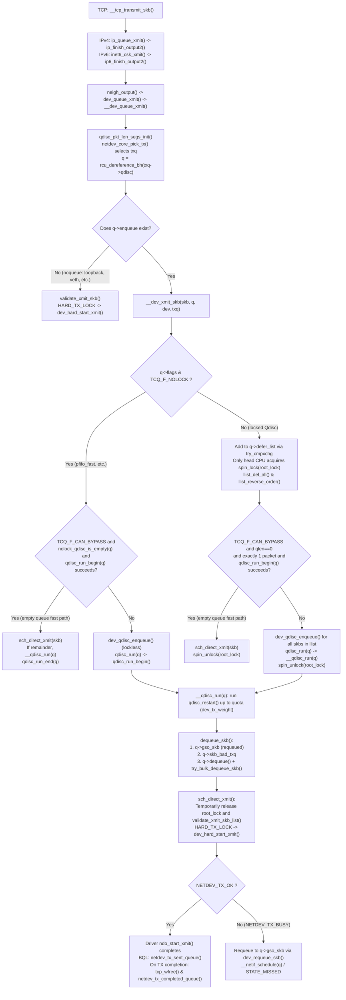

# 15. Qdisc Framework and FIFO / PFIFO_FAST / MQ / BPF Qdisc

In this chapter, we read line by line through the entire framework of Linux's packet scheduler (**Qdisc: Queueing Discipline**), positioned between the IP layer (L3) egress and the NIC driver (L2), along with the most fundamental Qdisc implementations: `pfifo` / `bfifo`, the default 3-band lockless Qdisc `pfifo_fast`, `mq` for multiqueue NICs, and `bpf_qdisc`, which implements arbitrary schedulers using BPF `struct_ops`.

We will completely uncover how the TCP transmit path seen in Chapter 4 (`__tcp_transmit_skb()`, TSQ's `tcp_wfree()`, and EDT pacing) and the local congestion handling seen in Chapter 11 (`tcp_enter_cwr()`) are supported in the lower layers of the kernel.

---

## The ELI5 version

Packages with bills of lading (`sk_buff`) dispatched from the **outgoing shelves (TCP transmit queues)** in each room of a building (sockets) arrive at the delivery truck loading dock located on the building's ground floor. Outside, **delivery trucks (the NIC's hardware TX rings)** are parked waiting to head out onto the road.

What would happen if the dispatchers in each room could simply fling their packages directly onto the truck beds?

- **The truck bed would fill up immediately, preventing newer, urgent packages from overtaking**: If a room sending massive amounts of cargo fills up the truck bed (the NIC's FIFO ring) with hundreds of packages, a package from another room bearing an "urgent" label (high-priority TOS, ACKs, or DNS queries) has no choice but to wait at the very end of that long line. This is **Bufferbloat**.
- **Once packages are loaded onto the truck bed, they cannot be reordered or pruned**: A truck bed (the NIC's DMA ring) is merely a simple conveyor belt. Once loaded, it cannot make smart decisions such as "let's send this package first after all," "the queue is getting congested so drop older packages (AQM)," or "wait until the scheduled departure time (EDT)."

Therefore, Linux places a **sorting gate (Qdisc)** right in front of the truck bed, managing the flow of packages using three rules:

1. **Only load the "bare minimum that can depart right now" onto the truck bed (BQL: Byte Queue Limits)**: As soon as packages on the bed exceed a certain byte threshold, a "truck bed full" sign (`QUEUE_STATE_STACK_XOFF`) is immediately raised. All remaining packages are held back at the sorting gate (Qdisc). This ensures that the intelligent sorting clerk (Qdisc) always maintains control.
2. **Limit the number of packages a single room can queue at the sorting gate (TSQ: TCP Small Queues)**: If a room still has a certain amount of packages queued at the sorting gate or on the truck bed, its shipping clerk is told: "Don't send down the next batch of packages until you get departure notification (`tcp_wfree()`) from the truck." This prevents any single room from monopolizing the sorting gate.
3. **If the sorting gate becomes congested, directly tell the shipper to "reduce the truck fleet" (`NET_XMIT_CN`)**: When the sorting gate is about to overflow or has to discard older packages to make room, it immediately signals the shipper with a yellow caution flag (`NET_XMIT_CN`) indicating local congestion. Seeing this, the shipper (TCP) proactively throttles back the number of trucks allowed on the road (`snd_cwnd`) via `tcp_enter_cwr()`.

This sorting gate (`struct Qdisc`) architecture is **pluggable**, just like TCP congestion control. From a simple clerk that handles items in strict arrival order (`pfifo` / `bfifo`), to a fast clerk that sorts items into three lanes based on the label priority (`pfifo_fast`), to an orchestrator that deploys independent sorting clerks for each loading dock (each TX queue of a multiqueue NIC: `mq`), and even an interface that lets users script custom sorting rules via BPF programs (`bpf_qdisc`) — all operate under the exact same contract defined by `struct Qdisc_ops`.

---

## What the RFCs and papers say

While the Qdisc framework itself is an architecture specific to the Linux kernel, its design directly reflects Internet standard priority mechanisms (TOS / DiffServ), packet scheduling theory, and research on mitigating bufferbloat.

### Why a Qdisc Exists Between L3 and the NIC Driver

After the IP layer (`ip_finish_output2()` / `ip6_finish_output2()`) resolves the neighbour (ARP / ND) and attaches the L2 header, the packet is handed over to `dev_queue_xmit()`. If it directly called the NIC driver's `ndo_start_xmit()` here, the packet would be immediately written into the NIC's TX DMA ring (FIFO).

The NIC's hardware ring is ill-suited as a "scheduling ground" for the following reasons:

- **It is a work-conserving, simple FIFO**: Once a packet enters the hardware ring, it generally cannot be reordered (for priority scheduling or Fair Queueing), dropped mid-queue (such as head-drop or CoDel), or scheduled for a specific departure time (EDT pacing).
- **The ring size is too large**: To prevent TX stalls on high-speed links, NIC driver TX rings typically contain 512 to 4,096 descriptors. If 2,048 packets of 1,500 bytes queue up, that amounts to roughly 3 MB; furthermore, if 64 KB GSO/TSO super-packets queue up, tens of megabytes of data stall inside the NIC ring, causing hundreds of milliseconds of queueing delay (bufferbloat).

Therefore, a clear division of labor is required: "keep only the minimum number of bytes in the NIC's TX ring necessary to prevent DMA starvation, and absorb all remaining queueing inside the software Qdisc layer."

### Coordination Between BQL (Byte Queue Limits) and TSQ (TCP Small Queues)

This division of labor is made possible by a two-tiered backpressure architecture: **BQL (Byte Queue Limits)**, introduced by Tom Herbert in 2011, and **TSQ (TCP Small Queues)**, introduced by Eric Dumazet in 2012.

1. **BQL (between Qdisc and the NIC driver)**
   Each hardware TX queue (`struct netdev_queue`) maintains a DQL (Dynamic Queue Limits, `struct dql`) state. Every time the driver pushes packets onto the hardware ring in `ndo_start_xmit()`, it adds the byte count via `netdev_tx_sent_queue()`; in the TX completion interrupt (NAPI poll), it calls `netdev_tx_completed_queue()` to subtract completed bytes.
   Letting the in-flight uncompleted byte count currently queued on the hardware ring be $B_{\text{inflight}} = \text{num}_{\text{queued}} - \text{num}_{\text{completed}}$, and the dynamically adjusted ceiling of DQL be $L_{\text{BQL}}$, the remaining available budget is expressed as:

   $$\text{avail} = L_{\text{BQL}} - B_{\text{inflight}}$$

   The moment $\text{avail} < 0$, BQL sets the `QUEUE_STATE_STACK_XOFF` bit on that TX queue to halt transmission. The Qdisc can no longer push packets into the driver, and subsequent packets remain buffered inside the Qdisc. When TX completions restore $\text{avail} \ge 0$, `QUEUE_STATE_STACK_XOFF` is cleared, and `netif_schedule_queue()` schedules `NET_TX_SOFTIRQ` (`net_tx_action()`) to resume dequeuing from the Qdisc.

2. **TSQ (between the TCP socket and Qdisc / NIC)**
   Even if BQL prevents the NIC ring from bloating, if sockets flood the Qdisc with unbounded packets, the Qdisc queues would overflow with packets from a single flow. To prevent this, TCP sets `skb->destructor = tcp_wfree` in `__tcp_transmit_skb()` and adds `skb->truesize` to `sk->sk_wmem_alloc`.
   When a socket's unreleased memory allocation `sk_wmem_alloc` reaches an upper limit of approximately 1 ms worth of data (or 2 TSO packets), `tcp_small_queue_check()` (Chapter 4) throttles transmission and sets the `TSQ_THROTTLED` flag. When packets complete transmission at the NIC and are freed (or dropped in the Qdisc), `tcp_wfree()` is invoked, resuming `tcp_write_xmit()` via the BH workqueue.

### Local Congestion Notification (`NET_XMIT_CN`) and `tcp_enter_cwr()`

The Qdisc `enqueue()` method returns its outcome via the following return codes:

| Constant | Value | Meaning | Evaluated value by `net_xmit_eval()` |
| --- | --- | --- | --- |
| `NET_XMIT_SUCCESS` | `0x00` | Successfully queued (or directly transmitted) | `0` |
| `NET_XMIT_DROP` | `0x01` | This packet itself was dropped | `NET_XMIT_DROP` (`1`) |
| `NET_XMIT_CN` | `0x02` | This packet was queued (or another packet of the same priority was dropped), but the queue is congested | `0` |

`NET_XMIT_CN` (Congestion Notification) is a mechanism that signals back to the sending socket that "while this packet was accepted, an older packet at the head of the queue was dropped (`pfifo_head_drop`, etc.)" or "the AQM threshold was exceeded."
`__tcp_transmit_skb()` responds to the return value `err` of `queue_xmit()` as follows:

- If `err > 0` (`NET_XMIT_DROP` or `NET_XMIT_CN`), it determines that **congestion occurred in a local Qdisc on this host**, immediately calls `tcp_enter_cwr(sk)` to enter the `TCP_CA_CWR` state, and reduces `snd_cwnd` (Chapter 11, Step 13).
- Subsequently passing `err` through `err = net_xmit_eval(err)` translates `NET_XMIT_CN` into `0` (successful transmission), allowing TCP's send sequence number (`snd_nxt`) and RTT sampling to advance normally. In contrast, `NET_XMIT_DROP` remains non-zero, so TCP treats the packet as not having been sent and aborts its transmit loop.

### IP TOS Field and `pfifo_fast`'s 3-Band Priority Mapping

Linux's historic default Qdisc, `pfifo_fast`, classifies a packet's `skb->priority` (the lower 4 bits, `0` to `15`) into three FIFO queues: Band 0 (highest priority), Band 1 (normal), and Band 2 (lowest priority), using the `sch_default_prio2band` table.

- **[RFC 791 §3.1](https://www.rfc-editor.org/rfc/rfc791#section-3.1) — Internet Protocol (1981)** and **[RFC 1349 §4](https://www.rfc-editor.org/rfc/rfc1349#section-4) — Type of Service in the Internet Protocol Suite (1992)**
  Defined bits 3–6 of the TOS byte in the IPv4 header as the Type of Service (later superseded by the DiffServ Code Point (DSCP) in [RFC 2474](https://www.rfc-editor.org/rfc/rfc2474)). The 4-bit TOS values in RFC 1349 have the following meanings:
  - `1000` (8): Minimize Delay (interactive traffic such as SSH)
  - `0100` (4): Maximize Throughput (bulk transfers)
  - `0010` (2): Maximize Reliability
  - `0001` (1): Minimize Monetary Cost
  - `0000` (0): Normal Service

The IP layer calculates `TC_PRIO_*` (`0` to `15`) from the TOS byte using `rt_tos2priority()` and sets it into `skb->priority` (it can also be explicitly overridden via the `SO_PRIORITY` socket option). `pfifo_fast` receives this and maps it into three bands as follows:

| `skb->priority` | Typical `TC_PRIO_*` Name | Corresponding RFC 1349 TOS Meaning | `pfifo_fast` Band |
| --- | --- | --- | --- |
| `0` | `TC_PRIO_BESTEFFORT` | Normal Service | **Band 1** (normal) |
| `1`, `2`, `3`, `5` | `TC_PRIO_FILLER`, `TC_PRIO_BULK` | Maximize Throughput / Cost | **Band 2** (lowest priority) |
| `4` | `TC_PRIO_INTERACTIVE_BULK` | — | **Band 1** (normal) |
| `6`, `7` | `TC_PRIO_INTERACTIVE`, `TC_PRIO_CONTROL` | Minimize Delay / Control packets | **Band 0** (highest priority) |
| `8`–`15` | — | Unassigned | **Band 1** (normal) |

This is a **strict priority scheduler**: as long as even a single packet exists in Band 0, packets in Band 1 and Band 2 are never dequeued.

### Work-Conserving vs. Non-Work-Conserving, and Qdisc Bypass

In packet scheduling theory, schedulers are categorized into two types:

- **Work-conserving**: As long as transmittable packets exist in the queue and the outbound link (NIC TX queue) is available, the scheduler never leaves the link idle and immediately dispatches packets (`pfifo`, `bfifo`, `pfifo_fast`, `fq_codel`, etc.).
- **Non-work-conserving**: Even when packets are queued, if token bucket rate limits or an EDT (Earliest Departure Time) dispatch timestamp has not arrived, the scheduler deliberately delays transmission even if the link is idle (`tbf`, `fq` when pacing is enabled, `htb`, etc.). In this case, a high-resolution timer structure `struct qdisc_watchdog` (internally an `hrtimer`) is used to trigger dequeue at the scheduled timestamp.

In a simple work-conserving Qdisc (`pfifo`, `bfifo`, `pfifo_fast`), when **the queue is currently empty and no other CPU is actively executing the Qdisc**, storing the skb into a ring or list via `q->enqueue()` only to immediately extract it via `q->dequeue()` is wasteful. Exploiting this property, Linux provides an **empty-queue fast path (Qdisc bypass)**: when a Qdisc with the `TCQ_F_CAN_BYPASS` flag is empty, it bypasses `enqueue()` / `dequeue()` entirely and directly calls `sch_direct_xmit()`.

---

## The big picture

The following diagram illustrates the overall control flow of the TX path, from the L3 egress through the Qdisc to the NIC driver's `ndo_start_xmit()`.



As shown in this diagram, Linux's Qdisc layer does much more than simply `enqueue()` and `dequeue()`:

- **In locked Qdiscs (`!TCQ_F_NOLOCK`)**, to avoid lock contention over `qdisc_lock(q)` (`root_lock`) when multiple CPUs transmit concurrently, packets are first enqueued to the lockless singly linked list `q->defer_list` using `try_cmpxchg()`. Only the single CPU that inserted the head of the list acquires the spinlock and batches processing on behalf of other CPUs.
- **In lockless Qdiscs (`TCQ_F_NOLOCK`, such as `pfifo_fast`)**, `enqueue()` operates concurrently using only `skb_array` (internally the producer spinlock of `ptr_ring`), while the dequeue side is serialized to a single execution thread using `spin_trylock()` on `q->seqlock`.
- **GSO segmentation and software checksum calculation (`validate_xmit_skb_list()`)** take place in a lock-free section **after** releasing the Qdisc's `root_lock` and **before** acquiring the driver's `HARD_TX_LOCK`. This design ensures heavy segmentation processing does not block concurrent `enqueue()` operations from other CPUs.

---

## Walking through the code

### Step 1: Connecting L3 to Qdisc and TCP Interactions

First, let us examine the interface between the upper and lower layers: how packets dispatched by TCP traverse the IPv4 / IPv6 egress to reach `dev_queue_xmit()`, and how the return values propagate all the way back to TCP.

#### L3 Egress: `ip_finish_output2()` and `ip6_finish_output2()`

In IPv4, the packet traverses `ip_queue_xmit()` -> `__ip_queue_xmit()` -> `ip_local_out()` -> `ip_output()` -> `ip_finish_output()`, arriving at `ip_finish_output2()` ([net/ipv4/ip_output.c#L199](https://git.kernel.org/pub/scm/linux/kernel/git/netdev/net-next.git/tree/net/ipv4/ip_output.c?id=279d5c8afcd38bd841832a39bfe1aa4f8518d98e#n199)). Let us examine the latter half handling neighbour resolution:

```c
	rcu_read_lock();
	neigh = ip_neigh_for_gw(rt, skb, &is_v6gw);
	if (!IS_ERR(neigh)) {
		int res;

		sock_confirm_neigh(skb, neigh);
		/* if crossing protocols, can not use the cached header */
		res = neigh_output(neigh, skb, is_v6gw);
		rcu_read_unlock();
		return res;
	}
	rcu_read_unlock();
```

Similarly, in IPv6, the packet traverses `inet6_csk_xmit()` -> `ip6_xmit()` -> `ip6_output()` -> `ip6_finish_output()`, calling `neigh_output()` at the end of `ip6_finish_output2()` ([net/ipv6/ip6_output.c#L60](https://git.kernel.org/pub/scm/linux/kernel/git/netdev/net-next.git/tree/net/ipv6/ip6_output.c?id=279d5c8afcd38bd841832a39bfe1aa4f8518d98e#n60)):

```c
	nexthop = rt6_nexthop(dst_rt6_info(dst), daddr);
	neigh = __ipv6_neigh_lookup_noref(dev, nexthop);

	if (IS_ERR_OR_NULL(neigh)) {
		if (unlikely(!neigh))
			neigh = ipv6_neigh_create_noref(dev, nexthop);
		if (IS_ERR(neigh)) {
			IP6_INC_STATS(net, idev, IPSTATS_MIB_OUTNOROUTES);
			kfree_skb_reason(skb, SKB_DROP_REASON_NEIGH_CREATEFAIL);
			return -EINVAL;
		}
	}
	sock_confirm_neigh(skb, neigh);
	ret = neigh_output(neigh, skb, false);
	return ret;
```

`neigh_output()` ([include/net/neighbour.h#L541](https://git.kernel.org/pub/scm/linux/kernel/git/netdev/net-next.git/tree/include/net/neighbour.h?id=279d5c8afcd38bd841832a39bfe1aa4f8518d98e#n541)) uses `neigh_hh_output()` ([include/net/neighbour.h#L501](https://git.kernel.org/pub/scm/linux/kernel/git/netdev/net-next.git/tree/include/net/neighbour.h?id=279d5c8afcd38bd841832a39bfe1aa4f8518d98e#n501)) to `memcpy()` the Ethernet header and call `dev_queue_xmit(skb)` if ARP / ND is already resolved (`NUD_CONNECTED`) and the L2 header cache (`hh->hh_len`) is present:

```c
static inline int neigh_output(struct neighbour *n, struct sk_buff *skb,
			       bool skip_cache)
{
	const struct hh_cache *hh = &n->hh;

	/* n->nud_state and hh->hh_len could be changed under us.
	 * neigh_hh_output() is taking care of the race later.
	 */
	if (!skip_cache &&
	    (READ_ONCE(n->nud_state) & NUD_CONNECTED) &&
	    READ_ONCE(hh->hh_len))
		return neigh_hh_output(hh, skb);

	return READ_ONCE(n->output)(n, skb);
}
```

- The return value of `dev_queue_xmit(skb)` called here (which is in fact `__dev_queue_xmit(skb, NULL)`) passes directly through `neigh_output()` -> `ip_finish_output2()` / `ip6_finish_output2()` -> `__ip_queue_xmit()` / `ip6_xmit()` and returns all the way back to TCP's `__tcp_transmit_skb()`.
- Note that in lines 525–526 of `__ip_queue_xmit()` ([net/ipv4/ip_output.c#L462](https://git.kernel.org/pub/scm/linux/kernel/git/netdev/net-next.git/tree/net/ipv4/ip_output.c?id=279d5c8afcd38bd841832a39bfe1aa4f8518d98e#n462)) and lines 364–365 of `ip6_xmit()` ([net/ipv6/ip6_output.c#L291](https://git.kernel.org/pub/scm/linux/kernel/git/netdev/net-next.git/tree/net/ipv6/ip6_output.c?id=279d5c8afcd38bd841832a39bfe1aa4f8518d98e#n291)), the socket's `sk->sk_priority` and `sk->sk_mark` are copied to `skb->priority` and `skb->mark`. This metadata is subsequently inspected by Qdiscs (such as `pfifo_fast`) and TC filters.

#### `NET_XMIT_*` and `tcp_enter_cwr()` in `__tcp_transmit_skb()`

Qdisc return codes are defined in `include/linux/netdevice.h` ([include/linux/netdevice.h#L118](https://git.kernel.org/pub/scm/linux/kernel/git/netdev/net-next.git/tree/include/linux/netdevice.h?id=279d5c8afcd38bd841832a39bfe1aa4f8518d98e#n118)):

```c
/* qdisc ->enqueue() return codes. */
#define NET_XMIT_SUCCESS	0x00
#define NET_XMIT_DROP		0x01	/* skb dropped			*/
#define NET_XMIT_CN		0x02	/* congestion notification	*/
#define NET_XMIT_MASK		0x0f	/* qdisc flags in net/sch_generic.h */

/* NET_XMIT_CN is special. It does not guarantee that this packet is lost. It
 * indicates that the device will soon be dropping packets, or already drops
 * some packets of the same priority; prompting us to send less aggressively. */
#define net_xmit_eval(e)	((e) == NET_XMIT_CN ? 0 : (e))
#define net_xmit_errno(e)	((e) != NET_XMIT_CN ? -ENOBUFS : 0)
```

`__tcp_transmit_skb()` ([net/ipv4/tcp_output.c#L1536](https://git.kernel.org/pub/scm/linux/kernel/git/netdev/net-next.git/tree/net/ipv4/tcp_output.c?id=279d5c8afcd38bd841832a39bfe1aa4f8518d98e#n1536)) evaluates this return code at its end (lines 1718–1728):

```c
	err = INDIRECT_CALL_INET(icsk->icsk_af_ops->queue_xmit,
				 inet6_csk_xmit, ip_queue_xmit,
				 sk, skb, &inet->cork.fl);

	if (unlikely(err > 0)) {
		tcp_enter_cwr(sk);
		err = net_xmit_eval(err);
	}
	if (!err && oskb) {
		tcp_update_skb_after_send(sk, oskb, prior_wstamp);
		tcp_rate_skb_sent(sk, oskb);
	}
	return err;
```

- In the event of an L3 routing error, a **negative error code** such as `-EHOSTUNREACH` or `-ENOMEM` is returned. In contrast, `NET_XMIT_DROP` (`1`) and `NET_XMIT_CN` (`2`) returned by Qdisc `enqueue()` are **positive integers**.
- Therefore, `unlikely(err > 0)` precisely indicates that "a drop or congestion notification occurred within the Qdisc layer." At this point, TCP calls `tcp_enter_cwr(sk)` ([net/ipv4/tcp_input.c#L3030](https://git.kernel.org/pub/scm/linux/kernel/git/netdev/net-next.git/tree/net/ipv4/tcp_input.c?id=279d5c8afcd38bd841832a39bfe1aa4f8518d98e#n3030)), transitioning to the `TCP_CA_CWR` state and reducing `snd_cwnd` just as if it had received an ECN ECE signal (Chapter 11, Step 13).
- Immediately following this, `err = net_xmit_eval(err)` converts `err` to `0` if it was `NET_XMIT_CN`. Execution then proceeds to `if (!err && oskb)` below, calling `tcp_update_skb_after_send()` and `tcp_rate_skb_sent()`, and advancing `snd_nxt` in the caller `tcp_write_xmit()`. As we will see later, `pfifo_tail_enqueue()` (`pfifo_head_drop`) drops the older head packet and enqueues the newly arrived packet while returning `NET_XMIT_CN`; this design ensures that "because the new packet itself entered the queue, it is not treated as unsent, yet cwnd is reduced."

#### TSQ (`tcp_wfree()`) and BQL (`netdev_tx_sent_queue()` / `netdev_tx_completed_queue()`)

In lines 1622–1625 of `__tcp_transmit_skb()`, a destructor is attached to the cloned skb being transmitted:

```c
	skb_orphan(skb);
	skb->sk = sk;
	skb->destructor = skb_is_tcp_pure_ack(skb) ? __sock_wfree : tcp_wfree;
	refcount_add(skb->truesize, &sk->sk_wmem_alloc);
```

When this skb traverses the Qdisc, finishes DMA transmission in the NIC driver, and is freed (or dropped in the Qdisc and freed), `tcp_wfree()` ([net/ipv4/tcp_output.c#L1387](https://git.kernel.org/pub/scm/linux/kernel/git/netdev/net-next.git/tree/net/ipv4/tcp_output.c?id=279d5c8afcd38bd841832a39bfe1aa4f8518d98e#n1387)) is invoked from `kfree_skb()` / `napi_consume_skb()` via `skb_release_head_state()` (detailed in Chapter 4, Step 10).

- A particularly critical invariant here is the comment at the beginning of `tcp_wfree()`: **"We can't xmit new skbs from this context, as we might already hold qdisc lock."** If a Qdisc drops a packet while holding `qdisc_lock(q)` and immediately calls `kfree_skb()`, `tcp_wfree()` would execute on the same CPU. If `tcp_wfree()` were to directly call `tcp_write_xmit()` -> `__dev_queue_xmit()` on the spot, it would attempt to reacquire the same `qdisc_lock(q)`, causing a deadlock.
- For this reason, a two-fold safety mechanism is employed: (1) `tcp_wfree()` avoids transmitting directly and instead defers work to the per-CPU `tsq_work` (BH workqueue), and (2) while holding `qdisc_lock(q)`, the Qdisc layer avoids calling `kfree_skb()` directly, instead chaining packets to a `to_free` list and freeing them in bulk after releasing the lock (`__qdisc_drop()` and `tcf_kfree_skb_list()`).

Meanwhile, the BQL functions managing backpressure between the NIC driver and Qdisc reside in `include/linux/netdevice.h`. Let us inspect `netdev_tx_sent_queue()` ([include/linux/netdevice.h#L3924](https://git.kernel.org/pub/scm/linux/kernel/git/netdev/net-next.git/tree/include/linux/netdevice.h?id=279d5c8afcd38bd841832a39bfe1aa4f8518d98e#n3924)) and `__netdev_tx_sent_queue()` ([include/linux/netdevice.h#L3960](https://git.kernel.org/pub/scm/linux/kernel/git/netdev/net-next.git/tree/include/linux/netdevice.h?id=279d5c8afcd38bd841832a39bfe1aa4f8518d98e#n3960)):

```c
static inline void netdev_tx_sent_queue(struct netdev_queue *dev_queue,
					unsigned int bytes)
{
#ifdef CONFIG_BQL
	dql_queued(&dev_queue->dql, bytes);

	if (likely(dql_avail(&dev_queue->dql) >= 0))
		return;

	/* Paired with READ_ONCE() from dev_watchdog() */
	WRITE_ONCE(dev_queue->trans_start, jiffies);

	/* This barrier is paired with smp_mb() from dev_watchdog() */
	smp_mb__before_atomic();

	set_bit(__QUEUE_STATE_STACK_XOFF, &dev_queue->state);

	/*
	 * The XOFF flag must be set before checking the dql_avail below,
	 * because in netdev_tx_completed_queue we update the dql_completed
	 * before checking the XOFF flag.
	 */
	smp_mb__after_atomic();

	/* check again in case another CPU has just made room avail */
	if (unlikely(dql_avail(&dev_queue->dql) >= 0))
		clear_bit(__QUEUE_STATE_STACK_XOFF, &dev_queue->state);
#endif
}
```

```c
static inline bool __netdev_tx_sent_queue(struct netdev_queue *dev_queue,
					  unsigned int bytes,
					  bool xmit_more)
{
	if (xmit_more) {
#ifdef CONFIG_BQL
		dql_queued(&dev_queue->dql, bytes);
#endif
		return netif_tx_queue_stopped(dev_queue);
	}
	netdev_tx_sent_queue(dev_queue, bytes);
	return true;
}
```

- These functions are called by the driver's `ndo_start_xmit()`. `dql_queued()` increments `dql->num_queued`, and if the available headroom `dql_avail()` becomes negative, `set_bit(__QUEUE_STATE_STACK_XOFF, &dev_queue->state)` halts the TX queue.
- Re-checking `dql_avail() >= 0` immediately after `smp_mb__after_atomic()` provides lockless Dekker-style synchronization against `netdev_tx_completed_queue()` ([include/linux/netdevice.h#L4006](https://git.kernel.org/pub/scm/linux/kernel/git/netdev/net-next.git/tree/include/linux/netdevice.h?id=279d5c8afcd38bd841832a39bfe1aa4f8518d98e#n4006)), which runs on another CPU during TX completion handling:

```c
static inline void netdev_tx_completed_queue(struct netdev_queue *dev_queue,
					     unsigned int pkts, unsigned int bytes)
{
#ifdef CONFIG_BQL
	if (unlikely(!bytes))
		return;

	dql_completed(&dev_queue->dql, bytes);

	/*
	 * Without the memory barrier there is a small possibility that
	 * netdev_tx_sent_queue will miss the update and cause the queue to
	 * be stopped forever
	 */
	smp_mb(); /* NOTE: netdev_txq_completed_mb() assumes this exists */

	if (unlikely(dql_avail(&dev_queue->dql) < 0))
		return;

	if (test_and_clear_bit(__QUEUE_STATE_STACK_XOFF, &dev_queue->state))
		netif_schedule_queue(dev_queue);
#endif
}
```

- The transmit side (`netdev_tx_sent_queue()`) executes **"set `STACK_XOFF` -> `smp_mb` -> read `dql_avail()`"**, whereas the completion side (`netdev_tx_completed_queue()`) executes **"update `dql_completed()` -> `smp_mb` -> test and clear `STACK_XOFF`"**. This pair of memory barriers prevents the race condition where the completion side misses `STACK_XOFF` and the transmit side misses the update to `dql_completed`, which would otherwise leave the queue stopped indefinitely.
- Furthermore, in `__netdev_tx_sent_queue()`, when `xmit_more` is true (more packets follow in a bulk dequeue), it only increments `dql_queued()` and defers setting `STACK_XOFF` until the final packet of the batch. This avoids prematurely stopping the queue mid-batch and having to requeue the remaining packets via `dev_requeue_skb()`.

---
### Step 2: Core Qdisc Data Structures

Next, we examine the six core data structures of the Qdisc framework defined in `include/net/sch_generic.h`, `include/net/pkt_sched.h`, and `include/linux/netdevice.h`.

#### `struct qdisc_skb_head` — Lightweight skb Queue via Singly Linked List

`struct qdisc_skb_head` ([include/net/sch_generic.h#L62](https://git.kernel.org/pub/scm/linux/kernel/git/netdev/net-next.git/tree/include/net/sch_generic.h?id=279d5c8afcd38bd841832a39bfe1aa4f8518d98e#n62)) is a lightweight packet queue header dedicated to Qdiscs.

```c
/* similar to sk_buff_head, but skb->prev pointer is undefined. */
struct qdisc_skb_head {
	struct sk_buff	*head;
	struct sk_buff	*tail;
	__u32		qlen;
	spinlock_t	lock;
};
```

- While the generic `struct sk_buff_head` is a doubly linked circular list (updating both `skb->next` and `skb->prev`), for FIFO-like use cases where packets are simply appended to the tail and dequeued from the head, updating `skb->prev` constitutes unnecessary memory traffic. Therefore, `qdisc_skb_head` is designed as a **singly linked list that only uses `skb->next`** (with the tail element's `skb->next == NULL`), providing $O(1)$ access to both the head and tail with fewer pointer modifications by maintaining `head` and `tail` pointers (`__qdisc_enqueue_tail()` ([include/net/sch_generic.h#L1102](https://git.kernel.org/pub/scm/linux/kernel/git/netdev/net-next.git/tree/include/net/sch_generic.h?id=279d5c8afcd38bd841832a39bfe1aa4f8518d98e#n1102)) and `__qdisc_dequeue_head()` ([include/net/sch_generic.h#L1136](https://git.kernel.org/pub/scm/linux/kernel/git/netdev/net-next.git/tree/include/net/sch_generic.h?id=279d5c8afcd38bd841832a39bfe1aa4f8518d98e#n1136))).
- `lock` is the exact `&qdisc->q.lock` returned by `qdisc_lock(q)` ([include/net/sch_generic.h#L581](https://git.kernel.org/pub/scm/linux/kernel/git/netdev/net-next.git/tree/include/net/sch_generic.h?id=279d5c8afcd38bd841832a39bfe1aa4f8518d98e#n581)), and is used for mutual exclusion across the entire Qdisc hierarchy (`root_lock`).

#### `struct Qdisc` and `TCQ_F_*` Flags

`struct Qdisc` ([include/net/sch_generic.h#L69](https://git.kernel.org/pub/scm/linux/kernel/git/netdev/net-next.git/tree/include/net/sch_generic.h?id=279d5c8afcd38bd841832a39bfe1aa4f8518d98e#n69)) is the core structure representing a Qdisc instance attached to each queue.

```c
struct Qdisc {
	int 			(*enqueue)(struct sk_buff *skb,
					   struct Qdisc *sch,
					   struct sk_buff **to_free);
	struct sk_buff *	(*dequeue)(struct Qdisc *sch);
	unsigned int		flags;
#define TCQ_F_BUILTIN		1
#define TCQ_F_INGRESS		2
#define TCQ_F_CAN_BYPASS	4
#define TCQ_F_MQROOT		8
#define TCQ_F_ONETXQUEUE	0x10 /* dequeue_skb() can assume all skbs are for
				      * q->dev_queue : It can test
				      * netif_xmit_frozen_or_stopped() before
				      * dequeueing next packet.
				      * Its true for MQ/MQPRIO slaves, or non
				      * multiqueue device.
				      */
#define TCQ_F_WARN_NONWC	(1 << 16)
#define TCQ_F_CPUSTATS		0x20 /* run using percpu statistics */
#define TCQ_F_NOPARENT		0x40 /* root of its hierarchy :
				      * qdisc_tree_reduce_backlog() should stop.
				      */
#define TCQ_F_INVISIBLE		0x80 /* invisible by default in dump */
#define TCQ_F_NOLOCK		0x100 /* qdisc does not require locking */
#define TCQ_F_OFFLOADED		0x200 /* qdisc is offloaded to HW */
#define TCQ_F_DEQUEUE_DROPS	0x400 /* ->dequeue() can drop packets in q->to_free */

	u32			limit;
	const struct Qdisc_ops	*ops;
	struct qdisc_size_table	__rcu *stab;
	struct hlist_node       hash;
	u32			handle;
	u32			parent;
	int			depth;

	struct netdev_queue	*dev_queue;

	struct net_rate_estimator __rcu *rate_est;
	struct gnet_stats_basic_sync __percpu *cpu_bstats;
	struct gnet_stats_queue	__percpu *cpu_qstats;
	int			pad;
	refcount_t		refcnt;
```

- **`enqueue` and `dequeue` pointers at the front**: The function pointers identical to `ops->enqueue` / `ops->dequeue` are copied directly into the beginning of `struct Qdisc` (set during `qdisc_alloc()`). This is a cache-line optimization that avoids two levels of indirection (`q->ops->enqueue`) on the fast path, allowing callers to invoke `q->enqueue(skb, q, to_free)` with a single dereference.
- **Key `TCQ_F_*` flags**:
  - `TCQ_F_BUILTIN`: Statically defined Qdiscs like `noop_qdisc` that do not perform reference counting or memory deallocation.
  - `TCQ_F_CAN_BYPASS`: Indicates that the Qdisc is work-conserving and may bypass `enqueue()` / `dequeue()` when the queue is empty, transmitting packets directly via `sch_direct_xmit()`.
  - `TCQ_F_MQROOT`: A dummy parent Qdisc placed at the root of a multiqueue device, such as `mq` or `mqprio`.
  - `TCQ_F_ONETXQUEUE`: Guarantees that all packets leaving this Qdisc are destined for a single `q->dev_queue`. This flag is set for the root Qdisc of a single-queue NIC or for Qdiscs attached 1:1 to individual TX queues as children of `mq`. When set, `dequeue_skb()` can check `netif_xmit_frozen_or_stopped(txq)` **before dequeuing a packet with `q->dequeue()`**, and can also leverage the faster `try_bulk_dequeue_skb()`.
  - `TCQ_F_CPUSTATS`: Uses per-CPU `cpu_bstats` / `cpu_qstats` for statistical counters.
  - `TCQ_F_NOPARENT`: Indicates the root of a Qdisc hierarchy (or an independent child directly under `mq`), stopping `qdisc_tree_reduce_backlog()` from traversing further up to parents.
  - `TCQ_F_NOLOCK`: Indicates that the Qdisc does not require external serialization via `qdisc_lock(q)` (i.e., it is lockless, like `pfifo_fast`).
  - `TCQ_F_DEQUEUE_DROPS`: Set by Qdiscs that may drop packets during `dequeue()` (such as CoDel), allowing dropped skbs to be accumulated in `q->to_free` and freed in bulk after releasing the lock in `qdisc_run_end()`.
- `limit`: Upper limit of queue length (number of packets for `pfifo`, number of bytes for `bfifo`).

Next, let us look at the latter half of `struct Qdisc` (lines 76–143).

```c
	/* Cache line potentially dirtied in dequeue() or __netif_reschedule(). */
	__cacheline_group_begin(Qdisc_read_mostly) ____cacheline_aligned;
		struct sk_buff_head	gso_skb;
		struct Qdisc		*next_sched;
		struct sk_buff_head	skb_bad_txq;
	__cacheline_group_end(Qdisc_read_mostly);

	/* Fields dirtied in dequeue() fast path. */
	__cacheline_group_begin(Qdisc_write) ____cacheline_aligned;
		struct qdisc_skb_head	q;
		unsigned long		state;
		struct gnet_stats_basic_sync bstats;
		bool			running; /* must be written under qdisc spinlock */

		/* Note : we only change qstats.backlog in fast path. */
		struct gnet_stats_queue	qstats;

		struct sk_buff		*to_free;
	__cacheline_group_end(Qdisc_write);


	atomic_long_t		defer_count ____cacheline_aligned_in_smp;
	struct llist_head	defer_list;

	spinlock_t		seqlock;

	struct rcu_head		rcu;
	netdevice_tracker	dev_tracker;
	struct lock_class_key	root_lock_key;
	/* private data */
	long privdata[] ____cacheline_aligned;
};
```

- **`Qdisc_read_mostly` cacheline group**:
  - `gso_skb`: A "re-queue slot" (doubly linked list `sk_buff_head`) used to hold a previously dequeued packet when the driver returns `NETDEV_TX_BUSY` or when the TX queue is stopped. It is named `gso_skb` for historical reasons, as it previously held remaining segments after software GSO segmentation.
  - `next_sched`: A singly linked list pointer used by `__netif_schedule()` to link this Qdisc onto the per-CPU `softnet_data.output_queue`.
  - `skb_bad_txq`: A temporary staging queue used when a single Qdisc manages multiple TX queues (`!TCQ_F_ONETXQUEUE`) and `try_bulk_dequeue_skb_slow()` dequeues an skb destined for a different TX queue than the first one.
- **`Qdisc_write` cacheline group**:
  - `q`: The standard internal packet queue (`struct qdisc_skb_head`) and `q.lock`.
  - `state`: Bitmask of `enum qdisc_state_t` ([include/net/sch_generic.h#L40](https://git.kernel.org/pub/scm/linux/kernel/git/netdev/net-next.git/tree/include/net/sch_generic.h?id=279d5c8afcd38bd841832a39bfe1aa4f8518d98e#n40)).
    - `__QDISC_STATE_SCHED`: Already enqueued to `NET_TX_SOFTIRQ`'s `output_queue`.
    - `__QDISC_STATE_DEACTIVATED`: Device is deactivated (`dev_deactivate()`).
    - `__QDISC_STATE_MISSED`: In a `TCQ_F_NOLOCK` Qdisc, an enqueue occurred while another CPU was holding `seqlock` (requiring a retry to prevent missed packets).
    - `__QDISC_STATE_DRAINING`: Indicates that dequeuing has been suspended due to a stopped TX queue while in `MISSED` state (`QDISC_STATE_NON_EMPTY = QDISC_STATE_MISSED | QDISC_STATE_DRAINING`).
  - `bstats` / `qstats`: Basic statistics for transmitted bytes and packets (`bstats`), and queue statistics for queue length, backlog, drops, and requeues (`qstats`).
  - `running`: In a `!TCQ_F_NOLOCK` Qdisc, a flag indicating whether any CPU is currently executing `__qdisc_run()` (read and written under `q.lock`).
- **`defer_count` and `defer_list`**: Multi-producer aggregation list for locked Qdiscs introduced in 2025 (detailed in Step 3). Placed on an independent cacheline to avoid false sharing with other fields.
- **`seqlock`**: A `spinlock_t` ensuring that "only one CPU executes the dequeue loop (`__qdisc_run()`) at a time" in a `TCQ_F_NOLOCK` Qdisc (named `seqlock` as a historical remnant of when `seqlock_t` was used).
- **`privdata[]`**: A flexible array member aligned to a cacheline boundary, returned by `qdisc_priv(q)`. Private structures specific to each Qdisc implementation (`struct pfifo_fast_priv`, `struct mq_sched`, `struct bpf_sched_data`, etc.) are allocated here.

#### `struct Qdisc_ops` — Interface Definition for Qdisc Implementations

`struct Qdisc_ops` ([include/net/sch_generic.h#L308](https://git.kernel.org/pub/scm/linux/kernel/git/netdev/net-next.git/tree/include/net/sch_generic.h?id=279d5c8afcd38bd841832a39bfe1aa4f8518d98e#n308)) is the operations table used to register each Qdisc algorithm into the kernel.

```c
struct Qdisc_ops {
	struct Qdisc_ops	*next;
	const struct Qdisc_class_ops	*cl_ops;
	char			id[IFNAMSIZ];
	int			priv_size;
	unsigned int		static_flags;

	int 			(*enqueue)(struct sk_buff *skb,
					   struct Qdisc *sch,
					   struct sk_buff **to_free);
	struct sk_buff *	(*dequeue)(struct Qdisc *);
	struct sk_buff *	(*peek)(struct Qdisc *);

	int			(*init)(struct Qdisc *sch, struct nlattr *arg,
					struct netlink_ext_ack *extack);
	void			(*reset)(struct Qdisc *);
	void			(*destroy)(struct Qdisc *);
	int			(*change)(struct Qdisc *sch,
					  struct nlattr *arg,
					  struct netlink_ext_ack *extack);
	void			(*attach)(struct Qdisc *sch);
	int			(*change_tx_queue_len)(struct Qdisc *, unsigned int);
	void			(*change_real_num_tx)(struct Qdisc *sch,
						      unsigned int new_real_tx);

	int			(*dump)(struct Qdisc *, struct sk_buff *);
	int			(*dump_stats)(struct Qdisc *, struct gnet_dump *);

	void			(*ingress_block_set)(struct Qdisc *sch,
						     u32 block_index);
	void			(*egress_block_set)(struct Qdisc *sch,
						    u32 block_index);
	u32			(*ingress_block_get)(struct Qdisc *sch);
	u32			(*egress_block_get)(struct Qdisc *sch);

	struct module		*owner;
};
```

- `cl_ops`: Pointer to `struct Qdisc_class_ops` ([include/net/sch_generic.h#L267](https://git.kernel.org/pub/scm/linux/kernel/git/netdev/net-next.git/tree/include/net/sch_generic.h?id=279d5c8afcd38bd841832a39bfe1aa4f8518d98e#n267)), used by classful Qdiscs (`htb`, `mq`, `fq_codel`, etc.) to manipulate child classes and child Qdiscs. It is `NULL` for classless Qdiscs such as `pfifo` or `pfifo_fast`.
- `static_flags`: Flags automatically bitwise-ORed into `sch->flags` upon instance creation (e.g., `TCQ_F_NOLOCK | TCQ_F_CPUSTATS` for `pfifo_fast`).
- `enqueue` / `dequeue` / `peek`: Mandatory methods for enqueuing, dequeuing, and inspecting the head packet (in `register_qdisc()` ([net/sched/sch_api.c#L134](https://git.kernel.org/pub/scm/linux/kernel/git/netdev/net-next.git/tree/net/sched/sch_api.c?id=279d5c8afcd38bd841832a39bfe1aa4f8518d98e#n134)), registration is rejected with `-EINVAL` if `dequeue` is provided but `peek` is `NULL`).
- `init` / `reset` / `destroy` / `change`: Lifecycle management methods. `reset` discards all packets queued in the buffer and resets to the initial state, while `destroy` releases allocated memory and timers.
- `attach`: Implemented by special Qdiscs like `mq` that attach child Qdiscs directly to individual hardware TX queues (`dev_queue`) rather than to the parent Qdisc itself (Step 7).

#### `struct qdisc_skb_cb` — `skb->cb` Overlay in the Qdisc Layer

In the TCP layer, `skb->cb` (48 bytes) was used as `struct tcp_skb_cb`, and in the IP layer as `struct inet_skb_parm` / `struct inet6_skb_parm`. Once a packet reaches `__dev_queue_xmit()`, `skb->cb` is used as `struct qdisc_skb_cb` ([include/net/sch_generic.h#L455](https://git.kernel.org/pub/scm/linux/kernel/git/netdev/net-next.git/tree/include/net/sch_generic.h?id=279d5c8afcd38bd841832a39bfe1aa4f8518d98e#n455)) and the enclosing `struct tc_skb_cb` ([include/net/sch_generic.h#L1183](https://git.kernel.org/pub/scm/linux/kernel/git/netdev/net-next.git/tree/include/net/sch_generic.h?id=279d5c8afcd38bd841832a39bfe1aa4f8518d98e#n1183)).

```c
struct qdisc_skb_cb {
	unsigned int		pkt_len;
	u16			pkt_segs;
	u16			tc_classid;
#define QDISC_CB_PRIV_LEN 20
	unsigned char		data[QDISC_CB_PRIV_LEN];
	bool			post_ct:1;
	bool			decrypted:1;
};
```

- `pkt_len` and `pkt_segs`: The actual byte count and segment count that will be transmitted on the wire. For GSO packets, `skb->len` includes only a single copy of the L2/L3/L4 headers; however, `qdisc_pkt_len_segs_init()` (Step 3) adds `(gso_segs - 1) * hdr_len` to store the exact total byte count that will appear on the wire after segmentation into `pkt_len`. When `bfifo` or rate shapers compute bandwidth and backlog, they always use `qdisc_pkt_len(skb)` (`qdisc_skb_cb(skb)->pkt_len`) rather than `skb->len`.
- `data[20]`: A 20-byte scratch space freely usable by each Qdisc (read and write access here is also permitted by the verifier for BPF Qdiscs).

#### `struct qdisc_watchdog` — High-Resolution Timer Driving Non-Work-Conserving Qdiscs

When a pacing or rate-limiting Qdisc needs to express "I cannot transmit now, but want `__qdisc_run()` to execute again when time `expires` arrives", it uses `struct qdisc_watchdog` ([include/net/pkt_sched.h#L61](https://git.kernel.org/pub/scm/linux/kernel/git/netdev/net-next.git/tree/include/net/pkt_sched.h?id=279d5c8afcd38bd841832a39bfe1aa4f8518d98e#n61)).

```c
struct qdisc_watchdog {
	struct hrtimer	timer;
	struct Qdisc	*qdisc;
};
```

Its helper functions are defined in `net/sched/sch_api.c`. Let us look at `qdisc_watchdog_init()` ([net/sched/sch_api.c#L642](https://git.kernel.org/pub/scm/linux/kernel/git/netdev/net-next.git/tree/net/sched/sch_api.c?id=279d5c8afcd38bd841832a39bfe1aa4f8518d98e#n642)), `qdisc_watchdog_schedule_range_ns()` ([net/sched/sch_api.c#L648](https://git.kernel.org/pub/scm/linux/kernel/git/netdev/net-next.git/tree/net/sched/sch_api.c?id=279d5c8afcd38bd841832a39bfe1aa4f8518d98e#n648)), and `qdisc_watchdog_cancel()` ([net/sched/sch_api.c#L678](https://git.kernel.org/pub/scm/linux/kernel/git/netdev/net-next.git/tree/net/sched/sch_api.c?id=279d5c8afcd38bd841832a39bfe1aa4f8518d98e#n678)).

```c
void qdisc_watchdog_init(struct qdisc_watchdog *wd, struct Qdisc *qdisc)
{
	qdisc_watchdog_init_clockid(wd, qdisc, CLOCK_MONOTONIC);
}
EXPORT_SYMBOL(qdisc_watchdog_init);

void qdisc_watchdog_schedule_range_ns(struct qdisc_watchdog *wd, u64 expires,
				      u64 delta_ns)
{
	bool deactivated;

	rcu_read_lock();
	deactivated = test_bit(__QDISC_STATE_DEACTIVATED,
			       &qdisc_root_sleeping(wd->qdisc)->state);
	rcu_read_unlock();
	if (deactivated)
		return;

	if (hrtimer_is_queued(&wd->timer)) {
		u64 softexpires;

		softexpires = ktime_to_ns(hrtimer_get_softexpires(&wd->timer));
		/* If timer is already set in [expires, expires + delta_ns],
		 * do not reprogram it.
		 */
		if (softexpires - expires <= delta_ns)
			return;
	}

	hrtimer_start_range_ns(&wd->timer,
			       ns_to_ktime(expires),
			       delta_ns,
			       HRTIMER_MODE_ABS_PINNED);
}
EXPORT_SYMBOL(qdisc_watchdog_schedule_range_ns);

void qdisc_watchdog_cancel(struct qdisc_watchdog *wd)
{
	hrtimer_cancel(&wd->timer);
}
EXPORT_SYMBOL(qdisc_watchdog_cancel);
```

- `qdisc_watchdog_init()` initializes an hrtimer with `CLOCK_MONOTONIC` and registers the callback function `qdisc_watchdog()` (which invokes `__netif_schedule(qdisc_root_bh(wd->qdisc))` upon expiration).
- `qdisc_watchdog_schedule_range_ns()` first verifies that the root Qdisc is not `__QDISC_STATE_DEACTIVATED` (to prevent the timer from continuously rescheduling while the device is stopped). Furthermore, if the timer is already armed within `[expires, expires + delta_ns]`, it skips the expensive `hrtimer_start_range_ns()` reprogramming.
- As seen in Step 8, `bpf_qdisc` automatically embeds this `struct qdisc_watchdog` into the `privdata` of every BPF Qdisc instance, managing it safely via prologue / epilogue and kfuncs.

#### `struct netdev_queue` — Junction Point Between Hardware TX Queues and Qdiscs

`struct netdev_queue` ([include/linux/netdevice.h#L686](https://git.kernel.org/pub/scm/linux/kernel/git/netdev/net-next.git/tree/include/linux/netdevice.h?id=279d5c8afcd38bd841832a39bfe1aa4f8518d98e#n686)) is the structure representing each transmit queue of a NIC.

```c
struct netdev_queue {
/*
 * read-mostly part
 */
	struct net_device	*dev;
	netdevice_tracker	dev_tracker;

	struct Qdisc __rcu	*qdisc;
	struct Qdisc __rcu	*qdisc_sleeping;
#ifdef CONFIG_SYSFS
	struct kobject		kobj;
	const struct attribute_group	**groups;
#endif
	unsigned long		tx_maxrate;
	/*
	 * Number of TX timeouts for this queue
	 * (/sys/class/net/DEV/Q/trans_timeout)
	 */
	atomic_long_t		trans_timeout;

	/* Subordinate device that the queue has been assigned to */
	struct net_device	*sb_dev;
#ifdef CONFIG_XDP_SOCKETS
	/* "ops protected", see comment about net_device::lock */
	struct xsk_buff_pool    *pool;
#endif

/*
 * write-mostly part
 */
#ifdef CONFIG_BQL
	struct dql		dql;
#endif
	spinlock_t		_xmit_lock ____cacheline_aligned_in_smp;
	int			xmit_lock_owner;
	/*
	 * Time (in jiffies) of last Tx
	 */
	unsigned long		trans_start;

	unsigned long		state;
...
} ____cacheline_aligned_in_smp;
```

- **Why are there two pointers, `qdisc` and `qdisc_sleeping`?**:
  - `qdisc` is the **currently active Qdisc referenced by the data path (`__dev_queue_xmit()`)**. It points to the actual Qdisc only while the device is `IFF_UP` with the link up (carrier ok); while the device is down or during a Qdisc transition (`dev_deactivate()`), it points to the built-in `&noop_qdisc`, which drops all packets immediately.
  - `qdisc_sleeping` is the **holding pointer referenced by the control plane (configuration via `tc` commands and statistics dumping)**. To allow configuring and preserving Qdiscs via `tc qdisc add` even when the interface is in an `ip link set dev eth0 down` state, newly created Qdiscs are first saved in `qdisc_sleeping`, and are only activated via `transition_one_qdisc()` during `dev_activate()` (when the link comes up) by setting `dev_queue->qdisc = dev_queue->qdisc_sleeping`.
- **Separation of the `write-mostly part`**: Because `dql` (BQL state), `_xmit_lock` (`HARD_TX_LOCK` protecting the driver's `ndo_start_xmit()`), `trans_start` (timestamp of the last transmission for TX timeout watchdog), and `state` (`QUEUE_STATE_DRV_XOFF` / `QUEUE_STATE_STACK_XOFF` / `QUEUE_STATE_FROZEN`) are modified on every packet transmission, they are isolated onto a separate cacheline from the `read-mostly part` at the top (`dev` and `qdisc` pointers).

---
### Step 3: TX Fast Path Entry and Locking / Bypass Control — `__dev_queue_xmit()` and `__dev_xmit_skb()`

From here, we enter the transmit core in `net/core/dev.c`. `dev_queue_xmit(skb)` passes through `dev_queue_xmit_accel(skb, NULL)` and calls `__dev_queue_xmit()` ([net/core/dev.c#L4955](https://git.kernel.org/pub/scm/linux/kernel/git/netdev/net-next.git/tree/net/core/dev.c?id=279d5c8afcd38bd841832a39bfe1aa4f8518d98e#n4955)). Let us read through the first half (lines 4955–5030).

```c
int __dev_queue_xmit(struct sk_buff *skb, struct net_device *sb_dev)
{
	struct net_device *dev = skb->dev;
	struct netdev_queue *txq = NULL;
	enum skb_drop_reason reason;
	int cpu, rc = -ENOMEM;
	bool again = false;
	struct Qdisc *q;

	skb_reset_mac_header(skb);
	skb_assert_len(skb);

	if (unlikely(skb_shinfo(skb)->tx_flags &
		     (SKBTX_SCHED_TSTAMP | SKBTX_BPF)))
		__skb_tstamp_tx(skb, NULL, NULL, skb->sk, SCM_TSTAMP_SCHED);

	reason = qdisc_pkt_len_segs_init(skb);
	if (unlikely(reason)) {
		dev_core_stats_tx_dropped_inc(dev);
		kfree_skb_reason(skb, reason);
		return -EINVAL;
	}
	/* Disable soft irqs for various locks below. Also
	 * stops preemption for RCU.
	 */
	rcu_read_lock_bh();

	skb_update_prio(skb);

	tcx_set_ingress(skb, false);
#ifdef CONFIG_NET_EGRESS
	if (static_branch_unlikely(&egress_needed_key)) {
		bool skip_txq;

		if (nf_hook_egress_active()) {
			skb = nf_hook_egress(skb, &rc, dev);
			if (!skb)
				goto out;
		}

		skip_txq = netdev_xmit_skip_txqueue(false);

		nf_skip_egress(skb, true);
		skb = sch_handle_egress(skb, &rc, dev);
		if (!skb) {
			netdev_xmit_skip_txqueue(skip_txq);
			goto out;
		}
		nf_skip_egress(skb, false);

		if (netdev_xmit_skip_txqueue(skip_txq))
			txq = netdev_tx_queue_mapping(dev, skb);
	}
#endif
	/* If device/qdisc don't need skb->dst, release it right now while
	 * its hot in this cpu cache.
	 */
	if (dev->priv_flags & IFF_XMIT_DST_RELEASE)
		skb_dst_drop(skb);
	else
		skb_dst_force(skb);

	if (!txq)
		txq = netdev_core_pick_tx(dev, skb, sb_dev);

	q = rcu_dereference_bh(txq->qdisc);

	trace_net_dev_queue(skb);
	if (q->enqueue) {
		rc = __dev_xmit_skb(skb, q, dev, txq);
		goto out;
	}
```

- `skb_reset_mac_header(skb)`: Because the L2 header has already been pushed to the front by functions such as `neigh_hh_output()`, this records the current `skb->data` as the beginning of the MAC header.
- `SKBTX_SCHED_TSTAMP`: If the application requested `SOF_TIMESTAMPING_TX_SCHED`, a timestamp **immediately prior to entering the Qdisc** is sampled here. By looking at the difference between this and `SCM_TSTAMP_SND` right before driver transmission, user space can accurately measure the queuing delay spent inside the Qdisc.
- `qdisc_pkt_len_segs_init(skb)` ([net/core/dev.c#L4282](https://git.kernel.org/pub/scm/linux/kernel/git/netdev/net-next.git/tree/net/core/dev.c?id=279d5c8afcd38bd841832a39bfe1aa4f8518d98e#n4282)): For GSO packets, calculates the total header overhead across post-segmentation frames `(gso_segs - 1) * hdr_len` and initializes `qdisc_skb_cb(skb)->pkt_len` and `pkt_segs`. If an untrusted/malicious (`SKB_GSO_DODGY`) packet has a corrupted header, it is dropped here with reason `SKB_DROP_REASON_SKB_BAD_GSO`.
- **`rcu_read_lock_bh()`**: This marks the critical execution context boundary of the Qdisc layer. All subsequent processing (dereferencing `txq->qdisc` via RCU, acquiring `qdisc_lock(q)`, and acquiring `HARD_TX_LOCK`) runs **with BH (softirq) disabled and within an RCU read-side critical section**. As a result, lower layers can use plain `spin_lock()` instead of `spin_lock_bh()`, and `smp_processor_id()` can be safely invoked without worrying about preemption.
- `skb_update_prio(skb)`: If the netprio cgroup is enabled, updates `skb->priority` according to the socket's cgroup.
- `CONFIG_NET_EGRESS`: Only when `tc filter ... egress` (`clsact` or `tcx`) or `nf_hook_egress` is in use, the static key (`egress_needed_key`) is enabled and executed here. When unused, it is a single NOP instruction with zero overhead. If a BPF program sets `skb->queue_mapping` and asserts `netdev_xmit_skip_txqueue`, `netdev_core_pick_tx()` is skipped, and that specific TX queue is used directly.
- `IFF_XMIT_DST_RELEASE`: Normal NIC drivers and Qdiscs no longer require `skb_dst(skb)` (the routing cache entry). Therefore, it is released early with `skb_dst_drop(skb)` while still hot in this CPU's cache. If the dst entry is not a refcounted dst but a `noref` dst attached by `__ip_queue_xmit()`, on devices without `IFF_XMIT_DST_RELEASE` the packet may linger in the Qdisc queue across an RCU grace period; thus, `skb_dst_force(skb)` takes a real reference count.
- `txq = netdev_core_pick_tx(dev, skb, sb_dev)`: Selects the destination hardware TX queue `struct netdev_queue` using XPS (Transmit Packet Steering), `sk->sk_txhash`, or the driver's `ndo_select_queue()`, and records it in `skb->queue_mapping` via `skb_set_queue_mapping()`.
- `q = rcu_dereference_bh(txq->qdisc)`: Obtains the active Qdisc of the selected TX queue.
- **`if (q->enqueue)`**: If a regular Qdisc is attached (such as on physical NICs), `q->enqueue` is non-NULL, so execution proceeds to `__dev_xmit_skb(skb, q, dev, txq)`.

On the other hand, `q->enqueue == NULL` applies to `noqueue` Qdiscs (virtual devices with `IFF_NO_QUEUE`, such as loopback, veth, bridges, and tunnels). The second half (lines 5032–5103) is the dedicated path for `noqueue`.

```c
	if (unlikely(!(dev->flags & IFF_UP))) {
		reason = SKB_DROP_REASON_DEV_READY;
		goto drop;
	}

	cpu = smp_processor_id(); /* ok because BHs are off */

	if (likely(!netif_tx_owned(txq, cpu))) {
		bool is_list = false;

		if (dev_xmit_recursion())
			goto recursion_alert;

		skb = validate_xmit_skb(skb, dev, &again);
		if (IS_ERR_OR_NULL(skb)) {
			if (PTR_ERR(skb) == -EINPROGRESS)
				rc = NET_XMIT_SUCCESS;
			goto out;
		}

		HARD_TX_LOCK(dev, txq, cpu);

		if (!netif_xmit_stopped(txq)) {
			is_list = !!skb->next;

			dev_xmit_recursion_inc();
			skb = dev_hard_start_xmit(skb, dev, txq, &rc);
			dev_xmit_recursion_dec();

			/* GSO segments a single SKB into a list of frames.
			 * TCP expects error to mean none of the data was sent.
			 */
			if (is_list)
				rc = NETDEV_TX_OK;
		}
		HARD_TX_UNLOCK(dev, txq);
		if (!skb) /* xmit completed */
			goto out;
...
```

- On `noqueue` devices, no queuing is performed. After finishing GSO segmentation and checksum calculation in `validate_xmit_skb()`, it acquires `HARD_TX_LOCK(dev, txq, cpu)` (effectively a NOP since most virtual devices have `NETIF_F_LLTX`) and directly calls `dev_hard_start_xmit()`. To prevent stack overflow when tunnels are heavily nested, `dev_xmit_recursion()` monitors the recursion depth (capped at `XMIT_RECURSION_LIMIT = 8`).

#### `qdisc_run_begin()` and `qdisc_run_end()` — Acquiring Exclusive Dequeue Execution Rights

Before reading `__dev_xmit_skb()`, let us examine `qdisc_run_begin()` ([include/net/sch_generic.h#L203](https://git.kernel.org/pub/scm/linux/kernel/git/netdev/net-next.git/tree/include/net/sch_generic.h?id=279d5c8afcd38bd841832a39bfe1aa4f8518d98e#n203)) and `qdisc_run_end()` ([include/net/sch_generic.h#L229](https://git.kernel.org/pub/scm/linux/kernel/git/netdev/net-next.git/tree/include/net/sch_generic.h?id=279d5c8afcd38bd841832a39bfe1aa4f8518d98e#n229)), which control dequeue execution rights on a Qdisc.

```c
/* For !TCQ_F_NOLOCK qdisc, qdisc_run_begin/end() must be invoked with
 * the qdisc root lock acquired.
 */
static inline bool qdisc_run_begin(struct Qdisc *qdisc)
{
	if (qdisc->flags & TCQ_F_NOLOCK) {
		if (spin_trylock(&qdisc->seqlock))
			return true;

		/* No need to insist if the MISSED flag was already set.
		 * Note that test_and_set_bit() also gives us memory ordering
		 * guarantees wrt potential earlier enqueue() and below
		 * spin_trylock(), both of which are necessary to prevent races
		 */
		if (test_and_set_bit(__QDISC_STATE_MISSED, &qdisc->state))
			return false;

		/* Try to take the lock again to make sure that we will either
		 * grab it or the CPU that still has it will see MISSED set
		 * when testing it in qdisc_run_end()
		 */
		return spin_trylock(&qdisc->seqlock);
	}
	if (READ_ONCE(qdisc->running))
		return false;
	WRITE_ONCE(qdisc->running, true);
	return true;
}
```

```c
static inline struct sk_buff *qdisc_run_end(struct Qdisc *qdisc)
{
	struct sk_buff *to_free = NULL;

	if (qdisc->flags & TCQ_F_NOLOCK) {
		spin_unlock(&qdisc->seqlock);

		/* spin_unlock() only has store-release semantic. The unlock
		 * and test_bit() ordering is a store-load ordering, so a full
		 * memory barrier is needed here.
		 */
		smp_mb();

		if (unlikely(test_bit(__QDISC_STATE_MISSED,
				      &qdisc->state)))
			__netif_schedule(qdisc);
		return NULL;
	}

	if (qdisc->flags & TCQ_F_DEQUEUE_DROPS) {
		to_free = qdisc->to_free;
		if (to_free)
			qdisc->to_free = NULL;
	}
	WRITE_ONCE(qdisc->running, false);
	return to_free;
}
```

Why is dequeue execution control divided into two distinct mechanisms?

1. **For locked Qdiscs (`!TCQ_F_NOLOCK`)**:
   The caller already holds `qdisc_lock(q)` (`root_lock`). However, as we will see later, `sch_direct_xmit()` **temporarily releases `root_lock`** during heavy GSO segmentation and driver invocation. If another CPU were to grab `root_lock` during that window, finish `enqueue()`, and enter `__qdisc_run()`, two CPUs would dequeue simultaneously, inverting packet ordering.
   To prevent this, `qdisc->running` (`bool`) is used: if another CPU is already running, `qdisc_run_begin()` returns `false` and exits. When the earlier CPU returns from `sch_direct_xmit()` and re-acquires `root_lock`, the `while` loop in `__qdisc_run()` dequeues subsequent packets in batch, allowing the later CPU to return safely without doing extra work.
2. **For lockless Qdiscs (`TCQ_F_NOLOCK`)**:
   `enqueue()` does not acquire `root_lock`. Therefore, `spin_trylock(&qdisc->seqlock)` is used to restrict the dequeue loop to a single CPU.
   The subtlest race here is the **packet stall** problem: **"CPU A sees that the queue is empty in the dequeue loop and prepares to exit at the exact moment CPU B enqueues a packet, fails `spin_trylock(&q->seqlock)`, and both CPUs leave without transmitting the packet."**
   The protocol preventing this race proceeds as follows:
   - When CPU B (the newcomer) fails the first `spin_trylock(&qdisc->seqlock)`, it atomically sets the `MISSED` bit via `test_and_set_bit(__QDISC_STATE_MISSED, &qdisc->state)` (which provides full memory barrier semantics) and **attempts `spin_trylock(&qdisc->seqlock)` once more**.
   - CPU A (the exiting runner) invokes **`smp_mb()` (a Store-Load barrier)** immediately after `spin_unlock(&qdisc->seqlock)` in `qdisc_run_end()` before checking `test_bit(__QDISC_STATE_MISSED, &qdisc->state)`.
   - As a result, either CPU B's second `spin_trylock()` succeeds and CPU B runs the dequeue loop itself, or CPU A is guaranteed to observe `MISSED` in `qdisc_run_end()` and raise a softirq via `__netif_schedule(qdisc)`. One of these two outcomes is 100% guaranteed, ensuring that packets are never orphaned in the queue.

#### `__dev_xmit_skb()` — Lockless Qdiscs, `defer_list` Batching, and Empty Queue Bypass

Now let us examine `__dev_xmit_skb()` ([net/core/dev.c#L4356](https://git.kernel.org/pub/scm/linux/kernel/git/netdev/net-next.git/tree/net/core/dev.c?id=279d5c8afcd38bd841832a39bfe1aa4f8518d98e#n4356)), the core function of Qdisc transmission, line by line, starting with the first half (`TCQ_F_NOLOCK` path, lines 4356–4400).

```c
static inline int __dev_xmit_skb(struct sk_buff *skb, struct Qdisc *q,
				 struct net_device *dev,
				 struct netdev_queue *txq)
{
	struct sk_buff *next, *to_free = NULL, *to_free2 = NULL;
	spinlock_t *root_lock = qdisc_lock(q);
	struct llist_node *ll_list, *first_n;
	unsigned long defer_count = 0;
	int rc;

	qdisc_calculate_pkt_len(skb, q);

	tcf_set_qdisc_drop_reason(skb, QDISC_DROP_GENERIC);

	if (q->flags & TCQ_F_NOLOCK) {
		if (q->flags & TCQ_F_CAN_BYPASS && nolock_qdisc_is_empty(q) &&
		    qdisc_run_begin(q)) {
			/* Retest nolock_qdisc_is_empty() within the protection
			 * of q->seqlock to protect from racing with requeuing.
			 */
			if (unlikely(!nolock_qdisc_is_empty(q))) {
				rc = dev_qdisc_enqueue(skb, q, &to_free, txq);
				__qdisc_run(q);
				to_free2 = qdisc_run_end(q);

				goto free_skbs;
			}

			qdisc_bstats_cpu_update(q, skb);
			if (sch_direct_xmit(skb, q, dev, txq, NULL, true) &&
			    !nolock_qdisc_is_empty(q))
				__qdisc_run(q);

			to_free2 = qdisc_run_end(q);
			rc = NET_XMIT_SUCCESS;
			goto free_skbs;
		}

		rc = dev_qdisc_enqueue(skb, q, &to_free, txq);
		to_free2 = qdisc_run(q);
		goto free_skbs;
	}
```

- `qdisc_calculate_pkt_len(skb, q)`: Adjusts `pkt_len` if a size table (for ATM cell padding or L1 framing overhead compensation) has been configured via `tc qdisc add ... stab ...`. In typical setups, this is not configured and does nothing.
- **`if (q->flags & TCQ_F_NOLOCK)`**: Path for lockless Qdiscs such as `pfifo_fast`.
  - First, if `TCQ_F_CAN_BYPASS` is set, `nolock_qdisc_is_empty(q)` ([include/net/sch_generic.h#L183](https://git.kernel.org/pub/scm/linux/kernel/git/netdev/net-next.git/tree/include/net/sch_generic.h?id=279d5c8afcd38bd841832a39bfe1aa4f8518d98e#n183), `!(READ_ONCE(q->state) & QDISC_STATE_NON_EMPTY)`) evaluates to true, and `qdisc_run_begin(q)` acquires the `seqlock`, it enters the **empty queue fast path (bypass)**.
  - Re-testing `if (unlikely(!nolock_qdisc_is_empty(q)))` right after acquiring `seqlock` catches races where another CPU running just before set `STATE_MISSED` or `STATE_DRAINING` (e.g., via `dev_requeue_skb()`) during the brief window between the initial check and acquiring `seqlock`. If the queue is no longer empty, it enqueues the skb via `dev_qdisc_enqueue()` and runs `__qdisc_run(q)` to avoid packet reordering.
  - If the queue is truly empty, neither `enqueue()` nor `dequeue()` is called; it simply updates per-CPU transmit statistics via `qdisc_bstats_cpu_update(q, skb)` and transmits directly to the driver via **`sch_direct_xmit(skb, q, dev, txq, NULL, true)`**.
  - If another CPU enqueued packets and set `STATE_MISSED` while `sch_direct_xmit()` was executing (`!nolock_qdisc_is_empty(q)`), and the TX queue is still operational (`sch_direct_xmit()` returned `true`), it continues by draining them in `__qdisc_run(q)`.
  - If the queue was not empty initially or another CPU held the `seqlock`, execution falls through to the normal path at lines 4398–4399, enqueuing via `dev_qdisc_enqueue()` ([net/core/dev.c#L4344](https://git.kernel.org/pub/scm/linux/kernel/git/netdev/net-next.git/tree/net/core/dev.c?id=279d5c8afcd38bd841832a39bfe1aa4f8518d98e#n4344)) and calling `qdisc_run(q)`.

Next, let us read the second half of `__dev_xmit_skb()` (the locked Qdisc path, lines 4403–4479).

```c
	/* Open code llist_add(&skb->ll_node, &q->defer_list) + queue limit.
	 * In the try_cmpxchg() loop, we want to increment q->defer_count
	 * at most once to limit the number of skbs in defer_list.
	 * We perform the defer_count increment only if the list is not empty,
	 * because some arches have slow atomic_long_inc_return().
	 */
	first_n = READ_ONCE(q->defer_list.first);
	do {
		if (first_n && !defer_count) {
			defer_count = atomic_long_inc_return(&q->defer_count);
			if (unlikely(defer_count > READ_ONCE(net_hotdata.qdisc_max_burst))) {
				kfree_skb_reason(skb, SKB_DROP_REASON_QDISC_BURST_DROP);
				return NET_XMIT_DROP;
			}
		}
		skb->ll_node.next = first_n;
	} while (!try_cmpxchg(&q->defer_list.first, &first_n, &skb->ll_node));

	/* If defer_list was not empty, we know the cpu which queued
	 * the first skb will process the whole list for us.
	 */
	if (first_n)
		return NET_XMIT_SUCCESS;

	spin_lock(root_lock);

	ll_list = llist_del_all(&q->defer_list);
	/* There is a small race because we clear defer_count not atomically
	 * with the prior llist_del_all(). This means defer_list could grow
	 * over qdisc_max_burst.
	 */
	atomic_long_set(&q->defer_count, 0);

	ll_list = llist_reverse_order(ll_list);

	if (unlikely(test_bit(__QDISC_STATE_DEACTIVATED, &q->state))) {
		llist_for_each_entry_safe(skb, next, ll_list, ll_node)
			__qdisc_drop(skb, &to_free);
		rc = NET_XMIT_DROP;
		goto unlock;
	}
	if ((q->flags & TCQ_F_CAN_BYPASS) && !qdisc_qlen(q) &&
	    !llist_next(ll_list) && qdisc_run_begin(q)) {
		/*
		 * This is a work-conserving queue; there are no old skbs
		 * waiting to be sent out; and the qdisc is not running -
		 * xmit the skb directly.
		 */

		DEBUG_NET_WARN_ON_ONCE(skb != llist_entry(ll_list,
							  struct sk_buff,
							  ll_node));
		qdisc_bstats_update(q, skb);
		if (sch_direct_xmit(skb, q, dev, txq, root_lock, true))
			__qdisc_run(q);
		to_free2 = qdisc_run_end(q);
		rc = NET_XMIT_SUCCESS;
	} else {
		int count = 0;

		llist_for_each_entry_safe(skb, next, ll_list, ll_node) {
			if (next) {
				prefetch(next);
				prefetch(&next->priority);
				skb_mark_not_on_list(skb);
			}
			rc = dev_qdisc_enqueue(skb, q, &to_free, txq);
			count++;
		}
		to_free2 = qdisc_run(q);
		if (count != 1)
			rc = NET_XMIT_SUCCESS;
	}
unlock:
	spin_unlock(root_lock);

free_skbs:
	tcf_kfree_skb_list(to_free, q, txq, dev);
	tcf_kfree_skb_list(to_free2, q, txq, dev);
	return rc;
}
```

Lines 4403–4460 represent the **lockless posting and batching mechanism via `q->defer_list` (a Flat Combining pattern)**, introduced by Eric Dumazet in 2025.

- **Previous challenge**: In locked Qdiscs such as `fq`, `fq_codel`, and `pfifo`, every CPU contended for `spin_lock(root_lock)` to enqueue its skb one by one. When numerous cores transmitted concurrently to the same TX queue, the majority of CPU cycles were wasted on spinlock cacheline bouncing.
- **How `defer_list` works**:
  1. Before acquiring `root_lock`, each CPU first pushes its `skb->ll_node` onto the head of `q->defer_list` using `try_cmpxchg()`.
  2. If the head `first_n` before the push was **non-NULL** (meaning another CPU had already initiated the list), it increments `q->defer_count` and verifies that it does not exceed the burst limit (`net_hotdata.qdisc_max_burst`, default 1000 packets), and **returns immediately via `if (first_n) return NET_XMIT_SUCCESS;` without acquiring any lock**. Enqueuing and transmitting its packet will be faithfully carried out by the leader CPU that started the list. Furthermore, in uncontended cases where `first_n == NULL`, even `atomic_long_inc_return(&q->defer_count)` is skipped, keeping single-CPU overhead to an absolute minimum.
  3. **Only the single leader CPU** that observed `first_n == NULL` (the one that placed the first element into an empty `defer_list`) proceeds to `spin_lock(root_lock)`.
  4. Once `root_lock` is acquired, `llist_del_all(&q->defer_list)` claims all skbs enqueued by other CPUs while the leader was waiting for the lock in a single atomic `xchg`. Because `llist` is a LIFO (last-in, first-out) stack, `llist_reverse_order(ll_list)` reverses it back into FIFO order to preserve packet arrival order.
- **Empty queue bypass for locked Qdiscs (lines 4444–4459)**:
  - If `TCQ_F_CAN_BYPASS` is set, the Qdisc queue length is zero (`!qdisc_qlen(q)`), the batch drained this round consists of only one packet (`!llist_next(ll_list)`), and `qdisc_run_begin(q)` is true (no other CPU is in the lockless release window of `sch_direct_xmit()`), it bypasses `enqueue()` / `dequeue()` and transmits directly via `sch_direct_xmit()`.
- **Standard batch enqueue and `qdisc_run()` (lines 4460–4474)**:
  - If bypass is not possible, all packets in `llist` are sequentially enqueued into the Qdisc via `dev_qdisc_enqueue()` while prefetching `next`, followed by a single invocation of `qdisc_run(q)`.
  - When batching packets from multiple CPUs (`count != 1`), even if the return code `rc` of the final packet happens to reflect a drop from another CPU's packet, `rc` is normalized to `NET_XMIT_SUCCESS` so that an erroneous drop error is not returned to the leader's own caller.
- **Deferred freeing outside the lock (`free_skbs:`, lines 4476–4478)**:
  - **After** leaving `spin_unlock(root_lock)`, `to_free` (the list of skbs dropped during `enqueue()`) and `to_free2` (the list of skbs dropped during `dequeue()` by Qdiscs with `TCQ_F_DEQUEUE_DROPS`) are freed via `tcf_kfree_skb_list()`. This completely prevents the `tcp_wfree()` deadlock observed in Step 1.

---
### Step 4: Dequeue Loop, Bulk Dequeue, and Driver Transmission — from `__qdisc_run()` to `dev_hard_start_xmit()`

Next, we trace the second half of the pipeline in `net/sched/sch_generic.c`, which dequeues packets from the Qdisc and hands them over to the NIC driver.

#### `__qdisc_run()` and `qdisc_restart()`

Here are `__qdisc_run()` ([net/sched/sch_generic.c#L440](https://git.kernel.org/pub/scm/linux/kernel/git/netdev/net-next.git/tree/net/sched/sch_generic.c?id=279d5c8afcd38bd841832a39bfe1aa4f8518d98e#n440)) and `qdisc_restart()` ([net/sched/sch_generic.c#L418](https://git.kernel.org/pub/scm/linux/kernel/git/netdev/net-next.git/tree/net/sched/sch_generic.c?id=279d5c8afcd38bd841832a39bfe1aa4f8518d98e#n418)):

```c
static inline bool qdisc_restart(struct Qdisc *q, int *packets, int budget)
{
	spinlock_t *root_lock = NULL;
	struct netdev_queue *txq;
	struct net_device *dev;
	struct sk_buff *skb;
	bool validate;

	/* Dequeue packet */
	skb = dequeue_skb(q, &validate, packets, budget);
	if (unlikely(!skb))
		return false;

	if (!(q->flags & TCQ_F_NOLOCK))
		root_lock = qdisc_lock(q);

	dev = qdisc_dev(q);
	txq = skb_get_tx_queue(dev, skb);

	return sch_direct_xmit(skb, q, dev, txq, root_lock, validate);
}

void __qdisc_run(struct Qdisc *q)
{
	int quota = READ_ONCE(net_hotdata.dev_tx_weight);
	int packets;

	while (qdisc_restart(q, &packets, quota)) {
		quota -= packets;
		if (quota <= 0) {
			if (q->flags & TCQ_F_NOLOCK)
				set_bit(__QDISC_STATE_MISSED, &q->state);
			else
				__netif_schedule(q);

			break;
		}
	}
}
```

- `__qdisc_run()` repeatedly calls `qdisc_restart()` for up to `quota = net_hotdata.dev_tx_weight` packets per execution (default: 64, computed as `sysctl net.core.dev_weight * net.core.dev_weight_tx_bias`).
- To prevent a single loop from monopolizing the CPU, the loop is aborted once `quota <= 0`. At this point:
  - For locked Qdiscs, it directly invokes `__netif_schedule(q)` to delegate the remaining work to `NET_TX_SOFTIRQ`.
  - For `TCQ_F_NOLOCK` Qdiscs, it sets `set_bit(__QDISC_STATE_MISSED, &q->state)` and exits. Then, immediately after releasing the `seqlock`, `qdisc_run_end(q)` inspects the `MISSED` bit and calls `__netif_schedule(q)` (this is designed so that if `__netif_schedule()` were called while holding the `seqlock`, a softirq waking up immediately on another CPU would fail to acquire the `seqlock`; hence scheduling is deferred until after unlock).

#### `dequeue_skb()` and Bulk Dequeue (`try_bulk_dequeue_skb()`)

Rather than merely invoking `q->dequeue(q)`, `dequeue_skb()` ([net/sched/sch_generic.c#L258](https://git.kernel.org/pub/scm/linux/kernel/git/netdev/net-next.git/tree/net/sched/sch_generic.c?id=279d5c8afcd38bd841832a39bfe1aa4f8518d98e#n258)) retrieves packets according to three priority tiers and, if possible, chains multiple packets via `skb->next` before returning them.

```c
static struct sk_buff *dequeue_skb(struct Qdisc *q, bool *validate,
				   int *packets, int budget)
{
	const struct netdev_queue *txq = q->dev_queue;
	struct sk_buff *skb = NULL;

	*packets = 1;
	if (unlikely(!skb_queue_empty(&q->gso_skb))) {
		spinlock_t *lock = NULL;

		if (q->flags & TCQ_F_NOLOCK) {
			lock = qdisc_lock(q);
			spin_lock(lock);
		}

		skb = skb_peek(&q->gso_skb);

		/* skb may be null if another cpu pulls gso_skb off in between
		 * empty check and lock.
		 */
		if (!skb) {
			if (lock)
				spin_unlock(lock);
			goto validate;
		}

		/* skb in gso_skb were already validated */
		*validate = false;
		if (xfrm_offload(skb))
			*validate = true;
		/* check the reason of requeuing without tx lock first */
		txq = skb_get_tx_queue(txq->dev, skb);
		if (!netif_xmit_frozen_or_stopped(txq)) {
			skb = __skb_dequeue(&q->gso_skb);
			if (qdisc_is_percpu_stats(q)) {
				qdisc_qstats_cpu_backlog_dec(q, skb);
				qdisc_qstats_cpu_qlen_dec(q);
			} else {
				qdisc_qstats_backlog_dec(q, skb);
				qdisc_qlen_dec(q);
			}
		} else {
			skb = NULL;
			qdisc_maybe_clear_missed(q, txq);
		}
		if (lock)
			spin_unlock(lock);
		goto trace;
	}
validate:
	*validate = true;

	if ((q->flags & TCQ_F_ONETXQUEUE) &&
	    netif_xmit_frozen_or_stopped(txq)) {
		qdisc_maybe_clear_missed(q, txq);
		return skb;
	}

	skb = qdisc_dequeue_skb_bad_txq(q);
	if (unlikely(skb)) {
		if (skb == SKB_XOFF_MAGIC)
			return NULL;
		goto bulk;
	}
	skb = q->dequeue(q);
	if (skb) {
bulk:
		if (qdisc_may_bulk(q))
			try_bulk_dequeue_skb(q, skb, txq, packets, budget);
		else
			try_bulk_dequeue_skb_slow(q, skb, packets);
	}
trace:
	trace_qdisc_dequeue(q, txq, *packets, skb);
	return skb;
}
```

1. **Highest Priority: `q->gso_skb` (Requeued Packets, Lines 265–306)**
   - These are packets returned by `dev_requeue_skb()` because the driver returned `NETDEV_TX_BUSY` or the TX queue was stopped during the previous transmission attempt. To preserve ordering, packets are retrieved from here before anything else.
   - Packets stored in `gso_skb` **have already passed `validate_xmit_skb_list()` (GSO segmentation and checksum calculation)** during the previous `sch_direct_xmit()`, so `*validate = false` is set to skip redundant validation (with IPsec XFRM offload being the sole exception).
   - If `netif_xmit_frozen_or_stopped(txq)` is still true (the driver ring or BQL remains congested), it does not dequeue anything and returns `skb = NULL`. In this case, `qdisc_maybe_clear_missed(q, txq)` ([net/sched/sch_generic.c#L65](https://git.kernel.org/pub/scm/linux/kernel/git/netdev/net-next.git/tree/net/sched/sch_generic.c?id=279d5c8afcd38bd841832a39bfe1aa4f8518d98e#n65)) clears `__QDISC_STATE_MISSED` and sets `__QDISC_STATE_DRAINING` instead (preventing `qdisc_run_end()` from repeatedly triggering `__netif_schedule()` and falling into an infinite softirq loop while the queue is halted).
2. **`TCQ_F_ONETXQUEUE` Pre-check for Queue Stoppage (Lines 310–314)**
   - If it is known that all packets in this Qdisc are destined for a single `txq`, it checks `netif_xmit_frozen_or_stopped(txq)` **before** calling `q->dequeue(q)`. If the TX queue is stopped by BQL (`QUEUE_STATE_STACK_XOFF`) or the driver (`QUEUE_STATE_DRV_XOFF`), it returns `NULL` without calling `q->dequeue(q)` at all. This avoids the overhead of dequeuing and subsequently pushing packets back into `gso_skb`, keeping packets in the original Qdisc queue until the very last moment (allowing higher-priority packets to overtake or CoDel drop decisions to take effect in the meantime).
3. **Second Priority: `q->skb_bad_txq` (Lines 316–321)**
   - For a `!TCQ_F_ONETXQUEUE` Qdisc, this retrieves packets that were stashed away during the previous `try_bulk_dequeue_skb_slow()` because they were destined for a different TX queue.
4. **Third Priority: `q->dequeue(q)` and Bulk Dequeue (Lines 322–329)**
   - It dequeues the first `skb` via the Qdisc's own `dequeue` callback. If successful, it proceeds to attempt batching subsequent packets using `try_bulk_dequeue_skb()` ([net/sched/sch_generic.c#L205](https://git.kernel.org/pub/scm/linux/kernel/git/netdev/net-next.git/tree/net/sched/sch_generic.c?id=279d5c8afcd38bd841832a39bfe1aa4f8518d98e#n205)) or `try_bulk_dequeue_skb_slow()` ([net/sched/sch_generic.c#L232](https://git.kernel.org/pub/scm/linux/kernel/git/netdev/net-next.git/tree/net/sched/sch_generic.c?id=279d5c8afcd38bd841832a39bfe1aa4f8518d98e#n232)).

```c
static void try_bulk_dequeue_skb(struct Qdisc *q,
				 struct sk_buff *skb,
				 const struct netdev_queue *txq,
				 int *packets, int budget)
{
	int bytelimit = qdisc_avail_bulklimit(txq) - skb->len;
	int cnt = 0;

	while (bytelimit > 0) {
		struct sk_buff *nskb = q->dequeue(q);

		if (!nskb)
			break;

		bytelimit -= nskb->len; /* covers GSO len */
		skb->next = nskb;
		skb = nskb;
		if (++cnt >= budget)
			break;
	}
	(*packets) += cnt;
	skb_mark_not_on_list(skb);
}
```

- **BQL-Coordinated Bulk Dequeue**: `qdisc_avail_bulklimit(txq)` ([include/net/sch_generic.h#L262](https://git.kernel.org/pub/scm/linux/kernel/git/netdev/net-next.git/tree/include/net/sch_generic.h?id=279d5c8afcd38bd841832a39bfe1aa4f8518d98e#n262)) returns `netdev_queue_dql_avail(txq)`—that is, **the remaining number of bytes that BQL currently allows to be transmitted on this TX queue**.
- After subtracting the first `skb->len`, as long as BQL still has headroom (`bytelimit > 0`) and `budget` (the remaining `quota` of `__qdisc_run()`) has not been reached, it repeatedly calls `q->dequeue(q)` and links the packets into a singly linked list via `skb->next = nskb`.
- This allows a batch of exactly the amount permitted by BQL to be extracted in a single lock acquisition and a single `HARD_TX_LOCK` section. If BQL is disabled or unsupported by the driver, `dql_avail()` evaluates to negative or zero, preventing unnecessary batch dequeuing.
- Meanwhile, `try_bulk_dequeue_skb_slow()`, designed for `!TCQ_F_ONETXQUEUE` Qdiscs, invokes `q->dequeue(q)` for up to 8 packets; if it encounters a packet with `skb_get_queue_mapping(nskb) != mapping` (destined for a different TX queue than the first), it stashes it via `qdisc_enqueue_skb_bad_txq(q, nskb)` and terminates the batch.

#### `sch_direct_xmit()` and `dev_requeue_skb()`

The dequeued `skb` (or batch chained via `skb->next`) is passed to `sch_direct_xmit()` ([net/sched/sch_generic.c#L344](https://git.kernel.org/pub/scm/linux/kernel/git/netdev/net-next.git/tree/net/sched/sch_generic.c?id=279d5c8afcd38bd841832a39bfe1aa4f8518d98e#n344)).

```c
bool sch_direct_xmit(struct sk_buff *skb, struct Qdisc *q,
		     struct net_device *dev, struct netdev_queue *txq,
		     spinlock_t *root_lock, bool validate)
{
	int ret = NETDEV_TX_BUSY;
	bool again = false;

	/* And release qdisc */
	if (root_lock)
		spin_unlock(root_lock);

	/* Note that we validate skb (GSO, checksum, ...) outside of locks */
	if (validate)
		skb = validate_xmit_skb_list(skb, dev, &again);

#ifdef CONFIG_XFRM_OFFLOAD
	if (unlikely(again)) {
		if (root_lock)
			spin_lock(root_lock);

		dev_requeue_skb(skb, q);
		return false;
	}
#endif

	if (likely(skb)) {
		HARD_TX_LOCK(dev, txq, smp_processor_id());
		if (!netif_xmit_frozen_or_stopped(txq))
			skb = dev_hard_start_xmit(skb, dev, txq, &ret);
		else
			qdisc_maybe_clear_missed(q, txq);

		HARD_TX_UNLOCK(dev, txq);
	} else {
		if (root_lock)
			spin_lock(root_lock);
		return true;
	}

	if (root_lock)
		spin_lock(root_lock);

	if (!dev_xmit_complete(ret)) {
		/* Driver returned NETDEV_TX_BUSY - requeue skb */
		if (unlikely(ret != NETDEV_TX_BUSY))
			net_warn_ratelimited("BUG %s code %d qlen %d\n",
					     dev->name, ret, q->q.qlen);

		dev_requeue_skb(skb, q);
		return false;
	}

	return true;
}
```

The lock handling in this function is exquisite:

1. **`if (root_lock) spin_unlock(root_lock);` (Lines 351–352)**:
   It first releases the Qdisc's `root_lock`. Consequently, while this CPU is performing GSO segmentation or calling the NIC driver, other CPUs are not blocked and can enqueue packets via `q->defer_list` or `root_lock`. As mentioned earlier, because `q->running = true` is held, other CPUs will not arbitrarily start dequeuing and disrupt packet order.
2. **`if (validate) skb = validate_xmit_skb_list(skb, dev, &again);` (Lines 355–356)**:
   In a **completely lockless state** holding neither `root_lock` nor `HARD_TX_LOCK`, it calls `validate_xmit_skb_list()` ([net/core/dev.c#L4254](https://git.kernel.org/pub/scm/linux/kernel/git/netdev/net-next.git/tree/net/core/dev.c?id=279d5c8afcd38bd841832a39bfe1aa4f8518d98e#n4254)). Here, for each skb in the list, features that the NIC cannot offload (software GSO segmentation `skb_gso_segment()`, VLAN tag insertion, software checksum calculation `skb_checksum_help()`) are resolved. Even if a single GSO packet is segmented into multiple packets, `validate_xmit_skb_list()` re-chains them all into a single list via `skb->next` and returns it.
3. **`HARD_TX_LOCK` and `dev_hard_start_xmit()` (Lines 368–376)**:
   It acquires the TX queue's driver lock `txq->_xmit_lock` and, if the queue is not stopped, calls `dev_hard_start_xmit()`. If all packets are successfully transmitted, the returned `skb` is `NULL` and `ret` is `NETDEV_TX_OK`. If the queue stops midway or `NETDEV_TX_BUSY` is returned, the **head of the remaining unsent sublist** is returned in `skb`.
4. **`if (root_lock) spin_lock(root_lock);` and `dev_requeue_skb()` (Lines 382–393)**:
   It re-acquires `root_lock`. If any unsent packets remain (`!dev_xmit_complete(ret)`), it calls `dev_requeue_skb(skb, q)` ([net/sched/sch_generic.c#L169](https://git.kernel.org/pub/scm/linux/kernel/git/netdev/net-next.git/tree/net/sched/sch_generic.c?id=279d5c8afcd38bd841832a39bfe1aa4f8518d98e#n169)) and returns `false` to break out of the `__qdisc_run()` loop.

```c
static inline void dev_requeue_skb(struct sk_buff *skb, struct Qdisc *q)
{
	spinlock_t *lock = NULL;

	if (q->flags & TCQ_F_NOLOCK) {
		lock = qdisc_lock(q);
		spin_lock(lock);
	}

	while (skb) {
		struct sk_buff *next = skb->next;

		__skb_queue_tail(&q->gso_skb, skb);

		/* it's still part of the queue */
		if (qdisc_is_percpu_stats(q)) {
			qdisc_qstats_cpu_requeues_inc(q);
			qdisc_qstats_cpu_backlog_inc(q, skb);
			qdisc_qstats_cpu_qlen_inc(q);
		} else {
			q->qstats.requeues++;
			qdisc_qstats_backlog_inc(q, skb);
			qdisc_qlen_inc(q);
		}

		skb = next;
	}

	if (lock) {
		spin_unlock(lock);
		set_bit(__QDISC_STATE_MISSED, &q->state);
	} else {
		__netif_schedule(q);
	}
}
```

- `dev_requeue_skb()` prepends the remaining unsent `skb` list back into `q->gso_skb`, restores the `backlog` and `qlen` that were decremented at dequeue time, and increments the `requeues` counter. It then sets `__netif_schedule(q)` (or `STATE_MISSED` for `TCQ_F_NOLOCK`) so that when transmission becomes possible again, they are retransmitted with top priority from the head of `dequeue_skb()`.

#### `dev_hard_start_xmit()` and `xmit_one()` — Doorbell Reduction via `xmit_more`

Right before the driver are `dev_hard_start_xmit()` ([net/core/dev.c#L4063](https://git.kernel.org/pub/scm/linux/kernel/git/netdev/net-next.git/tree/net/core/dev.c?id=279d5c8afcd38bd841832a39bfe1aa4f8518d98e#n4063)) and `xmit_one()` ([net/core/dev.c#L4046](https://git.kernel.org/pub/scm/linux/kernel/git/netdev/net-next.git/tree/net/core/dev.c?id=279d5c8afcd38bd841832a39bfe1aa4f8518d98e#n4046)):

```c
static int xmit_one(struct sk_buff *skb, struct net_device *dev,
		    struct netdev_queue *txq, bool more)
{
	unsigned int len;
	int rc;

	if (dev_nit_active_rcu(dev))
		dev_queue_xmit_nit(skb, dev);

	len = skb->len;
	trace_net_dev_start_xmit(skb, dev);
	rc = netdev_start_xmit(skb, dev, txq, more);
	trace_net_dev_xmit(skb, rc, dev, len);

	return rc;
}

struct sk_buff *dev_hard_start_xmit(struct sk_buff *first, struct net_device *dev,
				    struct netdev_queue *txq, int *ret)
{
	struct sk_buff *skb = first;
	int rc = NETDEV_TX_OK;

	while (skb) {
		struct sk_buff *next = skb->next;

		skb_mark_not_on_list(skb);
		rc = xmit_one(skb, dev, txq, next != NULL);
		if (unlikely(!dev_xmit_complete(rc))) {
			skb->next = next;
			goto out;
		}

		skb = next;
		if (netif_tx_queue_stopped(txq) && skb) {
			rc = NETDEV_TX_BUSY;
			break;
		}
	}

out:
	*ret = rc;
	return skb;
}
```

- `dev_hard_start_xmit()` passes each packet in the `skb->next` singly linked list—formed by `try_bulk_dequeue_skb()` or software GSO segmentation—one by one to `xmit_one()`.
- **4th argument `more = (next != NULL)`**: When subsequent packets remain in the list (`more == true`) and the TX queue is not stopped, `netdev_start_xmit()` -> `__netdev_start_xmit()` sets the per-CPU variable `softnet_data.xmit.more`. The driver checks this via `netdev_xmit_more()`; while `true`, it merely writes the TX descriptor to memory while eliding expensive PCIe MMIO writes (tail pointer / doorbell updates), ringing the doorbell only once on the final packet of the batch (`more == false`).
- `dev_nit_active_rcu(dev)`: Only when `AF_PACKET` sockets such as `tcpdump` are active, packet clones are passed to `dev_queue_xmit_nit()`. Because this is hooked **after leaving the Qdisc (and after GSO segmentation)**, transmission timestamps and packet ordering observed in `tcpdump` match the actual on-the-wire transmission order after Qdisc reordering and pacing.

#### `net_tx_action()` — Asynchronous Drain and Reclamation via `NET_TX_SOFTIRQ`

When `__netif_schedule(q)` is invoked due to BQL completion notifications (`netdev_tx_completed_queue()`), `qdisc_watchdog` timer expiration, or `__qdisc_run()` exhausting its `quota`, the Qdisc is enqueued onto the per-CPU `softnet_data.output_queue` and `NET_TX_SOFTIRQ` is scheduled. Its handler is `net_tx_action()` ([net/core/dev.c#L5983](https://git.kernel.org/pub/scm/linux/kernel/git/netdev/net-next.git/tree/net/core/dev.c?id=279d5c8afcd38bd841832a39bfe1aa4f8518d98e#n5983)):

```c
	if (sd->output_queue) {
		struct Qdisc *head;

		local_irq_disable();
		head = sd->output_queue;
		sd->output_queue = NULL;
		sd->output_queue_tailp = &sd->output_queue;
		local_irq_enable();

		rcu_read_lock();

		while (head) {
			spinlock_t *root_lock = NULL;
			struct sk_buff *to_free;
			struct Qdisc *q = head;

			head = head->next_sched;

			/* We need to make sure head->next_sched is read
			 * before clearing __QDISC_STATE_SCHED
			 */
			smp_mb__before_atomic();

			if (!(q->flags & TCQ_F_NOLOCK)) {
				root_lock = qdisc_lock(q);
				spin_lock(root_lock);
			} else if (unlikely(test_bit(__QDISC_STATE_DEACTIVATED,
						     &q->state))) {
				clear_bit(__QDISC_STATE_SCHED, &q->state);
				continue;
			}

			clear_bit(__QDISC_STATE_SCHED, &q->state);
			to_free = qdisc_run(q);
			if (root_lock)
				spin_unlock(root_lock);
			tcf_kfree_skb_list(to_free, q, NULL, qdisc_dev(q));
		}

		rcu_read_unlock();
	}
```

- In the first half (lines 5987–6013), it bulk-frees completed TX skbs queued on `sd->completion_queue` via `dev_kfree_skb_irq()` and similar paths (where `tcp_wfree()` may also run).
- In the second half (lines 6015–6063), for each Qdisc linked to `sd->output_queue`, it clears the `__QDISC_STATE_SCHED` bit and calls `qdisc_run(q)` to drain packets accumulated in the queue. Reading `head = head->next_sched` and issuing `smp_mb__before_atomic()` before clearing `__QDISC_STATE_SCHED` ensures that even if another CPU calls `__netif_schedule(q)` on the same `q` the moment the bit is cleared and overwrites `q->next_sched`, the current list traversal is not corrupted.

---
### Step 5: Minimal FIFO Qdiscs — `pfifo`, `bfifo`, and `pfifo_head_drop` (`net/sched/sch_fifo.c`)

From here, we examine concrete Qdisc implementations. First, we walk line by line through the simplest 1-band FIFO scheduler, `net/sched/sch_fifo.c`, which serves as a model for all Qdiscs.

#### Three Enqueue Variants: `bfifo_enqueue()`, `pfifo_enqueue()`, and `pfifo_tail_enqueue()`

Here are `bfifo_enqueue()` ([net/sched/sch_fifo.c#L19](https://git.kernel.org/pub/scm/linux/kernel/git/netdev/net-next.git/tree/net/sched/sch_fifo.c?id=279d5c8afcd38bd841832a39bfe1aa4f8518d98e#n19)), `pfifo_enqueue()` ([net/sched/sch_fifo.c#L29](https://git.kernel.org/pub/scm/linux/kernel/git/netdev/net-next.git/tree/net/sched/sch_fifo.c?id=279d5c8afcd38bd841832a39bfe1aa4f8518d98e#n29)), and `pfifo_tail_enqueue()` ([net/sched/sch_fifo.c#L38](https://git.kernel.org/pub/scm/linux/kernel/git/netdev/net-next.git/tree/net/sched/sch_fifo.c?id=279d5c8afcd38bd841832a39bfe1aa4f8518d98e#n38)):

```c
static int bfifo_enqueue(struct sk_buff *skb, struct Qdisc *sch,
			 struct sk_buff **to_free)
{
	if (likely((u64)sch->qstats.backlog + qdisc_pkt_len(skb) <=
		   READ_ONCE(sch->limit)))
		return qdisc_enqueue_tail(skb, sch);

	return qdisc_drop(skb, sch, to_free);
}

static int pfifo_enqueue(struct sk_buff *skb, struct Qdisc *sch,
			 struct sk_buff **to_free)
{
	if (likely(sch->q.qlen < READ_ONCE(sch->limit)))
		return qdisc_enqueue_tail(skb, sch);

	return qdisc_drop(skb, sch, to_free);
}

static int pfifo_tail_enqueue(struct sk_buff *skb, struct Qdisc *sch,
			      struct sk_buff **to_free)
{
	unsigned int prev_backlog;

	if (unlikely(READ_ONCE(sch->limit) == 0))
		return qdisc_drop(skb, sch, to_free);

	if (likely(sch->q.qlen < READ_ONCE(sch->limit)))
		return qdisc_enqueue_tail(skb, sch);

	prev_backlog = sch->qstats.backlog;
	/* queue full, remove one skb to fulfill the limit */
	__qdisc_queue_drop_head(sch, &sch->q, to_free);
	qdisc_qstats_drop(sch);
	qdisc_enqueue_tail(skb, sch);

	qdisc_tree_reduce_backlog(sch, 0, prev_backlog - sch->qstats.backlog);
	return NET_XMIT_CN;
}
```

- **`bfifo_enqueue()` (Byte-based Tail-drop FIFO)**:
  - If the sum of the total bytes currently queued in `sch->qstats.backlog` and the packet's wire length `qdisc_pkt_len(skb)` is less than or equal to `sch->limit`, it calls `qdisc_enqueue_tail(skb, sch)` ([include/net/sch_generic.h#L1118](https://git.kernel.org/pub/scm/linux/kernel/git/netdev/net-next.git/tree/include/net/sch_generic.h?id=279d5c8afcd38bd841832a39bfe1aa4f8518d98e#n1118)). `qdisc_enqueue_tail()` links `skb` to the tail of `sch->q`, increments `sch->q.qlen` by 1, adds `qdisc_pkt_len(skb)` to `sch->qstats.backlog`, and returns `NET_XMIT_SUCCESS`.
  - The cast to `(u64)` prevents a 32-bit integer overflow when `backlog` (`u32`) is configured close to `U32_MAX`, which would otherwise allow `+ qdisc_pkt_len(skb)` to wrap around and bypass the limit check.
  - If the limit is exceeded, it chains the packet onto the `to_free` list via `qdisc_drop(skb, sch, to_free)` ([include/net/sch_generic.h#L1418](https://git.kernel.org/pub/scm/linux/kernel/git/netdev/net-next.git/tree/include/net/sch_generic.h?id=279d5c8afcd38bd841832a39bfe1aa4f8518d98e#n1418)), increments `sch->qstats.drops` by 1, and returns `NET_XMIT_DROP`.
- **`pfifo_enqueue()` (Packet-based Tail-drop FIFO)**:
  - This is identical to `bfifo_enqueue()`, except the condition checks `sch->q.qlen < READ_ONCE(sch->limit)` (packet count). Note that even GSO superpackets are counted as 1 for `qlen`, since they exist as a single `sk_buff` on `sch->q`.
- **`pfifo_tail_enqueue()` (Packet-based Head-drop FIFO: `pfifo_head_drop`)**:
  - Despite its name `pfifo_tail_enqueue` (enqueuing at the tail), when the queue is full it drops from the **head**.
  - If `sch->q.qlen` reaches `limit`, it pops the oldest packet at the head via `__qdisc_queue_drop_head(sch, &sch->q, to_free)` ([include/net/sch_generic.h#L1276](https://git.kernel.org/pub/scm/linux/kernel/git/netdev/net-next.git/tree/include/net/sch_generic.h?id=279d5c8afcd38bd841832a39bfe1aa4f8518d98e#n1276)) and places it onto `to_free`, then appends the new `skb` to the tail.
  - The reason head drop can be advantageous over tail drop is that: (1) packets arriving at the receiver are fresher, and (2) because the sequence number immediately following the dropped head packet is transmitted right away, the receiver generates duplicate ACKs (or SACKs) earlier, triggering TCP Fast Recovery one queuing delay sooner.
  - Furthermore, if this FIFO is attached under a parent class such as HTB, it adjusts the parent's backlog via `qdisc_tree_reduce_backlog()` by the size difference between the old and new packets (`prev_backlog - sch->qstats.backlog`), and finally returns **`NET_XMIT_CN`** (as we saw in Step 1, if the sender is a local TCP socket on this host, `tcp_enter_cwr()` is triggered immediately).

#### Initialization and `TCQ_F_CAN_BYPASS` Configuration: `__fifo_init()` and `fifo_init()`

Next, we examine the initialization functions `__fifo_init()` ([net/sched/sch_fifo.c#L100](https://git.kernel.org/pub/scm/linux/kernel/git/netdev/net-next.git/tree/net/sched/sch_fifo.c?id=279d5c8afcd38bd841832a39bfe1aa4f8518d98e#n100)) and `fifo_init()` ([net/sched/sch_fifo.c#L135](https://git.kernel.org/pub/scm/linux/kernel/git/netdev/net-next.git/tree/net/sched/sch_fifo.c?id=279d5c8afcd38bd841832a39bfe1aa4f8518d98e#n135)), along with the operations structure ([net/sched/sch_fifo.c#L187](https://git.kernel.org/pub/scm/linux/kernel/git/netdev/net-next.git/tree/net/sched/sch_fifo.c?id=279d5c8afcd38bd841832a39bfe1aa4f8518d98e#n187)):

```c
static int __fifo_init(struct Qdisc *sch, struct nlattr *opt,
		       struct netlink_ext_ack *extack)
{
	bool bypass;
	bool is_bfifo = sch->ops == &bfifo_qdisc_ops;

	if (opt == NULL) {
		u32 limit = qdisc_dev(sch)->tx_queue_len;

		if (is_bfifo)
			limit *= psched_mtu(qdisc_dev(sch));

		WRITE_ONCE(sch->limit, limit);
	} else {
		struct tc_fifo_qopt *ctl = nla_data(opt);

		if (nla_len(opt) < sizeof(*ctl))
			return -EINVAL;

		WRITE_ONCE(sch->limit, ctl->limit);
	}

	if (is_bfifo)
		bypass = sch->limit >= psched_mtu(qdisc_dev(sch));
	else
		bypass = sch->limit >= 1;

	if (bypass)
		sch->flags |= TCQ_F_CAN_BYPASS;
	else
		sch->flags &= ~TCQ_F_CAN_BYPASS;

	return 0;
}

static int fifo_init(struct Qdisc *sch, struct nlattr *opt,
		     struct netlink_ext_ack *extack)
{
	int err;

	err = __fifo_init(sch, opt, extack);
	if (err)
		return err;

	fifo_offload_init(sch);
	return 0;
}
```

```c
struct Qdisc_ops pfifo_qdisc_ops __read_mostly = {
	.id		=	"pfifo",
	.priv_size	=	0,
	.enqueue	=	pfifo_enqueue,
	.dequeue	=	qdisc_dequeue_head,
	.peek		=	qdisc_peek_head,
	.init		=	fifo_init,
	.destroy	=	fifo_destroy,
	.reset		=	qdisc_reset_queue,
	.change		=	fifo_init,
	.dump		=	fifo_dump,
	.owner		=	THIS_MODULE,
};
EXPORT_SYMBOL(pfifo_qdisc_ops);
```

- **Default `limit`**: When the Netlink option `opt` is omitted, `pfifo` sets `sch->limit` to the device's `tx_queue_len` (1000 packets on typical Ethernet), while `bfifo` sets it to `tx_queue_len * psched_mtu(dev)` (MTU × 1000 bytes).
- **Why bypass eligibility is determined by `sch->limit` (lines 90–98)**:
  If a user specifies `tc qdisc add dev tun0 root pfifo limit 0` (which is precisely the configuration used in packetdrill's `tcp_user_timeout_user-timeout-probe.pkt` to test dropping all packets!), unconditionally setting `TCQ_F_CAN_BYPASS` would cause `__dev_xmit_skb()` to bypass `pfifo_enqueue()` and transmit the packet because the queue is empty (`qlen == 0`), making `limit 0` ineffective. Therefore, `TCQ_F_CAN_BYPASS` is permitted only when `limit >= 1` for `pfifo`, or `limit >= MTU` for `bfifo`.
- **`dequeue` / `peek` / `reset`**: All three Qdiscs (`pfifo`, `bfifo`, and `pfifo_head_drop`) directly reuse the common inline helpers `qdisc_dequeue_head()` ([include/net/sch_generic.h#L1171](https://git.kernel.org/pub/scm/linux/kernel/git/netdev/net-next.git/tree/include/net/sch_generic.h?id=279d5c8afcd38bd841832a39bfe1aa4f8518d98e#n1171)), `qdisc_peek_head()` ([include/net/sch_generic.h#L1293](https://git.kernel.org/pub/scm/linux/kernel/git/netdev/net-next.git/tree/include/net/sch_generic.h?id=279d5c8afcd38bd841832a39bfe1aa4f8518d98e#n1293)), and `qdisc_reset_queue()` ([include/net/sch_generic.h#L1383](https://git.kernel.org/pub/scm/linux/kernel/git/netdev/net-next.git/tree/include/net/sch_generic.h?id=279d5c8afcd38bd841832a39bfe1aa4f8518d98e#n1383)). In addition, because `struct Qdisc` itself holds `sch->q` and `sch->limit`, the private data size `priv_size` is `0`.
- The helpers `fifo_set_limit()` ([net/sched/sch_fifo.c#L231](https://git.kernel.org/pub/scm/linux/kernel/git/netdev/net-next.git/tree/net/sched/sch_fifo.c?id=279d5c8afcd38bd841832a39bfe1aa4f8518d98e#n231)) and `fifo_create_dflt()` ([net/sched/sch_fifo.c#L256](https://git.kernel.org/pub/scm/linux/kernel/git/netdev/net-next.git/tree/net/sched/sch_fifo.c?id=279d5c8afcd38bd841832a39bfe1aa4f8518d98e#n256)) at the end of the file are used when parent Qdiscs like TBF or HTB embed `bfifo` or `pfifo` as their internal default child queues.

---

### Step 6: Default 3-Band Lockless Qdisc — `pfifo_fast` (`net/sched/sch_generic.c`)

Next, we examine `pfifo_fast`, the kernel's built-in default Qdisc (`default_qdisc_ops = &pfifo_fast_ops`, [net/sched/sch_generic.c#L37](https://git.kernel.org/pub/scm/linux/kernel/git/netdev/net-next.git/tree/net/sched/sch_generic.c?id=279d5c8afcd38bd841832a39bfe1aa4f8518d98e#n37)).

#### `sch_default_prio2band` and `struct pfifo_fast_priv`

Here are lines 754 to 778 of `net/sched/sch_generic.c`:

```c
const u8 sch_default_prio2band[TC_PRIO_MAX + 1] = {
	1, 2, 2, 2, 1, 2, 0, 0, 1, 1, 1, 1, 1, 1, 1, 1
};
EXPORT_SYMBOL(sch_default_prio2band);

/* 3-band FIFO queue: old style, but should be a bit faster than
   generic prio+fifo combination.
 */

#define PFIFO_FAST_BANDS 3

/*
 * Private data for a pfifo_fast scheduler containing:
 *	- rings for priority bands
 */
struct pfifo_fast_priv {
	struct skb_array q[PFIFO_FAST_BANDS];
};

static inline struct skb_array *band2list(struct pfifo_fast_priv *priv,
					  int band)
{
	return &priv->q[band];
}
```

- `sch_default_prio2band`: As discussed in the background section, this lookup table maps `skb->priority & TC_PRIO_MAX` (`0` to `15`) into three bands: `0`, `1`, and `2`.
- `struct pfifo_fast_priv` ([net/sched/sch_generic.c#L769](https://git.kernel.org/pub/scm/linux/kernel/git/netdev/net-next.git/tree/net/sched/sch_generic.c?id=279d5c8afcd38bd841832a39bfe1aa4f8518d98e#n769)): Holds three `struct skb_array` ([include/linux/skb_array.h#L25](https://git.kernel.org/pub/scm/linux/kernel/git/netdev/net-next.git/tree/include/linux/skb_array.h?id=279d5c8afcd38bd841832a39bfe1aa4f8518d98e#n25)) instances, one for each band.
  - The underlying implementation of `skb_array` is a fixed-size ring buffer, `struct ptr_ring`. Unlike a linked list (`qdisc_skb_head`), **the producer-side data (`producer` index and `producer_lock`), the consumer-side data (`consumer_head` / `consumer_tail` indices and `consumer_lock`), and the pointer array `queue` are all aligned to separate cache lines**. This allows the enqueuing CPU and dequeuing CPU to run concurrently without bouncing or invalidating each other's cache lines.

#### `pfifo_fast_enqueue()` and `pfifo_fast_dequeue()`

Here are `pfifo_fast_enqueue()` ([net/sched/sch_generic.c#L779](https://git.kernel.org/pub/scm/linux/kernel/git/netdev/net-next.git/tree/net/sched/sch_generic.c?id=279d5c8afcd38bd841832a39bfe1aa4f8518d98e#n779)) and `pfifo_fast_dequeue()` ([net/sched/sch_generic.c#L803](https://git.kernel.org/pub/scm/linux/kernel/git/netdev/net-next.git/tree/net/sched/sch_generic.c?id=279d5c8afcd38bd841832a39bfe1aa4f8518d98e#n803)):

```c
static int pfifo_fast_enqueue(struct sk_buff *skb, struct Qdisc *qdisc,
			      struct sk_buff **to_free)
{
	int band = sch_default_prio2band[skb->priority & TC_PRIO_MAX];
	struct pfifo_fast_priv *priv = qdisc_priv(qdisc);
	struct skb_array *q = band2list(priv, band);
	unsigned int pkt_len = qdisc_pkt_len(skb);
	int err;

	err = skb_array_produce(q, skb);

	if (unlikely(err)) {
		tcf_set_qdisc_drop_reason(skb, QDISC_DROP_OVERLIMIT);

		if (qdisc_is_percpu_stats(qdisc))
			return qdisc_drop_cpu(skb, qdisc, to_free);
		else
			return qdisc_drop(skb, qdisc, to_free);
	}

	qdisc_update_stats_at_enqueue(qdisc, pkt_len);
	return NET_XMIT_SUCCESS;
}
```

- Because `pfifo_fast` has `TCQ_F_NOLOCK | TCQ_F_CPUSTATS`, `pfifo_fast_enqueue()` **is called concurrently from multiple CPUs without acquiring `qdisc_lock(qdisc)`**.
- `skb_array_produce(q, skb)` (which calls `ptr_ring_produce(&q->ring, skb)`) briefly acquires only the band's `q->ring.producer_lock` and writes the `skb` pointer at the ring's `producer` position. Because the three bands are independent `skb_array` instances, enqueues to different bands do not even contend on locks.
- When the ring is full (`-ENOSPC`), it sets `QDISC_DROP_OVERLIMIT`, increments the per-CPU `cpu_qstats->drops` via `qdisc_drop_cpu()`, and chains the packet to `to_free`.
- On success, it increments per-CPU `cpu_qstats->qlen` by 1 and adds `pkt_len` to `cpu_qstats->backlog` via `qdisc_update_stats_at_enqueue(qdisc, pkt_len)` ([include/net/sch_generic.h#L1334](https://git.kernel.org/pub/scm/linux/kernel/git/netdev/net-next.git/tree/include/net/sch_generic.h?id=279d5c8afcd38bd841832a39bfe1aa4f8518d98e#n1334)). **Importantly, because another CPU running `pfifo_fast_dequeue()` can consume and free the `skb` the moment it is placed onto the ring by `skb_array_produce()`, `qdisc_pkt_len(skb)` must be read into the local variable `pkt_len` before `skb_array_produce()` (line 785)** (a critical ordering that prevents a UAF read from the freed `skb`).

Next, we examine `pfifo_fast_dequeue()`:

```c
static struct sk_buff *pfifo_fast_dequeue(struct Qdisc *qdisc)
{
	struct pfifo_fast_priv *priv = qdisc_priv(qdisc);
	struct sk_buff *skb = NULL;
	bool need_retry = true;
	int band;

retry:
	for (band = 0; band < PFIFO_FAST_BANDS && !skb; band++) {
		struct skb_array *q = band2list(priv, band);

		if (__skb_array_empty(q))
			continue;

		skb = __skb_array_consume(q);
	}
	if (likely(skb)) {
		qdisc_update_stats_at_dequeue(qdisc, skb);
	} else if (need_retry &&
		   READ_ONCE(qdisc->state) & QDISC_STATE_NON_EMPTY) {
		/* Delay clearing the STATE_MISSED here to reduce
		 * the overhead of the second spin_trylock() in
		 * qdisc_run_begin() and __netif_schedule() calling
		 * in qdisc_run_end().
		 */
		clear_bit(__QDISC_STATE_MISSED, &qdisc->state);
		clear_bit(__QDISC_STATE_DRAINING, &qdisc->state);

		/* Make sure dequeuing happens after clearing
		 * STATE_MISSED.
		 */
		smp_mb__after_atomic();

		need_retry = false;

		goto retry;
	}

	return skb;
}
```

- It scans sequentially from `band = 0` to `2`. Because `!skb` is part of the loop condition, as soon as a packet is retrieved from Band 0, it exits the loop immediately without inspecting Band 1 or Band 2 (Strict Priority).
- Because `pfifo_fast_dequeue()` is called solely within a single-consumer context protected by `qdisc->seqlock` in `qdisc_run_begin()`, it can use `__skb_array_empty(q)` and `__skb_array_consume(q)` without acquiring `consumer_lock`.
- **Handling `need_retry` and `QDISC_STATE_NON_EMPTY` (lines 821–839)**:
  - When all three bands are empty (`!skb`), if `QDISC_STATE_MISSED` or `QDISC_STATE_DRAINING` is set in `qdisc->state` (another CPU might have enqueued a packet to Band 0 and set `STATE_MISSED` while this CPU was scanning Bands 0 -> 1 -> 2), it clears `STATE_MISSED` and `STATE_DRAINING`, executes `smp_mb__after_atomic()`, and performs **one more scan across all bands via `goto retry;`**.
  - This avoids the overhead of exiting all the way to `qdisc_run_end()` and re-scheduling a softirq via `__netif_schedule()`, completely draining the queues within the immediate loop without missing enqueued packets. Moreover, because `STATE_MISSED` / `STATE_DRAINING` are cleared only when the queue is genuinely empty, `nolock_qdisc_is_empty(q)` becomes `true` again on subsequent transmissions, restoring the empty-queue fast path (bypass) discussed in Step 3.

#### Initialization, Reset, Ring Resizing, and `pfifo_fast_ops`

Here are the remaining functions from lines 844 to 978:

```c
static int pfifo_fast_init(struct Qdisc *qdisc, struct nlattr *opt,
			   struct netlink_ext_ack *extack)
{
	unsigned int qlen = qdisc_dev(qdisc)->tx_queue_len;
	struct pfifo_fast_priv *priv = qdisc_priv(qdisc);
	int prio;

	/* guard against zero length rings */
	if (!qlen)
		return -EINVAL;

	for (prio = 0; prio < PFIFO_FAST_BANDS; prio++) {
		struct skb_array *q = band2list(priv, prio);
		int err;

		err = skb_array_init(q, qlen, GFP_KERNEL);
		if (err)
			return -ENOMEM;
	}

	/* Can by-pass the queue discipline */
	qdisc->flags |= TCQ_F_CAN_BYPASS;
	return 0;
}
```

```c
struct Qdisc_ops pfifo_fast_ops __read_mostly = {
	.id		=	"pfifo_fast",
	.priv_size	=	sizeof(struct pfifo_fast_priv),
	.enqueue	=	pfifo_fast_enqueue,
	.dequeue	=	pfifo_fast_dequeue,
	.peek		=	pfifo_fast_peek,
	.init		=	pfifo_fast_init,
	.destroy	=	pfifo_fast_destroy,
	.reset		=	pfifo_fast_reset,
	.dump		=	pfifo_fast_dump,
	.change_tx_queue_len =  pfifo_fast_change_tx_queue_len,
	.owner		=	THIS_MODULE,
	.static_flags	=	TCQ_F_NOLOCK | TCQ_F_CPUSTATS,
};
EXPORT_SYMBOL(pfifo_fast_ops);
```

- `pfifo_fast_init()` ([net/sched/sch_generic.c#L902](https://git.kernel.org/pub/scm/linux/kernel/git/netdev/net-next.git/tree/net/sched/sch_generic.c?id=279d5c8afcd38bd841832a39bfe1aa4f8518d98e#n902)): Initializes each band's `skb_array` with size `qlen = dev->tx_queue_len` and sets `TCQ_F_CAN_BYPASS`. If the user configured `ip link set dev eth0 txqueuelen 0`, initialization fails with `if (!qlen) return -EINVAL;`, but `attach_default_qdiscs()` (covered in Step 7) detects this failure and automatically falls back to the `noqueue` Qdisc.
- `pfifo_fast_change_tx_queue_len()` ([net/sched/sch_generic.c#L947](https://git.kernel.org/pub/scm/linux/kernel/git/netdev/net-next.git/tree/net/sched/sch_generic.c?id=279d5c8afcd38bd841832a39bfe1aa4f8518d98e#n947)): Because it uses fixed-size `skb_array` rings, if the length is changed later via `ip link set txqueuelen N`, `skb_array_resize_multiple_bh()` reallocates arrays for all three rings and migrates any existing packets.

---

### Step 7: Multi-Queue NICs and the `mq` Qdisc — `dev_activate()` and `net/sched/sch_mq.c`

Almost all modern NICs provide multiple hardware TX queues (`dev->num_tx_queues > 1`). If an NIC with 64 TX queues had only a single `dev->qdisc` shared across all TX queues, the benefits of multi-queue hardware would collapse back into a single-queue bottleneck at the software Qdisc layer.

This is solved by `dev_activate()` ([net/sched/sch_generic.c#L1286](https://git.kernel.org/pub/scm/linux/kernel/git/netdev/net-next.git/tree/net/sched/sch_generic.c?id=279d5c8afcd38bd841832a39bfe1aa4f8518d98e#n1286)) -> `attach_default_qdiscs()` ([net/sched/sch_generic.c#L1228](https://git.kernel.org/pub/scm/linux/kernel/git/netdev/net-next.git/tree/net/sched/sch_generic.c?id=279d5c8afcd38bd841832a39bfe1aa4f8518d98e#n1228)) during interface activation, along with the `mq` Qdisc in `net/sched/sch_mq.c`.

#### `attach_default_qdiscs()` and `dev_activate()`

First, we look at lines 1207 to 1312 of `net/sched/sch_generic.c`:

```c
static void attach_one_default_qdisc(struct net_device *dev,
				     struct netdev_queue *dev_queue,
				     void *_unused)
{
	struct Qdisc *qdisc;
	const struct Qdisc_ops *ops = default_qdisc_ops;

	if (dev->priv_flags & IFF_NO_QUEUE)
		ops = &noqueue_qdisc_ops;
	else if(dev->type == ARPHRD_CAN)
		ops = &pfifo_fast_ops;

	qdisc = qdisc_create_dflt(dev_queue, ops, TC_H_ROOT, NULL);
	if (!qdisc)
		return;

	if (!netif_is_multiqueue(dev))
		qdisc->flags |= TCQ_F_ONETXQUEUE | TCQ_F_NOPARENT;
	rcu_assign_pointer(dev_queue->qdisc_sleeping, qdisc);
}

static void attach_default_qdiscs(struct net_device *dev)
{
	struct netdev_queue *txq;
	struct Qdisc *qdisc;

	txq = netdev_get_tx_queue(dev, 0);

	if (!netif_is_multiqueue(dev) ||
	    dev->priv_flags & IFF_NO_QUEUE) {
		netdev_for_each_tx_queue(dev, attach_one_default_qdisc, NULL);
		qdisc = rtnl_dereference(txq->qdisc_sleeping);
		rcu_assign_pointer(dev->qdisc, qdisc);
		qdisc_refcount_inc(qdisc);
	} else {
		qdisc = qdisc_create_dflt(txq, &mq_qdisc_ops, TC_H_ROOT, NULL);
		if (qdisc) {
			rcu_assign_pointer(dev->qdisc, qdisc);
			qdisc->ops->attach(qdisc);
		}
	}
...
```

- For single-queue devices (`!netif_is_multiqueue(dev)`) or `IFF_NO_QUEUE` devices, `attach_one_default_qdisc()` instantiates `default_qdisc_ops` (the Qdisc specified by `sysctl net.core.default_qdisc`, defaulting to `pfifo_fast` or `fq_codel`) directly and assigns it to `txq->qdisc_sleeping` and `dev->qdisc`.
- For **multi-queue devices (`netif_is_multiqueue(dev)`, i.e., `dev->num_tx_queues > 1`)**, the execution enters the `else` branch at line 1242, creating **`mq_qdisc_ops` (`mq`)** as `dev->qdisc` (the device root) and immediately calling `qdisc->ops->attach(qdisc)` (`mq_attach()`).

Then `dev_activate()` (lines 1286 to 1312), after confirming link carrier is up (`netif_carrier_ok(dev)`), invokes `transition_one_qdisc()` ([net/sched/sch_generic.c#L1269](https://git.kernel.org/pub/scm/linux/kernel/git/netdev/net-next.git/tree/net/sched/sch_generic.c?id=279d5c8afcd38bd841832a39bfe1aa4f8518d98e#n1269)) for each TX queue to switch `dev_queue->qdisc = dev_queue->qdisc_sleeping`.

#### `mq_init_common()` and `mq_attach()` — Direct Attachment of Independent Child Qdiscs Per TX Queue

We examine `mq_init_common()` ([net/sched/sch_mq.c#L68](https://git.kernel.org/pub/scm/linux/kernel/git/netdev/net-next.git/tree/net/sched/sch_mq.c?id=279d5c8afcd38bd841832a39bfe1aa4f8518d98e#n68)) and `mq_attach()` ([net/sched/sch_mq.c#L120](https://git.kernel.org/pub/scm/linux/kernel/git/netdev/net-next.git/tree/net/sched/sch_mq.c?id=279d5c8afcd38bd841832a39bfe1aa4f8518d98e#n120)) from `net/sched/sch_mq.c`:

```c
int mq_init_common(struct Qdisc *sch, struct nlattr *opt,
		   struct netlink_ext_ack *extack,
		   const struct Qdisc_ops *qdisc_ops)
{
	struct net_device *dev = qdisc_dev(sch);
	struct mq_sched *priv = qdisc_priv(sch);
	struct netdev_queue *dev_queue;
	struct Qdisc *qdisc;
	unsigned int ntx;

	if (sch->parent != TC_H_ROOT)
		return -EOPNOTSUPP;

	if (!netif_is_multiqueue(dev))
		return -EOPNOTSUPP;

	/* pre-allocate qdiscs, attachment can't fail */
	priv->qdiscs = kzalloc_objs(priv->qdiscs[0], dev->num_tx_queues);
	if (!priv->qdiscs)
		return -ENOMEM;

	for (ntx = 0; ntx < dev->num_tx_queues; ntx++) {
		dev_queue = netdev_get_tx_queue(dev, ntx);
		qdisc = qdisc_create_dflt(dev_queue,
					  qdisc_ops ?: get_default_qdisc_ops(dev, ntx),
					  TC_H_MAKE(TC_H_MAJ(sch->handle),
						    TC_H_MIN(ntx + 1)),
					  extack);
		if (!qdisc)
			return -ENOMEM;
		priv->qdiscs[ntx] = qdisc;
		qdisc->flags |= TCQ_F_ONETXQUEUE | TCQ_F_NOPARENT;
	}

	sch->flags |= TCQ_F_MQROOT;
	return 0;
}
```

```c
void mq_attach(struct Qdisc *sch)
{
	struct net_device *dev = qdisc_dev(sch);
	struct mq_sched *priv = qdisc_priv(sch);
	struct Qdisc *qdisc, *old;
	unsigned int ntx;

	for (ntx = 0; ntx < dev->num_tx_queues; ntx++) {
		qdisc = priv->qdiscs[ntx];
		old = dev_graft_qdisc(qdisc->dev_queue, qdisc);
		if (old)
			qdisc_put(old);
#ifdef CONFIG_NET_SCHED
		if (ntx < dev->real_num_tx_queues)
			qdisc_hash_add(qdisc, false);
#endif

	}
	kfree(priv->qdiscs);
	priv->qdiscs = NULL;
}
```

Here lies the core mechanism of `mq`:

- **`mq` itself implements neither `enqueue` nor `dequeue`**: Neither `.enqueue` nor `.dequeue` is defined in `mq_qdisc_ops` ([net/sched/sch_mq.c#L304](https://git.kernel.org/pub/scm/linux/kernel/git/netdev/net-next.git/tree/net/sched/sch_mq.c?id=279d5c8afcd38bd841832a39bfe1aa4f8518d98e#n304)). This is because `__dev_queue_xmit()` in the data path does not touch `dev->qdisc` (`mq`); instead, it **directly looks up `txq->qdisc` of the individual TX queue** selected by `txq = netdev_core_pick_tx()`.
- **`mq_init_common()`**: For each hardware TX queue `dev_queue` from `0` to `dev->num_tx_queues - 1`, it instantiates an independent child Qdisc using `get_default_qdisc_ops(dev, ntx)` (`default_qdisc_ops` if `ntx < dev->real_num_tx_queues`, or `&pfifo_fast_ops` for inactive surplus queues). The parent class IDs become `:1`, `:2`, ..., `:N` (`TC_H_MIN(ntx + 1)`), and each child has **`TCQ_F_ONETXQUEUE | TCQ_F_NOPARENT`** set in its `flags`.
- **`mq_attach()`**: It directly grafts the pre-allocated `priv->qdiscs[ntx]` onto each `dev_queue->qdisc_sleeping` via `dev_graft_qdisc(qdisc->dev_queue, qdisc)` ([net/sched/sch_generic.c#L1171](https://git.kernel.org/pub/scm/linux/kernel/git/netdev/net-next.git/tree/net/sched/sch_generic.c?id=279d5c8afcd38bd841832a39bfe1aa4f8518d98e#n1171)), and frees the temporary array `priv->qdiscs` once completed (thereafter, each `dev_queue->qdisc_sleeping` becomes the owner).
- As a result, a CPU transmitting on TX queue 0 only touches `txq[0]->qdisc` (and `txq[0]->_xmit_lock`), while a CPU transmitting on TX queue 1 only touches `txq[1]->qdisc` (and `txq[1]->_xmit_lock`). **Even if `default_qdisc` is a locked Qdisc like `fq` or `fq_codel`, the lock (`qdisc_lock(q)`) and `defer_list` are completely segregated per TX queue, resulting in zero lock contention across queues.**

#### `mq_graft()` and `mq_dump_common()` — Class Operations and Statistics Aggregation

When a user wants to replace the Qdisc on a specific TX queue with another Qdisc—such as `tc qdisc replace dev eth0 parent 8001:3 fq maxrate 1gbit` (class `:3` = `ntx = 2`)—or view aggregate statistics across `mq` via `tc -s qdisc show dev eth0`, `mq_graft()` ([net/sched/sch_mq.c#L209](https://git.kernel.org/pub/scm/linux/kernel/git/netdev/net-next.git/tree/net/sched/sch_mq.c?id=279d5c8afcd38bd841832a39bfe1aa4f8518d98e#n209)) and `mq_dump_common()` ([net/sched/sch_mq.c#L143](https://git.kernel.org/pub/scm/linux/kernel/git/netdev/net-next.git/tree/net/sched/sch_mq.c?id=279d5c8afcd38bd841832a39bfe1aa4f8518d98e#n143)) are used:

```c
void mq_dump_common(struct Qdisc *sch, struct sk_buff *skb)
{
	struct net_device *dev = qdisc_dev(sch);
	struct gnet_stats_queue qstats = { 0 };
	struct gnet_stats_basic_sync bstats;
	const struct Qdisc *qdisc;
	unsigned int qlen = 0;
	unsigned int ntx;

	gnet_stats_basic_sync_init(&bstats);

	/* MQ supports lockless qdiscs. However, statistics accounting needs
	 * to account for all, none, or a mix of locked and unlocked child
	 * qdiscs. Percpu stats are added to counters in-band and locking
	 * qdisc totals are added at end.
	 */
	rcu_read_lock();
	for (ntx = 0; ntx < dev->num_tx_queues; ntx++) {
		qdisc = rcu_dereference(netdev_get_tx_queue(dev, ntx)->qdisc_sleeping);

		gnet_stats_add_basic(&bstats, qdisc->cpu_bstats,
				     &qdisc->bstats, true);
		gnet_stats_add_queue(&qstats, qdisc->cpu_qstats,
				     &qdisc->qstats);
		qlen += qdisc_qlen_lockless(qdisc);
	}
	rcu_read_unlock();

	spin_lock_bh(qdisc_lock(sch));
	_bstats_set(&sch->bstats, u64_stats_read(&bstats.bytes),
		    u64_stats_read(&bstats.packets));
	spin_unlock_bh(qdisc_lock(sch));

	WRITE_ONCE(sch->qstats.qlen, qstats.qlen);
	WRITE_ONCE(sch->qstats.backlog, qstats.backlog);
	WRITE_ONCE(sch->qstats.drops, qstats.drops);
	WRITE_ONCE(sch->qstats.requeues, qstats.requeues);
	WRITE_ONCE(sch->qstats.overlimits, qstats.overlimits);

	WRITE_ONCE(sch->q.qlen, qlen);
}
```

- The data path never updates `sch->bstats` or `sch->qstats` of `mq`. Instead, at the moment `mq_dump()` is called by `tc -s qdisc show`, `mq_dump_common()` iterates through `qdisc_sleeping` across all TX queues, aggregating them (handling both per-CPU statistics of lockless child Qdiscs and standard statistics of locked child Qdiscs), and writes the totals back to `sch->bstats` and `sch->qstats`. This completely eliminates parent counter updates from the data path while allowing `tc -s qdisc show` to display the aggregate device-wide totals.

---
### Step 8: Qdiscs via BPF struct_ops — `net/sched/bpf_qdisc.c`

Finally, we will read every line of `CONFIG_NET_SCH_BPF` (`net/sched/bpf_qdisc.c`), which was introduced in 2025. Just as `bpf_tcp_ca.c` (seen in Chapter 11, Step 14) exposed `struct tcp_congestion_ops` as BPF `struct_ops`, `bpf_qdisc.c` **exposes `struct Qdisc_ops` as BPF `struct_ops` (`bpf_Qdisc_ops`)**. This allows custom packet schedulers (such as FIFO, FQ, EDT pacing, priority queues, and more) to be implemented and attached entirely via BPF programs without writing a kernel module.

#### Private Data Structures and Argument Access Verification: `bpf_qdisc_is_valid_access()`

Here is the beginning of `net/sched/bpf_qdisc.c` (lines 1–52):

```c
#define QDISC_OP_IDX(op)	(offsetof(struct Qdisc_ops, op) / sizeof(void (*)(void)))
#define QDISC_MOFF_IDX(moff)	(moff / sizeof(void (*)(void)))

static struct bpf_struct_ops bpf_Qdisc_ops;

struct bpf_sched_data {
	struct qdisc_watchdog watchdog;
};

struct bpf_sk_buff_ptr {
	struct sk_buff *skb;
};

static int bpf_qdisc_init(struct btf *btf)
{
	return 0;
}

BTF_ID_LIST_SINGLE(bpf_qdisc_ids, struct, Qdisc)
BTF_ID_LIST_SINGLE(bpf_sk_buff_ids, struct, sk_buff)
BTF_ID_LIST_SINGLE(bpf_sk_buff_ptr_ids, struct, bpf_sk_buff_ptr)

static bool bpf_qdisc_is_valid_access(int off, int size,
				      enum bpf_access_type type,
				      const struct bpf_prog *prog,
				      struct bpf_insn_access_aux *info)
{
	struct btf *btf = prog->aux->attach_btf;
	u32 arg;

	arg = btf_ctx_arg_idx(btf, prog->aux->attach_func_proto, off);
	if (prog->aux->attach_st_ops_member_off == offsetof(struct Qdisc_ops, enqueue)) {
		if (arg == 2 && type == BPF_READ) {
			info->reg_type = PTR_TO_BTF_ID | PTR_TRUSTED;
			info->btf = btf;
			info->btf_id = bpf_sk_buff_ptr_ids[0];
			return true;
		}
	}

	return bpf_tracing_btf_ctx_access(off, size, type, prog, info);
}
```

- `struct bpf_sched_data` ([net/sched/bpf_qdisc.c#L16](https://git.kernel.org/pub/scm/linux/kernel/git/netdev/net-next.git/tree/net/sched/bpf_qdisc.c?id=279d5c8afcd38bd841832a39bfe1aa4f8518d98e#n16)): This structure is placed in `qdisc_priv(sch)` for every BPF Qdisc instance and holds a `struct qdisc_watchdog watchdog`. The BPF program's own custom data structures (such as red-black trees `bpf_rb_root`, linked lists `bpf_list_head`, or hash tables) are placed in BPF maps (global variables, array maps, or hash maps) rather than in `qdisc_priv`.
- **`struct bpf_sk_buff_ptr` and `bpf_qdisc_is_valid_access()` ([net/sched/bpf_qdisc.c#L33](https://git.kernel.org/pub/scm/linux/kernel/git/netdev/net-next.git/tree/net/sched/bpf_qdisc.c?id=279d5c8afcd38bd841832a39bfe1aa4f8518d98e#n33))**:
  - The third argument of `Qdisc_ops->enqueue(struct sk_buff *skb, struct Qdisc *sch, struct sk_buff **to_free)` (0-indexed: `arg == 2`) is a double pointer `struct sk_buff **` in C.
  - However, the BPF verifier cannot treat a raw double pointer `struct sk_buff **` as a `PTR_TRUSTED` BTF object out of the box. Therefore, a single-member wrapper structure `struct bpf_sk_buff_ptr { struct sk_buff *skb; }` is defined. When reading `arg == 2` of `enqueue`, it is retyped as a "trusted `struct bpf_sk_buff_ptr *` (`PTR_TO_BTF_ID | PTR_TRUSTED`)". This allows it to be safely passed to the drop kfunc `bpf_qdisc_skb_drop(skb, to_free)` seen later.

#### Structure Field Write Verification: `bpf_qdisc_qdisc_access()` and `bpf_qdisc_sk_buff_access()`

Next, we examine `bpf_qdisc_qdisc_access()` ([net/sched/bpf_qdisc.c#L54](https://git.kernel.org/pub/scm/linux/kernel/git/netdev/net-next.git/tree/net/sched/bpf_qdisc.c?id=279d5c8afcd38bd841832a39bfe1aa4f8518d98e#n54)), `bpf_qdisc_sk_buff_access()` ([net/sched/bpf_qdisc.c#L75](https://git.kernel.org/pub/scm/linux/kernel/git/netdev/net-next.git/tree/net/sched/bpf_qdisc.c?id=279d5c8afcd38bd841832a39bfe1aa4f8518d98e#n75)), and `bpf_qdisc_btf_struct_access()` ([net/sched/bpf_qdisc.c#L96](https://git.kernel.org/pub/scm/linux/kernel/git/netdev/net-next.git/tree/net/sched/bpf_qdisc.c?id=279d5c8afcd38bd841832a39bfe1aa4f8518d98e#n96)) in lines 54–131:

```c
static int bpf_qdisc_qdisc_access(struct bpf_verifier_log *log,
				  const struct bpf_reg_state *reg,
				  int off, size_t *end)
{
	switch (off) {
	case offsetof(struct Qdisc, limit):
		*end = offsetofend(struct Qdisc, limit);
		break;
	case offsetof(struct Qdisc, q) + offsetof(struct qdisc_skb_head, qlen):
		*end = offsetof(struct Qdisc, q) + offsetofend(struct qdisc_skb_head, qlen);
		break;
	case offsetof(struct Qdisc, qstats) ... offsetofend(struct Qdisc, qstats) - 1:
		*end = offsetofend(struct Qdisc, qstats);
		break;
	default:
		return -EACCES;
	}

	return 0;
}

static int bpf_qdisc_sk_buff_access(struct bpf_verifier_log *log,
				    const struct bpf_reg_state *reg,
				    int off, size_t *end)
{
	switch (off) {
	case offsetof(struct sk_buff, tstamp):
		*end = offsetofend(struct sk_buff, tstamp);
		break;
	case offsetof(struct sk_buff, cb) + offsetof(struct qdisc_skb_cb, data[0]) ...
	     offsetof(struct sk_buff, cb) + offsetof(struct qdisc_skb_cb,
						     data[QDISC_CB_PRIV_LEN - 1]):
		*end = offsetof(struct sk_buff, cb) +
		       offsetofend(struct qdisc_skb_cb, data[QDISC_CB_PRIV_LEN - 1]);
		break;
	default:
		return -EACCES;
	}

	return 0;
}
```

- BPF `struct_ops` programs can **read** any field in kernel structures through BTF (`skb->len`, `skb->priority`, `qdisc_skb_cb(skb)->pkt_len`, `sch->limit`, etc.).
- On the other hand, the fields that are permitted to be **written (modified)** are strictly whitelisted via `.btf_struct_access` (`bpf_qdisc_btf_struct_access()`).
  1. **Writable fields in `struct Qdisc` (`bpf_qdisc_qdisc_access()`)**:
     - `sch->limit`: Allows setting the queue limit during `.init`.
     - `sch->q.qlen`: When packets are queued or dequeued in BPF-side data structures (`bpf_list_head` or `bpf_rb_root`), the BPF program updates `sch->q.qlen++` / `sch->q.qlen--` so that the kernel's empty queue check (`!qdisc_qlen(q)`) and statistics dumping work correctly.
     - `sch->qstats`: Allows updating `backlog`, `drops`, `requeues`, and `overlimits`.
  2. **Writable fields in `struct sk_buff` (`bpf_qdisc_sk_buff_access()`)**:
     - `skb->tstamp`: Allows pacing Qdiscs (such as `bpf_fq`) to calculate and update the expected departure time (EDT).
     - `qdisc_skb_cb(skb)->data[0..19]`: The 20-byte private area in `qdisc_skb_cb` (the leading fields such as `pkt_len` and `pkt_segs` are protected from corruption).

#### Automatically Generated Prologue / Epilogue and Watchdog Protection

If a BPF program forgets to initialize `qdisc_watchdog` in `.init`, or if a Qdisc is freed while forgetting to cancel the timer (`qdisc_watchdog_cancel()`) in `.reset` or `.destroy`, an hrtimer expiring after deallocation would cause a use-after-free (UAF).
To prevent this, `bpf_qdisc` does not rely on the BPF program author to initialize or tear down the timer. Instead, it adopts a design where **the verifier automatically injects BPF bytecode calling hidden kfuncs at the beginning of `.init` (prologue) and at the end of `.reset` / `.destroy` (epilogue)**.

Let's look at `bpf_qdisc_gen_prologue()` ([net/sched/bpf_qdisc.c#L135](https://git.kernel.org/pub/scm/linux/kernel/git/netdev/net-next.git/tree/net/sched/bpf_qdisc.c?id=279d5c8afcd38bd841832a39bfe1aa4f8518d98e#n135)) and `bpf_qdisc_gen_epilogue()` ([net/sched/bpf_qdisc.c#L165](https://git.kernel.org/pub/scm/linux/kernel/git/netdev/net-next.git/tree/net/sched/bpf_qdisc.c?id=279d5c8afcd38bd841832a39bfe1aa4f8518d98e#n165)) in lines 133–185, along with the hidden kfuncs they invoke: `bpf_qdisc_init_prologue()` ([net/sched/bpf_qdisc.c#L234](https://git.kernel.org/pub/scm/linux/kernel/git/netdev/net-next.git/tree/net/sched/bpf_qdisc.c?id=279d5c8afcd38bd841832a39bfe1aa4f8518d98e#n234)) and `bpf_qdisc_reset_destroy_epilogue()` ([net/sched/bpf_qdisc.c#L261](https://git.kernel.org/pub/scm/linux/kernel/git/netdev/net-next.git/tree/net/sched/bpf_qdisc.c?id=279d5c8afcd38bd841832a39bfe1aa4f8518d98e#n261)).

```c
static int bpf_qdisc_gen_prologue(struct bpf_insn *insn_buf, bool direct_write,
				  const struct bpf_prog *prog)
{
	struct bpf_insn *insn = insn_buf;

	if (prog->aux->attach_st_ops_member_off != offsetof(struct Qdisc_ops, init))
		return 0;

	/* r6 = r1; // r6 will be "u64 *ctx". r1 is "u64 *ctx".
	 * r2 = r1[16]; // r2 will be "struct netlink_ext_ack *extack"
	 * r1 = r1[0]; // r1 will be "struct Qdisc *sch"
	 * r0 = bpf_qdisc_init_prologue(r1, r2);
	 * if r0 == 0 goto pc+1;
	 * BPF_EXIT;
	 * r1 = r6; // r1 will be "u64 *ctx".
	 */
	*insn++ = BPF_MOV64_REG(BPF_REG_6, BPF_REG_1);
	*insn++ = BPF_LDX_MEM(BPF_DW, BPF_REG_2, BPF_REG_1, 16);
	*insn++ = BPF_LDX_MEM(BPF_DW, BPF_REG_1, BPF_REG_1, 0);
	*insn++ = BPF_CALL_KFUNC(0, bpf_qdisc_init_prologue_ids[0]);
	*insn++ = BPF_JMP_IMM(BPF_JEQ, BPF_REG_0, 0, 1);
	*insn++ = BPF_EXIT_INSN();
	*insn++ = BPF_MOV64_REG(BPF_REG_1, BPF_REG_6);
	*insn++ = prog->insnsi[0];

	return insn - insn_buf;
}
```

```c
static int bpf_qdisc_gen_epilogue(struct bpf_insn *insn_buf, const struct bpf_prog *prog,
				  s16 ctx_stack_off)
{
	struct bpf_insn *insn = insn_buf;

	if (prog->aux->attach_st_ops_member_off != offsetof(struct Qdisc_ops, reset) &&
	    prog->aux->attach_st_ops_member_off != offsetof(struct Qdisc_ops, destroy))
		return 0;

	/* r1 = stack[ctx_stack_off]; // r1 will be "u64 *ctx"
	 * r1 = r1[0]; // r1 will be "struct Qdisc *sch"
	 * r0 = bpf_qdisc_reset_destroy_epilogue(r1);
	 * BPF_EXIT;
	 */
	*insn++ = BPF_LDX_MEM(BPF_DW, BPF_REG_1, BPF_REG_FP, ctx_stack_off);
	*insn++ = BPF_LDX_MEM(BPF_DW, BPF_REG_1, BPF_REG_1, 0);
	*insn++ = BPF_CALL_KFUNC(0, bpf_qdisc_reset_destroy_epilogue_ids[0]);
	*insn++ = BPF_EXIT_INSN();

	return insn - insn_buf;
}
```

```c
/* bpf_qdisc_init_prologue - Hidden kfunc called in prologue of .init. */
__bpf_kfunc int bpf_qdisc_init_prologue(struct Qdisc *sch,
					struct netlink_ext_ack *extack)
{
	struct bpf_sched_data *q = qdisc_priv(sch);
	struct net_device *dev = qdisc_dev(sch);
	struct Qdisc *p;

	qdisc_watchdog_init(&q->watchdog, sch);

	if (sch->parent != TC_H_ROOT) {
		/* If qdisc_lookup() returns NULL, it means .init is called by
		 * qdisc_create_dflt() in mq/mqprio_init and the parent qdisc
		 * has not been added to qdisc_hash yet.
		 */
		p = qdisc_lookup(dev, TC_H_MAJ(sch->parent));
		if (p && !(p->flags & TCQ_F_MQROOT)) {
			NL_SET_ERR_MSG(extack, "BPF qdisc only supported on root or mq");
			return -EINVAL;
		}
	}

	return 0;
}

/* bpf_qdisc_reset_destroy_epilogue - Hidden kfunc called in epilogue of .reset
 * and .destroy
 */
__bpf_kfunc void bpf_qdisc_reset_destroy_epilogue(struct Qdisc *sch)
{
	struct bpf_sched_data *q = qdisc_priv(sch);

	qdisc_watchdog_cancel(&q->watchdog);
}
```

- **`.init` Prologue**:
  - From the context array `ctx` of `init(struct Qdisc *sch, struct nlattr *arg, struct netlink_ext_ack *extack)`, it extracts `ctx[0]` (`sch`) and `ctx[2]` (`extack` at byte offset 16), then calls `bpf_qdisc_init_prologue(sch, extack)`. If it returns non-zero, the program terminates immediately with an error without executing the BPF program body.
  - `bpf_qdisc_init_prologue()` first initializes the timer via `qdisc_watchdog_init(&q->watchdog, sch)` (this is done first so that even if `.destroy` is called due to an error immediately afterward, `qdisc_watchdog_cancel()` will not encounter an uninitialized timer).
  - Next, it checks the attach location. **A BPF Qdisc can only be attached to the device's `root` (`TC_H_ROOT`) or directly as a child of `mq` / `mqprio` (`TCQ_F_MQROOT`)**. Attaching to a leaf of a classful Qdisc such as HTB is rejected with `-EINVAL` (`"BPF qdisc only supported on root or mq"`). Note that when a BPF Qdisc is set as `net.core.default_qdisc` and `qdisc_create_dflt()` is called from within `mq_init()`, the parent `mq` has not yet been registered in `qdisc_hash`, so `qdisc_lookup()` returns `NULL`. To correctly allow this case, the condition is written as `if (p && !(p->flags & TCQ_F_MQROOT))`.
- **`.reset` and `.destroy` Epilogue**:
  - Immediately after the BPF program's `.reset` or `.destroy` body finishes executing, `bpf_qdisc_reset_destroy_epilogue(sch)` is called, guaranteeing that the timer is stopped via `qdisc_watchdog_cancel(&q->watchdog)`.

#### kfuncs and Context Filters for BPF Qdiscs

Lines 187–351 define the set of kfuncs callable from BPF programs and the filter specifying which kfuncs can be called from which hooks.

```c
/* bpf_skb_get_hash - Get the flow hash of an skb.
 * @skb: The skb to get the flow hash from.
 */
__bpf_kfunc u32 bpf_skb_get_hash(struct sk_buff *skb)
{
	return skb_get_hash(skb);
}

/* bpf_kfree_skb - Release an skb's reference and drop it immediately.
 * @skb: The skb whose reference to be released and dropped.
 */
__bpf_kfunc void bpf_kfree_skb(struct sk_buff *skb)
{
	kfree_skb(skb);
}

__bpf_kfunc void bpf_kfree_skb_dtor(void *skb)
{
	bpf_kfree_skb(skb);
}
CFI_NOSEAL(bpf_kfree_skb_dtor);

/* bpf_qdisc_skb_drop - Drop an skb by adding it to a deferred free list.
 * @skb: The skb whose reference to be released and dropped.
 * @to_free_list: The list of skbs to be dropped.
 */
__bpf_kfunc void bpf_qdisc_skb_drop(struct sk_buff *skb,
				    struct bpf_sk_buff_ptr *to_free_list)
{
	__qdisc_drop(skb, (struct sk_buff **)to_free_list);
}

/* bpf_qdisc_watchdog_schedule - Schedule a qdisc to a later time using a timer.
 * @sch: The qdisc to be scheduled.
 * @expire: The expiry time of the timer.
 * @delta_ns: The slack range of the timer.
 */
__bpf_kfunc void bpf_qdisc_watchdog_schedule(struct Qdisc *sch, u64 expire, u64 delta_ns)
{
	struct bpf_sched_data *q = qdisc_priv(sch);

	qdisc_watchdog_schedule_range_ns(&q->watchdog, expire, delta_ns);
}
```

```c
/* bpf_qdisc_bstats_update - Update Qdisc basic statistics
 * @sch: The qdisc from which an skb is dequeued.
 * @skb: The skb to be dequeued.
 */
__bpf_kfunc void bpf_qdisc_bstats_update(struct Qdisc *sch, const struct sk_buff *skb)
{
	bstats_update(&sch->bstats, skb);
}
```

The roles of each kfunc and their callable hooks (`bpf_qdisc_kfunc_filter()`, [net/sched/bpf_qdisc.c#L320](https://git.kernel.org/pub/scm/linux/kernel/git/netdev/net-next.git/tree/net/sched/bpf_qdisc.c?id=279d5c8afcd38bd841832a39bfe1aa4f8518d98e#n320)) are summarized below:

| kfunc | Flags | Callable Hooks | Role |
| --- | --- | --- | --- |
| `bpf_skb_get_hash(skb)` | — | All hooks (common) | Retrieves the 4-tuple flow hash via `skb_get_hash(skb)` (for flow classification in FQ) |
| `bpf_dynptr_from_skb(skb, ...)` | — | All hooks (common) | Creates a dynptr to safely read packet headers and payload |
| `bpf_kfree_skb(skb)` | `KF_RELEASE` | All hooks (common) | Releases ownership (reference) of the held `skb` and immediately calls `kfree_skb()` (mainly when emptying queues in `.reset` / `.destroy`) |
| `bpf_qdisc_skb_drop(skb, to_free)` | `KF_RELEASE` | `.enqueue` only | Releases ownership of `skb` and adds it to the deferred free list `to_free` via `__qdisc_drop()` |
| `bpf_qdisc_watchdog_schedule(sch, expire, delta_ns)` | — | `.enqueue`, `.dequeue` | Sets the `q->watchdog` timer to time `expire` (with slack range `delta_ns`) |
| `bpf_qdisc_bstats_update(sch, skb)` | — | `.dequeue` only | Updates transmitted byte and packet counters in `sch->bstats` |

- **Reference Tracking (Ownership)**:
  The first argument of `.enqueue`, `struct sk_buff *skb__ref` ([net/sched/bpf_qdisc.c#L413](https://git.kernel.org/pub/scm/linux/kernel/git/netdev/net-next.git/tree/net/sched/bpf_qdisc.c?id=279d5c8afcd38bd841832a39bfe1aa4f8518d98e#n413)), has a `__ref` annotation. Therefore, the BPF verifier tracks the `skb` passed to `.enqueue` as a **"reference that must be consumed (released) in some way"**.
  The BPF program must perform one of the following: (a) store it in a BPF data structure via `bpf_list_push_back()` or `bpf_rbtree_add()`, (b) pass it to the deferred drop list via `bpf_qdisc_skb_drop(skb, to_free)`, or (c) free it via `bpf_kfree_skb(skb)`. Returning with the `skb` unconsumed results in a verifier error at load time (unreleased reference). Conversely, any `skb` remaining in a map is automatically freed upon map destruction by the registered destructor `bpf_kfree_skb_dtor()` (`register_btf_id_dtor_kfuncs()` in lines 463–468), preventing memory leaks.

#### Member Initialization, Mandatory Hook Validation, and Registration: `bpf_qdisc_init_member()` and `bpf_qdisc_validate()`

Finally, lines 361–478:

```c
static int bpf_qdisc_init_member(const struct btf_type *t,
				 const struct btf_member *member,
				 void *kdata, const void *udata)
{
	const struct Qdisc_ops *uqdisc_ops;
	struct Qdisc_ops *qdisc_ops;
	u32 moff;

	uqdisc_ops = (const struct Qdisc_ops *)udata;
	qdisc_ops = (struct Qdisc_ops *)kdata;

	moff = __btf_member_bit_offset(t, member) / 8;
	switch (moff) {
	case offsetof(struct Qdisc_ops, priv_size):
		if (uqdisc_ops->priv_size)
			return -EINVAL;
		qdisc_ops->priv_size = sizeof(struct bpf_sched_data);
		return 1;
	case offsetof(struct Qdisc_ops, peek):
		qdisc_ops->peek = qdisc_peek_dequeued;
		return 0;
	case offsetof(struct Qdisc_ops, id):
		if (bpf_obj_name_cpy(qdisc_ops->id, uqdisc_ops->id,
				     sizeof(qdisc_ops->id)) <= 0)
			return -EINVAL;
		return 1;
	}

	return 0;
}

static int bpf_qdisc_reg(void *kdata, struct bpf_link *link)
{
	return register_qdisc(kdata);
}

static void bpf_qdisc_unreg(void *kdata, struct bpf_link *link)
{
	return unregister_qdisc(kdata);
}

static int bpf_qdisc_validate(void *kdata)
{
	struct Qdisc_ops *ops = (struct Qdisc_ops *)kdata;

	if (!ops->enqueue || !ops->dequeue || !ops->init ||
	    !ops->reset || !ops->destroy)
		return -EINVAL;

	return 0;
}
```

- `bpf_qdisc_init_member()` ([net/sched/bpf_qdisc.c#L361](https://git.kernel.org/pub/scm/linux/kernel/git/netdev/net-next.git/tree/net/sched/bpf_qdisc.c?id=279d5c8afcd38bd841832a39bfe1aa4f8518d98e#n361)):
  - `priv_size`: User-space is forbidden from specifying an arbitrary size (`if (uqdisc_ops->priv_size) return -EINVAL;`), and the kernel forcibly sets it to `sizeof(struct bpf_sched_data)` (for `qdisc_watchdog`).
  - **`qdisc_ops->peek = qdisc_peek_dequeued;`**: `register_qdisc()` rejects any Qdisc whose `.peek` is `NULL`. However, requiring BPF programs to implement a non-destructive `.peek` for arbitrary graph-based queue structures is burdensome, and `.peek` is typically not called on root or direct `mq` Qdiscs anyway. Therefore, the kernel automatically assigns the generic helper `qdisc_peek_dequeued` ([include/net/sch_generic.h#L1301](https://git.kernel.org/pub/scm/linux/kernel/git/netdev/net-next.git/tree/include/net/sch_generic.h?id=279d5c8afcd38bd841832a39bfe1aa4f8518d98e#n1301)), which implements a pseudo-peek by calling `sch->dequeue(sch)` once and stashing the skb at the head of `sch->gso_skb`.
- `bpf_qdisc_validate()` ([net/sched/bpf_qdisc.c#L402](https://git.kernel.org/pub/scm/linux/kernel/git/netdev/net-next.git/tree/net/sched/bpf_qdisc.c?id=279d5c8afcd38bd841832a39bfe1aa4f8518d98e#n402)):
  - **All five callbacks—`enqueue`, `dequeue`, `init`, `reset`, and `destroy`—are mandatory**. The reason `.init`, `.reset`, and `.destroy` are mandatory is that, as seen earlier, `bpf_qdisc_gen_prologue()` and `bpf_qdisc_gen_epilogue()` **are injected at the beginning and end of the BPF program instruction streams**. If the BPF program does not provide these callbacks in the first place, the initialization and cancellation of `qdisc_watchdog` would never execute.
- `bpf_qdisc_reg()` / `bpf_qdisc_unreg()`: These simply call standard `register_qdisc()` / `unregister_qdisc()`. Once registered, whether via `tc qdisc add dev eth0 root <id>` or `sysctl net.core.default_qdisc=<id>`, the BPF Qdisc is treated exactly like an in-tree Qdisc written in C.


---

## Differences Between Theory/RFCs and Linux Implementation

This section compares the abstract packet scheduler and queue management models described in textbooks and RFCs with the concrete Qdisc framework implementation in the Linux kernel.

| Topic | Theory / RFCs (Textbook model, RFC 1349 / RFC 2474 / RFC 7567) | Linux Implementation (`sch_generic.c`, `sch_fifo.c`, `sch_mq.c`, `bpf_qdisc.c`) | Rationale / Why Linux does this |
| --- | --- | --- | --- |
| **Behavior when queue is empty** | All packets are unconditionally enqueued to a queue, and then dequeued by the scheduler before going out onto the link | When a work-conserving Qdisc with `TCQ_F_CAN_BYPASS` is empty, it bypasses `enqueue()` / `dequeue()` and transmits directly to the NIC via `sch_direct_xmit()` | To avoid the overhead of memory writes, indirect function calls (including Retpoline), and statistics updates during normal, uncontended conditions |
| **Handling of GSO superpackets** | Schedulers manage lengths and packet counts in terms of individual on-the-wire MTU packets | The Qdisc keeps the packet as a single unsegmented GSO `sk_buff`, precomputing and storing the "total on-the-wire length and segment count after segmentation" in `qdisc_skb_cb(skb)->pkt_len` and `pkt_segs` | Splitting a 64 KB TSO packet into 45 individual packets before the Qdisc would increase queue manipulation costs by 45x and prevent the use of hardware TSO |
| **Timing of software GSO segmentation** | Processed packet by packet either before entering or after leaving the scheduler | Immediately after `dequeue_skb()`, `sch_direct_xmit()` releases `root_lock`, calls `validate_xmit_skb_list()`, and passes the segmented list to `dev_hard_start_xmit()` in batch (any unsent remnants are saved into `q->gso_skb`) | To move expensive software segmentation and checksum calculations outside the Qdisc lock, avoiding blocking `enqueue` on other CPUs |
| **Enqueue during lock contention** | Multiple threads contend directly for a queue mutex or spinlock | In lock-based Qdiscs, packets are added to `q->defer_list` (a lockless singly-linked list `llist`) via `try_cmpxchg`, and the single lock holder flushes them in batches via `llist_del_all()` (Flat Combining) | To prevent cacheline bouncing caused by CPUs spinning on `root_lock` in many-core systems |
| **Dequeue and NIC doorbell** | Dequeues packets one by one and hands them to the NIC driver | `try_bulk_dequeue_skb()` aggregates up to 8 packets into a linked list within BQL available budget, asserts `xmit_more` (`netdev_xmit_more()`), and rings the PCIe doorbell (MMIO) only on the last packet | To amortize the cost of PCIe MMIO writes—the most expensive operation on high-speed NICs (40G/100G/200G+)—and lock acquisitions by up to a factor of 8 |
| **Local congestion notification** | When the queue is full, tail drop or ECN marking provides feedback via the receiver side | `q->enqueue()` synchronously returns `NET_XMIT_DROP` or `NET_XMIT_CN` (e.g., `pfifo_head_drop`, `fq_codel`), which immediately invokes `tcp_enter_cwr()` on the spot for local TCP sockets without waiting for an RTT | For locally generated traffic, transmission rates can be throttled within microseconds without waiting for an entire round-trip time (1 RTT) for on-the-wire ECN feedback |
| **Priority queuing (RFC 1349 TOS)** | Routing and queuing priority are determined according to IPv4 TOS bits | `rt_tos2priority()` maps the bits into `skb->priority` (`0` to `15`), and `pfifo_fast` distributes them across three lockless `skb_array` instances (Bands 0–2) using `sch_default_prio2band` | To provide a unified handling of `skb->priority` across socket options (`SO_PRIORITY`), BPF / `tc` filter overrides, and legacy IP TOS |
| **Scheduling on multi-queue NICs** | A single scheduler exists for an interface | The `mq` Qdisc attaches independent child Qdiscs directly to each hardware TX queue (`netdev_queue`) via `dev_graft_qdisc()`; the data path completely bypasses `dev->qdisc` and touches only `txq->qdisc` | To prevent software Qdiscs from becoming a single-lock bottleneck on multi-queue NICs, maintaining complete per-TX-queue parallelism |

---

## Design Background and History

As the Linux Qdisc framework evolved from the 100 Mbps single-queue NIC era to the 100+ Gbps many-core era, it underwent several major architectural overhauls. We can trace these pivotal turning points through the `git log` of `/usr/local/google/home/kuniyu/kernel/tcp-eli5-src`.

### 1. Local Congestion Notification: `NET_XMIT_CN` and `net_xmit_eval()` (2006)

- **Commit `b9df3cb8cf9a`** (`[TCP/DCCP]: Introduce net_xmit_eval`, Gerrit Renker, Nov 2006):
  Cleaned up the handling of the `NET_XMIT_CN` (Congestion Notification) return value, which allows a Qdisc to inform upper layers that "the queue is getting congested" without dropping the packet, and introduced the `net_xmit_eval()` macro. With this change, the moment `tcp_transmit_skb()` receives `err > 0` (`NET_XMIT_DROP` or `NET_XMIT_CN`), it reduces the congestion window via `tcp_enter_cwr(sk)`. If the return code is `NET_XMIT_CN`, `net_xmit_eval()` re-evaluates `err` to `0`, treating the packet as successfully transmitted.

### 2. Multi-Queue Support: The Birth of `struct netdev_queue` and `sch_mq` (2008–2009)

Prior to 2008, the Linux transmit path had a single `dev->qdisc` and `dev->xmit_lock` directly under `struct net_device`. Even with the advent of multi-queue NICs featuring multiple TX rings, the software layer was serialized by a single lock. A series of commits by David S. Miller and Patrick McHardy fundamentally restructured this architecture.

- **Commit `bb949fbd1878`** (`netdev: Create netdev_queue abstraction.`, David S. Miller, Jul 2008) and **Commit `b0e1e6462df3`** (`netdev: Move rest of qdisc state into struct netdev_queue`):
  Moved the Qdisc pointers (`qdisc`, `qdisc_sleeping`) from `struct net_device` to the new `struct netdev_queue`, establishing the `net_device` -> `netdev_queue` -> `Qdisc` hierarchy.
- **Commit `e8a0464cc950`** (`netdev: Allocate multiple queues for TX.`, David S. Miller, Jul 2008), **Commit `7698b4fcabcd`** (`pkt_sched: Add and use qdisc_root() and qdisc_root_lock().`), and **Commit `83874000929e`** (`pkt_sched: Kill netdev_queue lock.`):
  Allocated an array of TX queues and separated the driver transmit lock `txq->_xmit_lock` and the Qdisc tree lock `qdisc_root_lock(q)` (`q->q.lock`) to operate on a per-TX-queue basis.
- **Commit `6ec1c69a8f64`** (`net_sched: add classful multiqueue dummy scheduler`, Patrick McHardy, Jun 2009):
  Introduced the dummy scheduler `sch_mq` (`net/sched/sch_mq.c`), which manages independent default Qdiscs for each TX queue on multi-queue NICs while presenting them to user-space `tc` as classes of a single root Qdisc (`:1`, `:2`, ...) for manipulation and statistics dumping.

### 3. Empty Queue Fast Path: `TCQ_F_CAN_BYPASS` (2009–2011)

- **Commit `bbd8a0d3a3b6`** (`net: Avoid enqueuing skb for default qdiscs`, Krishna Kumar, Aug 2009):
  Introduced `TCQ_F_CAN_BYPASS` to `pfifo_fast`, eliminating the overhead of enqueuing and immediately dequeuing when the queue is empty.
- **Commit `23624935e0c4`** (`net_sched: TCQ_F_CAN_BYPASS generalization`, Eric Dumazet, Jan 2011):
  Generalized `TCQ_F_CAN_BYPASS` to `pfifo`, `bfifo`, `pfifo_head_drop`, filter-less `sfq`, and other Qdiscs.

### 4. Bulk Dequeue, `xmit_more`, and Out-of-Lock GSO Segmentation (2014–2016)

Entering the 40GbE era, PCIe doorbell (MMIO write) and `root_lock` overhead became the primary bottlenecks.

- **Commit `0b725a2ca61b`** (`net: Remove ndo_xmit_flush netdev operation, use signalling instead.`, David S. Miller, Aug 2014):
  Introduced the `xmit_more` mechanism to defer MMIO doorbells by notifying the driver that subsequent packets are immediately following.
- **Commit `5772e9a3463b`** (`qdisc: bulk dequeue support for qdiscs with TCQ_F_ONETXQUEUE`, Jesper Dangaard Brouer, Sep 2014) and **Commit `4d202a0d31b9`** (`net_sched: generalize bulk dequeue`, Eric Dumazet, Jun 2016):
  Implemented and generalized `try_bulk_dequeue_skb()`, which dequeues up to 8 packets at once chained via `skb->next` within the available capacity of BQL (Byte Queue Limits), transmitting them to the driver in a single batch combined with `xmit_more`.
- **Commit `55a93b3ea780`** (`qdisc: validate skb without holding lock`, Eric Dumazet, Sep 2014):
  Modified `sch_direct_xmit()` to release `root_lock` before calling `validate_xmit_skb_list()` (software GSO segmentation and checksum calculation), resolving the issue where `enqueue` from other CPUs was blocked during heavy GSO segmentation.

### 5. Lockless Qdiscs (`TCQ_F_NOLOCK`) and `pfifo_fast` with `skb_array` (2017–2021)

- **Commit `6b3ba9146fe6`** (`net: sched: allow qdiscs to handle locking`, John Fastabend, Dec 2017) and **Commit `c5ad119fb6c0`** (`net: sched: pfifo_fast use skb_array`):
  Introduced the `TCQ_F_NOLOCK` flag and rewrote the default `pfifo_fast` from a linked list to three `struct skb_array` instances (cacheline-separated ring buffers based on `ptr_ring`). This allowed multiple CPUs to invoke `pfifo_fast_enqueue()` concurrently without acquiring the outer `qdisc_lock(q)`.
- **Commit `96009c7d500e`** (`sched: replace __QDISC_STATE_RUNNING bit with a spin lock`, Paolo Abeni, Jul 2018) and **Commit `9c01c9f1f2a3`** (`net: sched: always do stats accounting according to TCQ_F_CPUSTATS`, Apr 2019):
  Replaced the dequeue-side mutual exclusion with `q->seqlock`, and standardized lockless Qdisc statistics accounting onto per-CPU counters (`TCQ_F_CPUSTATS`).
- **Commit `a90c57f2cedd`** (`net: sched: fix packet stuck problem for lockless qdisc`, Yunsheng Lin, May 2021) and **Commit `c4fef01ba479`** (`net: sched: implement TCQ_F_CAN_BYPASS for lockless qdisc`, Jul 2021):
  Resolved the race condition where packets could get stranded in the queue when enqueue and dequeue crossed paths in lockless Qdiscs using a two-phase synchronization mechanism with `__QDISC_STATE_MISSED` and `__QDISC_STATE_DRAINING`, subsequently restoring the safe empty-queue fast path (`TCQ_F_CAN_BYPASS`) for lockless Qdiscs.

### 6. Adoption of `llist` (`q->defer_list`) in `dev_queue_xmit()` (2025)

- **Commit `100dfa74cad9`** (`net: dev_queue_xmit() llist adoption`, Eric Dumazet, Feb 2025):
  In lock-based Qdiscs (such as `fq` and `fq_codel`), multiple CPUs transmitting concurrently to the same TX queue previously waited on a two-tier spinlock consisting of `q->busylock` and `root_lock`. This commit eliminated `q->busylock` and introduced a lockless singly-linked list, **`struct llist_head defer_list`**, into `struct Qdisc`. A CPU failing to acquire the lock places its packet onto `defer_list` via `llist_add()` (a single `try_cmpxchg`) and returns immediately. The single CPU holding `root_lock` then claims all accumulated packets via `llist_del_all()` and processes them in batch. This achieved up to a 300% throughput increase and a 50% reduction in CPU cycles under heavy lock contention on many-core systems.

### 7. The Emergence of BPF `struct_ops` Qdiscs (`CONFIG_NET_SCH_BPF`) (2025–2026)

- **Commit `c8240344956e`** (`bpf: net_sched: Support implementation of Qdisc_ops in bpf`, Amery Hung, Apr 2025) and its accompanying patch series (**`870c28588afa`** kfuncs, **`7a2dafda950b`** `qdisc_watchdog` timer, **`544e0a1f1e56`** `bstats` updates, **`e582778f023b`** root / `mq` attachment restrictions, **`659b3b2c4885`** `default_qdisc` support, **`64d6e3b9df1b`** mandatory callback validation):
  Introduced `net/sched/bpf_qdisc.c` and exposed `struct Qdisc_ops` as a BPF `struct_ops`. By combining BPF's `bpf_list_head` or `bpf_rb_root` (red-black tree) with `qdisc_watchdog`, developers can now safely implement everything from simple FIFOs to Fair Queueing and EDT pacing entirely in BPF.

---

## Performance Notes

Because the Qdisc framework sits at the front line of the transmit data path—handling millions to tens of millions of packets per second—its locking, cacheline layouts, and memory operations are tuned to the extreme.

### 1. Execution Contexts and Lock Hierarchy

The table below summarizes the execution context and lock held for each Qdisc function.

| Operation / Function | Execution Context | Lock-based Qdisc (`!(flags & TCQ_F_NOLOCK)`) | Lockless Qdisc (`flags & TCQ_F_NOLOCK`, `pfifo_fast`, etc.) |
| --- | --- | --- | --- |
| **Packet ingress (`__dev_xmit_skb()`)** | BH disabled (`rcu_read_lock_bh()`) | `spin_lock(root_lock)` if `q->defer_list` is empty. Under contention, only `llist_add(&skb->ll_node, &q->defer_list)` without lock acquisition | No outer lock. Directly calls `q->enqueue()` (`producer_lock` in `skb_array`) or `qdisc_run_begin()` on empty queue |
| **Dequeue loop (`__qdisc_run()` -> `dequeue_skb()`)** | BH disabled (direct transmit path or `NET_TX_SOFTIRQ`) | Holds `root_lock` (`q->q.lock`) + `q->running = true` | Holds `spin_trylock(&q->seqlock)` via `qdisc_run_begin()` (guarantees a single consumer) |
| **GSO segmentation and checksum (`validate_xmit_skb_list()`)** | BH disabled | **Fully lockless state with both `root_lock` and `HARD_TX_LOCK` released** (only `q->running` held) | Holds `q->seqlock` (does not block `enqueue` on other CPUs) |
| **NIC driver transmit (`dev_hard_start_xmit()`)** | BH disabled | Holds `HARD_TX_LOCK(dev, txq, cpu)` (`txq->_xmit_lock`) (`root_lock` released) | Holds `q->seqlock` + `HARD_TX_LOCK(dev, txq, cpu)` |
| **TX Busy requeue (`dev_requeue_skb()`)** | BH disabled | Added to `q->gso_skb` while holding reacquired `root_lock` | Explicitly acquires `spin_lock(qdisc_lock(q))` to add to `q->gso_skb` + sets `STATE_MISSED` |
| **Netlink config update and dump (`tc`)** | Process context | `rtnl_lock()` + `spin_lock_bh(root_lock)` as needed | `rtnl_lock()` + lockless aggregation of per-CPU stats |

### 2. Cacheline Alignment

As seen in Step 2, both `struct Qdisc` and `struct netdev_queue` partition their fields into distinct cachelines based strictly on access patterns.

- **`struct Qdisc` (`include/net/sch_generic.h`)**:
  - **Read-mostly group**: Pointers that remain constant after initialization—such as `enqueue`, `dequeue`, `flags`, `ops`, `dev_queue`, `cpu_bstats`, and `cpu_qstats`—are grouped at the beginning so that all CPUs read them from shared read cache (Shared state).
  - **`read_write` cacheline group (`__cacheline_group_begin_aligned(read_write)`)**: Fields that change per packet—`gso_skb`, `q`, `bstats`, `qstats`, `state`, `defer_list`, `seqlock`, `running`, and `rcu`—are isolated on dedicated cachelines. This ensures updates to counters or locks do not invalidate (false sharing) the cachelines containing the function pointers (`q->enqueue`, etc.) at the top.
  - **Private area alignment**: Thanks to `QDISC_ALIGN(sizeof(struct Qdisc))`, the beginning of `qdisc_priv(q)` always starts on a 64-byte boundary.
- **`struct netdev_queue` (`include/linux/netdevice.h`)**:
  - The read-mostly `dev` and `qdisc` pointers sit at the front, followed immediately by `____cacheline_aligned_in_smp` to isolate `_xmit_lock`, `state`, and the BQL (`dql`) structures in trailing cachelines.
- **`struct skb_array` / `struct ptr_ring` (`pfifo_fast`)**:
  - The producer side (`producer` index + `producer_lock`), consumer side (`consumer_head` / `consumer_tail` + `consumer_lock`), and the ring array itself are placed in separate cachelines, preventing enqueuing CPUs and dequeuing CPUs from competing for each other's cachelines.

### 3. The Power of Flat Combining with `q->defer_list`

Lock-based Qdiscs (such as `tbf`, `htb`, `red`, `codel`, `fq_codel`, `cake`, and `fq` covered in Chapters 16–18) require `root_lock` to protect their internal red-black trees, priority heaps, and AQM state variables.
If 16 CPUs attempt to transmit packets simultaneously to `fq` on the same TX queue and all spin on `spin_lock(root_lock)`, cachelines bounce among the 16 cores on every lock release, wasting microseconds purely on lock handover latency.

The `q->defer_list` mechanism in `__dev_xmit_skb()` implements a **Flat Combining** algorithm:

1. While the first CPU A holds `root_lock` and processes packets, if CPUs B, C, and D arrive, they simply perform `llist_add(&skb->ll_node, &q->defer_list)` (a single atomic pointer swap) and **return immediately to their threads without waiting for the lock**.
2. After processing its own packet, CPU A retrieves the entire list left by CPUs B, C, and D via `llist_del_all(&q->defer_list)` with a single `xchg`, restores FIFO order with `llist_reverse_order()`, and executes `q->enqueue()` in batch **on its own already warm L1 cache**.
3. As a result, the cachelines holding the queue data structures and statistics counters stay pinned in CPU A's L1 cache, drastically reducing inter-core cache-coherency traffic.

### 4. Batch Transmission with BQL and `xmit_more`

In `dequeue_skb()`, `try_bulk_dequeue_skb()` continuously calls `q->dequeue(q)` to chain up to 8 packets as long as BQL's `dql_avail(&txq->dql)` remains positive.
This mechanism delivers two synergistic benefits:

- **Reduction in PCIe MMIO**: `dev_hard_start_xmit()` delivers the first 7 packets to the driver with `more = true`, setting `more = false` only on the 8th packet. This reduces expensive PCIe tail pointer writes (doorbells) from 8 down to 1.
- **Bufferbloat-free batching**: Unbounded batching would overwhelm the NIC hardware TX ring and inflate latency. However, capping the batch by `limit = dql_avail(&txq->dql)` ensures batching occurs strictly within the minimum in-flight budget (BQL limit) that the NIC can actively DMA.

### 5. Fixed-Point Arithmetic and Rate-to-Time Conversion (`psched_l2t_ns()`)

Because floating-point arithmetic (FPU/SSE) is unavailable inside the kernel, shaper Qdiscs (such as TBF and HTB in the next chapter) use fixed-point multiplication and right shifts via `struct psched_ratecfg` (`include/net/sch_generic.h`, [include/net/sch_generic.h#L1217](https://git.kernel.org/pub/scm/linux/kernel/git/netdev/net-next.git/tree/include/net/sch_generic.h?id=279d5c8afcd38bd841832a39bfe1aa4f8518d98e#n1217)) and `psched_l2t_ns()` ([include/net/sch_generic.h#L1238](https://git.kernel.org/pub/scm/linux/kernel/git/netdev/net-next.git/tree/include/net/sch_generic.h?id=279d5c8afcd38bd841832a39bfe1aa4f8518d98e#n1238)) to compute the nanoseconds needed to transmit a packet of length $L$ at rate $R$.

```c
struct psched_ratecfg {
	u64	rate_bytes_ps; /* bytes per second */
	u32	mult;
	u16	overhead;
	u16	 mpu;
	u8	linklayer;
	u8	shift;
};

static inline u64 psched_l2t_ns(const struct psched_ratecfg *r,
				unsigned int len)
{
	len += r->overhead;

	if (len < r->mpu)
		len = r->mpu;

	if (unlikely(r->linklayer == TC_LINKLAYER_ATM))
		return ((u64)(DIV_ROUND_UP(len,48)*53) * r->mult) >> r->shift;

	return ((u64)len * r->mult) >> r->shift;
}
```

During configuration (`psched_ratecfg_precompute()`), the kernel precomputes the integers `mult` and `shift` such that $\frac{10^9}{\text{rate}_{\text{bytes/s}}} \approx \frac{\text{mult}}{2^{\text{shift}}}$ from `rate_bytes_ps` (bytes per second, where 1 second is $10^9\text{ ns}$). As a result, the per-packet hot path avoids **costly 64-bit division (`div64_u64`) entirely, completing the conversion to nanoseconds with just a single multiplication and bit shift (`((u64)len * r->mult) >> r->shift`)**.

---

## Observing and Debugging

This section summarizes methods for observing, inspecting statistics, identifying drop causes, and testing the Qdisc layer from user space.

### 1. `tc -s qdisc show` / `tc -s class show` and Behind Netlink Dumps

Here we map each field displayed in the commonly used `tc -s qdisc show dev eth0` output back to its kernel structure and function.

```text
$ tc -s qdisc show dev eth0
qdisc mq 0: root
 Sent 142589120 bytes 98210 pkt (dropped 0, overlimits 0 requeues 3)
 backlog 0b 0p requeues 3
qdisc pfifo_fast 0: parent :1 bands 3 priomap 1 2 2 2 1 2 0 0 1 1 1 1 1 1 1 1
 Sent 18421000 bytes 12400 pkt (dropped 12, overlimits 0 requeues 1)
 backlog 4542b 3p requeues 1
```

When the `tc` command sends `RTM_GETQDISC` (or `RTM_GETTCLASS` for `tc -s class show`), the kernel invokes `tc_dump_qdisc()` -> `tc_fill_qdisc()` in `net/sched/sch_api.c` ([net/sched/sch_api.c#L969](https://git.kernel.org/pub/scm/linux/kernel/git/netdev/net-next.git/tree/net/sched/sch_api.c?id=279d5c8afcd38bd841832a39bfe1aa4f8518d98e#n969)), populating the following values via statistics-copying helper functions in `net/core/gen_stats.c`:

| `tc -s qdisc show` Output | Kernel Source (`struct Qdisc`) | Aggregation Function (`net/core/gen_stats.c`) | Meaning and Caveats |
| --- | --- | --- | --- |
| `Sent <X> bytes <Y> pkt` | `q->bstats` or per-CPU `q->cpu_bstats` (`struct gnet_stats_basic_sync`) | `gnet_stats_copy_basic()` | Cumulative wire bytes and segments **dequeued from the Qdisc by `dequeue_skb()`** (GSO packets are counted as `pkt_segs` segments) |
| `dropped <D>` | `q->qstats.drops` or per-CPU `q->cpu_qstats->drops` | `gnet_stats_copy_queue()` | Number of packets dropped by the Qdisc via `qdisc_drop()`, etc. |
| `overlimits <O>` | `q->qstats.overlimits` (or `cpu_qstats`) | `gnet_stats_copy_queue()` | Number of times transmission was delayed or throttled due to token deficits or bandwidth limits (used by shapers and AQM) |
| `requeues <R>` | `q->qstats.requeues` (or `cpu_qstats`) | `gnet_stats_copy_queue()` | Number of times packets were pushed back to `q->gso_skb` via `dev_requeue_skb()` because the driver returned `NETDEV_TX_BUSY` or the TX queue was stopped |
| `backlog <B>b <P>p` | `q->qstats.backlog` (bytes) and `qdisc_qlen_sum(q)` (packets) | `gnet_stats_copy_queue()` | Bytes and `sk_buff` count **currently buffered inside the Qdisc at this exact moment** |

To inspect per-TX-queue statistics under `mq`, running `tc -s class show dev eth0` prompts `mq_dump_class_stats()` ([net/sched/sch_mq.c#L266](https://git.kernel.org/pub/scm/linux/kernel/git/netdev/net-next.git/tree/net/sched/sch_mq.c?id=279d5c8afcd38bd841832a39bfe1aa4f8518d98e#n266)) to report individual statistics from `dev_queue->qdisc_sleeping` for each hardware TX queue (`class mq :1`, `:2`, ...).

### 2. Key sysctls and sysfs (BQL)

The primary Qdisc sysctls defined in `net/core/sysctl_net_core.c` and BQL sysfs attributes are as follows:

- **`net.core.default_qdisc`** (`set_default_qdisc()`, [net/core/sysctl_net_core.c#L298](https://git.kernel.org/pub/scm/linux/kernel/git/netdev/net-next.git/tree/net/core/sysctl_net_core.c?id=279d5c8afcd38bd841832a39bfe1aa4f8518d98e#n298)):
  The default Qdisc name assigned to newly created network interfaces (defaults to `CONFIG_DEFAULT_NET_SCH`, which is `fq_codel` or `pfifo_fast` in most distributions). Writing to this sysctl calls `qdisc_set_default()`, automatically loading the kernel module via `request_module("sch_%s", name)` if not already loaded and updating `default_qdisc_ops` (to apply it to existing interfaces, run `tc qdisc replace` or restart the link).
- **`net.core.dev_weight`** (default `64`) and **`net.core.dev_weight_tx_bias`** (default `1`) (`proc_do_dev_weight()`, [net/core/sysctl_net_core.c#L317](https://git.kernel.org/pub/scm/linux/kernel/git/netdev/net-next.git/tree/net/core/sysctl_net_core.c?id=279d5c8afcd38bd841832a39bfe1aa4f8518d98e#n317)):
  The product `dev_weight * dev_weight_tx_bias` becomes `net_hotdata.dev_tx_weight`, determining the maximum packet budget (`quota`) that `__qdisc_run()` can dequeue in a single invocation.
- **BQL (Byte Queue Limits) sysfs**:
  Located under `/sys/class/net/<dev>/queues/tx-<n>/byte_queue_limits/`, allowing real-time inspection and tuning of per-TX-queue BQL state:
  - `inflight`: Number of bytes currently enqueued to the NIC TX ring awaiting TX completion interrupts.
  - `limit`: Current in-flight byte limit dynamically adjusted by the DQL algorithm.
  - `limit_min` / `limit_max`: Lower and upper bounds for dynamic adjustment (writing here clamps the limit).
  - `hold_time`: Evaluation interval (in milliseconds) used to increase or decrease the limit.

### 3. Packet Tracing with Tracepoints

Headers `include/trace/events/qdisc.h` and `include/trace/events/net.h` provide tracepoints to follow packets precisely from the Qdisc entry down to the driver exit.

| Tracepoint | Trigger Point | Key Recorded Fields | Purpose |
| --- | --- | --- | --- |
| `qdisc:qdisc_enqueue` | `qdisc_enqueue()` inside `__dev_xmit_skb()` | `qdisc`, `txq`, `skbaddr`, `ifindex`, `handle`, `parent` | The moment a packet enters a Qdisc queue (note: does not fire during empty-queue bypass) |
| `qdisc:qdisc_dequeue` | Exit of `dequeue_skb()` | `qdisc`, `txq`, `packets`, `skbaddr`, `ifindex`, `handle`, `parent`, `txq_state` | Number of packets dequeued in batch (`packets`) from Qdisc and TX queue state |
| `qdisc:qdisc_drop` | `qdisc_drop()` / `qdisc_drop_cpu()` | `qdisc`, `txq`, `skbaddr`, `ifindex`, `handle`, `parent`, `reason`, `kind` | **Which Qdisc (`kind`, `handle`) dropped the packet and for what reason (`QDISC_DROP_OVERLIMIT`, etc.)** |
| `qdisc:qdisc_reset` / `qdisc_destroy` / `qdisc_create` | `qdisc_reset()` / `qdisc_destroy()` / `qdisc_create()` | `dev`, `kind`, `parent`, `handle` | Auditing Qdisc creation, reset, and destruction events |
| `net:net_dev_start_xmit` | Just before calling driver `ndo_start_xmit` in `xmit_one()` | `name`, `queue_mapping`, `skbaddr`, `len`, `data_len`, `gso_size`, `gso_segs`, `gso_type` | Actual transmit timestamp and GSO status after leaving the Qdisc |
| `net:net_dev_xmit` | Immediately after returning from driver in `xmit_one()` | `skbaddr`, `len`, `rc`, `name` | Driver return code `rc` (`NETDEV_TX_OK == 0` or `NETDEV_TX_BUSY == 16`) |

For instance, measuring the time delta between `qdisc:qdisc_enqueue` and `qdisc:qdisc_dequeue` for the same `skbaddr` using `perf` or `bpftrace` yields a nanosecond-precision histogram of **how many microseconds a packet spent buffering inside a specific Qdisc (sojourn time)**.

```bash
# Example showing the Qdisc type and drop reason for dropped packets
perf trace -e qdisc:qdisc_drop
```

### 4. Verification with `packetdrill` and BPF Selftests

The in-tree kernel test suites directly leverage the Qdisc mechanisms covered in this chapter:

- **`tools/testing/selftests/net/packetdrill/`**:
  - In `defaults.sh` ([tools/testing/selftests/net/packetdrill/defaults.sh#L60](https://git.kernel.org/pub/scm/linux/kernel/git/netdev/net-next.git/tree/tools/testing/selftests/net/packetdrill/defaults.sh?id=279d5c8afcd38bd841832a39bfe1aa4f8518d98e#n60)), the test framework configures `tc qdisc add dev tun0 root pfifo` on the virtual test interface `tun0`, allowing TCP unit tests to run under a pure FIFO condition without interference from reordering or pacing.
  - Conversely, `tcp_user_timeout_user-timeout-probe.pkt` ([tools/testing/selftests/net/packetdrill/tcp_user_timeout_user-timeout-probe.pkt#L24](https://git.kernel.org/pub/scm/linux/kernel/git/netdev/net-next.git/tree/tools/testing/selftests/net/packetdrill/tcp_user_timeout_user-timeout-probe.pkt?id=279d5c8afcd38bd841832a39bfe1aa4f8518d98e#n24)) sets `tc qdisc add dev tun0 root pfifo limit 0` (as seen in Step 5) to drop 100% of outgoing packets at the local Qdisc (`NET_XMIT_DROP`), verifying the expiration behavior of the `TCP_USER_TIMEOUT` timer.
- **`tools/testing/selftests/bpf/prog_tests/bpf_qdisc.c`, `progs/bpf_qdisc_fifo.c`, and `progs/bpf_qdisc_fq.c`**:`
  - Reference implementations of BPF Qdiscs examined in Step 8. `bpf_qdisc_fifo.c` ([tools/testing/selftests/bpf/progs/bpf_qdisc_fifo.c#L1](https://git.kernel.org/pub/scm/linux/kernel/git/netdev/net-next.git/tree/tools/testing/selftests/bpf/progs/bpf_qdisc_fifo.c?id=279d5c8afcd38bd841832a39bfe1aa4f8518d98e#n1)) implements a complete FIFO Qdisc using `bpf_list_head` in roughly 100 lines of BPF code, while `bpf_qdisc_fq.c` ([tools/testing/selftests/bpf/progs/bpf_qdisc_fq.c#L1](https://git.kernel.org/pub/scm/linux/kernel/git/netdev/net-next.git/tree/tools/testing/selftests/bpf/progs/bpf_qdisc_fq.c?id=279d5c8afcd38bd841832a39bfe1aa4f8518d98e#n1)) implements Fair Queueing with EDT pacing using a red-black tree (`bpf_rb_root`) and `bpf_qdisc_watchdog_schedule()`.

---

## IPv4 vs IPv6

From the moment a packet enters `dev_queue_xmit()` downward (the Qdisc framework, `pfifo`, `pfifo_fast`, `mq`, `bpf_qdisc`, and NIC drivers), execution proceeds via **shared, protocol-agnostic code independent of the L3 protocol (IPv4 or IPv6)**. However, the L3 output paths leading up to `dev_queue_xmit()` and the metadata populated in `skb` differ as follows:

| Topic | IPv4 | IPv6 |
| --- | --- | --- |
| **Transmit function from TCP (`icsk_af_ops->queue_xmit`)** | `__ip_queue_xmit()` ([net/ipv4/ip_output.c#L510](https://git.kernel.org/pub/scm/linux/kernel/git/netdev/net-next.git/tree/net/ipv4/ip_output.c?id=279d5c8afcd38bd841832a39bfe1aa4f8518d98e#n510)) | `inet6_csk_xmit()` ([net/ipv6/inet6_connection_sock.c#L112](https://git.kernel.org/pub/scm/linux/kernel/git/netdev/net-next.git/tree/net/ipv6/inet6_connection_sock.c?id=279d5c8afcd38bd841832a39bfe1aa4f8518d98e#n112)) -> `ip6_xmit()` ([net/ipv6/ip6_output.c#L266](https://git.kernel.org/pub/scm/linux/kernel/git/netdev/net-next.git/tree/net/ipv6/ip6_output.c?id=279d5c8afcd38bd841832a39bfe1aa4f8518d98e#n266)) |
| **Caller of `dev_queue_xmit()`** | `ip_finish_output2()` ([net/ipv4/ip_output.c#L204](https://git.kernel.org/pub/scm/linux/kernel/git/netdev/net-next.git/tree/net/ipv4/ip_output.c?id=279d5c8afcd38bd841832a39bfe1aa4f8518d98e#n204)) -> `neigh_output()` -> `neigh_hh_output()` -> `dev_queue_xmit()` | `ip6_finish_output2()` ([net/ipv6/ip6_output.c#L76](https://git.kernel.org/pub/scm/linux/kernel/git/netdev/net-next.git/tree/net/ipv6/ip6_output.c?id=279d5c8afcd38bd841832a39bfe1aa4f8518d98e#n76)) -> `neigh_output()` -> `neigh_hh_output()` -> `dev_queue_xmit()` |
| **Automatic setting of `skb->priority` (`pfifo_fast` band selection)** | Functions like `__ip_queue_xmit()` copy `skb->priority = READ_ONCE(sk->sk_priority)`. During forwarding or when unset, derived from IPv4 TOS via `rt_tos2priority(iph->tos)` | `ip6_xmit()` copies `skb->priority = READ_ONCE(sk->sk_priority)`. In IPv6 forwarding (`ip6_forward()`), set from the Traffic Class (`ipv6_get_dsfield(ipv6_hdr(skb))`) via the equivalent of `rt_tos2priority()` |
| **GSO header calculation in `qdisc_pkt_len_init()`** | `shinfo->gso_type` has `SKB_GSO_TCPV4` set; computes `pkt_len` using IPv4 header length (normally 20B) + TCP header length as `hdr_len` | `shinfo->gso_type` has `SKB_GSO_TCPV6` set; computes `pkt_len` using IPv6 header length (40B + extension headers) + TCP header length as `hdr_len` |
| **Propagation of `NET_XMIT_CN` / `NET_XMIT_DROP`** | Return value from `__ip_queue_xmit()` -> `ip_local_out()` -> `dst_output()` -> ... -> `dev_queue_xmit()` passes straight back up to `tcp_transmit_skb()`, invoking `tcp_enter_cwr()` if `err > 0` | Return value from `inet6_csk_xmit()` -> `ip6_xmit()` -> `ip6_local_out()` -> `dst_output()` -> ... -> `dev_queue_xmit()` passes straight back up to `tcp_transmit_skb()`, invoking `tcp_enter_cwr()` if `err > 0` |

---

## Check Your Understanding

Finally, here are 5 questions designed to confirm a deep, maintainer-level understanding of the Qdisc framework mechanisms.

### Q1. Empty-Queue Fast Path (`TCQ_F_CAN_BYPASS`) and `pfifo limit 0`

In `net/sched/sch_fifo.c`, why does `__fifo_init()` not set `sch->flags |= TCQ_F_CAN_BYPASS;` unconditionally, but instead only sets `TCQ_F_CAN_BYPASS` when `sch->limit >= 1` for `pfifo`, and when `sch->limit >= psched_mtu(qdisc_dev(sch))` for `bfifo`?

<details>
<summary>Answer</summary>

The empty-queue fast path in `__dev_xmit_skb()` transmits the packet directly via `sch_direct_xmit()` **without ever calling `q->enqueue()`** whenever `(q->flags & TCQ_F_CAN_BYPASS) && !qdisc_qlen(q) && qdisc_run_begin(q)` evaluates to true.

If `TCQ_F_CAN_BYPASS` were set when `limit == 0` (or when `limit < MTU` in `bfifo` where even a single MTU-sized packet cannot fit), the queue would always remain empty (`qlen == 0`). Consequently, all packets would bypass the queue capacity checks in `pfifo_enqueue()` / `bfifo_enqueue()` and be transmitted out the NIC. To ensure that configurations intended to drop all packets with `limit 0` (such as those used in `packetdrill` tests) function correctly, `TCQ_F_CAN_BYPASS` is only enabled when `limit` is sufficient to hold at least one packet in the queue.

</details>

### Q2. Reason `sch_direct_xmit()` Releases `root_lock` Before GSO Segmentation, and Packet Ordering Guarantees

Before calling `validate_xmit_skb_list()` (software GSO segmentation and checksum calculation) and `dev_hard_start_xmit()`, `sch_direct_xmit()` releases the Qdisc lock via `spin_unlock(root_lock)`, and reacquires it via `spin_lock(root_lock)` afterward. If another CPU sends packets to the same Qdisc while `root_lock` is released, why does out-of-order packet delivery not occur?

<details>
<summary>Answer</summary>

`sch_direct_xmit()` is always called **in a state where `qdisc_run_begin(q)` has succeeded** (which sets `q->running = true` in lock-based Qdiscs).

If another CPU B enters `__dev_xmit_skb()` while CPU A has released `root_lock` inside `sch_direct_xmit()`, CPU B can append its packet to the tail of the queue via `qdisc_enqueue()` (either via `q->defer_list` or by acquiring `root_lock`). However, when CPU B immediately proceeds to `__qdisc_run(q)`, `qdisc_run_begin(q)` checks `qdisc_is_running(q) == true` and invariably returns `false`. Therefore, CPU B cannot arbitrarily start `dequeue` or `sch_direct_xmit()`; it must wait until CPU A finishes transmitting the current packet and dequeues CPU B's packet on a subsequent iteration of its loop. Thus, by moving heavy GSO segmentation and driver calls outside `root_lock`, Linux boosts `enqueue` concurrency while `q->running` strictly preserves dequeue-to-transmit ordering (a single consumer model).

</details>

### Q3. Placement of `qdisc_pkt_len(skb)` Read in `pfifo_fast_enqueue()`

In `pfifo_fast_enqueue()`, `unsigned int pkt_len = qdisc_pkt_len(skb);` is saved into a local variable **before** calling `skb_array_produce(q, skb)`, and `qdisc_update_stats_at_enqueue(qdisc, pkt_len)` is called **after** `skb_array_produce()`. What would happen if it were written to read the length from `skb` after `skb_array_produce()`, such as `qdisc_update_stats_at_enqueue(qdisc, qdisc_pkt_len(skb))`?

<details>
<summary>Answer</summary>

A **Use-After-Free (reading deallocated memory)** would occur.

`pfifo_fast` is a `TCQ_F_NOLOCK` Qdisc where the enqueue side and dequeue side do not share a common spinlock. The exact instant CPU A writes the `skb` pointer into the ring buffer via `skb_array_produce(q, skb)`, `pfifo_fast_dequeue()` running on another CPU B could fetch that `skb` from the ring, transmit it via the NIC driver, and free it with `kfree_skb()`. Therefore, once `skb_array_produce()` succeeds, the `skb` pointer must never be touched again, and `pkt_len` needed for statistics updates must be saved into a local variable before putting the packet into the ring.

</details>

### Q4. `struct sk_buff **to_free` in `enqueue()` and `tcf_kfree_skb_list()`

Why is Qdisc `.enqueue(skb, q, &to_free)` designed not to call `kfree_skb(skb)` on the spot when dropping a packet, but instead to link it to the `to_free` singly-linked list and return, leaving `__dev_xmit_skb()` to invoke `tcf_kfree_skb_list()` after `spin_unlock(root_lock)`?

<details>
<summary>Answer</summary>

There are two reasons:

1. **Shortening critical sections and avoiding deadlocks**: In addition to freeing memory, `kfree_skb()` invokes `skb->destructor` (such as `tcp_wfree()` in TCP, or socket error notifications). Executing this while holding the Qdisc `root_lock` would not only prolong lock hold times and block other CPUs from transmitting, but also create a breeding ground for lock inversion deadlocks if the destructor attempts to acquire other locks.
2. **Batch freeing and tracing via `kfree_skb_list_reason()`**: When multiple packets are processed in batch via `q->defer_list`, or when `pfifo_head_drop` / `fq_codel` drops multiple packets, linking them to the `to_free` list allows batch freeing after lock release (returning memory to the slab allocator and firing `trace_qdisc_drop()` in bulk).

</details>

### Q5. Why `.init`, `.reset`, and `.destroy` Are All Mandatory in BPF Qdiscs

In in-tree C Qdiscs (such as `pfifo` in `sch_fifo.c`), `.destroy` may be omitted if not needed. However, `bpf_qdisc_validate()` in `net/sched/bpf_qdisc.c` requires implementations for all five callbacks: `.enqueue`, `.dequeue`, `.init`, `.reset`, and `.destroy`, even if the BPF program does not use timers. Why cannot `.init`, `.reset`, and `.destroy` be omitted?

<details>
<summary>Answer</summary>

To prevent use-after-free or uninitialized timer bugs when BPF programs use `bpf_qdisc_watchdog_schedule()`, `bpf_qdisc` uses `bpf_qdisc_gen_prologue()` and `bpf_qdisc_gen_epilogue()` to **automatically inject bytecodes: `bpf_qdisc_init_prologue()` (`qdisc_watchdog_init` and root/`mq` validation) at the beginning of the `.init` BPF program, and `bpf_qdisc_reset_destroy_epilogue()` (`qdisc_watchdog_cancel`) at the end of the `.reset` and `.destroy` BPF programs**.

If any of `.init`, `.reset`, or `.destroy` were undefined (`NULL`) on the BPF side, there would be no target BPF program into which the prologue or epilogue could be injected. Consequently, parent Qdisc validation and `qdisc_watchdog` initialization/cancellation would fail to execute. For this reason, the kernel mandates callback definitions for all five functions, even if they are empty stubs on the BPF side.

</details>

---

## Summary

- **Qdisc Placement and the Three Feedback Loops with TCP**:
  - Qdiscs sit between L3 (`dev_queue_xmit()`) and the NIC driver (`ndo_start_xmit()`).
  - **BQL (Byte Queue Limits)** minimizes in-flight data on the NIC hardware TX ring, pushing queuing back up into the Qdisc; **TSQ (TCP Small Queues)** limits the amount of data each socket can queue to the Qdisc; and local Qdisc notifications via **`NET_XMIT_CN` / `NET_XMIT_DROP`** immediately trigger `tcp_enter_cwr()` inside `tcp_transmit_skb()`.
- **Transmit Fast Paths (`__dev_xmit_skb()` and `__qdisc_run()`)**:
  - Lock-based Qdiscs eliminate spinlock contention across many cores using Flat Combining via `q->defer_list` (`llist`), while lockless Qdiscs (`TCQ_F_NOLOCK`) ensure a single consumer with `q->seqlock` and `STATE_MISSED` / `STATE_DRAINING`.
  - Work-conserving Qdiscs with empty queues (`TCQ_F_CAN_BYPASS`) transmit directly to the NIC via `sch_direct_xmit()`. When packets accumulate in the queue, `try_bulk_dequeue_skb()` and `xmit_more` batch up to 8 packets to amortize PCIe doorbells.
- **Fundamental Qdiscs (`pfifo` / `bfifo` / `pfifo_fast` / `mq`)**:
  - `pfifo` / `bfifo` / `pfifo_head_drop` (`net/sched/sch_fifo.c`) are single-band minimal FIFOs, with `pfifo_head_drop` dropping from the head and returning `NET_XMIT_CN` when full.
  - `pfifo_fast` (`net/sched/sch_generic.c`) partitions `skb->priority` into 3 bands via `sch_default_prio2band`, using lockless `skb_array` rings for each band under `TCQ_F_NOLOCK | TCQ_F_CPUSTATS`.
  - `mq` (`net/sched/sch_mq.c`) attaches independent child Qdiscs to each `netdev_queue` of a multi-queue NIC via `dev_graft_qdisc()`, reducing cross-queue lock contention to zero.
- **BPF Qdiscs (`net/sched/bpf_qdisc.c`)**:
  - Exposes `struct Qdisc_ops` as a BPF `struct_ops`. Through reference tracking (`skb__ref`), field write restrictions, automatic prologue/epilogue injection protecting `qdisc_watchdog`, and dedicated kfuncs, custom schedulers can be safely implemented without out-of-tree kernel modules.

### Common Misconceptions

- **Misconception 1: "All outbound packets must enter a Qdisc queue before leaving."**
  - **Reality**: In work-conserving Qdiscs supporting `TCQ_F_CAN_BYPASS` (such as `pfifo_fast`, `pfifo`, `bfifo`, and `fq_codel`), as long as the queue is empty and uncontended, packets pass directly to the NIC driver via `sch_direct_xmit()` without invoking `q->enqueue()` or `q->dequeue()`. Consequently, the `qdisc:qdisc_enqueue` tracepoint only fires when congestion triggers actual queuing.
- **Misconception 2: "When GSO (TSO) is enabled, Qdisc `qlen` represents the number of packets on the wire."**
  - **Reality**: GSO packets are stored in the Qdisc as a single unsegmented `struct sk_buff`, incrementing `q->q.qlen` by only **1**. Meanwhile, the byte statistic `q->qstats.backlog` accounts for the total post-segmentation wire length (`pkt_len`) calculated by `qdisc_pkt_len_init()`, and the completion statistic `bstats.packets` increments by the segment count `pkt_segs`.
- **Misconception 3: "When `tc qdisc show` displays `qdisc mq 0: root` on a multi-queue NIC, packets pass through `mq`'s `enqueue` / `dequeue`."**
  - **Reality**: `mq` possesses neither `enqueue` nor `dequeue`. The data path (`__dev_queue_xmit()`) ignores `dev->qdisc` (`mq`) entirely, directly calling `txq->qdisc` (the child Qdisc grafted by `mq_attach()`) of the selected hardware TX queue. `mq` serves purely as a control-plane virtual root for Netlink (`tc`) to aggregate configuration and statistics across all TX queues.

---

## Next Chapter

So far, we have explored fundamental FIFO and priority queues that send arriving packets immediately without delay (work-conserving), alongside the foundational architecture of the Qdisc framework.
In the next chapter, [**Chapter 16: Traffic Shaping and Classful Qdiscs — TBF and HTB**](16-tbf-htb.md), we delve into non-work-conserving shapers that throttle transmission rates to configured limits using `qdisc_watchdog` timers and token buckets: **TBF (Token Bucket Filter)**, and **HTB (Hierarchical Token Bucket)** which distributes guaranteed minimum bandwidth (`rate`) and burstable ceilings (`ceil`) across hierarchical class trees.
