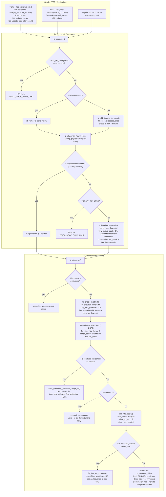
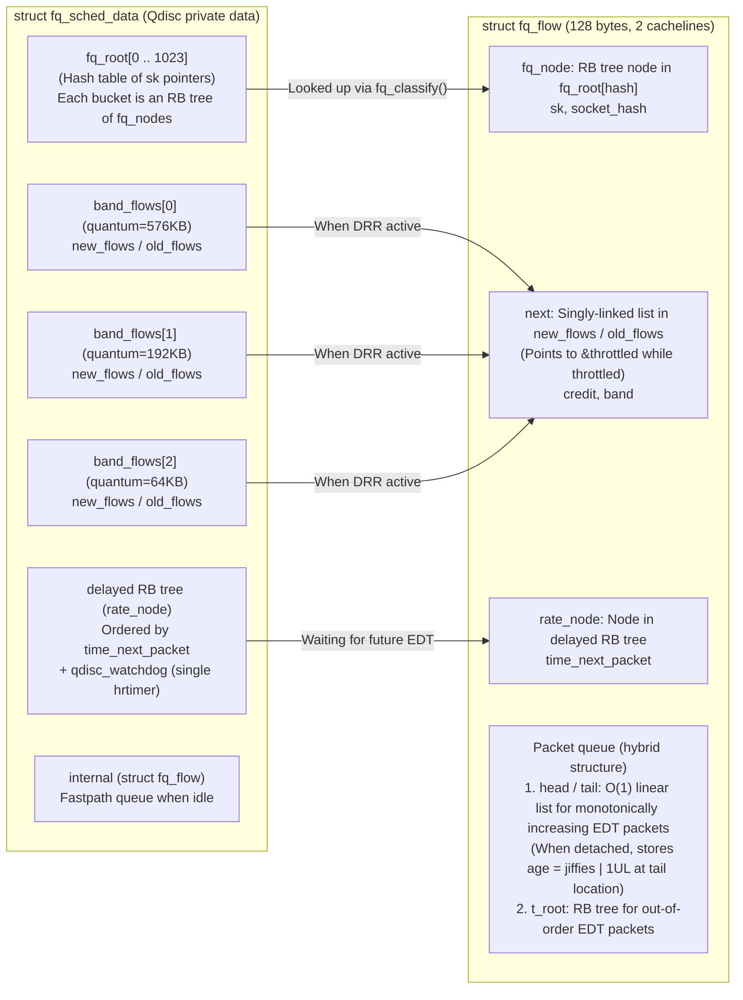

# 16. Fair Queueing (sch_fq) and EDT (Earliest Departure Time) Pacing

In this chapter, we read line-by-line `sch_fq` ([net/sched/sch_fq.c](https://git.kernel.org/pub/scm/linux/kernel/git/netdev/net-next.git/tree/net/sched/sch_fq.c?id=279d5c8afcd38bd841832a39bfe1aa4f8518d98e)), the cornerstone of Linux packet schedulers (Qdiscs), along with the **EDT (Earliest Departure Time)** architecture that cooperates with the TCP stack and user applications (`SO_TXTIME`) to achieve million-flow pacing. Here, we tie together how `sk->sk_pacing_rate`—configured by `tcp_update_pacing_rate()` in Chapter 11 or BBR in Chapter 13—is converted into the planned departure time `skb->tstamp` for each packet, and how `sch_fq` performs fair queueing and time-based scheduling immediately before handing packets over to the NIC driver.

---

## The ELI5 version

On the ground floor of a building sits a **dispatch warehouse (Qdisc)** that loads parcels (`sk_buff`) stamped with routing slips coming down from room mailboxes (`struct sock`) onto lorries (the NIC transmit ring).

What would happen if the dispatch warehouse had only **a single conveyor belt (a single FIFO queue)**?

- Suppose a tenant in one room (a bulk transfer flow) dumps 100 large moving boxes onto the conveyor belt all at once.
- Even if small, urgent envelopes arrive right afterwards from other rooms—such as "unlock the door" (a single SSH character), "what is this address?" (a DNS query), or "I received the earlier parcel" (a pure ACK)—they are forced to wait until all 100 moving boxes ahead of them have been loaded onto the lorries (**Head-of-Line (HoL) blocking**).
- Furthermore, suppose each room's dispatch coordinator (a congestion control algorithm such as BBR) dictates: "Release one parcel at regular 1 ms intervals to prevent road congestion (pacing)". If the building contains one million rooms, placing **one million hourglasses and gatekeepers (token buckets or per-socket hardware timers)** inside the warehouse would overwhelm the staff just from the overhead of flipping hourglasses.

To solve this, Eric Dumazet and Van Jacobson designed a dispatch warehouse called **Fair Queueing (`sch_fq`)** and **EDT (Earliest Departure Time)**:

- **Per-room sorting bins and prioritising "quiet rooms"**: The warehouse allocates a dedicated sorting bin (`struct fq_flow`) for each room's mailbox (`skb->sk`), and the attendant visits bins in round-robin fashion, retrieving a few parcels from each (Deficit Round Robin). Crucially, the queue for rooms sending an occasional envelope after a quiet period (`new_flows`) is serviced **ahead** of the queue for rooms that have been pumping out dozens of boxes continuously (`old_flows`). Consequently, SSH, DNS, and acknowledgement stamps (ACKs) never queue behind bulk moving boxes and depart immediately.
- **Replacing hourglasses with "scheduled departure times on slips (EDT)"**: Rather than lining up hourglasses, the dispatcher in each room (TCP or a `SO_TXTIME` application) writes an **Earliest Departure Time (EDT)—such as "do not dispatch this parcel before 10:00:00.005"—onto the slip (`skb->tstamp`)** before dropping the parcel down to the warehouse.
- **Chronological holding shelves and a single kitchen timer**: The warehouse attendant checks the slip on the parcel at the head of a bin. If the current time has already passed that timestamp, it is loaded onto the lorry immediately. If the departure time lies in the future, the bin is moved onto "chronological holding shelves" (the `delayed` red-black tree), and the warehouse sets **a single shared kitchen timer (`qdisc_watchdog`)** to the earliest parcel timestamp among all holding shelves.

Thanks to this mechanism, even when scaled to a million rooms, only a single kitchen timer is required in the warehouse, small envelopes never experience queueing delay, and bulk moving boxes enter the road smoothly at precisely paced intervals.

---

## What the RFCs and papers say

### Papers and RFCs to reference

`sch_fq` and EDT are not defined in a single RFC; rather, they originated from a combination of the following research papers, RFCs, and design documents:

- **M. Shreedhar, G. Varghese, "Efficient Fair Queueing Using Deficit Round-Robin", ACM SIGCOMM 1995 (IEEE/ACM Transactions on Networking, Vol. 4, No. 3, 1996)**
  Ideal bit-by-bit fair queueing (PGPS / WFQ) requires sorting virtual finish times with $O(\log N)$ complexity upon every packet arrival and departure. Conversely, naive packet-by-packet round robin allows flows transmitting larger packets to consume disproportionate bandwidth. **Deficit Round Robin (DRR)** allocates a byte-denominated deficit counter (`credit`) to each flow, adds a `quantum` of bytes per round, and deducts the packet length `plen` upon transmission, thereby achieving byte-level fairness with $O(1)$ complexity per packet.
- **[RFC 8290](https://www.rfc-editor.org/rfc/rfc8290) — The FlowQueue-CoDel Packet Scheduler and Active Queue Management Algorithm (2018)**
  The standards document that formalised dividing the active DRR flow list into **`new_flows` (newly arrived flows) and `old_flows` (backlogged, established flows)** ([RFC 8290 §4.2](https://www.rfc-editor.org/rfc/rfc8290#section-4.2)). The original concept traces back to Shortest Queue First (SQF) and `sch_fq_codel` in Linux 3.5, and the same dual-list `new_flows` / `old_flows` structure was adopted by `sch_fq` in Linux 3.12 (2013). Sparse flows whose queues drain before exhausting their initial quantum (`initial_quantum`) in a single round (DNS, SSH, VoIP, TCP handshakes, pure ACKs) are consistently dequeued ahead of bulk transfer flows (`old_flows`).
- **A. Saeed, N. Dukkipati, V. Valancius, V. The Lam, C. Contavalli, A. Vahdat, "Carousel: Scalable Traffic Shaping at End Hosts", ACM SIGCOMM 2017** and **V. Jacobson, E. Dumazet et al., "TCP Pacing and Earliest Departure Time (EDT)", Netdev 0x12 / IETF 2018**
  Papers and presentations that proposed abandoning traditional rate-based shaping (token buckets) in favour of an end-to-end scheduling architecture where every packet is stamped with a nanosecond-precision **Earliest Departure Time (EDT)**. In September 2018, Linux 4.20 (commit `ab408b6dc744`) migrated TCP and `sch_fq` fully to this EDT model.

### Why a single FIFO or token bucket is not enough

#### 1. Single FIFO Head-of-Line (HoL) blocking and bursts

When a bulk flow pushes a TSO/GSO burst or an entire congestion window of $B$ bytes into a single FIFO queue (such as `pfifo_fast`) at link rate $C$, any interactive flow (or ACK from another connection) arriving immediately afterwards experiences a queueing delay of up to:

$$d_{\text{FIFO}} = \frac{B}{C}$$

Furthermore, because TCP operates on ACK clocking, when ACKs arrive in clusters (ACK compression), the sender transmits packets in bursts as well. These bursts overflow shallow switch buffers downstream, causing packet loss via microbursts.

#### 2. Why hardware/Qdisc token buckets do not scale to millions of flows

Eliminating bursts requires pacing (controlling inter-packet time spacing), but conventional token buckets (HTB, TBF, or NIC hardware rate limiters) face three fundamental obstacles:

- **Hardware queue limits and rate update frequency**: NICs provide only dozens to thousands of hardware transmit queues or rate limiters—far too few for servers hosting hundreds of thousands to millions of concurrent TCP connections. Moreover, TCP (especially BBR) adjusts `sk_pacing_rate` on every received ACK, making hardware register updates every RTT completely impractical.
- **Per-socket hrtimer overhead**: If every TCP socket maintains its own high-resolution timer (`tp->pacing_timer`), the CPU becomes saturated solely from timer interrupts and red-black tree maintenance when tens of thousands of flows communicate simultaneously.
- **Drawbacks of post-dequeue pacing inside Qdiscs (legacy `sch_fq`, 2013–2018)**: Early `sch_fq` implementations inspected `sk->sk_pacing_rate` and computed the delay for the next packet **after** dequeuing a packet received from TCP. Under this scheme, however, the TCP core could not distinguish the time a packet spent waiting in `sch_fq` from transit delay across the network. This artificially inflated RTT estimates (`srtt_us`) and minimum RTT (RTT inflation), while preventing TCP from determining how aggressively it could aggregate segments into GSO/TSO super-packets.

### Design principles and mathematical formulations

#### 1. 3-band WRR (Weighted Round Robin) and per-flow DRR

`sch_fq` implements a two-tier scheduling hierarchy:

1. **Upper tier: 3-band WRR (`fq_perband_flows`)**
   Packets have their `skb->priority` (a value from 0 to 15 derived from `SO_PRIORITY` or the IP TOS field) mapped to a band $b \in \{0, 1, 2\}$ using the 2-bit lookup table `prio2band`. Each band $b$ has a configured weight `quantum` $Q_b$ (defaulting to $9 \times 2^{16} = 589{,}824$ bytes for band 0, $3 \times 2^{16} = 196{,}608$ bytes for band 1, and $1 \times 2^{16} = 65{,}536$ bytes for band 2, yielding a ratio of **$9 : 3 : 1$**) along with an accumulated deficit `credit` $C_b$.
   Whenever a packet of length $L$ bytes is dequeued from band $b$:

   $$C_b \leftarrow C_b - L$$

   When no sendable flows remain in that band or $C_b \le 0$, the scheduler advances to the next band and replenishes credits according to:

   $$C_b \leftarrow \min(C_b + Q_b,\ Q_b)$$

   Using WRR rather than strict priority prevents high-priority traffic (such as AF4) from starving best-effort traffic (BE1) during bursts or misbehaviour.

2. **Lower tier: Intra-band DRR via `new_flows` and `old_flows` (`fq_flow`)**
   Each band maintains two singly-linked lists: `new_flows` and `old_flows`.
   - When a packet arrives for an unattached flow (in the `detached` state), the flow is appended to the tail of `new_flows`. A new flow receives an initial credit of $c_f = Q_{\text{init}}$ (`initial_quantum`, default $10 \times \text{MTU}$). Furthermore, an existing flow whose queue has been empty for at least `flow_refill_delay` (default 40 ms) has its credit replenished to $c_f \leftarrow \max(c_f, Q_{\text{flow}})$.
   - `fq_dequeue()` always examines **`new_flows` first**, falling back to `old_flows` only when `new_flows` is empty.
   - When a packet of length $L$ is dequeued from flow $f$:

     $$c_f \leftarrow c_f - L$$

     If $c_f \le 0$ on the subsequent round:

     $$c_f \leftarrow c_f + Q_{\text{flow}} \quad (\text{default } Q_{\text{flow}} = 2 \times \text{MTU})$$

     is added, and flow $f$ is moved to the **tail of `old_flows`**.
   - If a flow on `new_flows` empties its queue while $c_f > 0$, it is not transitioned to `detached` immediately. Instead, it is moved while empty to the **tail of `old_flows`**, and only becomes `detached` if it remains empty when its turn arrives in `old_flows`. This prevents flows sending solitary packets at short intervals from continually jumping to `new_flows` and starving `old_flows`.

#### 2. EDT (Earliest Departure Time) and jitter correction equations

A TCP socket tracks the earliest departure time for its next packet in nanoseconds using `tp->tcp_wstamp_ns` (denoted below as $T_w$).

1. **EDT stamping during transmission (`__tcp_transmit_skb()`)**
   Let $T_{\text{now}}$ be the cached current timestamp `tp->tcp_clock_cache`. Immediately prior to transmission:

   $$T_{\text{prior}} = T_w, \qquad T_w \leftarrow \max(T_w,\ T_{\text{now}}), \qquad \text{skb}\to\text{tstamp} \leftarrow T_w$$

   This stamps the earliest departure time onto the packet.

2. **Advancing the next packet time and compensating for jitter post-send (`tcp_update_skb_after_send()`)**
   Let $R$ [bytes/sec] be the socket's pacing rate (`sk->sk_pacing_rate`), and $L$ [bytes] be the transmitted skb length (`skb->len`). Once at least 10 data segments have been sent over the connection (`tp->data_segs_out >= 10`), the ideal inter-packet interval is:

   $$\Delta t_{\text{ideal}} = \frac{L \times 10^9}{R}\ \text{[ns]}$$

   However, if OS scheduling latency or SoftIRQ delays cause the actual execution time $T_{\text{now}}$ to fall behind the previously scheduled departure time $T_{\text{prior}}$, simply adding $\Delta t_{\text{ideal}}$ to $T_w$ each time while ignoring the gap $T_w - T_{\text{prior}}$ would allow delays to accumulate indefinitely, preventing the socket from achieving target rate $R$. Linux therefore treats the accumulated delay $\Delta t_{\text{credit}} = T_w - T_{\text{prior}}$ as a "time credit" and deducts up to $\Delta t_{\text{ideal}} / 2$ from the current interval:

   $$\Delta t = \Delta t_{\text{ideal}} - \min\!\left(\frac{\Delta t_{\text{ideal}}}{2},\ T_w - T_{\text{prior}}\right), \qquad T_w \leftarrow T_w + \Delta t$$

3. **Departure checking, throttling, and ECN CE marking in `sch_fq` (`fq_dequeue()`)**
   At enqueue time, `sch_fq` normalises `skb->tstamp` to a monotonic nanosecond timestamp $T_{\text{pkt}}$ (`fq_skb_cb(skb)->time_to_send`) against `CLOCK_MONOTONIC`. At dequeue time, when extracting the head packet of flow $f$, the packet's effective departure time $T_{\text{next}}$ is computed as the maximum of $T_{\text{pkt}}$ and the flow's next allowed transmit time $T_{\text{flow}}$ (`f->time_next_packet`, determined by the Qdisc `maxrate` limit or pacing for non-EDT sockets):

   $$T_{\text{next}} = \max(T_{\text{pkt}},\ T_{\text{flow}})$$

   Let $H_{\text{offload}}$ be the NIC hardware pacing offload horizon (typically 0), and $\delta_{\text{slack}}$ be the permissible timer slack (`timer_slack`):

   - If $T_{\text{now}} + H_{\text{offload}} < T_{\text{next}}$, the packet's departure time has not yet arrived. The flow $f$ is removed from the DRR active list and inserted into the `q->delayed` red-black tree keyed by $T_{\text{next}}$ (throttled). A single `qdisc_watchdog` timer for the entire Qdisc is then scheduled in the interval $[T_{\min},\ T_{\min} + \delta_{\text{slack}}]$ targeting the earliest delayed flow time $T_{\min} = \min_{g \in \text{delayed}} T_{\text{flow}}(g)$.
   - If $T_{\text{now}} + H_{\text{offload}} \ge T_{\text{next}}$, the packet is dequeued and transmitted. If the actual scheduling delay beyond the planned departure time $T_{\text{now}} - T_{\text{next}}$ exceeds `ce_threshold` ($\theta_{\text{CE}}$):

     $$T_{\text{now}} - T_{\text{next}} - \theta_{\text{CE}} > 0$$

     `sch_fq` invokes `INET_ECN_set_ce(skb)` to mark Congestion Encountered (CE) in the IP header.

---

## The big picture

### 1. High-level view from packet transmission to `fq_enqueue()` / `fq_dequeue()`

The overall workflow from TCP or a `SO_TXTIME` application setting `skb->tstamp` through `sch_fq` classifying, queueing, and pacing the packet before handing it to the NIC is as follows:



### 2. Relationship between core `sch_fq` data structures

The relationships between the three sets of trees and lists managed by `struct fq_sched_data` (① the hash table of red-black trees `fq_root[]` for flow lookups, ② the 3-band WRR and DRR lists `band_flows[0..2]`, and ③ the `delayed` red-black tree for pacing wait queues) and the hybrid queue inside each `struct fq_flow` (linear FIFO `head`/`tail` plus red-black tree `t_root`) are structured as follows:



---

## Walking through the code

### Step 1: Core data structures — `fq_skb_cb`, `fq_flow`, `fq_perband_flows`, `fq_sched_data`

We begin by examining the structures and state management helpers defined at the top of `net/sched/sch_fq.c`.

#### `struct fq_skb_cb` and `struct fq_flow`

Here are `struct fq_skb_cb` ([net/sched/sch_fq.c#L53](https://git.kernel.org/pub/scm/linux/kernel/git/netdev/net-next.git/tree/net/sched/sch_fq.c?id=279d5c8afcd38bd841832a39bfe1aa4f8518d98e#n53)) and `struct fq_flow` ([net/sched/sch_fq.c#L69](https://git.kernel.org/pub/scm/linux/kernel/git/netdev/net-next.git/tree/net/sched/sch_fq.c?id=279d5c8afcd38bd841832a39bfe1aa4f8518d98e#n69)).
```c
struct fq_skb_cb {
	u64	time_to_send;
	u8	band;
};

static inline struct fq_skb_cb *fq_skb_cb(struct sk_buff *skb)
{
	qdisc_cb_private_validate(skb, sizeof(struct fq_skb_cb));
	return (struct fq_skb_cb *)qdisc_skb_cb(skb)->data;
}

/*
 * Per flow structure, dynamically allocated.
 * If packets have monotically increasing time_to_send, they are placed in O(1)
 * in linear list (head,tail), otherwise are placed in a rbtree (t_root).
 */
struct fq_flow {
/* First cache line : used in fq_gc(), fq_enqueue(), fq_dequeue() */
	struct rb_root	t_root;
	struct sk_buff	*head;		/* list of skbs for this flow : first skb */
	union {
		struct sk_buff *tail;	/* last skb in the list */
		unsigned long  age;	/* (jiffies | 1UL) when flow was emptied, for gc */
	};
	union {
		struct rb_node	fq_node;	/* anchor in fq_root[] trees */
		/* Following field is only used for q->internal,
		 * because q->internal is not hashed in fq_root[]
		 */
		u64		stat_fastpath_packets;
	};
	struct sock	*sk;
	u32		socket_hash;	/* sk_hash */
	int		qlen;		/* number of packets in flow queue */

/* Second cache line */
	int		credit;
	int		band;
	struct fq_flow *next;		/* next pointer in RR lists */

	struct rb_node  rate_node;	/* anchor in q->delayed tree */
	u64		time_next_packet;
};
```

- `fq_skb_cb`: A control block private to `sch_fq`, stored within `qdisc_skb_cb(skb)->data` (20 bytes), which the Qdisc layer is free to use. `time_to_send` is the scheduled departure time normalised to `CLOCK_MONOTONIC` nanoseconds, and `band` is the band number (0–2) determined at enqueue time. Recording `band` per skb rather than relying solely on `f->band` ensures that even if subsequent packets alter the socket's priority and overwrite `f->band`, `q->band_pkt_count[]` can still be decremented from the correct band at dequeue time.
- `struct fq_flow`: A structure measuring exactly 128 bytes (two 64-byte cache lines), allocated from a dedicated slab cache `fq_flow_cachep` (with `SLAB_HWCACHE_ALIGN`).
- **First cache line (64 bytes)**: Gathers all fields touched across `fq_gc()`, `fq_enqueue()`, and `fq_dequeue()`.
  - `t_root` and `head` / `tail`: The packet queue within a flow employs a **hybrid structure**. Because TCP EDT packets generally have monotonically increasing `time_to_send`, they are appended in $O(1)$ to the singly-linked list (`skb->next`) formed by `head` and `tail`. Only when UDP/QUIC applications using `SO_TXTIME` transmit packets with out-of-order EDTs, or when packets with past timestamps arrive late, are packets inserted into the `t_root` red-black tree (`skb->rbnode`).
  - `union { struct sk_buff *tail; unsigned long age; }`: Whilst a flow is off the DRR lists (in the `detached` state), its queue is empty and `tail` is unused. The same 8 bytes are therefore reused for `age` (`jiffies | 1UL` at the time it became empty) for garbage collection. Since `struct sk_buff` is aligned to at least 2 bytes, the least significant bit (bit 0) of a valid `tail` pointer is always `0`. Forcing bit 0 of `age` to `1` allows checking whether a flow is currently `detached` via `f->age & 1UL` alone, without requiring an additional flag variable.
  - `union { struct rb_node fq_node; u64 stat_fastpath_packets; }`: In regular flows, this is used as the 24-byte red-black tree node `fq_node` in the `q->fq_root[]` hash buckets. Meanwhile, `q->internal` (the special `fq_flow` embedded in `fq_sched_data` for the fast path) is never registered in `fq_root[]`, so this storage is reused as the `stat_fastpath_packets` counter.
  - `sk` and `socket_hash`: The `struct sock *` pointer corresponding to this flow (or a pseudo-pointer `(hash << 1) | 1UL` for orphaned or unconnected UDP sockets) and the socket's `sk->sk_hash`. Because `sch_fq` does not immediately free `fq_flow` when a flow runs dry, the original socket may be closed and slab allocation might assign another new `struct sock` at the exact same address. Since `f->sk == sk` alone cannot distinguish whether it is the identical socket, `f->socket_hash != sk->sk_hash` detects socket reallocation (Step 2).
- **Second cache line (64 bytes)**: Fields used for DRR round-robin operations and pacing throttling operations.
  - `credit`: Per-flow DRR credit (in bytes).
  - `band`: The band number (0, 1, 2) to which this flow currently belongs.
  - `next`: The next pointer in the `new_flows` or `old_flows` singly-linked list. While a flow is throttled in the `q->delayed` red-black tree, pointing to the dummy static variable `&throttled` signifies that it is currently throttled.
  - `rate_node` and `time_next_packet`: The node in the `q->delayed` red-black tree and its key, the next eligible transmission time (in nanoseconds).

#### `struct fq_perband_flows` and `struct fq_sched_data`

Next, we examine `struct fq_flow_head`, `struct fq_perband_flows`, and `struct fq_sched_data` ([net/sched/sch_fq.c#L97](https://git.kernel.org/pub/scm/linux/kernel/git/netdev/net-next.git/tree/net/sched/sch_fq.c?id=279d5c8afcd38bd841832a39bfe1aa4f8518d98e#n97)).

```c
struct fq_flow_head {
	struct fq_flow *first;
	struct fq_flow *last;
};

struct fq_perband_flows {
	struct fq_flow_head new_flows;
	struct fq_flow_head old_flows;
	int		    credit;
	int		    quantum; /* based on band nr : 576KB, 192KB, 64KB */
};

#define FQ_PRIO2BAND_CRUMB_SIZE ((TC_PRIO_MAX + 1) >> 2)

struct fq_sched_data {
/* Read mostly cache line */

	u64		offload_horizon;
	u32		quantum;
	u32		initial_quantum;
	u32		flow_refill_delay;
	u32		flow_plimit;	/* max packets per flow */
	unsigned long	flow_max_rate;	/* optional max rate per flow */
	u64		ce_threshold;
	u64		horizon;	/* horizon in ns */
	u32		orphan_mask;	/* mask for orphaned skb */
	u32		low_rate_threshold;
	struct rb_root	*fq_root;
	u8		rate_enable;
	u8		fq_trees_log;
	u8		horizon_drop;
	u8		prio2band[FQ_PRIO2BAND_CRUMB_SIZE];
	u32		timer_slack; /* hrtimer slack in ns */

/* Read/Write fields. */

	unsigned int band_nr; /* band being serviced in fq_dequeue() */

	struct fq_perband_flows band_flows[FQ_BANDS];

	struct fq_flow	internal;	/* fastpath queue. */
	struct rb_root	delayed;	/* for rate limited flows */
	u64		time_next_delayed_flow;
	unsigned long	unthrottle_latency_ns;

	u32		band_pkt_count[FQ_BANDS];
	u32		flows;
	u32		inactive_flows; /* Flows with no packet to send. */
	u32		throttled_flows;

	u64		stat_throttled;
	struct qdisc_watchdog watchdog;
	u64		stat_gc_flows;

/* Seldom used fields. */

	u64		stat_band_drops[FQ_BANDS];
	u64		stat_ce_mark;
	u64		stat_horizon_drops;
	u64		stat_horizon_caps;
	u64		stat_flows_plimit;
	u64		stat_pkts_too_long;
	u64		stat_allocation_errors;
};
```

- `struct fq_perband_flows`: The per-band WRR state. It maintains two list heads, `new_flows` and `old_flows`, along with the band's remaining `credit` and its per-round weight `quantum`.
- `FQ_PRIO2BAND_CRUMB_SIZE`: When mapping `TC_PRIO_MAX + 1` (16) priorities (0–15) to 3 bands (0–2), each entry is compressed into 2 bits (a "crumb"), packing the entire mapping into just **4 bytes** via `u8 prio2band[4]`. This allows the preceding read-mostly region to fit neatly within cache lines.
- `struct fq_sched_data`: Divided into three regions based on access patterns:
  1. **Read mostly cache line**: Configuration parameters that are only modified during `tc qdisc change` (`fq_change()`), alongside the pointer `fq_root` to the hash table array (by default, $2^{10} = 1024$ instances of `struct rb_root`).
  2. **Read/Write fields**: Fields updated on every packet enqueue and dequeue. These include the currently serviced band number `band_nr`, `band_flows[FQ_BANDS]` for the three bands, the fast path queue `internal`, the red-black tree `delayed` for throttled flows along with its minimum timestamp cache `time_next_delayed_flow`, an exponential moving average of timer unthrottle latency `unthrottle_latency_ns`, per-band packet counts `band_pkt_count`, total flow count `flows`, empty flow count `inactive_flows`, throttled flow count `throttled_flows`, and `watchdog` (`struct qdisc_watchdog`) wrapping a single hrtimer.
  3. **Seldom used fields**: Statistics counters incremented only during exceptional or congested conditions, such as packet drops and CE markings, isolated at the end of the structure so they do not pollute cache lines on the common path.

#### Flow state transitions and priority conversion helper functions

Next, we review the helper functions ([net/sched/sch_fq.c#L162](https://git.kernel.org/pub/scm/linux/kernel/git/netdev/net-next.git/tree/net/sched/sch_fq.c?id=279d5c8afcd38bd841832a39bfe1aa4f8518d98e#n162)) that manage flow states (`detached` / `throttled` / `new_flows` / `old_flows`).

```c
/* EDT timestamps to clear beyond now. */
static const int fq_offload_slack_ns = 400;

/* return the i-th 2-bit value ("crumb") */
static u8 fq_prio2band(const u8 *prio2band, unsigned int prio)
{
	return (READ_ONCE(prio2band[prio / 4]) >> (2 * (prio & 0x3))) & 0x3;
}

/*
 * f->tail and f->age share the same location.
 * We can use the low order bit to differentiate if this location points
 * to a sk_buff or contains a jiffies value, if we force this value to be odd.
 * This assumes f->tail low order bit must be 0 since alignof(struct sk_buff) >= 2
 */
static void fq_flow_set_detached(struct fq_flow *f)
{
	f->age = jiffies | 1UL;
}

static bool fq_flow_is_detached(const struct fq_flow *f)
{
	return !!(f->age & 1UL);
}

/* special value to mark a throttled flow (not on old/new list) */
static struct fq_flow throttled;

static bool fq_flow_is_throttled(const struct fq_flow *f)
{
	return f->next == &throttled;
}

enum new_flow {
	NEW_FLOW,
	OLD_FLOW
};

static void fq_flow_add_tail(struct fq_sched_data *q, struct fq_flow *flow,
			     enum new_flow list_sel)
{
	struct fq_perband_flows *pband = &q->band_flows[flow->band];
	struct fq_flow_head *head = (list_sel == NEW_FLOW) ?
					&pband->new_flows :
					&pband->old_flows;

	if (head->first)
		head->last->next = flow;
	else
		head->first = flow;
	head->last = flow;
	flow->next = NULL;
}

static void fq_flow_unset_throttled(struct fq_sched_data *q, struct fq_flow *f)
{
	rb_erase(&f->rate_node, &q->delayed);
	q->throttled_flows--;
	fq_flow_add_tail(q, f, OLD_FLOW);
}

static void fq_flow_rb_insert(struct fq_sched_data *q, struct fq_flow *f)
{
	struct rb_node **p = &q->delayed.rb_node, *parent = NULL;

	while (*p) {
		struct fq_flow *aux;

		parent = *p;
		aux = rb_entry(parent, struct fq_flow, rate_node);
		if (f->time_next_packet >= aux->time_next_packet)
			p = &parent->rb_right;
		else
			p = &parent->rb_left;
	}
	rb_link_node(&f->rate_node, parent, p);
	rb_insert_color(&f->rate_node, &q->delayed);

	if (q->time_next_delayed_flow > f->time_next_packet)
		q->time_next_delayed_flow = f->time_next_packet;
}

static void fq_flow_set_throttled(struct fq_sched_data *q, struct fq_flow *f)
{
	fq_flow_rb_insert(q, f);
	q->throttled_flows++;
	q->stat_throttled++;
	f->next = &throttled;
}
```

- `fq_prio2band()` ([net/sched/sch_fq.c#L166](https://git.kernel.org/pub/scm/linux/kernel/git/netdev/net-next.git/tree/net/sched/sch_fq.c?id=279d5c8afcd38bd841832a39bfe1aa4f8518d98e#n166)): Reads the corresponding byte using `READ_ONCE()` at `prio / 4`, shifts right by `2 * (prio & 0x3)` bits, and extracts the lower 2 bits. Because `fq_dump()` may be invoked locklessly, reads and writes to `prio2band` use `READ_ONCE()` / `WRITE_ONCE()`.
- `fq_flow_set_detached()` ([net/sched/sch_fq.c#L177](https://git.kernel.org/pub/scm/linux/kernel/git/netdev/net-next.git/tree/net/sched/sch_fq.c?id=279d5c8afcd38bd841832a39bfe1aa4f8518d98e#n177)) / `fq_flow_is_detached()` ([net/sched/sch_fq.c#L182](https://git.kernel.org/pub/scm/linux/kernel/git/netdev/net-next.git/tree/net/sched/sch_fq.c?id=279d5c8afcd38bd841832a39bfe1aa4f8518d98e#n182)): As noted earlier, writing `jiffies | 1UL` into `f->age` (shared with `f->tail`) simultaneously records that this is an empty flow belonging to no active list and the time it became empty (with at most 1 jiffy error). Later, the moment `flow_queue_add()` writes the first packet as `f->tail = skb`, bit 0 reverts to `0`, making even an explicit `unset_detached` function unnecessary.
- `fq_flow_is_throttled()` ([net/sched/sch_fq.c#L190](https://git.kernel.org/pub/scm/linux/kernel/git/netdev/net-next.git/tree/net/sched/sch_fq.c?id=279d5c8afcd38bd841832a39bfe1aa4f8518d98e#n190)): Uses the address of the file-scoped dummy variable `static struct fq_flow throttled;` as a sentinel, determining the flow is throttled if `f->next == &throttled`.
- `fq_flow_set_throttled()` ([net/sched/sch_fq.c#L244](https://git.kernel.org/pub/scm/linux/kernel/git/netdev/net-next.git/tree/net/sched/sch_fq.c?id=279d5c8afcd38bd841832a39bfe1aa4f8518d98e#n244)) and `fq_flow_rb_insert()` ([net/sched/sch_fq.c#L223](https://git.kernel.org/pub/scm/linux/kernel/git/netdev/net-next.git/tree/net/sched/sch_fq.c?id=279d5c8afcd38bd841832a39bfe1aa4f8518d98e#n223)): Inserts the flow into the `q->delayed` red-black tree using `f->time_next_packet` as the key. If a flow with the identical timestamp already exists, it is placed in the right subtree (`>=`), preserving FIFO order for identical timestamps. To avoid searching `rb_first(&q->delayed)` on every step, the earliest timestamp is cached and updated in `q->time_next_delayed_flow`.
- `fq_flow_unset_throttled()` ([net/sched/sch_fq.c#L216](https://git.kernel.org/pub/scm/linux/kernel/git/netdev/net-next.git/tree/net/sched/sch_fq.c?id=279d5c8afcd38bd841832a39bfe1aa4f8518d98e#n216)): Removes a flow that has reached its scheduled departure time from the `q->delayed` red-black tree, always returning it to **`OLD_FLOW` (the tail of `old_flows`)**. Because a flow awaiting pacing is an active, ongoing stream, it is an essential design choice never to return it to `new_flows` (which is reserved for sparse, interactive flows).

---

### Step 2: Flow classification and garbage collection — `fq_gc()`, `fq_fastpath_check()`, `fq_classify()`

#### `fq_gc_candidate()` and `fq_gc()`

We examine `fq_gc_candidate()` ([net/sched/sch_fq.c#L257](https://git.kernel.org/pub/scm/linux/kernel/git/netdev/net-next.git/tree/net/sched/sch_fq.c?id=279d5c8afcd38bd841832a39bfe1aa4f8518d98e#n257)) and `fq_gc()` ([net/sched/sch_fq.c#L263](https://git.kernel.org/pub/scm/linux/kernel/git/netdev/net-next.git/tree/net/sched/sch_fq.c?id=279d5c8afcd38bd841832a39bfe1aa4f8518d98e#n263)).

```c
#define FQ_GC_AGE (3*HZ)

static bool fq_gc_candidate(const struct fq_flow *f)
{
	return fq_flow_is_detached(f) &&
	       time_after(jiffies, f->age + FQ_GC_AGE);
}

static void fq_gc(struct fq_sched_data *q,
		  struct rb_root *root,
		  struct sock *sk)
{
	struct fq_flow *f, *tofree = NULL;
	struct rb_node **p, *parent;
	int fcnt;

	p = &root->rb_node;
	parent = NULL;
	while (*p) {
		parent = *p;

		f = rb_entry(parent, struct fq_flow, fq_node);
		if (f->sk == sk)
			break;

		if (fq_gc_candidate(f)) {
			f->next = tofree;
			tofree = f;
		}

		if (f->sk > sk)
			p = &parent->rb_right;
		else
			p = &parent->rb_left;
	}

	if (!tofree)
		return;

	fcnt = 0;
	while (tofree) {
		f = tofree;
		tofree = f->next;
		rb_erase(&f->fq_node, root);
		kmem_cache_free(fq_flow_cachep, f);
		fcnt++;
	}
	q->flows -= fcnt;
	q->inactive_flows -= fcnt;
	q->stat_gc_flows += fcnt;
}
```

- `sch_fq` does not immediately free an `fq_flow` when its packet count drops to zero. This is because further data will likely arrive one RTT later, and when retransmissions or additional packets arrive within `flow_refill_delay` (40 ms), earlier state (credits and `old_flows` history) must be retained. Furthermore, invoking callbacks from the TCP socket destruction path (`sk_destruct()`) into the Qdisc would introduce lock contention; hence, the lifecycles of the socket and the `fq_flow` are completely decoupled.
- Instead, whilst `fq_classify()` traverses the red-black tree of the hash bucket `root` looking for `sk`, any node encountered along the search path that is `detached` and has remained idle for at least `FQ_GC_AGE` (3 seconds) is linked into the `tofree` singly-linked list (`f->next` is unused in `detached` flows and can be safely utilised). Once the search finishes, these nodes are pruned and freed in a batch via `rb_erase()` + `kmem_cache_free()`. Without using timers or scanning every bucket, this clever lazy GC reclaims nodes along the enqueue lookup path in $O(\log N)$.

#### `fq_offload_horizon()` and `fq_fastpath_check()`

Next, we examine `fq_offload_horizon()` ([net/sched/sch_fq.c#L307](https://git.kernel.org/pub/scm/linux/kernel/git/netdev/net-next.git/tree/net/sched/sch_fq.c?id=279d5c8afcd38bd841832a39bfe1aa4f8518d98e#n307)) and `fq_fastpath_check()` ([net/sched/sch_fq.c#L337](https://git.kernel.org/pub/scm/linux/kernel/git/netdev/net-next.git/tree/net/sched/sch_fq.c?id=279d5c8afcd38bd841832a39bfe1aa4f8518d98e#n337)), which perform bypass checks during idle or low-load conditions.

```c
static u64 fq_offload_horizon(const struct Qdisc *sch,
			      const struct fq_sched_data *q)
{
	const struct net_device *dev;
	u64 offload_horizon;

	offload_horizon = READ_ONCE(q->offload_horizon);
	if (!offload_horizon)
		return 0;

	dev = qdisc_dev(sch);
	if (!dev->pacing_offload)
		return 0;

	if (offload_horizon > READ_ONCE(dev->max_pacing_offload_horizon))
		return 0;

	return offload_horizon;
}

/* Fast path can be used if :
 * 1) Packet tstamp is in the past, or within the pacing offload horizon.
 * 2) FQ qlen == 0   OR
 *   (no flow is currently eligible for transmit,
 *    AND fast path queue has less than 8 packets)
 * 3) No SO_MAX_PACING_RATE on the socket (if any).
 * 4) No @maxrate attribute on this qdisc,
 *
 * FQ can not use generic TCQ_F_CAN_BYPASS infrastructure.
 */
static bool fq_fastpath_check(const struct Qdisc *sch, struct sk_buff *skb,
			      u64 now, u64 offload_horizon)
{
	const struct fq_sched_data *q = qdisc_priv(sch);
	const struct sock *sk;

	if (fq_skb_cb(skb)->time_to_send > now + offload_horizon)
		return false;

	if (sch->q.qlen != 0) {
		/* Even if some packets are stored in this qdisc,
		 * we can still enable fast path if all of them are
		 * scheduled in the future (ie no flows are eligible)
		 * or in the fast path queue.
		 */
		if (q->flows != q->inactive_flows + q->throttled_flows)
			return false;

		/* Do not allow fast path queue to explode, we want Fair Queue mode
		 * under pressure.
		 */
		if (q->internal.qlen >= 8)
			return false;

		/* Ordering invariants fall apart if some delayed flows
		 * are ready but we haven't serviced them, yet.
		 */
		if (q->time_next_delayed_flow <= now + offload_horizon)
			return false;
	}

	sk = skb->sk;
	if (sk && sk_fullsock(sk) && !sk_is_tcp(sk) &&
	    sk->sk_max_pacing_rate != ~0UL)
		return false;

	if (q->flow_max_rate != ~0UL)
		return false;

	return true;
}
```

- `fq_offload_horizon()`: When the NIC supports hardware EDT pacing offload (`dev->pacing_offload`) and `tc qdisc ... fq offload_horizon` is configured, packets with future departure timestamps within `offload_horizon` nanoseconds of the current time `now` can be passed directly to the NIC driver without being throttled by `sch_fq`. In standard environments without hardware offload, it returns `0`.
- `fq_fastpath_check()`: An optimisation (commit `076433bd78d7`) that bypasses the 128-byte `fq_flow` lookup, allocation, and red-black tree operations altogether, sending packets directly to the `q->internal` queue when the link is idle and the packet can be transmitted immediately. It evaluates to true only when all four of the following conditions hold:
  1. `time_to_send <= now + offload_horizon`: The packet itself does not require pacing delays.
  2. The Qdisc is completely empty (`sch->q.qlen == 0`), OR "all regular flows are currently either `inactive` or `throttled` (`q->flows == q->inactive_flows + q->throttled_flows`), `q->internal.qlen < 8`, and no flows in the `delayed` tree have already passed their departure time (`q->time_next_delayed_flow > now + offload_horizon`)". Without the final condition (commit `122aba8c8061`), a subsequent packet could exit via `q->internal` ahead of earlier packets in the `delayed` tree that have already reached their departure time, causing packet reordering within the same flow.
  3. No `SO_MAX_PACING_RATE` is configured on non-TCP sockets (for TCP sockets, `SO_MAX_PACING_RATE` has already been factored into `skb->tstamp` on the TCP side and is checked by condition 1, but non-TCP sockets require rate calculation in `fq_dequeue()`).
  4. No qdisc-wide `maxrate` (`q->flow_max_rate != ~0UL`) is configured.

#### `fq_classify()`

We now examine `fq_classify()` ([net/sched/sch_fq.c#L379](https://git.kernel.org/pub/scm/linux/kernel/git/netdev/net-next.git/tree/net/sched/sch_fq.c?id=279d5c8afcd38bd841832a39bfe1aa4f8518d98e#n379)) in its entirety.

```c
static struct fq_flow *fq_classify(struct Qdisc *sch, struct sk_buff *skb,
				   u64 now)
{
	struct fq_sched_data *q = qdisc_priv(sch);
	u64 offload_horizon = fq_offload_horizon(sch, q);
	struct rb_node **p, *parent;
	struct sock *sk = skb->sk;
	struct rb_root *root;
	struct fq_flow *f;

	/* SYNACK messages are attached to a TCP_NEW_SYN_RECV request socket
	 * or a listener (SYNCOOKIE mode)
	 * 1) request sockets are not full blown,
	 *    they do not contain sk_pacing_rate
	 * 2) They are not part of a 'flow' yet
	 * 3) We do not want to rate limit them (eg SYNFLOOD attack),
	 *    especially if the listener set SO_MAX_PACING_RATE
	 * 4) We pretend they are orphaned
	 * TCP can also associate TIME_WAIT sockets with RST or ACK packets.
	 */
	if (!sk || sk_listener_or_tw(sk)) {
		unsigned long hash = skb_get_hash(skb) & q->orphan_mask;

		/* By forcing low order bit to 1, we make sure to not
		 * collide with a local flow (socket pointers are word aligned)
		 */
		sk = (struct sock *)((hash << 1) | 1UL);
		skb_orphan(skb);
	} else if (sk->sk_state == TCP_CLOSE) {
		unsigned long hash = skb_get_hash(skb) & q->orphan_mask;
		/*
		 * Sockets in TCP_CLOSE are non connected.
		 * Typical use case is UDP sockets, they can send packets
		 * with sendto() to many different destinations.
		 * We probably could use a generic bit advertising
		 * non connected sockets, instead of sk_state == TCP_CLOSE,
		 * if we care enough.
		 */
		sk = (struct sock *)((hash << 1) | 1UL);
	}
```

- **Determining the classification key `sk` (lines 399–418)**:
  - For locally established regular TCP / connected UDP sockets, packets directly use `skb->sk` (the kernel `struct sock *` pointer value itself) as the flow identifier. Not even a 5-tuple hash calculation is needed.
  - However, using `skb->sk` directly poses problems in the following three cases:
    1. **Forwarded packets (`!sk`)**: Because these have no socket, the 4-tuple hash `skb_get_hash(skb)` is used. To prevent an attacker from exhausting memory during a DDoS attack with millions of random IP/port combinations by allocating unbounded `fq_flow` structures, the hash is masked with `q->orphan_mask` (default `1023`), confining them to at most 1,024 shared flows.
    2. **SYN-ACKs and TIME_WAIT ACKs/RSTs (`sk_listener_or_tw(sk)`)**: SYN-ACKs are attached to a `TCP_NEW_SYN_RECV` (`request_sock`) or, in SYN cookie mode, a `TCP_LISTEN` socket. If all SYN-ACKs destined for multiple clients were collapsed into the single listener socket's `fq_flow`, and the listener had `SO_MAX_PACING_RATE` configured (commonly set to be inherited by child sockets), every SYN-ACK would be rate-limited during a SYN flood. Furthermore, `request_sock` and `inet_timewait_sock` lack `sk_pacing_rate` and `sk_pacing_status` fields (as they are not full sockets, writing to them causes memory corruption!). Therefore, the packet is detached from the socket via `skb_orphan(skb)` and converted into a pseudo-pointer `(hash << 1) | 1UL`. Forcing the least significant bit (bit 0) to `1` guarantees that it will never collide with a word-aligned real `struct sock *` pointer (whose bit 0 is always `0`).
    3. **Unconnected UDP sockets (`sk->sk_state == TCP_CLOSE`)**: Unconnected UDP sockets without `connect()` (such as DNS servers or QUIC servers) transmit packets to many distinct destinations using `sendto()` from a single socket. If these were pooled into a single `fq_flow`, head-of-line (HoL) blocking would occur across disparate destinations; therefore, they are demultiplexed per destination using `skb_get_hash(skb) & q->orphan_mask`. Note that `skb_orphan(skb)` is **not called** here. This preserves UDP send-buffer accounting (`sk_wmem_alloc`), and because the subsequent `skb->sk == sk` check evaluates to false (`skb->sk` is an even address, while `sk` is an odd address), writes to `sk->sk_pacing_status` and related fields are naturally bypassed.

```c
	if (fq_fastpath_check(sch, skb, now, offload_horizon)) {
		q->internal.stat_fastpath_packets++;
		if (skb->sk == sk && q->rate_enable &&
		    READ_ONCE(sk->sk_pacing_status) != SK_PACING_FQ)
			smp_store_release(&sk->sk_pacing_status,
					  SK_PACING_FQ);

		if (offload_horizon &&
		    fq_skb_cb(skb)->time_to_send <= now + fq_offload_slack_ns)
			skb_set_delivery_time(skb, 0, SKB_CLOCK_REALTIME);

		return &q->internal;
	}

	root = &q->fq_root[hash_ptr(sk, q->fq_trees_log)];

	fq_gc(q, root, sk);

	p = &root->rb_node;
	parent = NULL;
	while (*p) {
		parent = *p;

		f = rb_entry(parent, struct fq_flow, fq_node);
		if (f->sk == sk) {
			/* socket might have been reallocated, so check
			 * if its sk_hash is the same.
			 * It not, we need to refill credit with
			 * initial quantum
			 */
			if (unlikely(skb->sk == sk &&
				     f->socket_hash != sk->sk_hash)) {
				f->credit = q->initial_quantum;
				f->socket_hash = sk->sk_hash;
				if (q->rate_enable)
					smp_store_release(&sk->sk_pacing_status,
							  SK_PACING_FQ);
				if (fq_flow_is_throttled(f))
					fq_flow_unset_throttled(q, f);
				f->time_next_packet = 0ULL;
			}
			return f;
		}
		if (f->sk > sk)
			p = &parent->rb_right;
		else
			p = &parent->rb_left;
	}

	f = kmem_cache_zalloc(fq_flow_cachep, GFP_ATOMIC | __GFP_NOWARN);
	if (unlikely(!f)) {
		q->stat_allocation_errors++;
		return &q->internal;
	}
	/* f->t_root is already zeroed after kmem_cache_zalloc() */

	fq_flow_set_detached(f);
	f->sk = sk;
	if (skb->sk == sk) {
		f->socket_hash = sk->sk_hash;
		if (q->rate_enable)
			smp_store_release(&sk->sk_pacing_status,
					  SK_PACING_FQ);
	}
	f->credit = q->initial_quantum;

	rb_link_node(&f->fq_node, parent, p);
	rb_insert_color(&f->fq_node, root);

	q->flows++;
	q->inactive_flows++;
	return f;
}
```

- **Fast path check (lines 420–432)**: If `fq_fastpath_check()` returns true, `&q->internal` is returned. Even in this case, if it is a real socket (`skb->sk == sk`), it does not neglect to set `sk->sk_pacing_status` to `SK_PACING_FQ` (commit `81a416985698`). Failing to do so would prevent the TCP socket from realising on the first packet through an idle Qdisc that `sch_fq` is attached to this NIC, causing it to wastefully continue running its internal `pacing_timer` (hrtimer).
- **Hash lookup and socket reuse detection (lines 434–467)**: One of the 1,024 buckets (default) is selected via `hash_ptr(sk, q->fq_trees_log)`, stale `detached` flows are reclaimed using `fq_gc()`, and the red-black tree is searched via binary search on `f->sk`.
  - When a match is found with `f->sk == sk`, if `skb->sk == sk && f->socket_hash != sk->sk_hash`, it indicates that the previous socket was closed and a new socket was allocated at the same address in the slab cache. In this situation, the leftover credits and throttle state of the previous socket must not be inherited; hence `f->credit` is reset to `q->initial_quantum`, `SK_PACING_FQ` is set, and if the old socket was throttled (`fq_flow_is_throttled(f)`), it is removed from the `q->delayed` tree via `fq_flow_unset_throttled(q, f)` and `f->time_next_packet` is cleared to `0ULL` (commit `7df40c2673a1`).
- **Allocating a new `fq_flow` (lines 469–491)**: If not present in the red-black tree, a new flow is allocated from `fq_flow_cachep` with `GFP_ATOMIC | __GFP_NOWARN`. Under memory exhaustion, rather than dropping the packet, it falls back to `&q->internal`. The new flow is first marked as `detached` via `fq_flow_set_detached(f)`, granted `f->credit = q->initial_quantum` (default $10 \times \text{MTU}$), inserted into the red-black tree, and returned after incrementing `q->flows++` and `q->inactive_flows++` (since `f->qlen == 0`, it is counted temporarily as inactive, and will be decremented via `inactive_flows--` in the subsequent `fq_enqueue()`).

---

### Step 3: Packet enqueue and Horizon protection — `fq_enqueue()` and related functions

#### `flow_queue_add()`, `fq_packet_beyond_horizon()`, `fq_flow_adjust_timer()`, and clock conversion

Let us examine the helper functions called by `fq_enqueue()` ([net/sched/sch_fq.c#L537](https://git.kernel.org/pub/scm/linux/kernel/git/netdev/net-next.git/tree/net/sched/sch_fq.c?id=279d5c8afcd38bd841832a39bfe1aa4f8518d98e#n537)).
```c
static void flow_queue_add(struct fq_flow *flow, struct sk_buff *skb)
{
	struct rb_node **p, *parent;
	struct sk_buff *head, *aux;

	head = flow->head;
	if (!head ||
	    fq_skb_cb(skb)->time_to_send >= fq_skb_cb(flow->tail)->time_to_send) {
		if (!head)
			flow->head = skb;
		else
			flow->tail->next = skb;
		flow->tail = skb;
		skb->next = NULL;
		return;
	}

	p = &flow->t_root.rb_node;
	parent = NULL;

	while (*p) {
		parent = *p;
		aux = rb_to_skb(parent);
		if (fq_skb_cb(skb)->time_to_send >= fq_skb_cb(aux)->time_to_send)
			p = &parent->rb_right;
		else
			p = &parent->rb_left;
	}
	rb_link_node(&skb->rbnode, parent, p);
	rb_insert_color(&skb->rbnode, &flow->t_root);
}

static bool fq_packet_beyond_horizon(ktime_t time_to_send,
				     const struct fq_sched_data *q, u64 now)
{
	return unlikely((s64)time_to_send > (s64)(now + q->horizon));
}

static void fq_flow_adjust_timer(struct fq_sched_data *q, struct fq_flow *flow,
				 u64 time_to_send, u64 now)
{
	if (time_to_send <= now) {
		fq_flow_unset_throttled(q, flow);
		if (q->time_next_delayed_flow == flow->time_next_packet) {
			struct rb_node *p = rb_first(&q->delayed);

			q->time_next_delayed_flow = p ? rb_entry(p, struct fq_flow, rate_node)->time_next_packet : ~0ULL;
		}
		flow->time_next_packet = time_to_send;
	} else {
		rb_erase(&flow->rate_node, &q->delayed);
		flow->time_next_packet = time_to_send;
		fq_flow_rb_insert(q, flow);
	}
}

static ktime_t fq_skb_tstamp_to_mono(struct sk_buff *skb)
{
	const ktime_t mono_max = NSEC_PER_SEC * TIME_UPTIME_SEC_MAX;

	if (likely(skb->tstamp_type == SKB_CLOCK_MONOTONIC))
		return max(skb->tstamp, 1);

	if (skb->tstamp_type == SKB_CLOCK_TAI)
		return max(ktime_sub(skb->tstamp, ktime_mono_to_any(0, TK_OFFS_TAI)), 1);

	if (likely(skb->tstamp > mono_max))
		return max(ktime_sub(skb->tstamp, ktime_mono_to_real(0)), 1);

	/* Handle BPF programs setting skb->stamp but not tstamp_type */
	net_warn_ratelimited("fq: likely mono tstamp with tstamp_type 0\n");

	skb->tstamp_type = SKB_CLOCK_MONOTONIC;
	return max(skb->tstamp, 1);
}

static void fq_mono_to_skb_tstamp(struct sk_buff *skb, ktime_t time_to_send)
{
	if (skb->tstamp_type == SKB_CLOCK_MONOTONIC)
		skb->tstamp = time_to_send;
	else if (skb->tstamp_type == SKB_CLOCK_REALTIME)
		skb->tstamp = ktime_mono_to_real(time_to_send);
	else
		skb->tstamp = ktime_mono_to_any(time_to_send, TK_OFFS_TAI);
}
```

- `flow_queue_add()` ([net/sched/sch_fq.c#L537](https://git.kernel.org/pub/scm/linux/kernel/git/netdev/net-next.git/tree/net/sched/sch_fq.c?id=279d5c8afcd38bd841832a39bfe1aa4f8518d98e#n537)):
  - If the singly linked list `flow->head` is empty, or if the new packet's `time_to_send` is greater than or equal to (monotonically non-decreasing compared to) the `time_to_send` of the list tail `flow->tail`, it simply appends the packet behind `flow->tail` in $O(1)$ time. Because all packets generated by a TCP connection advance with monotonically non-decreasing `tp->tcp_wstamp_ns`, **TCP takes this $O(1)$ path 100% of the time**. Furthermore, assigning `flow->tail = skb` when `flow->head` is empty overwrites the union member `flow->age` (bit 0 = 1) with a pointer (bit 0 = 0), automatically clearing the `detached` state.
  - Only when a packet arrives with an earlier `time_to_send` than the preceding packet (e.g. via `SO_TXTIME`) is it inserted into the `flow->t_root` red-black tree using `skb->rbnode`.
- `fq_packet_beyond_horizon()` ([net/sched/sch_fq.c#L569](https://git.kernel.org/pub/scm/linux/kernel/git/netdev/net-next.git/tree/net/sched/sch_fq.c?id=279d5c8afcd38bd841832a39bfe1aa4f8518d98e#n569)): Checks whether the packet's `time_to_send` exceeds `now + q->horizon` (10 seconds by default). This acts as a barrier preventing buggy user-space applications (such as those confusing `CLOCK_REALTIME` with `CLOCK_MONOTONIC` and passing a timestamp 50 years into the future via `SCM_TXTIME`) from monopolising socket buffers and Qdisc memory for hours on end.
- `fq_flow_adjust_timer()` ([net/sched/sch_fq.c#L575](https://git.kernel.org/pub/scm/linux/kernel/git/netdev/net-next.git/tree/net/sched/sch_fq.c?id=279d5c8afcd38bd841832a39bfe1aa4f8518d98e#n575)): Called when a packet with a `time_to_send` **earlier** than the currently configured `flow->time_next_packet` is subsequently enqueued to a flow already throttled in the `q->delayed` red-black tree (e.g. when packets are submitted out-of-order via `SO_TXTIME`) (commit `fabcf8cad67b`). If the new timestamp is less than or equal to `now`, it immediately moves the flow back to `old_flows` via `fq_flow_unset_throttled()`; if it remains in the future, it removes the flow from the `q->delayed` tree and re-inserts it with the updated `time_next_packet`.
- `fq_skb_tstamp_to_mono()` ([net/sched/sch_fq.c#L593](https://git.kernel.org/pub/scm/linux/kernel/git/netdev/net-next.git/tree/net/sched/sch_fq.c?id=279d5c8afcd38bd841832a39bfe1aa4f8518d98e#n593)): The internal clock of `sch_fq` operates entirely on `CLOCK_MONOTONIC`. While TCP stamps packets with `SKB_CLOCK_MONOTONIC` from the outset, `SO_TXTIME` or BPF programs might timestamp packets with `SKB_CLOCK_TAI` or `SKB_CLOCK_REALTIME` (value `0`); hence, it subtracts the respective offsets to convert them to `CLOCK_MONOTONIC`. In addition, to accommodate legacy BPF programs that populated only `skb->tstamp` while leaving `tstamp_type` as `0` (equivalent to `SKB_CLOCK_REALTIME`), it rescues timestamps not exceeding `mono_max` (maximum system uptime `TIME_UPTIME_SEC_MAX` = 30 years) by treating them as `CLOCK_MONOTONIC`.

#### `fq_enqueue()`

Let us examine `fq_enqueue()` ([net/sched/sch_fq.c#L623](https://git.kernel.org/pub/scm/linux/kernel/git/netdev/net-next.git/tree/net/sched/sch_fq.c?id=279d5c8afcd38bd841832a39bfe1aa4f8518d98e#n623)) line by line.
```c
static int fq_enqueue(struct sk_buff *skb, struct Qdisc *sch,
		      struct sk_buff **to_free)
{
	struct fq_sched_data *q = qdisc_priv(sch);
	struct fq_flow *f;
	u64 now;
	u8 band;

	band = fq_prio2band(q->prio2band, skb->priority & TC_PRIO_MAX);
	if (unlikely(q->band_pkt_count[band] >= sch->limit)) {
		q->stat_band_drops[band]++;
		return qdisc_drop_reason(skb, sch, to_free, QDISC_DROP_BAND_LIMIT);
	}

	now = ktime_get_ns();
	if (!skb->tstamp) {
		fq_skb_cb(skb)->time_to_send = now;
	} else {
		ktime_t time_to_send = fq_skb_tstamp_to_mono(skb);

		/* Check if packet timestamp is too far in the future. */
		if (fq_packet_beyond_horizon(time_to_send, q, now)) {
			if (q->horizon_drop) {
				q->stat_horizon_drops++;
				return qdisc_drop_reason(skb, sch, to_free,
							 QDISC_DROP_HORIZON_LIMIT);
			}
			q->stat_horizon_caps++;
			time_to_send = now + q->horizon;
			fq_mono_to_skb_tstamp(skb, time_to_send);
		}
		fq_skb_cb(skb)->time_to_send = (u64)time_to_send;
	}

	f = fq_classify(sch, skb, now);

	if (f != &q->internal) {
		if (unlikely(f->qlen >= q->flow_plimit)) {
			q->stat_flows_plimit++;
			return qdisc_drop_reason(skb, sch, to_free,
						 QDISC_DROP_FLOW_LIMIT);
		}

		if (fq_flow_is_detached(f)) {
			fq_flow_add_tail(q, f, NEW_FLOW);
			if (time_after(jiffies, f->age + q->flow_refill_delay))
				f->credit = max_t(u32, f->credit, q->quantum);
		}

		f->band = band;
		q->band_pkt_count[band]++;
		fq_skb_cb(skb)->band = band;
		if (f->qlen == 0)
			q->inactive_flows--;
	}

	f->qlen++;
	/* Note: this overwrites f->age */
	flow_queue_add(f, skb);

	if (fq_skb_cb(skb)->time_to_send < f->time_next_packet && skb->tstamp &&
	    fq_flow_is_throttled(f) && q->flow_max_rate == ~0UL)
		fq_flow_adjust_timer(q, f, fq_skb_cb(skb)->time_to_send, now);

	qdisc_qstats_backlog_inc(sch, skb);
	qdisc_qlen_inc(sch);

	return NET_XMIT_SUCCESS;
}
```

- **Lines 631–635 (Band limit check)**: Resolves the band number `band` (0–2) from `skb->priority`, and drops the packet with `QDISC_DROP_BAND_LIMIT` if `q->band_pkt_count[band] >= sch->limit` (10,000 packets by default). The key point here is that it allows up to `sch->limit` **per band**, rather than enforcing `sch->q.qlen >= sch->limit` globally (commit `29f834aa326e`). Even if best-effort traffic (band 1 or 2) accumulates 10,000 packets under heavy load, high-priority traffic (band 0) maintains its own separate `band_pkt_count[0]` quota and is not dropped as collateral damage. Moreover, when dropping, it does not call `kfree_skb()` while holding the Qdisc lock; instead, it chains the packet to the `to_free` list so that it can be freed after releasing the lock (`qdisc_drop_reason()`).
- **Lines 637–655 (EDT `time_to_send` and horizon check)**:
  - If `skb->tstamp == 0` (packets without EDT, such as regular UDP transmissions or ICMP), it sets `cb->time_to_send = now`.
  - If `skb->tstamp != 0` (TCP or `SO_TXTIME`), it aligns the clock to `CLOCK_MONOTONIC` using `fq_skb_tstamp_to_mono(skb)` and checks via `fq_packet_beyond_horizon()` whether the timestamp exceeds `now + q->horizon` (10 seconds by default). If it exceeds the horizon and `q->horizon_drop` is 1 (the default `horizon_drop` policy), it increments `stat_horizon_drops++` and drops the packet with `QDISC_DROP_HORIZON_LIMIT` (for TCP, `__tcp_transmit_skb()` receives no error and recovers via retransmit timers or similar mechanisms). If it is 0 (`horizon_cap` policy), it increments `stat_horizon_caps++`, caps the time to `now + q->horizon`, and writes it back to `skb->tstamp`.
- **Lines 657–677 (Per-flow limit and addition to `new_flows`)**:
  - Obtains the flow `f` via `fq_classify()`. Outside of the fastpath (`&q->internal`), it first verifies the individual flow queue length `f->qlen >= q->flow_plimit` (100 packets by default), dropping the packet with `QDISC_DROP_FLOW_LIMIT` if exceeded.
  - Next, `if (fq_flow_is_detached(f))` represents the **core of sparse flow prioritisation**. A flow currently on neither DRR list nor throttled (in the `detached` state) is appended to the **tail of `new_flows`** for that band via `fq_flow_add_tail(q, f, NEW_FLOW)`. Moreover, if more than `q->flow_refill_delay` (40 ms by default) has elapsed since the time `f->age` when the flow became empty, `f->credit` is replenished to at least `q->quantum` ($2 \times \text{MTU}$). Conversely, if a packet arrives again in under 40 ms, the remaining credit from the previous round is reused, preventing flows from exploiting brief pauses to unfairly accumulate credit.
  - Note that **after** reading `f->age` here, `flow_queue_add(f, skb)` on line 681 writes `f->tail = skb`, overwriting `f->age`; this explains the comment on line 680: `/* Note: this overwrites f->age */`.
- **Lines 683–685 (Advancing wake-up time for throttled flows)**: When an EDT packet arrives with a timestamp earlier than `f->time_next_packet` for an already throttled flow (and no Qdisc-level `maxrate` limit is enforced), `fq_flow_adjust_timer()` adjusts its position in the `q->delayed` red-black tree.

---

### Step 4: Dequeue, 3-Band WRR, DRR, and EDT throttling — `fq_dequeue()` and related functions

#### `fq_peek()`, `fq_erase_head()`, and `fq_dequeue_skb()`

First, let us examine the three functions that inspect and dequeue packets at the head of a flow ([net/sched/sch_fq.c#L494](https://git.kernel.org/pub/scm/linux/kernel/git/netdev/net-next.git/tree/net/sched/sch_fq.c?id=279d5c8afcd38bd841832a39bfe1aa4f8518d98e#n494)).
```c
static struct sk_buff *fq_peek(struct fq_flow *flow)
{
	struct sk_buff *skb = skb_rb_first(&flow->t_root);
	struct sk_buff *head = flow->head;

	if (!skb)
		return head;

	if (!head)
		return skb;

	if (fq_skb_cb(skb)->time_to_send < fq_skb_cb(head)->time_to_send)
		return skb;
	return head;
}

static void fq_erase_head(struct Qdisc *sch, struct fq_flow *flow,
			  struct sk_buff *skb)
{
	if (skb == flow->head) {
		struct sk_buff *next = skb->next;

		prefetch(next);
		flow->head = next;
	} else {
		rb_erase(&skb->rbnode, &flow->t_root);
		skb->dev = qdisc_dev(sch);
	}
}

/* Remove one skb from flow queue.
 * This skb must be the return value of prior fq_peek().
 */
static void fq_dequeue_skb(struct Qdisc *sch, struct fq_flow *flow,
			   struct sk_buff *skb)
{
	fq_erase_head(sch, flow, skb);
	skb_mark_not_on_list(skb);
	qdisc_qstats_backlog_dec(sch, skb);
	qdisc_qlen_dec(sch);
	qdisc_bstats_update(sch, skb);
}
```

- `fq_peek()` ([net/sched/sch_fq.c#L494](https://git.kernel.org/pub/scm/linux/kernel/git/netdev/net-next.git/tree/net/sched/sch_fq.c?id=279d5c8afcd38bd841832a39bfe1aa4f8518d98e#n494)): Compares the earliest node `skb_rb_first(&flow->t_root)` in the red-black tree `flow->t_root` used for out-of-order packets against the head of the linear list `flow->head` used for monotonically increasing packets, returning whichever has the earlier `time_to_send`. In TCP, `flow->t_root` is always empty (`!skb`), so line 499 (`if (!skb) return head;`) immediately returns `flow->head`.
- `fq_erase_head()` ([net/sched/sch_fq.c#L510](https://git.kernel.org/pub/scm/linux/kernel/git/netdev/net-next.git/tree/net/sched/sch_fq.c?id=279d5c8afcd38bd841832a39bfe1aa4f8518d98e#n510)):
  - When `skb == flow->head`, before advancing `flow->head = next`, it issues `prefetch(next)` (commit `2f9babc04d74`) to preload the first cacheline of the next skb into the CPU cache for the subsequent dequeue. Note that even when `flow->head` becomes `NULL`, `flow->tail` is not modified (because `flow_queue_add()` never references `flow->tail` while `flow->head` is `NULL`).
  - When removing from the red-black tree `flow->t_root` (lines 519–520), **restoring `skb->dev = qdisc_dev(sch);`** is a vital safeguard against a subtle trap. In `struct sk_buff` ([include/linux/skbuff.h#L875](https://git.kernel.org/pub/scm/linux/kernel/git/netdev/net-next.git/tree/include/linux/skbuff.h?id=279d5c8afcd38bd841832a39bfe1aa4f8518d98e#n875)), to conserve memory, the doubly linked list pointers (`next` / `prev` + `dev` or `sk`) and `struct rb_node rbnode` (24 bytes: `__rb_parent_color`, `rb_right`, `rb_left`) share the exact same `union`. Consequently, while an skb resides in the red-black tree, the field occupied by `skb->dev` is overwritten by red-black tree pointers. If `skb->dev` were not restored immediately upon detachment from the red-black tree, downstream transmit paths (such as `sch_direct_xmit()`) would dereference the corrupted `skb->dev` pointer and crash.

#### `fq_check_throttled()` and `fq_pband_head_select()`

Next, let us examine `fq_check_throttled()` ([net/sched/sch_fq.c#L693](https://git.kernel.org/pub/scm/linux/kernel/git/netdev/net-next.git/tree/net/sched/sch_fq.c?id=279d5c8afcd38bd841832a39bfe1aa4f8518d98e#n693)) and `fq_pband_head_select()` ([net/sched/sch_fq.c#L724](https://git.kernel.org/pub/scm/linux/kernel/git/netdev/net-next.git/tree/net/sched/sch_fq.c?id=279d5c8afcd38bd841832a39bfe1aa4f8518d98e#n724)), which handle unthrottling and intra-band list selection.
```c
static void fq_check_throttled(struct fq_sched_data *q, u64 now,
			       u64 offload_horizon)
{
	unsigned long sample;
	struct rb_node *p;

	if (q->time_next_delayed_flow > now + offload_horizon)
		return;

	/* Update unthrottle latency EWMA.
	 * This is cheap and can help diagnosing timer/latency problems.
	 */
	sample = (unsigned long)(now - q->time_next_delayed_flow);
	if ((long)sample > 0) {
		q->unthrottle_latency_ns -= q->unthrottle_latency_ns >> 3;
		q->unthrottle_latency_ns += sample >> 3;
	}
	now += offload_horizon;

	q->time_next_delayed_flow = ~0ULL;
	while ((p = rb_first(&q->delayed)) != NULL) {
		struct fq_flow *f = rb_entry(p, struct fq_flow, rate_node);

		if (f->time_next_packet > now) {
			q->time_next_delayed_flow = f->time_next_packet;
			break;
		}
		fq_flow_unset_throttled(q, f);
	}
}

static struct fq_flow_head *fq_pband_head_select(struct fq_perband_flows *pband)
{
	if (pband->credit <= 0)
		return NULL;

	if (pband->new_flows.first)
		return &pband->new_flows;

	return pband->old_flows.first ? &pband->old_flows : NULL;
}
```

- `fq_check_throttled()`:
  - First, it compares the cached earliest timestamp `q->time_next_delayed_flow` with `now + offload_horizon`. If no flow has expired yet (or if the `delayed` tree is empty with `~0ULL`), it returns in $O(1)$ time without touching the red-black tree at all.
  - If a flow has expired, it calculates `now - q->time_next_delayed_flow` (the latency between the intended wake-up time and the time `fq_dequeue()` was actually invoked) and updates `q->unthrottle_latency_ns` using an exponentially weighted moving average (EWMA) with weight $1/8$ (`>> 3`). This metric appears as `unthrottle_latency` in `tc -s qdisc show` and proves immensely useful for diagnosing kernel timer or softirq latencies.
  - It then iterates starting from `rb_first(&q->delayed)`, removing every flow where `f->time_next_packet <= now` (with `offload_horizon` added) from the red-black tree via `fq_flow_unset_throttled(q, f)`, and appends each to the **tail of `old_flows`** in its respective band. It records the `time_next_packet` of the first flow that remains in the future into `q->time_next_delayed_flow` and exits the loop.
- `fq_pband_head_select()`:
  - Returns `NULL` if the band's remaining credit `pband->credit` is less than or equal to 0 (signalling a transition to the next band).
  - If credit is positive, it **always checks `pband->new_flows` first**, returning `&pband->new_flows` if at least one flow is present. It returns `&pband->old_flows` only when `new_flows` is empty.

#### `fq_dequeue()`

We now examine `fq_dequeue()` ([net/sched/sch_fq.c#L735](https://git.kernel.org/pub/scm/linux/kernel/git/netdev/net-next.git/tree/net/sched/sch_fq.c?id=279d5c8afcd38bd841832a39bfe1aa4f8518d98e#n735)), the core of `sch_fq`, dividing it into two halves and stepping through line by line.
```c
static struct sk_buff *fq_dequeue(struct Qdisc *sch)
{
	struct fq_sched_data *q = qdisc_priv(sch);
	u64 offload_horizon = fq_offload_horizon(sch, q);
	struct fq_perband_flows *pband;
	struct fq_flow_head *head;
	u64 time_next_packet = 0;
	struct sk_buff *skb;
	struct fq_flow *f;
	unsigned long rate;
	int retry;
	u32 plen;
	u64 now;

	if (!sch->q.qlen)
		return NULL;

	skb = fq_peek(&q->internal);
	if (skb) {
		q->internal.qlen--;
		fq_dequeue_skb(sch, &q->internal, skb);
		return skb;
	}

	now = ktime_get_ns();
	fq_check_throttled(q, now, offload_horizon);
	retry = 0;
	pband = &q->band_flows[q->band_nr];
begin:
	head = fq_pband_head_select(pband);
	if (!head) {
		while (++retry <= FQ_BANDS) {
			if (++q->band_nr == FQ_BANDS)
				q->band_nr = 0;
			pband = &q->band_flows[q->band_nr];
			pband->credit = min(pband->credit + pband->quantum,
					    pband->quantum);
			if (pband->credit > 0)
				goto begin;
			retry = 0;
		}
		if (q->time_next_delayed_flow != ~0ULL)
			qdisc_watchdog_schedule_range_ns(&q->watchdog,
							q->time_next_delayed_flow,
							q->timer_slack);
		return NULL;
	}
```

- **Lines 749–757 (Empty check and fastpath dequeue)**: If the overall Qdisc `qlen` is 0, it immediately returns `NULL`. Next, if there are packets in `q->internal`, it dequeues and returns immediately without even calling `ktime_get_ns()`.
- **Lines 759–762**: Fetches `now = ktime_get_ns()` exactly once, and calls `fq_check_throttled()` to return expired throttled flows back to `old_flows`.
- **Lines 763–781 (3-band WRR loop)**:
  - Calls `fq_pband_head_select(pband)` for the band currently being serviced `q->band_nr` (carried over from the previous `fq_dequeue()` call).
  - If `head == NULL` (meaning no active flows remain in this band, or the band has `credit <= 0`), it advances to the next band via `while (++retry <= FQ_BANDS)`. It cycles the band index `q->band_nr` as $0 \to 1 \to 2 \to 0$ and replenishes the new band's credit with `min(pband->credit + pband->quantum, pband->quantum)`.
  - The rationale for `min(..., pband->quantum)` rather than simply `pband->credit += pband->quantum` is to prevent an idle band from accumulating unbounded credit across multiple skipped rounds. Furthermore, if a band's `quantum` (weight) is set to the minimum `FQ_MIN_WEIGHT` (16 KB) and a 64 KB TSO/GSO packet was just transmitted, leaving `credit` heavily negative (e.g. `-48 KB`), a single `+ quantum` replenishment might still leave `pband->credit <= 0`. In that case, `retry = 0;` on line 774 resets the retry counter to allow another cycle, resolving the negative balance (commit `bc21000e99f9`).
  - If all three bands have been checked (`++retry > FQ_BANDS`) without finding a single transmittable flow, all packets currently queued are waiting in the `q->delayed` red-black tree for their future transmission times. In this situation, it invokes `qdisc_watchdog_schedule_range_ns()` to program an hrtimer for the earliest time `q->time_next_delayed_flow` (with slack `q->timer_slack`, 10 µs by default) and returns `NULL`.

Next, let us examine the second half of `fq_dequeue()` (lines 782–878).
```c
	f = head->first;
	retry = 0;
	if (f->credit <= 0) {
		f->credit += q->quantum;
		head->first = f->next;
		fq_flow_add_tail(q, f, OLD_FLOW);
		goto begin;
	}

	skb = fq_peek(f);
	if (skb) {
		time_next_packet = max_t(u64, fq_skb_cb(skb)->time_to_send,
					 f->time_next_packet);

		if (now + offload_horizon < time_next_packet) {
			head->first = f->next;
			f->time_next_packet = time_next_packet;
			fq_flow_set_throttled(q, f);
			goto begin;
		}
		prefetch(&skb->end);
		fq_dequeue_skb(sch, f, skb);
		if (unlikely((s64)(now - time_next_packet - q->ce_threshold) > 0)) {
			INET_ECN_set_ce(skb);
			q->stat_ce_mark++;
		}
		if (--f->qlen == 0)
			q->inactive_flows++;
		q->band_pkt_count[fq_skb_cb(skb)->band]--;
	} else {
		head->first = f->next;
		/* force a pass through old_flows to prevent starvation */
		if (head == &pband->new_flows) {
			fq_flow_add_tail(q, f, OLD_FLOW);
		} else {
			fq_flow_set_detached(f);
		}
		goto begin;
	}
	plen = qdisc_pkt_len(skb);
	f->credit -= plen;
	pband->credit -= plen;

	if (!q->rate_enable)
		goto out;

	rate = q->flow_max_rate;

	/* If EDT time was provided for this skb, we need to
	 * update f->time_next_packet only if this qdisc enforces
	 * a flow max rate.
	 */
	if (!skb->tstamp) {
		if (skb->sk)
			rate = min(READ_ONCE(skb->sk->sk_pacing_rate), rate);

		if (rate <= q->low_rate_threshold) {
			f->credit = 0;
		} else {
			plen = max(plen, q->quantum);
			if (f->credit > 0)
				goto out;
		}
	}
	if (rate != ~0UL) {
		u64 len = (u64)plen * NSEC_PER_SEC;

		if (likely(rate))
			len = div64_ul(len, rate);
		/* Since socket rate can change later,
		 * clamp the delay to 1 second.
		 * Really, providers of too big packets should be fixed !
		 */
		if (unlikely(len > NSEC_PER_SEC)) {
			len = NSEC_PER_SEC;
			q->stat_pkts_too_long++;
		}
		/* Account for schedule/timers drifts.
		 * f->time_next_packet was set when prior packet was sent,
		 * and current time (@now) can be too late by tens of us.
		 */
		if (f->time_next_packet) {
			s64 drift = now - f->time_next_packet;

			if (drift > 0)
				len -= min_t(u64, len / 2, drift);
		}
		f->time_next_packet = now + len;
	}

out:
	if (offload_horizon &&
	    time_next_packet && time_next_packet <= now + fq_offload_slack_ns)
		skb_set_delivery_time(skb, 0, SKB_CLOCK_REALTIME);

	return skb;
}
```

- **Lines 784–789 (Per-flow DRR credit replenishment)**: If `f->credit <= 0` for the flow `f` at the head of the list, it adds `q->quantum` ($2 \times \text{MTU}$ by default), detaches `f` from the head of the current list (`new_flows` or `old_flows`), chains it to the **tail of `old_flows`**, and executes `goto begin` to evaluate the next flow.
- **Lines 791–801 (EDT departure time check and transition to throttled state)**:
  - Peeks at the skb at the head of the flow using `fq_peek(f)`.
  - When a packet is present, `time_next_packet` is determined as the maximum of the packet's own EDT (`fq_skb_cb(skb)->time_to_send`) and the flow's next eligible transmission time (`f->time_next_packet`).
  - If `now + offload_horizon < time_next_packet`, the packet has not yet reached its scheduled departure time. The flow is detached from its current list, its `f->time_next_packet` is updated to `time_next_packet`, and it is transferred to the `q->delayed` red-black tree via `fq_flow_set_throttled(q, f)`. It then executes `goto begin` to find another flow. This is precisely why **even when one flow is waiting on pacing, other flows in the same band or different bands are transmitted without interruption**, eliminating Head-of-Line (HoL) blocking entirely.
- **Lines 802–810 (Dequeue and ECN CE marking via `ce_threshold`)**:
  - If the departure time has arrived, it issues `prefetch(&skb->end)` to preload `skb_shared_info` (which holds GSO segment counts and will inevitably be accessed in the immediate driver transmit path) (commit `348e289b0f23`), and removes the packet from the queue using `fq_dequeue_skb()`.
  - At this point, if `now - time_next_packet > q->ce_threshold`, it indicates that the packet is being dequeued more than `ce_threshold` later than its scheduled departure time (meaning the local host's Qdisc or NIC queue is congested). It therefore invokes `INET_ECN_set_ce(skb)` to rewrite the IP header (TOS in IPv4 or Traffic Class in IPv6) to CE (Congestion Experienced) if marked ECT(0) or ECT(1), incrementing `q->stat_ce_mark++` (commit `48872c11b772`).
- **Lines 811–820 (Handling depleted flows and mandatory transit through `old_flows`)**:
  - When `fq_peek(f)` returns `NULL` (all packets for this flow have been transmitted and the flow is now empty), it detaches `f` from the head of the list.
  - Crucially, **if `head == &pband->new_flows`, it does not immediately mark the flow as `detached`; instead, it appends the empty flow to the tail of `old_flows`, calling `fq_flow_set_detached(f)` only when `head == &pband->old_flows`**.
  - Why place an empty flow into `old_flows`? If a flow were marked `detached` the moment it emptied in `new_flows`, a flow could transmit one packet, empty, become `detached`, transmit another packet immediately, and re-enter `new_flows` as a detached flow. By repeating this pattern, an aggressive flow could perpetually exploit the priority of `new_flows` to completely starve bulk flows in `old_flows`. Passing through the tail of `old_flows` enforces the invariant that "to qualify for `new_flows` again, a flow must remain idle for at least as long as it takes all flows in `old_flows` to cycle once."
- **Lines 821–823 (Credit deduction)**: Deducts the on-the-wire byte length of the transmitted packet `plen = qdisc_pkt_len(skb)` (for GSO, the total length including all segment headers) from both the flow's `f->credit` and the band's `pband->credit`.
- **Lines 825–870 (Qdisc-side `maxrate` and fallback pacing for non-EDT sockets)**:
  - **For EDT packets such as TCP (`skb->tstamp != 0`)**: Line 834's `if (!skb->tstamp)` evaluates to false, so `sk->sk_pacing_rate` is bypassed (as TCP's `tcp_update_skb_after_send()` has already calculated and stamped `skb->tstamp`). However, if the administrator has configured a Qdisc-level limit `q->flow_max_rate` via `tc qdisc ... fq maxrate <RATE>` (`rate != ~0UL`), lines 846 onwards update `f->time_next_packet` to enforce this Qdisc-side `maxrate` (commit `08e14fe429a0`).
  - **For non-EDT packets (`skb->tstamp == 0`)**: `rate` is set to the minimum of `skb->sk->sk_pacing_rate` and `q->flow_max_rate`. If `rate <= q->low_rate_threshold` (550 kbps = 68,750 bytes/s by default), pacing is enforced packet-by-packet by setting `f->credit = 0`. For higher rates, to allow minor bursts and minimise timer interrupts, the pacing interval `len = plen * NSEC_PER_SEC / rate` with `plen = max(plen, q->quantum)` is calculated only when `f->credit <= 0`. Furthermore, if timer drift `drift = now - f->time_next_packet` has accumulated, up to `len / 2` is deducted before setting `f->time_next_packet = now + len`.
- **Lines 873–875 (Clearing past timestamps during NIC offload)**: When hardware pacing offload is enabled, for packets whose `time_next_packet` is already in the past (or within the 400 ns slack `fq_offload_slack_ns`), `skb->tstamp` is cleared to 0 before returning so that the NIC timing wheel does not misinterpret past timestamps as wrapping around into the distant future (commit `e628a85c69ab`).

#### `qdisc_watchdog_schedule_range_ns()`

Let us also review `qdisc_watchdog_schedule_range_ns()` ([net/sched/sch_api.c#L648](https://git.kernel.org/pub/scm/linux/kernel/git/netdev/net-next.git/tree/net/sched/sch_api.c?id=279d5c8afcd38bd841832a39bfe1aa4f8518d98e#n648)), which was called on line 777.
```c
void qdisc_watchdog_schedule_range_ns(struct qdisc_watchdog *wd, u64 expires,
				      u64 delta_ns)
{
	bool deactivated;

	rcu_read_lock();
	deactivated = test_bit(__QDISC_STATE_DEACTIVATED,
			       &qdisc_root_sleeping(wd->qdisc)->state);
	rcu_read_unlock();
	if (deactivated)
		return;

	if (hrtimer_is_queued(&wd->timer)) {
		u64 softexpires;

		softexpires = ktime_to_ns(hrtimer_get_softexpires(&wd->timer));
		/* If timer is already set in [expires, expires + delta_ns],
		 * do not reprogram it.
		 */
		if (softexpires - expires <= delta_ns)
			return;
	}

	hrtimer_start_range_ns(&wd->timer,
			       ns_to_ktime(expires),
			       delta_ns,
			       HRTIMER_MODE_ABS_PINNED);
}
```

- When `wd->timer` is already queued, if the current soft expiration `softexpires` falls within the range `[expires, expires + delta_ns]` (evaluated via the unsigned subtraction `softexpires - expires <= delta_ns`), it **skips the expensive `hrtimer_start_range_ns()` call** (which would involve red-black tree re-insertion and reprogramming the CPU timer hardware).
- `sch_fq` passes `q->timer_slack` (10 µs by default) as `delta_ns`. Consequently, when scheduled departure times for multiple flows fall within 10 µs of each other, the hrtimer does not need to be rescheduled for every packet that arrives shortly after the earliest flow or with a slightly earlier deadline; instead, packets from multiple flows can be transmitted together in a batch from a single timer interrupt (benefiting also from `xmit_more`).

---

### Step 5: How TCP and applications supply `skb->tstamp`

From here, we examine how the sending side—TCP (`net/ipv4/tcp_output.c`, `net/ipv4/tcp_input.c`, `net/ipv4/tcp_bbr.c`) and the socket layer (`net/core/sock.c`)—passes `skb->tstamp` to `sch_fq`.

#### `enum sk_pacing` and `tcp_needs_internal_pacing()`

First, let us examine `enum sk_pacing` in `include/net/sock.h` ([include/net/sock.h#L612](https://git.kernel.org/pub/scm/linux/kernel/git/netdev/net-next.git/tree/include/net/sock.h?id=279d5c8afcd38bd841832a39bfe1aa4f8518d98e#n612)) and `tcp_needs_internal_pacing()` in `include/net/tcp.h` ([include/net/tcp.h#L1652](https://git.kernel.org/pub/scm/linux/kernel/git/netdev/net-next.git/tree/include/net/tcp.h?id=279d5c8afcd38bd841832a39bfe1aa4f8518d98e#n1652)).

```c
enum sk_pacing {
	SK_PACING_NONE		= 0,
	SK_PACING_NEEDED	= 1,
	SK_PACING_FQ		= 2,
};
```

```c
/* BBR congestion control needs pacing.
 * Same remark for SO_MAX_PACING_RATE.
 * sch_fq packet scheduler is efficiently handling pacing,
 * but is not always installed/used.
 * Return true if TCP stack should pace packets itself.
 */
static inline bool tcp_needs_internal_pacing(const struct sock *sk)
{
	return smp_load_acquire(&sk->sk_pacing_status) == SK_PACING_NEEDED;
}
```

- `sk->sk_pacing_status` assumes one of three states:
  - `SK_PACING_NONE (0)`: Initial state. No pacing is performed.
  - `SK_PACING_NEEDED (1)`: Configured via `cmpxchg(&sk->sk_pacing_status, SK_PACING_NONE, SK_PACING_NEEDED)` during BBR initialisation (`bbr_init()`) or upon `setsockopt(SO_MAX_PACING_RATE)`. This represents the state: "This socket requires pacing, but it is not yet known whether `sch_fq` is present underneath, so TCP paces packets for now using its own internal timer (`tp->pacing_timer`)."
  - `SK_PACING_FQ (2)`: Written via `smp_store_release(&sk->sk_pacing_status, SK_PACING_FQ)` the instant a packet traverses `fq_classify()` in `sch_fq`. Once it becomes `SK_PACING_FQ`, `tcp_needs_internal_pacing(sk)` returns `false`, and **TCP ceases using its own `tp->pacing_timer`, delegating all pacing execution (waiting and timer management) to `sch_fq`**. Furthermore, even for congestion controls such as Reno or CUBIC that do not explicitly require `SK_PACING_NEEDED`, if `sch_fq` is attached to the NIC, the socket automatically transitions to `SK_PACING_FQ` on its first packet, enabling TCP EDT pacing.

#### `__tcp_transmit_skb()` and `tcp_update_skb_after_send()`

Let us examine the EDT-related portions (lines 1551–1556, 1708–1728) of `__tcp_transmit_skb()` ([net/ipv4/tcp_output.c#L1536](https://git.kernel.org/pub/scm/linux/kernel/git/netdev/net-next.git/tree/net/ipv4/tcp_output.c?id=279d5c8afcd38bd841832a39bfe1aa4f8518d98e#n1536)), covered in Chapter 4, along with `tcp_update_skb_after_send()` ([net/ipv4/tcp_output.c#L1446](https://git.kernel.org/pub/scm/linux/kernel/git/netdev/net-next.git/tree/net/ipv4/tcp_output.c?id=279d5c8afcd38bd841832a39bfe1aa4f8518d98e#n1446)).

```c
	BUG_ON(!skb || !tcp_skb_pcount(skb));
	tp = tcp_sk(sk);
	prior_wstamp = tp->tcp_wstamp_ns;
	tp->tcp_wstamp_ns = max(tp->tcp_wstamp_ns, tp->tcp_clock_cache);
	skb_set_delivery_time(skb, tp->tcp_wstamp_ns, SKB_CLOCK_MONOTONIC);
...
	/* Leave earliest departure time in skb->tstamp (skb->skb_mstamp_ns) */

	/* Cleanup our debris for IP stacks */
	memset(skb->cb, 0, max(sizeof(struct inet_skb_parm),
			       sizeof(struct inet6_skb_parm)));

	tcp_add_tx_delay(skb, tp);

	err = INDIRECT_CALL_INET(icsk->icsk_af_ops->queue_xmit,
				 inet6_csk_xmit, ip_queue_xmit,
				 sk, skb, &inet->cork.fl);

	if (unlikely(err > 0)) {
		tcp_enter_cwr(sk);
		err = net_xmit_eval(err);
	}
	if (!err && oskb) {
		tcp_update_skb_after_send(sk, oskb, prior_wstamp);
		tcp_rate_skb_sent(sk, oskb);
	}
	return err;
```

```c
static void tcp_update_skb_after_send(struct sock *sk, struct sk_buff *skb,
				      u64 prior_wstamp)
{
	struct tcp_sock *tp = tcp_sk(sk);

	if (sk->sk_pacing_status != SK_PACING_NONE) {
		unsigned long rate = READ_ONCE(sk->sk_pacing_rate);

		/* Original sch_fq does not pace first 10 MSS
		 * Note that tp->data_segs_out overflows after 2^32 packets,
		 * this is a minor annoyance.
		 */
		if (rate != ~0UL && rate && tp->data_segs_out >= 10) {
			u64 len_ns = div64_ul((u64)skb->len * NSEC_PER_SEC, rate);
			u64 credit = tp->tcp_wstamp_ns - prior_wstamp;

			/* take into account OS jitter */
			len_ns -= min_t(u64, len_ns / 2, credit);
			tp->tcp_wstamp_ns += len_ns;
		}
	}
	list_move_tail(&skb->tcp_tsorted_anchor, &tp->tsorted_sent_queue);
}
```

- **Timestamp stamping prior to transmission (`__tcp_transmit_skb()`, lines 1553–1555)**:
  - First, `tp->tcp_wstamp_ns` prior to updating is saved into `prior_wstamp`.
  - Via `tp->tcp_wstamp_ns = max(tp->tcp_wstamp_ns, tp->tcp_clock_cache)`, if it lies in the past, it is pulled forward to the current time `tcp_clock_cache`.
  - By calling `skb_set_delivery_time(skb, tp->tcp_wstamp_ns, SKB_CLOCK_MONOTONIC)`, both the original skb remaining on the retransmit queue (`oskb`) and the `skb` about to be cloned and passed down to the IP layer and `sch_fq` have `skb->tstamp = tp->tcp_wstamp_ns` (and `skb->tstamp_type = SKB_CLOCK_MONOTONIC`) set.
  - As noted in the comment on line 1708, `/* Leave earliest departure time in skb->tstamp (skb->skb_mstamp_ns) */`, prior to the 2018 transition to EDT, TCP used `skb->skb_mstamp` for RTT measurement and cleared it before handing it to the IP layer. Today, it is no longer cleared and is delivered untouched as `skb->tstamp` down to `sch_fq` and the NIC driver. In addition, RTT measurement and RACK's transmission-ordered list (`tp->tsorted_sent_queue`) operate based on the scheduled wire-departure time EDT (`tp->tcp_wstamp_ns`) rather than "the time TCP invoked the transmission function", eradicating the issue where pacing delay inflated RTT measurements.
- **Calculating the next EDT after transmission (`tcp_update_skb_after_send()`)**:
  - Called upon successful transmission of a data packet (`oskb != NULL`, i.e. payload or SYN/FIN packets where `clone_it == 1`; pure ACKs have `oskb == NULL` and bypass this function, ensuring pure ACKs are never delayed by pacing).
  - Advances the next scheduled departure time when `sk->sk_pacing_status != SK_PACING_NONE` (`SK_PACING_NEEDED` or `SK_PACING_FQ`), a valid `rate = READ_ONCE(sk->sk_pacing_rate)` exists, and **`tp->data_segs_out >= 10`**.
  - Why are the first 10 segments (`tp->data_segs_out < 10`) not paced? When sending the initial window of IW10 immediately after connection establishment (upon receiving SYN-ACK), there is only one RTT sample and the bandwidth estimate remains inaccurate. Rather than stretching out the first 10 packets with an inaccurate rate, bursting IW10 to measure an accurate delivery rate and RTT yields faster ramp-up. Inheriting the behaviour of the legacy `sch_fq` `initial_quantum = 10 * MTU`, `tcp_wstamp_ns` is therefore not advanced for the first 10 segments.
  - `len_ns = div64_ul((u64)skb->len * NSEC_PER_SEC, rate)` calculates the departure interval for this skb (or the aggregate byte length `skb->len` for TSO/GSO packets).
  - Next, `credit = tp->tcp_wstamp_ns - prior_wstamp` is computed. `credit > 0` occurs only when there was idle time following the previous packet (or OS timer / softirq jitter) causing `tp->tcp_wstamp_ns` to jump forward in `__tcp_transmit_skb()` via `max(tp->tcp_wstamp_ns, tp->tcp_clock_cache)`. In that case, `len_ns -= min_t(u64, len_ns / 2, credit)` shortens the current interval by up to half, compensating for throughput loss caused by OS jitter (commit `a7a2563064e9`).
  - Finally, `tp->tcp_wstamp_ns += len_ns` advances **the EDT to be used by the subsequent packet**, and `oskb` on the retransmit queue is linked onto the tail of `tp->tsorted_sent_queue`.

#### Interplay between `tcp_pacing_check()` and TSQ (`tcp_small_queue_check()`)

Now, when TCP continuously advances future `tp->tcp_wstamp_ns`, where does the transmission loop `tcp_write_xmit()` ([net/ipv4/tcp_output.c#L3014](https://git.kernel.org/pub/scm/linux/kernel/git/netdev/net-next.git/tree/net/ipv4/tcp_output.c?id=279d5c8afcd38bd841832a39bfe1aa4f8518d98e#n3014)) stop? Let us examine `tcp_pacing_check()` ([net/ipv4/tcp_output.c#L2823](https://git.kernel.org/pub/scm/linux/kernel/git/netdev/net-next.git/tree/net/ipv4/tcp_output.c?id=279d5c8afcd38bd841832a39bfe1aa4f8518d98e#n2823)) and `tcp_pace_kick()` ([net/ipv4/tcp_output.c#L1435](https://git.kernel.org/pub/scm/linux/kernel/git/netdev/net-next.git/tree/net/ipv4/tcp_output.c?id=279d5c8afcd38bd841832a39bfe1aa4f8518d98e#n1435)).

```c
static bool tcp_pacing_check(struct sock *sk)
{
	struct tcp_sock *tp = tcp_sk(sk);

	if (!tcp_needs_internal_pacing(sk))
		return false;

	if (tp->tcp_wstamp_ns <= tp->tcp_clock_cache)
		return false;

	if (!hrtimer_is_queued(&tp->pacing_timer)) {
		hrtimer_start(&tp->pacing_timer,
			      ns_to_ktime(tp->tcp_wstamp_ns),
			      HRTIMER_MODE_ABS_PINNED_SOFT);
		sock_hold(sk);
	}
	return true;
}
```

```c
enum hrtimer_restart tcp_pace_kick(struct hrtimer *timer)
{
	struct tcp_sock *tp = container_of(timer, struct tcp_sock, pacing_timer);
	struct sock *sk = (struct sock *)tp;

	tcp_tsq_handler(sk);
	sock_put(sk);

	return HRTIMER_NORESTART;
}
```

- **When `sch_fq` is not in use (`sk_pacing_status == SK_PACING_NEEDED`)**: `tcp_needs_internal_pacing(sk)` is true. The moment a packet is transmitted and `tp->tcp_wstamp_ns` extends into the future beyond current time `tp->tcp_clock_cache`, `tcp_pacing_check(sk)` returns true, stopping the `tcp_write_xmit()` loop and arming the socket's dedicated `tp->pacing_timer` at `tp->tcp_wstamp_ns`. When the timer fires, softirq invokes `tcp_pace_kick()` → `tcp_tsq_handler(sk)` to transmit subsequent packets.
- **When `sch_fq` is in use (`sk_pacing_status == SK_PACING_FQ`)**: Because `tcp_needs_internal_pacing(sk)` evaluates to **false**, `tcp_pacing_check(sk)` always returns `false`! Consequently, `tcp_write_xmit()` does not stop even when `tp->tcp_wstamp_ns` moves into the future, allowing packets stamped with future EDTs to be queued ahead into `sch_fq`.
- However, blindly depositing hundreds of packets into `sch_fq` would lengthen the Qdisc queue (slowing reaction to RTT changes and loss) and consume excess memory. The mechanism that bounds this to a well-calibrated volume (in principle, approximately 1 ms worth of data = `sk_pacing_rate >> sk_pacing_shift`, with default shift 10, or a minimum of 2 skbs) is **TSQ (TCP Small Queues)**, examined in Chapter 4 via `tcp_small_queue_check()` ([net/ipv4/tcp_output.c#L2865](https://git.kernel.org/pub/scm/linux/kernel/git/netdev/net-next.git/tree/net/ipv4/tcp_output.c?id=279d5c8afcd38bd841832a39bfe1aa4f8518d98e#n2865)) and `tcp_wfree()` ([net/ipv4/tcp_output.c#L1387](https://git.kernel.org/pub/scm/linux/kernel/git/netdev/net-next.git/tree/net/ipv4/tcp_output.c?id=279d5c8afcd38bd841832a39bfe1aa4f8518d98e#n1387)):
  1. `tcp_write_xmit()` enqueues future EDT-stamped skbs into `sch_fq` until hitting the TSQ limit (approximately 1 ms of data, up to `sysctl_tcp_limit_output_bytes` = 1 MB), sets the `TSQ_THROTTLED` flag, and halts.
  2. When the `qdisc_watchdog` timer in `sch_fq` fires and dequeues packets, and the NIC driver finishes transmission and calls `kfree_skb()`, the `skb->destructor` callback `tcp_wfree()` executes. It clears `TSQF_THROTTLED` and schedules `system_bh_wq` (`tcp_tsq_workfn()` → `tcp_tsq_handler()`), refilling the next ~1 ms quota of packets.

#### Sources of `sk_pacing_rate`: Reno/CUBIC, BBR, and `SO_MAX_PACING_RATE`

`sk->sk_pacing_rate`, referenced by `tcp_update_skb_after_send()`, is set from three locations:

1. **Classical congestion controls such as Reno and CUBIC — `tcp_update_pacing_rate()` ([net/ipv4/tcp_input.c#L1138](https://git.kernel.org/pub/scm/linux/kernel/git/netdev/net-next.git/tree/net/ipv4/tcp_input.c?id=279d5c8afcd38bd841832a39bfe1aa4f8518d98e#n1138))**:

```c
void tcp_update_pacing_rate(struct sock *sk)
{
	const struct tcp_sock *tp = tcp_sk(sk);
	u64 rate;

	/* set sk_pacing_rate to 200 % of current rate (mss * cwnd / srtt) */
	rate = (u64)tp->mss_cache * ((USEC_PER_SEC / 100) << 3);

	/* current rate is (cwnd * mss) / srtt
	 * In Slow Start [1], set sk_pacing_rate to 200 % the current rate.
	 * In Congestion Avoidance phase, set it to 120 % the current rate.
	 *
	 * [1] : Normal Slow Start condition is (tp->snd_cwnd < tp->snd_ssthresh)
	 *	 If snd_cwnd >= (tp->snd_ssthresh / 2), we are approaching
	 *	 end of slow start and should slow down.
	 */
	if (tcp_snd_cwnd(tp) < tp->snd_ssthresh / 2)
		rate *= READ_ONCE(sock_net(sk)->ipv4.sysctl_tcp_pacing_ss_ratio);
	else
		rate *= READ_ONCE(sock_net(sk)->ipv4.sysctl_tcp_pacing_ca_ratio);

	rate *= max(tcp_snd_cwnd(tp), tp->packets_out);

	if (likely(tp->srtt_us))
		do_div(rate, tp->srtt_us);

	/* WRITE_ONCE() is needed because sch_fq fetches sk_pacing_rate
	 * without any lock. We want to make sure compiler wont store
	 * intermediate values in this location.
	 */
	WRITE_ONCE(sk->sk_pacing_rate,
		   min_t(u64, rate, READ_ONCE(sk->sk_max_pacing_rate)));
}
```

- Because `srtt_us` is stored in units of $1/8$ microsecond (actual RTT [µs] $\times 8$), the numerator is scaled with `<< 3` ($\times 8$).
- During `cwnd < ssthresh / 2` (the first half of slow start), cwnd doubles in 1 RTT, so the rate is set to **200%** (`sysctl_tcp_pacing_ss_ratio`) of the current $\text{cwnd} \times \text{MSS} / \text{RTT}$. Once `cwnd >= ssthresh / 2` (the second half of slow start and congestion avoidance), it is reduced to **120%** (`sysctl_tcp_pacing_ca_ratio`), mitigating overshoot towards the end of slow start.

2. **BBR — `bbr_set_pacing_rate()` ([net/ipv4/tcp_bbr.c#L287](https://git.kernel.org/pub/scm/linux/kernel/git/netdev/net-next.git/tree/net/ipv4/tcp_bbr.c?id=279d5c8afcd38bd841832a39bfe1aa4f8518d98e#n287))**:
   As explored in detail in Chapter 13, BBR defines a `cong_control()` hook and thus bypasses `tcp_update_pacing_rate()`. It multiplies the max-filtered bottleneck bandwidth estimate `bw` by `pacing_gain` (subtracting a 1% margin `bbr_pacing_margin_percent`), clamps the result via `min(rate, sk->sk_max_pacing_rate)`, and writes it via `WRITE_ONCE(sk->sk_pacing_rate, rate)`.

3. **Upper rate limit configured by applications — `SO_MAX_PACING_RATE` ([net/core/sock.c#L1254](https://git.kernel.org/pub/scm/linux/kernel/git/netdev/net-next.git/tree/net/core/sock.c?id=279d5c8afcd38bd841832a39bfe1aa4f8518d98e#n1254))**:

```c
	case SO_MAX_PACING_RATE:
		{
		unsigned long ulval = (val == ~0U) ? ~0UL : (unsigned int)val;
		unsigned long pacing_rate;

		if (sizeof(ulval) != sizeof(val) &&
		    optlen >= sizeof(ulval) &&
		    copy_from_sockptr(&ulval, optval, sizeof(ulval))) {
			return -EFAULT;
		}
		if (ulval != ~0UL)
			cmpxchg(&sk->sk_pacing_status,
				SK_PACING_NONE,
				SK_PACING_NEEDED);
		/* Pairs with READ_ONCE() from sk_getsockopt() */
		WRITE_ONCE(sk->sk_max_pacing_rate, ulval);
		pacing_rate = READ_ONCE(sk->sk_pacing_rate);
		if (ulval < pacing_rate)
			WRITE_ONCE(sk->sk_pacing_rate, ulval);
		return 0;
		}
```

- Used when video streaming servers or similar applications wish to limit the maximum transmission rate (in bytes per second) per stream. If `ulval != ~0UL`, it transitions `SK_PACING_NONE` to `SK_PACING_NEEDED` via `cmpxchg()`, immediately updating `sk_max_pacing_rate` and the current `sk_pacing_rate` without even acquiring the socket lock (made lockless in commit `28b24f90020f`).

#### Direct EDT specification from applications: `SO_TXTIME` and `SCM_TXTIME`

The mechanism enabling UDP (such as QUIC servers, RTP media delivery, TSN industrial networks) or raw sockets to directly specify the EDT on a per-packet basis is `SO_TXTIME` ([net/core/sock.c#L1614](https://git.kernel.org/pub/scm/linux/kernel/git/netdev/net-next.git/tree/net/core/sock.c?id=279d5c8afcd38bd841832a39bfe1aa4f8518d98e#n1614)) alongside the `sendmsg()` control message `SCM_TXTIME` ([net/core/sock.c#L3106](https://git.kernel.org/pub/scm/linux/kernel/git/netdev/net-next.git/tree/net/core/sock.c?id=279d5c8afcd38bd841832a39bfe1aa4f8518d98e#n3106)).

```c
	case SO_TXTIME:
		if (optlen != sizeof(struct sock_txtime)) {
			ret = -EINVAL;
			break;
		} else if (copy_from_sockptr(&sk_txtime, optval,
			   sizeof(struct sock_txtime))) {
			ret = -EFAULT;
			break;
		} else if (sk_txtime.flags & ~SOF_TXTIME_FLAGS_MASK) {
			ret = -EINVAL;
			break;
		}
		/* CLOCK_MONOTONIC is only used by sch_fq, and this packet
		 * scheduler has enough safe guards.
		 */
		if (sk_txtime.clockid != CLOCK_MONOTONIC &&
		    !sockopt_ns_capable(sock_net(sk)->user_ns, CAP_NET_ADMIN)) {
			ret = -EPERM;
			break;
		}

		ret = sockopt_validate_clockid(sk_txtime.clockid);
		if (ret)
			break;

		sock_valbool_flag(sk, SOCK_TXTIME, true);
		sk->sk_clockid = sk_txtime.clockid;
		sk->sk_txtime_deadline_mode =
			!!(sk_txtime.flags & SOF_TXTIME_DEADLINE_MODE);
		sk->sk_txtime_report_errors =
			!!(sk_txtime.flags & SOF_TXTIME_REPORT_ERRORS);
		break;
```

- A notable point of `SO_TXTIME` is the permission check on lines 1623–1629. While `CLOCK_TAI` used by `sch_etf` (the strict-timing scheduler for TSN) requires `CAP_NET_ADMIN`, **`CLOCK_MONOTONIC` is intended exclusively for `sch_fq`, and because `sch_fq` possesses sufficient safeguards such as `horizon` and `flow_plimit`, ordinary unprivileged users can use `SO_TXTIME` without `CAP_NET_ADMIN`**! Consequently, unprivileged QUIC servers (Chromium, Envoy, NGINX, etc.) can pass precise per-packet EDTs to `sch_fq` using `SO_TXTIME` + `SCM_TXTIME`.
- The `u64 txtime` supplied via `SCM_TXTIME` in `sendmsg()` is stored into `sockc->transmit_time` via `__sock_cmsg_send()`. It is then set into `skb->tstamp` via `ip_setup_cork()` → `__ip_make_skb()` ([net/ipv4/ip_output.c#L1493](https://git.kernel.org/pub/scm/linux/kernel/git/netdev/net-next.git/tree/net/ipv4/ip_output.c?id=279d5c8afcd38bd841832a39bfe1aa4f8518d98e#n1493)) and `ip6_setup_cork()` → `__ip6_make_skb()` ([net/ipv6/ip6_output.c#L1986](https://git.kernel.org/pub/scm/linux/kernel/git/netdev/net-next.git/tree/net/ipv6/ip6_output.c?id=279d5c8afcd38bd841832a39bfe1aa4f8518d98e#n1986)) using `skb_set_delivery_type_by_clockid(skb, cork->transmit_time, sk->sk_clockid)`, finally arriving at `fq_enqueue()`.

---

### Step 6: Initialisation and Netlink configuration updates — `fq_init()`, `fq_change()`, `fq_resize()`

Finally, let us review `fq_init()` ([net/sched/sch_fq.c#L1262](https://git.kernel.org/pub/scm/linux/kernel/git/netdev/net-next.git/tree/net/sched/sch_fq.c?id=279d5c8afcd38bd841832a39bfe1aa4f8518d98e#n1262)), which establishes default parameter values for `sch_fq`.

```c
static int fq_init(struct Qdisc *sch, struct nlattr *opt,
		   struct netlink_ext_ack *extack)
{
	struct fq_sched_data *q = qdisc_priv(sch);
	u32 mtu;
	int i, err;

	sch->limit		= 10000;
	q->flow_plimit		= 100;
	mtu = clamp_t(u32, psched_mtu(qdisc_dev(sch)), 1, 1 << 20);
	q->quantum		= clamp_t(u32, 2 * mtu, 256, 1 << 20);
	q->initial_quantum	= min_t(u32, 10 * mtu, 1 << 20);
	q->flow_refill_delay	= msecs_to_jiffies(40);
	q->flow_max_rate	= ~0UL;
	q->time_next_delayed_flow = ~0ULL;
	q->rate_enable		= 1;
	for (i = 0; i < FQ_BANDS; i++) {
		q->band_flows[i].new_flows.first = NULL;
		q->band_flows[i].old_flows.first = NULL;
	}
	q->band_flows[0].quantum = 9 << 16;
	q->band_flows[1].quantum = 3 << 16;
	q->band_flows[2].quantum = 1 << 16;
	q->delayed		= RB_ROOT;
	q->fq_root		= NULL;
	q->fq_trees_log		= ilog2(1024);
	q->orphan_mask		= 1024 - 1;
	q->low_rate_threshold	= 550000 / 8;

	q->timer_slack = 10 * NSEC_PER_USEC; /* 10 usec of hrtimer slack */

	q->horizon = 10ULL * NSEC_PER_SEC; /* 10 seconds */
	q->horizon_drop = 1; /* by default, drop packets beyond horizon */

	/* Default ce_threshold of 4294 seconds */
	q->ce_threshold		= (u64)NSEC_PER_USEC * ~0U;

	fq_prio2band_compress_crumb(sch_default_prio2band, q->prio2band);
	qdisc_watchdog_init_clockid(&q->watchdog, sch, CLOCK_MONOTONIC);

	if (opt)
		err = fq_change(sch, opt, extack);
	else
		err = fq_resize(sch, q->fq_trees_log);

	return err;
}
```

- The meaning of each default value can be clearly observed:
  - `sch->limit = 10000`: Maximum number of packets per band.
  - `q->flow_plimit = 100`: Maximum packet limit per flow.
  - `q->quantum = 2 * mtu` (3,028 bytes for an MTU of 1,500, since `psched_mtu()` includes the 14-byte Ethernet header: $1514 \times 2 = 3028$): DRR credit increment added per round in `old_flows`.
  - `q->initial_quantum = 10 * mtu` (15,140 bytes for MTU 1,500): Initial credit awarded to new flows (corresponding to IW10).
  - `q->flow_refill_delay = 40 ms`: Minimum idle duration required before replenishing credit up to `quantum` when a `detached` flow returns to `new_flows`.
  - `q->band_flows[0..2].quantum`: $9 \times 65536 = 589824$, $3 \times 65536 = 196608$, $1 \times 65536 = 65536$ (weight ratio $9 : 3 : 1$).
  - `q->fq_trees_log = 10` ($2^{10} = 1024$ buckets), `q->orphan_mask = 1023`.
  - `q->low_rate_threshold = 550000 / 8` (68,750 bytes/sec = 550 kbps).
  - `q->timer_slack = 10 us`, `q->horizon = 10 s`, `q->horizon_drop = 1`.
  - `q->ce_threshold = 1000 * ~0U` (approximately 4,294 seconds—effectively disabled by default).
  - Encodes `sch_default_prio2band` ([net/sched/sch_generic.c#L754](https://git.kernel.org/pub/scm/linux/kernel/git/netdev/net-next.git/tree/net/sched/sch_generic.c?id=279d5c8afcd38bd841832a39bfe1aa4f8518d98e#n754)) 2 bits at a time into `q->prio2band`, and initialises `qdisc_watchdog` with `CLOCK_MONOTONIC`.
- Furthermore, `fq_resize()` ([net/sched/sch_fq.c#L984](https://git.kernel.org/pub/scm/linux/kernel/git/netdev/net-next.git/tree/net/sched/sch_fq.c?id=279d5c8afcd38bd841832a39bfe1aa4f8518d98e#n984)) allocates the new `fq_root` array on the NUMA node where the transmit queue resides using `kvmalloc_node(..., netdev_queue_numa_node_read(sch->dev_queue))` **before** taking the Qdisc spinlock (`sch_tree_lock(sch)`). It then performs `fq_rehash()` under the lock, and frees the old array via `kvfree()` after releasing the lock (commit `2d8d40afd187`).

## RFC vs Linux

| Item | Theory / Academic / RFC (DRR / RFC 8290 / Carousel) | Linux (`sch_fq` + TCP EDT) | Rationale |
| --- | --- | --- | --- |
| Flow classification | Stochastic buckets via 5-tuple hash ([RFC 8290 §4.1](https://www.rfc-editor.org/rfc/rfc8290#section-4.1)) | Local traffic is completely isolated using the `skb->sk` pointer (even upon hash collisions, flows are strictly distinguished via a red-black tree within the bucket). Only forwarded traffic, SYN-ACKs, and unconnected UDP use `skb_get_hash(skb) & orphan_mask`. | For locally generated traffic, `skb->sk` is already known, avoiding 5-tuple hash calculation whilst completely eliminating inter-flow mixing caused by hash collisions. |
| Packet queuing within a flow | Single FIFO queue | Hybrid of a linear FIFO (`head`/`tail`) for monotonically increasing timestamps and a red-black tree (`t_root`) for out-of-order packets. | Allows TCP to be handled rapidly via an $O(1)$ linear list while still supporting out-of-order EDT specification via `SO_TXTIME` (`eeb84aa0d0af`). |
| Scheduler structure for delayed packets | The Carousel paper uses a hierarchical timing wheel. | Per-flow red-black tree `q->delayed` + a single `qdisc_watchdog` (hrtimer) + `timer_slack` (default 10 µs). | Timing wheels have constraints on horizon and granularity and require scanning empty slots, whereas a per-flow red-black tree handles arbitrary nanosecond timestamps and coalesces timer interrupts via `timer_slack`. |
| Priority bands | Original papers and early `sch_fq` used a single band (+ an `internal` queue for retransmissions and high-priority packets). | 3-band WRR (`band_flows[0..2]`, default weights $9:3:1$) + `q->internal` repurposed exclusively as a fastpath during idle periods. | Prioritises high-priority traffic classes (e.g. AF4) whilst preventing starvation of best-effort traffic; also repurposed `internal` because placing TCP retransmissions into a separate queue inadvertently provoked packet reordering (`90caf67b01fa`, `29f834aa326e`, `076433bd78d7`). |
| Boundary between new and continuing flows | [RFC 8290 §4.2](https://www.rfc-editor.org/rfc/rfc8290#section-4.2): New flows are granted `quantum`; once depleted in `new_flows`, they transition via `old_flows` before leaving. | New flows receive `initial_quantum` ($10 \times \text{MTU}$); upon restarting after becoming `detached`, credit is restored up to `quantum` ($2 \times \text{MTU}$) only after `flow_refill_delay` (40 ms) has elapsed. | Allows TCP to send its initial window of 10 packets (IW10) within the very first round, whilst preventing gaming attacks where flows briefly pause for under 40 ms to unfairly replenish credits. |
| EDT jitter compensation | Ideally `wstamp += len / rate` | Computes `credit = tcp_wstamp_ns - prior_wstamp` and shortens interval via `len_ns -= min(len_ns / 2, credit)` by up to half. | Prevents scheduling delays and softirq latencies from accumulating and causing the effective throughput to fall below the target pacing rate (`a7a2563064e9`). |
| ECN marking criteria | Instantaneous queue length or sojourn time (packet count thresholds in CoDel / RED / DCTCP). | EDT delay at dequeue time: `now - time_next_packet > ce_threshold`. | Avoids mistaking the intentional pacing wait (`time_next_packet - enqueue_time`) for congestion, measuring purely "how late the packet is relative to its scheduled departure time" as true congestion delay (`48872c11b772`). |

---

## Design history

Tracing the commit history of `net/sched/sch_fq.c` and `net/ipv4/tcp_output.c` reveals the major turning points that shaped the current architecture.

### 1. Birth of `sch_fq` and `SO_MAX_PACING_RATE` (2013)

- `afe4fd062416` "pkt_sched: fq: Fair Queue packet scheduler" (Eric Dumazet, 2013-08): Introduced `sch_fq` to provide fair queuing and TCP pacing for locally generated traffic. The foundational design—classifying flows directly via `skb->sk` pointers in a hash table backed by red-black trees, retaining empty flows for 3 seconds (`FQ_GC_AGE`) for lazy garbage collection, and managing throttled flows via the `q->delayed` red-black tree with a single `qdisc_watchdog` timer—was established in this initial commit.
- `62748f32d501` "net: introduce SO_MAX_PACING_RATE" (Eric Dumazet, 2013-08): Concurrently introduced `SO_MAX_PACING_RATE` and `sk->sk_pacing_rate` to allow configuring a maximum pacing rate per socket.

### 2. DDoS protection (`orphan_mask`) and TCP internal pacing fallback (2015–2017)

- `987819657828` "tcp: do not pace pure ack packets" and `06eb395fa985` "pkt_sched: fq: better control of DDOS traffic" (Eric Dumazet, 2015-02): Resolved issues where forwarded packets or SYN flood traffic could allocate millions of `fq_flow` structures and exhaust kernel memory, and where setting `SO_MAX_PACING_RATE` on a listener socket paced SYN-ACKs as well. Confined orphaned packets and SYN-ACKs to `skb_get_hash(skb) & q->orphan_mask` (default 1023) and tagged them with `(hash << 1) | 1UL` to distinguish them from regular socket pointers.
- `fefa569a9d4b` "net_sched: sch_fq: account for schedule/timers drifts" (Eric Dumazet, 2016-09): Introduced jitter compensation into `sch_fq`, reducing the delay of the subsequent packet by up to half when timer drift (`drift = now - f->time_next_packet`) occurred.
- `218af599fa63` "tcp: internal implementation for pacing" (Eric Dumazet, 2017-05): BBR (introduced in 2016) fundamentally requires pacing, but users do not always configure `tc qdisc add ... fq`. Introduced `enum sk_pacing` (`SK_PACING_NONE` / `SK_PACING_NEEDED` / `SK_PACING_FQ`) to establish a two-tier mechanism: without `sch_fq`, the stack falls back to TCP's own per-socket `tp->pacing_timer` (hrtimer); once packets traverse `sch_fq`, the socket transitions to `SK_PACING_FQ` and offloads pacing to `sch_fq`.

### 3. The great shift to EDT (Earliest Departure Time) (2018–2020)

- `80b14dee2bea` "net: Add a new socket option for a future transmit time." (Jesus Sanchez-Palencia, 2018-07): Introduced `SO_TXTIME`, enabling applications to specify per-packet departure times using the `SCM_TXTIME` control message.
- `9799ccb0e984` "tcp: add tcp_wstamp_ns socket field", `d3edd06ea8ea` "tcp: provide earliest departure time in skb->tstamp", and `ab408b6dc744` "tcp: switch tcp and sch_fq to new earliest departure time model" (all by Eric Dumazet, 2018-09): **The most critical inflection point in this chapter.** Pacing delay calculation, previously computed post-facto inside `fq_dequeue()`, was moved to TCP transmission time via `tp->tcp_wstamp_ns` and `tcp_update_skb_after_send()`. Packets are stamped with their Earliest Departure Time (EDT) in `skb->tstamp` before passing to `sch_fq`. This transformation yielded two key benefits:
  1. TCP gained exact visibility into its own pacing delays, eliminating artificial RTT inflation caused by pacing wait times.
  2. The old hack of placing retransmissions into a separate queue for expedited delivery was removed in the subsequent commit `90caf67b01fa` "net_sched: sch_fq: remove dead code dealing with retransmits" (as doing so provoked spurious packet reordering at the receiver).
- `fb420d5d91c1` "tcp/fq: move back to CLOCK_MONOTONIC" (Eric Dumazet, 2018-09): Initially used `CLOCK_TAI` in anticipation of NIC offloads; however, misconfigured time-synchronisation daemons could cause TAI offsets to jump by 50 years and stall traffic, prompting a return to `CLOCK_MONOTONIC` for internal kernel pacing.
- `a7a2563064e9` "tcp: mitigate scheduling jitter in EDT pacing model" (Eric Dumazet, 2018-10): Ported the timer drift compensation concept from `sch_fq` into TCP's `tcp_update_skb_after_send()` (`credit = tp->tcp_wstamp_ns - prior_wstamp`).
- `48872c11b772` "net_sched: sch_fq: add dctcp-like marking" (Eric Dumazet, 2018-11): Added ECN CE marking when dequeue latency exceeds a threshold (`now - time_next_packet > q->ce_threshold`).
- `eeb84aa0d0af` "net_sched: sch_fq: do not assume EDT packets are ordered" and `37c0aead7902` "net_sched: sch_fq: handle non connected flows" (Eric Dumazet, 2019-05): Added the `flow->t_root` red-black tree to accommodate out-of-order EDT packets from UDP/QUIC using `SO_TXTIME`, and distributed unconnected UDP sockets (`TCP_CLOSE`) across destination flows via `orphan_mask`.
- `583396f4ca4d` "net_sched: sch_fq: enable use of hrtimer slack", `39d010504e6b` "net_sched: sch_fq: add horizon attribute", and `7ba0537c2b53` "net_sched: sch_fq: change fq_flow size/layout" (Eric Dumazet, 2020-03–05): Coalesced timer interrupts via `timer_slack` (10 µs), discarded anomalous future departure timestamps via `horizon` (10 s), and restructured `struct fq_flow` to fit precisely into two cachelines (128 bytes).

### 4. Fastpath, 3-Band WRR, hardware offload, and multi-clock support (2023–2026)

- `54ff8ad69c6e` "net_sched: sch_fq: struct sched_data reorg", `8f6c4ff9e052` "net_sched: sch_fq: always garbage collect", and `076433bd78d7` "net_sched: sch_fq: add fast path for mostly idle qdisc" (Eric Dumazet, 2023-09): Separated cachelines in `fq_sched_data`, halved average flow memory footprint by running `fq_gc()` on every enqueue, and introduced a fastpath via `q->internal` to bypass `fq_flow` allocations on lightly loaded qdiscs (+5% throughput on `tcp_rr`, +13% on UDP `netperf`, and +30% on `pktgen`).
- `29f834aa326e` "net_sched: sch_fq: add 3 bands and WRR scheduling" and `49e7265fd098` "net_sched: sch_fq: add TCA_FQ_WEIGHTS attribute" (Eric Dumazet, 2023-10): Added 3-band WRR scheduling (default weights $9:3:1$), 2-bit crumb compression (`prio2band`), and per-band packet limits (`band_pkt_count`).
- `24bcc3076790` "net_sched: sch_fq: implement lockless fq_dump()" (Eric Dumazet, 2024-04): Converted configuration dumps (`tc qdisc show`) to use `READ_ONCE()` / `WRITE_ONCE()`, avoiding acquiring the root Qdisc lock.
- `f26080d47007` "net_sched: sch_fq: add the ability to offload pacing" (Jeffrey Ji, 2024-10) and `8036cbf026b5` / `e628a85c69ab` (Willem de Bruijn, 2026-09): Added pacing offload capabilities for NICs equipped with hardware timing wheels, handing packets within `offload_horizon` directly to the NIC without host-level throttling.
- `fabcf8cad67b` "net: sch_fq: update flow delivery time on earlier EDT packet" and `c4f796c4f16b` "net_sched: sch_fq: convert skb->tstamp if not monotonic" (Willem de Bruijn, 2026-05–06): Added `fq_flow_adjust_timer()` when an earlier EDT packet arrives for an already throttled flow, alongside transparent conversion of `CLOCK_REALTIME` and `CLOCK_TAI` timestamps to `CLOCK_MONOTONIC`.

---

## Performance notes

### 1. Locking and execution context

| Operation | Execution context | Lock held |
| --- | --- | --- |
| `__tcp_transmit_skb()` / `tcp_update_skb_after_send()` | Process (`sendmsg`) or softirq (ACK arrival, TSQ, hrtimer) | Socket lock (`bh_lock_sock` / `lock_sock`) |
| `fq_enqueue()` | Process or softirq (via `__dev_queue_xmit()`) | Root Qdisc lock (`qdisc_lock(qdisc)` = `sch->busylock` / `_xmit_lock`) |
| `fq_dequeue()` | Softirq (`__qdisc_run()` / `net_tx_action`) or process | Root Qdisc lock |
| `qdisc_watchdog` timer expiration (`qdisc_watchdog_expiry`) | hardirq / softirq (hrtimer callback) | Raises `NET_TX_SOFTIRQ` via `__netif_schedule()`; the softirq acquires the Qdisc lock and invokes `fq_dequeue()` |
| `fq_change()` / `fq_reset()` / `fq_dump_stats()` | Process (Netlink, e.g. `tc` command) | RTNL lock + `sch_tree_lock(sch)` (Qdisc lock) |
| `fq_dump()` | Process (Netlink read) | RTNL lock only (reads locklessly via `READ_ONCE()` without taking the Qdisc lock) |

- **Integration with multi-queue NICs (`mq` / `mqprio`)**: Modern server NICs feature as many transmit queues (TX queues) as CPU cores. Placing `mq` as the root Qdisc instantiates **an independent `sch_fq` instance (with its own Qdisc lock and `qdisc_watchdog` timer) per TX queue**. Because XPS (Transmit Packet Steering) maps each CPU core to a dedicated TX queue, the Qdisc locks for `fq_enqueue()` and `fq_dequeue()` experience zero inter-CPU contention. Furthermore, `fq_resize()` uses `kvmalloc_node(..., netdev_queue_numa_node_read(sch->dev_queue))`, allocating each `fq_root` hash table in the local NUMA memory node servicing that specific TX queue.
- **Lockless coordination between sockets and Qdisc**: TCP sockets and `sch_fq` never take each other's locks. The only fields shared between them are `sk->sk_pacing_rate`, `sk->sk_max_pacing_rate`, `sk->sk_pacing_status`, and each packet's `skb->tstamp`. The field `sk_pacing_status` is updated locklessly via `smp_store_release()` / `smp_load_acquire()` (and `cmpxchg()`), while `sk_pacing_rate` is communicated via `WRITE_ONCE()` / `READ_ONCE()`.
- **Freeing skbs outside the Qdisc lock**: When dropping packets in `fq_enqueue()`, invoking `kfree_skb()` directly would execute socket destructors such as `tcp_wfree()`, increasing Qdisc lock hold times due to cache misses and atomic operations. Instead, `sch_fq` uses `qdisc_drop_reason(skb, sch, to_free, reason)` to chain dropped skbs onto a `to_free` list, batch-freeing them **after** `__dev_queue_xmit()` releases the root Qdisc lock (commit `520ac30f4551`).

### 2. Cacheline design and bit packing

- **Two-cacheline design for `struct fq_flow` (128 bytes)**:
  - Because `fq_flow_cachep` is created with `SLAB_HWCACHE_ALIGN`, every `struct fq_flow` is guaranteed to start on a 64-byte cacheline boundary.
  - During enqueue (`fq_classify()` + `fq_gc()` + `flow_queue_add()`), if an existing flow is already active (`!detached` and `!throttled`), operations touch **only the first cacheline (bytes 0–63)**, leaving the second cacheline (`credit`, `next`, `rate_node`, `time_next_packet`) entirely untouched.
  - Unions between the `tail` pointer and `age` (`jiffies | 1UL`), and between `fq_node` and `stat_fastpath_packets`, pack flow metadata strictly into 128 bytes without wasting a single byte.
- **`struct fq_sched_data` separation and 2-bit crumb compression**:
  - Configuration parameters (`quantum`, `horizon`, `ce_threshold`, `prio2band[4]`, etc.) are clustered into a leading read-mostly cacheline. Compressing the previously 16-byte `prio2band` array into 2 bits × 16 = 4 bytes prevents false sharing against frequently modified fields such as `band_nr` and `band_flows[]`.
- **Two-tier `prefetch()`**:
  - `prefetch(next)` in `fq_erase_head()` preloads the first cacheline of the next `struct sk_buff` in anticipation of dequeuing the subsequent packet from the same flow.
  - `prefetch(&skb->end)` in `fq_dequeue()` preloads `skb_shared_info` (which resides immediately past `skb->end` and holds GSO metadata and fragment arrays), which the NIC driver will inspect immediately upon transmission.

### 3. Reducing timer interrupts and maintaining $O(1)$

- **Single hrtimer + `timer_slack`**: Even when tens of thousands of flows are being paced simultaneously, the kernel maintains **exactly one** hrtimer per `sch_fq` instance (`q->watchdog`). Furthermore, `q->timer_slack` (default 10 µs) and the check `softexpires - expires <= delta_ns` in `qdisc_watchdog_schedule_range_ns()` coalesce awakenings of multiple flows scheduled within 10 µs into a single timer interrupt.
- **`q->time_next_delayed_flow` caching**: Even when the `q->delayed` red-black tree is populated, the earliest departure time `q->time_next_delayed_flow` is cached in a scalar variable. Functions like `fq_check_throttled()` and `fq_fastpath_check()` avoid traversing red-black tree pointers entirely until `now` reaches that timestamp.
- **Fastpath (`q->internal`)**: For isolated RPCs (such as `tcp_rr` or DNS queries) over idle links, `fq_fastpath_check()` bypasses slab allocation, hash table lookups, red-black tree operations, and `ktime_get_ns()` calls at dequeue, delivering minimal latency comparable to `pfifo_fast`.

---

## Observing it

### 1. Key `tc qdisc add / change` options and default values

The table below lists the principal parameters configurable via `tc qdisc add dev eth0 root fq ...` and their corresponding fields in `struct fq_sched_data`.

| `tc` Option | Netlink Attribute | Default | Description |
| --- | --- | --- | --- |
| `limit PACKETS` | `TCA_FQ_PLIMIT` | `10000` | Maximum packets **per band** (drops trigger `band_drops` / `QDISC_DROP_BAND_LIMIT`) |
| `flow_limit PACKETS` | `TCA_FQ_FLOW_PLIMIT` | `100` | Maximum packets per flow (drops trigger `flows_plimit` / `QDISC_DROP_FLOW_LIMIT`) |
| `quantum BYTES` | `TCA_FQ_QUANTUM` | `2 * MTU` | DRR credit added per round in `old_flows` (valid range: 256–1 MB) |
| `initial_quantum BYTES` | `TCA_FQ_INITIAL_QUANTUM` | `10 * MTU` | Initial credit for new flows and reused sockets (capped at 1 MB) |
| `refill_delay TIME` | `TCA_FQ_FLOW_REFILL_DELAY` | `40ms` | Minimum elapsed time before a `detached` flow can replenish credits up to `quantum` upon reactivation |
| `pacing` / `nopacing` | `TCA_FQ_RATE_ENABLE` | `pacing` (1) | Enables or disables packet pacing |
| `maxrate RATE` | `TCA_FQ_FLOW_MAX_RATE` | Unlimited (`~0UL`) | Maximum rate enforced per flow by the Qdisc |
| `low_rate_threshold RATE` | `TCA_FQ_LOW_RATE_THRESHOLD` | `550Kbit` | Threshold below which non-EDT packets are paced packet-by-packet rather than quantum-by-quantum |
| `buckets NUMBER` | `TCA_FQ_BUCKETS_LOG` | `1024` ($2^{10}$) | Number of buckets in the `fq_root` hash table (maximum $256\text{ K} = 2^{18}$) |
| `orphan_mask MASK` | `TCA_FQ_ORPHAN_MASK` | `1023` | Bitmask applied to hashes for orphaned, SYN-ACK, and unconnected UDP packets |
| `timer_slack TIME` | `TCA_FQ_TIMER_SLACK` | `10us` | Batching slack permitted for the `qdisc_watchdog` hrtimer |
| `horizon TIME` | `TCA_FQ_HORIZON` | `10s` | Maximum acceptable EDT into the future (`now + horizon`) |
| `horizon_drop` / `horizon_cap` | `TCA_FQ_HORIZON_DROP` | `horizon_drop` (1) | Discard EDT packets exceeding `horizon`, or clamp their timestamp to `now + horizon` |
| `ce_threshold TIME` | `TCA_FQ_CE_THRESHOLD` | Disabled (approx. 4294s) | Marks packets with ECN CE if dequeue latency `now - time_next_packet` exceeds this value |
| `priomap P0 P1 ... P15` | `TCA_FQ_PRIOMAP` | `sch_default_prio2band` | Priority mapping from `skb->priority` (0–15) to band (0–2) |
| `weights W0 W1 W2` | `TCA_FQ_WEIGHTS` | `589824 196608 65536` | WRR weights for bands 0, 1, and 2 (minimum `FQ_MIN_WEIGHT` = 16384) |
| `offload_horizon TIME` | `TCA_FQ_OFFLOAD_HORIZON` | `0` (disabled) | Departure time window passed directly to hardware-pacing-capable NICs |

Practical example:

```bash
# Configure ce_threshold to 1ms and per-flow limit to 500 packets for DCTCP / L4S
tc qdisc replace dev eth0 root fq ce_threshold 1ms flow_limit 500 horizon 5s horizon_cap
```

### 2. Reading `tc -s qdisc show`

Running `tc -s qdisc show dev eth0` displays the statistics (`struct tc_fq_qd_stats`, [include/uapi/linux/pkt_sched.h#L859](https://git.kernel.org/pub/scm/linux/kernel/git/netdev/net-next.git/tree/include/uapi/linux/pkt_sched.h?id=279d5c8afcd38bd841832a39bfe1aa4f8518d98e#n859)) emitted by `fq_dump()` ([net/sched/sch_fq.c#L1310](https://git.kernel.org/pub/scm/linux/kernel/git/netdev/net-next.git/tree/net/sched/sch_fq.c?id=279d5c8afcd38bd841832a39bfe1aa4f8518d98e#n1310)) and `fq_dump_stats()` ([net/sched/sch_fq.c#L1383](https://git.kernel.org/pub/scm/linux/kernel/git/netdev/net-next.git/tree/net/sched/sch_fq.c?id=279d5c8afcd38bd841832a39bfe1aa4f8518d98e#n1383)).

```text
qdisc fq 8001: root refcnt 2 limit 10000p flow_limit 100p buckets 1024 orphan_mask 1023 quantum 3028b initial_quantum 15140b low_rate_threshold 550Kbit refill_delay 40ms timer_slack 10us horizon 10s horizon_drop
 priomap 1 2 2 2 1 2 0 0 1 1 1 1 1 1 1 1
 weights 589824 196608 65536
 Sent 1482910420 bytes 980120 pkt (dropped 12, overlimits 0 requeues 0)
 backlog 45420b 30p
  flows 142 (inactive 110, throttled 28)
  gc 8920 highprio 0 throttled 410230 latency 14200ns
  plimit 12 pkts_too_long 0 alloc_errors 0
  ce_mark 0 horizon_drops 0 horizon_caps 0
  fastpath_packets 120450
  band_drops 0 0 0
  band_pkt_count 0 30 0
```

The precise meaning of each counter is as follows:

| Display Field | `tc_fq_qd_stats` Field | Meaning and Diagnostic Significance |
| --- | --- | --- |
| `flows N (inactive I, throttled T)` | `flows`, `inactive_flows`, `throttled_flows` | Total flows `N` currently tracked in `fq_root[]`, of which `I` have 0 queued packets, and `T` are currently throttled in `q->delayed` awaiting EDT. Immediately runnable active flows equal `N - I - T`. |
| `gc` | `gc_flows` | Cumulative number of obsolete `fq_flow` structures freed via `fq_gc()` or `fq_rehash()`. |
| `throttled` | `throttled` | Cumulative number of times flows were inserted into `q->delayed` via `fq_flow_set_throttled()`. |
| `latency` | `unthrottle_latency_ns` | EWMA of the scheduling latency between `q->time_next_delayed_flow` (scheduled unthrottle time) and the actual invocation of `fq_check_throttled()`. Typically around `timer_slack` (10 µs = 10,000 ns); values reaching hundreds of microseconds or milliseconds indicate prolonged interrupt-disabled sections or softirq saturation. |
| `plimit` | `flows_plimit` | Cumulative packets dropped because a single flow reached `flow_plimit` (default 100). Rarely increments for local TCP when TSQ is effective, but rises under forwarded traffic or UDP bursts. |
| `pkts_too_long` | `pkts_too_long` | Number of times per-packet departure intervals computed under non-EDT or `maxrate` exceeded 1 second and were clamped to 1 second. |
| `alloc_errors` | `allocation_errors` | Number of times `kmem_cache_zalloc()` failed and fell back to `q->internal`. |
| `ce_mark` | `ce_mark` | Number of packets marked with ECN CE upon dequeue because `now - time_next_packet > ce_threshold`. |
| `horizon_drops` / `horizon_caps` | `horizon_drops`, `horizon_caps` | Number of packets dropped or clamped because `skb->tstamp` exceeded `now + horizon`. |
| `fastpath_packets` | `fastpath_packets` | Cumulative packets transmitted via `q->internal` bypassing flow structures via `fq_fastpath_check()`. |
| `band_drops B0 B1 B2` | `band_drops[3]` | Packets dropped per band due to `band_pkt_count[band] >= limit`. |
| `band_pkt_count B0 B1 B2` | `band_pkt_count[3]` | Current number of packets queued in each band (excluding `fastpath` packets). |

On multi-queue NICs with `sch_fq` instances attached beneath `mq`, running `tc -s class show dev eth0` reveals traffic distribution across individual TX queues.

### 3. Tracepoints and drop reasons

Common Qdisc tracepoints are defined in `include/trace/events/qdisc.h` ([include/trace/events/qdisc.h#L14](https://git.kernel.org/pub/scm/linux/kernel/git/netdev/net-next.git/tree/include/trace/events/qdisc.h?id=279d5c8afcd38bd841832a39bfe1aa4f8518d98e#n14)):

- `qdisc:qdisc_enqueue`: Fires whenever `fq_enqueue()` is invoked.
- `qdisc:qdisc_dequeue`: Fires whenever `fq_dequeue()` returns an skb (or NULL).
- `qdisc:qdisc_drop`: Fires when a packet is dropped via `qdisc_drop_reason()`, reporting one of three `sch_fq`-specific drop reasons in the `reason` field (commits `5765c7f6e317` and `f30d9073ec19`):
  - `QDISC_DROP_BAND_LIMIT` (per-band queued packet count reached `sch->limit`)
  - `QDISC_DROP_HORIZON_LIMIT` (packet EDT exceeded `now + q->horizon` with `horizon_drop=1`)
  - `QDISC_DROP_FLOW_LIMIT` (per-flow queued packet count reached `q->flow_plimit`)

```bash
# Monitor drop reasons in sch_fq in real time
perf trace -e qdisc:qdisc_drop
```

### 4. packetdrill testing

The directory `tools/testing/selftests/net/packetdrill/` contains tests verifying integration between `sch_fq` and TCP pacing:

- `tcp_slow_start_slow-start-fq-ack-per-2pkt.pkt` ([tools/testing/selftests/net/packetdrill/tcp_slow_start_slow-start-fq-ack-per-2pkt.pkt](https://git.kernel.org/pub/scm/linux/kernel/git/netdev/net-next.git/tree/tools/testing/selftests/net/packetdrill/tcp_slow_start_slow-start-fq-ack-per-2pkt.pkt?id=279d5c8afcd38bd841832a39bfe1aa4f8518d98e)):
  Attaches `tc qdisc replace dev tun0 root fq` to `tun0` and verifies with millisecond precision that packet departure timestamps during slow start under `net.ipv4.tcp_pacing_ss_ratio=200` and credit compensation during timer drift (up to 1/2 reduction) operate as expected.

---

## IPv4 vs IPv6

Because `sch_fq` operates at the boundary between L2 and L3 (`__dev_queue_xmit()`), differences between IPv4 and IPv6 are practically non-existent. Only three protocol-specific touchpoints exist:

| Location | IPv4 | IPv6 | Convergence / Notes |
| --- | --- | --- | --- |
| TCP transmission and EDT stamping | `__tcp_transmit_skb()` → `ip_queue_xmit()` | `__tcp_transmit_skb()` → `inet6_csk_xmit()` | `__tcp_transmit_skb()` universally calls `skb_set_delivery_time(skb, tp->tcp_wstamp_ns, SKB_CLOCK_MONOTONIC)` at entry, followed by `tcp_update_skb_after_send()` after transmission |
| `SO_TXTIME` / `SCM_TXTIME` stamping | `__ip_make_skb()` ([net/ipv4/ip_output.c#L1493](https://git.kernel.org/pub/scm/linux/kernel/git/netdev/net-next.git/tree/net/ipv4/ip_output.c?id=279d5c8afcd38bd841832a39bfe1aa4f8518d98e#n1493)) | `__ip6_make_skb()` ([net/ipv6/ip6_output.c#L1986](https://git.kernel.org/pub/scm/linux/kernel/git/netdev/net-next.git/tree/net/ipv6/ip6_output.c?id=279d5c8afcd38bd841832a39bfe1aa4f8518d98e#n1986)) | Both invoke `skb_set_delivery_type_by_clockid(skb, transmit_time, sk->sk_clockid)` to initialise `skb->tstamp` |
| ECN CE marking upon exceeding `ce_threshold` | `INET_ECN_set_ce(skb)` → `IP_ECN_set_ce(ip_hdr(skb))` (updates lower 2 bits of IPv4 header `tos` and recomputes checksum) | `INET_ECN_set_ce(skb)` → `IP6_ECN_set_ce(skb, ipv6_hdr(skb))` (updates lower 2 bits of Traffic Class in first 32 bits of IPv6 header) | `INET_ECN_set_ce(skb)` ([include/net/inet_ecn.h#L202](https://git.kernel.org/pub/scm/linux/kernel/git/netdev/net-next.git/tree/include/net/inet_ecn.h?id=279d5c8afcd38bd841832a39bfe1aa4f8518d98e#n202)) in `fq_dequeue()` branches automatically based on `skb->protocol` (`ETH_P_IP` / `ETH_P_IPV6`) |

---

## Check your understanding

**Q1.** In `fq_dequeue()`, when `fq_peek(f)` returns `NULL` (queue is empty) for a flow `f` on `new_flows`, instead of directly calling `fq_flow_set_detached(f)`, the code moves it while empty to the tail of `old_flows` via `fq_flow_add_tail(q, f, OLD_FLOW)`. What issue would arise if this were rewritten to call `fq_flow_set_detached(f)` directly?

<details><summary>Answer</summary>

If a flow repeatedly executes the sequence: "enqueue 1 packet (less than `initial_quantum`) → immediately dequeued from the head of `new_flows` → next step finds `fq_peek(f)` is `NULL` and becomes `detached` → immediately enqueues another packet", `fq_flow_is_detached(f)` would evaluate to true every time, allowing it to re-enter `new_flows` indefinitely. Because `fq_pband_head_select()` never examines `old_flows` as long as `new_flows` is non-empty, just one or a few such flows could completely starve bulk transfer flows waiting on `old_flows`. Routing the empty flow through the tail of `old_flows` ensures it cannot return to `detached` (and thus cannot jump back into `new_flows`) until existing flows on `old_flows` have had at least one round of service.

</details>

**Q2.** In `struct fq_flow`, `struct sk_buff *tail` and `unsigned long age` share a `union`, and `fq_flow_set_detached()` writes `f->age = jiffies | 1UL;`. Explain why `| 1UL` is required, and why `fq_flow_is_detached(f)` automatically reverts to false when a packet is subsequently added to this flow in `fq_enqueue()` without explicitly calling `fq_flow_unset_detached()`.

<details><summary>Answer</summary>

Because `jiffies` can be an even number, storing it directly into `f->age` would make it indistinguishable from a valid `struct sk_buff *` pointer (whose bit 0 is guaranteed to be `0` due to struct alignment). Forcing bit 0 to `1` via `| 1UL` allows `fq_flow_is_detached(f)` to reliably test the `detached` state with `!!(f->age & 1UL)`. When a packet arrives later in `fq_enqueue()`, `flow_queue_add(f, skb)` executes `f->tail = skb;` (since `f->head == NULL`). Because `f->tail` and `f->age` occupy the exact same memory location, overwriting it with the even-aligned `skb` pointer restores bit 0 to `0`, automatically clearing the `detached` state.

</details>

**Q3.** `fq_classify()` computes `sk = (struct sock *)((hash << 1) | 1UL);` both for (1) packets associated with listener, `request_sock`, or `TIME_WAIT` sockets (`sk_listener_or_tw(sk)`), and (2) unconnected UDP sockets (`sk->sk_state == TCP_CLOSE`). However, it calls `skb_orphan(skb)` only for (1), and not for (2).
1. Why is bit 0 set to `1` via `(hash << 1) | 1UL`?
2. Why does case (1) call `skb_orphan(skb)` while case (2) does not? And without calling `skb_orphan(skb)` in case (2), why do subsequent updates to `sk->sk_pacing_status` in `fq_classify()` not malfunction?

<details><summary>Answer</summary>

1. Flows for local sockets register their genuine `struct sock *` pointer directly as the key in `fq_root[]` red-black trees. Because kernel `struct sock` allocations are aligned to word boundaries or higher (ensuring bit 0 is always `0`), setting bit 0 to `1` on pseudo-pointers constructed from hashes guarantees they will never collide with genuine socket pointers.
2. In case (1), `request_sock` (`TCP_NEW_SYN_RECV`) and `inet_timewait_sock` structures are not full sockets (`struct sock`); they lack fields such as `sk_pacing_rate`, and retaining references to listener sockets during SYN floods would incur unnecessary overhead. Hence they are detached via `skb_orphan(skb)`. In case (2), unconnected UDP sockets are full sockets whose socket buffer accounting (`SO_SNDBUF` / `sk_wmem_alloc`) must remain intact until transmission completes; therefore, `skb_orphan(skb)` must not be called. In case (2), `skb->sk` retains its original even-aligned pointer whilst the local variable `sk` holds the odd-valued pseudo-pointer; consequently, the subsequent check `if (skb->sk == sk)` evaluates to false, safely bypassing writes to `f->socket_hash = sk->sk_hash` and `sk->sk_pacing_status`.

</details>

**Q4.** In `fq_erase_head()`, when a packet is removed from the red-black tree `flow->t_root` rather than the linear list `flow->head` (the `else` branch), `skb->dev = qdisc_dev(sch);` is executed immediately afterwards. What breaks, and under what conditions, if this single line is removed?

<details><summary>Answer</summary>

In `struct sk_buff`, the list pointers (`next`, `prev`, `dev`) and the red-black tree node `struct rb_node rbnode` (24 bytes) share the same `union`. Packets are inserted into `flow->t_root` by `flow_queue_add()` when packets arrive with an earlier `time_to_send` than their predecessor (out-of-order EDT, such as via `SO_TXTIME`). While inside the red-black tree, the memory location previously holding `skb->dev` is overwritten by the `skb->rbnode.rb_left` pointer (or `NULL`). If `skb->dev = qdisc_dev(sch);` is not executed immediately after `rb_erase()`, subsequent transmit stages (`sch_direct_xmit()` or driver `ndo_start_xmit()`) will treat `NULL` or a pointer to another skb as `skb->dev`, causing a kernel crash due to NULL pointer dereference or memory corruption.

</details>

**Q5.** When a TCP socket using BBR transmits on a host where the NIC is configured with `sch_fq` versus `pfifo_fast` (or `fq_codel`), how do the behaviour of `tcp_pacing_check(sk)` in `tcp_write_xmit()` and the number of active hrtimers differ?

<details><summary>Answer</summary>

During initialisation (`bbr_init()`), BBR executes `cmpxchg(&sk->sk_pacing_status, SK_PACING_NONE, SK_PACING_NEEDED)`.
- **Under `pfifo_fast` / `fq_codel`**: Because `sk->sk_pacing_status` remains `SK_PACING_NEEDED`, `tcp_needs_internal_pacing(sk)` returns `true`. Consequently, after transmitting a packet such that `tp->tcp_wstamp_ns > tp->tcp_clock_cache`, `tcp_pacing_check(sk)` evaluates to `true`, interrupting `tcp_write_xmit()` and arming **each socket's individual `tp->pacing_timer` ($N$ hrtimers for $N$ connections)** to enforce pacing.
- **Under `sch_fq`**: As soon as the first packet traverses `fq_classify()`, `smp_store_release(&sk->sk_pacing_status, SK_PACING_FQ)` is executed. This causes `tcp_needs_internal_pacing(sk)` to return `false`, so `tcp_pacing_check(sk)` always returns `false`. `tcp_write_xmit()` bypasses `tp->pacing_timer` entirely and enqueues batches of EDT-stamped packets into `sch_fq` up to the limit allowed by TSQ (`tcp_small_queue_check()`, approximately 1 ms worth of data). All pacing wait and wakeup operations are consolidated into **a single `q->watchdog` hrtimer** per TX queue (`sch_fq` instance).

</details>

---

## Summary

- A single FIFO queue causes Head-of-Line (HoL) blocking between bulk and interactive flows, while traditional token buckets and per-socket timers fail to scale to millions of concurrent flows.
- `sch_fq` and **EDT (Earliest Departure Time)** unify fair queuing and scalable pacing by adopting **per-packet earliest departure times (`skb->tstamp`)** as the primary scheduling abstraction rather than bitrates.
- `sch_fq` employs a two-tier scheduling hierarchy: the upper tier applies **3-band WRR** (`band_flows[0..2]`, default weights $9:3:1$) to eliminate inter-priority starvation, while the lower tier performs **Deficit Round Robin (DRR)** using `new_flows` and `old_flows` within each band. Sparse flows (SSH, DNS, pure ACKs) enter `new_flows` and receive rapid service via `initial_quantum` ($10 \times \text{MTU}$), whereas continuous bulk flows cycle through `old_flows` receiving their fair share via `quantum` ($2 \times \text{MTU}$).
- Packets from local sockets are classified with $O(\log N)$ complexity into per-flow red-black trees within hash buckets keyed on the `skb->sk` pointer. Forwarded packets, SYN-ACKs, and unconnected UDP flows are safely isolated using `skb_get_hash(skb) & orphan_mask` alongside tagged pseudo-pointers with bit 0 set to `1`.
- Each `struct fq_flow` (128 bytes = 2 cachelines) maintains a hybrid queue consisting of an $O(1)$ linear list (`head`/`tail`) for monotonically increasing EDT packets and a red-black tree (`t_root`) for out-of-order EDT packets.
- At dequeue, if `now + offload_horizon < time_next_packet`, the flow is moved to the `q->delayed` red-black tree, and the single instance-wide `qdisc_watchdog` hrtimer (`timer_slack` default 10 µs) is programmed for the earliest deadline. Additionally, if dequeue delay `now - time_next_packet` exceeds `ce_threshold`, the packet is marked with ECN CE.
- TCP stamps `tp->tcp_wstamp_ns` onto `skb->tstamp` inside `__tcp_transmit_skb()`, and advances `tp->tcp_wstamp_ns` in `tcp_update_skb_after_send()` based on `sk->sk_pacing_rate` and OS scheduling jitter credits. Non-TCP applications (e.g. UDP/QUIC) can directly dictate EDT via `SO_TXTIME` and `SCM_TXTIME` (unprivileged when using `CLOCK_MONOTONIC`).

### Common misconceptions

- "TCP pacing only works with BBR" → Even with Reno or CUBIC, when `sch_fq` is present, `sk_pacing_status` is transitioned to `SK_PACING_FQ` on the very first packet, and EDT pacing operates automatically at the rate configured by `tcp_update_pacing_rate()` (200% during slow start, 120% thereafter).
- "`sch_fq` merges distinct TCP connections into the same queue upon 5-tuple hash collisions" → That describes the behaviour of `sch_fq_codel` (Stochastic Fair Queueing). For local sockets, `sch_fq` organizes flows within each hash bucket via a red-black tree keyed on the `f->sk` pointer. Even if two sockets hash to the identical bucket, they remain completely isolated in separate `struct fq_flow` instances (`orphan_mask` sharing applies solely to socketless forwarded traffic, SYN-ACKs, and unconnected UDP).
- "`tc qdisc add dev eth0 root fq limit 10000` caps the total packet count across the entire Qdisc to 10,000" → Since the introduction of 3-band WRR (commit `29f834aa326e`), `sch->limit` is enforced as a per-band packet cap (`q->band_pkt_count[band] >= sch->limit`). (Only the backlog trimming loop in `fq_change()` when `limit` is retroactively reduced inspects the global `sch->q.qlen > sch->limit`).
- "`SO_TXTIME` always requires `CAP_NET_ADMIN`" → While `CLOCK_TAI` and `CLOCK_REALTIME` require `CAP_NET_ADMIN`, `CLOCK_MONOTONIC` is protected by `sch_fq`'s `horizon` check and is available to unprivileged users without special capabilities.

---

## Next

Proceed to [17. Hands-on: BPF CC and packetdrill](18-lab-reno.md) (or the next chapter in the table of contents) to experiment with the kernel and observe its behaviour in practice.
