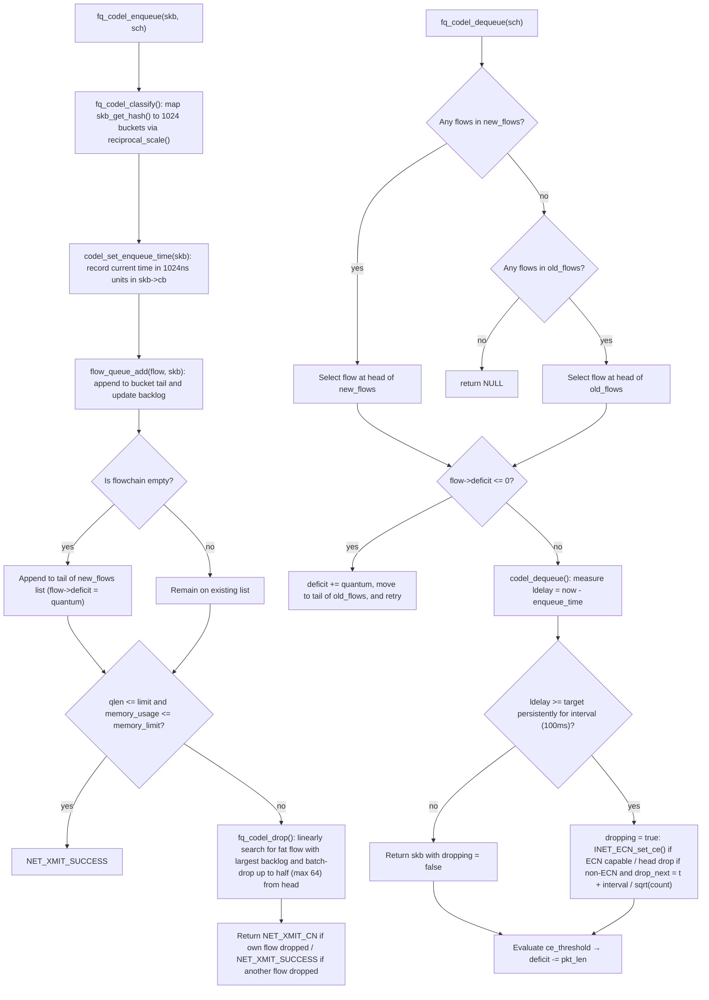
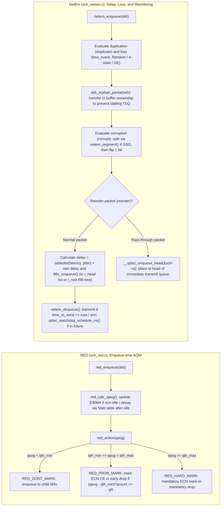

# 17. AQM and Network Emulation: CoDel, FQ-CoDel, RED, and NetEm

In Chapters 15 and 16, we examined FIFO, TBF, HTB, and FQ (`sch_fq`), which determine "in what order and at what rate packets are transmitted." In this chapter, we read line by line through two other vital roles of Qdiscs: **AQM (Active Queue Management)** and **network emulation (NetEm)**.

In the first half (Parts 1 and 2), after reviewing the mechanics of **Bufferbloat** and **TCP global synchronization** caused by tail-drop queues, we trace **CoDel (RFC 8289)** / **FQ-CoDel (RFC 8290)**—the default Qdisc in many modern Linux distributions—in comparison with **RED (Random Early Detection)**, the origin of AQM. In the second half (Part 3), we dive into the internal implementation and practical recipes of **NetEm (`sch_netem.c`)**, an indispensable tool for validating your TCP and Qdisc code under arbitrary delay, jitter, packet loss, and reordering.

---

## 1. The ELI5 version

Imagine sending trucks (packets) from a building's distribution center (a Qdisc) onto the open road (the network link).

### Tail-drop and Bufferbloat (the giant warehouse that stays silent until full)

In the old days, distribution centers operated on a simple rule: "silently accept every parcel (`sk_buff`) until the warehouse (queue) is completely full, and only when the warehouse doors can no longer shut, bounce any subsequent parcel back (**tail-drop**)." Furthermore, out of goodwill ("we want to avoid dropping parcels if possible"), operators kept expanding the warehouse into a massive facility.

However, as we saw in Chapters 11 and 12, loss-based congestion control senders like Reno and CUBIC share a fundamental trait: **"they keep ramping up the number of trucks dispatched onto the road at once (cwnd) until they learn that a parcel was dropped (or an ECN mark was attached)."**

What happens when you make the warehouse gigantic? Even though the bottleneck road entrance is already at 100% capacity, because there is still room in the warehouse, the sender receives no signal whatsoever that the road is congested. Senders unleash even more trucks, and thousands of parcels pile up inside the warehouse. It now takes hundreds of milliseconds for a parcel to leave the warehouse after entering it (**Bufferbloat**). If an urgent letter (an SSH keystroke, a DNS query, or interactive gaming traffic) arrives, it gets stuck behind thousands of massive freight parcels. Finally, the moment the warehouse overflows, all senders who happen to have parcels arriving at that instant have their parcels simultaneously rejected; every sender halves their trucks at the same time, temporarily emptying the road (**global synchronization**)—a vicious cycle.

### RED (the attendant who draws lots based on warehouse height)

In 1993, the **RED (Random Early Detection)** attendant arrived with a new plan: "Before the warehouse fills up, let's randomly drop parcels early to prompt a few senders to hit the brakes." To avoid accidentally dropping parcels during transient bursts of traffic, the attendant smooths the "current height of parcels in the warehouse (bytes)" using an exponential weighted moving average ($$q_{\text{avg}}$$). Once this exceeds a designated marker ($$q_{\min}$$), the attendant gradually increases the probability of drawing a "drop" lottery ticket.

However, the RED attendant had a major flaw. Because they only looked at "how many kilograms of parcels are in the warehouse," if the speed of the outside road (link bandwidth) changed from 10 Mbps to 100 Mbps—or fluctuated constantly like Wi-Fi—the exact same amount of parcels could mean "drained in a flash" or "stuck for several seconds." Tuning the markers ($$q_{\min}, q_{\max}, w_q$$) proved notoriously difficult.

### CoDel and FQ-CoDel (the attendants who timestamp parcels and separate lanes for big and small parcels)

Introduced in 2012, the **CoDel (Controlled Delay)** attendant stopped looking at the weight or number of parcels altogether, deciding instead to **stamp the arrival time on every parcel** entering the warehouse. When dispatching a parcel onto the road at the exit (dequeue), the attendant measures "how many milliseconds has this parcel waited (**sojourn time**)?"

- If it is a transient burst ("good queue"), it clears within 100 ms (`interval`), and the waiting time drops back below 5 ms (`target`), so nothing is done.
- If the waiting time does not drop below 5 ms even once over a 100 ms window, the attendant concludes that this is an unyielding backlog (**standing queue / bad queue**). The attendant drops the parcel at the head of the queue (or marks it with ECN) to alert the sender. If the waiting time still does not drop, subsequent drops are triggered at an accelerating pace determined by $$\text{interval}/\sqrt{\text{count}}$$.

Building on this, the **FQ-CoDel (Fair Queue CoDel)** attendant sets up 1,024 separate lanes (queues per flow) in the warehouse and combines them with a ticket-based scheduling scheme (DRR): **"newly arrived small-parcel lanes (`new_flows`) are serviced before regular lanes that continuously stream heavy freight (`old_flows`)."** As a result, even during massive file downloads, SSH keystrokes and voice packets fly out from the front of the queue with nearly zero latency, while dedicated CoDel attendants apply precise brakes to the heavy freight lanes.

### NetEm (the indoor test facility that simulates rough roads around the globe)

Finally, **NetEm (Network Emulator)** is not an actual distribution center, but an **"experimental test facility for delivery evaluation."** The hallway in your local building (a local network or virtual environment) is normally a smooth, flat path where parcels arrive instantaneously. By installing NetEm, however, you can accurately recreate any rough road on Earth inside the kernel: "hold onto parcels for 50 ms before release (delay)," "occasionally reorder packets (reordering)," "drop parcels in bursts via dice rolls or Markov chains (loss)," or "flip a single bit on the shipping manifest (corruption)."

---

## 2. Background, RFCs, and papers

### Why AQM (Active Queue Management) is necessary

**Tail-drop** in router and host transmit queues (Qdiscs) suffers from three major structural flaws:

1. **Inability to distinguish between Good Queues and Bad Queues**
   The primary purpose of buffers in packet-switched networks is to absorb short bursts arriving simultaneously from multiple senders or temporary spikes in arrival rate caused by TCP slow start and ACK compression, keeping the bottleneck link 100% utilized. A queue that drains promptly within roughly one RTT and returns to empty is a **Good Queue**. In contrast, a queue that persists at a steady depth because loss-based TCPs (Reno or CUBIC) continue expanding `cwnd` beyond the bottleneck bandwidth is known as a **Standing Queue (Bad Queue)**. A standing queue adds not a single bit of throughput; it merely imposes a constant queuing delay ($$\Delta \text{RTT} = Q / C$$) on every packet. Because tail-drop emits no congestion signals whatsoever until the buffer reaches its upper limit (`limit`), almost the entire buffer capacity is consumed by standing queues (**Bufferbloat**).
2. **TCP Global Synchronization and Lock-out**
   When a tail-drop queue fills up, packets arriving from multiple flows in that instant are dropped consecutively. Every flow then reduces its `cwnd` simultaneously (halving for Reno, $$\times 0.7$$ for CUBIC). Link utilization plummets, after which all flows expand their windows in unison until they drop packets together again, repeating this synchronized oscillation. Furthermore, a handful of bursty flows can monopolize buffer space, causing packets from other flows arriving later to be repeatedly rejected at the door (**lock-out**).
3. **Degraded interactive communication due to Head-of-Line (HoL) blocking**
   When a single FIFO queue is shared between bulk transfer flows (such as large file downloads) and sparse flows (DNS, SSH, VoIP, Web APIs, TCP handshake SYN packets, etc.), a single packet from a sparse flow is queued behind hundreds to thousands of packets from bulk flows, suffering hundreds of milliseconds to seconds of jitter and latency degradation.

To resolve these issues, **AQM (Active Queue Management)** proactively drops packets (or marks ECN CE) probabilistically or based on delay before the queue reaches its physical limit.

### Overview of relevant RFCs and papers

- **Sally Floyd and Van Jacobson, "Random Early Detection Gateways for Congestion Avoidance" (IEEE/ACM Transactions on Networking, 1993)**
  A landmark paper that founded the field of AQM. It introduced the **RED** algorithm, which calculates an exponentially weighted moving average (EWMA) queue length $$q_{\text{avg}}$$ rather than instantaneous queue length, linearly increasing the drop (or marking) probability between two thresholds, $$q_{\min}$$ and $$q_{\max}$$.
- **Sally Floyd, Ramakrishna Gummadi, and Scott Shenker, "Adaptive RED: An Algorithm for Increasing the Robustness of RED's AQM" (2001)**
  Addressed RED's primary weakness: the average queue length getting pinned near $$q_{\min}$$ or $$q_{\max}$$ depending on the number of flows and link conditions. It proposed **Adaptive RED (ARED)**, which automatically adjusts the maximum drop probability $$\max_p$$ via AIMD every 0.5 seconds to keep $$q_{\text{avg}}$$ within the target range $$[q_{\min} + 0.4(q_{\max} - q_{\min}),\, q_{\min} + 0.6(q_{\max} - q_{\min})]$$. It also introduced a **gentle mode**, which smoothly ramps the probability from $$\max_p$$ to $$1.0$$ as $$q_{\text{avg}}$$ moves from $$q_{\max}$$ toward $$2 q_{\max}$$.
- **[RFC 7567](https://www.rfc-editor.org/rfc/rfc7567) — IETF Recommendations Regarding Active Queue Management (2015, BCP 197)**
  The current Best Current Practice, obsoleting RFC 2309 (a 1998 document that recommended deploying RED). Reviewing the difficulties of tuning RED parameters, it avoids mandating a single algorithm and instead recommends "self-tuning AQMs requiring zero or minimal configuration (such as CoDel and PIE), flow isolation (such as FQ-CoDel), and the use of ECN."
- **[RFC 8289](https://www.rfc-editor.org/rfc/rfc8289) — Controlled Delay Active Queue Management (CoDel) (2018)**
  An algorithm published by Kathleen Nichols and Van Jacobson in 2012 (ACM Queue article *"Controlling Queue Delay"*), standardized as an RFC in 2018. Instead of tracking "bytes (queue length)," it directly measures **"how long packets have stayed in the queue (sojourn time)."** It performs a head drop only when the minimum sojourn time over the most recent observation window `interval` (default 100 ms) persistently exceeds `target` (default 5 ms).
- **[RFC 8290](https://www.rfc-editor.org/rfc/rfc8290) — The FlowQueue-CoDel Packet Scheduler and Active Queue Management Algorithm (2018)**
  An RFC by Toke Høiland-Jørgensen, Paul McKenney, Dave Täht, Jim Gettys, and Eric Dumazet that standardizes Linux's `sch_fq_codel` (implemented in 2012 by Eric Dumazet). It unifies Stochastic Fairness Queuing (SFQ) hash buckets, a modified Deficit Round Robin (DRR) prioritizing new/sparse flows, and per-bucket CoDel AQM into a single lightweight scheduler.

---

### CoDel equations and state machine (RFC 8289 §3, §4)

The design principles of [RFC 8289 §3](https://www.rfc-editor.org/rfc/rfc8289#section-3) can be summarized into three points:

1. **Measure sojourn time, not queue length**: Letting $$t_{\text{enq}}(p)$$ be the time packet $$p$$ was enqueued and $$t_{\text{deq}}(p)$$ the time it was dequeued, the sojourn time is:
   $$d(p) = t_{\text{deq}}(p) - t_{\text{enq}}(p)$$
   By measuring delay at dequeue time, the system accurately detects "how long the packet actually waited" without requiring configuration changes even when link rates vary (Wi-Fi, cellular, dynamic shapers, HTB bandwidth borrowing, etc.). Furthermore, by dropping or ECN-marking the packet at the head of the queue (the one that has waited longest)—a technique known as **head drop**—the congestion signal reaches the sending TCP earlier than tail-drop by an amount equal to the current queuing delay.
2. **Track the minimum sojourn time within a sliding window**: Transient bursts (Good Queue) clear within roughly one RTT (`interval` = 100 ms, representative of the typical maximum public Internet RTT), bringing sojourn time back down toward zero. In contrast, a Standing Queue (Bad Queue) never lets sojourn time fall over the 100 ms interval. CoDel therefore tracks whether "$$d(p) \ge \text{target}$$ has persisted for at least `interval` (100 ms)" using a single timestamp `first_above_time`, without maintaining an explicit ring buffer. However, when the overall queue backlog is at or below 1 MTU (`params->mtu`), drops are suppressed so that the link is not starved by dropping the final remaining packet.
3. **Inverse square root control law**: When TCP Reno / CUBIC increases its window linearly each RTT and reduces it by a constant factor upon drop, the steady-state drop frequency $$f$$ must scale with the square root of the number of active flows or drop count `count`. Thus, after entering the `dropping` state, the scheduled time for the $$n$$-th drop ($$\text{count} = n$$), denoted $$t_{\text{next}}$$, is determined by the control law in [RFC 8289 §3.2](https://www.rfc-editor.org/rfc/rfc8289#section-3.2):

$$t_{\text{next}} = t + \frac{\text{interval}}{\sqrt{\text{count}}}$$

Because executing floating-point arithmetic, `sqrt()`, or integer division on every drop inside the kernel is expensive, Linux (and RFC 8289 §4.1) maintains a fixed-point approximation of $$1/\sqrt{\text{count}}$$ in `rec_inv_sqrt`, updating it with a single **Newton-Raphson step** whenever `count` increments by 1.

For the function $$f(x) = \frac{1}{x^2} - c = 0$$ (where $$c = \text{count}$$, with root $$x = 1/\sqrt{c}$$), the Newton-Raphson recurrence relation is:

$$x_{k+1} = x_k - \frac{f(x_k)}{f'(x_k)} = x_k - \frac{x_k^{-2} - c}{-2 x_k^{-3}} = \frac{x_k}{2}\left(3 - c \cdot x_k^2\right)$$

As `count` increases sequentially ($$1 \to 2 \to 3 \dots$$), evaluating this formula once with the previous value $$x_k \approx 1/\sqrt{c-1}$$ as the initial estimate yields $$1/\sqrt{c}$$ with more than enough accuracy for practical use, relying solely on integer multiplications and bit shifts.

Moreover, if the system re-enters the `dropping` state shortly after exiting it (`now - drop_next < 16 * interval`), it assumes the previous drop rate was still appropriate and resumes from $$\text{delta} = \text{count} - \text{lastcount}$$ rather than resetting `count` to 1 ([RFC 8289 §4.3](https://www.rfc-editor.org/rfc/rfc8289#section-4.3)).

| Parameter / Variable | Default | Role |
| --- | --- | --- |
| `target` | 5 ms | Acceptable persistent minimum queue sojourn time (roughly 5% of buffer at typical bandwidth) |
| `interval` | 100 ms | Observation window before declaring a standing queue (typical public Internet RTT) |
| `ce_threshold` | Disabled (`INT_MAX`) | Threshold to immediately mark CE for DCTCP / L4S if `ldelay > ce_threshold`, independent of CoDel state machine |
| `first_above_time` | 0 | Timestamp when $$d(p) \ge \text{target}$$ was first detected $$+$$ `interval` |
| `dropping` | `false` | Indicates whether currently in a drop (or ECN mark) state |
| `count` / `lastcount` | 0 | Total drops since entering `dropping` state, and its initial value upon entry |
| `rec_inv_sqrt` | 0 | Upper 16-bit fixed-point representation of $$1/\sqrt{\text{count}}$$ (scaled to Q0.32 via `REC_INV_SQRT_SHIFT` = 16) |
| `drop_next` | 0 | Next scheduled drop time (or most recent drop time when not in `dropping` state) |

---

### FQ-CoDel DRR and sparse flow priority (RFC 8290 §3, §4)

While single-queue CoDel suppresses overall delay, having all flows share a single FIFO still leaves challenges: interactive traffic gets queued behind the 5 ms queue created by bulk flows, and without hashing it is impossible to determine which flows are bloating the queue.

**FQ-CoDel** in [RFC 8290](https://www.rfc-editor.org/rfc/rfc8290) combines four key mechanisms:

1. **Stochastic flow classification (default 1,024 buckets)**: Maps a packet's 5-tuple hash (`skb_get_hash(skb)`, computed by the Linux kernel using a per-netns random seed via Jenkins / SipHash) into `flows_cnt` (default 1,024) buckets `q->flows[idx]`. Each bucket maintains its own FIFO queue and its own `struct codel_vars cvars`.
2. **Two DRR lists (`new_flows` and `old_flows`)**: Instead of a single round-robin list, active flow buckets are managed via two doubly linked lists: **`new_flows`** and **`old_flows`**.
   - When a packet arrives at an empty bucket, it is granted `deficit = quantum` (default 1 MTU, e.g., 1,514 bytes) and appended to the **tail of `new_flows`**.
   - During dequeue, packets are **always dequeued preferentially from `new_flows` as long as `new_flows` is not empty**.
   - Each time a packet is transmitted, `deficit -= pkt_len`. Any flow whose deficit drops to `deficit <= 0` has its deficit replenished via `deficit += quantum` and is demoted to the **tail of `old_flows`**.
   - When a flow's queue becomes empty, if the flow is still on `new_flows` and `old_flows` is not empty, it is temporarily moved to the tail of `old_flows` before being confirmed empty on the next round and removed from the list. (This design delays re-entry into `new_flows` by one round, preventing complete starvation of `old_flows`.)
   - As a result, sparse flows that transmit no more than `quantum` per round (such as ACKs, DNS, SSH, VoIP, gaming, and paced short-lived flows) are consistently prioritized in `new_flows`, never queuing behind bulk flows.
3. **Independent per-flow CoDel**: Because each bucket has its own `flow->cvars`, only the bucket of a bulk transfer flow exceeds `target` in sojourn time, ensuring only packets from that specific bucket are dropped (or ECN-marked).
4. **Fat flow batch dropping upon exceeding limits (`fq_codel_drop()`)**: If the overall Qdisc exceeds its packet capacity (`limit`, default 10,240 packets) or memory usage (`memory_limit`, default 32 MiB), rather than dropping the newly arriving packet (tail-drop), the scheduler scans `q->backlogs[]` across all 1,024 buckets to locate the flow with the largest backlog in bytes (**fat flow**) and **drops packets from its head in batch until its backlog is halved (up to `drop_batch_size` = 64 packets)**.

---

### RED equations and algorithms (Floyd & Jacobson 1993, Adaptive RED 2001)

In contrast to CoDel, RED operates **at enqueue time (`red_enqueue()`)**, updating the exponentially weighted moving average $$q_{\text{avg}}$$ from the current backlog $$q$$ (in bytes) of the physical child Qdisc (by default `bfifo`, a byte-based FIFO).

1. **Calculating average queue length $$q_{\text{avg}}$$ (EWMA and idle decay)**
   - When a packet arrives while the queue is non-empty (non-idle):
     $$q_{\text{avg}} \leftarrow (1 - w_q)\, q_{\text{avg}} + w_q\, q$$
     where weight $$w_q = 2^{-\text{Wlog}}$$. To avoid floating-point math and truncation error from right shifts, the Linux kernel stores the internal variable `v->qavg` as **$$q_{\text{avg}} \cdot 2^{\text{Wlog}}$$ (with the fixed-point radix at bit `Wlog`)**. The update can then be computed precisely using only additions, subtractions, and a single right shift:
     $$\text{v->qavg} \leftarrow \text{v->qavg} + \left(q - (\text{v->qavg} \gg \text{Wlog})\right)$$
   - When the first packet arrives after the queue was empty (idle) for duration $$\Delta t_{\text{idle}}$$:
     If dummy packets of average size $$S$$ are assumed to have passed at link rate $$C$$ during the idle period in quantity $$m = \Delta t_{\text{idle}} / (S / C)$$, the average queue length should decay as:
     $$q_{\text{avg}} \leftarrow q_{\text{avg}} \cdot (1 - w_q)^m$$
     Because computing the power $$(1 - w_q)^m$$ in-kernel is expensive, `iproute2` (the `tc` command) precomputes a 256-entry shift lookup table `Stab[256]` during configuration and passes it to the kernel via Netlink. The kernel then looks up `Stab` using `us_idle >> Scell_log` and performs a right shift.
2. **Drop probability $$p_b$$ and uniformization probability $$p_a$$**
   - $$q_{\text{avg}} < q_{\min}$$: Do not drop (`RED_BELOW_MIN_THRESH`, `qcount = -1`).
   - $$q_{\min} \le q_{\text{avg}} < q_{\max}$$: Compute the base probability $$p_b$$ linearly:
     $$p_b = \max_p \cdot \frac{q_{\text{avg}} - q_{\min}}{q_{\max} - q_{\min}}$$
     Furthermore, to prevent dropped packets from clustering geometrically and make the drop intervals follow an approximately uniform distribution, the final probability $$p_a$$ is scaled using the number of packets $$\text{count}$$ (`v->qcount`) elapsed since the last drop:
     $$p_a = \frac{p_b}{1 - \text{count} \cdot p_b}$$
     The Linux implementation (`red_mark_probability()`) optimizes this calculation even further: upon a drop, it draws a single random number `qR` in the interval $$[0, (q_{\max} - q_{\min}) / \max_p)$$ and caches it. For subsequent packets, without drawing any further random numbers, it drops (or ECN-marks) the instant:
     $$(q_{\text{avg}} - q_{\min}) \cdot \text{qcount} \ge \text{qR}$$
     holds—an ingenious optimization.
   - $$q_{\text{avg}} \ge q_{\max}$$: Mandatory drop or mark (`RED_ABOVE_MAX_TRESH` → `RED_HARD_MARK`).
3. **Adaptive RED (ARED)**: When the `adaptive` flag is enabled, a timer `red_adaptative_timer()` runs every 500 ms (`HZ / 2`). If $$q_{\text{avg}}$$ exceeds the target band $$[q_{\min} + 0.4 \Delta,\, q_{\min} + 0.6 \Delta]$$ (where $$\Delta = q_{\max} - q_{\min}$$), it updates $$\max_p \leftarrow \max_p + \alpha$$ (with $$\alpha = \min(0.01, \max_p / 4)$$, capped at $$0.50$$); if below the target band, it updates $$\max_p \leftarrow 0.9 \max_p$$ (with a lower bound of $$0.01$$).

### Why RED is rarely used in modern production environments

Although RED is historically monumental as the algorithm that laid the foundation for AQM, in modern Linux it has largely been superseded by `fq_codel` (or `cake` / `sch_fq`) for the following reasons:

- **Parameter tuning is tightly coupled to link bandwidth**: Under `tc qdisc add ... red`, administrators must manually specify `min`, `max`, `avpkt`, `burst`, and `bandwidth`, and the `Stab` table (idle decay table) is also derived from the specified `bandwidth` and `avpkt`. When actual link rates fluctuate or diverge from configured values, RED either mistakenly drops large bursts or leaves standing queues unchecked.
- **Queue length in bytes is a poor proxy for delay**: The exact same 64 KB queue clears in $$51\ \mu\text{s}$$ over a 10 Gbps link, but takes $$512\ \text{ms}$$ over a 1 Mbps link. Because CoDel measures sojourn time directly, it requires zero prior knowledge of link bandwidth.
- **Limitations of enqueue-time evaluation and tail/random drop**: Because RED evaluates at enqueue time, it cannot detect the sudden latency inflation of packets already sitting in the queue when the link rate abruptly drops.

Even so, RED remains actively used today in data center switch hardware offload (`TC_SETUP_QDISC_RED`, WRED / DCQCN buffer configuration on switch ASICs) and kernel selftests (`tools/testing/selftests/tc-testing/` and switch driver qevent tests).

---

## 3. The big picture

Here is the high-level enqueue and dequeue architecture for the three Qdiscs covered in this chapter (**FQ-CoDel**, **RED**, and **NetEm**). Notice where timestamps are recorded and where drops or delays occur.

### Packet processing flow in FQ-CoDel



### Comparative flow between RED and NetEm


## 4. Walking through the code

### Part 1: CoDel (RFC 8289) and FQ-CoDel (RFC 8290)

#### Step 1: CoDel 1024 ns clock and data structures (`include/net/codel.h`, `include/net/codel_qdisc.h`)

First, let us examine the time representation and struct definitions in `include/net/codel.h` ([include/net/codel.h#L60](https://git.kernel.org/pub/scm/linux/kernel/git/netdev/net-next.git/tree/include/net/codel.h?id=279d5c8afcd38bd841832a39bfe1aa4f8518d98e#n60)).

```c
/* CoDel uses a 1024 nsec clock, encoded in u32
 * This gives a range of 2199 seconds, because of signed compares
 */
typedef u32 codel_time_t;
typedef s32 codel_tdiff_t;
#define CODEL_SHIFT 10
#define MS2TIME(a) ((a * NSEC_PER_MSEC) >> CODEL_SHIFT)

static inline codel_time_t codel_get_time(void)
{
	u64 ns = ktime_get_ns();

	return ns >> CODEL_SHIFT;
}
```

- `codel_get_time()` ([include/net/codel.h#L65](https://git.kernel.org/pub/scm/linux/kernel/git/netdev/net-next.git/tree/include/net/codel.h?id=279d5c8afcd38bd841832a39bfe1aa4f8518d98e#n65)) shifts the 64-bit nanosecond clock `ktime_get_ns()` right by `CODEL_SHIFT` (10 bits) to fit into a 32-bit `codel_time_t`.
- Why not use the 64-bit `ktime_t` directly? There are two reasons:
  1. To minimize the memory footprint in `sk_buff`'s control buffer `qdisc_skb_cb(skb)->data` (at most 20 bytes) and the array of 1024 `struct fq_codel_flow` instances (within 64 bytes = 1 cacheline per bucket). By using 32 bits, the three timestamp fields—`first_above_time`, `drop_next`, and `ldelay`—take only 12 bytes in total.
  2. Selecting $$2^{10} = 1024\ \text{ns} \approx 1.024\ \mu\text{s}$$ per tick rather than 1000 (dividing into microseconds) allows conversion from nanoseconds to complete with a single shift instruction (`>> 10`). The maximum time span that can be compared without wraparound using signed 32-bit difference comparisons (`codel_time_after(a, b)` = `((s32)((a) - (b)) > 0)`) is $$2^{31} \times 1024\ \text{ns} \approx 2199\ \text{seconds}$$ (roughly 36.6 minutes), which is more than sufficient for queue residence times.

Next, let us look at `struct codel_params` ([include/net/codel.h#L107](https://git.kernel.org/pub/scm/linux/kernel/git/netdev/net-next.git/tree/include/net/codel.h?id=279d5c8afcd38bd841832a39bfe1aa4f8518d98e#n107)), `struct codel_vars` ([include/net/codel.h#L129](https://git.kernel.org/pub/scm/linux/kernel/git/netdev/net-next.git/tree/include/net/codel.h?id=279d5c8afcd38bd841832a39bfe1aa4f8518d98e#n129)), and `struct codel_stats` ([include/net/codel.h#L156](https://git.kernel.org/pub/scm/linux/kernel/git/netdev/net-next.git/tree/include/net/codel.h?id=279d5c8afcd38bd841832a39bfe1aa4f8518d98e#n156)).

```c
struct codel_params {
	codel_time_t	target;
	codel_time_t	ce_threshold;
	codel_time_t	interval;
	u32		mtu;
	bool		ecn;
	u8		ce_threshold_selector;
	u8		ce_threshold_mask;
};

struct codel_vars {
	u32		count;
	u32		lastcount;
	bool		dropping;
	u16		rec_inv_sqrt;
	codel_time_t	first_above_time;
	codel_time_t	drop_next;
	codel_time_t	ldelay;
};

#define REC_INV_SQRT_BITS (8 * sizeof(u16)) /* or sizeof_in_bits(rec_inv_sqrt) */
/* needed shift to get a Q0.32 number from rec_inv_sqrt */
#define REC_INV_SQRT_SHIFT (32 - REC_INV_SQRT_BITS)

/* Cap on drops per codel_dequeue() call: the loop's work depends on the
 * idle gap and backlog, both outside our control; resync when exceeded.
 */
#define CODEL_MAX_DROPS_PER_DEQUEUE 256

struct codel_stats {
	u32		maxpacket;
	u32		drop_count;
	u32		drop_len;
	u32		ecn_mark;
	u32		ce_mark;
};
```

- `struct codel_params` contains configuration parameters shared across the Qdisc. In `FQ-CoDel`, all 1024 flows share a single `q->cparams`.
- `struct codel_vars` contains per-flow (or per-queue) state variables, fitting neatly into exactly 24 bytes. Placing the 16-bit `rec_inv_sqrt` immediately after `dropping` (1 byte) prevents wasteful padding and packs `struct codel_vars` tightly into 24 bytes.
- In `include/net/codel_qdisc.h` ([include/net/codel_qdisc.h#L56](https://git.kernel.org/pub/scm/linux/kernel/git/netdev/net-next.git/tree/include/net/codel_qdisc.h?id=279d5c8afcd38bd841832a39bfe1aa4f8518d98e#n56)), helpers are defined to store the enqueue timestamp and memory usage accounting in each `sk_buff`'s `cb` area.

```c
/* Qdiscs using codel plugin must use codel_skb_cb in their own cb[] */
struct codel_skb_cb {
	codel_time_t enqueue_time;
	unsigned int mem_usage;
};

static struct codel_skb_cb *get_codel_cb(const struct sk_buff *skb)
{
	qdisc_cb_private_validate(skb, sizeof(struct codel_skb_cb));
	return (struct codel_skb_cb *)qdisc_skb_cb(skb)->data;
}

static codel_time_t codel_get_enqueue_time(const struct sk_buff *skb)
{
	return get_codel_cb(skb)->enqueue_time;
}

static void codel_set_enqueue_time(struct sk_buff *skb)
{
	get_codel_cb(skb)->enqueue_time = codel_get_time();
}
```

- The core logic of CoDel (`include/net/codel_impl.h`) is not exclusive to Qdiscs; it is also included and used by Wi-Fi's mac80211 TXQ (`net/mac80211/tx.c`). For this reason, extracting the enqueue timestamp and packet length from an `skb` is abstracted behind callbacks (`skb_time_func`, `skb_len_func`). On the Qdisc side, `codel_get_enqueue_time()` ([include/net/codel_qdisc.h#L67](https://git.kernel.org/pub/scm/linux/kernel/git/netdev/net-next.git/tree/include/net/codel_qdisc.h?id=279d5c8afcd38bd841832a39bfe1aa4f8518d98e#n67)) is passed as this callback.

---

#### Step 2: Fixed-point Newton-Raphson method and control law — `codel_Newton_step()` and `codel_control_law()`

Let us trace `codel_Newton_step()` ([include/net/codel_impl.h#L80](https://git.kernel.org/pub/scm/linux/kernel/git/netdev/net-next.git/tree/include/net/codel_impl.h?id=279d5c8afcd38bd841832a39bfe1aa4f8518d98e#n80)) and `codel_control_law()` ([include/net/codel_impl.h#L100](https://git.kernel.org/pub/scm/linux/kernel/git/netdev/net-next.git/tree/include/net/codel_impl.h?id=279d5c8afcd38bd841832a39bfe1aa4f8518d98e#n100)) in `include/net/codel_impl.h` line by line.

```c
/*
 * http://en.wikipedia.org/wiki/Methods_of_computing_square_roots#Iterative_methods_for_reciprocal_square_roots
 * new_invsqrt = (invsqrt / 2) * (3 - count * invsqrt^2)
 *
 * Here, invsqrt is a fixed point number (< 1.0), 32bit mantissa, aka Q0.32
 */
static void codel_Newton_step(struct codel_vars *vars)
{
	u32 invsqrt = ((u32)vars->rec_inv_sqrt) << REC_INV_SQRT_SHIFT;
	u32 invsqrt2 = ((u64)invsqrt * invsqrt) >> 32;
	u64 val = (3LL << 32) - ((u64)vars->count * invsqrt2);

	val >>= 2; /* avoid overflow in following multiply */
	val = (val * invsqrt) >> (32 - 2 + 1);

	vars->rec_inv_sqrt = val >> REC_INV_SQRT_SHIFT;
}

/*
 * CoDel control_law is t + interval/sqrt(count)
 * We maintain in rec_inv_sqrt the reciprocal value of sqrt(count) to avoid
 * both sqrt() and divide operation.
 *
 * Clamp the increment to at least 1 tick: a very small interval (or a
 * large count) can truncate it to zero, stalling the dropping loop.
 */
static codel_time_t codel_control_law(codel_time_t t,
				      codel_time_t interval,
				      u32 rec_inv_sqrt)
{
	return t + max_t(u32, 1,
			 reciprocal_scale(interval,
					  rec_inv_sqrt << REC_INV_SQRT_SHIFT));
}
```

Let us track the bit positions (fixed-point binary point) with precision:

- **Initial state (when `count = 1`)**: When `codel_dequeue()` sets `vars->count = 1`, it assigns `vars->rec_inv_sqrt = ~0U >> REC_INV_SQRT_SHIFT` (that is, `0xffff`).
- **`u32 invsqrt = ((u32)vars->rec_inv_sqrt) << REC_INV_SQRT_SHIFT;`**: Shifts the 16-bit `rec_inv_sqrt` left by 16 bits to expand it into **Q0.32 format** (a 32-bit fixed-point number where $$2^{32}$$ represents $$1.0$$, i.e., $$\text{invsqrt} \approx \frac{1}{\sqrt{\text{count}}} \cdot 2^{32}$$).
- **`u32 invsqrt2 = ((u64)invsqrt * invsqrt) >> 32;`**: Multiplying two Q0.32 numbers produces a 64-bit result in Q0.64 format, so shifting right by 32 bits restores the Q0.32 format of $$x_k^2$$ (`invsqrt2`).
- **`u64 val = (3LL << 32) - ((u64)vars->count * invsqrt2);`**: `3LL << 32` represents $$3.0$$ in Q2.32 format. Subtracting `count * invsqrt2` (Q0.32) yields $$3 - \text{count} \cdot x_k^2$$ in Q2.32 format. Since `count` has just incremented by 1, $$\text{count} \cdot x_k^2 \approx \frac{c}{c-1} > 1$$, keeping `val` roughly in the range $$1.0 \sim 2.0$$ ($$\times 2^{32}$$).
- **`val >>= 2; /* avoid overflow in following multiply */`**: Here lies a critical optimization. If `val` in Q2.32 format (at most $$\approx 2 \times 2^{32}$$) were multiplied directly by `invsqrt` in Q0.32 format (at most $$\approx 2^{32}$$), the result could marginally overflow the unsigned 64-bit integer range (`u64`, max $$2^{64}-1$$). Shifting `val` right by 2 bits ahead of time converts it to Q2.30, safely avoiding overflow.
- **`val = (val * invsqrt) >> (32 - 2 + 1);`**: Multiplying Q2.30 `val` by Q0.32 `invsqrt` produces $$30 + 32 = 62$$ fractional bits. Combining this with the factor of $$\frac{1}{2}$$ from Newton's formula ($$+1$$ bit right shift), shifting right by a total of $$32 - 2 + 1 = 31$$ bits produces the updated value $$x_{k+1} = \frac{x_k}{2}(3 - c x_k^2)$$ back in **Q0.32 format**.
- **`vars->rec_inv_sqrt = val >> REC_INV_SQRT_SHIFT;`**: Extracts the upper 16 bits and stores them into `rec_inv_sqrt`.
- Let us verify this with a concrete example. When `count` transitions from $$1 \to 2$$, running one step starting from `invsqrt = 0xffff0000` ($$\approx 1.0$$) yields $$\frac{1}{2}(3 - 2 \times 1^2) = 0.5$$. If another step were run at `count = 2` before `count = 3`, it would yield $$0.5 \times (3 - 2 \times 0.25) / 2 = 0.625$$, quadratically converging toward $$\frac{1}{\sqrt{2}} \approx 0.7071$$. In practice, CoDel advances by one step for every increment of `count`, producing a very smooth decay curve across `count = 1, 2, 3, 4...`.
- **`codel_control_law()`**: `reciprocal_scale(interval, rec_inv_sqrt << 16)` ([include/linux/math.h#L194](https://git.kernel.org/pub/scm/linux/kernel/git/netdev/net-next.git/tree/include/linux/math.h?id=279d5c8afcd38bd841832a39bfe1aa4f8518d98e#n194)) computes `(u32)(((u64)interval * (rec_inv_sqrt << 16)) >> 32)`. That is, without executing a single hardware division instruction (`div`), it calculates $$\lfloor \text{interval} \times \text{invsqrt} \rfloor = \lfloor \text{interval} / \sqrt{\text{count}} \rfloor$$ entirely through 64-bit multiplication and bit shifts.
- **`max_t(u32, 1, ...)`**: This guard was introduced in September 2026 commit `7f4a5ec6258f`. If a user configured an extremely small `interval` (e.g., `2us`) or if `count` grew exceptionally large such that `reciprocal_scale()` truncated to `0`, `drop_next` would fail to advance even by a single tick. As a consequence, the `while (codel_time_after_eq(now, vars->drop_next))` loop in `codel_dequeue()` would spin endlessly while holding the spinlock until draining the entire backlog, triggering a soft lockup. Enforcing an increment of at least `1` tick (1024 ns) guarantees forward progress.

---

#### Step 3: Inspecting sojourn time — `codel_should_drop()`

Next, let us read `codel_should_drop()` ([include/net/codel_impl.h#L109](https://git.kernel.org/pub/scm/linux/kernel/git/netdev/net-next.git/tree/include/net/codel_impl.h?id=279d5c8afcd38bd841832a39bfe1aa4f8518d98e#n109)).

```c
static bool codel_should_drop(const struct sk_buff *skb,
			      void *ctx,
			      struct codel_vars *vars,
			      struct codel_params *params,
			      struct codel_stats *stats,
			      codel_skb_len_t skb_len_func,
			      codel_skb_time_t skb_time_func,
			      u32 *backlog,
			      codel_time_t now)
{
	bool ok_to_drop;
	u32 skb_len;

	if (!skb) {
		vars->first_above_time = 0;
		return false;
	}

	skb_len = skb_len_func(skb);
	WRITE_ONCE(vars->ldelay, now - skb_time_func(skb));

	if (unlikely(skb_len > stats->maxpacket))
		WRITE_ONCE(stats->maxpacket, skb_len);

	if (codel_time_before(vars->ldelay, params->target) ||
	    *backlog <= params->mtu) {
		/* went below - stay below for at least interval */
		vars->first_above_time = 0;
		return false;
	}
	ok_to_drop = false;
	if (vars->first_above_time == 0) {
		/* just went above from below. If we stay above
		 * for at least interval we'll say it's ok to drop
		 */
		vars->first_above_time = now + params->interval;
	} else if (codel_time_after(now, vars->first_above_time)) {
		ok_to_drop = true;
	}
	return ok_to_drop;
}
```

- **`if (!skb)`**: Handles cases where `dequeue_func()` attempts to retrieve the next packet after a drop and finds the queue empty. It resets `vars->first_above_time = 0` and returns `false`.
- **`WRITE_ONCE(vars->ldelay, now - skb_time_func(skb));`**: Calculates the sojourn time (how long the packet resided in the queue from enqueue to dequeue) and records it in `vars->ldelay`. `WRITE_ONCE()` is used because `tc -s qdisc show` and `tc -s class show` (`codel_dump_stats()` / `fq_codel_dump_class_stats()`) read this field via `READ_ONCE(vars->ldelay)` without taking the Qdisc spinlock.
- **`if (codel_time_before(vars->ldelay, params->target) || *backlog <= params->mtu)`**:
  - If the sojourn time `ldelay` is below `target` (default 5 ms), or if **the total remaining backlog `*backlog` in the Qdisc is at or below 1 MTU (`params->mtu`)**, it resets `first_above_time = 0` and returns `false` (do not drop).
  - Two points are worth noting here:
    1. `dequeue_func()` has already subtracted this `skb`'s length from `*backlog` before returning (both `dequeue_func()` in `sch_codel.c` and in `sch_fq_codel.c` deduct the length at the start). Thus, `*backlog <= params->mtu` means "do not drop if the backlog remaining after dequeuing this packet is at or below 1 MTU."
    2. In `sch_fq_codel.c`, the `backlog` pointer passed to `codel_dequeue()` is not the individual flow's backlog `&q->backlogs[idx]`, but rather **the overall Qdisc backlog `&sch->qstats.backlog`** (commit `865ec5523dad`, discussed below). Even if an individual flow has little remaining data, packets become candidates for dropping as long as the entire Qdisc is congested and sojourn time continues to exceed `target`.
- **`if (vars->first_above_time == 0)`**: For the first packet where `ldelay >= target` and `*backlog > mtu`, CoDel does not drop immediately; instead, it arms `vars->first_above_time = now + params->interval` (100 ms into the future) and returns `false`.
- **`else if (codel_time_after(now, vars->first_above_time))`**: If the clock `now` exceeds `first_above_time` without ever dipping below `target` (meaning `first_above_time` was never reset to 0), it is confirmed that "the minimum sojourn time over the past `interval` (100 ms) has exceeded `target` (5 ms)," and it returns `ok_to_drop = true`. The elegance of CoDel lies in achieving sliding-window minimum tracking with a single variable, requiring neither a ring buffer nor a heap.

---

#### Step 4: CoDel state transitions and ECN marking — `codel_dequeue()`

Let us read the full implementation of `codel_dequeue()` ([include/net/codel_impl.h#L151](https://git.kernel.org/pub/scm/linux/kernel/git/netdev/net-next.git/tree/include/net/codel_impl.h?id=279d5c8afcd38bd841832a39bfe1aa4f8518d98e#n151)) in three chunks. First, the first half (when already in `vars->dropping == true` state):

```c
static struct sk_buff *codel_dequeue(void *ctx,
				     u32 *backlog,
				     struct codel_params *params,
				     struct codel_vars *vars,
				     struct codel_stats *stats,
				     codel_skb_len_t skb_len_func,
				     codel_skb_time_t skb_time_func,
				     codel_skb_drop_t drop_func,
				     codel_skb_dequeue_t dequeue_func)
{
	struct sk_buff *skb = dequeue_func(vars, ctx);
	unsigned int drops = 0;
	codel_time_t now;
	bool drop;

	if (!skb) {
		vars->first_above_time = 0;
		WRITE_ONCE(vars->dropping, false);
		return skb;
	}
	now = codel_get_time();
	drop = codel_should_drop(skb, ctx, vars, params, stats,
				 skb_len_func, skb_time_func, backlog, now);
	if (vars->dropping) {
		if (!drop) {
			/* sojourn time below target - leave dropping state */
			WRITE_ONCE(vars->dropping, false);
		} else if (codel_time_after_eq(now, vars->drop_next)) {
			/* It's time for the next drop. Drop the current
			 * packet and dequeue the next. The dequeue might
			 * take us out of dropping state.
			 * If not, schedule the next drop.
			 * A large backlog might result in drop rates so high
			 * that the next drop should happen now,
			 * hence the while loop.
			 */
			while (vars->dropping &&
			       codel_time_after_eq(now, vars->drop_next)) {
				if (++drops > CODEL_MAX_DROPS_PER_DEQUEUE) {
					/* fell far behind the schedule */
					WRITE_ONCE(vars->drop_next,
						   codel_control_law(now,
								     params->interval,
								     vars->rec_inv_sqrt));
					break;
				}
				/* dont care of possible wrap
				 * since there is no more divide.
				 */
				WRITE_ONCE(vars->count, vars->count + 1);
				codel_Newton_step(vars);
				if (params->ecn && INET_ECN_set_ce(skb)) {
					WRITE_ONCE(stats->ecn_mark,
						   stats->ecn_mark + 1);
					WRITE_ONCE(vars->drop_next,
						codel_control_law(vars->drop_next,
								  params->interval,
								  vars->rec_inv_sqrt));
					goto end;
				}
				stats->drop_len += skb_len_func(skb);
				drop_func(skb, ctx);
				stats->drop_count++;
				skb = dequeue_func(vars, ctx);
				if (!codel_should_drop(skb, ctx,
						       vars, params, stats,
						       skb_len_func,
						       skb_time_func,
						       backlog, now)) {
					/* leave dropping state */
					WRITE_ONCE(vars->dropping, false);
				} else {
					/* and schedule the next drop */
					WRITE_ONCE(vars->drop_next,
						codel_control_law(vars->drop_next,
								  params->interval,
								  vars->rec_inv_sqrt));
				}
			}
		}
```

- **L166-170 (Early return on empty queue)**: When `if (!skb)` holds, not only is `WRITE_ONCE(vars->dropping, false)` executed, but **`vars->first_above_time = 0`** is also reset. This single line was an important bug fix in March 2026 commit `815980fe6dbb`. If `first_above_time` were not cleared back to 0 here, a sparse flow (such as ICMP ping) that experienced `ldelay >= target` for a single packet due to NAPI delay would empty out, and when a second packet arrived more than 100 ms later, `now > first_above_time` would immediately evaluate to true, causing periodic drops on an uncongested ping stream.
- **L174-177 (Exiting `dropping` state)**: While already in `dropping` state, if `codel_should_drop()` returns `false` on the current packet (sojourn time has fallen below `target`), `vars->dropping = false` is set immediately and the packet is forwarded out.
- **L178-229 (`while` loop for periodic drops / ECN marking in `dropping` state)**: If `drop` is true and the current time `now` has reached the scheduled time `vars->drop_next`, execution enters the loop.
  - Why a `while` loop rather than an `if`? If dequeue is delayed because lower-level links were temporarily stalled, or if `count` has grown large causing the drop interval $$\text{interval}/\sqrt{\text{count}}$$ to shrink significantly, multiple scheduled drop deadlines may have elapsed by the time `codel_dequeue()` is invoked. Furthermore, after dropping one packet and retrieving the next via `dequeue_func()`, `codel_should_drop()` must be re-evaluated on the new head packet.
  - **L189-196 (`CODEL_MAX_DROPS_PER_DEQUEUE`)**: However, looping without bounds could trigger a soft lockup by dropping tens of thousands of packets in a single dequeue call after a long idle gap. Therefore, once the count reaches 256 (`CODEL_MAX_DROPS_PER_DEQUEUE`), `drop_next` is resynchronized against **the current time `now`** rather than `vars->drop_next`, and the loop exits.
  - **L200-201**: Increments `vars->count` by 1 and updates `rec_inv_sqrt` via `codel_Newton_step(vars)`.
  - **L202-210 (ECN CE Marking)**: If `params->ecn` is enabled (default `true` in `sch_fq_codel`, default `false` in `sch_codel`) and the packet's IP header is ECT(0) or ECT(1), `INET_ECN_set_ce(skb)` ([include/net/inet_ecn.h#L186](https://git.kernel.org/pub/scm/linux/kernel/git/netdev/net-next.git/tree/include/net/inet_ecn.h?id=279d5c8afcd38bd841832a39bfe1aa4f8518d98e#n186)) sets the CE bit (`0x03`) and returns `1`. In this case, **the packet must be transmitted rather than dropped**, so the next `drop_next` is scheduled and execution branches via `goto end;` to exit the loop and return the CE-marked `skb` to the caller.
  - **L211-228 (Head Drop for non-ECN)**: If ECN is disabled or the packet is Non-ECT (`0x00`), `drop_func(skb, ctx)` discards the head packet, incrementing `stats->drop_count` and `stats->drop_len` (so that `fq_codel_dequeue_drop()` can subsequently subtract these from the parent Qdisc backlog in bulk). The next head packet is then retrieved via `dequeue_func()`, and `codel_should_drop()` is evaluated once more.

Next, let us read the second half (transitioning from non-`dropping` to `dropping` state, and `ce_threshold` evaluation):

```c
	} else if (drop) {
		u32 delta;

		if (params->ecn && INET_ECN_set_ce(skb)) {
			WRITE_ONCE(stats->ecn_mark, stats->ecn_mark + 1);
		} else {
			stats->drop_len += skb_len_func(skb);
			drop_func(skb, ctx);
			stats->drop_count++;

			skb = dequeue_func(vars, ctx);
			drop = codel_should_drop(skb, ctx, vars, params,
						 stats, skb_len_func,
						 skb_time_func, backlog, now);
		}
		WRITE_ONCE(vars->dropping, true);
		/* if min went above target close to when we last went below it
		 * assume that the drop rate that controlled the queue on the
		 * last cycle is a good starting point to control it now.
		 */
		delta = vars->count - vars->lastcount;
		if (delta > 1 &&
		    codel_time_before(now - vars->drop_next,
				      16 * params->interval)) {
			WRITE_ONCE(vars->count, delta);
			/* we dont care if rec_inv_sqrt approximation
			 * is not very precise :
			 * Next Newton steps will correct it quadratically.
			 */
			codel_Newton_step(vars);
		} else {
			WRITE_ONCE(vars->count, 1);
			vars->rec_inv_sqrt = ~0U >> REC_INV_SQRT_SHIFT;
		}
		WRITE_ONCE(vars->lastcount, vars->count);
		WRITE_ONCE(vars->drop_next,
			   codel_control_law(now, params->interval,
					     vars->rec_inv_sqrt));
	}
end:
	if (skb && codel_time_after(vars->ldelay, params->ce_threshold)) {
		bool set_ce = true;

		if (params->ce_threshold_mask) {
			int dsfield = skb_get_dsfield(skb);

			set_ce = (dsfield >= 0 &&
				  (((u8)dsfield & params->ce_threshold_mask) ==
				   params->ce_threshold_selector));
		}
		if (set_ce && INET_ECN_set_ce(skb))
			WRITE_ONCE(stats->ce_mark, stats->ce_mark + 1);
	}
	return skb;
}
```

- **L231-246 (Newly entering `dropping` state)**: When in a non-`dropping` state and `drop` becomes `true` (the exact moment `target` has been continuously exceeded for `interval`), an initial ECN CE mark or packet drop is performed on the current head packet, and state transitions to `vars->dropping = true`.
- **L251-265 (`count` inheritance heuristic)**: If the elapsed time between the last drop time in the previous `dropping` cycle (the value remaining in `vars->drop_next`) and current time `now` is less than `16 * params->interval` (default 1.6 seconds), and at least two drops occurred during that previous cycle (`delta = vars->count - vars->lastcount > 1`), CoDel deduces that although the queue briefly drained, the same congestion episode persists. It initializes `vars->count = delta` and calls `codel_Newton_step(vars)` once. Otherwise (after sufficient time has passed, or for the very first drop cycle), it resets `vars->count = 1` and `vars->rec_inv_sqrt = 0xffff` ($$1/\sqrt{1} = 1.0$$).
- **L271-283 (`ce_threshold`: Shallow-threshold marking for DCTCP / L4S)**: DCTCP and L4S (such as TCP Prague) discussed in Chapter 14 require **immediate CE marking once sojourn time exceeds a very shallow threshold (e.g., 1 ms) without waiting for a 100 ms `interval` (step-function AQM)**. If `ce_threshold` is configured, independently of CoDel's core `interval` or `dropping` state, any packet with `vars->ldelay > params->ce_threshold` receives a CE mark, incrementing `stats->ce_mark`. Furthermore, using `ce_threshold_mask` and `ce_threshold_selector`, dual-queue-like behavior can be achieved within the same queue: "apply shallow `ce_threshold` only to packets whose IP header ECN field is `ECT(1)` (`0x01`, L4S traffic), while applying classic CoDel (5 ms / 100 ms) to classic `ECT(0)` traffic" (commits `e72aeb9ee0e3`, `dfcb63ce1de6`).

---

#### Step 5: FQ-CoDel data structures and flow classification (`net/sched/sch_fq_codel.c`)

From here, we explore `net/sched/sch_fq_codel.c`. First, let us inspect `struct fq_codel_flow` ([net/sched/sch_fq_codel.c#L42](https://git.kernel.org/pub/scm/linux/kernel/git/netdev/net-next.git/tree/net/sched/sch_fq_codel.c?id=279d5c8afcd38bd841832a39bfe1aa4f8518d98e#n42)) and `struct fq_codel_sched_data` ([net/sched/sch_fq_codel.c#L50](https://git.kernel.org/pub/scm/linux/kernel/git/netdev/net-next.git/tree/net/sched/sch_fq_codel.c?id=279d5c8afcd38bd841832a39bfe1aa4f8518d98e#n50)).

```c
struct fq_codel_flow {
	struct sk_buff	  *head;
	struct sk_buff	  *tail;
	struct list_head  flowchain;
	int		  deficit;
	struct codel_vars cvars;
}; /* please try to keep this structure <= 64 bytes */

struct fq_codel_sched_data {
	struct tcf_proto __rcu *filter_list; /* optional external classifier */
	struct tcf_block *block;
	struct fq_codel_flow *flows;	/* Flows table [flows_cnt] */
	u32		*backlogs;	/* backlog table [flows_cnt] */
	u32		flows_cnt;	/* number of flows */
	u32		quantum;	/* psched_mtu(qdisc_dev(sch)); */
	u32		drop_batch_size;
	u32		memory_limit;
	struct codel_params cparams;
	struct codel_stats cstats;
	u32		memory_usage;
	u32		drop_overmemory;
	u32		drop_overlimit;
	u32		new_flow_count;

	struct list_head new_flows;	/* list of new flows */
	struct list_head old_flows;	/* list of old flows */
};
```

- **Why is the `backlogs` array split out into a separate `u32 *backlogs` array rather than embedded inside `struct fq_codel_flow`?**
  - First, `struct fq_codel_flow` consists of `head` (8B) + `tail` (8B) + `flowchain` (16B) + `deficit` (4B) + `cvars` (24B) = **60 bytes**, which fits precisely within `<= 64 bytes` (1 cacheline) as requested in the comment. An array of 1024 flows (`q->flows`) requires only 64 KB.
  - Second, and even more crucially, cache efficiency during `fq_codel_drop()`. When memory or packet limits are reached, `fq_codel_drop()` performs a linear scan across all 1024 flows to locate the flow with the largest backlog. If `backlog` were embedded inside the 64-byte `struct fq_codel_flow`, scanning 1024 flows would touch **1024 cachelines (64 KB)**. By splitting `backlogs` into a separate contiguous array of 4-byte integers (`u32 backlogs[1024]`), each 64-byte cacheline packs the backlogs of 16 flows. Consequently, scanning all 1024 flows completes with a sequential read of just **64 cachelines (4 KB = 1 page)**.

---

#### Step 6: Enqueue and sparse flow priority registration — `fq_codel_enqueue()`

Let us read `fq_codel_enqueue()` ([net/sched/sch_fq_codel.c#L185](https://git.kernel.org/pub/scm/linux/kernel/git/netdev/net-next.git/tree/net/sched/sch_fq_codel.c?id=279d5c8afcd38bd841832a39bfe1aa4f8518d98e#n185)) in its entirety.

```c
static int fq_codel_enqueue(struct sk_buff *skb, struct Qdisc *sch,
			    struct sk_buff **to_free)
{
	struct fq_codel_sched_data *q = qdisc_priv(sch);
	unsigned int idx, prev_backlog, prev_qlen;
	struct fq_codel_flow *flow;
	int ret;
	unsigned int pkt_len;
	bool memory_limited;

	idx = fq_codel_classify(skb, sch, &ret);
	if (idx == 0) {
		if (ret & __NET_XMIT_BYPASS)
			qdisc_qstats_drop(sch);
		__qdisc_drop(skb, to_free);
		return ret;
	}
	idx--;

	codel_set_enqueue_time(skb);
	flow = &q->flows[idx];
	flow_queue_add(flow, skb);
	WRITE_ONCE(q->backlogs[idx], q->backlogs[idx] + qdisc_pkt_len(skb));
	qdisc_qstats_backlog_inc(sch, skb);

	if (list_empty(&flow->flowchain)) {
		list_add_tail(&flow->flowchain, &q->new_flows);
		q->new_flow_count++;
		WRITE_ONCE(flow->deficit, q->quantum);
	}
	get_codel_cb(skb)->mem_usage = is_skb_wmem(skb) ? 0 : skb->truesize;
	q->memory_usage += get_codel_cb(skb)->mem_usage;
	memory_limited = q->memory_usage > q->memory_limit;
	qdisc_qlen_inc(sch);
	if (sch->q.qlen <= sch->limit && !memory_limited)
		return NET_XMIT_SUCCESS;

	prev_backlog = sch->qstats.backlog;
	prev_qlen = sch->q.qlen;

	/* save this packet length as it might be dropped by fq_codel_drop() */
	pkt_len = qdisc_pkt_len(skb);
	/* fq_codel_drop() is quite expensive, as it performs a linear search
	 * in q->backlogs[] to find a fat flow.
	 * So instead of dropping a single packet, drop half of its backlog
	 * with a 64 packets limit to not add a too big cpu spike here.
	 */
	ret = fq_codel_drop(sch, q->drop_batch_size, to_free);

	prev_qlen -= sch->q.qlen;
	prev_backlog -= sch->qstats.backlog;
	q->drop_overlimit += prev_qlen;
	if (memory_limited)
		q->drop_overmemory += prev_qlen;

	/* As we dropped packet(s), better let upper stack know this.
	 * If we dropped a packet for this flow, return NET_XMIT_CN,
	 * but in this case, our parents wont increase their backlogs.
	 */
	if (ret == idx) {
		qdisc_tree_reduce_backlog(sch, prev_qlen - 1,
					  prev_backlog - pkt_len);
		return NET_XMIT_CN;
	}
	qdisc_tree_reduce_backlog(sch, prev_qlen, prev_backlog);
	return NET_XMIT_SUCCESS;
}
```

- **L195-202 (Flow classification)**: `fq_codel_classify()` ([net/sched/sch_fq_codel.c#L76](https://git.kernel.org/pub/scm/linux/kernel/git/netdev/net-next.git/tree/net/sched/sch_fq_codel.c?id=279d5c8afcd38bd841832a39bfe1aa4f8518d98e#n76)) returns `fq_codel_hash(q, skb) + 1` (`reciprocal_scale(skb_get_hash(skb), q->flows_cnt) + 1`) unless an external TC filter (`q->filter_list`) is attached. Because return value `0` is reserved for drops initiated by filters (such as `TC_ACT_SHOT`), bucket indices are returned in the range $$1 \dots \text{flows}_{\text{cnt}}$$, and `idx--` maps them back to $$0 \dots \text{flows}_{\text{cnt}}-1$$.
- **L204-208 (Timestamping and queuing)**: `codel_set_enqueue_time(skb)` writes the current time into `skb->cb`, `flow_queue_add(flow, skb)` links the packet to the tail of the bucket's singly-linked list (`flow->head` / `flow->tail`), and increments `q->backlogs[idx]` along with the Qdisc's global `sch->qstats.backlog`.
- **L210-214 (Registering new flows into `new_flows`)**: If `list_empty(&flow->flowchain)` is true (the bucket is currently idle, linked neither to `new_flows` nor `old_flows`), it is appended to the tail of `q->new_flows`, the statistical counter `q->new_flow_count` is incremented, and an initial credit `flow->deficit = q->quantum` is granted. Crucially, **`flow->cvars` (CoDel state variables) are not reinitialized here** (commit `b379135c4016`). If `cvars` were wiped clean whenever a bucket became empty, sparse traffic where packets arrive and depart one by one would lose `first_above_time` and previous `count` history every time, completely nullifying CoDel.
- **L215-220 (Memory limit check and `is_skb_wmem()`)**:
  - `get_codel_cb(skb)->mem_usage = is_skb_wmem(skb) ? 0 : skb->truesize;` is a vital change introduced in May 2026 commit `150061a20651`.
  - `is_skb_wmem(skb)` ([include/net/sock.h#L1859](https://git.kernel.org/pub/scm/linux/kernel/git/netdev/net-next.git/tree/include/net/sock.h?id=279d5c8afcd38bd841832a39bfe1aa4f8518d98e#n1859)) checks whether `skb->destructor` is `sock_wfree` or `tcp_wfree` (packets charged to a local socket's transmit buffer). Packets sent by local sockets already have their memory strictly bounded by the socket's own `sk_sndbuf` and TCP Small Queues (TSQ). Double-counting them against `fq_codel`'s 32 MiB `memory_limit` caused spurious `drop_overmemory` drops on large-memory servers handling numerous local connections. Therefore, locally generated packets are assigned `mem_usage = 0`, and only forwarded or orphaned (`skb_orphan()`) packets are accounted toward `q->memory_usage`.
  - Under normal conditions (`sch->q.qlen <= sch->limit && !memory_limited`), the function returns `NET_XMIT_SUCCESS` immediately. The enqueue fast path does not even involve CoDel computations, making it exceptionally fast.
- **L222-250 (Handling overlimit conditions via `fq_codel_drop()` and `NET_XMIT_CN`)**:
  - When the packet limit (10240) or memory limit (32 MiB) is exceeded, the incoming packet is first enqueued, and `fq_codel_drop(sch, q->drop_batch_size, to_free)` is invoked to discard up to 64 packets in bulk from the fattest flow (bucket `ret`).
  - If the fat flow trimmed happens to be the flow of the packet just enqueued (`ret == idx`), `NET_XMIT_CN` (Congestion Notification) is returned to the caller (e.g., local `tcp_transmit_skb()` $$\to$$ `__dev_xmit_skb()`) to immediately trigger rate reduction via `tcp_enter_cwr()`.
  - Pay close attention to the arguments passed to `qdisc_tree_reduce_backlog()` ([net/sched/sch_api.c#L847](https://git.kernel.org/pub/scm/linux/kernel/git/netdev/net-next.git/tree/net/sched/sch_api.c?id=279d5c8afcd38bd841832a39bfe1aa4f8518d98e#n847)). Parent Qdiscs like HTB or TBF increment their own `qlen` by `+1` and `backlog` by `+pkt_len` only when a child Qdisc's `enqueue()` returns `NET_XMIT_SUCCESS`. **When `NET_XMIT_CN` is returned, parent Qdiscs assume the packet just submitted was never added, and do not increment their `qlen` / `backlog`**. Therefore, when returning `NET_XMIT_CN` upon `ret == idx`, the parent tree backlog must be reduced only by the net difference: `(prev_qlen - 1, prev_backlog - pkt_len)`, deducting the newly arrived packet from the discarded total (`prev_qlen` packets and `prev_backlog` bytes). Conversely, when packets were dropped from another flow (`ret != idx`), `NET_XMIT_SUCCESS` is returned (meaning the parent will add the current packet), so the entire discarded amount `(prev_qlen, prev_backlog)` is deducted from the parent tree (commit `80e509db54c8`).

---

#### Step 7: Batch dropping from fat flows — `fq_codel_drop()`

Next, let us examine `fq_codel_drop()` ([net/sched/sch_fq_codel.c#L137](https://git.kernel.org/pub/scm/linux/kernel/git/netdev/net-next.git/tree/net/sched/sch_fq_codel.c?id=279d5c8afcd38bd841832a39bfe1aa4f8518d98e#n137)).

```c
static unsigned int fq_codel_drop(struct Qdisc *sch, unsigned int max_packets,
				  struct sk_buff **to_free)
{
	struct fq_codel_sched_data *q = qdisc_priv(sch);
	struct sk_buff *skb;
	unsigned int maxbacklog = 0, idx = 0, i, len;
	struct fq_codel_flow *flow;
	unsigned int threshold;
	unsigned int mem = 0;

	/* Queue is full! Find the fat flow and drop packet(s) from it.
	 * This might sound expensive, but with 1024 flows, we scan
	 * 4KB of memory, and we dont need to handle a complex tree
	 * in fast path (packet queue/enqueue) with many cache misses.
	 * In stress mode, we'll try to drop 64 packets from the flow,
	 * amortizing this linear lookup to one cache line per drop.
	 */
	for (i = 0; i < q->flows_cnt; i++) {
		if (q->backlogs[i] > maxbacklog) {
			maxbacklog = q->backlogs[i];
			idx = i;
		}
	}

	/* Our goal is to drop half of this fat flow backlog */
	threshold = maxbacklog >> 1;

	flow = &q->flows[idx];
	len = 0;
	i = 0;
	do {
		skb = dequeue_head(flow);
		len += qdisc_pkt_len(skb);
		mem += get_codel_cb(skb)->mem_usage;
		tcf_set_qdisc_drop_reason(skb, QDISC_DROP_OVERLIMIT);
		__qdisc_drop(skb, to_free);
	} while (++i < max_packets && len < threshold);

	/* Tell codel to increase its signal strength also */
	WRITE_ONCE(flow->cvars.count, flow->cvars.count + i);
	WRITE_ONCE(q->backlogs[idx], q->backlogs[idx] - len);
	q->memory_usage -= mem;
	__qdisc_qstats_drop(sch, i);
	qstats_backlog_sub(sch, len);
	WRITE_ONCE(sch->q.qlen, sch->q.qlen - i);
	return idx;
}
```

- **L154-159**: Performs a linear scan over `q->backlogs[0 .. flows_cnt-1]` to identify bucket `idx` holding the largest backlog in bytes. As noted in the comment, updating a heap or red-black tree on every enqueue and dequeue to track the heaviest flow would incur costly pointer-chasing cache misses on every packet. By scanning a contiguous 4 KB array only during anomalous overlimit events, and dropping up to 64 packets (up to half of its backlog `maxbacklog >> 1`) in a single batch, the search cost across 64 cachelines is amortized to less than one cacheline per dropped packet (commit `9d18562a2278`).
- **L167-173**: Using `dequeue_head(flow)`, packets are popped **from the head of that flow (the oldest packets)**, marked with drop reason `QDISC_DROP_OVERLIMIT`, and placed onto the deferred free list `to_free`.
- **L176**: Through `WRITE_ONCE(flow->cvars.count, flow->cvars.count + i);`, CoDel's `count` for this flow is incremented by the number of dropped packets `i`, intensifying CoDel's drop signaling on subsequent dequeues.

---

#### Step 8: Dequeue integrating DRR and CoDel — `__fq_codel_dequeue()` and `fq_codel_dequeue()`

Let us read `__fq_codel_dequeue()` ([net/sched/sch_fq_codel.c#L284](https://git.kernel.org/pub/scm/linux/kernel/git/netdev/net-next.git/tree/net/sched/sch_fq_codel.c?id=279d5c8afcd38bd841832a39bfe1aa4f8518d98e#n284)) and `fq_codel_dequeue()` ([net/sched/sch_fq_codel.c#L336](https://git.kernel.org/pub/scm/linux/kernel/git/netdev/net-next.git/tree/net/sched/sch_fq_codel.c?id=279d5c8afcd38bd841832a39bfe1aa4f8518d98e#n336)).

```c
static struct sk_buff *__fq_codel_dequeue(struct Qdisc *sch)
{
	struct fq_codel_sched_data *q = qdisc_priv(sch);
	struct sk_buff *skb;
	struct fq_codel_flow *flow;
	struct list_head *head;

begin:
	head = &q->new_flows;
	if (list_empty(head)) {
		head = &q->old_flows;
		if (list_empty(head))
			return NULL;
	}
	flow = list_first_entry(head, struct fq_codel_flow, flowchain);

	if (flow->deficit <= 0) {
		WRITE_ONCE(flow->deficit, flow->deficit + q->quantum);
		list_move_tail(&flow->flowchain, &q->old_flows);
		goto begin;
	}

	skb = codel_dequeue(sch, &sch->qstats.backlog, &q->cparams,
			    &flow->cvars, &q->cstats, qdisc_pkt_len,
			    codel_get_enqueue_time, drop_func, dequeue_func);

	if (!skb) {
		/* force a pass through old_flows to prevent starvation */
		if ((head == &q->new_flows) && !list_empty(&q->old_flows))
			list_move_tail(&flow->flowchain, &q->old_flows);
		else
			list_del_init(&flow->flowchain);
		goto begin;
	}
	qdisc_bstats_update(sch, skb);
	WRITE_ONCE(flow->deficit, flow->deficit - qdisc_pkt_len(skb));

	return skb;
}

static void fq_codel_dequeue_drop(struct Qdisc *sch)
{
	struct fq_codel_sched_data *q = qdisc_priv(sch);

	if (q->cstats.drop_count) {
		qdisc_tree_reduce_backlog(sch, q->cstats.drop_count,
					  q->cstats.drop_len);
		q->cstats.drop_count = 0;
		q->cstats.drop_len = 0;
	}
}

static struct sk_buff *fq_codel_dequeue(struct Qdisc *sch)
{
	struct sk_buff *skb;

	skb =  __fq_codel_dequeue(sch);

	fq_codel_dequeue_drop(sch);

	return skb;
}
```

- **L292-298 (Priority to `new_flows`)**: First, `q->new_flows` is checked. If there is at least one flow in `new_flows`, its head entry is selected. Only when `new_flows` is empty does the scheduler select the head of `q->old_flows`. If both are empty, it returns `NULL`.
- **L300-304 (Demotion to `old_flows` upon deficit exhaustion)**: If the chosen flow has `flow->deficit <= 0`, `deficit += q->quantum` is added, and the flow is moved to **the tail of `q->old_flows`** (flows previously in `new_flows` are also demoted to `old_flows` here). It then branches back via `goto begin;` to select the next flow.
- **L306-308**: Calls `codel_dequeue()`, which we analyzed in Step 4, for the selected flow.
- **L310-317 (Handling emptied flows and anti-starvation)**: Handles situations where `codel_dequeue()` returns `NULL` (either the flow was already empty, or CoDel dropped all remaining packets of that flow).
  - If the flow resided in `old_flows` (or if `old_flows` was empty), it is unlinked completely from lists via `list_del_init(&flow->flowchain)`. When a packet next arrives at this bucket, `list_empty(&flow->flowchain)` will evaluate to true, allowing it to regain priority status in `new_flows`.
  - However, what would happen if a flow that is **in `new_flows` while other flows are waiting in `old_flows`** were immediately unlinked with `list_del_init()`? If that flow repeatedly transmits one packet, becomes empty, and immediately enqueues another packet into `new_flows`, its `deficit` would never drop to zero or below. It could indefinitely occupy `new_flows`, completely starving bulk flows waiting in `old_flows`.
  - To prevent this, L312-313 re-attaches even an empty flow to **the tail of `old_flows`** using `list_move_tail(&flow->flowchain, &q->old_flows)`. If a subsequent packet arrives for this flow, `list_empty(&flow->flowchain)` evaluates to false, barring it from `new_flows`. Only after existing flows in `old_flows` have had their round-robin turn will this flow be processed again, at which point (if still empty, through the `head == &q->old_flows` branch) it is unlinked via `list_del_init()`. In just four lines of code, low-latency priority for sparse flows and starvation prevention for bulk flows are achieved simultaneously.
- **L318-321**: Once a packet is obtained, statistics are updated, `flow->deficit -= qdisc_pkt_len(skb)` is deducted, and the packet is returned.
- **L324-345 (Separation of `fq_codel_dequeue_drop()`)**: The number of packets and bytes dropped inside `codel_dequeue()` are accumulated in `q->cstats.drop_count` / `drop_len`, and `fq_codel_dequeue_drop()` invokes `qdisc_tree_reduce_backlog()` in bulk at the end of `fq_codel_dequeue()`. Note that `fq_codel_peek()` (L347-365) also invokes `__fq_codel_dequeue()` to stage packets on `sch->gso_skb`; however, it does so in the exact order where **`fq_codel_dequeue_drop()` is called only after `qlen` is restored via `__skb_queue_head(&sch->gso_skb, skb)` and `sch->q.qlen++`** (June 2026 commit `097f6fc7b1ae`: fixes a bug where calling `qdisc_tree_reduce_backlog()` before restoring `qlen` caused parent classes to observe `sch->q.qlen == 0` the moment the last packet was peeked, prematurely deactivating the class).

---

#### Step 9: Practical `tc` operations and reading statistics for `fq_codel`

Let us review how to configure `fq_codel` on real hardware or test environments, and map each field in `tc -s` back to kernel variables in the code.

```bash
# 1. Attach fq_codel to root on eth0 with default settings (default on many Linux distros)
tc qdisc replace dev eth0 root handle 1: fq_codel

# 2. Example tuning target / interval / ce_threshold (for L4S/DCTCP) for high-speed or datacenter links
tc qdisc replace dev eth0 root handle 1: fq_codel \
    limit 10240 flows 1024 quantum 1514 \
    target 5ms interval 100ms memory_limit 32Mb \
    ecn ce_threshold 1ms

# 3. Inspect global Qdisc statistics (output from fq_codel_dump_stats())
tc -s qdisc show dev eth0
```

The correspondence between `tc -s qdisc show` output and `fq_codel_dump_stats()` ([net/sched/sch_fq_codel.c#L621](https://git.kernel.org/pub/scm/linux/kernel/git/netdev/net-next.git/tree/net/sched/sch_fq_codel.c?id=279d5c8afcd38bd841832a39bfe1aa4f8518d98e#n621)) is as follows:

```text
qdisc fq_codel 1: root refcnt 2 limit 10240p flows 1024 quantum 1514 target 5ms interval 100ms memory_limit 32Mb ecn drop_batch 64
 Sent 148291042 bytes 98120 pkt (dropped 142, overlimits 0 requeues 0)
 backlog 45420b 30p requeues 0
  maxpacket 1514 drop_overlimit 0 new_flow_count 4812 ecn_mark 85
  new_flows_len 1 old_flows_len 3 memory_used 65536
```

| Field in `tc -s qdisc` | Kernel variable | Description |
| --- | --- | --- |
| `dropped` | `sch->qstats.drops` | Total drops from both CoDel head drops and `fq_codel_drop()` overlimit drops |
| `maxpacket` | `q->cstats.maxpacket` | Maximum packet length observed by `codel_should_drop()` so far (approaches 65535 when TSO/GSO is active) |
| `drop_overlimit` | `q->drop_overlimit` | Number of packets dropped in batch via `fq_codel_drop()` due to exceeding `limit` or `memory_limit` |
| `drop_overmemory` | `q->drop_overmemory` | Subset of above drops caused specifically by exceeding `memory_limit` (displayed when non-zero) |
| `new_flow_count` | `q->new_flow_count` | Cumulative count of times an empty bucket was added to the `new_flows` list |
| `ecn_mark` | `q->cstats.ecn_mark` | Number of packets marked with ECN CE instead of being dropped during CoDel's `dropping` state |
| `ce_mark` | `q->cstats.ce_mark` | Number of packets marked with CE due to exceeding `ce_threshold` (displayed when non-zero) |
| `new_flows_len` / `old_flows_len` | Element count of `q->new_flows` / `q->old_flows` | Instantaneous count of active buckets currently residing on `new_flows` and `old_flows` |
| `memory_used` | `q->memory_usage` | Total `truesize` (in bytes) currently consumed by non-local packets |

Furthermore, running `tc -s class show dev eth0` triggers `fq_codel_walk()` $$\to$$ `fq_codel_dump_class_stats()` ([net/sched/sch_fq_codel.c#L686](https://git.kernel.org/pub/scm/linux/kernel/git/netdev/net-next.git/tree/net/sched/sch_fq_codel.c?id=279d5c8afcd38bd841832a39bfe1aa4f8518d98e#n686)), enabling fine-grained inspection of **`deficit`, `ldelay`, `count`, `dropping`, and `drop_next` for each currently active hash bucket (class IDs `1:1` through `1:400`)**.

---
### Part 2: RED (Random Early Detection) — The Origin of AQM (`include/net/red.h`, `net/sched/sch_red.c`)

#### Step 10: RED fixed-point parameters and EWMA average queue length calculation — `red_set_parms()` and `red_calc_qavg()`

`include/net/red.h` ([include/net/red.h#L127](https://git.kernel.org/pub/scm/linux/kernel/git/netdev/net-next.git/tree/include/net/red.h?id=279d5c8afcd38bd841832a39bfe1aa4f8518d98e#n127)) is a generic RED library shared not only by `sch_red`, but also by `sch_gred` (Generalized RED), `sch_choke` (CHOose and Keep for responsive flows), and `sch_sfq` (SFQ's optional RED).

We begin by examining the data structures `struct red_parms` ([include/net/red.h#L127](https://git.kernel.org/pub/scm/linux/kernel/git/netdev/net-next.git/tree/include/net/red.h?id=279d5c8afcd38bd841832a39bfe1aa4f8518d98e#n127)) and `struct red_vars` ([include/net/red.h#L144](https://git.kernel.org/pub/scm/linux/kernel/git/netdev/net-next.git/tree/include/net/red.h?id=279d5c8afcd38bd841832a39bfe1aa4f8518d98e#n144)), followed by the initialization function `red_set_parms()` ([include/net/red.h#L229](https://git.kernel.org/pub/scm/linux/kernel/git/netdev/net-next.git/tree/include/net/red.h?id=279d5c8afcd38bd841832a39bfe1aa4f8518d98e#n229)).

```c
struct red_parms {
	/* Parameters */
	u32		qth_min;	/* Min avg length threshold: Wlog scaled */
	u32		qth_max;	/* Max avg length threshold: Wlog scaled */
	u32		Scell_max;
	u32		max_P;		/* probability, [0 .. 1.0] 32 scaled */
	/* reciprocal_value(max_P / qth_delta) */
	struct reciprocal_value	max_P_reciprocal;
	u32		qth_delta;	/* max_th - min_th */
	u32		target_min;	/* min_th + 0.4*(max_th - min_th) */
	u32		target_max;	/* min_th + 0.6*(max_th - min_th) */
	u8		Scell_log;
	u8		Wlog;		/* log(W)		*/
	u8		Plog;		/* random number bits	*/
	u8		Stab[RED_STAB_SIZE];
};

struct red_vars {
	/* Variables */
	int		qcount;		/* Number of packets since last random
					   number generation */
	u32		qR;		/* Cached random number */

	unsigned long	qavg;		/* Average queue length: Wlog scaled */
	ktime_t		qidlestart;	/* Start of current idle period */
};
```

```c
static inline void red_set_parms(struct red_parms *p,
				 u32 qth_min, u32 qth_max, u8 Wlog, u8 Plog,
				 u8 Scell_log, u8 *stab, u32 max_P)
{
	int delta = qth_max - qth_min;
	u32 max_p_delta;

	WRITE_ONCE(p->qth_min, qth_min << Wlog);
	WRITE_ONCE(p->qth_max, qth_max << Wlog);
	WRITE_ONCE(p->Wlog, Wlog);
	WRITE_ONCE(p->Plog, Plog);
	if (delta <= 0)
		delta = 1;
	p->qth_delta	= delta;
	if (!max_P) {
		max_P = red_maxp(Plog);
		max_P *= delta; /* max_P = (qth_max - qth_min)/2^Plog */
	}
	WRITE_ONCE(p->max_P, max_P);
	max_p_delta = max_P / delta;
	max_p_delta = max(max_p_delta, 1U);
	p->max_P_reciprocal  = reciprocal_value(max_p_delta);

	/* RED Adaptative target :
	 * [min_th + 0.4*(min_th - max_th),
	 *  min_th + 0.6*(min_th - max_th)].
	 */
	delta /= 5;
	p->target_min = qth_min + 2*delta;
	p->target_max = qth_min + 3*delta;

	WRITE_ONCE(p->Scell_log, Scell_log);
	p->Scell_max	= (255 << Scell_log);

	if (stab)
		memcpy(p->Stab, stab, sizeof(p->Stab));
}
```

- **`qth_min << Wlog` and `qth_max << Wlog`**: The average queue length `v->qavg` is maintained as a fixed-point number with weight $$w_q = 2^{-\text{Wlog}}$$ (the fractional point is at bit position `Wlog` from the bottom). To avoid computing `qavg >> Wlog` during the per-packet threshold comparison (`red_cmp_thresh()`), the thresholds `p->qth_min` and `p->qth_max` are pre-shifted left by `Wlog` bits at initialization time. Note that `qth_min << Wlog` is guaranteed not to overflow a 32-bit unsigned integer by the `fls(qth_min) + Wlog >= 32` check in the preceding `red_check_params()` ([include/net/red.h#L170](https://git.kernel.org/pub/scm/linux/kernel/git/netdev/net-next.git/tree/include/net/red.h?id=279d5c8afcd38bd841832a39bfe1aa4f8518d98e#n170)) (commit `3a87571f0ffc`).
- **`max_P` and `max_P_reciprocal`**: `max_P` represents the maximum drop probability over $$[0, 1.0)$$ scaled by $$2^{32}$$ (Q0.32 format). As discussed later, random number generation in `red_random()` divides a 32-bit uniform random integer `get_random_u32()` by `max_P / (qth_max - qth_min)`, producing a random number `qR` in the interval $$[0, (q_{\max} - q_{\min}) / \max_p)$$. To avoid division on the packet arrival fast path, the reciprocal structure `reciprocal_value` for `max_p_delta = max_P / delta` is precomputed and saved in `p->max_P_reciprocal`.
- **`target_min` and `target_max`**: The target average queue length range $$[q_{\min} + \frac{2}{5}\Delta,\, q_{\min} + \frac{3}{5}\Delta]$$ aimed for by Adaptive RED (ARED) (in bytes, unshifted).

Next, we examine `red_calc_qavg_from_idle_time()` ([include/net/red.h#L289](https://git.kernel.org/pub/scm/linux/kernel/git/netdev/net-next.git/tree/include/net/red.h?id=279d5c8afcd38bd841832a39bfe1aa4f8518d98e#n289)), `red_calc_qavg_no_idle_time()` ([include/net/red.h#L337](https://git.kernel.org/pub/scm/linux/kernel/git/netdev/net-next.git/tree/include/net/red.h?id=279d5c8afcd38bd841832a39bfe1aa4f8518d98e#n337)), and `red_calc_qavg()` ([include/net/red.h#L353](https://git.kernel.org/pub/scm/linux/kernel/git/netdev/net-next.git/tree/include/net/red.h?id=279d5c8afcd38bd841832a39bfe1aa4f8518d98e#n353)), which calculate the average queue length upon packet arrival.

```c
static inline unsigned long red_calc_qavg_from_idle_time(const struct red_parms *p,
							 const struct red_vars *v)
{
	s64 delta = ktime_us_delta(ktime_get(), v->qidlestart);
	long us_idle = min_t(s64, delta, p->Scell_max);
	int  shift;

	shift = p->Stab[(us_idle >> p->Scell_log) & RED_STAB_MASK];

	if (shift)
		return v->qavg >> shift;
	else {
		/* Approximate initial part of exponent with linear function:
		 *
		 * 	(1-W)^m ~= 1-mW + ...
		 *
		 * Seems, it is the best solution to
		 * problem of too coarse exponent tabulation.
		 */
		us_idle = (v->qavg * (u64)us_idle) >> p->Scell_log;

		if (us_idle < (v->qavg >> 1))
			return v->qavg - us_idle;
		else
			return v->qavg >> 1;
	}
}

static inline unsigned long red_calc_qavg_no_idle_time(const struct red_parms *p,
						       const struct red_vars *v,
						       unsigned int backlog)
{
	/*
	 * NOTE: v->qavg is fixed point number with point at Wlog.
	 * The formula below is equivalent to floating point
	 * version:
	 *
	 * 	qavg = qavg*(1-W) + backlog*W;
	 *
	 * --ANK (980924)
	 */
	return v->qavg + (backlog - (v->qavg >> p->Wlog));
}

static inline unsigned long red_calc_qavg(const struct red_parms *p,
					  const struct red_vars *v,
					  unsigned int backlog)
{
	if (!red_is_idling(v))
		return red_calc_qavg_no_idle_time(p, v, backlog);
	else
		return red_calc_qavg_from_idle_time(p, v);
}
```

- **Non-idle state (`red_calc_qavg_no_idle_time()`)**: Alexey Kuznetsov's original comment from 1998 (`--ANK (980924)`) remains intact. Because `v->qavg` represents the real value $$q_{\text{avg}}$$ multiplied by $$2^{\text{Wlog}}$$, dividing both sides of
  $$\text{v->qavg}_{\text{new}} = \text{v->qavg} - \frac{\text{v->qavg}}{2^{\text{Wlog}}} + \text{backlog}$$
  by $$2^{\text{Wlog}}$$ yields exactly $$q_{\text{avg, new}} = (1 - 2^{-\text{Wlog}}) q_{\text{avg}} + 2^{-\text{Wlog}} \cdot \text{backlog}$$.
- **Resuming after idle (`red_calc_qavg_from_idle_time()`)**: Computes the elapsed microseconds `delta` since `v->qidlestart`, the timestamp when the queue became empty during the previous dequeue, and clamps it to `p->Scell_max` (`255 << Scell_log`).
  - Uses `us_idle >> p->Scell_log` as an index into the 256-element table `p->Stab[]`. If `shift` is 1 or greater, it simply approximates the exponential decay as `v->qavg >> shift`.
  - When `shift == 0` (the regime where the idle duration is still short and has not reached the threshold for a 1-bit halving shift), it uses a first-order Taylor expansion (linear approximation), $$(1 - W)^m \approx 1 - mW$$, returning `v->qavg - ((v->qavg * (u64)us_idle) >> p->Scell_log)` (clamped to a lower bound of `v->qavg >> 1`).

---

#### Step 11: Division-free probability evaluation and Adaptive RED — `red_action()` and `red_adaptative_algo()`

Next, we examine `red_random()` ([include/net/red.h#L364](https://git.kernel.org/pub/scm/linux/kernel/git/netdev/net-next.git/tree/include/net/red.h?id=279d5c8afcd38bd841832a39bfe1aa4f8518d98e#n364)) through `red_action()` ([include/net/red.h#L414](https://git.kernel.org/pub/scm/linux/kernel/git/netdev/net-next.git/tree/include/net/red.h?id=279d5c8afcd38bd841832a39bfe1aa4f8518d98e#n414)) and `red_adaptative_algo()` ([include/net/red.h#L444](https://git.kernel.org/pub/scm/linux/kernel/git/netdev/net-next.git/tree/include/net/red.h?id=279d5c8afcd38bd841832a39bfe1aa4f8518d98e#n444)).

```c
static inline u32 red_random(const struct red_parms *p)
{
	return reciprocal_divide(get_random_u32(), p->max_P_reciprocal);
}

static inline int red_mark_probability(const struct red_parms *p,
				       const struct red_vars *v,
				       unsigned long qavg)
{
	return !(((qavg - p->qth_min) >> p->Wlog) * v->qcount < v->qR);
}

static inline int red_cmp_thresh(const struct red_parms *p, unsigned long qavg)
{
	if (qavg < p->qth_min)
		return RED_BELOW_MIN_THRESH;
	else if (qavg >= p->qth_max)
		return RED_ABOVE_MAX_TRESH;
	else
		return RED_BETWEEN_TRESH;
}

static inline int red_action(const struct red_parms *p,
			     struct red_vars *v,
			     unsigned long qavg)
{
	switch (red_cmp_thresh(p, qavg)) {
		case RED_BELOW_MIN_THRESH:
			v->qcount = -1;
			return RED_DONT_MARK;

		case RED_BETWEEN_TRESH:
			if (++v->qcount) {
				if (red_mark_probability(p, v, qavg)) {
					v->qcount = 0;
					v->qR = red_random(p);
					return RED_PROB_MARK;
				}
			} else
				v->qR = red_random(p);

			return RED_DONT_MARK;

		case RED_ABOVE_MAX_TRESH:
			v->qcount = -1;
			return RED_HARD_MARK;
	}

	BUG();
	return RED_DONT_MARK;
}
```

- **Implementation of the "division-free algorithm" from Fig. 17 of the Floyd & Jacobson paper**:
  - As long as $$q_{\text{avg}} < q_{\min}$$, `v->qcount` is kept at `-1`.
  - On the very first packet after $$q_{\text{avg}}$$ enters $$[q_{\min}, q_{\max})$$, `++v->qcount` evaluates to `0` (false), so the `else` branch simply caches a new random number `v->qR = red_random(p)` and returns `RED_DONT_MARK`.
  - For subsequent packets, `++v->qcount` increments to $$1, 2, 3, \dots$$ (true), prompting evaluation of `red_mark_probability()`.
  - Because `v->qR` is a uniform random number in $$\left[0,\, \frac{q_{\max} - q_{\min}}{\max_p}\right)$$, the probability that `((qavg - p->qth_min) >> p->Wlog) * v->qcount >= v->qR` holds is:
    $$\Pr\left[\text{qR} \le (q_{\text{avg}} - q_{\min}) \cdot \text{qcount}\right] = \text{qcount} \cdot \max_p \frac{q_{\text{avg}} - q_{\min}}{q_{\max} - q_{\min}} = \text{qcount} \cdot p_b$$
    When the condition is met, `v->qcount` is reset to `0`, the next `v->qR = red_random(p)` is drawn, and `RED_PROB_MARK` is returned. This avoids generating a random number or performing division on every single packet.

```c
static inline void red_adaptative_algo(struct red_parms *p, struct red_vars *v)
{
	unsigned long qavg;
	u32 max_p_delta;

	qavg = v->qavg;
	if (red_is_idling(v))
		qavg = red_calc_qavg_from_idle_time(p, v);

	/* v->qavg is fixed point number with point at Wlog */
	qavg >>= p->Wlog;

	if (qavg > p->target_max && p->max_P <= MAX_P_MAX)
		p->max_P += MAX_P_ALPHA(p->max_P); /* maxp = maxp + alpha */
	else if (qavg < p->target_min && p->max_P >= MAX_P_MIN)
		p->max_P = (p->max_P/10)*9; /* maxp = maxp * Beta */

	max_p_delta = DIV_ROUND_CLOSEST(p->max_P, p->qth_delta);
	max_p_delta = max(max_p_delta, 1U);
	p->max_P_reciprocal = reciprocal_value(max_p_delta);
}
```

- `red_adaptative_algo()` ([include/net/red.h#L444](https://git.kernel.org/pub/scm/linux/kernel/git/netdev/net-next.git/tree/include/net/red.h?id=279d5c8afcd38bd841832a39bfe1aa4f8518d98e#n444)) is invoked in `adaptive` mode every 500 ms by the timer `red_adaptative_timer()` ([net/sched/sch_red.c#L329](https://git.kernel.org/pub/scm/linux/kernel/git/netdev/net-next.git/tree/net/sched/sch_red.c?id=279d5c8afcd38bd841832a39bfe1aa4f8518d98e#n329)).
- Because this runs on the slow path once every 500 ms, calling `DIV_ROUND_CLOSEST()` and `reciprocal_value()` here to update `p->max_P_reciprocal` ensures that `red_random()` on the fast data path can always execute via fast reciprocal multiplication.

---

#### Step 12: RED Qdisc enqueue and ECN / harddrop / nodrop / qevent — `red_enqueue()`

We now examine `red_enqueue()` ([net/sched/sch_red.c#L70](https://git.kernel.org/pub/scm/linux/kernel/git/netdev/net-next.git/tree/net/sched/sch_red.c?id=279d5c8afcd38bd841832a39bfe1aa4f8518d98e#n70)) and `red_dequeue()` ([net/sched/sch_red.c#L159](https://git.kernel.org/pub/scm/linux/kernel/git/netdev/net-next.git/tree/net/sched/sch_red.c?id=279d5c8afcd38bd841832a39bfe1aa4f8518d98e#n159)) from `net/sched/sch_red.c`.

```c
static int red_enqueue(struct sk_buff *skb, struct Qdisc *sch,
		       struct sk_buff **to_free)
{
	enum qdisc_drop_reason reason = QDISC_DROP_CONGESTED;
	struct red_sched_data *q = qdisc_priv(sch);
	struct Qdisc *child = q->qdisc;
	unsigned int len;
	int ret;

	q->vars.qavg = red_calc_qavg(&q->parms,
				     &q->vars,
				     child->qstats.backlog);

	if (red_is_idling(&q->vars))
		red_end_of_idle_period(&q->vars);

	switch (red_action(&q->parms, &q->vars, q->vars.qavg)) {
	case RED_DONT_MARK:
		break;

	case RED_PROB_MARK:
		qdisc_qstats_overlimit(sch);
		if (!red_use_ecn(q)) {
			WRITE_ONCE(q->stats.prob_drop,
				   q->stats.prob_drop + 1);
			goto congestion_drop;
		}

		if (INET_ECN_set_ce(skb)) {
			WRITE_ONCE(q->stats.prob_mark,
				   q->stats.prob_mark + 1);
			skb = tcf_qevent_handle(&q->qe_mark, sch, skb, to_free, &ret);
			if (!skb)
				return NET_XMIT_CN | ret;
		} else if (!red_use_nodrop(q)) {
			WRITE_ONCE(q->stats.prob_drop,
				   q->stats.prob_drop + 1);
			goto congestion_drop;
		}

		/* Non-ECT packet in ECN nodrop mode: queue it. */
		break;

	case RED_HARD_MARK:
		reason = QDISC_DROP_OVERLIMIT;
		qdisc_qstats_overlimit(sch);
		if (red_use_harddrop(q) || !red_use_ecn(q)) {
			WRITE_ONCE(q->stats.forced_drop,
				   q->stats.forced_drop + 1);
			goto congestion_drop;
		}

		if (INET_ECN_set_ce(skb)) {
			WRITE_ONCE(q->stats.forced_mark,
				   q->stats.forced_mark + 1);
			skb = tcf_qevent_handle(&q->qe_mark, sch, skb, to_free, &ret);
			if (!skb)
				return NET_XMIT_CN | ret;
		} else if (!red_use_nodrop(q)) {
			WRITE_ONCE(q->stats.forced_drop,
				   q->stats.forced_drop + 1);
			goto congestion_drop;
		}

		/* Non-ECT packet in ECN nodrop mode: queue it. */
		break;
	}

	len = qdisc_pkt_len(skb);
	ret = qdisc_enqueue(skb, child, to_free);
	if (likely(ret == NET_XMIT_SUCCESS)) {
		qstats_backlog_add(sch, len);
		qdisc_qlen_inc(sch);
	} else if (net_xmit_drop_count(ret)) {
		WRITE_ONCE(q->stats.pdrop,
			   q->stats.pdrop + 1);
		qdisc_qstats_drop(sch);
	}
	return ret;

congestion_drop:
	skb = tcf_qevent_handle(&q->qe_early_drop, sch, skb, to_free, &ret);
	if (!skb)
		return NET_XMIT_CN | ret;

	qdisc_drop_reason(skb, sch, to_free, reason);
	return NET_XMIT_CN;
}
```

- **L79-85**: Passes the current byte backlog `child->qstats.backlog` of the child Qdisc (default is `bfifo`) to update `q->vars.qavg`, and clears the idle state if the queue was idling.
- **Combination of the three flags (`ecn`, `harddrop`, `nodrop`)**:
  - `RED_PROB_MARK` (probabilistic hit when $$q_{\min} \le q_{\text{avg}} < q_{\max}$$):
    - If `ecn` is disabled, increments `prob_drop` and executes `goto congestion_drop;` (early drop with reason `QDISC_DROP_CONGESTED`).
    - If `ecn` is enabled, attempts `INET_ECN_set_ce(skb)`. If the packet is ECT(0)/ECT(1), increments `prob_mark` and enqueues the packet directly into the child Qdisc. If the packet is Non-ECT (does not support ECN), it is normally dropped as `prob_drop`; however, if the `nodrop` flag (`TC_RED_NODROP`) is set, it is allowed to pass through without being dropped.
  - `RED_HARD_MARK` (forced hit when $$q_{\text{avg}} \ge q_{\max}$$):
    - Here, the `harddrop` flag (`TC_RED_HARDDROP`) takes effect. If `harddrop` is specified, even ECN-capable packets are forcibly dropped (`forced_drop`, with reason `QDISC_DROP_OVERLIMIT`) rather than marked with CE. Without `harddrop`, even when $$q_{\text{avg}} \ge q_{\max}$$, ECN-capable packets are marked with CE (`forced_mark`) and permitted through.
- **`tcf_qevent_handle()` (`qe_mark` / `qe_early_drop`)**: Hooks (qevents) designed for environments like switch ASIC offload to "mirror or sample early-dropped or ECN-marked packets to a monitoring port via `tc action mirred`" (commit `aee9caa03fc3`). Note that `len = qdisc_pkt_len(skb)` is read **after** `tcf_qevent_handle()` (L138) to prevent a use-after-free (UAF) if `tcf_qevent_handle()` drops or redirects the packet and frees `skb` (commit `8bdc2acd420c`).
- **L139-148**: Enqueues into the child Qdisc (`bfifo`). If a sudden, massive burst hits the physical `limit` of the child `bfifo` before `qavg` has had time to rise, the packet drop is counted in `q->stats.pdrop` (physical drop), distinguishing it from early drops (`prob_drop` / `forced_drop`).
- In `red_dequeue()` ([net/sched/sch_red.c#L159](https://git.kernel.org/pub/scm/linux/kernel/git/netdev/net-next.git/tree/net/sched/sch_red.c?id=279d5c8afcd38bd841832a39bfe1aa4f8518d98e#n159)), a packet is dequeued from the child Qdisc using `qdisc_dequeue_peeked(child)`. When the child becomes empty, `red_start_of_idle_period(&q->vars)` records `qidlestart = ktime_get()`.

#### Step 13: Practical `tc` configuration example for RED

```bash
# Example configuring RED (ECN + Adaptive RED) for a 100Mbit link
tc qdisc add dev eth0 root handle 1: red \
    limit 400000 min 30000 max 90000 avpkt 1000 \
    burst 55 bandwidth 100Mbit probability 0.02 \
    ecn adaptive

# Verifying statistics (early = prob_drop + forced_drop, pdrop = physical limit exceeded, marked = prob_mark + forced_mark)
tc -s qdisc show dev eth0
```

---
### Part 3: NetEm (Network Emulator) — Indispensable Tool for Kernel Protocol Testing (`net/sched/sch_netem.c`)

#### Step 14: NetEm data structures and hybrid time-sorted queue `tfifo` (`net/sched/sch_netem.c`)

We now turn our attention to `net/sched/sch_netem.c`, an indispensable tool for testing TCP loss recovery (RACK-TLP, SACK, DSACK, ER, F-RTO) and congestion control algorithms. We begin by examining `struct netem_sched_data` ([net/sched/sch_netem.c#L93](https://git.kernel.org/pub/scm/linux/kernel/git/netdev/net-next.git/tree/net/sched/sch_netem.c?id=279d5c8afcd38bd841832a39bfe1aa4f8518d98e#n93)) and `struct netem_skb_cb` ([net/sched/sch_netem.c#L176](https://git.kernel.org/pub/scm/linux/kernel/git/netdev/net-next.git/tree/net/sched/sch_netem.c?id=279d5c8afcd38bd841832a39bfe1aa4f8518d98e#n176)).

```c
struct netem_sched_data {
	/* Cacheline 0: tfifo state and per-packet enqueue/dequeue scalars. */
	struct rb_root		t_root;
	struct sk_buff		*t_head;
	struct sk_buff		*t_tail;
	u32			t_len;
	u32			counter;
	s64			latency;
	s64			jitter;
	u64			rate;
	u32			gap;
	u32			loss;

	/* Cacheline 1: zero-check scalars and correlation states. */
	u32			duplicate;
	u32			reorder;
	u32			corrupt;
	u32			ecn;
	struct crndstate {
		u32 last;
		u32 rho;
	} delay_cor, loss_cor, dup_cor, reorder_cor, corrupt_cor;
	u8			loss_model;

	/* Cacheline 2: PRNG, distribution tables, slot dequeue state etc. */
	struct prng {
		u64 seed;
		struct rnd_state prng_state;
	} prng;
	struct disttable	*delay_dist;
	struct slotstate {
		u64 slot_next;
		s32 packets_left;
		s32 bytes_left;
	} slot;
	struct disttable	*slot_dist;
	struct Qdisc		*qdisc;
...
	/* Impairment counters */
	u64			delayed;
	u64			dropped;
	u64			corrupted;
	u64			duplicated;
	u64			ecn_marked;
	u64			reordered;
	u64			allocation_errors;

	/* Cold tail: slot reschedule config and the watchdog timer. */
	struct tc_netem_slot	slot_config;
	struct qdisc_watchdog	watchdog;
};

struct netem_skb_cb {
	u64	        time_to_send;
};
```

- **Division of responsibilities across three internal queues**: NetEm segregates packets into three different locations depending on their properties:
  1. **Linked list `t_head` / `t_tail` (`tfifo` fast path)**: When jitter (`jitter`) is zero, or when jitter is present but the packet's scheduled transmit time `time_to_send` is greater than or equal to the `time_to_send` of the preceding tail packet `t_tail` (no inversion of packet order), NetEm bypasses the red-black tree and appends the packet in $$O(1)$$ time to the singly linked list `t_head` $$\to \dots \to$$ `t_tail`.
  2. **Red-black tree `t_root` (`tfifo` jitter / reordering path)**: Only when substantial jitter causes a later-arriving packet's `time_to_send` to fall before `t_tail`'s `time_to_send` does NetEm insert it into the red-black tree `t_root` in $$O(\log N)$$ time (commit `d66280b12bd7`). Note that inside `struct sk_buff`, `skb->rbnode` shares an anonymous union with `skb->next` / `skb->prev` / `skb->tstamp` (and `skb->dev`). Therefore, while an skb resides in the red-black tree, its scheduled delivery time cannot be stored in `skb->tstamp`; it is saved in `qdisc_skb_cb(skb)->data` (`netem_skb_cb(skb)->time_to_send`), and `skb->dev = qdisc_dev(sch)` is restored upon dequeue.
  3. **Immediate transmit queue `sch->q`**: Packets explicitly reordered via `gap` and `reorder` ("cut to the front without delay") are not placed in `tfifo`; instead, they are pushed to the head of the standard queue `&sch->q` (`__qdisc_enqueue_head()`), giving them top priority during dequeue.

Let us inspect `tfifo_enqueue()` ([net/sched/sch_netem.c#L401](https://git.kernel.org/pub/scm/linux/kernel/git/netdev/net-next.git/tree/net/sched/sch_netem.c?id=279d5c8afcd38bd841832a39bfe1aa4f8518d98e#n401)) line by line.

```c
static void tfifo_enqueue(struct sk_buff *nskb, struct Qdisc *sch)
{
	struct netem_sched_data *q = qdisc_priv(sch);
	u64 tnext = netem_skb_cb(nskb)->time_to_send;

	if (!q->t_tail || tnext >= netem_skb_cb(q->t_tail)->time_to_send) {
		if (q->t_tail)
			q->t_tail->next = nskb;
		else
			q->t_head = nskb;
		q->t_tail = nskb;
	} else {
		struct rb_node **p = &q->t_root.rb_node, *parent = NULL;

		while (*p) {
			struct sk_buff *skb;

			parent = *p;
			skb = rb_to_skb(parent);
			if (tnext >= netem_skb_cb(skb)->time_to_send)
				p = &parent->rb_right;
			else
				p = &parent->rb_left;
		}
		rb_link_node(&nskb->rbnode, parent, p);
		rb_insert_color(&nskb->rbnode, &q->t_root);
	}
	q->t_len++;
	qdisc_qlen_inc(sch);
}
```

- In tests with only fixed delay (e.g., `tc qdisc add ... netem delay 50ms`) or rate limiting (`rate`), 100% of packets traverse the `if (!q->t_tail || tnext >= netem_skb_cb(q->t_tail)->time_to_send)` branch. Even if tens of thousands of packets accumulate, no red-black tree rotations or rebalancing ever take place, operating at the exact same $$O(1)$$ complexity as a simple FIFO queue.
- Conversely, packets that overtake earlier packets due to jitter enter the red-black tree `q->t_root` in the `else` clause. During dequeue, `netem_peek()` ([net/sched/sch_netem.c#L701](https://git.kernel.org/pub/scm/linux/kernel/git/netdev/net-next.git/tree/net/sched/sch_netem.c?id=279d5c8afcd38bd841832a39bfe1aa4f8518d98e#n701)) compares the `time_to_send` of `skb_rb_first(&q->t_root)` against `q->t_head` and extracts whichever is earlier. In other words, **jitter inherently produces natural packet reordering**.

---

#### Step 15: Delay distribution table `tabledist()` and three loss models `loss_event()`

We now examine `tabledist()` ([net/sched/sch_netem.c#L339](https://git.kernel.org/pub/scm/linux/kernel/git/netdev/net-next.git/tree/net/sched/sch_netem.c?id=279d5c8afcd38bd841832a39bfe1aa4f8518d98e#n339)), which computes the jitter distribution, and `loss_event()` ([net/sched/sch_netem.c#L307](https://git.kernel.org/pub/scm/linux/kernel/git/netdev/net-next.git/tree/net/sched/sch_netem.c?id=279d5c8afcd38bd841832a39bfe1aa4f8518d98e#n307)), which evaluates packet loss.

```c
static s64 tabledist(s64 mu, s32 sigma,
		     struct crndstate *state,
		     struct prng *prng,
		     const struct disttable *dist)
{
	s64 x;
	long t;
	u32 rnd;

	if (sigma == 0)
		return mu;

	rnd = get_crandom(state, prng);

	/* default uniform distribution */
	if (dist == NULL)
		return ((rnd % (2 * (u32)sigma)) + mu) - sigma;

	t = dist->table[rnd % dist->size];
	x = (sigma % NETEM_DIST_SCALE) * t;
	if (x >= 0)
		x += NETEM_DIST_SCALE/2;
	else
		x -= NETEM_DIST_SCALE/2;

	return  x / NETEM_DIST_SCALE + (sigma / NETEM_DIST_SCALE) * t + mu;
}
```

- If `sigma` (`jitter`) is 0, it always returns the mean `mu` (`latency`).
- When a correlation coefficient $$\rho$$ (`state->rho`) is configured, `get_crandom(state, prng)` ([net/sched/sch_netem.c#L200](https://git.kernel.org/pub/scm/linux/kernel/git/netdev/net-next.git/tree/net/sched/sch_netem.c?id=279d5c8afcd38bd841832a39bfe1aa4f8518d98e#n200)) returns a linear combination with the previous random value `state->last`: $$\text{ans} = ((2^{32} - \rho)\cdot\text{rnd} + \rho\cdot\text{last}) \gg 32$$. If no correlation is specified, it directly returns a pseudo-random value from the Qdisc's seeded PRNG via `prandom_u32_state(&prng->prng_state)`. Because `prng.seed` can be explicitly specified via `tc qdisc add ... netem ... seed 12345`, **the exact same sequence of pseudo-random events (identical loss and jitter patterns) can be deterministically reproduced in test environments** (commits `4072d97ddc44`, `986afaf80994`).
- When no distribution table `dist` is specified (`tc ... netem delay 100ms 10ms`), the delay follows a **uniform distribution** over the interval $$[\mu - \sigma,\, \mu + \sigma)$$.
- When `distribution normal` or `distribution pareto` is specified, `iproute2` loads the table from `/usr/lib/tc/*.dist` and passes an array of `s16` entries `dist->table[]` (an inverse cumulative distribution table normalized to mean 0 and standard deviation `NETEM_DIST_SCALE` = 8192). NetEm looks up this table via `rnd % dist->size` and calculates $$\mu + \frac{\sigma \cdot t}{8192}$$, splitting the calculation into quotient and remainder to prevent integer overflow.

Next, let us look at `loss_event()` ([net/sched/sch_netem.c#L307](https://git.kernel.org/pub/scm/linux/kernel/git/netdev/net-next.git/tree/net/sched/sch_netem.c?id=279d5c8afcd38bd841832a39bfe1aa4f8518d98e#n307)), which dispatches across three distinct packet loss models.

```c
static bool loss_event(struct netem_sched_data *q)
{
	switch (q->loss_model) {
	case CLG_RANDOM:
		/* Random packet drop 0 => none, ~0 => all */
		return q->loss && q->loss >= get_crandom(&q->loss_cor, &q->prng);

	case CLG_4_STATES:
		return loss_4state(q);

	case CLG_GILB_ELL:
		return loss_gilb_ell(q);
	}

	return false;	/* not reached */
}
```

- **`CLG_RANDOM` (`loss random <percent> [<corr>]`)**: The most basic independent (or simply correlated) random loss model, comparing `q->loss` (scaled to $$0 \sim 2^{32}-1$$) against `get_crandom()`.
- **`CLG_4_STATES` (`loss state p13 [p31 [p32 [p23 [p14]]]]`, `loss_4state()` ([net/sched/sch_netem.c#L220](https://git.kernel.org/pub/scm/linux/kernel/git/netdev/net-next.git/tree/net/sched/sch_netem.c?id=279d5c8afcd38bd841832a39bfe1aa4f8518d98e#n220)))**:
  - A 4-state Markov chain modeling sparse loss periods (Gap Period) and dense burst loss periods (Burst Period). It transitions among four states: State 1 (`TX_IN_GAP_PERIOD`: normal transmission), State 2 (`TX_IN_BURST_PERIOD`: successful transmission during a burst), State 3 (`LOST_IN_BURST_PERIOD`: burst loss), and State 4 (`LOST_IN_GAP_PERIOD`: isolated single loss), driven by transition probabilities `p13`, `p31`, `p32`, `p23`, and `p14`.
- **`CLG_GILB_ELL` (`loss gemodel p [r [1-h [1-k]]]`, `loss_gilb_ell()` ([net/sched/sch_netem.c#L285](https://git.kernel.org/pub/scm/linux/kernel/git/netdev/net-next.git/tree/net/sched/sch_netem.c?id=279d5c8afcd38bd841832a39bfe1aa4f8518d98e#n285)))**:
  - The **Gilbert-Elliott 2-state model**, widely used to model wireless links and fading channels. It alternates between `GOOD_STATE` (low loss state, loss probability $$1-k = a_4$$) and `BAD_STATE` (burst degradation state, loss probability $$1-h = 1 - a_3$$) with transition probabilities $$p = a_1$$ (Good $$\to$$ Bad) and $$r = a_2$$ (Bad $$\to$$ Good). This model is invaluable for evaluating whether TCP SACK loss recovery or RACK-TLP can withstand consecutive burst losses within a single congestion window.

---

#### Step 16: Duplication, loss, TSQ avoidance, corruption, rate calculation, and reordering — `netem_enqueue()`

Let us read `netem_enqueue()` ([net/sched/sch_netem.c#L459](https://git.kernel.org/pub/scm/linux/kernel/git/netdev/net-next.git/tree/net/sched/sch_netem.c?id=279d5c8afcd38bd841832a39bfe1aa4f8518d98e#n459)) line by line in two halves. We begin with the first half (duplication, loss, `skb_orphan_partial()`, bit corruption, and queue limit checking).

```c
static int netem_enqueue(struct sk_buff *skb, struct Qdisc *sch,
			 struct sk_buff **to_free)
{
	struct netem_sched_data *q = qdisc_priv(sch);
	/* We don't fill cb now as skb_unclone_full() may invalidate it */
	struct netem_skb_cb *cb;
	struct sk_buff *skb2 = NULL;
	struct sk_buff *segs = NULL;
	unsigned int prev_len = qdisc_pkt_len(skb);
	int count = 1;

	/* Do not fool qdisc_drop_all() */
	skb->prev = NULL;

	/* Random duplication */
	if (q->duplicate && skb->tc_depth == 0 &&
	    q->duplicate >= get_crandom(&q->dup_cor, &q->prng)) {
		++count;
		WRITE_ONCE(q->duplicated, q->duplicated + 1);
	}

	/* Drop packet? */
	if (loss_event(q)) {
		if (q->ecn && INET_ECN_set_ce(skb)) {
			WRITE_ONCE(q->ecn_marked, q->ecn_marked + 1);
		} else {
			WRITE_ONCE(q->dropped, q->dropped + 1);
			--count;
		}
	}

	if (count == 0) {
		qdisc_qstats_drop(sch);
		__qdisc_drop(skb, to_free);
		return NET_XMIT_SUCCESS | __NET_XMIT_BYPASS;
	}

	/* If a delay is expected, orphan the skb. (orphaning usually takes
	 * place at TX completion time, so _before_ the link transit delay)
	 */
	if (q->latency || q->jitter || q->rate)
		skb_orphan_partial(skb);

	/*
	 * If we need to duplicate packet, then clone it before
	 * original is modified.
	 */
	if (count > 1) {
		skb2 = skb_clone(skb, GFP_ATOMIC);
		if (!skb2)
			WRITE_ONCE(q->allocation_errors, q->allocation_errors + 1);
	}

	/*
	 * Randomized packet corruption.
	 * Make copy if needed since we are modifying
	 * If packet is going to be hardware checksummed, then
	 * do it now in software before we mangle it.
	 */
	if (q->corrupt && q->corrupt >= get_crandom(&q->corrupt_cor, &q->prng)) {
		if (skb_is_gso(skb)) {
			skb = netem_segment(skb, sch, to_free);
			if (!skb) {
				WRITE_ONCE(q->allocation_errors, q->allocation_errors + 1);
				goto finish_segs;
			}

			segs = skb->next;
			skb_mark_not_on_list(skb);
			qdisc_skb_cb(skb)->pkt_len = skb->len;
		}

		skb = skb_unclone_full(skb, GFP_ATOMIC);
		if (unlikely(!skb)) {
			WRITE_ONCE(q->allocation_errors, q->allocation_errors + 1);
			qdisc_qstats_drop(sch);
			goto finish_segs;
		}
		if (skb_linearize(skb) ||
		    (skb->ip_summed == CHECKSUM_PARTIAL && skb_checksum_help(skb))) {
			WRITE_ONCE(q->allocation_errors, q->allocation_errors + 1);
			qdisc_drop(skb, sch, to_free);
			skb = NULL;
			goto finish_segs;
		}

		if (skb->len) {
			u32 offset = get_random_u32_below(skb->len);
			skb->data[offset] ^= 1 << get_random_u32_below(8);
			WRITE_ONCE(q->corrupted, q->corrupted + 1);
		}
	}

	if (unlikely(sch->q.qlen >= sch->limit)) {
		/* re-link segs, so that qdisc_drop_all() frees them all */
		skb->next = segs;
		qdisc_drop_all(skb, sch, to_free);
		if (skb2)
			__qdisc_drop(skb2, to_free);
		return NET_XMIT_DROP;
	}
```

This function encapsulates several profound mechanisms unique to the Linux kernel networking stack:

- **L474-494 (Duplication `duplicate`, loss `loss_event()`, and `__NET_XMIT_BYPASS`)**:
  - When `q->duplicate` hits, `count` increases from `1` to `2`; when `loss_event(q)` hits, `count` is decremented by `1` (unless CE marking succeeds via `q->ecn`).
  - Notice that when `count == 0` (packet drop confirmed), the return value is **`NET_XMIT_SUCCESS | __NET_XMIT_BYPASS`**, not `NET_XMIT_DROP`! If it were to return `NET_XMIT_DROP` or `NET_XMIT_CN`, `tcp_transmit_skb()` on the local host would misinterpret this as the local NIC transmit queue overflowing. Consequently, **it would immediately call `tcp_enter_cwr()` inside the transmit path and throttle transmission speed before the packet loss could even be detected over the wire via RACK or duplicate ACKs**. NetEm's purpose is to emulate packet loss occurring on the transit link; therefore, it tricks the sending socket into believing the packet was successfully transmitted (`NET_XMIT_SUCCESS`), while returning the `__NET_XMIT_BYPASS` flag so that parent Qdiscs do not increment `qlen`.
- **L499-500 (`skb_orphan_partial(skb)` — Interplay with TSQ)**:
  - On a typical physical network, packets leave the NIC onto the wire, trigger a TX completion interrupt that invokes `tcp_wfree()`, and are released from `sk->sk_wmem_alloc` before traveling across the WAN for tens of milliseconds.
  - However, if NetEm is attached to the egress interface of the sending host itself to introduce 100 ms of delay, the packet remains queued inside NetEm for 100 ms. Left unhandled, TCP Small Queues (TSQ: `tcp_limit_output_bytes`, Chapter 4) would assume the NIC queue is still congested with untransmitted data and halt further sends, capping throughput at roughly 1 MB / RTT per socket.
  - To prevent this, NetEm invokes `skb_orphan_partial(skb)` ([net/core/sock.c#L2790](https://git.kernel.org/pub/scm/linux/kernel/git/netdev/net-next.git/tree/net/core/sock.c?id=279d5c8afcd38bd841832a39bfe1aa4f8518d98e#n2790)). This ingenious helper immediately executes `tcp_wfree()` via `skb->destructor` to release the TSQ memory accounting limit (`sk_wmem_alloc`), while switching `skb->sk` to `sock_edemux` (retaining only the socket reference count) so that child Qdiscs like `sch_fq` can still inspect socket attributes (commit `f2f872f9272a`).
- **L518-550 (Bit corruption `corrupt`)**:
  - If `skb` is a large GSO (TSO) super-packet, corrupting a single bit across the aggregate buffer is impossible without corrupting all segments. NetEm therefore splits it into individual software segments using `netem_segment()` ([net/sched/sch_netem.c#L436](https://git.kernel.org/pub/scm/linux/kernel/git/netdev/net-next.git/tree/net/sched/sch_netem.c?id=279d5c8afcd38bd841832a39bfe1aa4f8518d98e#n436)), keeping the first segment as `skb` and saving the remaining segments in `segs` (which are re-enqueued at the end of the function in L649-673).
  - To avoid corrupting the original data residing in TCP's retransmission queue, it creates a fully private copy via `skb_unclone_full()`, and collapses any non-linear fragments (`skb_shinfo(skb)->frags`) into a contiguous linear buffer using `skb_linearize()` (March and May 2026 commits `d64cb81dcbd5`, `e8be7cdedc41`).
  - **The most critical line is `skb->ip_summed == CHECKSUM_PARTIAL && skb_checksum_help(skb)`**. Locally generated packets do not yet have their TCP checksum calculated; they are marked `CHECKSUM_PARTIAL`, expecting the NIC hardware to compute and insert the checksum at the very end. If a bit were flipped before the NIC computes the checksum, **the NIC would calculate a valid checksum over the corrupted payload, preventing the receiver from detecting the corruption**! To avoid this hazard, NetEm forces software checksum calculation first (`skb_checksum_help()`), and only then flips a random bit via `skb->data[offset] ^= 1 << bit`.

Next, let us read the second half of `netem_enqueue()` (re-insertion of clones, rate shaping, delay calculation, and reordering).

```c
	/*
	 * If doing duplication then re-insert at top of the
	 * qdisc tree, since parent queuer expects that only one
	 * skb will be queued.
	 */
	if (skb2) {
		struct Qdisc *rootq = qdisc_root_bh(sch);

		skb2->tc_depth++; /* prevent duplicating a dup... */
		rootq->enqueue(skb2, rootq, to_free);
		skb2 = NULL;
	}

	qdisc_qstats_backlog_inc(sch, skb);

	cb = netem_skb_cb(skb);
	if (q->gap == 0 ||		/* not doing reordering */
	    q->counter < q->gap - 1 ||	/* inside last reordering gap */
	    q->reorder < get_crandom(&q->reorder_cor, &q->prng)) {
		u64 now;
		s64 delay;

		delay = tabledist(q->latency, q->jitter,
				  &q->delay_cor, &q->prng, q->delay_dist);

		now = ktime_get_ns();

		if (q->rate) {
			struct netem_skb_cb *last = NULL;

			if (sch->q.tail)
				last = netem_skb_cb(sch->q.tail);
			if (q->t_root.rb_node) {
				struct sk_buff *t_skb;
				struct netem_skb_cb *t_last;

				t_skb = skb_rb_last(&q->t_root);
				t_last = netem_skb_cb(t_skb);
				if (!last ||
				    t_last->time_to_send > last->time_to_send)
					last = t_last;
			}
			if (q->t_tail) {
				struct netem_skb_cb *t_last =
					netem_skb_cb(q->t_tail);

				if (!last ||
				    t_last->time_to_send > last->time_to_send)
					last = t_last;
			}

			if (last) {
				/*
				 * Last packet in queue is reference point (now),
				 * calculate this time bonus and subtract
				 * from delay.
				 */
				delay -= last->time_to_send - now;
				delay = max_t(s64, 0, delay);
				now = last->time_to_send;
			}

			delay += packet_time_ns(qdisc_pkt_len(skb), q);
		}

		cb->time_to_send = now + delay;
		++q->counter;
		if (delay)
			WRITE_ONCE(q->delayed, q->delayed + 1);

		tfifo_enqueue(skb, sch);
	} else {
		/*
		 * Do re-ordering by putting one out of N packets at the front
		 * of the queue.
		 */
		WRITE_ONCE(q->reordered, q->reordered + 1);
		cb->time_to_send = ktime_get_ns();
		q->counter = 0;

		__qdisc_enqueue_head(skb, &sch->q);
		sch->qstats.requeues++;
	}
```

- **L565-571 (Root re-enqueue of duplicated packet `skb2` and `skb->tc_depth`)**:
  - Parent Qdiscs assume that a single invocation of `enqueue()` increases the queue backlog by at most one packet. Therefore, rather than appending the cloned packet `skb2` directly into its own queue, NetEm re-enqueues it cleanly starting from the root of the Qdisc hierarchy: `rootq = qdisc_root_bh(sch)` via `rootq->enqueue(skb2, ...)`.
  - To prevent infinite duplication loops if multiple NetEm instances exist in the tree, `skb2->tc_depth++` is incremented, and the `skb->tc_depth == 0` check in L474 prevents subsequent duplications (May 2026 commit `9552b11e3eda`). Furthermore, the re-enqueued `skb2` independently passes through `tabledist()`, arriving at a different time from the original packet if jitter is enabled.
- **L588-624 (Rate limiting `q->rate` and serialization delay calculation)**:
  - When `q->rate` (bytes per second) is configured, NetEm determines the latest scheduled delivery time `last->time_to_send` among all preceding queues (`sch->q.tail`, the maximal node of `q->t_root` via `skb_rb_last()`, and `q->t_tail`).
  - If a preceding packet is still waiting for transmission (`last->time_to_send > now`), the link availability time `last->time_to_send` becomes the new baseline `now`. NetEm subtracts this waiting time from the propagation delay `delay`, and adds the serialization time for the current packet itself via `packet_time_ns(qdisc_pkt_len(skb), q)` ($$\text{len} / \text{rate}$$, taking packet overhead and cell framing like ATM into account). This faithfully composes propagation delay (`latency`) and bottleneck serialization delay (`rate`) according to physical laws.
- **L632-643 (Explicit reordering `else` branch)**:
  - When at least `q->gap` packets have passed (`q->counter >= q->gap - 1`) and the random roll matches `q->reorder`, NetEm resets the delay with `cb->time_to_send = ktime_get_ns()` (zero delay), resets `q->counter = 0`, and pushes the packet to the head of the immediate transmit queue with `__qdisc_enqueue_head(skb, &sch->q)`. While preceding packets remain queued in `tfifo` awaiting their `latency` timer, this packet is dequeued immediately and overtakes them, generating deterministic packet reordering.

---

#### Step 17: Time evaluation and watchdog timer transmission — `netem_dequeue()`

Finally, let us examine `netem_dequeue()` ([net/sched/sch_netem.c#L729](https://git.kernel.org/pub/scm/linux/kernel/git/netdev/net-next.git/tree/net/sched/sch_netem.c?id=279d5c8afcd38bd841832a39bfe1aa4f8518d98e#n729)).

```c
static struct sk_buff *netem_dequeue(struct Qdisc *sch)
{
	struct netem_sched_data *q = qdisc_priv(sch);
	struct sk_buff *skb;

tfifo_dequeue:
	skb = __qdisc_dequeue_head(&sch->q);
	if (skb) {
deliver:
		qdisc_qstats_backlog_dec(sch, skb);
		qdisc_bstats_update(sch, skb);
		return skb;
	}
	skb = netem_peek(q);
	if (skb) {
		u64 time_to_send;
		u64 now = ktime_get_ns();

		/* if more time remaining? */
		time_to_send = netem_skb_cb(skb)->time_to_send;
		if (q->slot.slot_next && q->slot.slot_next < time_to_send)
			get_slot_next(q, now);

		if (time_to_send <= now && q->slot.slot_next <= now) {
			netem_erase_head(q, skb);
			q->t_len--;
			skb->next = NULL;
			skb->prev = NULL;
			/* skb->dev shares skb->rbnode area,
			 * we need to restore its value.
			 */
			skb->dev = qdisc_dev(sch);

			if (q->slot.slot_next) {
				q->slot.packets_left--;
				q->slot.bytes_left -= qdisc_pkt_len(skb);
				if (q->slot.packets_left <= 0 ||
				    q->slot.bytes_left <= 0)
					get_slot_next(q, now);
			}

			if (q->qdisc) {
				unsigned int pkt_len = qdisc_pkt_len(skb);
				struct sk_buff *to_free = NULL;
				int err;

				err = qdisc_enqueue(skb, q->qdisc, &to_free);
				kfree_skb_list(to_free);
				if (err != NET_XMIT_SUCCESS) {
					if (net_xmit_drop_count(err))
						qdisc_qstats_drop(sch);
					qstats_backlog_sub(sch, pkt_len);
					qdisc_qlen_dec(sch);
					qdisc_tree_reduce_backlog(sch, 1, pkt_len);
				}
				goto tfifo_dequeue;
			}
			qdisc_qlen_dec(sch);
			goto deliver;
		}

		if (q->qdisc) {
			skb = q->qdisc->ops->dequeue(q->qdisc);
			if (skb) {
				qdisc_qlen_dec(sch);
				goto deliver;
			}
		}

		qdisc_watchdog_schedule_ns(&q->watchdog,
					   max(time_to_send,
					       q->slot.slot_next));
	}

	if (q->qdisc) {
		skb = q->qdisc->ops->dequeue(q->qdisc);
		if (skb) {
			qdisc_qlen_dec(sch);
			goto deliver;
		}
	}
	return NULL;
}
```

- **L735-741**: It first checks the immediate transmit queue `sch->q` used for reordering; if an skb is present, it is returned immediately.
- **L742-768**: `netem_peek(q)` inspects whichever packet has the earliest `time_to_send` between `t_root` (red-black tree) and `t_head` (linked list).
  - If the current time `now` has reached `time_to_send` (and `slot_next` for the `slot` mechanism that emulates Wi-Fi aggregation or cellular slots), it extracts the packet with `netem_erase_head(q, skb)` and restores `skb->dev = qdisc_dev(sch)`, which had been overwritten inside the `skb->rbnode` area.
  - If a child Qdisc (`q->qdisc`, such as `fq_codel` or `pfifo`) is attached beneath NetEm, the matured packet is enqueued into `q->qdisc`, looping via `goto tfifo_dequeue;` to flush all expired packets into the child Qdisc before invoking the child's `.dequeue()` in L790 / L803.
- **L798-800 (`qdisc_watchdog_schedule_ns()`)**: If the head packet's `time_to_send` remains in the future, NetEm arms the high-resolution timer (`hrtimer`) via `qdisc_watchdog_schedule_ns(&q->watchdog, max(time_to_send, q->slot.slot_next))` and returns `NULL`. When the specified nanosecond timestamp arrives, the `qdisc_watchdog` callback invokes `__netif_schedule()`, which triggers `NET_TX_SOFTIRQ` to drive `netem_dequeue()` once again.

---

#### Step 18: NetEm practical cookbook and critical TSQ pitfalls

Here is a collection of production-ready `tc netem` recipes for testing TCP and Qdiscs.

```bash
# 1. Basic WAN delay (one-way 50ms = 100ms round-trip RTT) and Pareto distribution jitter (±10ms, 25% correlation)
tc qdisc replace dev veth0 root netem delay 50ms 10ms 25% distribution pareto limit 10000

# 2. Random loss (1%) vs Gilbert-Elliott (GE) burst loss model
#    - Random loss:
tc qdisc replace dev veth0 root netem delay 20ms loss random 1%
#    - GE model (Good->Bad transition 1%, Bad->Good recovery 20%, loss rate in Bad state 1-h = 50%):
tc qdisc replace dev veth0 root netem delay 20ms loss gemodel 1% 20% 50% 0.01%

# 3. Packet reordering (for testing TCP RACK-TLP, DSACK, and Reordering Window!)
#    - Method A (gap + reorder): Zero-delay 1 out of every 5 packets with 100% probability to let it jump to the head of the queue
tc qdisc replace dev veth0 root netem delay 20ms reorder 100% gap 5
#    - Method B (natural reordering via jitter): 25% of packets experience no delay, while the remaining packets are delayed by 10ms
tc qdisc replace dev veth0 root netem delay 10ms reorder 25% 50%

# 4. Bit corruption (0.1%), packet duplication (0.5% -> DSACK generation test), and bottleneck bandwidth (100Mbit)
tc qdisc replace dev veth0 root netem delay 25ms corrupt 0.1% duplicate 0.5% rate 100Mbit

# 5. Deterministic testing (fix PRNG seed to reproduce identical loss and jitter sequences across runs)
tc qdisc replace dev veth0 root netem delay 20ms 5ms loss random 0.5% seed 42

# 6. Inspect detailed per-impairment counters (delayed / dropped / reordered / corrupted / duplicated)
tc -s qdisc show dev veth0
```

> [!WARNING]
> **TSQ and Buffer Limit Pitfalls When Placing NetEm Directly on the Sending Host**
>
> 1. **Default `limit` is only 1,000 packets**: In experiments with 1 Gbps bandwidth and 50 ms one-way delay (BDP $$\approx 4166$$ packets), omitting the `limit` parameter causes tail drops at 1,000 packets, making it impossible to saturate the 1 Gbps link. When emulating a high BDP network, always specify a `limit` at least double the BDP, such as `limit 100000`.
> 2. **Direct attachment to sender vs. transit namespace (veth / router)**: As seen in Step 16, a standalone `netem` invokes `skb_orphan_partial()`, avoiding blocking TSQ (`net.ipv4.tcp_limit_output_bytes`). However, **when `netem` is attached as a child under `htb` or `tbf`, or when combined with GSO segmentation or tunneling devices**, TSQ and socket send buffers may throttle traffic upon entering the parent Qdisc or when paired with `sch_fq`, causing throughput to plateau unexpectedly. In addition, running `skb_orphan_partial()` shifts the timing of `sk_wmem_alloc` reclamation relative to a real NIC driver. Therefore, when running rigorous benchmarks of TCP congestion control or TSQ itself, the golden rule is to **insert a third transit `netns` (or the receive side of a `veth` pair / bridge) between the sender and receiver `netns`, placing `netem` along the forwarding path**.

---
## 5. Differences between theory/RFCs and Linux implementation

This section summarizes the key differences between theoretical and RFC specifications for CoDel (RFC 8289), FQ-CoDel (RFC 8290), and RED (Floyd & Jacobson 1993 / Adaptive RED 2001) and their actual Linux kernel implementations.

| Item | Paper / RFC Specification | Linux Implementation | Rationale / Background |
| --- | --- | --- | --- |
| CoDel clock unit | [RFC 8289 §4](https://www.rfc-editor.org/rfc/rfc8289#section-4) considers time representation implementation-dependent | `u32 codel_time_t` (1 tick = $$2^{10}\ \text{ns} = 1024\ \text{ns}$$) | Allows conversion with a single instruction (`ktime_get_ns() >> 10`) and fits `skb->cb` and `struct fq_codel_flow` within 64 bytes. |
| CoDel $$1/\sqrt{\text{count}}$$ calculation | $$\text{interval} / \sqrt{\text{count}}$$ (or a precomputed lookup table) | 16-bit fixed-point `rec_inv_sqrt` with `codel_Newton_step()` + `reciprocal_scale()` | Eliminates both cache misses from table lookups and integer division instructions (`div`). |
| CoDel max drops per dequeue | Unlimited `while` loop as long as `now >= drop_next` in RFC 8289 | Capped at `CODEL_MAX_DROPS_PER_DEQUEUE` (256 drops); resynchronizes `drop_next` relative to `now`, and clamps control law increments to a minimum of 1 tick | Prevents soft lockups caused by dropping tens of thousands of packets in a single dequeue call after an extremely small `interval` or a long idle gap (`7f4a5ec6258f`). |
| CoDel shallow ECN threshold | Does not exist in RFC 8289 | `ce_threshold` + `ce_threshold_selector` / `ce_threshold_mask` | Accommodates mixed traffic such as DCTCP and L4S (ECT(1)), which require immediate CE marking within a few milliseconds without waiting for the full `interval` (100 ms). |
| FQ-CoDel `memory_limit` accounting | [RFC 8290 §4.1](https://www.rfc-editor.org/rfc/rfc8290#section-4.1) tracks memory for all packets | Sets `mem_usage = 0` if `is_skb_wmem(skb)` is true (packets from local sockets) | Local TCP/UDP sockets are already bounded by `sk_wmem_alloc` and TSQ; this avoids doubly dropping them under the 32 MiB ceiling (`150061a20651`). |
| FQ-CoDel CoDel minimum backlog check | Does not drop if flow or queue backlog is at or below 1 MTU | Checks the entire Qdisc backlog `sch->qstats.backlog <= params->mtu` instead of individual flow `q->backlogs[idx]` | When many flows each accumulate a small backlog that collectively causes large standing latency, exempting individual flows simply because they are $$\le 1$$ MTU fails to keep latency under control (`865ec5523dad`). |
| RED probability function and gentle mode | The ARED paper recommends gentle mode, increasing $$\max_p \to 1.0$$ over $$q_{\max} \sim 2 q_{\max}$$ | The kernel (`include/net/red.h`) immediately marks with `RED_HARD_MARK` when $$q_{\text{avg}} \ge q_{\max}$$ (though `iproute2` doubles `qth_max` when gentle mode is configured) | Minimizes datapath branching in the kernel and preserves division-free probability checks using the cached `qR` mechanism. |
| RED random number and probability evaluation | Draws a uniform random number per packet and compares against $$p_a = p_b / (1 - \text{count}\cdot p_b)$$ | Draws `qR = red_random(p)` only once upon a drop, and evaluates `((qavg - qth_min) >> Wlog) * qcount >= qR` | Adopts the division-free algorithm from Floyd & Jacobson 1993 Fig. 17 to eliminate per-packet PRNG invocations and divisions. |

---

## 6. Design background and history

Tracing the git commit log in `~/kernel/tcp-eli5-src`, we follow the key upstream commits chronologically that shaped CoDel, FQ-CoDel, RED, and NetEm.

### Birth and evolution of CoDel and FQ-CoDel

- `76e3cc126bb2` "codel: Controlled Delay AQM" (Eric Dumazet & Dave Täht, 2012-05-10): The initial implementation merged into Linux alongside the publication of Nichols and Jacobson's ACM Queue paper. It initially used a `sqrt()` approximation and integer division.
- `536edd67109d` "codel: use Newton method instead of sqrt() and divides" and `6ff272c9ad65` "codel: use u16 field instead of 31bits for rec_inv_sqrt" (Eric Dumazet, 2012-05-12): Just two days after the initial merge, replaced the division and square root with the Newton-Raphson method in `codel_Newton_step()` and a 16-bit `rec_inv_sqrt`, shrinking `struct codel_vars` and eliminating division entirely.
- `4b549a2ef4be` "fq_codel: Fair Queue Codel AQM" (Eric Dumazet, 2012-05-11): Introduced `sch_fq_codel`, unifying SFQ hash buckets, two-list DRR (`new_flows` / `old_flows`), a 64-byte `struct fq_codel_flow`, and `fq_codel_drop()`. It was subsequently adopted by systemd and major distributions as the default Qdisc replacing `pfifo_fast`, serving as the basis for RFC 8290.
- `865ec5523dad` "fq_codel: should use qdisc backlog as threshold" (Eric Dumazet, 2012-05-16): Fixed `codel_dequeue()` to receive `&sch->qstats.backlog` (the entire Qdisc backlog) rather than `&q->backlogs[idx]` (the individual flow backlog).
- `b379135c4016` "fq_codel: dont reinit flow state" (Eric Dumazet, 2012-09-01): Fixed an issue where calling `codel_vars_init(&flow->cvars)` whenever a flow rejoined `new_flows` prevented CoDel from ever triggering for flows that arrived one packet at a time.
- `80ba92fa1a92` "codel: add ce_threshold attribute" (Eric Dumazet, 2015-05-08), `e72aeb9ee0e3` "fq_codel: implement L4S style ce_threshold_ect1 marking" (Eric Dumazet, 2021-10-14), and `dfcb63ce1de6` "fq_codel: generalise ce_threshold marking for subset of traffic" (Toke Høiland-Jørgensen, 2021-10-19): Introduced `ce_threshold` and DSCP/ECN mask selectors to immediately mark CE at shallow sojourn time thresholds for DCTCP and L4S.
- `9d18562a2278` "fq_codel: add batch ability to fq_codel_drop()" and `95b58430abe7` "fq_codel: add memory limitation per queue" (Eric Dumazet, 2016-05-01 / 2016-05-06): Added batch dropping—dropping half the backlog of a fat flow (up to 64 packets) at once—to amortize the 4 KB linear scan cost of `fq_codel_drop()`, along with a 32 MiB `memory_limit`.
- `815980fe6dbb` "net_sched: codel: fix stale state for empty flows in fq_codel" (Jonas Köppeler & Jesper Dangaard Brouer, 2026-03-23): Fixed a 14-year-old bug where `vars->first_above_time` was not reset to 0 when the queue was empty in `codel_dequeue()`, eliminating the 26% false-positive drop rate observed on sparse ping flows under heavy load down to 0%.
- `150061a20651` "net/sched: fq_codel: local packets no longer count against memory limit" (Eric Dumazet, 2026-05-12): Excluded `is_skb_wmem(skb)` packets from `memory_limit` accounting.
- `7f4a5ec6258f` "net/sched: codel: bound the dropping loop per dequeue call" (Jamal Hadi Salim, 2026-09-12) and `54518e0e827f` / `d031465acc36` (Jamal Hadi Salim, 2026-09-26): Enforced a minimum 1-tick advance in `codel_control_law()`, prevented soft lockups via `CODEL_MAX_DROPS_PER_DEQUEUE` (256), and clamped `params->mtu` to prevent wrap-around that incapacitated CoDel on devices with huge MTUs.

### History of RED

- During the Linux 2.1 / 2.2 era (1998), Alexey Kuznetsov implemented fixed-point RED, and Jamal Hadi Salim added ECN support.
- `a783474591f2` "[PKT_SCHED]: Generic RED layer" (Thomas Graf, 2005-11-05) and `f38c39d6ce82` "[PKT_SCHED]: Convert sch_red to a classful qdisc" (Patrick McHardy, 2006-03-20): Extracted the generic logic into `include/net/red.h` and converted `sch_red` into a classful Qdisc wrapping an inner child Qdisc (default `bfifo`).
- `8af2a218de38` "sch_red: Adaptative RED AQM" (Eric Dumazet, 2011-12-08): Implemented Adaptive RED, dynamically adjusting `max_P` using a 500 ms timer.
- `aee9caa03fc3` "net: sched: sch_red: Add qevents "early_drop" and "mark"" (Petr Machata, 2020-06-27): Added `qevent` hooks capable of executing TC actions on early drops or ECN marking for hardware switch offload.

### Evolution of NetEm

- In Linux 2.6.8 (2004), Stephen Hemminger implemented `sch_netem`, inspired by NIST Net.
- `f2f872f9272a` "netem: Introduce skb_orphan_partial() helper" (Eric Dumazet, 2013-07-30): Introduced `skb_orphan_partial()` so that NetEm's delay queue does not choke TCP Small Queues (TSQ) while still allowing downstream Qdiscs like `sch_fq` to inspect `skb->sk`.
- `aec0a40a6f78` "netem: use rb tree to implement the time queue" (Eric Dumazet, 2013-06-28) and `d66280b12bd7` "net: netem: use a list in addition to rbtree" (Peter Oskolkov, 2018-12-04): Replaced the linear list scan (which took $$O(N)$$ when holding large numbers of packets) with a red-black tree `t_root`, and further appended packets with strictly in-order delivery to a singly linked list `t_head` / `t_tail` in $$O(1)$$, completing today's hybrid `tfifo` architecture.
- `4072d97ddc44` "netem: add prng attribute to netem_sched_data" (François Michel, 2023-08-15) and `986afaf80994` (Stephen Hemminger, 2026-04-17): Introduced seedable `prng` attributes for reproducible protocol testing.
- `d64cb81dcbd5` (Yucheng Lu, 2026-03-31), `e8be7cdedc41` "net/sched: netem: handle multi-segment skb in corruption", `9371b229a1ce` "net/sched: netem: reorder struct netem_sched_data", `a2f6ed7b4873` "net/sched: netem: add per-impairment extended statistics" (all by Stephen Hemminger, 2026-05-09), and `9552b11e3eda` "net/sched: fix packet loop on netem when duplicate is on" (Jamal Hadi Salim, 2026-05-25): Added `skb_linearize()` handling for non-linear packet corruption, reorganized `struct netem_sched_data` cachelines, introduced per-impairment extended statistics `tc_netem_xstats`, and prevented infinite duplication loops using `skb->tc_depth`.

---

## 7. Key performance considerations

### Execution context and locking

- `fq_codel`, `codel`, `red`, and `netem` are all classic Qdiscs without `TCQ_F_NOLOCK`, meaning `.enqueue()` and `.dequeue()` are serialized under the **root Qdisc spinlock (`qdisc_lock(root_qdisc)`)**.
- However, to avoid spinlock contention on the datapath, commands such as `tc -s qdisc show` and `tc -s class show` (`.dump()` / `.dump_stats()` / `.dump_class_stats()`) read many fields **locklessly** (commits `edb09eb17ed8`, `396a0038508a`, `ea25e03da7a7`, `f83e07b29246`). This is why the datapath writes fields like `vars->ldelay`, `vars->dropping`, `vars->count`, `q->backlogs[idx]`, `sch->q.qlen`, and `q->delayed` using `WRITE_ONCE()`, while the dump side reads them with `READ_ONCE()`.
- Furthermore, calling `kfree_skb()` immediately while holding the Qdisc lock after dropping an `sk_buff` would extend the critical section with heavy socket destructor and memory reclamation routines. For this reason, `.enqueue()` attaches dropped packets to a `struct sk_buff **to_free` list via `__qdisc_drop(skb, to_free)`, and **`__dev_xmit_skb()` frees them in a batch with `kfree_skb_list()` after releasing the Qdisc lock** (commits `520ac30f4551`, `ece5d4c723b6`). Similarly, the `.dequeue()` path defers packet freeing via `qdisc_dequeue_drop()` ([include/net/sch_generic.h#L1236](https://git.kernel.org/pub/scm/linux/kernel/git/netdev/net-next.git/tree/include/net/sch_generic.h?id=279d5c8afcd38bd841832a39bfe1aa4f8518d98e#n1236)) into `qdisc_skb_to_free` (commit `a6efc273ab82`).

### Cacheline design

- **`fq_codel`**:
  - `struct fq_codel_flow` is strictly constrained to 60 bytes ($$\le 64$$ bytes = 1 cacheline). Enqueuing or dequeuing in a specific flow accesses only that single cacheline to touch `head`, `tail`, `flowchain`, `deficit`, and `cvars`.
  - Splitting `u32 *backlogs` into a separate array allows `fq_codel_drop()` to scan all 1024 buckets in a contiguous 4 KB (64 cachelines) memory sweep, and batch drops of up to 64 packets amortize the overhead to less than one cacheline per dropped packet.
  - In `sch_codel.c`'s `dequeue_func()` ([net/sched/sch_codel.c#L39](https://git.kernel.org/pub/scm/linux/kernel/git/netdev/net-next.git/tree/net/sched/sch_codel.c?id=279d5c8afcd38bd841832a39bfe1aa4f8518d98e#n39)), `prefetch(&skb->end)` is issued right after dequeuing in anticipation of `skb_shinfo(skb)`, which is invariably accessed by downstream drivers or GSO.
- **`netem`**:
  - In May 2026, commit `9371b229a1ce` reorganized `struct netem_sched_data` into three cachelines based on access patterns:
  - **Cacheline 0**: Contains fields read or written on every packet: `t_root`, `t_head`, `t_tail`, `t_len`, and `counter`, alongside `latency`, `jitter`, `rate`, `gap`, and `loss`. In typical "delay + loss" setups, processing completes touching only Cacheline 0 and the PRNG in Cacheline 2.
  - **Cacheline 1**: Holds features that remain 0 (disabled) in most configurations: `duplicate`, `reorder`, `corrupt`, `ecn`, and the correlation state `crndstate`.
  - **Cacheline 2 and beyond**: Contains the PRNG, distribution tables, warm fields for rate calculations, and finally `slot_config` and `watchdog` (cold tail), which are only accessed when rescheduling the timer.

### Fixed-point arithmetic and complete elimination of division

The crowning engineering achievement shared across all three modules is the **complete eradication of floating-point operations and integer divisions (`div`) from the per-packet fast path**.

| Operation | Naive Formula | Kernel Implementation |
| --- | --- | --- |
| CoDel timestamp acquisition | $$\text{ns} / 1000\ (\mu\text{s})$$ | `ktime_get_ns() >> 10` (1024 ns units) |
| CoDel inverse square root | $$1 / \sqrt{\text{count}}$$ | Q0.32 fixed-point Newton-Raphson step `codel_Newton_step()` (2 multiplications + shifts) |
| CoDel control law | $$\text{interval} / \sqrt{\text{count}}$$ | `reciprocal_scale(interval, rec_inv_sqrt << 16)` (64-bit multiplication + `>> 32`) |
| FQ-CoDel bucket selection | $$\text{hash} \bmod \text{flows}_{\text{cnt}}$$ | `reciprocal_scale(skb_get_hash(skb), q->flows_cnt)` |
| RED EWMA update | $$(1 - W) q_{\text{avg}} + W q$$ | `v->qavg + (backlog - (v->qavg >> p->Wlog))` (maintains `v->qavg` scaled by $$2^{\text{Wlog}}$$) |
| RED random scaling | $$\text{rnd} / (\max_p / \Delta)$$ | `reciprocal_divide()` using precomputed `p->max_P_reciprocal` |
| NetEm ATM/cell division | $$\text{len} / \text{cell}_{\text{size}}$$ | `reciprocal_divide()` using precomputed `q->cell_size_reciprocal` |

---

## 8. Observability and debugging

### `tc -s qdisc show` and `tc -s class show`

| Command | Visible Information | Corresponding Kernel Function |
| --- | --- | --- |
| `tc -s qdisc show dev <dev>` | `codel`: `count`, `lastcount`, `ldelay`, `dropping`, `drop_next`, `maxpacket`, `ecn_mark`, `ce_mark`, `drop_overlimit` | `codel_dump_stats()` ([net/sched/sch_codel.c#L258](https://git.kernel.org/pub/scm/linux/kernel/git/netdev/net-next.git/tree/net/sched/sch_codel.c?id=279d5c8afcd38bd841832a39bfe1aa4f8518d98e#n258)) |
| `tc -s qdisc show dev <dev>` | `fq_codel`: `maxpacket`, `drop_overlimit`, `drop_overmemory`, `new_flow_count`, `ecn_mark`, `ce_mark`, `new_flows_len`, `old_flows_len`, `memory_used` | `fq_codel_dump_stats()` ([net/sched/sch_fq_codel.c#L621](https://git.kernel.org/pub/scm/linux/kernel/git/netdev/net-next.git/tree/net/sched/sch_fq_codel.c?id=279d5c8afcd38bd841832a39bfe1aa4f8518d98e#n621)) |
| `tc -s class show dev <dev>` | `fq_codel` active buckets (`1:1` to `1:400`): `qlen`, `backlog`, `deficit`, `ldelay`, `count`, `dropping`, `drop_next` | `fq_codel_dump_class_stats()` ([net/sched/sch_fq_codel.c#L686](https://git.kernel.org/pub/scm/linux/kernel/git/netdev/net-next.git/tree/net/sched/sch_fq_codel.c?id=279d5c8afcd38bd841832a39bfe1aa4f8518d98e#n686)) |
| `tc -s qdisc show dev <dev>` | `red`: `early` (`prob_drop + forced_drop`), `pdrop` (child FIFO limit drop), `marked` (`prob_mark + forced_mark`) | `red_dump_stats()` ([net/sched/sch_red.c#L455](https://git.kernel.org/pub/scm/linux/kernel/git/netdev/net-next.git/tree/net/sched/sch_red.c?id=279d5c8afcd38bd841832a39bfe1aa4f8518d98e#n455)) |
| `tc -s qdisc show dev <dev>` | `netem`: `delayed`, `dropped`, `corrupted`, `duplicated`, `reordered`, `ecn_marked`, `allocation_errors` | `netem_dump_stats()` ([net/sched/sch_netem.c#L1336](https://git.kernel.org/pub/scm/linux/kernel/git/netdev/net-next.git/tree/net/sched/sch_netem.c?id=279d5c8afcd38bd841832a39bfe1aa4f8518d98e#n1336)) |

### Tracepoints and drop reasons

Using `include/trace/events/qdisc.h` ([include/trace/events/qdisc.h#L14](https://git.kernel.org/pub/scm/linux/kernel/git/netdev/net-next.git/tree/include/trace/events/qdisc.h?id=279d5c8afcd38bd841832a39bfe1aa4f8518d98e#n14)) and the `skb:kfree_skb` tracepoint, you can accurately track which Qdisc dropped packets and for what reason (commits `ff9f17ce2e53`, `ff2998f29f39`).

- `qdisc:qdisc_enqueue` / `qdisc:qdisc_dequeue`: Records packet enqueues and dequeues along with the `qlen` at that point in time.
- `qdisc:qdisc_drop` and `skb:kfree_skb`: When an AQM drop occurs, the following dedicated `qdisc_drop_reason` values (or `SKB_DROP_REASON_QDISC_CONGESTED` / `SKB_DROP_REASON_QDISC_OVERLIMIT`) are recorded:
  - `QDISC_DROP_CONGESTED`: CoDel's `drop_func()` (AQM drop due to exceeding sojourn time) and RED's `RED_PROB_MARK` (early probabilistic drop).
  - `QDISC_DROP_OVERLIMIT`: `sch_codel` exceeding its `limit`, `fq_codel_drop()` fat-flow batch drops, and RED's `RED_HARD_MARK` (exceeding `qth_max`).

```bash
# Monitor why CoDel / FQ-CoDel / RED are dropping packets using perf trace or bpftrace
perf record -e qdisc:qdisc_drop -e skb:kfree_skb -a -- sleep 5
perf script
```

### Selftests (`tc-testing` and `packetdrill`)

- **TC selftests (`tdc`)**: `tools/testing/selftests/tc-testing/tc-tests/qdiscs/` ([tools/testing/selftests/tc-testing/tc-tests/qdiscs/](https://git.kernel.org/pub/scm/linux/kernel/git/netdev/net-next.git/tree/tools/testing/selftests/tc-testing/tc-tests/qdiscs/?id=279d5c8afcd38bd841832a39bfe1aa4f8518d98e)) contains test suites including `codel.json`, `fq_codel.json`, `red.json`, `gred.json`, and `netem.json`, covering parameter validation and boundary tests (such as extremely small `interval` values).
- **packetdrill**: `tools/testing/selftests/net/packetdrill/` includes tests such as `tcp_ecn_*.pkt` to verify TCP sender responses to CE marks applied by AQMs, as well as `tcp_rack_*.pkt` and `tcp_dsack_*.pkt` to verify RACK-TLP and DSACK behaviors under NetEm-induced reordering and duplicate packets.

---

## 9. IPv4 vs IPv6

All four modules covered in this chapter (`sch_codel`, `sch_fq_codel`, `sch_red`, `sch_netem`) operate at the Qdisc layer spanning the boundary between Layer 2 and Layer 3; therefore, their core logic is **completely shared between IPv4 and IPv6**. The only branches dependent on address family are the following two points:

| Operation | IPv4 | IPv6 | Common Caller |
| --- | --- | --- | --- |
| Flow hash calculation (`fq_codel`) | Computed by Flow Dissector from IPv4 src/dst IP + ports + protocol | Computed by Flow Dissector from IPv6 src/dst IP + Flow Label (or ports) | `skb_get_hash(skb)` ← `fq_codel_hash()` |
| ECN CE marking and DSCP/ECN byte extraction | Overwrites the lower 2 bits of `ip_hdr(skb)->tos` with `0x03` (CE) and incrementally updates the IPv4 header checksum with `csum_replace2()` (`IP_ECN_set_ce()`) | Overwrites the lower 2 bits of the Traffic Class field in `ipv6_hdr(skb)` with `0x03` (CE) (no header checksum update required since IPv6 lacks a header checksum, `IP6_ECN_set_ce()`) | `INET_ECN_set_ce()` ([include/net/inet_ecn.h#L186](https://git.kernel.org/pub/scm/linux/kernel/git/netdev/net-next.git/tree/include/net/inet_ecn.h?id=279d5c8afcd38bd841832a39bfe1aa4f8518d98e#n186)) / `skb_get_dsfield()` ([include/net/inet_ecn.h#L205](https://git.kernel.org/pub/scm/linux/kernel/git/netdev/net-next.git/tree/include/net/inet_ecn.h?id=279d5c8afcd38bd841832a39bfe1aa4f8518d98e#n205)) |

---

## 10. Check your understanding

Here are 5 questions designed to test maintainer-level understanding.

**Q1.** What happens to a periodic 200 ms `ping` (ICMP Echo) flow in a heavily loaded `fq_codel` environment if you remove the single line `vars->first_above_time = 0;` from the empty queue check `if (!skb)` in `codel_dequeue()` (`include/net/codel_impl.h#L166`)?

<details><summary>Answer</summary>

Suppose NAPI polling intervals or a transient burst causes the sojourn time `ldelay` of the first `ping` packet (at time $$t_0$$) to briefly exceed `target` (5 ms) upon dequeue. `codel_should_drop()` sets `first_above_time = t_0 + 100\ \text{ms}` and returns `false`, allowing the first packet to be transmitted normally. When `dequeue_func()` is immediately called again for this `ping` bucket on the subsequent dequeue, the bucket is empty (`skb == NULL`), hitting the `if (!skb)` branch. If `first_above_time` is not reset to 0 here, the empty bucket retains `first_above_time = t_0 + 100\ \text{ms}`. When the second `ping` packet arrives 200 ms later ($$t_0 + 200\ \text{ms}$$) and its sojourn time also slightly exceeds 5 ms, `codel_should_drop()` observes `first_above_time != 0` and `now (t_0 + 200\ \text{ms}) > first_above_time (t_0 + 100\ \text{ms})`. Mistakenly concluding that the queue has experienced persistent standing delay for the entire 200 ms, it immediately drops the second `ping` packet. This is the exact bug fixed in March 2026 by commit `815980fe6dbb`.

</details>

**Q2.** In `__fq_codel_dequeue()` (`net/sched/sch_fq_codel.c#L310`), when `codel_dequeue()` returns `NULL`, why does it execute `if ((head == &q->new_flows) && !list_empty(&q->old_flows)) list_move_tail(&flow->flowchain, &q->old_flows);` instead of unconditionally calling `list_del_init(&flow->flowchain)`?

<details><summary>Answer</summary>

To prevent starvation of `old_flows`. If a flow on `new_flows` were unconditionally removed via `list_del_init()` the instant it became empty, an attacker (or a specific application) could repeatedly transmit small packets below `quantum` (1514 bytes), sending the next packet immediately after the previous one was dequeued and the bucket became empty. Each time, `list_empty(&flow->flowchain)` would evaluate to true, re-adding the flow to `new_flows` and resetting its `deficit` to `quantum`. Because `__fq_codel_dequeue()` never services `old_flows` as long as `new_flows` is non-empty, bulk flows residing on `old_flows` would be completely starved. By moving the newly emptied bucket to the tail of `old_flows`, the algorithm ensures that to regain `new_flows` priority, the bucket must receive no new packets until `old_flows` completes a full round (proving that the flow is genuinely sparse).

</details>

**Q3.** In `fq_codel_enqueue()` (`net/sched/sch_fq_codel.c#L244`), when the bucket index `ret` returned by `fq_codel_drop()` matches the current packet's bucket index `idx` (`ret == idx`), why does it pass `prev_qlen - 1` (and `prev_backlog - pkt_len` in bytes) to `qdisc_tree_reduce_backlog()` instead of `prev_qlen`?

<details><summary>Answer</summary>

To maintain consistency with parent Qdisc (such as HTB or TBF) backlog accounting conventions. When a child Qdisc's `.enqueue()` returns `NET_XMIT_SUCCESS`, the parent increments its own `qlen` and `backlog`, assuming the child's queue grew by 1 packet (`pkt_len` bytes). However, when `NET_XMIT_CN` (or `NET_XMIT_DROP`) is returned, the parent does not increment its `qlen` and `backlog`. `fq_codel_enqueue()` already added the incoming packet to `sch->q.qlen` and `sch->qstats.backlog` before calling `fq_codel_drop()`. Therefore, when `ret == idx` and `NET_XMIT_CN` is returned to the parent, the parent will not add the incoming packet. Anticipating this, the reduction reported to the parent tree must be adjusted down to `(prev_qlen - 1, prev_backlog - pkt_len)`; otherwise, the parent's `qlen` and `backlog` would be decremented by one extra packet, causing an underflow (commit `80e509db54c8`).

</details>

**Q4.** In `netem_enqueue()` (`net/sched/sch_netem.c#L490`), when dropping a packet due to `loss_event(q)`, why does it return `NET_XMIT_SUCCESS | __NET_XMIT_BYPASS` instead of `NET_XMIT_DROP`? How would TCP behavior change if `NET_XMIT_DROP` were returned?

<details><summary>Answer</summary>

When a local host's TCP transmit path (`__tcp_transmit_skb()` → `icsk->icsk_af_ops->queue_xmit()` → `__dev_xmit_skb()`) receives `NET_XMIT_DROP` or `NET_XMIT_CN` from a Qdisc `.enqueue()`, it immediately invokes `tcp_enter_cwr()` to cut `cwnd` on the spot. While this is the correct backpressure behavior for a local NIC transmit queue overflow, NetEm aims to emulate the real-world scenario where packets leave the sending host, get lost somewhere along a distant WAN link, and are detected only 1 RTT later via SACK / dupACKs, RACK-TLP, or an RTO timeout. Returning `NET_XMIT_SUCCESS` fools the sender into treating the packet transmission as successful, while setting the `__NET_XMIT_BYPASS` flag informs parent Qdiscs not to count the packet into `qlen` since it was not actually queued.

</details>

**Q5.** In `netem_enqueue()`'s packet corruption handler (`net/sched/sch_netem.c#L538`), why does it call `skb->ip_summed == CHECKSUM_PARTIAL && skb_checksum_help(skb)` **before** flipping a bit (`skb->data[offset] ^= 1 << ...`)?

<details><summary>Answer</summary>

Locally generated TCP/UDP transmit packets typically have hardware checksum offload enabled (`CHECKSUM_PARTIAL`). In this state, the TCP/UDP checksum field contains only the pseudo-header partial sum, and the full payload checksum calculation is deferred until the NIC hardware transmits the frame onto the wire. If a payload bit were flipped while remaining in `CHECKSUM_PARTIAL` without calling `skb_checksum_help()`, the NIC hardware would later compute and insert a valid checksum over the already-corrupted payload data. Consequently, the receiving TCP stack would pass checksum validation, failing to test corruption handling and potentially passing corrupted data straight to user applications. Calling `skb_checksum_help(skb)` beforehand finalizes the correct checksum over the uncorrupted data and transitions `ip_summed` to `CHECKSUM_NONE`. As a result, subsequent bit flipping guarantees that the receiver will correctly identify a checksum error.

</details>

---

## 11. Summary

- **Why AQM is necessary**: Large tail-drop queues not only absorb transient bursts ("Good Queues") but also tolerate persistent standing queues created by loss-based TCP ("Bad Queues" / Bufferbloat). This introduces hundreds of milliseconds of unnecessary latency, triggers **TCP global synchronization** when multiple flows drop simultaneously, and causes **head-of-line (HoL) blocking** for interactive traffic.
- **CoDel (RFC 8289)**: Records enqueue timestamps in 1024 ns units via `codel_set_enqueue_time()` and measures sojourn time `ldelay` **at dequeue time**. When `ldelay >= target` (5 ms) persists continuously for `interval` (100 ms), it enters the `dropping` state, performing head-drops (or ECN CE marking) at intervals of $$t_{\text{next}} = t + \text{interval}/\sqrt{\text{count}}$$ updated using the fixed-point Newton-Raphson step `codel_Newton_step()`.
- **FQ-CoDel (RFC 8290)**: Combines 1024 SFQ hash buckets (each flow structure strictly 60 bytes $$\le 1$$ cacheline) with two DRR lists (`new_flows` and `old_flows`), always giving preference to sparse flows over bulk flows. Each bucket maintains independent CoDel state `cvars`. When the global limit is exceeded, `fq_codel_drop()` scans a 4 KB `backlogs[]` array to drop up to 64 packets in a batch from the largest fat flow.
- **RED (Floyd & Jacobson 1993 / ARED 2001)**: On enqueue, computes the EWMA average queue length `qavg` (scaled by fixed-point `Wlog`) and idle decay via `Stab[256]` from the child `bfifo` byte backlog, performing division-free probabilistic marking/dropping between `qth_min` and `qth_max` using a cached random value `qR`. Although replaced by `fq_codel` as the default host Qdisc due to tricky parameter tuning across varying link speeds, RED remains widely used in switch ASIC hardware offloads (WRED / `qevent`).
- **NetEm (`sch_netem.c`)**: Combines a singly linked list `t_head` / `t_tail` for monotonically increasing packet delivery times with a red-black tree `t_root` for packets whose order is inverted by jitter into a hybrid `tfifo` architecture. It accurately emulates latency, jitter (`tabledist()`), three loss models (random, 4-state Markov, Gilbert-Elliott), duplication, corruption, reordering, and rate limiting.

---

## Next chapter

Having covered the TCP core datapath, congestion control algorithms (Reno, CUBIC, BBR, and DCTCP), packet schedulers, and kernel implementations of AQM and NetEm, we have established a thorough understanding of the networking stack. In the upcoming [18. Hands-on (1): Building TCP Reno with BPF CC and packetdrill](18-lab-reno.md), we will put theory into practice by implementing and verifying congestion control algorithms from scratch using BPF `struct_ops` and `packetdrill`.
