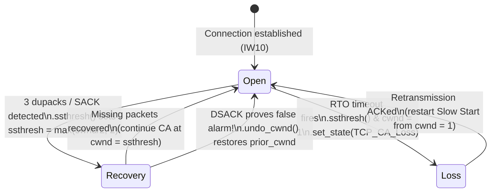
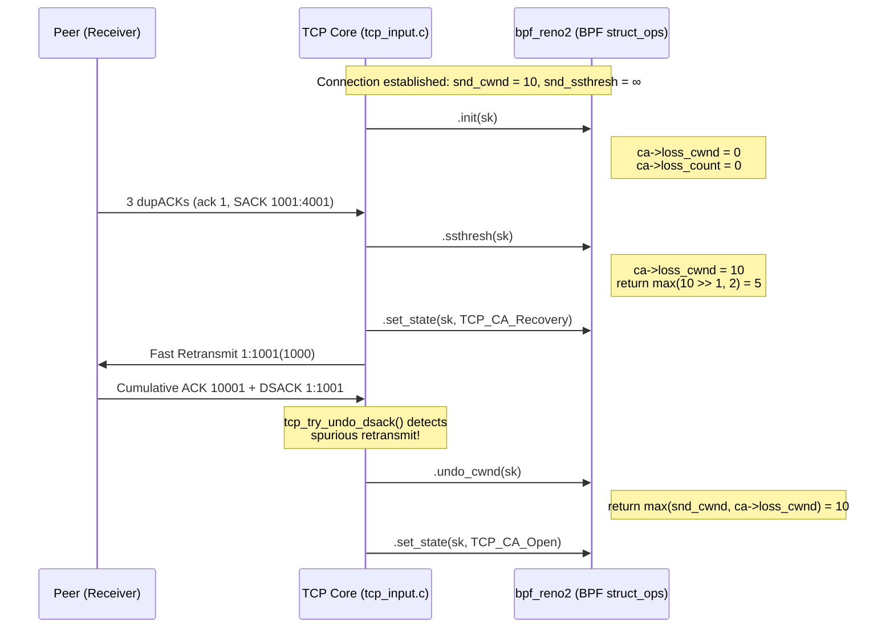

# 18. Hands-on (1): Building TCP Reno with BPF CC and packetdrill


In this track, you will build **TCP Reno (RFC 5681)** — the foundational algorithm from which modern TCP congestion control evolved — from scratch using Linux kernel BPF `struct_ops` (`struct tcp_congestion_ops`).

No prior knowledge of Reno or CUBIC is assumed. Let's start from first principles: why congestion control exists at all, and how Reno probes and shares network capacity.

---

## 1. What Is Congestion Control?

When a TCP sender transmits data, **two distinct brakes** govern the maximum amount of unacknowledged data allowed in flight at any moment:

| Mechanism | Kernel Variable (`struct tcp_sock`) | What Does It Protect? | Who Determines It? |
| :--- | :--- | :--- | :--- |
| **Flow Control** | `snd_wnd` | **The receiver's room (socket receive buffer)** so the receiving host is never overwhelmed | Computed by the receiver and advertised in every TCP header's Window field |
| **Congestion Control** | `snd_cwnd` | **The roads and routers along the path** so bottleneck queues do not overflow and collapse | **Estimated by the sender itself** using returning ACKs and packet loss signals |

Even if the receiver has gigabytes of free memory (a huge `snd_wnd`), blasting packets into the network faster than an intermediate router's link capacity will overflow the router's queue, causing massive packet loss (**congestion collapse**). Conversely, even if the network path is completely empty (a huge `snd_cwnd`), a slow application on the receiving end requires the sender to stop at `snd_wnd`.

Therefore, a TCP sender always caps its in-flight data at the **smaller of the two windows**:

$$\text{Max In-Flight Data} = \min(\text{snd}_{\text{cwnd}}, \text{snd}_{\text{wnd}})$$

The fundamental challenge is that **routers along the path do not explicitly tell the sender how much bandwidth is available**. Congestion control is the algorithm the sender uses to probe the path's capacity — gently increasing its sending window while packets arrive safely, and backing off as soon as congestion is detected.

---

## 2. Reno's Core Principle: AIMD (Additive Increase / Multiplicative Decrease)

Designed by Van Jacobson in the late 1980s, TCP Reno rests on a simple, powerful control law called **AIMD (Additive Increase / Multiplicative Decrease)**:

- **Additive Increase (`+1`)**: As long as ACKs return without packet loss, increase `snd_cwnd` linearly by **`+1` packet per round-trip time (RTT)**.
- **Multiplicative Decrease (`× 1/2`)**: As soon as packet loss is detected, assume the sending rate exceeded the bottleneck capacity and immediately cut `snd_cwnd` in **half (`× 1/2`)**.

### Why "Add to Grow, Multiply to Shrink" Achieves Fairness

Why not increase by addition and also decrease by subtraction (AIAD)?
Imagine two flows sharing a bottleneck link with a capacity of 30 packets: Flow A started earlier and holds `cwnd = 24`, whilst Flow B just joined with `cwnd = 6`.

- If both flows increased by `+1` per RTT and subtracted `-5` on loss, the gap between them ($24 - 6 = 18$) would never shrink.
- With **Multiplicative Decrease (`× 1/2`)**, a packet loss cuts Flow A from `24 → 12` (giving up 12 packets), whilst Flow B only drops from `6 → 3` (giving up 3 packets). Their gap immediately halves from `18` to `9`!
- Because both flows then grow at the exact same additive rate (`+1 / RTT`), repeating this cycle automatically drives them to converge to a **fair `15 : 15` split** of the bottleneck.

```text
snd_cwnd (packets)
  ^
  |        /\              /\              /\          <-- Bottleneck capacity + buffer limit
  |       /  \            /  \            /  \             (Packet loss occurs here!)
  |      /    \          /    \          /    \
  |     /      \        /      \        /      \       Additive Increase (+1 / RTT)
  |    /        \      /        \      /        \      & Multiplicative Decrease (× 1/2)
  |   /          \    /          \    /          \
  |  /            \  /            \  /            \    <-- ssthresh = cwnd / 2
  | /              \/              \/              \
  +----------------------------------------------------> Time (RTT)
  [Slow] [------- Congestion Avoidance (AIMD) -------]
  [Start]
```

This signature pattern is known as the **TCP Sawtooth**.

---

## 3. Two Growth Phases and the Role of `snd_ssthresh`

If a connection only ever grew by `+1` packet per RTT from the very beginning, filling a high-speed path (say, `cwnd = 10,000` packets) would take thousands of round trips.

To solve this, Reno defines a boundary called the **Slow Start Threshold (`snd_ssthresh`)** and divides window growth into two distinct phases:

### Phase 1: Slow Start (`snd_cwnd < snd_ssthresh`)

- When a connection starts, `snd_cwnd` is initialised to **IW10 (10 packets)** and `snd_ssthresh` is set to infinity (`TCP_INFINITE_SSTHRESH`).
- Whilst `snd_cwnd < snd_ssthresh`, Reno increases `snd_cwnd` by **`+1` for every single packet acknowledged**.
- Sending 10 packets and receiving 10 ACKs grows `snd_cwnd` by `+10` to `20`. The next RTT doubles it from `20 → 40`, then `40 → 80`. This **exponential doubling every RTT** quickly discovers the rough capacity of the path.
  - *Note*: The name "Slow Start" is historical — it contrasted with jumping straight to the full receiver window `snd_wnd` on packet 1. In reality, Slow Start is the *fast*, exponential probing phase.

### Phase 2: Congestion Avoidance (`snd_cwnd >= snd_ssthresh`)

- Once packet loss has set `snd_ssthresh` to half of the previous peak and `snd_cwnd` grows back to `snd_cwnd >= snd_ssthresh`, the sender is approaching the known danger zone.
- Reno switches from exponential doubling to linear growth: **`+1` packet per full RTT (`snd_cwnd` ACKed packets)**.
- **How Linux Counts Fractional Windows in Integer Arithmetic (`tp->snd_cwnd_cnt`)**:
  - Neither the Linux kernel nor BPF allows floating-point arithmetic (`float`), so we cannot literally add `1 / snd_cwnd` on each ACK.
  - Instead, Linux maintains a credit bucket **`tp->snd_cwnd_cnt`** inside `struct tcp_sock`. Each incoming ACK adds `acked` segments to `tp->snd_cwnd_cnt`. Once the bucket fills up (`tp->snd_cwnd_cnt >= tp->snd_cwnd`), the sender increments `tp->snd_cwnd` by `1` and subtracts `tp->snd_cwnd` from `tp->snd_cwnd_cnt`.

---

## 4. Reacting to Packet Loss and Undoing False Alarms

When packet loss is detected (or suspected), the Linux TCP core invokes hooks on the congestion control algorithm:



1. **Fast Recovery (`TCP_CA_Recovery`) — Moderate Congestion**:
   - When 3 duplicate ACKs (or SACK blocks) indicate that a packet was lost whilst later packets are still arriving, the TCP core enters `TCP_CA_Recovery`.
   - It calls the **`.ssthresh(sk)`** hook, where Reno returns `max(tp->snd_cwnd / 2, 2)` to halve `snd_ssthresh` (and the congestion window is paced down to `snd_ssthresh` across recovery).
2. **RTO Timeout (`TCP_CA_Loss`) — Severe Congestion**:
   - If ACKs stop arriving altogether and the Retransmission Timeout (RTO) expires, the TCP core transitions to `TCP_CA_Loss`.
   - After halving `snd_ssthresh` via `.ssthresh(sk)`, the kernel resets **`snd_cwnd = 1`** so the connection restarts Slow Start from 1 packet. The **`.set_state(sk, TCP_CA_Loss)`** hook is called on this transition, allowing the CC to reset `tp->snd_cwnd_cnt = 0` so stale Congestion Avoidance credits are discarded.
3. **Spurious Retransmission and `.undo_cwnd(sk)` — Reversing a False Alarm**:
   - In real networks, packets often arrive out of order (**packet reordering**) without actually being dropped. Reordering of 3 or more packets can trick the sender into entering Fast Recovery, retransmitting early, and halving `snd_cwnd` unnecessarily.
   - When the receiver subsequently sends a **DSACK (Duplicate SACK)** reporting that both the original packet and the retransmission arrived, the TCP core realises the loss recovery was a false alarm (**spurious retransmission**).
   - The core immediately invokes **`.undo_cwnd(sk)`**, which restores `snd_cwnd` back to the pre-loss window (`prior_cwnd` / `loss_cwnd`).

---

## 5. Why Build Reno First Before Moving to CUBIC?

You might wonder: *"If Linux uses CUBIC by default today, why start by implementing Reno?"* There are **two fundamental reasons**:

### Reason 1: `struct tcp_sock` Was Designed Around Reno

Because Linux's TCP stack grew up with Reno, the core variables Reno manipulates — `snd_cwnd`, `snd_ssthresh`, `snd_cwnd_cnt`, and `prior_cwnd` — are **built directly into `struct tcp_sock` itself**. Implementing Reno first lets you see how the kernel TCP state machine reads and writes these core fields without any algorithmic clutter.

### Reason 2: CUBIC Is Reno with Just Two Plug-in Upgrades

In Track 2, you will build **CUBIC**. Far from being a completely unrelated design, CUBIC inherits its entire hook structure and Slow Start behaviour directly from Reno, replacing only two pieces:

| Component | Track 1: TCP Reno | Track 2: TCP CUBIC |
| :--- | :--- | :--- |
| **BPF Hooks Used** | `.init`, `.ssthresh`, `.cong_avoid`, `.set_state`, `.undo_cwnd` | **Identical** (plus `.cwnd_event` and `.pkts_acked` for HyStart) |
| **Slow Start** | `+1` per ACKed packet (exponential) | **Identical to Reno** (plus HyStart early exit) |
| **Loss Backoff (`.ssthresh`)** | Multiply by **`0.5`** (`cwnd / 2`) | Multiply by **`0.7`** (`cwnd * 717 / 1024`) |
| **Congestion Avoidance (`.cong_avoid`)** | **Linear** (`+1` per RTT) | **Cubic polynomial curve** concave/convex around $W_{\max}$ |
| **Undo (`.undo_cwnd`)** | `max(snd_cwnd, loss_cwnd)` | **Identical** (`max(snd_cwnd, loss_cwnd)`) |

By completing the two steps in this Reno track first, you master both the BPF `tcp_congestion_ops` hook lifecycle and 80% of the foundation needed for CUBIC.

---

## 6. Track Steps and Commands

This track consists of two hands-on steps:

| Step | Directory | What You Will Build |
| :--- | :--- | :--- |
| **Step 1** | [`step01-slow-start-ai/`](step01-slow-start-ai/README.en.md) | Minimal BPF CC skeleton (`.init`, `.ssthresh`, `.cong_avoid`, `.undo_cwnd`) and the exact boundary transition from Slow Start to Reno Additive Increase. |
| **Step 2** | [`step02-loss-undo/`](step02-loss-undo/README.en.md) | Per-socket private state via `inet_csk_ca(sk)` (`icsk_ca_priv`), state resets on RTO loss (`.set_state`), and restoring `snd_cwnd` on DSACK undo (`.undo_cwnd`). |

### How to Run the Labs

From the `labs/` directory (`/usr/local/google/home/kuniyu/tcp-eli5/labs`), run `run_test.sh` to compile and test each step inside a lightweight `vng` VM with `packetdrill`:

```sh
# Step 1: Verify that starter fails first, then implement the TODOs and re-run
./run_test.sh reno/step01-slow-start-ai starter
# Run the Step 1 model solution (solution.bpf.c)
./run_test.sh reno/step01-slow-start-ai solution

# Step 2: Verify starter and run the model solution
./run_test.sh reno/step02-loss-undo starter
./run_test.sh reno/step02-loss-undo solution
```

Ready? Head over to [`step01-slow-start-ai/README.en.md`](step01-slow-start-ai/README.en.md) and write your first BPF congestion control algorithm!


---

## Step 1: Minimal BPF Congestion Control Skeleton + Slow Start & Reno AI

## 1. Goal

In this step, you will implement the Linux kernel's pluggable congestion control interface (`struct tcp_congestion_ops`) using BPF `struct_ops`, building the foundation of all TCP congestion control algorithms — **TCP Reno (Slow Start, Additive Increase, and Multiplicative Decrease)** — completely from scratch. Rather than calling existing kernel `extern __ksym` helpers such as `tcp_slow_start()` or `tcp_cong_avoid_ai()`, you will write every line in pure BPF so you can see and verify how the congestion window evolves and transitions on every incoming ACK.

- See the [Reno Track README](#) ([Japanese](#)) for the overall track structure and step list.

---

## 2. How the Algorithm Works (Read This First)

Before looking at the design checkpoints or code, let's build a complete picture of how TCP Reno works from first principles and what data structures and hooks the Linux kernel already provides.

### 2.1 Why Does TCP Need Congestion Control?

If a sender injects packets into the network without regard for available path capacity, router queues along the path overflow, packet loss cascades, and useful throughput collapses (*congestion collapse*). Yet a sender has no prior knowledge of how much spare capacity exists along an arbitrary Internet path.

To solve this, a TCP sender maintains a self-imposed limit on the amount of unacknowledged (*in-flight*) data it may have in the network at any instant: the **congestion window (`cwnd`, measured in MSS segments)**. The sender dynamically adjusts `cwnd` using returning ACKs as feedback.

### 2.2 The Two Growth Phases of TCP Reno: Slow Start and Congestion Avoidance

TCP Reno (RFC 5681) switches between two distinct window growth regimes separated by the **slow start threshold (`ssthresh`)**:

```
cwnd (segments)
  ^
  |                        /  <- Congestion Avoidance (Additive Increase)
23|....................../..     +1 cwnd per RTT (linear growth)
22|-----------------> *---       Switch growth regime at ssthresh = 22
  |                 /
20|...............*
  |              /            <- Slow Start
  |             /                +1 cwnd per ACKed segment
  |            /                 (doubles every RTT — exponential growth)
10|----------*
  +----------------------------> Time (RTTs)
   RTT 0   RTT 1   RTT 2   RTT 3
```

1. **Slow Start (when `cwnd < ssthresh`)**
   - **Intuition**: At the start of a connection, the sender has no idea how large the path's bandwidth-delay product is. Starting from a conservative initial window (10 segments by default in Linux), it probes capacity rapidly by doubling `cwnd` every round-trip time (RTT).
   - **Formula and rule**: Whenever an incoming ACK acknowledges `acked` new segments of data, the sender increases `cwnd` by that exact amount:
     $$\text{cwnd} \leftarrow \text{cwnd} + \text{acked}$$
   - When an entire flight of `cwnd` segments is sent and acknowledged over one RTT, `cwnd` grows to $\text{cwnd} + \text{cwnd} = 2 \times \text{cwnd}$ (**exponential doubling every RTT**).
   - **Clamping at the `ssthresh` boundary**: Slow Start is only permitted up to `ssthresh`. If a single ACK (such as a stretch ACK acknowledging many segments at once) would push `cwnd + acked` past `ssthresh`, Slow Start consumes only enough `acked` segments to raise `cwnd` to `ssthresh`. **Any leftover `acked` segments are not discarded — they carry directly over into Congestion Avoidance.**

2. **Congestion Avoidance / Reno Additive Increase (when `cwnd >= ssthresh`)**
   - **Intuition**: Once `cwnd` reaches `ssthresh` (which marks either a target threshold or the vicinity of a past packet loss), doubling the window again would quickly overflow router buffers. Instead, the sender switches to **Additive Increase (AI)**: it increases `cwnd` by just **+1 segment per full RTT** of successfully acknowledged data.
   - **Integer-only maths without floating point**: Conceptually, each ACKed segment in Congestion Avoidance increases `cwnd` by $\frac{1}{\text{cwnd}}$ (or $\text{cwnd} \leftarrow \text{cwnd} + \frac{\text{acked}}{\text{cwnd}}$). Because floating-point arithmetic (`float` / `double`) is forbidden in the Linux kernel and BPF programs, TCP represents the fractional credit $\frac{\text{cnt}}{\text{cwnd}}$ using an integer numerator counter **`snd_cwnd_cnt`**:
     1. On each ACK in Congestion Avoidance, add `acked` to the numerator: `snd_cwnd_cnt += acked`.
     2. Whenever the numerator reaches or exceeds the denominator (`snd_cwnd_cnt >= snd_cwnd`), subtract `snd_cwnd` from `snd_cwnd_cnt` (`snd_cwnd_cnt -= snd_cwnd`) and increment `snd_cwnd` by `1`.

### 2.3 Concrete Numerical Trace (`cwnd = 10`, `ssthresh = 22`)

Let's trace the exact numbers tested by `test.pkt` in this step:

| Round | State Before ACK | Incoming Event | Step-by-Step Calculation | State After ACK |
| :--- | :--- | :--- | :--- | :--- |
| **Initial** | — | 3-way handshake completes | `bpf_reno1_init()` sets `snd_cwnd_cnt = 0` and `snd_ssthresh = 22`. | `cwnd = 10`<br>`ssthresh = 22`<br>`cnt = 0` |
| **Round 1**<br>(Pure Slow Start) | `cwnd = 10`<br>`ssthresh = 22`<br>`cnt = 0` | Send 10 segments; receive ACK for `acked = 10` segments | `cwnd < ssthresh`, so run Slow Start.<br>`10 + 10 = 20 <= 22`: all 10 ACKed segments are consumed in Slow Start (`acked` becomes `0`). | `cwnd = 20`<br>`ssthresh = 22`<br>`cnt = 0` |
| **Round 2**<br>(Boundary Crossing) | `cwnd = 20`<br>`ssthresh = 22`<br>`cnt = 0` | Send 20 segments; receive ACK for `acked = 20` segments | 1. Slow Start consumes `22 - 20 = 2` segments to reach `ssthresh` (`cwnd = 22`).<br>2. The leftover `acked = 20 - 2 = 18` segments fall through to Congestion Avoidance: `cnt = 0 + 18 = 18`.<br>3. Since `cnt (18) < cwnd (22)`, `cwnd` stays `22`. | `cwnd = 22`<br>`ssthresh = 22`<br>`cnt = 18` |
| **Round 3**<br>(Reno AI) | `cwnd = 22`<br>`ssthresh = 22`<br>`cnt = 18` | Send 22 segments; receive ACK for `acked = 22` segments | `cwnd >= ssthresh`, so run Congestion Avoidance directly.<br>1. `cnt = 18 + 22 = 40`.<br>2. Since `cnt (40) >= cwnd (22)`, subtract `22` (`cnt = 18`) and increment `cwnd` from `22` to `23`. | `cwnd = 23`<br>`ssthresh = 22`<br>`cnt = 18` |

### 2.4 Cwnd Validation (Guarding Against Application-Limited Growth)

What happens if `cwnd = 10`, but the application only writes 1 segment per RTT?
Because the sender never actually puts 10 segments in flight to test whether the network path can sustain them, growing `cwnd` to 11, 12, ... on every ACK would build up an artificially huge `cwnd`. If the application later writes a large burst of data, TCP would dump an untested flood of packets into the network all at once (see RFC 7661, Congestion Window Validation).

Therefore, at the very beginning of `.cong_avoid()`, a congestion control algorithm must check whether transmission is genuinely limited by `cwnd` (i.e. the sender is actually filling the congestion window). If not, `.cong_avoid()` must return immediately without growing `cwnd`.

### 2.5 Multiplicative Decrease on Loss and Undoing Spurious Reductions

When packet loss is detected — or when a loss detection later turns out to be a false alarm — TCP Reno applies two rules:

- **Multiplicative Decrease (`.ssthresh()`)**: Packet loss signals that the current `cwnd` exceeded path capacity. Reno cuts `ssthresh` to half of the current `cwnd` ($\lfloor \text{cwnd} / 2 \rfloor$, written as `snd_cwnd >> 1U`), floored at a minimum of `2U` segments as mandated by RFC 5681 so transmission never stalls:
  $$\text{ssthresh} = \max(\lfloor \text{cwnd} / 2 \rfloor, 2)$$
- **Undoing Spurious Window Reductions (`.undo_cwnd()`)**: If the kernel reduces `cwnd` on loss recovery entry, but subsequently discovers via DSACK or timestamps that no packet was actually lost (e.g. packets were merely reordered), it calls `.undo_cwnd()` to restore `snd_cwnd` to the larger of the current `snd_cwnd` and the pre-loss `prior_cwnd`: $\max(\text{snd}_{\text{cwnd}}, \text{prior}_{\text{cwnd}})$.

### 2.6 What the Kernel Already Provides (Structs, Fields, and Helpers)

To design a BPF congestion control algorithm, you need to know which fields already live on the kernel's socket structures and which helpers are available.

#### (A) Core `struct tcp_congestion_ops` Hooks Implemented in This Step

| Hook | Signature | When It Is Called & What It Does |
| :--- | :--- | :--- |
| `.init` | `void (*init)(struct sock *sk)` | Called when a connection is established (or switched to this CC via `setsockopt`). Initialises per-socket CC state. |
| `.ssthresh` | `__u32 (*ssthresh)(struct sock *sk)` | Called upon entering loss recovery to compute and return the new `snd_ssthresh`. |
| `.cong_avoid` | `void (*cong_avoid)(struct sock *sk, __u32 ack, __u32 acked)` | Called on every incoming ACK that acknowledges new data. `ack` is the ACK sequence number; `acked` is the number of newly acknowledged segments. |
| `.undo_cwnd` | `__u32 (*undo_cwnd)(struct sock *sk)` | Called when loss recovery is detected to be spurious; returns the restored `snd_cwnd` value. |

#### (B) Standard Fields Already Built into `struct tcp_sock` (`struct tcp_sock *tp = tcp_sk(sk)`)

Every Linux TCP socket (`struct tcp_sock`) already has **all of Reno's state variables built right into the core socket struct**:

- `tp->snd_cwnd` (`__u32`): Current congestion window (in segments).
- `tp->snd_ssthresh` (`__u32`): Current slow start threshold (in segments).
- `tp->snd_cwnd_cnt` (`__u32`): Linear Congestion Avoidance counter that accumulates ACKed segments (the numerator of $\frac{\text{cnt}}{\text{cwnd}}$).
- `tp->snd_cwnd_clamp` (`__u32`): Maximum allowed value for `tp->snd_cwnd` (always clamp increases using `min(new_cwnd, tp->snd_cwnd_clamp)`).
- `tp->prior_cwnd` (`__u32`): Value of `snd_cwnd` automatically saved by the kernel right before entering loss recovery.

#### (C) What Is the Per-Socket Private Area `icsk_ca_priv`?

- `struct inet_connection_sock` (the parent struct of `tcp_sock`) reserves a 104-byte scratch buffer (`icsk_ca_priv`), accessed via `inet_csk_ca(sk)`.
- Complex congestion control algorithms such as CUBIC (which tracks cubic epoch start timestamps, `W_max`, and `bic_K`) or BBR (which tracks windowed max-bandwidth filters and state machines) define a custom C struct inside `icsk_ca_priv` because `struct tcp_sock` does not have dedicated fields for those algorithm-specific variables.
- By contrast, **every variable required by TCP Reno (`snd_cwnd`, `snd_ssthresh`, `snd_cwnd_cnt`, and `prior_cwnd`) already exists directly on `struct tcp_sock`**.

#### (D) Helper Functions Provided in `bpf_cc_helpers.h`

- `tcp_sk(sk)`: Casts `struct sock *sk` to `struct tcp_sock *tp`.
- `tcp_is_cwnd_limited(sk)`: Returns `true` if transmission is currently limited by `snd_cwnd` (the pipe is full), or `false` if the socket is application-limited.
- `tcp_in_slow_start(tp)`: Returns `true` when `tp->snd_cwnd < tp->snd_ssthresh`.
- `min(a, b)` / `max(a, b)`: Returns the minimum or maximum of two values.

---

## 3. Design Checkpoints (Translate the Algorithm into Code)

Using what you just learned in Section 2, work through these four design questions to plan your implementation of the TODOs in `starter.bpf.c`. Every question can be answered directly from Section 2.

### Q1. State Design: Does TCP Reno need a custom private struct in `icsk_ca_priv`?

Review the standard `struct tcp_sock` fields in Section 2.6 (B) and the role of `icsk_ca_priv` in Section 2.6 (C). Do we need to define a custom struct for `inet_csk_ca(sk)` to implement Reno's Slow Start, Additive Increase, Multiplicative Decrease, and Undo?

<details>
<summary>Hint and Answer</summary>

- **Hint**: Check whether every variable appearing in the formulas in Sections 2.2–2.5 already exists on `struct tcp_sock`.
- **Answer**: **No custom `icsk_ca_priv` struct is needed.**
  `struct tcp_sock` already provides every field TCP Reno requires:
  - `tp->snd_cwnd`: current congestion window
  - `tp->snd_ssthresh`: threshold separating Slow Start and Congestion Avoidance
  - `tp->snd_cwnd_cnt`: integer numerator counter accumulating `acked` segments during Additive Increase
  - `tp->snd_cwnd_clamp`: upper bound used to clamp `tp->snd_cwnd`
  - `tp->prior_cwnd`: saved `snd_cwnd` from before loss recovery, used by `.undo_cwnd()`

</details>

### Q2. Guard Condition: What must `bpf_reno1_cong_avoid()` check first before growing `snd_cwnd`?

Based on Section 2.4 (Cwnd Validation) and the helpers in Section 2.6 (D), what check should appear at the very top of `bpf_reno1_cong_avoid(sk, ack, acked)` before any Slow Start or Additive Increase logic runs?

<details>
<summary>Hint and Answer</summary>

- **Hint**: Which helper tells us whether the sender is actually filling `snd_cwnd` rather than being application-limited?
- **Answer**: Check **`if (!tcp_is_cwnd_limited(sk)) return;`** at the start of `bpf_reno1_cong_avoid()` (**TODO 2** in `starter.bpf.c`). This ensures `snd_cwnd` only grows when the connection is genuinely cwnd-limited.

</details>

### Q3. Boundary Condition: How should the C code handle an ACK that crosses `tp->snd_ssthresh` during Slow Start?

Translate Round 2 from Section 2.3 (`tp->snd_cwnd = 20`, `tp->snd_ssthresh = 22`, and an incoming ACK with `acked = 20`) into C code inside `if (tcp_in_slow_start(tp))`:
1. How do you compute the new Slow Start window `cwnd` without exceeding `tp->snd_ssthresh`?
2. How do you subtract the segments consumed by Slow Start from `acked`?
3. When should the function return early, and when should it fall through to Congestion Avoidance?

<details>
<summary>Hint and Answer</summary>

- **Hint**: If `cwnd = min(tp->snd_cwnd + acked, tp->snd_ssthresh)`, then the number of `acked` segments consumed by Slow Start is `cwnd - tp->snd_cwnd`.
- **Answer**: You can express the entire Slow Start phase and boundary handoff in four lines (**TODO 3** in `starter.bpf.c`):
  ```c
  if (tcp_in_slow_start(tp)) {
      __u32 cwnd = min(tp->snd_cwnd + acked, tp->snd_ssthresh);

      acked -= cwnd - tp->snd_cwnd;
      tp->snd_cwnd = min(cwnd, tp->snd_cwnd_clamp);
      if (!acked)
          return;
  }
  ```
  - In Round 1 (`cwnd = 10, ssthresh = 22, acked = 10`), `cwnd = min(20, 22) = 20`, `acked -= 20 - 10` leaves `acked == 0`, and `if (!acked) return;` exits early.
  - In Round 2 (`cwnd = 20, ssthresh = 22, acked = 20`), `cwnd = min(40, 22) = 22`, `acked -= 22 - 20` leaves `acked == 18`, and execution falls straight through to Congestion Avoidance with `acked = 18`.

</details>

### Q4. Integer-Only Additive Increase: How do we update `tp->snd_cwnd_cnt` and `tp->snd_cwnd` with the remaining `acked` segments?

Translate the integer Congestion Avoidance rule from Section 2.2 into C code (**TODO 4** in `starter.bpf.c`).

<details>
<summary>Hint and Answer</summary>

- **Hint**: Add `acked` to the numerator `tp->snd_cwnd_cnt`. If `tp->snd_cwnd_cnt >= tp->snd_cwnd`, subtract `tp->snd_cwnd` and increment `tp->snd_cwnd` by `1` (clamped at `tp->snd_cwnd_clamp`).
- **Answer**:
  ```c
  tp->snd_cwnd_cnt += acked;
  if (tp->snd_cwnd_cnt >= tp->snd_cwnd) {
      tp->snd_cwnd_cnt -= tp->snd_cwnd;
      tp->snd_cwnd = min(tp->snd_cwnd + 1, tp->snd_cwnd_clamp);
  }
  ```
  Because this uses a single `if` statement rather than a loop, the BPF verifier can verify termination and safety immediately.

</details>

---

## 4. Step-by-step Code Walkthrough (`solution.bpf.c`)

Let's walk through each function in [`solution.bpf.c`](file:///usr/local/google/home/kuniyu/tcp-eli5/labs/reno/step01-slow-start-ai/solution.bpf.c).

### 4.1 `bpf_reno1_init()` — Initialising the Socket

```c
SEC("struct_ops")
void BPF_PROG(bpf_reno1_init, struct sock *sk)
{
	struct tcp_sock *tp = tcp_sk(sk);

	tp->snd_cwnd_cnt = 0;
	tp->snd_ssthresh = 22;
}
```

- Called when the TCP connection is established (or switched to `bpf_reno1` via `setsockopt(TCP_CONGESTION)`), resetting the Additive Increase counter `tp->snd_cwnd_cnt` to `0`.
- Although Linux normally starts with an infinite `snd_ssthresh` (`TCP_INFINITE_SSTHRESH`), we initialise `tp->snd_ssthresh = 22` here so that `test.pkt` can deterministically test pure Slow Start (`10 -> 20`), the exact `snd_ssthresh` boundary transition with leftover `acked` credits (`20 -> 22`), and Reno Additive Increase (`22 -> 23`) in three consecutive RTTs without needing to induce packet loss first.

### 4.2 `bpf_reno1_ssthresh()` — Multiplicative Decrease Threshold (TODO 1)

```c
SEC("struct_ops")
__u32 BPF_PROG(bpf_reno1_ssthresh, struct sock *sk)
{
	const struct tcp_sock *tp = tcp_sk(sk);

	return max(tp->snd_cwnd >> 1U, 2U);
}
```

- Called upon entering loss recovery to calculate the new `snd_ssthresh`.
- Halves `tp->snd_cwnd` via a right bit-shift (`tp->snd_cwnd >> 1U`) and enforces the RFC 5681 minimum of `2U` segments using `max(..., 2U)`.

### 4.3 `bpf_reno1_cong_avoid()` — Slow Start and Reno Additive Increase (TODOs 2–4)

```c
SEC("struct_ops")
void BPF_PROG(bpf_reno1_cong_avoid, struct sock *sk, __u32 ack, __u32 acked)
{
	struct tcp_sock *tp = tcp_sk(sk);

	if (!tcp_is_cwnd_limited(sk))
		return;

	if (tcp_in_slow_start(tp)) {
		__u32 cwnd = min(tp->snd_cwnd + acked, tp->snd_ssthresh);

		acked -= cwnd - tp->snd_cwnd;
		tp->snd_cwnd = min(cwnd, tp->snd_cwnd_clamp);
		if (!acked)
			return;
	}

	tp->snd_cwnd_cnt += acked;
	if (tp->snd_cwnd_cnt >= tp->snd_cwnd) {
		tp->snd_cwnd_cnt -= tp->snd_cwnd;
		tp->snd_cwnd = min(tp->snd_cwnd + 1, tp->snd_cwnd_clamp);
	}
}
```

- **TODO 2 (Cwnd validation)**: Returns early if `!tcp_is_cwnd_limited(sk)`.
- **TODO 3 (Slow Start and boundary handoff)**: While `tcp_in_slow_start(tp)` is true, grows `tp->snd_cwnd` up to `tp->snd_ssthresh`, subtracts the consumed growth (`cwnd - tp->snd_cwnd`) from `acked`, and returns early if `acked` reaches `0`. Any leftover `acked` segments fall through to Congestion Avoidance.
- **TODO 4 (Reno Additive Increase)**: Accumulates `acked` in `tp->snd_cwnd_cnt`. Once `tp->snd_cwnd_cnt >= tp->snd_cwnd`, subtracts `tp->snd_cwnd` and increments `tp->snd_cwnd` by `1` (clamped at `tp->snd_cwnd_clamp`).

### 4.4 `bpf_reno1_undo_cwnd()` — Undoing a Spurious Window Reduction (TODO 5)

```c
SEC("struct_ops")
__u32 BPF_PROG(bpf_reno1_undo_cwnd, struct sock *sk)
{
	const struct tcp_sock *tp = tcp_sk(sk);

	return max(tp->snd_cwnd, tp->prior_cwnd);
}
```

- Restores `snd_cwnd` to `max(tp->snd_cwnd, tp->prior_cwnd)` when the kernel detects that a loss recovery episode was spurious (we will test this path with packet losses in Step 2).

---

## 5. Understanding `test.pkt` and How to Run

### 5.1 Walkthrough of [`test.pkt`](file:///usr/local/google/home/kuniyu/tcp-eli5/labs/reno/step01-slow-start-ai/test.pkt)

`test.pkt` drives `bpf_reno1` through the exact three-round sequence traced in Section 2.3 and verifies `tcpi_snd_cwnd` after each ACK using Python assertions:

1. **Connection Establishment with a 1000-byte Effective MSS (lines 8–22)**:
   - The client SYN advertises `<mss 1012,sackOK,TS val 100 ecr 0,nop,wscale 7>`.
   - Because 12-byte TCP Timestamps (`nop,nop,TS`) are enabled, the effective payload size per segment (`tp->mss_cache`) is `1012 - 12 = 1000` bytes (`10,000` bytes = `10` segments).
   - Right after `accept()`, `test.pkt` asserts `tcpi_snd_cwnd == 10` and `tcpi_snd_ssthresh == 22`.
2. **Round 1 — Pure Slow Start (lines 24–31, `cwnd: 10 -> 20`)**:
   - `write(4, ..., 10000)` sends 10 segments (`1:10001`), filling `cwnd = 10` so `tp->is_cwnd_limited` becomes `true`.
   - Receiving `ack 10001` (`acked = 10`) doubles `tcpi_snd_cwnd` from `10` to `20`.
3. **Round 2 — Clamping at `snd_ssthresh` & Carrying Leftover Credits (lines 33–43, `cwnd: 20 -> 22`)**:
   - `write(4, ..., 20000)` sends 20 segments (`10001:30001`), filling `cwnd = 20`.
   - Receiving `ack 30001` (`acked = 20`) uses `2` segments in Slow Start to reach `tcpi_snd_cwnd == 22` and carries the remaining `18` ACKed segments into `tp->snd_cwnd_cnt = 18`.
4. **Round 3 — Reno Additive Increase (lines 45–53, `cwnd: 22 -> 23`)**:
   - `write(4, ..., 22000)` sends 22 segments (`30001:52001`), filling `cwnd = 22`.
   - Receiving `ack 52001` (`acked = 22`) raises `tp->snd_cwnd_cnt` to `18 + 22 = 40 >= 22`, incrementing `tcpi_snd_cwnd` from `22` to `23`.

### 5.2 Why `starter.bpf.c` Fails and `solution.bpf.c` Passes

- **Why `starter.bpf.c` fails**: In `starter.bpf.c`, `bpf_reno1_cong_avoid()` is a no-op stub. When `ack 10001` arrives in Round 1, `tp->snd_cwnd` remains stuck at its initial value of `10`, triggering the assertion failure on line 30 (`expected cwnd 20 after Slow Start, got 10`).
- **Why `solution.bpf.c` passes**: With Slow Start, `snd_ssthresh` boundary credit handoff, and Reno Additive Increase implemented, `tcpi_snd_cwnd` reaches `20` in Round 1, `22` in Round 2, and `23` in Round 3, satisfying all assertions.

### 5.3 How to Run the Test

Run the following commands to see `starter` fail and `solution` (or your completed `starter`) pass:

```sh
../../run_test.sh reno/step01-slow-start-ai starter
../../run_test.sh reno/step01-slow-start-ai solution
```


### `labs/reno/step01-slow-start-ai/starter.bpf.c` (Starter skeleton)

```c
// SPDX-License-Identifier: GPL-2.0
/*
 * Step 1 (Starter): Minimal BPF Congestion Control Skeleton + Slow Start & Reno AI
 *
 * Fill in the TODOs below to implement TCP Reno in pure BPF.
 */
#include "bpf_cc_helpers.h"

char _license[] SEC("license") = "GPL";

SEC("struct_ops")
void BPF_PROG(bpf_reno1_init, struct sock *sk)
{
	struct tcp_sock *tp = tcp_sk(sk);

	tp->snd_cwnd_cnt = 0;
	/* Pre-configured to 22 segments for test.pkt so we can observe
	 * both Slow Start (10 -> 20 -> 22) and Reno AI (22 -> 23).
	 */
	tp->snd_ssthresh = 22;
}

SEC("struct_ops")
__u32 BPF_PROG(bpf_reno1_ssthresh, struct sock *sk)
{
	const struct tcp_sock *tp = tcp_sk(sk);

	/* TODO 1: Return half of tp->snd_cwnd, but at least 2U. */
	(void)tp;
	return 2U;
}

SEC("struct_ops")
void BPF_PROG(bpf_reno1_cong_avoid, struct sock *sk, __u32 ack, __u32 acked)
{
	struct tcp_sock *tp = tcp_sk(sk);

	/* TODO 2: Return early if the socket is not cwnd-limited
	 *         (!tcp_is_cwnd_limited(sk)).
	 */

	/* TODO 3: Slow Start (if tcp_in_slow_start(tp)):
	 *   - Grow tp->snd_cwnd by acked, clamped at tp->snd_ssthresh
	 *     (and tp->snd_cwnd_clamp).
	 *   - Subtract the used growth from acked.
	 *   - If acked == 0, return early; otherwise fall through to
	 *     Congestion Avoidance with the remaining acked segments.
	 */

	/* TODO 4: Congestion Avoidance (Reno Additive Increase):
	 *   - Add acked to tp->snd_cwnd_cnt.
	 *   - When tp->snd_cwnd_cnt >= tp->snd_cwnd, subtract tp->snd_cwnd
	 *     from tp->snd_cwnd_cnt and increment tp->snd_cwnd by 1
	 *     (clamped at tp->snd_cwnd_clamp).
	 */
	(void)tp;
	(void)ack;
	(void)acked;
}

SEC("struct_ops")
__u32 BPF_PROG(bpf_reno1_undo_cwnd, struct sock *sk)
{
	const struct tcp_sock *tp = tcp_sk(sk);

	/* TODO 5: Return the maximum of tp->snd_cwnd and tp->prior_cwnd. */
	return tp->snd_cwnd;
}

SEC(".struct_ops")
struct tcp_congestion_ops bpf_reno1 = {
	.init		= (void *)bpf_reno1_init,
	.ssthresh	= (void *)bpf_reno1_ssthresh,
	.cong_avoid	= (void *)bpf_reno1_cong_avoid,
	.undo_cwnd	= (void *)bpf_reno1_undo_cwnd,
	.flags		= TCP_CONG_NON_RESTRICTED,
	.name		= "bpf_reno1",
};
```

### `labs/reno/step01-slow-start-ai/test.pkt` (packetdrill test)

```python
// SPDX-License-Identifier: GPL-2.0
// Step 1: Test BPF Reno Slow Start, ssthresh boundary clamping, and Reno AI

0.00 `sysctl -q net.ipv4.tcp_congestion_control=bpf_reno1`

// Establish a passive TCP connection.
// MSS = 1012 with 12-byte TCP Timestamps option -> tp->mss_cache == 1000 bytes.
+0.00 socket(..., SOCK_STREAM, IPPROTO_TCP) = 3
+0.00 setsockopt(3, SOL_SOCKET, SO_REUSEADDR, [1], 4) = 0
+0.00 bind(3, ..., ...) = 0
+0.00 listen(3, 1) = 0

+0.00 < S 0:0(0) win 32792 <mss 1012,sackOK,TS val 100 ecr 0,nop,wscale 7>
+0.00 > S. 0:0(0) ack 1 <mss 1460,sackOK,TS val 100 ecr 100,nop,wscale 7>
+0.01 < . 1:1(0) ack 1 win 257 <nop,nop,TS val 110 ecr 100>
+0.00 accept(3, ..., ...) = 4

// Verify initial cwnd == 10 and ssthresh == 22 (from bpf_reno1_init).
+0.00 %{
assert tcpi_snd_cwnd == 10, f"expected initial cwnd 10, got {tcpi_snd_cwnd}"
assert tcpi_snd_ssthresh == 22, f"expected initial ssthresh 22, got {tcpi_snd_ssthresh}"
}%

// 1. Pure Slow Start: send 10,000 bytes (10 segments == full cwnd, so
//    tp->is_cwnd_limited becomes true) and ACK them. cwnd grows 10 -> 20.
+0.00 write(4, ..., 10000) = 10000
+0.00 > P. 1:10001(10000) ack 1 <nop,nop,TS val 110 ecr 110>
+0.01 < . 1:1(0) ack 10001 win 257 <nop,nop,TS val 120 ecr 110>
+0.00 %{
assert tcpi_snd_cwnd == 20, f"expected cwnd 20 after Slow Start, got {tcpi_snd_cwnd}"
}%

// 2. Slow Start -> Congestion Avoidance transition:
//    Send 20,000 bytes (20 segments == full cwnd 20) and ACK all 20 segments.
//    - Slow Start uses 2 segments to reach ssthresh (20 -> 22).
//    - The remaining 18 ACKed segments fall through to Congestion Avoidance,
//      setting tp->snd_cwnd_cnt = 18 (< 22, so cwnd stays 22).
+0.00 write(4, ..., 20000) = 20000
+0.00 > P. 10001:30001(20000) ack 1 <nop,nop,TS val 120 ecr 120>
+0.01 < . 1:1(0) ack 30001 win 257 <nop,nop,TS val 130 ecr 120>
+0.00 %{
assert tcpi_snd_cwnd == 22, f"expected cwnd 22 at ssthresh boundary, got {tcpi_snd_cwnd}"
}%

// 3. Reno Additive Increase:
//    Send 22,000 bytes (22 segments == full cwnd 22) and ACK them.
//    tp->snd_cwnd_cnt (18 + 22 = 40 >= 22) triggers +1 cwnd (22 -> 23).
+0.00 write(4, ..., 22000) = 22000
+0.00 > P. 30001:52001(22000) ack 1 <nop,nop,TS val 130 ecr 130>
+0.01 < . 1:1(0) ack 52001 win 257 <nop,nop,TS val 140 ecr 130>
+0.00 %{
assert tcpi_snd_cwnd == 23, f"expected cwnd 23 after Reno AI, got {tcpi_snd_cwnd}"
}%
```

<details>
<summary>Reference solution: <code>labs/reno/step01-slow-start-ai/solution.bpf.c</code></summary>

```c
// SPDX-License-Identifier: GPL-2.0
/*
 * Step 1: Minimal BPF Congestion Control Skeleton + Slow Start & Reno AI
 *
 * Implements TCP Reno from scratch in pure BPF (without calling kernel
 * extern __ksym helpers) so every line of Slow Start and Additive Increase
 * is visible and testable with packetdrill.
 */
#include "bpf_cc_helpers.h"

char _license[] SEC("license") = "GPL";

SEC("struct_ops")
void BPF_PROG(bpf_reno1_init, struct sock *sk)
{
	struct tcp_sock *tp = tcp_sk(sk);

	tp->snd_cwnd_cnt = 0;
	/* Set initial ssthresh to 22 segments so we can observe:
	 * 1) Pure Slow Start (cwnd: 10 -> 20)
	 * 2) Slow Start -> Congestion Avoidance boundary (cwnd: 20 -> 22,
	 *    with 18 leftover ACKed segments carried into snd_cwnd_cnt)
	 * 3) Reno Additive Increase (cwnd: 22 -> 23)
	 */
	tp->snd_ssthresh = 22;
}

SEC("struct_ops")
__u32 BPF_PROG(bpf_reno1_ssthresh, struct sock *sk)
{
	const struct tcp_sock *tp = tcp_sk(sk);

	return max(tp->snd_cwnd >> 1U, 2U);
}

SEC("struct_ops")
void BPF_PROG(bpf_reno1_cong_avoid, struct sock *sk, __u32 ack, __u32 acked)
{
	struct tcp_sock *tp = tcp_sk(sk);

	if (!tcp_is_cwnd_limited(sk))
		return;

	/* 1. Slow Start: exponential growth (+1 cwnd per ACKed segment)
	 *    clamped at tp->snd_ssthresh. Any leftover acked segments
	 *    fall through to Congestion Avoidance.
	 */
	if (tcp_in_slow_start(tp)) {
		__u32 cwnd = min(tp->snd_cwnd + acked, tp->snd_ssthresh);

		acked -= cwnd - tp->snd_cwnd;
		tp->snd_cwnd = min(cwnd, tp->snd_cwnd_clamp);
		if (!acked)
			return;
	}

	/* 2. Congestion Avoidance (Reno Additive Increase):
	 *    accumulate ACKed segments in tp->snd_cwnd_cnt and increase
	 *    tp->snd_cwnd by 1 once a full cwnd worth of ACKs arrives.
	 */
	tp->snd_cwnd_cnt += acked;
	if (tp->snd_cwnd_cnt >= tp->snd_cwnd) {
		tp->snd_cwnd_cnt -= tp->snd_cwnd;
		tp->snd_cwnd = min(tp->snd_cwnd + 1, tp->snd_cwnd_clamp);
	}
}

SEC("struct_ops")
__u32 BPF_PROG(bpf_reno1_undo_cwnd, struct sock *sk)
{
	const struct tcp_sock *tp = tcp_sk(sk);

	return max(tp->snd_cwnd, tp->prior_cwnd);
}

SEC(".struct_ops")
struct tcp_congestion_ops bpf_reno1 = {
	.init		= (void *)bpf_reno1_init,
	.ssthresh	= (void *)bpf_reno1_ssthresh,
	.cong_avoid	= (void *)bpf_reno1_cong_avoid,
	.undo_cwnd	= (void *)bpf_reno1_undo_cwnd,
	.flags		= TCP_CONG_NON_RESTRICTED,
	.name		= "bpf_reno1",
};
```

</details>


---

## Step 2: Loss / Fast Recovery and DSACK Undo

## 1. Goal

In Step 1 of the [Reno Track Overview (`../README.md`)](#), we implemented Slow Start and Congestion Avoidance in an ideal network without packet loss. In real networks, however, **packet loss** due to router buffer overflows and **packet reordering** due to multi-path routing happen constantly. In this step, you will learn how TCP NewReno halves its window upon detecting packet loss (**Multiplicative Decrease**) and how it restores the window (**CWND Undo**) when a Duplicate SACK (**DSACK**) later proves that the loss detection was a false alarm (**spurious retransmission**) caused by packet reordering. You will implement and verify these mechanisms in `bpf_reno2`.

---

## 2. How the Algorithm Works (Read This First)

Before looking at any code, let us build a complete mental model of what happens during packet loss and spurious retransmission, how TCP NewReno reacts, and how the Linux TCP core divides work with a BPF congestion control (CC) module.

### Why Does This Problem Happen, and What Is the Idea Behind the Algorithm?

In real networks, two distinct events cause segments to arrive out of order at the receiver:

1. **Congestion-induced Packet Loss**: A bottleneck router queue overflows and drops a packet. If the sender keeps transmitting at the same rate, congestion will worsen, so TCP must immediately cut its congestion window (`snd_cwnd`).
2. **Packet Reordering**: Multi-path routing (ECMP) or internal router parallelism causes an earlier packet (say, segment 1) to take a slightly slower path while later packets (segments 2, 3, and 4) arrive at the receiver first. Segment 1 was not dropped—it is merely delayed.

When segments 2, 3, and 4 arrive before segment 1, the receiver sends three duplicate ACKs (carrying SACK blocks for the out-of-order segments). Following standard TCP rules, the sender assumes segment 1 was lost, immediately retransmits it (**Fast Retransmit**), and enters **Fast Recovery (`TCP_CA_Recovery`)**.

What if segment 1 was only delayed by packet reordering? Shortly after the sender retransmits segment 1, both the delayed original segment 1 and the retransmitted copy arrive at the receiver. Because the network was not actually congested, halving the congestion window was an overreaction! Once the receiver informs the sender that the same segment arrived twice, the sender performs a **CWND Undo** to restore `snd_cwnd` back to its pre-loss size.

### Algorithm Rules and Mathematical Formulae

#### 1. Multiplicative Decrease on Loss Detection (RFC 5681)

When entering **Fast Recovery (`TCP_CA_Recovery`)** on three duplicate ACKs or **Loss (`TCP_CA_Loss`)** on a Retransmission Timeout (RTO), NewReno sets the new slow start threshold (`snd_ssthresh`) to half of the current `snd_cwnd`, bounded below by 2 segments ([RFC 5681 §3.1](https://www.rfc-editor.org/rfc/rfc5681#section-3.1)):

$$\text{ssthresh} = \max\left(\left\lfloor \frac{\text{snd}_{\text{cwnd}}}{2} \right\rfloor, 2\right)$$

At the exact same moment, NewReno saves the pre-loss window size into a per-socket variable `loss_cwnd` so it can recover the original window if the loss later turns out to be spurious:

$$\text{loss}_{\text{cwnd}} = \text{snd}_{\text{cwnd}}$$

#### 2. Division of Labour Between the TCP Core (PRR) and `.ssthresh`

When three duplicate ACKs trigger `TCP_CA_Recovery`, the Linux TCP core calls `tcp_init_cwnd_reduction()`. It is essential to understand who modifies which field:

- **What `.ssthresh(sk)` does**: The CC module does **not** directly overwrite `tp->snd_cwnd` inside `.ssthresh(sk)`. It only computes and returns the new `snd_ssthresh` value.
- **Who actually reduces `snd_cwnd`?**: During Recovery, the TCP core uses **PRR (Proportional Rate Reduction, RFC 6937)** (`tcp_cwnd_reduction()`) to smoothly pace `tp->snd_cwnd` down towards `snd_ssthresh`, and `tcp_end_cwnd_reduction()` sets `tp->snd_cwnd = tp->snd_ssthresh` when exiting Recovery.
- **Why this matters for saving `loss_cwnd`**: Because the TCP core has not yet reduced `tp->snd_cwnd` when it invokes `.ssthresh(sk)`, `tp->snd_cwnd` still holds the exact **pre-loss window size**. Therefore, `.ssthresh(sk)` is the exact place to record `ca->loss_cwnd = tp->snd_cwnd`.

#### 3. Resetting Fractional Credit on RTO Timeout (`TCP_CA_Loss`)

When packet loss is so severe that Fast Recovery cannot recover it and the Retransmission Timer (RTO) expires, the TCP core transitions the socket to `TCP_CA_Loss`, resets `tp->snd_cwnd = 1`, and restarts transmission from Slow Start.

During the previous Congestion Avoidance phase (when the window was large), `tp->snd_cwnd_cnt` accumulated fractional ACK credits towards the next `+1` window increment. If those stale credits were left intact across an RTO, the socket would prematurely increment `snd_cwnd` as soon as it re-entered Congestion Avoidance. Therefore, upon transitioning to `TCP_CA_Loss`, the CC module must reset `tp->snd_cwnd_cnt = 0`.

#### 4. Detecting Spurious Retransmissions via DSACK and Restoring with `.undo_cwnd`

When both the original delayed packet and the retransmitted packet arrive at the receiver, the receiver reports the duplicate arrival using a **DSACK (Duplicate SACK, [RFC 2883](https://www.rfc-editor.org/rfc/rfc2883) / [RFC 3708](https://www.rfc-editor.org/rfc/rfc3708))** block—a SACK block whose sequence numbers lie *below* the cumulative ACK number (proving that a segment already covered by the cumulative ACK arrived a second time).

When DSACK (or TCP Timestamp Eifel Detection, [RFC 3522](https://www.rfc-editor.org/rfc/rfc3522)) confirms that all retransmissions in the recovery episode were spurious, the TCP core (`tcp_try_undo_dsack()` → `tcp_undo_cwnd_reduction()`) calls the CC module's `.undo_cwnd(sk)` hook.

NewReno's `.undo_cwnd(sk)` returns the maximum of the current window and the saved pre-loss window:

$$\text{cwnd}_{\text{undo}} = \max(\text{snd}_{\text{cwnd}}, \text{loss}_{\text{cwnd}})$$

Why return $\max(\text{snd}_{\text{cwnd}}, \text{loss}_{\text{cwnd}})$ instead of simply returning $\text{loss}_{\text{cwnd}}$? Because during a spurious Recovery or Loss episode, incoming ACKs might have already grown `tp->snd_cwnd` past the initial `loss_cwnd` by the time the undo is triggered. Taking the maximum guarantees that undoing a window reduction never accidentally shrinks a window that has already grown larger. (Meanwhile, the TCP core automatically restores `snd_ssthresh` from `tp->prior_ssthresh`.)

### Concrete Numerical Example and Sequence Diagram (`snd_cwnd = 10`)

Let us trace a concrete example matching `test.pkt`, starting with `snd_cwnd = 10` (1 segment = 1000 bytes). We send 10 segments (`1:10001`), where the first segment (`1:1001`) is delayed in the network while segments 2, 3, and 4 (`1001:4001`) arrive first:



1. **Initial transmission (`TCP_CA_Open`)**: `snd_cwnd = 10`. The sender transmits 10 segments (`1:10001`).
2. **Three duplicate ACKs → Fast Recovery**:
   - The receiver sends three duplicate ACKs (`ack 1`) with SACK blocks covering `1001:4001`.
   - The TCP core invokes `.ssthresh(sk)`. `bpf_reno2` saves `ca->loss_cwnd = 10` and returns `max(10 >> 1, 2) = 5`.
   - `snd_ssthresh` becomes `5`, segment `1:1001` is fast-retransmitted, and PRR reduces `snd_cwnd` to `5`.
3. **Cumulative ACK with DSACK → Undo**:
   - Both the delayed original `1:1001`, the remaining segments up to `10001`, and the duplicate retransmission `1:1001` arrive at the receiver.
   - The receiver sends cumulative `ack 10001` together with DSACK block `sack 1:1001`.
   - The TCP core detects the spurious retransmission and invokes `.undo_cwnd(sk)`.
   - `bpf_reno2` returns `max(5, 10) = 10`, restoring `snd_cwnd` to `10` as the socket returns to `TCP_CA_Open`.

### What the Kernel Already Provides (`struct tcp_sock`, `struct inet_connection_sock`, and `icsk_ca_priv`)

Here is the complete inventory of kernel fields and helpers you will use in Step 2:

#### 1. Fields in `struct tcp_sock` (accessed via `tcp_sk(sk)`)

| Field | Type | Access in BPF | Meaning |
| :--- | :--- | :--- | :--- |
| `tp->snd_cwnd` | `u32` | Read / Write | Current congestion window (in segments). Still holds the **pre-loss** value when `.ssthresh(sk)` is invoked. |
| `tp->snd_ssthresh` | `u32` | Read / Write | Slow start threshold. Set by the TCP core from `.ssthresh(sk)`'s return value; restored automatically by the core from `tp->prior_ssthresh` on Undo. |
| `tp->snd_cwnd_cnt` | `u32` | Read / Write | Fractional ACK credit counter for Congestion Avoidance. Must be reset to `0` on `TCP_CA_Loss`. |
| `tp->snd_cwnd_clamp` | `u32` | Read-only | Maximum allowed `snd_cwnd`. |

#### 2. Per-socket Private Storage: `icsk_ca_priv` and `inet_csk_ca(sk)`

Notice what `struct tcp_sock` does **not** have: a dedicated field for the CC module to save `loss_cwnd` or custom counters like `loss_count`.

Furthermore, we cannot store `loss_cwnd` in a BPF global variable because a single BPF CC program is shared across **every TCP socket on the machine**—concurrent connections would constantly overwrite one another's values.

To solve this, the Linux kernel embeds a per-socket private byte array called **`icsk_ca_priv` (104 bytes in mainline kernels)** inside `struct inet_connection_sock`:

- The helper `inet_csk_ca(sk)` in `bpf_cc_helpers.h` returns a `void *` pointer to `(void *)inet_csk(sk)->icsk_ca_priv`.
- A BPF CC module defines its own custom structure (here, the 8-byte `struct bpf_reno2_ca`) and casts `inet_csk_ca(sk)` to that struct pointer.
- The BPF verifier (`bpf_tcp_ca_btf_struct_access()`) explicitly whitelists read/write access to `icsk_ca_priv`, alongside writes to `snd_cwnd`, `snd_ssthresh`, and `snd_cwnd_cnt`.

```c
struct bpf_reno2_ca {
	u32 loss_cwnd;   /* Pre-loss snd_cwnd saved for Undo */
	u32 loss_count;  /* Number of transitions into TCP_CA_Loss (RTO) */
};
```

#### 3. Congestion States `enum tcp_ca_state` (passed as `u8 new_state` to `.set_state`)

Just before the TCP core updates a socket's congestion state (`icsk_ca_state`), it calls `.set_state(sk, new_state)` with one of the following constants:

- `TCP_CA_Open` (`0`): Normal state (no loss detected)
- `TCP_CA_Disorder` (`1`): Duplicate ACKs / SACKs detected, but below the recovery threshold
- `TCP_CA_CWR` (`2`): Congestion Window Reduced (e.g., ECN)
- `TCP_CA_Recovery` (`3`): Fast Recovery in progress (triggered by 3 duplicate ACKs)
- `TCP_CA_Loss` (`4`): RTO timeout fired; recovering via Slow Start

---

## 3. Design Checkpoints (Translate the Algorithm into Code)

Using the concepts from Section 2, think through the following four questions to design the TODOs in `starter.bpf.c`.

### Q1. How do we access per-socket custom state (`loss_cwnd` and `loss_count`) in BPF?

To restore `snd_cwnd` when a loss event turns out to be spurious, each socket needs its own `loss_cwnd` and `loss_count` without colliding with other sockets. Which helper function gives us access to the per-socket private area, and how is it initialised?

<details>
<summary>Hint and Answer</summary>

As explained in Section 2, we use the 104-byte `icsk_ca_priv` array inside `struct inet_connection_sock` via the `inet_csk_ca(sk)` helper, which returns a `void *` pointer to `icsk->icsk_ca_priv`.

`starter.bpf.c` already defines the 8-byte `struct bpf_reno2_ca` and zeroes both fields in `bpf_reno2_init()`:

```c
struct bpf_reno2_ca {
	u32 loss_cwnd;
	u32 loss_count;
};
```

In each hook, `struct bpf_reno2_ca *ca = inet_csk_ca(sk);` gives direct read/write access to that socket's `ca->loss_cwnd` and `ca->loss_count`.

</details>

### Q2. In `.ssthresh(sk)` (TODO 1), what should we save, what should we return, and do we modify `tp->snd_cwnd`?

When three duplicate ACKs trigger Fast Recovery (`TCP_CA_Recovery`), the TCP core calls `bpf_reno2_ssthresh()`. What should this function store into `ca->loss_cwnd`, what formula should it return, and should it overwrite `tp->snd_cwnd` directly?

<details>
<summary>Hint and Answer</summary>

As covered in Section 2, when `.ssthresh(sk)` is called, `tp->snd_cwnd` still holds its **pre-loss value**, and the actual reduction of `tp->snd_cwnd` is performed by the TCP core via PRR (`tcp_cwnd_reduction()`).

Therefore, `bpf_reno2_ssthresh()` should not modify `tp->snd_cwnd`; it only needs two lines:

1. Save the pre-loss window: `ca->loss_cwnd = tp->snd_cwnd;`
2. Return the halved threshold bounded below by `2U`: `return max(tp->snd_cwnd >> 1U, 2U);`

</details>

### Q3. In `.set_state(sk, new_state)` (TODO 2), why reset `tp->snd_cwnd_cnt` to `0` on `TCP_CA_Loss`?

When an RTO fires and the TCP core calls `tcp_set_ca_state(sk, TCP_CA_Loss)`, why should `bpf_reno2_set_state()` reset `tp->snd_cwnd_cnt = 0` alongside incrementing `ca->loss_count++`?

<details>
<summary>Hint and Answer</summary>

`tp->snd_cwnd_cnt` accumulates fractional ACK credits during Congestion Avoidance to increment `snd_cwnd` by `1` once a full window of segments has been acknowledged. If credits accumulated under a large pre-loss window were left intact after an RTO reset the window, `snd_cwnd` would be incremented prematurely as soon as the socket re-entered Congestion Avoidance.

Resetting `tp->snd_cwnd_cnt = 0` when `new_state == TCP_CA_Loss` discards those stale credits cleanly.

</details>

### Q4. In `.undo_cwnd(sk)` (TODO 3), why return `max(tp->snd_cwnd, ca->loss_cwnd)` instead of just `ca->loss_cwnd`?

When a DSACK proves that a retransmission was unnecessary, the TCP core calls `bpf_reno2_undo_cwnd()`. What edge case does `return max(tp->snd_cwnd, ca->loss_cwnd);` prevent compared to `return ca->loss_cwnd;`?

<details>
<summary>Hint and Answer</summary>

During a spurious Recovery or Loss episode, incoming ACKs may have already grown `tp->snd_cwnd` past the initial `ca->loss_cwnd` by the time the undo is triggered.

Returning `ca->loss_cwnd` unconditionally would paradoxically shrink `snd_cwnd` upon undo. Taking `max(tp->snd_cwnd, ca->loss_cwnd)` ensures the congestion window is restored to at least its pre-loss level without ever reducing a window that has already grown larger.

</details>

---

## 4. Step-by-step Code Walkthrough (`solution.bpf.c`)

Let us walk through each function in `solution.bpf.c`.

### 1. Per-socket State `struct bpf_reno2_ca` and `bpf_reno2_init()`

```c
struct bpf_reno2_ca {
	u32 loss_cwnd;
	u32 loss_count;
};

SEC("struct_ops")
void BPF_PROG(bpf_reno2_init, struct sock *sk)
{
	struct bpf_reno2_ca *ca = inet_csk_ca(sk);

	ca->loss_cwnd = 0;
	ca->loss_count = 0;
}
```

- `inet_csk_ca(sk)` returns `(void *)inet_csk(sk)->icsk_ca_priv`.
- `bpf_reno2_init()` is invoked when the connection reaches `ESTABLISHED` (or when switching CC via `setsockopt(TCP_CONGESTION)`) and initialises both `loss_cwnd` and `loss_count` to `0`.

### 2. Saving `snd_cwnd` and Halving `ssthresh`: `bpf_reno2_ssthresh()`

```c
SEC("struct_ops")
u32 BPF_PROG(bpf_reno2_ssthresh, struct sock *sk)
{
	const struct tcp_sock *tp = tcp_sk(sk);
	struct bpf_reno2_ca *ca = inet_csk_ca(sk);

	/* Save pre-loss cwnd into private storage and return halved ssthresh (min 2) */
	ca->loss_cwnd = tp->snd_cwnd;
	return max(tp->snd_cwnd >> 1U, 2U);
}
```

- The right shift `tp->snd_cwnd >> 1U` computes integer division by 2 ($\lfloor \text{snd}_{\text{cwnd}} / 2 \rfloor$), and `max(..., 2U)` enforces the lower bound of 2 segments required by RFC 5681 §3.1.
- Before returning, it saves the pre-reduction `tp->snd_cwnd` into `ca->loss_cwnd` so `bpf_reno2_undo_cwnd()` can restore it if the loss turns out to be spurious.

### 3. Handling Transition to `TCP_CA_Loss`: `bpf_reno2_set_state()`

```c
SEC("struct_ops")
void BPF_PROG(bpf_reno2_set_state, struct sock *sk, u8 new_state)
{
	struct tcp_sock *tp = tcp_sk(sk);
	struct bpf_reno2_ca *ca = inet_csk_ca(sk);

	if (new_state == TCP_CA_Loss) {
		tp->snd_cwnd_cnt = 0;
		ca->loss_count++;
	}
}
```

- Invoked by `tcp_set_ca_state()` right before updating `icsk_ca_state`.
- When `new_state == TCP_CA_Loss`, we clear `tp->snd_cwnd_cnt = 0` to discard stale fractional credits and increment `ca->loss_count++`.

### 4. Undoing Window Reduction: `bpf_reno2_undo_cwnd()`

```c
SEC("struct_ops")
u32 BPF_PROG(bpf_reno2_undo_cwnd, struct sock *sk)
{
	const struct tcp_sock *tp = tcp_sk(sk);
	const struct bpf_reno2_ca *ca = inet_csk_ca(sk);

	/* Restore cwnd back to loss_cwnd when retransmission is proven spurious */
	return max(tp->snd_cwnd, ca->loss_cwnd);
}
```

- When DSACK or TCP timestamps prove that all retransmissions in the recovery episode were spurious, `tcp_undo_cwnd_reduction()` calls `bpf_reno2_undo_cwnd()`.
- Returning `max(tp->snd_cwnd, ca->loss_cwnd)` restores the halved window back to the pre-loss `loss_cwnd`.

### 5. Window Growth (`bpf_reno2_cong_avoid()`) and `struct tcp_congestion_ops`

`bpf_reno2_cong_avoid()` is identical to Step 1 (exponential growth in Slow Start and `+1` per RTT linear growth via `snd_cwnd_cnt` in Congestion Avoidance). Finally, `struct tcp_congestion_ops bpf_reno2` registers `.init`, `.ssthresh`, `.set_state`, `.undo_cwnd`, and `.cong_avoid`.

---

## 5. Understanding `test.pkt` and How to Run

### Walkthrough of `test.pkt`

`test.pkt` reproduces the exact **packet reordering → Fast Recovery → DSACK Undo** sequence illustrated in Section 2:

1. **Handshake and IW10 transmission (lines 11–23)**:
   - The connection is established with `<mss 1012,sackOK,TS val 100 ecr 0,nop,wscale 7>`. Because the TCP Timestamp option occupies 12 bytes, each segment carries `1000` bytes of payload.
   - `write(4, ..., 10000)` sends 10 segments (`1:10001(10000)`). Lines 21–22 assert `tcpi_snd_cwnd == 10` and `tcpi_ca_state == TCP_CA_Open`.
2. **Three duplicate ACKs with SACK trigger Fast Recovery (lines 26–33)**:
   - Segment `1:1001` is delayed in the network while `1001:2001`, `2001:3001`, and `3001:4001` arrive at the peer first.
   - The peer sends three duplicate ACKs (`ack 1`) carrying `<...,sack 1001:2001>`, `<...,sack 1001:3001>`, and `<...,sack 1001:4001>`. On the third duplicate ACK, Fast Recovery triggers.
   - The kernel fast-retransmits `1:1001(1000)` and invokes `bpf_reno2_ssthresh()`. Lines 31–32 assert `tcpi_ca_state == TCP_CA_Recovery` and `tcpi_snd_ssthresh == 5`.
3. **Cumulative ACK with DSACK triggers Undo (lines 37–41)**:
   - Both the delayed original `1:1001` and the remaining segments arrive at the peer, followed by the duplicate retransmission `1:1001`. The peer replies with a cumulative `ack 10001` containing a **DSACK block `<...,sack 1:1001>`**.
   - The kernel calls `tcp_try_undo_dsack()` → `bpf_reno2_undo_cwnd()`. Lines 39–40 assert that the socket has returned to `tcpi_ca_state == TCP_CA_Open` and that `tcpi_snd_cwnd` has been restored from `5` back to `>= 10` (`tcpi_snd_cwnd >= 10`).

### Why `starter.bpf.c` Fails and `solution.bpf.c` Passes

- **Why `starter.bpf.c` fails**:
  - In `starter.bpf.c`, `bpf_reno2_ssthresh()` is unimplemented and simply returns `tp->snd_cwnd` (`10`), causing the assertion at line 32 (`assert tcpi_snd_ssthresh == 5`) to fail immediately.
  - Furthermore, even if `bpf_reno2_ssthresh()` returned `5`, without saving `ca->loss_cwnd` and returning `max(tp->snd_cwnd, ca->loss_cwnd)` in `bpf_reno2_undo_cwnd()`, `tcpi_snd_cwnd` would remain at `5` after the DSACK arrives, failing line 40 (`assert tcpi_snd_cwnd >= 10`).
- **Why `solution.bpf.c` passes**:
  - `bpf_reno2_ssthresh()` saves `ca->loss_cwnd = 10` and returns `5` (passing line 32), and upon receiving the DSACK, `bpf_reno2_undo_cwnd()` returns `max(5, 10) = 10` (passing line 40).

### How to Run

```sh
../../run_test.sh reno/step02-loss-undo starter
../../run_test.sh reno/step02-loss-undo solution
```


### `labs/reno/step02-loss-undo/starter.bpf.c` (Starter skeleton)

```c
/* SPDX-License-Identifier: GPL-2.0 */
#include "bpf_cc_helpers.h"

char _license[] SEC("license") = "GPL";

struct bpf_reno2_ca {
	u32 loss_cwnd;
	u32 loss_count;
};

SEC("struct_ops")
void BPF_PROG(bpf_reno2_init, struct sock *sk)
{
	struct bpf_reno2_ca *ca = inet_csk_ca(sk);

	ca->loss_cwnd = 0;
	ca->loss_count = 0;
}

SEC("struct_ops")
u32 BPF_PROG(bpf_reno2_ssthresh, struct sock *sk)
{
	const struct tcp_sock *tp = tcp_sk(sk);
	struct bpf_reno2_ca *ca = inet_csk_ca(sk);

	/*
	 * TODO 1:
	 * 1. ロス検出直前のウィンドウサイズ tp->snd_cwnd を ca->loss_cwnd に保存する
	 * 2. 半減させたしきい値 max(tp->snd_cwnd >> 1U, 2U) を返す
	 */
	(void)ca;
	return tp->snd_cwnd;
}

SEC("struct_ops")
void BPF_PROG(bpf_reno2_set_state, struct sock *sk, u8 new_state)
{
	struct tcp_sock *tp = tcp_sk(sk);
	struct bpf_reno2_ca *ca = inet_csk_ca(sk);

	/*
	 * TODO 2:
	 * new_state == TCP_CA_Loss のとき、端数カウンタ tp->snd_cwnd_cnt を 0 にリセットし、
	 * ca->loss_count をインクリメントする
	 */
	(void)tp;
	(void)ca;
	(void)new_state;
}

SEC("struct_ops")
u32 BPF_PROG(bpf_reno2_undo_cwnd, struct sock *sk)
{
	const struct tcp_sock *tp = tcp_sk(sk);
	const struct bpf_reno2_ca *ca = inet_csk_ca(sk);

	/*
	 * TODO 3:
	 * DSACK 等でロス検出が誤り（spurious）と判明した際、
	 * 現在の tp->snd_cwnd と退避しておいた ca->loss_cwnd の大きい方を返す
	 */
	(void)ca;
	return tp->snd_cwnd;
}

SEC("struct_ops")
void BPF_PROG(bpf_reno2_cong_avoid, struct sock *sk, u32 ack, u32 acked)
{
	struct tcp_sock *tp = tcp_sk(sk);

	if (!tcp_is_cwnd_limited(sk))
		return;

	if (tcp_in_slow_start(tp)) {
		u32 cwnd = min(tp->snd_cwnd + acked, tp->snd_ssthresh);

		acked -= cwnd - tp->snd_cwnd;
		tp->snd_cwnd = min(cwnd, tp->snd_cwnd_clamp);
		if (!acked)
			return;
	}

	tp->snd_cwnd_cnt += acked;
	if (tp->snd_cwnd_cnt >= tp->snd_cwnd) {
		u32 w = max(tp->snd_cwnd, 1U);
		u32 delta = tp->snd_cwnd_cnt / w;

		tp->snd_cwnd_cnt -= delta * w;
		tp->snd_cwnd = min(tp->snd_cwnd + delta, tp->snd_cwnd_clamp);
	}
}

SEC(".struct_ops")
struct tcp_congestion_ops bpf_reno2 = {
	.init		= (void *)bpf_reno2_init,
	.ssthresh	= (void *)bpf_reno2_ssthresh,
	.set_state	= (void *)bpf_reno2_set_state,
	.undo_cwnd	= (void *)bpf_reno2_undo_cwnd,
	.cong_avoid	= (void *)bpf_reno2_cong_avoid,
	.flags		= TCP_CONG_NON_RESTRICTED,
	.name		= "bpf_reno2",
};
```

### `labs/reno/step02-loss-undo/test.pkt` (packetdrill test)

```python
// SPDX-License-Identifier: GPL-2.0
// Step 2: Loss / Fast Recovery and DSACK Undo test for bpf_reno2

0.00 `sysctl -q net.ipv4.tcp_congestion_control=bpf_reno2`

+0.00 socket(..., SOCK_STREAM, IPPROTO_TCP) = 3
+0.00 setsockopt(3, SOL_SOCKET, SO_REUSEADDR, [1], 4) = 0
+0.00 bind(3, ..., ...) = 0
+0.00 listen(3, 1) = 0

// Establish connection with MSS 1012 (1000-byte payload + 12-byte TS option)
+0.00 < S 0:0(0) win 32792 <mss 1012,sackOK,TS val 100 ecr 0,nop,wscale 7>
+0.00 > S. 0:0(0) ack 1 <mss 1460,sackOK,TS val 100 ecr 100,nop,wscale 7>
+0.01 < . 1:1(0) ack 1 win 257 <nop,nop,TS val 110 ecr 100>
+0.00 accept(3, ..., ...) = 4

// Send 10 segments (IW10 = 10,000 bytes)
+0.00 write(4, ..., 10000) = 10000
+0.00 > P. 1:10001(10000) ack 1 <nop,nop,TS val 110 ecr 110>
+0.00 %{
assert tcpi_snd_cwnd == 10, tcpi_snd_cwnd
assert tcpi_ca_state == TCP_CA_Open, tcpi_ca_state
}%

// 3 duplicate ACKs with SACK blocks trigger Fast Recovery and fast retransmit of 1:1001
+0.01 < . 1:1(0) ack 1 win 257 <nop,nop,TS val 120 ecr 110,nop,nop,sack 1001:2001>
+0.00 < . 1:1(0) ack 1 win 257 <nop,nop,TS val 120 ecr 110,nop,nop,sack 1001:3001>
+0.00 < . 1:1(0) ack 1 win 257 <nop,nop,TS val 120 ecr 110,nop,nop,sack 1001:4001>
+0.00 > . 1:1001(1000) ack 1 <nop,nop,TS val 120 ecr 120>
+0.00 %{
assert tcpi_ca_state == TCP_CA_Recovery, tcpi_ca_state
assert tcpi_snd_ssthresh == 5, tcpi_snd_ssthresh
}%

// Cumulative ACK for all 10,000 bytes with DSACK 1:1001 (spurious retransmit)
// triggers tcp_try_undo_dsack() -> bpf_reno2_undo_cwnd()
+0.01 < . 1:1(0) ack 10001 win 257 <nop,nop,TS val 130 ecr 120,nop,nop,sack 1:1001>
+0.00 %{
assert tcpi_ca_state == TCP_CA_Open, tcpi_ca_state
assert tcpi_snd_cwnd >= 10, tcpi_snd_cwnd
}%
```

<details>
<summary>Reference solution: <code>labs/reno/step02-loss-undo/solution.bpf.c</code></summary>

```c
/* SPDX-License-Identifier: GPL-2.0 */
#include "bpf_cc_helpers.h"

char _license[] SEC("license") = "GPL";

struct bpf_reno2_ca {
	u32 loss_cwnd;
	u32 loss_count;
};

SEC("struct_ops")
void BPF_PROG(bpf_reno2_init, struct sock *sk)
{
	struct bpf_reno2_ca *ca = inet_csk_ca(sk);

	ca->loss_cwnd = 0;
	ca->loss_count = 0;
}

SEC("struct_ops")
u32 BPF_PROG(bpf_reno2_ssthresh, struct sock *sk)
{
	const struct tcp_sock *tp = tcp_sk(sk);
	struct bpf_reno2_ca *ca = inet_csk_ca(sk);

	/* ロス検出時点の cwnd を私有領域に退避し、半減した ssthresh（下限 2）を返す */
	ca->loss_cwnd = tp->snd_cwnd;
	return max(tp->snd_cwnd >> 1U, 2U);
}

SEC("struct_ops")
void BPF_PROG(bpf_reno2_set_state, struct sock *sk, u8 new_state)
{
	struct tcp_sock *tp = tcp_sk(sk);
	struct bpf_reno2_ca *ca = inet_csk_ca(sk);

	if (new_state == TCP_CA_Loss) {
		tp->snd_cwnd_cnt = 0;
		ca->loss_count++;
	}
}

SEC("struct_ops")
u32 BPF_PROG(bpf_reno2_undo_cwnd, struct sock *sk)
{
	const struct tcp_sock *tp = tcp_sk(sk);
	const struct bpf_reno2_ca *ca = inet_csk_ca(sk);

	/* Spurious retransmit と判明した際、ロス前の loss_cwnd まで cwnd を復元する */
	return max(tp->snd_cwnd, ca->loss_cwnd);
}

SEC("struct_ops")
void BPF_PROG(bpf_reno2_cong_avoid, struct sock *sk, u32 ack, u32 acked)
{
	struct tcp_sock *tp = tcp_sk(sk);

	if (!tcp_is_cwnd_limited(sk))
		return;

	if (tcp_in_slow_start(tp)) {
		u32 cwnd = min(tp->snd_cwnd + acked, tp->snd_ssthresh);

		acked -= cwnd - tp->snd_cwnd;
		tp->snd_cwnd = min(cwnd, tp->snd_cwnd_clamp);
		if (!acked)
			return;
	}

	tp->snd_cwnd_cnt += acked;
	if (tp->snd_cwnd_cnt >= tp->snd_cwnd) {
		u32 w = max(tp->snd_cwnd, 1U);
		u32 delta = tp->snd_cwnd_cnt / w;

		tp->snd_cwnd_cnt -= delta * w;
		tp->snd_cwnd = min(tp->snd_cwnd + delta, tp->snd_cwnd_clamp);
	}
}

SEC(".struct_ops")
struct tcp_congestion_ops bpf_reno2 = {
	.init		= (void *)bpf_reno2_init,
	.ssthresh	= (void *)bpf_reno2_ssthresh,
	.set_state	= (void *)bpf_reno2_set_state,
	.undo_cwnd	= (void *)bpf_reno2_undo_cwnd,
	.cong_avoid	= (void *)bpf_reno2_cong_avoid,
	.flags		= TCP_CONG_NON_RESTRICTED,
	.name		= "bpf_reno2",
};
```

</details>
