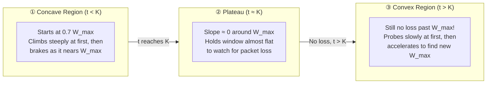
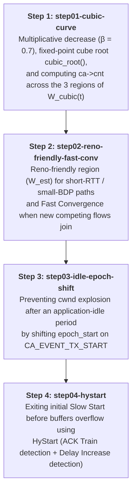

# 19. Hands-on (2): Building TCP CUBIC with BPF CC and packetdrill

In Track 1 (TCP Reno), you built the foundations of congestion control from scratch in BPF: **Slow Start (exponential growth)**, **AIMD (Additive Increase / Multiplicative Decrease: $+1$ segment per RTT, halving on loss)**, and **Loss Undo** to recover from spurious congestion events.

However, the default congestion control algorithm running in the Linux kernel across modern data centres and the Internet is not Reno — it is **CUBIC** ([RFC 9438](https://www.rfc-editor.org/rfc/rfc9438), `net/ipv4/tcp_cubic.c`).
In this track, you will first see with concrete numbers why Reno collapses on high-speed, long-distance networks. Then, step by step, you will build CUBIC's **cubic window growth curve** and the **four mechanisms (Steps 1–4)** that make it production-ready using BPF `struct_ops` and `packetdrill`.

---

## 1. Why Reno Fails on Long Fat Networks (LFNs)

TCP Reno's AIMD rule — increasing `cwnd` by $+1$ packet per RTT and cutting it by $0.5\times$ on a loss — worked admirably on the low-speed links of the 1980s and 1990s. Once link capacities scaled to gigabits per second, however, Reno hit two fatal walls.

### Wall 1: Recovering from a Single Packet Loss Takes 69 Minutes

Let's work through a concrete example on a **Long Fat Network (LFN)** — a path with both high bandwidth and long round-trip delay:

- **Link bandwidth**: $10\text{ Gbps}$ ($= 10 \times 10^9\text{ bits/s}$)
- **Round-Trip Time (RTT)**: $100\text{ ms}$ ($= 0.1\text{ s}$, e.g. a transoceanic or transcontinental optical fibre link)
- **Packet size**: $1,500\text{ Bytes} = 12,000\text{ bits}$

The number of in-flight packets required to keep this pipe completely full — its **Bandwidth-Delay Product (BDP)** — is:

$$\text{BDP} = \frac{10 \times 10^9\text{ bits/s} \times 0.1\text{ s}}{12,000\text{ bits/packet}} \approx 83,333\text{ packets (approx. }83,000\text{ packets)}$$

In other words, the sender must sustain `cwnd = 83,000` packets just to utilise 100% of the $10\text{ Gbps}$ pipe.

Now suppose Reno is cruising at `cwnd = 83,000` and suffers **a single packet loss**. What happens next?

1. **Multiplicative Decrease (halving)**: Reno cuts `cwnd` in half on a loss, dropping `cwnd` immediately from $83,000$ to $41,500$ packets.
2. **Additive Increase ($+1$ packet per RTT)**: Once Fast Recovery finishes and Congestion Avoidance begins, Reno can only grow `cwnd` by **1 packet per RTT ($0.1\text{ s}$)** — just $10$ packets per second.
3. **Time required to recover**: To climb back up by the $41,500$ packets it lost and return to $83,000$ packets, Reno needs:

$$41,500\text{ RTTs} \times 0.1\text{ s/RTT} = 4,150\text{ seconds} \approx \mathbf{69\text{ minutes }10\text{ seconds!}}$$

Dropping **just one packet** forces Reno to spend **over an hour (approx. 69 minutes)** crawling back to full link speed. Worse still, if even a single random bit error or transient micro-burst drops another packet during those 69 minutes, `cwnd` is slashed in half all over again. As a result, a $10\text{ Gbps}$ link running Reno often achieves only a few megabits per second in practice.

### Wall 2: Severe RTT Unfairness (Short-RTT Flows Starve Long-RTT Flows)

Reno's second flaw is that its Congestion Avoidance growth rate is clocked by **arriving ACKs (once per RTT)**.

Imagine two flows sharing the exact same bottleneck router:

- **Flow A (short-distance)**: $\text{RTT} = 10\text{ ms}$ ($100\text{ RTTs}$ per second) $\rightarrow$ grows `cwnd` by **`+100` packets per second**.
- **Flow B (long-distance)**: $\text{RTT} = 100\text{ ms}$ ($10\text{ RTTs}$ per second) $\rightarrow$ grows `cwnd` by only **`+10` packets per second**.

After both flows experience a packet loss at the bottleneck, short-distance Flow A expands its window **10 times faster** than long-distance Flow B and hogs the bottleneck bandwidth. This structural bias against long-distance connections is known as **RTT unfairness**.

---

## 2. The Two Core Ideas of CUBIC

**CUBIC** was designed to shatter both walls at once — recovering rapidly on high-BDP paths while treating flows of different RTTs fairly. Its design rests on two core ideas.

### Idea 1: Reduce `cwnd` to $\beta = 0.7\times$ Instead of $0.5\times$ on Loss

Emptying half the pipe on every loss event is far too drastic on a high-BDP link.
CUBIC raises the multiplicative decrease factor $\beta$ from $0.5$ to **$0.7$ (a 30% reduction, retaining 70% of the window)**:

- Because floating-point arithmetic cannot be used inside the Linux kernel (`net/ipv4/tcp_cubic.c`) or BPF programs, Linux expresses $\beta$ in fixed-point with a denominator of $2^{10} = 1024$ (`BICTCP_BETA_SCALE = 1024`) and numerator `beta = 717`:
  $$\beta = \frac{717}{1024} \approx 0.7002$$
- Retaining 70% of `cwnd` immediately keeps the pipe much fuller after a loss event.

### Idea 2: Make the Window a Cubic Function of Elapsed Time $t$ Since the Last Loss

CUBIC's defining invention is to replace ACK-counted linear growth with a **cubic function of the wall-clock time $t$ elapsed since the start of the current Congestion Avoidance epoch**:

$$W_{\text{cubic}}(t) = C(t - K)^3 + W_{\max}$$

Let's examine every symbol in this formula from first principles:

- **$W_{\max}$ (`ca->last_max_cwnd` in code)**: **The `cwnd` right when the previous packet loss occurred.**
  - A packet loss tells us something crucial: *"`cwnd` reached $W_{\max}$, and that was the ceiling where the bottleneck pipe overflowed."* Reno throws this information away after halving `cwnd`. CUBIC **remembers $W_{\max}$ as its target ceiling** and centres the inflection point of its cubic curve right at $W_{\max}$.
- **$t$**: **Elapsed wall-clock time** since exiting loss recovery and entering the current Congestion Avoidance epoch (measured in seconds in the RFC, and in `BICTCP_HZ` units where $1\text{ s} = 2^{10} = 1024$ inside the kernel).
- **$C$**: The scaling constant controlling how aggressively the cubic curve bends, set to **$C = 0.4\text{ packets/s}^3$** (`410 / 1024 ≈ 0.4004` in fixed-point).
- **$K$ (`ca->bic_K` in code)**: **The time it takes for $W_{\text{cubic}}(t)$ starting from $\beta W_{\max}$ ($= 0.7 W_{\max}$) at $t = 0$ to climb back to $W_{\max}$.**
  - Setting $W_{\text{cubic}}(0) = \beta W_{\max}$ at $t = 0$ and solving for $K$ yields the cube root formula:
    $$C(0 - K)^3 + W_{\max} = \beta W_{\max} \implies K = \sqrt[3]{\frac{W_{\max}(1 - \beta)}{C}}$$
  - (More generally, if the epoch starts at window $\text{cwnd}_{\text{epoch}}$, then $K = \sqrt[3]{\frac{W_{\max} - \text{cwnd}_{\text{epoch}}}{C}}$.)

Let's plug our earlier $10\text{ Gbps}$, $100\text{ ms}$ RTT example ($W_{\max} = 83,000$) into this formula:

$$K = \sqrt[3]{\frac{83,000 \times (1 - 0.7)}{0.4}} = \sqrt[3]{62,250} \approx \mathbf{39.6\text{ seconds}}$$

Where Reno needed **69 minutes (4,150 seconds)** to recover from a single loss, CUBIC climbs back to $83,000$ packets in **under 40 seconds — over 100 times faster!**
Better yet, because $t$ is real wall-clock time rather than an ACK counter, a flow with a $10\text{ ms}$ RTT and a flow with a $100\text{ ms}$ RTT sharing the same $W_{\max}$ trace the exact same $W_{\text{cubic}}(t)$ curve over time, dramatically improving **RTT fairness**.

---

## 3. The Three Regions of the Cubic Curve and Converting to `ca->cnt`

Why choose a **cubic function $(t - K)^3$** instead of a quadratic or exponential curve?
Because a cubic polynomial naturally creates **three distinct behavioural regions** around its inflection point $(t = K,\ W = W_{\max})$ using a single formula: **rapid recovery $\rightarrow$ cautious plateau $\rightarrow$ accelerated probing**.

```text
  cwnd (W_cubic(t))
   ^
   |                                                  /  (3) Convex / Probing Region
   |                                                 /       t > K:
   |                                                /        No loss occurred at W_max, so
   |                                               /         extra bandwidth exists — accelerate!
   |                            (2) Plateau       /
   |                             (t ≈ K)         /
W_max - - - - - - - - - - - - - - -.- - - - - - -    <-- Previous overflow ceiling (last_max_cwnd)
   |                    . '
   |                . '   Near the danger zone W_max, the slope drops
   |             . '      to ~0, holding cwnd steady to test for loss
   |           .'
   |         .'   (1) Concave Region (t < K)
   |        /         Starts at 0.7 * W_max. Leaps upward quickly at first,
   |       /          then brakes progressively as it nears W_max
0.7*W_max +
   |
   +-------------------------------------------------------------> Elapsed time t
   0                               K
```



### ① Concave Region ($t < K$)
- Covers the recovery climb from $0.7 W_{\max}$ back towards the previous high-water mark $W_{\max}$.
- When $t$ is small (far from $K$), $|t - K|^3$ has a steep slope, so CUBIC takes large steps to reclaim unused bandwidth quickly.
- As `cwnd` approaches the known danger zone $W_{\max}$, the slope of $(t - K)^3$ flattens out automatically, applying the brakes for a smooth, cautious landing at $W_{\max}$.

### ② Plateau ($t \approx K$)
- Right around $t = K$, $(t - K)^3 \approx 0$ and the derivative of the cubic curve vanishes, forming a flat plateau at $W_{\max}$.
- CUBIC holds `cwnd` nearly constant at the exact ceiling where the pipe overflowed last time, quietly observing whether the network can sustain $W_{\max}$ without dropping packets. If available capacity has not changed, the flow maximises throughput while avoiding unnecessary self-induced losses.

### ③ Convex / Max Probing Region ($t > K$)
- If the flow cruises through the plateau at $W_{\max}$ without losing a packet, network conditions must have improved (for instance, a competing flow finished).
- Once $t > K$, $(t - K)^3$ turns positive. CUBIC starts probing upward in tiny, careful increments near $t \approx K$, and if still no loss occurs, accelerates rapidly as $(t - K)^3$ grows to discover the new ceiling (**Max Probing**).

### Converting $W_{\text{cubic}}(t)$ into `ca->cnt` in Fixed-Point Arithmetic

While the mathematical equation computes a target window size $W_{\text{cubic}}(t)$, the Linux kernel's congestion control framework (`tcp_cong_avoid_ai(tp, w, acked)`) does not overwrite `tp->snd_cwnd` directly with $W_{\text{cubic}}(t)$. Instead, it paces window increments smoothly using **`ca->cnt` — the number of ACKed segments required before `tp->snd_cwnd` is incremented by $+1$**.

On each incoming ACK in Congestion Avoidance, `bictcp_update()` translates the cubic curve into `ca->cnt` in three steps:

1. **Look ahead 1 RTT to compute `bic_target`**:
   Add the connection's minimum RTT (`ca->delay_min`) to the elapsed time since `ca->epoch_start` ($t = \text{now} - \text{epoch}_{\text{start}} + \text{delay}_{\min}$) and evaluate $W_{\text{cubic}}(t)$. This gives **`bic_target`**, the window size CUBIC wants to reach **one RTT from now**.
2. **Convert the desired 1-RTT window gain into an ACK interval `ca->cnt`**:
   Over the next RTT, roughly `cwnd` segments will be acknowledged. To grow the window from `cwnd` to `bic_target` over those `cwnd` ACKs, we need `bic_target - cwnd` increments of $+1$:
   - **When `bic_target > cwnd`**:
     $$\text{ca}\to\text{cnt} = \frac{\text{cwnd}}{\text{bic}_{\text{target}} - \text{cwnd}}$$
     For example, if `cwnd = 100` and `bic_target = 110` ($+10$ segments wanted over the next RTT), then `ca->cnt = 100 / (110 - 100) = 10`. Incrementing `snd_cwnd` by $+1$ every $10$ ACKed segments yields $+10$ segments after $100$ ACKs (1 RTT).
   - **When `bic_target <= cwnd` (at the plateau)**:
     No immediate growth is needed, so CUBIC sets `ca->cnt = 100 * cwnd` (requiring 100 full RTTs just to gain $+1$ segment), effectively freezing window growth.
   - **Safety lower bound**:
     Finally, `ca->cnt = max(ca->cnt, 2U)` clamps the interval so `cwnd` never grows faster than $+1$ per $2$ ACKs ($+0.5 \times \text{cwnd}$ per RTT) during Congestion Avoidance.
3. **Pass `ca->cnt` to `tcp_cong_avoid_ai(tp, ca->cnt, acked)`**:
   Just as in Reno, `tp->snd_cwnd_cnt` accumulates `acked` credits, and whenever `tp->snd_cwnd_cnt >= ca->cnt`, the kernel subtracts `ca->cnt` and increments `tp->snd_cwnd` by $+1$.

---

## 4. The Four Pillars that Make CUBIC Production-Ready (Overview of Steps 1–4)

The pure cubic curve $W_{\text{cubic}}(t) = C(t - K)^3 + W_{\max}$ is elegant, but deploying it across the real Internet — from sub-millisecond LANs to heavily contested bottlenecks, bursty web applications, and fresh connections — requires **three essential safeguards plus HyStart**.

Across the four steps of this track, you will implement each mechanism in turn until you have a complete BPF implementation matching Linux's `net/ipv4/tcp_cubic.c`.



| Step | Directory | Problem Solved | Core Mechanism Implemented |
| --- | --- | --- | --- |
| **Step 1** | `step01-cubic-curve` | Hour-long recovery on LFNs and RTT unfairness | $\beta = 0.7$ (`717/1024`), integer cube root `cubic_root()`, and `ca->cnt` from $W_{\text{cubic}}(t)$ |
| **Step 2** | `step02-reno-friendly-fast-conv` | Underperforming Reno on short-RTT paths, and slow convergence when new flows join | Parallel linear estimate $W_{\text{est}}$ (`ca->tcp_cwnd`) and Fast Convergence ($\approx 0.85\times$ when `cwnd < last_max_cwnd`) |
| **Step 3** | `step03-idle-epoch-shift` | `cwnd` exploding after an idle pause because elapsed time $t$ kept ticking | Shifting `ca->epoch_start += delta` in `.cwnd_event_tx_start` (`CA_EVENT_TX_START`) |
| **Step 4** | `step04-hystart` | Initial Slow Start overshooting BDP by up to $2\times$ and causing massive burst losses | **HyStart** in `.pkts_acked` (ACK Train + Delay Increase detectors setting `ssthresh = cwnd` early) |

### Step 1 (`step01-cubic-curve`): The Cubic Curve and Fixed-Point Cube Root
- **What you will build**:
  - In `.ssthresh`, save the pre-loss window in `ca->last_max_cwnd` ($W_{\max}$) and return a multiplicative decrease threshold of $\beta = 717 / 1024 \approx 0.7\times$.
  - Implement the integer cube root helper `cubic_root()` without floating-point hardware by combining `fls64()` (find last set bit), a 64-entry lookup table `v[]`, a verifier-friendly bounds guard, and one Newton-Raphson iteration.
  - Evaluate $W_{\text{cubic}}(t)$ across the concave ($t < K$), plateau ($t \approx K$), and convex ($t > K$) regions to compute `bic_target` and `ca->cnt`, verifying all three regions with `packetdrill`.

### Step 2 (`step02-reno-friendly-fast-conv`): Reno-Friendly Region and Fast Convergence
- **Part 1 — Reno-Friendly Region ($W_{\text{est}}$ / `ca->tcp_cwnd`)**:
  - When RTT is short and $W_{\max}$ is small, real time $t$ advances very little per RTT, so the cubic curve near its plateau can grow more slowly than standard TCP Reno.
  - To ensure CUBIC never loses out to Reno on low-BDP paths, CUBIC computes a parallel linear window $W_{\text{est}}$ (`ca->tcp_cwnd`) that achieves the **exact same average window as TCP Reno** ($\beta_{\text{reno}} = 0.5,\ \alpha_{\text{reno}} = 1$) while using CUBIC's $\beta = 0.7$. That linear slope is $\alpha = \frac{3(1 - \beta)}{1 + \beta} \approx 0.529$ segments per RTT — i.e. $+1$ segment every $\frac{1 + \beta}{3(1 - \beta)} \approx 1.875\text{ RTTs}$ (`beta_scale = 15`).
  - Whenever $W_{\text{est}} > W_{\text{cubic}}(t)$, CUBIC uses $W_{\text{est}}$ to clamp `ca->cnt` downward so its window grows at least as fast as Reno.
- **Part 2 — Fast Convergence**:
  - When an existing CUBIC flow is cruising at a large $W_{\max}$ and a new flow enters the bottleneck, the existing flow's fair share shrinks. If it stubbornly keeps aiming for its old $W_{\max}$, it will repeatedly overflow the queue.
  - CUBIC detects new competition whenever a packet loss occurs **before `cwnd` has climbed back to the previous $W_{\max}$ (`cwnd < ca->last_max_cwnd`)**. When that happens, Fast Convergence lowers $W_{\max}$ further to $\text{cwnd} \times \frac{1 + \beta}{2} \approx 0.85 \times \text{cwnd}$ (`(cwnd * 1741) / 2048`), dropping the next plateau lower so bandwidth is yielded quickly.

### Step 3 (`step03-idle-epoch-shift`): Shifting `epoch_start` After an Idle Period
- **What you will build**:
  - Because Reno only advances its window when ACKs arrive, its clock naturally pauses whenever the application stops sending data. CUBIC, however, computes $W_{\text{cubic}}(t)$ from wall-clock elapsed time $t = \text{now} - \text{ca}\to\text{epoch}_{\text{start}}$.
  - If an application goes idle (`in_flight == 0`) for several seconds during Congestion Avoidance and then resumes sending, `ca->epoch_start` would remain stuck in the past. On the very first ACK after resuming, $t$ would leap several seconds forward into the steep convex region ($t \gg K$), causing `bic_target` to explode and `cwnd` to jump by $1.5\times$ in a single RTT (a bug explicitly forbidden by [RFC 9438 §5.8](https://www.rfc-editor.org/rfc/rfc9438#section-5.8)).
  - You will implement the `.cwnd_event_tx_start` hook (`CA_EVENT_TX_START`) to measure the idle duration `delta = now - tp->lsndtime` and shift `ca->epoch_start += delta` forward (clamped at `now`), cleanly excluding idle periods from the cubic clock.

### Step 4 (`step04-hystart`): HyStart (Hybrid Slow Start) for a Safe Soft Landing
- **What you will build**:
  - On a newly established connection, $W_{\max}$ is still $0$ and `snd_ssthresh` starts at infinity (`0x7fffffff`). Standard Slow Start doubles `cwnd` every RTT until the bottleneck buffer overflows — injecting up to $2 \times \text{BDP}$ of packets into the pipe and triggering catastrophic tail-drop burst losses.
  - **HyStart (Hybrid Slow Start)** watches incoming ACKs inside `.pkts_acked` during Slow Start using **two complementary sensors** to detect that the pipe is nearly full *before* a single packet is dropped, setting `tp->snd_ssthresh = tp->snd_cwnd` to transition smoothly into Congestion Avoidance:
    1. **ACK Train Detector (bandwidth saturation sensor)**: When packets fill the bottleneck pipe, the bottleneck router spaces them out at the line rate, and their ACKs return back-to-back ($\le 2\text{ ms}$ apart). Once this closely spaced ACK train spans at least half of the connection's minimum RTT (`delay_min / 2`) within a round, the flight has reached BDP.
    2. **Delay Increase Detector (queueing sensor)**: Once at least 8 RTT samples (`HYSTART_MIN_SAMPLES = 8`) have been collected in the current round, if the round's minimum RTT (`curr_rtt`) exceeds the connection's baseline minimum RTT (`delay_min`) by at least `clamp(delay_min >> 3, 4ms, 16ms)`, packets have begun queueing in the bottleneck buffer.

---

## How to Work Through This Track

Each step directory (`step01-cubic-curve` through `step04-hystart`) contains four files:

- `README.md` / `README.en.md`: Theory, **Design Checkpoints (4 design questions to think through before coding)**, and code walkthrough
- `starter.bpf.c`: Skeleton BPF implementation with `TODO` markers for you to complete
- `solution.bpf.c`: Reference BPF solution
- `test.pkt`: `packetdrill` test script executed inside `vng` (`virtme-ng`) to verify exact kernel behaviour

From the `labs/` directory, use `run_test.sh` to start with Step 1 (`step01-cubic-curve`):

```sh
# 1. Confirm that the unimplemented starter fails the packetdrill assertions
./run_test.sh cubic/step01-cubic-curve starter

# 2. Fill in the TODOs in step01-cubic-curve/starter.bpf.c and re-test
./run_test.sh cubic/step01-cubic-curve starter

# 3. Run the reference solution (solution.bpf.c)
./run_test.sh cubic/step01-cubic-curve solution
```


---

## Step 1: Fixed-Point Cubic Root and the W_cubic(t) Curve (Concave, Plateau, and Convex)

## 1. Goal

In this step, you will implement the core building blocks of Linux's default congestion control algorithm, **TCP CUBIC** ([net/ipv4/tcp_cubic.c](file:///usr/local/google/home/kuniyu/kernel/tcp-eli5-src/net/ipv4/tcp_cubic.c)), from scratch using BPF `struct_ops` (`bpf_cubic3`): **multiplicative decrease ($\beta \approx 0.7$)**, the **fixed-point cubic root `cubic_root()`**, and the **3rd-degree polynomial window growth curve $W_{\text{cubic}}(t)$**. For the full track structure and background, see the [CUBIC Track Overview (`../README.md`)](#).

---

## 2. How the Algorithm Works (Read This First)

Before looking at the design questions or C code, let's build a complete picture from first principles: **why TCP Reno struggles on high-speed paths, how CUBIC's cubic polynomial and fixed-point arithmetic work, and which fields the kernel already provides in `struct tcp_sock` and `icsk_ca_priv`**.

### 2.1 Why TCP Reno Struggles on Long Fat Networks (LFNs)

TCP Reno (AIMD) halves `snd_cwnd` ($\beta = 0.5$) whenever a packet is lost, and then recovers linearly by adding **only $+1$ segment per RTT** during Congestion Avoidance.

On paths with both high bandwidth and long round-trip delay (**Long Fat Networks, LFNs**), growing by $+1$ per RTT is far too slow:
- For example, on a **10 Gbps link with RTT = 100 ms**, the Bandwidth-Delay Product (BDP) is roughly $83,333$ segments.
- If a single packet loss halves `snd_cwnd` from $83,333$ down to $41,666$, climbing back to $83,333$ at $+1$ segment per $100\text{ ms}$ takes **41,666 RTTs $\approx$ 69 minutes**!
- Moreover, because Reno's growth rate depends directly on the RTT clock ($+1$ per RTT), flows with short RTTs grab bandwidth much faster than flows with long RTTs (**RTT unfairness**).

### 2.2 The Core Idea of CUBIC: A Real-Time Cubic Polynomial Centred at $W_{\max}$

CUBIC solves both problems with two key ideas:

1. **Gentler Multiplicative Decrease ($\beta \approx 0.7$) and Remembering $W_{\max}$**:
   When packet loss occurs, CUBIC saves the pre-loss `snd_cwnd` as **$W_{\max}$ (`last_max_cwnd`)** — the window size where the link saturated — and reduces `snd_cwnd` to roughly **$0.7\times$** (`beta = 717 / 1024 ~= 0.7002`) instead of Reno's $0.5\times$.
2. **A 3rd-Degree Polynomial $W_{\text{cubic}}(t)$ Driven by Wall-Clock Time $t$**:
   Instead of incrementing the window by a fixed amount per RTT, CUBIC defines its target window as a cubic function of the elapsed wall-clock time $t$ since the current Congestion Avoidance epoch began, placing its inflection point (where the slope flattens to zero) right at $(t = K, W = W_{\max})$:

$$W_{\text{cubic}}(t) = C(t - K)^3 + W_{\max}$$

Here $C = 0.4$ is a scaling constant, and $K$ is the time it takes for $W_{\text{cubic}}(t)$ to climb from the initial post-recovery window $\text{cwnd}_{\text{epoch}}$ (at $t = 0$) back up to $W_{\max}$. Substituting $W_{\text{cubic}}(0) = \text{cwnd}_{\text{epoch}}$ gives $K$ as a cubic root:

$$K = \sqrt[3]{\frac{W_{\max} - \text{cwnd}_{\text{epoch}}}{C}}$$

```text
  cwnd
   ^
   |                                            /  <-- (3) Convex region (t > K)
   |                                          /        Gently probes for new capacity, then accelerates
W_max (20) +.................................*.........
   |                            . '   ' .
   |                        . '          <-- (2) Plateau (t ~= K)
   |                      /                  Slope flattens to ~0 around W_max to stabilise the link
   |                    /
   |                   /  <-- (1) Concave region (t < K)
cwnd_epoch (14) +     *       Climbs rapidly at first, slowing down as it nears W_max
   |
   +------------------+----------------------+---------> Elapsed time t
                    t = 0                  t = K
                (Epoch start)        (Inflection point)
```

A single cubic equation naturally produces three distinct phases:
- **(1) Concave region ($t < K$)**: Since $t - K < 0$, $W_{\text{cubic}}(t) = W_{\max} - C(K - t)^3$. Right after loss recovery, $|t - K|$ is large, so `cwnd` climbs aggressively back towards $W_{\max}$ and decelerates smoothly as $t \to K$.
- **(2) Plateau ($t \approx K$)**: Around the previous saturation point $W_{\max}$, $|t - K| \approx 0$ and the derivative of $(t - K)^3$ vanishes. CUBIC holds `cwnd` nearly constant, dwelling safely at full capacity without immediately causing another packet loss.
- **(3) Convex / Max-Probing region ($t > K$)**: If no loss occurs at $W_{\max}$, extra bandwidth may have become available. For $t > K$, $W_{\text{cubic}}(t) = W_{\max} + C(t - K)^3$ probes upward very slowly at first and then accelerates over time.

### 2.3 Pacing the Curve Over One RTT (`t + delay_min` and `ca->cnt`)

The kernel's generalised linear counter `bpf_cubic3_cong_avoid_ai(tp, ca->cnt, acked)` increases `snd_cwnd` by $+1$ for every `ca->cnt` acknowledged segments. How does CUBIC translate a continuous target curve $W_{\text{cubic}}(t)$ into the discrete interval `ca->cnt`?

1. **Looking one RTT ahead via $t = (\text{now} - \text{epoch}_{\text{start}}) + \text{delay}_{\min}$**:
   `epoch_start` is initialised to `now_us` on the very first Congestion Avoidance ACK after recovery. If we evaluated $W_{\text{cubic}}(t)$ at $t = \text{now} - \text{epoch}_{\text{start}} = 0$, we would get $W_{\text{cubic}}(0) = \text{cwnd}$, leaving `bic_target == cwnd` and stalling growth for the entire first RTT!
   Instead, CUBIC adds the connection's minimum RTT (`delay_min`) to look one RTT ahead:
   $$t = (\text{now} - \text{epoch}_{\text{start}}) + \text{delay}_{\min}$$
   Evaluating `bic_target` $= W_{\text{cubic}}(t)$ tells us **what window size we want to reach one RTT from now**.
2. **Converting `bic_target` into `ca->cnt`**:
   Over the next RTT, roughly `cwnd` segments will be ACKed. To grow the window from `cwnd` to `bic_target` over those `cwnd` ACKs (an increase of `bic_target - cwnd` segments), we must increment `snd_cwnd` by $+1$ every:
   - **When `bic_target > cwnd`**:
     $$\text{cnt} = \left\lfloor \frac{\text{cwnd}}{\text{bic}_{\text{target}} - \text{cwnd}} \right\rfloor$$
   - **When `bic_target <= cwnd` (at the $W_{\max}$ plateau)**:
     To prevent division by zero or negative values and keep the window virtually flat, CUBIC sets `ca->cnt = 100 * cwnd` (only $+1$ segment per 100 RTTs).
   - **Initial epoch with no prior loss (`last_max_cwnd == 0` and `ca->cnt > 20`)**:
     Caps `ca->cnt = 20`, and finally enforces a lower bound `ca->cnt = max(ca->cnt, 2U)`.

### 2.4 Fixed-Point Arithmetic and the Integer Cubic Root `cubic_root()`

Because neither the Linux kernel nor BPF allows floating-point instructions, CUBIC scales all fractional constants by powers of two ($1024 = 2^{10}$):

| Constant / Symbol | Value / Formula | Mathematical Meaning |
| :--- | :--- | :--- |
| `BICTCP_BETA_SCALE` | `1024` | Denominator for $\beta$ ($2^{10}$) |
| `beta` | `717` | Multiplicative decrease factor $\beta = 717 / 1024 \approx 0.7002$ |
| `BICTCP_HZ` | `10` | Time scale for $t$ and $K$: $1\text{ second} = 2^{10} = 1024\text{ units}$ ($\sim 0.976\text{ ms}$ per unit) |
| `bic_scale` | `41` | Base scale factor (`cube_rtt_scale = bic_scale * 10 = 410`) |
| `cube_rtt_scale` | `410` | $C \times 1024 = 0.4 \times 1024 \approx 410$ (so $C = 410 / 2^{10}$) |
| `cube_factor` | `(1ULL << 40) / 410` ($= 2,681,735,677$) | Pre-scaled multiplier for $K$ in `BICTCP_HZ` units: $\frac{(2^{10})^3}{C} = \frac{2^{30}}{410 / 2^{10}} = \frac{2^{40}}{410}$ |

With these fixed-point constants, every formula reduces to integer shifts, multiplications, and divisions:
- **Time to origin `bic_K` (in `BICTCP_HZ` units)**:
  $$K_{\text{hz}} = \sqrt[3]{\text{cube}_{\text{factor}} \times (W_{\max} - \text{cwnd})}$$
- **Elapsed time `t` (microseconds $\to$ `BICTCP_HZ` units)**:
  $$\text{t} = \frac{((\text{now}_{\text{us}} - \text{epoch}_{\text{start}}) + \text{delay}_{\min}) \ll 10}{1,000,000}$$
- **Cubic distance from origin `delta` $= C |t - K|^3$**:
  To work purely with unsigned 64-bit integers (`__u64`), we first take the absolute distance $\text{offs} = |t - \text{bic}_{K}|$, and then shift right by $10 + 3 \times 10 = 40$ bits to undo the scaling of $C$ ($2^{10}$) and $\text{offs}^3$ ($2^{30}$):
  $$\text{delta} = (\text{cube}_{\text{rtt,scale}} \times \text{offs}^3) \gg (10 + 3 \times \text{BICTCP}_{\text{HZ}})$$
  In the concave region (`t < ca->bic_K`), `bic_target = ca->bic_origin_point - delta`; in the convex region (`t >= ca->bic_K`), `bic_target = ca->bic_origin_point + delta`.

#### How `cubic_root(__u64 a)` Computes $\lfloor \sqrt[3]{a} \rfloor$ in Integer Arithmetic

To compute the cubic root of a 64-bit integer $a$ without floating-point operations, CUBIC uses a three-step algorithm from [tcp_cubic.c](file:///usr/local/google/home/kuniyu/kernel/tcp-eli5-src/net/ipv4/tcp_cubic.c):
1. **Divide the bit-width by 3 (exponent extraction)**:
   `fls64(a)` returns the 1-based position of the most significant set bit ($1 \dots 64$). Computing `b = ((fls64(a) * 84) >> 8) - 1` divides that bit position by 3 (since $84 / 256 \approx 1/3$), giving the number of 3-bit octets to shift. (For small inputs $a < 64$, it returns `((__u32)v[(__u32)a] + 35) >> 6` directly.)
2. **64-entry lookup table `v[]` for the initial estimate**:
   `shift = a >> (b * 3)` extracts the top 6 bits of $a$ into `[0, 63]`. Indexing the precomputed table `v[shift]` and scaling back by `<< b` gives a close initial estimate `x = (((__u32)v[shift] + 10) << b) >> 6`.
   (*Important BPF Verifier rule*: Even though `shift` is mathematically always in `[0, 63]`, the BPF verifier cannot prove the upper bound of a variable shift `a >> (b * 3)`. We must place an explicit `if (shift >= 64) return 0;` guard right before `v[shift]` so the verifier can prove the array access is in bounds.)
3. **One Newton-Raphson iteration**:
   Solving $f(x) = x^3 - a = 0$ via one step of $x_1 = \frac{1}{3}\left(2x_0 + \frac{a}{x_0^2}\right)$ refines the estimate to $\sim 0.195\%$ average error, using `x * (x - 1)` for the denominator and $341 / 1024 \approx 1/3$:
   ```c
   x = (2 * x + (__u32)div64_u64(a, (__u64)x * (__u64)(x - 1)));
   x = ((x * 341) >> 10);
   ```

### 2.5 Concrete Numerical Walkthrough (Matching `test.pkt`)

Let's trace the exact numbers on a connection with RTT = $100\text{ ms}$ (`delay_min = 100,000` usec) that experiences packet loss at `cwnd = 20`:

1. **On packet loss (`bpf_cubic3_ssthresh()`)**:
   - Saves $W_{\max}$ as `last_max_cwnd = 20` and resets `epoch_start = 0`.
   - Returns the new `ssthresh` (and post-recovery `cwnd`): $\lfloor 20 \times 717 / 1024 \rfloor = 14$.
2. **At epoch start (Flight 1 right after recovery, $\text{cwnd} = 14$)**:
   - `bic_origin_point = 20`
   - `bic_K = cubic_root(2,681,735,677 * (20 - 14)) = cubic_root(16,090,414,062) = 2523` ($2523 / 1024 \approx 2.46\text{ s}$)
3. **Evolution of `bic_target` and `ca->cnt` across all five flights**:

| Flight | Elapsed $\text{now} - \text{epoch}_{\text{start}}$ | Lookahead $t$ (`BICTCP_HZ`) | $\text{offs} = \|t - 2523\|$ | $\text{delta} = C \cdot \text{offs}^3$ | Region & `bic_target` | `ca->cnt` | `cwnd` after 1 RTT |
| :--- | :--- | :--- | :--- | :--- | :--- | :--- | :--- |
| **Flight 1** | $0.0\text{ s}$ | $102$ ($0.1\text{ s}$) | $2421$ | $5$ | Concave: $20 - 5 = 15$ | $14 / (15 - 14) = 14$ | $14 \to 15$ |
| **Flight 2** | $0.6\text{ s}$ | $716$ ($0.7\text{ s}$) | $1807$ | $2$ | Concave: $20 - 2 = 18$ | $15 / (18 - 15) = 5$ | $15 \to 18$ ($+3$ jump) |
| **Flight 3** | $1.8\text{ s}$ | $1945$ ($1.9\text{ s}$) | $578$ | $0$ | Origin reached: $20 - 0 = 20$ | $18 / (20 - 18) = 9$ | $18 \to 20$ ($W_{\max}$) |
| **Flight 4** | $2.1\text{ s}$ | $2252$ ($2.2\text{ s}$) | $271$ | $0$ | Plateau: $20 \le \text{cwnd}$ | $100 \times 20 = 2000$ | $20 \to 20$ (flat plateau) |
| **Flight 5** | $4.0\text{ s}$ | $4198$ ($4.1\text{ s}$) | $1675$ | $1$ | Convex: $20 + 1 = 21$ | $20 / (21 - 20) = 20$ | $20 \to 21$ (probing) |

### 2.6 What the Kernel Provides vs. Our Private Struct (`icsk_ca_priv`)

Here is the complete list of fields provided by the kernel and the per-socket CUBIC state we store in `icsk_ca_priv`:

1. **`struct tcp_sock *tp = tcp_sk(sk)` (Kernel-maintained TCP state)**:
   - `tp->snd_cwnd`: Current congestion window (in segments).
   - `tp->snd_ssthresh`: Slow start threshold (`tcp_in_slow_start(tp)` checks `tp->snd_cwnd < tp->snd_ssthresh`).
   - `tp->snd_cwnd_cnt`: Linear ACK counter used by `bpf_cubic3_cong_avoid_ai()` to accumulate `acked` segments until `tp->snd_cwnd_cnt >= w`.
   - `tp->snd_cwnd_clamp`: Upper bound on `snd_cwnd`.
   - `tp->prior_cwnd`: Saved `snd_cwnd` prior to loss recovery (used by `.undo_cwnd`).
   - `tp->tcp_mstamp`: Monotonic per-socket timestamp in microseconds, read via `bictcp_clock_us(sk)`.
2. **`const struct ack_sample *sample` (Passed to `.pkts_acked`)**:
   - `sample->rtt_us`: Latest RTT measurement in microseconds (or `< 0` if unavailable).
3. **`inet_csk_ca(sk)` / `icsk_ca_priv` (Our private `struct bpf_cubic3_ca`)**:
   - `struct inet_connection_sock` reserves an inline byte array `icsk_ca_priv` for congestion control modules, accessed via `inet_csk_ca(sk)`.
   - [starter.bpf.c](file:///usr/local/google/home/kuniyu/tcp-eli5/labs/cubic/step01-cubic-curve/starter.bpf.c) already defines `struct bpf_cubic3_ca` with:
     - `cnt`: Number of ACKed segments required to increment `snd_cwnd` by 1.
     - `last_max_cwnd`: $W_{\max}$ saved at the most recent packet loss.
     - `last_cwnd`, `last_time`: Cache used to skip redundant `bictcp_update()` calls within $1/32\text{ s}$ when `cwnd` has not changed.
     - `bic_origin_point`: Origin window of the cubic curve in the current epoch ($W_{\max}$).
     - `bic_K`: Time from `epoch_start` to reach `bic_origin_point` (in `BICTCP_HZ` units).
     - `delay_min`: Minimum RTT observed in `.pkts_acked` (in microseconds).
     - `epoch_start`: Timestamp when the current Congestion Avoidance epoch started (in microseconds; `0` means no active epoch).

---

## 3. Design Checkpoints (Translate the Algorithm into Code)

Using what you just learned in Section 2, think through these four design questions before filling in the `TODO`s in [starter.bpf.c](file:///usr/local/google/home/kuniyu/tcp-eli5/labs/cubic/step01-cubic-curve/starter.bpf.c).

### Q1. Why do we compute `bic_K` only once when `ca->epoch_start == 0` instead of on every ACK?

`bictcp_update()` runs on every ACK during Congestion Avoidance, yet `ca->bic_K = cubic_root(...)` is only executed inside `if (ca->epoch_start == 0)`. Why doesn't `bic_K` need to be recomputed as `cwnd` grows during the epoch, and when does `ca->epoch_start` get reset to `0`?

<details>
<summary>Hint and Answer</summary>

- **Hint**: Look at the formula $K = \sqrt[3]{(W_{\max} - \text{cwnd}_{\text{epoch}}) / C}$ in Section 2.2. Do any of its inputs change while the socket stays in the same Congestion Avoidance epoch?
- **Answer**:
  - $K$ is the fixed time distance from the start of the epoch ($t = 0$, where the window was $\text{cwnd}_{\text{epoch}}$) to the inflection point $W_{\max}$. Because the cubic curve itself stays fixed throughout the epoch, computing `ca->bic_K` and `ca->bic_origin_point` once when `ca->epoch_start == 0` lets every subsequent ACK evaluate $W_{\text{cubic}}(t)$ with simple subtraction and cubing, avoiding repeated `cubic_root()` calls.
  - `ca->epoch_start` is reset to `0` on packet loss in `bpf_cubic3_ssthresh()` (and on RTO timeout in `bpf_cubic3_set_state()` via `bictcp_reset(ca)`). If `ca->last_max_cwnd <= cwnd` at the start of an epoch, we are already at or above the historical maximum, so we set `ca->bic_K = 0` and `ca->bic_origin_point = cwnd` to start immediately in the convex region.

</details>

### Q2. Why must we add `ca->delay_min` when computing `t` in `bictcp_update()`?

In `bictcp_update()`, elapsed time is computed as `(now_us - ca->epoch_start) + ca->delay_min`. What would happen on Flight 1 (`now_us == ca->epoch_start`) if we omitted `+ ca->delay_min`?

<details>
<summary>Hint and Answer</summary>

- **Hint**: Check Section 2.3 and the Flight 1 row in Section 2.5's table: what is $W_{\text{cubic}}(0)$?
- **Answer**:
  - On the first ACK of a new epoch, `ca->epoch_start` is set to `now_us`, so `now_us - ca->epoch_start == 0`. Without `ca->delay_min`, $t = 0$ and $W_{\text{cubic}}(0) = \text{cwnd}_{\text{epoch}} = \text{cwnd}$.
  - That would make `bic_target == cwnd`, sending execution into the plateau branch (`ca->cnt = 100 * cwnd`) and freezing window growth for the first RTT.
  - Adding `ca->delay_min` evaluates the curve one RTT into the future, giving the target window `bic_target` at the end of the current RTT so `ca->cnt = cwnd / (bic_target - cwnd)` paces growth properly across the incoming flight of ACKs.

</details>

### Q3. How do we evaluate both the concave ($t < K$) and convex ($t \ge K$) regions using only unsigned integers (`__u64`)?

In $W_{\text{cubic}}(t) = C(t - K)^3 + W_{\max}$, the term $(t - K)^3$ is negative when $t < K$ and positive when $t > K$. How should we structure the C code with unsigned variables `t`, `offs`, and `delta` to avoid unsigned underflow?

<details>
<summary>Hint and Answer</summary>

- **Hint**: As shown in Section 2.4, separate the magnitude $|t - K|$ from the sign of $(t - K)$.
- **Answer**:
  1. Compute the non-negative distance from the inflection point:
     ```c
     if (t < ca->bic_K)
         offs = ca->bic_K - t;
     else
         offs = t - ca->bic_K;
     ```
  2. Compute the non-negative cubic offset `delta = (cube_rtt_scale * offs * offs * offs) >> (10 + 3 * BICTCP_HZ);`.
  3. Subtract `delta` from `ca->bic_origin_point` in the concave region (`t < ca->bic_K`) and add `delta` to `ca->bic_origin_point` in the convex region (`t >= ca->bic_K`).

</details>

### Q4. Why does the BPF verifier require `if (shift >= 64) return 0;` before `v[shift]` in `cubic_root()`?

In `cubic_root(__u64 a)`, `b = fls64(a); b = ((b * 84) >> 8) - 1; shift = (a >> (b * 3));` normalises `a` so that `shift` is mathematically in `[0, 63]`. Why does loading the BPF program fail unless we add an explicit bounds check before reading `v[shift]`?

<details>
<summary>Hint and Answer</summary>

- **Hint**: Recall the BPF verifier note in Section 2.4 regarding variable bit shifts and static array lookups.
- **Answer**:
  - The BPF verifier tracks scalar register ranges instruction by instruction, but cannot algebraically prove across `fls64(a)` and the variable shift `a >> (b * 3)` that the resulting `shift` is strictly less than 64.
  - Without an explicit check, the verifier rejects `v[shift]` as a potential out-of-bounds read on the 64-byte `.rodata` array `v[]`.
  - Adding `if (shift >= 64) return 0;` immediately before `v[shift]` restricts the register range to `[0, 63]` on the fallthrough path, satisfying the verifier.

</details>

---

## 4. Step-by-step Code Walkthrough (`solution.bpf.c`)

Let's walk through each function and fixed-point calculation in [solution.bpf.c](file:///usr/local/google/home/kuniyu/tcp-eli5/labs/cubic/step01-cubic-curve/solution.bpf.c).

### 4.1 `cubic_root(__u64 a)` — Table Lookup and Newton-Raphson Iteration (TODO 1)

```c
static __always_inline __u32 cubic_root(__u64 a)
{
	__u32 x, b, shift;

	if (a < 64)
		return ((__u32)v[(__u32)a] + 35) >> 6;

	b = fls64(a);
	b = ((b * 84) >> 8) - 1;
	shift = (a >> (b * 3));

	/* Bounds check required by the BPF verifier for v[shift] */
	if (shift >= 64)
		return 0;

	x = ((__u32)(((__u32)v[shift] + 10) << b)) >> 6;

	/*
	 * Newton-Raphson iteration:
	 *   x_{k+1} = (2 * x_k + a / x_k^2) / 3
	 * Note: 341 / 1024 ~= 1 / 3.
	 */
	x = (2 * x + (__u32)div64_u64(a, (__u64)x * (__u64)(x - 1)));
	x = ((x * 341) >> 10);
	return x;
}
```

- **Fast path for $a < 64$**: Directly indexes `v[a]` with rounding (`+ 35`) and shifts right by 6.
- **Exponent `b` and top 6 bits `shift`**: Uses `fls64(a)` and `b = ((b * 84) >> 8) - 1` to find the 3-bit shift count, then normalises `a` via `shift = a >> (b * 3)`.
- **Verifier bounds check and initial guess**: Guards `if (shift >= 64) return 0;`, then computes `x = (((v[shift] + 10) << b) >> 6)`.
- **One Newton-Raphson step**: Refines `x` using `div64_u64(a, (__u64)x * (__u64)(x - 1))` and multiplies by `341 >> 10` ($\approx 1/3$).

### 4.2 `bictcp_update()` — Evaluating $W_{\text{cubic}}(t)$ and `ca->cnt` (TODO 2)

```c
static __always_inline void bictcp_update(struct sock *sk, __u32 cwnd, __u32 acked)
{
	struct bpf_cubic3_ca *ca = inet_csk_ca(sk);
	__u32 now_us = bictcp_clock_us(sk);
	__u32 delta, bic_target;
	__u64 offs, t;

	if (ca->last_cwnd == cwnd &&
	    (__s32)(now_us - ca->last_time) <= (USEC_PER_SEC / 32))
		return;

	if (ca->epoch_start && now_us == ca->last_time)
		goto out;

	ca->last_cwnd = cwnd;
	ca->last_time = now_us;

	if (ca->epoch_start == 0) {
		ca->epoch_start = now_us;

		if (ca->last_max_cwnd <= cwnd) {
			ca->bic_K = 0;
			ca->bic_origin_point = cwnd;
		} else {
			ca->bic_K = cubic_root(cube_factor *
					       (ca->last_max_cwnd - cwnd));
			ca->bic_origin_point = ca->last_max_cwnd;
		}
	}

	t = (__u64)((__s32)(now_us - ca->epoch_start) + ca->delay_min);
	t <<= BICTCP_HZ;
	t /= USEC_PER_SEC;

	if (t < ca->bic_K)
		offs = ca->bic_K - t;
	else
		offs = t - ca->bic_K;

	/* delta = C * |t - K|^3 */
	delta = (cube_rtt_scale * offs * offs * offs) >> (10 + 3 * BICTCP_HZ);
	if (t < ca->bic_K)	/* Concave region: below origin W_max */
		bic_target = ca->bic_origin_point - delta;
	else			/* Convex region: above origin W_max */
		bic_target = ca->bic_origin_point + delta;

	/* Convert target window into ACK count interval ca->cnt */
	if (bic_target > cwnd)
		ca->cnt = cwnd / (bic_target - cwnd);
	else
		ca->cnt = 100 * cwnd;	/* Very small increment at plateau */

	if (ca->last_max_cwnd == 0 && ca->cnt > 20)
		ca->cnt = 20;

out:
	ca->cnt = max(ca->cnt, 2U);
}
```

- **Rate-limiting guard**: Skips recalculation if `cwnd` is unchanged and less than $1/32\text{ s}$ ($31.25\text{ ms}$) has elapsed since `last_time`.
- **Epoch initialisation**: When `ca->epoch_start == 0`, records `now_us` and computes `ca->bic_K = cubic_root(cube_factor * (ca->last_max_cwnd - cwnd))` if `ca->last_max_cwnd > cwnd`.
- **Evaluating the cubic curve**: Converts `(now_us - ca->epoch_start) + ca->delay_min` to `BICTCP_HZ` units, computes `offs = |t - ca->bic_K|` and `delta`, and sets `bic_target` in the concave (`t < ca->bic_K`) or convex (`t >= ca->bic_K`) region.
- **Computing `ca->cnt`**: Divides `cwnd / (bic_target - cwnd)` when `bic_target > cwnd`, or sets `100 * cwnd` at the plateau, clamped to at least `2U`.

### 4.3 `bpf_cubic3_ssthresh()` — Multiplicative Decrease with $\beta \approx 0.7$ (TODO 3)

```c
SEC("struct_ops")
__u32 BPF_PROG(bpf_cubic3_ssthresh, struct sock *sk)
{
	const struct tcp_sock *tp = tcp_sk(sk);
	struct bpf_cubic3_ca *ca = inet_csk_ca(sk);

	ca->epoch_start = 0;
	ca->last_max_cwnd = tp->snd_cwnd;

	return max((tp->snd_cwnd * beta) / BICTCP_BETA_SCALE, 2U);
}
```

- Resets `ca->epoch_start = 0` so the next Congestion Avoidance ACK starts a fresh epoch, and saves `ca->last_max_cwnd = tp->snd_cwnd` ($W_{\max}$; Fast Convergence and Reno-friendly mode will be added in Step 2).
- Returns `max((tp->snd_cwnd * 717) / 1024, 2U)`.

### 4.4 Other Callbacks Provided in the Skeleton

- `bpf_cubic3_init()`: Zeroes out `struct bpf_cubic3_ca` via `bictcp_reset(ca)` when the socket is initialised.
- `bpf_cubic3_cong_avoid()`: Checks `tcp_is_cwnd_limited(sk)`, grows `snd_cwnd` up to `snd_ssthresh` via `bpf_cubic3_slow_start()` if in Slow Start, and then calls `bictcp_update()` followed by `bpf_cubic3_cong_avoid_ai(tp, ca->cnt, acked)`.
- `bpf_cubic3_set_state()`: Resets CUBIC state via `bictcp_reset(ca)` when entering `TCP_CA_Loss` (RTO).
- `bpf_cubic3_acked()`: Tracks the minimum RTT `ca->delay_min` from `sample->rtt_us` (ignoring samples during the first 1 second after Fast Recovery).
- `bpf_cubic3_undo_cwnd()`: Restores `max(tp->snd_cwnd, tp->prior_cwnd)` on spurious loss recovery.

---

## 5. Understanding `test.pkt` and How to Run

### 5.1 Packet Trace Walkthrough (`test.pkt`)

[test.pkt](file:///usr/local/google/home/kuniyu/tcp-eli5/labs/cubic/step01-cubic-curve/test.pkt) establishes a connection with a 1000-byte effective MSS and RTT = 100 ms (`delay_min = 100,000` usec) and verifies the exact numbers from Section 2.5 across seven stages:

1. **Handshake and Slow Start (`cwnd: 10 -> 20`)**:
   Sends 10 segments (`10000` bytes). The ACK at $+0.100\text{ s}$ grows `tcpi_snd_cwnd` from 10 to 20 and records `delay_min = 100 ms` in `bpf_cubic3_acked()`.
2. **Packet Loss at `cwnd = 20` and $\beta = 0.7$ Assertion (`ssthresh == 14`)**:
   Sends 4 segments (`10001:14001`) where the first segment (`10001:11001`) is lost. Three SACKs trigger Fast Recovery (`TCP_CA_Recovery`) and invoke `bpf_cubic3_ssthresh()`.
   - **Why `starter.bpf.c` fails**: `bpf_cubic3_ssthresh()` in [starter.bpf.c](file:///usr/local/google/home/kuniyu/tcp-eli5/labs/cubic/step01-cubic-curve/starter.bpf.c) returns Reno's $0.5\times$ reduction (`10`), immediately failing line 42 (`assert tcpi_snd_ssthresh == 14`). Furthermore, its `bictcp_update()` leaves `ca->cnt = cwnd`, which would fail the subsequent concave and plateau assertions.
   - **Why `solution.bpf.c` passes**: `20 * 717 / 1024 = 14` satisfies `tcpi_snd_ssthresh == 14`, and the recovery ACK at line 46 exits Fast Recovery into `TCP_CA_Open` with `tcpi_snd_cwnd == 14` and $W_{\max} = 20$.
3. **Flight 1 (Epoch start, Concave region, $t_{\text{elapsed}} = 0.0\text{ s}$)**:
   Sending 14 segments and receiving the ACK initialises `bic_K = 2523` ($\sim 2.46\text{ s}$), `bic_target = 15`, and `ca->cnt = 14`, advancing `tcpi_snd_cwnd` from `14` to `15`.
4. **Flight 2 (Steep Concave climb, $t_{\text{elapsed}} = 0.6\text{ s}$)**:
   At $t_{\text{elapsed}} = 0.6\text{ s}$, `bic_target = 18` and `ca->cnt = 15 / (18 - 15) = 5`. ACKing 15 segments jumps `tcpi_snd_cwnd` by $+3$ in a single RTT to `18`.
5. **Flight 3 (Reaching the origin $W_{\max} = 20$, $t_{\text{elapsed}} = 1.8\text{ s}$)**:
   Approaching $K \approx 2.46\text{ s}$, `delta = 0`, `bic_target = 20`, and `ca->cnt = 18 / (20 - 18) = 9`. ACKing 18 segments brings `tcpi_snd_cwnd` to `20` ($W_{\max}$).
6. **Flight 4 (Plateau at $W_{\max} = 20$ near $t \approx K$, $t_{\text{elapsed}} = 2.1\text{ s}$)**:
   With `cwnd == 20` and `bic_target == 20`, `bic_target <= cwnd` sets `ca->cnt = 100 * 20 = 2000`. Even after 20 segments are ACKed, `tcpi_snd_cwnd` stays flat at `20`.
7. **Flight 5 (Convex bandwidth probing, $t_{\text{elapsed}} = 4.0\text{ s} > K$)**:
   Past $K \approx 2.46\text{ s}$, `t > bic_K` and `delta = 1` push `bic_target = 20 + 1 = 21 > cwnd` (`ca->cnt = 20`), growing `tcpi_snd_cwnd` beyond `20`.

### 5.2 How to Run

Run the following commands from `/usr/local/google/home/kuniyu/tcp-eli5/labs/cubic/step01-cubic-curve` (or any step directory):

```sh
../../run_test.sh cubic/step01-cubic-curve starter
../../run_test.sh cubic/step01-cubic-curve solution
```


### `labs/cubic/step01-cubic-curve/starter.bpf.c` (Starter skeleton)

```c
// SPDX-License-Identifier: GPL-2.0
/*
 * Step 3 (Starter): Fixed-Point Cubic Root and the W_cubic(t) Curve
 *
 * Complete the three TODO sections below:
 *   1. cubic_root(__u64 a): fixed-point cubic root using fls64(a), v[] table,
 *      and one Newton-Raphson iteration.
 *   2. bictcp_update(): compute K, t, offs = |t - K|, delta = C * |t - K|^3,
 *      bic_target = W_max +/- delta, and ca->cnt.
 *   3. bpf_cubic3_ssthresh(): save W_max, reset epoch_start = 0, and apply
 *      multiplicative decrease beta = 717 / 1024.
 */

#include "bpf_cc_helpers.h"

char _license[] SEC("license") = "GPL";

#define BICTCP_BETA_SCALE	1024	/* Scale factor for beta calculation */
#define BICTCP_HZ		10	/* BIC HZ: 2^10 = 1024 units per sec */

static const __u32 beta = 717;			/* 717 / 1024 ~= 0.7 */
static const __u32 bic_scale = 41;		/* C = 41 / 1024 ~= 0.04 (0.4 / 10) */
static const __u32 cube_rtt_scale = (bic_scale * 10);	/* 1024 * C / srtt(0.1s) = 410 */

/* 1 / C * 2^(3 * BICTCP_HZ) = 2^(10 + 30) / 410 */
static const __u64 cube_factor = (1ULL << (10 + 3 * BICTCP_HZ)) / (bic_scale * 10);

struct bpf_cubic3_ca {
	__u32	cnt;			/* Increase cwnd by 1 after cnt ACKs */
	__u32	last_max_cwnd;		/* Last maximum snd_cwnd (W_max) */
	__u32	last_cwnd;		/* The last snd_cwnd */
	__u32	last_time;		/* Time when updated last_cwnd (usec) */
	__u32	bic_origin_point;	/* Origin point of bic function (W_max) */
	__u32	bic_K;			/* Time to origin point from epoch start */
	__u32	delay_min;		/* Minimum RTT (usec) */
	__u32	epoch_start;		/* Beginning of an epoch (usec) */
};

static __always_inline void bictcp_reset(struct bpf_cubic3_ca *ca)
{
	ca->cnt = 0;
	ca->last_max_cwnd = 0;
	ca->last_cwnd = 0;
	ca->last_time = 0;
	ca->bic_origin_point = 0;
	ca->bic_K = 0;
	ca->delay_min = 0;
	ca->epoch_start = 0;
}

static __always_inline __u32 bictcp_clock_us(const struct sock *sk)
{
	return tcp_sk(sk)->tcp_mstamp;
}

/* Find Last Set bit in a 64-bit integer (1..64, or 0 if x == 0). */
static __always_inline __u32 fls64(__u64 x)
{
	__u32 num = 63;

	if (x == 0)
		return 0;

	if (!(x & (~0ULL << 32))) {
		num -= 32;
		x <<= 32;
	}
	if (!(x & (~0ULL << 48))) {
		num -= 16;
		x <<= 16;
	}
	if (!(x & (~0ULL << 56))) {
		num -= 8;
		x <<= 8;
	}
	if (!(x & (~0ULL << 60))) {
		num -= 4;
		x <<= 4;
	}
	if (!(x & (~0ULL << 62))) {
		num -= 2;
		x <<= 2;
	}
	if (!(x & (~0ULL << 63)))
		num -= 1;

	return num + 1;
}

/*
 * cbrt(x) MSB values for x MSB values in [0..63].
 * Precomputed then refined by hand - Willy Tarreau
 */
static const __u8 v[] = {
	/* 0x00 */    0,   54,   54,   54,  118,  118,  118,  118,
	/* 0x08 */  123,  129,  134,  138,  143,  147,  151,  156,
	/* 0x10 */  157,  161,  164,  168,  170,  173,  176,  179,
	/* 0x18 */  181,  185,  187,  190,  192,  194,  197,  199,
	/* 0x20 */  200,  202,  204,  206,  209,  211,  213,  215,
	/* 0x28 */  217,  219,  221,  222,  224,  225,  227,  229,
	/* 0x30 */  231,  232,  234,  236,  237,  239,  240,  242,
	/* 0x38 */  244,  245,  246,  248,  250,  251,  252,  254,
};

static __always_inline __u32 cubic_root(__u64 a)
{
	/*
	 * TODO 1: Implement fixed-point cubic_root(a):
	 *   1. If a < 64, return ((__u32)v[(__u32)a] + 35) >> 6;
	 *   2. Compute b = fls64(a); b = ((b * 84) >> 8) - 1;
	 *   3. Compute shift = (a >> (b * 3)); and guard if (shift >= 64) return 0;
	 *   4. Initial estimate: x = ((__u32)(((__u32)v[shift] + 10) << b)) >> 6;
	 *   5. One Newton-Raphson iteration:
	 *        x = (2 * x + (__u32)div64_u64(a, (__u64)x * (__u64)(x - 1)));
	 *        x = ((x * 341) >> 10);
	 */
	(void)a;
	(void)v;
	(void)fls64;
	return 0;
}

static __always_inline void bictcp_update(struct sock *sk, __u32 cwnd, __u32 acked)
{
	struct bpf_cubic3_ca *ca = inet_csk_ca(sk);

	/*
	 * TODO 2: Replace this Reno fallback (ca->cnt = cwnd) with the CUBIC
	 * window curve W_cubic(t):
	 *   - Initialize epoch_start, bic_origin_point = last_max_cwnd, and
	 *     bic_K = cubic_root(cube_factor * (last_max_cwnd - cwnd))
	 *   - Compute t = ((now_us - epoch_start + delay_min) << BICTCP_HZ) / USEC_PER_SEC
	 *   - Compute offs = |t - bic_K| and
	 *     delta = (cube_rtt_scale * offs * offs * offs) >> (10 + 3 * BICTCP_HZ)
	 *   - Concave (t < bic_K): bic_target = bic_origin_point - delta
	 *     Convex  (t >= bic_K): bic_target = bic_origin_point + delta
	 *   - Set ca->cnt = cwnd / (bic_target - cwnd) if bic_target > cwnd,
	 *     else 100 * cwnd, and clamp ca->cnt = max(ca->cnt, 2U).
	 */
	(void)acked;
	(void)cube_rtt_scale;
	(void)cube_factor;
	(void)cubic_root;
	ca->cnt = max(cwnd, 2U);
}

static __always_inline __u32 bpf_cubic3_slow_start(struct tcp_sock *tp, __u32 acked)
{
	__u32 cwnd = min(tp->snd_cwnd + acked, tp->snd_ssthresh);

	acked -= cwnd - tp->snd_cwnd;
	tp->snd_cwnd = min(cwnd, tp->snd_cwnd_clamp);
	return acked;
}

static __always_inline void bpf_cubic3_cong_avoid_ai(struct tcp_sock *tp, __u32 w, __u32 acked)
{
	if (tp->snd_cwnd_cnt >= w) {
		tp->snd_cwnd_cnt = 0;
		tp->snd_cwnd++;
	}

	tp->snd_cwnd_cnt += acked;
	if (tp->snd_cwnd_cnt >= w) {
		__u32 delta = tp->snd_cwnd_cnt / w;

		tp->snd_cwnd_cnt -= delta * w;
		tp->snd_cwnd += delta;
	}
	tp->snd_cwnd = min(tp->snd_cwnd, tp->snd_cwnd_clamp);
}

SEC("struct_ops")
void BPF_PROG(bpf_cubic3_init, struct sock *sk)
{
	struct bpf_cubic3_ca *ca = inet_csk_ca(sk);

	bictcp_reset(ca);
}

SEC("struct_ops")
__u32 BPF_PROG(bpf_cubic3_ssthresh, struct sock *sk)
{
	const struct tcp_sock *tp = tcp_sk(sk);

	/*
	 * TODO 3:
	 *   - Set ca->epoch_start = 0
	 *   - Save ca->last_max_cwnd = tp->snd_cwnd
	 *   - Return max((tp->snd_cwnd * beta) / BICTCP_BETA_SCALE, 2U)
	 *     instead of Reno's 0.5x reduction below.
	 */
	(void)beta;
	return max(tp->snd_cwnd >> 1U, 2U);
}

SEC("struct_ops")
void BPF_PROG(bpf_cubic3_cong_avoid, struct sock *sk, __u32 ack, __u32 acked)
{
	struct tcp_sock *tp = tcp_sk(sk);
	struct bpf_cubic3_ca *ca = inet_csk_ca(sk);

	if (!tcp_is_cwnd_limited(sk))
		return;

	if (tcp_in_slow_start(tp)) {
		acked = bpf_cubic3_slow_start(tp, acked);
		if (!acked)
			return;
	}
	bictcp_update(sk, tp->snd_cwnd, acked);
	bpf_cubic3_cong_avoid_ai(tp, ca->cnt, acked);
}

SEC("struct_ops")
void BPF_PROG(bpf_cubic3_set_state, struct sock *sk, __u8 new_state)
{
	if (new_state == TCP_CA_Loss)
		bictcp_reset(inet_csk_ca(sk));
}

SEC("struct_ops")
void BPF_PROG(bpf_cubic3_acked, struct sock *sk, const struct ack_sample *sample)
{
	struct bpf_cubic3_ca *ca = inet_csk_ca(sk);
	__u32 now_us = bictcp_clock_us(sk);
	__u32 delay;

	if (sample->rtt_us < 0)
		return;

	if (ca->epoch_start && (__s32)(now_us - ca->epoch_start) < USEC_PER_SEC)
		return;

	delay = sample->rtt_us;
	if (delay == 0)
		delay = 1;

	if (ca->delay_min == 0 || ca->delay_min > delay)
		ca->delay_min = delay;
}

SEC("struct_ops")
__u32 BPF_PROG(bpf_cubic3_undo_cwnd, struct sock *sk)
{
	const struct tcp_sock *tp = tcp_sk(sk);

	return max(tp->snd_cwnd, tp->prior_cwnd);
}

SEC(".struct_ops")
struct tcp_congestion_ops bpf_cubic3 = {
	.init		= (void *)bpf_cubic3_init,
	.ssthresh	= (void *)bpf_cubic3_ssthresh,
	.cong_avoid	= (void *)bpf_cubic3_cong_avoid,
	.set_state	= (void *)bpf_cubic3_set_state,
	.undo_cwnd	= (void *)bpf_cubic3_undo_cwnd,
	.pkts_acked	= (void *)bpf_cubic3_acked,
	.flags		= TCP_CONG_NON_RESTRICTED,
	.name		= "bpf_cubic3",
};
```

### `labs/cubic/step01-cubic-curve/test.pkt` (packetdrill test)

```python
// Step 3: Fixed-Point Cubic Root and W_cubic(t) Curve (Concave & Convex)
// Verifies:
//   1. Multiplicative decrease beta = 717/1024: on loss from cwnd = 20,
//      ssthresh becomes 14 (20 * 717 / 1024 = 14, unlike Reno's 10).
//   2. Concave growth (t < K): rapid cwnd growth toward W_max = 20
//      (14 -> 15 -> 18 -> 20).
//   3. Plateau at inflection point (t ~= K): bic_target == W_max == 20,
//      so ca->cnt = 100 * cwnd and cwnd stays at 20 across a full RTT.
//   4. Convex growth (t > K): bic_target = W_max + delta > 20,
//      so cwnd grows beyond W_max = 20.

0.000 `sysctl -q net.ipv4.tcp_congestion_control=bpf_cubic3`

+0.000 socket(..., SOCK_STREAM, IPPROTO_TCP) = 3
+0.000 setsockopt(3, SOL_SOCKET, SO_REUSEADDR, [1], 4) = 0
+0.000 bind(3, ..., ...) = 0
+0.000 listen(3, 1) = 0

// 3-way handshake with MSS = 1012 (1000-byte payload + 12-byte TS) and RTT = 100ms
+0.000 < S 0:0(0) win 65535 <mss 1012,sackOK,TS val 100 ecr 0,nop,wscale 7>
+0.000 > S. 0:0(0) ack 1 <mss 1460,sackOK,TS val 100 ecr 100,nop,wscale 7>
+0.100 < . 1:1(0) ack 1 win 512 <nop,nop,TS val 200 ecr 100>
+0.000 accept(3, ..., ...) = 4

// Slow Start: send 10 segments -> ACK grows cwnd from 10 to 20 and records delay_min = 100ms
+0.000 write(4, ..., 10000) = 10000
+0.000 > P. 1:10001(10000) ack 1 <nop,nop,TS val 200 ecr 200>
+0.100 < . 1:1(0) ack 10001 win 512 <nop,nop,TS val 300 ecr 200>
+0.000 %{
assert tcpi_snd_cwnd == 20, f"expected cwnd 20 after slow start, got {tcpi_snd_cwnd}"
}%

// Trigger packet loss at cwnd = 20: send 4 segments, first segment (10001:11001) is lost
+0.000 write(4, ..., 4000) = 4000
+0.000 > P. 10001:14001(4000) ack 1 <nop,nop,TS val 300 ecr 300>
+0.100 < . 1:1(0) ack 10001 win 512 <nop,nop,TS val 400 ecr 300,nop,nop,sack 11001:12001>
+0.000 < . 1:1(0) ack 10001 win 512 <nop,nop,TS val 400 ecr 300,nop,nop,sack 11001:13001>
+0.000 < . 1:1(0) ack 10001 win 512 <nop,nop,TS val 400 ecr 300,nop,nop,sack 11001:14001>
+0.000 > . 10001:11001(1000) ack 1 <nop,nop,TS val 400 ecr 400>
+0.000 %{
assert tcpi_ca_state == TCP_CA_Recovery, f"expected Recovery, got {tcpi_ca_state}"
assert tcpi_snd_ssthresh == 14, f"expected CUBIC ssthresh 14 (20 * 717 / 1024), got {tcpi_snd_ssthresh}"
}%

// Recovery ACK completes Fast Recovery: cwnd = ssthresh = 14, W_max = 20
+0.100 < . 1:1(0) ack 14001 win 512 <nop,nop,TS val 500 ecr 400>
+0.000 %{
assert tcpi_ca_state == TCP_CA_Open, f"expected Open, got {tcpi_ca_state}"
assert tcpi_snd_cwnd == 14, f"expected cwnd 14 after recovery, got {tcpi_snd_cwnd}"
}%

// Flight 1 (Epoch start, t_elapsed = 0.0s, Concave region):
// bic_K = cubic_root(cube_factor * (20 - 14)) = 2523 (~2.46s)
// delta = 5 -> bic_target = 20 - 5 = 15 -> ca->cnt = 14 / (15 - 14) = 14
// 14 ACKed packets increase cwnd from 14 to 15.
+0.000 write(4, ..., 14000) = 14000
+0.000 > P. 14001:28001(14000) ack 1 <nop,nop,TS val 500 ecr 500>
+0.100 < . 1:1(0) ack 28001 win 512 <nop,nop,TS val 600 ecr 500>
+0.000 %{
assert tcpi_snd_cwnd == 15, f"expected cwnd 15 after Flight 1 (concave start), got {tcpi_snd_cwnd}"
}%

// Flight 2 (t_elapsed = 0.6s, Concave steep region):
// delta = 2 -> bic_target = 20 - 2 = 18 -> ca->cnt = 15 / (18 - 15) = 5
// 15 ACKed packets increase cwnd by 15 / 5 = 3 (from 15 to 18 in one RTT!).
+0.500 write(4, ..., 15000) = 15000
+0.000 > P. 28001:43001(15000) ack 1 <nop,nop,TS val 1100 ecr 600>
+0.100 < . 1:1(0) ack 43001 win 512 <nop,nop,TS val 1200 ecr 1100>
+0.000 %{
assert tcpi_snd_cwnd == 18, f"expected cwnd 18 after Flight 2 (concave jump), got {tcpi_snd_cwnd}"
}%

// Flight 3 (t_elapsed = 1.8s, Approaching origin W_max = 20):
// delta = 0 -> bic_target = 20 -> ca->cnt = 18 / (20 - 18) = 9
// 18 ACKed packets increase cwnd by 18 / 9 = 2 (reaching W_max = 20).
+1.100 write(4, ..., 18000) = 18000
+0.000 > P. 43001:61001(18000) ack 1 <nop,nop,TS val 2300 ecr 1200>
+0.100 < . 1:1(0) ack 61001 win 512 <nop,nop,TS val 2400 ecr 2300>
+0.000 %{
assert tcpi_snd_cwnd == 20, f"expected cwnd 20 at W_max origin, got {tcpi_snd_cwnd}"
}%

// Flight 4 (t_elapsed = 2.1s, Plateau at W_max = 20 near t ~= K):
// bic_target == 20 <= cwnd, so ca->cnt = 100 * cwnd = 2000.
// Even after 20 ACKed packets, cwnd stays flat at 20!
+0.200 write(4, ..., 20000) = 20000
+0.000 > P. 61001:81001(20000) ack 1 <nop,nop,TS val 2600 ecr 2400>
+0.100 < . 1:1(0) ack 81001 win 512 <nop,nop,TS val 2700 ecr 2600>
+0.000 %{
assert tcpi_snd_cwnd == 20, f"expected cwnd to plateau at 20 near K, got {tcpi_snd_cwnd}"
}%

// Flight 5 (t_elapsed = 4.0s > K, Convex probing region):
// t > bic_K and delta = 1 -> bic_target = 20 + 1 = 21 > cwnd (20)
// ca->cnt = 20 / (21 - 20) = 20 -> cwnd grows beyond W_max (20)!
+1.800 write(4, ..., 20000) = 20000
+0.000 > P. 81001:101001(20000) ack 1 <nop,nop,TS val 4500 ecr 2700>
+0.100 < . 1:1(0) ack 101001 win 512 <nop,nop,TS val 4600 ecr 4500>
+0.000 %{
assert tcpi_snd_cwnd > 20, f"expected cwnd > 20 in convex region, got {tcpi_snd_cwnd}"
}%
```

<details>
<summary>Reference solution: <code>labs/cubic/step01-cubic-curve/solution.bpf.c</code></summary>

```c
// SPDX-License-Identifier: GPL-2.0
/*
 * Step 3: Fixed-Point Cubic Root and the W_cubic(t) Curve (Concave & Convex)
 *
 * Implements the core CUBIC congestion window growth function in BPF:
 *   - Multiplicative decrease with beta = 717 / 1024 (~0.7x)
 *   - Fixed-point cubic_root(u64 a) using fls64(), a 64-entry lookup table,
 *     and one Newton-Raphson iteration
 *   - W_cubic(t) = C * (t - K)^3 + W_max across the concave (t < K),
 *     plateau (t == K), and convex (t > K) regions
 *
 * Note: Fast Convergence and TCP-Friendly mode are disabled in Step 3
 *       and will be added in Step 4.
 */

#include "bpf_cc_helpers.h"

char _license[] SEC("license") = "GPL";

#define BICTCP_BETA_SCALE	1024	/* Scale factor for beta calculation */
#define BICTCP_HZ		10	/* BIC HZ: 2^10 = 1024 units per sec */

static const __u32 beta = 717;			/* 717 / 1024 ~= 0.7 */
static const __u32 bic_scale = 41;		/* C = 41 / 1024 ~= 0.04 (0.4 / 10) */
static const __u32 cube_rtt_scale = (bic_scale * 10);	/* 1024 * C / srtt(0.1s) = 410 */

/* 1 / C * 2^(3 * BICTCP_HZ) = 2^(10 + 30) / 410 */
static const __u64 cube_factor = (1ULL << (10 + 3 * BICTCP_HZ)) / (bic_scale * 10);

struct bpf_cubic3_ca {
	__u32	cnt;			/* Increase cwnd by 1 after cnt ACKs */
	__u32	last_max_cwnd;		/* Last maximum snd_cwnd (W_max) */
	__u32	last_cwnd;		/* The last snd_cwnd */
	__u32	last_time;		/* Time when updated last_cwnd (usec) */
	__u32	bic_origin_point;	/* Origin point of bic function (W_max) */
	__u32	bic_K;			/* Time to origin point from epoch start */
	__u32	delay_min;		/* Minimum RTT (usec) */
	__u32	epoch_start;		/* Beginning of an epoch (usec) */
};

static __always_inline void bictcp_reset(struct bpf_cubic3_ca *ca)
{
	ca->cnt = 0;
	ca->last_max_cwnd = 0;
	ca->last_cwnd = 0;
	ca->last_time = 0;
	ca->bic_origin_point = 0;
	ca->bic_K = 0;
	ca->delay_min = 0;
	ca->epoch_start = 0;
}

static __always_inline __u32 bictcp_clock_us(const struct sock *sk)
{
	return tcp_sk(sk)->tcp_mstamp;
}

/* Find Last Set bit in a 64-bit integer (1..64, or 0 if x == 0). */
static __always_inline __u32 fls64(__u64 x)
{
	__u32 num = 63;

	if (x == 0)
		return 0;

	if (!(x & (~0ULL << 32))) {
		num -= 32;
		x <<= 32;
	}
	if (!(x & (~0ULL << 48))) {
		num -= 16;
		x <<= 16;
	}
	if (!(x & (~0ULL << 56))) {
		num -= 8;
		x <<= 8;
	}
	if (!(x & (~0ULL << 60))) {
		num -= 4;
		x <<= 4;
	}
	if (!(x & (~0ULL << 62))) {
		num -= 2;
		x <<= 2;
	}
	if (!(x & (~0ULL << 63)))
		num -= 1;

	return num + 1;
}

/*
 * cbrt(x) MSB values for x MSB values in [0..63].
 * Precomputed then refined by hand - Willy Tarreau
 *
 * For x in [0..63],
 *   v = cbrt(x << 18) - 1
 *   cbrt(x) = (v[x] + 10) >> 6
 */
static const __u8 v[] = {
	/* 0x00 */    0,   54,   54,   54,  118,  118,  118,  118,
	/* 0x08 */  123,  129,  134,  138,  143,  147,  151,  156,
	/* 0x10 */  157,  161,  164,  168,  170,  173,  176,  179,
	/* 0x18 */  181,  185,  187,  190,  192,  194,  197,  199,
	/* 0x20 */  200,  202,  204,  206,  209,  211,  213,  215,
	/* 0x28 */  217,  219,  221,  222,  224,  225,  227,  229,
	/* 0x30 */  231,  232,  234,  236,  237,  239,  240,  242,
	/* 0x38 */  244,  245,  246,  248,  250,  251,  252,  254,
};

/*
 * Calculate the cubic root of "a" using a table lookup followed by one
 * Newton-Raphson iteration (average error ~= 0.195%).
 */
static __always_inline __u32 cubic_root(__u64 a)
{
	__u32 x, b, shift;

	if (a < 64)
		return ((__u32)v[(__u32)a] + 35) >> 6;

	b = fls64(a);
	b = ((b * 84) >> 8) - 1;
	shift = (a >> (b * 3));

	/* Bounds check required by the BPF verifier for v[shift] */
	if (shift >= 64)
		return 0;

	x = ((__u32)(((__u32)v[shift] + 10) << b)) >> 6;

	/*
	 * Newton-Raphson iteration:
	 *   x_{k+1} = (2 * x_k + a / x_k^2) / 3
	 * Note: 341 / 1024 ~= 1 / 3.
	 */
	x = (2 * x + (__u32)div64_u64(a, (__u64)x * (__u64)(x - 1)));
	x = ((x * 341) >> 10);
	return x;
}

static __always_inline void bictcp_update(struct sock *sk, __u32 cwnd, __u32 acked)
{
	struct bpf_cubic3_ca *ca = inet_csk_ca(sk);
	__u32 now_us = bictcp_clock_us(sk);
	__u32 delta, bic_target;
	__u64 offs, t;

	if (ca->last_cwnd == cwnd &&
	    (__s32)(now_us - ca->last_time) <= (USEC_PER_SEC / 32))
		return;

	if (ca->epoch_start && now_us == ca->last_time)
		goto out;

	ca->last_cwnd = cwnd;
	ca->last_time = now_us;

	if (ca->epoch_start == 0) {
		ca->epoch_start = now_us;

		if (ca->last_max_cwnd <= cwnd) {
			ca->bic_K = 0;
			ca->bic_origin_point = cwnd;
		} else {
			/*
			 * K = cubic_root(cube_factor * (W_max - cwnd))
			 * in units of BICTCP_HZ (1 / 1024 sec).
			 */
			ca->bic_K = cubic_root(cube_factor *
					       (ca->last_max_cwnd - cwnd));
			ca->bic_origin_point = ca->last_max_cwnd;
		}
	}

	/*
	 * Compute elapsed time t = (now - epoch_start + delay_min)
	 * converted from microseconds to BICTCP_HZ (2^10 = 1024 units/sec).
	 */
	t = (__u64)((__s32)(now_us - ca->epoch_start) + ca->delay_min);
	t <<= BICTCP_HZ;
	t /= USEC_PER_SEC;

	if (t < ca->bic_K)
		offs = ca->bic_K - t;
	else
		offs = t - ca->bic_K;

	/* delta = C * |t - K|^3 */
	delta = (cube_rtt_scale * offs * offs * offs) >> (10 + 3 * BICTCP_HZ);
	if (t < ca->bic_K)	/* Concave region: below origin W_max */
		bic_target = ca->bic_origin_point - delta;
	else			/* Convex region: above origin W_max */
		bic_target = ca->bic_origin_point + delta;

	/* Convert target window into ACK count interval ca->cnt */
	if (bic_target > cwnd)
		ca->cnt = cwnd / (bic_target - cwnd);
	else
		ca->cnt = 100 * cwnd;	/* Very small increment at plateau */

	if (ca->last_max_cwnd == 0 && ca->cnt > 20)
		ca->cnt = 20;

out:
	ca->cnt = max(ca->cnt, 2U);
}

static __always_inline __u32 bpf_cubic3_slow_start(struct tcp_sock *tp, __u32 acked)
{
	__u32 cwnd = min(tp->snd_cwnd + acked, tp->snd_ssthresh);

	acked -= cwnd - tp->snd_cwnd;
	tp->snd_cwnd = min(cwnd, tp->snd_cwnd_clamp);
	return acked;
}

static __always_inline void bpf_cubic3_cong_avoid_ai(struct tcp_sock *tp, __u32 w, __u32 acked)
{
	if (tp->snd_cwnd_cnt >= w) {
		tp->snd_cwnd_cnt = 0;
		tp->snd_cwnd++;
	}

	tp->snd_cwnd_cnt += acked;
	if (tp->snd_cwnd_cnt >= w) {
		__u32 delta = tp->snd_cwnd_cnt / w;

		tp->snd_cwnd_cnt -= delta * w;
		tp->snd_cwnd += delta;
	}
	tp->snd_cwnd = min(tp->snd_cwnd, tp->snd_cwnd_clamp);
}

SEC("struct_ops")
void BPF_PROG(bpf_cubic3_init, struct sock *sk)
{
	struct bpf_cubic3_ca *ca = inet_csk_ca(sk);

	bictcp_reset(ca);
}

SEC("struct_ops")
__u32 BPF_PROG(bpf_cubic3_ssthresh, struct sock *sk)
{
	const struct tcp_sock *tp = tcp_sk(sk);
	struct bpf_cubic3_ca *ca = inet_csk_ca(sk);

	ca->epoch_start = 0;
	ca->last_max_cwnd = tp->snd_cwnd;

	return max((tp->snd_cwnd * beta) / BICTCP_BETA_SCALE, 2U);
}

SEC("struct_ops")
void BPF_PROG(bpf_cubic3_cong_avoid, struct sock *sk, __u32 ack, __u32 acked)
{
	struct tcp_sock *tp = tcp_sk(sk);
	struct bpf_cubic3_ca *ca = inet_csk_ca(sk);

	if (!tcp_is_cwnd_limited(sk))
		return;

	if (tcp_in_slow_start(tp)) {
		acked = bpf_cubic3_slow_start(tp, acked);
		if (!acked)
			return;
	}
	bictcp_update(sk, tp->snd_cwnd, acked);
	bpf_cubic3_cong_avoid_ai(tp, ca->cnt, acked);
}

SEC("struct_ops")
void BPF_PROG(bpf_cubic3_set_state, struct sock *sk, __u8 new_state)
{
	if (new_state == TCP_CA_Loss)
		bictcp_reset(inet_csk_ca(sk));
}

SEC("struct_ops")
void BPF_PROG(bpf_cubic3_acked, struct sock *sk, const struct ack_sample *sample)
{
	struct bpf_cubic3_ca *ca = inet_csk_ca(sk);
	__u32 now_us = bictcp_clock_us(sk);
	__u32 delay;

	if (sample->rtt_us < 0)
		return;

	/* Discard delay samples right after fast recovery (for 1 sec) */
	if (ca->epoch_start && (__s32)(now_us - ca->epoch_start) < USEC_PER_SEC)
		return;

	delay = sample->rtt_us;
	if (delay == 0)
		delay = 1;

	if (ca->delay_min == 0 || ca->delay_min > delay)
		ca->delay_min = delay;
}

SEC("struct_ops")
__u32 BPF_PROG(bpf_cubic3_undo_cwnd, struct sock *sk)
{
	const struct tcp_sock *tp = tcp_sk(sk);

	return max(tp->snd_cwnd, tp->prior_cwnd);
}

SEC(".struct_ops")
struct tcp_congestion_ops bpf_cubic3 = {
	.init		= (void *)bpf_cubic3_init,
	.ssthresh	= (void *)bpf_cubic3_ssthresh,
	.cong_avoid	= (void *)bpf_cubic3_cong_avoid,
	.set_state	= (void *)bpf_cubic3_set_state,
	.undo_cwnd	= (void *)bpf_cubic3_undo_cwnd,
	.pkts_acked	= (void *)bpf_cubic3_acked,
	.flags		= TCP_CONG_NON_RESTRICTED,
	.name		= "bpf_cubic3",
};
```

</details>


---

## Step 2: Reno-friendly Region ($W_{\text{est}}$) and Fast Convergence

## 1. Goal

In this step, you will extend the pure CUBIC curve from Step 1 ($W_{\text{cubic}}(t) = C(t - K)^3 + W_{\max}$) with two mechanisms essential for real networks: **Fast Convergence** (which helps existing CUBIC flows yield bandwidth quickly when new competing flows join) and the **Reno-friendly region ($W_{\text{est}}$ / `tcp_cwnd`)** (which ensures CUBIC never grows slower than standard TCP Reno on short-RTT or low-BDP paths). For the full curriculum and how this step fits into the track, see the [CUBIC Track Overview (`../README.md`)](#).

---

## 2. How the Algorithm Works (Read This First)

Before looking at the `TODO` items in `starter.bpf.c`, let's build a complete picture from first principles: why pure CUBIC runs into trouble in these two scenarios, how the mathematics of Fast Convergence and the Reno-friendly region solve them, and which kernel structures and fields are already at your disposal.

### 2.1 Two Practical Limitations of the Pure CUBIC Curve

As we saw in Step 1, when packet loss occurs at window $W$, pure CUBIC saves $W_{\max} = W$ (`ca->last_max_cwnd`), reduces `cwnd` multiplicatively to $W_0 = \beta W$ (with $\beta \approx 0.7$), and then grows the window along a cubic function of elapsed time $t$:

$$W_{\text{cubic}}(t) = C(t - K)^3 + W_{\max}, \quad K = \sqrt[3]{\frac{W_{\max} - W_0}{C}}$$

In the concave region ($t < K$), `cwnd` climbs towards $W_{\max}$; near $t = K$, it flattens into a **plateau** around $W_{\max}$; and in the convex region ($t > K$), it probes upwards for additional bandwidth.

While this curve excels on long-fat networks (high BDP), running the pure cubic equation by itself on real networks reveals two weaknesses:

- **Problem 1 (Slow convergence when new competing flows join)**: Suppose an existing CUBIC flow is running with a large $W_{\max}$ when a new flow joins the same bottleneck link. Each flow's fair share is now smaller than the old $W_{\max}$. Because the existing flow keeps aiming its concave climb and plateau at that outdated, high $W_{\max}$, it releases bandwidth very slowly, requiring many loss rounds before the flows converge to fairness.
- **Problem 2 (Underperforming TCP Reno on short-RTT / small-BDP paths)**: Because $W_{\text{cubic}}(t)$ depends on wall-clock time $t$ (in seconds) rather than RTT count—and has a slope near zero around the plateau ($t \approx K$)—on short-RTT paths (where many RTTs elapse within a fraction of a second) or when $W_{\max}$ is small, the cubic curve can grow more slowly than standard TCP Reno (AIMD), which adds 1 segment every RTT.

### 2.2 Algorithm 1: Fast Convergence

#### Intuition and Key Idea

How can a sender tell that a new competing flow has joined the bottleneck and reduced its available share?

The clue lies in **comparing the current `cwnd` at the moment of packet loss against `ca->last_max_cwnd` ($W_{\max}$) from the previous loss event**:

- **When $\text{cwnd} \ge \text{last}_{\max,\text{cwnd}}$**: The flow successfully recovered all the way to its previous maximum $W_{\max}$ and was probing beyond it in the convex region when loss occurred. The bottleneck share has not shrunk, so recording `last_max_cwnd = cwnd` is appropriate.
- **When $\text{cwnd} < \text{last}_{\max,\text{cwnd}}$**: The flow suffered another packet loss *before* it could even climb back to its previous $W_{\max}$. This indicates that the bottleneck bandwidth available to this flow has shrunk (typically because a new competing flow has joined).

Without Fast Convergence, setting `last_max_cwnd = cwnd` would place the next cubic plateau right at `cwnd`, causing the flow to hold on to bandwidth stubbornly. **Fast Convergence** resolves this: whenever loss occurs with `cwnd < last_max_cwnd`, it proactively lowers $W_{\max}$ further—to the **midpoint (average)** between the pre-loss window $\text{cwnd}$ ($1.0 \times \text{cwnd}$) and the post-loss window $\beta \cdot \text{cwnd}$:

$$W_{\max} = \text{cwnd} \times \frac{1 + \beta}{2}$$

With $\beta \approx 0.7$, $\frac{1 + 0.7}{2} = 0.85$. Lowering $W_{\max}$ to $\approx 0.85 \times \text{cwnd}$ pulls the next epoch's plateau down immediately, allowing the existing flow to stabilise at a lower window and yield bandwidth to the newcomer much faster.

```text
cwnd
  ^
20|      * (Loss #1: cwnd=20 -> last_max_cwnd = 20, ssthresh = 14)
  |     /
14|    /   * (Loss #2: cwnd=14 < last_max_cwnd=20 -> Shrinking share detected!)
  |   /   /  Without Fast Convergence: next epoch plateaus at W_max = 14
11|  /   /   With Fast Convergence:    next epoch plateaus at W_max = 14 * (1 + 0.7) / 2 = 11
  | /   /                              (plateaus earlier at W_max=11 to yield bandwidth)
 9|/   +-----> New epoch starts from ssthresh = 9
  +---------------------------------------------------------------------> Time t
```

#### Fixed-Point Formula and Concrete Numerical Example

In `starter.bpf.c` and `solution.bpf.c`, $\beta$ is represented in fixed-point arithmetic using `BICTCP_BETA_SCALE = 1024` and `beta = 717` ($717 / 1024 \approx 0.7002$). Multiplying `cwnd` by $\frac{1 + \beta}{2}$ in integer arithmetic therefore becomes:

$$\text{last}_{\max,\text{cwnd}} = \left\lfloor \frac{\text{cwnd} \times (\text{BETA}_{\text{SCALE}} + \text{beta})}{2 \times \text{BETA}_{\text{SCALE}}} \right\rfloor = \left\lfloor \frac{\text{cwnd} \times (1024 + 717)}{2048} \right\rfloor = \left\lfloor \frac{\text{cwnd} \times 1741}{2048} \right\rfloor$$

Note that the slow-start threshold returned by `.ssthresh` remains the standard multiplicative decrease $\max(\lfloor \text{cwnd} \times 717 / 1024 \rfloor, 2)$.

- **Concrete Example (from `test.pkt`)**:
  1. **Loss #1 at `cwnd = 20`** (with initial `last_max_cwnd = 0`):
     Since `20 < 0` is false, `last_max_cwnd = 20` and `ssthresh = (20 * 717) / 1024 = 14`. After recovery, `cwnd = 14`.
  2. **Loss #2 at `cwnd = 14`** (before recovering to `20`):
     Because `cwnd (14) < last_max_cwnd (20)` is true, Fast Convergence triggers:
     - `last_max_cwnd = (14 * 1741) / 2048 = 24374 / 2048 = 11` (whereas without Fast Convergence it would be `14`).
     - `ssthresh = (14 * 717) / 1024 = 9`.

### 2.3 Algorithm 2: The Reno-friendly Region ($W_{\text{est}}$ / `tcp_cwnd`)

#### Intuition and Key Idea

To guarantee that CUBIC never grows more slowly than TCP Reno on short-RTT or small-window paths, CUBIC maintains a parallel shadow variable $W_{\text{est}}$ (`ca->tcp_cwnd` in the code) that tracks **what the congestion window of an equivalent AIMD flow would be at the current point in the epoch**. On every Congestion Avoidance update, CUBIC ensures its target window is at least $W_{\text{est}}$:

$$W_{\text{target}} = \max\left(W_{\text{cubic}}(t),\, W_{\text{est}}\right)$$

#### Why Does $W_{\text{est}}$ Grow by $+1$ Every $\sim 1.875$ RTTs Instead of Every $1$ RTT?

At first glance, one might think: "Standard TCP Reno grows by $+1$ segment per RTT, so shouldn't `ca->tcp_cwnd` also grow by $+1$ every `cwnd` ACKs (1 RTT)?"

The answer is **No**, because of how much CUBIC backs off on loss! Standard TCP Reno cuts its window in half on loss ($\beta_{\text{reno}} = 0.5$) and grows by $\alpha_{\text{reno}} = 1$ segment per RTT. CUBIC, by contrast, only cuts its window to $\beta \approx 0.7 \times W_{\max}$. If CUBIC started each epoch at $0.7 W_{\max}$ and still increased $W_{\text{est}}$ by $+1$ per RTT, its AIMD sawtooth would sit strictly above TCP Reno's sawtooth and steal bandwidth from coexisting Reno flows.

From steady-state AIMD throughput analysis, an $\text{AIMD}(\alpha, \beta)$ flow achieves the **exact same average congestion window** as $\text{TCP Reno}(1, 0.5)$ when its additive increase rate $\alpha$ (segments per RTT) satisfies:

$$\alpha = \frac{3(1 - \beta)}{1 + \beta}$$

Substituting CUBIC's $\beta = 717 / 1024 \approx 0.7$:

$$\alpha = \frac{3 \times (1024 - 717)}{1024 + 717} = \frac{3 \times 307}{1741} = \frac{921}{1741} \approx 0.529 \text{ segments per RTT}$$

Taking the reciprocal gives the **number of RTTs required to increment $W_{\text{est}}$ (`ca->tcp_cwnd`) by $1$ segment**:

$$\frac{1}{\alpha} = \frac{1 + \beta}{3(1 - \beta)} = \frac{1741}{921} \approx 1.890 \text{ RTTs}$$

#### Fixed-Point Constant `beta_scale` and ACK-Counting Rules

Because roughly `cwnd` segments are acknowledged per RTT, advancing `ca->tcp_cwnd` by 1 requires $\Delta = \text{cwnd} \times \frac{1}{\alpha}$ ACKed segments.

To compute this in integer arithmetic, the kernel (and `starter.bpf.c`) precomputes `beta_scale` as $\frac{8}{\alpha}$ (scaled by $2^3 = 8$):

```c
static const __u32 beta_scale = 8 * (BICTCP_BETA_SCALE + beta) / 3
				/ (BICTCP_BETA_SCALE - beta);
```

With `BICTCP_BETA_SCALE = 1024` and `beta = 717`, integer division yields `beta_scale = 4642 / 307 = 15` (representing $15 / 8 = 1.875$ RTTs). The number of ACKed segments `delta` needed to increment `ca->tcp_cwnd` by 1 is therefore obtained by shifting right by 3 (`>> 3`, i.e. dividing by 8):

$$\text{delta} = \left\lfloor \frac{\text{cwnd} \times \text{beta}_{\text{scale}}}{8} \right\rfloor = ((\text{cwnd} \times \text{beta}_{\text{scale}}) \gg 3)$$

In `bictcp_update(sk, cwnd, acked)`, the Reno-friendly region operates in four steps:

1. **Accumulate ACKed segments at the very top of `bictcp_update()`**:
   Every call adds the newly acknowledged segments via `ca->ack_cnt += acked;`.
   *(Note: When a new epoch starts with `ca->epoch_start == 0`, the existing initialisation block resets `ca->ack_cnt = acked;` and `ca->tcp_cwnd = cwnd;`. Furthermore, if multiple ACKs arrive within the same timestamp `now_us == ca->last_time`, `bictcp_update()` skips recomputing the cubic curve via `goto tcp_friendliness;` so the newly accumulated `ca->ack_cnt` is still processed.)*
2. **Advance `ca->tcp_cwnd` in $O(1)$ at the `tcp_friendliness:` label**:
   Compute `delta = (cwnd * beta_scale) >> 3;`. For every `delta` segments accumulated in `ca->ack_cnt`, increment `ca->tcp_cwnd` and keep the remainder in `ca->ack_cnt`.
   - **Important BPF Verifier Constraint**: In the Linux kernel's `net/ipv4/tcp_cubic.c`, this update is written as `while (ca->ack_cnt > delta) { ca->ack_cnt -= delta; ca->tcp_cwnd++; }`. However, in BPF, an unbounded `while` loop whose iteration count depends on runtime variables (`ca->ack_cnt` and `delta`) cannot be proven to terminate by the BPF verifier and will be rejected at load time! Instead, after guarding against division by zero with `if (delta)`, we express the exact same update in $O(1)$ using integer division (`/`) and modulo (`%`):
     ```c
     delta = (cwnd * beta_scale) >> 3;
     if (delta) {
             ca->tcp_cwnd += ca->ack_cnt / delta;
             ca->ack_cnt %= delta;
     }
     ```
3. **Clamp `ca->cnt` when `ca->tcp_cwnd > cwnd`**:
   Recall how `bpf_cubic4_cong_avoid_ai(tp, ca->cnt, acked)` works: it increments `tp->snd_cwnd` by 1 every `ca->cnt` ACKed segments. That means a **smaller** `ca->cnt` produces **faster** window growth.
   When `ca->tcp_cwnd > cwnd` (the Reno-equivalent window is ahead of `cwnd`), reaching `ca->tcp_cwnd` over one RTT (`cwnd` ACKs) requires adding 1 segment every `max_cnt` ACKs:
   $$\text{max}_{\text{cnt}} = \left\lfloor \frac{\text{cwnd}}{\text{ca}\to\text{tcp}_{\text{cwnd}} - \text{cwnd}} \right\rfloor$$
   If the cubic curve's `ca->cnt` is larger (slower) than `max_cnt`, we clamp `ca->cnt` downwards:
   ```c
   if (ca->tcp_cwnd > cwnd) {
           max_cnt = cwnd / (ca->tcp_cwnd - cwnd);
           if (ca->cnt > max_cnt)
                   ca->cnt = max_cnt;
   }
   ```
4. **Enforce a minimum `ca->cnt` of `2U`**:
   The final line `ca->cnt = max(ca->cnt, 2U);` (already present in `starter.bpf.c`) ensures Congestion Avoidance increases `cwnd` by at most 1 segment per 2 ACKs.

- **Concrete Numerical Example (Breaking Out of the Plateau in `test.pkt`)**:
  - After Loss #2 (`cwnd = 14`), Fast Convergence sets `last_max_cwnd = 11` and `ssthresh = 9`.
  - Congestion Avoidance starts at `cwnd = 9` (`tcp_cwnd = 9`), and across Flight 1 (9 ACKs) and Flight 2 (10 ACKs), `cwnd` grows to `11` (`== last_max_cwnd`), while `tcp_cwnd` reaches `10` with remainder `ack_cnt = 1`.
  - At `cwnd = 11`, while $t < K \approx 1.71\text{ s}$, pure CUBIC sits on its plateau (`bic_target == 11 == cwnd`) and sets `ca->cnt = 100 * 11 = 1100` (virtually freezing `cwnd` growth).
  - Meanwhile, for the Reno-friendly region at `cwnd = 11`, `delta = (11 * 15) >> 3 = 165 >> 3 = 20` ACKs. Across four 11-packet flights (44 ACKs total), `ack_cnt` crosses `20` twice, advancing `ca->tcp_cwnd` from `10 -> 11 -> 12`.
  - As soon as `ca->tcp_cwnd (12) > cwnd (11)`, `max_cnt = 11 / (12 - 11) = 11` clamps `ca->cnt` from `1100` down to `11`, allowing `cwnd` to grow past the plateau to `12`!

### 2.4 What the Kernel and `starter.bpf.c` Already Provide

All data structures, fields, constants, and helper functions required for this step are already provided in `vmlinux.h`, `bpf_cc_helpers.h`, and `starter.bpf.c`:

- **`icsk_ca_priv` and `struct bpf_cubic4_ca` (accessed via `inet_csk_ca(sk)`)**:
  Every kernel TCP socket (`struct inet_connection_sock`) embeds `icsk_ca_priv`, an inline per-socket byte array reserved for the congestion control algorithm's private state. The helper `inet_csk_ca(sk)` casts `inet_csk(sk)->icsk_ca_priv` to `struct bpf_cubic4_ca *`, which defines:
  - `ca->cnt` (`__u32`): Number of ACKed segments required to increase `snd_cwnd` by 1 in `bpf_cubic4_cong_avoid_ai()` (smaller means faster growth).
  - `ca->last_max_cwnd` (`__u32`): Maximum window $W_{\max}$ recorded at the previous loss event (adjusted by Fast Convergence).
  - `ca->last_cwnd`, `ca->last_time` (`__u32`): Window and timestamp ($\mu\text{s}$) of the previous `bictcp_update()` execution, used to rate-limit cubic curve recalculations to at most once every $1/32\text{ s}$ when `cwnd` has not changed.
  - `ca->bic_origin_point`, `ca->bic_K` (`__u32`): Origin window ($W_{\max}$) and time offset $K$ (in units of $1 / 1024\text{ s}$) of the current cubic curve.
  - `ca->delay_min` (`__u32`): Minimum observed RTT in microseconds.
  - `ca->epoch_start` (`__u32`): Timestamp ($\mu\text{s}$) when the current Congestion Avoidance epoch started (`0` indicates that the next Congestion Avoidance ACK should initialise a new epoch).
  - `ca->ack_cnt` (`__u32`): Cumulative count of ACKed segments for the Reno-friendly calculation.
  - `ca->tcp_cwnd` (`__u32`): Estimated Reno-equivalent window $W_{\text{est}}$.
- **`struct tcp_sock` fields (accessed via `tcp_sk(sk)`)**:
  - `tp->snd_cwnd` (`__u32`): Current congestion window in segments.
  - `tp->snd_ssthresh` (`__u32`): Slow-start threshold in segments.
  - `tp->snd_cwnd_cnt` (`__u32`): Linear ACK counter used by `bpf_cubic4_cong_avoid_ai()` to increment `tp->snd_cwnd` every `ca->cnt` ACKs.
  - `tp->snd_cwnd_clamp` (`__u32`): Upper bound on `snd_cwnd`.
  - `tp->tcp_mstamp` (`__u64` / `__u32`): Packet timestamp in microseconds (returned by `bictcp_clock_us(sk)`).
- **Pre-defined Constants in `starter.bpf.c`**:
  - `BICTCP_BETA_SCALE` (`1024`)
  - `beta` (`717` $\approx 0.7 \times 1024$)
  - `beta_scale` (`8 * (BICTCP_BETA_SCALE + beta) / 3 / (BICTCP_BETA_SCALE - beta)` $= 15$)

---

## 3. Design Checkpoints (Translate the Algorithm into Code)

Use the concepts from Section 2 to answer the following four design questions before editing `starter.bpf.c`. Every question can be answered directly from what you just read.

### Q1. In `bpf_cubic4_ssthresh()`, which condition triggers Fast Convergence, and how do we express $W_{\max} = \text{cwnd} \times \frac{1 + \beta}{2}$ in fixed-point integer arithmetic?

In `bpf_cubic4_ssthresh()`, `cwnd = tp->snd_cwnd` and `ca = inet_csk_ca(sk)` are already fetched. How should we replace the unconditional `ca->last_max_cwnd = cwnd;` in `starter.bpf.c` using `BICTCP_BETA_SCALE` and `beta`?

<details>
<summary>Hint and Answer</summary>

- **Condition**: Check whether loss occurred before recovering to the previous maximum window: `if (cwnd < ca->last_max_cwnd)`.
- **Formula**:
  - When `cwnd < ca->last_max_cwnd`, set `ca->last_max_cwnd` to the midpoint `(cwnd * (BICTCP_BETA_SCALE + beta)) / (2 * BICTCP_BETA_SCALE)`.
  - Otherwise (`cwnd >= ca->last_max_cwnd`), record `ca->last_max_cwnd = cwnd`.
  ```c
  if (cwnd < ca->last_max_cwnd)
          ca->last_max_cwnd = (cwnd * (BICTCP_BETA_SCALE + beta))
                              / (2 * BICTCP_BETA_SCALE);
  else
          ca->last_max_cwnd = cwnd;
  ```

</details>

### Q2. Why must `ca->ack_cnt += acked;` be placed at the very top of `bictcp_update()` (before the rate-limiting `if` statements), and how does that interact with `ca->epoch_start == 0`?

At the beginning of `bictcp_update()`, there is a rate-limiting return and a same-timestamp jump:

```c
	/* Position of TODO 1 */

	if (ca->last_cwnd == cwnd &&
	    (__s32)(now_us - ca->last_time) <= (USEC_PER_SEC / 32))
		return;

	if (ca->epoch_start && now_us == ca->last_time)
		goto tcp_friendliness;
```

Why must `ca->ack_cnt += acked;` come before both `if` statements?

<details>
<summary>Hint and Answer</summary>

- **Reason 1 (Counting ACKs during the $1/32\text{ s}$ rate-limit window)**: While the time-based cubic curve $W_{\text{cubic}}(t)$ only needs to be recomputed at most once per $1/32\text{ s}$ when `cwnd` is unchanged, the Reno-friendly window `ca->tcp_cwnd` advances based on **every ACKed segment**. Adding `ca->ack_cnt += acked;` before the early `return;` ensures that ACKs arriving during rate-limited intervals are not lost and are applied the next time execution reaches `tcp_friendliness:`.
- **Reason 2 (Handling `goto tcp_friendliness;`)**: When multiple ACKs arrive with the same timestamp (`now_us == ca->last_time`), jumping to `tcp_friendliness:` requires `ca->ack_cnt` to already include the current `acked` count.
- **Interaction with `ca->epoch_start == 0`**: On the very first call of a new epoch (`ca->epoch_start == 0`), the initialisation block immediately overwrites `ca->ack_cnt = acked;` and `ca->tcp_cwnd = cwnd;`, so incrementing at the top does not double-count the first ACK.

</details>

### Q3. At the `tcp_friendliness:` label, how should we update `ca->tcp_cwnd` and `ca->ack_cnt` so the BPF verifier accepts the program and division by zero is impossible?

From Section 2.3, the number of ACKed segments required per $+1$ increment of `ca->tcp_cwnd` is `delta = (cwnd * beta_scale) >> 3;`. How do we replace the kernel's `while (ca->ack_cnt > delta)` loop in BPF?

<details>
<summary>Hint and Answer</summary>

- **Use integer division and modulo with a non-zero guard**: Because the BPF verifier rejects unbounded `while` loops whose trip counts depend on runtime variables, we guard against `delta == 0` with `if (delta)` and update `ca->tcp_cwnd` and `ca->ack_cnt` in $O(1)$ using `/` and `%`:
  ```c
  delta = (cwnd * beta_scale) >> 3;
  if (delta) {
          ca->tcp_cwnd += ca->ack_cnt / delta;
          ca->ack_cnt %= delta;
  }
  ```

</details>

### Q4. When `ca->tcp_cwnd > cwnd`, why do we clamp `ca->cnt` *downwards* (`if (ca->cnt > max_cnt) ca->cnt = max_cnt`) to make the window grow faster?

Write the clamping logic for `ca->cnt` when `ca->tcp_cwnd > cwnd` and explain why a smaller `ca->cnt` corresponds to faster growth.

<details>
<summary>Hint and Answer</summary>

- **Why smaller `ca->cnt` means faster growth**: `ca->cnt` is the number of ACKed segments required before `bpf_cubic4_cong_avoid_ai()` increments `tp->snd_cwnd` by 1. At the cubic plateau, pure CUBIC sets `ca->cnt = 100 * cwnd` (very slow growth). To grow at least as fast as the Reno estimate `ca->tcp_cwnd`, we compute the Reno ACK interval `max_cnt = cwnd / (ca->tcp_cwnd - cwnd)` and cap `ca->cnt` so it never exceeds `max_cnt`:
  ```c
  if (ca->tcp_cwnd > cwnd) {
          max_cnt = cwnd / (ca->tcp_cwnd - cwnd);
          if (ca->cnt > max_cnt)
                  ca->cnt = max_cnt;
  }
  ```

</details>

---

## 4. Step-by-step Code Walkthrough (`solution.bpf.c`)

`solution.bpf.c` adds Fast Convergence to `bpf_cubic4_ssthresh()` and the Reno-friendly region to `bictcp_update()`. Let's walk through both functions in detail.

### 4.1 Fast Convergence in `bpf_cubic4_ssthresh()`

```c
SEC("struct_ops")
__u32 BPF_PROG(bpf_cubic4_ssthresh, struct sock *sk)
{
	const struct tcp_sock *tp = tcp_sk(sk);
	struct bpf_cubic4_ca *ca = inet_csk_ca(sk);
	__u32 cwnd = tp->snd_cwnd;

	ca->epoch_start = 0;

	/* W_max and Fast Convergence */
	if (cwnd < ca->last_max_cwnd)
		ca->last_max_cwnd = (cwnd * (BICTCP_BETA_SCALE + beta))
				    / (2 * BICTCP_BETA_SCALE);
	else
		ca->last_max_cwnd = cwnd;

	return max((cwnd * beta) / BICTCP_BETA_SCALE, 2U);
}
```

- `ca->epoch_start = 0;`: Ends the current CUBIC epoch on loss so that the next Congestion Avoidance call to `bictcp_update()` re-initialises `ca->bic_K`, `ca->bic_origin_point`, `ca->ack_cnt`, and `ca->tcp_cwnd`.
- `if (cwnd < ca->last_max_cwnd)`: Detects that loss occurred before recovering to the previous $W_{\max}$ and lowers `ca->last_max_cwnd` to `(cwnd * 1741) / 2048` ($\approx 0.85 \times \text{cwnd}$).
- `return max((cwnd * beta) / BICTCP_BETA_SCALE, 2U);`: Returns the new `snd_ssthresh` as $\max(\lfloor 0.7 \times \text{cwnd} \rfloor, 2)$.

### 4.2 Reno-friendly Region (`tcp_friendliness`) in `bictcp_update()`

```c
static __always_inline void bictcp_update(struct sock *sk, __u32 cwnd, __u32 acked)
{
	struct bpf_cubic4_ca *ca = inet_csk_ca(sk);
	__u32 now_us = bictcp_clock_us(sk);
	__u32 delta, bic_target, max_cnt;
	__u64 offs, t;

	ca->ack_cnt += acked;	/* Count the number of ACKed segments */

	if (ca->last_cwnd == cwnd &&
	    (__s32)(now_us - ca->last_time) <= (USEC_PER_SEC / 32))
		return;

	if (ca->epoch_start && now_us == ca->last_time)
		goto tcp_friendliness;

	ca->last_cwnd = cwnd;
	ca->last_time = now_us;

	if (ca->epoch_start == 0) {
		ca->epoch_start = now_us;
		ca->ack_cnt = acked;
		ca->tcp_cwnd = cwnd;

		if (ca->last_max_cwnd <= cwnd) {
			ca->bic_K = 0;
			ca->bic_origin_point = cwnd;
		} else {
			ca->bic_K = cubic_root(cube_factor *
					       (ca->last_max_cwnd - cwnd));
			ca->bic_origin_point = ca->last_max_cwnd;
		}
	}
	/* ... (cubic target bic_target and initial ca->cnt calculation) ... */

tcp_friendliness:
	delta = (cwnd * beta_scale) >> 3;
	if (delta) {
		ca->tcp_cwnd += ca->ack_cnt / delta;
		ca->ack_cnt %= delta;
	}

	if (ca->tcp_cwnd > cwnd) {
		max_cnt = cwnd / (ca->tcp_cwnd - cwnd);
		if (ca->cnt > max_cnt)
			ca->cnt = max_cnt;
	}

	ca->cnt = max(ca->cnt, 2U);
}
```

- **Top-of-function `ca->ack_cnt += acked;`**: Accumulates every newly acknowledged segment, even when the cubic curve evaluation is rate-limited or skipped via `goto tcp_friendliness;`.
- **Epoch initialisation (`ca->epoch_start == 0`)**: Sets `ca->ack_cnt = acked` and `ca->tcp_cwnd = cwnd`, anchoring the Reno-equivalent window $W_{\text{est}}$ at the post-recovery `cwnd`, and computes `ca->bic_K` and `ca->bic_origin_point` from the (potentially Fast-Convergence-reduced) `ca->last_max_cwnd`.
- **`tcp_friendliness:` block**:
  - Computes `delta = (cwnd * beta_scale) >> 3` ($\approx 1.875 \times \text{cwnd}$ ACKs).
  - Advances `ca->tcp_cwnd` by `ca->ack_cnt / delta` and retains `ca->ack_cnt %= delta` without loops.
  - When `ca->tcp_cwnd > cwnd`, clamps `ca->cnt` to `max_cnt = cwnd / (ca->tcp_cwnd - cwnd)` so CUBIC grows at least as fast as the emulated Reno window.

---

## 5. Understanding `test.pkt` and How to Run

`test.pkt` exercises both **Fast Convergence** and the **Reno-friendly region** over a simulated connection with RTT = 100 ms and MSS = 1000 bytes (1012 bytes with TCP timestamps).

### Packet Trace Walkthrough and Why `starter` Fails vs `solution` Passes

1. **Slow Start (`0.000s - 0.200s`, `cwnd: 10 -> 20`)**:
   - After the 3-way handshake, sending 10 segments (10,000 bytes) and receiving an ACK 100 ms later grows `cwnd` from `10` to `20` and records `ca->delay_min = 100,000 us` (100 ms).
2. **Loss Episode #1 at `cwnd = 20` (`0.200s - 0.400s`)**:
   - Sending 4 segments with the first segment dropped triggers 3 SACKs and enters Recovery.
   - Because `ca->last_max_cwnd` was `0`, `20 < 0` is false: `ca->last_max_cwnd` becomes `20` and `ssthresh` becomes `(20 * 717) / 1024 = 14`. Recovery finishes with `cwnd == 14`.
3. **Loss Episode #2 at `cwnd = 14 < last_max_cwnd (20)` (`0.400s - 0.600s`) — Fast Convergence Triggers**:
   - Before `cwnd` can return to `20`, another loss occurs at `cwnd = 14`.
   - `ssthresh` becomes `(14 * 717) / 1024 = 9`, and Recovery finishes with `cwnd == 9`.
   - **In `solution.bpf.c` (with Fast Convergence)**: Because `14 < 20`, `ca->last_max_cwnd` is lowered to `(14 * 1741) / 2048 = 11`.
   - **In `starter.bpf.c` (without Fast Convergence)**: `ca->last_max_cwnd` is set to `14`.
4. **Verifying Fast Convergence in Congestion Avoidance (Flight 1 & Flight 2)**:
   - **Flight 1 (`t_elapsed = 0.0s`)**: Sends 9 segments at `cwnd = 9`. With `bic_target = 10` (`ca->cnt = 9`), 9 ACKed segments grow `cwnd` from `9` to `10`.
   - **Flight 2 (`t_elapsed = 0.8s`, line 99 assertion `assert tcpi_snd_cwnd == 11`)**: After waiting 0.7 s, sends 10 segments and receives the ACK 0.1 s later (0.8 s into the epoch).
     - **Why `solution.bpf.c` passes**: With Fast Convergence (`last_max_cwnd = 11`, `bic_K = 1750` $\approx 1.71\text{ s}$), at $t = 0.8\text{ s}$ integer truncation gives `delta = 0`, so `bic_target` has already reached the plateau at `11`. Thus `ca->cnt = 10 / (11 - 10) = 10`, and 10 ACKed segments grow `cwnd` from `10` to `11`.
     - **Why `starter.bpf.c` fails**: Without Fast Convergence, `last_max_cwnd` is `14`, so at $t = 0.8\text{ s}$ `bic_target` is `13`. That produces `ca->cnt = 10 / (13 - 10) = 3`, causing 10 ACKed segments to jump `cwnd` from `10` to `13` and fail the assertion (`expected cwnd 11 (Fast Convergence W_max=11), got 13`).
5. **Verifying the Reno-friendly Region at the Plateau (Flights 3-6, `cwnd = 11 == last_max_cwnd`)**:
   - Once `cwnd` reaches `11`, four consecutive 11-segment flights are sent (`t_elapsed = 0.9s, 1.0s, 1.1s, 1.2s`).
   - Throughout this interval, $t < K \approx 1.71\text{ s}$, so pure CUBIC stays flat on its plateau (`bic_target == 11 == cwnd`, `ca->cnt = 100 * 11 = 1100`). If you implement Fast Convergence alone without the Reno-friendly region, `cwnd` stays stuck at `11` and fails the final assertion on line 125 (`assert tcpi_snd_cwnd > 11`).
   - **Why `solution.bpf.c` passes**: In the Reno-friendly region, `delta = (11 * 15) >> 3 = 20` ACKs advances `ca->tcp_cwnd` from `10 -> 11 -> 12` across the four flights. On Flight 6, `ca->tcp_cwnd` reaches `12` (`> cwnd = 11`), clamping `ca->cnt` from `1100` down to `max_cnt = 11 / (12 - 11) = 11` and growing `cwnd` to `12` (`> 11`).

### How to Run

Run the following commands to see `starter` fail and `solution` pass:

```sh
../../run_test.sh cubic/step02-reno-friendly-fast-conv starter
../../run_test.sh cubic/step02-reno-friendly-fast-conv solution
```


### `labs/cubic/step02-reno-friendly-fast-conv/starter.bpf.c` (Starter skeleton)

```c
// SPDX-License-Identifier: GPL-2.0
/*
 * Step 4 (Starter): Reno-friendly Region (W_est) and Fast Convergence
 *
 * Fill in the two TODOs below:
 *   1. Fast Convergence in bpf_cubic4_ssthresh()
 *   2. Reno-friendly region (tcp_friendliness) in bictcp_update()
 */

#include "bpf_cc_helpers.h"

char _license[] SEC("license") = "GPL";

#define BICTCP_BETA_SCALE	1024	/* Scale factor for beta calculation */
#define BICTCP_HZ		10	/* BIC HZ: 2^10 = 1024 units per sec */

static const __u32 beta = 717;			/* 717 / 1024 ~= 0.7 */
static const __u32 bic_scale = 41;		/* C = 41 / 1024 ~= 0.04 (0.4 / 10) */
static const __u32 cube_rtt_scale = (bic_scale * 10);	/* 1024 * C / srtt(0.1s) = 410 */
static const __u32 beta_scale = 8 * (BICTCP_BETA_SCALE + beta) / 3
				/ (BICTCP_BETA_SCALE - beta);

/* 1 / C * 2^(3 * BICTCP_HZ) = 2^(10 + 30) / 410 */
static const __u64 cube_factor = (1ULL << (10 + 3 * BICTCP_HZ)) / (bic_scale * 10);

struct bpf_cubic4_ca {
	__u32	cnt;			/* Increase cwnd by 1 after cnt ACKs */
	__u32	last_max_cwnd;		/* Last maximum snd_cwnd (W_max) */
	__u32	last_cwnd;		/* The last snd_cwnd */
	__u32	last_time;		/* Time when updated last_cwnd (usec) */
	__u32	bic_origin_point;	/* Origin point of bic function (W_max) */
	__u32	bic_K;			/* Time to origin point from epoch start */
	__u32	delay_min;		/* Minimum RTT (usec) */
	__u32	epoch_start;		/* Beginning of an epoch (usec) */
	__u32	ack_cnt;		/* Number of ACKed segments */
	__u32	tcp_cwnd;		/* Estimated Reno tcp cwnd (W_est) */
};

static __always_inline void bictcp_reset(struct bpf_cubic4_ca *ca)
{
	ca->cnt = 0;
	ca->last_max_cwnd = 0;
	ca->last_cwnd = 0;
	ca->last_time = 0;
	ca->bic_origin_point = 0;
	ca->bic_K = 0;
	ca->delay_min = 0;
	ca->epoch_start = 0;
	ca->ack_cnt = 0;
	ca->tcp_cwnd = 0;
}

static __always_inline __u32 bictcp_clock_us(const struct sock *sk)
{
	return tcp_sk(sk)->tcp_mstamp;
}

/* Find Last Set bit in a 64-bit integer (1..64, or 0 if x == 0). */
static __always_inline __u32 fls64(__u64 x)
{
	__u32 num = 63;

	if (x == 0)
		return 0;

	if (!(x & (~0ULL << 32))) {
		num -= 32;
		x <<= 32;
	}
	if (!(x & (~0ULL << 48))) {
		num -= 16;
		x <<= 16;
	}
	if (!(x & (~0ULL << 56))) {
		num -= 8;
		x <<= 8;
	}
	if (!(x & (~0ULL << 60))) {
		num -= 4;
		x <<= 4;
	}
	if (!(x & (~0ULL << 62))) {
		num -= 2;
		x <<= 2;
	}
	if (!(x & (~0ULL << 63)))
		num -= 1;

	return num + 1;
}

static const __u8 v[] = {
	/* 0x00 */    0,   54,   54,   54,  118,  118,  118,  118,
	/* 0x08 */  123,  129,  134,  138,  143,  147,  151,  156,
	/* 0x10 */  157,  161,  164,  168,  170,  173,  176,  179,
	/* 0x18 */  181,  185,  187,  190,  192,  194,  197,  199,
	/* 0x20 */  200,  202,  204,  206,  209,  211,  213,  215,
	/* 0x28 */  217,  219,  221,  222,  224,  225,  227,  229,
	/* 0x30 */  231,  232,  234,  236,  237,  239,  240,  242,
	/* 0x38 */  244,  245,  246,  248,  250,  251,  252,  254,
};

static __always_inline __u32 cubic_root(__u64 a)
{
	__u32 x, b, shift;

	if (a < 64)
		return ((__u32)v[(__u32)a] + 35) >> 6;

	b = fls64(a);
	b = ((b * 84) >> 8) - 1;
	shift = (a >> (b * 3));

	if (shift >= 64)
		return 0;

	x = ((__u32)(((__u32)v[shift] + 10) << b)) >> 6;

	x = (2 * x + (__u32)div64_u64(a, (__u64)x * (__u64)(x - 1)));
	x = ((x * 341) >> 10);
	return x;
}

static __always_inline void bictcp_update(struct sock *sk, __u32 cwnd, __u32 acked)
{
	struct bpf_cubic4_ca *ca = inet_csk_ca(sk);
	__u32 now_us = bictcp_clock_us(sk);
	__u32 delta, bic_target, max_cnt;
	__u64 offs, t;

	/* TODO (Step 4 - Reno-friendly region):
	 * 1. Count ACKed segments: ca->ack_cnt += acked;
	 */

	if (ca->last_cwnd == cwnd &&
	    (__s32)(now_us - ca->last_time) <= (USEC_PER_SEC / 32))
		return;

	if (ca->epoch_start && now_us == ca->last_time)
		goto tcp_friendliness;

	ca->last_cwnd = cwnd;
	ca->last_time = now_us;

	if (ca->epoch_start == 0) {
		ca->epoch_start = now_us;
		ca->ack_cnt = acked;
		ca->tcp_cwnd = cwnd;

		if (ca->last_max_cwnd <= cwnd) {
			ca->bic_K = 0;
			ca->bic_origin_point = cwnd;
		} else {
			ca->bic_K = cubic_root(cube_factor *
					       (ca->last_max_cwnd - cwnd));
			ca->bic_origin_point = ca->last_max_cwnd;
		}
	}

	t = (__u64)((__s32)(now_us - ca->epoch_start) + ca->delay_min);
	t <<= BICTCP_HZ;
	t /= USEC_PER_SEC;

	if (t < ca->bic_K)
		offs = ca->bic_K - t;
	else
		offs = t - ca->bic_K;

	delta = (cube_rtt_scale * offs * offs * offs) >> (10 + 3 * BICTCP_HZ);
	if (t < ca->bic_K)
		bic_target = ca->bic_origin_point - delta;
	else
		bic_target = ca->bic_origin_point + delta;

	if (bic_target > cwnd)
		ca->cnt = cwnd / (bic_target - cwnd);
	else
		ca->cnt = 100 * cwnd;

	if (ca->last_max_cwnd == 0 && ca->cnt > 20)
		ca->cnt = 20;

tcp_friendliness:
	/* TODO (Step 4 - Reno-friendly region):
	 * 2. Compute delta = (cwnd * beta_scale) >> 3.
	 * 3. If delta > 0, advance ca->tcp_cwnd += ca->ack_cnt / delta
	 *    and keep the remainder ca->ack_cnt %= delta.
	 * 4. If ca->tcp_cwnd > cwnd, compute max_cnt = cwnd / (ca->tcp_cwnd - cwnd)
	 *    and clamp: if (ca->cnt > max_cnt) ca->cnt = max_cnt;
	 */
	(void)max_cnt;

	ca->cnt = max(ca->cnt, 2U);
}

static __always_inline __u32 bpf_cubic4_slow_start(struct tcp_sock *tp, __u32 acked)
{
	__u32 cwnd = min(tp->snd_cwnd + acked, tp->snd_ssthresh);

	acked -= cwnd - tp->snd_cwnd;
	tp->snd_cwnd = min(cwnd, tp->snd_cwnd_clamp);
	return acked;
}

static __always_inline void bpf_cubic4_cong_avoid_ai(struct tcp_sock *tp, __u32 w, __u32 acked)
{
	if (tp->snd_cwnd_cnt >= w) {
		tp->snd_cwnd_cnt = 0;
		tp->snd_cwnd++;
	}

	tp->snd_cwnd_cnt += acked;
	if (tp->snd_cwnd_cnt >= w) {
		__u32 delta = tp->snd_cwnd_cnt / w;

		tp->snd_cwnd_cnt -= delta * w;
		tp->snd_cwnd += delta;
	}
	tp->snd_cwnd = min(tp->snd_cwnd, tp->snd_cwnd_clamp);
}

SEC("struct_ops")
void BPF_PROG(bpf_cubic4_init, struct sock *sk)
{
	struct bpf_cubic4_ca *ca = inet_csk_ca(sk);

	bictcp_reset(ca);
}

SEC("struct_ops")
__u32 BPF_PROG(bpf_cubic4_ssthresh, struct sock *sk)
{
	const struct tcp_sock *tp = tcp_sk(sk);
	struct bpf_cubic4_ca *ca = inet_csk_ca(sk);
	__u32 cwnd = tp->snd_cwnd;

	ca->epoch_start = 0;

	/* TODO (Step 4 - Fast Convergence):
	 * If cwnd < ca->last_max_cwnd, set:
	 *   ca->last_max_cwnd = (cwnd * (BICTCP_BETA_SCALE + beta)) / (2 * BICTCP_BETA_SCALE);
	 * Otherwise set:
	 *   ca->last_max_cwnd = cwnd;
	 */
	ca->last_max_cwnd = cwnd;

	return max((cwnd * beta) / BICTCP_BETA_SCALE, 2U);
}

SEC("struct_ops")
void BPF_PROG(bpf_cubic4_cong_avoid, struct sock *sk, __u32 ack, __u32 acked)
{
	struct tcp_sock *tp = tcp_sk(sk);
	struct bpf_cubic4_ca *ca = inet_csk_ca(sk);

	if (!tcp_is_cwnd_limited(sk))
		return;

	if (tcp_in_slow_start(tp)) {
		acked = bpf_cubic4_slow_start(tp, acked);
		if (!acked)
			return;
	}
	bictcp_update(sk, tp->snd_cwnd, acked);
	bpf_cubic4_cong_avoid_ai(tp, ca->cnt, acked);
}

SEC("struct_ops")
void BPF_PROG(bpf_cubic4_set_state, struct sock *sk, __u8 new_state)
{
	if (new_state == TCP_CA_Loss)
		bictcp_reset(inet_csk_ca(sk));
}

SEC("struct_ops")
void BPF_PROG(bpf_cubic4_acked, struct sock *sk, const struct ack_sample *sample)
{
	struct bpf_cubic4_ca *ca = inet_csk_ca(sk);
	__u32 now_us = bictcp_clock_us(sk);
	__u32 delay;

	if (sample->rtt_us < 0)
		return;

	/* Discard delay samples right after fast recovery (for 1 sec) */
	if (ca->epoch_start && (__s32)(now_us - ca->epoch_start) < USEC_PER_SEC)
		return;

	delay = sample->rtt_us;
	if (delay == 0)
		delay = 1;

	if (ca->delay_min == 0 || ca->delay_min > delay)
		ca->delay_min = delay;
}

SEC("struct_ops")
__u32 BPF_PROG(bpf_cubic4_undo_cwnd, struct sock *sk)
{
	const struct tcp_sock *tp = tcp_sk(sk);
	const struct bpf_cubic4_ca *ca = inet_csk_ca(sk);

	return max(tp->snd_cwnd, ca->last_max_cwnd);
}

SEC(".struct_ops")
struct tcp_congestion_ops bpf_cubic4 = {
	.init		= (void *)bpf_cubic4_init,
	.ssthresh	= (void *)bpf_cubic4_ssthresh,
	.cong_avoid	= (void *)bpf_cubic4_cong_avoid,
	.set_state	= (void *)bpf_cubic4_set_state,
	.undo_cwnd	= (void *)bpf_cubic4_undo_cwnd,
	.pkts_acked	= (void *)bpf_cubic4_acked,
	.flags		= TCP_CONG_NON_RESTRICTED,
	.name		= "bpf_cubic4",
};
```

### `labs/cubic/step02-reno-friendly-fast-conv/test.pkt` (packetdrill test)

```python
// SPDX-License-Identifier: GPL-2.0
// Step 4: CUBIC Reno-friendly Region (W_est) & Fast Convergence
//
// Verifies:
//   1. Slow start from cwnd = 10 to cwnd = 20 (recording delay_min = 100ms).
//   2. Loss #1 at cwnd = 20 -> last_max_cwnd = 20, ssthresh = 14, cwnd = 14.
//   3. Loss #2 at cwnd = 14 (< last_max_cwnd = 20):
//      Fast Convergence lowers last_max_cwnd to (14 * 1741) / 2048 = 11
//      (instead of 14 without Fast Convergence), and sets ssthresh = 9, cwnd = 9.
//   4. Congestion Avoidance from cwnd = 9:
//      - Flight 1 (t_elapsed = 0.0s): cnt = 9 -> 9 ACKs grow cwnd from 9 to 10.
//      - Flight 2 (t_elapsed = 0.8s): with Fast Convergence (last_max_cwnd = 11),
//        bic_target plateaus at 11 -> cnt = 10/(11-10) = 10 -> 10 ACKs grow cwnd
//        from 10 to 11 (without Fast Convergence, last_max_cwnd = 14 -> bic_target = 13
//        -> cnt = 3 -> cwnd jumps to 13!).
//   5. Reno-friendly region (W_est) at the plateau (cwnd = 11):
//      While t < bic_K (~1.71s), pure CUBIC stays flat at bic_target = 11 (cnt = 1100).
//      Reno-friendly mode advances ca->tcp_cwnd every delta = (11 * 15) >> 3 = 20 ACKs;
//      once ca->tcp_cwnd reaches 12 (> cwnd = 11), it clamps ca->cnt to 11 so cwnd grows
//      beyond the plateau!

0.000 `sysctl -q net.ipv4.tcp_congestion_control=bpf_cubic4`

+0.000 socket(..., SOCK_STREAM, IPPROTO_TCP) = 3
+0.000 setsockopt(3, SOL_SOCKET, SO_REUSEADDR, [1], 4) = 0
+0.000 bind(3, ..., ...) = 0
+0.000 listen(3, 1) = 0

// 3-way handshake with MSS = 1012 (1000-byte payload + 12-byte TS) and RTT = 100ms
+0.000 < S 0:0(0) win 65535 <mss 1012,sackOK,TS val 100 ecr 0,nop,wscale 7>
+0.000 > S. 0:0(0) ack 1 <mss 1460,sackOK,TS val 100 ecr 100,nop,wscale 7>
+0.100 < . 1:1(0) ack 1 win 512 <nop,nop,TS val 200 ecr 100>
+0.000 accept(3, ..., ...) = 4

// 1. Slow Start: send 10 segments -> ACK grows cwnd from 10 to 20 and records delay_min = 100ms
+0.000 write(4, ..., 10000) = 10000
+0.000 > P. 1:10001(10000) ack 1 <nop,nop,TS val 200 ecr 200>
+0.100 < . 1:1(0) ack 10001 win 512 <nop,nop,TS val 300 ecr 200>
+0.000 %{
assert tcpi_snd_cwnd == 20, f"expected cwnd 20 after slow start, got {tcpi_snd_cwnd}"
}%

// 2. Loss Episode #1 at cwnd = 20 -> last_max_cwnd = 20, ssthresh = 14, cwnd = 14
+0.000 write(4, ..., 4000) = 4000
+0.000 > P. 10001:14001(4000) ack 1 <nop,nop,TS val 300 ecr 300>
+0.100 < . 1:1(0) ack 10001 win 512 <nop,nop,TS val 400 ecr 300,nop,nop,sack 11001:12001>
+0.000 < . 1:1(0) ack 10001 win 512 <nop,nop,TS val 400 ecr 300,nop,nop,sack 11001:13001>
+0.000 < . 1:1(0) ack 10001 win 512 <nop,nop,TS val 400 ecr 300,nop,nop,sack 11001:14001>
+0.000 > . 10001:11001(1000) ack 1 <nop,nop,TS val 400 ecr 400>
+0.000 %{
assert tcpi_ca_state == TCP_CA_Recovery, f"expected Recovery, got {tcpi_ca_state}"
assert tcpi_snd_ssthresh == 14, f"expected ssthresh 14, got {tcpi_snd_ssthresh}"
}%
+0.100 < . 1:1(0) ack 14001 win 512 <nop,nop,TS val 500 ecr 400>
+0.000 %{
assert tcpi_ca_state == TCP_CA_Open, f"expected Open, got {tcpi_ca_state}"
assert tcpi_snd_cwnd == 14, f"expected cwnd 14, got {tcpi_snd_cwnd}"
assert tcpi_snd_ssthresh == 14, f"expected ssthresh 14, got {tcpi_snd_ssthresh}"
}%

// 3. Loss Episode #2 at cwnd = 14 (< last_max_cwnd = 20)
//    Fast Convergence sets last_max_cwnd = (14 * 1741) / 2048 = 11, ssthresh = 9
+0.000 write(4, ..., 4000) = 4000
+0.000 > P. 14001:18001(4000) ack 1 <nop,nop,TS val 500 ecr 500>
+0.100 < . 1:1(0) ack 14001 win 512 <nop,nop,TS val 600 ecr 500,nop,nop,sack 15001:16001>
+0.000 < . 1:1(0) ack 14001 win 512 <nop,nop,TS val 600 ecr 500,nop,nop,sack 15001:17001>
+0.000 < . 1:1(0) ack 14001 win 512 <nop,nop,TS val 600 ecr 500,nop,nop,sack 15001:18001>
+0.000 > . 14001:15001(1000) ack 1 <nop,nop,TS val 600 ecr 600>
+0.000 %{
assert tcpi_ca_state == TCP_CA_Recovery, f"expected Recovery, got {tcpi_ca_state}"
assert tcpi_snd_ssthresh == 9, f"expected ssthresh 9, got {tcpi_snd_ssthresh}"
}%
+0.100 < . 1:1(0) ack 18001 win 512 <nop,nop,TS val 700 ecr 600>
+0.000 %{
assert tcpi_ca_state == TCP_CA_Open, f"expected Open, got {tcpi_ca_state}"
assert tcpi_snd_cwnd == 9, f"expected cwnd 9, got {tcpi_snd_cwnd}"
assert tcpi_snd_ssthresh == 9, f"expected ssthresh 9, got {tcpi_snd_ssthresh}"
}%

// 4. Flight 1 in Congestion Avoidance (epoch start, t_elapsed = 0.0s):
//    bic_target = 10 -> ca->cnt = 9 / (10 - 9) = 9.
//    9 ACKed packets increase cwnd from 9 to 10.
+0.000 write(4, ..., 9000) = 9000
+0.000 > P. 18001:27001(9000) ack 1 <nop,nop,TS val 700 ecr 700>
+0.100 < . 1:1(0) ack 27001 win 512 <nop,nop,TS val 800 ecr 700>
+0.000 %{
assert tcpi_snd_cwnd == 10, f"expected cwnd 10 after Flight 1, got {tcpi_snd_cwnd}"
}%

// 5. Flight 2 (t_elapsed = 0.8s, verifying Fast Convergence W_max = 11):
//    With Fast Convergence (last_max_cwnd = 11, bic_K = 1750), delta = 0 -> bic_target = 11,
//    so ca->cnt = 10 / (11 - 10) = 10 -> 10 ACKed packets grow cwnd from 10 to 11.
//    (Without Fast Convergence, last_max_cwnd = 14 -> bic_target = 13 -> ca->cnt = 3,
//     so cwnd would jump to 13!)
+0.700 write(4, ..., 10000) = 10000
+0.000 > P. 27001:37001(10000) ack 1 <nop,nop,TS val 1500 ecr 800>
+0.100 < . 1:1(0) ack 37001 win 512 <nop,nop,TS val 1600 ecr 1500>
+0.000 %{
assert tcpi_snd_cwnd == 11, f"expected cwnd 11 (Fast Convergence W_max=11), got {tcpi_snd_cwnd}"
}%

// 6. Flights 3-6 at the Fast Convergence plateau (cwnd = 11 == last_max_cwnd):
//    While t < bic_K (~1.71s), pure CUBIC is flat at bic_target = 11 (ca->cnt = 1100).
//    Across 4 flights of 11 packets, Reno-friendly mode advances ca->tcp_cwnd to 12
//    (every delta = (11 * 15) >> 3 = 20 ACKs) and clamps ca->cnt to 11, growing cwnd > 11!
+0.000 write(4, ..., 11000) = 11000
+0.000 > P. 37001:48001(11000) ack 1 <nop,nop,TS val 1600 ecr 1600>
+0.100 < . 1:1(0) ack 48001 win 512 <nop,nop,TS val 1700 ecr 1600>
+0.000 %{
assert tcpi_snd_cwnd == 11, f"expected cwnd 11 at plateau, got {tcpi_snd_cwnd}"
}%

+0.000 write(4, ..., 11000) = 11000
+0.000 > P. 48001:59001(11000) ack 1 <nop,nop,TS val 1700 ecr 1700>
+0.100 < . 1:1(0) ack 59001 win 512 <nop,nop,TS val 1800 ecr 1700>

+0.000 write(4, ..., 11000) = 11000
+0.000 > P. 59001:70001(11000) ack 1 <nop,nop,TS val 1800 ecr 1800>
+0.100 < . 1:1(0) ack 70001 win 512 <nop,nop,TS val 1900 ecr 1800>

+0.000 write(4, ..., 11000) = 11000
+0.000 > P. 70001:81001(11000) ack 1 <nop,nop,TS val 1900 ecr 1900>
+0.100 < . 1:1(0) ack 81001 win 512 <nop,nop,TS val 2000 ecr 1900>
+0.000 %{
assert tcpi_snd_cwnd > 11, f"expected Reno-friendly region to grow cwnd > 11 at plateau, got {tcpi_snd_cwnd}"
}%
```

<details>
<summary>Reference solution: <code>labs/cubic/step02-reno-friendly-fast-conv/solution.bpf.c</code></summary>

```c
// SPDX-License-Identifier: GPL-2.0
/*
 * Step 4: Reno-friendly Region (W_est) and Fast Convergence
 *
 * Builds upon Step 3 (pure CUBIC curve) by adding:
 *   1. Fast Convergence in .ssthresh:
 *      When a loss occurs at cwnd < last_max_cwnd, lower last_max_cwnd to
 *      cwnd * (BICTCP_BETA_SCALE + beta) / (2 * BICTCP_BETA_SCALE) (~0.85 * cwnd)
 *      so existing flows release bandwidth faster when new flows join.
 *   2. Reno-friendly region (tcp_friendliness) in bictcp_update():
 *      Estimate the equivalent AIMD window (ca->tcp_cwnd) by counting ACKed
 *      packets (ca->ack_cnt) with step delta = (cwnd * beta_scale) >> 3, and
 *      clamp ca->cnt so CUBIC never grows slower than TCP Reno in short-RTT /
 *      low-BDP networks.
 */

#include "bpf_cc_helpers.h"

char _license[] SEC("license") = "GPL";

#define BICTCP_BETA_SCALE	1024	/* Scale factor for beta calculation */
#define BICTCP_HZ		10	/* BIC HZ: 2^10 = 1024 units per sec */

static const __u32 beta = 717;			/* 717 / 1024 ~= 0.7 */
static const __u32 bic_scale = 41;		/* C = 41 / 1024 ~= 0.04 (0.4 / 10) */
static const __u32 cube_rtt_scale = (bic_scale * 10);	/* 1024 * C / srtt(0.1s) = 410 */
static const __u32 beta_scale = 8 * (BICTCP_BETA_SCALE + beta) / 3
				/ (BICTCP_BETA_SCALE - beta);

/* 1 / C * 2^(3 * BICTCP_HZ) = 2^(10 + 30) / 410 */
static const __u64 cube_factor = (1ULL << (10 + 3 * BICTCP_HZ)) / (bic_scale * 10);

struct bpf_cubic4_ca {
	__u32	cnt;			/* Increase cwnd by 1 after cnt ACKs */
	__u32	last_max_cwnd;		/* Last maximum snd_cwnd (W_max) */
	__u32	last_cwnd;		/* The last snd_cwnd */
	__u32	last_time;		/* Time when updated last_cwnd (usec) */
	__u32	bic_origin_point;	/* Origin point of bic function (W_max) */
	__u32	bic_K;			/* Time to origin point from epoch start */
	__u32	delay_min;		/* Minimum RTT (usec) */
	__u32	epoch_start;		/* Beginning of an epoch (usec) */
	__u32	ack_cnt;		/* Number of ACKed segments */
	__u32	tcp_cwnd;		/* Estimated Reno tcp cwnd (W_est) */
};

static __always_inline void bictcp_reset(struct bpf_cubic4_ca *ca)
{
	ca->cnt = 0;
	ca->last_max_cwnd = 0;
	ca->last_cwnd = 0;
	ca->last_time = 0;
	ca->bic_origin_point = 0;
	ca->bic_K = 0;
	ca->delay_min = 0;
	ca->epoch_start = 0;
	ca->ack_cnt = 0;
	ca->tcp_cwnd = 0;
}

static __always_inline __u32 bictcp_clock_us(const struct sock *sk)
{
	return tcp_sk(sk)->tcp_mstamp;
}

/* Find Last Set bit in a 64-bit integer (1..64, or 0 if x == 0). */
static __always_inline __u32 fls64(__u64 x)
{
	__u32 num = 63;

	if (x == 0)
		return 0;

	if (!(x & (~0ULL << 32))) {
		num -= 32;
		x <<= 32;
	}
	if (!(x & (~0ULL << 48))) {
		num -= 16;
		x <<= 16;
	}
	if (!(x & (~0ULL << 56))) {
		num -= 8;
		x <<= 8;
	}
	if (!(x & (~0ULL << 60))) {
		num -= 4;
		x <<= 4;
	}
	if (!(x & (~0ULL << 62))) {
		num -= 2;
		x <<= 2;
	}
	if (!(x & (~0ULL << 63)))
		num -= 1;

	return num + 1;
}

/*
 * cbrt(x) MSB values for x MSB values in [0..63].
 * Precomputed then refined by hand - Willy Tarreau
 *
 * For x in [0..63],
 *   v = cbrt(x << 18) - 1
 *   cbrt(x) = (v[x] + 10) >> 6
 */
static const __u8 v[] = {
	/* 0x00 */    0,   54,   54,   54,  118,  118,  118,  118,
	/* 0x08 */  123,  129,  134,  138,  143,  147,  151,  156,
	/* 0x10 */  157,  161,  164,  168,  170,  173,  176,  179,
	/* 0x18 */  181,  185,  187,  190,  192,  194,  197,  199,
	/* 0x20 */  200,  202,  204,  206,  209,  211,  213,  215,
	/* 0x28 */  217,  219,  221,  222,  224,  225,  227,  229,
	/* 0x30 */  231,  232,  234,  236,  237,  239,  240,  242,
	/* 0x38 */  244,  245,  246,  248,  250,  251,  252,  254,
};

/*
 * Calculate the cubic root of "a" using a table lookup followed by one
 * Newton-Raphson iteration (average error ~= 0.195%).
 */
static __always_inline __u32 cubic_root(__u64 a)
{
	__u32 x, b, shift;

	if (a < 64)
		return ((__u32)v[(__u32)a] + 35) >> 6;

	b = fls64(a);
	b = ((b * 84) >> 8) - 1;
	shift = (a >> (b * 3));

	/* Bounds check required by the BPF verifier for v[shift] */
	if (shift >= 64)
		return 0;

	x = ((__u32)(((__u32)v[shift] + 10) << b)) >> 6;

	/*
	 * Newton-Raphson iteration:
	 *   x_{k+1} = (2 * x_k + a / x_k^2) / 3
	 * Note: 341 / 1024 ~= 1 / 3.
	 */
	x = (2 * x + (__u32)div64_u64(a, (__u64)x * (__u64)(x - 1)));
	x = ((x * 341) >> 10);
	return x;
}

static __always_inline void bictcp_update(struct sock *sk, __u32 cwnd, __u32 acked)
{
	struct bpf_cubic4_ca *ca = inet_csk_ca(sk);
	__u32 now_us = bictcp_clock_us(sk);
	__u32 delta, bic_target, max_cnt;
	__u64 offs, t;

	ca->ack_cnt += acked;	/* Count the number of ACKed segments */

	if (ca->last_cwnd == cwnd &&
	    (__s32)(now_us - ca->last_time) <= (USEC_PER_SEC / 32))
		return;

	if (ca->epoch_start && now_us == ca->last_time)
		goto tcp_friendliness;

	ca->last_cwnd = cwnd;
	ca->last_time = now_us;

	if (ca->epoch_start == 0) {
		ca->epoch_start = now_us;
		ca->ack_cnt = acked;
		ca->tcp_cwnd = cwnd;

		if (ca->last_max_cwnd <= cwnd) {
			ca->bic_K = 0;
			ca->bic_origin_point = cwnd;
		} else {
			/*
			 * K = cubic_root(cube_factor * (W_max - cwnd))
			 * in units of BICTCP_HZ (1 / 1024 sec).
			 */
			ca->bic_K = cubic_root(cube_factor *
					       (ca->last_max_cwnd - cwnd));
			ca->bic_origin_point = ca->last_max_cwnd;
		}
	}

	/*
	 * Compute elapsed time t = (now - epoch_start + delay_min)
	 * converted from microseconds to BICTCP_HZ (2^10 = 1024 units/sec).
	 */
	t = (__u64)((__s32)(now_us - ca->epoch_start) + ca->delay_min);
	t <<= BICTCP_HZ;
	t /= USEC_PER_SEC;

	if (t < ca->bic_K)
		offs = ca->bic_K - t;
	else
		offs = t - ca->bic_K;

	/* delta = C * |t - K|^3 */
	delta = (cube_rtt_scale * offs * offs * offs) >> (10 + 3 * BICTCP_HZ);
	if (t < ca->bic_K)	/* Concave region: below origin W_max */
		bic_target = ca->bic_origin_point - delta;
	else			/* Convex region: above origin W_max */
		bic_target = ca->bic_origin_point + delta;

	/* Convert target window into ACK count interval ca->cnt */
	if (bic_target > cwnd)
		ca->cnt = cwnd / (bic_target - cwnd);
	else
		ca->cnt = 100 * cwnd;	/* Very small increment at plateau */

	if (ca->last_max_cwnd == 0 && ca->cnt > 20)
		ca->cnt = 20;

tcp_friendliness:
	/*
	 * Reno-friendly region (W_est):
	 * Advance ca->tcp_cwnd by 1 every delta = (cwnd * beta_scale) >> 3 ACKs.
	 * If ca->tcp_cwnd > cwnd, clamp ca->cnt to cwnd / (ca->tcp_cwnd - cwnd).
	 */
	delta = (cwnd * beta_scale) >> 3;
	if (delta) {
		ca->tcp_cwnd += ca->ack_cnt / delta;
		ca->ack_cnt %= delta;
	}

	if (ca->tcp_cwnd > cwnd) {
		max_cnt = cwnd / (ca->tcp_cwnd - cwnd);
		if (ca->cnt > max_cnt)
			ca->cnt = max_cnt;
	}

	ca->cnt = max(ca->cnt, 2U);
}

static __always_inline __u32 bpf_cubic4_slow_start(struct tcp_sock *tp, __u32 acked)
{
	__u32 cwnd = min(tp->snd_cwnd + acked, tp->snd_ssthresh);

	acked -= cwnd - tp->snd_cwnd;
	tp->snd_cwnd = min(cwnd, tp->snd_cwnd_clamp);
	return acked;
}

static __always_inline void bpf_cubic4_cong_avoid_ai(struct tcp_sock *tp, __u32 w, __u32 acked)
{
	if (tp->snd_cwnd_cnt >= w) {
		tp->snd_cwnd_cnt = 0;
		tp->snd_cwnd++;
	}

	tp->snd_cwnd_cnt += acked;
	if (tp->snd_cwnd_cnt >= w) {
		__u32 delta = tp->snd_cwnd_cnt / w;

		tp->snd_cwnd_cnt -= delta * w;
		tp->snd_cwnd += delta;
	}
	tp->snd_cwnd = min(tp->snd_cwnd, tp->snd_cwnd_clamp);
}

SEC("struct_ops")
void BPF_PROG(bpf_cubic4_init, struct sock *sk)
{
	struct bpf_cubic4_ca *ca = inet_csk_ca(sk);

	bictcp_reset(ca);
}

SEC("struct_ops")
__u32 BPF_PROG(bpf_cubic4_ssthresh, struct sock *sk)
{
	const struct tcp_sock *tp = tcp_sk(sk);
	struct bpf_cubic4_ca *ca = inet_csk_ca(sk);
	__u32 cwnd = tp->snd_cwnd;

	ca->epoch_start = 0;

	/* W_max and Fast Convergence */
	if (cwnd < ca->last_max_cwnd)
		ca->last_max_cwnd = (cwnd * (BICTCP_BETA_SCALE + beta))
				    / (2 * BICTCP_BETA_SCALE);
	else
		ca->last_max_cwnd = cwnd;

	return max((cwnd * beta) / BICTCP_BETA_SCALE, 2U);
}

SEC("struct_ops")
void BPF_PROG(bpf_cubic4_cong_avoid, struct sock *sk, __u32 ack, __u32 acked)
{
	struct tcp_sock *tp = tcp_sk(sk);
	struct bpf_cubic4_ca *ca = inet_csk_ca(sk);

	if (!tcp_is_cwnd_limited(sk))
		return;

	if (tcp_in_slow_start(tp)) {
		acked = bpf_cubic4_slow_start(tp, acked);
		if (!acked)
			return;
	}
	bictcp_update(sk, tp->snd_cwnd, acked);
	bpf_cubic4_cong_avoid_ai(tp, ca->cnt, acked);
}

SEC("struct_ops")
void BPF_PROG(bpf_cubic4_set_state, struct sock *sk, __u8 new_state)
{
	if (new_state == TCP_CA_Loss)
		bictcp_reset(inet_csk_ca(sk));
}

SEC("struct_ops")
void BPF_PROG(bpf_cubic4_acked, struct sock *sk, const struct ack_sample *sample)
{
	struct bpf_cubic4_ca *ca = inet_csk_ca(sk);
	__u32 now_us = bictcp_clock_us(sk);
	__u32 delay;

	if (sample->rtt_us < 0)
		return;

	/* Discard delay samples right after fast recovery (for 1 sec) */
	if (ca->epoch_start && (__s32)(now_us - ca->epoch_start) < USEC_PER_SEC)
		return;

	delay = sample->rtt_us;
	if (delay == 0)
		delay = 1;

	if (ca->delay_min == 0 || ca->delay_min > delay)
		ca->delay_min = delay;
}

SEC("struct_ops")
__u32 BPF_PROG(bpf_cubic4_undo_cwnd, struct sock *sk)
{
	const struct tcp_sock *tp = tcp_sk(sk);
	const struct bpf_cubic4_ca *ca = inet_csk_ca(sk);

	return max(tp->snd_cwnd, ca->last_max_cwnd);
}

SEC(".struct_ops")
struct tcp_congestion_ops bpf_cubic4 = {
	.init		= (void *)bpf_cubic4_init,
	.ssthresh	= (void *)bpf_cubic4_ssthresh,
	.cong_avoid	= (void *)bpf_cubic4_cong_avoid,
	.set_state	= (void *)bpf_cubic4_set_state,
	.undo_cwnd	= (void *)bpf_cubic4_undo_cwnd,
	.pkts_acked	= (void *)bpf_cubic4_acked,
	.flags		= TCP_CONG_NON_RESTRICTED,
	.name		= "bpf_cubic4",
};
```

</details>


---

## Step 3: Idle Epoch Shift (`CA_EVENT_TX_START`)

## 1. Goal

By Step 2, our CUBIC implementation has the full cubic curve, Fast Convergence, and the Reno-friendly region in Congestion Avoidance. However, one critical real-world pitfall remains: **when an application pauses sending (goes idle) and later resumes, `snd_cwnd` can surge in a single RTT and trigger a severe packet burst**.

In this step, you will learn from first principles why wall-clock-driven CUBIC is vulnerable to idle periods, and implement the `.cwnd_event_tx_start` hook (`CA_EVENT_TX_START` event) in `struct tcp_congestion_ops` to shift the epoch start timestamp `ca->epoch_start` forward by the idle duration whenever transmission resumes from zero packets in flight (`in_flight == 0`).

- For the full track overview and step list, see the [CUBIC Track README](#).

---

## 2. How the Algorithm Works (Read This First)

### 2.1 Why Idle Periods Cause `snd_cwnd` Spikes in CUBIC

Classical TCP Reno (AIMD) advances `snd_cwnd` purely by counting arriving ACKs. When an application stops writing data and the connection goes idle (zero unacknowledged packets in the network, `in_flight == 0`), no ACKs arrive and Reno's congestion control clock naturally pauses.

CUBIC, by contrast, computes its target window `bic_target` ($W_{\text{cubic}}(t)$) in Congestion Avoidance as a cubic function of the **wall-clock time $t$ elapsed since the current epoch began**:

$$W_{\text{cubic}}(t) = C (t - K)^3 + W_{\max}, \quad t = t_{\text{now}} - t_{\\text{epoch}} + d_{\min}$$

What happens if a flow in Congestion Avoidance sits idle for 2 seconds and then resumes sending?

If `ca->epoch_start` is left untouched at its pre-idle timestamp, then on the very first ACK after transmission resumes, the elapsed time $t = \text{jiffies}_{32} - \text{ca}\to\text{epoch}_{\text{start}}$ **jumps forward by the entire 2-second idle gap at once**. As a result, $(t - K)^3$ explodes, `bic_target` leaps upwards, and `snd_cwnd` surges by up to $1.5\times$ (`ca->cnt = 2`) in a single RTT right after idle — even though the flow did not probe the network at all during those 2 seconds! This is why [RFC 9438 Section 5.8](https://www.rfc-editor.org/rfc/rfc9438#section-5.8) specifies that the elapsed time $t$ MUST NOT include periods during which `cwnd` was not updated due to application-limited (idle) behaviour.

### 2.2 The Solution: Horizontal Time Shift (`+= delta`), Not Epoch Reset (`= 0`)

To exclude the idle duration $\Delta_{\text{idle}}$ from the elapsed time $t$, we shift `ca->epoch_start` forward by $\Delta_{\text{idle}}$ at the exact moment transmission resumes:

$$t_{\\text{epoch}} \leftarrow t_{\\text{epoch}} + \Delta_{\text{idle}}, \quad \text{where } \Delta_{\text{idle}} = t_{\text{now}} - t_{\\text{last}}$$

When the next ACK arrives, the idle gap cancels out of the elapsed time calculation:

$$t_{\text{after}} = t_{\text{now}} - (t_{\\text{epoch}} + \Delta_{\text{idle}}) = (t_{\\text{last}} + \Delta_{\text{idle}}) - t_{\\text{epoch}} - \Delta_{\text{idle}} = t_{\\text{last}} - t_{\\text{epoch}}$$

```text
  cwnd
   ^
20 |               ........---'''      ........---'''
   |            .-'                 .-'
15 |         .-'  <-- 2.0s idle -->'  (resumes at the exact same point & slope)
14 |       .'     [shift epoch_start by +2.0s]
   +-------+---------------+---------------+-------------> time (jiffies)
       epoch_start     lsndtime          now (resume)
```

Notice why we **shift `ca->epoch_start += delta` instead of resetting `ca->epoch_start = 0`**:
CUBIC's concave region ($t < K$) is steepest right at the start of an epoch and flattens out as `cwnd` approaches the $W_{\max}$ plateau. If we reset `ca->epoch_start = 0` on every idle pause, `bictcp_update()` would recompute `ca->bic_K` from the current `cwnd` on the next ACK and start a brand-new epoch from scratch. A flow that had already reached the flat plateau near $W_{\max}$ would repeatedly restart the steep initial climb as if it had just exited recovery. Shifting `ca->epoch_start += delta` translates the cubic curve horizontally in time, **preserving `ca->bic_K`, `ca->bic_origin_point`, and the flow's exact position on the curve** while pausing the clock during the idle gap.

### 2.3 Edge Case 1: When No Epoch Has Started Yet (`ca->epoch_start == 0`)

In CUBIC, `ca->epoch_start == 0` serves as a **sentinel value** meaning "no Congestion Avoidance epoch is currently active" (for example, while the flow is still in Slow Start, or right after packet loss before the first Congestion Avoidance ACK arrives).
If we added `delta` when `ca->epoch_start == 0`, we would corrupt the `0` sentinel into a non-zero timestamp, causing the next call to `bictcp_update()` to skip initialising `ca->bic_K` and `ca->bic_origin_point`. Therefore, we must only shift `ca->epoch_start` when **`ca->epoch_start != 0` and `delta > 0`**.

### 2.4 Edge Case 2: How `ca->epoch_start + delta` Can End Up in the Future (`> now`)

At first glance, since `delta = now - tp->lsndtime`, it might seem impossible for `ca->epoch_start + delta` to exceed `now`. However, because the two timestamps are recorded on different events, **`ca->epoch_start + delta > now` (a timestamp in the future) can genuinely happen**:

- `tp->lsndtime` is recorded when a **data packet is transmitted**.
- `ca->epoch_start` is recorded when an **ACK arrives** and `bictcp_update()` runs.

Consider the following sequence of events:

1. At time $T_0$, the sender transmits its last data segment before Fast Recovery finishes (`tp->lsndtime` $= T_0$).
2. At time $T_1$ ($T_1 > T_0$, e.g. one RTT later), a cumulative ACK arrives that completes recovery, and `bictcp_update()` runs on that ACK (or a subsequent ACK), initialising `ca->epoch_start` $= T_1$. Because the application has no new data to send at $T_1$, no packet is transmitted and `tp->lsndtime` remains $T_0$.
3. The connection sits idle until time $T_2$ (`now` $= T_2$), when the application writes new data.

At $T_2$, the idle duration since the last send is $\Delta_{\text{idle}} = \text{now} - \text{lsndtime} = T_2 - T_0$. Adding $\Delta_{\text{idle}}$ to `ca->epoch_start` gives:

$$\text{ca}\to\text{epoch}_{\text{start}} + \Delta_{\text{idle}} = T_1 + (T_2 - T_0) = T_2 + (T_1 - T_0) > T_2 \ (\text{now})$$

`ca->epoch_start` has moved into the **future** by $T_1 - T_0$ beyond `now` ($T_2$)!

If an ACK arrives in the same jiffy ($T_2$) while `ca->epoch_start > tcp_jiffies32`, line 174 of `bictcp_update()` suffers a catastrophic underflow:

```c
t = (__s32)(tcp_jiffies32 - ca->epoch_start) * USEC_PER_JIFFY;
```

Because `tcp_jiffies32 < ca->epoch_start`, `(__s32)(tcp_jiffies32 - ca->epoch_start)` evaluates to a **negative signed integer**. Multiplying by `USEC_PER_JIFFY` and assigning to `__u64 t` sign-extends and wraps that negative value into a massive unsigned number near $2^{64}$, blowing up `offs^3` and `bic_target`.

To prevent `ca->epoch_start` from ever moving into the future, we must clamp it right after adding `delta`: if `after(ca->epoch_start, now)` is true, set `ca->epoch_start = now`.

### 2.5 Concrete Numerical Example (Matching `test.pkt`)

Suppose a flow with RTT $= 20\text{ ms}$ ($d_{\min} = 20{,}000\ \mu\text{s}$) experiences loss at `cwnd = 20`, setting `last_max_cwnd` ($W_{\max}$) $= 20$ and `ssthresh` $= 14$ ($K \approx 2.46\text{ s}$):

- Upon exiting recovery into Congestion Avoidance, `cwnd` grows from $14 \to 15$, and after sending and ACKing one RTT ($20\text{ ms}$) of data, the elapsed time is $\approx 40\text{ ms}$ and `cwnd = 15`.
- The connection now sits **idle for $2.0\text{ s}$**, then sends 15 segments and receives an ACK $20\text{ ms}$ later:
  - **With idle epoch shift (correct)**: `ca->epoch_start` is shifted forward by $2.0\text{ s}$ when transmission resumes. When the ACK arrives $20\text{ ms}$ later, the effective elapsed time $t$ is only $\approx 60\text{ ms} + d_{\min}$. Because $t \ll K$, `bic_target` stays at $15$ and `cwnd` **remains $15$**.
  - **Without idle epoch shift (bug)**: `ca->epoch_start` is not shifted, so $t$ jumps by $2.0\text{ s}$ to $\approx 2.06\text{ s}$ on the first ACK after idle. Because $2.06\text{ s}$ is close to $K = 2.46\text{ s}$, `bic_target` leaps to $W_{\max} = 20$, `ca->cnt` drops to $15 / (20 - 15) = 3$, and `cwnd` **spikes from $15$ to $20$** in a single ACK!

### 2.6 What the Kernel and `bpf_cc_helpers.h` Provide for This Step

Before tackling the design checkpoints in Section 3, here is every kernel callback, struct field, and helper macro you will use in this step (note that the code uses the `bpf_cubic5` identifier prefix for historical reasons):

| Item | Type / Signature | Role and Key Behaviour |
| :--- | :--- | :--- |
| `.cwnd_event_tx_start` | `void (*)(struct sock *sk)` (`struct tcp_congestion_ops` member) | Dedicated callback invoked by `tcp_event_data_sent()` in the TCP transmit path (via `CA_EVENT_TX_START`) at the exact moment a data packet is transmitted while **zero packets are currently in flight (`tcp_packets_in_flight(tp) == 0`)**. |
| `tcp_sk(sk)->lsndtime` | `__u32` (`struct tcp_sock` member) | Jiffies timestamp of the last transmitted data packet. **Crucial ordering detail**: inside `tcp_event_data_sent()`, the kernel runs `if (tcp_packets_in_flight(tp) == 0) tcp_ca_event(sk, CA_EVENT_TX_START);` **immediately before** updating `tp->lsndtime = now;`. Therefore, while `.cwnd_event_tx_start()` is running, `tp->lsndtime` still holds the timestamp of the **last packet sent before the connection went idle**. |
| `tcp_jiffies32` | `((__u32)bpf_jiffies64())` | Current 32-bit kernel jiffies timestamp (`now`), in the same 32-bit jiffies units as `tp->lsndtime` and `ca->epoch_start`. |
| `after(seq2, seq1)` | `bool` (`bpf_cc_helpers.h`) | Wrap-around-safe 32-bit comparison macro (`(__s32)(seq1 - seq2) < 0`). Returns `true` when `seq2` is strictly after `seq1`. `after(ca->epoch_start, now)` tests whether `ca->epoch_start` is in the future relative to `now`. |
| `inet_csk_ca(sk)` | `struct bpf_bictcp *` (`icsk_ca_priv`) | Pointer to the per-socket private congestion control state (`icsk_ca_priv` in `struct inet_connection_sock`), which stores `ca->epoch_start` (`__u32`, `0` when no epoch is active). |

---

## 3. Design Checkpoints (Translate the Algorithm into Code)

Using what you just learned in Section 2, answer these four design questions before editing `starter.bpf.c`.

### Q1. Choosing the Hook for Resuming Transmission After Idle

Which callback in `struct tcp_congestion_ops` is invoked at the exact moment a connection transmits a new data packet after sitting idle with zero packets in flight (`in_flight == 0`)?

<details>
<summary>Hint and Answer</summary>

As listed in Section 2.6, we use the **`.cwnd_event_tx_start`** callback in `struct tcp_congestion_ops`.
In the TCP transmit path, `tcp_event_data_sent()` checks `if (tcp_packets_in_flight(tp) == 0)` and dispatches `CA_EVENT_TX_START` to `.cwnd_event_tx_start(sk)`. In `starter.bpf.c`, `bpf_cubic5_cwnd_event_tx_start()` is already wired to `.cwnd_event_tx_start`, so we implement our logic inside `bpf_cubic5_cwnd_event_tx_start()`.

</details>

### Q2. Computing the Idle Duration `delta` Without Adding New State Fields

How can we compute the idle duration `delta` (in jiffies) using an existing field of `struct tcp_sock` without adding any new timestamp variable to `struct bpf_bictcp`? Why does that field still contain the pre-idle timestamp when `.cwnd_event_tx_start` executes?

<details>
<summary>Hint and Answer</summary>

We use `tcp_sk(sk)->lsndtime`.
As explained in Section 2.6, `tcp_event_data_sent()` executes in this order:

```c
if (tcp_packets_in_flight(tp) == 0)
	tcp_ca_event(sk, CA_EVENT_TX_START);

tp->lsndtime = now;
```

Because `CA_EVENT_TX_START` fires **right before** `tp->lsndtime = now` overwrites the timestamp, `tcp_sk(sk)->lsndtime` inside `.cwnd_event_tx_start(sk)` still holds the jiffies timestamp of the last data packet sent before the connection went idle. Subtracting it from `now = tcp_jiffies32`:

```c
delta = now - tcp_sk(sk)->lsndtime;
```

gives the exact idle duration in jiffies as a signed 32-bit integer (`__s32`).

</details>

### Q3. Why We Check `if (ca->epoch_start && delta > 0)` and Shift (`+= delta`) Instead of Resetting (`= 0`)

When updating `ca->epoch_start` with `delta`: (1) why do we shift `ca->epoch_start += delta` instead of resetting `ca->epoch_start = 0`, and (2) why must we guard the update with `if (ca->epoch_start && delta > 0)`?

<details>
<summary>Hint and Answer</summary>

1. **Why we shift instead of resetting (Section 2.2)**:
   Resetting `ca->epoch_start = 0` would force `bictcp_update()` on the next ACK to recompute `ca->bic_K` and start a brand-new epoch from scratch. Because CUBIC's concave curve is steepest right at the start of an epoch and flattens near $W_{\max}$, resetting `epoch_start = 0` on every idle pause would cause a flow near the $W_{\max}$ plateau to repeatedly restart the aggressive initial climb. Shifting `ca->epoch_start += delta` translates the curve horizontally in time, preserving `ca->bic_K`, `ca->bic_origin_point`, and the flow's position on the curve.
2. **Why we check `if (ca->epoch_start && delta > 0)` (Section 2.3)**:
   `ca->epoch_start == 0` is the sentinel indicating that no Congestion Avoidance epoch is active yet (e.g. during Slow Start or right after packet loss). Adding `delta` when `ca->epoch_start == 0` would corrupt the `0` sentinel into a non-zero timestamp and skip epoch initialisation in `bictcp_update()`. Checking `delta > 0` ensures at least 1 jiffy of idle time has elapsed.

</details>

### Q4. Clamping `ca->epoch_start` So It Never Moves into the Future

Right after `ca->epoch_start += delta;`, why do we need `if (after(ca->epoch_start, now)) ca->epoch_start = now;`? What breaks in `bictcp_update()` if `ca->epoch_start` is allowed to exceed `now`?

<details>
<summary>Hint and Answer</summary>

As explained in Section 2.4, `tp->lsndtime` is recorded on **packet transmission** ($T_0$), whereas `ca->epoch_start` is recorded on **ACK arrival** ($T_1 > T_0$). If the last packet before recovery completes was sent at $T_0$, the epoch started on an ACK at $T_1 > T_0$ without sending new data, and the flow then sat idle until $T_2$ (`now`), then:

$$\text{ca}\to\text{epoch}_{\text{start}} + \text{delta} = T_1 + (T_2 - T_0) = T_2 + (T_1 - T_0) > \text{now}$$

placing `ca->epoch_start` in the future relative to `now`!
If an ACK arrives while `ca->epoch_start > tcp_jiffies32`, then `(__s32)(tcp_jiffies32 - ca->epoch_start)` in `bictcp_update()` evaluates to a negative number, which sign-extends and wraps to a massive unsigned value near $2^{64}$ when assigned to `__u64 t`, corrupting the cubic calculation. Clamping with `if (after(ca->epoch_start, now)) ca->epoch_start = now;` prevents `ca->epoch_start` from ever exceeding `now`.

</details>

---

## 4. Step-by-step Code Walkthrough (`solution.bpf.c`)

All functions from Step 2 (`bictcp_update()`, `bpf_cubic5_cong_avoid()`, `bpf_cubic5_recalc_ssthresh()`, `bpf_cubic5_state()`, `bpf_cubic5_acked()`, and `bpf_cubic5_undo_cwnd()`) carry over unchanged. We implement `bpf_cubic5_cwnd_event_tx_start()` and wire it into `struct tcp_congestion_ops bpf_cubic5`.

### 4.1 Implementing `bpf_cubic5_cwnd_event_tx_start()`

```c
SEC("struct_ops")
void BPF_PROG(bpf_cubic5_cwnd_event_tx_start, struct sock *sk)
{
	struct bpf_bictcp *ca = inet_csk_ca(sk);
	__u32 now = tcp_jiffies32;
	__s32 delta;

	delta = now - tcp_sk(sk)->lsndtime;

	/* We were application limited (idle) for a while.
	 * Shift epoch_start to keep cwnd growth to cubic curve.
	 */
	if (ca->epoch_start && delta > 0) {
		ca->epoch_start += delta;
		if (after(ca->epoch_start, now))
			ca->epoch_start = now;
	}
}
```

1. **Computing the idle duration**:
   - `now = tcp_jiffies32` reads the lower 32 bits of `bpf_jiffies64()`.
   - `delta = now - tcp_sk(sk)->lsndtime` computes the signed 32-bit jiffies elapsed since the last data packet was transmitted before going idle.
2. **Shifting the epoch start timestamp**:
   - `if (ca->epoch_start && delta > 0)` ensures that an epoch is already active (`ca->epoch_start != 0`) and that a positive idle gap elapsed before shifting `ca->epoch_start += delta;`.
3. **Clamping to `now`**:
   - `if (after(ca->epoch_start, now)) ca->epoch_start = now;` uses `after(seq2, seq1)` from `bpf_cc_helpers.h` to guarantee `ca->epoch_start` never exceeds `now`.

### 4.2 How the Shift Feeds into `bictcp_update()`

Because `bpf_cubic5_cwnd_event_tx_start()` advances `ca->epoch_start` by the idle duration when transmission resumes, the fixed-point elapsed-time calculation in lines 174–177 of `bictcp_update()` works seamlessly on subsequent ACKs without any changes:

```c
	t = (__s32)(tcp_jiffies32 - ca->epoch_start) * USEC_PER_JIFFY;
	t += ca->delay_min;
	t <<= BICTCP_HZ;
	t /= USEC_PER_SEC;
```

- `tcp_jiffies32 - ca->epoch_start` now measures only the active (non-idle) time elapsed in the epoch, keeping `t` (in units of $1/1024\text{ s}$) aligned with the cubic curve prior to the idle pause.

### 4.3 Registering `.cwnd_event_tx_start` in `struct tcp_congestion_ops bpf_cubic5`

```c
SEC(".struct_ops")
struct tcp_congestion_ops bpf_cubic5 = {
	.init			= (void *)bpf_cubic5_init,
	.ssthresh		= (void *)bpf_cubic5_recalc_ssthresh,
	.cong_avoid		= (void *)bpf_cubic5_cong_avoid,
	.set_state		= (void *)bpf_cubic5_state,
	.undo_cwnd		= (void *)bpf_cubic5_undo_cwnd,
	.cwnd_event_tx_start	= (void *)bpf_cubic5_cwnd_event_tx_start,
	.pkts_acked		= (void *)bpf_cubic5_acked,
	.flags			= TCP_CONG_NON_RESTRICTED,
	.name			= "bpf_cubic5",
};
```

---

## 5. Understanding `test.pkt` and How to Run

### 5.1 Walkthrough of `test.pkt`

`test.pkt` tests the idle epoch shift across five stages on a connection with a $20\text{ ms}$ RTT:

1. **Connection establishment and sysctl setup (lines 8–20)**:
   - Sets `net.ipv4.tcp_congestion_control=bpf_cubic5`.
   - Disables the kernel's generic slow-start-after-idle reset (`net.ipv4.tcp_slow_start_after_idle=0`) so CUBIC's own idle handling is tested in isolation, then completes the 3-way handshake (`cwnd = 10`, `delay_min = 20 ms`).
2. **Slow Start to `cwnd = 20` (lines 22–28)**:
   - Sends 10 segments (10,000 bytes) and receives an ACK, growing `tcpi_snd_cwnd` from `10` to `20`.
3. **Packet loss and Fast Recovery into Congestion Avoidance (lines 30–46)**:
   - Sends 20 segments (20,000 bytes); loses the first segment and receives 3 SACKs to enter Fast Recovery.
   - `bpf_cubic5_recalc_ssthresh()` sets `ca->last_max_cwnd = 20`, `snd_ssthresh = (20 * 717) / 1024 = 14`, and `ca->epoch_start = 0`.
   - A cumulative ACK (`ack 30001`) completes recovery: `tcp_complete_cwr()` sets `snd_cwnd = ssthresh = 14` and transitions to `TCP_CA_Open`, and `bpf_cubic5_cong_avoid()` runs on the same ACK. `bictcp_update()` initialises `ca->epoch_start = tcp_jiffies32` and `ca->bic_K = 2524` ($\approx 2.46\text{ s}$), and with `bic_target = 15` (`ca->cnt = 14`), `tcpi_snd_cwnd` grows from `14` to `15`.
4. **One RTT (15 segments) in Congestion Avoidance before going idle (lines 48–54)**:
   - Sends 15 segments (15,000 bytes) and receives an ACK $20\text{ ms}$ later, verifying `tcpi_snd_cwnd == 15`. At this point, `in_flight` drops to `0`.
5. **2.0-second idle period followed by 15 segments and ACK (lines 56–67)**:
   - Sits idle for `+2.000` seconds with `in_flight == 0`, then writes 15 segments (`15,000` bytes), receives the ACK $20\text{ ms}$ later, and asserts `tcpi_snd_cwnd <= 15`.
   - **Why `starter.bpf.c` fails**: `bpf_cubic5_cwnd_event_tx_start()` is a no-op, leaving `ca->epoch_start` 2 seconds in the past. When the ACK arrives after the idle period, `t` jumps to $\approx 2.06\text{ s}$, `bic_target` leaps to `W_max = 20`, `ca->cnt` drops to `15 / (20 - 15) = 3`, and `tcpi_snd_cwnd` spikes from `15` to **`>= 20`** in a single ACK, failing `assert tcpi_snd_cwnd <= 15`.
   - **Why `solution.bpf.c` passes**: sending the first segment after the pause triggers `bpf_cubic5_cwnd_event_tx_start()`, which shifts `ca->epoch_start` forward by the 2-second idle delta. When the ACK arrives $20\text{ ms}$ later, `t` is only $\approx 60\text{ ms}$, `bic_target = 15 <= cwnd (15)` (`ca->cnt = 100 * 15 = 1500`), and `tcpi_snd_cwnd` stays **`15`** (`<= 15`), passing the assertion.

### 5.2 How to Run

```sh
../../run_test.sh cubic/step03-idle-epoch-shift starter
../../run_test.sh cubic/step03-idle-epoch-shift solution
```


### `labs/cubic/step03-idle-epoch-shift/starter.bpf.c` (Starter skeleton)

```c
// SPDX-License-Identifier: GPL-2.0
/*
 * Step 5: CUBIC Idle Epoch Shift (CA_EVENT_TX_START) — Starter Skeleton
 *
 * Complete the TODO in bpf_cubic5_cwnd_event_tx_start() to shift
 * ca->epoch_start forward by the idle duration when transmission resumes
 * from an idle state (in_flight == 0).
 */

#include "bpf_cc_helpers.h"

char _license[] SEC("license") = "GPL";

extern __u32 tcp_slow_start(struct tcp_sock *tp, __u32 acked) __ksym;
extern void tcp_cong_avoid_ai(struct tcp_sock *tp, __u32 w, __u32 acked) __ksym;
extern __u32 tcp_reno_undo_cwnd(struct sock *sk) __ksym;

extern unsigned long CONFIG_HZ __kconfig;
#define HZ		CONFIG_HZ
#define USEC_PER_JIFFY	(USEC_PER_SEC / HZ)
#define tcp_jiffies32	((__u32)bpf_jiffies64())

#define BICTCP_BETA_SCALE	1024
#define BICTCP_HZ		10	/* BIC HZ 2^10 = 1024 */

static const int fast_convergence = 1;
static const int beta = 717;		/* 717 / 1024 ~= 0.7 */
static const int bic_scale = 41;
static const int tcp_friendliness = 1;

static const __u32 cube_rtt_scale = (bic_scale * 10);	/* 410: C = 410 / 1024 ~= 0.4 */
static const __u32 beta_scale = 8 * (BICTCP_BETA_SCALE + beta) / 3
				/ (BICTCP_BETA_SCALE - beta);	/* 15 */
static const __u64 cube_factor = (__u64)(1ull << (10 + 3 * BICTCP_HZ))
				 / (bic_scale * 10);		/* 2^40 / 410 */

struct bpf_bictcp {
	__u32	cnt;		/* increase cwnd by 1 after ACKs */
	__u32	last_max_cwnd;	/* last maximum snd_cwnd (W_max) */
	__u32	last_cwnd;	/* the last snd_cwnd */
	__u32	last_time;	/* time when updated last_cwnd */
	__u32	bic_origin_point;/* origin point of bic function */
	__u32	bic_K;		/* time to origin point from epoch start (1/1024 s) */
	__u32	delay_min;	/* min delay (usec) */
	__u32	epoch_start;	/* beginning of an epoch (jiffies) */
	__u32	ack_cnt;	/* number of acks for Reno-friendly W_est */
	__u32	tcp_cwnd;	/* estimated Reno tcp cwnd (W_est) */
};

static __always_inline void bictcp_reset(struct bpf_bictcp *ca)
{
	ca->cnt = 0;
	ca->last_max_cwnd = 0;
	ca->last_cwnd = 0;
	ca->last_time = 0;
	ca->bic_origin_point = 0;
	ca->bic_K = 0;
	ca->delay_min = 0;
	ca->epoch_start = 0;
	ca->ack_cnt = 0;
	ca->tcp_cwnd = 0;
}

#define BITS_PER_U64	(sizeof(__u64) * 8)

static __always_inline int fls64(__u64 x)
{
	int num = BITS_PER_U64 - 1;

	if (x == 0)
		return 0;

	if (!(x & (~0ull << (BITS_PER_U64 - 32)))) {
		num -= 32;
		x <<= 32;
	}
	if (!(x & (~0ull << (BITS_PER_U64 - 16)))) {
		num -= 16;
		x <<= 16;
	}
	if (!(x & (~0ull << (BITS_PER_U64 - 8)))) {
		num -= 8;
		x <<= 8;
	}
	if (!(x & (~0ull << (BITS_PER_U64 - 4)))) {
		num -= 4;
		x <<= 4;
	}
	if (!(x & (~0ull << (BITS_PER_U64 - 2)))) {
		num -= 2;
		x <<= 2;
	}
	if (!(x & (~0ull << (BITS_PER_U64 - 1))))
		num -= 1;

	return num + 1;
}

static const __u8 v[] = {
	/* 0x00 */    0,   54,   54,   54,  118,  118,  118,  118,
	/* 0x08 */  123,  129,  134,  138,  143,  147,  151,  156,
	/* 0x10 */  157,  161,  164,  168,  170,  173,  176,  179,
	/* 0x18 */  181,  185,  187,  190,  192,  194,  197,  199,
	/* 0x20 */  200,  202,  204,  206,  209,  211,  213,  215,
	/* 0x28 */  217,  219,  221,  222,  224,  225,  227,  229,
	/* 0x30 */  231,  232,  234,  236,  237,  239,  240,  242,
	/* 0x38 */  244,  245,  246,  248,  250,  251,  252,  254,
};

static __always_inline __u32 cubic_root(__u64 a)
{
	__u32 x, b, shift;

	if (a < 64)
		return ((__u32)v[(__u32)a] + 35) >> 6;

	b = fls64(a);
	b = ((b * 84) >> 8) - 1;
	shift = (a >> (b * 3));

	if (shift >= 64)
		return 0;

	x = ((__u32)(((__u32)v[shift] + 10) << b)) >> 6;

	x = (2 * x + (__u32)div64_u64(a, (__u64)x * (__u64)(x - 1)));
	x = ((x * 341) >> 10);
	return x;
}

static __always_inline void bictcp_update(struct bpf_bictcp *ca, __u32 cwnd,
					  __u32 acked)
{
	__u32 delta, bic_target, max_cnt;
	__u64 offs, t;

	ca->ack_cnt += acked;

	if (ca->last_cwnd == cwnd &&
	    (__s32)(tcp_jiffies32 - ca->last_time) <= HZ / 32)
		return;

	if (ca->epoch_start && tcp_jiffies32 == ca->last_time)
		goto tcp_friendliness;

	ca->last_cwnd = cwnd;
	ca->last_time = tcp_jiffies32;

	if (ca->epoch_start == 0) {
		ca->epoch_start = tcp_jiffies32;
		ca->ack_cnt = acked;
		ca->tcp_cwnd = cwnd;

		if (ca->last_max_cwnd <= cwnd) {
			ca->bic_K = 0;
			ca->bic_origin_point = cwnd;
		} else {
			ca->bic_K = cubic_root(cube_factor *
					       (ca->last_max_cwnd - cwnd));
			ca->bic_origin_point = ca->last_max_cwnd;
		}
	}

	t = (__s32)(tcp_jiffies32 - ca->epoch_start) * USEC_PER_JIFFY;
	t += ca->delay_min;
	t <<= BICTCP_HZ;
	t /= USEC_PER_SEC;

	if (t < ca->bic_K)
		offs = ca->bic_K - t;
	else
		offs = t - ca->bic_K;

	delta = (cube_rtt_scale * offs * offs * offs) >> (10 + 3 * BICTCP_HZ);
	if (t < ca->bic_K)
		bic_target = ca->bic_origin_point - delta;
	else
		bic_target = ca->bic_origin_point + delta;

	if (bic_target > cwnd)
		ca->cnt = cwnd / (bic_target - cwnd);
	else
		ca->cnt = 100 * cwnd;

	if (ca->last_max_cwnd == 0 && ca->cnt > 20)
		ca->cnt = 20;

tcp_friendliness:
	if (tcp_friendliness) {
		__u32 scale = beta_scale;
		__u32 n;

		delta = (cwnd * scale) >> 3;
		if (ca->ack_cnt > delta && delta) {
			n = ca->ack_cnt / delta;
			ca->ack_cnt -= n * delta;
			ca->tcp_cwnd += n;
		}

		if (ca->tcp_cwnd > cwnd) {
			delta = ca->tcp_cwnd - cwnd;
			max_cnt = cwnd / delta;
			if (ca->cnt > max_cnt)
				ca->cnt = max_cnt;
		}
	}

	ca->cnt = max(ca->cnt, 2U);
}

SEC("struct_ops")
void BPF_PROG(bpf_cubic5_init, struct sock *sk)
{
	struct bpf_bictcp *ca = inet_csk_ca(sk);

	bictcp_reset(ca);
}

SEC("struct_ops")
void BPF_PROG(bpf_cubic5_cwnd_event_tx_start, struct sock *sk)
{
	struct bpf_bictcp *ca = inet_csk_ca(sk);
	__u32 now = tcp_jiffies32;
	__s32 delta;

	/* TODO: Shift ca->epoch_start when resuming transmission after idle:
	 * 1. Compute idle duration: delta = now - tcp_sk(sk)->lsndtime;
	 * 2. If ca->epoch_start != 0 and delta > 0:
	 *    - Add delta to ca->epoch_start.
	 *    - If after(ca->epoch_start, now), clamp ca->epoch_start = now
	 *      so epoch_start is never in the future.
	 */
	(void)ca;
	(void)now;
	(void)delta;
}

SEC("struct_ops")
void BPF_PROG(bpf_cubic5_cong_avoid, struct sock *sk, __u32 ack, __u32 acked)
{
	struct tcp_sock *tp = tcp_sk(sk);
	struct bpf_bictcp *ca = inet_csk_ca(sk);

	if (!tcp_is_cwnd_limited(sk))
		return;

	if (tcp_in_slow_start(tp)) {
		acked = tcp_slow_start(tp, acked);
		if (!acked)
			return;
	}
	bictcp_update(ca, tp->snd_cwnd, acked);
	tcp_cong_avoid_ai(tp, ca->cnt, acked);
}

SEC("struct_ops")
__u32 BPF_PROG(bpf_cubic5_recalc_ssthresh, struct sock *sk)
{
	const struct tcp_sock *tp = tcp_sk(sk);
	struct bpf_bictcp *ca = inet_csk_ca(sk);

	ca->epoch_start = 0;

	if (tp->snd_cwnd < ca->last_max_cwnd && fast_convergence)
		ca->last_max_cwnd = (tp->snd_cwnd * (BICTCP_BETA_SCALE + beta))
				    / (2 * BICTCP_BETA_SCALE);
	else
		ca->last_max_cwnd = tp->snd_cwnd;

	return max((tp->snd_cwnd * beta) / BICTCP_BETA_SCALE, 2U);
}

SEC("struct_ops")
void BPF_PROG(bpf_cubic5_state, struct sock *sk, __u8 new_state)
{
	if (new_state == TCP_CA_Loss)
		bictcp_reset(inet_csk_ca(sk));
}

SEC("struct_ops")
void BPF_PROG(bpf_cubic5_acked, struct sock *sk, const struct ack_sample *sample)
{
	struct bpf_bictcp *ca = inet_csk_ca(sk);
	__u32 delay;

	if (sample->rtt_us < 0)
		return;

	if (ca->epoch_start && (__s32)(tcp_jiffies32 - ca->epoch_start) < HZ)
		return;

	delay = sample->rtt_us;
	if (delay == 0)
		delay = 1;

	if (ca->delay_min == 0 || ca->delay_min > delay)
		ca->delay_min = delay;
}

SEC("struct_ops")
__u32 BPF_PROG(bpf_cubic5_undo_cwnd, struct sock *sk)
{
	return tcp_reno_undo_cwnd(sk);
}

SEC(".struct_ops")
struct tcp_congestion_ops bpf_cubic5 = {
	.init			= (void *)bpf_cubic5_init,
	.ssthresh		= (void *)bpf_cubic5_recalc_ssthresh,
	.cong_avoid		= (void *)bpf_cubic5_cong_avoid,
	.set_state		= (void *)bpf_cubic5_state,
	.undo_cwnd		= (void *)bpf_cubic5_undo_cwnd,
	.cwnd_event_tx_start	= (void *)bpf_cubic5_cwnd_event_tx_start,
	.pkts_acked		= (void *)bpf_cubic5_acked,
	.flags			= TCP_CONG_NON_RESTRICTED,
	.name			= "bpf_cubic5",
};
```

### `labs/cubic/step03-idle-epoch-shift/test.pkt` (packetdrill test)

```python
// SPDX-License-Identifier: GPL-2.0
// Step 5: CUBIC Idle Epoch Shift (CA_EVENT_TX_START)
//
// Verify that bpf_cubic5 shifts ca->epoch_start forward on CA_EVENT_TX_START
// when resuming transmission after an idle period in Congestion Avoidance,
// preventing elapsed idle time from exploding t on the CUBIC curve.

0.000 `sysctl -q net.ipv4.tcp_congestion_control=bpf_cubic5`
+0 `sysctl -q net.ipv4.tcp_slow_start_after_idle=0`

// 1. Establish connection (RTT = 20ms, peer MSS = 1000)
+0 socket(..., SOCK_STREAM, IPPROTO_TCP) = 3
+0 setsockopt(3, SOL_SOCKET, SO_REUSEADDR, [1], 4) = 0
+0 bind(3, ..., ...) = 0
+0 listen(3, 1) = 0

+0 < S 0:0(0) win 32792 <mss 1000,sackOK,nop,nop,nop,wscale 7>
+0 > S. 0:0(0) ack 1 <mss 1460,nop,nop,sackOK,nop,wscale 7>
+0.020 < . 1:1(0) ack 1 win 257
+0 accept(3, ..., ...) = 4

// 2. Slow Start: send 10 segments -> ACK -> cwnd grows from 10 to 20
+0 write(4, ..., 10000) = 10000
+0 > P. 1:10001(10000) ack 1
+0.020 < . 1:1(0) ack 10001 win 257
+0 %{
assert tcpi_snd_cwnd == 20, tcpi_snd_cwnd
}%

// 3. Trigger loss at cwnd = 20 -> W_max = 20, ssthresh = (20 * 717) / 1024 = 14
+0 write(4, ..., 20000) = 20000
+0 > P. 10001:30001(20000) ack 1
+0.020 < . 1:1(0) ack 10001 win 257 <sack 11001:12001,nop,nop>
+0 < . 1:1(0) ack 10001 win 257 <sack 11001:13001,nop,nop>
+0 < . 1:1(0) ack 10001 win 257 <sack 11001:14001,nop,nop>
+0 > . 10001:11001(1000) ack 1

// Complete recovery -> tcp_complete_cwr() sets cwnd = ssthresh = 14 and
// transitions to TCP_CA_Open; cong_avoid runs on this ACK, initializing
// ca->epoch_start and growing cwnd from 14 to 15 (since bic_target = 15).
+0.020 < . 1:1(0) ack 30001 win 257
+0 %{
assert tcpi_ca_state == TCP_CA_Open, tcpi_ca_state
assert tcpi_snd_ssthresh == 14, tcpi_snd_ssthresh
assert tcpi_snd_cwnd == 15, tcpi_snd_cwnd
}%

// 4. Send 1 RTT (15 segments) in Congestion Avoidance before going idle.
+0 write(4, ..., 15000) = 15000
+0 > P. 30001:45001(15000) ack 1
+0.020 < . 1:1(0) ack 45001 win 257
+0 %{
assert tcpi_snd_cwnd == 15, tcpi_snd_cwnd
}%

// 5. Sit idle for 2.0 seconds with in_flight == 0, then send 1 full cwnd (15 segments).
// When the first segment is sent, CA_EVENT_TX_START fires:
// - solution.bpf.c shifts ca->epoch_start by the 2-second idle delta, keeping t small
//   so bic_target == 15 and tcpi_snd_cwnd stays 15 (<= 15).
// - starter.bpf.c does NOT shift ca->epoch_start, so t jumps by 2 seconds and
//   tcpi_snd_cwnd spikes to >= 20, failing the assertion below.
+2.000 write(4, ..., 15000) = 15000
+0 > P. 45001:60001(15000) ack 1
+0.020 < . 1:1(0) ack 60001 win 257
+0 %{
assert tcpi_snd_cwnd <= 15, tcpi_snd_cwnd
}%
```

<details>
<summary>Reference solution: <code>labs/cubic/step03-idle-epoch-shift/solution.bpf.c</code></summary>

```c
// SPDX-License-Identifier: GPL-2.0
/*
 * Step 5: CUBIC Idle Epoch Shift (CA_EVENT_TX_START)
 *
 * Builds upon Step 4 (CUBIC curve + Fast Convergence + Reno-friendly region)
 * by implementing .cwnd_event_tx_start to shift ca->epoch_start forward when
 * transmission resumes from an idle period (in_flight == 0).
 *
 * Without shifting epoch_start on CA_EVENT_TX_START, any idle period while in
 * Congestion Avoidance counts toward elapsed time t = tcp_jiffies32 - epoch_start
 * on the CUBIC curve, causing bic_target and snd_cwnd to spike immediately
 * upon resuming transmission (RFC 9438 Section 5.8).
 */

#include "bpf_cc_helpers.h"

char _license[] SEC("license") = "GPL";

extern __u32 tcp_slow_start(struct tcp_sock *tp, __u32 acked) __ksym;
extern void tcp_cong_avoid_ai(struct tcp_sock *tp, __u32 w, __u32 acked) __ksym;
extern __u32 tcp_reno_undo_cwnd(struct sock *sk) __ksym;

extern unsigned long CONFIG_HZ __kconfig;
#define HZ		CONFIG_HZ
#define USEC_PER_JIFFY	(USEC_PER_SEC / HZ)
#define tcp_jiffies32	((__u32)bpf_jiffies64())

#define BICTCP_BETA_SCALE	1024
#define BICTCP_HZ		10	/* BIC HZ 2^10 = 1024 */

static const int fast_convergence = 1;
static const int beta = 717;		/* 717 / 1024 ~= 0.7 */
static const int bic_scale = 41;
static const int tcp_friendliness = 1;

static const __u32 cube_rtt_scale = (bic_scale * 10);	/* 410: C = 410 / 1024 ~= 0.4 */
static const __u32 beta_scale = 8 * (BICTCP_BETA_SCALE + beta) / 3
				/ (BICTCP_BETA_SCALE - beta);	/* 15 */
static const __u64 cube_factor = (__u64)(1ull << (10 + 3 * BICTCP_HZ))
				 / (bic_scale * 10);		/* 2^40 / 410 */

struct bpf_bictcp {
	__u32	cnt;		/* increase cwnd by 1 after ACKs */
	__u32	last_max_cwnd;	/* last maximum snd_cwnd (W_max) */
	__u32	last_cwnd;	/* the last snd_cwnd */
	__u32	last_time;	/* time when updated last_cwnd */
	__u32	bic_origin_point;/* origin point of bic function */
	__u32	bic_K;		/* time to origin point from epoch start (1/1024 s) */
	__u32	delay_min;	/* min delay (usec) */
	__u32	epoch_start;	/* beginning of an epoch (jiffies) */
	__u32	ack_cnt;	/* number of acks for Reno-friendly W_est */
	__u32	tcp_cwnd;	/* estimated Reno tcp cwnd (W_est) */
};

static __always_inline void bictcp_reset(struct bpf_bictcp *ca)
{
	ca->cnt = 0;
	ca->last_max_cwnd = 0;
	ca->last_cwnd = 0;
	ca->last_time = 0;
	ca->bic_origin_point = 0;
	ca->bic_K = 0;
	ca->delay_min = 0;
	ca->epoch_start = 0;
	ca->ack_cnt = 0;
	ca->tcp_cwnd = 0;
}

#define BITS_PER_U64	(sizeof(__u64) * 8)

static __always_inline int fls64(__u64 x)
{
	int num = BITS_PER_U64 - 1;

	if (x == 0)
		return 0;

	if (!(x & (~0ull << (BITS_PER_U64 - 32)))) {
		num -= 32;
		x <<= 32;
	}
	if (!(x & (~0ull << (BITS_PER_U64 - 16)))) {
		num -= 16;
		x <<= 16;
	}
	if (!(x & (~0ull << (BITS_PER_U64 - 8)))) {
		num -= 8;
		x <<= 8;
	}
	if (!(x & (~0ull << (BITS_PER_U64 - 4)))) {
		num -= 4;
		x <<= 4;
	}
	if (!(x & (~0ull << (BITS_PER_U64 - 2)))) {
		num -= 2;
		x <<= 2;
	}
	if (!(x & (~0ull << (BITS_PER_U64 - 1))))
		num -= 1;

	return num + 1;
}

static const __u8 v[] = {
	/* 0x00 */    0,   54,   54,   54,  118,  118,  118,  118,
	/* 0x08 */  123,  129,  134,  138,  143,  147,  151,  156,
	/* 0x10 */  157,  161,  164,  168,  170,  173,  176,  179,
	/* 0x18 */  181,  185,  187,  190,  192,  194,  197,  199,
	/* 0x20 */  200,  202,  204,  206,  209,  211,  213,  215,
	/* 0x28 */  217,  219,  221,  222,  224,  225,  227,  229,
	/* 0x30 */  231,  232,  234,  236,  237,  239,  240,  242,
	/* 0x38 */  244,  245,  246,  248,  250,  251,  252,  254,
};

/* Calculate the cubic root of a using a table lookup followed by one
 * Newton-Raphson iteration.
 */
static __always_inline __u32 cubic_root(__u64 a)
{
	__u32 x, b, shift;

	if (a < 64)
		return ((__u32)v[(__u32)a] + 35) >> 6;

	b = fls64(a);
	b = ((b * 84) >> 8) - 1;
	shift = (a >> (b * 3));

	/* Verifier bound check on v[] */
	if (shift >= 64)
		return 0;

	x = ((__u32)(((__u32)v[shift] + 10) << b)) >> 6;

	/* Newton-Raphson iteration: x_{k+1} = (2 * x_k + a / x_k^2) / 3 */
	x = (2 * x + (__u32)div64_u64(a, (__u64)x * (__u64)(x - 1)));
	x = ((x * 341) >> 10);
	return x;
}

static __always_inline void bictcp_update(struct bpf_bictcp *ca, __u32 cwnd,
					  __u32 acked)
{
	__u32 delta, bic_target, max_cnt;
	__u64 offs, t;

	ca->ack_cnt += acked;

	if (ca->last_cwnd == cwnd &&
	    (__s32)(tcp_jiffies32 - ca->last_time) <= HZ / 32)
		return;

	if (ca->epoch_start && tcp_jiffies32 == ca->last_time)
		goto tcp_friendliness;

	ca->last_cwnd = cwnd;
	ca->last_time = tcp_jiffies32;

	if (ca->epoch_start == 0) {
		ca->epoch_start = tcp_jiffies32;
		ca->ack_cnt = acked;
		ca->tcp_cwnd = cwnd;

		if (ca->last_max_cwnd <= cwnd) {
			ca->bic_K = 0;
			ca->bic_origin_point = cwnd;
		} else {
			ca->bic_K = cubic_root(cube_factor *
					       (ca->last_max_cwnd - cwnd));
			ca->bic_origin_point = ca->last_max_cwnd;
		}
	}

	t = (__s32)(tcp_jiffies32 - ca->epoch_start) * USEC_PER_JIFFY;
	t += ca->delay_min;
	t <<= BICTCP_HZ;
	t /= USEC_PER_SEC;

	if (t < ca->bic_K)
		offs = ca->bic_K - t;
	else
		offs = t - ca->bic_K;

	delta = (cube_rtt_scale * offs * offs * offs) >> (10 + 3 * BICTCP_HZ);
	if (t < ca->bic_K)
		bic_target = ca->bic_origin_point - delta;
	else
		bic_target = ca->bic_origin_point + delta;

	if (bic_target > cwnd)
		ca->cnt = cwnd / (bic_target - cwnd);
	else
		ca->cnt = 100 * cwnd;

	if (ca->last_max_cwnd == 0 && ca->cnt > 20)
		ca->cnt = 20;

tcp_friendliness:
	if (tcp_friendliness) {
		__u32 scale = beta_scale;
		__u32 n;

		delta = (cwnd * scale) >> 3;
		if (ca->ack_cnt > delta && delta) {
			n = ca->ack_cnt / delta;
			ca->ack_cnt -= n * delta;
			ca->tcp_cwnd += n;
		}

		if (ca->tcp_cwnd > cwnd) {
			delta = ca->tcp_cwnd - cwnd;
			max_cnt = cwnd / delta;
			if (ca->cnt > max_cnt)
				ca->cnt = max_cnt;
		}
	}

	ca->cnt = max(ca->cnt, 2U);
}

SEC("struct_ops")
void BPF_PROG(bpf_cubic5_init, struct sock *sk)
{
	struct bpf_bictcp *ca = inet_csk_ca(sk);

	bictcp_reset(ca);
}

SEC("struct_ops")
void BPF_PROG(bpf_cubic5_cwnd_event_tx_start, struct sock *sk)
{
	struct bpf_bictcp *ca = inet_csk_ca(sk);
	__u32 now = tcp_jiffies32;
	__s32 delta;

	delta = now - tcp_sk(sk)->lsndtime;

	/* We were application limited (idle) for a while.
	 * Shift epoch_start to keep cwnd growth to cubic curve.
	 */
	if (ca->epoch_start && delta > 0) {
		ca->epoch_start += delta;
		if (after(ca->epoch_start, now))
			ca->epoch_start = now;
	}
}

SEC("struct_ops")
void BPF_PROG(bpf_cubic5_cong_avoid, struct sock *sk, __u32 ack, __u32 acked)
{
	struct tcp_sock *tp = tcp_sk(sk);
	struct bpf_bictcp *ca = inet_csk_ca(sk);

	if (!tcp_is_cwnd_limited(sk))
		return;

	if (tcp_in_slow_start(tp)) {
		acked = tcp_slow_start(tp, acked);
		if (!acked)
			return;
	}
	bictcp_update(ca, tp->snd_cwnd, acked);
	tcp_cong_avoid_ai(tp, ca->cnt, acked);
}

SEC("struct_ops")
__u32 BPF_PROG(bpf_cubic5_recalc_ssthresh, struct sock *sk)
{
	const struct tcp_sock *tp = tcp_sk(sk);
	struct bpf_bictcp *ca = inet_csk_ca(sk);

	ca->epoch_start = 0;

	if (tp->snd_cwnd < ca->last_max_cwnd && fast_convergence)
		ca->last_max_cwnd = (tp->snd_cwnd * (BICTCP_BETA_SCALE + beta))
				    / (2 * BICTCP_BETA_SCALE);
	else
		ca->last_max_cwnd = tp->snd_cwnd;

	return max((tp->snd_cwnd * beta) / BICTCP_BETA_SCALE, 2U);
}

SEC("struct_ops")
void BPF_PROG(bpf_cubic5_state, struct sock *sk, __u8 new_state)
{
	if (new_state == TCP_CA_Loss)
		bictcp_reset(inet_csk_ca(sk));
}

SEC("struct_ops")
void BPF_PROG(bpf_cubic5_acked, struct sock *sk, const struct ack_sample *sample)
{
	struct bpf_bictcp *ca = inet_csk_ca(sk);
	__u32 delay;

	if (sample->rtt_us < 0)
		return;

	if (ca->epoch_start && (__s32)(tcp_jiffies32 - ca->epoch_start) < HZ)
		return;

	delay = sample->rtt_us;
	if (delay == 0)
		delay = 1;

	if (ca->delay_min == 0 || ca->delay_min > delay)
		ca->delay_min = delay;
}

SEC("struct_ops")
__u32 BPF_PROG(bpf_cubic5_undo_cwnd, struct sock *sk)
{
	return tcp_reno_undo_cwnd(sk);
}

SEC(".struct_ops")
struct tcp_congestion_ops bpf_cubic5 = {
	.init			= (void *)bpf_cubic5_init,
	.ssthresh		= (void *)bpf_cubic5_recalc_ssthresh,
	.cong_avoid		= (void *)bpf_cubic5_cong_avoid,
	.set_state		= (void *)bpf_cubic5_state,
	.undo_cwnd		= (void *)bpf_cubic5_undo_cwnd,
	.cwnd_event_tx_start	= (void *)bpf_cubic5_cwnd_event_tx_start,
	.pkts_acked		= (void *)bpf_cubic5_acked,
	.flags			= TCP_CONG_NON_RESTRICTED,
	.name			= "bpf_cubic5",
};
```

</details>


---

## Step 4: HyStart (Early Slow Start Exit via ACK Train and Delay Increase)

## Goal

Through Step 3, we have built a complete Congestion Avoidance engine featuring the CUBIC 3rd-degree polynomial curve, Fast Convergence, the Reno-friendly region, and idle epoch shifting (see the [CUBIC Track Overview](#) for the full track structure).
However, our implementation still suffers from a major flaw during connection startup: **exponential growth in the initial Slow Start phase severely overshoots bottleneck router buffers**. In this step, you will implement **HyStart (Hybrid Slow Start)** inside the `.pkts_acked` hook (`bpf_cubic6_acked()` and `hystart_update()`) to detect early signs of network saturation—via **ACK Train** spacing and **Delay Increase**—and smoothly transition from Slow Start into Congestion Avoidance before any packet loss occurs.

---

## How the Algorithm Works (Read This First)

### 1. Why Does Initial Slow Start Cause Massive Loss? (The Overshoot Problem)

When a new TCP connection starts, the sender has no knowledge of the network's Bandwidth-Delay Product (BDP), so it begins in **Slow Start**.
Initially, the slow start threshold `tp->snd_ssthresh` is set to `TCP_INFINITE_SSTHRESH` (`0x7fffffff`). As long as `tp->snd_cwnd < tp->snd_ssthresh`, the kernel's `tcp_slow_start()` increases `tp->snd_cwnd` by 1 for every acknowledged packet—**doubling `snd_cwnd` every round-trip time ($10 \to 20 \to 40 \to 80 \dots$)**.

This creates a severe overshoot problem:

- Suppose that at the start of a round, `snd_cwnd` reaches the exact BDP of the path ($W_{\text{BDP}}$), completely filling the bottleneck pipe.
- Because no packet has been dropped yet, Slow Start continues uninterrupted. As those $W_{\text{BDP}}$ packets are acknowledged over the course of the RTT, `snd_cwnd` **doubles to $2 \times W_{\text{BDP}}$**.
- If the bottleneck switch or router buffer holds fewer than $W_{\text{BDP}}$ packets, up to $W_{\text{BDP}}$ excess packets overflow the buffer and are tail-dropped in a single massive burst.
- Recovering from such a large multi-packet loss often overwhelms SACK Fast Recovery and triggers a Retransmission Timeout (RTO), collapsing `snd_cwnd` to 1 and stalling the connection right after startup.

**The Core Idea of HyStart (Hybrid Slow Start)**:
Instead of blindly doubling `snd_cwnd` until packets are dropped, HyStart monitors returning ACKs on a per-round (1 RTT) basis during the initial Slow Start (`tp->snd_ssthresh == TCP_INFINITE_SSTHRESH`). As soon as it detects that the bottleneck pipe is full or that a router queue is starting to build, it sets `tp->snd_ssthresh = tp->snd_cwnd` (and marks `ca->found = 1`), exiting Slow Start into Congestion Avoidance with **zero packet loss**.

---

### 2. Defining and Tracking a "Round" (1 RTT Flight)

HyStart organises its measurements into 1-RTT rounds using TCP sequence numbers:

1. **Initialising a Round (`hystart_reset()`)**:
   At the beginning of a round, HyStart snapshots the next sequence number to be sent (`tp->snd_nxt`) into `ca->end_seq`, and saves the current microsecond timestamp (`now_us = tp->tcp_mstamp`) into both `ca->round_start` and `ca->last_ack`. It also resets the current round's minimum RTT `ca->curr_rtt` to `~0U` (`0xffffffff`) and the sample counter `ca->sample_cnt` to `0`.
2. **Detecting Round Completion**:
   When an arriving ACK advances the oldest unacknowledged sequence number `tp->snd_una` past `ca->end_seq` (`after(tp->snd_una, ca->end_seq)` is true), every packet in flight when the round began has been acknowledged. HyStart immediately calls `hystart_reset(sk)` to start the next round.
3. **Minimum Window Requirement (`HYSTART_LOW_WINDOW = 16`) and Ordering**:
   When `snd_cwnd` is very small (`tp->snd_cwnd < 16`), there are too few packets in flight to form a reliable ACK train or RTT distribution, so HyStart skips its detectors.
   **Crucially, the round boundary check (`if (after(tp->snd_una, ca->end_seq)) hystart_reset(sk);`) MUST be executed BEFORE checking `if (tp->snd_cwnd < HYSTART_LOW_WINDOW) return;`.**
   If `hystart_update()` returned early on `snd_cwnd < 16` before advancing the round, `ca->end_seq` and `ca->round_start` would remain frozen at their initial connection-startup values while `snd_cwnd` grew from 10 to 16. The first active round at `snd_cwnd >= 16` would then use a stale `round_start` from several RTTs ago, causing false detections (a classic Linux kernel bug fixed in commit `25c1a9ca53db`).

---

### 3. HyStart's Two Complementary Detectors

HyStart runs two independent detectors in each round once `tp->snd_cwnd >= 16`. If **either** detector triggers, HyStart sets `ca->found = 1` and `tp->snd_ssthresh = tp->snd_cwnd`.

```text
  [Sender]                   [Bottleneck Router]                [Receiver]
  Round starts (round_start)
  Sends burst of packets ───► Fills pipe & starts queuing ─────► Data arrives
                                                                      │
  ◄────────────────────────── Closely spaced ACK Train returns ───────┘
  |◄── ACK delta <= 2ms ──►|
  |◄────── Train duration >= delay_min / 2  ==> [Detector 1 Fires!]
  |
  |  Min RTT over >= 8 samples (curr_rtt) >= delay_min + thresh ==> [Detector 2 Fires!]
```

#### Detector 1: ACK Train Length (`HYSTART_ACK_TRAIN`)

- **Intuition**:
  During Slow Start, packets sent in a round traverse the bottleneck link back-to-back at the bottleneck bandwidth rate. Their corresponding ACKs return to the sender closely spaced (within `HYSTART_ACK_DELTA_US = 2000` $\mu\text{s}$ = $2\text{ ms}$ of one another), forming a dense "ACK train".
  The total duration of this continuous ACK train from `ca->round_start` reflects how long it took the bottleneck link to serialise the entire flight of packets. Because the minimum round-trip propagation time `ca->delay_min` comprises the forward data path plus the reverse ACK path (roughly $\text{delay}_{\min} / 2$ in each direction), **an unbroken ACK train lasting at least $\text{delay}_{\min} / 2$ indicates that the flight of packets has filled the forward bottleneck pipe**.
- **Exact Rule and Formula**:
  1. Check whether the time elapsed since the previous ACK in the train (`ca->last_ack`) is at most `HYSTART_ACK_DELTA_US` ($2000\ \mu\text{s}$):
     ```c
     if ((__s32)(now_us - ca->last_ack) <= HYSTART_ACK_DELTA_US)
     ```
  2. If so, extend the train by updating `ca->last_ack = now_us` (if an ACK arrives more than $2\text{ ms}$ after `ca->last_ack`, `ca->last_ack` is not updated, so `now_us - ca->last_ack` grows even larger on subsequent ACKs and the train detector cannot fire for the rest of that round).
  3. Check whether the train duration since `ca->round_start` has reached at least half of `ca->delay_min` (`ca->delay_min >> 1`):
     ```c
     if ((__s32)(now_us - ca->round_start) >= (ca->delay_min >> 1)) {
         ca->found = 1;
         tp->snd_ssthresh = tp->snd_cwnd;
     }
     ```

#### Detector 2: Delay Increase (`HYSTART_DELAY`)

- **Intuition**:
  On links where ACK coalescing (GRO/LRO) or ACK thinning disrupts ACK spacing, the ACK train detector may not fire. However, as soon as in-flight packets exceed the BDP and begin queueing in the bottleneck buffer, **the measured RTT increases above the baseline minimum RTT (`ca->delay_min`)**.
  To avoid false exits caused by a single delayed ACK (e.g., OS scheduling jitter or NIC interrupt moderation), HyStart collects at least `HYSTART_MIN_SAMPLES` (`8`) RTT samples within the current round and tracks their **minimum** (`ca->curr_rtt`). Only if even the smallest of the first 8+ RTT samples in the round exceeds `ca->delay_min` by a safety threshold does HyStart declare that a persistent queue has formed.
- **Exact Rule and Formula**:
  1. Update the current round's minimum RTT `ca->curr_rtt` with the latest ACK's RTT `delay` ($\mu\text{s}$):
     ```c
     if (ca->curr_rtt > delay)
         ca->curr_rtt = delay;
     ```
  2. Increment the round sample counter `ca->sample_cnt` up to `HYSTART_MIN_SAMPLES` (`8`):
     ```c
     if (ca->sample_cnt < HYSTART_MIN_SAMPLES)
         ca->sample_cnt++;
     ```
  3. Once `ca->sample_cnt >= HYSTART_MIN_SAMPLES` (at least 8 samples collected in this round), compare `ca->curr_rtt` against `ca->delay_min` plus a clamped threshold $\Delta_{\text{thresh}}$:
     $$\Delta_{\text{thresh}} = \text{clamp}\left(\frac{\text{delay}_{\min}}{8},\ 4000\ \mu\text{s},\ 16000\ \mu\text{s}\right)$$
     ```c
     if (ca->curr_rtt >= ca->delay_min + clamp(ca->delay_min >> 3, HYSTART_DELAY_MIN, HYSTART_DELAY_MAX)) {
         ca->found = 1;
         tp->snd_ssthresh = tp->snd_cwnd;
     }
     ```
  - **Why clamp `delay_min >> 3` ($12.5\%$) between $4\text{ ms}$ and $16\text{ ms}$?**:
    - By default, HyStart tolerates a queueing delay of $1/8$ ($12.5\%$) of the baseline RTT (`ca->delay_min >> 3`).
    - **Lower bound `HYSTART_DELAY_MIN = 4000U` ($4\text{ ms}$)**: On low-latency data-centre or LAN paths where $\text{delay}_{\min} \le 1\text{ ms}$, $\text{delay}_{\min} / 8$ is only $125\ \mu\text{s}$—smaller than normal TSO/GRO batching jitter. Enforcing a $4\text{ ms}$ floor prevents premature Slow Start exits.
    - **Upper bound `HYSTART_DELAY_MAX = 16000U` ($16\text{ ms}$)**: On long-delay paths (e.g., transcontinental or satellite links with $\text{delay}_{\min} > 200\text{ ms}$), waiting for $\text{delay}_{\min} / 8 > 25\text{ ms}$ of queue buildup would cause excessive bufferbloat, so the threshold is capped at $16\text{ ms}$.

---

### 4. Concrete Numerical Example (Delay Increase Detection)

Let us trace a connection with a baseline minimum RTT of $20\text{ ms}$ (`delay_min = 20000` $\mu\text{s}$):

- **Computing the delay threshold**:
  `delay_min >> 3` is $20000 / 8 = 2500\ \mu\text{s}$ ($2.5\text{ ms}$). Clamping `2500` to `[4000U, 16000U]` selects the lower bound **`4000` $\mu\text{s}$ ($4\text{ ms}$)**.
  Therefore, Delay Increase detection will fire if `curr_rtt >= 20000 + 4000 = 24000` $\mu\text{s}$ (**$24\text{ ms}$**) after 8 samples in a round.
- **Round 1 (`snd_cwnd: 10 -> 20`)**:
  The sender transmits its initial window of 10 segments. After $20\text{ ms}$, a cumulative ACK arrives: `ca->delay_min = 20000` is recorded, `snd_cwnd` doubles from `10` to `20` ($\ge 16$), and the sender transmits the next 20 segments.
- **Round 2 (`snd_cwnd >= 20`, queue builds up and RTT rises to $35\text{ ms}$)**:
  - **1st ACK arrives** (`delay = 35000` $\mu\text{s}$): `after(tp->snd_una, ca->end_seq)` is true, so `hystart_reset()` starts Round 2. `ca->curr_rtt` becomes `35000` and `ca->sample_cnt` becomes `1`.
  - **2nd through 7th ACKs arrive** (`delay = 35000` $\mu\text{s}$): `ca->sample_cnt` increments to `7`. Because fewer than 8 samples have been collected, `snd_ssthresh` remains `0x7fffffff` (while `snd_cwnd` grows by $+1$ per ACK).
  - **8th sample ACK arrives** (`delay = 35000` $\mu\text{s}$): `ca->sample_cnt` reaches `8` (`HYSTART_MIN_SAMPLES`). Because `ca->curr_rtt` ($35000\ \mu\text{s}$) $\ge$ `24000` $\mu\text{s}$, **HyStart immediately sets `ca->found = 1` and `tp->snd_ssthresh = tp->snd_cwnd`, exiting Slow Start with zero packet loss!**

---

### 5. Kernel Structs, Fields, and Helpers Provided for This Step

Before answering the design questions in Section 3, review the exact kernel fields and helper macros already available in your BPF environment:

1. **`struct tcp_sock *tp = tcp_sk(sk)` (TCP socket state)**:
   - `tp->snd_cwnd` (`__u32`): Current congestion window in packets.
   - `tp->snd_ssthresh` (`__u32`): Slow start threshold, initialised to `TCP_INFINITE_SSTHRESH` (`0x7fffffff`). Setting `tp->snd_ssthresh = tp->snd_cwnd` causes `tcp_in_slow_start(tp)` (`tp->snd_cwnd < tp->snd_ssthresh`) to become false, transitioning the socket into Congestion Avoidance.
   - `tp->snd_una` (`__u32`): Oldest unacknowledged sequence number.
   - `tp->snd_nxt` (`__u32`): Next sequence number to be sent (saved into `ca->end_seq` when a round starts).
   - `tp->tcp_mstamp` (`__u64`, cast to `__u32 now_us`): Current microsecond timestamp maintained by the TCP stack.
2. **`const struct ack_sample *sample` (passed to `.pkts_acked`)**:
   - `sample->rtt_us` (`__s32`): RTT measured from this ACK in microseconds (`< 0` if no valid RTT measurement was produced by this ACK).
3. **`icsk_ca_priv` and `struct bictcp *ca = inet_csk_ca(sk)`**:
   - Every `struct inet_connection_sock` includes a per-socket private storage area `icsk_ca_priv` for congestion control state, accessed via `inet_csk_ca(sk)`.
   - In this lab, we use the kernel's `struct bictcp` definition from `vmlinux.h`, which provides:
     - `ca->delay_min` (`__u32`): Minimum RTT observed over the lifetime of the connection ($\mu\text{s}$).
     - `ca->round_start` (`__u32`): Timestamp (`tp->tcp_mstamp` in $\mu\text{s}$) when the current round started.
     - `ca->last_ack` (`__u32`): Timestamp ($\mu\text{s}$) of the most recent ACK in the current ACK train.
     - `ca->end_seq` (`__u32`): Sequence number (`tp->snd_nxt`) marking the end of the current round.
     - `ca->curr_rtt` (`__u32`): Minimum RTT ($\mu\text{s}$) observed among samples in the current round (initialised to `~0U` in `hystart_reset()`).
     - `ca->sample_cnt` (`__u32`): Number of RTT samples collected in the current round.
     - `ca->found` (`__u8`): Flag set to `1` once either HyStart detector triggers.
4. **Inline helpers in `bpf_cc_helpers.h`**:
   - `after(seq2, seq1)`: Wraparound-safe 32-bit sequence number comparison (`(__s32)(seq1 - seq2) < 0`).
   - `clamp(val, lo, hi)`: Clamps `val` to the inclusive range `[lo, hi]`.
   - `tcp_in_slow_start(tp)`: Returns `tp->snd_cwnd < tp->snd_ssthresh`.

---

## Design Checkpoints (Translate the Algorithm into Code)

Using the concepts and kernel fields introduced in Section 2, think through how to implement the `TODO` in `hystart_update()` inside `starter.bpf.c`.

### Q1. Under what exact conditions does `bpf_cubic6_acked()` invoke `hystart_update()`?

In `bpf_cubic6_acked()` (already provided in `starter.bpf.c`), after updating `ca->delay_min`, three conditions must hold before calling `hystart_update(sk, delay)`. What are those three conditions, and why is each one needed?

<details>
<summary>Hint and Answer</summary>

`bpf_cubic6_acked()` guards the call with:

```c
if (tp->snd_ssthresh == TCP_INFINITE_SSTHRESH &&
    tcp_in_slow_start(tp) && !ca->found)
	hystart_update(sk, delay);
```

- `tp->snd_ssthresh == TCP_INFINITE_SSTHRESH`: Ensures HyStart only runs during the **initial Slow Start** of a connection (later Slow Starts after a timeout already have a finite `snd_ssthresh` derived from prior congestion).
- `tcp_in_slow_start(tp)`: Verifies that `tp->snd_cwnd < tp->snd_ssthresh`.
- `!ca->found`: Ensures HyStart stops running once either detector has already triggered.

</details>

### Q2. In what order must `hystart_update()` check the round boundary (`ca->end_seq`) and `HYSTART_LOW_WINDOW` (`16`)?

At the start of `hystart_update(struct sock *sk, __u32 delay)`, we need to check whether `tp->snd_una` has passed `ca->end_seq` (calling `hystart_reset(sk)` if so) and whether `tp->snd_cwnd < HYSTART_LOW_WINDOW` (returning early if so). Which `if` statement must come first, and why?

<details>
<summary>Hint and Answer</summary>

The round boundary check **must come first**, before the `HYSTART_LOW_WINDOW` check:

```c
if (after(tp->snd_una, ca->end_seq))
	hystart_reset(sk);

if (tp->snd_cwnd < HYSTART_LOW_WINDOW)
	return;
```

Advancing the round on every ACK—even while `snd_cwnd < 16`—ensures that `ca->end_seq` and `ca->round_start` are always up to date when `snd_cwnd` reaches `16`.

</details>

### Q3. How do we write Detector 1 (`HYSTART_ACK_TRAIN`) in C?

Using `__u32 now_us = tp->tcp_mstamp;`, write the C statements for Detector 1: check if the gap since `ca->last_ack` is at most `HYSTART_ACK_DELTA_US` (`2000U`), update `ca->last_ack`, and if the elapsed time since `ca->round_start` is at least half of `ca->delay_min`, exit Slow Start.

<details>
<summary>Hint and Answer</summary>

Cast timestamp differences to `(__s32)` for wraparound safety, and use `ca->delay_min >> 1` for half of the minimum RTT:

```c
/* Detector 1: HYSTART_ACK_TRAIN */
if ((__s32)(now_us - ca->last_ack) <= HYSTART_ACK_DELTA_US) {
	ca->last_ack = now_us;
	if ((__s32)(now_us - ca->round_start) >= (ca->delay_min >> 1)) {
		ca->found = 1;
		tp->snd_ssthresh = tp->snd_cwnd;
	}
}
```

</details>

### Q4. How do we write Detector 2 (`HYSTART_DELAY`) in C?

Using the `delay` parameter ($\mu\text{s}$), write the C statements for Detector 2: update the round minimum `ca->curr_rtt`, increment `ca->sample_cnt` up to `HYSTART_MIN_SAMPLES` (`8`), and once `ca->sample_cnt >= HYSTART_MIN_SAMPLES`, check whether `ca->curr_rtt` exceeds `ca->delay_min` by at least `clamp(ca->delay_min >> 3, HYSTART_DELAY_MIN, HYSTART_DELAY_MAX)`.

<details>
<summary>Hint and Answer</summary>

Because `ca->curr_rtt` is initialised to `~0U` in `hystart_reset()`, a simple `if (ca->curr_rtt > delay)` tracks the minimum RTT in the round:

```c
/* Detector 2: HYSTART_DELAY */
if (ca->curr_rtt > delay)
	ca->curr_rtt = delay;

if (ca->sample_cnt < HYSTART_MIN_SAMPLES)
	ca->sample_cnt++;

if (ca->sample_cnt >= HYSTART_MIN_SAMPLES) {
	if (ca->curr_rtt >= ca->delay_min + clamp(ca->delay_min >> 3, HYSTART_DELAY_MIN, HYSTART_DELAY_MAX)) {
		ca->found = 1;
		tp->snd_ssthresh = tp->snd_cwnd;
	}
}
```

</details>

---

## Step-by-step Code Walkthrough (`solution.bpf.c`)

### 1. HyStart Constants

```c
#define HYSTART_ACK_TRAIN	0x1
#define HYSTART_DELAY		0x2
#define HYSTART_MIN_SAMPLES	8
#define HYSTART_DELAY_MIN	4000U
#define HYSTART_DELAY_MAX	16000U
#define HYSTART_LOW_WINDOW	16
#define HYSTART_ACK_DELTA_US	2000U
```

- `HYSTART_LOW_WINDOW` (`16`): Minimum `snd_cwnd` required before running the HyStart detectors.
- `HYSTART_ACK_DELTA_US` (`2000U` = $2\text{ ms}$): Maximum inter-ACK spacing for consecutive ACKs to belong to the same train.
- `HYSTART_MIN_SAMPLES` (`8`): Minimum number of RTT samples required in a round before evaluating Delay Increase detection.
- `HYSTART_DELAY_MIN` (`4000U` = $4\text{ ms}$) and `HYSTART_DELAY_MAX` (`16000U` = $16\text{ ms}$): Bounds for clamping the dynamic delay threshold `ca->delay_min >> 3`.

### 2. `hystart_reset()` — Initialising a New Round

```c
static __always_inline void hystart_reset(struct sock *sk)
{
	struct tcp_sock *tp = tcp_sk(sk);
	struct bictcp *ca = inet_csk_ca(sk);
	__u32 now_us = tp->tcp_mstamp;

	ca->round_start = ca->last_ack = now_us;
	ca->end_seq = tp->snd_nxt;
	ca->curr_rtt = ~0U;
	ca->sample_cnt = 0;
}
```

- Called from `bpf_cubic6_init()` at connection initialisation, from `bpf_cubic6_state()` on `TCP_CA_Loss`, and from `hystart_update()` whenever `tp->snd_una` advances past `ca->end_seq`.
- Sets `ca->round_start` and `ca->last_ack` to `tp->tcp_mstamp`, records `ca->end_seq = tp->snd_nxt`, and resets `ca->curr_rtt = ~0U` and `ca->sample_cnt = 0`.

### 3. `hystart_update()` — Round Management and Dual Detectors

```c
static __always_inline void hystart_update(struct sock *sk, __u32 delay)
{
	struct tcp_sock *tp = tcp_sk(sk);
	struct bictcp *ca = inet_csk_ca(sk);
	__u32 now_us = tp->tcp_mstamp;

	if (after(tp->snd_una, ca->end_seq))
		hystart_reset(sk);

	if (tp->snd_cwnd < HYSTART_LOW_WINDOW)
		return;

	/* Detector 1: HYSTART_ACK_TRAIN */
	if ((__s32)(now_us - ca->last_ack) <= HYSTART_ACK_DELTA_US) {
		ca->last_ack = now_us;
		if ((__s32)(now_us - ca->round_start) >= (ca->delay_min >> 1)) {
			ca->found = 1;
			tp->snd_ssthresh = tp->snd_cwnd;
		}
	}

	/* Detector 2: HYSTART_DELAY */
	if (ca->curr_rtt > delay)
		ca->curr_rtt = delay;

	if (ca->sample_cnt < HYSTART_MIN_SAMPLES)
		ca->sample_cnt++;

	if (ca->sample_cnt >= HYSTART_MIN_SAMPLES) {
		if (ca->curr_rtt >= ca->delay_min + clamp(ca->delay_min >> 3, HYSTART_DELAY_MIN, HYSTART_DELAY_MAX)) {
			ca->found = 1;
			tp->snd_ssthresh = tp->snd_cwnd;
		}
	}
}
```

- Advances the round via `hystart_reset(sk)` when `after(tp->snd_una, ca->end_seq)` is true.
- Returns early if `tp->snd_cwnd < HYSTART_LOW_WINDOW` (`16`).
- Evaluates Detector 1 (`HYSTART_ACK_TRAIN`) and Detector 2 (`HYSTART_DELAY`). When either detector triggers, sets `ca->found = 1` and `tp->snd_ssthresh = tp->snd_cwnd`.

### 4. `bpf_cubic6_acked()` — `.pkts_acked` Callback

```c
SEC("struct_ops")
void BPF_PROG(bpf_cubic6_acked, struct sock *sk, const struct ack_sample *sample)
{
	const struct tcp_sock *tp = tcp_sk(sk);
	struct bictcp *ca = inet_csk_ca(sk);
	__u32 delay;

	if (sample->rtt_us < 0)
		return;

	delay = sample->rtt_us ? (__u32)sample->rtt_us : 1U;

	if (ca->delay_min == 0 || ca->delay_min > delay)
		ca->delay_min = delay;

	if (tp->snd_ssthresh == TCP_INFINITE_SSTHRESH &&
	    tcp_in_slow_start(tp) && !ca->found)
		hystart_update(sk, delay);
}
```

- Because the Linux TCP stack invokes `.pkts_acked` **before** `.cong_avoid` on each incoming ACK, setting `tp->snd_ssthresh = tp->snd_cwnd` inside `hystart_update()` causes `tcp_in_slow_start(tp)` in `bpf_cubic6_cong_avoid()` to immediately evaluate to false on that very same ACK, smoothly handing control over to `bictcp_update()` and `tcp_cong_avoid_ai()`.

---

## Understanding `test.pkt` and How to Run

### Packet Trace Walkthrough (`test.pkt`)

`test.pkt` verifies that HyStart Delay Increase detection exits Slow Start early when RTT inflates from a $20\text{ ms}$ baseline to $35\text{ ms}$:

1. **Three-way Handshake (`0.000s` – `0.020s`)**:
   - Sets `net.ipv4.tcp_congestion_control=bpf_cubic6` and establishes a connection with MSS 1012 bytes.
   - `bpf_cubic6_init()` calls `hystart_reset()`, setting `end_seq = 1`.
2. **Round 1: Establishing `delay_min = 20 ms` and Doubling `cwnd: 10 -> 20` (`0.020s` – `0.040s`)**:
   - The application writes 30360 bytes (30 segments of 1012 bytes). With initial `snd_cwnd = 10`, the kernel sends the first 10 segments (`1:10121`).
   - At `+.020` ($20\text{ ms}$ later), `ack 10121` arrives:
     - `bpf_cubic6_acked()` records `ca->delay_min = 20000` ($20\text{ ms}$).
     - Inside `hystart_update()`, `after(10121, 1)` is true, so `hystart_reset()` advances `ca->end_seq = 10121` (since `snd_cwnd == 10 < 16`, the detectors do not run yet).
     - `bpf_cubic6_cong_avoid()` doubles `snd_cwnd` from `10` to `20`, and the kernel transmits the remaining 20 segments (`10121:30361`).
     - Assertions verify `tcpi_snd_cwnd == 20` and `tcpi_snd_ssthresh == 0x7fffffff`.
3. **Round 2: Queue Inflation ($35\text{ ms}$) and HyStart Trigger on the 8th Sample (`0.075s`)**:
   - At `+.035` ($35\text{ ms}$ RTT), the first Round 2 ACK (`ack 11133`) arrives:
     - `after(11133, 10121)` is true, so `hystart_reset()` starts Round 2 with `end_seq = 30361`, `sample_cnt = 0`, and `curr_rtt = ~0U`.
     - Because `snd_cwnd == 20 >= 16`, the detectors run: `curr_rtt` is updated to `35000` and `sample_cnt` becomes `1`. `tcpi_snd_ssthresh` is still `0x7fffffff`.
   - Next, 7 individual 1-MSS ACKs (`ack 12145` through `ack 18217`) arrive in a burst (`+0.000`), incrementing `sample_cnt` from `2` to `8` (note that because `round_start` was reset on `ack 11133` at `+.035` and subsequent ACKs arrive at `+0.000`, `now_us - round_start == 0 < 10000`, so the ACK Train detector does not fire).
   - Once the 8th sample (`ack 18217`) and 9th ACK (`ack 19229`) arrive, `sample_cnt >= 8` and `curr_rtt` ($35\text{ ms}$) $\ge$ `delay_min + 4 ms` ($20\text{ ms} + 4\text{ ms} = 24\text{ ms}$), so **Detector 2 (`HYSTART_DELAY`) triggers** and sets `tp->snd_ssthresh = tp->snd_cwnd`.
   - Assertions confirm `tcpi_snd_ssthresh == tcpi_snd_cwnd` and `tcpi_snd_ssthresh < 0x7fffffff` without a single packet drop.

### Why `starter.bpf.c` Fails and `solution.bpf.c` Passes

- **`starter.bpf.c`**: Because `hystart_update()` is left as an empty stub, `tp->snd_ssthresh` never changes from `0x7fffffff`, failing the assertion `assert tcpi_snd_ssthresh == tcpi_snd_cwnd` on line 49 of `test.pkt`.
- **`solution.bpf.c`**: On the 8th RTT sample in Round 2, `hystart_update()` detects that `curr_rtt` ($35\text{ ms}$) $\ge 24\text{ ms}$ and sets `tp->snd_ssthresh = tp->snd_cwnd`, passing all assertions.

### Commands to Run

```sh
../../run_test.sh cubic/step04-hystart starter
../../run_test.sh cubic/step04-hystart solution
```


### `labs/cubic/step04-hystart/starter.bpf.c` (Starter skeleton)

```c
// SPDX-License-Identifier: GPL-2.0
/*
 * CUBIC with HyStart in BPF struct_ops (Starter skeleton)
 */

#include "bpf_cc_helpers.h"

char _license[] SEC("license") = "GPL";

#define BICTCP_BETA_SCALE	1024
#define BICTCP_HZ		10
#define BIC_SCALE		41
#define BETA			717
#define CUBE_RTT_SCALE		(BIC_SCALE * 10)
#define BETA_SCALE		(8 * (BICTCP_BETA_SCALE + BETA) / 3 / (BICTCP_BETA_SCALE - BETA))
#define CUBE_FACTOR		((1ULL << (10 + 3 * BICTCP_HZ)) / CUBE_RTT_SCALE)

#define HYSTART_ACK_TRAIN	0x1
#define HYSTART_DELAY		0x2
#define HYSTART_MIN_SAMPLES	8
#define HYSTART_DELAY_MIN	4000U
#define HYSTART_DELAY_MAX	16000U
#define HYSTART_LOW_WINDOW	16
#define HYSTART_ACK_DELTA_US	2000U

extern __u32 tcp_slow_start(struct tcp_sock *tp, __u32 acked) __ksym;
extern void tcp_cong_avoid_ai(struct tcp_sock *tp, __u32 w, __u32 acked) __ksym;
extern __u32 tcp_reno_undo_cwnd(struct sock *sk) __ksym;

#define BITS_PER_U64 (sizeof(__u64) * 8)
static __always_inline int fls64(__u64 x)
{
	int num = BITS_PER_U64 - 1;

	if (x == 0)
		return 0;

	if (!(x & (~0ull << (BITS_PER_U64 - 32)))) {
		num -= 32;
		x <<= 32;
	}
	if (!(x & (~0ull << (BITS_PER_U64 - 16)))) {
		num -= 16;
		x <<= 16;
	}
	if (!(x & (~0ull << (BITS_PER_U64 - 8)))) {
		num -= 8;
		x <<= 8;
	}
	if (!(x & (~0ull << (BITS_PER_U64 - 4)))) {
		num -= 4;
		x <<= 4;
	}
	if (!(x & (~0ull << (BITS_PER_U64 - 2)))) {
		num -= 2;
		x <<= 2;
	}
	if (!(x & (~0ull << (BITS_PER_U64 - 1))))
		num -= 1;

	return num + 1;
}

static const __u8 cubic_root_v[] = {
	/* 0x00 */    0,   54,   54,   54,  118,  118,  118,  118,
	/* 0x08 */  123,  129,  134,  138,  143,  147,  151,  156,
	/* 0x10 */  157,  161,  164,  168,  170,  173,  176,  179,
	/* 0x18 */  181,  185,  187,  190,  192,  194,  197,  199,
	/* 0x20 */  200,  202,  204,  206,  209,  211,  213,  215,
	/* 0x28 */  217,  219,  221,  222,  224,  225,  227,  229,
	/* 0x30 */  231,  232,  234,  236,  237,  239,  240,  242,
	/* 0x38 */  244,  245,  246,  248,  250,  251,  252,  254,
};

static __always_inline __u32 cubic_root(__u64 a)
{
	__u32 x, b, shift;

	if (a < 64) {
		__u32 idx = a;
		asm volatile ("%0 &= 63" : "+r"(idx));
		return ((__u32)cubic_root_v[idx] + 35) >> 6;
	}

	b = fls64(a);
	b = ((b * 84) >> 8) - 1;
	shift = (a >> (b * 3));

	if (shift >= 64)
		return 0;

	asm volatile ("%0 &= 63" : "+r"(shift));
	x = ((__u32)(((__u32)cubic_root_v[shift] + 10) << b)) >> 6;

	x = (2 * x + (__u32)div64_u64(a, (__u64)x * (__u64)(x - 1)));
	x = ((x * 341) >> 10);
	return x;
}

#define tcp_jiffies32 ((__u32)bpf_jiffies64())
extern unsigned long CONFIG_HZ __kconfig __weak;
#define HZ (CONFIG_HZ ? CONFIG_HZ : 250)
#define USEC_PER_JIFFY (USEC_PER_SEC / HZ)

static __always_inline void bictcp_reset(struct bictcp *ca)
{
	ca->cnt = 0;
	ca->last_max_cwnd = 0;
	ca->last_cwnd = 0;
	ca->last_time = 0;
	ca->bic_origin_point = 0;
	ca->bic_K = 0;
	ca->delay_min = 0;
	ca->epoch_start = 0;
	ca->ack_cnt = 0;
	ca->tcp_cwnd = 0;
	ca->found = 0;
}

static __always_inline void hystart_reset(struct sock *sk)
{
	struct tcp_sock *tp = tcp_sk(sk);
	struct bictcp *ca = inet_csk_ca(sk);
	__u32 now_us = tp->tcp_mstamp;

	ca->round_start = ca->last_ack = now_us;
	ca->end_seq = tp->snd_nxt;
	ca->curr_rtt = ~0U;
	ca->sample_cnt = 0;
}

static __always_inline void bictcp_update(struct bictcp *ca, __u32 cwnd, __u32 acked)
{
	__u32 delta, bic_target, max_cnt;
	__u64 offs, t;

	ca->ack_cnt += acked;

	if (ca->last_cwnd == cwnd &&
	    (__s32)(tcp_jiffies32 - ca->last_time) <= HZ / 32)
		return;

	if (ca->epoch_start && tcp_jiffies32 == ca->last_time)
		goto tcp_friendliness;

	ca->last_cwnd = cwnd;
	ca->last_time = tcp_jiffies32;

	if (ca->epoch_start == 0) {
		ca->epoch_start = tcp_jiffies32;
		ca->ack_cnt = acked;
		ca->tcp_cwnd = cwnd;

		if (ca->last_max_cwnd <= cwnd) {
			ca->bic_K = 0;
			ca->bic_origin_point = cwnd;
		} else {
			ca->bic_K = cubic_root(CUBE_FACTOR * (ca->last_max_cwnd - cwnd));
			ca->bic_origin_point = ca->last_max_cwnd;
		}
	}

	t = (__s32)(tcp_jiffies32 - ca->epoch_start) * USEC_PER_JIFFY;
	t += ca->delay_min;
	t <<= BICTCP_HZ;
	t /= USEC_PER_SEC;

	if (t < ca->bic_K)
		offs = ca->bic_K - t;
	else
		offs = t - ca->bic_K;

	delta = (CUBE_RTT_SCALE * offs * offs * offs) >> (10 + 3 * BICTCP_HZ);
	if (t < ca->bic_K)
		bic_target = ca->bic_origin_point - delta;
	else
		bic_target = ca->bic_origin_point + delta;

	if (bic_target > cwnd) {
		ca->cnt = cwnd / (bic_target - cwnd);
	} else {
		ca->cnt = 100 * cwnd;
	}

	if (ca->last_max_cwnd == 0 && ca->cnt > 20)
		ca->cnt = 20;

tcp_friendliness:
	{
		__u32 scale = BETA_SCALE;
		__u32 n;

		delta = (cwnd * scale) >> 3;
		if (ca->ack_cnt > delta && delta) {
			n = ca->ack_cnt / delta;
			ca->ack_cnt -= n * delta;
			ca->tcp_cwnd += n;
		}

		if (ca->tcp_cwnd > cwnd) {
			delta = ca->tcp_cwnd - cwnd;
			max_cnt = cwnd / delta;
			if (ca->cnt > max_cnt)
				ca->cnt = max_cnt;
		}
	}

	ca->cnt = max(ca->cnt, 2U);
}

static __always_inline void hystart_update(struct sock *sk, __u32 delay)
{
	/* TODO: Implement HyStart round management, ACK train detection,
	 * and delay increase detection.
	 *
	 * 1. At the start of each round (after(tp->snd_una, ca->end_seq)),
	 *    reset round tracking using hystart_reset(sk).
	 * 2. Only run detectors if tp->snd_cwnd >= HYSTART_LOW_WINDOW (16).
	 * 3. Detector 1 (HYSTART_ACK_TRAIN):
	 *    If spacing between ACKs is close:
	 *      (s32)(now_us - ca->last_ack) <= HYSTART_ACK_DELTA_US
	 *    update ca->last_ack = now_us.
	 *    If train length reaches half of delay_min:
	 *      (s32)(now_us - ca->round_start) >= (ca->delay_min >> 1)
	 *    set ca->found = 1 and tp->snd_ssthresh = tp->snd_cwnd.
	 * 4. Detector 2 (HYSTART_DELAY):
	 *    Track minimum RTT in round:
	 *      if (ca->curr_rtt > delay) ca->curr_rtt = delay;
	 *    Count samples up to HYSTART_MIN_SAMPLES (8):
	 *      if (ca->sample_cnt < HYSTART_MIN_SAMPLES) ca->sample_cnt++;
	 *    Once sample_cnt >= HYSTART_MIN_SAMPLES, check if delay increased:
	 *      if (ca->curr_rtt >= ca->delay_min + clamp(ca->delay_min >> 3, HYSTART_DELAY_MIN, HYSTART_DELAY_MAX))
	 *        set ca->found = 1 and tp->snd_ssthresh = tp->snd_cwnd.
	 */
}

SEC("struct_ops")
void BPF_PROG(bpf_cubic6_init, struct sock *sk)
{
	struct bictcp *ca = inet_csk_ca(sk);

	bictcp_reset(ca);
	hystart_reset(sk);
}

SEC("struct_ops")
void BPF_PROG(bpf_cubic6_cong_avoid, struct sock *sk, __u32 ack, __u32 acked)
{
	struct tcp_sock *tp = tcp_sk(sk);
	struct bictcp *ca = inet_csk_ca(sk);

	if (!tcp_is_cwnd_limited(sk))
		return;

	if (tcp_in_slow_start(tp)) {
		acked = tcp_slow_start(tp, acked);
		if (!acked)
			return;
	}
	bictcp_update(ca, tp->snd_cwnd, acked);
	tcp_cong_avoid_ai(tp, ca->cnt, acked);
}

SEC("struct_ops")
__u32 BPF_PROG(bpf_cubic6_recalc_ssthresh, struct sock *sk)
{
	const struct tcp_sock *tp = tcp_sk(sk);
	struct bictcp *ca = inet_csk_ca(sk);

	ca->epoch_start = 0;

	if (tp->snd_cwnd < ca->last_max_cwnd)
		ca->last_max_cwnd = (tp->snd_cwnd * (BICTCP_BETA_SCALE + BETA))
			/ (2 * BICTCP_BETA_SCALE);
	else
		ca->last_max_cwnd = tp->snd_cwnd;

	return max((tp->snd_cwnd * BETA) / BICTCP_BETA_SCALE, 2U);
}

SEC("struct_ops")
void BPF_PROG(bpf_cubic6_state, struct sock *sk, __u8 new_state)
{
	if (new_state == TCP_CA_Loss) {
		bictcp_reset(inet_csk_ca(sk));
		hystart_reset(sk);
	}
}

SEC("struct_ops")
__u32 BPF_PROG(bpf_cubic6_undo_cwnd, struct sock *sk)
{
	return tcp_reno_undo_cwnd(sk);
}

SEC("struct_ops")
void BPF_PROG(bpf_cubic6_acked, struct sock *sk, const struct ack_sample *sample)
{
	const struct tcp_sock *tp = tcp_sk(sk);
	struct bictcp *ca = inet_csk_ca(sk);
	__u32 delay;

	if (sample->rtt_us < 0)
		return;

	delay = sample->rtt_us ? (__u32)sample->rtt_us : 1U;

	if (ca->delay_min == 0 || ca->delay_min > delay)
		ca->delay_min = delay;

	if (tp->snd_ssthresh == TCP_INFINITE_SSTHRESH &&
	    tcp_in_slow_start(tp) && !ca->found)
		hystart_update(sk, delay);
}

SEC(".struct_ops")
struct tcp_congestion_ops bpf_cubic6 = {
	.init		= (void *)bpf_cubic6_init,
	.ssthresh	= (void *)bpf_cubic6_recalc_ssthresh,
	.cong_avoid	= (void *)bpf_cubic6_cong_avoid,
	.set_state	= (void *)bpf_cubic6_state,
	.undo_cwnd	= (void *)bpf_cubic6_undo_cwnd,
	.pkts_acked	= (void *)bpf_cubic6_acked,
	.flags		= TCP_CONG_NON_RESTRICTED,
	.name		= "bpf_cubic6",
};
```

### `labs/cubic/step04-hystart/test.pkt` (packetdrill test)

```python
// Test HyStart delay detection in bpf_cubic6
// Verify that slow start exits early when RTT increases beyond threshold.

0.00 `sysctl -q net.ipv4.tcp_congestion_control=bpf_cubic6`

0.000 socket(..., SOCK_STREAM, IPPROTO_TCP) = 3
   +0 setsockopt(3, SOL_SOCKET, SO_REUSEADDR, [1], 4) = 0
   +0 bind(3, ..., ...) = 0
   +0 listen(3, 1) = 0

   +0 < S 0:0(0) win 65535 <mss 1012,sackOK,nop,nop,nop,wscale 7>
   +0 > S. 0:0(0) ack 1 <mss 1460,nop,nop,sackOK,nop,wscale 7>
+.020 < . 1:1(0) ack 1 win 1024
   +0 accept(3, ..., ...) = 4
   +0 setsockopt(4, SOL_SOCKET, SO_SNDBUF, [300000], 4) = 0

// Round 1: write 30360 bytes (30 segments of 1012 bytes).
// Initial cwnd is 10, so first 10 segments are sent immediately.
   +0 write(4, ..., 30360) = 30360
   +0 > P. 1:10121(10120) ack 1
   +0 %{ assert tcpi_snd_cwnd == 10, tcpi_snd_cwnd }%

// Round 1 ACK: 20 ms RTT baseline.
// 10 segments are acknowledged, so cwnd doubles from 10 to 20.
// Kernel transmits the remaining 20 segments (20240 bytes).
+.020 < . 1:1(0) ack 10121 win 1024
   +0 > P. 10121:30361(20240) ack 1
   +0 %{ assert tcpi_snd_cwnd == 20, tcpi_snd_cwnd }%
   +0 %{ assert tcpi_snd_ssthresh == 0x7fffffff, tcpi_snd_ssthresh }%

// Round 2 at cwnd = 20:
// Send 9 individual 1-MSS ACKs with inflated RTT (35 ms > delay_min 20ms + 4ms).
// ACK 1 arrives at +0.035, starting Round 2 and resetting sample_cnt to 0.
+.035 < . 1:1(0) ack 11133 win 1024
   +0 %{ assert tcpi_snd_ssthresh == 0x7fffffff, tcpi_snd_ssthresh }%

// Next 7 ACKs arrive in burst (+0.000). sample_cnt increments to 8.
+0.000 < . 1:1(0) ack 12145 win 1024
+0.000 < . 1:1(0) ack 13157 win 1024
+0.000 < . 1:1(0) ack 14169 win 1024
+0.000 < . 1:1(0) ack 15181 win 1024
+0.000 < . 1:1(0) ack 16193 win 1024
+0.000 < . 1:1(0) ack 17205 win 1024
+0.000 < . 1:1(0) ack 18217 win 1024

// 9th ACK: sample_cnt >= 8 and curr_rtt (35ms) >= delay_min (20ms) + 4ms.
// HyStart delay detection fires and sets ssthresh = cwnd!
+0.000 < . 1:1(0) ack 19229 win 1024
   +0 %{ assert tcpi_snd_ssthresh == tcpi_snd_cwnd, (tcpi_snd_ssthresh, tcpi_snd_cwnd) }%
   +0 %{ assert tcpi_snd_ssthresh < 0x7fffffff, tcpi_snd_ssthresh }%

// ACK remaining 11 segments
+0.000 < . 1:1(0) ack 30361 win 1024
   +0 %{ assert tcpi_snd_ssthresh < 0x7fffffff, tcpi_snd_ssthresh }%
```

<details>
<summary>Reference solution: <code>labs/cubic/step04-hystart/solution.bpf.c</code></summary>

```c
// SPDX-License-Identifier: GPL-2.0
/*
 * CUBIC with HyStart in BPF struct_ops
 */

#include "bpf_cc_helpers.h"

char _license[] SEC("license") = "GPL";

#define BICTCP_BETA_SCALE	1024
#define BICTCP_HZ		10
#define BIC_SCALE		41
#define BETA			717
#define CUBE_RTT_SCALE		(BIC_SCALE * 10)
#define BETA_SCALE		(8 * (BICTCP_BETA_SCALE + BETA) / 3 / (BICTCP_BETA_SCALE - BETA))
#define CUBE_FACTOR		((1ULL << (10 + 3 * BICTCP_HZ)) / CUBE_RTT_SCALE)

#define HYSTART_ACK_TRAIN	0x1
#define HYSTART_DELAY		0x2
#define HYSTART_MIN_SAMPLES	8
#define HYSTART_DELAY_MIN	4000U
#define HYSTART_DELAY_MAX	16000U
#define HYSTART_LOW_WINDOW	16
#define HYSTART_ACK_DELTA_US	2000U

extern __u32 tcp_slow_start(struct tcp_sock *tp, __u32 acked) __ksym;
extern void tcp_cong_avoid_ai(struct tcp_sock *tp, __u32 w, __u32 acked) __ksym;
extern __u32 tcp_reno_undo_cwnd(struct sock *sk) __ksym;

#define BITS_PER_U64 (sizeof(__u64) * 8)
static __always_inline int fls64(__u64 x)
{
	int num = BITS_PER_U64 - 1;

	if (x == 0)
		return 0;

	if (!(x & (~0ull << (BITS_PER_U64 - 32)))) {
		num -= 32;
		x <<= 32;
	}
	if (!(x & (~0ull << (BITS_PER_U64 - 16)))) {
		num -= 16;
		x <<= 16;
	}
	if (!(x & (~0ull << (BITS_PER_U64 - 8)))) {
		num -= 8;
		x <<= 8;
	}
	if (!(x & (~0ull << (BITS_PER_U64 - 4)))) {
		num -= 4;
		x <<= 4;
	}
	if (!(x & (~0ull << (BITS_PER_U64 - 2)))) {
		num -= 2;
		x <<= 2;
	}
	if (!(x & (~0ull << (BITS_PER_U64 - 1))))
		num -= 1;

	return num + 1;
}

static const __u8 cubic_root_v[] = {
	/* 0x00 */    0,   54,   54,   54,  118,  118,  118,  118,
	/* 0x08 */  123,  129,  134,  138,  143,  147,  151,  156,
	/* 0x10 */  157,  161,  164,  168,  170,  173,  176,  179,
	/* 0x18 */  181,  185,  187,  190,  192,  194,  197,  199,
	/* 0x20 */  200,  202,  204,  206,  209,  211,  213,  215,
	/* 0x28 */  217,  219,  221,  222,  224,  225,  227,  229,
	/* 0x30 */  231,  232,  234,  236,  237,  239,  240,  242,
	/* 0x38 */  244,  245,  246,  248,  250,  251,  252,  254,
};

static __always_inline __u32 cubic_root(__u64 a)
{
	__u32 x, b, shift;

	if (a < 64) {
		__u32 idx = a;
		asm volatile ("%0 &= 63" : "+r"(idx));
		return ((__u32)cubic_root_v[idx] + 35) >> 6;
	}

	b = fls64(a);
	b = ((b * 84) >> 8) - 1;
	shift = (a >> (b * 3));

	if (shift >= 64)
		return 0;

	asm volatile ("%0 &= 63" : "+r"(shift));
	x = ((__u32)(((__u32)cubic_root_v[shift] + 10) << b)) >> 6;

	x = (2 * x + (__u32)div64_u64(a, (__u64)x * (__u64)(x - 1)));
	x = ((x * 341) >> 10);
	return x;
}

#define tcp_jiffies32 ((__u32)bpf_jiffies64())
extern unsigned long CONFIG_HZ __kconfig __weak;
#define HZ (CONFIG_HZ ? CONFIG_HZ : 250)
#define USEC_PER_JIFFY (USEC_PER_SEC / HZ)

static __always_inline void bictcp_reset(struct bictcp *ca)
{
	ca->cnt = 0;
	ca->last_max_cwnd = 0;
	ca->last_cwnd = 0;
	ca->last_time = 0;
	ca->bic_origin_point = 0;
	ca->bic_K = 0;
	ca->delay_min = 0;
	ca->epoch_start = 0;
	ca->ack_cnt = 0;
	ca->tcp_cwnd = 0;
	ca->found = 0;
}

static __always_inline void hystart_reset(struct sock *sk)
{
	struct tcp_sock *tp = tcp_sk(sk);
	struct bictcp *ca = inet_csk_ca(sk);
	__u32 now_us = tp->tcp_mstamp;

	ca->round_start = ca->last_ack = now_us;
	ca->end_seq = tp->snd_nxt;
	ca->curr_rtt = ~0U;
	ca->sample_cnt = 0;
}

static __always_inline void bictcp_update(struct bictcp *ca, __u32 cwnd, __u32 acked)
{
	__u32 delta, bic_target, max_cnt;
	__u64 offs, t;

	ca->ack_cnt += acked;

	if (ca->last_cwnd == cwnd &&
	    (__s32)(tcp_jiffies32 - ca->last_time) <= HZ / 32)
		return;

	if (ca->epoch_start && tcp_jiffies32 == ca->last_time)
		goto tcp_friendliness;

	ca->last_cwnd = cwnd;
	ca->last_time = tcp_jiffies32;

	if (ca->epoch_start == 0) {
		ca->epoch_start = tcp_jiffies32;
		ca->ack_cnt = acked;
		ca->tcp_cwnd = cwnd;

		if (ca->last_max_cwnd <= cwnd) {
			ca->bic_K = 0;
			ca->bic_origin_point = cwnd;
		} else {
			ca->bic_K = cubic_root(CUBE_FACTOR * (ca->last_max_cwnd - cwnd));
			ca->bic_origin_point = ca->last_max_cwnd;
		}
	}

	t = (__s32)(tcp_jiffies32 - ca->epoch_start) * USEC_PER_JIFFY;
	t += ca->delay_min;
	t <<= BICTCP_HZ;
	t /= USEC_PER_SEC;

	if (t < ca->bic_K)
		offs = ca->bic_K - t;
	else
		offs = t - ca->bic_K;

	delta = (CUBE_RTT_SCALE * offs * offs * offs) >> (10 + 3 * BICTCP_HZ);
	if (t < ca->bic_K)
		bic_target = ca->bic_origin_point - delta;
	else
		bic_target = ca->bic_origin_point + delta;

	if (bic_target > cwnd) {
		ca->cnt = cwnd / (bic_target - cwnd);
	} else {
		ca->cnt = 100 * cwnd;
	}

	if (ca->last_max_cwnd == 0 && ca->cnt > 20)
		ca->cnt = 20;

tcp_friendliness:
	{
		__u32 scale = BETA_SCALE;
		__u32 n;

		delta = (cwnd * scale) >> 3;
		if (ca->ack_cnt > delta && delta) {
			n = ca->ack_cnt / delta;
			ca->ack_cnt -= n * delta;
			ca->tcp_cwnd += n;
		}

		if (ca->tcp_cwnd > cwnd) {
			delta = ca->tcp_cwnd - cwnd;
			max_cnt = cwnd / delta;
			if (ca->cnt > max_cnt)
				ca->cnt = max_cnt;
		}
	}

	ca->cnt = max(ca->cnt, 2U);
}

static __always_inline void hystart_update(struct sock *sk, __u32 delay)
{
	struct tcp_sock *tp = tcp_sk(sk);
	struct bictcp *ca = inet_csk_ca(sk);
	__u32 now_us = tp->tcp_mstamp;

	if (after(tp->snd_una, ca->end_seq))
		hystart_reset(sk);

	if (tp->snd_cwnd < HYSTART_LOW_WINDOW)
		return;

	/* Detector 1: HYSTART_ACK_TRAIN */
	if ((__s32)(now_us - ca->last_ack) <= HYSTART_ACK_DELTA_US) {
		ca->last_ack = now_us;
		if ((__s32)(now_us - ca->round_start) >= (ca->delay_min >> 1)) {
			ca->found = 1;
			tp->snd_ssthresh = tp->snd_cwnd;
		}
	}

	/* Detector 2: HYSTART_DELAY */
	if (ca->curr_rtt > delay)
		ca->curr_rtt = delay;

	if (ca->sample_cnt < HYSTART_MIN_SAMPLES)
		ca->sample_cnt++;

	if (ca->sample_cnt >= HYSTART_MIN_SAMPLES) {
		if (ca->curr_rtt >= ca->delay_min + clamp(ca->delay_min >> 3, HYSTART_DELAY_MIN, HYSTART_DELAY_MAX)) {
			ca->found = 1;
			tp->snd_ssthresh = tp->snd_cwnd;
		}
	}
}

SEC("struct_ops")
void BPF_PROG(bpf_cubic6_init, struct sock *sk)
{
	struct bictcp *ca = inet_csk_ca(sk);

	bictcp_reset(ca);
	hystart_reset(sk);
}

SEC("struct_ops")
void BPF_PROG(bpf_cubic6_cong_avoid, struct sock *sk, __u32 ack, __u32 acked)
{
	struct tcp_sock *tp = tcp_sk(sk);
	struct bictcp *ca = inet_csk_ca(sk);

	if (!tcp_is_cwnd_limited(sk))
		return;

	if (tcp_in_slow_start(tp)) {
		acked = tcp_slow_start(tp, acked);
		if (!acked)
			return;
	}
	bictcp_update(ca, tp->snd_cwnd, acked);
	tcp_cong_avoid_ai(tp, ca->cnt, acked);
}

SEC("struct_ops")
__u32 BPF_PROG(bpf_cubic6_recalc_ssthresh, struct sock *sk)
{
	const struct tcp_sock *tp = tcp_sk(sk);
	struct bictcp *ca = inet_csk_ca(sk);

	ca->epoch_start = 0;

	if (tp->snd_cwnd < ca->last_max_cwnd)
		ca->last_max_cwnd = (tp->snd_cwnd * (BICTCP_BETA_SCALE + BETA))
			/ (2 * BICTCP_BETA_SCALE);
	else
		ca->last_max_cwnd = tp->snd_cwnd;

	return max((tp->snd_cwnd * BETA) / BICTCP_BETA_SCALE, 2U);
}

SEC("struct_ops")
void BPF_PROG(bpf_cubic6_state, struct sock *sk, __u8 new_state)
{
	if (new_state == TCP_CA_Loss) {
		bictcp_reset(inet_csk_ca(sk));
		hystart_reset(sk);
	}
}

SEC("struct_ops")
__u32 BPF_PROG(bpf_cubic6_undo_cwnd, struct sock *sk)
{
	return tcp_reno_undo_cwnd(sk);
}

SEC("struct_ops")
void BPF_PROG(bpf_cubic6_acked, struct sock *sk, const struct ack_sample *sample)
{
	const struct tcp_sock *tp = tcp_sk(sk);
	struct bictcp *ca = inet_csk_ca(sk);
	__u32 delay;

	if (sample->rtt_us < 0)
		return;

	delay = sample->rtt_us ? (__u32)sample->rtt_us : 1U;

	if (ca->delay_min == 0 || ca->delay_min > delay)
		ca->delay_min = delay;

	if (tp->snd_ssthresh == TCP_INFINITE_SSTHRESH &&
	    tcp_in_slow_start(tp) && !ca->found)
		hystart_update(sk, delay);
}

SEC(".struct_ops")
struct tcp_congestion_ops bpf_cubic6 = {
	.init		= (void *)bpf_cubic6_init,
	.ssthresh	= (void *)bpf_cubic6_recalc_ssthresh,
	.cong_avoid	= (void *)bpf_cubic6_cong_avoid,
	.set_state	= (void *)bpf_cubic6_state,
	.undo_cwnd	= (void *)bpf_cubic6_undo_cwnd,
	.pkts_acked	= (void *)bpf_cubic6_acked,
	.flags		= TCP_CONG_NON_RESTRICTED,
	.name		= "bpf_cubic6",
};
```

</details>
