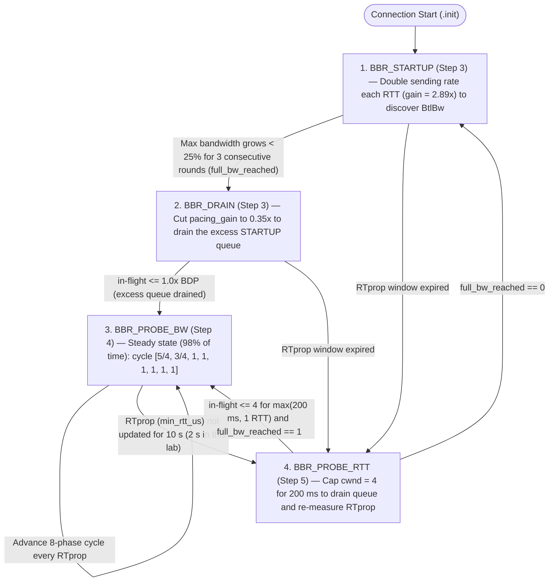
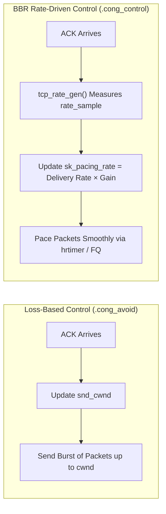
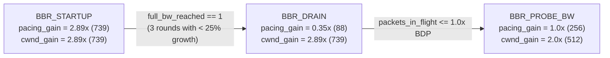
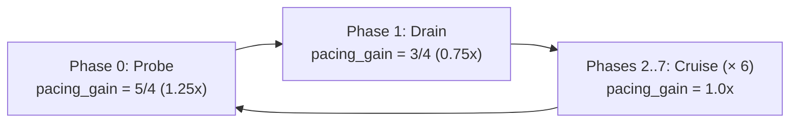

# 20. Hands-on (3): Building TCP BBR with BPF CC and packetdrill

In Track 1 (Reno) and Track 2 (CUBIC), we implemented **loss-based congestion control**: algorithms that continuously inflate `cwnd` until a router buffer overflows and drops a packet, treating packet loss as the signal to cut `cwnd`. Since Van Jacobson's pioneering design in the late 1980s, this paradigm has powered the Internet for nearly three decades.

In 2016, however, Neal Cardwell, Yuchung Cheng, Van Jacobson, and their colleagues at Google introduced **BBR (Bottleneck Bandwidth and Round-trip propagation time)** — a congestion control algorithm that overturns the loss-based paradigm from first principles.

This introductory guide assumes zero prior knowledge of BBR. Starting from the fundamental question of why Reno and CUBIC struggle on modern networks, we will build and verify **the core engine of BBRv1 from scratch in six progressive steps** using BPF `struct_ops` and `packetdrill`.

---

## 1. Why Reno and CUBIC (Loss-Based Congestion Control) Fall Short

Although Reno and CUBIC differ in the shape of their window growth function (linear vs cubic), they share the exact same fundamental rule:

- **"Keep increasing `cwnd` until a router buffer overflows and drops a packet (Loss); when a packet is lost, assume the pipe is full and cut `cwnd`."**

While this assumption — that **packet loss equals congestion (a full pipe)** — worked well in the 1980s and 1990s, it causes **two opposite and severe problems** on modern networks.

### Problem 1: Bufferbloat (Severe Latency Inflation in Deep Buffers)

Modern edge routers, cable/fibre modems, and cellular base stations frequently contain megabytes of cheap DRAM memory (**deep buffers**).

Consider a link with a bottleneck bandwidth of 10 Mbps and a two-way propagation delay of 20 ms. The exact amount of data needed to fill this pipe end-to-end — its Bandwidth-Delay Product (**BDP**) — is just **25 KB (about 18 packets)**. Once 18 packets are in flight, the 10 Mbps link is already **100% utilised**.

What happens when the bottleneck router has a 1 MB buffer (~700 packets) and we run Reno or CUBIC?

- Because the router buffer does not overflow at 18 packets (no packets are dropped), Reno and CUBIC assume there is still spare capacity and keep growing `cwnd` to 100, 300, and eventually 700 packets.
- Every packet sent beyond the 18-packet BDP simply piles up inside the router's memory queue. **Throughput does not increase by a single bit per second above 10 Mbps.**
- Instead, newly arriving packets must wait at the back of a massive 700-packet queue, inflating the round-trip time from its true 20 ms to **hundreds of milliseconds or over a full second** on a permanent basis.

This phenomenon is known as **Bufferbloat**. Whenever a background file download causes video calls, online games, or interactive SSH sessions on the same network to freeze, the culprit is loss-based congestion control deliberately stuffing the bottleneck buffer until it overflows.

### Problem 2: Throughput Collapse on Shallow Buffers and Random Loss

At the opposite extreme — on high-speed links behind **shallow-buffered** data-centre switches, or across wireless, cellular, and long-haul optical links subject to occasional **random non-congestive packet drops** — loss-based algorithms suffer the inverse failure:

- Even when the pipe is mostly empty and ample bandwidth is available, **a single packet drop** caused by a transient microburst or wireless noise causes Reno to slash `cwnd` by **50% (`0.5x`)** and CUBIC to cut `cwnd` by **30% (`0.7x`)**.
- For example, sustaining 10 Gbps across a 100 ms path (a BDP of ~86,000 packets) with CUBIC requires a packet loss rate below roughly $$10^{-8}$$. Even a tiny fraction of random loss repeatedly chops `cwnd` down, causing throughput to collapse even though the link is nowhere near congested.

### The Root Cause

Both failures stem from a single flawed premise:

> [!IMPORTANT]
> **The assumption that "Packet Loss = Congestion (Full Pipe)" is fundamentally wrong!**
> - On paths with **deep buffers**, congestion (a full pipe and severe queueing delay) occurs **long before** any packet is lost.
> - On paths with **shallow buffers or wireless links**, packet loss occurs **long before** the pipe is full.

To achieve both minimal latency and maximum throughput simultaneously, we must stop watching for packet drops and instead directly measure **the physical width and length of the pipe**.

---

## 2. The Core Idea of BBR (Bottleneck Bandwidth and Round-trip propagation time)

BBR models the end-to-end network path between sender and receiver as a single physical **water pipe (conduit)**.

A physical pipe is characterised by just two parameters:

1. **The "Width" of the Pipe = Bottleneck Bandwidth (`BtlBw`)**
   - The maximum rate at which data can flow through the narrowest link (the bottleneck) along the path.
   - No matter how fast the sender injects packets, the rate at which data arrives at the receiver — the **Delivery Rate** ($$\Delta \text{delivered} / \Delta t$$) — can never exceed the physical capacity of the bottleneck. Conversely, when the application has little data to send (`is_app_limited`), the observed delivery rate will be much lower than capacity.
   - Therefore, BBR estimates the pipe's width `BtlBw` by tracking the **windowed maximum (max-filter)** of the delivery rate measured across ACKs.
2. **The "Length" of the Pipe = Round-trip propagation time (`RTprop`)**
   - The pure physical two-way travel time of the path when router queues along the path are **completely empty (zero packets queued)**.
   - Whenever a queue builds up at a router, the measured RTT increases to $$\text{RTT} = \text{RTprop} + \text{queueing}_{\text{delay}}$$ (queueing delay is never negative, so RTT can never be shorter than `RTprop`).
   - Therefore, BBR estimates the pipe's length `RTprop` by tracking the **windowed minimum (min-filter)** of RTT samples measured across ACKs.

### Kleinrock's Optimal Operating Point

Once we know both the width (`BtlBw`) and the length (`RTprop`) of the pipe, the exact volume of in-flight data that **completely fills the pipe from end to end whilst creating zero standing queue at the router** is given by the Bandwidth-Delay Product (**BDP**):

$$\text{BDP} = \text{BtlBw} \times \text{RTprop}$$

```text
[ Underfilled Pipe (in-flight < BDP) ]
  Sender ──> [  pkt  ][    empty space    ] ──> Bottleneck ──> Receiver
  - Queueing delay = 0 (RTT == RTprop, minimum latency)
  - Pipe is underutilised (Throughput < BtlBw)

[ Ideal Operating Point: Kleinrock's Optimum (in-flight == BDP) ]
  Sender ──> [ pkt ][ pkt ][ pkt ][ pkt ] ──> Bottleneck ──> Receiver
  - Pipe is 100% full from end to end (Throughput == BtlBw, maximum bandwidth)
  - Router queue is completely empty (RTT == RTprop, minimum latency)!

[ Overfilled Pipe: Bufferbloat (in-flight > BDP) ]
  Sender ──> [pkt][pkt][pkt][pkt] + [long standing queue in router...] ──> Bottleneck
  - Throughput is capped at BtlBw and cannot increase any further
  - Every excess packet sits in the router buffer, inflating RTT
```

### Pacing: Sending Smoothly at `BtlBw` Instead of Bursting

There is a second pillar to BBR's design: **Pacing**.

Even if `cwnd` (the total number of packets allowed in flight) is set to exactly 1 BDP, dumping an entire window of packets onto the wire in a single back-to-back burst whenever an ACK arrives will instantaneously overwhelm the bottleneck router, creating transient queues and packet drops on shallow buffers.

Instead of relying solely on `cwnd`, BBR configures the socket's pacing rate (`sk->sk_pacing_rate`) to **space outgoing packets evenly over time at the exact bottleneck rate `BtlBw`**:

- **Primary control knob: `sk_pacing_rate`** — controls the *rate* at which packets are injected into the pipe ($$\text{pacing}_{\text{gain}} \times \text{BtlBw}$$).
- **Safety cap: `snd_cwnd`** — bounds the total *volume* of in-flight data allowed in the pipe ($$\text{cwnd}_{\text{gain}} \times \text{BDP}$$).

Working together, pacing and BDP-based `cwnd` keep the pipe 100% full without building queues at the bottleneck.

---

## 3. Why BBR Needs a 4-Mode State Machine

At first glance, one might wonder: *"Why not simply set `pacing_rate = BtlBw` and `cwnd = BDP` forever?"*

Here we encounter a fundamental **physical measurement dilemma (an uncertainty principle)**:

- **To measure the true maximum bandwidth `BtlBw`**:
  - You must verify whether the pipe has more capacity available by **temporarily overfilling the pipe** (sending faster than current capacity, which creates a small queue) and checking where the measured delivery rate hits a ceiling.
- **To measure the true minimum propagation delay `RTprop`**:
  - Conversely, you must **underfill the pipe** long enough to drain the bottleneck queue completely to zero packets so that a packet can traverse the path with zero queueing delay.

> [!WARNING]
> **The Physical Dilemma: `BtlBw` (which requires a full/slightly overfilled pipe) and `RTprop` (which requires an empty queue) can never be measured at the exact same instant!**

Moreover, network conditions change over time: competing flows join or leave, available bandwidth grows or shrinks, and routing changes alter the physical propagation delay. Consequently, BBR sequences its measurements across time using a **4-mode state machine**:



Let us walk through each of the four modes in order:

### 1. `BBR_STARTUP` (Implemented in Step 3)

- **Purpose**: Rapidly discover the unknown bottleneck bandwidth `BtlBw` when a connection starts.
- **Behaviour**: Sets both `pacing_gain` and `cwnd_gain` to $$\frac{2}{\ln 2} \approx 2.89\times$$, doubling the sending rate every round trip.
- **Exit condition**: Instead of waiting for packet loss, BBR watches the delivery rate (`max_bw`). Once **3 consecutive non-application-limited round trips pass without `max_bw` growing by at least 25% ($$\times 1.25$$)**, BBR concludes that the pipe has reached full capacity (`full_bw_reached = 1`) and transitions to `BBR_DRAIN`.

### 2. `BBR_DRAIN` (Implemented in Step 3)

- **Purpose**: Drain the excess queue (~$$1.89 \times \text{BDP}$$) that accumulated at the bottleneck router during the 3 plateau rounds of `BBR_STARTUP`.
- **Behaviour**: Cuts `pacing_gain` to the multiplicative inverse of the startup gain, $$\frac{\ln 2}{2} \approx 0.35\times$$. Because packets are now injected at only 35% of `BtlBw`, the bottleneck queue drains at 65% of line rate.
- **Exit condition**: As soon as the number of packets in flight (`tcp_packets_in_flight()`) drops to or below **$$1.0 \times \text{BDP}$$**, the excess queue has been cleared and BBR enters steady state (`BBR_PROBE_BW`).

### 3. `BBR_PROBE_BW` (Implemented in Step 4)

- **Purpose**: The steady-state mode where a long-lived BBR flow spends roughly **98% of its time**, cruising at full bandwidth with minimal queue whilst periodically checking whether additional bandwidth has become available.
- **Behaviour**: Rotates through an 8-phase `pacing_gain` cycle **`[5/4, 3/4, 1, 1, 1, 1, 1, 1]`**, advancing one phase roughly every `RTprop` (`min_rtt_us`):
  - **Phase 0 (`5/4 = 1.25x` — Probe for Bandwidth)**: Sends 25% faster than the current `BtlBw` for one `RTprop`. If spare capacity has opened up on the link, the returning ACKs will show a higher delivery rate and raise `max_bw`.
  - **Phase 1 (`3/4 = 0.75x` — Drain Excess Queue)**: If no extra bandwidth was available, Phase 0 built a small queue of $$0.25 \times \text{BDP}$$ at the router. Phase 1 paces at 25% below `BtlBw` for one `RTprop` (or exits early as soon as in-flight falls back to $$\le 1.0 \times \text{BDP}$$) to drain that self-inflicted queue.
  - **Phases 2–7 (`1.0x` $$\times$$ 6 — Cruise)**: Sends at exactly `1.0x BtlBw` for 6 `RTprop` intervals, achieving high throughput and low queueing delay. Throughout `BBR_PROBE_BW`, `cwnd_gain` is held at $$2.0\times$$ to provide enough headroom for delayed ACKs and receiver offload bursts.

### 4. `BBR_PROBE_RTT` (Implemented in Step 5)

- **Purpose**: Re-measure the true unloaded propagation delay `RTprop` (`min_rtt_us`) if a route change occurred or if competing flows created a persistent standing queue that hid the true minimum RTT.
- **Behaviour**: If `min_rtt_us` has not been updated by a strictly smaller RTT sample for **10 seconds** (shortened to **2 seconds** in this lab so `packetdrill` tests run quickly), BBR enters `BBR_PROBE_RTT`:
  - Saves the current congestion window in `ca->prior_cwnd` and **clamps `snd_cwnd` down to `4` packets (`BBR_MIN_PIPE_CWND`)**.
  - Holds `snd_cwnd = 4` for **at least 200 ms and at least 1 packet-timed round trip** after packets in flight drop to $$\le 4$$, ensuring the bottleneck queue drains completely so the true minimum RTT can be observed.
  - Restores `snd_cwnd` back to `prior_cwnd` and returns to `BBR_PROBE_BW` (spending 200 ms every 10 seconds costs at most $$200\text{ ms} / 10\text{ s} = 2\%$$ of bandwidth).

| Mode | `pacing_gain` | `cwnd_gain` | Primary Purpose | Transition Condition | Lab Step |
| --- | --- | --- | --- | --- | --- |
| `BBR_STARTUP` | $$2/\ln 2 \approx 2.89\times$$ | $$2/\ln 2 \approx 2.89\times$$ | Exponentially double sending rate to discover `BtlBw` | `< 25%` bandwidth growth for 3 consecutive non-app-limited rounds | Step 3 |
| `BBR_DRAIN` | $$\ln 2 / 2 \approx 0.35\times$$ | $$2/\ln 2 \approx 2.89\times$$ | Drain the excess queue created during `STARTUP` | `tcp_packets_in_flight(tp) <= 1.0x BDP` | Step 3 |
| `BBR_PROBE_BW` | `[5/4, 3/4, 1, 1, 1, 1, 1, 1]` | $$2.0\times$$ | Steady state (probe at 1.25x, drain at 0.75x, cruise at 1.0x for 6 phases) | Advance phase every `RTprop` (or enter `PROBE_RTT` if `min_rtt_us` expires) | Step 4 |
| `BBR_PROBE_RTT` | $$1.0\times$$ | Clamped to `cwnd = 4` | Drain bottleneck queue to re-measure true `RTprop` | Hold `in-flight <= 4` for $$\max(200\text{ ms}, 1\text{ RTT})$$, then restore `prior_cwnd` | Step 5 |

---

## 4. How BBR Differs in BPF Implementation (`.cong_control` vs `.cong_avoid`)

When implementing BBR with BPF `struct_ops` (`struct tcp_congestion_ops`), we use a fundamentally different hook from Reno (Track 1) and CUBIC (Track 2).

### Why `.cong_avoid` Is Insufficient for BBR

Reno and CUBIC implement `.cong_avoid(sk, ack, acked)` and `.ssthresh(sk)`. Inside the kernel's ACK processing path (`tcp_ack()` $$\rightarrow$$ `tcp_cong_control()`), `.cong_avoid` has two fatal limitations for a model-based algorithm like BBR:

1. **It is not called during Recovery or CWR**:
   - The kernel only invokes `.cong_avoid` when the congestion state (`icsk_ca_state`) is `TCP_CA_Open` or `TCP_CA_Disorder`. Whenever packet loss triggers `TCP_CA_Recovery` or `TCP_CA_CWR`, the kernel runs its own built-in `tcp_cwnd_reduction()` (Proportional Rate Reduction) and skips `.cong_avoid` entirely.
2. **It receives no delivery rate information**:
   - `.cong_avoid(sk, ack, acked)` is only told how many packets were acknowledged (`acked`), with no information about the time interval over which they were delivered or whether the socket was application-limited.

### BBR's Main Engine: `.cong_control(sk, ack, flag, rs)`

To support rate- and model-based congestion control, the Linux kernel provides the **`.cong_control(struct sock *sk, u32 ack, int flag, const struct rate_sample *rs)`** hook.

Look at how the kernel's `tcp_cong_control()` dispatches callbacks:

```c
static void tcp_cong_control(struct sock *sk, u32 ack, u32 acked_sacked,
			     int flag, const struct rate_sample *rs)
{
	const struct inet_connection_sock *icsk = inet_csk(sk);

	if (icsk->icsk_ca_ops->cong_control) {
		icsk->icsk_ca_ops->cong_control(sk, ack, flag, rs);
		return;
	}

	if (tcp_in_cwnd_reduction(sk)) {
		/* Reduce cwnd if state mandates */
		tcp_cwnd_reduction(sk, acked_sacked, flag);
	} else if (tcp_may_raise_cwnd(sk, flag)) {
		/* Advance cwnd if state allows */
		tcp_cong_avoid(sk, ack, acked_sacked);
	}
	tcp_update_pacing_rate(sk);
}
```

When `icsk_ca_ops->cong_control` is defined, the kernel calls it and **returns immediately**:

- Standard kernel helpers (`tcp_cwnd_reduction()`, `tcp_cong_avoid()`, and `tcp_update_pacing_rate()`) are **completely bypassed**.
- `.cong_control` is invoked on **every single ACK** regardless of whether the socket is in `TCP_CA_Open`, `TCP_CA_Recovery`, or `TCP_CA_CWR`.
- Its fourth argument provides a pointer to **`const struct rate_sample *rs`** computed by the kernel's `tcp_rate_gen()` function on every ACK.

| Key `struct rate_sample` Field | Type | Meaning and Role in BBR |
| --- | --- | --- |
| `rs->delivered` | `__s32` | Number of packets delivered over this sampling interval (`< 0` indicates an invalid sample) |
| `rs->interval_us` | `long` | Elapsed time of the sampling interval in microseconds (`<= 0` indicates an invalid sample) |
| `rs->rtt_us` | `long` | RTT measured by this ACK in microseconds (`-1` if unavailable); used to update `RTprop` (`min_rtt_us`) |
| `rs->is_app_limited` | `bool` | Whether the sender ran out of application data during this sample; prevents app-limited samples from lowering `max_bw` |
| `rs->is_ack_delayed` | `bool` | Whether the ACK was delayed by the receiver's delayed-ACK timer |
| `rs->acked_sacked` | `__u32` | Number of packets newly ACKed or SACKed by this ACK |
| `rs->losses` | `__u32` | Number of packets newly marked lost on this ACK |
| `rs->prior_delivered` | `__u32` | Snapshot of `tp->delivered` when the newly ACKed packet was sent; used to advance packet-timed round trips |
| `rs->prior_in_flight` | `__u32` | Number of packets in flight just before this ACK arrived; used in `PROBE_BW` phase transition checks |

On every ACK, our BPF `.cong_control` program reads `rs`, updates the per-socket BBR model (`min_rtt_us`, `max_bw`, `mode`, `cycle_idx`, etc.), and directly writes **both `sk->sk_pacing_rate` and `tp->snd_cwnd`**.

---

## 5. Roadmap of All 6 Steps (`step01`–`step06`) and How to Run

This track is organised into six incremental steps (`step01` through `step06`). Each step adds one self-contained component until you have built the complete core state machine of Linux's `net/ipv4/tcp_bbr.c`.

| Step | Directory | Topic | Key Concepts Covered |
| --- | --- | --- | --- |
| **Step 1** | [step01-pacing-rate](step01-pacing-rate/) | The `.cong_control` Hook & Pacing Rate Calculation | Enabling internal pacing (`SK_PACING_NEEDED`) in `.init`, computing instantaneous delivery rate from `rs->delivered` / `rs->interval_us`, and driving `sk->sk_pacing_rate` |
| **Step 2** | [step02-btlbw-rtprop](step02-btlbw-rtprop/) | BDP Calculation from `BtlBw` (Max-Filter) & `RTprop` (Min-Filter) | Tracking `min_rtt_us` with a min-filter, tracking `max_bw` with an app-limited-aware max-filter, and computing $$\text{BDP} = \lceil \text{BtlBw} \times \text{RTprop} \rceil$$ in `bbr_bdp()` |
| **Step 3** | [step03-startup-drain](step03-startup-drain/) | Transitioning from `STARTUP` to `DRAIN` (Full Pipe Detection) | Packet-timed round counting, detecting the 3-round bandwidth plateau (`< 25%` growth) in `bbr_check_full_bw_reached()`, and draining excess queue in `bbr_check_drain()` |
| **Step 4** | [step04-probe-bw](step04-probe-bw/) | The 8-Phase Gain Cycle in `PROBE_BW` | Cycling `bbr_pacing_gain[] = {5/4, 3/4, 1, 1, 1, 1, 1, 1}` and implementing phase exit conditions for probing (`1.25x`), draining (`0.75x`), and cruising (`1.0x`) in `bbr_is_next_cycle_phase()` |
| **Step 5** | [step05-probe-rtt](step05-probe-rtt/) | Entering `PROBE_RTT` and Draining the Queue (`cwnd = 4`) | Expiring `min_rtt_us` via `min_rtt_stamp`, saving `prior_cwnd`, clamping `snd_cwnd = 4` for $$\max(200\text{ ms}, 1\text{ RTT})$$, and restoring `prior_cwnd` |
| **Step 6** | [step06-loss-ack-aggregation](step06-loss-ack-aggregation/) | Saving/Restoring `cwnd` Across Loss & ACK Aggregation (`extra_acked`) | First-round packet conservation in `TCP_CA_Recovery`, restoring `prior_cwnd` upon recovery exit, and compensating for Wi-Fi / GRO burst ACKs via `extra_acked` |

### Files in Each Step Directory

Every step directory (`step01-pacing-rate/` through `step06-loss-ack-aggregation/`) contains five files:

- `README.md` / `README.en.md`: Learning goals, **Design Checkpoints (four guided questions to think through before reading the solution)**, code and formula walkthroughs, and an explanation of the `test.pkt` scenario.
- `starter.bpf.c`: Skeleton BPF source file with `TODO` markers for you to implement (compiles and loads cleanly, but fails the `packetdrill` assertions until completed).
- `solution.bpf.c`: Complete reference BPF implementation that passes `test.pkt`.
- `test.pkt`: Deterministic `packetdrill` test script executed inside a lightweight `vng` (virtme-ng) VM.

### How to Run the Labs

From the `labs/` directory (or from `labs/bbr/` using `../run_test.sh`), you can compile and test any step in seconds without rebuilding or rebooting your host kernel:

```sh
# Change to the labs/ directory
cd /usr/local/google/home/kuniyu/tcp-eli5/labs

# 1. Run the unimplemented starter skeleton for Step 1 and observe the assertion failure
./run_test.sh bbr/step01-pacing-rate starter

# 2. Fill in the TODO in bbr/step01-pacing-rate/starter.bpf.c and re-run
./run_test.sh bbr/step01-pacing-rate starter

# 3. Run the reference solution (solution.bpf.c) to verify it passes
./run_test.sh bbr/step01-pacing-rate solution
```

To run the reference solutions for all six BBR steps in sequence:

```sh
for step in bbr/step0*; do ./run_test.sh "$step" solution; done
```

When you are ready, dive into [Step 1: The `.cong_control` Hook and Pacing Rate Calculation from Delivery Rate](step01-pacing-rate/README.en.md)!


---

## Step 1: The `.cong_control` Hook and Pacing Rate Calculation from Delivery Rate

## 1. Goal

In this step, you will implement the foundational mechanism of BBR (Bottleneck Bandwidth and Round-trip propagation time) using BPF `struct_ops` (`struct tcp_congestion_ops`): **pacing rate control driven directly by the measured delivery rate**. You will learn how BBR's `.cong_control` hook replaces the traditional `.cong_avoid` hook used by loss-based algorithms (Reno and CUBIC), and how to dynamically update `sk->sk_pacing_rate` from the kernel's `struct rate_sample` measurements (see [../README.md](#) for the full BBR track overview).

---

## 2. How the Algorithm Works (Read This First)

Before examining the design checkpoints or writing code, let's build a complete picture from first principles: why BBR paces packets, how it computes the pacing rate from a delivery rate sample, and which kernel structures and fields are already provided to your BPF program.

### Why Controlling Only `cwnd` Is Not Enough (Intuition Behind Pacing)

Traditional loss-based congestion control algorithms such as Reno and CUBIC only regulate the **congestion window (`snd_cwnd`)** — the maximum number of unacknowledged segments allowed in flight. Relying solely on `snd_cwnd` causes two classic problems:

1. **Line-rate bursts overflow shallow buffers**: Whenever an ACK arrives and opens space in the congestion window, the sender immediately transmits a burst of back-to-back packets at the NIC's line rate. Even if the average sending rate matches the bottleneck link capacity, these instantaneous bursts can overflow shallow router queues and trigger premature packet loss.
2. **Bufferbloat in deep buffers**: When router buffers are deep, loss-based algorithms keep inflating `snd_cwnd` until the buffer completely fills up and drops packets, introducing tens or hundreds of milliseconds of unnecessary queueing delay.

BBR solves this by shifting from a **loss-driven window model** to a **rate-driven pacing model**: whenever an ACK arrives, the kernel measures the actual **Delivery Rate** across the bottleneck link (how many bytes per second reached the receiver) and sets the socket's **Pacing Rate (`sk->sk_pacing_rate`)** so outgoing packets are spaced evenly over time rather than sent in bursts.



### Delivery Rate Formula and Fixed-Point STARTUP Gain

On every incoming ACK, the Linux kernel's rate sampling engine (`tcp_rate_gen()`) measures how many segments (`delivered`) were delivered to the peer over the elapsed measurement interval (`interval_us`, in microseconds). Given the segment payload size `mss_cache` (in bytes) and `USEC_PER_SEC = 1,000,000` microseconds per second, the instantaneous delivery rate $$\text{bw}$$ in bytes per second is:

$$\text{bw (bytes/sec)} = \frac{\text{delivered} \times \text{mss}_{\text{cache}} \times 1,000,000}{\text{interval}_{\text{us}}}$$

#### Why Multiply Before Dividing in Integer Arithmetic?

In C and BPF integer arithmetic, division truncates any fractional remainder towards zero. If you divided `delivered / interval_us` first (for example, `10 / 10000`), the result would truncate to `0`. Therefore, you must always cast to a 64-bit unsigned integer (`__u64`), **multiply the entire numerator (`delivered * mss_cache * USEC_PER_SEC`) first**, and then divide by `interval_us` using the 64-bit helper `div64_u64()`.

#### Applying the STARTUP Gain in Fixed-Point (`BBR_HIGH_GAIN`)

When a connection starts in the **STARTUP** phase (BBR's equivalent of Slow Start), it probes for available bandwidth by pacing packets faster than the currently measured delivery rate. Specifically, BBR uses a theoretical STARTUP gain of $$2 / \ln(2) \approx 2.885\text{x}$$, which doubles the sending rate every RTT.

Because floating-point instructions (`float` / `double`) are forbidden in the Linux kernel and BPF programs, BBR represents gains as fixed-point integers scaled by $$2^{10} = 1024$$ (`BBR_SCALE = 10`, where `BBR_UNIT = 1 << 10 = 1024` represents a `1.0x` multiplier). In this lab, the STARTUP gain is defined as `BBR_HIGH_GAIN = 2885` ($$2885 / 1024 \approx 2.817\text{x}$$). Applying the gain is a 64-bit multiplication followed by a right shift by `BBR_SCALE`:

$$\text{pacing}_{\text{rate}} = \frac{\text{bw} \times \text{BBR}_{\text{HIGH,GAIN}}}{2^{\text{BBR}_{\text{SCALE}}}} = (\text{bw} \times 2885) \gg 10$$

#### Initialising the Pacing Rate at Connection Start (`.init`)

When the 3-way handshake finishes and `.init(sk)` runs, no data segments have been acknowledged yet, so no `rate_sample` exists. To prevent the initial congestion window (`snd_cwnd = 10` segments) from being transmitted as an unpaced line-rate burst, BBR estimates an initial bandwidth from `snd_cwnd` and the handshake RTT (`rtt_us`), scales it by `BBR_HIGH_GAIN`, and enables TCP internal pacing:

$$\text{init}_{\text{bw}} = \frac{\text{snd}_{\text{cwnd}} \times \text{mss}_{\text{cache}} \times 1,000,000}{\text{rtt}_{\text{us}}}$$

$$\text{init}_{\text{pacing,rate}} = (\text{init}_{\text{bw}} \times \text{BBR}_{\text{HIGH,GAIN}}) \gg \text{BBR}_{\text{SCALE}}$$

### Concrete Numerical Walkthrough (`test.pkt` Numbers)

Let's trace the exact numbers from our test scenario where the payload MSS is `mss_cache = 1000` bytes:

1. **Right after the 3-way handshake (`.init`)**:
   - Initial `snd_cwnd = 10` segments, and the SYN/SYN-ACK RTT is `100 ms` (`rtt_us = 100,000` us):
   - $$\text{init}_{\text{bw}} = (10 \times 1000 \times 1,000,000) / 100,000 = 100,000\text{ B/s}$$ (100 KB/s)
   - $$\text{init}_{\text{pacing,rate}} = (100,000 \times 2885) \gg 10 = 281,738\text{ B/s}$$ (~281.7 KB/s)
2. **When the first flight of 10 segments is ACKed after 10 ms (`.cong_control`)**:
   - The ACK reports `rs->delivered = 10` segments delivered over `rs->interval_us = 10,000` us (10 ms):
   - $$\text{bw} = (10 \times 1000 \times 1,000,000) / 10,000 = 1,000,000\text{ B/s}$$ (1.0 MB/s)
   - $$\text{pacing}_{\text{rate}} = (1,000,000 \times 2885) \gg 10 = 2,817,382\text{ B/s}$$ (~2.82 MB/s)

### What the Kernel Already Provides (Structures, Fields, and Hooks)

Here are the exact kernel callbacks and structure fields provided to your BPF program:

1. **Callbacks in `struct tcp_congestion_ops`**:
   - `.init(struct sock *sk)`: Invoked once when the TCP connection is initialised.
   - `.cong_control(struct sock *sk, __u32 ack, int flag, const struct rate_sample *rs)`: Invoked by the kernel's `tcp_cong_control()` on every ACK. **Crucially, when `.cong_control` is defined on `struct tcp_congestion_ops`, `tcp_cong_control()` calls it and returns immediately, completely bypassing the kernel's default `.cong_avoid`, `tcp_cwnd_reduction()`, and `tcp_update_pacing_rate()` logic.** Your `.cong_control` callback has sole authority over `sk->sk_pacing_rate` (and `tp->snd_cwnd` in subsequent steps).
   - `.ssthresh(struct sock *sk)` and `.undo_cwnd(struct sock *sk)`: The kernel's registration validator `tcp_validate_congestion_control()` requires every congestion control module to provide non-NULL `.ssthresh` and `.undo_cwnd` callbacks (otherwise registration fails with `-EINVAL`).
2. **Pacing fields on `struct sock *sk`**:
   - `sk->sk_pacing_rate` (`unsigned long`): Target transmission rate in **bytes per second**. The BPF `tcp_congestion_ops` verifier allows direct writes to this field.
   - `sk->sk_pacing_status` (`__u32`): Setting `sk->sk_pacing_status = SK_PACING_NEEDED` activates TCP's internal high-resolution timer (`hrtimer`) pacing engine, ensuring packets are paced even when the `sch_fq` qdisc is not attached to the network interface. Also directly writable from BPF.
3. **Fields on `struct tcp_sock *tp` (obtained via `tcp_sk(sk)`)**:
   - `tp->snd_cwnd` (`__u32`): Current congestion window in segments (initialised to `10`).
   - `tp->snd_ssthresh` (`__u32`): Current slow-start threshold in segments.
   - `tp->mss_cache` (`__u32`): Effective payload MSS in bytes (excluding TCP/IP headers and TCP options).
   - `tp->srtt_us` (`__u32`): Smoothed RTT stored in fixed-point units of **1/8th of a microsecond** (shifted left by 3 bits). To obtain the RTT in microseconds, shift right by 3: **`tp->srtt_us >> 3`**. If no RTT sample has been recorded yet, `tp->srtt_us` is `0`.
4. **Fields on `const struct rate_sample *rs` (4th argument to `.cong_control`)**:
   - Generated automatically by `tcp_rate_gen()` on each ACK before calling `.cong_control`:
   - `rs->delivered` (`__s32`): Number of segments delivered during this sample interval. **If `rs->delivered < 0`, the sample is invalid** (no valid delivery measurement could be taken on this ACK).
   - `rs->interval_us` (`long`): Elapsed time in microseconds for the delivery of those segments. **If `rs->interval_us <= 0`, the sample is invalid** (and dividing by it would cause division by zero or a bogus rate).
5. **Per-socket private storage (`inet_csk(sk)->icsk_ca_priv` / `inet_csk_ca(sk)`)**:
   - Every TCP socket reserves `icsk_ca_priv` as private scratch space for the active congestion control algorithm.
   - **In Step 1, we do not need `icsk_ca_priv` at all**: our pacing rate is computed statelessly on each ACK directly from `rs->delivered`, `rs->interval_us`, and `tp->mss_cache`, and written straight into `sk->sk_pacing_rate`. We will introduce a custom state structure in `icsk_ca_priv` in Step 2 when we begin tracking the windowed maximum bandwidth.

---

## 3. Design Checkpoints (Translate the Algorithm into Code)

Using what you just learned in Section 2, think through these four design questions to plan your implementation of `starter.bpf.c`.

### Q1. Which hook in `struct tcp_congestion_ops` should we implement, and do we need a private struct in `icsk_ca_priv` for Step 1?

Unlike Reno and CUBIC, which implement `.cong_avoid(sk, ack, acked)`, how should `bpf_bbr1` hook into the ACK processing path to receive `struct rate_sample`? And do we need to store any custom per-socket state in `icsk_ca_priv` for this first step?

<details>
<summary>Hint and Answer</summary>

- **Hook to implement**: `.cong_control(struct sock *sk, __u32 ack, int flag, const struct rate_sample *rs)`. Defining `.cong_control` causes the kernel's `tcp_cong_control()` to pass `rs` directly to our BPF program and skip the default `tcp_update_pacing_rate()` and `.cong_avoid` paths. (We also provide `.init`, `.ssthresh`, and `.undo_cwnd` to satisfy `tcp_validate_congestion_control()`.)
- **No private struct needed yet**: All inputs (`rs->delivered`, `rs->interval_us`, `tp->mss_cache`) and the output (`sk->sk_pacing_rate`) live in kernel structures already passed to `.cong_control`. Since Step 1 only computes the instantaneous pacing rate without remembering historical maxima across ACKs, `icsk_ca_priv` is unused here.

</details>

### Q2. How does `.init(sk)` enable TCP internal pacing and safely compute the initial pacing rate without risking division by zero?

In `bpf_bbr1_init()`, which field on `struct sock` turns on internal packet pacing, and how should we extract the initial RTT in microseconds from `tp->srtt_us` when `tp->srtt_us` might be `0` or less than `8`?

<details>
<summary>Hint and Answer</summary>

- Write `sk->sk_pacing_status = SK_PACING_NEEDED;` to enable TCP's internal `hrtimer` pacing.
- Because `tp->srtt_us` is scaled by 8, compute `__u32 rtt_us = tp->srtt_us ? (tp->srtt_us >> 3) : USEC_PER_MSEC;` (falling back to `1000` us = 1 ms when `tp->srtt_us == 0`).
- If `tp->srtt_us` happens to be between `1` and `7`, `tp->srtt_us >> 3` evaluates to `0`, so guard with `if (!rtt_us) rtt_us = 1;` before calling `div64_u64(rate, rtt_us)`.

</details>

### Q3. How should `bpf_bbr1_cong_control()` filter out invalid rate samples?

Not every ACK carries a usable delivery rate measurement. Which fields of `const struct rate_sample *rs` must we inspect at the start of `bpf_bbr1_cong_control()` before performing any arithmetic?

<details>
<summary>Hint and Answer</summary>

- Check both `rs->delivered` and `rs->interval_us` and return early if either is invalid:
  ```c
  if (rs->delivered < 0 || rs->interval_us <= 0)
      return;
  ```
- This discards unusable samples and guarantees that `rs->interval_us` is strictly positive (`>= 1`) when used as the divisor in `div64_u64()`.

</details>

### Q4. How do we write the 64-bit integer arithmetic in `bpf_bbr1_cong_control()` to compute the instantaneous delivery rate and apply `BBR_HIGH_GAIN`?

Given a valid `rs`, write the C statements that compute the delivery rate in bytes/sec from `rs->delivered`, `tp->mss_cache`, `USEC_PER_SEC`, and `rs->interval_us`, scale it by `BBR_HIGH_GAIN` (`2885` in `BBR_SCALE = 10` fixed-point), and update `sk->sk_pacing_rate`.

<details>
<summary>Hint and Answer</summary>

- Cast `rs->delivered` to `__u64` and multiply the numerator before dividing with `div64_u64()` to prevent 32-bit overflow and integer truncation:
  ```c
  rate = (__u64)rs->delivered * tp->mss_cache * USEC_PER_SEC;
  rate = div64_u64(rate, (__u64)rs->interval_us);
  ```
- Multiply by `BBR_HIGH_GAIN` and shift right by `BBR_SCALE`, then assign to `sk->sk_pacing_rate`:
  ```c
  rate = (rate * BBR_HIGH_GAIN) >> BBR_SCALE;
  sk->sk_pacing_rate = rate;
  ```

</details>

---

## 4. Step-by-step Code Walkthrough (`solution.bpf.c`)

Let's walk through each part of [solution.bpf.c](file:///usr/local/google/home/kuniyu/tcp-eli5/labs/bbr/step01-pacing-rate/solution.bpf.c).

### 1. Fixed-Point Constants

```c
#define BBR_SCALE	10
#define BBR_UNIT	(1 << BBR_SCALE)	/* 1024 */
#define BBR_HIGH_GAIN	2885			/* ~2.885x (2/ln(2)) STARTUP gain */
```

- `BBR_SCALE = 10` (`BBR_UNIT = 1024`) defines our fixed-point unit (`1.0x`).
- `BBR_HIGH_GAIN = 2885` represents the STARTUP gain ($$2885 / 1024 \approx 2.817\text{x}$$). Scaling any byte-per-second `rate` via `(rate * BBR_HIGH_GAIN) >> BBR_SCALE` multiplies it by ~2.82x using pure integer operations.

### 2. `bpf_bbr1_init()` — Enabling Internal Pacing and Setting the Initial Rate

```c
SEC("struct_ops")
void BPF_PROG(bpf_bbr1_init, struct sock *sk)
{
	struct tcp_sock *tp = tcp_sk(sk);
	__u32 rtt_us = tp->srtt_us ? (tp->srtt_us >> 3) : USEC_PER_MSEC;
	__u64 rate;

	if (!rtt_us)
		rtt_us = 1;

	/* Initialize pacing rate: high_gain * init_cwnd * mss / initial_rtt */
	rate = (__u64)tp->snd_cwnd * tp->mss_cache * USEC_PER_SEC;
	rate = div64_u64(rate, rtt_us);
	rate = (rate * BBR_HIGH_GAIN) >> BBR_SCALE;

	sk->sk_pacing_rate = rate;
	sk->sk_pacing_status = SK_PACING_NEEDED;
}
```

- Extracts the initial smoothed RTT in microseconds (`tp->srtt_us >> 3`), defaulting to `USEC_PER_MSEC` (1 ms) if `tp->srtt_us` is zero, and clamps `rtt_us` to at least `1`.
- Computes the initial bandwidth `snd_cwnd * mss_cache * USEC_PER_SEC / rtt_us`, applies `BBR_HIGH_GAIN`, writes the result to `sk->sk_pacing_rate`, and sets `sk->sk_pacing_status = SK_PACING_NEEDED`.

### 3. `bpf_bbr1_cong_control()` — Updating Pacing Rate from `struct rate_sample`

```c
SEC("struct_ops")
void BPF_PROG(bpf_bbr1_cong_control, struct sock *sk, __u32 ack, int flag,
	      const struct rate_sample *rs)
{
	struct tcp_sock *tp = tcp_sk(sk);
	__u64 rate;

	/* Ignore invalid delivery rate samples */
	if (rs->delivered < 0 || rs->interval_us <= 0)
		return;

	/* Instantaneous delivery rate (bytes/sec):
	 *   bw = delivered * mss * USEC_PER_SEC / interval_us
	 */
	rate = (__u64)rs->delivered * tp->mss_cache * USEC_PER_SEC;
	rate = div64_u64(rate, (__u64)rs->interval_us);

	/* Apply STARTUP pacing gain (~2.885x) */
	rate = (rate * BBR_HIGH_GAIN) >> BBR_SCALE;

	sk->sk_pacing_rate = rate;
}
```

- Rejects invalid rate samples where `rs->delivered < 0 || rs->interval_us <= 0`.
- Calculates the instantaneous delivery rate in bytes/sec using 64-bit multiplication (`(__u64)rs->delivered * tp->mss_cache * USEC_PER_SEC`) followed by `div64_u64(rate, (__u64)rs->interval_us)`.
- Multiplies by `BBR_HIGH_GAIN`, shifts right by `BBR_SCALE`, and updates `sk->sk_pacing_rate`.

### 4. `bpf_bbr1_ssthresh()` and `bpf_bbr1_undo_cwnd()`

```c
SEC("struct_ops")
__u32 BPF_PROG(bpf_bbr1_ssthresh, struct sock *sk)
{
	return tcp_sk(sk)->snd_ssthresh;
}

SEC("struct_ops")
__u32 BPF_PROG(bpf_bbr1_undo_cwnd, struct sock *sk)
{
	return tcp_sk(sk)->snd_cwnd;
}
```

- Required by `tcp_validate_congestion_control()` at registration time; in Step 1 they simply return the socket's existing `snd_ssthresh` and `snd_cwnd`.

---

## 5. Understanding `test.pkt` and How to Run

[test.pkt](file:///usr/local/google/home/kuniyu/tcp-eli5/labs/bbr/step01-pacing-rate/test.pkt) verifies `bpf_bbr1` in two stages:

1. **3-way Handshake and Initial Pacing Rate (Lines 13–22)**:
   ```
   +0.00 < S 0:0(0) win 32792 <mss 1012,sackOK,TS val 100 ecr 0,nop,wscale 7>
   +0.00 > S. 0:0(0) ack 1 <mss 1460,sackOK,TS val 100 ecr 100,nop,wscale 7>
   +0.10 < . 1:1(0) ack 1 win 257 <nop,nop,TS val 200 ecr 100>
   ```
   - The client advertises `mss 1012` with 12-byte TCP timestamps, resulting in a payload MSS of `tp->mss_cache = 1000` bytes.
   - The final handshake ACK arrives after `+0.10` (100 ms), so `tp->srtt_us >> 3` is `100,000` us.
   - `bpf_bbr1_init()` computes an initial pacing rate of `10 * 1000 * 1,000,000 / 100,000 * 2885 >> 10 = 281,738 B/s`, which satisfies `assert 200000 < tcpi_pacing_rate < 400000`.
2. **Data Flight of 10 Segments and Pacing Rate Update on ACK (Lines 27–34)**:
   ```
   +0.00 write(4, ..., 10000) = 10000
   +0.00 > P. 1:10001(10000) ack 1 <nop,nop,TS val 200 ecr 200>
   +0.01 < . 1:1(0) ack 10001 win 257 <nop,nop,TS val 210 ecr 200>
   ```
   - The server writes `10,000` bytes (10 segments), and the client acknowledges all `10,000` bytes after `+0.01` (10 ms).
   - This produces a `rate_sample` with `rs->delivered = 10` and `rs->interval_us = 10,000` us, representing a delivery rate of `1,000,000 B/s` (1.0 MB/s).
   - Why [starter.bpf.c](file:///usr/local/google/home/kuniyu/tcp-eli5/labs/bbr/step01-pacing-rate/starter.bpf.c) fails: `bpf_bbr1_cong_control()` is an empty stub, so `sk->sk_pacing_rate` stays at the initial `281,738 B/s` and fails `assert tcpi_pacing_rate > 500000` on line 32.
   - Why [solution.bpf.c](file:///usr/local/google/home/kuniyu/tcp-eli5/labs/bbr/step01-pacing-rate/solution.bpf.c) passes: `bpf_bbr1_cong_control()` updates `sk->sk_pacing_rate` to `1,000,000 * 2885 >> 10 = 2,817,382 B/s` (~2.82 MB/s), passing both `assert tcpi_pacing_rate > 500000` and `assert 2000000 < tcpi_pacing_rate < 3500000`.

### How to Run the Test

Run the commands below to see `starter` fail the assertion and `solution` pass:

```sh
../../run_test.sh bbr/step01-pacing-rate starter
../../run_test.sh bbr/step01-pacing-rate solution
```


### `labs/bbr/step01-pacing-rate/starter.bpf.c` (Starter skeleton)

```c
// SPDX-License-Identifier: GPL-2.0
/*
 * Step 1 (Starter): .cong_control hook and Pacing Rate calculation
 */
#include "bpf_cc_helpers.h"

char _license[] SEC("license") = "GPL";

#define BBR_SCALE	10
#define BBR_UNIT	(1 << BBR_SCALE)	/* 1024 */
#define BBR_HIGH_GAIN	2885			/* ~2.885x (2/ln(2)) STARTUP gain */

SEC("struct_ops")
void BPF_PROG(bpf_bbr1_init, struct sock *sk)
{
	struct tcp_sock *tp = tcp_sk(sk);
	__u32 rtt_us = tp->srtt_us ? (tp->srtt_us >> 3) : USEC_PER_MSEC;
	__u64 rate;

	if (!rtt_us)
		rtt_us = 1;

	/* Initialize pacing rate: high_gain * init_cwnd * mss / initial_rtt */
	rate = (__u64)tp->snd_cwnd * tp->mss_cache * USEC_PER_SEC;
	rate = div64_u64(rate, rtt_us);
	rate = (rate * BBR_HIGH_GAIN) >> BBR_SCALE;

	sk->sk_pacing_rate = rate;
	sk->sk_pacing_status = SK_PACING_NEEDED;
}

SEC("struct_ops")
void BPF_PROG(bpf_bbr1_cong_control, struct sock *sk, __u32 ack, int flag,
	      const struct rate_sample *rs)
{
	struct tcp_sock *tp = tcp_sk(sk);

	(void)tp;
	/*
	 * TODO:
	 * 1. Check if the rate sample is valid:
	 *    if (rs->delivered < 0 || rs->interval_us <= 0) return;
	 * 2. Calculate instantaneous delivery rate in bytes/sec:
	 *    rate = (u64)rs->delivered * tp->mss_cache * USEC_PER_SEC / rs->interval_us
	 *    (Hint: use div64_u64(rate, (__u64)rs->interval_us))
	 * 3. Multiply by BBR_HIGH_GAIN and shift right by BBR_SCALE:
	 *    rate = (rate * BBR_HIGH_GAIN) >> BBR_SCALE;
	 * 4. Write the result to sk->sk_pacing_rate.
	 */
}

SEC("struct_ops")
__u32 BPF_PROG(bpf_bbr1_ssthresh, struct sock *sk)
{
	return tcp_sk(sk)->snd_ssthresh;
}

SEC("struct_ops")
__u32 BPF_PROG(bpf_bbr1_undo_cwnd, struct sock *sk)
{
	return tcp_sk(sk)->snd_cwnd;
}

SEC(".struct_ops")
struct tcp_congestion_ops bpf_bbr1 = {
	.name		= "bpf_bbr1",
	.flags		= TCP_CONG_NON_RESTRICTED,
	.init		= (void *)bpf_bbr1_init,
	.cong_control	= (void *)bpf_bbr1_cong_control,
	.ssthresh	= (void *)bpf_bbr1_ssthresh,
	.undo_cwnd	= (void *)bpf_bbr1_undo_cwnd,
};
```

### `labs/bbr/step01-pacing-rate/test.pkt` (packetdrill test)

```python
// SPDX-License-Identifier: GPL-2.0
// Step 1: Verify .cong_control hook and pacing rate calculation from rate_sample
0.00 `sysctl -q net.ipv4.tcp_congestion_control=bpf_bbr1`

// Server socket setup
+0.00 socket(..., SOCK_STREAM, IPPROTO_TCP) = 3
+0.00 setsockopt(3, SOL_SOCKET, SO_REUSEADDR, [1], 4) = 0
+0.00 bind(3, ..., ...) = 0
+0.00 listen(3, 1) = 0

// 3-way handshake with initial RTT = 100 ms (so initial pacing rate is ~281 KB/s)
// MSS = 1012 -> payload MSS = 1000 bytes (with 12-byte TCP timestamps)
+0.00 < S 0:0(0) win 32792 <mss 1012,sackOK,TS val 100 ecr 0,nop,wscale 7>
+0.00 > S. 0:0(0) ack 1 <mss 1460,sackOK,TS val 100 ecr 100,nop,wscale 7>
+0.10 < . 1:1(0) ack 1 win 257 <nop,nop,TS val 200 ecr 100>
+0.00 accept(3, ..., ...) = 4

// Verify initial cwnd=10 and initial pacing rate (~281,738 B/s from 100 ms SYN RTT)
+0.00 %{
assert tcpi_snd_cwnd == 10, f"expected cwnd 10, got {tcpi_snd_cwnd}"
assert 200000 < tcpi_pacing_rate < 400000, f"expected initial pacing_rate ~281KB/s, got {tcpi_pacing_rate}"
}%

// Send 10 segments (10,000 bytes) and ACK after 10 ms (+0.010):
// Delivery rate = 10 * 1000 B / 0.010 s = 1,000,000 B/s
// Pacing rate = 1,000,000 * 2885 / 1024 = ~2,817,382 B/s
+0.00 write(4, ..., 10000) = 10000
+0.00 > P. 1:10001(10000) ack 1 <nop,nop,TS val 200 ecr 200>
+0.01 < . 1:1(0) ack 10001 win 257 <nop,nop,TS val 210 ecr 200>

+0.00 %{
assert tcpi_pacing_rate > 500000, f"expected pacing_rate > 500000, got {tcpi_pacing_rate}"
assert 2000000 < tcpi_pacing_rate < 3500000, f"expected pacing_rate ~2.82MB/s, got {tcpi_pacing_rate}"
}%
```

<details>
<summary>Reference solution: <code>labs/bbr/step01-pacing-rate/solution.bpf.c</code></summary>

```c
// SPDX-License-Identifier: GPL-2.0
/*
 * Step 1: .cong_control hook and Pacing Rate calculation from Delivery Rate
 *
 * Unlike loss-based congestion control (Reno/CUBIC) which uses .cong_avoid,
 * BBR uses .cong_control(sk, ack, flag, rs) to receive a struct rate_sample
 * on every ACK and directly drive sk->sk_pacing_rate.
 */
#include "bpf_cc_helpers.h"

char _license[] SEC("license") = "GPL";

#define BBR_SCALE	10
#define BBR_UNIT	(1 << BBR_SCALE)	/* 1024 */
#define BBR_HIGH_GAIN	2885			/* ~2.885x (2/ln(2)) STARTUP gain */

SEC("struct_ops")
void BPF_PROG(bpf_bbr1_init, struct sock *sk)
{
	struct tcp_sock *tp = tcp_sk(sk);
	__u32 rtt_us = tp->srtt_us ? (tp->srtt_us >> 3) : USEC_PER_MSEC;
	__u64 rate;

	if (!rtt_us)
		rtt_us = 1;

	/* Initialize pacing rate: high_gain * init_cwnd * mss / initial_rtt */
	rate = (__u64)tp->snd_cwnd * tp->mss_cache * USEC_PER_SEC;
	rate = div64_u64(rate, rtt_us);
	rate = (rate * BBR_HIGH_GAIN) >> BBR_SCALE;

	sk->sk_pacing_rate = rate;
	sk->sk_pacing_status = SK_PACING_NEEDED;
}

SEC("struct_ops")
void BPF_PROG(bpf_bbr1_cong_control, struct sock *sk, __u32 ack, int flag,
	      const struct rate_sample *rs)
{
	struct tcp_sock *tp = tcp_sk(sk);
	__u64 rate;

	/* Ignore invalid delivery rate samples */
	if (rs->delivered < 0 || rs->interval_us <= 0)
		return;

	/* Instantaneous delivery rate (bytes/sec):
	 *   bw = delivered * mss * USEC_PER_SEC / interval_us
	 */
	rate = (__u64)rs->delivered * tp->mss_cache * USEC_PER_SEC;
	rate = div64_u64(rate, (__u64)rs->interval_us);

	/* Apply STARTUP pacing gain (~2.885x) */
	rate = (rate * BBR_HIGH_GAIN) >> BBR_SCALE;

	sk->sk_pacing_rate = rate;
}

SEC("struct_ops")
__u32 BPF_PROG(bpf_bbr1_ssthresh, struct sock *sk)
{
	return tcp_sk(sk)->snd_ssthresh;
}

SEC("struct_ops")
__u32 BPF_PROG(bpf_bbr1_undo_cwnd, struct sock *sk)
{
	return tcp_sk(sk)->snd_cwnd;
}

SEC(".struct_ops")
struct tcp_congestion_ops bpf_bbr1 = {
	.name		= "bpf_bbr1",
	.flags		= TCP_CONG_NON_RESTRICTED,
	.init		= (void *)bpf_bbr1_init,
	.cong_control	= (void *)bpf_bbr1_cong_control,
	.ssthresh	= (void *)bpf_bbr1_ssthresh,
	.undo_cwnd	= (void *)bpf_bbr1_undo_cwnd,
};
```

</details>


---

## Step 2: BDP Calculation from BtlBw (Max Bandwidth Filter) and RTprop (Min RTT Filter)

## 1. Goal

In Step 1, we updated `sk_pacing_rate` on every ACK by directly overwriting our bandwidth estimate with the latest delivery rate sample (`rs->delivered / rs->interval_us`). In a real network, however, a single ACK sample is noisy: router queues temporarily inflate RTT, and application pauses cause the measured delivery rate to drop far below the physical link capacity. In this step, we store per-socket state in `icsk_ca_priv` to track the two core parameters of BBR's network path model — **RTprop (Round-Trip Propagation Time via a minimum RTT filter)** and **BtlBw (Bottleneck Bandwidth via an application-limited-aware maximum bandwidth filter)** — and use their product, the **BDP (Bandwidth-Delay Product)**, to control both `snd_cwnd` and `sk_pacing_rate` (see [../README.md](file:///usr/local/google/home/kuniyu/tcp-eli5/labs/bbr/README.md) for the BBR track overview).

---

## 2. How the Algorithm Works (Read This First)

Before looking at the code or design questions, let us build the model from first principles: why naive per-ACK overwriting fails, how BBR extracts physical path properties from noisy ACK samples, and which kernel structures and fields are already provided for us.

### Why Overwriting on Every ACK Fails

Each time an ACK arrives, the TCP sender observes an instantaneous **RTT sample (`rs->rtt_us`)** and an instantaneous **delivery rate sample (`rs->delivered / rs->interval_us`)**. Blindly overwriting our path model with every new sample breaks down for two physical reasons:

1. **Queueing Delay Inflates RTT**:
   Every measured round-trip time $$\text{RTT}_t$$ is the sum of the two-way physical propagation delay of the path ($$\text{RTprop}$$, determined by speed-of-light propagation in fibre and router serialisation delays) plus any queueing delay inside bottleneck buffers ($$\text{QueueDelay}_t \ge 0$$):
   $$\text{RTT}_t = \text{RTprop} + \text{QueueDelay}_t$$
   Because queueing delay can never be negative ($$\text{QueueDelay}_t \ge 0$$), $$\text{RTT}_t$$ equals $$\text{RTprop}$$ only when the bottleneck queue is empty. Whenever packets queue up behind a burst or competing traffic, $$\text{RTT}_t$$ rises above $$\text{RTprop}$$. Therefore, to estimate the true unloaded propagation delay (`min_rtt_us`), we must apply a **minimum filter (min-filter)** across valid RTT samples (`rs->rtt_us > 0`).

2. **Under-Utilised Pipes Understate Bandwidth**:
   Conversely, the delivery rate measured over an ACK interval ($$\text{bw}_t = \text{delivered} / \Delta t$$) can never exceed the physical capacity of the bottleneck link ($$\text{BtlBw}$$), because packets cannot arrive at the receiver faster than the bottleneck link transmits them ($$\text{bw}_t \le \text{BtlBw}$$). However, whenever the sender transmits less data than needed to keep the bottleneck link full, the measured delivery rate falls below $$\text{BtlBw}$$. Therefore, to estimate the bottleneck link capacity (`max_bw`), we must apply a **maximum filter (max-filter)** across delivery rate samples.

### The Application-Limited (`rs->is_app_limited`) Invariant

A crucial edge case arises when the application itself does not supply enough data to keep the network pipe full — for instance, between HTTP requests, during interactive SSH sessions, or after a brief pause between writes. This condition is called being **application-limited (app-limited)**.

Suppose a flow on a $$1000\text{ pkts/s}$$ link sends a 10-packet burst at line rate (measuring $$\text{max}_{\text{bw}} = 1000\text{ pkts/s}$$), and then the application pauses for $$30\text{ ms}$$ before writing just 2 packets. The delivery interval stretches to $$\Delta t = 50\text{ ms}$$, yielding an apparent delivery rate of $$2 / 50\text{ ms} = 40\text{ pkts/s}$$. The network did not become $$25\times$$ slower; **the application simply had nothing to send**.

The Linux kernel's rate estimator (`tcp_rate.c`) automatically detects whenever a rate sample was collected while the sender was not filling the pipe and sets `rs->is_app_limited = true`. BBR enforces a strict invariant on app-limited samples:

- **Non-app-limited samples (`!rs->is_app_limited`)**: The sender was actively testing the pipe, so the sample is fed into the max-filter (`if (bw > ca->max_bw) ca->max_bw = bw`).
- **App-limited samples (`rs->is_app_limited != 0`)**: Ignored by default so they cannot drag down or corrupt our bandwidth history. **However, if an app-limited sample still manages to match or exceed our current `ca->max_bw` (`bw >= ca->max_bw`), BBR accepts it!** Achieving a higher delivery rate even without filling the pipe is undeniable proof that the bottleneck is *at least* that fast.

In C, this rule is expressed as:

```c
if (!rs->is_app_limited || bw >= ca->max_bw) {
	if (bw > ca->max_bw)
		ca->max_bw = bw;
}
```

```
  Delivery Rate (bw)                          RTT (rtt_us)
      ^                                           ^
1000  |   [Phase 1: 10 pkts / 10 ms]        20 ms |                 [Phase 2: inflated RTT]
pkts/s|   *========================> max_bw       |                 * (ignored by min-filter)
      |   |                                 10 ms |   [Phase 1]     |
  40  |   |             [Phase 2: App-Limited]    |   *=============+==========> min_rtt_us
pkts/s|   |             * (ignored, max_bw kept!) |   |
      +---+-------------+----------> Time         +---+-------------+----------> Time
```

### Fixed-Point BDP Calculation and Target `snd_cwnd`

Once we know both $$\text{BtlBw}$$ (`ca->max_bw`) and $$\text{RTprop}$$ (`ca->min_rtt_us`), Kleinrock's optimal operating point states that the exact volume of in-flight data required to achieve 100% bottleneck utilisation with zero standing queue is the **Bandwidth-Delay Product (BDP)**:

$$\text{BDP (packets)} = \text{BtlBw (packets / }\mu\text{s)} \times \text{RTprop (}\mu\text{s)}$$

Because floating-point arithmetic is not permitted in the kernel or BPF programs, BBR uses the same two fixed-point scaling constants as Linux's `tcp_bbr.c`:

- **`BW_SCALE = 24` (`BW_UNIT = 1U << 24 = 16,777,216`)**:
  Because `rs->delivered / rs->interval_us` in packets per microsecond is almost always a fraction less than `1`, BBR scales the numerator by `BW_UNIT` before dividing:
  $$\text{bw} = \left\lfloor \frac{\text{rs}\to\text{delivered} \times \text{BW}_{\text{UNIT}}}{\text{rs}\to\text{interval}_{\text{us}}} \right\rfloor$$
- **`BBR_SCALE = 8` (`BBR_UNIT = 1U << 8 = 256`)**:
  Fixed-point scale for pacing and cwnd gains. A unity gain ($$1.0\times$$) is `BBR_UNIT` (`256`).

Given `bw` (in $$\text{packets}/\mu\text{s} \times 2^{24}$$), `ca->min_rtt_us` (in $$\mu\text{s}$$), and `gain` (scaled by $$2^8$$), `bbr_bdp()` computes the BDP in packets as follows:

1. Multiply `bw` and `ca->min_rtt_us` in 64-bit integer precision: `w = (__u64)bw * ca->min_rtt_us;` (which represents $$\text{BDP} \times \text{BW}_{\text{UNIT}}$$).
2. Multiply by `gain`, shift right by `BBR_SCALE` (`8` bits), and perform **ceiling division** by `BW_UNIT`:
   ```c
   return (((w * gain) >> BBR_SCALE) + BW_UNIT - 1) / BW_UNIT;
   ```
   Why **ceiling division** (`+ BW_UNIT - 1`) rather than integer truncation? If truncation rounded `bdp` down by even 1 packet below the true BDP (e.g., $$9.8 \to 9$$), `snd_cwnd` would cap in-flight data below the bottleneck capacity, preventing the sender from ever filling the pipe or measuring the true bandwidth — a permanent negative feedback loop.
3. If either `ca->min_rtt_us` or `bw` is not yet initialised (`0`), `bbr_bdp()` returns a safe default initial window of `10U` packets.
4. Finally, BBR adds a 4-packet margin (`bdp + 4U`, floored at `BBR_CWND_MIN_TARGET = 4U`) to `tp->snd_cwnd` to absorb receiver delayed ACKs and TSO/GSO burst quantisation:
   $$\text{snd}_{\text{cwnd}} = \max(\text{bdp} + 4, 4)$$

### Counting Packet-Timed Round Trips (`round_cnt`)

In subsequent steps (Startup exit detection in Step 3 and ProbeBW gain cycling in Step 4), BBR measures time in **packet-timed round trips** rather than wall-clock timers. We lay that foundation here:

1. At the start of a round trip, BBR records the cumulative delivered packet counter: `ca->next_rtt_delivered = tp->delivered`.
2. Whenever the kernel transmits a packet, it records the current value of `tp->delivered` in the packet's metadata. When that packet is later acknowledged, the kernel copies that snapshot into `rs->prior_delivered`.
3. Therefore, as soon as an ACK arrives with `rs->prior_delivered >= ca->next_rtt_delivered` (checked safely against 32-bit unsigned wrap-around using `!before(rs->prior_delivered, ca->next_rtt_delivered)`), a packet sent at or after the beginning of the current round has completed a full round trip.
4. BBR then increments `ca->round_cnt++` and advances the threshold for the next round to `ca->next_rtt_delivered = tp->delivered`.

### Concrete Numerical Example (Matching `test.pkt`)

Let us trace the exact numbers from `test.pkt` on a path with payload $$\text{MSS} = 1000\text{ Bytes}$$:

- **Phase 1 (Full-speed 10-packet burst)**:
  - The sender writes 10 packets ($$10,000\text{ Bytes}$$) at $$t = 10\text{ ms}$$ and receives an ACK for all 10 packets $$10\text{ ms}$$ ($$10,000\ \mu\text{s}$$) later.
  - `rs->rtt_us = 10000`, `rs->delivered = 10`, `rs->interval_us = 10000`, `rs->is_app_limited = false`.
  - Because `ca->min_rtt_us` was `0`, the min-filter initialises `ca->min_rtt_us = 10000`.
  - $$\text{bw} = \lfloor 10 \times 16,777,216 / 10000 \rfloor = 16,777$$ ($$\approx 0.001\text{ pkts/}\mu\text{s} = 1000\text{ pkts/s}$$).
  - Since `!rs->is_app_limited` and `bw > ca->max_bw`, the max-filter sets `ca->max_bw = 16777`.
  - In `bbr_bdp()`, $$w = 16,777 \times 10000 = 167,770,000$$. With unity gain (`gain = BBR_UNIT`), ceiling division gives $$\lceil 167,770,000 / 16,777,216 \rceil = 10\text{ packets}$$.
  - Thus `tp->snd_cwnd = max(10 + 4, 4) = 14`, and `sk_pacing_rate` is set to $$\approx 990,000\text{ Bytes/sec}$$ ($$1\text{ MB/s}$$ minus the 1% pacing margin).
- **Phase 2 (App-limited 2-packet write after a $$30\text{ ms}$$ pause, with inflated RTT)**:
  - The application pauses for $$30\text{ ms}$$, then writes only 2 packets ($$2000\text{ Bytes}$$), which are ACKed $$20\text{ ms}$$ later due to transient queueing.
  - `rs->rtt_us = 20000`, `rs->delivered = 2`, `rs->interval_us = 50000`, `rs->is_app_limited = true`.
  - **RTprop filter**: `rs->rtt_us` (`20000`) is greater than `ca->min_rtt_us` (`10000`), so the min-filter ignores it and keeps `ca->min_rtt_us = 10000`.
  - **BtlBw filter**: The sample rate is $$\text{bw} = \lfloor 2 \times 16,777,216 / 50000 \rfloor = 671$$ ($$40\text{ pkts/s}$$). Because `rs->is_app_limited` is true and `bw < ca->max_bw`, it is rejected and `ca->max_bw = 16777` is preserved.
  - Consequently, both `tp->snd_cwnd == 14` and `sk_pacing_rate` ($$\approx 990\text{ KB/s}$$) remain intact after Phase 2.

### What the Kernel Already Provides

Before answering the design questions in Section 3, review the exact fields and helpers provided by the kernel and [bpf_cc_helpers.h](file:///usr/local/google/home/kuniyu/tcp-eli5/labs/include/bpf_cc_helpers.h):

- **`inet_csk(sk)->icsk_ca_priv` and `inet_csk_ca(sk)`**:
  - Every TCP socket (`struct inet_connection_sock`) embeds a dedicated byte array `icsk_ca_priv` where a congestion control module can store per-socket state.
  - Calling `inet_csk_ca(sk)` returns a `void *` pointer to `icsk_ca_priv`, which you cast to your custom state struct: `struct bpf_bbr2_ca *ca = inet_csk_ca(sk);`.
- **`struct rate_sample *rs` (4th parameter of `cong_control`)**:
  - `rs->rtt_us` (`__s32`): RTT measured by this ACK in microseconds (`<= 0` if no RTT sample was available on this ACK).
  - `rs->delivered` (`__s32`): Number of packets delivered to the receiver over this measurement interval.
  - `rs->interval_us` (`__s32`): Duration of the delivery measurement interval in microseconds.
  - `rs->prior_delivered` (`__u32`): Snapshot of `tp->delivered` at the time the newly ACKed packet was transmitted.
  - `rs->is_app_limited` (`bool`): Non-zero (`true`) if the sender was application-limited during this measurement interval.
- **`struct tcp_sock *tp` (via `tcp_sk(sk)`)**:
  - `tp->delivered` (`__u32`): Cumulative count of packets delivered across the lifetime of the connection.
  - `tp->snd_cwnd` (`__u32`): Sending congestion window in packets.
  - `tp->snd_ssthresh` (`__u32`): Slow-start threshold (set to `TCP_INFINITE_SSTHRESH` in BBR).
  - `tp->srtt_us` (`__u32`): Smoothed RTT scaled by $$8\times$$ (`tp->srtt_us >> 3` is microseconds).
  - `tp->mss_cache` (`__u32`): Current Maximum Segment Size in bytes.
- **`struct sock *sk`**:
  - `sk->sk_pacing_status`: Set to `SK_PACING_NEEDED` to enable TCP pacing.
  - `sk->sk_pacing_rate` (`unsigned long`): Pacing rate in bytes per second.
  - `sk->sk_max_pacing_rate` (`unsigned long`): Optional upper bound set via `SO_MAX_PACING_RATE`.
- **Helper functions ([bpf_cc_helpers.h](file:///usr/local/google/home/kuniyu/tcp-eli5/labs/include/bpf_cc_helpers.h))**:
  - `before(seq1, seq2)`: Wrap-around-safe 32-bit comparison returning `true` when `seq1 < seq2`. Thus `!before(a, b)` means `a >= b`.
  - `div64_u64(dividend, divisor)`: Safe 64-bit unsigned integer division (returns `0` if `divisor == 0`).

---

## 3. Design Checkpoints (Translate the Algorithm into Code)

Use what you learned in Section 2 to work through these four design questions for [starter.bpf.c](file:///usr/local/google/home/kuniyu/tcp-eli5/labs/bbr/step02-btlbw-rtprop/starter.bpf.c). Every question can be answered directly from Section 2.

### Q1. How should we write the `RTprop` min-filter condition so that it also handles the very first RTT sample (`ca->min_rtt_us == 0`)?

In `bpf_bbr2_init()`, `ca->min_rtt_us` is initialised to `0`. What would go wrong if we wrote `if (rs->rtt_us > 0 && rs->rtt_us < ca->min_rtt_us)` without checking for `0`? Taking into account the signed/unsigned types (`rs->rtt_us` is `__s32` while `ca->min_rtt_us` is `__u32`), what is the exact condition for TODO 1?

<details>
<summary>Hint and Answer</summary>

- Because `ca->min_rtt_us` starts at `0`, a positive `rs->rtt_us` would never satisfy `rs->rtt_us < 0`, leaving `ca->min_rtt_us` stuck at `0` forever.
- We must update `ca->min_rtt_us` whenever `rs->rtt_us > 0` and *either* `ca->min_rtt_us == 0` (uninitialised) *or* `rs->rtt_us < (__s32)ca->min_rtt_us`:
  ```c
  if (rs->rtt_us > 0 && (rs->rtt_us < (__s32)ca->min_rtt_us || ca->min_rtt_us == 0))
  	ca->min_rtt_us = rs->rtt_us;
  ```

</details>

### Q2. How should we write the `BtlBw` max-filter and app-limited check for TODO 2?

In [starter.bpf.c](file:///usr/local/google/home/kuniyu/tcp-eli5/labs/bbr/step02-btlbw-rtprop/starter.bpf.c), line 120 unconditionally overwrites `ca->max_bw = bw;`. How should you replace that line to implement the app-limited invariant and maximum filter explained in Section 2?

<details>
<summary>Hint and Answer</summary>

- As explained in Section 2, we only feed a sample into the max-filter if the sample was *not* app-limited (`!rs->is_app_limited`) or if its rate still managed to match or exceed our current estimate (`bw >= ca->max_bw`). Within that guard, we update `ca->max_bw` when `bw > ca->max_bw`:
  ```c
  if (!rs->is_app_limited || bw >= ca->max_bw) {
  	if (bw > ca->max_bw)
  		ca->max_bw = bw;
  }
  ```
- Note that for a simple scalar maximum, `if (bw > ca->max_bw)` alone would already reject smaller samples; writing the outer `if (!rs->is_app_limited || bw >= ca->max_bw)` mirrors the structure of Linux's `bbr_update_bw()`, where non-app-limited samples also advance the windowed max-filter state in later steps.

</details>

### Q3. How do we detect the completion of a packet-timed round trip (`ca->round_cnt`)?

After `bpf_bbr2_init()` sets `ca->next_rtt_delivered = tp->delivered;`, how does `bpf_bbr2_cong_control()` use `rs->prior_delivered` and `tp->delivered` to advance `ca->round_cnt` when a valid rate sample arrives?

<details>
<summary>Hint and Answer</summary>

- We check whether `rs->prior_delivered` has reached or passed `ca->next_rtt_delivered` using `!before(rs->prior_delivered, ca->next_rtt_delivered)`.
- When true, one full packet-timed round trip has completed, so we increment `ca->round_cnt++` and set the next round's boundary to `ca->next_rtt_delivered = tp->delivered`:
  ```c
  if (!before(rs->prior_delivered, ca->next_rtt_delivered)) {
  	ca->round_cnt++;
  	ca->next_rtt_delivered = tp->delivered;
  }
  ```

</details>

### Q4. Why does `bbr_bdp()` check `if (!ca->min_rtt_us || !bw) return 10U;` and use ceiling division (`+ BW_UNIT - 1`)?

Look at `bbr_bdp()` in [starter.bpf.c](file:///usr/local/google/home/kuniyu/tcp-eli5/labs/bbr/step02-btlbw-rtprop/starter.bpf.c). What two failure modes are prevented by the initial zero check and the `+ BW_UNIT - 1` term in `(((w * gain) >> BBR_SCALE) + BW_UNIT - 1) / BW_UNIT`?

<details>
<summary>Hint and Answer</summary>

- **Uninitialised guard (`!ca->min_rtt_us || !bw`)**: Before the first valid delivery sample is processed, `min_rtt_us` or `max_bw` is `0`. Without this guard, `w` would be `0` and `snd_cwnd` would clamp down to `4` packets (`BBR_CWND_MIN_TARGET`) instead of allowing a standard 10-packet initial window.
- **Ceiling division (`+ BW_UNIT - 1`)**: Rounding up prevents integer truncation from setting `snd_cwnd` slightly below the true BDP, which would otherwise starve the pipe by 1 packet and prevent the flow from ever probing full bottleneck capacity.

</details>

---

## 4. Step-by-step Code Walkthrough (`solution.bpf.c`)

Let us walk through each part of [solution.bpf.c](file:///usr/local/google/home/kuniyu/tcp-eli5/labs/bbr/step02-btlbw-rtprop/solution.bpf.c).

### 1. Scaling Constants and Per-Socket State `struct bpf_bbr2_ca`

```c
#define BW_SCALE 24
#define BW_UNIT (1U << BW_SCALE)
#define BBR_SCALE 8
#define BBR_UNIT (1U << BBR_SCALE)
#define BBR_CWND_MIN_TARGET 4U
#define BBR_PACING_MARGIN_PCT 1U

struct bpf_bbr2_ca {
	__u32 min_rtt_us;
	__u32 max_bw;
	__u32 round_cnt;
	__u32 next_rtt_delivered;
};
```

- `BW_UNIT` (`1 << 24`) scales delivery rates in packets per microsecond; `BBR_UNIT` (`1 << 8`) scales gains.
- `struct bpf_bbr2_ca` is stored in each socket's `icsk_ca_priv` area and accessed via `inet_csk_ca(sk)`.

### 2. Pacing Rate Conversion (`bbr_rate_bytes_per_sec()` and `bbr_set_pacing_rate()`)

```c
static __always_inline __u64 bbr_rate_bytes_per_sec(struct sock *sk, __u64 rate, int gain)
{
	unsigned int mss = tcp_sk(sk)->mss_cache ? : 1460;

	rate *= mss;
	rate *= gain;
	rate >>= BBR_SCALE;
	rate *= USEC_PER_SEC / 100 * (100 - BBR_PACING_MARGIN_PCT);
	return rate >> BW_SCALE;
}
```

- Converts `rate` (in `packets/usec << BW_SCALE`) into bytes per second by multiplying by `mss`, applying `gain` (`>> BBR_SCALE`), multiplying by `USEC_PER_SEC` with a 1% pacing margin (`BBR_PACING_MARGIN_PCT = 1U`, i.e. $$990,000$$), and shifting right by `BW_SCALE`.
- `bbr_set_pacing_rate()` clamps the result against `sk->sk_max_pacing_rate` (if set) and writes it to `sk->sk_pacing_rate`.

### 3. BDP Helper `bbr_bdp()`

```c
static __always_inline __u32 bbr_bdp(struct sock *sk, __u32 bw, int gain)
{
	struct bpf_bbr2_ca *ca = inet_csk_ca(sk);
	__u64 w;

	if (!ca->min_rtt_us || !bw)
		return 10U;

	w = (__u64)bw * ca->min_rtt_us;
	return (((w * gain) >> BBR_SCALE) + BW_UNIT - 1) / BW_UNIT;
}
```

- Returns `10U` until both `ca->min_rtt_us` and `bw` are non-zero, and otherwise computes $$\lceil (\text{bw} \times \text{min}_{\text{rtt,us}} \times \text{gain} \gg 8) / 2^{24} \rceil$$.

### 4. Initialisation (`bpf_bbr2_init()`) and Per-ACK Control (`bpf_bbr2_cong_control()`)

```c
SEC("struct_ops")
void BPF_PROG(bpf_bbr2_init, struct sock *sk)
{
	struct tcp_sock *tp = tcp_sk(sk);
	struct bpf_bbr2_ca *ca = inet_csk_ca(sk);

	ca->min_rtt_us = 0;
	ca->max_bw = 0;
	ca->round_cnt = 0;
	ca->next_rtt_delivered = tp->delivered;

	tp->snd_ssthresh = TCP_INFINITE_SSTHRESH;
	sk->sk_pacing_status = SK_PACING_NEEDED;

	bbr_init_pacing_rate_from_rtt(sk);
}
```

- Zeroes the filter state, anchors the first packet-timed round at `tp->delivered`, enables pacing via `SK_PACING_NEEDED`, and seeds an initial pacing rate from `snd_cwnd` and `srtt_us` via `bbr_init_pacing_rate_from_rtt()`.

Next, `bpf_bbr2_cong_control()` updates the path model and applies the controls on every ACK:

```c
SEC("struct_ops")
void BPF_PROG(bpf_bbr2_cong_control, struct sock *sk, __u32 ack, int flag,
	      const struct rate_sample *rs)
{
	struct tcp_sock *tp = tcp_sk(sk);
	struct bpf_bbr2_ca *ca = inet_csk_ca(sk);
	__u32 bw, bdp;

	if (rs->rtt_us > 0 && (rs->rtt_us < (__s32)ca->min_rtt_us || ca->min_rtt_us == 0))
		ca->min_rtt_us = rs->rtt_us;

	if (rs->delivered > 0 && rs->interval_us > 0) {
		if (!before(rs->prior_delivered, ca->next_rtt_delivered)) {
			ca->round_cnt++;
			ca->next_rtt_delivered = tp->delivered;
		}

		bw = (__u32)div64_u64((__u64)rs->delivered * BW_UNIT, (__u64)rs->interval_us);

		if (!rs->is_app_limited || bw >= ca->max_bw) {
			if (bw > ca->max_bw)
				ca->max_bw = bw;
		}
	}

	bbr_set_pacing_rate(sk, ca->max_bw, BBR_UNIT);

	bdp = bbr_bdp(sk, ca->max_bw, BBR_UNIT);
	tp->snd_cwnd = max(bdp + 4U, BBR_CWND_MIN_TARGET);
}
```

- **TODO 1**: Updates `ca->min_rtt_us` only when `rs->rtt_us > 0` and either `ca->min_rtt_us == 0` or `rs->rtt_us < (__s32)ca->min_rtt_us`.
- **TODO 2**: Advances `ca->round_cnt` when `rs->prior_delivered` reaches `ca->next_rtt_delivered`, computes fixed-point `bw`, and updates `ca->max_bw` only when `!rs->is_app_limited || bw >= ca->max_bw`.
- Updates `sk_pacing_rate` and sets `tp->snd_cwnd = max(bdp + 4U, BBR_CWND_MIN_TARGET)`.

---

## 5. Understanding `test.pkt` and How to Run

[test.pkt](file:///usr/local/google/home/kuniyu/tcp-eli5/labs/bbr/step02-btlbw-rtprop/test.pkt) tests both the `BtlBw` max-filter and the `RTprop` min-filter across two phases.

### Packet Trace Walkthrough

1. **3-way Handshake (lines 14–17, RTT = $$10\text{ ms}$$, payload MSS = $$1000\text{ Bytes}$$)**:
   - SYN and SYN-ACK are exchanged at `0.00`, and the handshake ACK arrives at `+0.01` ($$10\text{ ms}$$ RTT). Because `mss 1012` includes 12 bytes of TCP timestamps, the TCP payload MSS is exactly $$1000\text{ Bytes}$$.
2. **Phase 1: High-bandwidth burst and first assertion (lines 26–33)**:
   - `write(4, ..., 10000)` transmits 10 segments (`1:10001(10000)`) at `0.010`, and the cumulative ACK (`ack 10001`) arrives $$10\text{ ms}$$ later (`+0.01`).
   - This produces `rs->rtt_us = 10000` ($$10\text{ ms}$$), `rs->delivered = 10`, and `rs->interval_us = 10000` ($$10\text{ ms}$$).
   - `ca->min_rtt_us` becomes `10000`, `ca->max_bw` becomes $$1000\text{ pkts/s}$$ ($$1,000,000\text{ Bytes/s}$$), `bdp = 10` packets, `tcpi_snd_cwnd == 14` ($$10 + 4$$), and `tcpi_pacing_rate` is $$\approx 990\text{ KB/s}$$ (`950000 < tcpi_pacing_rate < 1050000`).
3. **Phase 2: App-limited small burst with inflated RTT and second assertion (lines 39–46)**:
   - After a $$30\text{ ms}$$ pause (`+0.03`), the application writes only $$2000\text{ Bytes}$$ (2 segments), and the ACK (`ack 12001`) returns $$20\text{ ms}$$ later (`+0.02`).
   - This sample has `rs->rtt_us = 20000` (inflated to $$20\text{ ms}$$), `rs->delivered = 2`, `rs->interval_us = 50000` ($$40\text{ pkts/s}$$), and `rs->is_app_limited = true`.
   - **Why `starter.bpf.c` fails**: [starter.bpf.c](file:///usr/local/google/home/kuniyu/tcp-eli5/labs/bbr/step02-btlbw-rtprop/starter.bpf.c) blindly overwrites `ca->min_rtt_us = rs->rtt_us` and `ca->max_bw = bw`. On the Phase 2 ACK, `max_bw` collapses by $$25\times$$ to $$40\text{ pkts/s}$$, shrinking `tcpi_snd_cwnd` to `5` ($$\text{BDP } 1 + 4$$) and dropping `tcpi_pacing_rate` to $$\approx 39.6\text{ KB/s}$$, which fails the assertions on lines 44–45.
   - **Why `solution.bpf.c` passes**: [solution.bpf.c](file:///usr/local/google/home/kuniyu/tcp-eli5/labs/bbr/step02-btlbw-rtprop/solution.bpf.c) rejects the inflated RTT via the min-filter (`min_rtt_us` stays `10000`) and rejects the low app-limited bandwidth sample via the max-filter (`max_bw` stays $$1000\text{ pkts/s}$$), preserving `tcpi_snd_cwnd == 14` and `tcpi_pacing_rate` ($$\approx 990\text{ KB/s}$$).

### How to Run

Run the following commands to see `starter` fail the Phase 2 assertion and `solution` pass:

```sh
../../run_test.sh bbr/step02-btlbw-rtprop starter
../../run_test.sh bbr/step02-btlbw-rtprop solution
```


### `labs/bbr/step02-btlbw-rtprop/starter.bpf.c` (Starter skeleton)

```c
// SPDX-License-Identifier: GPL-2.0
/*
 * BBRv1 Step 2: Bottleneck Bandwidth (BtlBw) and Round-Trip Propagation Time (RtProp) Tracking (Starter Skeleton)
 *
 * TODO 1: Implement min-filter for RtProp (min_rtt_us) instead of blindly overwriting
 * TODO 2: Implement max-filter for BtlBw (max_bw) and respect app-limited rate samples
 */
#include "bpf_cc_helpers.h"

char _license[] SEC("license") = "GPL";

#define BW_SCALE 24
#define BW_UNIT (1U << BW_SCALE)
#define BBR_SCALE 8
#define BBR_UNIT (1U << BBR_SCALE)
#define BBR_CWND_MIN_TARGET 4U
#define BBR_PACING_MARGIN_PCT 1U

struct bpf_bbr2_ca {
	__u32 min_rtt_us;
	__u32 max_bw;
	__u32 round_cnt;
	__u32 next_rtt_delivered;
};

static __always_inline __u64 bbr_rate_bytes_per_sec(struct sock *sk, __u64 rate, int gain)
{
	unsigned int mss = tcp_sk(sk)->mss_cache ? : 1460;

	rate *= mss;
	rate *= gain;
	rate >>= BBR_SCALE;
	rate *= USEC_PER_SEC / 100 * (100 - BBR_PACING_MARGIN_PCT);
	return rate >> BW_SCALE;
}

static __always_inline void bbr_set_pacing_rate(struct sock *sk, __u32 bw, int gain)
{
	__u64 rate = bbr_rate_bytes_per_sec(sk, bw, gain);

	if (sk->sk_max_pacing_rate && rate > sk->sk_max_pacing_rate)
		rate = sk->sk_max_pacing_rate;
	if (rate > 0)
		sk->sk_pacing_rate = rate;
}

static __always_inline void bbr_init_pacing_rate_from_rtt(struct sock *sk)
{
	struct tcp_sock *tp = tcp_sk(sk);
	__u32 rtt_us = tp->srtt_us ? (tp->srtt_us >> 3) : USEC_PER_MSEC;
	__u64 bw;

	if (!rtt_us)
		rtt_us = 1;

	bw = div64_u64((__u64)tp->snd_cwnd * BW_UNIT, rtt_us);
	bbr_set_pacing_rate(sk, bw, BBR_UNIT);
}

static __always_inline __u32 bbr_bdp(struct sock *sk, __u32 bw, int gain)
{
	struct bpf_bbr2_ca *ca = inet_csk_ca(sk);
	__u64 w;

	if (!ca->min_rtt_us || !bw)
		return 10U;

	w = (__u64)bw * ca->min_rtt_us;
	return (((w * gain) >> BBR_SCALE) + BW_UNIT - 1) / BW_UNIT;
}

SEC("struct_ops")
void BPF_PROG(bpf_bbr2_init, struct sock *sk)
{
	struct tcp_sock *tp = tcp_sk(sk);
	struct bpf_bbr2_ca *ca = inet_csk_ca(sk);

	ca->min_rtt_us = 0;
	ca->max_bw = 0;
	ca->round_cnt = 0;
	ca->next_rtt_delivered = tp->delivered;

	tp->snd_ssthresh = TCP_INFINITE_SSTHRESH;
	sk->sk_pacing_status = SK_PACING_NEEDED;

	bbr_init_pacing_rate_from_rtt(sk);
}

SEC("struct_ops")
void BPF_PROG(bpf_bbr2_cong_control, struct sock *sk, __u32 ack, int flag,
	      const struct rate_sample *rs)
{
	struct tcp_sock *tp = tcp_sk(sk);
	struct bpf_bbr2_ca *ca = inet_csk_ca(sk);
	__u32 bw, bdp;

	/*
	 * TODO 1: Track path propagation delay (RtProp).
	 * Do not overwrite min_rtt_us with every sample. Instead, track the minimum
	 * observed RTT across non-zero RTT samples.
	 */
	if (rs->rtt_us > 0)
		ca->min_rtt_us = rs->rtt_us;

	if (rs->delivered > 0 && rs->interval_us > 0) {
		if (!before(rs->prior_delivered, ca->next_rtt_delivered)) {
			ca->round_cnt++;
			ca->next_rtt_delivered = tp->delivered;
		}

		bw = (__u32)div64_u64((__u64)rs->delivered * BW_UNIT, (__u64)rs->interval_us);

		/*
		 * TODO 2: Track bottleneck bandwidth (BtlBw).
		 * A flow cannot accurately measure bandwidth when application-limited,
		 * because it doesn't send fast enough to saturate the pipe.
		 * Ignore app-limited samples unless they exceed the current max_bw estimate,
		 * and track the maximum bandwidth across samples.
		 */
		ca->max_bw = bw;
	}

	bbr_set_pacing_rate(sk, ca->max_bw, BBR_UNIT);

	bdp = bbr_bdp(sk, ca->max_bw, BBR_UNIT);
	tp->snd_cwnd = max(bdp + 4U, BBR_CWND_MIN_TARGET);
}

SEC("struct_ops")
__u32 BPF_PROG(bpf_bbr2_ssthresh, struct sock *sk)
{
	return TCP_INFINITE_SSTHRESH;
}

SEC("struct_ops")
__u32 BPF_PROG(bpf_bbr2_undo_cwnd, struct sock *sk)
{
	return tcp_sk(sk)->snd_cwnd;
}

SEC(".struct_ops")
struct tcp_congestion_ops bpf_bbr2 = {
	.name		= "bpf_bbr2",
	.flags		= TCP_CONG_NON_RESTRICTED,
	.init		= (void *)bpf_bbr2_init,
	.cong_control	= (void *)bpf_bbr2_cong_control,
	.ssthresh	= (void *)bpf_bbr2_ssthresh,
	.undo_cwnd	= (void *)bpf_bbr2_undo_cwnd,
};
```

### `labs/bbr/step02-btlbw-rtprop/test.pkt` (packetdrill test)

```python
// SPDX-License-Identifier: GPL-2.0
// Step 2: Track BtlBw and RtProp with app-limited rate sample filtering

0.00 `sysctl -q net.ipv4.tcp_congestion_control=bpf_bbr2`

// Server socket setup
+0.00 socket(..., SOCK_STREAM, IPPROTO_TCP) = 3
+0.00 setsockopt(3, SOL_SOCKET, SO_REUSEADDR, [1], 4) = 0
+0.00 bind(3, ..., ...) = 0
+0.00 listen(3, 1) = 0

// 3-way handshake with 10 ms RTT (0.000 SYN, 0.000 SYN-ACK, 0.010 ACK)
// MSS = 1012 with 12-byte TCP timestamps -> payload MSS = 1000 bytes
+0.00 < S 0:0(0) win 32792 <mss 1012,sackOK,TS val 100 ecr 0,nop,wscale 7>
+0.00 > S. 0:0(0) ack 1 <mss 1460,sackOK,TS val 100 ecr 100,nop,wscale 7>
+0.01 < . 1:1(0) ack 1 win 257 <nop,nop,TS val 110 ecr 100>
+0.00 accept(3, ..., ...) = 4

// Phase 1: High-bandwidth burst
// write(4, ..., 10000) sends 10 segments (1:10001) at 0.010, ACKed at 0.020.
// rtt_us = 10000, delivered = 10, interval_us = 10000
// bw = 10 pkts / 10 ms = 1000 pkts/s (1,000,000 B/s)
// bdp = 10 pkts
// cwnd = bdp + 4 = 14
// pacing_rate = 99% of 1 MB/s = ~990,000 B/s
+0.00 write(4, ..., 10000) = 10000
+0.00 > P. 1:10001(10000) ack 1 <nop,nop,TS val 110 ecr 110>
+0.01 < . 1:1(0) ack 10001 win 257 <nop,nop,TS val 120 ecr 110>

+0.00 %{
assert tcpi_snd_cwnd == 14, f"expected cwnd 14, got {tcpi_snd_cwnd}"
assert 950000 < tcpi_pacing_rate < 1050000, f"expected pacing_rate ~990KB/s, got {tcpi_pacing_rate}"
}%

// Phase 2: App-limited smaller burst with longer interval and higher RTT
// Send 2 segments (2,000 bytes) at 0.050 (+0.030), ACKed at 0.070 (+0.020).
// rtt_us = 20000, interval_us = 50000, is_app_limited = true.
// BtlBw and RtProp tracking should preserve max_bw = 1000 pkts/s and min_rtt = 10000 us!
+0.03 write(4, ..., 2000) = 2000
+0.00 > P. 10001:12001(2000) ack 1 <nop,nop,TS val 150 ecr 120>
+0.02 < . 1:1(0) ack 12001 win 257 <nop,nop,TS val 170 ecr 150>

+0.00 %{
assert tcpi_snd_cwnd == 14, f"expected cwnd 14 to be preserved, got {tcpi_snd_cwnd}"
assert 950000 < tcpi_pacing_rate < 1050000, f"expected pacing_rate ~990KB/s to be preserved, got {tcpi_pacing_rate}"
}%
```

<details>
<summary>Reference solution: <code>labs/bbr/step02-btlbw-rtprop/solution.bpf.c</code></summary>

```c
// SPDX-License-Identifier: GPL-2.0
/*
 * BBRv1 Step 2: Bottleneck Bandwidth (BtlBw) and Round-Trip Propagation Time (RtProp) Tracking
 *
 * In BBR, the network path model consists of:
 * - RtProp (min_rtt_us): the two-way propagation delay of the path without queuing.
 *   Tracked via a windowed min-filter over RTT samples.
 * - BtlBw (max_bw): the bottleneck bandwidth available to the flow.
 *   Tracked via a windowed max-filter over rate samples from ACKs.
 *
 * Important BBR invariant:
 * Application-limited (app-limited) rate samples must NEVER decrease max_bw
 * unless the sample is larger than the current max_bw estimate.
 */
#include "bpf_cc_helpers.h"

char _license[] SEC("license") = "GPL";

#define BW_SCALE 24
#define BW_UNIT (1U << BW_SCALE)
#define BBR_SCALE 8
#define BBR_UNIT (1U << BBR_SCALE)
#define BBR_CWND_MIN_TARGET 4U
#define BBR_PACING_MARGIN_PCT 1U

struct bpf_bbr2_ca {
	__u32 min_rtt_us;
	__u32 max_bw;
	__u32 round_cnt;
	__u32 next_rtt_delivered;
};

static __always_inline __u64 bbr_rate_bytes_per_sec(struct sock *sk, __u64 rate, int gain)
{
	unsigned int mss = tcp_sk(sk)->mss_cache ? : 1460;

	rate *= mss;
	rate *= gain;
	rate >>= BBR_SCALE;
	rate *= USEC_PER_SEC / 100 * (100 - BBR_PACING_MARGIN_PCT);
	return rate >> BW_SCALE;
}

static __always_inline void bbr_set_pacing_rate(struct sock *sk, __u32 bw, int gain)
{
	__u64 rate = bbr_rate_bytes_per_sec(sk, bw, gain);

	if (sk->sk_max_pacing_rate && rate > sk->sk_max_pacing_rate)
		rate = sk->sk_max_pacing_rate;
	if (rate > 0)
		sk->sk_pacing_rate = rate;
}

static __always_inline void bbr_init_pacing_rate_from_rtt(struct sock *sk)
{
	struct tcp_sock *tp = tcp_sk(sk);
	__u32 rtt_us = tp->srtt_us ? (tp->srtt_us >> 3) : USEC_PER_MSEC;
	__u64 bw;

	if (!rtt_us)
		rtt_us = 1;

	bw = div64_u64((__u64)tp->snd_cwnd * BW_UNIT, rtt_us);
	bbr_set_pacing_rate(sk, bw, BBR_UNIT);
}

static __always_inline __u32 bbr_bdp(struct sock *sk, __u32 bw, int gain)
{
	struct bpf_bbr2_ca *ca = inet_csk_ca(sk);
	__u64 w;

	if (!ca->min_rtt_us || !bw)
		return 10U;

	w = (__u64)bw * ca->min_rtt_us;
	return (((w * gain) >> BBR_SCALE) + BW_UNIT - 1) / BW_UNIT;
}

SEC("struct_ops")
void BPF_PROG(bpf_bbr2_init, struct sock *sk)
{
	struct tcp_sock *tp = tcp_sk(sk);
	struct bpf_bbr2_ca *ca = inet_csk_ca(sk);

	ca->min_rtt_us = 0;
	ca->max_bw = 0;
	ca->round_cnt = 0;
	ca->next_rtt_delivered = tp->delivered;

	tp->snd_ssthresh = TCP_INFINITE_SSTHRESH;
	sk->sk_pacing_status = SK_PACING_NEEDED;

	bbr_init_pacing_rate_from_rtt(sk);
}

SEC("struct_ops")
void BPF_PROG(bpf_bbr2_cong_control, struct sock *sk, __u32 ack, int flag,
	      const struct rate_sample *rs)
{
	struct tcp_sock *tp = tcp_sk(sk);
	struct bpf_bbr2_ca *ca = inet_csk_ca(sk);
	__u32 bw, bdp;

	if (rs->rtt_us > 0 && (rs->rtt_us < (__s32)ca->min_rtt_us || ca->min_rtt_us == 0))
		ca->min_rtt_us = rs->rtt_us;

	if (rs->delivered > 0 && rs->interval_us > 0) {
		if (!before(rs->prior_delivered, ca->next_rtt_delivered)) {
			ca->round_cnt++;
			ca->next_rtt_delivered = tp->delivered;
		}

		bw = (__u32)div64_u64((__u64)rs->delivered * BW_UNIT, (__u64)rs->interval_us);

		if (!rs->is_app_limited || bw >= ca->max_bw) {
			if (bw > ca->max_bw)
				ca->max_bw = bw;
		}
	}

	bbr_set_pacing_rate(sk, ca->max_bw, BBR_UNIT);

	bdp = bbr_bdp(sk, ca->max_bw, BBR_UNIT);
	tp->snd_cwnd = max(bdp + 4U, BBR_CWND_MIN_TARGET);
}

SEC("struct_ops")
__u32 BPF_PROG(bpf_bbr2_ssthresh, struct sock *sk)
{
	return TCP_INFINITE_SSTHRESH;
}

SEC("struct_ops")
__u32 BPF_PROG(bpf_bbr2_undo_cwnd, struct sock *sk)
{
	return tcp_sk(sk)->snd_cwnd;
}

SEC(".struct_ops")
struct tcp_congestion_ops bpf_bbr2 = {
	.name		= "bpf_bbr2",
	.flags		= TCP_CONG_NON_RESTRICTED,
	.init		= (void *)bpf_bbr2_init,
	.cong_control	= (void *)bpf_bbr2_cong_control,
	.ssthresh	= (void *)bpf_bbr2_ssthresh,
	.undo_cwnd	= (void *)bpf_bbr2_undo_cwnd,
};
```

</details>


---

## Step 3: Transitioning from STARTUP to DRAIN and PROBE_BW (Full Pipe Detection)

## 1. Goal

In this step, you will implement BBR's state transitions from its initial **`BBR_STARTUP`** mode (exponential bandwidth search) to **`BBR_DRAIN`** (draining the excess queue created during STARTUP) and finally into steady-state **`BBR_PROBE_BW`** (cruising at the estimated bottleneck bandwidth). You will implement `bbr_check_full_bw_reached()` to detect when the bottleneck pipe is full without relying on packet loss, `bbr_check_drain()` to drain the resulting queue and enter steady state, and `bbr_update_gains()` to switch pacing and congestion window gains across modes (see [../README.md](#) for the full BBR track overview).

---

## 2. How the Algorithm Works (Read This First)

### Why Can BBR Detect a Full Pipe Without Waiting for Packet Loss?

When a TCP connection starts, the sender has no idea whether the bottleneck link capacity (`BtlBw`) is 1 Mbps or 10 Gbps. To discover the available bandwidth quickly, it must double its sending rate every round trip (1 RTT).

Traditional **loss-based** congestion control algorithms (such as Reno and CUBIC) double `cwnd` every RTT during Slow Start and **only stop accelerating when the bottleneck router's buffer overflows and drops packets**. This behaviour inevitably fills router queues to capacity on every new connection, causing burst losses and severe queueing delay (bufferbloat).

In contrast, BBR begins in **`BBR_STARTUP`** mode with both `pacing_gain` and `cwnd_gain` set to $$2 / \ln(2) \approx 2.885\text{x}$$ (`bbr_high_gain`), doubling its sending rate each round whilst monitoring whether the **measured delivery rate (`max_bw`) has plateaued (stopped growing)**:

- **Whilst the pipe is not yet full (sending rate $$< \text{BtlBw}$$)**: Doubling the sending rate every round causes the rate at which packets arrive at the receiver (the delivery rate `max_bw` measured from ACKs) to also grow rapidly (roughly doubling every round).
- **Once the pipe is full (sending rate $$\ge \text{BtlBw}$$)**: The bottleneck link is already 100% utilised. Sending even faster cannot make packets arrive any faster than `BtlBw` — the measured delivery rate `max_bw` **plateaus at `BtlBw`**, and any excess packets simply pile up in the bottleneck router's queue (increasing RTT without increasing delivery rate).

Using this physical property, BBR detects that the pipe is full (`full_bw_reached = 1`) with the following rule:

> **Full Pipe Detection Rule**:
> At the end of each non-application-limited (`rs->is_app_limited == 0`) packet-timed round trip (`round_start == 1`), compare the current maximum delivery rate `max_bw` against the baseline `full_bw`:
> - If `max_bw` grew by **at least 25% (`1.25x`)** over `full_bw` ($$\text{max}_{\text{bw}} \ge 1.25 \times \text{full}_{\text{bw}}$$), the pipe is still filling: update the baseline `full_bw = max_bw` and reset the plateau counter `full_bw_cnt = 0`.
> - If `max_bw` grew by **less than 25%**, increment `full_bw_cnt`. Once this happens for **3 consecutive non-app-limited rounds (`full_bw_cnt >= 3`)**, BBR concludes that the pipe is full and sets `full_bw_reached = 1`.

In fixed-point arithmetic (`BBR_SCALE = 8`, where `BBR_UNIT = 256` represents `1.0x`), the `1.25x` growth factor is `bbr_full_bw_thresh = BBR_UNIT * 5 / 4 = 320`, and the threshold is computed as:

$$\text{bw}_{\text{thresh}} = \frac{\text{full}_{\text{bw}} \times \text{full}_{\text{bw,thresh}}}{2^{\text{BBR}_{\text{SCALE}}}} = \left(\text{full}_{\text{bw}} \times 320\right) \gg 8$$

### Counting Packet-Timed Round Trips Without Wall-Clock Timers

To check whether bandwidth has failed to grow by 25% for 3 consecutive rounds, BBR needs a reliable way to mark the boundaries of each round trip without relying on noisy wall-clock timers. It does this using the socket's cumulative delivered packet counter (`tp->delivered`):

1. At the start of a round, BBR records the current `tp->delivered` value as the target boundary `ca->next_rtt_delivered = tp->delivered`.
2. Whenever the kernel transmits a data packet, it snapshots the current `tp->delivered` into the packet's `skb` metadata.
3. One RTT later, when the ACK for that packet returns, the kernel copies that snapshot into `rs->prior_delivered` and passes `rs` to `.cong_control()`.
4. As soon as an ACK arrives with `rs->prior_delivered >= ca->next_rtt_delivered` (checked via `!before(rs->prior_delivered, ca->next_rtt_delivered)` for 32-bit wrap-around safety), BBR knows that a packet sent at or after the start of the current round has completed a full round trip. It then advances the boundary (`ca->next_rtt_delivered = tp->delivered`), increments `ca->round_cnt++`, and sets `ca->round_start = 1`.

### Why BBR Enters `BBR_DRAIN` Before `BBR_PROBE_BW`

During `BBR_STARTUP`, BBR paces and caps `cwnd` at `bbr_high_gain` (`~2.89x BDP`), and waits 3 plateau rounds to confirm that bandwidth growth has stopped. Consequently, by the time `full_bw_reached` becomes `1`, the amount of data in flight has grown up to roughly `2.89x BDP`. Because the pipe itself only holds `1.0x BDP`, the remaining **`~1.89x BDP` is sitting in the bottleneck router's queue**.

If BBR switched directly from `BBR_STARTUP` to steady-state `BBR_PROBE_BW` (`pacing_gain = 1.0x`), it would inject packets at the exact bottleneck drain rate (`1.0x BtlBw`), so **that `1.89x BDP` standing queue would never drain**, inflating RTT permanently.

Therefore, upon detecting a full pipe in `BBR_STARTUP`, BBR first transitions to **`BBR_DRAIN`**:



The table below summarises the three modes, their fixed-point gains (`BBR_SCALE = 8`, `BBR_UNIT = 256`), and their transition rules:

| Mode | `pacing_gain` | `cwnd_gain` | Role and Transition Rule |
| :--- | :--- | :--- | :--- |
| **`BBR_STARTUP`** | `bbr_high_gain = 739` ($$\approx 2.89\text{x}$$) | `bbr_high_gain = 739` ($$\approx 2.89\text{x}$$) | Doubles sending rate each round to discover `BtlBw`. When `full_bw_reached == 1`, transition to `BBR_DRAIN` and record `tp->snd_ssthresh = BDP`. |
| **`BBR_DRAIN`** | `bbr_drain_gain = 88` ($$\approx 0.35\text{x}$$) | `bbr_high_gain = 739` ($$\approx 2.89\text{x}$$) | Paces at the reciprocal of `bbr_high_gain` ($$1 / 2.885 \approx 0.35\text{x}$$) to drain the queue built during STARTUP, whilst keeping `cwnd_gain` at `2.89x` so pacing — not an abrupt `cwnd` clamp — smoothly slows transmission. When `tcp_packets_in_flight(tp) <= 1.0x BDP`, transition to `BBR_PROBE_BW` (which can happen on the very same ACK if in-flight packets are already $$\le \text{BDP}$$). |
| **`BBR_PROBE_BW`** | `BBR_UNIT = 256` ($$1.0\text{x}$$) | `bbr_cwnd_gain = 512` ($$2.0\text{x}$$) | Cruises at `1.0x` the estimated bottleneck bandwidth whilst maintaining a `2.0x BDP` congestion window to accommodate delayed or stretched ACKs. |

Setting `full_bw_reached = 1` also changes how `bbr_set_pacing_rate()` and `bbr_set_cwnd()` behave:
- **`bbr_set_pacing_rate()`**: Before the pipe is full (`!ca->full_bw_reached`), `sk->sk_pacing_rate` is only allowed to increase (`rate > sk->sk_pacing_rate`) so noisy or low early rate samples do not stall STARTUP's ramp-up. Once `ca->full_bw_reached == 1`, `bbr_set_pacing_rate()` unconditionally updates `sk->sk_pacing_rate = rate` so BBR can reduce its pacing rate down to `0.35x BtlBw` in `BBR_DRAIN` and `1.0x BtlBw` in `BBR_PROBE_BW`.
- **`bbr_set_cwnd()`**: Once `ca->full_bw_reached == 1`, `cwnd` is clamped down to the target window via `cwnd = min(cwnd + acked, target_cwnd)` (with a floor of `BBR_CWND_MIN_TARGET = 4`).

### Concrete Numerical Example (`BtlBw = 100 KB/s` Constant Bottleneck)

Consider a connection over a constant `100 KB/s` bottleneck (`MSS = 1000` bytes, `RTT = 10 ms`, delivering 1 packet per 10 ms so `bw = 1677` in `BW_SCALE = 24` units):

1. **Round 1 (first non-app-limited round)**:
   - `ca->full_bw` is initially `0`, so `bw_thresh = (0 * 320) >> 8 = 0`.
   - Since `ca->max_bw = 1677 >= bw_thresh (0)`, BBR updates the baseline `ca->full_bw = 1677` and resets `ca->full_bw_cnt = 0`.
   - The flow remains in `BBR_STARTUP` with a pacing rate of roughly `2.89x * 0.99 * 100 KB/s ≈ 286 KB/s`.
2. **Round 2**:
   - `bw_thresh = (1677 * 320) >> 8 = 2096` (`1.25x` of `1677`).
   - Because the bottleneck is capped at `100 KB/s`, `ca->max_bw` stays at `1677 < 2096` (0% growth $$< 25\%$$).
   - `ca->full_bw_cnt` increments to `1` (still `< 3`, so the flow remains in `BBR_STARTUP`).
3. **Round 3**:
   - Again `ca->max_bw (1677) < bw_thresh (2096)`, so `ca->full_bw_cnt` increments to `2` (still in `BBR_STARTUP`).
4. **Round 4**:
   - For the 3rd consecutive non-app-limited round, `ca->max_bw (1677) < bw_thresh (2096)`. `++ca->full_bw_cnt` reaches `3`, setting **`ca->full_bw_reached = 1`**!
   - `bbr_check_drain()` transitions `BBR_STARTUP -> BBR_DRAIN` and sets `tp->snd_ssthresh = BDP`. If `tcp_packets_in_flight(tp) <= BDP` at that moment, it immediately transitions to `BBR_PROBE_BW` (`pacing_gain = 1.0x`, `cwnd_gain = 2.0x`), dropping `sk->sk_pacing_rate` to `~99 KB/s` (`100 KB/s` minus the 1% pacing margin).

### Kernel Struct Fields Provided vs. `icsk_ca_priv`

Before writing the BPF code, review what the kernel already provides on each socket and rate sample, and what we store in our private congestion control state (`icsk_ca_priv`):

1. **`struct sock *sk` (generic socket state)**:
   - `sk->sk_pacing_status`: set to `SK_PACING_NEEDED` in `.init()` to enable kernel packet pacing.
   - `sk->sk_pacing_rate`: current pacing rate in bytes per second.
   - `sk->sk_max_pacing_rate`: optional application-configured pacing cap (`SO_MAX_PACING_RATE`, `0` if unset).
2. **`struct tcp_sock *tp` (retrieved via `tcp_sk(sk)`)**:
   - `tp->snd_cwnd`: congestion window in segments (packets).
   - `tp->snd_ssthresh`: slow-start threshold in segments (initialised to `TCP_INFINITE_SSTHRESH`; BBR stores `1.0x BDP` here upon leaving `BBR_STARTUP` for observability).
   - `tp->snd_cwnd_clamp`: upper bound on `snd_cwnd`.
   - `tp->mss_cache`: current Maximum Segment Size (MSS) in bytes.
   - `tp->srtt_us`: smoothed RTT in $$\mu\text{s}$$ shifted left by 3 (`tp->srtt_us >> 3` gives $$\mu\text{s}$$).
   - `tp->delivered`: cumulative count of data packets delivered over the connection's lifetime.
   - `tcp_packets_in_flight(tp)`: kernel helper returning the number of packets currently in flight on the network.
3. **`struct rate_sample *rs` (passed by the kernel to `.cong_control()`)**:
   - `rs->rtt_us`: RTT measured by this ACK in $$\mu\text{s}$$ (`<= 0` if unavailable).
   - `rs->delivered`: number of packets delivered during the measurement interval.
   - `rs->interval_us`: elapsed time in $$\mu\text{s}$$ for that delivery interval.
   - `rs->prior_delivered`: snapshot of `tp->delivered` taken when the newly ACKed packet was originally transmitted.
   - `rs->acked_sacked`: number of packets newly ACKed or SACKed on this ACK.
   - `rs->is_app_limited`: `1` if the measurement was application-limited (write queue emptied or receiver window limited), or `0` if network-limited.
4. **`icsk_ca_priv` and `struct bpf_bbr3_ca` (retrieved via `inet_csk_ca(sk)`)**:
   - Every `struct inet_connection_sock` includes an inline scratchpad `icsk_ca_priv` dedicated to the active congestion control algorithm.
   - Calling `inet_csk_ca(sk)` returns a pointer to `icsk_ca_priv` cast to `struct bpf_bbr3_ca *`, which holds our per-connection BBR state:
     - `min_rtt_us`: minimum RTT observed ($$\mu\text{s}$$)
     - `max_bw`: maximum delivery rate observed (fixed-point `packets / us << 24`)
     - `round_cnt`: packet-timed round-trip counter
     - `next_rtt_delivered`: `tp->delivered` threshold marking the end of the current round trip
     - `full_bw`: baseline `max_bw` used for the 25% growth check
     - `full_bw_cnt`: count of consecutive non-app-limited rounds without $$\ge 25\%$$ growth (`0` to `3`)
     - `mode`: current BBR state (`BBR_STARTUP`, `BBR_DRAIN`, or `BBR_PROBE_BW`)
     - `pacing_gain`, `cwnd_gain`: active gains for the current mode (`BBR_SCALE = 8`, `256 = 1.0x`)
     - `round_start`: `1` if the current ACK crossed a packet-timed round boundary, `0` otherwise
     - `full_bw_reached`: `1` once the 3-round bandwidth plateau has been detected, `0` otherwise

---

## 3. Design Checkpoints (Translate the Algorithm into Code)

Using the concepts from Section 2, think through the following three design questions before implementing the TODOs in [starter.bpf.c](file:///usr/local/google/home/kuniyu/tcp-eli5/labs/bbr/step03-startup-drain/starter.bpf.c).

### Q1. When should `bbr_check_full_bw_reached()` return early without touching `ca->full_bw_cnt`?

`bbr_check_full_bw_reached()` is called on every ACK inside `.cong_control()`. If it incremented `ca->full_bw_cnt` on every ACK, a flow sending dozens of packets per RTT would hit `full_bw_cnt == 3` within a single round trip! Which three conditions (`ca->full_bw_reached`, `!ca->round_start`, and `rs->is_app_limited`) require an immediate early `return`, and how should `bw_thresh`, `ca->full_bw`, and `ca->full_bw_cnt` be updated when none of those early-return conditions apply?

<details>
<summary>Hint and Answer</summary>

- **Early-return guard**:
  1. `ca->full_bw_reached`: if the pipe is already marked full, there is nothing left to check.
  2. `!ca->round_start`: bandwidth growth is evaluated once per packet-timed round trip, not on intermediate ACKs within a round.
  3. `rs->is_app_limited`: if the sender ran out of data to send or was receiver-window-limited, a flat delivery rate does not mean the network pipe is full.
  - Together: `if (ca->full_bw_reached || !ca->round_start || rs->is_app_limited) return;`
- **Threshold comparison and state update**:
  - Compute `bw_thresh = ((__u64)ca->full_bw * bbr_full_bw_thresh) >> BBR_SCALE;` using 64-bit arithmetic to avoid overflow.
  - If `ca->max_bw >= bw_thresh`, bandwidth grew by at least 25%: set `ca->full_bw = ca->max_bw;`, reset `ca->full_bw_cnt = 0;`, and `return`.
  - Otherwise, increment `++ca->full_bw_cnt`; once `++ca->full_bw_cnt >= bbr_full_bw_cnt` (`3`), set `ca->full_bw_reached = 1;`.

</details>

### Q2. Why must `bbr_check_drain()` use two separate `if` statements instead of `if (...) ... else if (...)`?

`bbr_check_drain()` handles two transitions: (1) `BBR_STARTUP -> BBR_DRAIN` when `ca->full_bw_reached` is set, and (2) `BBR_DRAIN -> BBR_PROBE_BW` when `tcp_packets_in_flight(tp) <= bbr_bdp(sk, ca->max_bw, BBR_UNIT)`. What would go wrong if you connected them with `else if` on a connection whose in-flight packets are already at or below `1.0x BDP` on the ACK that sets `full_bw_reached = 1`?

<details>
<summary>Hint and Answer</summary>

- With `else if`, the transition into `BBR_DRAIN` would prevent the second check from running on the same ACK. Even if `tcp_packets_in_flight(tp)` is already $$\le 1.0\text{x BDP}$$ (i.e. there is no excess queue left to drain), the socket would remain stuck in `BBR_DRAIN` with `pacing_gain = 0.35x` until a subsequent ACK arrives.
- Writing two independent `if` statements allows execution to **fall through**:
  1. The first `if (ca->mode == BBR_STARTUP && ca->full_bw_reached)` sets `ca->mode = BBR_DRAIN` and records `tp->snd_ssthresh = bbr_bdp(sk, ca->max_bw, BBR_UNIT)`.
  2. The second `if (ca->mode == BBR_DRAIN && tcp_packets_in_flight(tp) <= bbr_bdp(sk, ca->max_bw, BBR_UNIT))` immediately evaluates to true if in-flight packets are already $$\le \text{BDP}$$, advancing `ca->mode = BBR_PROBE_BW` on the very same ACK (which is exactly what happens in Round 4 of [test.pkt](file:///usr/local/google/home/kuniyu/tcp-eli5/labs/bbr/step03-startup-drain/test.pkt)).

</details>

### Q3. How should `bbr_update_gains()` assign `pacing_gain` and `cwnd_gain` in each of the three modes?

Using the constants defined at the top of [starter.bpf.c](file:///usr/local/google/home/kuniyu/tcp-eli5/labs/bbr/step03-startup-drain/starter.bpf.c) (`bbr_high_gain`, `bbr_drain_gain`, `BBR_UNIT`, and `bbr_cwnd_gain`), what values should `bbr_update_gains()` assign to `ca->pacing_gain` and `ca->cwnd_gain` for `BBR_STARTUP`, `BBR_DRAIN`, and `BBR_PROBE_BW`?

<details>
<summary>Hint and Answer</summary>

- **`BBR_STARTUP`**:
  - `ca->pacing_gain = bbr_high_gain;` (`739` $$\approx 2.89\text{x}$$)
  - `ca->cwnd_gain = bbr_high_gain;` (`739` $$\approx 2.89\text{x}$$)
- **`BBR_DRAIN`**:
  - `ca->pacing_gain = bbr_drain_gain;` (`88` $$\approx 0.35\text{x}$$, pacing slower than `BtlBw` to drain the queue)
  - `ca->cwnd_gain = bbr_high_gain;` (`739` $$\approx 2.89\text{x}$$, keeping `cwnd` high so pacing smoothly controls the drain)
- **`BBR_PROBE_BW` (and `default`)**:
  - `ca->pacing_gain = BBR_UNIT;` (`256` $$= 1.0\text{x}$$, cruising at the estimated bottleneck rate)
  - `ca->cwnd_gain = bbr_cwnd_gain;` (`512` $$= 2.0\text{x}$$, providing `2.0x BDP` headroom for delayed ACKs)

</details>

---

## 4. Step-by-step Code Walkthrough (`solution.bpf.c`)

Let's walk through each helper and fixed-point calculation in [solution.bpf.c](file:///usr/local/google/home/kuniyu/tcp-eli5/labs/bbr/step03-startup-drain/solution.bpf.c).

### 1. Fixed-Point Scales and Gain Constants

- `BW_SCALE = 24` (`BW_UNIT = 1 << 24`): fixed-point scale for delivery rates `bw` in packets per microsecond.
- `BBR_SCALE = 8` (`BBR_UNIT = 1 << 8 = 256`): fixed-point scale for gains and growth factors where `256` equals `1.0x`:
  - `bbr_high_gain = BBR_UNIT * 2885 / 1000 + 1 = 739` ($$\approx 2.89\text{x}$$)
  - `bbr_drain_gain = BBR_UNIT * 1000 / 2885 = 88` ($$\approx 0.35\text{x}$$)
  - `bbr_cwnd_gain = BBR_UNIT * 2 = 512` ($$2.0\text{x}$$)
  - `bbr_full_bw_thresh = BBR_UNIT * 5 / 4 = 320` ($$1.25\text{x}$$)
  - `bbr_full_bw_cnt = 3U`

### 2. Packet-Timed Rounds and Peak Bandwidth Tracking: `bbr_update_bw()`

`bbr_update_bw()` runs on every ACK. It resets `ca->round_start = 0` and, for valid rate samples (`rs->delivered > 0 && rs->interval_us > 0`), performs two steps:

1. **Detecting round-trip boundaries**:
   When `!before(rs->prior_delivered, ca->next_rtt_delivered)` is true, a packet sent at or after the start of the current round has been acknowledged. BBR advances the boundary `ca->next_rtt_delivered = tp->delivered`, increments `ca->round_cnt++`, and sets `ca->round_start = 1`.
2. **Computing delivery rate and updating `ca->max_bw`**:
   It computes `bw = div64_u64((__u64)rs->delivered * BW_UNIT, (__u64)rs->interval_us)` and updates `ca->max_bw` whenever the sample is not app-limited (`!rs->is_app_limited`) or exceeds the current `ca->max_bw`.

### 3. Full Pipe Detection: `bbr_check_full_bw_reached()`

```c
static __always_inline void bbr_check_full_bw_reached(struct sock *sk,
						      const struct rate_sample *rs)
{
	struct bpf_bbr3_ca *ca = inet_csk_ca(sk);
	__u32 bw_thresh;

	if (ca->full_bw_reached || !ca->round_start || rs->is_app_limited)
		return;

	bw_thresh = ((__u64)ca->full_bw * bbr_full_bw_thresh) >> BBR_SCALE;
	if (ca->max_bw >= bw_thresh) {
		ca->full_bw = ca->max_bw;
		ca->full_bw_cnt = 0;
		return;
	}

	if (++ca->full_bw_cnt >= bbr_full_bw_cnt)
		ca->full_bw_reached = 1;
}
```

- Runs only at the end of a packet-timed round (`ca->round_start == 1`) on non-application-limited samples (`!rs->is_app_limited`).
- Compares `ca->max_bw` against `bw_thresh` (`1.25x` of `ca->full_bw`). After 3 consecutive rounds without 25% growth, it sets `ca->full_bw_reached = 1`.

### 4. Mode Transitions and Gain Updates: `bbr_check_drain()` and `bbr_update_gains()`

```c
static __always_inline void bbr_check_drain(struct sock *sk)
{
	struct tcp_sock *tp = tcp_sk(sk);
	struct bpf_bbr3_ca *ca = inet_csk_ca(sk);

	if (ca->mode == BBR_STARTUP && ca->full_bw_reached) {
		ca->mode = BBR_DRAIN;
		tp->snd_ssthresh = bbr_bdp(sk, ca->max_bw, BBR_UNIT);
	}

	if (ca->mode == BBR_DRAIN &&
	    tcp_packets_in_flight(tp) <= bbr_bdp(sk, ca->max_bw, BBR_UNIT))
		ca->mode = BBR_PROBE_BW;
}
```

- Transitions from `BBR_STARTUP` to `BBR_DRAIN` once `ca->full_bw_reached` is set, saving `1.0x BDP` into `tp->snd_ssthresh`.
- Immediately checks whether `tcp_packets_in_flight(tp) <= bbr_bdp(sk, ca->max_bw, BBR_UNIT)`, transitioning to `BBR_PROBE_BW` as soon as in-flight packets are at or below `1.0x BDP`.
- `bbr_update_gains()` then sets `ca->pacing_gain` and `ca->cwnd_gain` for the active `ca->mode`, which `bbr_set_pacing_rate()` and `bbr_set_cwnd()` apply to `sk->sk_pacing_rate` and `tp->snd_cwnd`.

---

## 5. Understanding `test.pkt` and How to Run

[test.pkt](file:///usr/local/google/home/kuniyu/tcp-eli5/labs/bbr/step03-startup-drain/test.pkt) drives a connection across a constant `100 KB/s` bottleneck (1 segment of 1,000 bytes every 10 ms) and verifies the transition out of `BBR_STARTUP` after 3 plateau rounds:

1. **Handshake and 5,000-Byte Bulk `write()`**:
   - Establishes a connection with `MSS = 1000` bytes and receive window `win 1000` (1 segment).
   - Calls `write(4, ..., 5000)` to queue 5 segments at once so the socket write queue stays non-empty across rounds, ensuring `rs->is_app_limited == 0` after the warmup segment.
2. **Warmup (`1:1001`) and Round 1 (`1001:2001`)**:
   - The ACK for `1:1001` clears the initial application-limited period.
   - In Round 1 (`1001:2001`, ACKed after 10 ms), `ca->max_bw` (`100 KB/s`) is recorded as the baseline `ca->full_bw` with `ca->full_bw_cnt = 0`.
   - Because the flow is in `BBR_STARTUP` (`pacing_gain = 739 / 256 ≈ 2.89x`), `tcpi_pacing_rate` is `~286 KB/s` (`250000 < tcpi_pacing_rate < 320000`) and `tcpi_snd_ssthresh` is `0x7fffffff` (`TCP_INFINITE_SSTHRESH`).
3. **Rounds 2 (`2001:3001`) and 3 (`3001:4001`)**:
   - Each 1,000-byte segment is ACKed 10 ms later, so the measured bandwidth stays flat at `100 KB/s` (0% growth $$< 25\%$$).
   - `ca->full_bw_cnt` increments to `1` in Round 2 and `2` in Round 3. Since `full_bw_cnt < 3`, the flow remains in `BBR_STARTUP` at `~286 KB/s`.
4. **Round 4 (`4001:5001`) Transition and Assertions**:
   - On the 3rd consecutive round without 25% bandwidth growth, `ca->full_bw_cnt` reaches `3` and sets `ca->full_bw_reached = 1`.
   - `bbr_check_drain()` transitions `BBR_STARTUP -> BBR_DRAIN` (`tp->snd_ssthresh = BDP = 1`) and, because all 5,000 bytes have now been acknowledged (`tcp_packets_in_flight(tp) == 0 <= BDP`), immediately transitions to `BBR_PROBE_BW` (`pacing_gain = 1.0x`, `cwnd_gain = 2.0x`).
   - **Why `starter.bpf.c` fails and `solution.bpf.c` passes**:
     - In `starter.bpf.c`, the three TODO functions are unimplemented, so `ca->full_bw_reached` stays `0` and the flow remains stuck in `BBR_STARTUP` at `~286 KB/s`, failing the line 56 assertion `assert 90000 < tcpi_pacing_rate < 110000`.
     - In `solution.bpf.c` (and in `starter.bpf.c` once you complete the TODOs), the flow transitions to `BBR_PROBE_BW` in Round 4, lowering `tcpi_pacing_rate` to `~99 KB/s` (`90000 < tcpi_pacing_rate < 110000`), setting `1 <= tcpi_snd_ssthresh <= 4`, and clamping `tcpi_snd_cwnd == 4` (`BBR_CWND_MIN_TARGET = 4`), passing all assertions.

### How to Run the Test

Run the commands below to verify that `starter` fails before your changes and `solution` passes:

```sh
../../run_test.sh bbr/step03-startup-drain starter
../../run_test.sh bbr/step03-startup-drain solution
```


### `labs/bbr/step03-startup-drain/starter.bpf.c` (Starter skeleton)

```c
// SPDX-License-Identifier: GPL-2.0
/*
 * BBRv1 Step 3: STARTUP to DRAIN and PROBE_BW Transition (Starter Skeleton)
 *
 * TODO 1: Implement bbr_check_full_bw_reached() to detect 3 consecutive
 *         non-app-limited rounds without >= 25% bandwidth growth.
 * TODO 2: Implement bbr_check_drain() to transition from BBR_STARTUP to
 *         BBR_DRAIN, and from BBR_DRAIN to BBR_PROBE_BW once in-flight <= BDP.
 * TODO 3: Implement bbr_update_gains() to set pacing_gain and cwnd_gain
 *         for BBR_STARTUP, BBR_DRAIN, and BBR_PROBE_BW.
 */
#include "bpf_cc_helpers.h"

char _license[] SEC("license") = "GPL";

#define BW_SCALE		24
#define BW_UNIT			(1U << BW_SCALE)
#define BBR_SCALE		8
#define BBR_UNIT		(1U << BBR_SCALE)
#define BBR_CWND_MIN_TARGET	4U
#define BBR_PACING_MARGIN_PCT	1U

enum bbr_mode {
	BBR_STARTUP,	/* ramp up sending rate rapidly to fill pipe */
	BBR_DRAIN,	/* drain any queue created during startup */
	BBR_PROBE_BW,	/* steady-state: pace around estimated bw */
};

static const __u32 bbr_high_gain      = BBR_UNIT * 2885 / 1000 + 1; /* 739 (~2.89x) */
static const __u32 bbr_drain_gain     = BBR_UNIT * 1000 / 2885;     /* 88 (~0.35x) */
static const __u32 bbr_cwnd_gain      = BBR_UNIT * 2;               /* 512 (2.0x) */
static const __u32 bbr_full_bw_thresh = BBR_UNIT * 5 / 4;           /* 320 (1.25x) */
static const __u32 bbr_full_bw_cnt    = 3U;

struct bpf_bbr3_ca {
	__u32 min_rtt_us;
	__u32 max_bw;
	__u32 round_cnt;
	__u32 next_rtt_delivered;
	__u32 full_bw;
	__u32 full_bw_cnt;
	__u32 mode;
	__u32 pacing_gain;
	__u32 cwnd_gain;
	__u8  round_start;
	__u8  full_bw_reached;
};

static __always_inline __u64 bbr_rate_bytes_per_sec(struct sock *sk, __u64 rate, int gain)
{
	unsigned int mss = tcp_sk(sk)->mss_cache ? : 1460;

	rate *= mss;
	rate *= gain;
	rate >>= BBR_SCALE;
	rate *= USEC_PER_SEC / 100 * (100 - BBR_PACING_MARGIN_PCT);
	return rate >> BW_SCALE;
}

static __always_inline void bbr_set_pacing_rate(struct sock *sk, __u32 bw, int gain)
{
	struct bpf_bbr3_ca *ca = inet_csk_ca(sk);
	__u64 rate = bbr_rate_bytes_per_sec(sk, bw, gain);

	if (sk->sk_max_pacing_rate && rate > sk->sk_max_pacing_rate)
		rate = sk->sk_max_pacing_rate;
	if (ca->full_bw_reached || rate > sk->sk_pacing_rate)
		sk->sk_pacing_rate = rate;
}

static __always_inline void bbr_init_pacing_rate_from_rtt(struct sock *sk)
{
	struct tcp_sock *tp = tcp_sk(sk);
	__u32 rtt_us = tp->srtt_us ? (tp->srtt_us >> 3) : USEC_PER_MSEC;
	__u64 bw;

	if (!rtt_us)
		rtt_us = 1;

	bw = div64_u64((__u64)tp->snd_cwnd * BW_UNIT, rtt_us);
	sk->sk_pacing_rate = bbr_rate_bytes_per_sec(sk, bw, bbr_high_gain);
}

static __always_inline __u32 bbr_bdp(struct sock *sk, __u32 bw, int gain)
{
	struct bpf_bbr3_ca *ca = inet_csk_ca(sk);
	__u64 w;

	if (!ca->min_rtt_us || !bw)
		return 10U;

	w = (__u64)bw * ca->min_rtt_us;
	return (((w * gain) >> BBR_SCALE) + BW_UNIT - 1) / BW_UNIT;
}

static __always_inline void bbr_update_bw(struct sock *sk, const struct rate_sample *rs)
{
	struct tcp_sock *tp = tcp_sk(sk);
	struct bpf_bbr3_ca *ca = inet_csk_ca(sk);
	__u32 bw;

	ca->round_start = 0;
	if (rs->delivered <= 0 || rs->interval_us <= 0)
		return;

	if (!before(rs->prior_delivered, ca->next_rtt_delivered)) {
		ca->next_rtt_delivered = tp->delivered;
		ca->round_cnt++;
		ca->round_start = 1;
	}

	bw = (__u32)div64_u64((__u64)rs->delivered * BW_UNIT, (__u64)rs->interval_us);
	if (!rs->is_app_limited || bw >= ca->max_bw) {
		if (bw > ca->max_bw)
			ca->max_bw = bw;
	}
}

static __always_inline void bbr_check_full_bw_reached(struct sock *sk,
						      const struct rate_sample *rs)
{
	/*
	 * TODO 1: Detect when STARTUP has filled the pipe.
	 * - Return early if ca->full_bw_reached, !ca->round_start, or rs->is_app_limited.
	 * - Compute bw_thresh = ((__u64)ca->full_bw * bbr_full_bw_thresh) >> BBR_SCALE.
	 * - If ca->max_bw >= bw_thresh:
	 *     update ca->full_bw = ca->max_bw, reset ca->full_bw_cnt = 0, and return.
	 * - Otherwise increment ca->full_bw_cnt, and when it reaches bbr_full_bw_cnt (3),
	 *     set ca->full_bw_reached = 1.
	 */
	(void)sk;
	(void)rs;
	(void)bbr_full_bw_thresh;
	(void)bbr_full_bw_cnt;
}

static __always_inline void bbr_check_drain(struct sock *sk)
{
	/*
	 * TODO 2: Transition through BBR_DRAIN to BBR_PROBE_BW.
	 * - If ca->mode == BBR_STARTUP and ca->full_bw_reached:
	 *     set ca->mode = BBR_DRAIN and tp->snd_ssthresh = bbr_bdp(sk, ca->max_bw, BBR_UNIT).
	 * - If ca->mode == BBR_DRAIN and tcp_packets_in_flight(tp) <= bbr_bdp(sk, ca->max_bw, BBR_UNIT):
	 *     set ca->mode = BBR_PROBE_BW.
	 */
	(void)sk;
}

static __always_inline void bbr_update_gains(struct sock *sk)
{
	struct bpf_bbr3_ca *ca = inet_csk_ca(sk);

	/*
	 * TODO 3: Set ca->pacing_gain and ca->cwnd_gain based on ca->mode:
	 * - BBR_STARTUP:  pacing_gain = bbr_high_gain,  cwnd_gain = bbr_high_gain
	 * - BBR_DRAIN:    pacing_gain = bbr_drain_gain, cwnd_gain = bbr_high_gain
	 * - BBR_PROBE_BW: pacing_gain = BBR_UNIT,       cwnd_gain = bbr_cwnd_gain
	 */
	(void)bbr_drain_gain;
	(void)bbr_cwnd_gain;
	ca->pacing_gain = bbr_high_gain;
	ca->cwnd_gain = bbr_high_gain;
}

static __always_inline void bbr_set_cwnd(struct sock *sk, __u32 acked,
					 __u32 bw, int gain)
{
	struct tcp_sock *tp = tcp_sk(sk);
	struct bpf_bbr3_ca *ca = inet_csk_ca(sk);
	__u32 cwnd = tp->snd_cwnd, target_cwnd;

	if (!acked)
		return;

	target_cwnd = bbr_bdp(sk, bw, gain);
	if (ca->full_bw_reached)
		cwnd = min(cwnd + acked, target_cwnd);
	else if (cwnd < target_cwnd || tp->delivered < 10U)
		cwnd = cwnd + acked;

	cwnd = max(cwnd, BBR_CWND_MIN_TARGET);
	tp->snd_cwnd = min(cwnd, tp->snd_cwnd_clamp);
}

SEC("struct_ops")
void BPF_PROG(bpf_bbr3_init, struct sock *sk)
{
	struct tcp_sock *tp = tcp_sk(sk);
	struct bpf_bbr3_ca *ca = inet_csk_ca(sk);

	ca->min_rtt_us = 0;
	ca->max_bw = 0;
	ca->round_cnt = 0;
	ca->next_rtt_delivered = tp->delivered;
	ca->full_bw = 0;
	ca->full_bw_cnt = 0;
	ca->mode = BBR_STARTUP;
	ca->pacing_gain = bbr_high_gain;
	ca->cwnd_gain = bbr_high_gain;
	ca->round_start = 0;
	ca->full_bw_reached = 0;

	tp->snd_ssthresh = TCP_INFINITE_SSTHRESH;
	sk->sk_pacing_status = SK_PACING_NEEDED;

	bbr_init_pacing_rate_from_rtt(sk);
}

SEC("struct_ops")
void BPF_PROG(bpf_bbr3_cong_control, struct sock *sk, __u32 ack, int flag,
	      const struct rate_sample *rs)
{
	struct bpf_bbr3_ca *ca = inet_csk_ca(sk);

	if (rs->rtt_us > 0 &&
	    (rs->rtt_us < (__s32)ca->min_rtt_us || ca->min_rtt_us == 0))
		ca->min_rtt_us = rs->rtt_us;

	bbr_update_bw(sk, rs);
	bbr_check_full_bw_reached(sk, rs);
	bbr_check_drain(sk);
	bbr_update_gains(sk);

	bbr_set_pacing_rate(sk, ca->max_bw, ca->pacing_gain);
	bbr_set_cwnd(sk, rs->acked_sacked, ca->max_bw, ca->cwnd_gain);
}

SEC("struct_ops")
__u32 BPF_PROG(bpf_bbr3_ssthresh, struct sock *sk)
{
	return tcp_sk(sk)->snd_ssthresh;
}

SEC("struct_ops")
__u32 BPF_PROG(bpf_bbr3_undo_cwnd, struct sock *sk)
{
	struct bpf_bbr3_ca *ca = inet_csk_ca(sk);

	ca->full_bw = 0;
	ca->full_bw_cnt = 0;
	return tcp_sk(sk)->snd_cwnd;
}

SEC(".struct_ops")
struct tcp_congestion_ops bpf_bbr3 = {
	.name		= "bpf_bbr3",
	.flags		= TCP_CONG_NON_RESTRICTED,
	.init		= (void *)bpf_bbr3_init,
	.cong_control	= (void *)bpf_bbr3_cong_control,
	.ssthresh	= (void *)bpf_bbr3_ssthresh,
	.undo_cwnd	= (void *)bpf_bbr3_undo_cwnd,
};
```

### `labs/bbr/step03-startup-drain/test.pkt` (packetdrill test)

```python
// SPDX-License-Identifier: GPL-2.0
// Step 3: BBR_STARTUP to BBR_DRAIN / BBR_PROBE_BW transition after 3 plateau rounds

0.00 `sysctl -q net.ipv4.tcp_congestion_control=bpf_bbr3`

// Server socket setup
+0.00 socket(..., SOCK_STREAM, IPPROTO_TCP) = 3
+0.00 setsockopt(3, SOL_SOCKET, SO_REUSEADDR, [1], 4) = 0
+0.00 bind(3, ..., ...) = 0
+0.00 listen(3, 1) = 0

// 3-way handshake with initial 100 ms RTT so initial pacing rate is ~141 KB/s
// MSS = 1000 bytes, receive window = 1,000 bytes (1 segment per RTT -> BtlBw = 100 KB/s at 10 ms RTT)
+0.00 < S 0:0(0) win 1000 <mss 1000,sackOK,nop,nop>
+0.00 > S. 0:0(0) ack 1 <...>
+0.10 < . 1:1(0) ack 1 win 1000
+0.00 accept(3, ..., ...) = 4

// Queue 5,000 bytes (5 segments) in one write() so the write queue stays
// non-empty across rounds (avoiding app-limited rate samples after warmup).
+0.00 write(4, ..., 5000) = 5000

// Warmup round (1:1001): clears initial app_limited state upon ACK at +0.01
+0.00 > P. 1:1001(1000) ack 1
+0.01 < . 1:1(0) ack 1001 win 1000

// Round 1 (1001:2001): non-app-limited, sets full_bw = BtlBw (~100 KB/s), full_bw_cnt = 0
// In BBR_STARTUP, pacing_gain = bbr_high_gain (~2.89x) -> tcpi_pacing_rate ~= 286 KB/s
+0.00 > P. 1001:2001(1000) ack 1
+0.01 < . 1:1(0) ack 2001 win 1000
+0.00 %{
assert 250000 < tcpi_pacing_rate < 320000, f"Round 1 STARTUP: expected ~286KB/s, got {tcpi_pacing_rate}"
assert tcpi_snd_ssthresh == 0x7fffffff, f"Round 1 STARTUP: expected infinite ssthresh, got {tcpi_snd_ssthresh}"
}%

// Round 2 (2001:3001): 0% bw growth (< 25%) -> full_bw_cnt = 1 (still in BBR_STARTUP)
+0.00 > P. 2001:3001(1000) ack 1
+0.01 < . 1:1(0) ack 3001 win 1000
+0.00 %{
assert 250000 < tcpi_pacing_rate < 320000, f"Round 2 STARTUP: expected ~286KB/s, got {tcpi_pacing_rate}"
}%

// Round 3 (3001:4001): 0% bw growth (< 25%) -> full_bw_cnt = 2 (still in BBR_STARTUP)
+0.00 > P. 3001:4001(1000) ack 1
+0.01 < . 1:1(0) ack 4001 win 1000
+0.00 %{
assert 250000 < tcpi_pacing_rate < 320000, f"Round 3 STARTUP: expected ~286KB/s, got {tcpi_pacing_rate}"
}%

// Round 4 (4001:5001): 0% bw growth (< 25%) -> full_bw_cnt = 3 -> full_bw_reached = 1!
// Transitions BBR_STARTUP -> BBR_DRAIN -> BBR_PROBE_BW (since in_flight == 0 <= BDP).
// Pacing rate drops from ~2.89x BtlBw (~286 KB/s) to ~1.0x BtlBw (~99 KB/s)!
+0.00 > P. 4001:5001(1000) ack 1
+0.01 < . 1:1(0) ack 5001 win 1000
+0.00 %{
assert 90000 < tcpi_pacing_rate < 110000, f"Round 4 exited STARTUP: expected ~99KB/s, got {tcpi_pacing_rate}"
assert 1 <= tcpi_snd_ssthresh <= 4, f"Round 4 exited STARTUP: expected ssthresh in [1, 4], got {tcpi_snd_ssthresh}"
assert tcpi_snd_cwnd == 4, f"Round 4 PROBE_BW: expected cwnd == 4, got {tcpi_snd_cwnd}"
}%
```

<details>
<summary>Reference solution: <code>labs/bbr/step03-startup-drain/solution.bpf.c</code></summary>

```c
// SPDX-License-Identifier: GPL-2.0
/*
 * BBRv1 Step 3: STARTUP to DRAIN and PROBE_BW Transition (Full Pipe Detection)
 *
 * BBR starts in BBR_STARTUP with a high pacing/cwnd gain (2/ln(2) ~= 2.89x) to
 * double its sending rate each round and quickly discover bottleneck bandwidth.
 *
 * When estimated bottleneck bandwidth (max_bw) stops growing by at least 25%
 * (bbr_full_bw_thresh = 1.25x) for 3 consecutive non-app-limited rounds
 * (bbr_full_bw_cnt = 3), BBR estimates that the pipe is full:
 * 1. Transition from BBR_STARTUP to BBR_DRAIN (pacing_gain = 1/high_gain ~= 0.35x,
 *    cwnd_gain = high_gain ~= 2.89x) to drain the queue created during STARTUP.
 * 2. Once packets in flight fall to <= 1.0x BDP, transition from BBR_DRAIN to
 *    BBR_PROBE_BW (pacing_gain = 1.0x, cwnd_gain = 2.0x).
 */
#include "bpf_cc_helpers.h"

char _license[] SEC("license") = "GPL";

#define BW_SCALE		24
#define BW_UNIT			(1U << BW_SCALE)
#define BBR_SCALE		8
#define BBR_UNIT		(1U << BBR_SCALE)
#define BBR_CWND_MIN_TARGET	4U
#define BBR_PACING_MARGIN_PCT	1U

enum bbr_mode {
	BBR_STARTUP,	/* ramp up sending rate rapidly to fill pipe */
	BBR_DRAIN,	/* drain any queue created during startup */
	BBR_PROBE_BW,	/* steady-state: pace around estimated bw */
};

static const __u32 bbr_high_gain      = BBR_UNIT * 2885 / 1000 + 1; /* 739 (~2.89x) */
static const __u32 bbr_drain_gain     = BBR_UNIT * 1000 / 2885;     /* 88 (~0.35x) */
static const __u32 bbr_cwnd_gain      = BBR_UNIT * 2;               /* 512 (2.0x) */
static const __u32 bbr_full_bw_thresh = BBR_UNIT * 5 / 4;           /* 320 (1.25x) */
static const __u32 bbr_full_bw_cnt    = 3U;

struct bpf_bbr3_ca {
	__u32 min_rtt_us;
	__u32 max_bw;
	__u32 round_cnt;
	__u32 next_rtt_delivered;
	__u32 full_bw;
	__u32 full_bw_cnt;
	__u32 mode;
	__u32 pacing_gain;
	__u32 cwnd_gain;
	__u8  round_start;
	__u8  full_bw_reached;
};

static __always_inline __u64 bbr_rate_bytes_per_sec(struct sock *sk, __u64 rate, int gain)
{
	unsigned int mss = tcp_sk(sk)->mss_cache ? : 1460;

	rate *= mss;
	rate *= gain;
	rate >>= BBR_SCALE;
	rate *= USEC_PER_SEC / 100 * (100 - BBR_PACING_MARGIN_PCT);
	return rate >> BW_SCALE;
}

static __always_inline void bbr_set_pacing_rate(struct sock *sk, __u32 bw, int gain)
{
	struct bpf_bbr3_ca *ca = inet_csk_ca(sk);
	__u64 rate = bbr_rate_bytes_per_sec(sk, bw, gain);

	if (sk->sk_max_pacing_rate && rate > sk->sk_max_pacing_rate)
		rate = sk->sk_max_pacing_rate;
	if (ca->full_bw_reached || rate > sk->sk_pacing_rate)
		sk->sk_pacing_rate = rate;
}

static __always_inline void bbr_init_pacing_rate_from_rtt(struct sock *sk)
{
	struct tcp_sock *tp = tcp_sk(sk);
	__u32 rtt_us = tp->srtt_us ? (tp->srtt_us >> 3) : USEC_PER_MSEC;
	__u64 bw;

	if (!rtt_us)
		rtt_us = 1;

	bw = div64_u64((__u64)tp->snd_cwnd * BW_UNIT, rtt_us);
	sk->sk_pacing_rate = bbr_rate_bytes_per_sec(sk, bw, bbr_high_gain);
}

static __always_inline __u32 bbr_bdp(struct sock *sk, __u32 bw, int gain)
{
	struct bpf_bbr3_ca *ca = inet_csk_ca(sk);
	__u64 w;

	if (!ca->min_rtt_us || !bw)
		return 10U;

	w = (__u64)bw * ca->min_rtt_us;
	return (((w * gain) >> BBR_SCALE) + BW_UNIT - 1) / BW_UNIT;
}

static __always_inline void bbr_update_bw(struct sock *sk, const struct rate_sample *rs)
{
	struct tcp_sock *tp = tcp_sk(sk);
	struct bpf_bbr3_ca *ca = inet_csk_ca(sk);
	__u32 bw;

	ca->round_start = 0;
	if (rs->delivered <= 0 || rs->interval_us <= 0)
		return;

	if (!before(rs->prior_delivered, ca->next_rtt_delivered)) {
		ca->next_rtt_delivered = tp->delivered;
		ca->round_cnt++;
		ca->round_start = 1;
	}

	bw = (__u32)div64_u64((__u64)rs->delivered * BW_UNIT, (__u64)rs->interval_us);
	if (!rs->is_app_limited || bw >= ca->max_bw) {
		if (bw > ca->max_bw)
			ca->max_bw = bw;
	}
}

static __always_inline void bbr_check_full_bw_reached(struct sock *sk,
						      const struct rate_sample *rs)
{
	struct bpf_bbr3_ca *ca = inet_csk_ca(sk);
	__u32 bw_thresh;

	if (ca->full_bw_reached || !ca->round_start || rs->is_app_limited)
		return;

	bw_thresh = ((__u64)ca->full_bw * bbr_full_bw_thresh) >> BBR_SCALE;
	if (ca->max_bw >= bw_thresh) {
		ca->full_bw = ca->max_bw;
		ca->full_bw_cnt = 0;
		return;
	}

	if (++ca->full_bw_cnt >= bbr_full_bw_cnt)
		ca->full_bw_reached = 1;
}

static __always_inline void bbr_check_drain(struct sock *sk)
{
	struct tcp_sock *tp = tcp_sk(sk);
	struct bpf_bbr3_ca *ca = inet_csk_ca(sk);

	if (ca->mode == BBR_STARTUP && ca->full_bw_reached) {
		ca->mode = BBR_DRAIN;
		tp->snd_ssthresh = bbr_bdp(sk, ca->max_bw, BBR_UNIT);
	}

	if (ca->mode == BBR_DRAIN &&
	    tcp_packets_in_flight(tp) <= bbr_bdp(sk, ca->max_bw, BBR_UNIT))
		ca->mode = BBR_PROBE_BW;
}

static __always_inline void bbr_update_gains(struct sock *sk)
{
	struct bpf_bbr3_ca *ca = inet_csk_ca(sk);

	switch (ca->mode) {
	case BBR_STARTUP:
		ca->pacing_gain = bbr_high_gain;
		ca->cwnd_gain = bbr_high_gain;
		break;
	case BBR_DRAIN:
		ca->pacing_gain = bbr_drain_gain;
		ca->cwnd_gain = bbr_high_gain;
		break;
	case BBR_PROBE_BW:
	default:
		ca->pacing_gain = BBR_UNIT;
		ca->cwnd_gain = bbr_cwnd_gain;
		break;
	}
}

static __always_inline void bbr_set_cwnd(struct sock *sk, __u32 acked,
					 __u32 bw, int gain)
{
	struct tcp_sock *tp = tcp_sk(sk);
	struct bpf_bbr3_ca *ca = inet_csk_ca(sk);
	__u32 cwnd = tp->snd_cwnd, target_cwnd;

	if (!acked)
		return;

	target_cwnd = bbr_bdp(sk, bw, gain);
	if (ca->full_bw_reached)
		cwnd = min(cwnd + acked, target_cwnd);
	else if (cwnd < target_cwnd || tp->delivered < 10U)
		cwnd = cwnd + acked;

	cwnd = max(cwnd, BBR_CWND_MIN_TARGET);
	tp->snd_cwnd = min(cwnd, tp->snd_cwnd_clamp);
}

SEC("struct_ops")
void BPF_PROG(bpf_bbr3_init, struct sock *sk)
{
	struct tcp_sock *tp = tcp_sk(sk);
	struct bpf_bbr3_ca *ca = inet_csk_ca(sk);

	ca->min_rtt_us = 0;
	ca->max_bw = 0;
	ca->round_cnt = 0;
	ca->next_rtt_delivered = tp->delivered;
	ca->full_bw = 0;
	ca->full_bw_cnt = 0;
	ca->mode = BBR_STARTUP;
	ca->pacing_gain = bbr_high_gain;
	ca->cwnd_gain = bbr_high_gain;
	ca->round_start = 0;
	ca->full_bw_reached = 0;

	tp->snd_ssthresh = TCP_INFINITE_SSTHRESH;
	sk->sk_pacing_status = SK_PACING_NEEDED;

	bbr_init_pacing_rate_from_rtt(sk);
}

SEC("struct_ops")
void BPF_PROG(bpf_bbr3_cong_control, struct sock *sk, __u32 ack, int flag,
	      const struct rate_sample *rs)
{
	struct bpf_bbr3_ca *ca = inet_csk_ca(sk);

	if (rs->rtt_us > 0 &&
	    (rs->rtt_us < (__s32)ca->min_rtt_us || ca->min_rtt_us == 0))
		ca->min_rtt_us = rs->rtt_us;

	bbr_update_bw(sk, rs);
	bbr_check_full_bw_reached(sk, rs);
	bbr_check_drain(sk);
	bbr_update_gains(sk);

	bbr_set_pacing_rate(sk, ca->max_bw, ca->pacing_gain);
	bbr_set_cwnd(sk, rs->acked_sacked, ca->max_bw, ca->cwnd_gain);
}

SEC("struct_ops")
__u32 BPF_PROG(bpf_bbr3_ssthresh, struct sock *sk)
{
	return tcp_sk(sk)->snd_ssthresh;
}

SEC("struct_ops")
__u32 BPF_PROG(bpf_bbr3_undo_cwnd, struct sock *sk)
{
	struct bpf_bbr3_ca *ca = inet_csk_ca(sk);

	ca->full_bw = 0;
	ca->full_bw_cnt = 0;
	return tcp_sk(sk)->snd_cwnd;
}

SEC(".struct_ops")
struct tcp_congestion_ops bpf_bbr3 = {
	.name		= "bpf_bbr3",
	.flags		= TCP_CONG_NON_RESTRICTED,
	.init		= (void *)bpf_bbr3_init,
	.cong_control	= (void *)bpf_bbr3_cong_control,
	.ssthresh	= (void *)bpf_bbr3_ssthresh,
	.undo_cwnd	= (void *)bpf_bbr3_undo_cwnd,
};
```

</details>


---

## Step 4: PROBE_BW 8-Phase Gain Cycle (Bandwidth Probing and Queue Draining)

## 1. Goal

In [Step 3](../step03-startup-drain/README.en.md), you implemented `BBR_STARTUP` (which uses a `2.89x` gain to quickly discover the bottleneck bandwidth) and `BBR_DRAIN` (which drains the queue built during startup). In this step, you will implement the steady-state **`BBR_PROBE_BW`** mode's **8-phase pacing gain cycle (`bbr_pacing_gain[]`)** and its phase transition logic (`bbr_is_next_cycle_phase()`, `bbr_advance_cycle_phase()`, `bbr_update_cycle_phase()`, and `bbr_update_gains()`). For the full curriculum progression, see the [BBR Track Overview (`../README.md`)](#).

---

## 2. How the Algorithm Works (Read This First)

### Why Can't BBR Simply Pace at `1.0x` Forever in Steady State?

When a flow finishes `BBR_STARTUP` and `BBR_DRAIN` and enters `BBR_PROBE_BW`, it has measured the bottleneck bandwidth `ca->max_bw` (BtlBw) and minimum round-trip propagation time `ca->min_rtt_us` (RTprop), and its data in flight sits at `1.0x BDP`.

At first glance, it might seem ideal to simply pace at `pacing_gain = 1.0x` (matching `ca->max_bw`) forever so that no bottleneck queue ever forms. However, in real networks, pacing at a static `1.0x` rate creates **two fundamental problems**:

1. **Blindness to newly available bandwidth**:
   Suppose a competing flow sharing the bottleneck finishes, or a routing change doubles the available link capacity from 100 KB/s to 200 KB/s. If the sender continues pacing strictly at `1.0x` of its old `ca->max_bw` estimate (100 KB/s), it never injects more than 100 KB/s into the network. Consequently, the delivery rate measured from returning ACKs (`rs->delivered / rs->interval_us`) can never exceed 100 KB/s. **To discover whether the pipe can carry more traffic, the sender must periodically send faster than `1.0x`.**
2. **Excess queue buildup when capacity has not increased**:
   Conversely, suppose the sender probes for extra capacity by pacing at `1.25x` (+25%) for one RTT, and the bottleneck capacity has *not* actually grown. That extra 25% of traffic cannot cross the bottleneck link immediately, so it accumulates in the bottleneck router's buffer as an excess queue of `0.25x BDP`. If the sender immediately returned to `1.0x` without draining that queue, the `0.25x BDP` queue would persist indefinitely—inflating RTT and stacking up on subsequent probes until the buffer overflows (bufferbloat).

### BBRv1's Solution: The 8-Phase Pacing Gain Cycle (`CYCLE_LEN = 8`)

To solve both problems simultaneously, BBRv1's `BBR_PROBE_BW` mode cycles through **8 phases (Phase 0 to Phase 7)**, where each phase lasts roughly one minimum RTT (`ca->min_rtt_us`):



Using fixed-point arithmetic with `BBR_SCALE = 8` (`1.0x` = `BBR_UNIT = 256`), the 8-element gain array `bbr_pacing_gain[]` is defined as follows:

| Phase (`cycle_idx`) | Role | Fixed-Point Formula (`BBR_UNIT = 256`) | Multiplier | Behaviour and Purpose |
| :--- | :--- | :--- | :--- | :--- |
| **Phase 0** (`0`) | **Probe** | `BBR_UNIT * 5 / 4` (`320`) | `1.25x` | Paces 25% faster than `ca->max_bw` to test whether higher bottleneck bandwidth is available. |
| **Phase 1** (`1`) | **Drain** | `BBR_UNIT * 3 / 4` (`192`) | `0.75x` | Paces 25% slower than `ca->max_bw` to drain the `0.25x BDP` excess queue created in Phase 0 if capacity did not grow (`+0.25 - 0.25 = 0`). |
| **Phases 2..7** (`2..7`) | **Cruise** | `BBR_UNIT` (`256`) | `1.0x` | Cruises at the exact estimated bottleneck rate `ca->max_bw` for 6 rounds, maintaining 100% link utilisation with minimal queuing delay. |

Throughout all 8 phases of `BBR_PROBE_BW`, the congestion window gain `ca->cwnd_gain` remains fixed at **`bbr_cwnd_gain = BBR_UNIT * 2` (`2.0x`)**. While `sk->sk_pacing_rate` controls the actual transmission rate, keeping `target_cwnd` at `2.0x BDP` ensures that the congestion window does not artificially block the `1.25x` probe or stall transmission when ACKs are delayed or aggregated.

> [!NOTE]
> **Flow Desynchronisation (Random Initial Phase) vs. Deterministic Testing**
> In the production Linux kernel, when BBR transitions from `BBR_DRAIN` to `BBR_PROBE_BW`, it picks a random starting `cycle_idx` among the cruise phases (2..7). This prevents multiple BBR flows sharing a bottleneck from synchronising their Phase 0 (`1.25x`) probes at the same instant and causing queue spikes. In this lab (`starter.bpf.c` / `solution.bpf.c`), `bbr_check_drain()` initialises `ca->cycle_idx = 0` so that `test.pkt` can deterministically verify the Phase 0 → Phase 1 → Phase 2 transitions immediately after `BBR_DRAIN`.

### Phase Completion Rules (`bbr_is_next_cycle_phase()`)

How does BBR decide when the current phase has finished so it can advance `ca->cycle_idx`? First, BBR checks whether the time elapsed since the current phase started (`ca->cycle_mstamp`) exceeds one minimum RTT (`ca->min_rtt_us`):

```c
bool is_full_length = (tp->tcp_mstamp - ca->cycle_mstamp) > ca->min_rtt_us;
```

Next, `bbr_is_next_cycle_phase()` applies one of three rules depending on the current `ca->pacing_gain`:

1. **Cruise Phases (`ca->pacing_gain == BBR_UNIT`, Phases 2..7)**:
   - **Transition rule**: `is_full_length`
   - Each cruise phase simply runs until strictly more than `ca->min_rtt_us` has elapsed.

2. **Probe Phase (`ca->pacing_gain > BBR_UNIT`, Phase 0: `1.25x`)**:
   - **Transition rule**:
     ```c
     is_full_length &&
     (rs->losses ||
      rs->prior_in_flight >= bbr_inflight(sk, ca->max_bw, ca->pacing_gain))
     ```
   - **Why is this an `&&` (AND) condition?**
     Even after `ca->min_rtt_us` has elapsed (`is_full_length`), the sender might not yet have managed to put `1.25x BDP` of packets in flight (for instance, if the application briefly wrote slowly or pacing intervals spaced out transmissions). Ending Phase 0 before `1.25x BDP` is actually in flight would abort the bandwidth probe before testing the link.
   - Therefore, Phase 0 continues until **both** `is_full_length` is true **and** either `rs->prior_in_flight` has reached the target `bbr_inflight(sk, ca->max_bw, ca->pacing_gain)` (`1.25x BDP`), or packet loss (`rs->losses > 0`) has occurred (indicating the bottleneck buffer is already full).

3. **Drain Phase (`ca->pacing_gain < BBR_UNIT`, Phase 1: `0.75x`)**:
   - **Transition rule**:
     ```c
     is_full_length ||
     rs->prior_in_flight <= bbr_inflight(sk, ca->max_bw, BBR_UNIT)
     ```
   - **Why is this an `||` (OR) condition that allows early exit?**
     The sole purpose of Phase 1 is to drain the excess queue created during Phase 0 back down to `1.0x BDP`. If Phase 0 actually discovered higher bandwidth (so no excess queue built up), or if the queue finishes draining in less than a full RTT such that `rs->prior_in_flight <= bbr_inflight(sk, ca->max_bw, BBR_UNIT)` (`1.0x BDP`), continuing to pace at `0.75x` would underutilise the bottleneck link!
   - Thus, Phase 1 exits early as soon as `rs->prior_in_flight` drops to or below `1.0x BDP`, or after `is_full_length` (`> ca->min_rtt_us`) at the latest.

### Advancing the Phase (`bbr_advance_cycle_phase()`)

When `bbr_is_next_cycle_phase()` returns `true` in `BBR_PROBE_BW`, `bbr_advance_cycle_phase()` increments `ca->cycle_idx` modulo `CYCLE_LEN` (`8`) and records the new phase's start timestamp (`tp->tcp_mstamp`). Because `CYCLE_LEN = 8` is a power of two, modulo 8 is computed via bitwise AND `& (CYCLE_LEN - 1)` (`& 7`):

```c
ca->cycle_idx = (ca->cycle_idx + 1) & (CYCLE_LEN - 1);
ca->cycle_mstamp = tp->tcp_mstamp;
```

### Concrete Numerical Example (Matching `test.pkt`)

Let's trace the exact numbers from `test.pkt`:
- `MSS = 1000` bytes
- Minimum RTT: `ca->min_rtt_us = 10,000` us (10 ms)
- Bottleneck bandwidth: 1 segment (1,000 bytes) per 10 ms = **100,000 B/s (100 KB/s)**
  - Packet delivery rate: `1 pkt / 10,000 us = 0.0001 pkts/us`
  - Fixed-point `ca->max_bw`: `1 * (1 << 24) / 10000 = 1677` (`BW_SCALE = 24`)
- **Target in-flight packets `bbr_inflight(sk, ca->max_bw, gain)`**:
  - At `1.0x` (`gain = 256`): `BDP = 0.0001 pkts/us * 10,000 us = 1.0` packet → **`1` packet**
  - At `1.25x` (`gain = 320`): `1.0 * 1.25 = 1.25` packets → ceiling division in `bbr_bdp()` (`(((w * gain) >> 8) + BW_UNIT - 1) / BW_UNIT`) rounds this up to **`2` packets**
- **Pacing rate `sk->sk_pacing_rate` in each phase** (after applying the 1% pacing margin `bbr_pacing_margin_percent = 1`):
  - **Phase 0 (`5/4 = 1.25x`)**: `100,000 * 1.25 * 0.99` ≈ **`123,750 B/s` (~123 KB/s)**
  - **Phase 1 (`3/4 = 0.75x`)**: `100,000 * 0.75 * 0.99` ≈ **`74,250 B/s` (~74 KB/s)**
  - **Phases 2..7 (`1.0x`)**: `100,000 * 1.00 * 0.99` ≈ **`99,000 B/s` (~99 KB/s)**

### Kernel and `starter.bpf.c` Fields & Helpers Provided

Before moving to Section 3, here is every struct field and helper function already provided by the kernel and `starter.bpf.c`:

#### 1. `struct tcp_sock *tp = tcp_sk(sk)` (Kernel TCP Socket State)
- `tp->tcp_mstamp` (`__u64`): Microsecond timestamp updated by the kernel on every packet transmission and ACK reception. Used to compute phase elapsed time `(tp->tcp_mstamp - ca->cycle_mstamp)` and to stamp `ca->cycle_mstamp` when advancing phases.
- `tp->snd_cwnd` (`__u32`): Current congestion window in packets.

#### 2. `const struct rate_sample *rs` (Per-ACK Rate Sample Passed by the Kernel to `.cong_control`)
- `rs->prior_in_flight` (`__u32`): Number of packets in flight right before this ACK was processed. Used in `bbr_is_next_cycle_phase()` to check whether Phase 0 reached `>= 1.25x BDP` or Phase 1 drained down to `<= 1.0x BDP`.
- `rs->losses` (`__u32`): Number of packets newly marked lost on this ACK. Used in Phase 0 to end probing if loss occurs after 1 RTT.

#### 3. `struct bbr_ca *ca = inet_csk_ca(sk)` (Per-Socket Private Storage in `icsk_ca_priv`)
Every `struct inet_connection_sock` includes an inline private buffer `icsk_ca_priv` reserved for the active congestion control algorithm, accessed via `inet_csk_ca(sk)` as `struct bbr_ca *ca`:
- `ca->mode` (`__u32`): Current BBR mode (`BBR_STARTUP`, `BBR_DRAIN`, `BBR_PROBE_BW`). When `bbr_check_drain()` finishes draining the startup queue, it sets `ca->mode = BBR_PROBE_BW`, `ca->cycle_idx = 0`, and `ca->cycle_mstamp = tp->tcp_mstamp`.
- `ca->cycle_idx` (`__u32`): Current index (`0..7`) in `bbr_pacing_gain[]`.
- `ca->cycle_mstamp` (`__u64`): Value of `tp->tcp_mstamp` (in microseconds) when the current `BBR_PROBE_BW` phase began.
- `ca->min_rtt_us` (`__u32`): Minimum RTT observed so far in microseconds.
- `ca->max_bw` (`__u32`): Estimated bottleneck bandwidth in `BW_SCALE = 24` fixed-point (`pkts/us << 24`).
- `ca->pacing_gain` / `ca->cwnd_gain` (`__u32`): Current pacing and cwnd gains in `BBR_SCALE = 8` fixed-point (`BBR_UNIT = 256` represents `1.0x`).

#### 4. Existing Constants and Helpers in `starter.bpf.c`
- `CYCLE_LEN` (`8`), `BBR_UNIT` (`256`), `bbr_cwnd_gain` (`BBR_UNIT * 2`)
- `bbr_pacing_gain[8]`: `{ BBR_UNIT * 5 / 4, BBR_UNIT * 3 / 4, BBR_UNIT, ... }`.
- `bbr_inflight(sk, bw, gain)`: Returns the target in-flight packet count (`ceil(BDP * gain)`) for a given `bw` and `gain`.

---

## 3. Design Checkpoints (Translate the Algorithm into Code)

Use the concepts and struct fields from Section 2 to work through the four TODOs in `starter.bpf.c`.

### Q1. How should we express the base timer check and the Cruise phase (Phases 2..7) completion rule in `bbr_is_next_cycle_phase()`? (TODO 1, Part 1)

In `bbr_is_next_cycle_phase(struct sock *sk, const struct rate_sample *rs)`, which fields of `tp` and `ca` determine whether the current phase has lasted longer than one minimum RTT (`is_full_length`), and what should the function return when `ca->pacing_gain == BBR_UNIT`?

<details>
<summary>Hint and Answer</summary>

- Subtract the phase start timestamp `ca->cycle_mstamp` from the current TCP timestamp `tp->tcp_mstamp`, and check if the difference is strictly greater than `ca->min_rtt_us`:
  ```c
  bool is_full_length = (tp->tcp_mstamp - ca->cycle_mstamp) > ca->min_rtt_us;
  ```
- During the cruise phases (`ca->pacing_gain == BBR_UNIT`), transition depends solely on elapsed time, so we immediately return `is_full_length`:
  ```c
  if (ca->pacing_gain == BBR_UNIT)
          return is_full_length;
  ```

</details>

### Q2. How do the Probe phase (`ca->pacing_gain > BBR_UNIT`) and Drain phase (`ca->pacing_gain < BBR_UNIT`) conditions differ in logical operators (`&&` vs `||`) and `bbr_inflight()` arguments? (TODO 1, Part 2)

When writing the remaining two branches of `bbr_is_next_cycle_phase()`, how should `is_full_length` be combined with `rs->prior_in_flight`, and what `gain` argument must be passed to `bbr_inflight(sk, ca->max_bw, ...)` in each branch?

<details>
<summary>Hint and Answer</summary>

- **Probe phase (`ca->pacing_gain > BBR_UNIT`, Phase 0)**:
  - Must wait until **both (`&&`)** a full minimum RTT has elapsed (`is_full_length`) **and** the sender has either experienced packet loss (`rs->losses`) or filled the pipe to the probe target (`1.25x BDP`).
  - The target in-flight volume uses `ca->pacing_gain` (`5/4`): `bbr_inflight(sk, ca->max_bw, ca->pacing_gain)`.
  ```c
  if (ca->pacing_gain > BBR_UNIT)
          return is_full_length &&
                  (rs->losses ||
                   rs->prior_in_flight >= bbr_inflight(sk, ca->max_bw, ca->pacing_gain));
  ```
- **Drain phase (`ca->pacing_gain < BBR_UNIT`, Phase 1)**:
  - Exits when **either (`||`)** a full minimum RTT has elapsed (`is_full_length`) **or** the excess queue has finished draining early (`rs->prior_in_flight` drops to or below `1.0x BDP`).
  - Note that the third argument to `bbr_inflight()` here is **`BBR_UNIT` (`1.0x`)**, *not* `ca->pacing_gain` (`0.75x`), because the goal of Phase 1 is to bring in-flight packets back down to `1.0x BDP`:
  ```c
  return is_full_length ||
          rs->prior_in_flight <= bbr_inflight(sk, ca->max_bw, BBR_UNIT);
  ```

</details>

### Q3. What two state variables must `bbr_advance_cycle_phase()` update when `bbr_update_cycle_phase()` triggers a transition? (TODO 2 & TODO 3)

In `bbr_update_cycle_phase()`, we check `ca->mode == BBR_PROBE_BW && bbr_is_next_cycle_phase(sk, rs)` before calling `bbr_advance_cycle_phase(sk)`. Inside `bbr_advance_cycle_phase(sk)`, what happens if you increment `ca->cycle_idx` (wrapping modulo `CYCLE_LEN`) but forget to update `ca->cycle_mstamp`?

<details>
<summary>Hint and Answer</summary>

- `bbr_advance_cycle_phase(sk)` must update **both** `ca->cycle_idx` and `ca->cycle_mstamp`:
  ```c
  ca->cycle_idx = (ca->cycle_idx + 1) & (CYCLE_LEN - 1);
  ca->cycle_mstamp = tp->tcp_mstamp;
  ```
- If you forget to set `ca->cycle_mstamp = tp->tcp_mstamp`, then `tp->tcp_mstamp - ca->cycle_mstamp` remains greater than `ca->min_rtt_us` on every subsequent ACK, causing `is_full_length` to evaluate to `true` immediately and skipping through subsequent phases on every single ACK!

</details>

### Q4. How should `bbr_update_gains()` index into `bbr_pacing_gain[]` to satisfy the BPF verifier, and why does call order in `bpf_bbr4_main()` matter? (TODO 4)

In `bbr_update_gains()`, how should `ca->cycle_idx` be masked when indexing `bbr_pacing_gain[]`? Also, look at `bpf_bbr4_main()`: why is `bbr_update_cycle_phase()` called *before* `bbr_check_drain()`, and `bbr_update_gains()` called *after* both?

<details>
<summary>Hint and Answer</summary>

- **BPF verifier bounds check**:
  Masking the index with `& 7` (`bbr_pacing_gain[ca->cycle_idx & 7]`) proves statically to the kernel BPF verifier that the array index is always within `0..7`, preventing out-of-bounds verifier rejections.
- **Call order in `bpf_bbr4_main()`**:
  1. If the connection is already in `BBR_PROBE_BW`, `bbr_update_cycle_phase()` evaluates `bbr_is_next_cycle_phase()` using the current phase's `ca->pacing_gain` and advances `ca->cycle_idx` if the phase is complete.
  2. If the connection was still in `BBR_STARTUP` or `BBR_DRAIN`, `bbr_update_cycle_phase()` does nothing, and `bbr_check_drain()` then transitions `ca->mode` into `BBR_PROBE_BW` with `ca->cycle_idx = 0` and `ca->cycle_mstamp = tp->tcp_mstamp`.
  3. Finally, `bbr_update_gains()` looks up `bbr_pacing_gain[ca->cycle_idx & 7]` for the newly entered or updated phase, and `bbr_set_pacing_rate()` immediately applies that gain to `sk->sk_pacing_rate`.

</details>

---

## 4. Step-by-step Code Walkthrough (`solution.bpf.c`)

Let's walk through each component implemented in `solution.bpf.c`.

### 1. The `bbr_pacing_gain[]` Table

In steady state (`BBR_PROBE_BW`), BBR cycles through the 8-phase pacing gain array:

```c
#define CYCLE_LEN			8

static const int bbr_pacing_gain[] = {
	BBR_UNIT * 5 / 4,
	BBR_UNIT * 3 / 4,
	BBR_UNIT,
	BBR_UNIT,
	BBR_UNIT,
	BBR_UNIT,
	BBR_UNIT,
	BBR_UNIT,
};
```

- Index `0`: `BBR_UNIT * 5 / 4` (`320` = `1.25x`, Probe phase)
- Index `1`: `BBR_UNIT * 3 / 4` (`192` = `0.75x`, Drain phase)
- Indices `2..7`: `BBR_UNIT` (`256` = `1.0x`, 6 Cruise phases)

### 2. `bbr_is_next_cycle_phase()` — Evaluating Phase Completion (TODO 1)

```c
static __always_inline bool bbr_is_next_cycle_phase(struct sock *sk,
						    const struct rate_sample *rs)
{
	struct tcp_sock *tp = tcp_sk(sk);
	struct bbr_ca *ca = inet_csk_ca(sk);
	bool is_full_length = (tp->tcp_mstamp - ca->cycle_mstamp) > ca->min_rtt_us;

	if (ca->pacing_gain == BBR_UNIT)
		return is_full_length;

	if (ca->pacing_gain > BBR_UNIT)
		return is_full_length &&
			(rs->losses ||
			 rs->prior_in_flight >= bbr_inflight(sk, ca->max_bw, ca->pacing_gain));

	return is_full_length ||
		rs->prior_in_flight <= bbr_inflight(sk, ca->max_bw, BBR_UNIT);
}
```

- `is_full_length`: Checks whether elapsed time `(tp->tcp_mstamp - ca->cycle_mstamp)` exceeds `ca->min_rtt_us`.
- `ca->pacing_gain == BBR_UNIT`: Cruise phases finish as soon as `is_full_length` is true.
- `ca->pacing_gain > BBR_UNIT`: Phase 0 (Probe) requires `is_full_length` AND either packet losses (`rs->losses`) or `rs->prior_in_flight >= bbr_inflight(sk, ca->max_bw, ca->pacing_gain)` (`1.25x BDP`).
- `ca->pacing_gain < BBR_UNIT`: Phase 1 (Drain) finishes when `is_full_length` is true OR `rs->prior_in_flight <= bbr_inflight(sk, ca->max_bw, BBR_UNIT)` (`1.0x BDP`).

### 3. `bbr_advance_cycle_phase()` and `bbr_update_cycle_phase()` — Advancing Phases (TODO 2 & TODO 3)

```c
static __always_inline void bbr_advance_cycle_phase(struct sock *sk)
{
	struct tcp_sock *tp = tcp_sk(sk);
	struct bbr_ca *ca = inet_csk_ca(sk);

	ca->cycle_idx = (ca->cycle_idx + 1) & (CYCLE_LEN - 1);
	ca->cycle_mstamp = tp->tcp_mstamp;
}

static __always_inline void bbr_update_cycle_phase(struct sock *sk,
						   const struct rate_sample *rs)
{
	struct bbr_ca *ca = inet_csk_ca(sk);

	if (ca->mode == BBR_PROBE_BW && bbr_is_next_cycle_phase(sk, rs))
		bbr_advance_cycle_phase(sk);
}
```

- `bbr_advance_cycle_phase()` increments `ca->cycle_idx` modulo 8 (`& (CYCLE_LEN - 1)`) and stamps `ca->cycle_mstamp = tp->tcp_mstamp`.
- `bbr_update_cycle_phase()` checks `ca->mode == BBR_PROBE_BW` and advances the phase whenever `bbr_is_next_cycle_phase(sk, rs)` returns `true`.

### 4. `bbr_update_gains()` — Applying the Phase Gain (TODO 4)

```c
static __always_inline void bbr_update_gains(struct sock *sk)
{
	struct bbr_ca *ca = inet_csk_ca(sk);

	switch (ca->mode) {
	case BBR_STARTUP:
		ca->pacing_gain = bbr_high_gain;
		ca->cwnd_gain = bbr_high_gain;
		break;
	case BBR_DRAIN:
		ca->pacing_gain = bbr_drain_gain;
		ca->cwnd_gain = bbr_high_gain;
		break;
	case BBR_PROBE_BW:
	default:
		ca->pacing_gain = bbr_pacing_gain[ca->cycle_idx & 7];
		ca->cwnd_gain = bbr_cwnd_gain;
		break;
	}
}
```

- In `BBR_PROBE_BW`, `ca->pacing_gain` is selected from `bbr_pacing_gain[ca->cycle_idx & 7]`, while `ca->cwnd_gain` is set to `bbr_cwnd_gain` (`2.0x`).
- Immediately afterwards in `bpf_bbr4_main()`, `bbr_set_pacing_rate(sk, ca->max_bw, ca->pacing_gain)` updates `sk->sk_pacing_rate`.

---

## 5. Understanding `test.pkt` and How to Run

### Walkthrough of `test.pkt`

`test.pkt` emulates a 100 KB/s bottleneck link (`MSS = 1000` bytes, `min_rtt_us = 10 ms`, `1.0x BDP = 1` packet) and verifies the transitions through **Phase 0 (`1.25x`) → Phase 1 (`0.75x`) → Phase 2 (`1.0x`)** after exiting `BBR_STARTUP`:

1. **Handshake and STARTUP Plateau (Lines 14–53)**:
   - The first data segment (`1:1001`) is ACKed after 10 ms with `win 1000`, establishing `ca->min_rtt_us = 10,000` us and `ca->max_bw` ≈ 100 KB/s (`1.0x BDP = 1` segment). Because the receive window caps in-flight data at 1 segment, bandwidth plateaus across Rounds 1 to 4.
2. **Exiting STARTUP into `BBR_PROBE_BW` Phase 0 (Lines 48–57)**:
   - On the Round 4 ACK (`ack 6001 win 2000` at line 53), `full_bw_cnt` reaches `3`, setting `ca->full_bw_reached = 1`.
   - `bbr_check_drain()` transitions `BBR_STARTUP` → `BBR_DRAIN`, and because `tcp_packets_in_flight(tp)` is `0` (`<= 1.0x BDP = 1`), it immediately transitions into `BBR_PROBE_BW` with `ca->cycle_idx = 0` and `ca->cycle_mstamp = tp->tcp_mstamp`.
   - Phase 0 applies `pacing_gain = 5/4` (`1.25x`), setting `tcpi_pacing_rate` to `100,000 * 1.25 * 0.99` ≈ **`123,750 B/s`** and `tcpi_snd_cwnd` to `4` (`bbr_cwnd_min_target`), verified at lines 55–56:
   ```python
   assert 115000 < tcpi_pacing_rate < 135000, f"PROBE_BW Phase 0 (5/4 gain): expected ~123KB/s, got {tcpi_pacing_rate}"
   assert tcpi_snd_cwnd == 4, f"PROBE_BW Phase 0: expected cwnd == 4, got {tcpi_snd_cwnd}"
   ```
   - The ACK at line 53 also opens the receive window to `win 2000` (2 segments) so the sender can inject 2 segments during Phase 0.
3. **Transition from Phase 0 to Phase 1 (`0.75x`) (Lines 59–70)**:
   - Two segments (`6001:7001` and `7001:8001`) are sent 10 ms apart, and `ack 8001` arrives 10 ms after the second segment.
   - At this ACK, 30 ms has elapsed since Phase 0 started (`> min_rtt_us = 10 ms`, so `is_full_length == true`), and `rs->prior_in_flight == 2` meets `bbr_inflight(sk, ca->max_bw, 5/4) == 2`. Because 2 segments were delivered over 20 ms, `ca->max_bw` remains 100 KB/s.
   - `bbr_is_next_cycle_phase()` returns `true`, advancing `ca->cycle_idx` to `1` (Phase 1: `3/4 = 0.75x`). Line 69 asserts that `tcpi_pacing_rate` drops to **`~74,250 B/s`**:
   ```python
   assert 65000 < tcpi_pacing_rate < 85000, f"PROBE_BW Phase 1 (3/4 gain): expected ~74KB/s, got {tcpi_pacing_rate}"
   ```
4. **Transition from Phase 1 to Phase 2 (`1.0x`) (Lines 72–80)**:
   - One segment (`8001:9001`) is sent and ACKed 15 ms later (`ack 9001`).
   - Both `is_full_length` (`25 ms > 10 ms`) and `rs->prior_in_flight == 1 <= bbr_inflight(1.0x) == 1` are satisfied, advancing `ca->cycle_idx` to `2` (Phase 2: `1.0x` cruise). Line 79 asserts that `tcpi_pacing_rate` returns to **`~99,000 B/s`**:
   ```python
   assert 90000 < tcpi_pacing_rate < 110000, f"PROBE_BW Phase 2 (1.0 gain): expected ~99KB/s, got {tcpi_pacing_rate}"
   ```

### Why `starter.bpf.c` Fails and `solution.bpf.c` Passes

- **Why `starter.bpf.c` fails**:
  In `starter.bpf.c`, `bbr_update_gains()` hardcodes `ca->pacing_gain = BBR_UNIT` (`1.0x`) in `BBR_PROBE_BW`, and `bbr_is_next_cycle_phase()` always returns `false`. As a result, when the flow enters `BBR_PROBE_BW` Phase 0 at line 53, `tcpi_pacing_rate` is set to `~99,000 B/s` (`1.0x`) instead of `~123,750 B/s` (`1.25x`), failing the assertion at line 55 (`assert 115000 < tcpi_pacing_rate < 135000`).
- **Why `solution.bpf.c` passes**:
  `bbr_update_gains()` looks up `bbr_pacing_gain[ca->cycle_idx & 7]`, and `bbr_is_next_cycle_phase()`, `bbr_advance_cycle_phase()`, and `bbr_update_cycle_phase()` advance `ca->cycle_idx` from `0` (`1.25x`) → `1` (`0.75x`) → `2` (`1.0x`) as each phase's completion criteria are met.

### How to Run

Run the following commands to verify that `starter` fails on the unimplemented TODOs and `solution` passes all packetdrill assertions:

```sh
../../run_test.sh bbr/step04-probe-bw starter
../../run_test.sh bbr/step04-probe-bw solution
```


### `labs/bbr/step04-probe-bw/starter.bpf.c` (Starter skeleton)

```c
// SPDX-License-Identifier: GPL-2.0
/*
 * BBRv1 Step 4: PROBE_BW phase cycling (8-phase gain cycle)
 *
 * Steady-state bandwidth probing using an 8-phase gain cycle:
 *   Phase 0: 1.25x (probe for more available bandwidth)
 *   Phase 1: 0.75x (drain excess queue created in phase 0)
 *   Phases 2..7: 1.0x (cruise at estimated bandwidth)
 */
#include "bpf_cc_helpers.h"

char _license[] SEC("license") = "GPL";

#define BW_SCALE			24
#define BW_UNIT				(1ULL << BW_SCALE)

#define BBR_SCALE			8
#define BBR_UNIT			(1 << BBR_SCALE)

#define CYCLE_LEN			8
#define TCP_INIT_CWND			10

static const int bbr_pacing_margin_percent = 1;
static const int bbr_high_gain = BBR_UNIT * 2885 / 1000 + 1;
static const int bbr_drain_gain = BBR_UNIT * 1000 / 2885;
static const int bbr_cwnd_gain = BBR_UNIT * 2;
static const int bbr_full_bw_thresh = BBR_UNIT * 5 / 4;
static const int bbr_full_bw_cnt = 3;
static const int bbr_cwnd_min_target = 4;

static const int bbr_pacing_gain[] = {
	BBR_UNIT * 5 / 4,
	BBR_UNIT * 3 / 4,
	BBR_UNIT,
	BBR_UNIT,
	BBR_UNIT,
	BBR_UNIT,
	BBR_UNIT,
	BBR_UNIT,
};

enum bbr_mode {
	BBR_STARTUP,
	BBR_DRAIN,
	BBR_PROBE_BW,
};

struct bbr_ca {
	__u64 cycle_mstamp;		/* start timestamp of current PROBE_BW phase */
	__u32 min_rtt_us;		/* min RTT seen */
	__u32 max_bw;			/* estimated bottleneck bw (pkts/us << 24) */
	__u32 rtt_cnt;			/* packet-timed rounds elapsed */
	__u32 next_rtt_delivered;	/* tp->delivered at end of current round */
	__u32 full_bw;			/* baseline bw for STARTUP full-pipe check */
	__u32 full_bw_cnt;		/* rounds without 25% bw growth */
	__u32 mode;			/* enum bbr_mode */
	__u32 pacing_gain;		/* current pacing gain */
	__u32 cwnd_gain;		/* current cwnd gain */
	__u32 cycle_idx;		/* index in bbr_pacing_gain[] (0..7) */
	__u8  round_start;		/* start of a new packet-timed round? */
	__u8  full_bw_reached;		/* reached full pipe bandwidth in STARTUP? */
	__u8  has_seen_rtt;		/* seen at least one RTT sample? */
};

static __always_inline __u32 bbr_bdp(const struct sock *sk, __u32 bw, __u32 gain)
{
	const struct bbr_ca *ca = inet_csk_ca(sk);
	__u64 w;

	if (ca->min_rtt_us == ~0U || !bw)
		return TCP_INIT_CWND;

	w = (__u64)bw * ca->min_rtt_us;
	return (((w * gain) >> BBR_SCALE) + BW_UNIT - 1) / BW_UNIT;
}

static __always_inline __u32 bbr_inflight(const struct sock *sk, __u32 bw, __u32 gain)
{
	return bbr_bdp(sk, bw, gain);
}

static __always_inline __u64 bbr_rate_bytes_per_sec(struct sock *sk, __u64 rate, __u32 gain)
{
	unsigned int mss = tcp_sk(sk)->mss_cache ? : 1460;

	rate *= mss;
	rate *= gain;
	rate >>= BBR_SCALE;
	rate *= USEC_PER_SEC / 100 * (100 - bbr_pacing_margin_percent);
	return rate >> BW_SCALE;
}

static __always_inline void bbr_init_pacing_rate_from_rtt(struct sock *sk)
{
	struct tcp_sock *tp = tcp_sk(sk);
	struct bbr_ca *ca = inet_csk_ca(sk);
	__u32 rtt_us;
	__u64 bw;

	if (tp->srtt_us) {
		rtt_us = max(tp->srtt_us >> 3, 1U);
		ca->has_seen_rtt = 1;
	} else {
		rtt_us = USEC_PER_MSEC;
	}

	bw = div64_u64((__u64)tp->snd_cwnd * BW_UNIT, rtt_us);
	sk->sk_pacing_rate = bbr_rate_bytes_per_sec(sk, bw, bbr_high_gain);
}

static __always_inline void bbr_set_pacing_rate(struct sock *sk, __u32 bw, __u32 gain)
{
	struct tcp_sock *tp = tcp_sk(sk);
	struct bbr_ca *ca = inet_csk_ca(sk);
	__u64 rate = bbr_rate_bytes_per_sec(sk, bw, gain);

	if (!ca->has_seen_rtt && tp->srtt_us)
		bbr_init_pacing_rate_from_rtt(sk);

	if (ca->full_bw_reached || rate > sk->sk_pacing_rate)
		sk->sk_pacing_rate = rate;
}

static __always_inline void bbr_update_bw(struct sock *sk, const struct rate_sample *rs)
{
	struct tcp_sock *tp = tcp_sk(sk);
	struct bbr_ca *ca = inet_csk_ca(sk);
	__u64 bw;

	ca->round_start = 0;
	if (rs->delivered <= 0 || rs->interval_us <= 0)
		return;

	if (!before(rs->prior_delivered, ca->next_rtt_delivered)) {
		ca->next_rtt_delivered = tp->delivered;
		ca->rtt_cnt++;
		ca->round_start = 1;
	}

	bw = div64_u64((__u64)rs->delivered * BW_UNIT, rs->interval_us);
	if (!rs->is_app_limited || bw >= ca->max_bw)
		ca->max_bw = bw;
}

static __always_inline bool bbr_is_next_cycle_phase(struct sock *sk,
						    const struct rate_sample *rs)
{
	/*
	 * TODO 1: PROBE_BW のフェーズ終了条件を判定する
	 *
	 * 1. フェーズ開始からの経過時間 (tp->tcp_mstamp - ca->cycle_mstamp) が
	 *    ca->min_rtt_us を超えているか (is_full_length) を判定する。
	 * 2. ca->pacing_gain == BBR_UNIT (巡航フェーズ 2..7) の場合:
	 *    is_full_length を返す (経過時間のみで判定)。
	 * 3. ca->pacing_gain > BBR_UNIT (探索フェーズ 0, 1.25x) の場合:
	 *    is_full_length かつ、ロス発生 (rs->losses) または
	 *    rs->prior_in_flight >= bbr_inflight(sk, ca->max_bw, ca->pacing_gain)
	 *    に達していれば true を返す。
	 * 4. ca->pacing_gain < BBR_UNIT (排出フェーズ 1, 0.75x) の場合:
	 *    is_full_length または、キューが抜けて
	 *    rs->prior_in_flight <= bbr_inflight(sk, ca->max_bw, BBR_UNIT)
	 *    に下がっていれば true を返す。
	 */
	(void)sk;
	(void)rs;
	return false;
}

static __always_inline void bbr_advance_cycle_phase(struct sock *sk)
{
	/*
	 * TODO 2: 次のフェーズへ進める
	 *
	 * 1. ca->cycle_idx を 1 つ進め、CYCLE_LEN (8) でラップさせる (& (CYCLE_LEN - 1))。
	 * 2. ca->cycle_mstamp に現在のタイムスタンプ tp->tcp_mstamp を記録する。
	 */
	(void)sk;
}

static __always_inline void bbr_update_cycle_phase(struct sock *sk,
						   const struct rate_sample *rs)
{
	/*
	 * TODO 3: PROBE_BW モードにおけるフェーズ更新
	 *
	 * ca->mode == BBR_PROBE_BW かつ bbr_is_next_cycle_phase(sk, rs) が真なら
	 * bbr_advance_cycle_phase(sk) を呼び出す。
	 */
	(void)sk;
	(void)rs;
}

static __always_inline void bbr_check_full_bw_reached(struct sock *sk,
						      const struct rate_sample *rs)
{
	struct bbr_ca *ca = inet_csk_ca(sk);
	__u32 bw_thresh;

	if (ca->full_bw_reached || !ca->round_start || rs->is_app_limited)
		return;

	bw_thresh = ((__u64)ca->full_bw * bbr_full_bw_thresh) >> BBR_SCALE;
	if (ca->max_bw >= bw_thresh) {
		ca->full_bw = ca->max_bw;
		ca->full_bw_cnt = 0;
		return;
	}

	if (++ca->full_bw_cnt >= bbr_full_bw_cnt)
		ca->full_bw_reached = 1;
}

static __always_inline void bbr_check_drain(struct sock *sk)
{
	struct tcp_sock *tp = tcp_sk(sk);
	struct bbr_ca *ca = inet_csk_ca(sk);

	if (ca->mode == BBR_STARTUP && ca->full_bw_reached) {
		ca->mode = BBR_DRAIN;
		tp->snd_ssthresh = bbr_inflight(sk, ca->max_bw, BBR_UNIT);
	}

	if (ca->mode == BBR_DRAIN &&
	    tcp_packets_in_flight(tp) <= bbr_inflight(sk, ca->max_bw, BBR_UNIT)) {
		ca->mode = BBR_PROBE_BW;
		ca->cycle_idx = 0;
		ca->cycle_mstamp = tp->tcp_mstamp;
	}
}

static __always_inline void bbr_update_min_rtt(struct sock *sk,
					       const struct rate_sample *rs)
{
	struct bbr_ca *ca = inet_csk_ca(sk);

	if (rs->rtt_us >= 0 && (__u32)rs->rtt_us < ca->min_rtt_us)
		ca->min_rtt_us = rs->rtt_us;
}

static __always_inline void bbr_update_gains(struct sock *sk)
{
	struct bbr_ca *ca = inet_csk_ca(sk);

	switch (ca->mode) {
	case BBR_STARTUP:
		ca->pacing_gain = bbr_high_gain;
		ca->cwnd_gain = bbr_high_gain;
		break;
	case BBR_DRAIN:
		ca->pacing_gain = bbr_drain_gain;
		ca->cwnd_gain = bbr_high_gain;
		break;
	case BBR_PROBE_BW:
	default:
		/*
		 * TODO 4: PROBE_BW での pacing_gain を bbr_pacing_gain[] から設定する
		 *
		 * ca->cycle_idx (0..7) に応じて bbr_pacing_gain[ca->cycle_idx & 7] を設定する。
		 * starter では暫定的にフラットな BBR_UNIT (1.0x) を設定している。
		 */
		ca->pacing_gain = BBR_UNIT;
		ca->cwnd_gain = bbr_cwnd_gain;
		break;
	}
}

static __always_inline void bbr_set_cwnd(struct sock *sk, const struct rate_sample *rs,
					 __u32 acked, __u32 bw, __u32 gain)
{
	struct tcp_sock *tp = tcp_sk(sk);
	struct bbr_ca *ca = inet_csk_ca(sk);
	__u32 cwnd = tp->snd_cwnd, target_cwnd;

	if (!acked)
		goto done;

	target_cwnd = bbr_inflight(sk, bw, gain);
	if (ca->full_bw_reached)
		cwnd = min(cwnd + acked, target_cwnd);
	else if (cwnd < target_cwnd || tp->delivered < TCP_INIT_CWND)
		cwnd = cwnd + acked;
	cwnd = max(cwnd, (__u32)bbr_cwnd_min_target);

done:
	tp->snd_cwnd = min(cwnd, tp->snd_cwnd_clamp);
}

SEC("struct_ops")
void BPF_PROG(bpf_bbr4_init, struct sock *sk)
{
	struct tcp_sock *tp = tcp_sk(sk);
	struct bbr_ca *ca = inet_csk_ca(sk);

	tp->snd_ssthresh = TCP_INFINITE_SSTHRESH;
	ca->rtt_cnt = 0;
	ca->next_rtt_delivered = tp->delivered;

	ca->min_rtt_us = tp->rtt_min.s[0].v ? : ~0U;

	ca->max_bw = 0;
	ca->has_seen_rtt = 0;
	bbr_init_pacing_rate_from_rtt(sk);

	ca->round_start = 0;
	ca->full_bw_reached = 0;
	ca->full_bw = 0;
	ca->full_bw_cnt = 0;
	ca->cycle_mstamp = 0;
	ca->cycle_idx = 0;
	ca->mode = BBR_STARTUP;
	ca->pacing_gain = bbr_high_gain;
	ca->cwnd_gain = bbr_high_gain;

	sk->sk_pacing_status = SK_PACING_NEEDED;
}

SEC("struct_ops")
void BPF_PROG(bpf_bbr4_main, struct sock *sk, __u32 ack, int flag,
	      const struct rate_sample *rs)
{
	struct bbr_ca *ca = inet_csk_ca(sk);

	bbr_update_bw(sk, rs);
	bbr_update_cycle_phase(sk, rs);
	bbr_check_full_bw_reached(sk, rs);
	bbr_check_drain(sk);
	bbr_update_min_rtt(sk, rs);
	bbr_update_gains(sk);

	bbr_set_pacing_rate(sk, ca->max_bw, ca->pacing_gain);
	bbr_set_cwnd(sk, rs, rs->acked_sacked, ca->max_bw, ca->cwnd_gain);
}

SEC("struct_ops")
__u32 BPF_PROG(bpf_bbr4_sndbuf_expand, struct sock *sk)
{
	return 3;
}

SEC("struct_ops")
__u32 BPF_PROG(bpf_bbr4_undo_cwnd, struct sock *sk)
{
	struct bbr_ca *ca = inet_csk_ca(sk);

	ca->full_bw = 0;
	ca->full_bw_cnt = 0;
	return tcp_sk(sk)->snd_cwnd;
}

SEC("struct_ops")
__u32 BPF_PROG(bpf_bbr4_ssthresh, struct sock *sk)
{
	return tcp_sk(sk)->snd_ssthresh;
}

SEC(".struct_ops")
struct tcp_congestion_ops bpf_bbr4 = {
	.init		= (void *)bpf_bbr4_init,
	.cong_control	= (void *)bpf_bbr4_main,
	.sndbuf_expand	= (void *)bpf_bbr4_sndbuf_expand,
	.undo_cwnd	= (void *)bpf_bbr4_undo_cwnd,
	.ssthresh	= (void *)bpf_bbr4_ssthresh,
	.flags		= TCP_CONG_NON_RESTRICTED,
	.name		= "bpf_bbr4",
};
```

### `labs/bbr/step04-probe-bw/test.pkt` (packetdrill test)

```python
// SPDX-License-Identifier: GPL-2.0
// Step 4: PROBE_BW 8-phase gain cycle (5/4 -> 3/4 -> 1.0)

0.00 `sysctl -q net.ipv4.tcp_congestion_control=bpf_bbr4`

// Server socket setup
+0.00 socket(..., SOCK_STREAM, IPPROTO_TCP) = 3
+0.00 setsockopt(3, SOL_SOCKET, SO_REUSEADDR, [1], 4) = 0
+0.00 bind(3, ..., ...) = 0
+0.00 listen(3, 1) = 0

// 3-way handshake with initial 100 ms RTT and win 2000 on the ACK so
// tp->max_window = 2000 and tp->mss_cache = 1000 from the start.
+0.00 < S 0:0(0) win 2000 <mss 1000,sackOK,nop,nop>
+0.00 > S. 0:0(0) ack 1 <...>
+0.10 < . 1:1(0) ack 1 win 2000
+0.00 accept(3, ..., ...) = 4

// Send 1 segment (1:1001) and ACK with win 1000 to set snd_wnd = 1000
// (1 segment per 10 ms RTT -> BtlBw = 100 KB/s) while keeping max_window = 2000.
+0.00 write(4, ..., 1000) = 1000
+0.00 > P. 1:1001(1000) ack 1
+0.01 < . 1:1(0) ack 1001 win 1000

// Queue 5,000 bytes (5 segments) in one write() so the write queue stays
// non-empty across STARTUP rounds (avoiding app-limited rate samples after warmup).
+0.01 write(4, ..., 5000) = 5000

// Warmup round (1001:2001): clears app_limited state
+0.00 > . 1001:2001(1000) ack 1
+0.01 < . 1:1(0) ack 2001 win 1000

// Round 1 (2001:3001): non-app-limited, sets full_bw = BtlBw (~100 KB/s), full_bw_cnt = 0
+0.00 > . 2001:3001(1000) ack 1
+0.01 < . 1:1(0) ack 3001 win 1000
+0.00 %{
assert 250000 < tcpi_pacing_rate < 320000, f"Round 1 STARTUP: expected ~286KB/s, got {tcpi_pacing_rate}"
}%

// Round 2 (3001:4001): 0% bw growth (< 25%) -> full_bw_cnt = 1
+0.00 > . 3001:4001(1000) ack 1
+0.01 < . 1:1(0) ack 4001 win 1000

// Round 3 (4001:5001): 0% bw growth (< 25%) -> full_bw_cnt = 2
+0.00 > . 4001:5001(1000) ack 1
+0.01 < . 1:1(0) ack 5001 win 1000

// Round 4 (5001:6001): 0% bw growth (< 25%) -> full_bw_cnt = 3 -> full_bw_reached = 1!
// Transitions BBR_STARTUP -> BBR_DRAIN -> BBR_PROBE_BW (cycle_idx = 0, pacing_gain = 5/4).
// Pacing rate is 1.25x BtlBw (* 0.99 margin) ~= 123 KB/s!
// Open receive window back to 2000 bytes (2 segments) for Phase 0 probing.
+0.00 > P. 5001:6001(1000) ack 1
+0.01 < . 1:1(0) ack 6001 win 2000
+0.00 %{
assert 115000 < tcpi_pacing_rate < 135000, f"PROBE_BW Phase 0 (5/4 gain): expected ~123KB/s, got {tcpi_pacing_rate}"
assert tcpi_snd_cwnd == 4, f"PROBE_BW Phase 0: expected cwnd == 4, got {tcpi_snd_cwnd}"
}%

// Phase 0 -> Phase 1 transition:
// Send 2 segments spaced by 10 ms so prior_in_flight == 2 >= bbr_inflight(5/4) == 2,
// and ACK after 10 ms (total 2 segments over 20 ms = 100 KB/s, elapsed > min_rtt_us).
// Transitions to Phase 1 (cycle_idx = 1, pacing_gain = 3/4 -> ~74 KB/s)!
+0.01 write(4, ..., 1000) = 1000
+0.00 > P. 6001:7001(1000) ack 1
+0.01 write(4, ..., 1000) = 1000
+0.00 > P. 7001:8001(1000) ack 1
+0.01 < . 1:1(0) ack 8001 win 2000
+0.00 %{
assert 65000 < tcpi_pacing_rate < 85000, f"PROBE_BW Phase 1 (3/4 gain): expected ~74KB/s, got {tcpi_pacing_rate}"
}%

// Phase 1 -> Phase 2 transition:
// Send 1 segment and ACK after 15 ms (> min_rtt_us = 10 ms, prior_in_flight == 1 <= BDP).
// Transitions to Phase 2 (cycle_idx = 2, pacing_gain = 1.0 -> ~99 KB/s)!
+0.01 write(4, ..., 1000) = 1000
+0.00 > P. 8001:9001(1000) ack 1
+0.015 < . 1:1(0) ack 9001 win 2000
+0.00 %{
assert 90000 < tcpi_pacing_rate < 110000, f"PROBE_BW Phase 2 (1.0 gain): expected ~99KB/s, got {tcpi_pacing_rate}"
}%
```

<details>
<summary>Reference solution: <code>labs/bbr/step04-probe-bw/solution.bpf.c</code></summary>

```c
// SPDX-License-Identifier: GPL-2.0
/*
 * BBRv1 Step 4: PROBE_BW phase cycling (8-phase gain cycle)
 *
 * Steady-state bandwidth probing using an 8-phase gain cycle:
 *   Phase 0: 1.25x (probe for more available bandwidth)
 *   Phase 1: 0.75x (drain excess queue created in phase 0)
 *   Phases 2..7: 1.0x (cruise at estimated bandwidth)
 */
#include "bpf_cc_helpers.h"

char _license[] SEC("license") = "GPL";

#define BW_SCALE			24
#define BW_UNIT				(1ULL << BW_SCALE)

#define BBR_SCALE			8
#define BBR_UNIT			(1 << BBR_SCALE)

#define CYCLE_LEN			8
#define TCP_INIT_CWND			10

static const int bbr_pacing_margin_percent = 1;
static const int bbr_high_gain = BBR_UNIT * 2885 / 1000 + 1;
static const int bbr_drain_gain = BBR_UNIT * 1000 / 2885;
static const int bbr_cwnd_gain = BBR_UNIT * 2;
static const int bbr_full_bw_thresh = BBR_UNIT * 5 / 4;
static const int bbr_full_bw_cnt = 3;
static const int bbr_cwnd_min_target = 4;

static const int bbr_pacing_gain[] = {
	BBR_UNIT * 5 / 4,
	BBR_UNIT * 3 / 4,
	BBR_UNIT,
	BBR_UNIT,
	BBR_UNIT,
	BBR_UNIT,
	BBR_UNIT,
	BBR_UNIT,
};

enum bbr_mode {
	BBR_STARTUP,
	BBR_DRAIN,
	BBR_PROBE_BW,
};

struct bbr_ca {
	__u64 cycle_mstamp;		/* start timestamp of current PROBE_BW phase */
	__u32 min_rtt_us;		/* min RTT seen */
	__u32 max_bw;			/* estimated bottleneck bw (pkts/us << 24) */
	__u32 rtt_cnt;			/* packet-timed rounds elapsed */
	__u32 next_rtt_delivered;	/* tp->delivered at end of current round */
	__u32 full_bw;			/* baseline bw for STARTUP full-pipe check */
	__u32 full_bw_cnt;		/* rounds without 25% bw growth */
	__u32 mode;			/* enum bbr_mode */
	__u32 pacing_gain;		/* current pacing gain */
	__u32 cwnd_gain;		/* current cwnd gain */
	__u32 cycle_idx;		/* index in bbr_pacing_gain[] (0..7) */
	__u8  round_start;		/* start of a new packet-timed round? */
	__u8  full_bw_reached;		/* reached full pipe bandwidth in STARTUP? */
	__u8  has_seen_rtt;		/* seen at least one RTT sample? */
};

static __always_inline __u32 bbr_bdp(const struct sock *sk, __u32 bw, __u32 gain)
{
	const struct bbr_ca *ca = inet_csk_ca(sk);
	__u64 w;

	if (ca->min_rtt_us == ~0U || !bw)
		return TCP_INIT_CWND;

	w = (__u64)bw * ca->min_rtt_us;
	return (((w * gain) >> BBR_SCALE) + BW_UNIT - 1) / BW_UNIT;
}

static __always_inline __u32 bbr_inflight(const struct sock *sk, __u32 bw, __u32 gain)
{
	return bbr_bdp(sk, bw, gain);
}

static __always_inline __u64 bbr_rate_bytes_per_sec(struct sock *sk, __u64 rate, __u32 gain)
{
	unsigned int mss = tcp_sk(sk)->mss_cache ? : 1460;

	rate *= mss;
	rate *= gain;
	rate >>= BBR_SCALE;
	rate *= USEC_PER_SEC / 100 * (100 - bbr_pacing_margin_percent);
	return rate >> BW_SCALE;
}

static __always_inline void bbr_init_pacing_rate_from_rtt(struct sock *sk)
{
	struct tcp_sock *tp = tcp_sk(sk);
	struct bbr_ca *ca = inet_csk_ca(sk);
	__u32 rtt_us;
	__u64 bw;

	if (tp->srtt_us) {
		rtt_us = max(tp->srtt_us >> 3, 1U);
		ca->has_seen_rtt = 1;
	} else {
		rtt_us = USEC_PER_MSEC;
	}

	bw = div64_u64((__u64)tp->snd_cwnd * BW_UNIT, rtt_us);
	sk->sk_pacing_rate = bbr_rate_bytes_per_sec(sk, bw, bbr_high_gain);
}

static __always_inline void bbr_set_pacing_rate(struct sock *sk, __u32 bw, __u32 gain)
{
	struct tcp_sock *tp = tcp_sk(sk);
	struct bbr_ca *ca = inet_csk_ca(sk);
	__u64 rate = bbr_rate_bytes_per_sec(sk, bw, gain);

	if (!ca->has_seen_rtt && tp->srtt_us)
		bbr_init_pacing_rate_from_rtt(sk);

	if (ca->full_bw_reached || rate > sk->sk_pacing_rate)
		sk->sk_pacing_rate = rate;
}

static __always_inline void bbr_update_bw(struct sock *sk, const struct rate_sample *rs)
{
	struct tcp_sock *tp = tcp_sk(sk);
	struct bbr_ca *ca = inet_csk_ca(sk);
	__u64 bw;

	ca->round_start = 0;
	if (rs->delivered <= 0 || rs->interval_us <= 0)
		return;

	if (!before(rs->prior_delivered, ca->next_rtt_delivered)) {
		ca->next_rtt_delivered = tp->delivered;
		ca->rtt_cnt++;
		ca->round_start = 1;
	}

	bw = div64_u64((__u64)rs->delivered * BW_UNIT, rs->interval_us);
	if (!rs->is_app_limited || bw >= ca->max_bw)
		ca->max_bw = bw;
}

static __always_inline bool bbr_is_next_cycle_phase(struct sock *sk,
						    const struct rate_sample *rs)
{
	struct tcp_sock *tp = tcp_sk(sk);
	struct bbr_ca *ca = inet_csk_ca(sk);
	bool is_full_length = (tp->tcp_mstamp - ca->cycle_mstamp) > ca->min_rtt_us;

	if (ca->pacing_gain == BBR_UNIT)
		return is_full_length;

	if (ca->pacing_gain > BBR_UNIT)
		return is_full_length &&
			(rs->losses ||
			 rs->prior_in_flight >= bbr_inflight(sk, ca->max_bw, ca->pacing_gain));

	return is_full_length ||
		rs->prior_in_flight <= bbr_inflight(sk, ca->max_bw, BBR_UNIT);
}

static __always_inline void bbr_advance_cycle_phase(struct sock *sk)
{
	struct tcp_sock *tp = tcp_sk(sk);
	struct bbr_ca *ca = inet_csk_ca(sk);

	ca->cycle_idx = (ca->cycle_idx + 1) & (CYCLE_LEN - 1);
	ca->cycle_mstamp = tp->tcp_mstamp;
}

static __always_inline void bbr_update_cycle_phase(struct sock *sk,
						   const struct rate_sample *rs)
{
	struct bbr_ca *ca = inet_csk_ca(sk);

	if (ca->mode == BBR_PROBE_BW && bbr_is_next_cycle_phase(sk, rs))
		bbr_advance_cycle_phase(sk);
}

static __always_inline void bbr_check_full_bw_reached(struct sock *sk,
						      const struct rate_sample *rs)
{
	struct bbr_ca *ca = inet_csk_ca(sk);
	__u32 bw_thresh;

	if (ca->full_bw_reached || !ca->round_start || rs->is_app_limited)
		return;

	bw_thresh = ((__u64)ca->full_bw * bbr_full_bw_thresh) >> BBR_SCALE;
	if (ca->max_bw >= bw_thresh) {
		ca->full_bw = ca->max_bw;
		ca->full_bw_cnt = 0;
		return;
	}

	if (++ca->full_bw_cnt >= bbr_full_bw_cnt)
		ca->full_bw_reached = 1;
}

static __always_inline void bbr_check_drain(struct sock *sk)
{
	struct tcp_sock *tp = tcp_sk(sk);
	struct bbr_ca *ca = inet_csk_ca(sk);

	if (ca->mode == BBR_STARTUP && ca->full_bw_reached) {
		ca->mode = BBR_DRAIN;
		tp->snd_ssthresh = bbr_inflight(sk, ca->max_bw, BBR_UNIT);
	}

	if (ca->mode == BBR_DRAIN &&
	    tcp_packets_in_flight(tp) <= bbr_inflight(sk, ca->max_bw, BBR_UNIT)) {
		ca->mode = BBR_PROBE_BW;
		ca->cycle_idx = 0;
		ca->cycle_mstamp = tp->tcp_mstamp;
	}
}

static __always_inline void bbr_update_min_rtt(struct sock *sk,
					       const struct rate_sample *rs)
{
	struct bbr_ca *ca = inet_csk_ca(sk);

	if (rs->rtt_us >= 0 && (__u32)rs->rtt_us < ca->min_rtt_us)
		ca->min_rtt_us = rs->rtt_us;
}

static __always_inline void bbr_update_gains(struct sock *sk)
{
	struct bbr_ca *ca = inet_csk_ca(sk);

	switch (ca->mode) {
	case BBR_STARTUP:
		ca->pacing_gain = bbr_high_gain;
		ca->cwnd_gain = bbr_high_gain;
		break;
	case BBR_DRAIN:
		ca->pacing_gain = bbr_drain_gain;
		ca->cwnd_gain = bbr_high_gain;
		break;
	case BBR_PROBE_BW:
	default:
		ca->pacing_gain = bbr_pacing_gain[ca->cycle_idx & 7];
		ca->cwnd_gain = bbr_cwnd_gain;
		break;
	}
}

static __always_inline void bbr_set_cwnd(struct sock *sk, const struct rate_sample *rs,
					 __u32 acked, __u32 bw, __u32 gain)
{
	struct tcp_sock *tp = tcp_sk(sk);
	struct bbr_ca *ca = inet_csk_ca(sk);
	__u32 cwnd = tp->snd_cwnd, target_cwnd;

	if (!acked)
		goto done;

	target_cwnd = bbr_inflight(sk, bw, gain);
	if (ca->full_bw_reached)
		cwnd = min(cwnd + acked, target_cwnd);
	else if (cwnd < target_cwnd || tp->delivered < TCP_INIT_CWND)
		cwnd = cwnd + acked;
	cwnd = max(cwnd, (__u32)bbr_cwnd_min_target);

done:
	tp->snd_cwnd = min(cwnd, tp->snd_cwnd_clamp);
}

SEC("struct_ops")
void BPF_PROG(bpf_bbr4_init, struct sock *sk)
{
	struct tcp_sock *tp = tcp_sk(sk);
	struct bbr_ca *ca = inet_csk_ca(sk);

	tp->snd_ssthresh = TCP_INFINITE_SSTHRESH;
	ca->rtt_cnt = 0;
	ca->next_rtt_delivered = tp->delivered;

	ca->min_rtt_us = tp->rtt_min.s[0].v ? : ~0U;

	ca->max_bw = 0;
	ca->has_seen_rtt = 0;
	bbr_init_pacing_rate_from_rtt(sk);

	ca->round_start = 0;
	ca->full_bw_reached = 0;
	ca->full_bw = 0;
	ca->full_bw_cnt = 0;
	ca->cycle_mstamp = 0;
	ca->cycle_idx = 0;
	ca->mode = BBR_STARTUP;
	ca->pacing_gain = bbr_high_gain;
	ca->cwnd_gain = bbr_high_gain;

	sk->sk_pacing_status = SK_PACING_NEEDED;
}

SEC("struct_ops")
void BPF_PROG(bpf_bbr4_main, struct sock *sk, __u32 ack, int flag,
	      const struct rate_sample *rs)
{
	struct bbr_ca *ca = inet_csk_ca(sk);

	bbr_update_bw(sk, rs);
	bbr_update_cycle_phase(sk, rs);
	bbr_check_full_bw_reached(sk, rs);
	bbr_check_drain(sk);
	bbr_update_min_rtt(sk, rs);
	bbr_update_gains(sk);

	bbr_set_pacing_rate(sk, ca->max_bw, ca->pacing_gain);
	bbr_set_cwnd(sk, rs, rs->acked_sacked, ca->max_bw, ca->cwnd_gain);


}

SEC("struct_ops")
__u32 BPF_PROG(bpf_bbr4_sndbuf_expand, struct sock *sk)
{
	return 3;
}

SEC("struct_ops")
__u32 BPF_PROG(bpf_bbr4_undo_cwnd, struct sock *sk)
{
	struct bbr_ca *ca = inet_csk_ca(sk);

	ca->full_bw = 0;
	ca->full_bw_cnt = 0;
	return tcp_sk(sk)->snd_cwnd;
}

SEC("struct_ops")
__u32 BPF_PROG(bpf_bbr4_ssthresh, struct sock *sk)
{
	return tcp_sk(sk)->snd_ssthresh;
}

SEC(".struct_ops")
struct tcp_congestion_ops bpf_bbr4 = {
	.init		= (void *)bpf_bbr4_init,
	.cong_control	= (void *)bpf_bbr4_main,
	.sndbuf_expand	= (void *)bpf_bbr4_sndbuf_expand,
	.undo_cwnd	= (void *)bpf_bbr4_undo_cwnd,
	.ssthresh	= (void *)bpf_bbr4_ssthresh,
	.flags		= TCP_CONG_NON_RESTRICTED,
	.name		= "bpf_bbr4",
};
```

</details>


---

## BBRv1 Step 5: Transition to PROBE_RTT & Clamping to Minimum Pipe Size (cwnd = 4)

## 1. Goal

In this step, you will implement BBRv1's fourth state, `BBR_PROBE_RTT`, in BPF to periodically drain standing queues at the bottleneck and refresh stale minimum RTT estimates (`min_rtt_us`). Specifically, you will implement the minimum-RTT filter window expiry check (`BBR_MIN_RTT_WIN_US`), save the pre-probe congestion window into `ca->prior_cwnd`, clamp `snd_cwnd` down to the minimum pipe size (`BBR_MIN_PIPE_CWND = 4`), and hold `BBR_PROBE_RTT` until inflight has remained at or below 4 packets for both at least 200 ms and one full packet-timed round trip before restoring the window and mode (see [../README.md](#) for the full track overview).

---

## 2. How the Algorithm Works (Read This First)

### Why `BBR_PROBE_BW` Alone Loses Track of the True Propagation Delay (RTprop)

BBR estimates a path's bandwidth-delay product ($$\text{BDP} = \text{BtlBw} \times \text{RTprop}$$) by tracking two independent quantities: the windowed maximum delivery rate `max_bw` ($$\approx \text{BtlBw}$$) and the windowed minimum round-trip time `min_rtt_us` ($$\approx \text{RTprop}$$). However, the physical two-way propagation delay ($$\text{RTprop}$$) can only be observed when the bottleneck queue is completely empty (queueing delay $$= 0$$).

In steady-state `BBR_PROBE_BW`, a flow cycles through 8 pacing gain phases (`[1.25, 0.75, 1, 1, 1, 1, 1, 1]`). While phase 1 (`0.75`) drains the excess queue (`0.25 * BDP`) that the flow itself created during phase 0 (`1.25`), the remaining 6 phases keep inflight at $$1.0 \times \text{BDP}$$. It never intentionally drops inflight below $$1.0 \times \text{BDP}$$. This leads to two fundamental issues:

1. **Standing Queues from Competing Flows**:
   If another flow joins while a queue is already present at the bottleneck buffer, each flow maintaining $$1.0 \times \text{BDP}$$ prevents the bottleneck queue from ever draining all the way to zero packets. Every RTT sample measured by every flow equals `true RTprop + standing queue delay`, leaving `min_rtt_us` permanently inflated.
2. **Route Changes Increasing True RTprop**:
   If physical path routing changes to a longer path (for instance, true `RTprop` increases from `10 ms` to `15 ms`), tracking `min_rtt_us` as an all-time minimum over the lifetime of the connection would keep the obsolete `10 ms` value forever.

### Core Idea and Mathematical Model of `BBR_PROBE_RTT`

To solve both problems, BBR attaches a **filter expiration window `BBR_MIN_RTT_WIN_US`** to `min_rtt_us` (10 seconds in Linux kernel `net/ipv4/tcp_bbr.c`, shortened to **2 seconds** in this lab so `packetdrill` tests complete in ~2.5 seconds).

- **Refreshing `min_rtt_us` Within the Window (Strict Inequality `<`)**:
  Whenever an ACK produces a valid RTT sample `rs->rtt_us >= 0` that is **strictly smaller** than the current estimate (`(__u32)rs->rtt_us < ca->min_rtt_us`), BBR updates `ca->min_rtt_us = rs->rtt_us` and records the current timestamp `ca->min_rtt_stamp = tp->tcp_mstamp`. Using strict `<` rather than `<=` is essential: if identical RTT samples repeated continuously (e.g. under a constant standing queue or coarse timestamp granularity), `<=` would keep refreshing `ca->min_rtt_stamp` and the window would never expire.
- **Detecting Filter Expiry (`filter_expired`)**:
  If more than `BBR_MIN_RTT_WIN_US` microseconds have elapsed since `ca->min_rtt_stamp`, the filter expires:
  $$\text{filter}_{\text{expired}} \iff \text{tp}\to\text{tcp}_{\text{mstamp}} > \text{ca}\to\text{min}_{\text{rtt,stamp}} + \text{MIN}_{\text{RTT,WIN,US}}$$
  When `filter_expired` is true, as long as the ACK was not artificially delayed by the receiver's delayed-ACK timer (`!rs->is_ack_delayed`), BBR overwrites `ca->min_rtt_us = rs->rtt_us` and `ca->min_rtt_stamp = tp->tcp_mstamp` (even if `rs->rtt_us >= ca->min_rtt_us`) and transitions into `BBR_PROBE_RTT`.

### Why Clamp `cwnd = 4` and Wait for Both 200 ms and 1 Packet-Timed Round?

Upon entering `BBR_PROBE_RTT`, BBR saves the prior working congestion window into `ca->prior_cwnd`, sets `pacing_gain = 1.0` (`BBR_UNIT`) and `cwnd_gain = 1.0` (`BBR_UNIT`), and clamps `tp->snd_cwnd` down to the minimum pipe size **`BBR_MIN_PIPE_CWND = 4` packets**.

- **Why 4 packets instead of 1 or 2?**:
  Standard TCP receivers implement delayed ACKs, sending one ACK for every two data segments received (or waiting 40–200 ms for a delayed-ACK timeout). If `snd_cwnd` were reduced to 1 or 2 packets, the pipe would stall waiting for delayed-ACK timeouts. Keeping `BBR_MIN_PIPE_CWND = 4` guarantees at least two immediate ACK triggers per round trip while draining almost the entire bottleneck queue.
- **Why mark the socket `tp->app_limited`?**:
  While `snd_cwnd` is clamped to 4 packets, the flow is intentionally window-limited and delivers data far below the bottleneck capacity. To prevent these artificially low delivery rates from corrupting `ca->max_bw`, BBR marks the socket application-limited on every ACK in `BBR_PROBE_RTT`:
  `tp->app_limited = (tp->delivered + tcp_packets_in_flight(tp)) ? : 1;`
  (since `0` means "not app-limited" in the kernel, `: 1` ensures a non-zero value).
- **When the Hold Timer Starts and the Two Exit Criteria**:
  Clamping `tp->snd_cwnd = 4` does not make packets already in the network vanish instantaneously; dozens or hundreds of packets may still be in flight (`tcp_packets_in_flight(tp) > 4`). BBR therefore waits until **in-flight packets actually drop to 4 or fewer (`tcp_packets_in_flight(tp) <= BBR_MIN_PIPE_CWND`)** before starting the hold timer and packet-timed round counter:
  - **Criterion A (Time Duration: 200 ms)**: Once `tcp_packets_in_flight(tp) <= BBR_MIN_PIPE_CWND`, BBR sets `ca->probe_rtt_done_stamp = tp->tcp_mstamp + BBR_PROBE_RTT_MODE_US` (`200 ms`). Holding for 200 ms ensures that competing flows with different RTTs overlap their drain phases. With a 200 ms probe every 10 seconds in production Linux BBR, the theoretical throughput cost is bounded to $$\frac{200\text{ ms}}{10\text{ s}} = 2\%$$.
  - **Criterion B (Packet-Timed Round: 1 full round trip)**: At the same moment `probe_rtt_done_stamp` is armed, BBR resets `ca->probe_rtt_round_done = 0` and sets `ca->next_rtt_delivered = tp->delivered`. When a full packet-timed round finishes (`ca->round_start == 1`), BBR sets `ca->probe_rtt_round_done = 1`. This guarantees that on long-RTT paths (e.g. a 300 ms satellite link where 200 ms is less than one RTT), BBR waits until at least one packet sent while the queue was drained has completed a full round trip and delivered its RTT sample.
- **Exiting `BBR_PROBE_RTT` and Restoring `prior_cwnd`**:
  Once **both** `ca->probe_rtt_round_done` and `tp->tcp_mstamp > ca->probe_rtt_done_stamp` hold (`bbr_check_probe_rtt_done()`), BBR refreshes `ca->min_rtt_stamp = tp->tcp_mstamp` (so it does not immediately re-enter `BBR_PROBE_RTT`), restores `tp->snd_cwnd = max(tp->snd_cwnd, ca->prior_cwnd)` to resume full-speed transmission without re-running slow start, and calls `bbr_reset_mode()` to return to `BBR_PROBE_BW` (if `full_bw_reached`) or `BBR_STARTUP` (if not).

```
[BBR_STARTUP / BBR_PROBE_BW] (cwnd = 20, min_rtt_us = 10 ms)
       │
       │  2.0 s elapsed (tp->tcp_mstamp > min_rtt_stamp + BBR_MIN_RTT_WIN_US)
       ▼
  filter_expired == true
  - Save prior_cwnd = 20 via bbr_save_cwnd()
  - Set ca->mode = BBR_PROBE_RTT, ca->probe_rtt_done_stamp = 0
  - Clamp tp->snd_cwnd = min(cwnd, 4) at the end of bbr_set_cwnd()
       │
       ▼
[BBR_PROBE_RTT: Waiting for Pipe to Drain]
  - Set tp->app_limited to protect max_bw
  - As soon as tcp_packets_in_flight(tp) <= 4, arm timer and round tracker:
      probe_rtt_done_stamp = tp->tcp_mstamp + 200 ms
      probe_rtt_round_done = 0
      next_rtt_delivered   = tp->delivered
       │
       │  (1) round_start == 1 sets probe_rtt_round_done = 1 (1 round completed)
       │  (2) tp->tcp_mstamp > probe_rtt_done_stamp (200 ms elapsed)
       ▼
[bbr_check_probe_rtt_done()]
  - Refresh ca->min_rtt_stamp = tp->tcp_mstamp
  - Restore tp->snd_cwnd = max(tp->snd_cwnd, ca->prior_cwnd)  (cwnd = 20 restored)
  - Call bbr_reset_mode() to return to BBR_STARTUP or BBR_PROBE_BW
```

### Concrete Numerical Example (Following `test.pkt`)

1. **`t = 0.010 s` (Handshake completes)**: The initial RTT sample is `10 ms` (`10,000 us`), setting `ca->min_rtt_us = 10000` and `ca->min_rtt_stamp = t_0`. Initial `snd_cwnd` is `10`.
2. **`t = 0.020 s` (10 segments sent and ACKed)**: During `BBR_STARTUP`, 10 segments are ACKed at `RTT = 10 ms`, growing `snd_cwnd` from `10` to `20`. Because `10 ms` is not strictly less than `min_rtt_us` (`10 ms`), `min_rtt_stamp` remains `t_0`.
3. **`t = 2.135 s` (`+2.1 s` later, 1 segment ACKed at `RTT = 15 ms`)**: `tp->tcp_mstamp - ca->min_rtt_stamp` is `2.125 s > 2.0 s` (`BBR_MIN_RTT_WIN_US`), so `filter_expired = true`.
   - Because `!rs->is_ack_delayed`, `ca->min_rtt_us` is updated to `15000` (`15 ms`) and `ca->min_rtt_stamp = tp->tcp_mstamp`.
   - `bbr_save_cwnd()` saves `ca->prior_cwnd = 20`, and `ca->mode` becomes `BBR_PROBE_RTT`.
   - Because `tcp_packets_in_flight(tp) == 0 <= 4`, BBR immediately sets `ca->probe_rtt_done_stamp = tp->tcp_mstamp + 200 ms` and `ca->next_rtt_delivered = tp->delivered`.
   - At the end of `bbr_set_cwnd()`, `tp->snd_cwnd` is clamped to `4` (`BBR_MIN_PIPE_CWND`).
4. **`t = 2.395 s` (`+0.25 s` later, 1 segment sent and ACKed at `RTT = 10 ms`)**:
   - Because `rs->rtt_us = 10000 < ca->min_rtt_us (15000)`, `ca->min_rtt_us` is updated back to the true `10000` (`10 ms`).
   - Delivering the new packet triggers `ca->round_start = 1`, setting `ca->probe_rtt_round_done = 1`.
   - Because `tp->tcp_mstamp > ca->probe_rtt_done_stamp` (`250 ms > 200 ms`) also holds, `bbr_check_probe_rtt_done()` restores `tp->snd_cwnd = max(4, 20) = 20` and exits `BBR_PROBE_RTT`.

### What the Kernel Already Provides

To translate this algorithm into BPF C code, the kernel (`struct tcp_sock`, `struct rate_sample`, `struct inet_connection_sock`) and `bpf_cc_helpers.h` already provide the following fields and helpers:

- **`icsk_ca_priv` and `inet_csk_ca(sk)`**:
  `icsk_ca_priv` inside `struct inet_connection_sock` is per-socket private storage dedicated to the congestion control module. We access it via `struct bbr_ca *ca = inet_csk_ca(sk)` to store BBR state (`min_rtt_us`, `min_rtt_stamp`, `probe_rtt_done_stamp`, `prior_cwnd`, `probe_rtt_round_done`, `next_rtt_delivered`, `round_start`, `mode`, etc.).
- **`struct tcp_sock` (accessed via `tp = tcp_sk(sk)`)**:
  - `tp->tcp_mstamp`: Current microsecond timestamp refreshed on packet/ACK processing, used to compare against `ca->min_rtt_stamp` and `ca->probe_rtt_done_stamp`.
  - `tp->delivered`: Cumulative count of data packets delivered to the receiver, used for packet-timed round tracking (`ca->next_rtt_delivered`) and `tp->app_limited`.
  - `tp->delivered_mstamp`: Timestamp of the latest delivery (`cycle_mstamp` reset when returning to `BBR_PROBE_BW`).
  - `tp->snd_cwnd` and `tp->snd_cwnd_clamp`: Current congestion window (in packets) and its upper clamp.
  - `tp->app_limited`: Non-zero delivery index marking the flow as application-limited (or intentionally window-limited during `BBR_PROBE_RTT`).
- **Helper `tcp_packets_in_flight(tp)`**:
  Computes `tp->packets_out - tp->left_out + tp->retrans_out`, returning the exact number of packets currently in flight in the pipe.
- **`struct rate_sample` (passed as `rs` to `.cong_control`)**:
  - `rs->rtt_us`: Latest RTT sample in microseconds (`s32`; negative `< 0` if unavailable).
  - `rs->is_ack_delayed`: Boolean flag set by the kernel when the ACK was delayed by the receiver's delayed-ACK timer.
  - `rs->is_app_limited`: Boolean flag set when the rate sample was collected while `tp->app_limited` was active.
  - `rs->acked_sacked`: Number of packets newly ACKed or SACKed on this ACK.

---

## 3. Design Checkpoints (Translate the Algorithm into Code)

Use the concepts from Section 2 to work through these four design questions before filling in the TODOs in `starter.bpf.c`.

### Q1. What are the two conditions for updating `ca->min_rtt_us` in `bbr_update_min_rtt()`?
Given a valid RTT sample (`rs->rtt_us >= 0`), how should we write the condition to update `ca->min_rtt_us` and `ca->min_rtt_stamp`? Why must we use strict `<` instead of `<=`, and why do we check `!rs->is_ack_delayed` when `filter_expired` is true?

<details>
<summary>Hint and Answer</summary>

**Hint**:
There are two cases: either a new sample arrives within the window that beats the current minimum, or the window has expired (`filter_expired`) and we must replace the stale minimum with the current RTT sample.

**Answer**:
We write the check as:
```c
filter_expired = tp->tcp_mstamp > ca->min_rtt_stamp + BBR_MIN_RTT_WIN_US;
if (rs->rtt_us >= 0 &&
    ((__u32)rs->rtt_us < ca->min_rtt_us ||
     (filter_expired && !rs->is_ack_delayed))) {
	ca->min_rtt_us = rs->rtt_us;
	ca->min_rtt_stamp = tp->tcp_mstamp;
}
```
- Strict inequality `(__u32)rs->rtt_us < ca->min_rtt_us` prevents repeated identical RTT samples from endlessly refreshing `ca->min_rtt_stamp` and starving `filter_expired`.
- Checking `filter_expired && !rs->is_ack_delayed` ensures that when the window expires, we do not replace `min_rtt_us` with an RTT sample inflated by the receiver's delayed-ACK timer.
</details>

---

### Q2. When transitioning into `BBR_PROBE_RTT` upon `filter_expired`, why do we set `probe_rtt_done_stamp = 0` instead of immediately starting the 200 ms timer?
When `filter_expired && ca->mode != BBR_PROBE_RTT` triggers, why shouldn't we immediately set `ca->probe_rtt_done_stamp = tp->tcp_mstamp + BBR_PROBE_RTT_MODE_US`?

<details>
<summary>Hint and Answer</summary>

**Hint**:
Consider how many packets are still in flight in the network at the exact instant `ca->mode` switches to `BBR_PROBE_RTT`.

**Answer**:
When entering `BBR_PROBE_RTT`, we save the prior window (`bbr_save_cwnd(sk)`), set `ca->mode = BBR_PROBE_RTT`, and initialise `ca->probe_rtt_done_stamp = 0` (timer disarmed).
At the moment of transition, dozens or hundreds of previously transmitted packets may still be in flight (`tcp_packets_in_flight(tp) > BBR_MIN_PIPE_CWND`). If the 200 ms timer started immediately before those packets drained from the pipe, the timer could expire before the bottleneck queue actually emptied. Therefore, we only arm `ca->probe_rtt_done_stamp = tp->tcp_mstamp + BBR_PROBE_RTT_MODE_US` once `tcp_packets_in_flight(tp) <= BBR_MIN_PIPE_CWND` (4 packets).
</details>

---

### Q3. How do we coordinate `tp->app_limited`, `probe_rtt_done_stamp`, and `probe_rtt_round_done` while in `BBR_PROBE_RTT`?
Inside the `if (ca->mode == BBR_PROBE_RTT)` block, what actions must run on each ACK when `ca->probe_rtt_done_stamp` is still `0` versus when it is already non-zero?

<details>
<summary>Hint and Answer</summary>

**Hint**:
1. Always mark `tp->app_limited` non-zero first so `ca->max_bw` is protected.
2. If `!ca->probe_rtt_done_stamp`, check whether `tcp_packets_in_flight(tp) <= BBR_MIN_PIPE_CWND` to arm the timer and start a new packet-timed round.
3. Otherwise (`else if (ca->probe_rtt_done_stamp)`), update `ca->probe_rtt_round_done` when `ca->round_start` is true, and check the exit condition when `ca->probe_rtt_round_done` is true.

**Answer**:
1. Set `tp->app_limited = (tp->delivered + tcp_packets_in_flight(tp)) ? : 1;` on every ACK in `BBR_PROBE_RTT`.
2. When `!ca->probe_rtt_done_stamp && tcp_packets_in_flight(tp) <= BBR_MIN_PIPE_CWND`:
   - `ca->probe_rtt_done_stamp = tp->tcp_mstamp + BBR_PROBE_RTT_MODE_US;`
   - `ca->probe_rtt_round_done = 0;`
   - `ca->next_rtt_delivered = tp->delivered;`
3. When `else if (ca->probe_rtt_done_stamp)`:
   - `if (ca->round_start) ca->probe_rtt_round_done = 1;`
   - `if (ca->probe_rtt_round_done) bbr_check_probe_rtt_done(sk);` (which verifies `tp->tcp_mstamp > ca->probe_rtt_done_stamp`, refreshes `ca->min_rtt_stamp = tp->tcp_mstamp`, restores `tp->snd_cwnd = max(tp->snd_cwnd, ca->prior_cwnd)`, and calls `bbr_reset_mode(sk)`).
</details>

---

### Q4. Where in `bbr_set_cwnd()` should `tp->snd_cwnd` be clamped to `BBR_MIN_PIPE_CWND`?
In `bbr_set_cwnd()`, there is an early `if (!acked) goto done;` branch as well as standard BDP target window calculations. Where should the `BBR_PROBE_RTT` clamp be placed?

<details>
<summary>Hint and Answer</summary>

**Hint**:
Even if `acked == 0` jumps directly to `done:`, `tp->snd_cwnd` must still be capped to 4 packets whenever `ca->mode == BBR_PROBE_RTT`.

**Answer**:
Place the clamp at the very end of `bbr_set_cwnd()`, after the `done:` label and `tp->snd_cwnd = min(cwnd, tp->snd_cwnd_clamp);`:
```c
done:
	tp->snd_cwnd = min(cwnd, tp->snd_cwnd_clamp);
	if (ca->mode == BBR_PROBE_RTT)
		tp->snd_cwnd = min(tp->snd_cwnd, BBR_MIN_PIPE_CWND);
```
This guarantees that regardless of how `cwnd` was computed (or whether `!acked` took the early jump), `tp->snd_cwnd` never exceeds `BBR_MIN_PIPE_CWND` (4) while in `BBR_PROBE_RTT`.
</details>

---

## 4. Step-by-step Code Walkthrough (`solution.bpf.c`)

Let's walk through the functions and fixed-point calculations in `solution.bpf.c`.

### 1. Constants and Fixed-Point Scales

```c
#define BW_SCALE		24
#define BW_UNIT			(1ULL << BW_SCALE)

#define BBR_SCALE		8
#define BBR_UNIT		(1U << BBR_SCALE)

#define BBR_MIN_PIPE_CWND	4U
#define BBR_MIN_RTT_WIN_US	(2ULL * USEC_PER_SEC)
#define BBR_PROBE_RTT_MODE_US	(200ULL * USEC_PER_MSEC)
```

- Bandwidth `max_bw` is stored in packets per microsecond shifted left by `BW_SCALE = 24` (`BW_UNIT = 1ULL << 24`), and gains are stored in fixed-point units of `BBR_SCALE = 8` (`BBR_UNIT = 256` represents `1.0`).
- In `bbr_bdp()`, `w = (__u64)bw * ca->min_rtt_us` is multiplied by `gain`, shifted right by `BBR_SCALE`, rounded up with `+ BW_UNIT - 1`, and shifted right by `BW_SCALE` to compute the target BDP in packets.
- `BBR_MIN_RTT_WIN_US` is `2ULL * USEC_PER_SEC` (2,000,000 us = 2 s) and `BBR_PROBE_RTT_MODE_US` is `200ULL * USEC_PER_MSEC` (200,000 us = 200 ms).

### 2. `bbr_save_cwnd()` and `bbr_reset_mode()`

```c
static __always_inline void bbr_save_cwnd(struct sock *sk)
{
	struct tcp_sock *tp = tcp_sk(sk);
	struct bbr_ca *ca = inet_csk_ca(sk);

	if (ca->mode != BBR_PROBE_RTT)
		ca->prior_cwnd = tp->snd_cwnd;
	else
		ca->prior_cwnd = max(ca->prior_cwnd, tp->snd_cwnd);
}

static __always_inline void bbr_reset_mode(struct sock *sk)
{
	struct tcp_sock *tp = tcp_sk(sk);
	struct bbr_ca *ca = inet_csk_ca(sk);

	if (!ca->full_bw_reached) {
		ca->mode = BBR_STARTUP;
	} else {
		ca->mode = BBR_PROBE_BW;
		ca->cycle_idx = 0;
		ca->cycle_mstamp = tp->delivered_mstamp;
	}
}
```

- `bbr_save_cwnd()` records `tp->snd_cwnd` into `ca->prior_cwnd` when outside `BBR_PROBE_RTT` (or preserves the larger value if called while already in `BBR_PROBE_RTT`, such as via `bpf_bbr5_ssthresh()`).
- `bbr_reset_mode()` returns the flow to `BBR_STARTUP` if `ca->full_bw_reached` is still 0, or to `BBR_PROBE_BW` (at `cycle_idx = 0`) if the pipe has already been filled.

### 3. `bbr_check_probe_rtt_done()` and `bbr_update_min_rtt()`

```c
static __always_inline void bbr_check_probe_rtt_done(struct sock *sk)
{
	struct tcp_sock *tp = tcp_sk(sk);
	struct bbr_ca *ca = inet_csk_ca(sk);

	if (!(ca->probe_rtt_done_stamp &&
	      tp->tcp_mstamp > ca->probe_rtt_done_stamp))
		return;

	ca->min_rtt_stamp = tp->tcp_mstamp;
	tp->snd_cwnd = max(tp->snd_cwnd, ca->prior_cwnd);
	bbr_reset_mode(sk);
}

static __always_inline void bbr_update_min_rtt(struct sock *sk, const struct rate_sample *rs)
{
	struct tcp_sock *tp = tcp_sk(sk);
	struct bbr_ca *ca = inet_csk_ca(sk);
	bool filter_expired;

	filter_expired = tp->tcp_mstamp > ca->min_rtt_stamp + BBR_MIN_RTT_WIN_US;
	if (rs->rtt_us >= 0 &&
	    ((__u32)rs->rtt_us < ca->min_rtt_us ||
	     (filter_expired && !rs->is_ack_delayed))) {
		ca->min_rtt_us = rs->rtt_us;
		ca->min_rtt_stamp = tp->tcp_mstamp;
	}

	if (filter_expired && ca->mode != BBR_PROBE_RTT) {
		bbr_save_cwnd(sk);
		ca->mode = BBR_PROBE_RTT;
		ca->probe_rtt_done_stamp = 0;
	}

	if (ca->mode == BBR_PROBE_RTT) {
		tp->app_limited = (tp->delivered + tcp_packets_in_flight(tp)) ? : 1;
		if (!ca->probe_rtt_done_stamp &&
		    tcp_packets_in_flight(tp) <= BBR_MIN_PIPE_CWND) {
			ca->probe_rtt_done_stamp = tp->tcp_mstamp + BBR_PROBE_RTT_MODE_US;
			ca->probe_rtt_round_done = 0;
			ca->next_rtt_delivered = tp->delivered;
		} else if (ca->probe_rtt_done_stamp) {
			if (ca->round_start)
				ca->probe_rtt_round_done = 1;
			if (ca->probe_rtt_round_done)
				bbr_check_probe_rtt_done(sk);
		}
	}
}
```

- In `bpf_bbr5_cong_control()`, `bbr_update_bw()` runs first and updates `ca->round_start`, followed by `bbr_update_min_rtt()`.
- On the ACK where `ca->probe_rtt_done_stamp` is first armed (`!ca->probe_rtt_done_stamp`), the `if` branch runs and starts tracking the round from `ca->next_rtt_delivered = tp->delivered`. On subsequent ACKs, the `else if (ca->probe_rtt_done_stamp)` branch checks `ca->round_start` and calls `bbr_check_probe_rtt_done()`.
- When `bbr_check_probe_rtt_done()` exits `BBR_PROBE_RTT`, it restores `tp->snd_cwnd` and resets `ca->mode` before `bbr_update_gains()` and `bbr_set_cwnd()` execute, so the restored window is immediately used on that same ACK.

### 4. `bbr_update_gains()` and `bbr_set_cwnd()`

```c
static __always_inline void bbr_update_gains(struct sock *sk)
{
	struct bbr_ca *ca = inet_csk_ca(sk);

	switch (ca->mode) {
	// ...
	case BBR_PROBE_RTT:
	default:
		ca->pacing_gain = BBR_UNIT;
		ca->cwnd_gain = BBR_UNIT;
		break;
	}
}

static __always_inline void bbr_set_cwnd(struct sock *sk, __u32 acked, __u32 bw, __u32 gain)
{
	struct tcp_sock *tp = tcp_sk(sk);
	struct bbr_ca *ca = inet_csk_ca(sk);
	__u32 cwnd = tp->snd_cwnd, target_cwnd;

	if (!acked)
		goto done;

	target_cwnd = bbr_inflight(sk, bw, gain);
	if (ca->full_bw_reached)
		cwnd = min(cwnd + acked, target_cwnd);
	else if (cwnd < target_cwnd || tp->delivered < TCP_INIT_CWND)
		cwnd = cwnd + acked;
	cwnd = max(cwnd, BBR_MIN_PIPE_CWND);

done:
	tp->snd_cwnd = min(cwnd, tp->snd_cwnd_clamp);
	if (ca->mode == BBR_PROBE_RTT)
		tp->snd_cwnd = min(tp->snd_cwnd, BBR_MIN_PIPE_CWND);
}
```

- During `BBR_PROBE_RTT`, both `pacing_gain` and `cwnd_gain` are set to `BBR_UNIT` (`1.0`).
- At the end of `bbr_set_cwnd()`, `if (ca->mode == BBR_PROBE_RTT)` clamps `tp->snd_cwnd` down to `BBR_MIN_PIPE_CWND` (4).

---

## 5. Understanding `test.pkt` and How to Run

### Packet Trace and Assertions in `test.pkt`

`test.pkt` validates the `BBR_PROBE_RTT` transition, window clamping, and restoration across three stages:

1. **Connection Establishment and Initial Window Growth (lines 12–23)**:
   ```
   +0.000 < S 0:0(0) win 65535 <mss 1000,sackOK,nop,nop,nop,wscale 7>
   +0.000 > S. 0:0(0) ack 1 <mss 1460,nop,nop,sackOK,nop,wscale 7>
   +0.010 < . 1:1(0) ack 1 win 512
   ...
   +0.000 write(4, ..., 10000) = 10000
   +0.000 > P. 1:10001(10000) ack 1
   +0.010 < . 1:1(0) ack 10001 win 512
   +0.000 %{
   assert tcpi_snd_cwnd == 20, f"expected cwnd == 20, got {tcpi_snd_cwnd}"
   }%
   ```
   - The 3-way handshake establishes an initial `RTT = 10 ms` (`min_rtt_us = 10000`).
   - Sending 10 segments (10,000 bytes with `mss = 1000`) and receiving an ACK 10 ms later in `BBR_STARTUP` grows `snd_cwnd` from `10` to `20`.

2. **Filter Expiry After `+2.100 s` and Clamping to `cwnd = 4` (lines 27–34)**:
   ```
   +2.100 write(4, ..., 1000) = 1000
   +0.000 > P. 10001:11001(1000) ack 1
   +0.015 < . 1:1(0) ack 11001 win 512

   +0.000 %{
   assert tcpi_snd_cwnd == 4, f"expected cwnd == 4 in PROBE_RTT, got {tcpi_snd_cwnd}"
   }%
   ```
   - After advancing `+2.100` seconds (`> BBR_MIN_RTT_WIN_US = 2 s`), 1 segment is sent and ACKed with `RTT = 15 ms` (`> 10 ms`), so `min_rtt_us` is not refreshed early.
   - `filter_expired` fires, saving `prior_cwnd = 20`, entering `BBR_PROBE_RTT`, and clamping `tcpi_snd_cwnd` to `4`.

3. **Exiting `BBR_PROBE_RTT` After `+0.250 s` and 1 Round Trip (lines 38–45)**:
   ```
   +0.250 write(4, ..., 1000) = 1000
   +0.000 > P. 11001:12001(1000) ack 1
   +0.010 < . 1:1(0) ack 12001 win 512

   +0.000 %{
   assert tcpi_snd_cwnd >= 20, f"expected restored cwnd >= 20, got {tcpi_snd_cwnd}"
   }%
   ```
   - After waiting `+0.250` seconds (`> BBR_PROBE_RTT_MODE_US = 200 ms`) with inflight $$\le 4$$, 1 segment is sent and ACKed at `RTT = 10 ms`, completing 1 packet-timed round trip (`probe_rtt_round_done = 1`).
   - With both the 200 ms timer and 1 round trip satisfied, BBR exits `BBR_PROBE_RTT`, restores `prior_cwnd` (20), and adds the newly ACKed segment so `tcpi_snd_cwnd >= 20` passes.

### Why `starter.bpf.c` Fails and `solution.bpf.c` Passes

- In `starter.bpf.c`, the `filter_expired` check, the transition to `BBR_PROBE_RTT`, and the `BBR_MIN_PIPE_CWND` clamp in `bbr_set_cwnd()` are left as TODOs. Consequently, after `+2.100 s`, the flow stays in `BBR_STARTUP` and grows `snd_cwnd` to `21`, failing the assertion `assert tcpi_snd_cwnd == 4` on line 33.
- In `solution.bpf.c`, the filter expires after 2.1 seconds, clamps `snd_cwnd` to `4`, and restores `snd_cwnd >= 20` after the 0.25-second hold and round trip complete, passing all assertions.

### How to Run

Run the following commands to verify `starter` (fails as expected before adding your code) and `solution` (passes):

```sh
../../run_test.sh bbr/step05-probe-rtt starter
../../run_test.sh bbr/step05-probe-rtt solution
```


### `labs/bbr/step05-probe-rtt/starter.bpf.c` (Starter skeleton)

```c
// SPDX-License-Identifier: GPL-2.0
/*
 * BBRv1 Step 5: Transition to PROBE_RTT & BBR_MIN_PIPE_CWND (cwnd = 4)
 *
 * Periodically drains the bottleneck queue when min_rtt_us has not been
 * refreshed within BBR_MIN_RTT_WIN_US.
 *
 * Note: Linux kernel tcp_bbr.c uses bbr_min_rtt_win_sec = 10 seconds.
 * In this lab we set BBR_MIN_RTT_WIN_US = 2 * USEC_PER_SEC (2 seconds)
 * so packetdrill tests complete in ~2.5 seconds instead of waiting 10s.
 */
#include "bpf_cc_helpers.h"

char _license[] SEC("license") = "GPL";

#define BW_SCALE		24
#define BW_UNIT			(1ULL << BW_SCALE)

#define BBR_SCALE		8
#define BBR_UNIT		(1U << BBR_SCALE)

#define BBR_HIGH_GAIN		(BBR_UNIT * 2885 / 1000 + 1)
#define BBR_DRAIN_GAIN		(BBR_UNIT * 1000 / 2885)
#define BBR_CWND_GAIN		(BBR_UNIT * 2)

#define BBR_FULL_BW_THRESH	(BBR_UNIT * 5 / 4)
#define BBR_FULL_BW_CNT		3U

#define BBR_MIN_PIPE_CWND	4U
#define TCP_INIT_CWND		10U
#define CYCLE_LEN		8U

/*
 * Kernel tcp_bbr.c uses 10 seconds (bbr_min_rtt_win_sec = 10).
 * We use 2 seconds in this lab so packetdrill runs quickly.
 */
#define BBR_MIN_RTT_WIN_US	(2ULL * USEC_PER_SEC)
#define BBR_PROBE_RTT_MODE_US	(200ULL * USEC_PER_MSEC)

enum bbr_mode {
	BBR_STARTUP,
	BBR_DRAIN,
	BBR_PROBE_BW,
	BBR_PROBE_RTT,
};

static const __u32 bbr_pacing_gain[CYCLE_LEN] = {
	BBR_UNIT * 5 / 4,
	BBR_UNIT * 3 / 4,
	BBR_UNIT, BBR_UNIT, BBR_UNIT,
	BBR_UNIT, BBR_UNIT, BBR_UNIT,
};

struct bbr_ca {
	__u64 min_rtt_stamp;		/* tcp_mstamp when min_rtt_us was updated */
	__u64 probe_rtt_done_stamp;	/* end timestamp (usec) for BBR_PROBE_RTT */
	__u64 cycle_mstamp;		/* start timestamp of current PROBE_BW phase */
	__u32 min_rtt_us;		/* min RTT in BBR_MIN_RTT_WIN_US window */
	__u32 max_bw;			/* estimated bottleneck bw (pkts/us << 24) */
	__u32 rtt_cnt;			/* packet-timed rounds elapsed */
	__u32 next_rtt_delivered;	/* tp->delivered at end of current round */
	__u32 prior_cwnd;		/* cwnd saved before PROBE_RTT */
	__u32 full_bw;			/* baseline bw for STARTUP full-pipe check */
	__u32 full_bw_cnt;		/* rounds without 25% bw growth */
	__u32 mode;			/* enum bbr_mode */
	__u32 pacing_gain;		/* current pacing gain */
	__u32 cwnd_gain;		/* current cwnd gain */
	__u32 cycle_idx;		/* index in bbr_pacing_gain[] (0..7) */
	__u8  round_start;		/* start of a new packet-timed round? */
	__u8  full_bw_reached;		/* reached full pipe bandwidth in STARTUP? */
	__u8  probe_rtt_round_done;	/* completed 1 round in BBR_PROBE_RTT? */
	__u8  has_seen_rtt;		/* seen at least one RTT sample? */
};

static __always_inline void bbr_save_cwnd(struct sock *sk)
{
	struct tcp_sock *tp = tcp_sk(sk);
	struct bbr_ca *ca = inet_csk_ca(sk);

	if (ca->mode != BBR_PROBE_RTT)
		ca->prior_cwnd = tp->snd_cwnd;
	else
		ca->prior_cwnd = max(ca->prior_cwnd, tp->snd_cwnd);
}

static __always_inline void bbr_reset_mode(struct sock *sk)
{
	struct tcp_sock *tp = tcp_sk(sk);
	struct bbr_ca *ca = inet_csk_ca(sk);

	if (!ca->full_bw_reached) {
		ca->mode = BBR_STARTUP;
	} else {
		ca->mode = BBR_PROBE_BW;
		ca->cycle_idx = 0;
		ca->cycle_mstamp = tp->delivered_mstamp;
	}
}

static __always_inline __u32 bbr_bdp(const struct sock *sk, __u32 bw, __u32 gain)
{
	const struct bbr_ca *ca = inet_csk_ca(sk);
	__u64 w;

	if (ca->min_rtt_us == ~0U || !bw)
		return TCP_INIT_CWND;

	w = (__u64)bw * ca->min_rtt_us;
	return (((w * gain) >> BBR_SCALE) + BW_UNIT - 1) >> BW_SCALE;
}

static __always_inline __u32 bbr_inflight(const struct sock *sk, __u32 bw, __u32 gain)
{
	__u32 inflight = bbr_bdp(sk, bw, gain);

	return max(inflight, BBR_MIN_PIPE_CWND);
}

static __always_inline __u64 bbr_rate_bytes_per_sec(struct sock *sk, __u64 rate, __u32 gain)
{
	unsigned int mss = tcp_sk(sk)->mss_cache ? : 1460;

	rate *= mss;
	rate *= gain;
	rate >>= BBR_SCALE;
	rate *= USEC_PER_SEC / 100 * 99;
	return rate >> BW_SCALE;
}

static __always_inline void bbr_init_pacing_rate_from_rtt(struct sock *sk)
{
	struct tcp_sock *tp = tcp_sk(sk);
	struct bbr_ca *ca = inet_csk_ca(sk);
	__u32 rtt_us;
	__u64 bw;

	if (tp->srtt_us) {
		rtt_us = max(tp->srtt_us >> 3, 1U);
		ca->has_seen_rtt = 1;
	} else {
		rtt_us = USEC_PER_MSEC;
	}

	bw = div64_u64((__u64)tp->snd_cwnd * BW_UNIT, rtt_us);
	sk->sk_pacing_rate = bbr_rate_bytes_per_sec(sk, bw, BBR_HIGH_GAIN);
}

static __always_inline void bbr_set_pacing_rate(struct sock *sk, __u32 bw, __u32 gain)
{
	struct tcp_sock *tp = tcp_sk(sk);
	struct bbr_ca *ca = inet_csk_ca(sk);
	__u64 rate = bbr_rate_bytes_per_sec(sk, bw, gain);

	if (!ca->has_seen_rtt && tp->srtt_us)
		bbr_init_pacing_rate_from_rtt(sk);

	if (ca->full_bw_reached || rate > sk->sk_pacing_rate)
		sk->sk_pacing_rate = rate;
}

static __always_inline void bbr_update_bw(struct sock *sk, const struct rate_sample *rs)
{
	struct tcp_sock *tp = tcp_sk(sk);
	struct bbr_ca *ca = inet_csk_ca(sk);
	__u64 bw;

	ca->round_start = 0;
	if (rs->delivered <= 0 || rs->interval_us <= 0)
		return;

	if (!before(rs->prior_delivered, ca->next_rtt_delivered)) {
		ca->next_rtt_delivered = tp->delivered;
		ca->rtt_cnt++;
		ca->round_start = 1;
	}

	bw = div64_u64((__u64)rs->delivered * BW_UNIT, rs->interval_us);
	if (!rs->is_app_limited || bw >= ca->max_bw)
		ca->max_bw = bw;
}

static __always_inline void bbr_update_cycle_phase(struct sock *sk, const struct rate_sample *rs)
{
	struct tcp_sock *tp = tcp_sk(sk);
	struct bbr_ca *ca = inet_csk_ca(sk);
	bool is_full_length;
	__u32 inflight;

	if (ca->mode != BBR_PROBE_BW)
		return;

	is_full_length = (tp->delivered_mstamp - ca->cycle_mstamp) > ca->min_rtt_us;
	inflight = rs->prior_in_flight;

	if (ca->pacing_gain == BBR_UNIT) {
		if (!is_full_length)
			return;
	} else if (ca->pacing_gain > BBR_UNIT) {
		if (!is_full_length ||
		    (!rs->losses && inflight < bbr_inflight(sk, ca->max_bw, ca->pacing_gain)))
			return;
	} else {
		if (!is_full_length &&
		    inflight > bbr_inflight(sk, ca->max_bw, BBR_UNIT))
			return;
	}

	ca->cycle_idx = (ca->cycle_idx + 1) & (CYCLE_LEN - 1);
	ca->cycle_mstamp = tp->delivered_mstamp;
}

static __always_inline void bbr_check_full_bw_reached(struct sock *sk, const struct rate_sample *rs)
{
	struct bbr_ca *ca = inet_csk_ca(sk);
	__u32 bw_thresh;

	if (ca->full_bw_reached || !ca->round_start || rs->is_app_limited)
		return;

	bw_thresh = ((__u64)ca->full_bw * BBR_FULL_BW_THRESH) >> BBR_SCALE;
	if (ca->max_bw >= bw_thresh) {
		ca->full_bw = ca->max_bw;
		ca->full_bw_cnt = 0;
		return;
	}

	if (++ca->full_bw_cnt >= BBR_FULL_BW_CNT)
		ca->full_bw_reached = 1;
}

static __always_inline void bbr_check_drain(struct sock *sk)
{
	struct tcp_sock *tp = tcp_sk(sk);
	struct bbr_ca *ca = inet_csk_ca(sk);

	if (ca->mode == BBR_STARTUP && ca->full_bw_reached) {
		ca->mode = BBR_DRAIN;
		tp->snd_ssthresh = bbr_inflight(sk, ca->max_bw, BBR_UNIT);
	}

	if (ca->mode == BBR_DRAIN &&
	    tcp_packets_in_flight(tp) <= bbr_inflight(sk, ca->max_bw, BBR_UNIT)) {
		ca->mode = BBR_PROBE_BW;
		ca->cycle_idx = 0;
		ca->cycle_mstamp = tp->delivered_mstamp;
	}
}

static __always_inline void bbr_update_min_rtt(struct sock *sk, const struct rate_sample *rs)
{
	struct tcp_sock *tp = tcp_sk(sk);
	struct bbr_ca *ca = inet_csk_ca(sk);

	if (rs->rtt_us >= 0 && (__u32)rs->rtt_us < ca->min_rtt_us) {
		ca->min_rtt_us = rs->rtt_us;
		ca->min_rtt_stamp = tp->tcp_mstamp;
	}

	/*
	 * TODO: Implement BBR_PROBE_RTT logic and min_rtt window expiration:
	 * 1. Compute filter_expired = tp->tcp_mstamp > ca->min_rtt_stamp + BBR_MIN_RTT_WIN_US.
	 * 2. Update ca->min_rtt_us and ca->min_rtt_stamp when rs->rtt_us >= 0 and
	 *    either ((__u32)rs->rtt_us < ca->min_rtt_us) or (filter_expired && !rs->is_ack_delayed).
	 * 3. When filter_expired && ca->mode != BBR_PROBE_RTT, save cwnd (bbr_save_cwnd(sk)),
	 *    set ca->mode = BBR_PROBE_RTT, and reset ca->probe_rtt_done_stamp = 0.
	 * 4. While ca->mode == BBR_PROBE_RTT, maintain the probe phase:
	 *    - Set tp->app_limited = (tp->delivered + tcp_packets_in_flight(tp)) ? : 1;
	 *    - If !ca->probe_rtt_done_stamp && tcp_packets_in_flight(tp) <= BBR_MIN_PIPE_CWND:
	 *        ca->probe_rtt_done_stamp = tp->tcp_mstamp + BBR_PROBE_RTT_MODE_US;
	 *        ca->probe_rtt_round_done = 0;
	 *        ca->next_rtt_delivered = tp->delivered;
	 *    - Else if ca->probe_rtt_done_stamp:
	 *        if ca->round_start: ca->probe_rtt_round_done = 1;
	 *        if ca->probe_rtt_round_done && tp->tcp_mstamp > ca->probe_rtt_done_stamp:
	 *            ca->min_rtt_stamp = tp->tcp_mstamp;
	 *            tp->snd_cwnd = max(tp->snd_cwnd, ca->prior_cwnd);
	 *            bbr_reset_mode(sk);
	 */
}

static __always_inline void bbr_update_gains(struct sock *sk)
{
	struct bbr_ca *ca = inet_csk_ca(sk);

	switch (ca->mode) {
	case BBR_STARTUP:
		ca->pacing_gain = BBR_HIGH_GAIN;
		ca->cwnd_gain = BBR_HIGH_GAIN;
		break;
	case BBR_DRAIN:
		ca->pacing_gain = BBR_DRAIN_GAIN;
		ca->cwnd_gain = BBR_HIGH_GAIN;
		break;
	case BBR_PROBE_BW:
		ca->pacing_gain = bbr_pacing_gain[ca->cycle_idx & (CYCLE_LEN - 1)];
		ca->cwnd_gain = BBR_CWND_GAIN;
		break;
	case BBR_PROBE_RTT:
	default:
		ca->pacing_gain = BBR_UNIT;
		ca->cwnd_gain = BBR_UNIT;
		break;
	}
}

static __always_inline void bbr_set_cwnd(struct sock *sk, __u32 acked, __u32 bw, __u32 gain)
{
	struct tcp_sock *tp = tcp_sk(sk);
	struct bbr_ca *ca = inet_csk_ca(sk);
	__u32 cwnd = tp->snd_cwnd, target_cwnd;

	if (!acked)
		goto done;

	target_cwnd = bbr_inflight(sk, bw, gain);
	if (ca->full_bw_reached)
		cwnd = min(cwnd + acked, target_cwnd);
	else if (cwnd < target_cwnd || tp->delivered < TCP_INIT_CWND)
		cwnd = cwnd + acked;
	cwnd = max(cwnd, BBR_MIN_PIPE_CWND);

done:
	tp->snd_cwnd = min(cwnd, tp->snd_cwnd_clamp);
	/* TODO: If ca->mode == BBR_PROBE_RTT, clamp tp->snd_cwnd to BBR_MIN_PIPE_CWND (4). */
}

SEC("struct_ops")
void BPF_PROG(bpf_bbr5_init, struct sock *sk)
{
	struct tcp_sock *tp = tcp_sk(sk);
	struct bbr_ca *ca = inet_csk_ca(sk);

	ca->prior_cwnd = 0;
	tp->snd_ssthresh = TCP_INFINITE_SSTHRESH;
	ca->rtt_cnt = 0;
	ca->next_rtt_delivered = tp->delivered;

	ca->probe_rtt_done_stamp = 0;
	ca->probe_rtt_round_done = 0;
	ca->min_rtt_us = tp->rtt_min.s[0].v ? : ~0U;
	ca->min_rtt_stamp = tp->tcp_mstamp;

	ca->max_bw = 0;
	ca->has_seen_rtt = 0;
	bbr_init_pacing_rate_from_rtt(sk);

	ca->round_start = 0;
	ca->full_bw_reached = 0;
	ca->full_bw = 0;
	ca->full_bw_cnt = 0;
	ca->cycle_mstamp = 0;
	ca->cycle_idx = 0;
	ca->mode = BBR_STARTUP;
	ca->pacing_gain = BBR_HIGH_GAIN;
	ca->cwnd_gain = BBR_HIGH_GAIN;

	sk->sk_pacing_status = SK_PACING_NEEDED;
}

SEC("struct_ops")
void BPF_PROG(bpf_bbr5_cong_control, struct sock *sk, __u32 ack, int flag,
	      const struct rate_sample *rs)
{
	struct bbr_ca *ca = inet_csk_ca(sk);

	bbr_update_bw(sk, rs);
	bbr_update_cycle_phase(sk, rs);
	bbr_check_full_bw_reached(sk, rs);
	bbr_check_drain(sk);
	bbr_update_min_rtt(sk, rs);
	bbr_update_gains(sk);

	bbr_set_pacing_rate(sk, ca->max_bw, ca->pacing_gain);
	bbr_set_cwnd(sk, rs->acked_sacked, ca->max_bw, ca->cwnd_gain);
}

SEC("struct_ops")
__u32 BPF_PROG(bpf_bbr5_ssthresh, struct sock *sk)
{
	bbr_save_cwnd(sk);
	return tcp_sk(sk)->snd_ssthresh;
}

SEC("struct_ops")
__u32 BPF_PROG(bpf_bbr5_undo_cwnd, struct sock *sk)
{
	struct bbr_ca *ca = inet_csk_ca(sk);

	ca->full_bw = 0;
	ca->full_bw_cnt = 0;
	return tcp_sk(sk)->snd_cwnd;
}

SEC(".struct_ops")
struct tcp_congestion_ops bpf_bbr5 = {
	.init		= (void *)bpf_bbr5_init,
	.cong_control	= (void *)bpf_bbr5_cong_control,
	.ssthresh	= (void *)bpf_bbr5_ssthresh,
	.undo_cwnd	= (void *)bpf_bbr5_undo_cwnd,
	.flags		= TCP_CONG_NON_RESTRICTED,
	.name		= "bpf_bbr5",
};
```

### `labs/bbr/step05-probe-rtt/test.pkt` (packetdrill test)

```python
// SPDX-License-Identifier: GPL-2.0
// Step 5: BBR_PROBE_RTT transition, clamping cwnd to 4, and restoring prior_cwnd

0.00 `sysctl -q net.ipv4.tcp_congestion_control=bpf_bbr5`

// Establish a connection with base RTT = 10 ms
+0.000 socket(..., SOCK_STREAM, IPPROTO_TCP) = 3
+0.000 setsockopt(3, SOL_SOCKET, SO_REUSEADDR, [1], 4) = 0
+0.000 bind(3, ..., ...) = 0
+0.000 listen(3, 1) = 0

+0.000 < S 0:0(0) win 65535 <mss 1000,sackOK,nop,nop,nop,wscale 7>
+0.000 > S. 0:0(0) ack 1 <mss 1460,nop,nop,sackOK,nop,wscale 7>
+0.010 < . 1:1(0) ack 1 win 512
+0.000 accept(3, ..., ...) = 4

// Send 10 segments at RTT = 10 ms to grow cwnd from 10 to 20
+0.000 write(4, ..., 10000) = 10000
+0.000 > P. 1:10001(10000) ack 1
+0.010 < . 1:1(0) ack 10001 win 512
+0.000 %{
assert tcpi_snd_cwnd == 20, f"expected cwnd == 20, got {tcpi_snd_cwnd}"
}%

// Advance +2.1s (> BBR_MIN_RTT_WIN_US = 2s) and ACK with RTT = 15 ms (> 10 ms)
// so min_rtt_us is not refreshed early and the filter window expires.
+2.100 write(4, ..., 1000) = 1000
+0.000 > P. 10001:11001(1000) ack 1
+0.015 < . 1:1(0) ack 11001 win 512

// BBR must enter BBR_PROBE_RTT and clamp cwnd to BBR_MIN_PIPE_CWND (4)!
+0.000 %{
assert tcpi_snd_cwnd == 4, f"expected cwnd == 4 in PROBE_RTT, got {tcpi_snd_cwnd}"
}%

// Wait +0.25s (> BBR_PROBE_RTT_MODE_US = 200 ms) with in_flight <= 4
// and complete 1 packet-timed round trip at RTT = 10 ms.
+0.250 write(4, ..., 1000) = 1000
+0.000 > P. 11001:12001(1000) ack 1
+0.010 < . 1:1(0) ack 12001 win 512

// BBR exits BBR_PROBE_RTT and restores cwnd >= prior_cwnd (20)!
+0.000 %{
assert tcpi_snd_cwnd >= 20, f"expected restored cwnd >= 20, got {tcpi_snd_cwnd}"
}%
```

<details>
<summary>Reference solution: <code>labs/bbr/step05-probe-rtt/solution.bpf.c</code></summary>

```c
// SPDX-License-Identifier: GPL-2.0
/*
 * BBRv1 Step 5: Transition to PROBE_RTT & BBR_MIN_PIPE_CWND (cwnd = 4)
 *
 * Periodically drains the bottleneck queue when min_rtt_us has not been
 * refreshed within BBR_MIN_RTT_WIN_US.
 *
 * Note: Linux kernel tcp_bbr.c uses bbr_min_rtt_win_sec = 10 seconds.
 * In this lab we set BBR_MIN_RTT_WIN_US = 2 * USEC_PER_SEC (2 seconds)
 * so packetdrill tests complete in ~2.5 seconds instead of waiting 10s.
 */
#include "bpf_cc_helpers.h"

char _license[] SEC("license") = "GPL";

#define BW_SCALE		24
#define BW_UNIT			(1ULL << BW_SCALE)

#define BBR_SCALE		8
#define BBR_UNIT		(1U << BBR_SCALE)

#define BBR_HIGH_GAIN		(BBR_UNIT * 2885 / 1000 + 1)
#define BBR_DRAIN_GAIN		(BBR_UNIT * 1000 / 2885)
#define BBR_CWND_GAIN		(BBR_UNIT * 2)

#define BBR_FULL_BW_THRESH	(BBR_UNIT * 5 / 4)
#define BBR_FULL_BW_CNT		3U

#define BBR_MIN_PIPE_CWND	4U
#define TCP_INIT_CWND		10U
#define CYCLE_LEN		8U

/*
 * Kernel tcp_bbr.c uses 10 seconds (bbr_min_rtt_win_sec = 10).
 * We use 2 seconds in this lab so packetdrill runs quickly.
 */
#define BBR_MIN_RTT_WIN_US	(2ULL * USEC_PER_SEC)
#define BBR_PROBE_RTT_MODE_US	(200ULL * USEC_PER_MSEC)

enum bbr_mode {
	BBR_STARTUP,
	BBR_DRAIN,
	BBR_PROBE_BW,
	BBR_PROBE_RTT,
};

static const __u32 bbr_pacing_gain[CYCLE_LEN] = {
	BBR_UNIT * 5 / 4,
	BBR_UNIT * 3 / 4,
	BBR_UNIT, BBR_UNIT, BBR_UNIT,
	BBR_UNIT, BBR_UNIT, BBR_UNIT,
};

struct bbr_ca {
	__u64 min_rtt_stamp;		/* tcp_mstamp when min_rtt_us was updated */
	__u64 probe_rtt_done_stamp;	/* end timestamp (usec) for BBR_PROBE_RTT */
	__u64 cycle_mstamp;		/* start timestamp of current PROBE_BW phase */
	__u32 min_rtt_us;		/* min RTT in BBR_MIN_RTT_WIN_US window */
	__u32 max_bw;			/* estimated bottleneck bw (pkts/us << 24) */
	__u32 rtt_cnt;			/* packet-timed rounds elapsed */
	__u32 next_rtt_delivered;	/* tp->delivered at end of current round */
	__u32 prior_cwnd;		/* cwnd saved before PROBE_RTT */
	__u32 full_bw;			/* baseline bw for STARTUP full-pipe check */
	__u32 full_bw_cnt;		/* rounds without 25% bw growth */
	__u32 mode;			/* enum bbr_mode */
	__u32 pacing_gain;		/* current pacing gain */
	__u32 cwnd_gain;		/* current cwnd gain */
	__u32 cycle_idx;		/* index in bbr_pacing_gain[] (0..7) */
	__u8  round_start;		/* start of a new packet-timed round? */
	__u8  full_bw_reached;		/* reached full pipe bandwidth in STARTUP? */
	__u8  probe_rtt_round_done;	/* completed 1 round in BBR_PROBE_RTT? */
	__u8  has_seen_rtt;		/* seen at least one RTT sample? */
};

static __always_inline void bbr_save_cwnd(struct sock *sk)
{
	struct tcp_sock *tp = tcp_sk(sk);
	struct bbr_ca *ca = inet_csk_ca(sk);

	if (ca->mode != BBR_PROBE_RTT)
		ca->prior_cwnd = tp->snd_cwnd;
	else
		ca->prior_cwnd = max(ca->prior_cwnd, tp->snd_cwnd);
}

static __always_inline void bbr_reset_mode(struct sock *sk)
{
	struct tcp_sock *tp = tcp_sk(sk);
	struct bbr_ca *ca = inet_csk_ca(sk);

	if (!ca->full_bw_reached) {
		ca->mode = BBR_STARTUP;
	} else {
		ca->mode = BBR_PROBE_BW;
		ca->cycle_idx = 0;
		ca->cycle_mstamp = tp->delivered_mstamp;
	}
}

static __always_inline __u32 bbr_bdp(const struct sock *sk, __u32 bw, __u32 gain)
{
	const struct bbr_ca *ca = inet_csk_ca(sk);
	__u64 w;

	if (ca->min_rtt_us == ~0U || !bw)
		return TCP_INIT_CWND;

	w = (__u64)bw * ca->min_rtt_us;
	return (((w * gain) >> BBR_SCALE) + BW_UNIT - 1) >> BW_SCALE;
}

static __always_inline __u32 bbr_inflight(const struct sock *sk, __u32 bw, __u32 gain)
{
	__u32 inflight = bbr_bdp(sk, bw, gain);

	return max(inflight, BBR_MIN_PIPE_CWND);
}

static __always_inline __u64 bbr_rate_bytes_per_sec(struct sock *sk, __u64 rate, __u32 gain)
{
	unsigned int mss = tcp_sk(sk)->mss_cache ? : 1460;

	rate *= mss;
	rate *= gain;
	rate >>= BBR_SCALE;
	rate *= USEC_PER_SEC / 100 * 99;
	return rate >> BW_SCALE;
}

static __always_inline void bbr_init_pacing_rate_from_rtt(struct sock *sk)
{
	struct tcp_sock *tp = tcp_sk(sk);
	struct bbr_ca *ca = inet_csk_ca(sk);
	__u32 rtt_us;
	__u64 bw;

	if (tp->srtt_us) {
		rtt_us = max(tp->srtt_us >> 3, 1U);
		ca->has_seen_rtt = 1;
	} else {
		rtt_us = USEC_PER_MSEC;
	}

	bw = div64_u64((__u64)tp->snd_cwnd * BW_UNIT, rtt_us);
	sk->sk_pacing_rate = bbr_rate_bytes_per_sec(sk, bw, BBR_HIGH_GAIN);
}

static __always_inline void bbr_set_pacing_rate(struct sock *sk, __u32 bw, __u32 gain)
{
	struct tcp_sock *tp = tcp_sk(sk);
	struct bbr_ca *ca = inet_csk_ca(sk);
	__u64 rate = bbr_rate_bytes_per_sec(sk, bw, gain);

	if (!ca->has_seen_rtt && tp->srtt_us)
		bbr_init_pacing_rate_from_rtt(sk);

	if (ca->full_bw_reached || rate > sk->sk_pacing_rate)
		sk->sk_pacing_rate = rate;
}

static __always_inline void bbr_update_bw(struct sock *sk, const struct rate_sample *rs)
{
	struct tcp_sock *tp = tcp_sk(sk);
	struct bbr_ca *ca = inet_csk_ca(sk);
	__u64 bw;

	ca->round_start = 0;
	if (rs->delivered <= 0 || rs->interval_us <= 0)
		return;

	if (!before(rs->prior_delivered, ca->next_rtt_delivered)) {
		ca->next_rtt_delivered = tp->delivered;
		ca->rtt_cnt++;
		ca->round_start = 1;
	}

	bw = div64_u64((__u64)rs->delivered * BW_UNIT, rs->interval_us);
	if (!rs->is_app_limited || bw >= ca->max_bw)
		ca->max_bw = bw;
}

static __always_inline void bbr_update_cycle_phase(struct sock *sk, const struct rate_sample *rs)
{
	struct tcp_sock *tp = tcp_sk(sk);
	struct bbr_ca *ca = inet_csk_ca(sk);
	bool is_full_length;
	__u32 inflight;

	if (ca->mode != BBR_PROBE_BW)
		return;

	is_full_length = (tp->delivered_mstamp - ca->cycle_mstamp) > ca->min_rtt_us;
	inflight = rs->prior_in_flight;

	if (ca->pacing_gain == BBR_UNIT) {
		if (!is_full_length)
			return;
	} else if (ca->pacing_gain > BBR_UNIT) {
		if (!is_full_length ||
		    (!rs->losses && inflight < bbr_inflight(sk, ca->max_bw, ca->pacing_gain)))
			return;
	} else {
		if (!is_full_length &&
		    inflight > bbr_inflight(sk, ca->max_bw, BBR_UNIT))
			return;
	}

	ca->cycle_idx = (ca->cycle_idx + 1) & (CYCLE_LEN - 1);
	ca->cycle_mstamp = tp->delivered_mstamp;
}

static __always_inline void bbr_check_full_bw_reached(struct sock *sk, const struct rate_sample *rs)
{
	struct bbr_ca *ca = inet_csk_ca(sk);
	__u32 bw_thresh;

	if (ca->full_bw_reached || !ca->round_start || rs->is_app_limited)
		return;

	bw_thresh = ((__u64)ca->full_bw * BBR_FULL_BW_THRESH) >> BBR_SCALE;
	if (ca->max_bw >= bw_thresh) {
		ca->full_bw = ca->max_bw;
		ca->full_bw_cnt = 0;
		return;
	}

	if (++ca->full_bw_cnt >= BBR_FULL_BW_CNT)
		ca->full_bw_reached = 1;
}

static __always_inline void bbr_check_drain(struct sock *sk)
{
	struct tcp_sock *tp = tcp_sk(sk);
	struct bbr_ca *ca = inet_csk_ca(sk);

	if (ca->mode == BBR_STARTUP && ca->full_bw_reached) {
		ca->mode = BBR_DRAIN;
		tp->snd_ssthresh = bbr_inflight(sk, ca->max_bw, BBR_UNIT);
	}

	if (ca->mode == BBR_DRAIN &&
	    tcp_packets_in_flight(tp) <= bbr_inflight(sk, ca->max_bw, BBR_UNIT)) {
		ca->mode = BBR_PROBE_BW;
		ca->cycle_idx = 0;
		ca->cycle_mstamp = tp->delivered_mstamp;
	}
}

static __always_inline void bbr_check_probe_rtt_done(struct sock *sk)
{
	struct tcp_sock *tp = tcp_sk(sk);
	struct bbr_ca *ca = inet_csk_ca(sk);

	if (!(ca->probe_rtt_done_stamp &&
	      tp->tcp_mstamp > ca->probe_rtt_done_stamp))
		return;

	ca->min_rtt_stamp = tp->tcp_mstamp;
	tp->snd_cwnd = max(tp->snd_cwnd, ca->prior_cwnd);
	bbr_reset_mode(sk);
}

static __always_inline void bbr_update_min_rtt(struct sock *sk, const struct rate_sample *rs)
{
	struct tcp_sock *tp = tcp_sk(sk);
	struct bbr_ca *ca = inet_csk_ca(sk);
	bool filter_expired;

	filter_expired = tp->tcp_mstamp > ca->min_rtt_stamp + BBR_MIN_RTT_WIN_US;
	if (rs->rtt_us >= 0 &&
	    ((__u32)rs->rtt_us < ca->min_rtt_us ||
	     (filter_expired && !rs->is_ack_delayed))) {
		ca->min_rtt_us = rs->rtt_us;
		ca->min_rtt_stamp = tp->tcp_mstamp;
	}

	if (filter_expired && ca->mode != BBR_PROBE_RTT) {
		bbr_save_cwnd(sk);
		ca->mode = BBR_PROBE_RTT;
		ca->probe_rtt_done_stamp = 0;
	}

	if (ca->mode == BBR_PROBE_RTT) {
		tp->app_limited = (tp->delivered + tcp_packets_in_flight(tp)) ? : 1;
		if (!ca->probe_rtt_done_stamp &&
		    tcp_packets_in_flight(tp) <= BBR_MIN_PIPE_CWND) {
			ca->probe_rtt_done_stamp = tp->tcp_mstamp + BBR_PROBE_RTT_MODE_US;
			ca->probe_rtt_round_done = 0;
			ca->next_rtt_delivered = tp->delivered;
		} else if (ca->probe_rtt_done_stamp) {
			if (ca->round_start)
				ca->probe_rtt_round_done = 1;
			if (ca->probe_rtt_round_done)
				bbr_check_probe_rtt_done(sk);
		}
	}
}

static __always_inline void bbr_update_gains(struct sock *sk)
{
	struct bbr_ca *ca = inet_csk_ca(sk);

	switch (ca->mode) {
	case BBR_STARTUP:
		ca->pacing_gain = BBR_HIGH_GAIN;
		ca->cwnd_gain = BBR_HIGH_GAIN;
		break;
	case BBR_DRAIN:
		ca->pacing_gain = BBR_DRAIN_GAIN;
		ca->cwnd_gain = BBR_HIGH_GAIN;
		break;
	case BBR_PROBE_BW:
		ca->pacing_gain = bbr_pacing_gain[ca->cycle_idx & (CYCLE_LEN - 1)];
		ca->cwnd_gain = BBR_CWND_GAIN;
		break;
	case BBR_PROBE_RTT:
	default:
		ca->pacing_gain = BBR_UNIT;
		ca->cwnd_gain = BBR_UNIT;
		break;
	}
}

static __always_inline void bbr_set_cwnd(struct sock *sk, __u32 acked, __u32 bw, __u32 gain)
{
	struct tcp_sock *tp = tcp_sk(sk);
	struct bbr_ca *ca = inet_csk_ca(sk);
	__u32 cwnd = tp->snd_cwnd, target_cwnd;

	if (!acked)
		goto done;

	target_cwnd = bbr_inflight(sk, bw, gain);
	if (ca->full_bw_reached)
		cwnd = min(cwnd + acked, target_cwnd);
	else if (cwnd < target_cwnd || tp->delivered < TCP_INIT_CWND)
		cwnd = cwnd + acked;
	cwnd = max(cwnd, BBR_MIN_PIPE_CWND);

done:
	tp->snd_cwnd = min(cwnd, tp->snd_cwnd_clamp);
	if (ca->mode == BBR_PROBE_RTT)
		tp->snd_cwnd = min(tp->snd_cwnd, BBR_MIN_PIPE_CWND);
}

SEC("struct_ops")
void BPF_PROG(bpf_bbr5_init, struct sock *sk)
{
	struct tcp_sock *tp = tcp_sk(sk);
	struct bbr_ca *ca = inet_csk_ca(sk);

	ca->prior_cwnd = 0;
	tp->snd_ssthresh = TCP_INFINITE_SSTHRESH;
	ca->rtt_cnt = 0;
	ca->next_rtt_delivered = tp->delivered;

	ca->probe_rtt_done_stamp = 0;
	ca->probe_rtt_round_done = 0;
	ca->min_rtt_us = tp->rtt_min.s[0].v ? : ~0U;
	ca->min_rtt_stamp = tp->tcp_mstamp;

	ca->max_bw = 0;
	ca->has_seen_rtt = 0;
	bbr_init_pacing_rate_from_rtt(sk);

	ca->round_start = 0;
	ca->full_bw_reached = 0;
	ca->full_bw = 0;
	ca->full_bw_cnt = 0;
	ca->cycle_mstamp = 0;
	ca->cycle_idx = 0;
	ca->mode = BBR_STARTUP;
	ca->pacing_gain = BBR_HIGH_GAIN;
	ca->cwnd_gain = BBR_HIGH_GAIN;

	sk->sk_pacing_status = SK_PACING_NEEDED;
}

SEC("struct_ops")
void BPF_PROG(bpf_bbr5_cong_control, struct sock *sk, __u32 ack, int flag,
	      const struct rate_sample *rs)
{
	struct bbr_ca *ca = inet_csk_ca(sk);

	bbr_update_bw(sk, rs);
	bbr_update_cycle_phase(sk, rs);
	bbr_check_full_bw_reached(sk, rs);
	bbr_check_drain(sk);
	bbr_update_min_rtt(sk, rs);
	bbr_update_gains(sk);

	bbr_set_pacing_rate(sk, ca->max_bw, ca->pacing_gain);
	bbr_set_cwnd(sk, rs->acked_sacked, ca->max_bw, ca->cwnd_gain);
}

SEC("struct_ops")
__u32 BPF_PROG(bpf_bbr5_ssthresh, struct sock *sk)
{
	bbr_save_cwnd(sk);
	return tcp_sk(sk)->snd_ssthresh;
}

SEC("struct_ops")
__u32 BPF_PROG(bpf_bbr5_undo_cwnd, struct sock *sk)
{
	struct bbr_ca *ca = inet_csk_ca(sk);

	ca->full_bw = 0;
	ca->full_bw_cnt = 0;
	return tcp_sk(sk)->snd_cwnd;
}

SEC(".struct_ops")
struct tcp_congestion_ops bpf_bbr5 = {
	.init		= (void *)bpf_bbr5_init,
	.cong_control	= (void *)bpf_bbr5_cong_control,
	.ssthresh	= (void *)bpf_bbr5_ssthresh,
	.undo_cwnd	= (void *)bpf_bbr5_undo_cwnd,
	.flags		= TCP_CONG_NON_RESTRICTED,
	.name		= "bpf_bbr5",
};
```

</details>


---

## BBRv1 Step 6: Saving/Restoring cwnd Across Loss & ACK Aggregation (`extra_acked`) Compensation

## 1. Goal

In this final step of the BBRv1 track, we complete our BPF BBRv1 implementation by adding **loss recovery handling (Packet Conservation and `prior_cwnd` preservation/restoration)** and **ACK aggregation compensation (`extra_acked`)** for Wi-Fi, cellular, and LRO/GRO paths. Unlike loss-based congestion control algorithms such as Reno or CUBIC, BBR does not permanently halve `snd_cwnd` upon packet loss; instead, it briefly applies packet conservation during the first round of recovery, restores its pre-loss window upon exiting recovery, and augments `target_cwnd` to absorb bursty ACK aggregation.

- For the full track overview and list of steps, see [../README.md](#).

---

## 2. How the Algorithm Works (Read This First)

Before looking at the code or design questions, let us build a complete mental model of how BBRv1 handles packet loss and ACK aggregation from first principles, along with the exact structs and callbacks provided by the Linux kernel.

### 2.1 Why BBR Does Not Halve `cwnd` on Loss, and How It Responds Instead

Traditional loss-based algorithms (Reno, CUBIC) treat every packet loss as a direct symptom of bottleneck buffer overflow and cut `snd_cwnd` by 30%–50%. In modern networks—especially high-speed links with shallow switch buffers or wireless links—isolated packet drops frequently occur due to transient microbursts or random media errors even when the average sending rate matches the link capacity.

BBR explicitly models the physical pipe using **bottleneck bandwidth (`max_bw` = BtlBw)** and **propagation delay (`min_rtt_us` = RTprop)**. Because a single lost packet does not shrink the physical link bandwidth or lengthen the fibre, BBR does not reduce `max_bw` or its pacing rate on loss. Instead, BBR handles loss in **three stages**:

1. **Preserving the Pre-Loss Window (`bbr_save_cwnd()`)**:
   Right before the kernel enters Fast Recovery (`TCP_CA_Recovery`) or RTO Loss recovery (`TCP_CA_Loss`)—and also right before entering `BBR_PROBE_RTT`—BBR saves the healthy congestion window into `ca->prior_cwnd`.
   - If the connection is *not* currently in recovery/loss (`ca->prev_ca_state < TCP_CA_Recovery`) and *not* in `BBR_PROBE_RTT` (`ca->mode != BBR_PROBE_RTT`), `tp->snd_cwnd` represents the normal operating window, so we assign `ca->prior_cwnd = tp->snd_cwnd`.
   - Otherwise (for example, if loss occurs while `snd_cwnd` is already clamped to `4` in `BBR_PROBE_RTT`, or if multiple loss events overlap), overwriting `ca->prior_cwnd` with `tp->snd_cwnd` would destroy the saved pre-loss window. In that case, we preserve the maximum: $$\text{prior}_{\text{cwnd}} = \max(\text{prior}_{\text{cwnd}}, \text{snd}_{\text{cwnd}})$$.
2. **Packet Conservation During the First Round of Recovery**:
   When an ACK reports newly lost packets (`rs->losses > 0`), BBR immediately subtracts those lost packets from `cwnd` (with a floor of `1`):
   $$\text{cwnd} = \max(\text{cwnd} - \text{rs->losses}, 1)$$
   Furthermore, on the exact ACK that transitions the socket into `TCP_CA_Recovery` (`state == TCP_CA_Recovery && prev_state != TCP_CA_Recovery`), BBR enables **Van Jacobson's Packet Conservation** (`ca->packet_conservation = 1`) for **one packet-timed round trip (1 RTT)**. Packet conservation dictates that a sender may only inject a new packet into the network when an old packet is confirmed to have left the network:
   $$\text{cwnd} = \text{inflight}(\text{tp}) + \max(\text{acked}, 1)$$
   To time this single round trip, BBR sets `ca->next_rtt_delivered = tp->delivered` upon entering `TCP_CA_Recovery`. Once `bbr_update_bw()` observes `rs->prior_delivered >= ca->next_rtt_delivered` (`!before(rs->prior_delivered, ca->next_rtt_delivered)`), one full round trip has completed and `ca->packet_conservation` is cleared back to `0`.
3. **Restoring `prior_cwnd` Upon Exiting Recovery/Loss**:
   As soon as all lost segments are recovered and the TCP state transitions from `>= TCP_CA_Recovery` back to `< TCP_CA_Recovery` (such as `TCP_CA_Open`), or when a loss event is declared spurious via `.undo_cwnd`, BBR immediately restores its saved congestion window:
   $$\text{cwnd} = \max(\text{cwnd}, \text{ca}\to\text{prior}_{\text{cwnd}})$$

#### Concrete Numerical Example

- Suppose a connection in `TCP_CA_Open` has `snd_cwnd = 20`. It sends 4 segments (`10001:14001`), the first segment (`10001:11001`) is dropped, and the peer sends 3 SACK duplicate ACKs for the remaining 3 segments.
- On the 3rd duplicate ACK, the kernel invokes `.ssthresh(sk)`, where `bbr_save_cwnd()` saves `ca->prior_cwnd = 20` (and leaves `snd_ssthresh` untouched), then transitions to `TCP_CA_Recovery` and fast-retransmits `10001:11001`.
- During `bbr_set_cwnd_to_recover_or_restore()` on that 3rd SACK (just before the retransmit is accounted as in-flight), 1 packet was marked lost and 3 packets were SACKed, so `tcp_packets_in_flight(tp) == 0` and `acked == 1`. Packet conservation sets `snd_cwnd = 0 + max(1, 1) = 1`.
- When the cumulative ACK (`ack 14001`) arrives 10 ms later, the socket exits `TCP_CA_Recovery` back to `TCP_CA_Open`. BBR restores `snd_cwnd = max(cwnd, prior_cwnd) = 20` instead of halving it to `10`.

---

### 2.2 ACK Aggregation and `extra_acked` Compensation

#### Why Does This Problem Happen? (Intuition)

On Wi-Fi links (which batch frames at the MAC layer), cellular networks, cable modems, or receivers using GRO/LRO (Generic/Large Receive Offload), returning TCP ACKs are frequently coalesced. Instead of receiving a smooth stream of ACKs paced at the bottleneck rate, the sender experiences **a silent pause with zero ACKs followed by a sudden burst of ACKs acknowledging many packets at once**.

If `target_cwnd` is sized strictly to $$\text{BDP} \times \text{cwnd}_{\text{gain}}$$, the sender's in-flight packets will hit `snd_cwnd` during the silent ACK pause. Even though the pacing timer is ready to send and the bottleneck link is not congested, the sender becomes **cwnd-limited and stalls**, under-utilising the link until the delayed ACK burst arrives.

#### Idea and Mathematical Formula

To prevent ACK silences from stalling transmission, BBR measures **how many excess packets were acknowledged in a burst compared to the number of ACKs expected at the steady delivery rate `max_bw`** over a sampling epoch, and adds that excess (`extra_acked`) to `target_cwnd`.

```text
Cumulative ACKs (packets)
  ^
  |                     +--- Actual cumulative ACKs (ack_epoch_acked)
  |                     |    ↑
  |                     |    | extra_acked = ack_epoch_acked - expected_acked
  |              +------+    ↓
  |              |     /
  |       +------+    /  <-- Expected steady ACK line (expected_acked = max_bw * epoch_us)
  |      /           /
  +-----+-----------+---------> Time (delivered_mstamp)
  epoch_mstamp
```

On every valid ACK (`rs->acked_sacked > 0 && rs->delivered > 0 && rs->interval_us > 0`), `bbr_update_ack_aggregation()` performs the following steps:

1. **Compute Epoch Duration and Expected ACKs**:
   Using the microsecond delivery timestamp `tp->delivered_mstamp` and the epoch start timestamp `ca->epoch_mstamp`, compute the elapsed time `epoch_us` and multiply by `ca->max_bw` (which is scaled by `BW_SCALE = 24`, in units of `pkts/us << 24`):
   $$\text{epoch}_{\text{us}} = \text{tp}\to\text{delivered}_{\text{mstamp}} - \text{ca}\to\text{epoch}_{\text{mstamp}}$$
   $$\text{expected}_{\text{acked}} = (\text{ca}\to\text{max}_{\text{bw}} \times \text{epoch}_{\text{us}}) \gg 24$$
2. **Reset the Epoch When Returning to Baseline (or on Overflow)**:
   If the cumulative packets acknowledged in the current epoch so far is at or below the steady-state expectation (`ca->ack_epoch_acked <= expected_acked`), or if adding `rs->acked_sacked` would reach the overflow threshold `BBR_ACK_EPOCH_ACKED_RESET_THRESH` ($$2^{20}$$ packets), start a new epoch at the current ACK:
   - `ca->ack_epoch_acked = 0`
   - `ca->epoch_mstamp = tp->delivered_mstamp`
   - `expected_acked = 0`
3. **Accumulate ACKs and Track Peak `extra_acked`**:
   Add the newly acknowledged packets `rs->acked_sacked`, compute the excess over `expected_acked`, clamp it to `tp->snd_cwnd`, and update the running maximum `ca->extra_acked`:
   $$\text{epoch}_{\text{acked}} \mathrel{+}= \text{rs}\to\text{acked}_{\text{sacked}}$$
   $$\text{extra}_{\text{acked}} = \min(\text{epoch}_{\text{acked}} - \text{expected}_{\text{acked}}, \text{tp}\to\text{snd}_{\text{cwnd}})$$
   $$\text{ca}\to\text{extra}_{\text{acked}} = \max(\text{ca}\to\text{extra}_{\text{acked}}, \text{extra}_{\text{acked}})$$
4. **Windowed Decay Over 5 Round Trips (`BBR_EXTRA_ACKED_WIN_RTTS = 5`)**:
   So that a single old burst does not inflate `cwnd` indefinitely, whenever `ca->round_start` is true, BBR increments `ca->extra_acked_win_rtts = min(0x1FU, ca->extra_acked_win_rtts + 1U)`. When `ca->extra_acked_win_rtts >= BBR_EXTRA_ACKED_WIN_RTTS` (`5`), both `ca->extra_acked_win_rtts` and `ca->extra_acked` are reset to `0`.
5. **Augment `target_cwnd` in `bbr_set_cwnd()`**:
   When computing `target_cwnd`, BBR adds `ca->extra_acked` capped at the current BDP ($$\text{bdp}(\text{sk}, \text{bw}, \text{gain})$$):
   $$\text{target}_{\text{cwnd}} = \text{inflight}(\text{sk}, \text{bw}, \text{gain}) + \min(\text{ca}\to\text{extra}_{\text{acked}}, \text{bdp}(\text{sk}, \text{bw}, \text{gain}))$$

---

### 2.3 What the Kernel Already Provides

To translate these rules into BPF C code, you have access to the following kernel structures, fields, and callbacks:

- **`struct inet_connection_sock` (via `inet_csk(sk)`)**:
  - `icsk_ca_state` (`__u8`): The kernel's TCP congestion state machine. Its numeric ordering is important:
    - `TCP_CA_Open (0)`, `TCP_CA_Disorder (1)`, `TCP_CA_CWR (2)`: Normal / non-recovery states (`< TCP_CA_Recovery`)
    - `TCP_CA_Recovery (3)`: Fast Recovery triggered by SACK / duplicate ACKs
    - `TCP_CA_Loss (4)`: RTO timeout loss recovery
    Thus, `state >= TCP_CA_Recovery` means the connection is currently in Fast Recovery or RTO Loss, and `state < TCP_CA_Recovery` means it is outside recovery/loss.
  - `icsk_ca_priv` (via `inet_csk_ca(sk)`): The per-socket private memory block holding our custom `struct bbr_ca` (which stores `prior_cwnd`, `prev_ca_state`, `packet_conservation`, `epoch_mstamp`, `ack_epoch_acked`, `extra_acked`, and `extra_acked_win_rtts`).
- **`struct tcp_sock` (via `tcp_sk(sk)`)**:
  - `tp->snd_cwnd` (`__u32`): Current congestion window in packets.
  - `tp->snd_cwnd_clamp` (`__u32`): Maximum allowed `snd_cwnd`.
  - `tp->snd_ssthresh` (`__u32`): Slow-start threshold.
  - `tp->delivered` (`__u32`): Total cumulative packets delivered so far.
  - `tp->delivered_mstamp` (`__u64`): Microsecond timestamp of the most recent delivery update (used for ACK aggregation epochs).
  - `tp->tcp_mstamp` (`__u64`): Current socket timestamp in microseconds.
  - `tcp_packets_in_flight(tp)` (helper in `bpf_cc_helpers.h`): Returns the number of packets currently in flight in the pipe (`packets_out - (sacked_out + lost_out) + retrans_out`).
- **`struct rate_sample` (`const struct rate_sample *rs` passed to `.cong_control`)**:
  - `rs->acked_sacked` (`__u32`): Number of packets newly ACKed or SACKed by this ACK.
  - `rs->losses` (`__s32`): Number of packets newly marked lost on this ACK.
  - `rs->delivered` (`__s32`), `rs->interval_us` (`long`): Delivered packet count and sample duration in microseconds (`<= 0` indicates an invalid sample).
  - `rs->prior_delivered` (`__u32`): `tp->delivered` snapshot when the newly ACKed packet was sent (used to detect round-trip boundaries).
- **`struct tcp_congestion_ops` Callbacks**:
  - `.ssthresh(sk)`: Invoked by the kernel immediately before entering `TCP_CA_Recovery` or `TCP_CA_Loss`.
  - `.set_state(sk, new_state)`: Invoked whenever `icsk_ca_state` changes to `new_state` (crucial for catching RTO `TCP_CA_Loss` transitions when no ACK arrives).
  - `.undo_cwnd(sk)`: Invoked when the kernel detects a spurious loss recovery and undoes the window reduction.

---

## 3. Design Checkpoints (Translate the Algorithm into Code)

Use the concepts from Section 2 to work through the design of the `TODO` items in [starter.bpf.c](file:///usr/local/google/home/kuniyu/tcp-eli5/labs/bbr/step06-loss-ack-aggregation/starter.bpf.c).

### Q1. How should `bbr_save_cwnd()` and `bpf_bbr6_ssthresh()` preserve `ca->prior_cwnd`?

The kernel calls `bpf_bbr6_ssthresh()` right before entering Fast Recovery, and `bbr_update_min_rtt()` also calls `bbr_save_cwnd()` right before entering `BBR_PROBE_RTT`. What would go wrong if a packet loss occurred *while* the connection was already in `BBR_PROBE_RTT` (where `tp->snd_cwnd` is clamped to `4`) and `bbr_save_cwnd()` unconditionally wrote `ca->prior_cwnd = tp->snd_cwnd`? How should we guard `bbr_save_cwnd()`?

<details>
<summary>Hint and Answer</summary>

- **Hint**: Recall Stage 1 of Section 2.1 and the `icsk_ca_state` ordering in Section 2.3. Under which combinations of `ca->prev_ca_state` and `ca->mode` does `tp->snd_cwnd` reflect the normal un-clamped congestion window?
- **Answer**:
  - If `bbr_save_cwnd()` blindly overwrote `ca->prior_cwnd = tp->snd_cwnd` during `BBR_PROBE_RTT` (`snd_cwnd == 4`) or during an ongoing `TCP_CA_Recovery` (`snd_cwnd` reduced by packet conservation), the previously saved `prior_cwnd` (e.g. `20`) would be overwritten with `4` or `1` and permanently lost.
  - Therefore, `bbr_save_cwnd()` should only assign `ca->prior_cwnd = tp->snd_cwnd;` when `ca->prev_ca_state < TCP_CA_Recovery && ca->mode != BBR_PROBE_RTT`. Otherwise, it must keep `ca->prior_cwnd = max(ca->prior_cwnd, tp->snd_cwnd);`.
  - In `bpf_bbr6_ssthresh(sk)`, we simply call `bbr_save_cwnd(sk)` and return `tcp_sk(sk)->snd_ssthresh` without halving `snd_cwnd`.

</details>

---

### Q2. How should `bbr_set_cwnd_to_recover_or_restore()` handle entering, maintaining, and exiting Recovery?

In `bbr_set_cwnd_to_recover_or_restore(sk, rs, acked, &cwnd)`, we compare the current state `state = inet_csk(sk)->icsk_ca_state` against `prev_state = ca->prev_ca_state`. How should we update `cwnd` and the fields of `struct bbr_ca` across:
1. `rs->losses > 0`
2. Entering `TCP_CA_Recovery` (`state == TCP_CA_Recovery && prev_state != TCP_CA_Recovery`)
3. Exiting Recovery/Loss (`prev_state >= TCP_CA_Recovery && state < TCP_CA_Recovery`)
4. While `ca->packet_conservation` is active?

<details>
<summary>Hint and Answer</summary>

- **Hint**: Follow Stages 2 and 3 of Section 2.1. Remember to cast `cwnd` to `__s32` when subtracting `rs->losses` so that if `rs->losses >= cwnd`, the subtraction does not wrap around as an unsigned integer before taking `max(..., 1)`.
- **Answer**:
  1. **Subtract newly detected losses**: `if (rs->losses > 0) cwnd = max((__s32)cwnd - rs->losses, 1);`
  2. **On entry to `TCP_CA_Recovery`**:
     - Set `ca->packet_conservation = 1;`
     - Record the 1-RTT boundary `ca->next_rtt_delivered = tp->delivered;`
     - Set `cwnd = tcp_packets_in_flight(tp) + max(acked, 1U);`
  3. **On exit from Recovery/Loss (`prev_state >= TCP_CA_Recovery && state < TCP_CA_Recovery`)**:
     - Restore `cwnd = max(cwnd, ca->prior_cwnd);`
     - Clear `ca->packet_conservation = 0;`
  4. **Update `prev_ca_state` and return**:
     - Save `ca->prev_ca_state = state;`
     - If `ca->packet_conservation` is non-zero, set `*new_cwnd = max(cwnd, tcp_packets_in_flight(tp) + max(acked, 1U));` and `return true;` (telling `bbr_set_cwnd()` to skip normal BDP target calculation and jump straight to `done:`). Otherwise set `*new_cwnd = cwnd;` and `return false;`.

</details>

---

### Q3. Why must `bpf_bbr6_set_state()` explicitly record `TCP_CA_Loss` on an RTO timeout?

Fast Recovery (`TCP_CA_Recovery`) transitions are detected on incoming ACKs inside `.cong_control`. Why do we also need `bpf_bbr6_set_state()` to check `if (new_state == TCP_CA_Loss)` and set `ca->prev_ca_state = TCP_CA_Loss`? What bug would occur after an RTO timeout if `bpf_bbr6_set_state()` were left empty?

<details>
<summary>Hint and Answer</summary>

- **Hint**: When an RTO timer expires, no ACK is arriving, so `.cong_control` is not called. The kernel sets `tp->snd_cwnd = 1` and calls `.set_state(sk, TCP_CA_Loss)`. What happens later when a cumulative ACK arrives for the retransmitted packet and transitions the state directly back to `TCP_CA_Open`?
- **Answer**:
  - If `bpf_bbr6_set_state()` did not set `ca->prev_ca_state = TCP_CA_Loss`, and the socket was in `TCP_CA_Open` prior to the RTO timeout, then when the recovery ACK arrives and returns the socket to `TCP_CA_Open`, `bbr_set_cwnd_to_recover_or_restore()` would see `prev_state == TCP_CA_Open` and `state == TCP_CA_Open`.
  - Consequently, the exit condition `prev_state >= TCP_CA_Recovery && state < TCP_CA_Recovery` would evaluate to false, and `tp->snd_cwnd` (which the RTO timer reduced to `1`) would never be restored to `ca->prior_cwnd`!
  - Setting `ca->prev_ca_state = TCP_CA_Loss;`, `ca->full_bw = 0;`, and `ca->round_start = 1;` inside `bpf_bbr6_set_state()` ensures that exiting `TCP_CA_Loss` properly restores `prior_cwnd` and resets full-bandwidth detection.

</details>

---

### Q4. How do we guard, reset, and clamp the `extra_acked` calculation in `bbr_update_ack_aggregation()` and `bbr_set_cwnd()`?

When translating Section 2.2 into `bbr_update_ack_aggregation(sk, rs)` and `bbr_set_cwnd()`:
1. Which `rate_sample` values must be ignored at the start of `bbr_update_ack_aggregation()`?
2. Under what two conditions do we reset the current ACK aggregation epoch (`ack_epoch_acked = 0`, `epoch_mstamp = tp->delivered_mstamp`, `expected_acked = 0`)?
3. How do we clamp `extra_acked` inside `bbr_update_ack_aggregation()`, and how do we cap the amount added to `target_cwnd` in `bbr_set_cwnd()`?

<details>
<summary>Hint and Answer</summary>

- **Hint**: Check Steps 1–5 in Section 2.2. Remember that `ca->max_bw` uses fixed-point scale `BW_SCALE` (`24`).
- **Answer**:
  1. **Guard against invalid samples**: Return early if `rs->acked_sacked <= 0 || rs->delivered <= 0 || rs->interval_us <= 0`.
  2. **Epoch reset conditions**: After computing `epoch_us = tp->delivered_mstamp - ca->epoch_mstamp` and `expected_acked = ((__u64)ca->max_bw * epoch_us) >> BW_SCALE`, reset the epoch if `ca->ack_epoch_acked <= expected_acked` (delivery caught up with or fell below the steady expectation) or `ca->ack_epoch_acked + rs->acked_sacked >= BBR_ACK_EPOCH_ACKED_RESET_THRESH` (to prevent counter overflow).
  3. **Clamping**:
     - Inside `bbr_update_ack_aggregation()`, clamp `extra_acked = min(ca->ack_epoch_acked - expected_acked, tp->snd_cwnd)` before updating `ca->extra_acked`.
     - Inside `bbr_set_cwnd()`, add at most one gained BDP: `target_cwnd += min(ca->extra_acked, bbr_bdp(sk, bw, gain));`.

</details>

---

## 4. Step-by-step Code Walkthrough (`solution.bpf.c`)

Let us walk through each function implemented in [solution.bpf.c](file:///usr/local/google/home/kuniyu/tcp-eli5/labs/bbr/step06-loss-ack-aggregation/solution.bpf.c).

### 4.1 `bbr_save_cwnd()` and `.ssthresh` / `.undo_cwnd` / `.set_state`

```c
static __always_inline void bbr_save_cwnd(struct sock *sk)
{
	struct tcp_sock *tp = tcp_sk(sk);
	struct bbr_ca *ca = inet_csk_ca(sk);

	if (ca->prev_ca_state < TCP_CA_Recovery && ca->mode != BBR_PROBE_RTT)
		ca->prior_cwnd = tp->snd_cwnd;
	else
		ca->prior_cwnd = max(ca->prior_cwnd, tp->snd_cwnd);
}
```

- `bpf_bbr6_ssthresh()` calls `bbr_save_cwnd(sk)` so that the pre-loss window is saved into `ca->prior_cwnd`, and returns `tp->snd_ssthresh` without cutting the window.
- `bpf_bbr6_undo_cwnd()` resets `ca->full_bw = 0` and `ca->full_bw_cnt = 0`, and returns `max(tp->snd_cwnd, ca->prior_cwnd)`.
- `bpf_bbr6_set_state()` checks for `new_state == TCP_CA_Loss` and sets `ca->prev_ca_state = TCP_CA_Loss`, `ca->full_bw = 0`, and `ca->round_start = 1`.

### 4.2 `bbr_set_cwnd_to_recover_or_restore()` — Packet Conservation and Window Restoration

```c
static __always_inline bool bbr_set_cwnd_to_recover_or_restore(
	struct sock *sk, const struct rate_sample *rs, __u32 acked, __u32 *new_cwnd)
{
	struct tcp_sock *tp = tcp_sk(sk);
	struct bbr_ca *ca = inet_csk_ca(sk);
	__u8 prev_state = ca->prev_ca_state;
	__u8 state = inet_csk(sk)->icsk_ca_state;
	__u32 cwnd = tp->snd_cwnd;

	if (rs->losses > 0)
		cwnd = max((__s32)cwnd - rs->losses, 1);

	if (state == TCP_CA_Recovery && prev_state != TCP_CA_Recovery) {
		ca->packet_conservation = 1;
		ca->next_rtt_delivered = tp->delivered;
		cwnd = tcp_packets_in_flight(tp) + max(acked, 1U);
	} else if (prev_state >= TCP_CA_Recovery && state < TCP_CA_Recovery) {
		cwnd = max(cwnd, ca->prior_cwnd);
		ca->packet_conservation = 0;
	}
	ca->prev_ca_state = state;

	if (ca->packet_conservation) {
		*new_cwnd = max(cwnd, tcp_packets_in_flight(tp) + max(acked, 1U));
		return true;
	}
	*new_cwnd = cwnd;
	return false;
}
```

- During the first packet-timed round trip of `TCP_CA_Recovery`, `ca->packet_conservation` is `1`, and the function sets `*new_cwnd = max(cwnd, tcp_packets_in_flight(tp) + max(acked, 1U))` and returns `true`, causing `bbr_set_cwnd()` to jump directly to `done:`.
- Once `bbr_update_bw()` detects the start of the next round trip (`!before(rs->prior_delivered, ca->next_rtt_delivered)`), it clears `ca->packet_conservation = 0`.
- When the connection exits `TCP_CA_Recovery` or `TCP_CA_Loss` (`prev_state >= TCP_CA_Recovery && state < TCP_CA_Recovery`), `cwnd` is restored to `max(cwnd, ca->prior_cwnd)`.

### 4.3 `bbr_update_ack_aggregation()` and `bbr_set_cwnd()` — Measuring and Adding `extra_acked`

```c
static __always_inline void bbr_update_ack_aggregation(struct sock *sk,
						       const struct rate_sample *rs)
{
	struct tcp_sock *tp = tcp_sk(sk);
	struct bbr_ca *ca = inet_csk_ca(sk);
	__u32 epoch_us, expected_acked, extra_acked;

	if (rs->acked_sacked <= 0 || rs->delivered <= 0 || rs->interval_us <= 0)
		return;

	if (ca->round_start) {
		ca->extra_acked_win_rtts = min(0x1FU, ca->extra_acked_win_rtts + 1U);
		if (ca->extra_acked_win_rtts >= BBR_EXTRA_ACKED_WIN_RTTS) {
			ca->extra_acked_win_rtts = 0;
			ca->extra_acked = 0;
		}
	}

	epoch_us = tp->delivered_mstamp - ca->epoch_mstamp;
	expected_acked = ((__u64)ca->max_bw * epoch_us) >> BW_SCALE;

	if (ca->ack_epoch_acked <= expected_acked ||
	    ca->ack_epoch_acked + rs->acked_sacked >= BBR_ACK_EPOCH_ACKED_RESET_THRESH) {
		ca->ack_epoch_acked = 0;
		ca->epoch_mstamp = tp->delivered_mstamp;
		expected_acked = 0;
	}

	ca->ack_epoch_acked += rs->acked_sacked;
	extra_acked = ca->ack_epoch_acked - expected_acked;
	extra_acked = min(extra_acked, tp->snd_cwnd);
	if (extra_acked > ca->extra_acked)
		ca->extra_acked = extra_acked;
}
```

- Because `ca->max_bw` is stored in fixed-point units of `pkts/us << BW_SCALE` (`BW_SCALE = 24`), multiplying `(__u64)ca->max_bw * epoch_us` and shifting right by `BW_SCALE` yields the integer number of packets expected to be acknowledged over `epoch_us` microseconds.
- In `bbr_set_cwnd()`, `target_cwnd = bbr_inflight(sk, bw, gain)` is augmented by `target_cwnd += min(ca->extra_acked, bbr_bdp(sk, bw, gain));`.

---

## 5. Understanding `test.pkt` and How to Run

### Packet Trace and Assertions in `test.pkt`

[test.pkt](file:///usr/local/google/home/kuniyu/tcp-eli5/labs/bbr/step06-loss-ack-aggregation/test.pkt) validates BBRv1's loss recovery, first-round packet conservation, and `prior_cwnd` restoration step by step:

1. **Initial Startup Window Growth (lines 17–24)**:
   - After establishing a connection with a 10 ms base RTT, the sender transmits 10 segments (`1:10001`, 10,000 bytes) and receives `ack 10001` 10 ms later.
   - In `BBR_STARTUP`, `tcpi_snd_cwnd` grows from `10` to `20`, verified by `assert tcpi_snd_cwnd >= 20` and `assert tcpi_ca_state == TCP_CA_Open`.
2. **Triggering Fast Recovery via 3 SACKs (lines 26–36)**:
   - The sender writes 4 segments (`10001:14001`). The first segment (`10001:11001`) is lost, and 3 SACK duplicate ACKs arrive for `11001:12001`, `11001:13001`, and `11001:14001`.
   - Upon receiving the 3rd SACK, the kernel calls `bpf_bbr6_ssthresh()` (saving `ca->prior_cwnd = 20`), transitions to `TCP_CA_Recovery`, and fast-retransmits `10001:11001`.
3. **Verifying Packet Conservation (`cwnd == 1`, lines 38–43)**:
   - When `.cong_control` runs on the 3rd SACK (just before the fast retransmit is counted in flight), 1 packet is marked lost and 3 are SACKed, so `tcp_packets_in_flight(tp)` is `0` and `acked` is `1`.
   - Under packet conservation (`cwnd = in_flight + max(acked, 1)`), the script asserts `tcpi_ca_state == TCP_CA_Recovery` and `tcpi_snd_cwnd == 1`.
4. **Verifying `prior_cwnd` Restoration Upon Exiting Recovery (lines 45–52)**:
   - At `+0.010` s, a cumulative ACK (`ack 14001`) acknowledges all 14,000 bytes, transitioning the socket from `TCP_CA_Recovery` back to `TCP_CA_Open`.
   - The script asserts `tcpi_ca_state == TCP_CA_Open` and `tcpi_snd_cwnd >= 20`, confirming that BBR restored `ca->prior_cwnd` instead of permanently halving the window.

### Why `starter.bpf.c` Fails and `solution.bpf.c` Passes

- In [starter.bpf.c](file:///usr/local/google/home/kuniyu/tcp-eli5/labs/bbr/step06-loss-ack-aggregation/starter.bpf.c), `bbr_set_cwnd_to_recover_or_restore()` contains a placeholder that halves `cwnd` (`cwnd = max(cwnd >> 1U, 2U)`) like Reno/CUBIC and neither enables packet conservation nor restores `prior_cwnd`. Consequently, `starter.bpf.c` fails at line 42 (`assert tcpi_snd_cwnd == 1`).
- In [solution.bpf.c](file:///usr/local/google/home/kuniyu/tcp-eli5/labs/bbr/step06-loss-ack-aggregation/solution.bpf.c), packet conservation sets `tcpi_snd_cwnd == 1` on entry to `TCP_CA_Recovery` and restores `tcpi_snd_cwnd >= 20` when `ack 14001` returns the connection to `TCP_CA_Open`, passing all assertions.

### How to Run

```sh
../../run_test.sh bbr/step06-loss-ack-aggregation starter
../../run_test.sh bbr/step06-loss-ack-aggregation solution
```


### `labs/bbr/step06-loss-ack-aggregation/starter.bpf.c` (Starter skeleton)

```c
// SPDX-License-Identifier: GPL-2.0
/*
 * BBRv1 Step 6 (Starter): Loss Recovery, Packet Conservation, & ACK Aggregation
 */
#include "bpf_cc_helpers.h"

char _license[] SEC("license") = "GPL";

#define BW_SCALE		24
#define BW_UNIT			(1ULL << BW_SCALE)

#define BBR_SCALE		8
#define BBR_UNIT		(1U << BBR_SCALE)

#define BBR_HIGH_GAIN		(BBR_UNIT * 2885 / 1000 + 1)
#define BBR_DRAIN_GAIN		(BBR_UNIT * 1000 / 2885)
#define BBR_CWND_GAIN		(BBR_UNIT * 2)

#define BBR_FULL_BW_THRESH	(BBR_UNIT * 5 / 4)
#define BBR_FULL_BW_CNT		3U

#define BBR_MIN_PIPE_CWND	4U
#define TCP_INIT_CWND		10U
#define CYCLE_LEN		8U

#define BBR_MIN_RTT_WIN_US	(2ULL * USEC_PER_SEC)
#define BBR_PROBE_RTT_MODE_US	(200ULL * USEC_PER_MSEC)

#define BBR_EXTRA_ACKED_WIN_RTTS	5U
#define BBR_ACK_EPOCH_ACKED_RESET_THRESH (1U << 20)

enum bbr_mode {
	BBR_STARTUP,
	BBR_DRAIN,
	BBR_PROBE_BW,
	BBR_PROBE_RTT,
};

static const __u32 bbr_pacing_gain[CYCLE_LEN] = {
	BBR_UNIT * 5 / 4,
	BBR_UNIT * 3 / 4,
	BBR_UNIT, BBR_UNIT, BBR_UNIT,
	BBR_UNIT, BBR_UNIT, BBR_UNIT,
};

struct bbr_ca {
	__u64 min_rtt_stamp;		/* tcp_mstamp when min_rtt_us was updated */
	__u64 probe_rtt_done_stamp;	/* end timestamp (usec) for BBR_PROBE_RTT */
	__u64 cycle_mstamp;		/* start timestamp of current PROBE_BW phase */
	__u64 epoch_mstamp;		/* start of ACK aggregation sampling epoch */
	__u32 min_rtt_us;		/* min RTT in BBR_MIN_RTT_WIN_US window */
	__u32 max_bw;			/* estimated bottleneck bw (pkts/us << 24) */
	__u32 rtt_cnt;			/* packet-timed rounds elapsed */
	__u32 next_rtt_delivered;	/* tp->delivered at end of current round */
	__u32 prior_cwnd;		/* cwnd saved before PROBE_RTT or Recovery */
	__u32 full_bw;			/* baseline bw for STARTUP full-pipe check */
	__u32 full_bw_cnt;		/* rounds without 25% bw growth */
	__u32 ack_epoch_acked;		/* packets (S)ACKed in sampling epoch */
	__u32 extra_acked;		/* max excess packets ACKed in epoch */
	__u32 mode;			/* enum bbr_mode */
	__u32 pacing_gain;		/* current pacing gain */
	__u32 cwnd_gain;		/* current cwnd gain */
	__u32 cycle_idx;		/* index in bbr_pacing_gain[] (0..7) */
	__u8  round_start;		/* start of a new packet-timed round? */
	__u8  full_bw_reached;		/* reached full pipe bandwidth in STARTUP? */
	__u8  probe_rtt_round_done;	/* completed 1 round in BBR_PROBE_RTT? */
	__u8  has_seen_rtt;		/* seen at least one RTT sample? */
	__u8  extra_acked_win_rtts;	/* age of extra_acked in round trips */
	__u8  prev_ca_state;		/* CA state on previous ACK */
	__u8  packet_conservation;	/* use packet conservation in 1st round of Recovery? */
};

static __always_inline void bbr_save_cwnd(struct sock *sk)
{
	struct tcp_sock *tp = tcp_sk(sk);
	struct bbr_ca *ca = inet_csk_ca(sk);

	/*
	 * TODO: Save cwnd before Recovery and PROBE_RTT:
	 * If ca->prev_ca_state < TCP_CA_Recovery && ca->mode != BBR_PROBE_RTT,
	 * save ca->prior_cwnd = tp->snd_cwnd.
	 * Otherwise keep ca->prior_cwnd = max(ca->prior_cwnd, tp->snd_cwnd).
	 */
	if (ca->mode != BBR_PROBE_RTT)
		ca->prior_cwnd = tp->snd_cwnd;
	else
		ca->prior_cwnd = max(ca->prior_cwnd, tp->snd_cwnd);
}

static __always_inline void bbr_reset_mode(struct sock *sk)
{
	struct tcp_sock *tp = tcp_sk(sk);
	struct bbr_ca *ca = inet_csk_ca(sk);

	if (!ca->full_bw_reached) {
		ca->mode = BBR_STARTUP;
	} else {
		ca->mode = BBR_PROBE_BW;
		ca->cycle_idx = 0;
		ca->cycle_mstamp = tp->delivered_mstamp;
	}
}

static __always_inline __u32 bbr_bdp(const struct sock *sk, __u32 bw, __u32 gain)
{
	const struct bbr_ca *ca = inet_csk_ca(sk);
	__u64 w;

	if (ca->min_rtt_us == ~0U || !bw)
		return TCP_INIT_CWND;

	w = (__u64)bw * ca->min_rtt_us;
	return (((w * gain) >> BBR_SCALE) + BW_UNIT - 1) >> BW_SCALE;
}

static __always_inline __u32 bbr_inflight(const struct sock *sk, __u32 bw, __u32 gain)
{
	__u32 inflight = bbr_bdp(sk, bw, gain);

	return max(inflight, BBR_MIN_PIPE_CWND);
}

static __always_inline __u64 bbr_rate_bytes_per_sec(struct sock *sk, __u64 rate, __u32 gain)
{
	unsigned int mss = tcp_sk(sk)->mss_cache ? : 1460;

	rate *= mss;
	rate *= gain;
	rate >>= BBR_SCALE;
	rate *= USEC_PER_SEC / 100 * 99;
	return rate >> BW_SCALE;
}

static __always_inline void bbr_init_pacing_rate_from_rtt(struct sock *sk)
{
	struct tcp_sock *tp = tcp_sk(sk);
	struct bbr_ca *ca = inet_csk_ca(sk);
	__u32 rtt_us;
	__u64 bw;

	if (tp->srtt_us) {
		rtt_us = max(tp->srtt_us >> 3, 1U);
		ca->has_seen_rtt = 1;
	} else {
		rtt_us = USEC_PER_MSEC;
	}

	bw = div64_u64((__u64)tp->snd_cwnd * BW_UNIT, rtt_us);
	sk->sk_pacing_rate = bbr_rate_bytes_per_sec(sk, bw, BBR_HIGH_GAIN);
}

static __always_inline void bbr_set_pacing_rate(struct sock *sk, __u32 bw, __u32 gain)
{
	struct tcp_sock *tp = tcp_sk(sk);
	struct bbr_ca *ca = inet_csk_ca(sk);
	__u64 rate = bbr_rate_bytes_per_sec(sk, bw, gain);

	if (!ca->has_seen_rtt && tp->srtt_us)
		bbr_init_pacing_rate_from_rtt(sk);

	if (ca->full_bw_reached || rate > sk->sk_pacing_rate)
		sk->sk_pacing_rate = rate;
}

static __always_inline void bbr_update_bw(struct sock *sk, const struct rate_sample *rs)
{
	struct tcp_sock *tp = tcp_sk(sk);
	struct bbr_ca *ca = inet_csk_ca(sk);
	__u64 bw;

	ca->round_start = 0;
	if (rs->delivered <= 0 || rs->interval_us <= 0)
		return;

	if (!before(rs->prior_delivered, ca->next_rtt_delivered)) {
		ca->next_rtt_delivered = tp->delivered;
		ca->rtt_cnt++;
		ca->round_start = 1;
		ca->packet_conservation = 0;
	}

	bw = div64_u64((__u64)rs->delivered * BW_UNIT, rs->interval_us);
	if (!rs->is_app_limited || bw >= ca->max_bw)
		ca->max_bw = bw;
}

static __always_inline void bbr_update_ack_aggregation(struct sock *sk,
						       const struct rate_sample *rs)
{
	(void)sk;
	(void)rs;
	/*
	 * TODO: ACK aggregation estimation:
	 * 1. If rs->acked_sacked <= 0 || rs->delivered <= 0 || rs->interval_us <= 0, return.
	 * 2. On round_start: increment ca->extra_acked_win_rtts.
	 *    If ca->extra_acked_win_rtts >= BBR_EXTRA_ACKED_WIN_RTTS, reset both
	 *    extra_acked_win_rtts = 0 and extra_acked = 0.
	 * 3. Compute epoch_us = tp->delivered_mstamp - ca->epoch_mstamp.
	 *    expected_acked = ((u64)ca->max_bw * epoch_us) >> BW_SCALE.
	 * 4. If ca->ack_epoch_acked <= expected_acked or
	 *    ca->ack_epoch_acked + rs->acked_sacked >= BBR_ACK_EPOCH_ACKED_RESET_THRESH:
	 *    Reset ca->ack_epoch_acked = 0, ca->epoch_mstamp = tp->delivered_mstamp, expected_acked = 0.
	 * 5. ca->ack_epoch_acked += rs->acked_sacked.
	 *    extra_acked = min(ca->ack_epoch_acked - expected_acked, tp->snd_cwnd).
	 *    If extra_acked > ca->extra_acked: ca->extra_acked = extra_acked.
	 */
}

static __always_inline void bbr_update_cycle_phase(struct sock *sk, const struct rate_sample *rs)
{
	struct tcp_sock *tp = tcp_sk(sk);
	struct bbr_ca *ca = inet_csk_ca(sk);
	bool is_full_length;
	__u32 inflight;

	if (ca->mode != BBR_PROBE_BW)
		return;

	is_full_length = (tp->delivered_mstamp - ca->cycle_mstamp) > ca->min_rtt_us;
	inflight = rs->prior_in_flight;

	if (ca->pacing_gain == BBR_UNIT) {
		if (!is_full_length)
			return;
	} else if (ca->pacing_gain > BBR_UNIT) {
		if (!is_full_length ||
		    (!rs->losses && inflight < bbr_inflight(sk, ca->max_bw, ca->pacing_gain)))
			return;
	} else {
		if (!is_full_length &&
		    inflight > bbr_inflight(sk, ca->max_bw, BBR_UNIT))
			return;
	}

	ca->cycle_idx = (ca->cycle_idx + 1) & (CYCLE_LEN - 1);
	ca->cycle_mstamp = tp->delivered_mstamp;
}

static __always_inline void bbr_check_full_bw_reached(struct sock *sk, const struct rate_sample *rs)
{
	struct bbr_ca *ca = inet_csk_ca(sk);
	__u32 bw_thresh;

	if (ca->full_bw_reached || !ca->round_start || rs->is_app_limited)
		return;

	bw_thresh = ((__u64)ca->full_bw * BBR_FULL_BW_THRESH) >> BBR_SCALE;
	if (ca->max_bw >= bw_thresh) {
		ca->full_bw = ca->max_bw;
		ca->full_bw_cnt = 0;
		return;
	}

	if (++ca->full_bw_cnt >= BBR_FULL_BW_CNT)
		ca->full_bw_reached = 1;
}

static __always_inline void bbr_check_drain(struct sock *sk)
{
	struct tcp_sock *tp = tcp_sk(sk);
	struct bbr_ca *ca = inet_csk_ca(sk);

	if (ca->mode == BBR_STARTUP && ca->full_bw_reached) {
		ca->mode = BBR_DRAIN;
		tp->snd_ssthresh = bbr_inflight(sk, ca->max_bw, BBR_UNIT);
	}

	if (ca->mode == BBR_DRAIN &&
	    tcp_packets_in_flight(tp) <= bbr_inflight(sk, ca->max_bw, BBR_UNIT)) {
		ca->mode = BBR_PROBE_BW;
		ca->cycle_idx = 0;
		ca->cycle_mstamp = tp->delivered_mstamp;
	}
}

static __always_inline void bbr_check_probe_rtt_done(struct sock *sk)
{
	struct tcp_sock *tp = tcp_sk(sk);
	struct bbr_ca *ca = inet_csk_ca(sk);

	if (!(ca->probe_rtt_done_stamp &&
	      tp->tcp_mstamp > ca->probe_rtt_done_stamp))
		return;

	ca->min_rtt_stamp = tp->tcp_mstamp;
	tp->snd_cwnd = max(tp->snd_cwnd, ca->prior_cwnd);
	bbr_reset_mode(sk);
}

static __always_inline void bbr_update_min_rtt(struct sock *sk, const struct rate_sample *rs)
{
	struct tcp_sock *tp = tcp_sk(sk);
	struct bbr_ca *ca = inet_csk_ca(sk);
	bool filter_expired;

	filter_expired = tp->tcp_mstamp > ca->min_rtt_stamp + BBR_MIN_RTT_WIN_US;
	if (rs->rtt_us >= 0 &&
	    ((__u32)rs->rtt_us < ca->min_rtt_us ||
	     (filter_expired && !rs->is_ack_delayed))) {
		ca->min_rtt_us = rs->rtt_us;
		ca->min_rtt_stamp = tp->tcp_mstamp;
	}

	if (filter_expired && ca->mode != BBR_PROBE_RTT) {
		bbr_save_cwnd(sk);
		ca->mode = BBR_PROBE_RTT;
		ca->probe_rtt_done_stamp = 0;
	}

	if (ca->mode == BBR_PROBE_RTT) {
		tp->app_limited = (tp->delivered + tcp_packets_in_flight(tp)) ? : 1;
		if (!ca->probe_rtt_done_stamp &&
		    tcp_packets_in_flight(tp) <= BBR_MIN_PIPE_CWND) {
			ca->probe_rtt_done_stamp = tp->tcp_mstamp + BBR_PROBE_RTT_MODE_US;
			ca->probe_rtt_round_done = 0;
			ca->next_rtt_delivered = tp->delivered;
		} else if (ca->probe_rtt_done_stamp) {
			if (ca->round_start)
				ca->probe_rtt_round_done = 1;
			if (ca->probe_rtt_round_done)
				bbr_check_probe_rtt_done(sk);
		}
	}
}

static __always_inline void bbr_update_gains(struct sock *sk)
{
	struct bbr_ca *ca = inet_csk_ca(sk);

	switch (ca->mode) {
	case BBR_STARTUP:
		ca->pacing_gain = BBR_HIGH_GAIN;
		ca->cwnd_gain = BBR_HIGH_GAIN;
		break;
	case BBR_DRAIN:
		ca->pacing_gain = BBR_DRAIN_GAIN;
		ca->cwnd_gain = BBR_HIGH_GAIN;
		break;
	case BBR_PROBE_BW:
		ca->pacing_gain = bbr_pacing_gain[ca->cycle_idx & (CYCLE_LEN - 1)];
		ca->cwnd_gain = BBR_CWND_GAIN;
		break;
	case BBR_PROBE_RTT:
	default:
		ca->pacing_gain = BBR_UNIT;
		ca->cwnd_gain = BBR_UNIT;
		break;
	}
}

static __always_inline bool bbr_set_cwnd_to_recover_or_restore(
	struct sock *sk, const struct rate_sample *rs, __u32 acked, __u32 *new_cwnd)
{
	struct tcp_sock *tp = tcp_sk(sk);
	struct bbr_ca *ca = inet_csk_ca(sk);
	__u32 cwnd = tp->snd_cwnd;

	(void)ca;
	(void)acked;
	/*
	 * TODO: Implement BBR Loss Recovery and cwnd restoration:
	 * 1. Subtract rs->losses from cwnd (floor 1).
	 * 2. On entry to TCP_CA_Recovery (state == Recovery && prev_state != Recovery):
	 *    enable packet_conservation = 1, set next_rtt_delivered = tp->delivered,
	 *    and cwnd = packets_in_flight + max(acked, 1).
	 * 3. On exit from Recovery (prev_state >= Recovery && state < Recovery):
	 *    restore cwnd = max(cwnd, ca->prior_cwnd), clear packet_conservation = 0.
	 * 4. Update ca->prev_ca_state = state.
	 * 5. If ca->packet_conservation is active, set *new_cwnd = max(cwnd, packets_in_flight + max(acked, 1))
	 *    and return true (packet conservation mode).
	 *
	 * Placeholder before TODO is completed: halve cwnd on loss like Reno/CUBIC.
	 */
	if (rs->losses > 0)
		cwnd = max(cwnd >> 1U, 2U);

	*new_cwnd = cwnd;
	return false;
}

static __always_inline void bbr_set_cwnd(struct sock *sk, const struct rate_sample *rs,
					 __u32 acked, __u32 bw, __u32 gain)
{
	struct tcp_sock *tp = tcp_sk(sk);
	struct bbr_ca *ca = inet_csk_ca(sk);
	__u32 cwnd = tp->snd_cwnd, target_cwnd;

	if (bbr_set_cwnd_to_recover_or_restore(sk, rs, acked, &cwnd))
		goto done;

	if (!acked)
		goto done;

	target_cwnd = bbr_inflight(sk, bw, gain);
	/*
	 * TODO: Add extra_acked compensation for ACK aggregation:
	 * target_cwnd += min(ca->extra_acked, bbr_bdp(sk, bw, gain));
	 */

	if (ca->full_bw_reached)
		cwnd = min(cwnd + acked, target_cwnd);
	else if (cwnd < target_cwnd || tp->delivered < TCP_INIT_CWND)
		cwnd = cwnd + acked;
	cwnd = max(cwnd, BBR_MIN_PIPE_CWND);

done:
	tp->snd_cwnd = min(cwnd, tp->snd_cwnd_clamp);
	if (ca->mode == BBR_PROBE_RTT)
		tp->snd_cwnd = min(tp->snd_cwnd, BBR_MIN_PIPE_CWND);
}

SEC("struct_ops")
void BPF_PROG(bpf_bbr6_init, struct sock *sk)
{
	struct tcp_sock *tp = tcp_sk(sk);
	struct bbr_ca *ca = inet_csk_ca(sk);

	ca->prior_cwnd = 0;
	tp->snd_ssthresh = TCP_INFINITE_SSTHRESH;
	ca->rtt_cnt = 0;
	ca->next_rtt_delivered = tp->delivered;

	ca->prev_ca_state = TCP_CA_Open;
	ca->packet_conservation = 0;
	ca->epoch_mstamp = tp->tcp_mstamp;
	ca->ack_epoch_acked = 0;
	ca->extra_acked = 0;
	ca->extra_acked_win_rtts = 0;

	ca->probe_rtt_done_stamp = 0;
	ca->probe_rtt_round_done = 0;
	ca->min_rtt_us = tp->rtt_min.s[0].v ? : ~0U;
	ca->min_rtt_stamp = tp->tcp_mstamp;

	ca->max_bw = 0;
	ca->has_seen_rtt = 0;
	bbr_init_pacing_rate_from_rtt(sk);

	ca->round_start = 0;
	ca->full_bw_reached = 0;
	ca->full_bw = 0;
	ca->full_bw_cnt = 0;
	ca->cycle_mstamp = 0;
	ca->cycle_idx = 0;
	ca->mode = BBR_STARTUP;
	ca->pacing_gain = BBR_HIGH_GAIN;
	ca->cwnd_gain = BBR_HIGH_GAIN;

	sk->sk_pacing_status = SK_PACING_NEEDED;
}

SEC("struct_ops")
void BPF_PROG(bpf_bbr6_cong_control, struct sock *sk, __u32 ack, int flag,
	      const struct rate_sample *rs)
{
	struct bbr_ca *ca = inet_csk_ca(sk);

	bbr_update_bw(sk, rs);
	bbr_update_ack_aggregation(sk, rs);
	bbr_update_cycle_phase(sk, rs);
	bbr_check_full_bw_reached(sk, rs);
	bbr_check_drain(sk);
	bbr_update_min_rtt(sk, rs);
	bbr_update_gains(sk);

	bbr_set_pacing_rate(sk, ca->max_bw, ca->pacing_gain);
	bbr_set_cwnd(sk, rs, rs->acked_sacked, ca->max_bw, ca->cwnd_gain);
}

SEC("struct_ops")
__u32 BPF_PROG(bpf_bbr6_ssthresh, struct sock *sk)
{
	/*
	 * TODO: Save cwnd via bbr_save_cwnd(sk) before entering loss recovery,
	 * and return tcp_sk(sk)->snd_ssthresh without halving cwnd.
	 */
	return tcp_sk(sk)->snd_ssthresh;
}

SEC("struct_ops")
__u32 BPF_PROG(bpf_bbr6_undo_cwnd, struct sock *sk)
{
	struct tcp_sock *tp = tcp_sk(sk);
	struct bbr_ca *ca = inet_csk_ca(sk);

	ca->full_bw = 0;
	ca->full_bw_cnt = 0;
	/*
	 * TODO: Restore snd_cwnd to max(tp->snd_cwnd, ca->prior_cwnd).
	 */
	return tp->snd_cwnd;
}

SEC("struct_ops")
void BPF_PROG(bpf_bbr6_set_state, struct sock *sk, __u8 new_state)
{
	struct bbr_ca *ca = inet_csk_ca(sk);

	(void)ca;
	(void)new_state;
	/*
	 * TODO: On new_state == TCP_CA_Loss:
	 *   ca->prev_ca_state = TCP_CA_Loss;
	 *   ca->full_bw = 0;
	 *   ca->round_start = 1;
	 */
}

SEC(".struct_ops")
struct tcp_congestion_ops bpf_bbr6 = {
	.init		= (void *)bpf_bbr6_init,
	.cong_control	= (void *)bpf_bbr6_cong_control,
	.ssthresh	= (void *)bpf_bbr6_ssthresh,
	.undo_cwnd	= (void *)bpf_bbr6_undo_cwnd,
	.set_state	= (void *)bpf_bbr6_set_state,
	.flags		= TCP_CONG_NON_RESTRICTED,
	.name		= "bpf_bbr6",
};
```

### `labs/bbr/step06-loss-ack-aggregation/test.pkt` (packetdrill test)

```python
// SPDX-License-Identifier: GPL-2.0
// Step 6: Loss Recovery, Packet Conservation (cwnd = 1), & Prior cwnd Restoration

0.00 `sysctl -q net.ipv4.tcp_congestion_control=bpf_bbr6`

// Establish a connection with base RTT = 10 ms
+0.000 socket(..., SOCK_STREAM, IPPROTO_TCP) = 3
+0.000 setsockopt(3, SOL_SOCKET, SO_REUSEADDR, [1], 4) = 0
+0.000 bind(3, ..., ...) = 0
+0.000 listen(3, 1) = 0

+0.000 < S 0:0(0) win 65535 <mss 1000,sackOK,nop,nop,nop,wscale 7>
+0.000 > S. 0:0(0) ack 1 <mss 1460,nop,nop,sackOK,nop,wscale 7>
+0.010 < . 1:1(0) ack 1 win 512
+0.000 accept(3, ..., ...) = 4

// Send 10 segments at RTT = 10 ms to grow cwnd from 10 to 20
+0.000 write(4, ..., 10000) = 10000
+0.000 > P. 1:10001(10000) ack 1
+0.010 < . 1:1(0) ack 10001 win 512
+0.000 %{
assert tcpi_snd_cwnd >= 20, f"expected cwnd >= 20, got {tcpi_snd_cwnd}"
assert tcpi_ca_state == TCP_CA_Open, f"expected CA_Open, got {tcpi_ca_state}"
}%

// Send 4 segments (10001:14001)
+0.000 write(4, ..., 4000) = 4000
+0.000 > P. 10001:14001(4000) ack 1

// Receive 3 SACK duplicate ACKs to trigger Fast Recovery
+0.010 < . 1:1(0) ack 10001 win 512 <sack 11001:12001,nop,nop>
+0.000 < . 1:1(0) ack 10001 win 512 <sack 11001:13001,nop,nop>
+0.000 < . 1:1(0) ack 10001 win 512 <sack 11001:14001,nop,nop>

// Fast retransmit of the lost segment (10001:11001)
+0.000 > . 10001:11001(1000) ack 1

// Verify packet conservation in the 1st round of Recovery:
// in_flight was 0, max(acked, 1) = 1, so cwnd = 1!
+0.000 %{
assert tcpi_ca_state == TCP_CA_Recovery, f"expected CA_Recovery, got {tcpi_ca_state}"
assert tcpi_snd_cwnd == 1, f"expected cwnd == 1 under packet conservation, got {tcpi_snd_cwnd}"
}%

// Cumulative ACK acknowledging all 14,000 bytes exits Recovery
+0.010 < . 1:1(0) ack 14001 win 512

// BBR exits Recovery back to TCP_CA_Open and restores cwnd to pre-recovery prior_cwnd (>= 20)
+0.000 %{
assert tcpi_ca_state == TCP_CA_Open, f"expected CA_Open, got {tcpi_ca_state}"
assert tcpi_snd_cwnd >= 20, f"expected restored cwnd >= 20, got {tcpi_snd_cwnd}"
}%
```

<details>
<summary>Reference solution: <code>labs/bbr/step06-loss-ack-aggregation/solution.bpf.c</code></summary>

```c
// SPDX-License-Identifier: GPL-2.0
/*
 * BBRv1 Step 6: Loss Recovery, Packet Conservation, & ACK Aggregation
 *
 * Implements:
 * 1. Packet conservation during the 1st round trip of TCP_CA_Recovery.
 * 2. Saving and restoring prior_cwnd across Loss Recovery without halving cwnd.
 * 3. ACK aggregation estimation (extra_acked) with windowed decay over
 *    BBR_EXTRA_ACKED_WIN_RTTS round trips.
 */
#include "bpf_cc_helpers.h"

char _license[] SEC("license") = "GPL";

#define BW_SCALE		24
#define BW_UNIT			(1ULL << BW_SCALE)

#define BBR_SCALE		8
#define BBR_UNIT		(1U << BBR_SCALE)

#define BBR_HIGH_GAIN		(BBR_UNIT * 2885 / 1000 + 1)
#define BBR_DRAIN_GAIN		(BBR_UNIT * 1000 / 2885)
#define BBR_CWND_GAIN		(BBR_UNIT * 2)

#define BBR_FULL_BW_THRESH	(BBR_UNIT * 5 / 4)
#define BBR_FULL_BW_CNT		3U

#define BBR_MIN_PIPE_CWND	4U
#define TCP_INIT_CWND		10U
#define CYCLE_LEN		8U

#define BBR_MIN_RTT_WIN_US	(2ULL * USEC_PER_SEC)
#define BBR_PROBE_RTT_MODE_US	(200ULL * USEC_PER_MSEC)

#define BBR_EXTRA_ACKED_WIN_RTTS	5U
#define BBR_ACK_EPOCH_ACKED_RESET_THRESH (1U << 20)

enum bbr_mode {
	BBR_STARTUP,
	BBR_DRAIN,
	BBR_PROBE_BW,
	BBR_PROBE_RTT,
};

static const __u32 bbr_pacing_gain[CYCLE_LEN] = {
	BBR_UNIT * 5 / 4,
	BBR_UNIT * 3 / 4,
	BBR_UNIT, BBR_UNIT, BBR_UNIT,
	BBR_UNIT, BBR_UNIT, BBR_UNIT,
};

struct bbr_ca {
	__u64 min_rtt_stamp;		/* tcp_mstamp when min_rtt_us was updated */
	__u64 probe_rtt_done_stamp;	/* end timestamp (usec) for BBR_PROBE_RTT */
	__u64 cycle_mstamp;		/* start timestamp of current PROBE_BW phase */
	__u64 epoch_mstamp;		/* start of ACK aggregation sampling epoch */
	__u32 min_rtt_us;		/* min RTT in BBR_MIN_RTT_WIN_US window */
	__u32 max_bw;			/* estimated bottleneck bw (pkts/us << 24) */
	__u32 rtt_cnt;			/* packet-timed rounds elapsed */
	__u32 next_rtt_delivered;	/* tp->delivered at end of current round */
	__u32 prior_cwnd;		/* cwnd saved before PROBE_RTT or Recovery */
	__u32 full_bw;			/* baseline bw for STARTUP full-pipe check */
	__u32 full_bw_cnt;		/* rounds without 25% bw growth */
	__u32 ack_epoch_acked;		/* packets (S)ACKed in sampling epoch */
	__u32 extra_acked;		/* max excess packets ACKed in epoch */
	__u32 mode;			/* enum bbr_mode */
	__u32 pacing_gain;		/* current pacing gain */
	__u32 cwnd_gain;		/* current cwnd gain */
	__u32 cycle_idx;		/* index in bbr_pacing_gain[] (0..7) */
	__u8  round_start;		/* start of a new packet-timed round? */
	__u8  full_bw_reached;		/* reached full pipe bandwidth in STARTUP? */
	__u8  probe_rtt_round_done;	/* completed 1 round in BBR_PROBE_RTT? */
	__u8  has_seen_rtt;		/* seen at least one RTT sample? */
	__u8  extra_acked_win_rtts;	/* age of extra_acked in round trips */
	__u8  prev_ca_state;		/* CA state on previous ACK */
	__u8  packet_conservation;	/* use packet conservation in 1st round of Recovery? */
};

static __always_inline void bbr_save_cwnd(struct sock *sk)
{
	struct tcp_sock *tp = tcp_sk(sk);
	struct bbr_ca *ca = inet_csk_ca(sk);

	if (ca->prev_ca_state < TCP_CA_Recovery && ca->mode != BBR_PROBE_RTT)
		ca->prior_cwnd = tp->snd_cwnd;
	else
		ca->prior_cwnd = max(ca->prior_cwnd, tp->snd_cwnd);
}

static __always_inline void bbr_reset_mode(struct sock *sk)
{
	struct tcp_sock *tp = tcp_sk(sk);
	struct bbr_ca *ca = inet_csk_ca(sk);

	if (!ca->full_bw_reached) {
		ca->mode = BBR_STARTUP;
	} else {
		ca->mode = BBR_PROBE_BW;
		ca->cycle_idx = 0;
		ca->cycle_mstamp = tp->delivered_mstamp;
	}
}

static __always_inline __u32 bbr_bdp(const struct sock *sk, __u32 bw, __u32 gain)
{
	const struct bbr_ca *ca = inet_csk_ca(sk);
	__u64 w;

	if (ca->min_rtt_us == ~0U || !bw)
		return TCP_INIT_CWND;

	w = (__u64)bw * ca->min_rtt_us;
	return (((w * gain) >> BBR_SCALE) + BW_UNIT - 1) >> BW_SCALE;
}

static __always_inline __u32 bbr_inflight(const struct sock *sk, __u32 bw, __u32 gain)
{
	__u32 inflight = bbr_bdp(sk, bw, gain);

	return max(inflight, BBR_MIN_PIPE_CWND);
}

static __always_inline __u64 bbr_rate_bytes_per_sec(struct sock *sk, __u64 rate, __u32 gain)
{
	unsigned int mss = tcp_sk(sk)->mss_cache ? : 1460;

	rate *= mss;
	rate *= gain;
	rate >>= BBR_SCALE;
	rate *= USEC_PER_SEC / 100 * 99;
	return rate >> BW_SCALE;
}

static __always_inline void bbr_init_pacing_rate_from_rtt(struct sock *sk)
{
	struct tcp_sock *tp = tcp_sk(sk);
	struct bbr_ca *ca = inet_csk_ca(sk);
	__u32 rtt_us;
	__u64 bw;

	if (tp->srtt_us) {
		rtt_us = max(tp->srtt_us >> 3, 1U);
		ca->has_seen_rtt = 1;
	} else {
		rtt_us = USEC_PER_MSEC;
	}

	bw = div64_u64((__u64)tp->snd_cwnd * BW_UNIT, rtt_us);
	sk->sk_pacing_rate = bbr_rate_bytes_per_sec(sk, bw, BBR_HIGH_GAIN);
}

static __always_inline void bbr_set_pacing_rate(struct sock *sk, __u32 bw, __u32 gain)
{
	struct tcp_sock *tp = tcp_sk(sk);
	struct bbr_ca *ca = inet_csk_ca(sk);
	__u64 rate = bbr_rate_bytes_per_sec(sk, bw, gain);

	if (!ca->has_seen_rtt && tp->srtt_us)
		bbr_init_pacing_rate_from_rtt(sk);

	if (ca->full_bw_reached || rate > sk->sk_pacing_rate)
		sk->sk_pacing_rate = rate;
}

static __always_inline void bbr_update_bw(struct sock *sk, const struct rate_sample *rs)
{
	struct tcp_sock *tp = tcp_sk(sk);
	struct bbr_ca *ca = inet_csk_ca(sk);
	__u64 bw;

	ca->round_start = 0;
	if (rs->delivered <= 0 || rs->interval_us <= 0)
		return;

	if (!before(rs->prior_delivered, ca->next_rtt_delivered)) {
		ca->next_rtt_delivered = tp->delivered;
		ca->rtt_cnt++;
		ca->round_start = 1;
		ca->packet_conservation = 0;
	}

	bw = div64_u64((__u64)rs->delivered * BW_UNIT, rs->interval_us);
	if (!rs->is_app_limited || bw >= ca->max_bw)
		ca->max_bw = bw;
}

static __always_inline void bbr_update_ack_aggregation(struct sock *sk,
						       const struct rate_sample *rs)
{
	struct tcp_sock *tp = tcp_sk(sk);
	struct bbr_ca *ca = inet_csk_ca(sk);
	__u32 epoch_us, expected_acked, extra_acked;

	if (rs->acked_sacked <= 0 || rs->delivered <= 0 || rs->interval_us <= 0)
		return;

	if (ca->round_start) {
		ca->extra_acked_win_rtts = min(0x1FU, ca->extra_acked_win_rtts + 1U);
		if (ca->extra_acked_win_rtts >= BBR_EXTRA_ACKED_WIN_RTTS) {
			ca->extra_acked_win_rtts = 0;
			ca->extra_acked = 0;
		}
	}

	epoch_us = tp->delivered_mstamp - ca->epoch_mstamp;
	expected_acked = ((__u64)ca->max_bw * epoch_us) >> BW_SCALE;

	if (ca->ack_epoch_acked <= expected_acked ||
	    ca->ack_epoch_acked + rs->acked_sacked >= BBR_ACK_EPOCH_ACKED_RESET_THRESH) {
		ca->ack_epoch_acked = 0;
		ca->epoch_mstamp = tp->delivered_mstamp;
		expected_acked = 0;
	}

	ca->ack_epoch_acked += rs->acked_sacked;
	extra_acked = ca->ack_epoch_acked - expected_acked;
	extra_acked = min(extra_acked, tp->snd_cwnd);
	if (extra_acked > ca->extra_acked)
		ca->extra_acked = extra_acked;
}

static __always_inline void bbr_update_cycle_phase(struct sock *sk, const struct rate_sample *rs)
{
	struct tcp_sock *tp = tcp_sk(sk);
	struct bbr_ca *ca = inet_csk_ca(sk);
	bool is_full_length;
	__u32 inflight;

	if (ca->mode != BBR_PROBE_BW)
		return;

	is_full_length = (tp->delivered_mstamp - ca->cycle_mstamp) > ca->min_rtt_us;
	inflight = rs->prior_in_flight;

	if (ca->pacing_gain == BBR_UNIT) {
		if (!is_full_length)
			return;
	} else if (ca->pacing_gain > BBR_UNIT) {
		if (!is_full_length ||
		    (!rs->losses && inflight < bbr_inflight(sk, ca->max_bw, ca->pacing_gain)))
			return;
	} else {
		if (!is_full_length &&
		    inflight > bbr_inflight(sk, ca->max_bw, BBR_UNIT))
			return;
	}

	ca->cycle_idx = (ca->cycle_idx + 1) & (CYCLE_LEN - 1);
	ca->cycle_mstamp = tp->delivered_mstamp;
}

static __always_inline void bbr_check_full_bw_reached(struct sock *sk, const struct rate_sample *rs)
{
	struct bbr_ca *ca = inet_csk_ca(sk);
	__u32 bw_thresh;

	if (ca->full_bw_reached || !ca->round_start || rs->is_app_limited)
		return;

	bw_thresh = ((__u64)ca->full_bw * BBR_FULL_BW_THRESH) >> BBR_SCALE;
	if (ca->max_bw >= bw_thresh) {
		ca->full_bw = ca->max_bw;
		ca->full_bw_cnt = 0;
		return;
	}

	if (++ca->full_bw_cnt >= BBR_FULL_BW_CNT)
		ca->full_bw_reached = 1;
}

static __always_inline void bbr_check_drain(struct sock *sk)
{
	struct tcp_sock *tp = tcp_sk(sk);
	struct bbr_ca *ca = inet_csk_ca(sk);

	if (ca->mode == BBR_STARTUP && ca->full_bw_reached) {
		ca->mode = BBR_DRAIN;
		tp->snd_ssthresh = bbr_inflight(sk, ca->max_bw, BBR_UNIT);
	}

	if (ca->mode == BBR_DRAIN &&
	    tcp_packets_in_flight(tp) <= bbr_inflight(sk, ca->max_bw, BBR_UNIT)) {
		ca->mode = BBR_PROBE_BW;
		ca->cycle_idx = 0;
		ca->cycle_mstamp = tp->delivered_mstamp;
	}
}

static __always_inline void bbr_check_probe_rtt_done(struct sock *sk)
{
	struct tcp_sock *tp = tcp_sk(sk);
	struct bbr_ca *ca = inet_csk_ca(sk);

	if (!(ca->probe_rtt_done_stamp &&
	      tp->tcp_mstamp > ca->probe_rtt_done_stamp))
		return;

	ca->min_rtt_stamp = tp->tcp_mstamp;
	tp->snd_cwnd = max(tp->snd_cwnd, ca->prior_cwnd);
	bbr_reset_mode(sk);
}

static __always_inline void bbr_update_min_rtt(struct sock *sk, const struct rate_sample *rs)
{
	struct tcp_sock *tp = tcp_sk(sk);
	struct bbr_ca *ca = inet_csk_ca(sk);
	bool filter_expired;

	filter_expired = tp->tcp_mstamp > ca->min_rtt_stamp + BBR_MIN_RTT_WIN_US;
	if (rs->rtt_us >= 0 &&
	    ((__u32)rs->rtt_us < ca->min_rtt_us ||
	     (filter_expired && !rs->is_ack_delayed))) {
		ca->min_rtt_us = rs->rtt_us;
		ca->min_rtt_stamp = tp->tcp_mstamp;
	}

	if (filter_expired && ca->mode != BBR_PROBE_RTT) {
		bbr_save_cwnd(sk);
		ca->mode = BBR_PROBE_RTT;
		ca->probe_rtt_done_stamp = 0;
	}

	if (ca->mode == BBR_PROBE_RTT) {
		tp->app_limited = (tp->delivered + tcp_packets_in_flight(tp)) ? : 1;
		if (!ca->probe_rtt_done_stamp &&
		    tcp_packets_in_flight(tp) <= BBR_MIN_PIPE_CWND) {
			ca->probe_rtt_done_stamp = tp->tcp_mstamp + BBR_PROBE_RTT_MODE_US;
			ca->probe_rtt_round_done = 0;
			ca->next_rtt_delivered = tp->delivered;
		} else if (ca->probe_rtt_done_stamp) {
			if (ca->round_start)
				ca->probe_rtt_round_done = 1;
			if (ca->probe_rtt_round_done)
				bbr_check_probe_rtt_done(sk);
		}
	}
}

static __always_inline void bbr_update_gains(struct sock *sk)
{
	struct bbr_ca *ca = inet_csk_ca(sk);

	switch (ca->mode) {
	case BBR_STARTUP:
		ca->pacing_gain = BBR_HIGH_GAIN;
		ca->cwnd_gain = BBR_HIGH_GAIN;
		break;
	case BBR_DRAIN:
		ca->pacing_gain = BBR_DRAIN_GAIN;
		ca->cwnd_gain = BBR_HIGH_GAIN;
		break;
	case BBR_PROBE_BW:
		ca->pacing_gain = bbr_pacing_gain[ca->cycle_idx & (CYCLE_LEN - 1)];
		ca->cwnd_gain = BBR_CWND_GAIN;
		break;
	case BBR_PROBE_RTT:
	default:
		ca->pacing_gain = BBR_UNIT;
		ca->cwnd_gain = BBR_UNIT;
		break;
	}
}

static __always_inline bool bbr_set_cwnd_to_recover_or_restore(
	struct sock *sk, const struct rate_sample *rs, __u32 acked, __u32 *new_cwnd)
{
	struct tcp_sock *tp = tcp_sk(sk);
	struct bbr_ca *ca = inet_csk_ca(sk);
	__u8 prev_state = ca->prev_ca_state;
	__u8 state = inet_csk(sk)->icsk_ca_state;
	__u32 cwnd = tp->snd_cwnd;

	if (rs->losses > 0)
		cwnd = max((__s32)cwnd - rs->losses, 1);

	if (state == TCP_CA_Recovery && prev_state != TCP_CA_Recovery) {
		ca->packet_conservation = 1;
		ca->next_rtt_delivered = tp->delivered;
		cwnd = tcp_packets_in_flight(tp) + max(acked, 1U);
	} else if (prev_state >= TCP_CA_Recovery && state < TCP_CA_Recovery) {
		cwnd = max(cwnd, ca->prior_cwnd);
		ca->packet_conservation = 0;
	}
	ca->prev_ca_state = state;

	if (ca->packet_conservation) {
		*new_cwnd = max(cwnd, tcp_packets_in_flight(tp) + max(acked, 1U));
		return true;
	}
	*new_cwnd = cwnd;
	return false;
}

static __always_inline void bbr_set_cwnd(struct sock *sk, const struct rate_sample *rs,
					 __u32 acked, __u32 bw, __u32 gain)
{
	struct tcp_sock *tp = tcp_sk(sk);
	struct bbr_ca *ca = inet_csk_ca(sk);
	__u32 cwnd = tp->snd_cwnd, target_cwnd;

	if (bbr_set_cwnd_to_recover_or_restore(sk, rs, acked, &cwnd))
		goto done;

	if (!acked)
		goto done;

	target_cwnd = bbr_inflight(sk, bw, gain);
	target_cwnd += min(ca->extra_acked, bbr_bdp(sk, bw, gain));

	if (ca->full_bw_reached)
		cwnd = min(cwnd + acked, target_cwnd);
	else if (cwnd < target_cwnd || tp->delivered < TCP_INIT_CWND)
		cwnd = cwnd + acked;
	cwnd = max(cwnd, BBR_MIN_PIPE_CWND);

done:
	tp->snd_cwnd = min(cwnd, tp->snd_cwnd_clamp);
	if (ca->mode == BBR_PROBE_RTT)
		tp->snd_cwnd = min(tp->snd_cwnd, BBR_MIN_PIPE_CWND);
}

SEC("struct_ops")
void BPF_PROG(bpf_bbr6_init, struct sock *sk)
{
	struct tcp_sock *tp = tcp_sk(sk);
	struct bbr_ca *ca = inet_csk_ca(sk);

	ca->prior_cwnd = 0;
	tp->snd_ssthresh = TCP_INFINITE_SSTHRESH;
	ca->rtt_cnt = 0;
	ca->next_rtt_delivered = tp->delivered;

	ca->prev_ca_state = TCP_CA_Open;
	ca->packet_conservation = 0;
	ca->epoch_mstamp = tp->tcp_mstamp;
	ca->ack_epoch_acked = 0;
	ca->extra_acked = 0;
	ca->extra_acked_win_rtts = 0;

	ca->probe_rtt_done_stamp = 0;
	ca->probe_rtt_round_done = 0;
	ca->min_rtt_us = tp->rtt_min.s[0].v ? : ~0U;
	ca->min_rtt_stamp = tp->tcp_mstamp;

	ca->max_bw = 0;
	ca->has_seen_rtt = 0;
	bbr_init_pacing_rate_from_rtt(sk);

	ca->round_start = 0;
	ca->full_bw_reached = 0;
	ca->full_bw = 0;
	ca->full_bw_cnt = 0;
	ca->cycle_mstamp = 0;
	ca->cycle_idx = 0;
	ca->mode = BBR_STARTUP;
	ca->pacing_gain = BBR_HIGH_GAIN;
	ca->cwnd_gain = BBR_HIGH_GAIN;

	sk->sk_pacing_status = SK_PACING_NEEDED;
}

SEC("struct_ops")
void BPF_PROG(bpf_bbr6_cong_control, struct sock *sk, __u32 ack, int flag,
	      const struct rate_sample *rs)
{
	struct bbr_ca *ca = inet_csk_ca(sk);

	bbr_update_bw(sk, rs);
	bbr_update_ack_aggregation(sk, rs);
	bbr_update_cycle_phase(sk, rs);
	bbr_check_full_bw_reached(sk, rs);
	bbr_check_drain(sk);
	bbr_update_min_rtt(sk, rs);
	bbr_update_gains(sk);

	bbr_set_pacing_rate(sk, ca->max_bw, ca->pacing_gain);
	bbr_set_cwnd(sk, rs, rs->acked_sacked, ca->max_bw, ca->cwnd_gain);
}

SEC("struct_ops")
__u32 BPF_PROG(bpf_bbr6_ssthresh, struct sock *sk)
{
	bbr_save_cwnd(sk);
	return tcp_sk(sk)->snd_ssthresh;
}

SEC("struct_ops")
__u32 BPF_PROG(bpf_bbr6_undo_cwnd, struct sock *sk)
{
	struct tcp_sock *tp = tcp_sk(sk);
	struct bbr_ca *ca = inet_csk_ca(sk);

	ca->full_bw = 0;
	ca->full_bw_cnt = 0;
	return max(tp->snd_cwnd, ca->prior_cwnd);
}

SEC("struct_ops")
void BPF_PROG(bpf_bbr6_set_state, struct sock *sk, __u8 new_state)
{
	struct bbr_ca *ca = inet_csk_ca(sk);

	if (new_state == TCP_CA_Loss) {
		ca->prev_ca_state = TCP_CA_Loss;
		ca->full_bw = 0;
		ca->round_start = 1;
	}
}

SEC(".struct_ops")
struct tcp_congestion_ops bpf_bbr6 = {
	.init		= (void *)bpf_bbr6_init,
	.cong_control	= (void *)bpf_bbr6_cong_control,
	.ssthresh	= (void *)bpf_bbr6_ssthresh,
	.undo_cwnd	= (void *)bpf_bbr6_undo_cwnd,
	.set_state	= (void *)bpf_bbr6_set_state,
	.flags		= TCP_CONG_NON_RESTRICTED,
	.name		= "bpf_bbr6",
};
```

</details>
