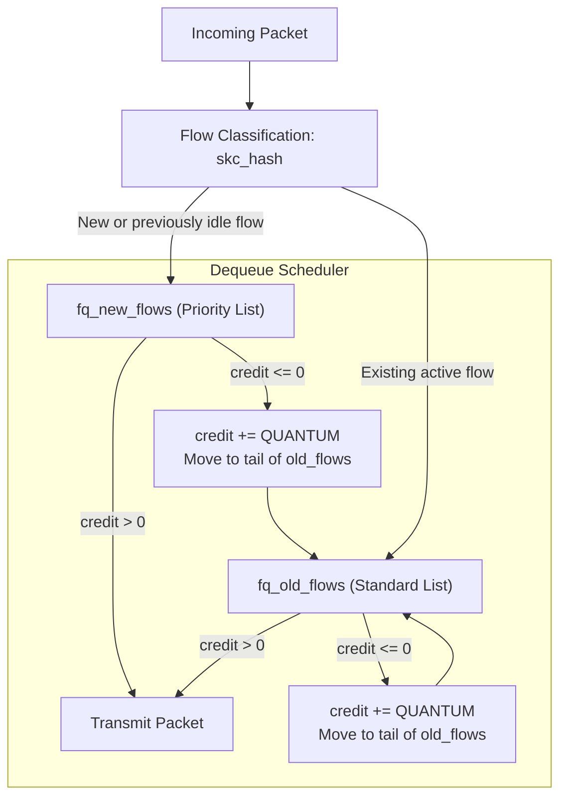
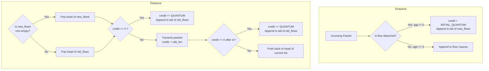

# 22. Hands-on (5): Building Fair Queueing (FQ) and EDT Pacing with BPF and packetdrill

[Japanese](README.md)

In this track, you will build **Fair Queueing (FQ) and Earliest Departure Time (EDT) pacing**—the essential kernel traffic scheduling infrastructure that unlocks modern high-speed TCP algorithms like BBR and CUBIC—from scratch using Linux kernel BPF `struct_ops` (`struct Qdisc_ops`).

No prior knowledge of Qdiscs or kernel traffic control is required. We will explain everything from first principles: "Why does plain FIFO cause congestion on the Internet?", "How does Deficit Round Robin (DRR) distribute bandwidth fairly?", and "How does EDT pacing smooth out TCP packet bursts?".

---

## 1. What is a Qdisc (Queueing Discipline)?

Packets transmitted by a TCP socket via `write()` or `sendmsg()` do not immediately emit from the physical network interface as radio waves or photons. Between the socket layer and the device driver lies a traffic control layer known as a **Qdisc (Queueing Discipline)**.

```text
+-----------------------+     +-----------------------+
|  TCP Socket (Flow A)  |     |  TCP Socket (Flow B)  |
+-----------------------+     +-----------------------+
            |                             |
            +--------------+--------------+
                           |
                           v
           +-------------------------------+
           |    Qdisc (Traffic Control)    |
           |   - Flow classification       |
           |   - Bandwidth sharing (DRR)   |
           |   - Transmission pacing (EDT) |
           +-------------------------------+
                           |
                           v
           +-------------------------------+
           |    Device Driver (Ring Buff)  |
           +-------------------------------+
                           |
                           v
           +-------------------------------+
           |         Physical NIC          |
           +-------------------------------+
```

The simplest Qdisc implementation is **pfifo (a simple First-In, First-Out queue)**. However, FIFO suffers from fundamental flaws:

- **Monopolization by Fat Flows**: If a bulk transfer (Fat Flow) downloads a massive file at maximum speed, the FIFO queue is continuously filled with packets from that single flow.
- **Latency Spikes for Sparse Flows**: Interactive packets such as SSH keystrokes, DNS lookups, or HTTP GET requests (Sparse Flows / Thin Flows) get stuck behind huge bursts of bulk transfer packets, suffering severe queuing delay (RTT inflation).
- **Self-Inflicted Packet Loss from Bursts**: TCP tends to emit multiple packets back-to-back upon receiving an ACK. Dumping large bursts into a FIFO queue overflows shallow switch buffers, causing packet drops.

To solve these problems, the Linux kernel introduced **`sch_fq` (Fair Queueing Qdisc)**.

---

## 2. Pillar 1: Deficit Round Robin (DRR) and Sparse Flow Prioritization

FQ classifies incoming packets into separate per-flow queues based on socket hashes. It schedules packets using two active flow lists:

- **`fq_new_flows` (List for newly created or sparse flows)**
- **`fq_old_flows` (List for continuous bulk flows)**



### Why Do Two Lists Make Sparse Flows Fast?

- **Credit System (Deficit Round Robin)**: Each flow holds a transmission budget called `credit` (in bytes). Sending a packet deducts `qdisc_pkt_len(skb)` from the flow's credit.
- **Generous Initial Credit**: When a flow is newly created or awakens from an idle state, it receives a generous initial credit (`INITIAL_QUANTUM = 2000` bytes) and is enqueued at the **tail of `fq_new_flows`**.
- **Absolute Priority of `fq_new_flows`**: The dequeue scheduler **always serves `fq_new_flows` before `fq_old_flows`** as long as `fq_new_flows` is non-empty.
- **Demotion of Bulk Flows**: When a greedy flow exhausts its credit (`credit <= 0`), it receives its next quantum (`credit += QUANTUM` = 1500 bytes) and is demoted to the **tail of `fq_old_flows`**.

Because intermittent, interactive flows (SSH, Web requests) arrive as detached flows, they enter `fq_new_flows` with high priority, jump ahead of bulk transfer queues, and depart with near-zero queuing delay.

---

## 3. Pillar 2: Earliest Departure Time (EDT) Pacing

The second key innovation of FQ is **EDT (Earliest Departure Time) pacing**.

In traditional TCP, senders dump bursts of packets onto the wire. In the EDT model introduced in Linux 4.20, TCP or FQ stamps each packet with its **scheduled future departure time (`skb->tstamp`)**.

```text
Packet 1 (0 ms) ----> Transmitted immediately!
Packet 2 (5 ms) ----> Too early! Stashed in fq_delayed (Red-Black tree)
Packet 3 (10 ms) ---> Stashed in fq_delayed

   5 ms later: High-resolution watchdog timer fires!
   Packet 2 ----> Transmitted!
```

### Three Core Elements of EDT

1. **Target Departure Time Calculation**:
   Based on the socket's configured pacing rate (`sk_max_pacing_rate`), the departure gap between packets is computed as:
   $$\Delta t = \frac{\text{packet len} \times 10^9}{\text{rate}}$$
   The flow's next eligible transmission timestamp `flow->time_next_packet` is updated accordingly.
2. **Delayed Queue (`fq_delayed`) and Watchdog Timer**:
   During dequeue, if a packet's scheduled timestamp is in the future (`now < tstamp`), the entire flow is moved into a red-black tree (`bpf_rb_root fq_delayed`) and the kernel's high-resolution timer is armed via `bpf_qdisc_watchdog_schedule()`. When the timer fires, dequeue is re-triggered and the packet is emitted.
3. **Horizon Check**:
   If a misconfigured or buggy socket assigns an unrealistic timestamp far in the future (e.g. 10 seconds or 1 minute away), the packet is dropped immediately to prevent head-of-line blocking if it exceeds `HORIZON_NS = 2` seconds.

---

## 4. Technology Stack (BPF Graph Data Structures)

This track utilizes modern **BPF Graph Data Structures** introduced in Linux 6.x:

| BPF Feature | Purpose |
| :--- | :--- |
| `struct_ops` (`struct Qdisc_ops`) | Implements and registers a kernel Qdisc dynamically and safely via BPF |
| `bpf_list_head` / `bpf_list_node` | Implements the DRR `fq_new_flows` and `fq_old_flows` scheduling queues |
| `bpf_rb_root` / `bpf_rb_node` | Manages timestamp-ordered packet queues and throttled flows (`fq_delayed`) in $O(\log N)$ time |
| `bpf_refcount` | Provides safe shared ownership of flow nodes across the hash map (flow table) and active scheduling lists |
| `bpf_kptr_xchg()` | Atomically transfers and exchanges kernel object ownership |
| `bpf_qdisc_watchdog_schedule()` | Kernel kfunc to schedule high-resolution wakeups for paced packet departure |

---

## 5. Steps and Verification Commands

This track consists of 2 steps:

| Step | Directory | Content |
| :--- | :--- | :--- |
| **Step 1** | [`step01-flow-drr/`](step01-flow-drr/README.en.md) | Implement flow hashing and Deficit Round Robin (DRR) with `fq_new_flows` and `fq_old_flows`, verifying that sparse flows jump ahead of bulk flows. |
| **Step 2** | [`step02-edt-pacing/`](step02-edt-pacing/README.en.md) | Implement Earliest Departure Time (EDT) pacing using `bpf_rb_root`, delayed flow management (`fq_delayed`), watchdog scheduling, and horizon checks. |

### Commands

From the `labs/` directory (`/usr/local/google/home/kuniyu/tcp-eli5/labs`), build and verify each step using `run_test.sh`:

```sh
# Step 1: verify starter fails, then implement TODOs
./run_test.sh 05-qdisc-fq/step01-flow-drr starter
# Run Step 1 solution
./run_test.sh 05-qdisc-fq/step01-flow-drr solution

# Step 2: verify starter and run solution
./run_test.sh 05-qdisc-fq/step02-edt-pacing starter
./run_test.sh 05-qdisc-fq/step02-edt-pacing solution
```

Proceed to [`step01-flow-drr/README.en.md`](step01-flow-drr/README.en.md) to implement your first BPF FQ scheduler!


---

## Step 1: Flow Classification and 2-List Deficit Round Robin (DRR)

[Japanese](README.md)

## 1. Learning Goals

In this step, you will implement `struct Qdisc_ops` via BPF `struct_ops` to build the core foundation of **Fair Queueing (FQ): per-flow classification and 2-list Deficit Round Robin (DRR)** from scratch.

- For an overview of the track, see the [FQ Track README](#).

---

## 2. Algorithm and Concepts

### 2.1 Why Separate Queues per Flow? (Flow Classification)

In a conventional FIFO queue, all packets from all connections share a single linear queue. When a greedy bulk transfer (Flow A) streams data continuously, FIFO queues stay filled with Flow A's packets. An interactive connection (Flow B: SSH or HTTP requests) that only emits sporadic packets is forced behind hundreds of bulk packets, suffering high latency (Bufferbloat).

FQ inspects the socket hash (`sk->__sk_common.skc_hash`) or 4-tuple hash (`bpf_skb_get_hash(skb)`) and directs packets into **dedicated, per-flow queues (`struct fq_flow_node`)**.

### 2.2 Deficit Round Robin (DRR)

After separating packets into per-flow queues, how should the scheduler dequeue them?

Simple packet-by-packet round-robin is unfair to flows sending small packets: a flow sending 1500-byte packets gets 3x more bandwidth than a flow sending 500-byte packets.

To solve this, M. Shreedhar and G. Varghese invented **Deficit Round Robin (DRR)**:

- **`QUANTUM`**: The baseline byte credit allotted to each flow per scheduling round (`1500` bytes in this lab).
- **`credit`**: The current transmission allowance (in bytes) held by the flow.
- **Rules**:
  - If the head packet's size is $\le \text{credit}$, the packet is transmitted and `credit -= packet_len`.
  - When `credit <= 0`, the flow has used its round allowance: add `QUANTUM` (`credit += QUANTUM`) and move the flow to the back of the queue.

### 2.3 The 2-List Architecture: `fq_new_flows` vs `fq_old_flows`

A vital design innovation in Linux's `sch_fq` and `sch_fq_codel` is dividing active flows into **two separate lists**:



1. **Absolute Priority of `fq_new_flows`**: The dequeue scheduler **never touches `fq_old_flows` as long as `fq_new_flows` has pending flows**.
2. **Reviving Idle Flows**:
   - When a flow has no packets left, it is detached (`age != 0`).
   - When a new packet arrives for an idle flow, it receives a generous `INITIAL_QUANTUM` (`2000` bytes) and is added to the **tail of `fq_new_flows`**.
3. **Demoting Bulk Flows**:
   - A greedy bulk flow exhausts its credit after 1-2 packets (`credit <= 0`) and is demoted to **`fq_old_flows`**.

Because intermittent sparse flows (Flow B) arrive as detached flows, they enter `fq_new_flows`, **immediately jumping ahead of bulk packets queued in `fq_old_flows`** to achieve near-zero queuing delay.

### 2.4 Concrete Trace (`test.pkt` Scenario)

Parameters: `INITIAL_QUANTUM = 2000`, `QUANTUM = 1500`, Packet size $\approx 1028$ bytes (UDP 1000B payload + headers), `BOTTLENECK_NS = 2 ms`.

| Time | Event | Flow A State | Flow B State | Packet Sent | Explanation |
| :--- | :--- | :--- | :--- | :--- | :--- |
| **+0.000** | Flow A writes 4000B<br>(4 packets arrive) | `credit = 2000`<br>in `fq_new_flows` | Idle / Unconnected | **Flow A: Pkt 1** (1000B) | After sending Pkt 1: `credit = 2000 - 1028 = 972 > 0`.<br>Remains at head of `fq_new_flows`.<br>Next eligible transmission: `+2 ms`. |
| **+0.002** | Timer fires (2 ms elapsed) | `credit = 972`<br>in `fq_new_flows` | Idle / Unconnected | **Flow A: Pkt 2** (1000B) | After sending Pkt 2: `credit = 972 - 1028 = -56 <= 0`!<br>Credit exhausted: `credit += 1500 = 1444`, **demoted to `fq_old_flows`**! |
| **+0.002** | **Flow B writes 500B** | `credit = 1444`<br>in `fq_old_flows`<br>(Pkt 3, 4 queued) | **Wakes from idle!**<br>`credit = 2000`<br>**enters `fq_new_flows`!** | — | Flow B was detached, so it enters priority list `fq_new_flows`! |
| **+0.004** | Timer fires (4 ms elapsed) | Waiting in `fq_old_flows` | **Head of `fq_new_flows`** | **Flow B: 500B packet!** | `fq_new_flows` takes strict priority: **Flow B departs before Flow A's Pkt 3 & 4!** |
| **+0.006** | Timer fires (6 ms elapsed) | Head of `fq_old_flows` | Done (idle) | **Flow A: Pkt 3** (1000B) | `fq_new_flows` is empty, so `fq_old_flows` resumes. |
| **+0.008** | Timer fires (8 ms elapsed) | Head of `fq_old_flows` | Idle | **Flow A: Pkt 4** (1000B) | Flow A's final packet departs. |

---

## 3. Design Checkpoints

### Q1. What is the role of `bpf_refcount`?

<details>
<summary>Hint & Answer</summary>

- **Hint**: `struct fq_flow_node` must exist concurrently in both the hash map (`fq_flows`) and one of the scheduling lists (`fq_new_flows` / `fq_old_flows`).
- **Answer**: The map value holds the primary reference (refcount 1). When the flow becomes active and enters a scheduling list, `flow_copy = bpf_refcount_acquire(flow)` increments the refcount to 2. When the flow empties and becomes detached, `bpf_obj_drop(flow)` drops the list reference (refcount returns to 1). This ensures safe memory management without prematurely freeing stashed flows.

</details>

### Q2. How should a flow be handled during dequeue if `flow->credit <= 0`?

<details>
<summary>Hint & Answer</summary>

- **Hint**: In DRR, a flow with non-positive credit cannot transmit in the current round.
- **Answer**: Replenish credit with `flow->credit += QUANTUM` (1500 bytes), push the flow to the **tail** of `fq_old_flows`, and `continue` the loop to inspect the next eligible flow.

</details>

### Q3. How does the bottleneck link rate limit coordinate with the watchdog timer?

<details>
<summary>Hint & Answer</summary>

- **Hint**: If less than 2 ms has elapsed since the last transmission, the packet cannot be sent yet.
- **Answer**: Read current time `now = bpf_ktime_get_ns();`. If `now < next_tx_ns`, arm the kernel high-resolution timer via `bpf_qdisc_watchdog_schedule(sch, next_tx_ns, 0)` and return `NULL` immediately.

</details>

---

## 4. Verification Commands

```sh
cd /usr/local/google/home/kuniyu/tcp-eli5/labs

# 1. Verify starter fails
./run_test.sh 05-qdisc-fq/step01-flow-drr starter

# 2. Verify solution passes
./run_test.sh 05-qdisc-fq/step01-flow-drr solution
```


### `labs/05-qdisc-fq/step01-flow-drr/starter.bpf.c` (Starter skeleton)

```c
// SPDX-License-Identifier: GPL-2.0
#include "vmlinux.h"
#include "bpf_qdisc_helpers.h"

#define ENOMEM 12

char _license[] SEC("license") = "GPL";

#define QUANTUM 1500
#define INITIAL_QUANTUM 2000
#define BOTTLENECK_NS 2000000ULL

#define NUM_FLOWS 1024

struct skb_node {
	struct sk_buff __kptr *skb;
	struct bpf_list_node node;
};

struct fq_flow_node {
	s64 credit;
	u32 qlen;
	u64 age;
	struct bpf_list_node list_node;
	struct bpf_list_head queue __contains(skb_node, node);
	struct bpf_spin_lock lock;
	struct bpf_refcount refcount;
};

struct fq_stashed_flow {
	struct fq_flow_node __kptr *flow;
};

struct {
	__uint(type, BPF_MAP_TYPE_HASH);
	__type(key, __u64);
	__type(value, struct fq_stashed_flow);
	__uint(max_entries, NUM_FLOWS);
} fq_flows SEC(".maps");

private(A) struct bpf_spin_lock fq_new_flows_lock;
private(A) struct bpf_list_head fq_new_flows __contains(fq_flow_node, list_node);

private(B) struct bpf_spin_lock fq_old_flows_lock;
private(B) struct bpf_list_head fq_old_flows __contains(fq_flow_node, list_node);

private(C) u32 fq_new_flow_cnt;
private(C) u32 fq_old_flow_cnt;
private(C) u64 next_tx_ns;

static void bpf_kptr_xchg_back(void *map_val, void *ptr)
{
	void *ret;

	ret = bpf_kptr_xchg(map_val, ptr);
	if (ret)
		bpf_obj_drop(ret);
}

/* TODO 1: Implement per-flow classification.
 * If the socket exists and has sk->__sk_common.skc_hash set, return it.
 * Otherwise, fall back to bpf_skb_get_hash(skb).
 */
static u64 fq_classify(struct sk_buff *skb)
{
	/* [YOUR CODE HERE] */
	return 0;
}

static int fq_new_flow(struct fq_stashed_flow **sflow, u64 hash)
{
	struct fq_stashed_flow tmp = {};
	struct fq_flow_node *flow;
	int ret;

	flow = bpf_obj_new(typeof(*flow));
	if (!flow)
		return -ENOMEM;

	flow->credit = INITIAL_QUANTUM;
	flow->qlen = 0;
	flow->age = 1;

	ret = bpf_map_update_elem(&fq_flows, &hash, &tmp, 0);
	if (ret < 0) {
		bpf_obj_drop(flow);
		return ret;
	}

	*sflow = bpf_map_lookup_elem(&fq_flows, &hash);
	if (!*sflow) {
		bpf_obj_drop(flow);
		return -ENOMEM;
	}

	bpf_kptr_xchg_back(&(*sflow)->flow, flow);
	return 0;
}

SEC("struct_ops/bpf_fq_drr_enqueue")
int BPF_PROG(bpf_fq_drr_enqueue, struct sk_buff *skb, struct Qdisc *sch,
	     struct bpf_sk_buff_ptr *to_free)
{
	struct fq_flow_node *flow = NULL, *flow_copy;
	struct fq_stashed_flow *sflow;
	struct skb_node *skbn;
	u64 hash;

	if (sch->q.qlen >= sch->limit)
		goto drop;

	hash = fq_classify(skb);
	sflow = bpf_map_lookup_elem(&fq_flows, &hash);
	if (!sflow) {
		if (fq_new_flow(&sflow, hash) < 0)
			goto drop;
	}

	flow = bpf_kptr_xchg(&sflow->flow, flow);
	if (!flow)
		goto drop;

	/* TODO 2: Flow attachment in DRR
	 * When a detached flow (flow->age != 0) receives a packet:
	 * 1. Acquire an extra refcount reference using bpf_refcount_acquire(flow).
	 * 2. Set flow_copy->credit = INITIAL_QUANTUM (2000).
	 * 3. Mark flow_copy attached (flow_copy->age = 0).
	 * 4. Push flow_copy to the tail of fq_new_flows under fq_new_flows_lock.
	 * 5. Increment fq_new_flow_cnt.
	 */
	/* [YOUR CODE HERE] */

	skbn = bpf_obj_new(typeof(*skbn));
	if (!skbn) {
		bpf_kptr_xchg_back(&sflow->flow, flow);
		goto drop;
	}

	sch->qstats.backlog += qdisc_pkt_len(skb);
	skb = bpf_kptr_xchg(&skbn->skb, skb);
	if (skb)
		bpf_qdisc_skb_drop(skb, to_free);

	bpf_spin_lock(&flow->lock);
	bpf_list_push_back(&flow->queue, &skbn->node);
	bpf_spin_unlock(&flow->lock);

	flow->qlen++;
	bpf_kptr_xchg_back(&sflow->flow, flow);

	sch->q.qlen++;
	return NET_XMIT_SUCCESS;

drop:
	bpf_qdisc_skb_drop(skb, to_free);
	sch->qstats.drops++;
	return NET_XMIT_DROP;
}

SEC("struct_ops/bpf_fq_drr_dequeue")
struct sk_buff *BPF_PROG(bpf_fq_drr_dequeue, struct Qdisc *sch)
{
	/* TODO 3: Rate enforcement
	 * Read current time: u64 now = bpf_ktime_get_ns();
	 * If now < next_tx_ns, schedule watchdog timer with:
	 *   bpf_qdisc_watchdog_schedule(sch, next_tx_ns, 0);
	 * and return NULL.
	 */

	/* TODO 4: DRR 2-list round-robin dequeue
	 * Loop through active flows (bpf_for(i, 0, sch->limit)):
	 * 1. Select fq_new_flows if fq_new_flow_cnt > 0, else fq_old_flows.
	 * 2. Pop the front flow.
	 * 3. If flow->credit <= 0:
	 *      flow->credit += QUANTUM;
	 *      push flow to the tail of fq_old_flows;
	 *      continue loop.
	 * 4. Pop the front packet skbn from flow->queue.
	 * 5. If flow->queue was empty:
	 *      if flow came from fq_new_flows and fq_old_flows is non-empty,
	 *        push to fq_old_flows;
	 *      else mark detached (flow->age = bpf_jiffies64() ?: 1) and bpf_obj_drop(flow);
	 *      continue loop.
	 * 6. Subtract qdisc_pkt_len(skb) from flow->credit.
	 *    If flow->credit <= 0:
	 *      flow->credit += QUANTUM;
	 *      push to tail of fq_old_flows;
	 *    else
	 *      push to head of its current list.
	 * 7. Update next_tx_ns = now + BOTTLENECK_NS, update qstats, and return skb.
	 */

	/* [YOUR CODE HERE] */
	return NULL;
}

static int fq_remove_flows_in_list(u32 index, void *ctx)
{
	struct bpf_list_node *node;
	struct fq_flow_node *flow;

	bpf_spin_lock(&fq_new_flows_lock);
	node = bpf_list_pop_front(&fq_new_flows);
	bpf_spin_unlock(&fq_new_flows_lock);
	if (!node) {
		bpf_spin_lock(&fq_old_flows_lock);
		node = bpf_list_pop_front(&fq_old_flows);
		bpf_spin_unlock(&fq_old_flows_lock);
		if (!node)
			return 1;
	}

	flow = container_of(node, struct fq_flow_node, list_node);
	bpf_obj_drop(flow);
	return 0;
}

static int fq_remove_map_flow(struct bpf_map *map, u64 *key,
			      struct fq_stashed_flow *sflow, void *ctx)
{
	bpf_map_delete_elem(map, key);
	return 0;
}

SEC("struct_ops/bpf_fq_drr_reset")
void BPF_PROG(bpf_fq_drr_reset, struct Qdisc *sch)
{
	sch->q.qlen = 0;
	sch->qstats.backlog = 0;
	next_tx_ns = 0;

	bpf_loop(NUM_FLOWS, fq_remove_flows_in_list, NULL, 0);
	fq_new_flow_cnt = 0;
	fq_old_flow_cnt = 0;

	bpf_for_each_map_elem(&fq_flows, fq_remove_map_flow, NULL, 0);
}

SEC("struct_ops/bpf_fq_drr_init")
int BPF_PROG(bpf_fq_drr_init, struct Qdisc *sch, struct nlattr *opt,
	     struct netlink_ext_ack *extack)
{
	sch->limit = 1000;
	fq_new_flow_cnt = 0;
	fq_old_flow_cnt = 0;
	next_tx_ns = 0;
	return 0;
}

SEC("struct_ops/bpf_fq_drr_destroy")
void BPF_PROG(bpf_fq_drr_destroy, struct Qdisc *sch)
{
}

SEC(".struct_ops")
struct Qdisc_ops fq_drr = {
	.enqueue   = (void *)bpf_fq_drr_enqueue,
	.dequeue   = (void *)bpf_fq_drr_dequeue,
	.reset     = (void *)bpf_fq_drr_reset,
	.init      = (void *)bpf_fq_drr_init,
	.destroy   = (void *)bpf_fq_drr_destroy,
	.id        = "bpf_fq_drr",
};
```

### `labs/05-qdisc-fq/step01-flow-drr/test.pkt` (packetdrill test)

```python
// SPDX-License-Identifier: GPL-2.0
// Step 1: Test BPF FQ Deficit Round Robin (DRR) and Sparse Flow Prioritization

0.00 `tc qdisc replace dev tun0 root bpf_fq_drr`
+0.00 `ethtool -K tun0 tso off gso off`

// Setup Flow A (fd 3)
+0.00 socket(..., SOCK_DGRAM, IPPROTO_UDP) = 3
+0.00 connect(3, ..., ...) = 0

// Setup Flow B (fd 4)
+0.00 socket(..., SOCK_DGRAM, IPPROTO_UDP) = 4
+0.00 connect(4, ..., ...) = 0

// Flow A sends 4 packets (1,000 bytes each) at t = 0
+0.00 write(3, ..., 1000) = 1000
+0.00 write(3, ..., 1000) = 1000
+0.00 write(3, ..., 1000) = 1000
+0.00 write(3, ..., 1000) = 1000

// Packet 1 of Flow A departs immediately at t = 0 (credit drops 2000 -> 972 > 0)
+0.00 > udp (1000)

// At +0.002, Packet 2 dequeues (credit drops 972 -> -56 <= 0, Flow A moves to fq_old_flows)
+0.002 > udp (1000)

// At +0.002, sparse Flow B sends a 500-byte packet. It enters fq_new_flows!
+0.00 write(4, ..., 500) = 500

// At next slot (+0.004), Flow B's 500-byte packet is dequeued BEFORE Flow A's remaining packets!
+0.002 > udp (500)

// Then Flow A's remaining packets dequeue at +0.006 and +0.008
+0.002 > udp (1000)
+0.002 > udp (1000)
```

<details>
<summary>Reference solution: <code>labs/05-qdisc-fq/step01-flow-drr/solution.bpf.c</code></summary>

```c
// SPDX-License-Identifier: GPL-2.0
#include "vmlinux.h"
#include "bpf_qdisc_helpers.h"

#define ENOMEM 12

char _license[] SEC("license") = "GPL";

#define QUANTUM 1500
#define INITIAL_QUANTUM 2000
#define BOTTLENECK_NS 2000000ULL

#define NUM_FLOWS 1024

struct skb_node {
	struct sk_buff __kptr *skb;
	struct bpf_list_node node;
};

struct fq_flow_node {
	s64 credit;
	u32 qlen;
	u64 age;
	struct bpf_list_node list_node;
	struct bpf_list_head queue __contains(skb_node, node);
	struct bpf_spin_lock lock;
	struct bpf_refcount refcount;
};

struct fq_stashed_flow {
	struct fq_flow_node __kptr *flow;
};

struct {
	__uint(type, BPF_MAP_TYPE_HASH);
	__type(key, __u64);
	__type(value, struct fq_stashed_flow);
	__uint(max_entries, NUM_FLOWS);
} fq_flows SEC(".maps");

private(A) struct bpf_spin_lock fq_new_flows_lock;
private(A) struct bpf_list_head fq_new_flows __contains(fq_flow_node, list_node);

private(B) struct bpf_spin_lock fq_old_flows_lock;
private(B) struct bpf_list_head fq_old_flows __contains(fq_flow_node, list_node);

private(C) u32 fq_new_flow_cnt;
private(C) u32 fq_old_flow_cnt;
private(C) u64 next_tx_ns;

static void bpf_kptr_xchg_back(void *map_val, void *ptr)
{
	void *ret;

	ret = bpf_kptr_xchg(map_val, ptr);
	if (ret)
		bpf_obj_drop(ret);
}

static u64 fq_classify(struct sk_buff *skb)
{
	struct sock *sk = skb->sk;

	if (sk && sk->__sk_common.skc_hash)
		return (u64)sk->__sk_common.skc_hash;

	u64 hash = (u64)bpf_skb_get_hash(skb);
	if (!hash)
		hash = 1;
	return hash;
}

static int fq_new_flow(struct fq_stashed_flow **sflow, u64 hash)
{
	struct fq_stashed_flow tmp = {};
	struct fq_flow_node *flow;
	int ret;

	flow = bpf_obj_new(typeof(*flow));
	if (!flow)
		return -ENOMEM;

	flow->credit = INITIAL_QUANTUM;
	flow->qlen = 0;
	flow->age = 1;

	ret = bpf_map_update_elem(&fq_flows, &hash, &tmp, 0);
	if (ret < 0) {
		bpf_obj_drop(flow);
		return ret;
	}

	*sflow = bpf_map_lookup_elem(&fq_flows, &hash);
	if (!*sflow) {
		bpf_obj_drop(flow);
		return -ENOMEM;
	}

	bpf_kptr_xchg_back(&(*sflow)->flow, flow);
	return 0;
}

SEC("struct_ops/bpf_fq_drr_enqueue")
int BPF_PROG(bpf_fq_drr_enqueue, struct sk_buff *skb, struct Qdisc *sch,
	     struct bpf_sk_buff_ptr *to_free)
{
	struct fq_flow_node *flow = NULL, *flow_copy;
	struct fq_stashed_flow *sflow;
	struct skb_node *skbn;
	u64 hash;

	if (sch->q.qlen >= sch->limit)
		goto drop;

	hash = fq_classify(skb);
	sflow = bpf_map_lookup_elem(&fq_flows, &hash);
	if (!sflow) {
		if (fq_new_flow(&sflow, hash) < 0)
			goto drop;
	}

	flow = bpf_kptr_xchg(&sflow->flow, flow);
	if (!flow)
		goto drop;

	if (flow->age != 0) {
		/* Flow is detached */
		flow_copy = bpf_refcount_acquire(flow);
		flow_copy->credit = INITIAL_QUANTUM;
		flow_copy->age = 0;
		bpf_spin_lock(&fq_new_flows_lock);
		bpf_list_push_back(&fq_new_flows, &flow_copy->list_node);
		bpf_spin_unlock(&fq_new_flows_lock);
		fq_new_flow_cnt++;
	}

	skbn = bpf_obj_new(typeof(*skbn));
	if (!skbn) {
		bpf_kptr_xchg_back(&sflow->flow, flow);
		goto drop;
	}

	sch->qstats.backlog += qdisc_pkt_len(skb);
	skb = bpf_kptr_xchg(&skbn->skb, skb);
	if (skb)
		bpf_qdisc_skb_drop(skb, to_free);

	bpf_spin_lock(&flow->lock);
	bpf_list_push_back(&flow->queue, &skbn->node);
	bpf_spin_unlock(&flow->lock);

	flow->qlen++;
	bpf_kptr_xchg_back(&sflow->flow, flow);

	sch->q.qlen++;
	return NET_XMIT_SUCCESS;

drop:
	bpf_qdisc_skb_drop(skb, to_free);
	sch->qstats.drops++;
	return NET_XMIT_DROP;
}

SEC("struct_ops/bpf_fq_drr_dequeue")
struct sk_buff *BPF_PROG(bpf_fq_drr_dequeue, struct Qdisc *sch)
{
	struct bpf_list_head *head;
	struct bpf_spin_lock *lock;
	struct bpf_list_node *node;
	struct fq_flow_node *flow;
	struct sk_buff *skb = NULL;
	struct skb_node *skbn;
	u64 now;
	int i;

	if (!sch->q.qlen)
		return NULL;

	now = bpf_ktime_get_ns();
	if (now < next_tx_ns) {
		bpf_qdisc_watchdog_schedule(sch, next_tx_ns, 0);
		return NULL;
	}

	bpf_for(i, 0, sch->limit) {
		bool from_new = false;

		if (fq_new_flow_cnt) {
			head = &fq_new_flows;
			lock = &fq_new_flows_lock;
			from_new = true;
		} else if (fq_old_flow_cnt) {
			head = &fq_old_flows;
			lock = &fq_old_flows_lock;
			from_new = false;
		} else {
			break;
		}

		bpf_spin_lock(lock);
		node = bpf_list_pop_front(head);
		bpf_spin_unlock(lock);
		if (!node)
			break;

		if (from_new)
			fq_new_flow_cnt--;
		else
			fq_old_flow_cnt--;

		flow = container_of(node, struct fq_flow_node, list_node);

		if (flow->credit <= 0) {
			flow->credit += QUANTUM;
			bpf_spin_lock(&fq_old_flows_lock);
			bpf_list_push_back(&fq_old_flows, &flow->list_node);
			bpf_spin_unlock(&fq_old_flows_lock);
			fq_old_flow_cnt++;
			continue;
		}

		bpf_spin_lock(&flow->lock);
		node = bpf_list_pop_front(&flow->queue);
		bpf_spin_unlock(&flow->lock);

		if (!node) {
			if (from_new && fq_old_flow_cnt > 0) {
				bpf_spin_lock(&fq_old_flows_lock);
				bpf_list_push_back(&fq_old_flows, &flow->list_node);
				bpf_spin_unlock(&fq_old_flows_lock);
				fq_old_flow_cnt++;
			} else {
				flow->age = bpf_jiffies64() ?: 1;
				bpf_obj_drop(flow);
			}
			continue;
		}

		skbn = container_of(node, struct skb_node, node);
		skb = bpf_kptr_xchg(&skbn->skb, skb);
		bpf_obj_drop(skbn);

		if (!skb) {
			flow->age = bpf_jiffies64() ?: 1;
			bpf_obj_drop(flow);
			continue;
		}

		flow->credit -= qdisc_pkt_len(skb);
		flow->qlen--;

		if (flow->credit <= 0) {
			flow->credit += QUANTUM;
			bpf_spin_lock(&fq_old_flows_lock);
			bpf_list_push_back(&fq_old_flows, &flow->list_node);
			bpf_spin_unlock(&fq_old_flows_lock);
			fq_old_flow_cnt++;
		} else {
			bpf_spin_lock(lock);
			bpf_list_push_front(head, &flow->list_node);
			bpf_spin_unlock(lock);
			if (from_new)
				fq_new_flow_cnt++;
			else
				fq_old_flow_cnt++;
		}

		next_tx_ns = now + BOTTLENECK_NS;
		sch->q.qlen--;
		sch->qstats.backlog -= qdisc_pkt_len(skb);
		bpf_qdisc_bstats_update(sch, skb);
		return skb;
	}

	return NULL;
}

static int fq_remove_flows_in_list(u32 index, void *ctx)
{
	struct bpf_list_node *node;
	struct fq_flow_node *flow;

	bpf_spin_lock(&fq_new_flows_lock);
	node = bpf_list_pop_front(&fq_new_flows);
	bpf_spin_unlock(&fq_new_flows_lock);
	if (!node) {
		bpf_spin_lock(&fq_old_flows_lock);
		node = bpf_list_pop_front(&fq_old_flows);
		bpf_spin_unlock(&fq_old_flows_lock);
		if (!node)
			return 1;
	}

	flow = container_of(node, struct fq_flow_node, list_node);
	bpf_obj_drop(flow);
	return 0;
}

static int fq_remove_map_flow(struct bpf_map *map, u64 *key,
			      struct fq_stashed_flow *sflow, void *ctx)
{
	bpf_map_delete_elem(map, key);
	return 0;
}

SEC("struct_ops/bpf_fq_drr_reset")
void BPF_PROG(bpf_fq_drr_reset, struct Qdisc *sch)
{
	sch->q.qlen = 0;
	sch->qstats.backlog = 0;
	next_tx_ns = 0;

	bpf_loop(NUM_FLOWS, fq_remove_flows_in_list, NULL, 0);
	fq_new_flow_cnt = 0;
	fq_old_flow_cnt = 0;

	bpf_for_each_map_elem(&fq_flows, fq_remove_map_flow, NULL, 0);
}

SEC("struct_ops/bpf_fq_drr_init")
int BPF_PROG(bpf_fq_drr_init, struct Qdisc *sch, struct nlattr *opt,
	     struct netlink_ext_ack *extack)
{
	sch->limit = 1000;
	fq_new_flow_cnt = 0;
	fq_old_flow_cnt = 0;
	next_tx_ns = 0;
	return 0;
}

SEC("struct_ops/bpf_fq_drr_destroy")
void BPF_PROG(bpf_fq_drr_destroy, struct Qdisc *sch)
{
}

SEC(".struct_ops")
struct Qdisc_ops fq_drr = {
	.enqueue   = (void *)bpf_fq_drr_enqueue,
	.dequeue   = (void *)bpf_fq_drr_dequeue,
	.reset     = (void *)bpf_fq_drr_reset,
	.init      = (void *)bpf_fq_drr_init,
	.destroy   = (void *)bpf_fq_drr_destroy,
	.id        = "bpf_fq_drr",
};
```

</details>


---

## Step 2: Earliest Departure Time (EDT) Pacing and Horizon Drop

[Japanese](README.md)

## 1. Learning Goals

In this step, you will use red-black trees (`bpf_rb_root`) to implement the kernel's modern pacing mechanism—**Earliest Departure Time (EDT) pacing** and **Horizon Drop**—as a BPF `struct_ops` (`struct Qdisc_ops`) Qdisc.

- For an overview of the track, see the [FQ Track README](#).

---

## 2. Algorithm and Concepts

### 2.1 Why Pacing? (Mitigating TCP Bursts)

TCP emits packets in response to incoming ACKs. When a receiver aggregates multiple packets in a single ACK (Delayed ACK or LRO/GRO), the sender dumps 10 to 30 packets into the network **back-to-back at wire speed**.

```text
Conventional Burst Transmission:
||||||||||||                ||||||||||||                ||||||||||||
[-- 10 back-to-back pkts --] [-- 10 back-to-back pkts --] [-- 10 back-to-back pkts --]
(Overflows shallow switch buffers, causing packet drops!)

Paced Transmission (EDT):
|   |   |   |   |   |   |   |   |   |   |   |   |   |   |   |   |   |   |
(Smooth stream distributed across the RTT, keeping buffers empty and latency low!)
```

Dumping bursts into intermediate switches overflows shallow buffers and causes packet drops. Pacing smooths the stream into a continuous trickle.

### 2.2 Earliest Departure Time (EDT) Model

In the **EDT model** (Linux 4.20+), each packet is stamped with its scheduled departure time (**`skb->tstamp`**) based on the socket's configured pacing rate (`sk->sk_max_pacing_rate`).

The packet's scheduled departure time `time_to_send` is calculated as follows:

1. **Explicit `skb->tstamp` present**: Use the timestamp already computed by TCP / BBR.
2. **Socket pacing rate (`sk_max_pacing_rate`) active**:
   Anchor against the later of the flow's scheduled next packet time or current time:
   $$\text{time to send} = \max(\text{flow} \to \text{next packet time}, \text{now})$$
   Advance the flow's next eligible transmission timestamp by the transmission duration $\Delta t$:
   $$\text{flow} \to \text{next packet time} = \text{time to send} + \frac{\text{packet len} \times 10^9}{\text{rate}}$$
3. **Otherwise**: Immediately transmittable (`time_to_send = now`).

### 2.3 Throttled Flow Management (`fq_delayed`) and Watchdog Timer

During dequeue, when inspecting the head packet of a flow:
If `now < time_to_send` (the packet is scheduled for the future):

1. **Throttle the flow**: Set `flow->age = ~0ULL` and insert the flow into the red-black tree **`fq_delayed`** ordered by `flow->time_next_packet`.
2. **Arm the Watchdog Timer**: Schedule the kernel timer for the earliest throttled flow timestamp (`time_next_delayed_flow`) via `bpf_qdisc_watchdog_schedule()`.
3. **Wakeup and Restoration**: When the timer fires, dequeue calls `fq_check_throttled(now)` to pop all unthrottled flows from `fq_delayed` and move them to `fq_old_flows`.

### 2.4 Horizon Check

What if an application sets a pathological pacing rate via `setsockopt(..., SO_MAX_PACING_RATE)` (e.g. 100 bytes/sec)?
A single 1000-byte packet would delay transmission by over 10 seconds, causing packets to pile up in memory for minutes.

To prevent head-of-line blocking and memory exhaustion, FQ enforces a **horizon (`HORIZON_NS = 2` seconds)**. Any packet scheduled more than 2 seconds into the future is immediately dropped (`NET_XMIT_DROP`).

---

## 3. Concrete Trace (`test.pkt` Scenario)

Parameters: `SO_MAX_PACING_RATE = 200,000` bytes/sec (200 KB/s), packet length $\approx 1066$ bytes.
Pacing delay per packet:
$$\Delta t = \frac{1066 \times 10^9}{200,000} = 5,330,000 \text{ ns} \approx 5.33 \text{ ms}$$

| Event | Departure Time | State & Timer Action |
| :--- | :--- | :--- |
| `write(4, ..., 3000)` (3 segments) | **+0.000** | Pkt 1 (1:1001) is due `now`: **transmitted immediately**!<br>`time_next_packet` advances to `now + 5.33 ms`. |
| Inspection of Pkt 2 | — | Pkt 2 is due at `+5.33 ms` (future).<br>Flow is throttled into `fq_delayed`, timer armed. |
| Timer fires (+5.33 ms) | **~ +0.005** | Pkt 2 (1001:2001) **transmitted via Watchdog**!<br>`time_next_packet` advances to `now + 10.66 ms`. |
| Timer fires (+10.66 ms) | **~ +0.010** | Pkt 3 (2001:3001) **transmitted via Watchdog**! |
| Set `SO_MAX_PACING_RATE = 100` B/s | — | For 1000B packets, $\Delta t = \frac{1066 \times 10^9}{100} > 10$ seconds! |
| `write(4, ..., 2000)` (2 segments) | **+0.000** | Pkt 1 (3001:4001) is transmitted immediately;<br>`time_next_packet` advances to `now + 10.66s`. |
| Enqueue of Pkt 2 | — | Pkt 2 is scheduled at `now + 10.66s`, which **exceeds the 2s horizon**!<br>**Dropped immediately** via `bpf_qdisc_skb_drop()`! |

---

## 4. Design Checkpoints

### Q1. What is the precedence order when computing `time_to_send`?

<details>
<summary>Hint & Answer</summary>

- **Hint**: Consider cases where `skb->tstamp` is already set, where the socket has a pacing rate, and default fallbacks.
- **Answer**:
  1. If `skb->tstamp != 0`, respect `skb->tstamp`.
  2. Else if `rate > 0 && rate != ~0ULL`, use `max(flow->time_next_packet, now)`.
  3. Otherwise, use `now`.

</details>

### Q2. How is the horizon drop implemented?

<details>
<summary>Hint & Answer</summary>

- **Hint**: Compare using signed 64-bit integers and remember to release the stashed flow pointer back into the map value.
- **Answer**:
  ```c
  if ((s64)time_to_send > (s64)(now + HORIZON_NS)) {
      bpf_kptr_xchg_back(&sflow->flow, flow);
      goto drop;
  }
  ```
  At `drop:`, increment `sch->qstats.drops++`, call `bpf_qdisc_skb_drop(skb, to_free)`, and return `NET_XMIT_DROP`.

</details>

---

## 5. Verification Commands

```sh
cd /usr/local/google/home/kuniyu/tcp-eli5/labs

# 1. Verify starter fails
./run_test.sh 05-qdisc-fq/step02-edt-pacing starter

# 2. Verify solution passes
./run_test.sh 05-qdisc-fq/step02-edt-pacing solution
```


### `labs/05-qdisc-fq/step02-edt-pacing/starter.bpf.c` (Starter skeleton)

```c
// SPDX-License-Identifier: GPL-2.0
#include "vmlinux.h"
#include "bpf_qdisc_helpers.h"

#define ENOMEM 12

char _license[] SEC("license") = "GPL";

#define QUANTUM 1500
#define INITIAL_QUANTUM 2000
#define HORIZON_NS 2000000000ULL

#define NUM_FLOWS 1024

struct skb_node {
	u64 tstamp;
	struct sk_buff __kptr *skb;
	struct bpf_rb_node node;
};

struct fq_flow_node {
	s64 credit;
	u32 qlen;
	u64 age;
	u64 time_next_packet;
	struct bpf_list_node list_node;
	struct bpf_rb_node rb_node;
	struct bpf_rb_root queue __contains(skb_node, node);
	struct bpf_spin_lock lock;
	struct bpf_refcount refcount;
};

struct unset_throttled_flows_ctx {
	bool unset_all;
	u64 now;
};

struct fq_stashed_flow {
	struct fq_flow_node __kptr *flow;
};

struct {
	__uint(type, BPF_MAP_TYPE_HASH);
	__type(key, __u64);
	__type(value, struct fq_stashed_flow);
	__uint(max_entries, NUM_FLOWS);
} fq_flows SEC(".maps");

private(A) struct bpf_spin_lock fq_delayed_lock;
private(A) struct bpf_rb_root fq_delayed __contains(fq_flow_node, rb_node);

private(B) struct bpf_spin_lock fq_new_flows_lock;
private(B) struct bpf_list_head fq_new_flows __contains(fq_flow_node, list_node);

private(C) struct bpf_spin_lock fq_old_flows_lock;
private(C) struct bpf_list_head fq_old_flows __contains(fq_flow_node, list_node);

private(D) u32 fq_new_flow_cnt;
private(D) u32 fq_old_flow_cnt;
private(D) u64 time_next_delayed_flow;

static void bpf_kptr_xchg_back(void *map_val, void *ptr)
{
	void *ret;

	ret = bpf_kptr_xchg(map_val, ptr);
	if (ret)
		bpf_obj_drop(ret);
}

static bool skbn_tstamp_less(struct bpf_rb_node *a, const struct bpf_rb_node *b)
{
	struct skb_node *skbn_a;
	struct skb_node *skbn_b;

	skbn_a = container_of(a, struct skb_node, node);
	skbn_b = container_of(b, struct skb_node, node);

	return skbn_a->tstamp < skbn_b->tstamp;
}

static bool fn_time_next_packet_less(struct bpf_rb_node *a, const struct bpf_rb_node *b)
{
	struct fq_flow_node *flow_a;
	struct fq_flow_node *flow_b;

	flow_a = container_of(a, struct fq_flow_node, rb_node);
	flow_b = container_of(b, struct fq_flow_node, rb_node);

	return flow_a->time_next_packet < flow_b->time_next_packet;
}

static u64 fq_classify(struct sk_buff *skb)
{
	struct sock *sk = skb->sk;

	if (sk && sk->__sk_common.skc_hash)
		return (u64)sk->__sk_common.skc_hash;

	u64 hash = (u64)bpf_skb_get_hash(skb);
	if (!hash)
		hash = 1;
	return hash;
}

static int fq_new_flow(struct fq_stashed_flow **sflow, u64 hash)
{
	struct fq_stashed_flow tmp = {};
	struct fq_flow_node *flow;
	int ret;

	flow = bpf_obj_new(typeof(*flow));
	if (!flow)
		return -ENOMEM;

	flow->credit = INITIAL_QUANTUM;
	flow->qlen = 0;
	flow->age = 1;
	flow->time_next_packet = 0;

	ret = bpf_map_update_elem(&fq_flows, &hash, &tmp, 0);
	if (ret < 0) {
		bpf_obj_drop(flow);
		return ret;
	}

	*sflow = bpf_map_lookup_elem(&fq_flows, &hash);
	if (!*sflow) {
		bpf_obj_drop(flow);
		return -ENOMEM;
	}

	bpf_kptr_xchg_back(&(*sflow)->flow, flow);
	return 0;
}

static int fq_unset_throttled_flows(u32 index, struct unset_throttled_flows_ctx *ctx)
{
	struct bpf_rb_node *node = NULL;
	struct fq_flow_node *flow;

	bpf_spin_lock(&fq_delayed_lock);

	node = bpf_rbtree_first(&fq_delayed);
	if (!node) {
		bpf_spin_unlock(&fq_delayed_lock);
		return 1;
	}

	flow = container_of(node, struct fq_flow_node, rb_node);
	if (!ctx->unset_all && flow->time_next_packet > ctx->now) {
		time_next_delayed_flow = flow->time_next_packet;
		bpf_spin_unlock(&fq_delayed_lock);
		return 1;
	}

	node = bpf_rbtree_remove(&fq_delayed, &flow->rb_node);
	bpf_spin_unlock(&fq_delayed_lock);

	if (!node)
		return 1;

	flow = container_of(node, struct fq_flow_node, rb_node);
	flow->age = 0;
	bpf_spin_lock(&fq_old_flows_lock);
	bpf_list_push_back(&fq_old_flows, &flow->list_node);
	bpf_spin_unlock(&fq_old_flows_lock);
	fq_old_flow_cnt++;

	return 0;
}

static void fq_flow_set_throttled(struct fq_flow_node *flow)
{
	flow->age = ~0ULL;

	if (time_next_delayed_flow > flow->time_next_packet)
		time_next_delayed_flow = flow->time_next_packet;

	bpf_spin_lock(&fq_delayed_lock);
	bpf_rbtree_add(&fq_delayed, &flow->rb_node, fn_time_next_packet_less);
	bpf_spin_unlock(&fq_delayed_lock);
}

/* TODO 3: Check throttled flows
 * If time_next_delayed_flow > now, none of the delayed flows are ready, so return.
 * Otherwise:
 * 1. Reset time_next_delayed_flow = ~0ULL.
 * 2. Loop over delayed flows using bpf_loop(NUM_FLOWS, fq_unset_throttled_flows, &ctx, 0)
 *    to pop flows whose time_next_packet <= now and move them to fq_old_flows.
 */
static void fq_check_throttled(u64 now)
{
	/* [YOUR CODE HERE] */
}

SEC("struct_ops/bpf_fq_edt_enqueue")
int BPF_PROG(bpf_fq_edt_enqueue, struct sk_buff *skb, struct Qdisc *sch,
	     struct bpf_sk_buff_ptr *to_free)
{
	struct fq_flow_node *flow = NULL, *flow_copy;
	struct fq_stashed_flow *sflow;
	struct sock *sk = skb->sk;
	u64 now, time_to_send;
	struct skb_node *skbn;
	u64 rate = 0;
	u64 hash;

	if (sch->q.qlen >= sch->limit)
		goto drop;

	now = bpf_ktime_get_ns();

	hash = fq_classify(skb);
	sflow = bpf_map_lookup_elem(&fq_flows, &hash);
	if (!sflow) {
		if (fq_new_flow(&sflow, hash) < 0)
			goto drop;
	}

	flow = bpf_kptr_xchg(&sflow->flow, flow);
	if (!flow)
		goto drop;

	if (sk)
		rate = sk->sk_max_pacing_rate;

	/* TODO 1: EDT time_to_send and pacing rate calculation
	 * 1. If skb->tstamp != 0, use skb->tstamp as time_to_send.
	 * 2. Else if rate > 0 && rate != ~0ULL:
	 *      time_to_send = (flow->time_next_packet > now) ? flow->time_next_packet : now;
	 * 3. Else:
	 *      time_to_send = now;
	 */
	time_to_send = now; /* [REPLACE WITH YOUR CODE] */

	/* TODO 2: Horizon check
	 * If (s64)time_to_send > (s64)(now + HORIZON_NS):
	 *   Release flow back to sflow->flow, drop packet, and return NET_XMIT_DROP.
	 */
	/* [YOUR CODE HERE] */

	if (rate > 0 && rate != ~0ULL)
		flow->time_next_packet = time_to_send + (u64)qdisc_pkt_len(skb) * NSEC_PER_SEC / rate;

	if (flow->age != 0 && flow->age != ~0ULL) {
		flow_copy = bpf_refcount_acquire(flow);
		flow_copy->credit = INITIAL_QUANTUM;
		flow_copy->age = 0;
		bpf_spin_lock(&fq_new_flows_lock);
		bpf_list_push_back(&fq_new_flows, &flow_copy->list_node);
		bpf_spin_unlock(&fq_new_flows_lock);
		fq_new_flow_cnt++;
	}

	skbn = bpf_obj_new(typeof(*skbn));
	if (!skbn) {
		bpf_kptr_xchg_back(&sflow->flow, flow);
		goto drop;
	}

	skbn->tstamp = skb->tstamp = time_to_send;
	sch->qstats.backlog += qdisc_pkt_len(skb);

	skb = bpf_kptr_xchg(&skbn->skb, skb);
	if (skb)
		bpf_qdisc_skb_drop(skb, to_free);

	bpf_spin_lock(&flow->lock);
	bpf_rbtree_add(&flow->queue, &skbn->node, skbn_tstamp_less);
	bpf_spin_unlock(&flow->lock);

	flow->qlen++;
	bpf_kptr_xchg_back(&sflow->flow, flow);

	sch->q.qlen++;
	return NET_XMIT_SUCCESS;

drop:
	bpf_qdisc_skb_drop(skb, to_free);
	sch->qstats.drops++;
	return NET_XMIT_DROP;
}

SEC("struct_ops/bpf_fq_edt_dequeue")
struct sk_buff *BPF_PROG(bpf_fq_edt_dequeue, struct Qdisc *sch)
{
	/* TODO 4: EDT Dequeue and throttling
	 * 1. Read now = bpf_ktime_get_ns() and call fq_check_throttled(now).
	 * 2. Loop through active flows (bpf_for(i, 0, sch->limit)).
	 * 3. Inspect earliest packet in flow->queue (bpf_rbtree_first(&flow->queue)).
	 * 4. If now < skbn->tstamp:
	 *      set flow->time_next_packet = skbn->tstamp;
	 *      call fq_flow_set_throttled(flow);
	 *      continue loop.
	 * 5. If packet can depart:
	 *      pop from rbtree, deduct credit, update backlog, and return skb.
	 * 6. If no packet dequeued and time_next_delayed_flow != ~0ULL:
	 *      call bpf_qdisc_watchdog_schedule(sch, time_next_delayed_flow, 0);
	 */

	/* [YOUR CODE HERE] */
	return NULL;
}

static int fq_remove_flows_in_list(u32 index, void *ctx)
{
	struct bpf_list_node *node;
	struct fq_flow_node *flow;

	bpf_spin_lock(&fq_new_flows_lock);
	node = bpf_list_pop_front(&fq_new_flows);
	bpf_spin_unlock(&fq_new_flows_lock);
	if (!node) {
		bpf_spin_lock(&fq_old_flows_lock);
		node = bpf_list_pop_front(&fq_old_flows);
		bpf_spin_unlock(&fq_old_flows_lock);
		if (!node)
			return 1;
	}

	flow = container_of(node, struct fq_flow_node, list_node);
	bpf_obj_drop(flow);
	return 0;
}

static int fq_remove_map_flow(struct bpf_map *map, u64 *key,
			      struct fq_stashed_flow *sflow, void *ctx)
{
	bpf_map_delete_elem(map, key);
	return 0;
}

SEC("struct_ops/bpf_fq_edt_reset")
void BPF_PROG(bpf_fq_edt_reset, struct Qdisc *sch)
{
	struct unset_throttled_flows_ctx utf_ctx = {
		.unset_all = true,
		.now = 0,
	};

	sch->q.qlen = 0;
	sch->qstats.backlog = 0;
	time_next_delayed_flow = ~0ULL;

	bpf_loop(NUM_FLOWS, fq_unset_throttled_flows, &utf_ctx, 0);

	bpf_loop(NUM_FLOWS, fq_remove_flows_in_list, NULL, 0);
	fq_new_flow_cnt = 0;
	fq_old_flow_cnt = 0;

	bpf_for_each_map_elem(&fq_flows, fq_remove_map_flow, NULL, 0);
}

SEC("struct_ops/bpf_fq_edt_init")
int BPF_PROG(bpf_fq_edt_init, struct Qdisc *sch, struct nlattr *opt,
	     struct netlink_ext_ack *extack)
{
	sch->limit = 1000;
	fq_new_flow_cnt = 0;
	fq_old_flow_cnt = 0;
	time_next_delayed_flow = ~0ULL;
	return 0;
}

SEC("struct_ops/bpf_fq_edt_destroy")
void BPF_PROG(bpf_fq_edt_destroy, struct Qdisc *sch)
{
}

SEC(".struct_ops")
struct Qdisc_ops fq_edt = {
	.enqueue   = (void *)bpf_fq_edt_enqueue,
	.dequeue   = (void *)bpf_fq_edt_dequeue,
	.reset     = (void *)bpf_fq_edt_reset,
	.init      = (void *)bpf_fq_edt_init,
	.destroy   = (void *)bpf_fq_edt_destroy,
	.id        = "bpf_fq_edt",
};
```

### `labs/05-qdisc-fq/step02-edt-pacing/test.pkt` (packetdrill test)

```python
// SPDX-License-Identifier: GPL-2.0
// Step 2: Test BPF FQ Earliest Departure Time (EDT) Pacing and Horizon Drop

0.00 `tc qdisc replace dev tun0 root bpf_fq_edt`
+0.00 `ethtool -K tun0 tso off gso off`

// Establish passive TCP connection (fd = 4, MSS 1000)
+0.00 socket(..., SOCK_STREAM, IPPROTO_TCP) = 3
+0.00 setsockopt(3, SOL_SOCKET, SO_REUSEADDR, [1], 4) = 0
+0.00 bind(3, ..., ...) = 0
+0.00 listen(3, 1) = 0

+0.00 < S 0:0(0) win 32792 <mss 1012,sackOK,TS val 100 ecr 0,nop,wscale 7>
+0.00 > S. 0:0(0) ack 1 <mss 1460,sackOK,TS val 100 ecr 100,nop,wscale 7>
+0.01 < . 1:1(0) ack 1 win 257 <nop,nop,TS val 110 ecr 100>
+0.00 accept(3, ..., ...) = 4

// Set pacing rate: 200,000 bytes/sec (~5.3 ms per ~1066-byte packet)
+0.00 setsockopt(4, SOL_SOCKET, SO_MAX_PACING_RATE, [200000], 4) = 0

// Write 3000 bytes (3 segments):
// Segment 1 (1:1001) departs immediately at +0.00
// Segment 2 (1001:2001) is throttled and departs at ~ +0.005
// Segment 3 (2001:3001) departs at ~ +0.010
+0.00 write(4, ..., 3000) = 3000
+0.00 > . 1:1001(1000) ack 1 <...>
+0.005 > . 1001:2001(1000) ack 1 <...>
+0.005 > P. 2001:3001(1000) ack 1 <...>

// Test horizon drop: set SO_MAX_PACING_RATE to 100 B/s.
// A 1000-byte packet adds > 10s to time_next_packet, exceeding HORIZON_NS = 2s!
+0.00 setsockopt(4, SOL_SOCKET, SO_MAX_PACING_RATE, [100], 4) = 0
+0.00 write(4, ..., 2000) = 2000
// First packet departs:
+0.00 > . 3001:4001(1000) ack 1 <...>

// Second packet exceeded the 2s horizon and was dropped!
+0.01 `tc -s qdisc show dev tun0 | grep -q "dropped [1-9]"`
```

<details>
<summary>Reference solution: <code>labs/05-qdisc-fq/step02-edt-pacing/solution.bpf.c</code></summary>

```c
// SPDX-License-Identifier: GPL-2.0
#include "vmlinux.h"
#include "bpf_qdisc_helpers.h"

#define ENOMEM 12

char _license[] SEC("license") = "GPL";

#define QUANTUM 1500
#define INITIAL_QUANTUM 2000
#define HORIZON_NS 2000000000ULL

#define NUM_FLOWS 1024

struct skb_node {
	u64 tstamp;
	struct sk_buff __kptr *skb;
	struct bpf_rb_node node;
};

struct fq_flow_node {
	s64 credit;
	u32 qlen;
	u64 age;
	u64 time_next_packet;
	struct bpf_list_node list_node;
	struct bpf_rb_node rb_node;
	struct bpf_rb_root queue __contains(skb_node, node);
	struct bpf_spin_lock lock;
	struct bpf_refcount refcount;
};

struct unset_throttled_flows_ctx {
	bool unset_all;
	u64 now;
};

struct fq_stashed_flow {
	struct fq_flow_node __kptr *flow;
};

struct {
	__uint(type, BPF_MAP_TYPE_HASH);
	__type(key, __u64);
	__type(value, struct fq_stashed_flow);
	__uint(max_entries, NUM_FLOWS);
} fq_flows SEC(".maps");

private(A) struct bpf_spin_lock fq_delayed_lock;
private(A) struct bpf_rb_root fq_delayed __contains(fq_flow_node, rb_node);

private(B) struct bpf_spin_lock fq_new_flows_lock;
private(B) struct bpf_list_head fq_new_flows __contains(fq_flow_node, list_node);

private(C) struct bpf_spin_lock fq_old_flows_lock;
private(C) struct bpf_list_head fq_old_flows __contains(fq_flow_node, list_node);

private(D) u32 fq_new_flow_cnt;
private(D) u32 fq_old_flow_cnt;
private(D) u64 time_next_delayed_flow;

static void bpf_kptr_xchg_back(void *map_val, void *ptr)
{
	void *ret;

	ret = bpf_kptr_xchg(map_val, ptr);
	if (ret)
		bpf_obj_drop(ret);
}

static bool skbn_tstamp_less(struct bpf_rb_node *a, const struct bpf_rb_node *b)
{
	struct skb_node *skbn_a;
	struct skb_node *skbn_b;

	skbn_a = container_of(a, struct skb_node, node);
	skbn_b = container_of(b, struct skb_node, node);

	return skbn_a->tstamp < skbn_b->tstamp;
}

static bool fn_time_next_packet_less(struct bpf_rb_node *a, const struct bpf_rb_node *b)
{
	struct fq_flow_node *flow_a;
	struct fq_flow_node *flow_b;

	flow_a = container_of(a, struct fq_flow_node, rb_node);
	flow_b = container_of(b, struct fq_flow_node, rb_node);

	return flow_a->time_next_packet < flow_b->time_next_packet;
}

static u64 fq_classify(struct sk_buff *skb)
{
	struct sock *sk = skb->sk;

	if (sk && sk->__sk_common.skc_hash)
		return (u64)sk->__sk_common.skc_hash;

	u64 hash = (u64)bpf_skb_get_hash(skb);
	if (!hash)
		hash = 1;
	return hash;
}

static int fq_new_flow(struct fq_stashed_flow **sflow, u64 hash)
{
	struct fq_stashed_flow tmp = {};
	struct fq_flow_node *flow;
	int ret;

	flow = bpf_obj_new(typeof(*flow));
	if (!flow)
		return -ENOMEM;

	flow->credit = INITIAL_QUANTUM;
	flow->qlen = 0;
	flow->age = 1;
	flow->time_next_packet = 0;

	ret = bpf_map_update_elem(&fq_flows, &hash, &tmp, 0);
	if (ret < 0) {
		bpf_obj_drop(flow);
		return ret;
	}

	*sflow = bpf_map_lookup_elem(&fq_flows, &hash);
	if (!*sflow) {
		bpf_obj_drop(flow);
		return -ENOMEM;
	}

	bpf_kptr_xchg_back(&(*sflow)->flow, flow);
	return 0;
}

static int fq_unset_throttled_flows(u32 index, struct unset_throttled_flows_ctx *ctx)
{
	struct bpf_rb_node *node = NULL;
	struct fq_flow_node *flow;

	bpf_spin_lock(&fq_delayed_lock);

	node = bpf_rbtree_first(&fq_delayed);
	if (!node) {
		bpf_spin_unlock(&fq_delayed_lock);
		return 1;
	}

	flow = container_of(node, struct fq_flow_node, rb_node);
	if (!ctx->unset_all && flow->time_next_packet > ctx->now) {
		time_next_delayed_flow = flow->time_next_packet;
		bpf_spin_unlock(&fq_delayed_lock);
		return 1;
	}

	node = bpf_rbtree_remove(&fq_delayed, &flow->rb_node);
	bpf_spin_unlock(&fq_delayed_lock);

	if (!node)
		return 1;

	flow = container_of(node, struct fq_flow_node, rb_node);
	flow->age = 0;
	bpf_spin_lock(&fq_old_flows_lock);
	bpf_list_push_back(&fq_old_flows, &flow->list_node);
	bpf_spin_unlock(&fq_old_flows_lock);
	fq_old_flow_cnt++;

	return 0;
}

static void fq_flow_set_throttled(struct fq_flow_node *flow)
{
	flow->age = ~0ULL;

	if (time_next_delayed_flow > flow->time_next_packet)
		time_next_delayed_flow = flow->time_next_packet;

	bpf_spin_lock(&fq_delayed_lock);
	bpf_rbtree_add(&fq_delayed, &flow->rb_node, fn_time_next_packet_less);
	bpf_spin_unlock(&fq_delayed_lock);
}

static void fq_check_throttled(u64 now)
{
	struct unset_throttled_flows_ctx ctx = {
		.unset_all = false,
		.now = now,
	};

	if (time_next_delayed_flow > now)
		return;

	time_next_delayed_flow = ~0ULL;
	bpf_loop(NUM_FLOWS, fq_unset_throttled_flows, &ctx, 0);
}

SEC("struct_ops/bpf_fq_edt_enqueue")
int BPF_PROG(bpf_fq_edt_enqueue, struct sk_buff *skb, struct Qdisc *sch,
	     struct bpf_sk_buff_ptr *to_free)
{
	struct fq_flow_node *flow = NULL, *flow_copy;
	struct fq_stashed_flow *sflow;
	struct sock *sk = skb->sk;
	u64 now, time_to_send;
	struct skb_node *skbn;
	u64 rate = 0;
	u64 hash;

	if (sch->q.qlen >= sch->limit)
		goto drop;

	now = bpf_ktime_get_ns();

	hash = fq_classify(skb);
	sflow = bpf_map_lookup_elem(&fq_flows, &hash);
	if (!sflow) {
		if (fq_new_flow(&sflow, hash) < 0)
			goto drop;
	}

	flow = bpf_kptr_xchg(&sflow->flow, flow);
	if (!flow)
		goto drop;

	if (sk)
		rate = sk->sk_max_pacing_rate;

	if (skb->tstamp != 0) {
		time_to_send = skb->tstamp;
	} else if (rate > 0 && rate != ~0ULL) {
		time_to_send = (flow->time_next_packet > now) ? flow->time_next_packet : now;
	} else {
		time_to_send = now;
	}

	/* Horizon check */
	if ((s64)time_to_send > (s64)(now + HORIZON_NS)) {
		bpf_kptr_xchg_back(&sflow->flow, flow);
		goto drop;
	}

	if (rate > 0 && rate != ~0ULL)
		flow->time_next_packet = time_to_send + (u64)qdisc_pkt_len(skb) * NSEC_PER_SEC / rate;

	if (flow->age != 0 && flow->age != ~0ULL) {
		flow_copy = bpf_refcount_acquire(flow);
		flow_copy->credit = INITIAL_QUANTUM;
		flow_copy->age = 0;
		bpf_spin_lock(&fq_new_flows_lock);
		bpf_list_push_back(&fq_new_flows, &flow_copy->list_node);
		bpf_spin_unlock(&fq_new_flows_lock);
		fq_new_flow_cnt++;
	}

	skbn = bpf_obj_new(typeof(*skbn));
	if (!skbn) {
		bpf_kptr_xchg_back(&sflow->flow, flow);
		goto drop;
	}

	skbn->tstamp = skb->tstamp = time_to_send;
	sch->qstats.backlog += qdisc_pkt_len(skb);

	skb = bpf_kptr_xchg(&skbn->skb, skb);
	if (skb)
		bpf_qdisc_skb_drop(skb, to_free);

	bpf_spin_lock(&flow->lock);
	bpf_rbtree_add(&flow->queue, &skbn->node, skbn_tstamp_less);
	bpf_spin_unlock(&flow->lock);

	flow->qlen++;
	bpf_kptr_xchg_back(&sflow->flow, flow);

	sch->q.qlen++;
	return NET_XMIT_SUCCESS;

drop:
	bpf_qdisc_skb_drop(skb, to_free);
	sch->qstats.drops++;
	return NET_XMIT_DROP;
}

SEC("struct_ops/bpf_fq_edt_dequeue")
struct sk_buff *BPF_PROG(bpf_fq_edt_dequeue, struct Qdisc *sch)
{
	struct bpf_list_head *head;
	struct bpf_spin_lock *lock;
	struct bpf_list_node *node;
	struct bpf_rb_node *rb_node;
	struct fq_flow_node *flow;
	struct sk_buff *skb = NULL;
	struct skb_node *skbn;
	u64 now, time_to_send;
	int i;

	if (!sch->q.qlen)
		return NULL;

	now = bpf_ktime_get_ns();
	fq_check_throttled(now);

	bpf_for(i, 0, sch->limit) {
		bool from_new = false;

		if (fq_new_flow_cnt) {
			head = &fq_new_flows;
			lock = &fq_new_flows_lock;
			from_new = true;
		} else if (fq_old_flow_cnt) {
			head = &fq_old_flows;
			lock = &fq_old_flows_lock;
			from_new = false;
		} else {
			break;
		}

		bpf_spin_lock(lock);
		node = bpf_list_pop_front(head);
		bpf_spin_unlock(lock);
		if (!node)
			break;

		if (from_new)
			fq_new_flow_cnt--;
		else
			fq_old_flow_cnt--;

		flow = container_of(node, struct fq_flow_node, list_node);

		if (flow->credit <= 0) {
			flow->credit += QUANTUM;
			bpf_spin_lock(&fq_old_flows_lock);
			bpf_list_push_back(&fq_old_flows, &flow->list_node);
			bpf_spin_unlock(&fq_old_flows_lock);
			fq_old_flow_cnt++;
			continue;
		}

		bpf_spin_lock(&flow->lock);
		rb_node = bpf_rbtree_first(&flow->queue);
		if (!rb_node) {
			bpf_spin_unlock(&flow->lock);
			if (from_new && fq_old_flow_cnt > 0) {
				bpf_spin_lock(&fq_old_flows_lock);
				bpf_list_push_back(&fq_old_flows, &flow->list_node);
				bpf_spin_unlock(&fq_old_flows_lock);
				fq_old_flow_cnt++;
			} else {
				flow->age = bpf_jiffies64() ?: 1;
				bpf_obj_drop(flow);
			}
			continue;
		}

		skbn = container_of(rb_node, struct skb_node, node);
		time_to_send = skbn->tstamp;
		if (now < time_to_send) {
			bpf_spin_unlock(&flow->lock);
			flow->time_next_packet = time_to_send;
			fq_flow_set_throttled(flow);
			continue;
		}

		rb_node = bpf_rbtree_remove(&flow->queue, rb_node);
		bpf_spin_unlock(&flow->lock);

		if (!rb_node)
			continue;

		skbn = container_of(rb_node, struct skb_node, node);
		skb = bpf_kptr_xchg(&skbn->skb, skb);
		bpf_obj_drop(skbn);

		if (!skb)
			continue;

		flow->credit -= qdisc_pkt_len(skb);
		flow->qlen--;

		if (flow->credit <= 0) {
			flow->credit += QUANTUM;
			bpf_spin_lock(&fq_old_flows_lock);
			bpf_list_push_back(&fq_old_flows, &flow->list_node);
			bpf_spin_unlock(&fq_old_flows_lock);
			fq_old_flow_cnt++;
		} else {
			bpf_spin_lock(lock);
			bpf_list_push_front(head, &flow->list_node);
			bpf_spin_unlock(lock);
			if (from_new)
				fq_new_flow_cnt++;
			else
				fq_old_flow_cnt++;
		}

		sch->q.qlen--;
		sch->qstats.backlog -= qdisc_pkt_len(skb);
		bpf_qdisc_bstats_update(sch, skb);
		return skb;
	}

	if (time_next_delayed_flow != ~0ULL)
		bpf_qdisc_watchdog_schedule(sch, time_next_delayed_flow, 0);

	return NULL;
}

static int fq_remove_flows_in_list(u32 index, void *ctx)
{
	struct bpf_list_node *node;
	struct fq_flow_node *flow;

	bpf_spin_lock(&fq_new_flows_lock);
	node = bpf_list_pop_front(&fq_new_flows);
	bpf_spin_unlock(&fq_new_flows_lock);
	if (!node) {
		bpf_spin_lock(&fq_old_flows_lock);
		node = bpf_list_pop_front(&fq_old_flows);
		bpf_spin_unlock(&fq_old_flows_lock);
		if (!node)
			return 1;
	}

	flow = container_of(node, struct fq_flow_node, list_node);
	bpf_obj_drop(flow);
	return 0;
}

static int fq_remove_map_flow(struct bpf_map *map, u64 *key,
			      struct fq_stashed_flow *sflow, void *ctx)
{
	bpf_map_delete_elem(map, key);
	return 0;
}

SEC("struct_ops/bpf_fq_edt_reset")
void BPF_PROG(bpf_fq_edt_reset, struct Qdisc *sch)
{
	struct unset_throttled_flows_ctx utf_ctx = {
		.unset_all = true,
		.now = 0,
	};

	sch->q.qlen = 0;
	sch->qstats.backlog = 0;
	time_next_delayed_flow = ~0ULL;

	bpf_loop(NUM_FLOWS, fq_unset_throttled_flows, &utf_ctx, 0);

	bpf_loop(NUM_FLOWS, fq_remove_flows_in_list, NULL, 0);
	fq_new_flow_cnt = 0;
	fq_old_flow_cnt = 0;

	bpf_for_each_map_elem(&fq_flows, fq_remove_map_flow, NULL, 0);
}

SEC("struct_ops/bpf_fq_edt_init")
int BPF_PROG(bpf_fq_edt_init, struct Qdisc *sch, struct nlattr *opt,
	     struct netlink_ext_ack *extack)
{
	sch->limit = 1000;
	fq_new_flow_cnt = 0;
	fq_old_flow_cnt = 0;
	time_next_delayed_flow = ~0ULL;
	return 0;
}

SEC("struct_ops/bpf_fq_edt_destroy")
void BPF_PROG(bpf_fq_edt_destroy, struct Qdisc *sch)
{
}

SEC(".struct_ops")
struct Qdisc_ops fq_edt = {
	.enqueue   = (void *)bpf_fq_edt_enqueue,
	.dequeue   = (void *)bpf_fq_edt_dequeue,
	.reset     = (void *)bpf_fq_edt_reset,
	.init      = (void *)bpf_fq_edt_init,
	.destroy   = (void *)bpf_fq_edt_destroy,
	.id        = "bpf_fq_edt",
};
```

</details>
