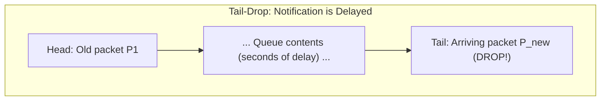
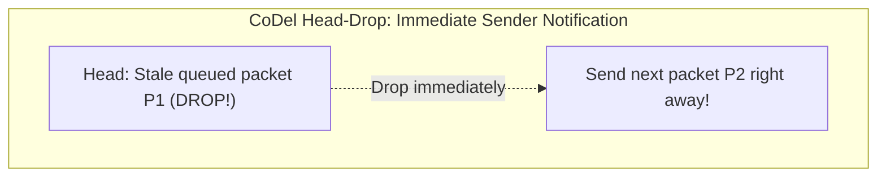
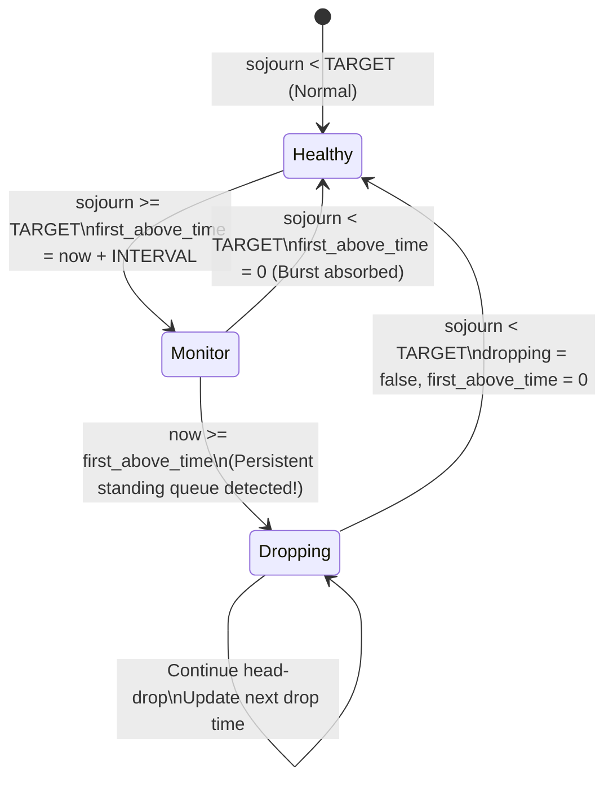

# 23. Hands-on (6): Building CoDel AQM and FQ-CoDel with BPF and packetdrill


In this track, you will implement **CoDel (Controlled Delay AQM: RFC 8289)** and **FQ-CoDel (FlowQueue-CoDel: RFC 8290)** from scratch using Linux kernel BPF `struct_ops` (`struct Qdisc_ops`). These algorithms were designed to solve one of the greatest challenges in the modern Internet: **Bufferbloat**.

No prior knowledge of Linux traffic control or queuing theory is assumed. We will start from first principles: why oversized buffers cause latency explosions, why traditional tail-drop fails, and how CoDel surgically identifies and drops packets from standing queues while preserving throughput.

---

## 1. What is Bufferbloat?

For years, network equipment designers (home routers, Wi-Fi access points, cellular base stations, switches) operated under the assumption that "packet loss is bad." As memory costs dropped, packet buffers grew dramatically (from megabytes to gigabytes).

However, loss-based TCP congestion control algorithms (such as Reno and CUBIC) **keep increasing the sending window until a packet loss occurs**. As a result, the following pathological behavior emerges:

```text
Sender (TCP Reno/CUBIC)
   |
   | Continuously increases congestion window (cwnd)
   v
[ Huge FIFO buffer at bottleneck router (thousands of packets) ]
   |  P1 | P2 | P3 | P4 | P5 | ... | P1000 | ...
   |  <- Packets sit stuck in the queue for seconds! (Massive latency) ->
   v
Receiver (Eventually receives packets seconds later and ACKs)
```

1. **Formation of a Standing Queue**:
   - Because router buffers are enormous, packets do not overflow easily (no loss occurs).
   - The sender's TCP assumes the network has spare capacity and continues expanding `cwnd`, filling the buffer to capacity.
2. **Latency Explosion**:
   - Once the buffer is full, every new packet must wait at the tail of a massive queue, waiting for the bottleneck link to drain.
   - A link that should have a 10 ms round-trip time now experiences 1–2 seconds of queueing delay.
3. **Starvation of Interactive Traffic**:
   - When a bulk download or background backup runs, interactive traffic (DNS lookups, SSH typing, web browsing, online gaming, VoIP calls) is stuck behind thousands of bulk packets, causing extreme lag and frozen calls.

This phenomenon—where oversized buffers are persistently full of packets, leading to severe latency degradation—is called **Bufferbloat**.

---

## 2. Tail-Drop vs. Head-Drop: Why Drop from the Front?

In traditional simple FIFO queues, when the buffer is completely full (`sch->limit` reached), newly arriving packets are discarded at the tail. This is called **Tail-Drop**.

Tail-drop suffers from two critical flaws:



- **Delayed Feedback Signal**:
  - The drop of the newly arrived packet at the tail cannot be detected by the sender until all old packets currently sitting ahead of it in the queue have been transmitted.
  - By the time the sender detects loss via duplicate ACKs or SACK, seconds have elapsed and the network is already severely congested.
- **Global Synchronization**:
  - When the buffer overflows, packets from multiple concurrent TCP flows are dropped simultaneously, causing all flows to halve their windows at the same time and resulting in link underutilization.

### CoDel's Head-Drop

CoDel solves this by dropping the **oldest packet at the head of the queue** at the moment of dequeue.



- When the head packet is dropped and the next packet ($$P_2$$) is sent immediately, the receiver immediately generates a SACK / duplicate ACK and sends it back to the sender.
- The sender discovers packet loss in the **shortest possible time (within 1 RTT)** and reduces its transmission rate promptly.
- Stale packets are discarded, allowing fresher packets to reach the wire faster.

---

## 3. CoDel (RFC 8289) Algorithm: Control via Sojourn Time

The fundamental insight of CoDel (Controlled Delay) is to **measure packet sojourn time (queue delay) rather than queue length (packet or byte count)**.

### Good Queues vs. Bad Queues

- **Good Queue (Transient Burst)**:
  - When a web page loads, a burst of 100 packets may arrive. If the link is fast, this burst is drained within a few milliseconds, and the queue quickly empties. This burst must be absorbed by the buffer without dropping packets.
- **Bad Queue (Persistent Standing Queue)**:
  - The queue never empties over tens or hundreds of milliseconds; every packet experiences high delay. This is Bufferbloat—a bad queue that must be drained.

### Sojourn Time and State Transitions

When a packet is enqueued, its arrival timestamp is recorded (`enqueue_time`). At dequeue time, the sojourn time is calculated:

$$\text{sojourn} = \text{now} - \text{enqueue-time}$$



1. **`TARGET` (Acceptable Sojourn Time, standard 5 ms)**:
   - If packet sojourn time is below `TARGET`, the queue is healthy and no drops occur.
2. **`INTERVAL` (Observation Window, standard 100 ms, shortened to 20 ms in this lab)**:
   - When `sojourn >= TARGET`, this might be a transient burst. Rather than dropping immediately, CoDel sets `first_above_time = now + INTERVAL` to observe.
   - If the sojourn time drops below `TARGET` at any point during `INTERVAL`, the burst is deemed resolved and the timer is reset.
3. **Head-Drop Execution**:
   - If `sojourn >= TARGET` persists for the entire `INTERVAL`, CoDel concludes a persistent standing queue exists.
   - It transitions to `dropping = true`, drops the dequeued head packet, and transmits the subsequent packet immediately.

---

## 4. FQ-CoDel (RFC 8290): Flow Isolation and Sparse Flow Prioritization

Applying CoDel to a single FIFO queue mitigates Bufferbloat, but when multiple heavy download flows run concurrently, interactive traffic (DNS, TCP ACKs, SSH keystrokes, VoIP) still gets mixed in with bulk packets.

**FQ-CoDel** combines **Fair Queueing** with **CoDel AQM** to provide complete isolation and zero-delay treatment for interactive traffic.

```text
Arriving packet (skb)
   |
   +---> Hash (IP 5-tuple) maps to flow bucket
           |
           +---> [ Flow A (Bulk download: many packets) ] ---> old_flows (Subject to CoDel head-drops)
           |
           +---> [ Flow B (SSH / DNS / Gaming: sparse)   ] ---> new_flows (Highest dequeue priority!)
```

### Deficit Round Robin (DRR) with Two Lists

FQ-CoDel manages active flows using two circular linked lists: **`new_flows`** and **`old_flows`**.

1. **Automatic Preference for Sparse Flows**:
   - Interactive communications (web clicks, DNS queries, SSH keystrokes) send packets intermittently.
   - When a packet arrives for an idle flow, the flow is added to the tail of **`new_flows`**.
   - Dequeue **always services `new_flows` before `old_flows`**.
   - As a result, interactive packets jump ahead of standing bulk queues, experiencing **zero added queuing delay (`sojourn < TARGET`) and zero packet loss**!
2. **Bulk Flow Isolation and CoDel**:
   - Flows continuously streaming large volumes of data exhaust their round credit (`quantum = 1000` bytes) and are moved to **`old_flows`**.
   - Flows in `old_flows` share bandwidth fairly via Deficit Round Robin.
   - Each flow maintains independent CoDel state (`first_above_time`, `dropping`). **Only the bulk flow causing buffer buildup suffers head-drops, while other flows remain completely unaffected**.

---

## 5. Lab Steps and Commands

This track consists of two steps:

| Step | Directory | Description |
| :--- | :--- | :--- |
| **Step 1** | [`step01-codel-aqm/`](step01-codel-aqm/README.en.md) | Single-queue CoDel AQM. Implement enqueue timestamp stamping, bottleneck transmission rate control (Watchdog timer), sojourn time evaluation, and head-drop state transitions. |
| **Step 2** | [`step02-fq-codel/`](step02-fq-codel/README.en.md) | Complete FQ-CoDel. Implement 5-tuple flow classification, DRR scheduling with `new_flows` and `old_flows`, per-flow CoDel state tracking, and sparse flow prioritization. |

### Running Tests

From the `labs/` directory (`/usr/local/google/home/kuniyu/tcp-eli5/labs`), test each step using `run_test.sh`:

```sh
# Step 1: Verify starter fails, then implement TODOs to pass
./run_test.sh qdisc-fq-codel/step01-codel-aqm starter
./run_test.sh qdisc-fq-codel/step01-codel-aqm solution

# Step 2: Verify starter fails, then test solution
./run_test.sh qdisc-fq-codel/step02-fq-codel starter
./run_test.sh qdisc-fq-codel/step02-fq-codel solution
```

Proceed to [`step01-codel-aqm/README.en.md`](step01-codel-aqm/README.en.md) to implement your first CoDel AQM!


---

## Step 1: Single-Queue CoDel (Controlled Delay) AQM


## 1. Learning Goals

In this step, you will implement Linux kernel `struct Qdisc_ops` using BPF `struct_ops` to build the foundational active queue management (AQM) algorithm of **CoDel (RFC 8289)** from scratch.

- For general background on Bufferbloat and queuing dynamics, refer to the [Track README](#).

---

## 2. Algorithm and Background

### 2.1 Measuring Sojourn Time Instead of Queue Length

Traditional queue management schemes like Tail-Drop or RED (Random Early Detection) drop packets based on instantaneous queue occupancy (packet or byte counts).

However, queue length is an unreliable indicator of delay:
- On a 10 Gbps link, a queue of 100 packets drains in just 0.12 ms.
- On a 1 Mbps link, that same 100-packet queue takes 1.2 seconds to drain.

Because identical packet counts produce vastly different delays across different link speeds, CoDel measures the **time packets actually spend waiting in the queue (sojourn time)**:

$$\text{sojourn} = t_{\text{dequeue}} - t_{\text{enqueue}}$$

### 2.2 Distinguishing Good Queues from Bad Queues

- **Good Queue (Transient Burst)**:
  - During web browsing or bursty application activity, bursts of packets arrive simultaneously.
  - On healthy networks, these packets are absorbed into buffers and drained rapidly. While sojourn time spikes temporarily, it quickly falls back to zero.
- **Bad Queue (Persistent Standing Queue)**:
  - When a TCP sender continuously drives large amounts of traffic exceeding bottleneck bandwidth, the queue never drains.
  - Sojourn time remains elevated over an extended duration.

CoDel determines whether a standing queue exists by tracking whether **the minimum sojourn time over an observation window (`INTERVAL`) has persistently exceeded a target delay (`TARGET`)**.

### 2.3 CoDel State Transitions

CoDel is governed by two primary parameters:
- **`TARGET_NS`**: Target sojourn time (standard 5 ms = $$5,000,000\text{ ns}$$).
- **`INTERVAL_NS`**: Sliding observation window (standard 100 ms, shortened to $$20\text{ ms} = 20,000,000\text{ ns}$$ in this lab).

```mermaid
flowchart TD
    Start["Pop packet from queue (bpf_codel_dequeue)"] --> Calc["Compute sojourn = now - enqueue_time"]
    Calc --> CondTarget{"sojourn < TARGET_NS ?"}

    CondTarget -->|Yes: Normal (Good Queue)| Reset["first_above_time = 0\ndropping = false\n(Proceed to send)"]
    CondTarget -->|No: High delay| CheckTimer{"first_above_time == 0 ?"}

    CheckTimer -->|Yes: First time exceeding TARGET| ArmTimer["first_above_time = now + INTERVAL_NS\n(Start observation window)"]
    CheckTimer -->|No: Timer running| CheckExpire{"now >= first_above_time ?"}

    CheckExpire -->|No: INTERVAL not yet elapsed| NormalSend["Possibly transient: send packet"]
    CheckExpire -->|Yes: Delay above TARGET for entire INTERVAL!| DropState["dropping = true\nHead-Drop this stale packet!\nImmediately dequeue and send next packet"]

    Reset --> SendWire["Transmit packet to wire"]
    ArmTimer --> SendWire
    NormalSend --> SendWire
    DropState --> SendWire
```

1. **When `sojourn < TARGET_NS`**:
   - Queuing delay is healthy. Reset `first_above_time = 0` and `dropping = false`, and transmit normally.
2. **When `sojourn >= TARGET_NS`**:
   - If `first_above_time == 0` (initial excursion), set `first_above_time = now + INTERVAL_NS` to start observing without dropping.
   - If `now >= first_above_time`, the queue has failed to drain during the entire interval, confirming a persistent standing queue.
   - Transition to `dropping = true`, drop this head packet via `bpf_kfree_skb(skb)` (**Head-Drop**), and dequeue the next packet to notify the sender via SACK/duplicate ACKs immediately.

---

## 3. Code Architecture and Invariants

### `struct skb_node` and BPF Linked List

```c
struct skb_node {
	__u64 enqueue_time;
	struct sk_buff __kptr *skb;
	struct bpf_list_node node;
};

private(A) struct bpf_spin_lock codel_lock;
private(A) struct bpf_list_head codel_queue __contains(skb_node, node);
```

- Packets are queued in an intrusive linked list (`bpf_list_head` / `bpf_list_node`).
- Enqueue stamps `skbn->enqueue_time = bpf_ktime_get_ns();` and dequeue evaluates queue latency.

### State Variables

- `next_tx_ns`: Target completion time for the current transmission (`BOTTLENECK_NS = 4,000,000ULL`). Paces dequeue to simulate a bottleneck link.
- `first_above_time`: Expiration timestamp (`now + INTERVAL_NS`) set when sojourn time first crosses `TARGET_NS`.
- `dropping`: Boolean flag indicating whether the AQM is currently in the dropping state.
- `drop_count`: Counter tracking the number of head-dropped packets.

---

## 3.5 Socratic Design Checkpoints

Before implementing the TODOs in `starter.bpf.c`, reason through these three design questions:

### Q1. Measuring Sojourn Time: Why measure `now - enqueue_time` instead of queue length (`qlen`)?

<details>
<summary>Hint and Answer</summary>

- **Hint**: Compare the queuing delay of 100 packets on a 10 Gbps link versus a 1 Mbps link.
- **Answer**: **Queue length does not directly translate to queuing delay because link drain rates vary by orders of magnitude.**
  By stamping `skbn->enqueue_time = bpf_ktime_get_ns()` at enqueue and computing `sojourn = now - enqueue_time` at dequeue, CoDel directly measures actual packet waiting time independent of link bandwidth.

</details>

### Q2. Observation Window (`INTERVAL_NS`): Why not drop immediately as soon as `sojourn >= TARGET_NS`?

<details>
<summary>Hint and Answer</summary>

- **Hint**: Recall the distinction between a transient burst (Good Queue) and a persistent standing queue (Bad Queue).
- **Answer**: **To avoid penalizing short-lived, transient packet bursts that buffers are meant to absorb.**
  When `sojourn >= TARGET_NS` is first observed (`first_above_time == 0`), CoDel sets `first_above_time = now + INTERVAL_NS` and lets the packet pass. It only enters `dropping = true` and performs a head-drop if `sojourn >= TARGET_NS` persists until `now >= first_above_time`.

</details>

### Q3. Head-Drop Mechanics: After freeing the stale head packet with `bpf_kfree_skb(skb)`, why must `.dequeue()` immediately pop and return the next packet?

<details>
<summary>Hint and Answer</summary>

- **Hint**: What happens to link utilization and receiver SACK generation if `.dequeue()` returns `NULL` instead?
- **Answer**: **To remain work-conserving and immediately deliver the subsequent packet so the receiver generates a SACK / duplicate ACK without delay.**
  Transmitting the fresher second packet right away notifies the TCP sender of the drop within 1 RTT.

</details>

---

## 4. Implementation Steps (TODO List)

Implement the two TODOs in `bpf_codel_dequeue()` inside [`starter.bpf.c`](starter.bpf.c).

### TODO 1: Bottleneck Link Rate Control (Watchdog Timer)

Check if the current time is earlier than `next_tx_ns`. If so, schedule the watchdog timer and return `NULL`:

```c
now = bpf_ktime_get_ns();
if (now < next_tx_ns) {
	bpf_qdisc_watchdog_schedule(sch, next_tx_ns, 0);
	return NULL;
}
```

### TODO 2: CoDel AQM State Machine

After popping the packet from the linked list, calculate `sojourn = now - enqueue_time` and apply CoDel dropping logic:

```c
sojourn = now - enqueue_time;
if (sojourn < TARGET_NS) {
	first_above_time = 0;
	dropping = false;
} else {
	if (first_above_time == 0) {
		first_above_time = now + INTERVAL_NS;
	} else if (now >= first_above_time) {
		dropping = true;
		drop_count++;
		sch->qstats.backlog -= qdisc_pkt_len(skb);
		sch->q.qlen--;
		sch->qstats.drops++;
		bpf_kfree_skb(skb);
		skb = NULL;

		/* Immediately dequeue and transmit the next packet */
		bpf_spin_lock(&codel_lock);
		node = bpf_list_pop_front(&codel_queue);
		bpf_spin_unlock(&codel_lock);
		if (!node)
			return NULL;

		skbn = container_of(node, struct skb_node, node);
		skb = bpf_kptr_xchg(&skbn->skb, skb);
		bpf_obj_drop(skbn);
		if (!skb)
			return NULL;
	}
}
```

---

## 5. Verification with Packetdrill

The test script [`test.pkt`](test.pkt) automatically tests:
1. Installing the qdisc: `tc qdisc replace dev tun0 root bpf_codel`.
2. Establishing a TCP connection and transmitting 10 segments (1000 bytes each, 10 KB total).
3. Bottleneck serialization pacing (4 ms per packet) causes packets to queue up.
4. As queue sojourn exceeds `TARGET_NS (5 ms)` and sustains past `INTERVAL_NS (20 ms)`, CoDel head-drops a stale packet.
5. The receiver immediately detects the gap and returns SACK `8001:10001`, prompting the sender to throttle its congestion window.

### Running Tests

```sh
# Verify starter fails (as it lacks drop logic)
./run_test.sh qdisc-fq-codel/step01-codel-aqm starter

# Verify solution passes
./run_test.sh qdisc-fq-codel/step01-codel-aqm solution
```

After completing Step 1, advance to [`step02-fq-codel/`](../step02-fq-codel/README.en.md) to implement multi-flow isolation and sparse flow prioritization!


### `labs/qdisc-fq-codel/step01-codel-aqm/starter.bpf.c` (Starter skeleton)

```c
// SPDX-License-Identifier: GPL-2.0
#include "vmlinux.h"
#include "bpf_qdisc_helpers.h"

char _license[] SEC("license") = "GPL";

#define TARGET_NS	5000000ULL	/* 5 ms target sojourn time */
#define INTERVAL_NS	20000000ULL	/* 20 ms sliding minimum window */
#define BOTTLENECK_NS	4000000ULL	/* 4 ms bottleneck serialization rate */

struct skb_node {
	__u64 enqueue_time;
	struct sk_buff __kptr *skb;
	struct bpf_list_node node;
};

private(A) struct bpf_spin_lock codel_lock;
private(A) struct bpf_list_head codel_queue __contains(skb_node, node);

static __u64 next_tx_ns;
static __u64 first_above_time;
static __u32 drop_count;
static bool dropping;

SEC("struct_ops/bpf_codel_enqueue")
int BPF_PROG(bpf_codel_enqueue, struct sk_buff *skb, struct Qdisc *sch,
	     struct bpf_sk_buff_ptr *to_free)
{
	struct skb_node *skbn;
	u32 pkt_len;

	if (sch->q.qlen >= sch->limit)
		goto drop;

	skbn = bpf_obj_new(typeof(*skbn));
	if (!skbn)
		goto drop;

	/* Stamp arrival timestamp to measure sojourn time in dequeue */
	skbn->enqueue_time = bpf_ktime_get_ns();
	pkt_len = qdisc_pkt_len(skb);

	sch->q.qlen++;
	skb = bpf_kptr_xchg(&skbn->skb, skb);
	if (skb)
		bpf_qdisc_skb_drop(skb, to_free);

	bpf_spin_lock(&codel_lock);
	bpf_list_push_back(&codel_queue, &skbn->node);
	bpf_spin_unlock(&codel_lock);

	sch->qstats.backlog += pkt_len;
	return NET_XMIT_SUCCESS;

drop:
	bpf_qdisc_skb_drop(skb, to_free);
	sch->qstats.drops++;
	return NET_XMIT_DROP;
}

SEC("struct_ops/bpf_codel_dequeue")
struct sk_buff *BPF_PROG(bpf_codel_dequeue, struct Qdisc *sch)
{
	struct bpf_list_node *node;
	struct sk_buff *skb = NULL;
	struct skb_node *skbn;
	u64 now, enqueue_time, sojourn;

	if (!sch->q.qlen)
		return NULL;

	now = bpf_ktime_get_ns();

	/* TODO 1: Enforce bottleneck link rate (BOTTLENECK_NS).
	 * If now < next_tx_ns, schedule the watchdog timer:
	 *   bpf_qdisc_watchdog_schedule(sch, next_tx_ns, 0);
	 * and return NULL.
	 */

	bpf_spin_lock(&codel_lock);
	node = bpf_list_pop_front(&codel_queue);
	bpf_spin_unlock(&codel_lock);
	if (!node)
		return NULL;

	skbn = container_of(node, struct skb_node, node);
	skb = bpf_kptr_xchg(&skbn->skb, skb);
	enqueue_time = skbn->enqueue_time;
	bpf_obj_drop(skbn);
	if (!skb)
		return NULL;

	/* TODO 2: CoDel Active Queue Management (AQM) state machine.
	 *
	 * Compute packet sojourn time:
	 *   sojourn = now - enqueue_time;
	 *
	 * 1. If sojourn < TARGET_NS (healthy delay):
	 *    - Reset first_above_time = 0;
	 *    - Reset dropping = false;
	 *
	 * 2. Else (sojourn >= TARGET_NS, standing queue delay detected):
	 *    - If first_above_time == 0:
	 *        first_above_time = now + INTERVAL_NS;
	 *    - Else if now >= first_above_time:
	 *        // Persistent bufferbloat! Enter dropping state and head-drop
	 *        // this stale packet, then dequeue the next fresher packet.
	 *        dropping = true;
	 *        drop_count++;
	 *        sch->qstats.backlog -= qdisc_pkt_len(skb);
	 *        sch->q.qlen--;
	 *        sch->qstats.drops++;
	 *        bpf_kfree_skb(skb);
	 *        skb = NULL;
	 *
	 *        bpf_spin_lock(&codel_lock);
	 *        node = bpf_list_pop_front(&codel_queue);
	 *        bpf_spin_unlock(&codel_lock);
	 *        if (!node)
	 *            return NULL;
	 *
	 *        skbn = container_of(node, struct skb_node, node);
	 *        skb = bpf_kptr_xchg(&skbn->skb, skb);
	 *        bpf_obj_drop(skbn);
	 *        if (!skb)
	 *            return NULL;
	 */

	next_tx_ns = now + BOTTLENECK_NS;
	sch->qstats.backlog -= qdisc_pkt_len(skb);
	bpf_qdisc_bstats_update(sch, skb);
	sch->q.qlen--;

	return skb;
}

SEC("struct_ops/bpf_codel_init")
int BPF_PROG(bpf_codel_init, struct Qdisc *sch, struct nlattr *opt,
	     struct netlink_ext_ack *extack)
{
	sch->limit = 1000;
	next_tx_ns = 0;
	first_above_time = 0;
	drop_count = 0;
	dropping = false;
	return 0;
}

SEC("struct_ops/bpf_codel_reset")
void BPF_PROG(bpf_codel_reset, struct Qdisc *sch)
{
	struct bpf_list_node *node;
	struct skb_node *skbn;
	int i;

	bpf_for(i, 0, sch->q.qlen) {
		struct sk_buff *skb = NULL;

		bpf_spin_lock(&codel_lock);
		node = bpf_list_pop_front(&codel_queue);
		bpf_spin_unlock(&codel_lock);

		if (!node)
			break;

		skbn = container_of(node, struct skb_node, node);
		skb = bpf_kptr_xchg(&skbn->skb, skb);
		if (skb)
			bpf_kfree_skb(skb);
		bpf_obj_drop(skbn);
	}
	sch->q.qlen = 0;
	sch->qstats.backlog = 0;
	next_tx_ns = 0;
	first_above_time = 0;
	drop_count = 0;
	dropping = false;
}

SEC("struct_ops")
void BPF_PROG(bpf_codel_destroy, struct Qdisc *sch)
{
}

SEC(".struct_ops")
struct Qdisc_ops codel = {
	.enqueue   = (void *)bpf_codel_enqueue,
	.dequeue   = (void *)bpf_codel_dequeue,
	.init      = (void *)bpf_codel_init,
	.reset     = (void *)bpf_codel_reset,
	.destroy   = (void *)bpf_codel_destroy,
	.id        = "bpf_codel",
};
```

### `labs/qdisc-fq-codel/step01-codel-aqm/test.pkt` (packetdrill test)

```python
// SPDX-License-Identifier: GPL-2.0
// Step 1: Test CoDel AQM sojourn-based head-drop under standing queue

0.00 `tc qdisc replace dev tun0 root bpf_codel`
0.00 `ip link set dev tun0 gso_max_size 1500 gso_max_segs 1`

// Establish passive TCP connection with fast handshake for TSQ pacing
+0.00 socket(..., SOCK_STREAM, IPPROTO_TCP) = 3
+0.00 setsockopt(3, SOL_SOCKET, SO_REUSEADDR, [1], 4) = 0
+0.00 bind(3, ..., ...) = 0
+0.00 listen(3, 1) = 0

+0.00 < S 0:0(0) win 32792 <mss 1000,sackOK,nop,nop,nop,wscale 7>
+0.00 > S. 0:0(0) ack 1 <mss 1460,nop,nop,sackOK,nop,wscale 7>
+0.0001 < . 1:1(0) ack 1 win 65535
+0.00 accept(3, ..., ...) = 4

// Send 10 segments (10,000 bytes) with MSS 1000 (payload 1000 bytes).
// BOTTLENECK_NS = 4ms, TARGET_NS = 5ms, INTERVAL_NS = 20ms.
// P1 departs at 0ms.
// P2 departs at 4ms (sojourn = 4ms < 5ms).
// P3 departs at 8ms (sojourn = 8ms >= 5ms -> first_above_time = 28ms).
// P4 departs at 12ms.
// P5 departs at 16ms.
// P6 departs at 20ms.
// P7 departs at 24ms.
// At 28ms, now >= first_above_time (28ms):
// CoDel head-drops P8 (7001:8001), and transmits P9 (8001:9001)!
// At 32ms, P10 (9001:10001) departs.
+0.00 write(4, ..., 10000) = 10000
+0.004 > . 1:1001(1000) ack 1
+0.004 > . 1001:2001(1000) ack 1
+0.004 > . 2001:3001(1000) ack 1
+0.004 > . 3001:4001(1000) ack 1
+0.004 > . 4001:5001(1000) ack 1
+0.004 > . 5001:6001(1000) ack 1
// P7 (6001:7001) is dropped by CoDel; P8 (7001:8001) is transmitted:
+0.004 > . 7001:8001(1000) ack 1
+0.004 > . 8001:9001(1000) ack 1
+0.004 > P. 9001:10001(1000) ack 1

// Client sends SACK for P8-P10, missing P7:
+0.00 < . 1:1(0) ack 6001 win 257 <sack 7001:10001,nop,nop>

// Verify that CoDel recorded at least 1 drop even though limit was 1000!
+0.01 `tc -s qdisc show dev tun0 | grep -q "dropped [1-9]"`
```

<details>
<summary>Reference solution: <code>labs/qdisc-fq-codel/step01-codel-aqm/solution.bpf.c</code></summary>

```c
// SPDX-License-Identifier: GPL-2.0
#include "vmlinux.h"
#include "bpf_qdisc_helpers.h"

char _license[] SEC("license") = "GPL";

#define TARGET_NS	5000000ULL	/* 5 ms target sojourn time */
#define INTERVAL_NS	20000000ULL	/* 20 ms sliding minimum window */
#define BOTTLENECK_NS	4000000ULL	/* 4 ms bottleneck serialization rate */

struct skb_node {
	__u64 enqueue_time;
	struct sk_buff __kptr *skb;
	struct bpf_list_node node;
};

private(A) struct bpf_spin_lock codel_lock;
private(A) struct bpf_list_head codel_queue __contains(skb_node, node);

static __u64 next_tx_ns;
static __u64 first_above_time;
static __u32 drop_count;
static bool dropping;

SEC("struct_ops/bpf_codel_enqueue")
int BPF_PROG(bpf_codel_enqueue, struct sk_buff *skb, struct Qdisc *sch,
	     struct bpf_sk_buff_ptr *to_free)
{
	struct skb_node *skbn;
	u32 pkt_len;

	if (sch->q.qlen >= sch->limit)
		goto drop;

	skbn = bpf_obj_new(typeof(*skbn));
	if (!skbn)
		goto drop;

	skbn->enqueue_time = bpf_ktime_get_ns();
	pkt_len = qdisc_pkt_len(skb);

	sch->q.qlen++;
	skb = bpf_kptr_xchg(&skbn->skb, skb);
	if (skb)
		bpf_qdisc_skb_drop(skb, to_free);

	bpf_spin_lock(&codel_lock);
	bpf_list_push_back(&codel_queue, &skbn->node);
	bpf_spin_unlock(&codel_lock);

	sch->qstats.backlog += pkt_len;
	return NET_XMIT_SUCCESS;

drop:
	bpf_qdisc_skb_drop(skb, to_free);
	sch->qstats.drops++;
	return NET_XMIT_DROP;
}

SEC("struct_ops/bpf_codel_dequeue")
struct sk_buff *BPF_PROG(bpf_codel_dequeue, struct Qdisc *sch)
{
	struct bpf_list_node *node;
	struct sk_buff *skb = NULL;
	struct skb_node *skbn;
	u64 now, enqueue_time, sojourn;

	if (!sch->q.qlen)
		return NULL;

	now = bpf_ktime_get_ns();
	if (now < next_tx_ns) {
		bpf_qdisc_watchdog_schedule(sch, next_tx_ns, 0);
		return NULL;
	}

	bpf_spin_lock(&codel_lock);
	node = bpf_list_pop_front(&codel_queue);
	bpf_spin_unlock(&codel_lock);
	if (!node)
		return NULL;

	skbn = container_of(node, struct skb_node, node);
	skb = bpf_kptr_xchg(&skbn->skb, skb);
	enqueue_time = skbn->enqueue_time;
	bpf_obj_drop(skbn);
	if (!skb)
		return NULL;

	sojourn = now - enqueue_time;
	if (sojourn < TARGET_NS) {
		first_above_time = 0;
		dropping = false;
	} else {
		if (first_above_time == 0) {
			first_above_time = now + INTERVAL_NS;
		} else if (now + 1000000ULL >= first_above_time) {
			dropping = true;
			drop_count++;
			first_above_time = now + INTERVAL_NS;
			sch->qstats.backlog -= qdisc_pkt_len(skb);
			sch->q.qlen--;
			sch->qstats.drops++;
			bpf_kfree_skb(skb);
			skb = NULL;

			bpf_spin_lock(&codel_lock);
			node = bpf_list_pop_front(&codel_queue);
			bpf_spin_unlock(&codel_lock);
			if (!node)
				return NULL;

			skbn = container_of(node, struct skb_node, node);
			skb = bpf_kptr_xchg(&skbn->skb, skb);
			bpf_obj_drop(skbn);
			if (!skb)
				return NULL;
		}
	}

	next_tx_ns = now + BOTTLENECK_NS;
	sch->qstats.backlog -= qdisc_pkt_len(skb);
	bpf_qdisc_bstats_update(sch, skb);
	sch->q.qlen--;

	return skb;
}

SEC("struct_ops/bpf_codel_init")
int BPF_PROG(bpf_codel_init, struct Qdisc *sch, struct nlattr *opt,
	     struct netlink_ext_ack *extack)
{
	sch->limit = 1000;
	next_tx_ns = 0;
	first_above_time = 0;
	drop_count = 0;
	dropping = false;
	return 0;
}

SEC("struct_ops/bpf_codel_reset")
void BPF_PROG(bpf_codel_reset, struct Qdisc *sch)
{
	struct bpf_list_node *node;
	struct skb_node *skbn;
	int i;

	bpf_for(i, 0, sch->q.qlen) {
		struct sk_buff *skb = NULL;

		bpf_spin_lock(&codel_lock);
		node = bpf_list_pop_front(&codel_queue);
		bpf_spin_unlock(&codel_lock);

		if (!node)
			break;

		skbn = container_of(node, struct skb_node, node);
		skb = bpf_kptr_xchg(&skbn->skb, skb);
		if (skb)
			bpf_kfree_skb(skb);
		bpf_obj_drop(skbn);
	}
	sch->q.qlen = 0;
	sch->qstats.backlog = 0;
	next_tx_ns = 0;
	first_above_time = 0;
	drop_count = 0;
	dropping = false;
}

SEC("struct_ops")
void BPF_PROG(bpf_codel_destroy, struct Qdisc *sch)
{
}

SEC(".struct_ops")
struct Qdisc_ops codel = {
	.enqueue   = (void *)bpf_codel_enqueue,
	.dequeue   = (void *)bpf_codel_dequeue,
	.init      = (void *)bpf_codel_init,
	.reset     = (void *)bpf_codel_reset,
	.destroy   = (void *)bpf_codel_destroy,
	.id        = "bpf_codel",
};
```

</details>


---

## Step 2: Complete FQ-CoDel (Flow Isolation and 2-List DRR + Per-Flow CoDel)


## 1. Learning Goals

In this step, you will integrate **Flow Classification** and **Deficit Round Robin (DRR) with two circular lists (`new_flows` and `old_flows`)** into the CoDel AQM from Step 1, completing the full **FQ-CoDel (RFC 8290)** algorithm from scratch.

- For general background on Bufferbloat and queuing dynamics, refer to the [Track README](#).

---

## 2. Algorithm and Background

### 2.1 Why CoDel Alone Is Not Sufficient

In Step 1, we observed that single-queue CoDel successfully mitigates Bufferbloat by detecting persistent standing queues and dropping stale packets from the head.

However, in a single FIFO queue, **bulk download flows and interactive lightweight flows (SSH keystrokes, DNS queries, web requests, gaming packets, VoIP) share the same queue**:
- When a bulk transfer saturates the bottleneck link, a newly arriving SSH keystroke packet must wait behind thousands of bytes of bulk data.
- Furthermore, when CoDel triggers a head-drop, an interactive packet might be collateral damage if it happens to be at the head of the shared queue.

### 2.2 The Three Pillars of FQ-CoDel

FQ-CoDel resolves these limitations through three complementary mechanisms:

```text
Packet Arrival
   |
   +---> [1] Flow Classification (IP 5-tuple hash) maps to flow bucket
           |
           +---> [2] 2-List DRR: Sparse flows (new_flows) dequeued with top priority!
           |
           +---> [3] Per-Flow CoDel: Surgical head-drops exclusively on bloated bulk flows!
```

1. **Flow Classification**:
   - Packets are hashed by socket (`sk->__sk_common.skc_hash`) or 5-tuple (`bpf_skb_get_hash(skb)`), isolating each TCP connection into its own queue.
2. **Deficit Round Robin (DRR) Scheduling with Two Lists**:
   - **`new_flows`**: Hosts idle flows that just received packets or newly created flows.
   - **`old_flows`**: Hosts bulk flows that have exhausted their round deficit credit (`quantum = 1500` bytes).
   - The scheduler **always serves `new_flows` before `old_flows`**. Sparse interactive flows (like SSH, DNS, or gaming) arrive intermittently when their flow queue is empty, so they enter `new_flows` and are dequeued immediately—experiencing **zero queue latency (`sojourn < TARGET`) and zero packet loss**!
3. **Per-Flow CoDel AQM**:
   - CoDel state variables (`first_above_time`, `dropping`) are maintained **independently inside each `struct fq_codel_flow`**.
   - Only the bulk flow filling the buffer suffers head-drops. Sparse and well-behaved flows are completely shielded.

---

## 3. Code Architecture and Invariants

### `struct bpf_fq_codel_flow` (Flow Control Block)

```c
struct bpf_fq_codel_flow {
	s64 credit;                 /* DRR credit allowance (bytes, s64) */
	u32 qlen;                   /* Number of packets currently queued */
	u64 age;                    /* 0: active on a list, 1: idle/detached */
	u64 first_above_time;       /* CoDel: observation window expiration */
	u32 drop_count;             /* CoDel: packets dropped in this flow */
	bool dropping;              /* CoDel: dropping state flag */
	struct bpf_list_node list_node; /* Node for new_flows / old_flows */
	struct bpf_list_head queue __contains(skb_node, node); /* Flow skb queue */
	struct bpf_spin_lock lock;  /* Flow queue spinlock */
	struct bpf_refcount refcount; /* BPF refcount for lifecycle management */
};
```

### 2-List DRR State

- `new_flows`: Intrusive list of sparse/new flows. Dequeued with strict priority over `old_flows`.
- `old_flows`: Intrusive list of bulk flows sharing bandwidth round-robin.
- `next_tx_ns`: Pacing timestamp enforcing bottleneck serialization rate (`BOTTLENECK_NS = 4,000,000ULL`).

---

## 3.5 Socratic Design Checkpoints

Before implementing the TODOs in `starter.bpf.c`, reason through these three design questions:

### Q1. Sparse Flow Prioritization: Why maintain two separate lists (`new_flows` and `old_flows`) instead of a single round-robin list?

<details>
<summary>Hint and Answer</summary>

- **Hint**: Consider how a newly arriving single-packet SSH or DNS flow is scheduled when bulk flows are active.
- **Answer**: **To guarantee that intermittent, latency-sensitive sparse flows always jump ahead of backlogged bulk flows.**
  Idle flows entering the active state are placed on `new_flows`, and `.dequeue()` always drains `new_flows` before servicing `old_flows`.

</details>

### Q2. Credit Exhaustion and Demotion: When does a flow transition from `new_flows` to `old_flows`?

<details>
<summary>Hint and Answer</summary>

- **Hint**: Track what happens to `flow->credit` as packets are transmitted.
- **Answer**: **When a flow's `credit` drops to `<= 0` after transmitting packets.**
  A sparse flow empties its queue before exhausting its credit and detaches cleanly, whereas a bulk flow with more packets queued exhausts its credit, receives `flow->credit += QUANTUM`, and is appended to the tail of `old_flows`.

</details>

### Q3. Per-Flow CoDel Isolation: Why store `first_above_time` and `dropping` inside `struct bpf_fq_codel_flow` rather than as global variables?

<details>
<summary>Hint and Answer</summary>

- **Hint**: What would happen to a healthy flow if CoDel state were shared globally across all flows?
- **Answer**: **To isolate AQM drops strictly to the specific flow building a standing queue.**
  With per-flow CoDel state, only the congested bulk flow (Flow A) crosses `TARGET_NS` for `INTERVAL_NS` and undergoes head-dropping, while sparse flows (Flow B) experience low sojourn times and zero drops.

</details>

---

## 4. Implementation Steps (TODO List)

Implement the three TODOs inside `bpf_fq_codel_dequeue()` in [`starter.bpf.c`](starter.bpf.c).

### TODO 1: Flow Selection via 2-List DRR

Check `new_flows` first; if empty, fall back to `old_flows`:

```c
bpf_spin_lock(&new_flows_lock);
node = bpf_list_pop_front(&new_flows);
if (node) {
	new_flow_cnt--;
	is_new = true;
}
bpf_spin_unlock(&new_flows_lock);

if (!node) {
	bpf_spin_lock(&old_flows_lock);
	node = bpf_list_pop_front(&old_flows);
	if (node) {
		old_flow_cnt--;
		is_new = false;
	}
	bpf_spin_unlock(&old_flows_lock);
}

if (!node)
	return NULL;
```

### TODO 2: Deficit Credit Check and Flow Rotation

If `flow->credit <= 0`, replenish credit with `QUANTUM`, rotate the flow to the tail of `old_flows`, and return `NULL` (the next dequeue will pick up the next flow):

```c
if (flow->credit <= 0) {
	flow->credit += QUANTUM;
	bpf_spin_lock(&old_flows_lock);
	bpf_list_push_back(&old_flows, &flow->list_node);
	old_flow_cnt++;
	bpf_spin_unlock(&old_flows_lock);
	bpf_fq_codel_flow_drop(flow);
	return NULL;
}
```

### TODO 3: Per-Flow CoDel AQM State Machine

Pop the packet from the flow's internal queue and evaluate per-flow CoDel metrics:

```c
sojourn = now - enqueue_time;
if (sojourn < TARGET_NS) {
	flow->first_above_time = 0;
	flow->dropping = false;
} else {
	if (flow->first_above_time == 0) {
		flow->first_above_time = now + INTERVAL_NS;
	} else if (now >= flow->first_above_time) {
		flow->dropping = true;
		flow->drop_count++;
		sch->qstats.backlog -= qdisc_pkt_len(skb);
		sch->q.qlen--;
		sch->qstats.drops++;
		bpf_kfree_skb(skb);
		skb = NULL;

		/* Immediately dequeue the next packet from this flow */
		bpf_spin_lock(&flow->lock);
		node = bpf_list_pop_front(&flow->queue);
		bpf_spin_unlock(&flow->lock);
		if (!node)
			goto finish_flow;

		skbn = container_of(node, struct skb_node, node);
		skb = bpf_kptr_xchg(&skbn->skb, skb);
		flow->qlen--;
		bpf_obj_drop(skbn);
		if (!skb)
			goto finish_flow;
	}
}
```

---

## 5. Verification with Packetdrill

The test script [`test.pkt`](test.pkt) demonstrates the real-world power of FQ-CoDel:

1. **Flow A (Bulk Transfer)**:
   - Socket 3 transmits 8 UDP packets (1,000 bytes each) at $$t = 0$$.
   - Packet 1 departs immediately at $$t = 0$$. Flow A exhausts its credit ($$1000 - 1028 \le 0$$) and is demoted to `old_flows`, queuing the remaining 7 packets behind the 4 ms bottleneck rate.
2. **Flow B (Sparse Interactive Traffic)**:
   - While Flow A's queue is backlogged, socket 4 transmits a single 500-byte UDP packet at $$t = 2\text{ ms}$$.
   - Because Flow B arrived from an idle state, it enters `new_flows`.
3. **Sparse Flow Prioritization**:
   - At the next bottleneck slot ($$t = 4\text{ ms}$$), FQ-CoDel checks `new_flows` first and **transmits Flow B's packet ahead of Flow A's queued packets**!
4. **Isolated CoDel Head-Drops**:
   - Flow A continues transmitting packets P2 through P7 from $$t = 8\text{ ms} \sim 28\text{ ms}$$.
   - At $$t = 32\text{ ms}$$, because Flow A's sojourn time exceeds `TARGET_NS (5 ms)` for over `INTERVAL_NS (20 ms)`, **Flow A's packet P8 is surgically head-dropped**.
   - Sparse Flow B experiences zero packet loss and zero queuing delay!

### Running Tests

```sh
# Verify starter fails
./run_test.sh qdisc-fq-codel/step02-fq-codel starter

# Verify solution passes
./run_test.sh qdisc-fq-codel/step02-fq-codel solution
```

Once all tests pass, congratulations on completing Track 6!


### `labs/qdisc-fq-codel/step02-fq-codel/starter.bpf.c` (Starter skeleton)

```c
// SPDX-License-Identifier: GPL-2.0
#include "vmlinux.h"
#include "bpf_qdisc_helpers.h"

char _license[] SEC("license") = "GPL";

#define ENOMEM 12

#define QUANTUM 1000
#define INITIAL_QUANTUM 1000
#define TARGET_NS 5000000ULL
#define INTERVAL_NS 20000000ULL
#define BOTTLENECK_NS 4000000ULL

#define NUM_FLOWS 1024

struct skb_node {
	__u64 enqueue_time;
	struct sk_buff __kptr *skb;
	struct bpf_list_node node;
};

struct bpf_fq_codel_flow {
	s64 credit;
	u32 qlen;
	u64 age;
	u64 first_above_time;
	u32 drop_count;
	bool dropping;
	struct bpf_list_node list_node;
	struct bpf_list_head queue __contains(skb_node, node);
	struct bpf_spin_lock lock;
	struct bpf_refcount refcount;
};

struct fq_stashed_flow {
	struct bpf_fq_codel_flow __kptr *flow;
};

struct {
	__uint(type, BPF_MAP_TYPE_HASH);
	__type(key, __u64);
	__type(value, struct fq_stashed_flow);
	__uint(max_entries, NUM_FLOWS);
} flows SEC(".maps");

private(A) struct bpf_spin_lock new_flows_lock;
private(A) struct bpf_list_head new_flows __contains(bpf_fq_codel_flow, list_node);

private(B) struct bpf_spin_lock old_flows_lock;
private(B) struct bpf_list_head old_flows __contains(bpf_fq_codel_flow, list_node);

private(C) u32 new_flow_cnt;
private(C) u32 old_flow_cnt;
private(C) u64 next_tx_ns;

static void bpf_kptr_xchg_back(void *map_val, void *ptr)
{
	void *ret;

	ret = bpf_kptr_xchg(map_val, ptr);
	if (ret)
		bpf_obj_drop(ret);
}

/* TODO 1: Implement flow classification.
 * Hash packet based on socket hash (sk->__sk_common.skc_hash) or
 * L4 packet hash (bpf_skb_get_hash(skb)).
 */
static u64 fq_codel_classify(struct sk_buff *skb)
{
	/* Plain FIFO stub: single bucket hash */
	return 1;
}

static int fq_codel_new_flow(struct fq_stashed_flow **sflow, u64 hash)
{
	struct fq_stashed_flow tmp = {};
	struct bpf_fq_codel_flow *flow;
	int ret;

	flow = bpf_obj_new(typeof(*flow));
	if (!flow)
		return -ENOMEM;

	flow->credit = INITIAL_QUANTUM;
	flow->qlen = 0;
	flow->age = 1;
	flow->first_above_time = 0;
	flow->drop_count = 0;
	flow->dropping = false;

	ret = bpf_map_update_elem(&flows, &hash, &tmp, 0);
	if (ret < 0) {
		bpf_obj_drop(flow);
		return ret;
	}

	*sflow = bpf_map_lookup_elem(&flows, &hash);
	if (!*sflow) {
		bpf_obj_drop(flow);
		return -ENOMEM;
	}

	bpf_kptr_xchg_back(&(*sflow)->flow, flow);
	return 0;
}

SEC("struct_ops/bpf_fq_codel_enqueue")
int BPF_PROG(bpf_fq_codel_enqueue, struct sk_buff *skb, struct Qdisc *sch,
	     struct bpf_sk_buff_ptr *to_free)
{
	struct bpf_fq_codel_flow *flow = NULL, *flow_copy;
	struct fq_stashed_flow *sflow;
	struct skb_node *skbn;
	u32 pkt_len;
	u64 hash;

	if (sch->q.qlen >= sch->limit)
		goto drop;

	hash = fq_codel_classify(skb);
	sflow = bpf_map_lookup_elem(&flows, &hash);
	if (!sflow) {
		if (fq_codel_new_flow(&sflow, hash) < 0)
			goto drop;
	}

	flow = bpf_kptr_xchg(&sflow->flow, flow);
	if (!flow)
		goto drop;

	/* TODO 2: DRR Flow Attachment
	 * If flow is detached (flow->age != 0):
	 * 1. Acquire reference: flow_copy = bpf_refcount_acquire(flow);
	 * 2. Set flow_copy->credit = INITIAL_QUANTUM; flow_copy->age = 0;
	 * 3. Add to tail of new_flows under new_flows_lock.
	 * 4. Increment new_flow_cnt.
	 */
	if (flow->age != 0) {
		flow_copy = bpf_refcount_acquire(flow);
		flow_copy->credit = INITIAL_QUANTUM;
		flow_copy->age = 0;

		bpf_spin_lock(&new_flows_lock);
		bpf_list_push_back(&new_flows, &flow_copy->list_node);
		bpf_spin_unlock(&new_flows_lock);
		new_flow_cnt++;
	}

	skbn = bpf_obj_new(typeof(*skbn));
	if (!skbn) {
		bpf_kptr_xchg_back(&sflow->flow, flow);
		goto drop;
	}

	skbn->enqueue_time = bpf_ktime_get_ns();
	pkt_len = qdisc_pkt_len(skb);

	sch->qstats.backlog += pkt_len;
	sch->q.qlen++;
	flow->qlen++;

	skb = bpf_kptr_xchg(&skbn->skb, skb);
	if (skb)
		bpf_qdisc_skb_drop(skb, to_free);

	bpf_spin_lock(&flow->lock);
	bpf_list_push_back(&flow->queue, &skbn->node);
	bpf_spin_unlock(&flow->lock);

	bpf_kptr_xchg_back(&sflow->flow, flow);
	return NET_XMIT_SUCCESS;

drop:
	bpf_qdisc_skb_drop(skb, to_free);
	sch->qstats.drops++;
	return NET_XMIT_DROP;
}

SEC("struct_ops/bpf_fq_codel_dequeue")
struct sk_buff *BPF_PROG(bpf_fq_codel_dequeue, struct Qdisc *sch)
{
	struct bpf_list_node *node, *skb_node_ptr;
	struct bpf_fq_codel_flow *flow;
	struct sk_buff *skb = NULL;
	struct skb_node *skbn;
	u64 now, enqueue_time, sojourn;
	bool from_new;
	int i;

	if (!sch->q.qlen)
		return NULL;

	now = bpf_ktime_get_ns();

	/* TODO 3: Enforce bottleneck rate with watchdog timer */

	/* TODO 4: DRR 2-list round-robin scheduling and per-flow CoDel AQM.
	 * Starter stub acts as simple FIFO without fair queuing and without
	 * AQM drops.
	 */
	bpf_for(i, 0, sch->limit) {
		from_new = false;
		node = NULL;

		if (new_flow_cnt > 0) {
			bpf_spin_lock(&new_flows_lock);
			node = bpf_list_pop_front(&new_flows);
			bpf_spin_unlock(&new_flows_lock);
			if (node) {
				new_flow_cnt--;
				from_new = true;
			}
		}

		if (!node && old_flow_cnt > 0) {
			bpf_spin_lock(&old_flows_lock);
			node = bpf_list_pop_front(&old_flows);
			bpf_spin_unlock(&old_flows_lock);
			if (node)
				old_flow_cnt--;
		}

		if (!node)
			break;

		flow = container_of(node, struct bpf_fq_codel_flow, list_node);

		bpf_spin_lock(&flow->lock);
		skb_node_ptr = bpf_list_pop_front(&flow->queue);
		bpf_spin_unlock(&flow->lock);

		if (!skb_node_ptr) {
			flow->age = 1;
			bpf_obj_drop(flow);
			continue;
		}

		skbn = container_of(skb_node_ptr, struct skb_node, node);
		skb = bpf_kptr_xchg(&skbn->skb, skb);
		bpf_obj_drop(skbn);

		if (!skb) {
			flow->age = 1;
			bpf_obj_drop(flow);
			continue;
		}

		u32 len = qdisc_pkt_len(skb);
		flow->qlen--;
		sch->qstats.backlog -= len;
		sch->q.qlen--;
		bpf_qdisc_bstats_update(sch, skb);

		if (flow->qlen == 0) {
			flow->age = 1;
			bpf_obj_drop(flow);
		} else {
			bpf_spin_lock(&old_flows_lock);
			bpf_list_push_back(&old_flows, &flow->list_node);
			bpf_spin_unlock(&old_flows_lock);
			old_flow_cnt++;
		}

		return skb;
	}

	return NULL;
}

static int fq_codel_remove_flows_in_list(u32 index, void *ctx)
{
	struct bpf_list_node *node;
	struct bpf_fq_codel_flow *flow;

	bpf_spin_lock(&new_flows_lock);
	node = bpf_list_pop_front(&new_flows);
	bpf_spin_unlock(&new_flows_lock);
	if (!node) {
		bpf_spin_lock(&old_flows_lock);
		node = bpf_list_pop_front(&old_flows);
		bpf_spin_unlock(&old_flows_lock);
		if (!node)
			return 1;
	}

	flow = container_of(node, struct bpf_fq_codel_flow, list_node);
	bpf_obj_drop(flow);
	return 0;
}

SEC("struct_ops/bpf_fq_codel_init")
int BPF_PROG(bpf_fq_codel_init, struct Qdisc *sch, struct nlattr *opt,
	     struct netlink_ext_ack *extack)
{
	sch->limit = 1000;
	new_flow_cnt = 0;
	old_flow_cnt = 0;
	next_tx_ns = 0;
	return 0;
}

SEC("struct_ops/bpf_fq_codel_reset")
void BPF_PROG(bpf_fq_codel_reset, struct Qdisc *sch)
{
	bpf_loop(NUM_FLOWS, fq_codel_remove_flows_in_list, NULL, 0);
	new_flow_cnt = 0;
	old_flow_cnt = 0;
	next_tx_ns = 0;
	sch->q.qlen = 0;
	sch->qstats.backlog = 0;
}

SEC("struct_ops")
void BPF_PROG(bpf_fq_codel_destroy, struct Qdisc *sch)
{
}

SEC(".struct_ops")
struct Qdisc_ops fq_codel = {
	.enqueue   = (void *)bpf_fq_codel_enqueue,
	.dequeue   = (void *)bpf_fq_codel_dequeue,
	.init      = (void *)bpf_fq_codel_init,
	.reset     = (void *)bpf_fq_codel_reset,
	.destroy   = (void *)bpf_fq_codel_destroy,
	.id        = "bpf_fq_codel",
};
```

### `labs/qdisc-fq-codel/step02-fq-codel/test.pkt` (packetdrill test)

```python
// SPDX-License-Identifier: GPL-2.0
// Step 2: Test FQ-CoDel Sparse Flow Prioritization and AQM Isolation

0.00 `tc qdisc replace dev tun0 root bpf_fq_codel`
0.00 `ethtool -K tun0 tso off gso off`

// Setup Flow A (fd 3)
+0.00 socket(..., SOCK_DGRAM, IPPROTO_UDP) = 3
+0.00 connect(3, ..., ...) = 0

// Setup Flow B (fd 4)
+0.00 socket(..., SOCK_DGRAM, IPPROTO_UDP) = 4
+0.00 connect(4, ..., ...) = 0

// 1. Flow A sends 8 packets (1,000 bytes each) at t = 0
+0.00 write(3, ..., 1000) = 1000
+0.00 write(3, ..., 1000) = 1000
+0.00 write(3, ..., 1000) = 1000
+0.00 write(3, ..., 1000) = 1000
+0.00 write(3, ..., 1000) = 1000
+0.00 write(3, ..., 1000) = 1000
+0.00 write(3, ..., 1000) = 1000
+0.00 write(3, ..., 1000) = 1000

// Packet 1 of Flow A departs immediately at t = 0.
// Credit drops 1000 - 1028 <= 0, Flow A moves to old_flows:
+0.00 > udp (1000)

// 2. While Flow A's remaining 7 packets are queued in old_flows,
// sparse Flow B sends a single 500-byte packet at t = 2ms:
+0.002 write(4, ..., 500) = 500

// 3. Sparse Flow Prioritization:
// At the next bottleneck slot (t = 4ms), Flow B (in new_flows)
// is dequeued FIRST, ahead of Flow A's queued packets!
+0.002 > udp (500)

// 4. Subsequent dequeue cycles serve Flow A from old_flows:
// P2 at t = 8ms
+0.004 > udp (1000)
// P3 at t = 12ms (sojourn >= 5ms -> first_above_time set to 12ms + 20ms = 32ms)
+0.004 > udp (1000)
// P4 at t = 16ms
+0.004 > udp (1000)
// P5 at t = 20ms
+0.004 > udp (1000)
// P6 at t = 24ms
+0.004 > udp (1000)
// P7 at t = 28ms
+0.004 > udp (1000)
// At t = 32ms, now >= first_above_time (32ms): CoDel drops P8!
// Verify that CoDel recorded at least 1 drop on the congested Flow A:
+0.01 `tc -s qdisc show dev tun0 | grep -q "dropped [1-9]"`
```

<details>
<summary>Reference solution: <code>labs/qdisc-fq-codel/step02-fq-codel/solution.bpf.c</code></summary>

```c
// SPDX-License-Identifier: GPL-2.0
#include "vmlinux.h"
#include "bpf_qdisc_helpers.h"

char _license[] SEC("license") = "GPL";

#define ENOMEM 12

#define QUANTUM 1000
#define INITIAL_QUANTUM 1000
#define TARGET_NS 5000000ULL
#define INTERVAL_NS 20000000ULL
#define BOTTLENECK_NS 4000000ULL

#define NUM_FLOWS 1024

struct skb_node {
	__u64 enqueue_time;
	struct sk_buff __kptr *skb;
	struct bpf_list_node node;
};

struct bpf_fq_codel_flow {
	s64 credit;
	u32 qlen;
	u64 age;
	u64 first_above_time;
	u32 drop_count;
	bool dropping;
	struct bpf_list_node list_node;
	struct bpf_list_head queue __contains(skb_node, node);
	struct bpf_spin_lock lock;
	struct bpf_refcount refcount;
};

struct fq_stashed_flow {
	struct bpf_fq_codel_flow __kptr *flow;
};

struct {
	__uint(type, BPF_MAP_TYPE_HASH);
	__type(key, __u64);
	__type(value, struct fq_stashed_flow);
	__uint(max_entries, NUM_FLOWS);
} flows SEC(".maps");

private(A) struct bpf_spin_lock new_flows_lock;
private(A) struct bpf_list_head new_flows __contains(bpf_fq_codel_flow, list_node);

private(B) struct bpf_spin_lock old_flows_lock;
private(B) struct bpf_list_head old_flows __contains(bpf_fq_codel_flow, list_node);

private(C) u32 new_flow_cnt;
private(C) u32 old_flow_cnt;
private(C) u64 next_tx_ns;

static void bpf_kptr_xchg_back(void *map_val, void *ptr)
{
	void *ret;

	ret = bpf_kptr_xchg(map_val, ptr);
	if (ret)
		bpf_obj_drop(ret);
}

static u64 fq_codel_classify(struct sk_buff *skb)
{
	struct sock *sk = skb->sk;

	if (sk && sk->__sk_common.skc_hash)
		return (u64)sk->__sk_common.skc_hash;

	u64 hash = (u64)bpf_skb_get_hash(skb);
	if (!hash)
		hash = 1;
	return hash;
}

static int fq_codel_new_flow(struct fq_stashed_flow **sflow, u64 hash)
{
	struct fq_stashed_flow tmp = {};
	struct bpf_fq_codel_flow *flow;
	int ret;

	flow = bpf_obj_new(typeof(*flow));
	if (!flow)
		return -ENOMEM;

	flow->credit = INITIAL_QUANTUM;
	flow->qlen = 0;
	flow->age = 1;
	flow->first_above_time = 0;
	flow->drop_count = 0;
	flow->dropping = false;

	ret = bpf_map_update_elem(&flows, &hash, &tmp, 0);
	if (ret < 0) {
		bpf_obj_drop(flow);
		return ret;
	}

	*sflow = bpf_map_lookup_elem(&flows, &hash);
	if (!*sflow) {
		bpf_obj_drop(flow);
		return -ENOMEM;
	}

	bpf_kptr_xchg_back(&(*sflow)->flow, flow);
	return 0;
}

SEC("struct_ops/bpf_fq_codel_enqueue")
int BPF_PROG(bpf_fq_codel_enqueue, struct sk_buff *skb, struct Qdisc *sch,
	     struct bpf_sk_buff_ptr *to_free)
{
	struct bpf_fq_codel_flow *flow = NULL, *flow_copy;
	struct fq_stashed_flow *sflow;
	struct skb_node *skbn;
	u32 pkt_len;
	u64 hash;

	if (sch->q.qlen >= sch->limit)
		goto drop;

	hash = fq_codel_classify(skb);
	sflow = bpf_map_lookup_elem(&flows, &hash);
	if (!sflow) {
		if (fq_codel_new_flow(&sflow, hash) < 0)
			goto drop;
	}

	flow = bpf_kptr_xchg(&sflow->flow, flow);
	if (!flow)
		goto drop;

	if (flow->age != 0) {
		/* Flow is detached (empty). Attach to new_flows with fresh credit */
		flow_copy = bpf_refcount_acquire(flow);
		flow_copy->credit = INITIAL_QUANTUM;
		flow_copy->age = 0;

		bpf_spin_lock(&new_flows_lock);
		bpf_list_push_back(&new_flows, &flow_copy->list_node);
		bpf_spin_unlock(&new_flows_lock);
		new_flow_cnt++;
	}

	skbn = bpf_obj_new(typeof(*skbn));
	if (!skbn) {
		bpf_kptr_xchg_back(&sflow->flow, flow);
		goto drop;
	}

	skbn->enqueue_time = bpf_ktime_get_ns();
	pkt_len = qdisc_pkt_len(skb);

	sch->qstats.backlog += pkt_len;
	sch->q.qlen++;
	flow->qlen++;

	skb = bpf_kptr_xchg(&skbn->skb, skb);
	if (skb)
		bpf_qdisc_skb_drop(skb, to_free);

	bpf_spin_lock(&flow->lock);
	bpf_list_push_back(&flow->queue, &skbn->node);
	bpf_spin_unlock(&flow->lock);

	bpf_kptr_xchg_back(&sflow->flow, flow);
	return NET_XMIT_SUCCESS;

drop:
	bpf_qdisc_skb_drop(skb, to_free);
	sch->qstats.drops++;
	return NET_XMIT_DROP;
}

SEC("struct_ops/bpf_fq_codel_dequeue")
struct sk_buff *BPF_PROG(bpf_fq_codel_dequeue, struct Qdisc *sch)
{
	struct bpf_list_node *node, *skb_node_ptr;
	struct bpf_fq_codel_flow *flow;
	struct sk_buff *skb = NULL;
	struct skb_node *skbn;
	u64 now, enqueue_time, sojourn;
	bool from_new;
	int i;

	if (!sch->q.qlen)
		return NULL;

	now = bpf_ktime_get_ns();
	if (now < next_tx_ns) {
		bpf_qdisc_watchdog_schedule(sch, next_tx_ns, 0);
		return NULL;
	}

	bpf_for(i, 0, sch->limit) {
		from_new = false;
		node = NULL;

		if (new_flow_cnt > 0) {
			bpf_spin_lock(&new_flows_lock);
			node = bpf_list_pop_front(&new_flows);
			bpf_spin_unlock(&new_flows_lock);
			if (node) {
				new_flow_cnt--;
				from_new = true;
			}
		}

		if (!node && old_flow_cnt > 0) {
			bpf_spin_lock(&old_flows_lock);
			node = bpf_list_pop_front(&old_flows);
			bpf_spin_unlock(&old_flows_lock);
			if (node)
				old_flow_cnt--;
		}

		if (!node)
			break;

		flow = container_of(node, struct bpf_fq_codel_flow, list_node);

		if (flow->credit <= 0) {
			flow->credit += QUANTUM;
			bpf_spin_lock(&old_flows_lock);
			bpf_list_push_back(&old_flows, &flow->list_node);
			bpf_spin_unlock(&old_flows_lock);
			old_flow_cnt++;
			continue;
		}

		/* Pop front packet from this flow */
		bpf_spin_lock(&flow->lock);
		skb_node_ptr = bpf_list_pop_front(&flow->queue);
		bpf_spin_unlock(&flow->lock);

		if (!skb_node_ptr) {
			/* Flow is empty */
			if (from_new && old_flow_cnt > 0) {
				/* RFC 8290: Empty new_flow can transition to old_flows */
				bpf_spin_lock(&old_flows_lock);
				bpf_list_push_back(&old_flows, &flow->list_node);
				bpf_spin_unlock(&old_flows_lock);
				old_flow_cnt++;
			} else {
				/* Detach flow and release list ref */
				flow->age = 1;
				bpf_obj_drop(flow);
			}
			continue;
		}

		skbn = container_of(skb_node_ptr, struct skb_node, node);
		skb = bpf_kptr_xchg(&skbn->skb, skb);
		enqueue_time = skbn->enqueue_time;
		bpf_obj_drop(skbn);

		if (!skb) {
			flow->age = 1;
			bpf_obj_drop(flow);
			continue;
		}

		/* Apply CoDel AQM to this flow */
		sojourn = now - enqueue_time;
		if (sojourn < TARGET_NS) {
			flow->first_above_time = 0;
			flow->dropping = false;
		} else {
			if (flow->first_above_time == 0) {
				flow->first_above_time = now + INTERVAL_NS;
			} else if (now >= flow->first_above_time) {
				flow->dropping = true;
				flow->drop_count++;
				flow->first_above_time = now + INTERVAL_NS;
				sch->qstats.backlog -= qdisc_pkt_len(skb);
				sch->q.qlen--;
				flow->qlen--;
				sch->qstats.drops++;
				bpf_kfree_skb(skb);
				skb = NULL;

				/* Head-drop: pop the next fresher packet from flow */
				bpf_spin_lock(&flow->lock);
				skb_node_ptr = bpf_list_pop_front(&flow->queue);
				bpf_spin_unlock(&flow->lock);

				if (skb_node_ptr) {
					skbn = container_of(skb_node_ptr, struct skb_node, node);
					skb = bpf_kptr_xchg(&skbn->skb, skb);
					bpf_obj_drop(skbn);
				}
			}
		}

		if (skb) {
			u32 len = qdisc_pkt_len(skb);

			flow->credit -= len;
			flow->qlen--;
			sch->qstats.backlog -= len;
			sch->q.qlen--;
			bpf_qdisc_bstats_update(sch, skb);

			/* Re-queue flow */
			if (flow->credit <= 0) {
				flow->credit += QUANTUM;
				bpf_spin_lock(&old_flows_lock);
				bpf_list_push_back(&old_flows, &flow->list_node);
				bpf_spin_unlock(&old_flows_lock);
				old_flow_cnt++;
			} else if (from_new) {
				bpf_spin_lock(&new_flows_lock);
				bpf_list_push_front(&new_flows, &flow->list_node);
				bpf_spin_unlock(&new_flows_lock);
				new_flow_cnt++;
			} else {
				bpf_spin_lock(&old_flows_lock);
				bpf_list_push_front(&old_flows, &flow->list_node);
				bpf_spin_unlock(&old_flows_lock);
				old_flow_cnt++;
			}

			next_tx_ns = now + BOTTLENECK_NS;
			return skb;
		}

		/* If packet was dropped, rotate flow to old_flows */
		if (flow->credit <= 0)
			flow->credit += QUANTUM;
		bpf_spin_lock(&old_flows_lock);
		bpf_list_push_back(&old_flows, &flow->list_node);
		bpf_spin_unlock(&old_flows_lock);
		old_flow_cnt++;
	}

	return NULL;
}

static int fq_codel_remove_flows_in_list(u32 index, void *ctx)
{
	struct bpf_list_node *node;
	struct bpf_fq_codel_flow *flow;

	bpf_spin_lock(&new_flows_lock);
	node = bpf_list_pop_front(&new_flows);
	bpf_spin_unlock(&new_flows_lock);
	if (!node) {
		bpf_spin_lock(&old_flows_lock);
		node = bpf_list_pop_front(&old_flows);
		bpf_spin_unlock(&old_flows_lock);
		if (!node)
			return 1;
	}

	flow = container_of(node, struct bpf_fq_codel_flow, list_node);
	bpf_obj_drop(flow);
	return 0;
}

SEC("struct_ops/bpf_fq_codel_init")
int BPF_PROG(bpf_fq_codel_init, struct Qdisc *sch, struct nlattr *opt,
	     struct netlink_ext_ack *extack)
{
	sch->limit = 1000;
	new_flow_cnt = 0;
	old_flow_cnt = 0;
	next_tx_ns = 0;
	return 0;
}

SEC("struct_ops/bpf_fq_codel_reset")
void BPF_PROG(bpf_fq_codel_reset, struct Qdisc *sch)
{
	bpf_loop(NUM_FLOWS, fq_codel_remove_flows_in_list, NULL, 0);
	new_flow_cnt = 0;
	old_flow_cnt = 0;
	next_tx_ns = 0;
	sch->q.qlen = 0;
	sch->qstats.backlog = 0;
}

SEC("struct_ops")
void BPF_PROG(bpf_fq_codel_destroy, struct Qdisc *sch)
{
}

SEC(".struct_ops")
struct Qdisc_ops fq_codel = {
	.enqueue   = (void *)bpf_fq_codel_enqueue,
	.dequeue   = (void *)bpf_fq_codel_dequeue,
	.init      = (void *)bpf_fq_codel_init,
	.reset     = (void *)bpf_fq_codel_reset,
	.destroy   = (void *)bpf_fq_codel_destroy,
	.id        = "bpf_fq_codel",
};
```

</details>
