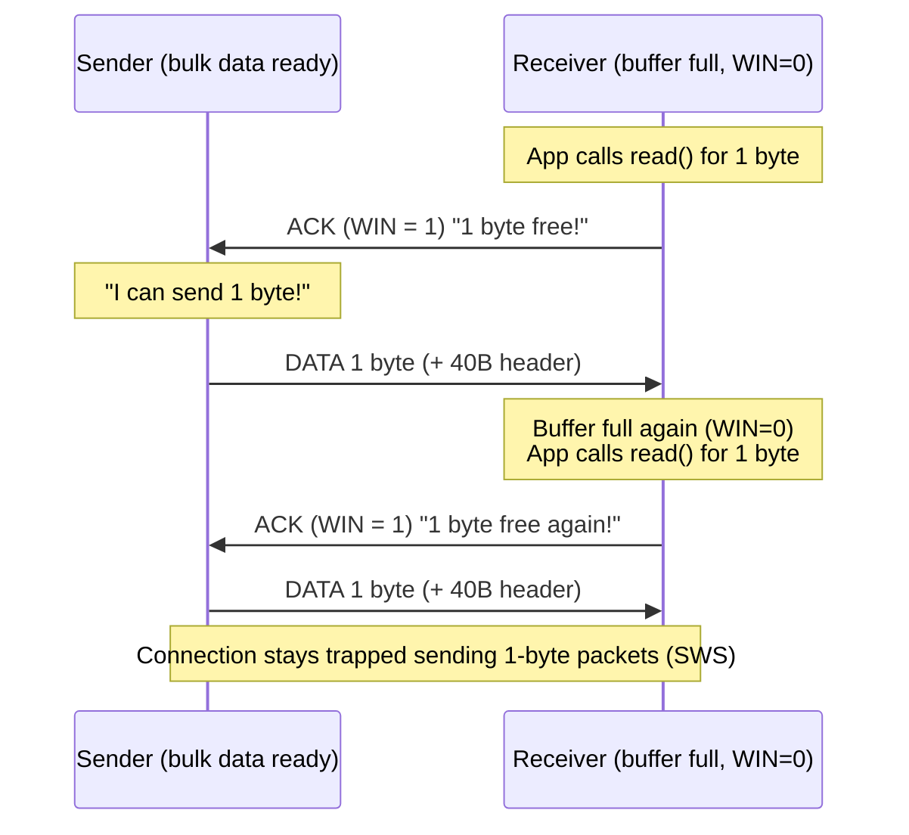

# SWS (Silly Window Syndrome) and Its Avoidance

> **Related Chapters**: [Chapter 3: Sending (1): `tcp_sendmsg` and the write queue](../03-sendmsg.md) / [Chapter 4: Sending (2): from `tcp_write_xmit` to the wire](../04-write-xmit.md) / [Chapter 6: Receiving (2): queueing data and `tcp_recvmsg`](../06-data-queue-recvmsg.md) / [Chapter 10: Windows and memory management](../10-window-memory.md)

## Q. What is "SWS (Silly Window Syndrome)" mentioned in Chapter 3, and how does it differ from Nagle's algorithm?

**SWS (Silly Window Syndrome)**, identified by David D. Clark in 1982 ([RFC 813](https://www.rfc-editor.org/rfc/rfc813)), is a classic TCP performance pathology in which **poor coordination between sender and receiver window updates causes the connection to degenerate into exchanging tiny segments (e.g., 40 bytes of TCP/IP header carrying just a few bytes of payload) indefinitely**.

## How SWS Happens (Concrete Example)

Suppose the receiver's buffer (`RCV.BUFF`) is 4000 bytes and the sender has a large bulk transfer to send:

1. The sender transmits 4000 bytes, filling the receiver's buffer completely so the advertised receive window drops to **`RCV.WND = 0` (zero window)**.
2. The receiving application slowly calls **`read()` for just 1 byte**.
3. If the receiving TCP naively sends an immediate Window Update ACK advertising **"1 byte of window is now open (`WIN = 1`)"**...
4. And the sending TCP naively reacts by immediately transmitting **a 1-byte data segment (+ 40 bytes of TCP/IP headers)**...
5. The receive buffer becomes full again (`WIN = 0`), the application reads 1 more byte, the receiver advertises `WIN = 1`, and the sender transmits 1 byte again—trapping the connection in a permanent **1-byte bucket brigade**.

## Two Causes and Two Defenses (RFC 9293 §3.8.6.2)

Because SWS can be triggered by either the receiver or the sender, TCP prevents it on **both sides**:

1. **Receiver-Side SWS Avoidance (Clark's algorithm, [RFC 9293 §3.8.6.2.2](https://www.rfc-editor.org/rfc/rfc9293#section-3.8.6.2.2))**:
   - **Rule**: Never advertise a tiny increment in available receive window when the application reads a small amount of data (keep the right window edge fixed).
   - **When to open**: Wait until free buffer space reaches at least **one full `MSS`** or **half of the total receive buffer ($\frac{1}{2} \times \text{RCV.BUFF}$)** before advancing the advertised window.
   - **Linux implementation** (Chapters 6 & 10): Handled by `__tcp_select_window()` and `tcp_cleanup_rbuf()`. Even as the application calls `recvmsg()`, Linux suppresses Window Update ACKs until the new window would at least double the remaining window or advance the right edge by an MSS multiple.

2. **Sender-Side SWS Avoidance ([RFC 9293 §3.8.6.2.1](https://www.rfc-editor.org/rfc/rfc9293#section-3.8.6.2.1)) and Nagle ([RFC 896](https://www.rfc-editor.org/rfc/rfc896))**:
   - **Rule**: Even if a receiver advertises a tiny window (e.g., `WIN = 10`), the sender must refrain from carving data into tiny sub-MSS packets unless one of the following holds:
     1. A **full-sized segment (`1 MSS`)** can be sent.
     2. There is no unacknowledged data in flight and **all queued data** can be sent (Nagle's condition).
     3. The segment is at least **half ($F_s = \frac{1}{2}$) of the maximum window (`tp->max_window`)** ever advertised by the peer.
     4. PSH is set and the override timeout has expired.

## How Does Nagle Differ from SWS Avoidance?

- **Nagle's algorithm (RFC 896)** protects against a **sender application** writing tiny chunks (e.g., 1-byte `write()` calls in `telnet`) by coalescing them in the write queue while data is in flight.
- **SWS Avoidance (RFC 813 / RFC 9293 §3.8.6.2)** protects against a **constricted receive window (`SND.WND`)** causing tiny segments even when the sender application wrote a huge buffer all at once.

## Why SWS Appears in Chapter 3

In Chapter 3 (`03-sendmsg.md`), the sender-side SWS constant **"half of the maximum window (`tp->max_window >> 1`, $F_s = \frac{1}{2}$)"** appears in two helpers:

- `tcp_bound_to_half_wnd()`: Caps the per-`sk_buff` target size (`size_goal`) at `tp->max_window >> 1` so a single `sk_buff` never consumes the entire receive window, ensuring at least two packets stay in the pipe.
- `forced_push()`: Forces a PSH flag and immediate transmission (`__tcp_push_pending_frames()`) mid-`sendmsg()` whenever more than `tp->max_window >> 1` bytes have been queued since the last PSH.
