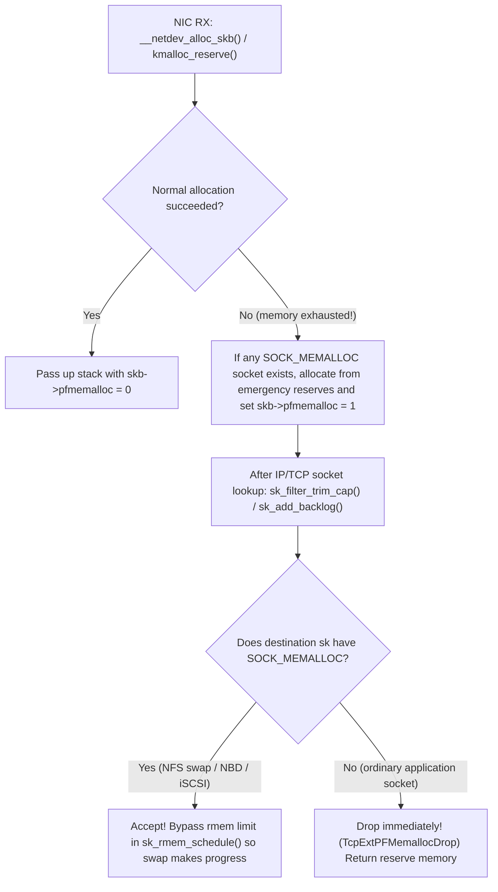

# What Are `PF_MEMALLOC`, `pfmemalloc`, and `SOCK_MEMALLOC`?

> **Related chapters**: [Chapter 4: Send Path (2): From `tcp_write_xmit` to the Wire](../04-write-xmit.md) / [Chapter 5: Receive Path (1): `tcp_v4_rcv` and `tcp_rcv_established`](../05-rcv-established.md) / [Chapter 10: Window Management and Memory Accounting](../10-window-memory.md)

## Q. What is `pfmemalloc` (`PF_MEMALLOC` / `__GFP_MEMALLOC` / `SOCK_MEMALLOC`) that shows up in Chapters 4, 5, and 10?

Named after the **`PF_MEMALLOC`** (**P**rocess **F**lag: **MEM**ory **ALLOC**ation) task flag, it is Linux's **emergency memory reserve mechanism for code paths that must allocate memory in order to free memory (reclaim / swap-out)**, together with the 1-bit `skb->pfmemalloc` tag placed on `sk_buff`s allocated from those reserves.

## Why Does TCP Need Emergency Memory Reserves? (Network Swap Deadlock)

Consider a machine whose swap space or block storage lives **over the network** (swap-over-NFS, NBD, iSCSI, NVMe/TCP, or a WireGuard tunnel carrying them):

1. When free RAM runs out, the VM subsystem (`kswapd` or direct reclaim) tries to free pages by **swapping dirty pages out over TCP**.
2. However, transmitting swap data over TCP (`skb_clone()`, etc.) and **receiving the storage server's write reply and TCP ACK** (allocating RX pages and `sk_buff`s in the NIC driver) **both require allocating memory**.
3. If TX or RX packet allocations fail or get dropped because the system is out of memory, **swap-out can never complete because ACKs cannot be received -> dirty pages can never be freed -> free memory never recovers**, causing a total **deadlock**.

## How the Four Flags Work Together

| Flag | Location | Role |
| --- | --- | --- |
| `PF_MEMALLOC` | `task_struct->flags` ([include/linux/sched.h#L1807](https://git.kernel.org/pub/scm/linux/kernel/git/netdev/net-next.git/tree/include/linux/sched.h?id=279d5c8afcd38bd841832a39bfe1aa4f8518d98e#n1807)) | Marks a task actively reclaiming memory; allows the page allocator to bypass zone watermarks and dip into emergency reserves |
| `__GFP_MEMALLOC` | `gfp_t` allocation mask | Grants access to emergency `pfmemalloc` reserves even from contexts without `PF_MEMALLOC` on `current` (such as softirq) |
| `SOCK_MEMALLOC` | `struct sock` flag (`sk_set_memalloc()`, [net/core/sock.c#L304](https://git.kernel.org/pub/scm/linux/kernel/git/netdev/net-next.git/tree/net/core/sock.c?id=279d5c8afcd38bd841832a39bfe1aa4f8518d98e#n304)) | Marks privileged sockets required for memory reclaim (NFS swap, NBD, iSCSI, NVMe/TCP); adds `__GFP_MEMALLOC` to `sk->sk_allocation` and enables the global `memalloc_socks_key` static key |
| `skb->pfmemalloc` | 1-bit flag on `struct sk_buff` ([include/linux/skbuff.h#L967](https://git.kernel.org/pub/scm/linux/kernel/git/netdev/net-next.git/tree/include/linux/skbuff.h?id=279d5c8afcd38bd841832a39bfe1aa4f8518d98e#n967)) | Tags an `sk_buff` whose head or page fragments came from emergency `pfmemalloc` reserves |

## Why the Receive Path Allocates First and Filters Later

When a NIC driver running in NAPI softirq calls `__netdev_alloc_skb()` ([net/core/skbuff.c#L762](https://git.kernel.org/pub/scm/linux/kernel/git/netdev/net-next.git/tree/net/core/skbuff.c?id=279d5c8afcd38bd841832a39bfe1aa4f8518d98e#n762)) or `kmalloc_reserve()` ([net/core/skbuff.c#L607](https://git.kernel.org/pub/scm/linux/kernel/git/netdev/net-next.git/tree/net/core/skbuff.c?id=279d5c8afcd38bd841832a39bfe1aa4f8518d98e#n607)), **it has not parsed the IP/TCP headers yet, so it cannot tell whether an incoming frame is a critical NFS swap ACK or ordinary HTTP traffic**.

Linux solves this in two stages:

1. **Allocate and tag**: If at least one `SOCK_MEMALLOC` socket exists (`sk_memalloc_socks()`), a failed normal RX allocation retries using emergency reserves and marks `skb->pfmemalloc = 1` (propagated from `page_is_pfmemalloc(page)` for page fragments).
2. **Checkpoint after socket lookup (Chapters 5 & 10)**:
   - Once TCP identifies `sk`, `sk_filter_trim_cap()` ([net/core/filter.c#L137](https://git.kernel.org/pub/scm/linux/kernel/git/netdev/net-next.git/tree/net/core/filter.c?id=279d5c8afcd38bd841832a39bfe1aa4f8518d98e#n137)) and `sk_add_backlog()` ([include/net/sock.h#L1163](https://git.kernel.org/pub/scm/linux/kernel/git/netdev/net-next.git/tree/include/net/sock.h?id=279d5c8afcd38bd841832a39bfe1aa4f8518d98e#n1163)) check `skb_pfmemalloc(skb) && !sock_flag(sk, SOCK_MEMALLOC)`.
   - **Ordinary socket**: Dropped immediately (`TcpExtPFMemallocDrop`) so ordinary traffic cannot drain emergency reserves.
   - **`SOCK_MEMALLOC` socket**: Allowed through; `__sk_rmem_schedule()` ([include/net/sock.h#L1590](https://git.kernel.org/pub/scm/linux/kernel/git/netdev/net-next.git/tree/include/net/sock.h?id=279d5c8afcd38bd841832a39bfe1aa4f8518d98e#n1590)) also bypasses `rmem` limits when `pfmemalloc` is true, and `__sk_backlog_rcv()` ([net/core/sock.c#L329](https://git.kernel.org/pub/scm/linux/kernel/git/netdev/net-next.git/tree/net/core/sock.c?id=279d5c8afcd38bd841832a39bfe1aa4f8518d98e#n329)) wraps backlog processing in `memalloc_noreclaim_save()` (`PF_MEMALLOC`) to prevent recursive reclaim.

## Why Chapter 4 Has Those Two Lines on the Transmit Path

- `sk_gfp_mask(sk, GFP_ATOMIC)` in `__tcp_push_pending_frames()`:
  Adds `__GFP_MEMALLOC` when transmitting on a `SOCK_MEMALLOC` socket so `skb_clone()` can use emergency reserves during memory exhaustion.
- `skb->pfmemalloc = 0;` in `__tcp_transmit_skb()` ([net/ipv4/tcp_output.c#L1536](https://git.kernel.org/pub/scm/linux/kernel/git/netdev/net-next.git/tree/net/ipv4/tcp_output.c?id=279d5c8afcd38bd841832a39bfe1aa4f8518d98e#n1536)):
  If a TX clone allocated from emergency reserves kept `skb->pfmemalloc = 1` and was looped back to a local peer socket on the same host (for example, a local user-space target daemon without `SOCK_MEMALLOC`), the RX checkpoint would drop every packet.  Packets leaving over a physical NIC do not care about `pfmemalloc`, so TCP clears `skb->pfmemalloc = 0` right before handing the packet to IP.
