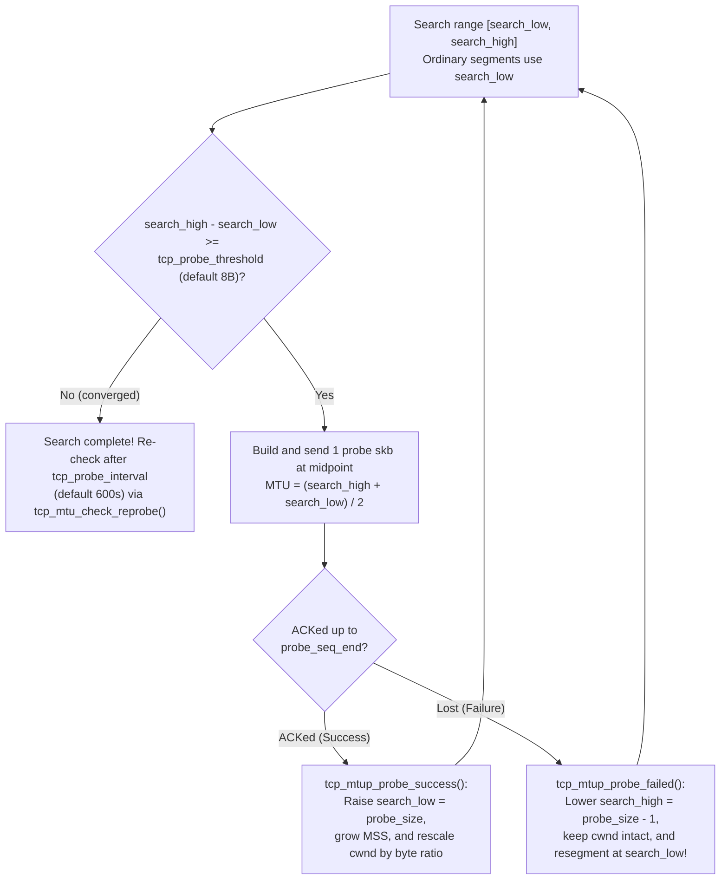

# What Is MTU Probing (`tcp_mtu_probe()` / PLPMTUD)?

> **Related chapters**: [Chapter 4: Send Path (2): From `tcp_write_xmit` to the Wire](../04-write-xmit.md) / [Chapter 7: ACK Processing and RTT Estimation](../07-ack-processing.md) / [Chapter 8: Loss Detection and Recovery](../08-loss-recovery.md) / [Chapter 9: Timers](../09-timers.md)

## Q. What is the "MTU probe (`tcp_mtu_probe()`)" at the top of `tcp_write_xmit()` in Chapter 4?

In one sentence, **MTU probing is a mechanism where TCP itself deliberately sends an occasional, slightly larger trial data segment ("probe") and watches whether it is ACKed, using binary search to discover the true maximum packet size (Path MTU) that the network path can carry without relying on ICMP error messages**.  In the IETF standards, this is called **PLPMTUD (Packetization Layer Path MTU Discovery, [RFC 4821](https://www.rfc-editor.org/rfc/rfc4821) / [RFC 8899](https://www.rfc-editor.org/rfc/rfc8899))**.

## Why Classical Path MTU Discovery Fails (The PMTU Blackhole Problem)

**Classical PMTUD ([RFC 1191](https://www.rfc-editor.org/rfc/rfc1191) / [RFC 8201](https://www.rfc-editor.org/rfc/rfc8201))** transmits full-sized packets (e.g., 1500 bytes or 9000-byte jumbo frames) with the IP `DF` (Don't Fragment) bit set, relying on intermediate routers with narrower links (such as PPPoE or VPN tunnels with a 1400-byte MTU) to send back an **ICMP `Fragmentation Needed` (IPv4) or ICMPv6 `Packet Too Big`** message telling the sender to shrink its packet size.

On the real Internet, however, misconfigured firewalls and middleboxes frequently **drop all ICMP traffic indiscriminately**.  When that happens:

1. **The 3-way handshake succeeds**: `SYN` and `SYN-ACK` packets are only a few dozen bytes long, so they pass through the narrow tunnel without trouble.
2. **Bulk data packets vanish silently**: As soon as the sender transmits a 1500-byte segment, the bottleneck router drops it, and the resulting ICMP error is blocked before reaching the sender.
3. **The connection freezes completely (a PMTU blackhole)**: Because the sender never learns that its packets are too large, it keeps retransmitting the same oversized segment until the connection times out.

PLPMTUD (MTU probing) solves this by inverting the signal: instead of relying on negative feedback from routers (ICMP errors), TCP **keeps normal traffic flowing at a conservative, known-good size (`search_low`) while occasionally sending a larger probe segment and checking for positive feedback from the peer (a TCP ACK)**.

## The Three Modes of `net.ipv4.tcp_mtu_probing`

Per-socket probing state lives in `inet_csk(sk)->icsk_mtup`, controlled by the `net.ipv4.tcp_mtu_probing` sysctl:

| Value | Mode | Behaviour |
| --- | --- | --- |
| `0` (default) | Disabled | `icsk_mtup.enabled` stays `0`.  This is why the early exit `if (likely(!icsk->icsk_mtup.enabled || ...))` at the top of `tcp_mtu_probe()` in Chapter 4 carries `likely()`: by default, every call returns `-1` immediately |
| `1` | Enabled on blackhole detection | Starts disabled (sending at the normal route PMTU).  If consecutive RTOs occur, `tcp_mtu_probing()` in Chapter 9 ([net/ipv4/tcp_timer.c#L166](https://git.kernel.org/pub/scm/linux/kernel/git/netdev/net-next.git/tree/net/ipv4/tcp_timer.c?id=279d5c8afcd38bd841832a39bfe1aa4f8518d98e#n166)) suspects a PMTU blackhole, flips `enabled = 1`, drops the MSS down to a safe `tcp_base_mss` (default 1024 bytes, halving further down to `tcp_mtu_probe_floor` on repeated timeouts) to rescue the connection, and then binary-searches upward |
| `2` | Always enabled | `tcp_mtup_init()` ([net/ipv4/tcp_output.c#L2042](https://git.kernel.org/pub/scm/linux/kernel/git/netdev/net-next.git/tree/net/ipv4/tcp_output.c?id=279d5c8afcd38bd841832a39bfe1aa4f8518d98e#n2042)) sets `enabled = 1` from connection setup, starting conservatively at `tcp_base_mss` and binary-searching up toward `mss_clamp` |

## The Binary Search Lifecycle

`icsk_mtup` maintains a candidate MTU range `[search_low, search_high]` in bytes.  `tcp_sync_mss()` ([net/ipv4/tcp_output.c#L2079](https://git.kernel.org/pub/scm/linux/kernel/git/netdev/net-next.git/tree/net/ipv4/tcp_output.c?id=279d5c8afcd38bd841832a39bfe1aa4f8518d98e#n2079)) caps the socket's ordinary `tp->mss_cache` at **`search_low`**, while `tcp_mtu_probe()` ([net/ipv4/tcp_output.c#L2692](https://git.kernel.org/pub/scm/linux/kernel/git/netdev/net-next.git/tree/net/ipv4/tcp_output.c?id=279d5c8afcd38bd841832a39bfe1aa4f8518d98e#n2692)) periodically coalesces send-queue data into a single midpoint-sized segment.

## Three Key Design Details in Chapter 4's `tcp_mtu_probe()`

With this lifecycle in mind, three subtle checks in Chapter 4's `tcp_mtu_probe()` fall neatly into place:

1. **Why returning `0` makes `tcp_write_xmit()` stop without sending anything**
   When TCP is ready to probe (`size_needed` bytes are queued in the write queue) but `cwnd` or `snd_wnd` currently lacks room for the oversized probe, `tcp_mtu_probe()` returns `0` and `tcp_write_xmit()` immediately exits without transmitting smaller segments.  If it kept filling every 1-MSS opening with ordinary segments as ACKs arrived, it would **starve the 2-packet headroom needed to launch the larger probe** (when nothing is in flight, however, it returns `-1` so the connection never stalls).
2. **Why `size_needed = probe_size + (tp->reordering + 1) * tp->mss_cache` bytes must be queued (what `reordering + 1` means)**
   - `tp->reordering` is the **DupACK/SACK packet threshold required to trigger Fast Retransmit (RFC 5681 `DupThresh`)**, initialised from `net.ipv4.tcp_reordering = 3` and raised dynamically if packet reordering is observed on the path.  If TCP sent a lone probe at the tail of an application write and an intermediate router silently dropped it for exceeding the MTU, no trailing segments would follow to generate DupACKs/SACKs — forcing TCP to wait **hundreds of milliseconds for an RTO**.
   - Why **`tp->reordering + 1`** (4 MSS by default) instead of `tp->reordering` (3 MSS)?  Because `tcp_mtu_probe()` checks **queued byte count (`write_seq - snd_nxt`)**, not packet count (commit `91cc17c0e5e5`).  Without `+ 1`, if the remaining bytes barely covered `3 * mss_cache` (or `write_seq` included a 1-byte `FIN` sequence number leaving `3 * mss_cache - 1` payload bytes), the final segment could be a **partial `< 1 MSS` segment held back in the write queue by Nagle or `TCP_CORK`**, leaving only 2 segments on the wire — one short of Fast Retransmit.  Requiring `(tp->reordering + 1) * mss_cache` bytes guarantees that even if a trailing partial segment is held back, **at least `tp->reordering` (3) full-sized `search_low` segments go out immediately to trigger Fast Retransmit within ~1 RTT**.
3. **Why `cwnd` is decremented by `1` on transmit (instead of `packets_out += 2`), and why a lost probe does NOT slash `cwnd`**
   - **On transmit (`tcp_transmit_skb()` returns `0`)**: For an ordinary 2-MSS TSO skb, TCP sets `pcount = 2` (`gso_segs = 2`) and `tcp_event_new_data_sent()` adds `+2` to `packets_out`.  For an MTU probe, however, **setting `pcount = 2` would tell GSO/TSO to split the probe right back into two small `mss_now` packets, defeating the entire MTU test!**  Therefore, `tcp_init_tso_segs(nskb, nskb->len)` passes `nskb->len` as the MSS argument to force **`pcount = 1` (a single unsegmented large packet)**.  As a side effect, `tcp_event_new_data_sent()` increments `packets_out` by only **`+1`** even though roughly two MSS worth of bytes were put into flight.  To prevent `tcp_write_xmit()` from sending one extra packet beyond the byte budget, `tcp_mtu_probe()` **temporarily subtracts `1` from `snd_cwnd` while `packets_out` increases by `+1`**, consuming **`1 + 1 = 2` packets of `cwnd - in_flight` headroom**.
   - **On failure**: When `tcp_fastretrans_alert()` in Chapter 8 ([net/ipv4/tcp_input.c#L3425](https://git.kernel.org/pub/scm/linux/kernel/git/netdev/net-next.git/tree/net/ipv4/tcp_input.c?id=279d5c8afcd38bd841832a39bfe1aa4f8518d98e#n3425)) detects packet loss right at `snd_una == tp->mtu_probe.probe_seq_start`, it recognises that **the packet was dropped because of its size, not network congestion**.  Instead of calling `tcp_enter_recovery()` (which would slash `cwnd`), it calls `tcp_mtup_probe_failed()` ([net/ipv4/tcp_input.c#L3074](https://git.kernel.org/pub/scm/linux/kernel/git/netdev/net-next.git/tree/net/ipv4/tcp_input.c?id=279d5c8afcd38bd841832a39bfe1aa4f8518d98e#n3074)) to lower `search_high = probe_size - 1`, restores `cwnd` (`+ 1`), and calls `tcp_simple_retransmit()` to resegment and retransmit the data at the safe `mss_cache` size (incrementing `TCPMTUPFail`).
   - **On success**: When `tcp_clean_rtx_queue()` in Chapter 7 ([net/ipv4/tcp_input.c#L3739](https://git.kernel.org/pub/scm/linux/kernel/git/netdev/net-next.git/tree/net/ipv4/tcp_input.c?id=279d5c8afcd38bd841832a39bfe1aa4f8518d98e#n3739)) sees `snd_una` advance past `probe_seq_end`, `tcp_mtup_probe_success()` ([net/ipv4/tcp_input.c#L3083](https://git.kernel.org/pub/scm/linux/kernel/git/netdev/net-next.git/tree/net/ipv4/tcp_input.c?id=279d5c8afcd38bd841832a39bfe1aa4f8518d98e#n3083)) raises `search_low = probe_size`, updates `mss_cache` (incrementing `TCPMTUPSuccess`), and scales `cwnd` down proportionally (`cwnd = cwnd * old_mtu / probe_size`) so the total number of bytes allowed in flight does not jump abruptly when each packet becomes larger.
