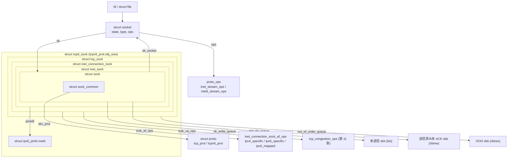

# 1. 主要データ構造

この章は本書全体の「登場人物紹介」です。以降の章で `tp->snd_una` や `TCP_SKB_CB(skb)->sacked` が出てきたときに迷子にならないよう、TCP ソケットと `sk_buff` の形、そして RFC の TCB 変数がどのフィールドに対応するかを先にまとめます。行単位の解説はせず、重要なフィールドに注釈を付けていきます。

## たとえ話で言うと

ある建物（建物の住所 = IP アドレス）に、部屋番号（ポート）付きの部屋がたくさんあります。部屋のドアに付いているのは **部屋の郵便受け**（`struct sock`）です。

郵便受けの中には、いくつもの棚と帳簿があります。

- **発送待ちの棚**（write queue）には、まだ道路に出していない小包が並んでいます。
- 一度発送したけれど **受領印**（ACK）がまだ返ってこない小包は、別の「控えの棚」（retransmit queue）に保管され、なくなったら **再発送** します。
- 届いた小包は **受け取り箱**（receive queue）へ、番号が飛んで届いたものは **順番待ちの棚**（out-of-order queue）へ入ります。
- 帳簿には「どこまで受領印をもらったか」（`snd_una`）、「次に送る番号」（`snd_nxt`）、「次に受け取りたい番号」（`rcv_nxt`）などが書かれています。

小包そのものは **伝票付きの小包**（`sk_buff`）です。伝票（ヘッダ）に加えて、郵便受けの中だけで使う付箋（`TCP_SKB_CB`）が貼られていて、「この小包は何番から何番まで」「相手が SACK で受け取ったと言っている」などが書き込まれます。

ドアの外側（ファイルディスクリプタ側）の顔が `struct socket`、内側の本体が `struct sock` です。住人（アプリ）が引っ越しても（`close()` しても）、郵便受けはしばらく残って残りの小包を片付けます。

## RFC では

### RFC 9293（Transmission Control Protocol）の概要

[RFC 9293](https://www.rfc-editor.org/rfc/rfc9293) は 2022 年に RFC 793 と、それを補ってきた RFC 1122 の TCP 部分などを整理・統合した現行の TCP 本体仕様です（RFC 793 を obsolete）。Linux のソースコメントには今でも「RFC793」という表記が残っていますが、変数の意味は RFC 9293 で変わっていません。

TCP の各コネクションは **TCB（Transmission Control Block）** という状態の塊を持ち、その中心が送受信のシーケンス変数です（[RFC 9293 §3.3.1](https://www.rfc-editor.org/rfc/rfc9293#section-3.3.1)）。

### 送信シーケンス変数

```
      1         2          3          4
 ----------|----------|----------|----------
        SND.UNA    SND.NXT    SND.UNA
                             +SND.WND
 1 - 受領印済み
 2 - 送ったが未 ACK
 3 - 送ってよい（ウィンドウ内）
 4 - まだ送ってはいけない
```

- `SND.UNA`: 最古の未 ACK シーケンス番号
- `SND.NXT`: 次に送るシーケンス番号
- `SND.WND`: 相手が広告してきた受信ウィンドウ幅（こちらが送ってよい幅）
- `SND.UP`: urgent pointer
- `SND.WL1` / `SND.WL2`: **最後に `SND.WND` を更新したときに使った相手パケットの `SEG.SEQ`（相手の送信番号）と `SEG.ACK`（こちらへの ACK 番号）**。パケットがネットワーク上で順番通り届かないときに、遅れて届いた古いパケットの `window` 値で `SND.WND` を巻き戻してしまわないよう、「最後に採用したウィンドウ情報はどの `(SEG.SEQ, SEG.ACK)` のパケットのものだったか」を記録しておく変数です。
- `ISS`: 初期送信シーケンス番号

### 受信シーケンス変数

```
     1          2          3
 ----------|----------|----------
        RCV.NXT    RCV.NXT
                  +RCV.WND
 1 - 受信・ACK 済み
 2 - 受け入れ可能（ウィンドウ内）
 3 - まだ受け入れられない
```

RCV.NXT = 次に受け取りたい番号、RCV.WND = 受信ウィンドウ、RCV.UP = urgent pointer、IRS = 初期受信シーケンス番号です。

### コードが実装している規則

- シーケンス番号は 32 bit の環状空間で、比較は常に mod 2^32 で行います（[RFC 9293 §3.4](https://www.rfc-editor.org/rfc/rfc9293#section-3.4)）。Linux では `before()` / `after()` がこれに当たります。
- ACK 受信時の「受理可能な ACK」は `SND.UNA < SEG.ACK =< SND.NXT` で、受理すると SND.UNA を SEG.ACK まで進めます（[RFC 9293 §3.10.7.4](https://www.rfc-editor.org/rfc/rfc9293#section-3.10.7.4)）。
- 送信ウィンドウの更新は `SND.WL1 < SEG.SEQ` または `SND.WL1 = SEG.SEQ かつ SND.WL2 =< SEG.ACK` のときだけ行い、古いセグメントでウィンドウが巻き戻らないようにします（同 §3.10.7.4）。
- 受信側は右端を後退（shrink）させるべきではありません（[RFC 9293 §3.8.6](https://www.rfc-editor.org/rfc/rfc9293#section-3.8.6)）。
- ウィンドウ値はヘッダでは 16 bit で、[RFC 7323 §2](https://www.rfc-editor.org/rfc/rfc7323#section-2) の Window Scale で左シフトして解釈します（SYN 自体のウィンドウはスケールしない）。

この章の範囲では「どの変数がどのフィールドか」が分かれば十分です。各規則の実装は第 5 章・第 7 章・第 10 章で行単位に追います。

## 全体の流れ



ポイントは 2 つです。

- `struct socket` は VFS 側の薄い殻で、プロトコルの状態はすべて `struct sock` 以下にあります。`struct sock` は先頭埋め込み（C の「継承」）で `inet_sock` → `inet_connection_sock` → `tcp_sock` と太っていき、IPv6 ではさらに後ろに `ipv6_pinfo` が付いた `tcp6_sock` になります。
- 振る舞いは 3 種類の ops テーブルで差し替えます。ソケット API 層の `proto_ops`、トランスポート層の `proto`、そしてネットワーク層（v4/v6）依存部分の `inet_connection_sock_af_ops` です。

## コードを追う

### Step 1: `struct socket` と `struct sock`

`struct socket`（[include/linux/net.h#L192](https://git.kernel.org/pub/scm/linux/kernel/git/netdev/net-next.git/tree/include/linux/net.h?id=279d5c8afcd38bd841832a39bfe1aa4f8518d98e#n192)）は fd と 1 対 1 に対応する殻です。

```c
struct socket {
	socket_state		state;

	short			type;

	unsigned long		flags;

	struct file		*file;
	struct sock		*sk;
	const struct proto_ops	*ops; /* Might change with MPTCP. */

	struct socket_wq	wq;
};
```

- `ops` は `proto_ops`（[include/linux/net.h#L236](https://git.kernel.org/pub/scm/linux/kernel/git/netdev/net-next.git/tree/include/linux/net.h?id=279d5c8afcd38bd841832a39bfe1aa4f8518d98e#n236)）で、`sendmsg(2)` は `sock->ops->sendmsg` → `inet_sendmsg()` → `sk->sk_prot->sendmsg` = `tcp_sendmsg()` と 2 段で降ります（第 3 章）。
- 寿命が違う点が重要です。`close()` で `struct socket` は消えますが、`struct sock` は `sock_orphan()` で `sk_socket = NULL` にされた「orphan」として FIN_WAIT などを続けます。TCP のコードで `sk->sk_socket` を NULL チェックする箇所や `SOCK_DEAD` を見る箇所はこのためです。

### Step 2: `struct sock_common` – 全ソケット種別の共通ヘッダ

`struct sock_common`（[include/net/sock.h#L156](https://git.kernel.org/pub/scm/linux/kernel/git/netdev/net-next.git/tree/include/net/sock.h?id=279d5c8afcd38bd841832a39bfe1aa4f8518d98e#n156)）は `struct sock` だけでなく `inet_timewait_sock` と `request_sock` の先頭にも置かれます。ehash の lookup がこの 3 種類のどれでも返せるのはこの共通ヘッダのおかげです。

```c
struct sock_common {
	union {
		__addrpair	skc_addrpair;
...
	};
...
	union {
		__portpair	skc_portpair;
...
	};

	unsigned short		skc_family;
	volatile unsigned char	skc_state;
...
	struct proto		*skc_prot;
	possible_net_t		skc_net;
...
	int			skc_dontcopy_begin[0];
...
	union {
		int		skc_incoming_cpu;
		u32		skc_rcv_wnd;
		u32		skc_tw_rcv_nxt; /* struct tcp_timewait_sock  */
	};

	refcount_t		skc_refcnt;
	/* private: */
	int                     skc_dontcopy_end[0];
...
};
```

- `skc_addrpair` / `skc_portpair`: 4-tuple を 64 bit + 32 bit の 2 回の比較で照合するための union です（`inet_match()`）。
- `skc_state` は `TCP_ESTABLISHED` などの状態で、`sk_fullsock()`（[include/net/sock.h#L3032](https://git.kernel.org/pub/scm/linux/kernel/git/netdev/net-next.git/tree/include/net/sock.h?id=279d5c8afcd38bd841832a39bfe1aa4f8518d98e#n3032)）は `TCP_TIME_WAIT` / `TCP_NEW_SYN_RECV` 以外かどうかでフルソケットかを判定します。lookup 結果を `tcp_sk()` にキャストしてよいのはフルソケットのときだけです。
- `skc_rcv_wnd` / `skc_tw_rcv_nxt` / `skc_tw_snd_nxt` のように、同じ場所を request_sock や timewait sock が TCP の値の置き場として再利用しています。フルソケットの `tcp_sock` には別途 `rcv_wnd` などがあるので混同しないでください。
- `skc_dontcopy_begin`〜`skc_dontcopy_end` の範囲（ハッシュノードと refcnt）は `sk_clone_lock()` での複製時にコピーされません。

### Step 3: `struct sock` – キューと予算、キャッシュライン群

`struct sock`（[include/net/sock.h#L365](https://git.kernel.org/pub/scm/linux/kernel/git/netdev/net-next.git/tree/include/net/sock.h?id=279d5c8afcd38bd841832a39bfe1aa4f8518d98e#n365)）は `__sk_common` に続いて、アクセスパターン別の 6 つのグループに並んでいます。TCP の fast path で触る部分だけ抜粋します。

```c
	__cacheline_group_begin(sock_write_rx);
...
	struct sk_buff_head	sk_receive_queue;
...
	struct {
		atomic_t	rmem_alloc;
		int		len;
		struct sk_buff	*head;
		struct sk_buff	*tail;
	} sk_backlog;
...
	__cacheline_group_begin(sock_write_rxtx);
	socket_lock_t		sk_lock;
	u32			sk_reserved_mem;
	int			sk_forward_alloc;
...
	__cacheline_group_begin(sock_write_tx);
...
	int			sk_wmem_queued;
	refcount_t		sk_wmem_alloc;
	unsigned long		sk_tsq_flags;
	union {
		struct sk_buff	*sk_send_head;
		struct rb_root	tcp_rtx_queue;
	};
	struct sk_buff_head	sk_write_queue;
```

- `sk_receive_queue`: in-order の受信データ（受け取り箱）。`tcp_recvmsg()` が読みます（第 6 章）。
- `sk_backlog`: ユーザがソケットロックを持っている間に softirq で届いたパケットの退避先です。`release_sock()` 時に `sk_backlog_rcv`（TCP では `tcp_v4_do_rcv()` / `tcp_v6_do_rcv()`）で処理されます（第 5 章）。
- `sk_lock`: spinlock + `owned` フラグの二重構造。プロセス文脈は `lock_sock()` で「所有」し、softirq は `bh_lock_sock()` で spinlock だけ取って `sock_owned_by_user()` を確認します。
- `sk_forward_alloc` / `sk_wmem_queued` / `sk_rmem_alloc`: 家計簿と予算（第 10 章）。`sk_wmem_alloc` は qdisc/NIC に渡った skb の truesize で、TSQ（TCP Small Queues）の判定に使います（第 4 章）。
- `sk_write_queue`: まだ送っていない skb の list（発送待ちの棚）。
- `tcp_rtx_queue`: 送信済み未 ACK の skb を seq 順に持つ rbtree。TCP は `sk_send_head` を使わなくなったので同じ場所を union で共有しています。

### Step 4: 埋め込みの連鎖とキャストマクロ

`struct inet_sock`（[include/net/inet_sock.h#L218](https://git.kernel.org/pub/scm/linux/kernel/git/netdev/net-next.git/tree/include/net/inet_sock.h?id=279d5c8afcd38bd841832a39bfe1aa4f8518d98e#n218)）、`struct inet_connection_sock`（[include/net/inet_connection_sock.h#L81](https://git.kernel.org/pub/scm/linux/kernel/git/netdev/net-next.git/tree/include/net/inet_connection_sock.h?id=279d5c8afcd38bd841832a39bfe1aa4f8518d98e#n81)）、`struct tcp_sock`（[include/linux/tcp.h#L197](https://git.kernel.org/pub/scm/linux/kernel/git/netdev/net-next.git/tree/include/linux/tcp.h?id=279d5c8afcd38bd841832a39bfe1aa4f8518d98e#n197)）は、それぞれ親を先頭メンバとして持ちます。

```c
struct inet_sock {
	/* sk and pinet6 has to be the first two members of inet_sock */
	struct sock		sk;
#if IS_ENABLED(CONFIG_IPV6)
	struct ipv6_pinfo	*pinet6;
...
#endif
...
#define inet_num		sk.__sk_common.skc_num
```

```c
struct inet_connection_sock {
	/* inet_sock has to be the first member! */
	struct inet_sock	  icsk_inet;
	struct request_sock_queue icsk_accept_queue;
	struct inet_bind_bucket	  *icsk_bind_hash;
	struct inet_bind2_bucket  *icsk_bind2_hash;
	struct timer_list	  icsk_delack_timer;
...
	__u32			  icsk_rto;
...
	const struct tcp_congestion_ops *icsk_ca_ops;
	const struct inet_connection_sock_af_ops *icsk_af_ops;
...
	__u8			  icsk_ca_state:5,
...
	u64			  icsk_ca_priv[104 / sizeof(u64)];
```

```c
#define inet_sk(ptr) container_of_const(ptr, struct inet_sock, sk)
#define inet_csk(ptr) container_of_const(ptr, struct inet_connection_sock, icsk_inet.sk)
#define tcp_sk(ptr) container_of_const(ptr, struct tcp_sock, inet_conn.icsk_inet.sk)
...
#define tcp_sk_rw(ptr) container_of(ptr, struct tcp_sock, inet_conn.icsk_inet.sk)
```

- `inet_connection_sock` は TCP 以外（MPTCP、かつての DCCP）とも共有する「コネクション指向」部分です。accept queue、bind bucket、再送/遅延 ACK タイマー（第 9 章）、`icsk_rto`、輻輳制御の ops と状態（`icsk_ca_state` = `TCP_CA_Open/Disorder/CWR/Recovery/Loss`、第 8 章）、そして CC モジュールの私有領域 `icsk_ca_priv`（CUBIC/BBR の状態はここ、第 12・13 章）を持ちます。
- `inet_sk()`（[include/net/inet_sock.h#L362](https://git.kernel.org/pub/scm/linux/kernel/git/netdev/net-next.git/tree/include/net/inet_sock.h?id=279d5c8afcd38bd841832a39bfe1aa4f8518d98e#n362)）、`inet_csk()`（[include/net/inet_connection_sock.h#L152](https://git.kernel.org/pub/scm/linux/kernel/git/netdev/net-next.git/tree/include/net/inet_connection_sock.h?id=279d5c8afcd38bd841832a39bfe1aa4f8518d98e#n152)）、`tcp_sk()`（[include/linux/tcp.h#L564](https://git.kernel.org/pub/scm/linux/kernel/git/netdev/net-next.git/tree/include/linux/tcp.h?id=279d5c8afcd38bd841832a39bfe1aa4f8518d98e#n564)）はどれもオフセット 0 なので実行時コストはゼロです。`container_of_const()` により `const struct sock *` からは `const struct tcp_sock *` しか得られません。
- `tcp_sk_rw()`（[include/linux/tcp.h#L569](https://git.kernel.org/pub/scm/linux/kernel/git/netdev/net-next.git/tree/include/linux/tcp.h?id=279d5c8afcd38bd841832a39bfe1aa4f8518d98e#n569)）は lockless listener の文脈で const を外す「ここで書く」という目印です。

### Step 5: `struct tcp_sock` – TCB 変数の在りか

`tcp_sock` の先頭は 6 つのキャッシュライン群（`tcp_sock_read_tx`, `_read_txrx`, `_read_rx`, `_write_tx`, `_write_txrx`, `_write_rx`）で、RFC の TCB 変数もこの中に散らばっています。まず read-mostly 群です。

```c
	/* TXRX read-mostly hotpath cache lines */
	__cacheline_group_begin(tcp_sock_read_txrx);
	u32	tsoffset;	/* timestamp offset */
	u32	snd_wnd;	/* The window we expect to receive	*/
	u32	mss_cache;	/* Cached effective mss, not including SACKS */
	u32	snd_cwnd;	/* Sending congestion window		*/
	u32	prr_out;	/* Total number of pkts sent during Recovery. */
	u32	lost_out;	/* Lost packets			*/
	u32	sacked_out;	/* SACK'd packets			*/
	u16	tcp_header_len;	/* Bytes of tcp header to send		*/
	u8	scaling_ratio;	/* see tcp_win_from_space() */
...
	__cacheline_group_end(tcp_sock_read_txrx);

	/* RX read-mostly hotpath cache lines */
	__cacheline_group_begin(tcp_sock_read_rx);
	u32	copied_seq;	/* Head of yet unread data */
	u32	snd_wl1;	/* Sequence for window update		*/
	u32	tlp_high_seq;	/* snd_nxt at the time of TLP */
	u32	rttvar_us;	/* smoothed mdev_max			*/
	u32	retrans_out;	/* Retransmitted packets out		*/
	u16	advmss;		/* Advertised MSS			*/
	u16	urg_data;	/* Saved octet of OOB data and control flags */
	u32	lost;		/* Total data packets lost incl. rexmits */
	u32	snd_ssthresh;	/* Slow start size threshold		*/
	struct  minmax rtt_min;
	/* OOO segments go in this rbtree. Socket lock must be held. */
	struct rb_root	out_of_order_queue;
	__cacheline_group_end(tcp_sock_read_rx);
```

続いて read-write 群のうち、シーケンス変数を含む部分です。

```c
	u32	write_seq;	/* Tail(+1) of data held in tcp send buffer */
	u32	pushed_seq;	/* Last pushed seq, required to talk to windows */
...
	__cacheline_group_begin(tcp_sock_write_txrx);
...
	__be32	pred_flags;
	u64	tcp_clock_cache; /* cache last tcp_clock_ns() (see tcp_mstamp_refresh()) */
	u64	tcp_mstamp;	/* most recent packet received/sent */
	u32	rcv_nxt;	/* What we want to receive next		*/
	u32	snd_nxt;	/* Next sequence we send		*/
	u32	snd_una;	/* First byte we want an ack for	*/
	u32	window_clamp;	/* Maximal window to advertise		*/
	u32	srtt_us;	/* smoothed round trip time << 3 in usecs */
	u32	packets_out;	/* Packets which are "in flight"	*/
	u32	snd_up;		/* Urgent pointer		*/
...
	u32	rcv_wnd;	/* Current receiver window		*/
...
	__cacheline_group_end(tcp_sock_write_txrx);

	/* RX read-write hotpath cache lines */
	__cacheline_group_begin(tcp_sock_write_rx) __aligned(8);
...
	u32	rcv_wup;	/* rcv_nxt on last window update sent	*/
```

RFC 変数との対応は次のとおりです。

| RFC 9293 | Linux | 備考 |
| --- | --- | --- |
| SND.UNA | `tp->snd_una` | `tcp_ack()` が進める（第 7 章） |
| SND.NXT | `tp->snd_nxt` | `tcp_event_new_data_sent()` が進める（第 4 章）。RTO 後も巻き戻さない |
| SND.WND | `tp->snd_wnd` | **スケール適用済みのバイト数** で保持 |
| SND.UP | `tp->snd_up` | |
| SND.WL1 | `tp->snd_wl1` | |
| SND.WL2 | なし | 代わりに `snd_una` と比較（後述） |
| ISS | なし | 接続確立までは `tcp_rsk(req)->snt_isn`、以降は `write_seq` の初期値として消える |
| RCV.NXT | `tp->rcv_nxt` | `tcp_rcv_nxt_update()` で `WRITE_ONCE()` |
| RCV.WND | `tp->rcv_wnd` + `tp->rcv_wup` | 右端 = `rcv_wup + rcv_wnd` |
| RCV.UP | `tp->urg_seq` / `tp->urg_data` | |
| IRS | なし | `tcp_rsk(req)->rcv_isn` |
| （Linux 独自） | `tp->write_seq` | アプリが積んだデータの末尾 + 1 |
| （Linux 独自） | `tp->copied_seq` | アプリがまだ読んでいない先頭 |

RFC のシーケンス変数はワイヤ上の境界しか定義していないため、Linux はアプリ（`sendmsg()` / `recvmsg()`）とソケットバッファの境界として、送信側に `write_seq`、受信側に `copied_seq` をそれぞれ追加しています（具体的な数値例と ISN からの境界図は [補足ノート: `write_seq` や `copied_seq` はなぜ `0` から始まらないのか？](appendix-notes.md#write-seq-copied-seq) を参照）。

```
送信側:  snd_una <= snd_nxt <= write_seq
         [ 未 ACK (tcp_rtx_queue) ][ 未送信 (sk_write_queue) ]
         右端の制約: snd_nxt <= tcp_wnd_end() = snd_una + snd_wnd

受信側:  copied_seq <= rcv_nxt <= rcv_wup + rcv_wnd
         [ 未読 (sk_receive_queue) ][ 受け入れ可能 (OOO もここ) ]
```

これを読むためのヘルパーがいくつかあります。

```c
static inline bool before(__u32 seq1, __u32 seq2)
{
        return (__s32)(seq1-seq2) < 0;
}
#define after(seq2, seq1) 	before(seq1, seq2)
```

```c
static inline u32 tcp_receive_window(const struct tcp_sock *tp)
{
	s32 win = tp->rcv_wup + tp->rcv_wnd - tp->rcv_nxt;

	if (win < 0)
		win = 0;
	return (u32) win;
}
```

- `before()`（[include/net/tcp.h#L315](https://git.kernel.org/pub/scm/linux/kernel/git/netdev/net-next.git/tree/include/net/tcp.h?id=279d5c8afcd38bd841832a39bfe1aa4f8518d98e#n315)）は §3.4 の mod 2^32 比較そのものです。差が 2^31 以上離れると判定が反転するため、PAWS（RFC 7323）が必要になります。
- `tcp_receive_window()`（[include/net/tcp.h#L956](https://git.kernel.org/pub/scm/linux/kernel/git/netdev/net-next.git/tree/include/net/tcp.h?id=279d5c8afcd38bd841832a39bfe1aa4f8518d98e#n956)）: `rcv_wnd` は「最後に広告したときの」ウィンドウで、基準点は `rcv_wup` です。データを受けて `rcv_nxt` が進むと残りは減ります。RFC の RCV.WND は「今の残り」なので、こちらが RFC の RCV.WND に相当します。右端を後退させないという §3.8.6 の要求は、この右端 `rcv_wup + rcv_wnd` を基準に `tcp_select_window()` が守ります（第 10 章）。
- `tcp_wnd_end()`（[include/net/tcp.h#L1614](https://git.kernel.org/pub/scm/linux/kernel/git/netdev/net-next.git/tree/include/net/tcp.h?id=279d5c8afcd38bd841832a39bfe1aa4f8518d98e#n1614)）は単に `snd_una + snd_wnd` を返し、送信ウィンドウの右端 SND.UNA + SND.WND を表します。

`struct tcp_sock` に `SND.WL1`（`tp->snd_wl1`）はあるのに `SND.WL2` が無い理由は、`tcp_ack_update_window()`（[net/ipv4/tcp_input.c#L3951](https://git.kernel.org/pub/scm/linux/kernel/git/netdev/net-next.git/tree/net/ipv4/tcp_input.c?id=279d5c8afcd38bd841832a39bfe1aa4f8518d98e#n3951)）と `tcp_may_update_window()`（[net/ipv4/tcp_input.c#L3881](https://git.kernel.org/pub/scm/linux/kernel/git/netdev/net-next.git/tree/net/ipv4/tcp_input.c?id=279d5c8afcd38bd841832a39bfe1aa4f8518d98e#n3881)）を見ると分かります（そもそもなぜ `SND.WL1` / `SND.WL2` が必要なのかの図解は [補足ノート: `SND.WL1` と `SND.WL2`](appendix-notes.md#snd-wl1-wl2) を参照）。

```c
static inline bool tcp_may_update_window(const struct tcp_sock *tp,
					const u32 ack, const u32 ack_seq,
					const u32 nwin)
{
	return	after(ack, tp->snd_una) ||
		after(ack_seq, tp->snd_wl1) ||
		(ack_seq == tp->snd_wl1 && (nwin > tp->snd_wnd || !nwin));
}
```

`tcp_ack_update_window()` は `tp->snd_una` を更新する **前に** `tcp_may_update_window()` を呼ぶため、その時点の `tp->snd_una` が「前回ウィンドウを更新した `SEG.ACK`（= RFC の `SND.WL2`）」をそのまま兼ねています（引数名は `ack` が `SEG.ACK`、`ack_seq` が `SEG.SEQ` です）。また 3 つ目の条件は、`(SEQ, ACK)` が同じ pure ACK がリオーダリングしたときに古い小さなウィンドウで上書きされないよう、`nwin > tp->snd_wnd || !nwin` のときだけ更新を許しています（第 7 章）。

最後に、in-flight の会計です。`packets_out`, `sacked_out`, `lost_out`, `retrans_out` は skb 数ではなく **セグメント数**（`tcp_skb_pcount()` の和）で、すべて `snd_una`〜`snd_nxt` 間の現在値を表すゲージです（いつ増えていつ `0` に戻るかの詳細は [補足ノート: `packets_out` / `sacked_out` / `lost_out` / `retrans_out` の増減](appendix-notes.md#packets-out-sacked-out-lifecycle) を参照）。`tcp_packets_in_flight()`（[include/net/tcp.h#L1549](https://git.kernel.org/pub/scm/linux/kernel/git/netdev/net-next.git/tree/include/net/tcp.h?id=279d5c8afcd38bd841832a39bfe1aa4f8518d98e#n1549)）は `packets_out - (sacked_out + lost_out) + retrans_out` を返し、RFC 6675 の "pipe" に相当します。この値が `snd_cwnd` と比較されます（第 4・8 章）。この 4 つのカウンタは次の Step の `sacked` ビットの集計値なので、両者がずれると `WARN_ON` や cwnd の暴走につながります。

### Step 6: `sk_buff`、`skb_shared_info`、`tcp_skb_cb`

`struct sk_buff`（[include/linux/skbuff.h#L892](https://git.kernel.org/pub/scm/linux/kernel/git/netdev/net-next.git/tree/include/linux/skbuff.h?id=279d5c8afcd38bd841832a39bfe1aa4f8518d98e#n892)）のうち TCP 的に重要な先頭部分です。

```c
struct sk_buff {
	union {
		struct {
			/* These two members must be first to match sk_buff_head. */
			struct sk_buff		*next;
			struct sk_buff		*prev;

			union {
				struct net_device	*dev;
...
			};
		};
		struct rb_node		rbnode; /* used in netem, ip4 defrag, and tcp stack */
		struct list_head	list;
		struct llist_node	ll_node;
	};

	struct sock		*sk;

	union {
		ktime_t		tstamp;
		u64		skb_mstamp_ns; /* earliest departure time */
	};
...
	char			cb[48] __aligned(8);

	union {
		struct {
			unsigned long	_skb_refdst;
			void		(*destructor)(struct sk_buff *skb);
		};
		struct list_head	tcp_tsorted_anchor;
...
	};
```

- `next/prev` と `rbnode` は union です。`sk_write_queue` にいる間は list、`tcp_rtx_queue` や `out_of_order_queue` に入ると rbtree ノードとして使われます。
- `skb_mstamp_ns`: TCP は送信 skb に「最早出発時刻」（EDT）を ns で入れ、RTT 計測、RACK、pacing（sch_fq）がこれを使います（第 4・7・8 章）。
- `tcp_tsorted_anchor`: 送信済み・未 SACK の skb を **送信時刻順** に並べる `tp->tsorted_sent_queue` 用の list です。rtx queue は seq 順なので、RACK が時刻順に走査するために別の線が要ります。`_skb_refdst/destructor` と union なので、送信用に clone する前に退避・復元する手間がかかります。
- データ本体はリニア部（`head`〜`end`）と、その直後にある `skb_shared_info`（[include/linux/skbuff.h#L599](https://git.kernel.org/pub/scm/linux/kernel/git/netdev/net-next.git/tree/include/linux/skbuff.h?id=279d5c8afcd38bd841832a39bfe1aa4f8518d98e#n599)、`skb_shinfo()` で取得）の `frags[]` のページ断片に分かれます。TCP の送信 skb はヘッダ用の小さなリニア部とページ frag のペイロードが基本です（第 3 章）。`gso_size/gso_segs/gso_type` は TSO/GSO 用、`dataref` は clone 間でデータを共有する参照カウントで、TCP は再送キューの skb を残したまま clone を下位層に渡します。

`cb[48]` の TCP 用の解釈が `struct tcp_skb_cb`（[include/net/tcp.h#L1138](https://git.kernel.org/pub/scm/linux/kernel/git/netdev/net-next.git/tree/include/net/tcp.h?id=279d5c8afcd38bd841832a39bfe1aa4f8518d98e#n1138)）です。

```c
struct tcp_skb_cb {
	__u32		seq;		/* Starting sequence number	*/
	__u32		end_seq;	/* SEQ + FIN + SYN + datalen	*/
	union {
		/* Notes :
		 *	tcp_tw_isn is used in input path only
		 *	(isn chosen by tcp_timewait_state_process())
		 * 	  tcp_gso_segs/size are used in write queue only,
		 *	  cf tcp_skb_pcount()/tcp_skb_mss()
		 */
		u32		tcp_tw_isn;
		struct {
			u16	tcp_gso_segs;
			u16	tcp_gso_size;
		};
	};
	__u16		tcp_flags;	/* TCP header flags (tcp[12-13])*/

	__u8		sacked;		/* State flags for SACK.	*/
	__u8		ip_dsfield;	/* IPv4 tos or IPv6 dsfield	*/
#define TSTAMP_ACK_SK	0x1
#define TSTAMP_ACK_BPF	0x2
	__u8		txstamp_ack:2,	/* Record TX timestamp for ack? */
			eor:1,		/* Is skb MSG_EOR marked? */
			has_rxtstamp:1,	/* SKB has a RX timestamp	*/
			unused:4;
	__u32		ack_seq;	/* Sequence number ACK'd	*/
	union {
		struct {
#define TCPCB_DELIVERED_CE_MASK ((1U<<20) - 1)
			/* There is space for up to 24 bytes */
			__u32 is_app_limited:1, /* cwnd not fully used? */
			      delivered_ce:20,
			      unused:11;
			/* pkts S/ACKed so far upon tx of skb, incl retrans: */
			__u32 delivered;
			/* start of send pipeline phase */
			u64 first_tx_mstamp;
			/* when we reached the "delivered" count */
			u64 delivered_mstamp;
		} tx;   /* only used for outgoing skbs */
		union {
			struct inet_skb_parm	h4;
#if IS_ENABLED(CONFIG_IPV6)
			struct inet6_skb_parm	h6;
#endif
		} header;	/* For incoming skbs */
	};
};
```

- `seq` / `end_seq`: ホストバイトオーダーのシーケンス範囲です。`end_seq` は SYN と FIN をそれぞれ 1 として数えるので、`end_seq - seq` はペイロード長と一致しないことがあります。キュー操作や SACK 処理はすべてこの 2 つで行います。
- `tcp_gso_segs` / `tcp_gso_size`: 送信キュー上の skb が MSS 何個分か（`tcp_skb_pcount()`, [include/net/tcp.h#L1237](https://git.kernel.org/pub/scm/linux/kernel/git/netdev/net-next.git/tree/include/net/tcp.h?id=279d5c8afcd38bd841832a39bfe1aa4f8518d98e#n1237)）。受信 skb では同じ場所を `tcp_tw_isn` に使います。
- `sacked`: 送信 skb のスコアボードです。`enum tcp_skb_cb_sacked_flags`（[include/net/tcp.h#L1120](https://git.kernel.org/pub/scm/linux/kernel/git/netdev/net-next.git/tree/include/net/tcp.h?id=279d5c8afcd38bd841832a39bfe1aa4f8518d98e#n1120)）で、`TCPCB_SACKED_ACKED`（SACK 済）、`TCPCB_SACKED_RETRANS`（再送して in-flight 中）、`TCPCB_LOST`（ロス判定済）の 3 つが `TCPCB_TAGBITS` です。それぞれのセグメント数の和が `sacked_out` / `retrans_out` / `lost_out` になります。`TCPCB_EVER_RETRANS` は一度でも再送したかを示し、Karn のアルゴリズム（再送 skb で RTT を測らない、第 7 章）で使います。
- `tx`: 送信時点の `tp->delivered` などのスナップショットで、ACK 時に配送レート標本を作ります（BBR の入力、第 13 章）。
- `header`: 受信時は IP 層の `IPCB()` / `IP6CB()` を `tcp_v4_fill_cb()` / `tcp_v6_fill_cb()` がここへ `memmove()` してから `seq` などを埋めます。`seq` を cb 先頭に置くため、IP 層の制御情報を後ろにずらしているわけです。

`tcp_init()`（[net/ipv4/tcp.c#L5297](https://git.kernel.org/pub/scm/linux/kernel/git/netdev/net-next.git/tree/net/ipv4/tcp.c?id=279d5c8afcd38bd841832a39bfe1aa4f8518d98e#n5297)）には `BUILD_BUG_ON(sizeof(struct tcp_skb_cb) > sizeof_field(struct sk_buff, cb));` があり、48 バイトを超えるとビルドが通りません。

### Step 7: 3 種類の ops テーブル

`socket(AF_INET, SOCK_STREAM, 0)` は `inet_create()`（[net/ipv4/af_inet.c#L259](https://git.kernel.org/pub/scm/linux/kernel/git/netdev/net-next.git/tree/net/ipv4/af_inet.c?id=279d5c8afcd38bd841832a39bfe1aa4f8518d98e#n259)）で `inetsw_array`（[net/ipv4/af_inet.c#L1159](https://git.kernel.org/pub/scm/linux/kernel/git/netdev/net-next.git/tree/net/ipv4/af_inet.c?id=279d5c8afcd38bd841832a39bfe1aa4f8518d98e#n1159)）から `inet_stream_ops` と `tcp_prot` を選び、`sk_alloc()`（[net/core/sock.c#L2303](https://git.kernel.org/pub/scm/linux/kernel/git/netdev/net-next.git/tree/net/core/sock.c?id=279d5c8afcd38bd841832a39bfe1aa4f8518d98e#n2303)）が `tcp_prot.obj_size` 分の slab オブジェクトを確保します。最後に `sk->sk_prot->init` = `tcp_v4_init_sock()`（[net/ipv4/tcp_ipv4.c#L2399](https://git.kernel.org/pub/scm/linux/kernel/git/netdev/net-next.git/tree/net/ipv4/tcp_ipv4.c?id=279d5c8afcd38bd841832a39bfe1aa4f8518d98e#n2399)）が `icsk_af_ops = &ipv4_specific` を設定します。

`tcp_prot`（[net/ipv4/tcp_ipv4.c#L3350](https://git.kernel.org/pub/scm/linux/kernel/git/netdev/net-next.git/tree/net/ipv4/tcp_ipv4.c?id=279d5c8afcd38bd841832a39bfe1aa4f8518d98e#n3350)）の抜粋です。

```c
struct proto tcp_prot = {
	.name			= "TCP",
...
	.recvmsg		= tcp_recvmsg,
	.sendmsg		= tcp_sendmsg,
	.splice_eof		= tcp_splice_eof,
	.backlog_rcv		= tcp_v4_do_rcv,
	.release_cb		= tcp_release_cb,
...
	.memory_allocated	= &net_aligned_data.tcp_memory_allocated,
...
	.obj_size		= sizeof(struct tcp_sock),
	.freeptr_offset		= offsetof(struct tcp_sock,
					   inet_conn.icsk_inet.sk.sk_freeptr),
	.slab_flags		= SLAB_TYPESAFE_BY_RCU,
	.twsk_prot		= &tcp_timewait_sock_ops,
	.rsk_prot		= &tcp_request_sock_ops,
	.h.hashinfo		= NULL,
```

- `backlog_rcv` / `release_cb`: ソケット所有中に溜まった backlog と、TSQ やタイマーで遅延したフラグ（`TCP_DEFERRED_ALL`）を `release_sock()` で処理する入口です（第 4・5・9 章）。
- `memory_allocated` 以下: プロトコル全体の予算（`tcp_mem`）。第 10 章で扱います。
- `SLAB_TYPESAFE_BY_RCU`: RCU lookup 中に解放・再利用されうるので、lookup 側は refcnt を取ったあとに 4-tuple を再照合します。`freeptr_offset` は後述の歴史を参照してください。
- `h.hashinfo = NULL`: ハッシュテーブルは netns ごとに `tcp_get_hashinfo()` で引きます（Step 9）。

`ipv4_specific`（[net/ipv4/tcp_ipv4.c#L2361](https://git.kernel.org/pub/scm/linux/kernel/git/netdev/net-next.git/tree/net/ipv4/tcp_ipv4.c?id=279d5c8afcd38bd841832a39bfe1aa4f8518d98e#n2361)）は TCP コードから IP 層を呼ぶ窓口です。

```c
const struct inet_connection_sock_af_ops ipv4_specific = {
	.queue_xmit	   = ip_queue_xmit,
	.rebuild_header	   = inet_sk_rebuild_header,
	.sk_rx_dst_set	   = inet_sk_rx_dst_set,
	.conn_request	   = tcp_v4_conn_request,
	.syn_recv_sock	   = tcp_v4_syn_recv_sock,
	.net_header_len	   = sizeof(struct iphdr),
	.setsockopt	   = ip_setsockopt,
	.getsockopt	   = ip_getsockopt,
	.mtu_reduced	   = tcp_v4_mtu_reduced,
};
```

`__tcp_transmit_skb()` は最後に `icsk->icsk_af_ops->queue_xmit()` を呼ぶだけで、v4/v6 を意識しません（第 4 章）。`net_header_len` は MSS 計算に使われます。

### Step 8: IPv6 側 – `tcp6_sock`、`inet6_sk()`、`ipv6_mapped`

```c
struct tcp6_sock {
	struct tcp_sock	  tcp;

	struct ipv6_pinfo inet6;
};
```

```c
static inline struct ipv6_pinfo *inet6_sk(const struct sock *__sk)
{
	return sk_fullsock(__sk) ? inet_sk(__sk)->pinet6 : NULL;
}
```

- `struct tcp6_sock`（[include/linux/ipv6.h#L323](https://git.kernel.org/pub/scm/linux/kernel/git/netdev/net-next.git/tree/include/linux/ipv6.h?id=279d5c8afcd38bd841832a39bfe1aa4f8518d98e#n323)）は `tcp_sock` の後ろに `struct ipv6_pinfo`（[include/linux/ipv6.h#L230](https://git.kernel.org/pub/scm/linux/kernel/git/netdev/net-next.git/tree/include/linux/ipv6.h?id=279d5c8afcd38bd841832a39bfe1aa4f8518d98e#n230)）を足しただけです。宛先/送信元 IPv6 アドレス自体は `sock_common` の `skc_v6_daddr` / `skc_v6_rcv_saddr` にあり、`ipv6_pinfo` には送信元 `saddr`、flow label、`dst_cookie`、IPv6 拡張ヘッダ（`opt`）、hop limit などが入ります。
- `inet6_sk()`（[include/linux/ipv6.h#L343](https://git.kernel.org/pub/scm/linux/kernel/git/netdev/net-next.git/tree/include/linux/ipv6.h?id=279d5c8afcd38bd841832a39bfe1aa4f8518d98e#n343)）はポインタ `pinet6` を経由します。`pinet6` は `inet6_create()`（[net/ipv6/af_inet6.c#L105](https://git.kernel.org/pub/scm/linux/kernel/git/netdev/net-next.git/tree/net/ipv6/af_inet6.c?id=279d5c8afcd38bd841832a39bfe1aa4f8518d98e#n105)）が `inet6_sk_generic()`（[net/ipv6/af_inet6.c#L91](https://git.kernel.org/pub/scm/linux/kernel/git/netdev/net-next.git/tree/net/ipv6/af_inet6.c?id=279d5c8afcd38bd841832a39bfe1aa4f8518d98e#n91)）で `sk_prot->ipv6_pinfo_offset`（`tcpv6_prot` では `offsetof(struct tcp6_sock, inet6)`）から計算して設定します。AF_INET の `tcp_sock` では `pinet6` は NULL です。
- `tcpv6_prot`（[net/ipv6/tcp_ipv6.c#L2280](https://git.kernel.org/pub/scm/linux/kernel/git/netdev/net-next.git/tree/net/ipv6/tcp_ipv6.c?id=279d5c8afcd38bd841832a39bfe1aa4f8518d98e#n2280)）は `obj_size = sizeof(struct tcp6_sock)`、`backlog_rcv = tcp_v6_do_rcv` などが違うだけで、`sendmsg/recvmsg` は v4 と同じ `tcp_sendmsg()` / `tcp_recvmsg()` です。

v4-mapped アドレス（`::ffff:a.b.c.d`）への `connect()` では、`tcp_v6_connect()`（[net/ipv6/tcp_ipv6.c#L133](https://git.kernel.org/pub/scm/linux/kernel/git/netdev/net-next.git/tree/net/ipv6/tcp_ipv6.c?id=279d5c8afcd38bd841832a39bfe1aa4f8518d98e#n133)）が実行時に `WRITE_ONCE(icsk->icsk_af_ops, &ipv6_mapped)` で af_ops を差し替え、`sk->sk_backlog_rcv` も `tcp_v4_do_rcv` にしてから `tcp_v4_connect()` を呼びます（失敗時は元に戻します）。

```c
static const struct inet_connection_sock_af_ops ipv6_mapped = {
	.queue_xmit	   = ip_queue_xmit,
	.rebuild_header	   = inet_sk_rebuild_header,
	.sk_rx_dst_set	   = inet_sk_rx_dst_set,
	.conn_request	   = tcp_v6_conn_request,
	.syn_recv_sock	   = tcp_v6_syn_recv_sock,
	.net_header_len	   = sizeof(struct iphdr),
	.setsockopt	   = ipv6_setsockopt,
	.getsockopt	   = ipv6_getsockopt,
	.mtu_reduced	   = tcp_v4_mtu_reduced,
};
```

`ipv6_mapped`（[net/ipv6/tcp_ipv6.c#L2042](https://git.kernel.org/pub/scm/linux/kernel/git/netdev/net-next.git/tree/net/ipv6/tcp_ipv6.c?id=279d5c8afcd38bd841832a39bfe1aa4f8518d98e#n2042)）は「ソケットは AF_INET6（`tcp6_sock`、`sk_family == AF_INET6`）だがワイヤは IPv4」という混成で、送信は `ip_queue_xmit`、sockopt は IPv6 のものを使います。`sk_family` だけを見て v6 パスと決めつけるコードがバグになりやすい典型例です。passive 側では `tcp_v6_syn_recv_sock()` が v4 の SYN から子ソケットを作るときに同じ差し替えを行います。

### Step 9: `inet_hashinfo` – 高いところから一望

```c
struct inet_hashinfo {
	/* This is for sockets with full identity only.  Sockets here will
	 * always be without wildcards and will have the following invariant:
	 *
	 *          TCP_ESTABLISHED <= sk->sk_state < TCP_CLOSE
	 *
	 */
	struct inet_ehash_bucket	*ehash;
...
	struct inet_bind_hashbucket	*bhash;
...
	struct inet_bind_hashbucket	*bhash2;
...
	struct inet_listen_hashbucket	*lhash2;

	bool				pernet;
} ____cacheline_aligned_in_smp;
```

`struct inet_hashinfo`（[include/net/inet_hashtables.h#L147](https://git.kernel.org/pub/scm/linux/kernel/git/netdev/net-next.git/tree/include/net/inet_hashtables.h?id=279d5c8afcd38bd841832a39bfe1aa4f8518d98e#n147)）は v4/v6 共通の TCP テーブルで、`tcp_get_hashinfo()`（[include/net/inet_hashtables.h#L180](https://git.kernel.org/pub/scm/linux/kernel/git/netdev/net-next.git/tree/include/net/inet_hashtables.h?id=279d5c8afcd38bd841832a39bfe1aa4f8518d98e#n180)）で `net->ipv4.tcp_death_row.hashinfo` を引きます。fast path にとって大事なのは `ehash` だけです。ESTABLISHED 以降のフルソケット・TIME_WAIT・`request_sock`（NEW_SYN_RECV）が `hlist_nulls` で同じチェーンに並び、受信時の `__inet_lookup_established()` は RCU 下で lockless にたどります。bind/listen 用の `bhash` / `bhash2` / `lhash2` は第 2 章で触れます。

## RFC と実装の違い

| 項目 | RFC 9293 | Linux | 理由 |
| --- | --- | --- | --- |
| SND.WL2 | 独立した変数 | 持たない（`snd_una` で代用） | ウィンドウ判定は ACK を処理する前に行うので、`snd_una` が直前の ACK 値と等価 |
| ウィンドウ更新条件 | WL1/WL2 の辞書式比較 | 同 SEQ でもウィンドウ拡大/ゼロなら更新 | 拡大の取りこぼしや zero window の検出遅れを防ぐ |
| SND.WND | ヘッダの値 | スケール適用済みバイト数で保持 | 比較のたびにシフトしないため |
| RCV.WND | 現在の受信ウィンドウ | `rcv_wnd` は最後に広告した値、現在の値は `tcp_receive_window()` | 右端 `rcv_wup + rcv_wnd` を固定点として shrink を防ぐ |
| 送受信キュー | 抽象的なバッファ | `write_seq` / `copied_seq` を追加し、未送信 list・送信済み rbtree・OOO rbtree・時刻順 list の 4 系統 | SACK/RACK 処理を O(log n) や時刻順の走査にするため |
| ISS / IRS | TCB に保持 | 確立後は保持しない（request sock にだけある） | 確立後は不要。TCP-AO などは別途保持 |
| 計数の単位 | バイト | in-flight はセグメント数（`packets_out` など） | cwnd がパケット単位で管理されている歴史的経緯（第 11 章） |

## 設計の背景と歴史

- `ce43b03e8889` "net: move inet_dport/inet_num in sock_common"（Eric Dumazet, 2012）: ポートを `sock_common` に移し、`skc_portpair` で 4-tuple 照合を 1 キャッシュラインの 2 回比較にしました。続く `634fb979e8f3` "inet: includes a sock_common in request_sock"（Eric Dumazet, 2013）で request_sock も同じヘッダを持ち、後に SYN を ehash に直接入れる（NEW_SYN_RECV）土台になりました。
- `e7eadb4de9e6` "ipv6: inet6_sk() should use sk_fullsock()"（Eric Dumazet, 2015）: ehash から request/timewait sock が返る時代に、`pinet6` を持たない「ミニソケット」で `inet6_sk()` が不正なメモリを読まないようにしました。
- `9f5afeae5152` "tcp: use an RB tree for ooo receive queue"（Yaogong Wang, 2016）と `75c119afe14f` "tcp: implement rb-tree based retransmit queue"（Eric Dumazet, 2017）: BDP が 10 万パケット級になると、linear list の走査は SACK のたびに数 ms かかり CPU キャッシュも吹き飛ばします。悪意ある SACK に対する二次的な計算量の増加を断つため、送信済み skb を rbtree に移し、`sk_send_head` と `tcp_rtx_queue` を union にしました。
- `b9f64820fb22` "tcp: track data delivery rate for a TCP connection"（Yuchung Cheng, 2016）: `tcp_skb_cb.tx` に送信時の `delivered` などを記録し、ACK 時に配送レートを計算する仕組みです。BBR の前提になりました。
- `e2080072ed2d` "tcp: new list for sent but unacked skbs for RACK recovery"（Eric Dumazet, Yuchung Cheng, Neal Cardwell, 2017）: rtx queue は seq 順なので、RACK のために時刻順の `tsorted_sent_queue` を追加しました。`sk_buff` を大きくしないため `_skb_refdst/destructor` と union にしており、clone 前に必ずゼロにするという制約が生まれました。
- `9115e8cd2a0c` "net: reorganize struct sock for better data locality"（Eric Dumazet, 2016）と `5d4cc87414c5` "net: reorganize \"struct sock\" fields"（Eric Dumazet, 2024）: 後者で `sock_write_rx` などの 6 グループが入り、TCP_RR で 4〜5% の改善が報告されています。
- `aeb9ce058d7c` "cache: enforce cache groups" と `d5fed5addb2b` "tcp: reorganize tcp_sock fast path variables"（Coco Li, 2023）: fast path 変数が占めるキャッシュライン数を 12 から 8 に減らしました。read-mostly と read-write の境界だけを `____cacheline_aligned` で強制し、false sharing を防ぎます。`tcp_struct_check()` がメンバの所属をビルド時に検査します。その後も `c3426ba2ed69` "tcp: reorganize tcp_sock_write_txrx group for variables later"（Chia-Yu Chang, 2025）のように、AccECN のフィールド追加に合わせて再配置されています。
- `f5f80e32de12` "ipv6: remove hard coded limitation on ipv6_pinfo"（Eric Dumazet, 2023）: 以前は「`ipv6_pinfo` はオブジェクトの末尾にある」前提で `obj_size` からオフセットを逆算していました。上記の tcp_sock 再編でアラインメントによるパディングが入るとこれが壊れるため、`ipv6_pinfo_offset` を明示するようにしました。
- `e9d9da91548b` "tcp: preserve const qualifier in tcp_sk()"（Eric Dumazet, 2023）: `container_of_const()` 化と `tcp_sk_rw()` の導入です。lockless listener で書き込みが起きる場所を型で明示する狙いです。
- `d1e5e6408b30` "tcp: Introduce optional per-netns ehash."（Kuniyuki Iwashima, 2022）: `h.hashinfo = NULL` と `tcp_get_hashinfo()` の由来です。
- `ed9b70040d7b` "tcp: reduce tcp sockets size by one cache line"（Eric Dumazet, 2026）: `SLAB_TYPESAFE_BY_RCU` の slab は RCU 読み手がオブジェクト内のどのビットを見るか分からないため、freelist ポインタをオブジェクトの外に置き、`SLAB_HWCACHE_ALIGN` と相まって 1 キャッシュライン余計に消費していました。RCU 読み手が決して見ない `sk_rcu` と union で `sk_freeptr` を用意し、`freeptr_offset` で slub に教えることで解消しました（TCPv6 は 1 slab あたり 12→13 オブジェクト）。

## 性能の勘所

- **キャッシュライン群**: `tcp_sock` の 6 群は「TX/RX/両方」×「read-mostly/read-write」です。たとえば `snd_wnd`, `mss_cache`, `snd_cwnd` は送受信の両方で読むが書く頻度は低いので `tcp_sock_read_txrx`、`snd_una`, `snd_nxt`, `rcv_nxt`, `packets_out` は ACK のたびに書くので `tcp_sock_write_txrx` です。レイアウトは `Documentation/networking/net_cachelines/tcp_sock.rst` に文書化されており、フィールドを追加するパッチはこの文書と `tcp_struct_check()`（[net/ipv4/tcp.c#L5202](https://git.kernel.org/pub/scm/linux/kernel/git/netdev/net-next.git/tree/net/ipv4/tcp.c?id=279d5c8afcd38bd841832a39bfe1aa4f8518d98e#n5202)）の更新を求められます。`CACHELINE_ASSERT_GROUP_MEMBER()`（[include/linux/cache.h#L151](https://git.kernel.org/pub/scm/linux/kernel/git/netdev/net-next.git/tree/include/linux/cache.h?id=279d5c8afcd38bd841832a39bfe1aa4f8518d98e#n151)）は `BUILD_BUG_ON` なので、群からはみ出すとビルドが失敗します。
- **ロックと実行文脈**: `tcp_sock` のほぼ全フィールドは socket lock（プロセス文脈では `lock_sock()` による所有、softirq では `bh_lock_sock()` + `!sock_owned_by_user()`）で守られます。所有中に softirq で届いたパケットは `sk_backlog` へ、タイマーや TSQ の仕事は `sk_tsq_flags` の deferred ビットへ回され、`tcp_release_cb()` でまとめて処理されます。
- **lockless 読み手**: `tcp_poll()`, `tcp_stream_memory_free()`, `tcp_inq_hint()` や `SIOCOUTQ` 系の ioctl などはソケットロックなしで読むため、書き手は `WRITE_ONCE()`、読み手は `READ_ONCE()` を使います。たとえば `tcp_rcv_nxt_update()` の `WRITE_ONCE(tp->rcv_nxt, seq)` と `tcp_inq_hint()` の `READ_ONCE(tp->rcv_nxt)`、`tcp_stream_memory_free()` の `READ_ONCE(tp->write_seq) - READ_ONCE(tp->snd_nxt)` が対になっています（なお `tcp_get_info()` 本体は `lock_sock_fast()` を取ります）。`write_seq`, `copied_seq`, `rcv_nxt`, `snd_nxt`, `snd_una` は KCSAN 対策で順次注釈が付けられてきたフィールドです。
- **固定小数点**: `srtt_us` は 8 倍（`<< 3`）、`mdev_us` は 4 倍（`<< 2`）で保持し、RFC 6298 の 1/8・1/4 の EWMA を割り算なしで計算します（第 7 章）。
- **サイズ**: `ed9b70040d7b` の時点で TCP は約 2.3 KB、TCPv6 は約 2.4 KB のオブジェクトです。`icsk_ca_priv` を 104 バイトに抑えているのも、CC ごとに別メモリを確保して間接参照を増やさないためです。
- **`sk_buff` の union**: `rbnode` と `next/prev`、`tcp_tsorted_anchor` と `_skb_refdst/destructor`、`tstamp` と `skb_mstamp_ns` は、どれも「TCP がその skb を持っている間は他の用途が無い」ことを前提に `sk_buff` の肥大化を避けています。

## 観測とデバッグ

- `ss -ti`（`tcp_get_info()`, [net/ipv4/tcp.c#L4214](https://git.kernel.org/pub/scm/linux/kernel/git/netdev/net-next.git/tree/net/ipv4/tcp.c?id=279d5c8afcd38bd841832a39bfe1aa4f8518d98e#n4214)）でこの章のフィールドを直接見られます。
  - `tcpi_snd_wnd` = `snd_wnd`, `tcpi_rcv_wnd` = `rcv_wnd`
  - `tcpi_unacked` = `packets_out`, `tcpi_sacked` = `sacked_out`, `tcpi_lost` = `lost_out`, `tcpi_retrans` = `retrans_out`
  - `tcpi_notsent_bytes` = `write_seq - snd_nxt`, `tcpi_bytes_acked` = `bytes_acked`, `tcpi_bytes_received` = `bytes_received`
  - `ss` では `snd_wnd:`, `rcv_wnd:`, `unacked:`, `sacked:`, `lost:`, `notsent:` として表示されます。LISTEN ソケットでは `tcpi_unacked` / `tcpi_sacked` が accept queue 長と backlog 上限に流用される点に注意してください。
- tracepoint `tcp:tcp_probe`（[include/trace/events/tcp.h#L367](https://git.kernel.org/pub/scm/linux/kernel/git/netdev/net-next.git/tree/include/trace/events/tcp.h?id=279d5c8afcd38bd841832a39bfe1aa4f8518d98e#n367)）は受信ごとに `snd_nxt`, `snd_una`, `snd_cwnd`, `snd_wnd`, `rcv_wnd`, `srtt` などを出力します。
- 構造体レイアウトは `pahole -C tcp_sock vmlinux` で確認でき、`__cacheline_group_begin__tcp_sock_write_tx` などのマーカーが見えます。slab サイズは `/sys/kernel/slab/TCP/object_size`、`/sys/kernel/slab/TCPv6/object_size` で確認できます。
- `drgn` や `crash` で `tcp_sk(sk)` を辿る際は、AF_INET6 ソケットでも先頭は `tcp_sock` なので同じキャストで読めます。`ipv6_pinfo` は `inet_sk(sk)->pinet6` から読みます。
- packetdrill（`tools/testing/selftests/net/packetdrill/`）: `tcp_basic_client.pkt` / `tcp_basic_server.pkt` で SEQ/ACK の基本的な進み方を、`tcp_tcp_info_tcp-info-rwnd-limited.pkt` / `tcp_tcp_info_tcp-info-sndbuf-limited.pkt` で `tcp_info` 経由の観測を確認できます。`tcp_rcv_big_endseq.pkt` は `end_seq` が受信ウィンドウを超えるケースを扱います。

## IPv4 と IPv6

| 層 | IPv4 | IPv6 | 合流点 |
| --- | --- | --- | --- |
| ソケット API | `inet_stream_ops`（[net/ipv4/af_inet.c#L1057](https://git.kernel.org/pub/scm/linux/kernel/git/netdev/net-next.git/tree/net/ipv4/af_inet.c?id=279d5c8afcd38bd841832a39bfe1aa4f8518d98e#n1057)） | `inet6_stream_ops`（[net/ipv6/af_inet6.c#L656](https://git.kernel.org/pub/scm/linux/kernel/git/netdev/net-next.git/tree/net/ipv6/af_inet6.c?id=279d5c8afcd38bd841832a39bfe1aa4f8518d98e#n656)） | `connect`/`accept`/`listen`/`poll` は共通関数。`sendmsg`/`recvmsg` は `inet6_sendmsg()` などの薄いラッパを経て同じ `tcp_sendmsg()` へ |
| `struct proto` | `tcp_prot` | `tcpv6_prot` | `tcp_sendmsg()`, `tcp_recvmsg()`, `tcp_close()` などは共通 |
| オブジェクト | `struct tcp_sock` | `struct tcp6_sock` = `tcp_sock` + `ipv6_pinfo` | `tcp_sk()` は両方に使える |
| アドレス | `skc_daddr` / `skc_rcv_saddr` | `skc_v6_daddr` / `skc_v6_rcv_saddr`（+ `ipv6_pinfo.saddr`） | `sock_common` の中 |
| af_ops | `ipv4_specific` | `ipv6_specific`（[net/ipv6/tcp_ipv6.c#L2011](https://git.kernel.org/pub/scm/linux/kernel/git/netdev/net-next.git/tree/net/ipv6/tcp_ipv6.c?id=279d5c8afcd38bd841832a39bfe1aa4f8518d98e#n2011)）/ `ipv6_mapped` | `icsk->icsk_af_ops->queue_xmit()` |
| init | `tcp_v4_init_sock()` | `tcp_v6_init_sock()`（[net/ipv6/tcp_ipv6.c#L2080](https://git.kernel.org/pub/scm/linux/kernel/git/netdev/net-next.git/tree/net/ipv6/tcp_ipv6.c?id=279d5c8afcd38bd841832a39bfe1aa4f8518d98e#n2080)） | どちらも `tcp_init_sock()` を呼ぶ |
| 受信 cb | `tcp_v4_fill_cb()` → `header.h4` | `tcp_v6_fill_cb()` → `header.h6` | `seq`/`end_seq` 以降は共通 |
| ハッシュ | `tcp_get_hashinfo()` | 同じテーブル | ehash は v4/v6 混在 |

`tcp_sock` 本体と `tcp_skb_cb` の TCP 部分は AF 非依存で、違いは ops テーブルと `ipv6_pinfo` に閉じ込められています。

## 理解度チェック

1. `sk_fullsock()` を確認せずに `__inet_lookup_established()` の結果を `tcp_sk()` にキャストすると何が起きますか。

<details><summary>答え</summary>

ehash には `inet_timewait_sock`（TIME_WAIT）と `request_sock`（NEW_SYN_RECV）も入っており、共通なのは先頭の `sock_common` だけです。これらのミニソケットは `tcp_sock` よりずっと小さいので、`tp->snd_una` などを読むと別オブジェクトや slab の外を読みます。書けばメモリ破壊です。`inet6_sk()` が `sk_fullsock()` を確認するようになった（`e7eadb4de9e6`）のも同じ理由です。

</details>

2. `snd_wnd` を `tcp_sock_read_txrx`、`snd_una` を `tcp_sock_write_txrx` に置いているのはなぜですか。逆にすると何が悪くなりますか。

<details><summary>答え</summary>

`snd_wnd` は送信判定（`tcp_wnd_end()`）で頻繁に読まれますが、書かれるのはウィンドウが変わったときだけです。`snd_una` は新しいデータを ACK するたびに書かれます。read-mostly の群に頻繁に書かれる変数が混じると、そのラインが書き込みのたびに他 CPU のキャッシュから無効化されます（false sharing）。たとえば `tcp_poll()` や `tcp_get_info()` を別 CPU で実行している場合や、送信 CPU と受信 softirq の CPU が異なる場合に効いてきます。群の境界は `____cacheline_aligned` で区切られ、`tcp_struct_check()` がビルド時に所属を検査します。

</details>

3. RFC の SND.WL2 に相当するフィールドが無いのに、古い ACK でウィンドウが巻き戻らないのはなぜですか。

<details><summary>答え</summary>

`tcp_may_update_window()` は `tcp_ack()` の中で `snd_una` を更新する前に呼ばれます。その時点の `snd_una` は「これまでに受理した最大の ACK」なので、RFC の SND.WL2（最後にウィンドウ更新に使った ACK）以上の値です。`after(ack, snd_una)` は WL2 との比較より厳しい条件になり、古い ACK は `snd_wl1` との SEQ 比較で弾かれます。そもそも `ack < snd_una` の古い ACK は、`tcp_ack()` の入口でウィンドウ処理の前に分岐します（第 7 章）。

</details>

4. `TCP_SKB_CB(skb)->end_seq - TCP_SKB_CB(skb)->seq` と `skb->len` が一致しないのはどんなときですか。また、`tcp_skb_pcount()` は受信 skb で意味を持ちますか。

<details><summary>答え</summary>

SYN または FIN を含む skb では、それぞれシーケンス空間を 1 消費するので `end_seq - seq` が 1〜2 大きくなります。受信 skb ではさらに `skb->len` に TCP ヘッダが含まれる段階があります（`tcp_v4_fill_cb()` は `skb->len - th->doff * 4` で計算）。`tcp_gso_segs` / `tcp_gso_size` は送信キュー上でだけ有効で、受信側では同じ場所が `tcp_tw_isn` と union になっているため `tcp_skb_pcount()` は意味を持ちません。受信 skb のセグメント数が必要なら `skb_shinfo(skb)->gso_segs` を使います（例: `segs_in` の計算）。

</details>

5. v4-mapped アドレスへ `connect()` した AF_INET6 の TCP ソケットで、`sk->sk_family`、`icsk_af_ops`、`sk_backlog_rcv`、送信パケットの L3 はそれぞれ何になりますか。

<details><summary>答え</summary>

`sk_family` は `AF_INET6` のまま（オブジェクトも `tcp6_sock`）、`icsk_af_ops` は `ipv6_mapped`、`sk_backlog_rcv` は `tcp_v4_do_rcv`、送信は `ip_queue_xmit` による IPv4 です。sockopt は IPv6 のもの（`ipv6_setsockopt`）が使われます。`sk_family == AF_INET6` だけを見て IPv6 ヘッダを前提にするコードは、このケースで壊れます。`icsk_af_ops` の更新に `WRITE_ONCE()` を使っているのは、`tcp_setsockopt()` / `tcp_getsockopt()` がロックなしでこれを読むためです。

</details>

## まとめ

- fd 側の殻が `struct socket`、本体が `struct sock` です。本体は `sock_common` → `sock` → `inet_sock` → `inet_connection_sock` → `tcp_sock`（→ `tcp6_sock`）と先頭埋め込みで積み重なり、`inet_sk()` / `inet_csk()` / `tcp_sk()` はゼロコストのキャストです。
- 振る舞いは `proto_ops`（API）、`proto`（トランスポート）、`inet_connection_sock_af_ops`（v4/v6）の 3 層の ops で差し替えます。v4-mapped では af_ops だけが実行時に切り替わります。
- RFC の TCB 変数はほぼ同名で `tcp_sock` にあり、さらに `write_seq`（送信バッファの末尾）と `copied_seq`（アプリの読み位置）が加わります。`rcv_wnd` は `rcv_wup` からの相対値です。
- 送信 skb は `sk_write_queue`（未送信の list）→ `tcp_rtx_queue`（seq 順の rbtree）と移り、同時に `tsorted_sent_queue`（時刻順の list）にも載ります。受信の順序外 skb は `out_of_order_queue`（rbtree）に入ります。
- `TCP_SKB_CB()` の `seq` / `end_seq` / `sacked` がスコアボードの実体で、`packets_out` / `sacked_out` / `lost_out` / `retrans_out` はその集計値です。
- fast path 変数はアクセスパターン別のキャッシュライン群に並べられ、ビルド時に検査されます。

よくある誤解:

- 「`tp->rcv_wnd` は今の受信ウィンドウ」→ 最後に広告した値です。今の残りは `tcp_receive_window()` で求めます。
- 「`packets_out` は skb の数」→ TSO skb を MSS 単位に数えたセグメント数です。
- 「`sk_family == AF_INET6` なら IPv6 パケットを送る」→ v4-mapped では IPv4 を送ります。

## 次の章

[2. コネクションの一生を早回しで](02-connection-lifecycle.md) では、ここで紹介した構造体が `socket()` から TIME_WAIT までにどう生まれ、どう姿を変えるか（`request_sock` → フルソケット → `inet_timewait_sock`）を駆け足で見ます。
