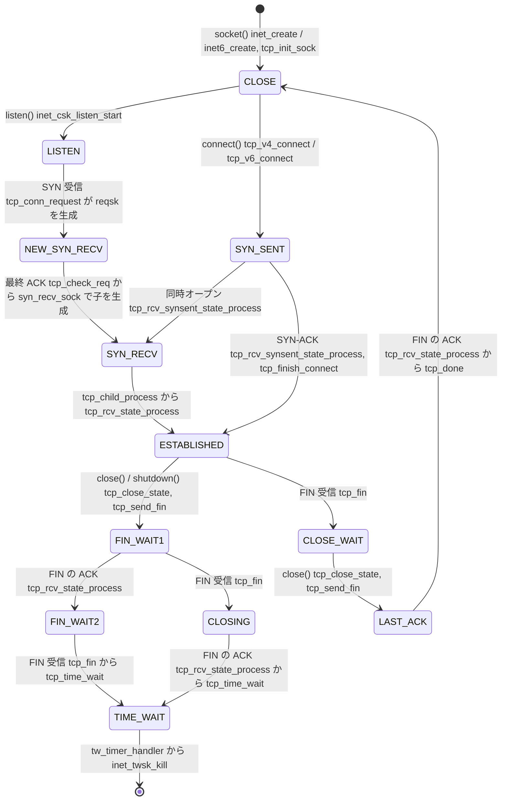

# 2. コネクションの一生を早回しで

この章は Part I 以降の fast path を読むための「地図」です。`socket()` から TIME_WAIT の消滅まで、各ステップで **どの関数が状態を動かしているか** だけを押さえます。1 行ずつの精読はしません。データ構造そのものは第 1 章、送受信の中身は第 3 章以降に任せます。

## たとえ話で言うと

ある建物（IP アドレス）の部屋（ポート）に郵便受け（ソケット）を取り付けるのが `socket()`、部屋番号を決めるのが `bind()` です。`listen()` すると部屋の前に受付窓口ができます。

お客さん（SYN）が来ると、窓口はまだ部屋を用意せず、**仮の整理券**（`request_sock`）だけを渡して「この番号で返事をください」と受領印付きの返信（SYN-ACK）を送ります。混雑して整理券が切れそうなときは、控えを取らない **割符**（SYN cookie）を渡し、戻ってきた割符の形だけで本物かどうかを確かめます。

お客さんが受領印（ACK）を持って戻ってくると、そこで初めて本物の郵便受け（子ソケット）が作られ、**待合室**（accept queue）に入ります。アプリが `accept()` で待合室から呼び出せば、会話（データ転送）が始まります。

会話が終わると、両者が「もう送るものはありません」（FIN）と言い合い、最後に受領印を押した側はしばらくその部屋番号を貸しません（TIME_WAIT）。遅れて届いた古い小包が、次の住人宛てと間違われないようにするためです。

## RFC では

### RFC 9293 — Transmission Control Protocol

[RFC 9293](https://www.rfc-editor.org/rfc/rfc9293) は 2022 年に RFC 793 と、その後の多数の更新（RFC 1122 の TCP 部分、RFC 5961 の一部、RFC 6093、RFC 6528 など）を一本化した現行の TCP 本体仕様です。RFC 793 を obsolete にしています。Linux のコードコメントにはいまだに `rfc793:` という引用が多数残っていますが、意味的には RFC 9293 の該当節と読み替えて構いません。

- **状態機械**（[RFC 9293 §3.3.2](https://www.rfc-editor.org/rfc/rfc9293#section-3.3.2)）: LISTEN, SYN-SENT, SYN-RECEIVED, ESTABLISHED, FIN-WAIT-1, FIN-WAIT-2, CLOSE-WAIT, CLOSING, LAST-ACK, TIME-WAIT, CLOSED の 11 状態です。図はあくまで要約で、正確な規則は [§3.10](https://www.rfc-editor.org/rfc/rfc9293#section-3.10) のイベント処理が正です。
- **ISN の選択**（[RFC 9293 §3.4.1](https://www.rfc-editor.org/rfc/rfc9293#section-3.4.1)）: `ISN = M + F(localip, localport, remoteip, remoteport, secretkey)`。M は約 4 µs 刻みのタイマ、F は秘密鍵付きの擬似乱数関数です（RFC 6528 由来）。
- **3-way handshake**（[RFC 9293 §3.5](https://www.rfc-editor.org/rfc/rfc9293#section-3.5)）: SYN(ISS) → SYN,ACK(IRS+1) → ACK。SYN と FIN はそれぞれシーケンス空間を 1 消費します。両者が同時に SYN を送る **simultaneous open** も正規の遷移（SYN-SENT → SYN-RECEIVED）です。古い重複 SYN は RST で拒否します。half-open の扱いとリセット生成規則は [§3.5.1](https://www.rfc-editor.org/rfc/rfc9293#section-3.5.1)–[§3.5.3](https://www.rfc-editor.org/rfc/rfc9293#section-3.5.3) にあります。
- **SYN-RECEIVED での RST 検証**: [§3.10.7.4](https://www.rfc-editor.org/rfc/rfc9293#section-3.10.7.4) は RFC 5961 を取り込み、ウィンドウ内だがシーケンスが RCV.NXT と完全一致しない RST には challenge ACK を返すよう求めています。
- **クローズ**（[RFC 9293 §3.6](https://www.rfc-editor.org/rfc/rfc9293#section-3.6)）: (1) ローカルが先に CLOSE（active close: FIN-WAIT-1 → FIN-WAIT-2 → TIME-WAIT）、(2) 相手の FIN が先（passive close: CLOSE-WAIT → LAST-ACK → CLOSED）、(3) 同時クローズ（FIN-WAIT-1 → CLOSING → TIME-WAIT）の 3 ケースです。片方向だけ閉じる half-close は [§3.6.1](https://www.rfc-editor.org/rfc/rfc9293#section-3.6.1) にあります。
- **TIME-WAIT と 2MSL**: active close 側は最後の ACK を送ってから 2×MSL 待ちます。MSL は 2 分とされています（[§3.4.2](https://www.rfc-editor.org/rfc/rfc9293#section-3.4.2)）。目的は (a) 最後の ACK が失われたときに再送 FIN へ再び ACK できるようにすること、(b) 旧インカーネーションの遅延セグメントが同じ 4-tuple の新コネクションに混入しないようにすることの 2 つです。TIME-WAIT 中に新しい SYN を受け付けてよい条件（ISN が旧コネクションより大きい、またはタイムスタンプが単調増加）は RFC 1122 §4.2.2.13 と RFC 6191 にあります。

### RFC 4987 — TCP SYN Flooding Attacks and Common Mitigations

[RFC 4987](https://www.rfc-editor.org/rfc/rfc4987) は Informational RFC で、SYN flood（偽装送信元の SYN を大量に送り、サーバの half-open 状態を食い潰す攻撃）とその対策をまとめています。Linux に直接対応するのは次の節です。

- [§3.5 SYN Cache](https://www.rfc-editor.org/rfc/rfc4987#section-3.5): 完全な TCB の代わりに小さな構造体だけを保持する方式です。Linux の `request_sock`（TCP_NEW_SYN_RECV）はこれに相当します。
- [§3.6 SYN Cookies](https://www.rfc-editor.org/rfc/rfc4987#section-3.6): 状態を一切保持せず、ISN に「時刻カウンタ・MSS のインデックス・4-tuple と秘密鍵のハッシュ」を符号化し、戻ってきた ACK 番号 − 1 から復元します。代償として、SYN のオプション（wscale, SACK など）は ISN だけでは運べません。Linux はタイムスタンプが有効なときに TSval の下位ビットへ wscale/SACK/ECN を埋め込み（`cookie_init_timestamp()`（[net/ipv4/syncookies.c#L62](https://git.kernel.org/pub/scm/linux/kernel/git/netdev/net-next.git/tree/net/ipv4/syncookies.c?id=279d5c8afcd38bd841832a39bfe1aa4f8518d98e#n62)））、この制約を緩和しています。

### RFC 7413 — TCP Fast Open

[RFC 7413](https://www.rfc-editor.org/rfc/rfc7413)（Experimental）は、以前に取得した cookie を SYN に添えることで SYN にデータを載せ、サーバが 3WHS 完了前にアプリへ渡せるようにする拡張です。Linux ではサーバ側が `tcp_try_fastopen()`（[net/ipv4/tcp_fastopen.c#L438](https://git.kernel.org/pub/scm/linux/kernel/git/netdev/net-next.git/tree/net/ipv4/tcp_fastopen.c?id=279d5c8afcd38bd841832a39bfe1aa4f8518d98e#n438)）で子ソケットを即座に作ります。この章では分岐点を示すだけにとどめます。

## 全体の流れ

次の図は TCP の状態遷移と、その遷移を実際に行う Linux の関数を対応させたものです。`TCP_NEW_SYN_RECV` は Linux 独自の状態で、リスナーではなく `request_sock` が持つ状態です。



ポイントは 3 つです。

- サーバ側の「SYN-RECEIVED」は Linux では 2 段階に分かれます。SYN を受けた時点では小さな `request_sock`（`TCP_NEW_SYN_RECV`）だけを ehash に入れます。最終 ACK を受けた時点でフルの `tcp_sock` を `TCP_SYN_RECV` で作り、同じ ACK の処理中に即座に `TCP_ESTABLISHED` へ進めます。
- TIME_WAIT に入った時点でフルソケットは破棄され、小さな `inet_timewait_sock` に置き換わります。orphan になった FIN_WAIT2 も、`tcp_fin_timeout` 次第で同じ minisock（substate = FIN_WAIT2）に置き換わります。
- `close()` が FIN を「キューに入れた」時点で状態は FIN_WAIT1 / LAST_ACK に進みます。FIN が実際にワイヤに出たかどうかは問いません（後述の RED-PEN コメント）。

## コードを追う

### Step 1: socket() — `tcp_sock` の初期化

`inet_create()`（[net/ipv4/af_inet.c#L259](https://git.kernel.org/pub/scm/linux/kernel/git/netdev/net-next.git/tree/net/ipv4/af_inet.c?id=279d5c8afcd38bd841832a39bfe1aa4f8518d98e#n259)）と `inet6_create()`（[net/ipv6/af_inet6.c#L105](https://git.kernel.org/pub/scm/linux/kernel/git/netdev/net-next.git/tree/net/ipv6/af_inet6.c?id=279d5c8afcd38bd841832a39bfe1aa4f8518d98e#n105)）は `inetsw[]` から `tcp_prot` / `tcpv6_prot` を選び、`sk_alloc()` と `sock_init_data()` の後で `sk->sk_prot->init(sk)` を呼びます。

`init` の実体は `tcp_v4_init_sock()`（[net/ipv4/tcp_ipv4.c#L2399](https://git.kernel.org/pub/scm/linux/kernel/git/netdev/net-next.git/tree/net/ipv4/tcp_ipv4.c?id=279d5c8afcd38bd841832a39bfe1aa4f8518d98e#n2399)）と `tcp_v6_init_sock()`（[net/ipv6/tcp_ipv6.c#L2080](https://git.kernel.org/pub/scm/linux/kernel/git/netdev/net-next.git/tree/net/ipv6/tcp_ipv6.c?id=279d5c8afcd38bd841832a39bfe1aa4f8518d98e#n2080)）です。どちらも共通の `tcp_init_sock()`（[net/ipv4/tcp.c#L421](https://git.kernel.org/pub/scm/linux/kernel/git/netdev/net-next.git/tree/net/ipv4/tcp.c?id=279d5c8afcd38bd841832a39bfe1aa4f8518d98e#n421)）を呼んだ後、`icsk_af_ops` に `ipv4_specific` / `ipv6_specific` を設定するだけです。AF 依存の処理（ヘッダ構築、route、`conn_request`、`syn_recv_sock` など）は、以後すべてこの ops テーブル経由で呼ばれます。`tcp_init_sock()` が設定する主な初期値は次の通りです。

- `icsk_rto = TCP_TIMEOUT_INIT`（1 秒）は RFC 6298 の初期 RTO です。SYN の再送間隔になります（第 9 章）。
- `snd_cwnd = TCP_INIT_CWND`（10）と `snd_ssthresh = TCP_INFINITE_SSTHRESH` により、最初は slow start で始まります（第 11 章）。
- `app_limited = ~0U` は、最初の ACK まではレートサンプルを app-limited 扱いにするための初期値です（BBR などが参照します、第 13 章）。
- `sk_sndbuf` / `sk_rcvbuf` は `tcp_wmem[1]` / `tcp_rmem[1]` の初期値で、後で auto-tuning されます（第 10 章）。

この時点の状態は `TCP_CLOSE` です（`sock_init_data()` が設定します）。

### Step 2: bind() と listen()

`bind()` は `__inet_bind()`（[net/ipv4/af_inet.c#L478](https://git.kernel.org/pub/scm/linux/kernel/git/netdev/net-next.git/tree/net/ipv4/af_inet.c?id=279d5c8afcd38bd841832a39bfe1aa4f8518d98e#n478)）から `sk->sk_prot->get_port` = `inet_csk_get_port()`（[net/ipv4/inet_connection_sock.c#L500](https://git.kernel.org/pub/scm/linux/kernel/git/netdev/net-next.git/tree/net/ipv4/inet_connection_sock.c?id=279d5c8afcd38bd841832a39bfe1aa4f8518d98e#n500)）に入り、bhash / bhash2 でポートの衝突を判定します。このあたりは既知の slow path なので省略します。

`listen()` は `inet_listen()` → `__inet_listen_sk()`（[net/ipv4/af_inet.c#L198](https://git.kernel.org/pub/scm/linux/kernel/git/netdev/net-next.git/tree/net/ipv4/af_inet.c?id=279d5c8afcd38bd841832a39bfe1aa4f8518d98e#n198)）と進みます。backlog を `WRITE_ONCE(sk->sk_max_ack_backlog, backlog)` で書き換えた後（既に LISTEN なら backlog の変更だけで終わります）、TFO のサーバ設定を行い、`inet_csk_listen_start()`（[net/ipv4/inet_connection_sock.c#L1334](https://git.kernel.org/pub/scm/linux/kernel/git/netdev/net-next.git/tree/net/ipv4/inet_connection_sock.c?id=279d5c8afcd38bd841832a39bfe1aa4f8518d98e#n1334)）を呼びます。

```c
	inet_sk_state_store(sk, TCP_LISTEN);
	err = sk->sk_prot->get_port(sk, inet->inet_num);
	if (!err) {
		inet->inet_sport = htons(inet->inet_num);

		sk_dst_reset(sk);
		err = sk->sk_prot->hash(sk);

		if (likely(!err))
			return 0;
	}
```

- `reqsk_queue_alloc()` は accept queue（`icsk_accept_queue`）を初期化します。SYN queue という独立したリストは **ありません**。half-open な `request_sock` は ehash に入り、リスナー側には個数（`qlen`）だけが記録されます（Step 4）。
- `inet_sk_state_store(sk, TCP_LISTEN)` は `smp_store_release()` です。`get_port()` より先に LISTEN を公開していますが、関数内のコメントにある通り、lhash2 に入るのは `->hash()` の後なので、パケットから見えることはありません。
- `get_port()` を **もう一度** 呼んでいるのは、`bind()` 済みでも LISTEN になったことで `SO_REUSEADDR` の意味が変わる（`reuse = sk->sk_reuse && sk->sk_state != TCP_LISTEN`）ため、衝突を再判定する必要があるからです。

### Step 3: connect() — SYN を送るまで

`inet_stream_connect()` は `lock_sock()` を取ってから `sk->sk_prot->connect` を呼びます。IPv4 では `tcp_v4_connect()`（[net/ipv4/tcp_ipv4.c#L221](https://git.kernel.org/pub/scm/linux/kernel/git/netdev/net-next.git/tree/net/ipv4/tcp_ipv4.c?id=279d5c8afcd38bd841832a39bfe1aa4f8518d98e#n221)）です。route を引いて saddr を決めた後、ソケットロックを保持したまま、先に `tcp_set_state(sk, TCP_SYN_SENT)` にしてから `inet_hash_connect()`（[net/ipv4/inet_hashtables.c#L1268](https://git.kernel.org/pub/scm/linux/kernel/git/netdev/net-next.git/tree/net/ipv4/inet_hashtables.c?id=279d5c8afcd38bd841832a39bfe1aa4f8518d98e#n1268)）で ephemeral port を選び、ehash へ挿入します。4-tuple の一意性検査（TIME_WAIT との衝突時の `tcp_tw_reuse` 判定を含む）はこの中の `__inet_check_established()` が行います。ehash に入るソケットは LISTEN 以外の状態でなければならないため、この順序になっています。ポートが決まった後、`secure_tcp_seq_and_ts_off()` が RFC 9293 §3.4.1 の `M + F(...)` を実装しています（siphash による F と、ns 単位クロックによる M）。同じ関数がタイムスタンプのオフセット `tsoffset` も 4-tuple ごとに生成し、TSval から稼働時間が漏れないようにしています。`write_seq` が既に非 0 の場合（`TCP_REPAIR` など）は上書きしません。

最後に `tcp_connect()`（[net/ipv4/tcp_output.c#L4309](https://git.kernel.org/pub/scm/linux/kernel/git/netdev/net-next.git/tree/net/ipv4/tcp_output.c?id=279d5c8afcd38bd841832a39bfe1aa4f8518d98e#n4309)）が SYN を組み立てて送り、`TcpActiveOpens`（`TCP_MIB_ACTIVEOPENS`）を数えて `ICSK_TIME_RETRANS` タイマを `icsk_rto` で起動します。

- SYN の skb は `tcp_rtx_queue`（rb-tree）に直接入ります。「送信済みで ACK 待ち」という扱いで、SYN の再送も通常の RTO 再送と同じ仕組みに乗ります（第 8・9 章）。
- `snd_nxt` を `tcp_transmit_skb()` の **後** に進めるのは、コメント通り tcpOutSegs の計上のためです。
- TFO クライアント（`fastopen_req`）なら `tcp_send_syn_data()` が SYN にデータを載せます。

IPv6 の `tcp_v6_connect()`（[net/ipv6/tcp_ipv6.c#L133](https://git.kernel.org/pub/scm/linux/kernel/git/netdev/net-next.git/tree/net/ipv6/tcp_ipv6.c?id=279d5c8afcd38bd841832a39bfe1aa4f8518d98e#n133)）も同じ形です（`inet6_hash_connect()` → `tcp_connect()`）。ただし宛先が v4-mapped アドレスの場合は、`icsk_af_ops` を `ipv6_mapped` に差し替えたうえで `tcp_v4_connect()` に丸ごと委譲します。

### Step 4: サーバが SYN を受ける — `tcp_conn_request()`

`tcp_v4_rcv()`（[net/ipv4/tcp_ipv4.c#L2073](https://git.kernel.org/pub/scm/linux/kernel/git/netdev/net-next.git/tree/net/ipv4/tcp_ipv4.c?id=279d5c8afcd38bd841832a39bfe1aa4f8518d98e#n2073)）は lookup の結果が LISTEN のとき、**リスナーのソケットロックを取らずに** `tcp_v4_do_rcv()` を呼びます。そこから `tcp_rcv_state_process()`（[net/ipv4/tcp_input.c#L7171](https://git.kernel.org/pub/scm/linux/kernel/git/netdev/net-next.git/tree/net/ipv4/tcp_input.c?id=279d5c8afcd38bd841832a39bfe1aa4f8518d98e#n7171)）の `case TCP_LISTEN` に入り、`icsk_af_ops->conn_request` = `tcp_v4_conn_request()`（[net/ipv4/tcp_ipv4.c#L1658](https://git.kernel.org/pub/scm/linux/kernel/git/netdev/net-next.git/tree/net/ipv4/tcp_ipv4.c?id=279d5c8afcd38bd841832a39bfe1aa4f8518d98e#n1658)）/ `tcp_v6_conn_request()`（[net/ipv6/tcp_ipv6.c#L1319](https://git.kernel.org/pub/scm/linux/kernel/git/netdev/net-next.git/tree/net/ipv6/tcp_ipv6.c?id=279d5c8afcd38bd841832a39bfe1aa4f8518d98e#n1319)）を経て、AF 共通の `tcp_conn_request()`（[net/ipv4/tcp_input.c#L7635](https://git.kernel.org/pub/scm/linux/kernel/git/netdev/net-next.git/tree/net/ipv4/tcp_input.c?id=279d5c8afcd38bd841832a39bfe1aa4f8518d98e#n7635)）に到達します。

```c
	/* If isn is non-zero, this SYN originally matched a TIME_WAIT socket.
	 * TW sockets are converted to open requests without limitations,
	 * we skip the queue limits and syncookie checks in the block below.
	 */
	if (!isn) {
		syncookies = READ_ONCE(net->ipv4.sysctl_tcp_syncookies);

		if (syncookies == 2 || inet_csk_reqsk_queue_is_full(sk)) {
			want_cookie = tcp_syn_flood_action(sk,
							   rsk_ops->slab_name);
			if (!want_cookie)
				goto drop;
		}
	}

	if (sk_acceptq_is_full(sk)) {
		NET_INC_STATS(sock_net(sk), LINUX_MIB_LISTENOVERFLOWS);
		goto drop;
	}
```

- `tcp_tw_isn` が非 0 なのは、この SYN が TIME_WAIT ソケットにヒットし、`tcp_timewait_state_process()` が再利用を許可した場合です（Step 9）。その場合は SYN flood 判定を飛ばします。
- `inet_csk_reqsk_queue_is_full()` は「half-open 数 > `sk_max_ack_backlog`」の判定です。満杯なら `tcp_syn_flood_action()`（[net/ipv4/tcp_input.c#L7541](https://git.kernel.org/pub/scm/linux/kernel/git/netdev/net-next.git/tree/net/ipv4/tcp_input.c?id=279d5c8afcd38bd841832a39bfe1aa4f8518d98e#n7541)）が `tcp_syncookies` sysctl を見て cookie に切り替えるか（`TCPReqQFullDoCookies`）、捨てるか（`TCPReqQFullDrop`）を決めます。`tcp_syncookies=2` なら常に cookie を使います。
- accept queue が満杯（`sk_acceptq_is_full()`）なら、cookie であっても捨てます。3WHS を完了させても受け入れ先がないからです。

続いて ISN を決めます。

- cookie の場合、ISN そのものが cookie になります（`cookie_init_sequence()`）。`txhash` にも同じ値を使うことで、状態を持たないまま SYN-ACK と後で作る子ソケットの送信経路（IPv6 ECMP / IPv4 の TX queue）を揃えています。
- cookie を使わない場合、ISN は `init_seq_and_ts_off()`（= `secure_tcp_seq_and_ts_off()`）で決まります。
- `tcp_syncookies=0` の状態で SYN backlog の残りが 1/4 を切ると、`tcp_peer_is_proven()`（TCP metrics に記録のある相手）以外を捨てます。cookie がないときの最後の砦です。

最後に req を登録して SYN-ACK を送ります（関数末尾の分岐）。

- 通常の場合: `inet_csk_reqsk_queue_hash_add()`（[net/ipv4/inet_connection_sock.c#L1176](https://git.kernel.org/pub/scm/linux/kernel/git/netdev/net-next.git/tree/net/ipv4/inet_connection_sock.c?id=279d5c8afcd38bd841832a39bfe1aa4f8518d98e#n1176)）が、`request_sock` を **ehash** に挿入し、SYN-ACK 再送用の per-request タイマ（`rsk_timer`）を起動し、リスナーの `qlen` を増やします。その後 SYN-ACK を送ります。
- cookie の場合: SYN-ACK を送った直後に `reqsk_free()` で破棄します。一時的に作っているのは、SYN-ACK の組み立てに必要な情報を運ぶためだけです。
- TFO の場合: `tcp_try_fastopen()` が子ソケットを作り（状態は `TCP_SYN_RECV`）、`inet_csk_reqsk_queue_add()` で **3WHS 完了前に** accept queue に入れます。

`request_sock` は `inet_reqsk_alloc()`（[net/ipv4/inet_connection_sock.c#L881](https://git.kernel.org/pub/scm/linux/kernel/git/netdev/net-next.git/tree/net/ipv4/inet_connection_sock.c?id=279d5c8afcd38bd841832a39bfe1aa4f8518d98e#n881)）が `ireq_state = TCP_NEW_SYN_RECV` で初期化します。`struct request_sock`（[include/net/request_sock.h#L50](https://git.kernel.org/pub/scm/linux/kernel/git/netdev/net-next.git/tree/include/net/request_sock.h?id=279d5c8afcd38bd841832a39bfe1aa4f8518d98e#n50)）は `struct sock_common` を先頭に持つので、ehash 上では普通のソケットと同じように lookup されます。

### Step 5: クライアントが SYN-ACK を受ける

SYN_SENT のソケットに届いたセグメントは `tcp_rcv_state_process()` → `tcp_rcv_synsent_state_process()`（[net/ipv4/tcp_input.c#L6872](https://git.kernel.org/pub/scm/linux/kernel/git/netdev/net-next.git/tree/net/ipv4/tcp_input.c?id=279d5c8afcd38bd841832a39bfe1aa4f8518d98e#n6872)）で処理されます。RFC 9293 §3.10.7.3 の SYN-SENT 規則に従い、まず ACK の範囲（`snd_una < ack_seq <= snd_nxt`）、次に RST、最後に SYN の順で検査します。その後 `tcp_ack()` で SYN の ACK を処理し、`rcv_nxt = IRS + 1`、`snd_wnd`（SYN の window はスケールしない）、wscale、タイムスタンプ、MSS を確定させます。

```c
		/* Remember, tcp_poll() does not lock socket!
		 * Change state from SYN-SENT only after copied_seq
		 * is initialized. */
		WRITE_ONCE(tp->copied_seq, tp->rcv_nxt);

		smc_check_reset_syn(tp);

		smp_mb();

		tcp_finish_connect(sk, skb);
```

`tcp_poll()` はソケットロックを取らずに `sk_state` と `copied_seq` を読みます。そのため、`copied_seq` を書いてから `smp_mb()` を挟み、その後で `tcp_finish_connect()`（[net/ipv4/tcp_input.c#L6753](https://git.kernel.org/pub/scm/linux/kernel/git/netdev/net-next.git/tree/net/ipv4/tcp_input.c?id=279d5c8afcd38bd841832a39bfe1aa4f8518d98e#n6753)）が `tcp_set_state(sk, TCP_ESTABLISHED)` を行います。こうしないと、poll が ESTABLISHED を見た時点で古い `copied_seq` を使い、読めるバイト数を誤って計算してしまいます。`tcp_finish_connect()` は `tcp_init_transfer()`（輻輳制御の初期化、バッファの初期化）を呼び、wscale を使っていなければ header prediction を有効にします（第 5 章）。

SYN-ACK への ACK は原則として即座に送ります。ただし、書き込み待ちのデータがある（`sk_write_pending`）、`TCP_DEFER_ACCEPT` が設定されている、pingpong モードのいずれかであれば、delayed ACK にしてデータに piggyback させます。

ACK のない SYN を受けた場合は simultaneous open（自分自身への connect を含む）として扱い、`tcp_set_state(sk, TCP_SYN_RECV)` の後 `tcp_send_synack()` で SYN-ACK を送ります。このソケットは `request_sock` を介さずに、フルソケットのまま `TCP_SYN_RECV` になる珍しいケースです。

### Step 6: サーバが最終 ACK を受ける — `tcp_check_req()` と子ソケット

ACK の lookup は ehash で `request_sock` に直接ヒットします。`tcp_v4_rcv()` の `TCP_NEW_SYN_RECV` 分岐は、`req->rsk_listener` を取り出し（リスナーが LISTEN でなくなっていれば `reuseport_migrate_sock()` で同じ reuseport グループの別リスナーへ移します）、`tcp_check_req()` を呼びます。

`tcp_check_req()`（[net/ipv4/tcp_minisocks.c#L687](https://git.kernel.org/pub/scm/linux/kernel/git/netdev/net-next.git/tree/net/ipv4/tcp_minisocks.c?id=279d5c8afcd38bd841832a39bfe1aa4f8518d98e#n687)）は SYN-RECEIVED 状態の受信規則をミニソケット上で実装しています。PAWS と TSEcr（送った SYN-ACK の TSval の範囲内か）、ウィンドウ内か、RST/SYN の扱い（ウィンドウ内でも完全一致しない RST には challenge ACK）を順に検査し、最後に子ソケットを作ります。

```c
	/* While TCP_DEFER_ACCEPT is active, drop bare ACK. */
	if (req->num_timeout < READ_ONCE(inet_csk(sk)->icsk_accept_queue.rskq_defer_accept) &&
	    TCP_SKB_CB(skb)->end_seq == tcp_rsk(req)->rcv_isn + 1) {
		inet_rsk(req)->acked = 1;
		__NET_INC_STATS(sock_net(sk), LINUX_MIB_TCPDEFERACCEPTDROP);
		return NULL;
	}

	/* OK, ACK is valid, create big socket and
	 * feed this segment to it. It will repeat all
	 * the tests. THIS SEGMENT MUST MOVE SOCKET TO
	 * ESTABLISHED STATE. If it will be dropped after
	 * socket is created, wait for troubles.
	 */
	child = inet_csk(sk)->icsk_af_ops->syn_recv_sock(sk, skb, req, NULL,
							 req, &own_req, NULL);
	if (!child)
		goto listen_overflow;

	if (own_req && tmp_opt.saw_tstamp &&
	    !after(TCP_SKB_CB(skb)->seq, tcp_rsk(req)->rcv_nxt))
		tcp_sk(child)->rx_opt.ts_recent = tmp_opt.rcv_tsval;

	if (own_req && rsk_drop_req(req)) {
		reqsk_queue_removed(&inet_csk(req->rsk_listener)->icsk_accept_queue, req);
		inet_csk_reqsk_queue_drop_and_put(req->rsk_listener, req);
		return child;
	}

	sock_rps_save_rxhash(child, skb);
	tcp_synack_rtt_meas(child, req);
	*req_stolen = !own_req;
	return inet_csk_complete_hashdance(sk, child, req, own_req);
```

- `TCP_DEFER_ACCEPT` が有効な間は、データのない ACK（`end_seq == rcv_isn + 1`）を捨てます。`acked = 1` を立てておくと、req のタイマ（`syn_ack_recalc()`）は defer 期間中の SYN-ACK 再送を控え、期間の終わりに最後のチャンスとして再送を再開し、それでもデータが来なければ req を破棄します。
- `syn_recv_sock` の実体は `tcp_v4_syn_recv_sock()`（[net/ipv4/tcp_ipv4.c#L1677](https://git.kernel.org/pub/scm/linux/kernel/git/netdev/net-next.git/tree/net/ipv4/tcp_ipv4.c?id=279d5c8afcd38bd841832a39bfe1aa4f8518d98e#n1677)）/ `tcp_v6_syn_recv_sock()`（[net/ipv6/tcp_ipv6.c#L1385](https://git.kernel.org/pub/scm/linux/kernel/git/netdev/net-next.git/tree/net/ipv6/tcp_ipv6.c?id=279d5c8afcd38bd841832a39bfe1aa4f8518d98e#n1385)）です。`tcp_create_openreq_child()`（[net/ipv4/tcp_minisocks.c#L546](https://git.kernel.org/pub/scm/linux/kernel/git/netdev/net-next.git/tree/net/ipv4/tcp_minisocks.c?id=279d5c8afcd38bd841832a39bfe1aa4f8518d98e#n546)）→ `inet_csk_clone_lock()`（[net/ipv4/inet_connection_sock.c#L1204](https://git.kernel.org/pub/scm/linux/kernel/git/netdev/net-next.git/tree/net/ipv4/inet_connection_sock.c?id=279d5c8afcd38bd841832a39bfe1aa4f8518d98e#n1204)）でリスナーを clone し、子を `TCP_SYN_RECV` かつ `bh_lock_sock` 済みの状態で返します。
- `syn_recv_sock` が NULL を返すのは、主に accept queue が満杯の場合です（`listen_overflow`）。既定の `tcp_abort_on_overflow=0` では ACK を **黙って捨て**、`acked = 1` だけを立てます。req は ehash に残るので、SYN-ACK の再送に対してクライアントがもう一度 ACK すれば、そのときに空きがあれば成立します。

子ソケットを ehash に入れる部分が、複数 CPU 間の競合を解決する肝です。

```c
	if (__inet_inherit_port(sk, newsk) < 0)
		goto put_and_exit;
	*own_req = inet_ehash_nolisten(newsk, req_to_sk(req_unhash),
				       &found_dup_sk);
	if (likely(*own_req)) {
		tcp_move_syn(newtp, req);
		ireq->ireq_opt = NULL;
	} else {
		newinet->inet_opt = NULL;

		if (!req_unhash && found_dup_sk) {
			/* This code path should only be executed in the
			 * syncookie case only
			 */
			bh_unlock_sock(newsk);
			sock_put(newsk);
			newsk = NULL;
		}
	}
```

同じ req に対する重複 ACK を複数の CPU が同時に処理することがあります。`inet_ehash_nolisten()` は ehash バケットのロックの下で **req を子に置き換え** ます。req が既に消えていれば失敗し、`own_req = false` になります。負けた側は `inet_csk_complete_hashdance()`（[net/ipv4/inet_connection_sock.c#L1418](https://git.kernel.org/pub/scm/linux/kernel/git/netdev/net-next.git/tree/net/ipv4/inet_connection_sock.c?id=279d5c8afcd38bd841832a39bfe1aa4f8518d98e#n1418)）で自分が作った子を捨て、呼び出し元は `req_stolen` を見て lookup をやり直します。こうして、勝った側が作った子ソケットにパケットが届きます。勝った側は `inet_csk_reqsk_queue_add()`（[net/ipv4/inet_connection_sock.c#L1394](https://git.kernel.org/pub/scm/linux/kernel/git/netdev/net-next.git/tree/net/ipv4/inet_connection_sock.c?id=279d5c8afcd38bd841832a39bfe1aa4f8518d98e#n1394)）で accept queue の末尾に子を繋ぎます。

`rskq_lock` で直列化しつつ、`rskq_accept_head` は `WRITE_ONCE()` で書いています。これは、`reqsk_queue_empty()` を lockless に読む `inet_csk_listen_poll()` との対応です。リスナーが既に閉じていれば（`sk_state != TCP_LISTEN`）、`inet_child_forget()` で子を破棄します。

最後に `tcp_child_process()` が子ソケットのロック状態を見て、`tcp_rcv_state_process(child, skb)` を直接呼ぶか backlog に積みます。`case TCP_SYN_RECV` で `tcp_init_transfer()` を呼び、`tcp_set_state(sk, TCP_ESTABLISHED)` に進みます。**同じ ACK が子を作り、その子を ESTABLISHED にする** ので、`tcp_check_req()` のコメントにある通り「このセグメントは必ずソケットを ESTABLISHED に進めなければならない」わけです。

#### SYN cookie の場合

cookie を使った場合は ehash に req が存在しないので、ACK はリスナーにヒットします。`tcp_v4_do_rcv()` → `tcp_v4_cookie_check()` → `cookie_v4_check()`（[net/ipv4/syncookies.c#L405](https://git.kernel.org/pub/scm/linux/kernel/git/netdev/net-next.git/tree/net/ipv4/syncookies.c?id=279d5c8afcd38bd841832a39bfe1aa4f8518d98e#n405)）/ `cookie_v6_check()`（[net/ipv6/syncookies.c#L174](https://git.kernel.org/pub/scm/linux/kernel/git/netdev/net-next.git/tree/net/ipv6/syncookies.c?id=279d5c8afcd38bd841832a39bfe1aa4f8518d98e#n174)）が `ack_seq - 1` を検証し、`request_sock` をその場で再構成します。その後 `tcp_get_cookie_sock()`（[net/ipv4/syncookies.c#L197](https://git.kernel.org/pub/scm/linux/kernel/git/netdev/net-next.git/tree/net/ipv4/syncookies.c?id=279d5c8afcd38bd841832a39bfe1aa4f8518d98e#n197)）が `syn_recv_sock(..., req_unhash = NULL, ...)` を呼びます。`tcp_v4_syn_recv_sock()` の `!req_unhash && found_dup_sk` の分岐は、同じ cookie の ACK が並行して処理され、既に子が存在した場合の後始末です。

### Step 7: accept()

`inet_csk_accept()`（[net/ipv4/inet_connection_sock.c#L649](https://git.kernel.org/pub/scm/linux/kernel/git/netdev/net-next.git/tree/net/ipv4/inet_connection_sock.c?id=279d5c8afcd38bd841832a39bfe1aa4f8518d98e#n649)）はリスナーの `lock_sock()` を取り、キューが空なら `inet_csk_wait_for_connect()` で眠ります。`reqsk_queue_remove()` で先頭の req を外し、`req->sk`（子ソケット）を返します。TFO の子の場合は、まだ 3WHS が終わっていない可能性があるので、`fastopenq.lock` の下で `req->sk = NULL` にし、req の解放を 3WHS の完了（または中断）まで遅らせます。その後 `__inet_accept()` が `sock_graft()` で `struct socket` と結び付けます。この時点の子は ESTABLISHED とは限らず、SYN_RECV（TFO）、CLOSE_WAIT、さらには CLOSE もあり得ます（`__inet_accept()` の `WARN_ON` に列挙されています）。

### Step 8: close() — FIN を出すまで

`tcp_close()`（[net/ipv4/tcp.c#L3312](https://git.kernel.org/pub/scm/linux/kernel/git/netdev/net-next.git/tree/net/ipv4/tcp.c?id=279d5c8afcd38bd841832a39bfe1aa4f8518d98e#n3312)）は `lock_sock()` を取って `__tcp_close()`（[net/ipv4/tcp.c#L3141](https://git.kernel.org/pub/scm/linux/kernel/git/netdev/net-next.git/tree/net/ipv4/tcp.c?id=279d5c8afcd38bd841832a39bfe1aa4f8518d98e#n3141)）を呼びます（MPTCP と共有するために分離されました）。

```c
	if (unlikely(tcp_sk(sk)->repair)) {
		sk->sk_prot->disconnect(sk, 0);
	} else if (data_was_unread) {
		/* Unread data was tossed, zap the connection. */
		NET_INC_STATS(sock_net(sk), LINUX_MIB_TCPABORTONCLOSE);
		tcp_set_state(sk, TCP_CLOSE);
		tcp_send_active_reset(sk, SK_RST_REASON_TCP_ABORT_ON_CLOSE);
	} else if (sock_flag(sk, SOCK_LINGER) && !sk->sk_lingertime) {
		/* Check zero linger _after_ checking for unread data. */
		sk->sk_prot->disconnect(sk, 0);
		NET_INC_STATS(sock_net(sk), LINUX_MIB_TCPABORTONDATA);
	} else if (tcp_close_state(sk)) {
```

- 未読データを捨てた場合は FIN ではなく RST を送ります（RFC 2525 §2.17）。相手に「データが届いた」と誤解させないためです。
- `SO_LINGER` でタイムアウトが 0 の場合は `tcp_disconnect()` で即座に RST を送ります（`TCPAbortOnData`）。
- それ以外の場合、`tcp_close_state()`（[net/ipv4/tcp.c#L3059](https://git.kernel.org/pub/scm/linux/kernel/git/netdev/net-next.git/tree/net/ipv4/tcp.c?id=279d5c8afcd38bd841832a39bfe1aa4f8518d98e#n3059)）が次の表で状態を進め、FIN が必要なら `tcp_send_fin()`（[net/ipv4/tcp_output.c#L3809](https://git.kernel.org/pub/scm/linux/kernel/git/netdev/net-next.git/tree/net/ipv4/tcp_output.c?id=279d5c8afcd38bd841832a39bfe1aa4f8518d98e#n3809)）を呼びます。

```c
static const unsigned char new_state[16] = {
  /* current state:        new state:      action:	*/
  [0 /* (Invalid) */]	= TCP_CLOSE,
  [TCP_ESTABLISHED]	= TCP_FIN_WAIT1 | TCP_ACTION_FIN,
  [TCP_SYN_SENT]	= TCP_CLOSE,
  [TCP_SYN_RECV]	= TCP_FIN_WAIT1 | TCP_ACTION_FIN,
  [TCP_FIN_WAIT1]	= TCP_FIN_WAIT1,
  [TCP_FIN_WAIT2]	= TCP_FIN_WAIT2,
  [TCP_TIME_WAIT]	= TCP_CLOSE,
  [TCP_CLOSE]		= TCP_CLOSE,
  [TCP_CLOSE_WAIT]	= TCP_LAST_ACK  | TCP_ACTION_FIN,
  [TCP_LAST_ACK]	= TCP_LAST_ACK,
  [TCP_LISTEN]		= TCP_CLOSE,
  [TCP_CLOSING]		= TCP_CLOSING,
  [TCP_NEW_SYN_RECV]	= TCP_CLOSE,	/* should not happen ! */
};
```

`tcp_send_fin()` は、未送信の skb が送信キューの末尾にあればそこに FIN フラグを相乗りさせ、なければ FIN 専用の skb を `sk_forced_mem_schedule()` で強制的に確保してキューに積みます。FIN を予算超過で失うわけにはいかないからです。その後 `__tcp_push_pending_frames(..., TCP_NAGLE_OFF)` を呼びますが、cwnd や受信ウィンドウが詰まっていれば FIN はキューに残ったままです。それでも状態は既に FIN_WAIT1 です。これが `__tcp_close()` の "RED-PEN" コメントにある「Linux の状態は FIN_WAIT1 だが RFC 上はまだ ESTABLISHED」というずれです。

`sk_stream_wait_close()` で linger した後、`adjudge_to_death:` 以降でソケットを orphan にします（`sock_orphan()`、`tcp_orphan_count_inc()`）。以後このソケットはプロトコル（softirq とタイマ）だけが所有します。FIN_WAIT2 に到達済みなら、`tcp_fin_timeout`（`tcp_fin_time()`）が `TCP_TIMEWAIT_LEN` 以下の場合に限り、この場で `tcp_time_wait(sk, TCP_FIN_WAIT2, tmo)` で minisock に置き換えます。orphan の数やメモリが上限を超えていれば（`tcp_check_oom()`）、RST を送って即座に破棄します。

### Step 9: FIN の受信と TIME_WAIT

受信側では、FIN はデータキューの順序通りに処理されます（順序外の FIN は ofo queue で待ちます。第 6 章）。順番が来ると `tcp_fin()`（[net/ipv4/tcp_input.c#L4932](https://git.kernel.org/pub/scm/linux/kernel/git/netdev/net-next.git/tree/net/ipv4/tcp_input.c?id=279d5c8afcd38bd841832a39bfe1aa4f8518d98e#n4932)）が呼ばれます。

```c
	switch (sk->sk_state) {
	case TCP_SYN_RECV:
	case TCP_ESTABLISHED:
		/* Move to CLOSE_WAIT */
		tcp_set_state(sk, TCP_CLOSE_WAIT);
		inet_csk_enter_pingpong_mode(sk);
		break;
	...
	case TCP_FIN_WAIT1:
		/* This case occurs when a simultaneous close
		 * happens, we must ack the received FIN and
		 * enter the CLOSING state.
		 */
		tcp_send_ack(sk);
		tcp_set_state(sk, TCP_CLOSING);
		break;
	case TCP_FIN_WAIT2:
		/* Received a FIN -- send ACK and enter TIME_WAIT. */
		tcp_send_ack(sk);
		tcp_time_wait(sk, TCP_TIME_WAIT, 0);
		break;
```

自分の FIN に対する ACK による遷移（FIN_WAIT1 → FIN_WAIT2、CLOSING → TIME_WAIT、LAST_ACK → CLOSE）は、`tcp_rcv_state_process()` の step 5 の後で `snd_una == write_seq`（FIN までがすべて ACK された）を確認して行われます。

`tcp_time_wait()`（[net/ipv4/tcp_minisocks.c#L326](https://git.kernel.org/pub/scm/linux/kernel/git/netdev/net-next.git/tree/net/ipv4/tcp_minisocks.c?id=279d5c8afcd38bd841832a39bfe1aa4f8518d98e#n326)）は `inet_twsk_alloc()` で `struct inet_timewait_sock`（[include/net/inet_timewait_sock.h#L33](https://git.kernel.org/pub/scm/linux/kernel/git/netdev/net-next.git/tree/include/net/inet_timewait_sock.h?id=279d5c8afcd38bd841832a39bfe1aa4f8518d98e#n33)）を確保し、`rcv_nxt`、`snd_nxt`、`ts_recent`、`tsoffset`、txhash など **TIME_WAIT で返答するのに必要な最小限** の情報だけをコピーします。タイムアウトは真の TIME_WAIT なら固定の `TCP_TIMEWAIT_LEN`（60 秒）です。FIN_WAIT2 の substate なら残りの `tcp_fin_timeout` ですが、`3.5 × RTO` を下限とします（`rto = (icsk_rto << 2) - (icsk_rto >> 1)`）。`inet_twsk_hashdance_schedule()`（[net/ipv4/inet_timewait_sock.c#L103](https://git.kernel.org/pub/scm/linux/kernel/git/netdev/net-next.git/tree/net/ipv4/inet_timewait_sock.c?id=279d5c8afcd38bd841832a39bfe1aa4f8518d98e#n103)）が tw を bhash2 の owners に加え、ehash 上で元のソケットと **RCU-safe に置き換えます**。

```c
	refcount_set(&tw->tw_refcnt, 3);

	/* Ensure tw_refcnt has been set before tw is published.
	 * smp_wmb() provides the necessary memory barrier to enforce this
	 * ordering.
	 */
	smp_wmb();

	hlist_nulls_replace_init_rcu(&sk->sk_nulls_node, &tw->tw_node);
	sock_prot_inuse_add(sock_net(sk), sk->sk_prot, -1);

	inet_twsk_schedule(tw, timeo);
```

refcnt は bhash・ehash・タイマの 3 つです。lockless lookup の側は `refcount_inc_not_zero()` で参照を取るので、`smp_wmb()` で refcnt を確定させてから公開しています。`hlist_nulls_replace_init_rcu()` によって、lookup が「旧ソケットも tw も見えない」瞬間が生じません。その後 `tcp_done()` が元のフルソケットを `TCP_CLOSE` にし、orphan（`SOCK_DEAD`）なら `inet_csk_destroy_sock()` で破棄します。fd がまだ開いていれば（`shutdown()` だけで閉じた場合など）、`sk_state_change()` でアプリに知らせ、`close()` を待ちます。

TIME_WAIT 中に届いたセグメントは `tcp_timewait_state_process()`（[net/ipv4/tcp_minisocks.c#L100](https://git.kernel.org/pub/scm/linux/kernel/git/netdev/net-next.git/tree/net/ipv4/tcp_minisocks.c?id=279d5c8afcd38bd841832a39bfe1aa4f8518d98e#n100)）が処理します。再送 FIN には ACK を返し、RST は `tcp_rfc1337` が 0 なら tw を即座に kill します。新しい SYN は条件付きで受け付けます。

```c
	if (th->syn && !th->rst && !th->ack && !paws_reject &&
	    (after(TCP_SKB_CB(skb)->seq, rcv_nxt) ||
	     (tmp_opt.saw_tstamp &&
	      (s32)(READ_ONCE(tcptw->tw_ts_recent) - tmp_opt.rcv_tsval) < 0))) {
		u32 isn = tcptw->tw_snd_nxt + 65535 + 2;
		if (isn == 0)
			isn++;
		*tw_isn = isn;
		return TCP_TW_SYN;
	}
```

これは RFC 1122 §4.2.2.13 / RFC 6191 の「シーケンスが旧コネクションより進んでいる、またはタイムスタンプが新しい SYN なら再オープンを許す」規則の実装です。新しい ISN を「旧 `snd_nxt` + 最大ウィンドウ + 2」にすることで、旧インカーネーションのシーケンス空間と重ならないようにしています。この値は `TCP_SKB_CB(skb)->tcp_tw_isn` に入れられて Step 4 の `tcp_conn_request()` に渡り、tw は破棄されます。

## RFC と実装の違い

| 項目 | RFC | Linux | 理由 |
| --- | --- | --- | --- |
| SYN-RECEIVED の TCB | 完全な TCB | `request_sock`（`TCP_NEW_SYN_RECV`）を ehash に置き、最終 ACK で初めてフルソケットを作る | メモリと SYN flood 耐性（RFC 4987 §3.5 の SYN cache 相当）。最終 ACK の処理でリスナーをロックしない |
| SYN cookie | RFC 9293 に記載なし（RFC 4987 §3.6） | `tcp_syncookies=1`（満杯時のみ）/ `2`（常時）。オプションは TSval に符号化 | 状態を持たずに flood に耐える |
| TIME-WAIT の長さ | 2×MSL（MSL = 2 分） | 固定 60 秒（`TCP_TIMEWAIT_LEN`） | 実用上の妥協。PAWS（RFC 7323）と ISN の規則で補う |
| TIME-WAIT 中の SYN | RFC 1122 / RFC 6191 で条件付きで許可 | `TCP_TW_SYN` と `snd_nxt + 65535 + 2` の ISN | 規則通り。タイムスタンプがあればそれで判定 |
| TIME-WAIT 中の RST | RFC 793 では TW を閉じる（RFC 1337 は無視を推奨） | 既定（`tcp_rfc1337=0`）では TW を kill | 歴史的な互換性 |
| orphan FIN_WAIT2 | 無期限に待ってよい | `tcp_fin_timeout`（既定 60 秒）で破棄。`linger2 < 0` なら RST | 相手が FIN を送らないことによるリソースの塩漬けを防ぐ（コード中の "BSD violating" コメント） |
| FIN_WAIT1 / LAST_ACK に入る時点 | FIN を送信した時 | FIN をキューに入れた時 | 実装の単純化（"RED-PEN" コメント）。副作用は軽微 |
| 未読データを残した close | RFC 2525 §2.17 は RST を推奨 | RST を送る（`TCPAbortOnClose`） | データ損失を相手に知らせる |
| accept queue の満杯 | 概念なし | 既定では最終 ACK を黙って捨て、SYN-ACK の再送に任せる | 一時的な溢れを RST なしで吸収する |
| SYN-RECEIVED での TSEcr | 特に規定なし | 送った SYN-ACK の TSval 範囲外なら拒否（`TSEcrRejected`） | 3WHS を偽装しにくくする |

## 設計の背景と歴史

- `1fb6f159fd21` "tcp: add tcp_conn_request"（Octavian Purdila, 2014）: v4 と v6 にほぼ重複していた SYN 処理を `tcp_conn_request()` に統合し、AF 差分を `tcp_request_sock_ops`（`route_req`、`init_seq_and_ts_off`、`send_synack` など）に追い出しました。現在の構造の出発点です。
- `10feb428a504` "inet: add TCP_NEW_SYN_RECV state"（Eric Dumazet, 2015）: request sock に独自の状態を持たせ、段階的に新方式へ移行するための土台です。ユーザ空間には公開されません。
- `079096f103fa` "tcp/dccp: install syn_recv requests into ehash table"（Eric Dumazet, 2015）: req をリスナーごとのハッシュから共通の ehash に移しました。ACK がリスナーを探してロックする必要がなくなり、コミットログによれば「通常時にリスナーロックへの圧力が半減」しました。同時に、SYN だけがリスナーを選べばよくなったので、SO_REUSEPORT での CPU / NUMA 親和性に基づく選択への道が開かれました。
- `e994b2f0fb92` "tcp: do not lock listener to process SYN packets"（Eric Dumazet, 2015）: SYN 処理もリスナーのソケットロックなしで行うようにしました（lockless listener）。`tcp_v4_rcv()` の LISTEN 分岐で `bh_lock_sock` を取らないのはこのためです。
- `5e0724d027f0` "tcp/dccp: fix hashdance race for passive sessions"（Eric Dumazet, 2015）: lockless 化で生じた「同じ req に対する重複 ACK を複数の CPU が処理する」競合を、新たなアトミック操作なしに `inet_ehash_nolisten()` の置換の成否（`own_req`）で解決しました。
- `fa76ce7328b2` "inet: get rid of central tcp/dccp listener timer"（Eric Dumazet, 2015）: リスナー単位の SYN-ACK 再送タイマを、req ごとのタイマに置き換えました。
- `d4f2c86b2b7e` "tcp: Migrate TCP_NEW_SYN_RECV requests at receiving the final ACK."（Kuniyuki Iwashima, 2021）: reuseport グループ内でリスナーが閉じても、half-open な req を生き残りのリスナーへ移します（`inet_csk_complete_hashdance()` の `sk != req->rsk_listener` 分岐、`TCPMigrateReqSuccess`）。
- `5ad37d5deee1` "tcp: add tcp_syncookies mode to allow unconditionally generation of syncookies"（Hannes Frederic Sowa, 2013）: `tcp_syncookies=2` を追加しました。
- `168a8f58059a` "tcp: TCP Fast Open Server - main code path"（Jerry Chu, 2012）と `cf60af03ca4e` "net-tcp: Fast Open client - sendmsg(MSG_FASTOPEN)"（Yuchung Cheng, 2012）: TFO の導入です。
- `b8ec80b13021` "inet: Avoid ehash lookup race in inet_twsk_hashdance_schedule()"（Xuanqiang Luo, 2025）: sk の削除と tw の追加を `hlist_nulls_replace_init_rcu()` による置換にまとめ、lookup が一瞬どちらも見つけられない窓を塞ぎました。
- `404381b4f105` "tcp: Set unhashed_state in inet_twsk_hashdance_schedule()."（Kuniyuki Iwashima, 2026）: tw への置換も ehash からの unhash の一種なので、`icsk->unhashed_state` を更新するようにしました。
- `3ba075278c11` "tcp: be less liberal in TSEcr received while in SYN_RECV state"（Eric Dumazet, 2025）: SYN-ACK の TSval の最古値と最新値を記録し、範囲外の TSEcr には challenge ACK を返します。
- `41eecbd712b7` → `1bbf0ced1d9d`（Eric Dumazet, 2024 → 2026）: `tcp_tw_isn` を一度 per-CPU 変数にしましたが、producer（`tcp_v4_rcv()`）と consumer（`tcp_conn_request()`）の間にある多数の drop パスで値が残り、次の SYN が予測可能な ISN を拾ってしまう問題が見つかりました。そのため skb->cb に戻されました。「パケット単位の値はパケットと一緒に運ぶ」という教訓です。
- `77c3c9563752` "tcp: factor out __tcp_close() helper"（Paolo Abeni, 2020）: MPTCP がサブフローを閉じるために、`lock_sock()` を取らない本体部分を分離しました。

## 性能の勘所

各ステップの実行コンテキストとロックは次の通りです。

| ステップ | コンテキスト | 保持するもの |
| --- | --- | --- |
| `socket()` / `bind()` / `listen()` / `connect()` | プロセス | `lock_sock()`（`connect` は `inet_stream_connect()` が取る）。`get_port` は bhash / bhash2 のバケット spinlock |
| SYN 受信（`tcp_conn_request()`） | softirq（backlog 経由なら BH 無効の process） | リスナーの **ソケットロックなし**。RCU と、lookup で取ったリスナーの参照 |
| 最終 ACK（`tcp_check_req()`） | softirq | req の refcnt。子は `inet_csk_clone_lock()` から `bh_lock_sock` 済み。ehash のバケットロック（置換時）、`rskq_lock`（キュー追加時） |
| SYN-ACK 受信（クライアント） | softirq か `release_sock()` 中の backlog 処理 | 当該ソケットの `bh_lock_sock` / owner |
| `accept()` | プロセス | リスナーの `lock_sock()`、`rskq_lock` |
| `close()` | プロセス → `adjudge_to_death` 以降は BH 無効 | `lock_sock()`、その後 `bh_lock_sock()` |
| FIN 受信 / TIME_WAIT への移行 | softirq | `bh_lock_sock`、ehash のバケットロック |
| TIME_WAIT のタイマ | timer softirq | tw の refcnt |

- **リスナーをロックしない設計** が最大のポイントです。SYN flood 時に全 CPU が同じリスナーのソケットロックで直列化されないよう、リスナー側の可変状態は、atomic な `qlen`、`READ_ONCE()` で読む `sk_ack_backlog` / `sk_max_ack_backlog`、`rskq_lock` で守られた accept queue、`WRITE_ONCE()` で書く `synflood_warned` に限られています。`tcp_conn_request()` 内の `READ_ONCE(tp->rx_opt.user_mss)` も、リスナーをロックせずに読んでいるためです。
- `tcp_syncookies`、`tcp_max_syn_backlog` などの sysctl はすべて `READ_ONCE()` で読みます。lockless reader と sysctl writer の data race への対処です（KCSAN 対応で付けられたものが多数あります）。
- **状態の公開** は `inet_sk_state_store()`（`smp_store_release()`）と、lockless reader 側の `inet_sk_state_load()`（`smp_load_acquire()`）の対で行います。SYN-ACK 受信時の `smp_mb()` も、`tcp_poll()` が lockless であることに由来します。
- ehash 上の要素は、フルソケット・`request_sock`・`inet_timewait_sock` の 3 種類です。いずれも `sock_common` を共有しているので、1 回の lookup（`__inet_lookup_established()`）で区別なく見つかり、`sk_state` で分岐できます。TIME_WAIT のソケットを大量に抱えるサーバでも、各要素は小さな minisock なので、`tcp_sock` 全体のキャッシュ負荷を払わずに済みます。
- SYN cookie のパスは `reqsk_free()` をすぐに呼ぶので、ehash に何も残りません。代わりに、最終 ACK でハッシュ計算と route lookup をやり直すコストがかかります。
- `tcp_conn_request()` の `INDIRECT_CALL_INET(af_ops->init_seq_and_ts_off, ...)` は、retpoline 環境で間接呼び出しのコストを避けるための wrapper です（`29703d7813f9`）。

## 観測とデバッグ

- **nstat**（`nstat -az`）
  - 接続の開始: `TcpActiveOpens`、`TcpPassiveOpens`、`TcpAttemptFails`、`TcpExtEmbryonicRsts`
  - listen の溢れ: `TcpExtListenOverflows`（accept queue が満杯）、`TcpExtListenDrops`（`tcp_listendrop()` の総数）、`TcpExtTCPReqQFullDoCookies`、`TcpExtTCPReqQFullDrop`
  - SYN cookie: `TcpExtSyncookiesSent`、`TcpExtSyncookiesRecv`、`TcpExtSyncookiesFailed`
  - SYN_RECV の検証: `TcpExtTSEcrRejected`、`TcpExtTCPACKSkippedSynRecv`、`TcpExtTCPDeferAcceptDrop`
  - reuseport の移行: `TcpExtTCPMigrateReqSuccess`、`TcpExtTCPMigrateReqFailure`
  - クローズ: `TcpExtTCPAbortOnClose`、`TcpExtTCPAbortOnData`、`TcpExtTCPAbortOnLinger`、`TcpExtTCPAbortOnMemory`
  - TIME_WAIT: `TcpExtTW`、`TcpExtTWRecycled`、`TcpExtTCPTimeWaitOverflow`
  - TFO: `TcpExtTCPFastOpenPassive` ほか
- **ss**: `ss -ltn` の `Recv-Q` / `Send-Q` は、LISTEN ソケットでは accept queue の長さ / backlog を表します。`ss -tan state syn-recv` で `request_sock` を、`ss -tan state time-wait` で tw を列挙できます。`ss -ti` の `tcp_info` では `tcpi_state` のほか、`tcpi_retransmits`（SYN の再送回数）を確認できます。
- **tracepoint**: `sock:inet_sock_set_state`（すべての状態遷移。`TCP_NEW_SYN_RECV` を含みます）、`tcp:tcp_retransmit_synack`、`tcp:tcp_destroy_sock`。drop の理由は `skb:kfree_skb` の `reason`（`TCP_LISTEN_OVERFLOW`、`TCP_RFC7323_TSECR` など）で分かります。
- **sysctl**: `net.ipv4.tcp_syncookies`、`tcp_max_syn_backlog`、`net.core.somaxconn`（`listen()` の backlog 上限）、`tcp_syn_retries`、`tcp_synack_retries`、`tcp_abort_on_overflow`、`tcp_fin_timeout`、`tcp_tw_reuse`、`tcp_max_tw_buckets`、`tcp_rfc1337`、`tcp_fastopen`、`ip_local_port_range`。
- **packetdrill**（`tools/testing/selftests/net/packetdrill/`）
  - 3WHS: `tcp_basic_client.pkt`、`tcp_basic_server.pkt`、`tcp_blocking_blocking-accept.pkt`、`tcp_blocking_blocking-connect.pkt`
  - SYN cookie: `tcp_syncookies_ip4_9k.pkt`、`tcp_syncookies_ip6_9k.pkt`
  - SYN_RECV での RST（RFC 5961）: `tcp_rfc5961_rst-syn-recv.pkt`
  - クローズ: `tcp_close_close-local-close-then-remote-fin.pkt`、`tcp_close_close-remote-fin-then-close.pkt`、`tcp_close_close-on-syn-sent.pkt`、`tcp_close_no_rst.pkt`、`tcp_disorder_fin_in_FIN_WAIT.pkt`
  - SYN-ACK の RTO: `tcp_rto_synack_rto_max.pkt`
  - TFO: `tcp_fastopen_server_*.pkt` 一式

## IPv4 と IPv6

| ステップ | IPv4 | IPv6 | 合流点 |
| --- | --- | --- | --- |
| socket | `inet_create()` → `tcp_v4_init_sock()` | `inet6_create()` → `tcp_v6_init_sock()` | `tcp_init_sock()` |
| connect | `tcp_v4_connect()` → `inet_hash_connect()` | `tcp_v6_connect()` → `inet6_hash_connect()`（v4-mapped なら `tcp_v4_connect()` に委譲） | `tcp_connect()` |
| SYN 受信 | `tcp_v4_conn_request()` | `tcp_v6_conn_request()`（IPv4 パケットなら `tcp_v4_conn_request()` へ） | `tcp_conn_request()` |
| 受信の入口 | `tcp_v4_rcv()` | `tcp_v6_rcv()`（[net/ipv6/tcp_ipv6.c#L1734](https://git.kernel.org/pub/scm/linux/kernel/git/netdev/net-next.git/tree/net/ipv6/tcp_ipv6.c?id=279d5c8afcd38bd841832a39bfe1aa4f8518d98e#n1734)） | `tcp_check_req()`、`tcp_rcv_state_process()` |
| 子ソケット | `tcp_v4_syn_recv_sock()` | `tcp_v6_syn_recv_sock()`（IPv4 パケットなら `tcp_v4_syn_recv_sock(..., tcp_v6_mapped_child_init)` へ） | `tcp_create_openreq_child()` |
| SYN cookie | `cookie_v4_check()` | `cookie_v6_check()` | `tcp_get_cookie_sock()` |
| close / TIME_WAIT | 共通 | 共通（`tcp_time_wait()` が v6 のアドレス、tclass、flowlabel をコピー） | `__tcp_close()`、`tcp_time_wait()` |

dual-stack のリスナー（`AF_INET6` で `IPV6_V6ONLY=0`）に IPv4 の SYN が来ると、`skb->protocol == htons(ETH_P_IP)` の分岐で IPv4 の関数に乗り換えます。そのため、`tcp_v6_*` から `tcp_v4_*` への委譲が 3 箇所（connect、conn_request、syn_recv_sock）にあります。

## 理解度チェック

1. `tcp_v4_rcv()` は LISTEN ソケットに対して `bh_lock_sock()` を取りません。それでも `tcp_conn_request()` が安全に動けるのはなぜですか。リスナーの可変状態のうち、何がどう保護されていますか。

<details><summary>答え</summary>

SYN 処理がリスナーに書き込むのは、`qlen`（atomic）、`synflood_warned`（`WRITE_ONCE()`、多少の重複警告は許容）、統計のみです。`sk_max_ack_backlog` / `sk_ack_backlog` / `user_mss` / sysctl は `READ_ONCE()` で読み、多少古い値でも害はありません。生成した req はリスナーではなく ehash（バケット spinlock）に入れます。TFO の子を accept queue に入れる処理は `rskq_lock` で直列化します。リスナーが並行して close されても、lookup で取った参照によって struct は生きています。`inet_csk_reqsk_queue_add()` は `sk_state != TCP_LISTEN` を `rskq_lock` の下で再検査し、閉じていれば子を捨てます。

</details>

2. 同じ req に対する ACK が 2 つの CPU で同時に `tcp_check_req()` に入りました。何が起きて、どちらの子ソケットが生き残りますか。負けた側のパケットはどうなりますか。

<details><summary>答え</summary>

両方の CPU が `syn_recv_sock` で子を作りますが、`inet_ehash_nolisten()` で ehash バケットのロックの下、req を子に置き換えられるのは一方だけです（`own_req = true`）。負けた側は `inet_csk_complete_hashdance()` で自分の子を `bh_unlock_sock()` / `sock_put()` で捨て、NULL を返し、`*req_stolen = true` になります。`tcp_v4_rcv()` は `req_stolen` を見て `tcp_v4_restore_cb()` してから `goto lookup` し、パケットを勝った側の子ソケットに配送し直します。

</details>

3. accept queue が満杯の状態で最終 ACK が来ました。既定（`tcp_abort_on_overflow=0`）では何が起き、クライアントからはどう見えますか。`=1` にすると何が変わりますか。

<details><summary>答え</summary>

`tcp_v4_syn_recv_sock()` が `sk_acceptq_is_full()` で `ListenOverflows` を数えて NULL を返し、`tcp_check_req()` の `listen_overflow` で `inet_rsk(req)->acked = 1` を立てて ACK を捨てます。req は ehash に残ります。クライアントは ESTABLISHED になっているので、データを送り始めることがあります。サーバは req のタイマで SYN-ACK を再送し、クライアントの次の ACK（またはデータ）の時点で空きがあれば成立します。`tcp_synack_retries` を超えれば req は静かに消え、クライアントの送信は最終的に RST かタイムアウトで終わります。`=1` にすると `embryonic_reset` に落ちて即座に RST を送るので、クライアントはすぐに `ECONNRESET` を受け取ります。

</details>

4. TIME_WAIT の tw を ehash に入れるとき、`refcount_set(&tw->tw_refcnt, 3)` の後に `smp_wmb()` があるのはなぜですか。また、sk の削除と tw の追加を別々に行うと何が問題でしたか。

<details><summary>答え</summary>

ehash の lookup は RCU で lockless に行われ、見つけた要素に `refcount_inc_not_zero()` で参照を取ります。refcnt が 0 のまま tw が見えると、lookup は「解放中」と判断してスキップしてしまいます。逆に、初期化前の値に対して inc が成功するのも困ります。そのため、refcnt を確定させてから公開します。削除と追加を別々に行うと、その間に lookup が sk も tw も見つけられない窓ができ、TIME_WAIT 宛てのセグメント（再送 FIN など）がリスナーにヒットしたり、RST を返されたりします。これを `hlist_nulls_replace_init_rcu()` による置換で塞いだのが `b8ec80b13021` です。

</details>

## まとめ

- 状態を動かす主な関数: `inet_csk_listen_start()`（LISTEN）、`tcp_v4_connect()` / `tcp_v6_connect()`（SYN_SENT）、`tcp_conn_request()`（req を NEW_SYN_RECV で生成）、`tcp_check_req()` → `syn_recv_sock`（子を SYN_RECV で生成）→ `tcp_rcv_state_process()`（ESTABLISHED）、`tcp_rcv_synsent_state_process()` → `tcp_finish_connect()`（クライアントの ESTABLISHED）、`tcp_close_state()`（FIN_WAIT1 / LAST_ACK）、`tcp_fin()`（CLOSE_WAIT / CLOSING / TIME_WAIT）、`tcp_time_wait()`（tw への置換）。
- ehash には、フルソケット・`request_sock`・`inet_timewait_sock` の 3 種類が `sock_common` を共有して同居しています。
- SYN 処理と最終 ACK 処理はどちらもリスナーのソケットロックを取りません。重複 ACK の競合は ehash の置換の成否（`own_req` / `req_stolen`）で解決します。
- 3WHS 中の可変パラメータ（ISN、tsoffset、wscale、MSS、TFO cookie）は req か、SYN cookie の場合は ISN / TSval そのものに載ります。

**よくある誤解**

- 「SYN queue というリストがある」: ありません。half-open な req は ehash に入り、リスナーは個数（`qlen`）を数えるだけです。`ss -ltn` の `Recv-Q` は accept queue の長さです。
- 「`listen()` の backlog は SYN queue の長さ」: backlog（`somaxconn` で上限）は accept queue の上限です。同時に、half-open 数の判定（`inet_csk_reqsk_queue_is_full()`）にも使われます。`tcp_max_syn_backlog` は cookie を使わない場合の 3/4 ルールにだけ効きます。
- 「TIME_WAIT は 2MSL = 4 分」: Linux では固定 60 秒です。
- 「close() から戻れば FIN は送信済み」: FIN はキューに入っただけかもしれません。状態だけは先に FIN_WAIT1 になっています。

## 次の章

次は [3. 送信 (1): tcp_sendmsg と送信キュー](03-sendmsg.md) で、ESTABLISHED になったソケットにアプリがデータを書き込むところから fast path に入ります。
