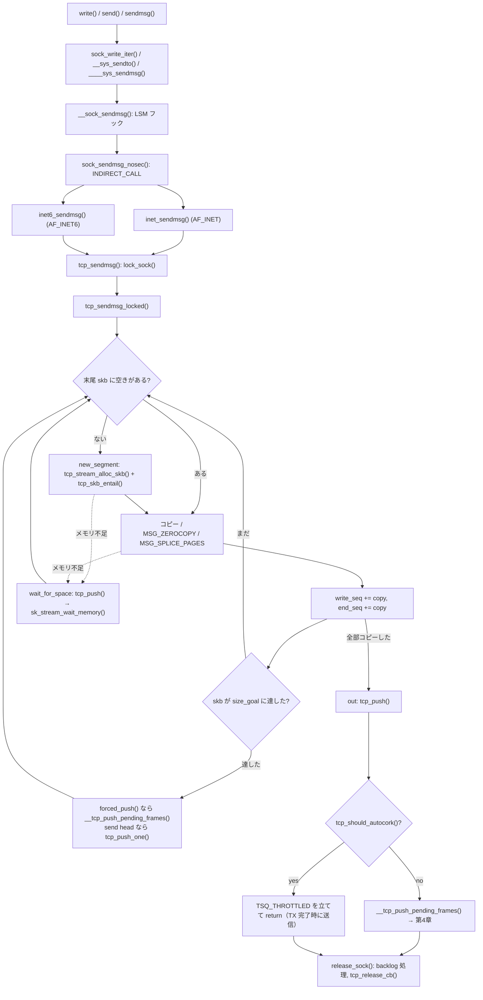

# 3. 送信 (1): tcp_sendmsg と送信キュー

この章では、アプリケーションが `write()` / `send()` / `sendmsg()` で渡したバイト列が、TCP の **送信キュー（write queue）** に `sk_buff` として積まれるまでを追います。主役は `tcp_sendmsg_locked()` で、これを 1 行ずつ読みます。キューに積まれた `sk_buff` を実際にワイヤへ送り出す `__tcp_push_pending_frames()` / `tcp_write_xmit()` から先は第 4 章の担当です。

## たとえ話で言うと

部屋の郵便受け（ソケット）の隣には **発送待ちの棚**（write queue）があります。住人（アプリ）が手紙の束を窓口に持ってくると、係員は次のように動きます。

- 棚のいちばん奥にある「まだ封をしていない小包」（キュー末尾の `sk_buff`）に空きがあれば、そこへ手紙を詰め足します。新しい箱を出すより安く済むからです。
- 箱の大きさは「トラック 1 台にちょうど積める量」（`size_goal`）が目安です。箱が満杯になったら新しい箱を出します。伝票（ヘッダ）はまだ書きません。発送の直前に書きます。
- 箱を出したり手紙を詰めたりするたびに家計簿（メモリアカウンティング）に記帳します。予算（`sk_sndbuf`）を使い切ったら、住人には窓口の前で待ってもらいます。受領印（ACK）が戻ってきて棚が空けば呼び出します。
- 住人が「まだ続きがあります」（`MSG_MORE`）と言えば、半端な箱はすぐに出しません。何も言わなければ、最後の箱に「ここで一区切り」の印（PSH）を付けて発送係（第 4 章）に渡します。
- 発送係の前のトラックがまだ道路に出たまま（qdisc や NIC に自分の小包が残っている）なら、半端な箱はもう少し棚に置いておきます。次の手紙がその箱に入るかもしれないからです（autocork）。

## RFC では

### RFC 9293（TCP 本体）のあらまし

[RFC 9293](https://www.rfc-editor.org/rfc/rfc9293) "Transmission Control Protocol (TCP)" は 2022 年に RFC 793 を置き換えた現行の TCP 仕様です。RFC 793, 879, 2873, 6093, 6429, 6528, 6691 を obsolete にし、RFC 1122 などを update しています。40 年分の errata と、ホスト要件（RFC 1122）として散らばっていた規則を 1 冊にまとめ直したものです。この章で使うのは「アプリがデータを渡す（SEND）」「データをセグメントに切る」「シーケンス空間を進める」の 3 点です。

#### シーケンス空間と送信側の状態変数

[RFC 9293 §3.3.1](https://www.rfc-editor.org/rfc/rfc9293#section-3.3.1) は送信側の状態変数を次のように定義します。

| RFC の変数 | 意味 | Linux の対応 |
| --- | --- | --- |
| `SND.UNA` | 未確認（unacknowledged）の先頭 | `tp->snd_una` |
| `SND.NXT` | 次に送るシーケンス番号 | `tp->snd_nxt` |
| `SND.WND` | 相手が広告した送信ウィンドウ | `tp->snd_wnd` |
| `SND.UP` | urgent pointer | `tp->snd_up` |
| `ISS` | 初期送信シーケンス番号 | `tp->write_seq` の初期値（第 2 章） |

[§3.4](https://www.rfc-editor.org/rfc/rfc9293#section-3.4) が言うとおり、TCP は「送ったバイトの 1 つ 1 つにシーケンス番号が付く」バイトストリームです。RFC はユーザが SEND したがまだ送っていないデータを「送信バッファにあるもの」としか書かず、その末尾に名前を付けていません。Linux はこの末尾を **`tp->write_seq`** として明示的に持っています。

```text
   snd_una            snd_nxt                       write_seq
      |  送信済み・未 ACK  |  キュー済み・未送信            |
------+-------------------+-----------------------------+------>
      [ tcp_rtx_queue (rb-tree) ][ sk_write_queue (list) ]
```

- `[snd_una, snd_nxt)` は送信済みで ACK 待ちの範囲です。`sk_buff` は再送キュー `tcp_rtx_queue`（rb-tree）にあります。
- `[snd_nxt, write_seq)` は `sendmsg()` が受け取ったけれどまだ送っていない範囲です。`sk_buff` は `sk_write_queue`（双方向リスト）にあります。
- `tcp_sendmsg_locked()` が動かすのは **`write_seq` だけ**です。`snd_nxt` を進めるのは第 4 章の `tcp_event_new_data_sent()`、`snd_una` を進めるのは第 7 章の ACK 処理です。

#### セグメント化は送信側の自由

[RFC 9293 §3.7](https://www.rfc-editor.org/rfc/rfc9293#section-3.7) "Segmentation" は、アプリのバイト列をどうセグメントに切るかを **送信側の裁量** としています。SEND 呼び出しの境界とセグメントの境界は無関係で、守るべき条件は「各セグメントは相手の MSS（と path MTU）を超えない」ことだけです。[§3.8](https://www.rfc-editor.org/rfc/rfc9293#section-3.8) "Data Communication" も、確立後のデータはセグメントの交換で運ばれ、どのセグメントにどれだけ載せるかは実装が決める、という立場です。

Linux はこの自由を最大限に使います。

- `sendmsg()` の時点では、MSS ではなく **`size_goal`（MSS の整数倍、最大で数十〜数百 KB）** を単位に `sk_buff` を作ります。
- ワイヤ上で MSS ごとに切るのは TSO（NIC）か GSO（ソフトウェア）です。TCP はそれを前提にして、MSS の何倍もの長さの「スーパーパケット」を 1 個の `sk_buff` として扱います。
- 逆に、送信直前に `tcp_write_xmit()` がこの `sk_buff` をさらに分割することもあります（第 4 章の `tso_fragment()`）。

#### MSS（RFC 9293 §3.7.1、旧 RFC 6691）

[RFC 9293 §3.7.1](https://www.rfc-editor.org/rfc/rfc9293#section-3.7.1) は MSS option の扱いを定めます。[RFC 6691](https://www.rfc-editor.org/rfc/rfc6691) "TCP Options and Maximum Segment Size (MSS)" は「MSS option の値には IP option や TCP option の長さを含めない。送信側が自分で option の分を引く」ことを明確にした RFC で、その内容は §3.7.1 に取り込まれました（RFC 6691 自体は RFC 9293 によって obsolete）。送信側が実際に使える MSS は次の式で決まります。

```text
Eff.snd.MSS = min(SendMSS + 20, MMS_S) - TCPhdrsize - IPoptionsize
```

- `SendMSS` は相手が SYN で広告した MSS です。option がなければ IPv4 は 536、IPv6 は 1220 とみなします。
- `MMS_S` はトランスポート層が送れる最大メッセージ長で、path MTU から固定長の IP ヘッダを引いた値です。
- `+ 20` は固定長の TCP ヘッダ分、`TCPhdrsize` は option を含む実際の TCP ヘッダ長、`IPoptionsize` は IP option（IPv6 では拡張ヘッダ）の長さです。

Linux では、この式を `__tcp_mtu_to_mss()` → `tcp_mtu_to_mss()` → `tcp_sync_mss()` → `tcp_current_mss()` が段階的に計算します（Step 5）。

#### SEND コールと PUSH

[RFC 9293 §3.9.1.2](https://www.rfc-editor.org/rfc/rfc9293#section-3.9.1.2) の SEND コールは `SEND (local connection name, buffer address, byte count, URGENT flag [, PUSH flag] [, timeout])` という形です。ここで実装に効く規則は次のとおりです。

- 送信側 TCP は、push が指示されるまではユーザのデータを集めて都合のよいときに送ってよい。つまり複数の SEND を 1 セグメントにまとめてよい。
- PUSH フラグを SEND の引数として実装するかどうかは任意（MAY）です。実装しない場合、送信側は (1) データを無期限に溜め込んではならず、(2) 溜めていたデータの最後のセグメント（キューにもう何もないとき）に PSH ビットを立てなければなりません。

BSD ソケットには PUSH 引数がありません。Linux は後者の「PUSH を実装しない」側の規則に従い、**`sendmsg()` が終わる時点でキュー末尾の `sk_buff` に PSH を立てる**（`tcp_push()` → `tcp_mark_push()`）ことで (2) を満たします。`MSG_MORE` はその逆の「まだ push しないで」という意思表示です。(1) の「無期限に溜めない」は、Nagle / cork の上限（第 4 章）と、本章の `forced_push()` が担います。

URGENT フラグは `MSG_OOB` に対応します。[§3.8.5](https://www.rfc-editor.org/rfc/rfc9293#section-3.8.5) の urgent pointer は `tp->snd_up` に記録されます（`tcp_mark_urg()`）。

#### Nagle（RFC 896）と送信側 SWS 回避 — 考え方だけ

[RFC 896](https://www.rfc-editor.org/rfc/rfc896) "Congestion Control in IP/TCP Internetworks" は、1 バイトずつ打鍵される telnet のような通信が「41 バイトのパケットに 1 バイトのデータ」を大量に生んでネットワークを詰まらせる問題を扱いました。解決策（Nagle アルゴリズム）は「未 ACK のデータがある間は、小さいセグメントを新たに送らずに溜めておく」というものです。[RFC 9293 §3.7.4](https://www.rfc-editor.org/rfc/rfc9293#section-3.7.4) はこれを SHOULD とし、アプリが接続ごとに無効化できること（`TCP_NODELAY`）を MUST としています。

[§3.8.6.2.1](https://www.rfc-editor.org/rfc/rfc9293#section-3.8.6.2.1) の送信側 SWS 回避アルゴリズムは、送信してよい条件の 1 つとして「相手がこれまでに広告した最大ウィンドウ `max(SND.WND)` の Fs 割（推奨 Fs = 1/2）以上を送れること」を挙げています。この「最大ウィンドウの半分」という基準は、本章の `forced_push()` と `tcp_bound_to_half_wnd()` に `tp->max_window >> 1` という形で出てきます。

Nagle 判定そのもの（`tcp_nagle_test()`、`TCP_CORK`、`tcp_tso_should_defer()`）は第 4 章で扱います。本章で出てくるのは、`tcp_push()` が第 4 章へ渡す `nonagle` 引数（`TCP_NAGLE_OFF` / `TCP_NAGLE_CORK` / `TCP_NAGLE_PUSH`）だけです。

## 全体の流れ



ポイントは次の 4 つです。

- ソケット層とプロトコル層の間は `INDIRECT_CALL_*()` で retpoline を避けた直接呼び出しになっています。AF_INET と AF_INET6 は `inet_sendmsg()` / `inet6_sendmsg()` で分かれますが、`tcp_sendmsg()` で合流します。それ以降は address family に依存しません。
- `tcp_sendmsg()` はソケットロック（owner）を取ってから `tcp_sendmsg_locked()` を呼びます。その間に softirq で届いた ACK などは backlog に積まれ、`sk_flush_backlog()`（Step 7）か `release_sock()` で処理されます。
- メインループは「末尾の `sk_buff` を `size_goal` まで満たす。満杯なら新しい `sk_buff` を足す」の繰り返しです。ループの途中でも、満杯になった `sk_buff` は送り始めます。
- 最後の `tcp_push()` が PSH 付与、autocork、`MSG_MORE` による cork を判断し、第 4 章の `__tcp_push_pending_frames()` に渡します。

## コードを追う

### Step 1: システムコールからソケット層まで

ソケット層はよくご存じの部分なので、TCP の送信路に関係するところだけ確認します。`write()` は VFS 経由で `sock_write_iter()`（[net/socket.c#L1250](https://git.kernel.org/pub/scm/linux/kernel/git/netdev/net-next.git/tree/net/socket.c?id=279d5c8afcd38bd841832a39bfe1aa4f8518d98e#n1250)） に来ます。

```c
static ssize_t sock_write_iter(struct kiocb *iocb, struct iov_iter *from)
{
	struct file *file = iocb->ki_filp;
	struct socket *sock = file->private_data;
	struct msghdr msg = {.msg_iter = *from};
	ssize_t res;

	if (iocb->ki_pos != 0)
		return -ESPIPE;

	if (file->f_flags & O_NONBLOCK || (iocb->ki_flags & IOCB_NOWAIT))
		msg.msg_flags = MSG_DONTWAIT;

	if (sock->type == SOCK_SEQPACKET)
		msg.msg_flags |= MSG_EOR;

	if (iocb->ki_flags & IOCB_NOSIGNAL)
		msg.msg_flags |= MSG_NOSIGNAL;

	res = __sock_sendmsg(sock, &msg);
	*from = msg.msg_iter;
	return res;
}
```

- `ki_pos != 0` を `-ESPIPE` にするのは、ストリームソケットにファイルオフセットの概念がないためです。
- `O_NONBLOCK` や `IOCB_NOWAIT`（io_uring など）は `MSG_DONTWAIT` に変換されます。TCP 側はこれを見て `sock_sndtimeo()` のタイムアウトを 0 にします。
- `write()` には `flags` 引数がないので、`MSG_MORE` も `MSG_ZEROCOPY` も使えません。これらを使うには `send()` / `sendmsg()` が必要です。

`send()` / `sendto()` は `__sys_sendto()`（[net/socket.c#L2248](https://git.kernel.org/pub/scm/linux/kernel/git/netdev/net-next.git/tree/net/socket.c?id=279d5c8afcd38bd841832a39bfe1aa4f8518d98e#n2248)） が `import_ubuf()` で 1 セグメントの `iov_iter` を作り、`sendmsg()` / `sendmmsg()` は `____sys_sendmsg()`（[net/socket.c#L2658](https://git.kernel.org/pub/scm/linux/kernel/git/netdev/net-next.git/tree/net/socket.c?id=279d5c8afcd38bd841832a39bfe1aa4f8518d98e#n2658)） を通ります。どちらも最終的に `__sock_sendmsg()`（[net/socket.c#L813](https://git.kernel.org/pub/scm/linux/kernel/git/netdev/net-next.git/tree/net/socket.c?id=279d5c8afcd38bd841832a39bfe1aa4f8518d98e#n813)） に集まります。

```c
static inline int sock_sendmsg_nosec(struct socket *sock, struct msghdr *msg)
{
	int ret = INDIRECT_CALL_INET(READ_ONCE(sock->ops)->sendmsg, inet6_sendmsg,
				     inet_sendmsg, sock, msg,
				     msg_data_left(msg));
	if (unlikely(ret == -EIOCBQUEUED)) {
		DEBUG_NET_WARN_ON_ONCE(1);
		ret = -EIO;
	}

	if (trace_sock_send_length_enabled())
		call_trace_sock_send_length(sock->sk, ret, 0);
	return ret;
}

static int __sock_sendmsg(struct socket *sock, struct msghdr *msg)
{
	int err = security_socket_sendmsg(sock, msg,
					  msg_data_left(msg));

	return err ?: sock_sendmsg_nosec(sock, msg);
}
```

- `security_socket_sendmsg()` は LSM フックです。`sendmmsg()` で宛先が前回と同じ場合だけ、`____sys_sendmsg()` が LSM を省略して `sock_sendmsg_nosec()` を直接呼びます。
- `INDIRECT_CALL_INET()` は `READ_ONCE(sock->ops)->sendmsg` が `inet6_sendmsg` か `inet_sendmsg` であれば直接呼び出し、そうでなければ間接呼び出しにします。retpoline 環境で間接分岐を避けるための定番のパターンです。
- `sock->ops` を `READ_ONCE()` で読むのは、`IPV6_ADDRFORM` で AF_INET6 ソケットが AF_INET に化けるとき、`sock->ops` と `sk->sk_prot` がロックなしで書き換えられるからです。

カーネル内部の利用者（NFS、iSCSI、nbd など）は `sock_sendmsg()`（[net/socket.c#L829](https://git.kernel.org/pub/scm/linux/kernel/git/netdev/net-next.git/tree/net/socket.c?id=279d5c8afcd38bd841832a39bfe1aa4f8518d98e#n829)） を使います。こちらは `msg_name` をスタック上にコピーしてから `__sock_sendmsg()` を呼びます。BPF の `sendmsg` フックや LSM が宛先アドレスを書き換えても、呼び出し元のバッファを汚さないためです。

### Step 2: inet_sendmsg() / inet6_sendmsg()

```c
int inet_send_prepare(struct sock *sk)
{
	sock_rps_record_flow(sk);

	/* We may need to bind the socket. */
	if (data_race(!inet_sk(sk)->inet_num) && !sk->sk_prot->no_autobind &&
	    inet_autobind(sk))
		return -EAGAIN;

	return 0;
}

int inet_sendmsg(struct socket *sock, struct msghdr *msg, size_t size)
{
	struct sock *sk = sock->sk;
	const struct proto *prot;

	if (unlikely(inet_send_prepare(sk)))
		return -EAGAIN;

	prot = READ_ONCE(sk->sk_prot);
	return INDIRECT_CALL_2(prot->sendmsg, tcp_sendmsg, udp_sendmsg,
			       sk, msg, size);
}
```

IPv6 側の `inet6_sendmsg()`（[net/ipv6/af_inet6.c#L629](https://git.kernel.org/pub/scm/linux/kernel/git/netdev/net-next.git/tree/net/ipv6/af_inet6.c?id=279d5c8afcd38bd841832a39bfe1aa4f8518d98e#n629)） は、2 つ目の候補が `udpv6_sendmsg` になる点を除けば同じです。

```c
int inet6_sendmsg(struct socket *sock, struct msghdr *msg, size_t size)
{
	struct sock *sk = sock->sk;
	const struct proto *prot;

	if (unlikely(inet_send_prepare(sk)))
		return -EAGAIN;

	prot = READ_ONCE(sk->sk_prot);
	return INDIRECT_CALL_2(prot->sendmsg, tcp_sendmsg, udpv6_sendmsg,
			       sk, msg, size);
}
```

- `inet_send_prepare()`（[net/ipv4/af_inet.c#L842](https://git.kernel.org/pub/scm/linux/kernel/git/netdev/net-next.git/tree/net/ipv4/af_inet.c?id=279d5c8afcd38bd841832a39bfe1aa4f8518d98e#n842)） の `sock_rps_record_flow()` は、RFS（Receive Flow Steering）に「このフローを処理しているのはこの CPU だ」と記録します。送信の時点で記録しておけば、応答（ACK やデータ）の受信処理を同じ CPU に寄せられます。
- `inet_autobind()` は UDP など未 bind ソケット向けの処理です。TCP の場合、`sendmsg()` が来る時点で `connect()` か `accept()` によってポートが決まっています。MSG_FASTOPEN で未接続のまま来た場合も、ポートは後段の `tcp_v4_connect()` 内で選ばれるので、ここは素通りします。
- `READ_ONCE(sk->sk_prot)` を読むのは、sockmap（`tcp_bpf_sendmsg()`）や kTLS（`tls_sw_sendmsg()` など）が `sk->sk_prot` を差し替えるからです。そのときは `INDIRECT_CALL_2()` の比較が外れて間接呼び出しになり、それらの ULP が最終的に `tcp_sendmsg_locked()` を呼びます（`net/ipv4/tcp_bpf.c` や `net/tls/tls_main.c` が呼び出し元です）。`proto_ops` の `.sendmsg_locked = tcp_sendmsg_locked` は、`skb_send_sock_locked()` などカーネル内からロック済みで送る経路のためのものです。

### Step 3: tcp_sendmsg() — ロックの境界

```c
int tcp_sendmsg(struct sock *sk, struct msghdr *msg, size_t size)
{
	int ret;

	lock_sock(sk);
	ret = tcp_sendmsg_locked(sk, msg, size);
	release_sock(sk);

	return ret;
}
EXPORT_SYMBOL(tcp_sendmsg);
```

`tcp_sendmsg()`（[net/ipv4/tcp.c#L1449](https://git.kernel.org/pub/scm/linux/kernel/git/netdev/net-next.git/tree/net/ipv4/tcp.c?id=279d5c8afcd38bd841832a39bfe1aa4f8518d98e#n1449)） はロックを取って `tcp_sendmsg_locked()` を呼ぶだけですが、この 2 行が送信路全体の実行コンテキストを決めています。

- `lock_sock()` はソケットの **所有権（owner）** を取ります。spinlock を握り続けるわけではないので、プロセスコンテキストでスリープしたり、ページフォルトを起こしたり、ユーザ空間からコピーしたりできます。
- 所有中に softirq（`tcp_v4_rcv()` / `tcp_v6_rcv()`）でパケットが届くと、`sk_add_backlog()` で backlog に積まれます（第 5 章）。`tcp_sendmsg_locked()` の中では、受信処理と状態変数を取り合う心配がありません。
- `release_sock()` は backlog に溜まったパケットを `sk_backlog_rcv()` で処理し、さらに `tcp_release_cb()` で、所有中に延期されていた TSQ / 遅延 ACK / 再送タイマの処理などを実行します。大きな `sendmsg()` の間に届いた ACK は、ここでまとめて処理されます。そのため、ループ中の `sk_flush_backlog()`（Step 7）が重要になります。

### Step 4: 送信キューの部品

コードに入る前に、送信キューの部品を確認します（`struct tcp_sock` 全体は第 1 章を参照してください）。

```c
static inline struct sk_buff *tcp_write_queue_tail(const struct sock *sk)
{
	return skb_peek_tail(&sk->sk_write_queue);
}

#define tcp_for_write_queue_from_safe(skb, tmp, sk)			\
	skb_queue_walk_from_safe(&(sk)->sk_write_queue, skb, tmp)

static inline struct sk_buff *tcp_send_head(const struct sock *sk)
{
	return skb_peek(&sk->sk_write_queue);
}
...
static inline bool tcp_write_queue_empty(const struct sock *sk)
{
	const struct tcp_sock *tp = tcp_sk(sk);

	return tp->write_seq == tp->snd_nxt;
}

static inline bool tcp_rtx_queue_empty(const struct sock *sk)
{
	return RB_EMPTY_ROOT(&sk->tcp_rtx_queue);
}

static inline bool tcp_rtx_and_write_queues_empty(const struct sock *sk)
{
	return tcp_rtx_queue_empty(sk) && tcp_write_queue_empty(sk);
}

static inline void tcp_add_write_queue_tail(struct sock *sk, struct sk_buff *skb)
{
	__skb_queue_tail(&sk->sk_write_queue, skb);

	/* Queue it, remembering where we must start sending. */
	if (sk->sk_write_queue.next == skb)
		tcp_chrono_start(sk, TCP_CHRONO_BUSY);
}
```

- `tcp_write_queue_tail()`（[include/net/tcp.h#L2286](https://git.kernel.org/pub/scm/linux/kernel/git/netdev/net-next.git/tree/include/net/tcp.h?id=279d5c8afcd38bd841832a39bfe1aa4f8518d98e#n2286)） はまだ送っていない `sk_buff` のうち **いちばん新しいもの** を返します。`sendmsg()` は基本的にここへ追記します。
- `tcp_send_head()`（[include/net/tcp.h#L2294](https://git.kernel.org/pub/scm/linux/kernel/git/netdev/net-next.git/tree/include/net/tcp.h?id=279d5c8afcd38bd841832a39bfe1aa4f8518d98e#n2294)） はまだ送っていない `sk_buff` のうち **いちばん古いもの** で、次に `tcp_write_xmit()` が送るものです。送信済みの `sk_buff` は第 4 章の `tcp_event_new_data_sent()` で write queue から外され、rb-tree の `tcp_rtx_queue` に移ります。
- `tcp_write_queue_empty()`（[include/net/tcp.h#L2312](https://git.kernel.org/pub/scm/linux/kernel/git/netdev/net-next.git/tree/include/net/tcp.h?id=279d5c8afcd38bd841832a39bfe1aa4f8518d98e#n2312)） は `skb_queue_empty()` ではなく `write_seq == snd_nxt` で判定します。コメントにあるとおり、`sendmsg()` が作ったばかりでまだ空の `sk_buff` が一時的にキューにいることがあるためです（`tcp_remove_empty_skb()` で後片付けします）。
- `tcp_add_write_queue_tail()`（[include/net/tcp.h#L2329](https://git.kernel.org/pub/scm/linux/kernel/git/netdev/net-next.git/tree/include/net/tcp.h?id=279d5c8afcd38bd841832a39bfe1aa4f8518d98e#n2329)） はキューが空から非空になったときに `tcp_chrono_start(sk, TCP_CHRONO_BUSY)` を呼び、送信稼働時間のストップウォッチを開始します（`enum tcp_chrono` の 4 つの状態と計測の仕組みは [補足ノート: `enum tcp_chrono` と `TCP_CHRONO_BUSY`](appendix-notes.md#tcp-chrono-busy) を参照）。

各 `sk_buff` の制御情報は `skb->cb[]` に置かれた `struct tcp_skb_cb`（[include/net/tcp.h#L1138](https://git.kernel.org/pub/scm/linux/kernel/git/netdev/net-next.git/tree/include/net/tcp.h?id=279d5c8afcd38bd841832a39bfe1aa4f8518d98e#n1138)） です。

```c
struct tcp_skb_cb {
	__u32		seq;		/* Starting sequence number	*/
	__u32		end_seq;	/* SEQ + FIN + SYN + datalen	*/
	union {
		/* Notes :
		 *	tcp_tw_isn is used in input path only
		 *	(isn chosen by tcp_timewait_state_process())
		 * 	  tcp_gso_segs/size are used in write queue only,
		 *	  cf tcp_skb_pcount()/tcp_skb_mss()
		 */
		u32		tcp_tw_isn;
		struct {
			u16	tcp_gso_segs;
			u16	tcp_gso_size;
		};
	};
	__u16		tcp_flags;	/* TCP header flags (tcp[12-13])*/

	__u8		sacked;		/* State flags for SACK.	*/
	__u8		ip_dsfield;	/* IPv4 tos or IPv6 dsfield	*/
#define TSTAMP_ACK_SK	0x1
#define TSTAMP_ACK_BPF	0x2
	__u8		txstamp_ack:2,	/* Record TX timestamp for ack? */
			eor:1,		/* Is skb MSG_EOR marked? */
			has_rxtstamp:1,	/* SKB has a RX timestamp	*/
			unused:4;
	__u32		ack_seq;	/* Sequence number ACK'd	*/
```

- `seq` / `end_seq` はこの `sk_buff` が受け持つシーケンス範囲 `[seq, end_seq)` です。SYN と FIN も 1 ずつ数えます。キュー上の `sk_buff` は隙間なく連続し、末尾の `end_seq == tp->write_seq` が成り立ちます。この不変条件は `tcp_sendmsg_locked()` 自身が維持します。
- `tcp_gso_segs` は「この `sk_buff` はワイヤ上で何セグメントになるか」（pcount）です。`sendmsg()` はデータを足すたびに 0 に戻し、送信直前に `tcp_init_tso_segs()` が計算し直します。
- `eor` は `MSG_EOR` の印で、これが立った `sk_buff` にはもうデータを足しません。

### Step 5: MSS と size_goal — tcp_send_mss()

`tcp_sendmsg_locked()` はループの前と、待機から戻った後に `tcp_send_mss()`（[net/ipv4/tcp.c#L984](https://git.kernel.org/pub/scm/linux/kernel/git/netdev/net-next.git/tree/net/ipv4/tcp.c?id=279d5c8afcd38bd841832a39bfe1aa4f8518d98e#n984)） を呼び、2 つの値を得ます。

```c
int tcp_send_mss(struct sock *sk, int *size_goal, int flags)
{
	int mss_now;

	mss_now = tcp_current_mss(sk);
	*size_goal = tcp_xmit_size_goal(sk, mss_now, !(flags & MSG_OOB));

	return mss_now;
}
```

- `mss_now` は **いまワイヤに出す 1 セグメントのペイロード長** です。
- `size_goal` は **1 個の `sk_buff` に詰める目標の長さ** で、TSO/GSO が使えるなら `mss_now` の整数倍になります。
- `MSG_OOB` のときは `large_allowed = 0` になり、`size_goal = mss_now` です。urgent データは MSS 単位の `sk_buff` で扱い、ループ途中で push もしません（Step 10）。こうしておけば `snd_up` の位置がセグメントの境界とずれにくくなります。

#### tcp_current_mss()

`tcp_current_mss()`（[net/ipv4/tcp_output.c#L2103](https://git.kernel.org/pub/scm/linux/kernel/git/netdev/net-next.git/tree/net/ipv4/tcp_output.c?id=279d5c8afcd38bd841832a39bfe1aa4f8518d98e#n2103)） が RFC の `Eff.snd.MSS` を計算します。

```c
unsigned int tcp_current_mss(struct sock *sk)
{
	const struct tcp_sock *tp = tcp_sk(sk);
	const struct dst_entry *dst = __sk_dst_get(sk);
	u32 mss_now;
	unsigned int header_len;
	struct tcp_out_options opts;
	struct tcp_key key;

	mss_now = tp->mss_cache;

	if (dst) {
		u32 mtu = dst_mtu(dst);
		if (mtu != inet_csk(sk)->icsk_pmtu_cookie)
			mss_now = tcp_sync_mss(sk, mtu);
	}
	tcp_get_current_key(sk, &key);
	header_len = tcp_established_options(sk, NULL, &opts, &key) +
		     sizeof(struct tcphdr);
	/* The mss_cache is sized based on tp->tcp_header_len, which assumes
	 * some common options. If this is an odd packet (because we have SACK
	 * blocks etc) then our calculated header_len will be different, and
	 * we have to adjust mss_now correspondingly */
	if (header_len != tp->tcp_header_len) {
		int delta = (int) header_len - tp->tcp_header_len;
		mss_now -= delta;
	}

	return mss_now;
}
```

- `tp->mss_cache` は `tcp_sync_mss()` が最後に計算した値で、「よく使う option（timestamp など。`tp->tcp_header_len` に含まれる分）を引いた MSS」です。
- `dst_mtu(dst)` が前回の `icsk_pmtu_cookie` と違えば、PMTU が変わったということなので `tcp_sync_mss()` で計算し直します。ICMP の Frag Needed / Packet Too Big は softirq で `dst` の MTU を更新するだけで、TCP 側は次の送信時にここで気づきます（`tcp_v4_mtu_reduced()` / `tcp_v6_mtu_reduced()` が即時に呼ぶ経路もあります）。
- `tcp_established_options()` は **このパケットに実際に付ける option** の長さを計算します。SACK ブロック（受信側で穴が開いているとき）や MD5 / TCP-AO などで `tcp_header_len` との差が出れば、その分だけ MSS を減らします。RFC 6691 / RFC 9293 §3.7.1 の「option の分は送信側が引く」の実装です。

`tcp_sync_mss()` が呼ぶ `__tcp_mtu_to_mss()`（[net/ipv4/tcp_output.c#L1996](https://git.kernel.org/pub/scm/linux/kernel/git/netdev/net-next.git/tree/net/ipv4/tcp_output.c?id=279d5c8afcd38bd841832a39bfe1aa4f8518d98e#n1996)） と `tcp_mtu_to_mss()`（[net/ipv4/tcp_output.c#L2021](https://git.kernel.org/pub/scm/linux/kernel/git/netdev/net-next.git/tree/net/ipv4/tcp_output.c?id=279d5c8afcd38bd841832a39bfe1aa4f8518d98e#n2021)） は、RFC の式をほぼそのまま書いたものです。

```c
static inline int __tcp_mtu_to_mss(struct sock *sk, int pmtu)
{
	const struct tcp_sock *tp = tcp_sk(sk);
	const struct inet_connection_sock *icsk = inet_csk(sk);
	int mss_now;

	/* Calculate base mss without TCP options:
	   It is MMS_S - sizeof(tcphdr) of rfc1122
	 */
	mss_now = pmtu - icsk->icsk_af_ops->net_header_len - sizeof(struct tcphdr);

	/* Clamp it (mss_clamp does not include tcp options) */
	if (mss_now > tp->rx_opt.mss_clamp)
		mss_now = tp->rx_opt.mss_clamp;

	/* Now subtract optional transport overhead */
	mss_now -= icsk->icsk_ext_hdr_len;

	/* Then reserve room for full set of TCP options and 8 bytes of data */
	mss_now = max(mss_now,
		      READ_ONCE(sock_net(sk)->ipv4.sysctl_tcp_min_snd_mss));
	return mss_now;
}

/* Calculate MSS. Not accounting for SACKs here.  */
int tcp_mtu_to_mss(struct sock *sk, int pmtu)
{
	/* Subtract TCP options size, not including SACKs */
	return __tcp_mtu_to_mss(sk, pmtu) -
	       (tcp_sk(sk)->tcp_header_len - sizeof(struct tcphdr));
}
```

| RFC 9293 §3.7.1 の項 | Linux |
| --- | --- |
| `MMS_S - 20` | `pmtu - net_header_len - sizeof(struct tcphdr)` |
| `min(SendMSS + 20, MMS_S) - 20` | `mss_clamp` との `min`（`mss_clamp` は相手の MSS と `TCP_MAXSEG` の小さい方） |
| `- IPoptionsize` | `- icsk_ext_hdr_len`（IPv4 option / IPv6 拡張ヘッダ） |
| `- (TCPhdrsize - 20)` | `- (tcp_header_len - sizeof(struct tcphdr))`、さらに `tcp_current_mss()` で SACK などの差分を引く |

RFC にない Linux 独自の下限が `sysctl_tcp_min_snd_mss`（既定値 `TCP_MIN_SND_MSS` = 48）です。2019 年の SACK Panic（CVE-2019-11477/11478/11479）対策で入りました。相手が極端に小さい MSS を広告して、`sk_buff` の数を爆発させる攻撃を防ぎます。

#### tcp_xmit_size_goal() と tcp_bound_to_half_wnd()

```c
static unsigned int tcp_xmit_size_goal(struct sock *sk, u32 mss_now,
				       int large_allowed)
{
	struct tcp_sock *tp = tcp_sk(sk);
	u32 new_size_goal, size_goal;

	if (!large_allowed)
		return mss_now;

	/* Note : tcp_tso_autosize() will eventually split this later */
	new_size_goal = tcp_bound_to_half_wnd(tp, sk->sk_gso_max_size);

	/* We try hard to avoid divides here */
	size_goal = tp->gso_segs * mss_now;
	if (unlikely(new_size_goal < size_goal ||
		     new_size_goal >= size_goal + mss_now)) {
		tp->gso_segs = min_t(u16, new_size_goal / mss_now,
				     sk->sk_gso_max_segs);
		size_goal = tp->gso_segs * mss_now;
	}

	return max(size_goal, mss_now);
}
```

- `large_allowed == 0`（`MSG_OOB`）なら `mss_now` を返します。
- `sk->sk_gso_max_size` はデバイスの GSO 上限から `MAX_TCP_HEADER + 1` を引いた値で、`sk_setup_caps()` が経路キャッシュの設定時に決めます。TCP は NIC が TSO を持たなくても常に `NETIF_F_GSO`（ソフトウェア GSO）を立てるので、普通は 64KB 前後（BIG TCP ならそれ以上）になります。例外は `sk_gso_disabled`（TCP-MD5 など）や、オフロードできない xfrm 経路で GSO が落とされた場合です。このとき `sk_gso_max_size` は設定されず通常 0 のままなので、下の計算で `size_goal` は `mss_now` に落ちます。
- `tcp_bound_to_half_wnd()`（[include/net/tcp.h#L858](https://git.kernel.org/pub/scm/linux/kernel/git/netdev/net-next.git/tree/include/net/tcp.h?id=279d5c8afcd38bd841832a39bfe1aa4f8518d98e#n858)） は、それを **相手の最大ウィンドウの半分** で抑えます。

```c
static inline int tcp_bound_to_half_wnd(struct tcp_sock *tp, int pktsize)
{
	int cutoff;

	/* When peer uses tiny windows, there is no use in packetizing
	 * to sub-MSS pieces for the sake of SWS or making sure there
	 * are enough packets in the pipe for fast recovery.
	 *
	 * On the other hand, for extremely large MSS devices, handling
	 * smaller than MSS windows in this way does make sense.
	 */
	if (tp->max_window > TCP_MSS_DEFAULT)
		cutoff = (tp->max_window >> 1);
	else
		cutoff = tp->max_window;

	if (cutoff && pktsize > cutoff)
		return max_t(int, cutoff, 68U - tp->tcp_header_len);
	else
		return pktsize;
}
```

  ウィンドウより大きな `sk_buff` を作っても一度には送れません。半分で抑えれば、パイプに最低 2 個のパケットを置け、Fast Recovery に必要な dupack も得やすくなります。RFC の送信側 SWS 回避の Fs = 1/2 と同じ発想です。`max_window <= TCP_MSS_DEFAULT`（536）のような極端に小さいウィンドウでは半分にせず、ウィンドウ全体を上限にします。それでも下限は `68 - tcp_header_len` です。68 は IPv4 の最小 MTU です。
- `size_goal = tp->gso_segs * mss_now` は **割り算を避ける** ためのキャッシュです。`gso_segs`（u16）には前回の「1 個の `sk_buff` に何セグメント入るか」が入っています。新しい上限 `new_size_goal` が `[size_goal, size_goal + mss_now)` の範囲に収まっていれば、商は変わらないので割り算を省けます。外れたとき（MSS や GSO 上限、ウィンドウが変わったとき）だけ `new_size_goal / mss_now` を計算し、`sk_gso_max_segs` で抑えます。
- コメントの `tcp_tso_autosize()`（第 4 章）は、ペーシングレートに合わせて「1ms 分程度」の TSO サイズを送信時に決めます。`size_goal` はあくまでキュー上の `sk_buff` の大きさで、ワイヤに出る TSO パケットの大きさとは別物です。
- `max(size_goal, mss_now)` は、`gso_segs == 0` のような異常時にも 0 を返さないための保険です（afece1c65870）。

> [!NOTE]
> `size_goal` は `tcp_send_mss()` を呼んだ時点の値で、ループの中では固定です。途中で MSS やウィンドウが変わっても、`sk_flush_backlog()` が何かを処理して `goto restart` するか、`wait_for_space` から戻るまでは古い値のまま使われます。古い値は後段の `tcp_write_xmit()` が正すので、正しさには影響しません。

### Step 6: tcp_sendmsg_locked() (1) — 前処理と送信モードの決定

ここから `tcp_sendmsg_locked()`（[net/ipv4/tcp.c#L1119](https://git.kernel.org/pub/scm/linux/kernel/git/netdev/net-next.git/tree/net/ipv4/tcp.c?id=279d5c8afcd38bd841832a39bfe1aa4f8518d98e#n1119)） を頭から最後まで読みます。呼び出し時点でソケットは所有されており（`lock_sock()` 済み）、プロセスコンテキストで動いています。

```c
int tcp_sendmsg_locked(struct sock *sk, struct msghdr *msg, size_t size)
{
	struct net_devmem_dmabuf_binding *binding = NULL;
	struct tcp_sock *tp = tcp_sk(sk);
	struct ubuf_info *uarg = NULL;
	struct sk_buff *skb;
	struct sockcm_cookie sockc;
	int flags, err, copied = 0;
	int mss_now = 0, size_goal, copied_syn = 0;
	int process_backlog = 0;
	int sockc_err = 0;
	int zc = 0;
	long timeo;

	flags = msg->msg_flags;

	sockc = (struct sockcm_cookie){ .tsflags = READ_ONCE(sk->sk_tsflags) };
	if (msg->msg_controllen) {
		sockc_err = sock_cmsg_send(sk, msg, &sockc);
		/* Don't return error until MSG_FASTOPEN has been processed;
		 * that may succeed even if the cmsg is invalid.
		 */
	}
```

- `copied` はこの呼び出しで write queue に積んだバイト数、`copied_syn` は Fast Open で SYN に載せたバイト数です。戻り値は `copied + copied_syn` です。
- `process_backlog` は「backlog を前回確認してから新たに作った `sk_buff` の数」です（Step 7）。
- `zc` が送信モードを表します。`0` は通常のコピー、`MSG_ZEROCOPY` はユーザページを pin して参照、`MSG_SPLICE_PAGES` は splice / sendfile などで渡されたページへの参照を `sk_buff` に入れます。
- `sockc` は cmsg（`SCM_TIMESTAMPING`、`SO_MARK`、`SCM_DEVMEM_DMABUF` など）の解析結果です。`sock_cmsg_send()` のエラーをすぐ返さず `sockc_err` に取っておくのは、コメントのとおり MSG_FASTOPEN の処理（SYN の送信）を先に済ませるためです。cmsg が壊れていても接続は開始される、という既存の挙動を保っています。

```c
	if ((flags & MSG_ZEROCOPY) && size) {
		if (msg->msg_ubuf) {
			uarg = msg->msg_ubuf;
			if (sk->sk_route_caps & NETIF_F_SG)
				zc = MSG_ZEROCOPY;
		} else if (sock_flag(sk, SOCK_ZEROCOPY)) {
			skb = tcp_write_queue_tail(sk);
			uarg = msg_zerocopy_realloc(sk, size, skb_zcopy(skb),
						    !sockc_err && sockc.dmabuf_id);
			if (!uarg) {
				err = -ENOBUFS;
				goto out_err;
			}
			if (sk->sk_route_caps & NETIF_F_SG)
				zc = MSG_ZEROCOPY;
			else
				uarg_to_msgzc(uarg)->zerocopy = 0;

			if (!sockc_err && sockc.dmabuf_id) {
				binding = net_devmem_get_binding(sk, sockc.dmabuf_id);
				if (IS_ERR(binding)) {
					err = PTR_ERR(binding);
					binding = NULL;
					goto out_err;
				}
			}
		}
	} else if (unlikely(msg->msg_flags & MSG_SPLICE_PAGES) && size) {
		if (sk->sk_route_caps & NETIF_F_SG)
			zc = MSG_SPLICE_PAGES;
	}

	if (!sockc_err && sockc.dmabuf_id && (zc != MSG_ZEROCOPY || !binding)) {
		err = -EINVAL;
		goto out_err;
	}
```

ここで送信モードを決めます。

- **`MSG_ZEROCOPY` かつ `size > 0`** の場合は 2 通りあります。
  - `msg->msg_ubuf` があるのは、io_uring などカーネル内の呼び出し元が自前の `ubuf_info`（完了通知の器）を用意している場合です。`NETIF_F_SG` があれば zerocopy にします。
  - `SO_ZEROCOPY` を有効にしたソケットへの通常の `sendmsg(MSG_ZEROCOPY)` では、`msg_zerocopy_realloc()` が完了通知用の `ubuf_info` を用意します。末尾の `sk_buff` がすでに zerocopy なら、その `ubuf_info` を延長して通知の範囲をまとめようとします。これで通知の数が減ります。
  - `NETIF_F_SG`（scatter-gather）がないデバイスでは、ページを参照で持てないのでコピーに落とします（`zerocopy = 0`）。ただし完了通知は届きます。アプリには `SO_EE_CODE_ZEROCOPY_COPIED` として見えます。
  - `SO_ZEROCOPY` を有効にしていないソケットに `MSG_ZEROCOPY` が来たときは、黙って通常のコピーになります（5cf4a8532c99）。
  - devmem TX（`sockc.dmabuf_id`）では、dma-buf のバインディングを取ります。
- **`MSG_SPLICE_PAGES`** は、かつての `->sendpage()` を置き換えた仕組みです（Step 9）。SG がなければ `zc = 0` でコピーに落ちます。
- 最後の検査では、devmem（dma-buf）は「コピーできないメモリ」なので、**zerocopy かつバインディングあり** の場合しか許しません（125755776bc6）。SG がなくてコピー経路に落ちる場合も `-EINVAL` で拒否します。

```c
	if (unlikely(flags & MSG_FASTOPEN ||
		     inet_test_bit(DEFER_CONNECT, sk)) &&
	    !tp->repair) {
		err = tcp_sendmsg_fastopen(sk, msg, &copied_syn, size, uarg);
		if (err == -EINPROGRESS && copied_syn > 0)
			goto out;
		else if (err)
			goto out_err;
	}

	timeo = sock_sndtimeo(sk, flags & MSG_DONTWAIT);

	tcp_rate_check_app_limited(sk);  /* is sending application-limited? */

	/* Wait for a connection to finish. One exception is TCP Fast Open
	 * (passive side) where data is allowed to be sent before a connection
	 * is fully established.
	 */
	if (((1 << sk->sk_state) & ~(TCPF_ESTABLISHED | TCPF_CLOSE_WAIT)) &&
	    !tcp_passive_fastopen(sk)) {
		err = sk_stream_wait_connect(sk, &timeo);
		if (err != 0)
			goto do_error;
	}
```

- **Fast Open**: `MSG_FASTOPEN`、あるいは `TCP_FASTOPEN_CONNECT` で `connect()` を遅延させたソケット（`DEFER_CONNECT`）では、`tcp_sendmsg_fastopen()`（[net/ipv4/tcp.c#L1054](https://git.kernel.org/pub/scm/linux/kernel/git/netdev/net-next.git/tree/net/ipv4/tcp.c?id=279d5c8afcd38bd841832a39bfe1aa4f8518d98e#n1054)） が SYN にデータを載せて接続を始めます（詳細は第 2 章）。`-EINPROGRESS` かつ `copied_syn > 0`（ノンブロッキングで SYN にデータを載せられた）なら、すぐ `out` に飛びます。repair モードでは Fast Open を無視します（16ae6aa17052）。
- `timeo` は `SO_SNDTIMEO` です。`MSG_DONTWAIT` なら 0 になります。
- `tcp_rate_check_app_limited()`（[net/ipv4/tcp.c#L1102](https://git.kernel.org/pub/scm/linux/kernel/git/netdev/net-next.git/tree/net/ipv4/tcp.c?id=279d5c8afcd38bd841832a39bfe1aa4f8518d98e#n1102)） は、送信レート推定（第 7 章の delivery rate、BBR の入力）のために、いまアプリケーション律速（app-limited）かどうかを記録します。

```c
/* If a gap is detected between sends, mark the socket application-limited. */
void tcp_rate_check_app_limited(struct sock *sk)
{
	struct tcp_sock *tp = tcp_sk(sk);

	if (/* We have less than one packet to send. */
	    tp->write_seq - tp->snd_nxt < tp->mss_cache &&
	    /* Nothing in sending host's qdisc queues or NIC tx queue. */
	    sk_wmem_alloc_get(sk) < SKB_TRUESIZE(1) &&
	    /* We are not limited by CWND. */
	    tcp_packets_in_flight(tp) < tcp_snd_cwnd(tp) &&
	    /* All lost packets have been retransmitted. */
	    tp->lost_out <= tp->retrans_out)
		tp->app_limited =
			(tp->delivered + tcp_packets_in_flight(tp)) ? : 1;
}
EXPORT_SYMBOL_GPL(tcp_rate_check_app_limited);
```

  未送信データが 1 MSS 未満で、qdisc/NIC にも何もなく、cwnd にも余裕があり、ロスの再送も済んでいる場合は「ネットワークではなくアプリが遅い」と判断し、`app_limited` に「現在の delivered + in flight」を記録します。この値まで ACK が進むまでのレートサンプルは app-limited として扱われ、BBR などは帯域推定の上限更新に使いません。新しいデータを積む **直前** に判定するのが肝心です。積んだ後では「未送信データが 1 MSS 未満」が成り立たなくなります。
- **接続待ち**: 状態が ESTABLISHED でも CLOSE_WAIT でもなければ `sk_stream_wait_connect()`（[net/core/stream.c#L60](https://git.kernel.org/pub/scm/linux/kernel/git/netdev/net-next.git/tree/net/core/stream.c?id=279d5c8afcd38bd841832a39bfe1aa4f8518d98e#n60)） で待ちます。CLOSE_WAIT が含まれているのは、相手が FIN を送ってきても（相手の送信が終わっても）こちらはまだ送れるからです（half-close）。例外は passive Fast Open（`tcp_passive_fastopen()`）で、SYN_RECV のままでもサーバはデータを送ってよい、という TFO の仕様です。`sk_stream_wait_connect()` は SYN_SENT / SYN_RECV 以外なら `-EPIPE` を返します。

```c
	if (unlikely(tp->repair)) {
		if (tp->repair_queue == TCP_RECV_QUEUE) {
			copied = tcp_send_rcvq(sk, msg, size);
			goto out_nopush;
		}

		err = -EINVAL;
		if (tp->repair_queue == TCP_NO_QUEUE)
			goto out_err;

		/* 'common' sending to sendq */
	}

	if (sockc_err) {
		err = sockc_err;
		goto out_err;
	}

	/* This should be in poll */
	sk_clear_bit(SOCKWQ_ASYNC_NOSPACE, sk);

	/* Ok commence sending. */
	copied = 0;

restart:
	mss_now = tcp_send_mss(sk, &size_goal, flags);

	err = -EPIPE;
	if (READ_ONCE(sk->sk_err) || (sk->sk_shutdown & SEND_SHUTDOWN))
		goto do_error;
```

- **repair モード**（CRIU のチェックポイント・リストア用）では、`TCP_RECV_QUEUE` を選んでいるとき、`sendmsg()` が **受信キュー** にデータを書き戻します（`tcp_send_rcvq()`）。`TCP_SEND_QUEUE` なら通常の経路で送信キューを復元しますが、ワイヤには送りません（Step 10 の `repair` 判定）。
- ここで初めて `sockc_err` を返します。
- `SOCKWQ_ASYNC_NOSPACE` は `SIGIO`（`FASYNC`）用のフラグです。"This should be in poll" というコメントは昔からのものです。
- **`restart:`** — ここが `sk_flush_backlog()` で何かを処理した後の戻り先です。`tcp_send_mss()` をやり直すのは、backlog の ACK によってウィンドウや SACK 状態、PMTU が変わり、`mss_now` / `size_goal` が変わりうるからです。
- `sk_err`（RST を受けた、ICMP エラーなど）や `SEND_SHUTDOWN`（`shutdown(SHUT_WR)` や FIN 送信後）なら `-EPIPE` です。`sk_err` を `READ_ONCE()` で読むのは、softirq から所有者を待たずに書かれることがあるためです（3b49f11cc92d）。

### Step 7: tcp_sendmsg_locked() (2) — ループの先頭と新しい sk_buff

```c
	while (msg_data_left(msg)) {
		int copy = 0;

		skb = tcp_write_queue_tail(sk);
		if (skb)
			copy = size_goal - skb->len;

		trace_tcp_sendmsg_locked(sk, msg, skb, size_goal);

		if (copy <= 0 || !tcp_skb_can_collapse_to(skb) ||
		    unlikely(skb_frags_readable(skb) != !binding)) {
			bool first_skb;

new_segment:
			if (!sk_stream_memory_free(sk))
				goto wait_for_space;

			if (unlikely(process_backlog >= 16)) {
				process_backlog = 0;
				if (sk_flush_backlog(sk))
					goto restart;
			}
```

- `msg_data_left(msg)` は `iov_iter` の残りバイト数です。
- `copy = size_goal - skb->len` は、末尾 `sk_buff` の空き容量です。`copy` は `int` です。`size_goal` が前回より小さくなった（MSS が下がった）場合は負になり、新しい `sk_buff` に進みます。かつて `copy` が `ssize_t` だった頃は、`int - unsigned int` が unsigned として計算され、負になるべき値が巨大な正の値に化けて `sk_forward_alloc` を壊す、というバグがありました（d3a5f2871adc）。
- `trace_tcp_sendmsg_locked()` は 2025 年に追加された tracepoint です（0f08335ade71）。`size_goal` と末尾 `sk_buff` の長さが見えます。
- 新しい `sk_buff` が必要になるのは次の場合です。
  - `copy <= 0`: 末尾が満杯、あるいはキューが空（`skb == NULL` なら `copy = 0`）。
  - `!tcp_skb_can_collapse_to(skb)`: 末尾が `MSG_EOR` で閉じられている。
  - `skb_frags_readable(skb) != !binding`: devmem の `net_iov`（CPU から読めないメモリ）と通常のページを 1 個の `sk_buff` に混ぜない（d9c56501c72f）。
- **`new_segment:`** — ループ内の別の場所（frag 数の上限、zerocopy の `-EMSGSIZE` など）からも、ここへ `goto` してきます。
- `sk_stream_memory_free()`（[include/net/sock.h#L1425](https://git.kernel.org/pub/scm/linux/kernel/git/netdev/net-next.git/tree/include/net/sock.h?id=279d5c8afcd38bd841832a39bfe1aa4f8518d98e#n1425)） が偽なら `wait_for_space` に飛びます。

```c
static inline bool __sk_stream_memory_free(const struct sock *sk, int wake)
{
	if (READ_ONCE(sk->sk_wmem_queued) >= READ_ONCE(sk->sk_sndbuf))
		return false;

	return sk->sk_prot->stream_memory_free ?
		INDIRECT_CALL_INET_1(sk->sk_prot->stream_memory_free,
				     tcp_stream_memory_free, sk, wake) : true;
}

static inline bool sk_stream_memory_free(const struct sock *sk)
{
	return __sk_stream_memory_free(sk, 0);
}
```

```c
/* @wake is one when sk_stream_write_space() calls us.
 * This sends EPOLLOUT only if notsent_bytes is half the limit.
 * This mimics the strategy used in sock_def_write_space().
 */
bool tcp_stream_memory_free(const struct sock *sk, int wake)
{
	const struct tcp_sock *tp = tcp_sk(sk);
	u32 notsent_bytes = READ_ONCE(tp->write_seq) - READ_ONCE(tp->snd_nxt);

	return (notsent_bytes << wake) < tcp_notsent_lowat(tp);
}
```

  ここで 2 つの条件を見ます。1 つは `sk_wmem_queued`（キューにある全 `sk_buff` の truesize の合計。送信済み・未 ACK も含みます）が `sk_sndbuf` に達していないこと、もう 1 つは `tcp_stream_memory_free()`（[net/ipv4/tcp.c#L510](https://git.kernel.org/pub/scm/linux/kernel/git/netdev/net-next.git/tree/net/ipv4/tcp.c?id=279d5c8afcd38bd841832a39bfe1aa4f8518d98e#n510)） の **未送信バイト数**（`write_seq - snd_nxt`）が `TCP_NOTSENT_LOWAT` 未満であることです。後者の既定値は `sysctl_tcp_notsent_lowat = UINT_MAX`（無制限）で、小さく設定すると再送用の In-Flight バッファ（`sk_sndbuf`）を犠牲にせず未送信データの上限だけを抑えられます。また `wake = 1`（起床判定）では `<< 1` で閾値を半分にして `EPOLLOUT` のチャタリングを防ぎます（図解と詳細は [補足ノート: `TCP_NOTSENT_LOWAT` と `tcp_stream_memory_free()`](appendix-notes.md#tcp-notsent-lowat) を参照）。
- **backlog の消化**: 新しい `sk_buff` を 16 個作るごとに `sk_flush_backlog()`（[include/net/sock.h#L1252](https://git.kernel.org/pub/scm/linux/kernel/git/netdev/net-next.git/tree/include/net/sock.h?id=279d5c8afcd38bd841832a39bfe1aa4f8518d98e#n1252)） を呼びます。

```c
static inline bool sk_flush_backlog(struct sock *sk)
{
	if (unlikely(READ_ONCE(sk->sk_backlog.tail))) {
		__sk_flush_backlog(sk);
		return true;
	}
	return false;
}
```

  `__sk_flush_backlog()` はソケットの所有権を手放さずに backlog を処理します（spinlock だけ一時的に取ります）。大きな `sendmsg()` が何 MB もコピーしている間、届いた ACK を放置しないためです。放置すると Fast Retransmit の判断が遅れ、相手側の OOO キューが膨らみ、ウィンドウが閉じて送信が止まります（d41a69f1d390）。毎回確認すると loopback でのオーバーヘッドが大きいため、16 個ごと（約 1MB ごと）に間引いています（1a9914884db5）。何かを処理したら `restart` で `mss_now` / `size_goal` を計算し直します。「1 個も `sk_buff` を作らないまま backlog 処理を繰り返す」ことがないよう、カウンタは `sk_buff` を作ったときだけ増やします。これが前進保証です（d4011239f46a）。

```c
			first_skb = tcp_rtx_and_write_queues_empty(sk);
			skb = tcp_stream_alloc_skb(sk, sk->sk_allocation,
						   first_skb);
			if (!skb)
				goto wait_for_space;

			process_backlog++;

#ifdef CONFIG_SKB_DECRYPTED
			skb->decrypted = !!(flags & MSG_SENDPAGE_DECRYPTED);
#endif
			tcp_skb_entail(sk, skb);
			copy = size_goal;

			/* All packets are restored as if they have
			 * already been sent. skb_mstamp_ns isn't set to
			 * avoid wrong rtt estimation.
			 */
			if (tp->repair)
				TCP_SKB_CB(skb)->sacked |= TCPCB_REPAIRED;
		}
```

- `first_skb` は、rtx queue も write queue も空、つまり **このソケットが 1 バイトも抱えていない** ことを意味します。このときだけ `force_schedule = true` で `sk_buff` を確保し、メモリ圧迫中でも 1 個は必ず積めるようにします。キューが空のまま `-EAGAIN` を返すと、ACK が 1 つも返ってこないので `EPOLLOUT` を起こす契機がなくなり、edge-triggered epoll が永久に寝てしまうからです（8e4d980ac215, eb9344781a2f）。
- `tcp_stream_alloc_skb()`（[net/ipv4/tcp.c#L929](https://git.kernel.org/pub/scm/linux/kernel/git/netdev/net-next.git/tree/net/ipv4/tcp.c?id=279d5c8afcd38bd841832a39bfe1aa4f8518d98e#n929)）:

```c
struct sk_buff *tcp_stream_alloc_skb(struct sock *sk, gfp_t gfp,
				     bool force_schedule)
{
	struct sk_buff *skb;

	skb = alloc_skb_fclone(MAX_TCP_HEADER, gfp);
	if (likely(skb)) {
		bool mem_scheduled;

		skb->truesize = SKB_TRUESIZE(skb_end_offset(skb));
		if (force_schedule) {
			mem_scheduled = true;
			sk_forced_mem_schedule(sk, skb->truesize);
		} else {
			mem_scheduled = sk_wmem_schedule(sk, skb->truesize);
		}
		if (likely(mem_scheduled)) {
			skb_reserve(skb, MAX_TCP_HEADER);
			skb->ip_summed = CHECKSUM_PARTIAL;
			INIT_LIST_HEAD(&skb->tcp_tsorted_anchor);
			return skb;
		}
		__kfree_skb(skb);
	} else {
		if (!sk->sk_bypass_prot_mem)
			tcp_enter_memory_pressure(sk);
		sk_stream_moderate_sndbuf(sk);
	}
	return NULL;
}
```

  - `alloc_skb_fclone()` は **fast clone** 付きで確保します。第 4 章の `tcp_transmit_skb()` は送信のたびに `sk_buff` を clone して下位層に渡します（元は再送用に残ります）。fclone を使うと、clone 用の `sk_buff` が同じスラブオブジェクト（`struct sk_buff_fclones`）に隣接して確保済みなので、clone のたびのメモリ確保がいりません（図解と詳細は [補足ノート: `alloc_skb_fclone()` と `struct sk_buff_fclones`](appendix-notes.md#skb-fclone) を参照）。
  - 線形領域は `MAX_TCP_HEADER`（`L1_CACHE_ALIGN(128 + MAX_HEADER)`）の **ヘッドルームだけ** で、ペイロード用の線形領域は 0 です。ペイロードはすべてページ frag に入ります（5882efff88aa で `size` 引数自体がなくなりました）。ペイロードが線形領域にないので、SACK 処理での `sk_buff` のシフト・結合（第 8 章の `tcp_shift_skb_data()`）が `(page, offset, size)` の付け替えだけでゼロコピーでできます（3613b3dbd1ad の動機。図解と詳細は [補足ノート: SACK shifting と線形領域のペイロードを 0 にする理由](appendix-notes.md#sack-shifting) を参照）。
  - `truesize` を `SKB_TRUESIZE(skb_end_offset(skb))` で先に決め、`sk_wmem_schedule()` で forward alloc を予約します。メモリアカウンティングの詳細は第 10 章に譲ります。ここでは「ソケットの予算（`sk_forward_alloc`）から truesize 分を前借りできるか」を見ているとだけ理解してください。`force_schedule` のときは `sk_forced_mem_schedule()`（[net/ipv4/tcp.c#L909](https://git.kernel.org/pub/scm/linux/kernel/git/netdev/net-next.git/tree/net/ipv4/tcp.c?id=279d5c8afcd38bd841832a39bfe1aa4f8518d98e#n909)） で、グローバル上限を無視して強制的に予約します。
  - `ip_summed = CHECKSUM_PARTIAL` は、チェックサムは後で（NIC か GSO が）計算する、という意味です。TCP の送信キューには `CHECKSUM_PARTIAL` 以外の `sk_buff` はありません（65ec60973af9）。
  - `tcp_tsorted_anchor` は、送信後に `tsorted_sent_queue`（RACK 用の送信時刻順リスト、第 8 章）につなぐためのリストノードです。
  - 確保に失敗した場合は `tcp_enter_memory_pressure()` で TCP 全体のメモリ圧迫モードに入り、`sk_stream_moderate_sndbuf()` で `sk_sndbuf` を現在のキュー量の半分程度まで縮めます（`SO_SNDBUF` で固定されていなければ）。
- `skb->decrypted` は kTLS の device offload 用です。暗号化を NIC に任せる平文データであることを示す `MSG_SENDPAGE_DECRYPTED` が付いていれば立てます（a535d5943237）。
- `copy = size_goal` は、新しい `sk_buff` の空きが `size_goal` 丸ごとである、という意味です。
- repair モードで復元した `sk_buff` には `TCPCB_REPAIRED` を立てます。送信時刻を持たないので、RTT 推定に使ってはいけないからです。

#### tcp_skb_entail()

```c
void tcp_skb_entail(struct sock *sk, struct sk_buff *skb)
{
	struct tcp_sock *tp = tcp_sk(sk);
	struct tcp_skb_cb *tcb = TCP_SKB_CB(skb);

	tcb->seq     = tcb->end_seq = tp->write_seq;
	tcb->tcp_flags = TCPHDR_ACK;
	__skb_header_release(skb);
	psp_enqueue_set_decrypted(sk, skb);
	tcp_add_write_queue_tail(sk, skb);
	sk_wmem_queued_add(sk, skb->truesize);
	sk_mem_charge(sk, skb->truesize);
	if (tp->nonagle & TCP_NAGLE_PUSH)
		tp->nonagle &= ~TCP_NAGLE_PUSH;

	tcp_slow_start_after_idle_check(sk);
}
```

`tcp_skb_entail()`（[net/ipv4/tcp.c#L700](https://git.kernel.org/pub/scm/linux/kernel/git/netdev/net-next.git/tree/net/ipv4/tcp.c?id=279d5c8afcd38bd841832a39bfe1aa4f8518d98e#n700)） は空の `sk_buff` を write queue の末尾に「つなぐ」関数です。

- `seq = end_seq = write_seq` で、まだ長さ 0 の範囲です。データを足すたびに `end_seq` を伸ばします（Step 10）。
- `tcp_flags = TCPHDR_ACK`。確立後のセグメントは常に ACK を立てます。PSH は後から `tcp_mark_push()` が立てます。
- `__skb_header_release()` は「この `sk_buff` のヘッダ領域は clone 側が自由に書いてよい」という印（`skb->nohdr`）を付けます。`tcp_transmit_skb()` は clone にヘッダを `skb_push()` しますが、その際 `skb_header_cloned()` が偽になるので `pskb_expand_head()` のコピーが要りません。
- `psp_enqueue_set_decrypted()` は PSP（暗号化オフロード）用で、通常は何もしません（659a2899a57d）。
- `sk_wmem_queued_add()` と `sk_mem_charge()` で、空の `sk_buff` の truesize（ヘッダ分）を家計簿に記帳します。前者は `sk_sndbuf` との比較用、後者は forward alloc の消費です。
- `TCP_NAGLE_PUSH` は、`setsockopt(TCP_NODELAY)` や cork 解除の時点で「すでにキューにあるデータは押し出せ」という一回限りの指示です。新しいデータが来たら消します。消さないと、`TCP_NODELAY` を立てて戻した後などに、このビットが残り続ける問題がありました（89ebd197eb2c）。
- `tcp_slow_start_after_idle_check()`（[include/net/tcp.h#L1754](https://git.kernel.org/pub/scm/linux/kernel/git/netdev/net-next.git/tree/include/net/tcp.h?id=279d5c8afcd38bd841832a39bfe1aa4f8518d98e#n1754)） は、RFC 5681 §4.1 の「RTO 以上アイドルだったら cwnd を restart window に戻す」を実行します。

```c
static inline void tcp_slow_start_after_idle_check(struct sock *sk)
{
	const struct tcp_congestion_ops *ca_ops = inet_csk(sk)->icsk_ca_ops;
	struct tcp_sock *tp = tcp_sk(sk);
	s32 delta;

	if (!READ_ONCE(sock_net(sk)->ipv4.sysctl_tcp_slow_start_after_idle) ||
	    tp->packets_out || ca_ops->cong_control)
		return;
	delta = tcp_jiffies32 - tp->lsndtime;
	if (delta > inet_csk(sk)->icsk_rto)
		tcp_cwnd_restart(sk, delta);
}
```

  in flight（`packets_out`）が 0 で、最後の送信から RTO 以上経っていれば `tcp_cwnd_restart()` を呼びます。この判定を **キューに積む時点** で行うのは、送信時に行うと、縮める前の大きな cwnd で TSO パケットを 1 個出してしまうからです（6f021c62d64f）。BBR のように `cong_control` を持つ CC は自前で管理するので対象外です。

### Step 8: tcp_sendmsg_locked() (3) — 通常のコピー経路（zc == 0）

```c
		/* Try to append data to the end of skb. */
		if (copy > msg_data_left(msg))
			copy = msg_data_left(msg);

		if (zc == 0) {
			bool merge = true;
			int i = skb_shinfo(skb)->nr_frags;
			struct page_frag *pfrag = sk_page_frag(sk);

			if (!sk_page_frag_refill(sk, pfrag))
				goto wait_for_space;

			if (!skb_can_coalesce(skb, i, pfrag->page,
					      pfrag->offset)) {
				if (i >= READ_ONCE(net_hotdata.sysctl_max_skb_frags)) {
					tcp_mark_push(tp, skb);
					goto new_segment;
				}
				merge = false;
			}

			copy = min_t(int, copy, pfrag->size - pfrag->offset);

			if (unlikely(skb_zcopy_pure(skb) || skb_zcopy_managed(skb))) {
				if (tcp_downgrade_zcopy_pure(sk, skb))
					goto wait_for_space;
				skb_zcopy_downgrade_managed(skb);
			}
```

- `copy` を、このメッセージの残りで抑えます。
- `sk_page_frag()`（[include/net/sock.h#L2663](https://git.kernel.org/pub/scm/linux/kernel/git/netdev/net-next.git/tree/include/net/sock.h?id=279d5c8afcd38bd841832a39bfe1aa4f8518d98e#n2663)） が、コピー先のページ frag を選びます。

```c
static inline struct page_frag *sk_page_frag(struct sock *sk)
{
	if (sk->sk_use_task_frag)
		return &current->task_frag;

	return &sk->sk_frag;
}
```

  通常は **タスクごと** の `current->task_frag` を使います。ソケットごとにページを持つと、アイドルなソケットが大量にある場合に、それぞれ 1 ページずつ抱えて無駄になるからです（5640f7685831）。ただし nbd や sunrpc、cifs のように、メモリ回収やページフォルトの **中から** 再帰的に `sendmsg()` されうるソケットでは、外側の `sendmsg()` が使用中の `task_frag` を内側が書き換えてストリームが壊れます。そこでそれらは `sk_use_task_frag = false` を設定して、ソケットごとの `sk->sk_frag` を使います（20eb4f29b602, dacb5d8875cc, fb87bd47516d, 08f65892c5ee）。
- `sk_page_frag_refill()`（[net/core/sock.c#L3263](https://git.kernel.org/pub/scm/linux/kernel/git/netdev/net-next.git/tree/net/core/sock.c?id=279d5c8afcd38bd841832a39bfe1aa4f8518d98e#n3263)） → `skb_page_frag_refill()`（[net/core/sock.c#L3229](https://git.kernel.org/pub/scm/linux/kernel/git/netdev/net-next.git/tree/net/core/sock.c?id=279d5c8afcd38bd841832a39bfe1aa4f8518d98e#n3229)）:

```c
bool skb_page_frag_refill(unsigned int sz, struct page_frag *pfrag, gfp_t gfp)
{
	if (pfrag->page) {
		if (page_ref_count(pfrag->page) == 1) {
			pfrag->offset = 0;
			return true;
		}
		if (pfrag->offset + sz <= pfrag->size)
			return true;
		put_page(pfrag->page);
	}

	pfrag->offset = 0;
	if (SKB_FRAG_PAGE_ORDER &&
	    !static_branch_unlikely(&net_high_order_alloc_disable_key)) {
		/* Avoid direct reclaim but allow kswapd to wake */
		pfrag->page = alloc_pages((gfp & ~__GFP_DIRECT_RECLAIM) |
					  __GFP_COMP | __GFP_NOWARN |
					  __GFP_NORETRY,
					  SKB_FRAG_PAGE_ORDER);
		if (likely(pfrag->page)) {
			pfrag->size = PAGE_SIZE << SKB_FRAG_PAGE_ORDER;
			return true;
		}
	}
	pfrag->page = alloc_page(gfp);
	if (likely(pfrag->page)) {
		pfrag->size = PAGE_SIZE;
		return true;
	}
	return false;
}
EXPORT_SYMBOL(skb_page_frag_refill);
```

```c
bool sk_page_frag_refill(struct sock *sk, struct page_frag *pfrag)
{
	if (likely(skb_page_frag_refill(32U, pfrag, sk->sk_allocation)))
		return true;

	if (!sk->sk_bypass_prot_mem)
		sk_enter_memory_pressure(sk);

	sk_stream_moderate_sndbuf(sk);

	return false;
}
```

  - 現在のページの参照が自分だけ（`page_ref_count == 1`、つまりこのページを指す `sk_buff` がもうない）なら、`offset = 0` にして先頭から再利用します（761965eab38d）。
  - 32 バイト以上の空きがあればそのまま使います。
  - なければ order-3（32KB）の compound page を、**direct reclaim なし**（`~__GFP_DIRECT_RECLAIM`、`__GFP_NORETRY`）で取りに行きます。大きなページなら 64KB の TSO パケットが 2 frag で済み、DMA map/unmap の回数も 8 分の 1 になります。取れなければ order-0 に落とします。`net.core.high_order_alloc_disable` で order-3 を禁止することもできます（ce27ec60648d）。
  - それでも取れなければメモリ圧迫モードに入り、`sk_sndbuf` を縮めて `wait_for_space` に行きます。
- `skb_can_coalesce()`（[include/linux/skbuff.h#L4017](https://git.kernel.org/pub/scm/linux/kernel/git/netdev/net-next.git/tree/include/linux/skbuff.h?id=279d5c8afcd38bd841832a39bfe1aa4f8518d98e#n4017)） は、末尾 frag と **同じページで、オフセットが連続している** かを判定します。

```c
static inline bool skb_can_coalesce_netmem(struct sk_buff *skb, int i,
					   netmem_ref netmem, int off)
{
	if (skb_zcopy(skb))
		return false;
	if (i) {
		const skb_frag_t *frag = &skb_shinfo(skb)->frags[i - 1];

		return netmem == skb_frag_netmem(frag) &&
		       off == skb_frag_off(frag) + skb_frag_size(frag);
	}
	return false;
}

static inline bool skb_can_coalesce(struct sk_buff *skb, int i,
				    const struct page *page, int off)
{
	return skb_can_coalesce_netmem(skb, i, page_to_netmem(page), off);
}
```

  連続していれば新しい frag を作らず、末尾の frag を伸ばします（`merge = true`）。小さな `write()` が続いても、同じ page frag に詰めていくので、1 個の frag にまとまります。zerocopy の frag とは結合しません。
- 結合できず、frag 数がすでに `net.core.max_skb_frags`（既定値は `MAX_SKB_FRAGS` = 17）に達していれば、この `sk_buff` を閉じます。`tcp_mark_push()` で PSH を立ててから `new_segment` に飛びます。
- `copy` を page frag の残り容量で抑えます。1 回のコピーは page frag 1 つの範囲に収まります。
- 末尾が **pure zerocopy**（ユーザページだけでできていて、ペイロード分を課金していない `sk_buff`）か、io_uring の **managed frag** なら、そこにコピーしたデータを混ぜる前に状態を「混在」に格下げします。`tcp_downgrade_zcopy_pure()`（[net/ipv4/tcp.c#L1013](https://git.kernel.org/pub/scm/linux/kernel/git/netdev/net-next.git/tree/net/ipv4/tcp.c?id=279d5c8afcd38bd841832a39bfe1aa4f8518d98e#n1013)） は、これまで課金していなかった zerocopy 分（`truesize` からヘッダ分を引いた残り）をここで課金します。

```c
/* skb changing from pure zc to mixed, must charge zc */
static int tcp_downgrade_zcopy_pure(struct sock *sk, struct sk_buff *skb)
{
	if (unlikely(skb_zcopy_pure(skb))) {
		u32 extra = skb->truesize -
			    SKB_TRUESIZE(skb_end_offset(skb));

		if (!sk_wmem_schedule(sk, extra))
			return -ENOMEM;

		sk_mem_charge(sk, extra);
		skb_shinfo(skb)->flags &= ~SKBFL_PURE_ZEROCOPY;
	}
	return 0;
}
```

```c

			copy = tcp_wmem_schedule(sk, copy);
			if (!copy)
				goto wait_for_space;

			err = skb_copy_to_page_nocache(sk, &msg->msg_iter, skb,
						       pfrag->page,
						       pfrag->offset,
						       copy);
			if (err)
				goto do_error;

			/* Update the skb. */
			if (merge) {
				skb_frag_size_add(&skb_shinfo(skb)->frags[i - 1], copy);
			} else {
				skb_fill_page_desc(skb, i, pfrag->page,
						   pfrag->offset, copy);
				page_ref_inc(pfrag->page);
			}
			pfrag->offset += copy;
```

- `tcp_wmem_schedule()`（[net/ipv4/tcp.c#L1029](https://git.kernel.org/pub/scm/linux/kernel/git/netdev/net-next.git/tree/net/ipv4/tcp.c?id=279d5c8afcd38bd841832a39bfe1aa4f8518d98e#n1029)） は `copy` バイト分の forward alloc を予約し、実際に予約できたバイト数を返します。

```c
int tcp_wmem_schedule(struct sock *sk, int copy)
{
	int left;

	if (likely(sk_wmem_schedule(sk, copy)))
		return copy;

	/* We could be in trouble if we have nothing queued.
	 * Use whatever is left in sk->sk_forward_alloc and tcp_wmem[0]
	 * to guarantee some progress.
	 */
	left = READ_ONCE(sock_net(sk)->ipv4.sysctl_tcp_wmem[0]) - sk->sk_wmem_queued;
	if (left > 0)
		sk_forced_mem_schedule(sk, min(left, copy));
	return min(copy, sk->sk_forward_alloc);
}
```

  通常は `sk_wmem_schedule()` が成功して `copy` をそのまま返します。グローバルなメモリ圧迫で失敗した場合でも、このソケットのキュー量が `tcp_wmem[0]`（既定値 4KB = `PAGE_SIZE`）未満なら、その分は強制的に予約します。`sk_buff` は強制的に確保できても、ペイロードを 1 バイトも入れられなければ前進しないからです（849b425cd091）。0 が返れば `wait_for_space` に行きます。
- `skb_copy_to_page_nocache()`（[include/net/sock.h#L2350](https://git.kernel.org/pub/scm/linux/kernel/git/netdev/net-next.git/tree/include/net/sock.h?id=279d5c8afcd38bd841832a39bfe1aa4f8518d98e#n2350)） がユーザ空間からページにコピーします。

```c
static inline int skb_do_copy_data_nocache(struct sock *sk, struct sk_buff *skb,
					   struct iov_iter *from, char *to,
					   int copy, int offset)
{
	if (skb->ip_summed == CHECKSUM_NONE) {
		__wsum csum = 0;
		if (!csum_and_copy_from_iter_full(to, copy, &csum, from))
			return -EFAULT;
		skb->csum = csum_block_add(skb->csum, csum, offset);
	} else if (sk->sk_route_caps & NETIF_F_NOCACHE_COPY) {
		if (!copy_from_iter_full_nocache(to, copy, from))
			return -EFAULT;
	} else if (!copy_from_iter_full(to, copy, from))
		return -EFAULT;

	return 0;
}
...
static inline int skb_copy_to_page_nocache(struct sock *sk, struct iov_iter *from,
					   struct sk_buff *skb,
					   struct page *page,
					   int off, int copy)
{
	int err;

	err = skb_do_copy_data_nocache(sk, skb, from, page_address(page) + off,
				       copy, skb->len);
	if (err)
		return err;

	skb_len_add(skb, copy);
	sk_wmem_queued_add(sk, copy);
	sk_mem_charge(sk, copy);
	return 0;
}
```

  `CHECKSUM_NONE` の分岐は今の TCP では通りません（`ip_summed` は常に `CHECKSUM_PARTIAL`）。デバイスが `NETIF_F_NOCACHE_COPY` を持っていれば、キャッシュを汚さない non-temporal store でコピーします（c6e1a0d12ca7）。どうせ CPU はこのペイロードを二度と読まず、NIC が DMA で読むだけだからです。コピーに成功したら `skb->len` / `data_len` / `truesize` を `copy` だけ増やし（`skb_len_add()`）、`sk_wmem_queued` と forward alloc にも記帳します。
- コピー中にユーザページのフォルトで `-EFAULT` になれば `do_error` に行きます。それまでに `copied > 0` なら、そこまでの部分書き込みとして成功を返します。
- `merge` なら末尾 frag のサイズを伸ばし、そうでなければ新しい frag を `skb_fill_page_desc()` で追加して、ページの参照を 1 つ増やします（`page_ref_inc()`。`get_page()` より軽い、4e33e3462510）。その後 `pfrag->offset` を進めます。page frag の参照は `pfrag` 自身が 1 つ持ち、各 frag がそれぞれ 1 つ持ちます。`skb_page_frag_refill()` の「`page_ref_count == 1` なら再利用」は、この数え方を前提にしています。

### Step 9: tcp_sendmsg_locked() (4) — MSG_ZEROCOPY と MSG_SPLICE_PAGES

```c
		} else if (zc == MSG_ZEROCOPY)  {
			/* First append to a fragless skb builds initial
			 * pure zerocopy skb
			 */
			if (!skb->len)
				skb_shinfo(skb)->flags |= SKBFL_PURE_ZEROCOPY;

			if (!skb_zcopy_pure(skb)) {
				copy = tcp_wmem_schedule(sk, copy);
				if (!copy)
					goto wait_for_space;
			}

			err = skb_zerocopy_iter_stream(sk, skb, msg, copy, uarg,
						       binding);
			if (err == -EMSGSIZE || err == -EEXIST) {
				tcp_mark_push(tp, skb);
				goto new_segment;
			}
			if (err < 0)
				goto do_error;
			copy = err;
```

- **MSG_ZEROCOPY**: 空の `sk_buff` に初めて zerocopy で追記するとき、`SKBFL_PURE_ZEROCOPY` を立てます。pure zerocopy の `sk_buff` は、ペイロード（ユーザページ）を **ソケットのメモリとして課金しません**。ページはユーザのメモリとしてすでに数えられているので、二重に数えると無駄にメモリ圧迫に入るからです（9b65b17db723）。混在した `sk_buff` に足す場合だけ `tcp_wmem_schedule()` で課金します。
- `skb_zerocopy_iter_stream()` はユーザページを pin し（`iov_iter_get_pages`）、frag として `sk_buff` に入れ、`uarg` の完了通知範囲を伸ばします。devmem のときは `binding` から `net_iov` を入れます。
  - `-EMSGSIZE` は frag が満杯、`-EEXIST` は末尾の `sk_buff` が別の `ubuf_info` に属している場合です。どちらも PSH を立てて `new_segment` に進みます。
  - 戻り値は実際に入れたバイト数です。
- ユーザに完了が通知されるのは、`sk_buff` が ACK されて解放されたときです（`MSG_ERRQUEUE` で受け取ります）。それまでユーザはバッファを書き換えてはいけません。TCP は再送のためにページを持ち続けるからです。loopback などローカル宛ての場合は、受信側に渡る時点でコピーされます（`skb_orphan_frags_rx()`）。

```c
		} else if (zc == MSG_SPLICE_PAGES) {
			/* Splice in data if we can; copy if we can't. */
			if (tcp_downgrade_zcopy_pure(sk, skb))
				goto wait_for_space;
			copy = tcp_wmem_schedule(sk, copy);
			if (!copy)
				goto wait_for_space;

			err = skb_splice_from_iter(skb, &msg->msg_iter, copy);
			if (err < 0) {
				if (err == -EMSGSIZE) {
					tcp_mark_push(tp, skb);
					goto new_segment;
				}
				goto do_error;
			}
			copy = err;

			if (!(flags & MSG_NO_SHARED_FRAGS))
				skb_shinfo(skb)->flags |= SKBFL_SHARED_FRAG;

			sk_wmem_queued_add(sk, copy);
			sk_mem_charge(sk, copy);
		}
```

- **MSG_SPLICE_PAGES**: `splice()` / `sendfile()` や、カーネル内の利用者（NFS、iSCSI など）が「このページを参照で送って」と渡す経路です。2023 年に `->sendpage()` / `do_tcp_sendpages()` を廃止して `sendmsg()` に一本化した際に入りました（270a1c3de47e, c5c37af6ecad, dc97391e6610）。
  - `tcp_downgrade_zcopy_pure()` は、pure zerocopy の末尾に splice ページを混ぜる前の格下げです。かつて sendpage 経路でこれを忘れて、`sk_forward_alloc` が合わなくなった syzbot バグがありました（f8d9d938514f）。
  - splice のページはパイプ由来などでユーザのメモリとして課金されている保証がないので、**課金します**（`tcp_wmem_schedule()` → 最後の `sk_wmem_queued_add()` / `sk_mem_charge()`）。
  - `skb_splice_from_iter()` はページの参照を取り、frag として入れます。`-EMSGSIZE`（frag が満杯）なら PSH を立てて次の `sk_buff` に進みます。
  - `SKBFL_SHARED_FRAG` は「frag の中身は他者（ページキャッシュなど）と共有されていて、送信後に書き換わりうる」という印です。ソフトウェアでチェックサムを計算したり、暗号化したりする箇所は、`skb_has_shared_frag()` を見て先にコピーします。呼び出し側が「このページは自分専用」と保証できる場合は、`MSG_NO_SHARED_FRAGS` でこの印を省けます。

### Step 10: tcp_sendmsg_locked() (5) — シーケンス番号を進めて、途中で送る

```c
		if (!copied)
			TCP_SKB_CB(skb)->tcp_flags &= ~TCPHDR_PSH;

		WRITE_ONCE(tp->write_seq, tp->write_seq + copy);
		TCP_SKB_CB(skb)->end_seq += copy;
		tcp_skb_pcount_set(skb, 0);

		copied += copy;
		if (!msg_data_left(msg)) {
			if (unlikely(flags & MSG_EOR))
				TCP_SKB_CB(skb)->eor = 1;
			goto out;
		}

		if (skb->len < size_goal || (flags & MSG_OOB) || unlikely(tp->repair))
			continue;

		if (forced_push(tp)) {
			tcp_mark_push(tp, skb);
			__tcp_push_pending_frames(sk, mss_now, TCP_NAGLE_PUSH);
		} else if (skb == tcp_send_head(sk))
			tcp_push_one(sk, mss_now);
		continue;
```

ここが RFC のシーケンス空間を実際に動かす行です。

- `if (!copied) tcp_flags &= ~TCPHDR_PSH;` — この `sendmsg()` で **最初に** データを足した `sk_buff` から PSH を消します。前回の `sendmsg()` の最後で `tcp_push()` が末尾に PSH を立てていても、そこへ続きのデータを足したなら、そこはもう「区切り」ではないからです。2 個目以降の `sk_buff` は新規作成なので、もともと PSH はありません（ただし frag 上限などで閉じた `sk_buff` には `tcp_mark_push()` で付いています）。
- `WRITE_ONCE(tp->write_seq, tp->write_seq + copy)` — `write_seq` は所有者だけが書きますが、ロックなしで読む側があります。`tcp_poll()` → `tcp_stream_memory_free()`、`SIOCOUTQ` / `SIOCOUTQNSD` の ioctl、`inet_diag`（`idiag_wqueue`）、`/proc/net/tcp`、`SCM_TIMESTAMPING_OPT_STATS` などです。`WRITE_ONCE()` / `READ_ONCE()` は store/load tearing を防ぐ注釈で、KCSAN の警告を消す意味もあります（0f31746452e6）。
- `TCP_SKB_CB(skb)->end_seq += copy` — キュー末尾の `end_seq == write_seq` という不変条件を保ちます。
- `tcp_skb_pcount_set(skb, 0)` — 長さが変わったので pcount を無効にします。送信時に `tcp_init_tso_segs()` が `!tso_segs` を見て計算し直します。
- メッセージを全部受け取ったら `out` へ行きます。`MSG_EOR` なら最後の `sk_buff` に `eor` を立てて、以後の追記と結合を禁止します（c134ecb87817）。`SOF_TIMESTAMPING_TX_ACK` と組み合わせると、「このメッセージの最終バイトが ACK された時刻」を正確に取れます。
- **まだ続く場合**、次の条件では何もせずループを回します。
  - `skb->len < size_goal`: 末尾にまだ空きがある（page frag の境界で `copy` が切れただけ）。
  - `MSG_OOB`: urgent データは最後の `tcp_push()` でまとめて送る。
  - `repair`: 復元中はワイヤに出さない。
- `sk_buff` が満杯になったら、**メッセージの途中でも送信を始めます**。何 MB もの `sendmsg()` で、全部コピーし終えるまで NIC を遊ばせないためです（パイプライン化）。
  - `forced_push()`（[net/ipv4/tcp.c#L695](https://git.kernel.org/pub/scm/linux/kernel/git/netdev/net-next.git/tree/net/ipv4/tcp.c?id=279d5c8afcd38bd841832a39bfe1aa4f8518d98e#n695)） — 最後に PSH を立ててから相手の最大ウィンドウの半分以上を積んだ場合です。

```c
void tcp_mark_push(struct tcp_sock *tp, struct sk_buff *skb)
{
	TCP_SKB_CB(skb)->tcp_flags |= TCPHDR_PSH;
	tp->pushed_seq = tp->write_seq;
}

static inline bool forced_push(const struct tcp_sock *tp)
{
	return after(tp->write_seq, tp->pushed_seq + (tp->max_window >> 1));
}
```

    このときは PSH を立て、`TCP_NAGLE_PUSH`（cork や Nagle を無視）で、キューにある送れるものをすべて送ります。`pushed_seq` のコメント "required to talk to windows" は、受信側が PSH を見るまでアプリに渡さない実装（歴史的には Windows とされます）と話すため、という意味です。大きな転送でも最大ウィンドウの半分ごとに PSH を入れておけば、受信側のアプリは定期的にデータを受け取れます。
  - そうでなく、満杯になった `sk_buff` が **send head**（未送信の先頭）であれば、`tcp_push_one()`（[net/ipv4/tcp_output.c#L3261](https://git.kernel.org/pub/scm/linux/kernel/git/netdev/net-next.git/tree/net/ipv4/tcp_output.c?id=279d5c8afcd38bd841832a39bfe1aa4f8518d98e#n3261)） でその 1 個だけを送ります。

```c
void __tcp_push_pending_frames(struct sock *sk, unsigned int cur_mss,
			       int nonagle)
{
	/* If we are closed, the bytes will have to remain here.
	 * In time closedown will finish, we empty the write queue and
	 * all will be happy.
	 */
	if (unlikely(sk->sk_state == TCP_CLOSE))
		return;

	if (tcp_write_xmit(sk, cur_mss, nonagle, 0,
			   sk_gfp_mask(sk, GFP_ATOMIC)))
		tcp_check_probe_timer(sk);
}

/* Send _single_ skb sitting at the send head. This function requires
 * true push pending frames to setup probe timer etc.
 */
void tcp_push_one(struct sock *sk, unsigned int mss_now)
{
	struct sk_buff *skb = tcp_send_head(sk);

	BUG_ON(!skb || skb->len < mss_now);

	tcp_write_xmit(sk, mss_now, TCP_NAGLE_PUSH, 1, sk->sk_allocation);
}
```

    `tcp_write_xmit()` の `push_one = 1` は、「1 個だけ送って、プローブタイマなどの後処理は最後の `tcp_push()` に任せる」という指示です。`BUG_ON(skb->len < mss_now)` は、ここに来る `sk_buff` は `size_goal`（≥ `mss_now`）まで満たされている、という不変条件の確認です。send head でない場合（前の `sk_buff` がまだ cwnd やウィンドウで止まっている）は、どうせ送れないので何もしません。
  - 歴史的には、ループ内の push は MSS ごとでした。それを `size_goal` ごとに変えたことで、TSO の `sk_buff` が 1 ページを超えて育つようになりました（69d150673116）。

### Step 11: tcp_sendmsg_locked() (6) — wait_for_space

```c
wait_for_space:
		sk_set_nospace(sk);
		tcp_remove_empty_skb(sk);
		if (copied)
			tcp_push(sk, flags & ~MSG_MORE, mss_now,
				 TCP_NAGLE_PUSH, size_goal);

		err = sk_stream_wait_memory(sk, &timeo);
		if (err != 0)
			goto do_error;

		mss_now = tcp_send_mss(sk, &size_goal, flags);
	}
```

ループ内でメモリや `sk_sndbuf` が足りなくなると、ここに来ます。

- `sk_set_nospace()` は `SOCK_NOSPACE` と、その写しである `tp->tcp_nospace` を立てます（6ba48a271bdb）。ACK 処理の `tcp_check_space()` は、まず `tcp_sock` 内の `tcp_nospace`（ACK 処理が触るキャッシュラインにある）だけを見て、立っていれば `__tcp_check_space()` → `tcp_new_space()` で `sk_write_space()` を呼び、待っている送信者を起こします。`EPOLLOUT` もここから出ます。逆に言うと、このビットを立てずに寝たり `-EAGAIN` を返したりすると、誰も起こしてくれません。
- `tcp_remove_empty_skb()` は、作ったばかりでまだ空の `sk_buff` があれば外します（Step 12）。寝ている間にロックが外れ、softirq の `tcp_write_xmit()` が空の `sk_buff` を見つけて困ることがないようにするためです（72bf4f1767f0）。
- **寝る前に、積んだ分を送り出します**。`copied > 0` なら `MSG_MORE` を落とし、`TCP_NAGLE_PUSH` で `tcp_push()` します。そうしないと、「送っていないデータの ACK を待って寝る」というデッドロックになります。キューに未送信データしかなければ、ACK は永遠に来ません。
- `sk_stream_wait_memory()`（[net/core/stream.c#L121](https://git.kernel.org/pub/scm/linux/kernel/git/netdev/net-next.git/tree/net/core/stream.c?id=279d5c8afcd38bd841832a39bfe1aa4f8518d98e#n121)） で寝ます。

```c
int sk_stream_wait_memory(struct sock *sk, long *timeo_p)
{
	int ret, err = 0;
	long vm_wait = 0;
	long current_timeo = *timeo_p;
	DEFINE_WAIT_FUNC(wait, woken_wake_function);

	if (sk_stream_memory_free(sk))
		current_timeo = vm_wait = get_random_u32_below(HZ / 5) + 2;

	add_wait_queue(sk_sleep(sk), &wait);

	while (1) {
		sk_set_bit(SOCKWQ_ASYNC_NOSPACE, sk);

		if (READ_ONCE(sk->sk_err) || (sk->sk_shutdown & SEND_SHUTDOWN))
			goto do_error;
		if (!*timeo_p)
			goto do_eagain;
		if (signal_pending(current))
			goto do_interrupted;
		sk_clear_bit(SOCKWQ_ASYNC_NOSPACE, sk);
		if (sk_stream_memory_free(sk) && !vm_wait)
			break;

		sk_set_nospace(sk);
		sk->sk_write_pending++;
		ret = sk_wait_event(sk, &current_timeo, READ_ONCE(sk->sk_err) ||
				    (READ_ONCE(sk->sk_shutdown) & SEND_SHUTDOWN) ||
				    (sk_stream_memory_free(sk) && !vm_wait),
				    &wait);
		sk->sk_write_pending--;
		if (ret < 0)
			goto do_error;

```

```c
		if (vm_wait) {
			vm_wait -= current_timeo;
			current_timeo = *timeo_p;
			if (current_timeo != MAX_SCHEDULE_TIMEOUT &&
			    (current_timeo -= vm_wait) < 0)
				current_timeo = 0;
			vm_wait = 0;
		}
		*timeo_p = current_timeo;
	}
out:
	if (!sock_flag(sk, SOCK_DEAD))
		remove_wait_queue(sk_sleep(sk), &wait);
	return err;

do_error:
	err = -EPIPE;
	goto out;
do_eagain:
	/* Make sure that whenever EAGAIN is returned, EPOLLOUT event can
	 * be generated later.
	 * When TCP receives ACK packets that make room, tcp_check_space()
	 * only calls tcp_new_space() if SOCK_NOSPACE is set.
	 */
	sk_set_nospace(sk);
	err = -EAGAIN;
	goto out;
do_interrupted:
	err = sock_intr_errno(*timeo_p);
	goto out;
}
```

  - **`vm_wait`**: 入った時点で `sk_stream_memory_free()` が真（`sk_sndbuf` にも notsent_lowat にも余裕がある）なら、ここに来た原因はソケットの予算ではなく、**グローバルなメモリ不足**（`sk_buff` やページの確保失敗、TCP 全体のメモリ上限）です。その場合、ACK を待っても状況は変わらないので、2〜(HZ/5 + 1) jiffies のランダムな時間だけ寝てから再試行します。乱数にしているのは、多数のソケットが一斉に起きるのを避けるためです。
  - `sk_wait_event()` は **ソケットの所有権を外して** 寝ます（`release_sock()` → `schedule_timeout()` → `lock_sock()`）。寝ている間に softirq の ACK 処理が直接走り、`snd_una` が進んで rtx queue の `sk_buff` が解放され、`sk_wmem_queued` が減ります。ロックを持ったまま寝ると、ACK は backlog に積まれるだけで空きは永遠にできません。
  - `sk_write_pending` は「書き込み待ちのスレッドがいる」という印です。TCP では、SYN_SENT で SYN-ACK を受けたときに ACK を遅らせて最初のデータに相乗りさせるかどうか（`tcp_rcv_synsent_state_process()`）の判断に使われます。
  - `-EAGAIN` を返すときは必ず `SOCK_NOSPACE` を立てます。立てておかないと、ACK が来ても `tcp_new_space()` が `EPOLLOUT` を出しません。
  - `SOCK_DEAD` の判定は、寝ている間に別スレッドが `close()` して wait queue が消えた場合への備えです。
- 起きたら `tcp_send_mss()` で `mss_now` / `size_goal` を取り直してループに戻ります。寝ている間に ACK でウィンドウや SACK の状態が変わっているかもしれないからです。

### Step 12: tcp_sendmsg_locked() (7) — 出口

```c
out:
	if (copied) {
		tcp_tx_timestamp(sk, &sockc);
		tcp_push(sk, flags, mss_now, tp->nonagle, size_goal);
	}
out_nopush:
	/* msg->msg_ubuf is pinned by the caller so we don't take extra refs */
	if (uarg && !msg->msg_ubuf)
		net_zcopy_put(uarg);
	if (binding)
		net_devmem_dmabuf_binding_put(binding);
	return copied + copied_syn;

do_error:
	tcp_remove_empty_skb(sk);

	if (copied + copied_syn)
		goto out;
out_err:
	/* msg->msg_ubuf is pinned by the caller so we don't take extra refs */
	if (uarg && !msg->msg_ubuf)
		net_zcopy_put_abort(uarg, true);
	err = sk_stream_error(sk, flags, err);
	/* make sure we wake any epoll edge trigger waiter */
	if (unlikely(tcp_rtx_and_write_queues_empty(sk) && err == -EAGAIN)) {
		READ_ONCE(sk->sk_write_space)(sk);
		tcp_chrono_stop(sk, TCP_CHRONO_SNDBUF_LIMITED);
	}
	if (binding)
		net_devmem_dmabuf_binding_put(binding);

	return err;
}
```

- **`out:`** — 1 バイトでも積んでいれば、
  - `tcp_tx_timestamp()`（[net/ipv4/tcp.c#L482](https://git.kernel.org/pub/scm/linux/kernel/git/netdev/net-next.git/tree/net/ipv4/tcp.c?id=279d5c8afcd38bd841832a39bfe1aa4f8518d98e#n482)） で `SO_TIMESTAMPING` の印を最後の `sk_buff` に付けます。`tskey` は「この `sendmsg()` の最終バイトのシーケンス番号」で、アプリがタイムスタンプとバイト位置を対応付けるのに使います。write queue が空なら（すでに全部送られていれば）rtx queue の末尾を見ます（838eb9687691）。
  - `tcp_push(sk, flags, mss_now, tp->nonagle, size_goal)` で、PSH 付与 / autocork / cork の判断をして送ります（Step 13）。
- **`out_nopush:`** — `msg_zerocopy_realloc()` で取った `uarg` の参照を落とします。参照は、zerocopy のページを入れた各 `sk_buff` が別途持っているので、ここで落としても通知が早まることはありません。io_uring などから渡された `msg_ubuf` は呼び出し側が持っているので、ここでは触りません（a7533584728d）。
- **`do_error:`** — 空の `sk_buff` を片付けます。そのうえで `copied + copied_syn > 0` なら、**部分書き込みとして成功** を返します（`out` 経由で push もします）。エラーはソケットに残り（`sk_err` など）、次の呼び出しで報告されます。POSIX の `write()` の意味論どおりです（79d8665b9545）。
- **`out_err:`** — 1 バイトも積めなかった場合です。
  - `net_zcopy_put_abort()` は、使わなかった zerocopy 通知範囲を取り消します。
  - `sk_stream_error()`（[net/core/stream.c#L189](https://git.kernel.org/pub/scm/linux/kernel/git/netdev/net-next.git/tree/net/core/stream.c?id=279d5c8afcd38bd841832a39bfe1aa4f8518d98e#n189)） は、`-EPIPE` を `sk_err` があればその値に置き換え、`MSG_NOSIGNAL` がなければ `SIGPIPE` を送ります。

```c
int sk_stream_error(struct sock *sk, int flags, int err)
{
	if (err == -EPIPE)
		err = sock_error(sk) ? : -EPIPE;
	if (err == -EPIPE && !(flags & MSG_NOSIGNAL))
		send_sig(SIGPIPE, current, 0);
	return err;
}
```

  - **write queue も rtx queue も空で `-EAGAIN`** の場合は、自分で `sk_write_space()` を呼びます。ACK が来る見込みがないので、こうしないと edge-triggered epoll の待ち手が二度と起きません（ce5ec440994b）。同時に `TCP_CHRONO_SNDBUF_LIMITED` を止めます。

#### tcp_remove_empty_skb()

```c
/* In some cases, sendmsg() could have added an skb to the write queue,
 * but failed adding payload on it. We need to remove it to consume less
 * memory, but more importantly be able to generate EPOLLOUT for Edge Trigger
 * epoll() users. Another reason is that tcp_write_xmit() does not like
 * finding an empty skb in the write queue.
 */
void tcp_remove_empty_skb(struct sock *sk)
{
	struct sk_buff *skb = tcp_write_queue_tail(sk);

	if (skb && TCP_SKB_CB(skb)->seq == TCP_SKB_CB(skb)->end_seq) {
		tcp_unlink_write_queue(skb, sk);
		if (tcp_write_queue_empty(sk))
			tcp_chrono_stop(sk, TCP_CHRONO_BUSY);
		tcp_wmem_free_skb(sk, skb);
	}
}
```

`seq == end_seq` の末尾 `sk_buff`、つまりデータが 1 バイトも入らなかったものを外して解放します。FIN だけの `sk_buff` は `end_seq = seq + 1` なので対象外です（cf12e6f91246 の問題が今は構造的に起きません）。キューが空になれば `TCP_CHRONO_BUSY` も止めます。

### Step 13: tcp_push() — PSH、autocork、MSG_MORE

```c
void tcp_push(struct sock *sk, int flags, int mss_now,
	      int nonagle, int size_goal)
{
	struct tcp_sock *tp = tcp_sk(sk);
	struct sk_buff *skb;

	skb = tcp_write_queue_tail(sk);
	if (!skb)
		return;
	if (!(flags & MSG_MORE) || forced_push(tp))
		tcp_mark_push(tp, skb);

	tcp_mark_urg(tp, flags);

	if (tcp_should_autocork(sk, skb, size_goal)) {

		/* avoid atomic op if TSQ_THROTTLED bit is already set */
		if (!test_bit(TSQ_THROTTLED, &sk->sk_tsq_flags)) {
			NET_INC_STATS(sock_net(sk), LINUX_MIB_TCPAUTOCORKING);
			set_bit(TSQ_THROTTLED, &sk->sk_tsq_flags);
			smp_mb__after_atomic();
		}
		/* It is possible TX completion already happened
		 * before we set TSQ_THROTTLED.
		 */
		if (refcount_read(&sk->sk_wmem_alloc) > skb->truesize)
			return;
	}

	if (flags & MSG_MORE)
		nonagle = TCP_NAGLE_CORK;

	__tcp_push_pending_frames(sk, mss_now, nonagle);
}
```

`tcp_push()`（[net/ipv4/tcp.c#L744](https://git.kernel.org/pub/scm/linux/kernel/git/netdev/net-next.git/tree/net/ipv4/tcp.c?id=279d5c8afcd38bd841832a39bfe1aa4f8518d98e#n744)） は `sendmsg()` の最後（と `wait_for_space` の前）に呼ばれ、「いま送るか、まだ溜めるか」の最初の判断をします。

- 末尾の `sk_buff` がなければ（全部送信済みなら）何もしません。
- **PSH の付与**: `MSG_MORE` がない、あるいは `forced_push()` が真なら、末尾に PSH を立てて `pushed_seq = write_seq` とします。RFC 9293 §3.9.1.2 の「PUSH を実装しない場合、溜めたデータの最後のセグメントに PSH を立てる」の実装です。`MSG_MORE` が付いていても、最大ウィンドウの半分を超えて PSH なしで溜めることはしません。
- `tcp_mark_urg()`（[net/ipv4/tcp.c#L718](https://git.kernel.org/pub/scm/linux/kernel/git/netdev/net-next.git/tree/net/ipv4/tcp.c?id=279d5c8afcd38bd841832a39bfe1aa4f8518d98e#n718)）: `MSG_OOB` なら `snd_up = write_seq` です。Linux（BSD 由来）の urgent pointer は「urgent データの **次の** バイト」を指します。RFC 1122 / RFC 9293 は「最後の urgent バイト」と解釈していますが、実際の実装はほぼすべて BSD 流です（RFC 6093 の議論）。

```c
static inline void tcp_mark_urg(struct tcp_sock *tp, int flags)
{
	if (flags & MSG_OOB)
		tp->snd_up = tp->write_seq;
}
```

- **autocork**: `tcp_should_autocork()`（[net/ipv4/tcp.c#L734](https://git.kernel.org/pub/scm/linux/kernel/git/netdev/net-next.git/tree/net/ipv4/tcp.c?id=279d5c8afcd38bd841832a39bfe1aa4f8518d98e#n734)） が真なら、まだ送らずに TX 完了を待ちます。

```c
/* If a not yet filled skb is pushed, do not send it if
 * we have data packets in Qdisc or NIC queues :
 * Because TX completion will happen shortly, it gives a chance
 * to coalesce future sendmsg() payload into this skb, without
 * need for a timer, and with no latency trade off.
 * As packets containing data payload have a bigger truesize
 * than pure acks (dataless) packets, the last checks prevent
 * autocorking if we only have an ACK in Qdisc/NIC queues,
 * or if TX completion was delayed after we processed ACK packet.
 */
static bool tcp_should_autocork(struct sock *sk, struct sk_buff *skb,
				int size_goal)
{
	return skb->len < size_goal &&
	       READ_ONCE(sock_net(sk)->ipv4.sysctl_tcp_autocorking) &&
	       !tcp_rtx_queue_empty(sk) &&
	       refcount_read(&sk->sk_wmem_alloc) > skb->truesize &&
	       tcp_skb_can_collapse_to(skb);
}
```

  条件は 5 つです。
  1. `skb->len < size_goal`: 末尾がまだ満杯でない。満杯なら待っても得るものがありません。
  2. `sysctl_tcp_autocorking`（既定値 1）。
  3. `!tcp_rtx_queue_empty(sk)`: **送信済みで未 ACK のデータがある**。最初の 1 パケットを抱え込むと TCP_RR のような request/response の遅延が悪化するので、パイプが空なら即座に送ります（a181ceb501b3）。rb-tree の rtx queue を導入した際、この条件を誤って `tcp_send_head` 基準のまま残して autocork が効かなくなり、後で直しました（114f39feab36）。
  4. `sk_wmem_alloc > skb->truesize`: このソケットの `sk_buff` が qdisc / NIC にまだ残っている。`sk_wmem_alloc` は下位層に渡した clone の truesize の合計（+1 のバイアス）です。データ入りの `sk_buff` は純粋な ACK より truesize が大きいので、「qdisc にいるのは ACK だけ」の場合には条件が成り立たず、autocork しません。
  5. `tcp_skb_can_collapse_to(skb)`: `MSG_EOR` で閉じた `sk_buff` は、待っても足せないので待ちません（b0de0cf4f57c）。
- autocork する場合は `TSQ_THROTTLED` を立てます。これは第 4 章の TCP Small Queues の仕組みに相乗りするもので、下位層で `sk_buff` が解放されると `tcp_wfree()` がこのビットを見て、`tcp_tsq_handler()` 経由で `tcp_write_xmit()` を呼び直します。**タイマなしで**、TX 完了という自然な契機に送信を遅らせるわけです。その間に次の `sendmsg()` が来れば、同じ `sk_buff` に追記されます。
  - `test_bit()` を先に見るのは、すでに立っていれば atomic な RMW（`lock` 付き命令）を避けられるからです。`TCPAutoCorking` カウンタも、新たに立てたときだけ増やします。
  - `smp_mb__after_atomic()` と、その後の `sk_wmem_alloc` の再チェックは、TX 完了との競合対策です。`tcp_wfree()` は softirq で、ソケットロックとは無関係に「`sk_wmem_alloc` を減らす → `sk_tsq_flags` の THROTTLED を見る」という順で動きます。こちらは「THROTTLED を立てる → `sk_wmem_alloc` を見る」です。両側がそれぞれ store → load の順に並んでいる、典型的な Dekker パターンです。バリアがないと、`tcp_wfree()` がビットを見逃し、こちらも古い `sk_wmem_alloc` を見て return してしまい、誰も送らない状態が起こりえます。arm64 のような弱いメモリモデルの CPU で実際に 40ms の遅延（遅延 ACK と組み合わさった停止）として観測され、バリアが追加されました（7267e8dcad6b）。`smp_mb__after_atomic()` は x86 ではコンパイラバリアにすぎず、コストはありません。
  - 再チェックで `sk_wmem_alloc` がもう truesize 以下（TX 完了がすでに済んでいた）なら、autocork をやめてそのまま送ります。

```c
void tcp_wfree(struct sk_buff *skb)
{
	struct sock *sk = skb->sk;
	struct tcp_sock *tp = tcp_sk(sk);
	unsigned long flags, nval, oval;
	struct tsq_work *tsq;
	bool empty;

	/* Keep one reference on sk_wmem_alloc.
	 * Will be released by sk_free() from here or tcp_tsq_workfn()
	 */
	WARN_ON(refcount_sub_and_test(skb->truesize - 1, &sk->sk_wmem_alloc));
...
	oval = smp_load_acquire(&sk->sk_tsq_flags);
	do {
		if (!(oval & TSQF_THROTTLED) || (oval & TSQF_QUEUED))
			goto out;

		nval = (oval & ~TSQF_THROTTLED) | TSQF_QUEUED;
	} while (!try_cmpxchg(&sk->sk_tsq_flags, &oval, nval));
```

    `tcp_wfree()` の側は、`refcount_sub_and_test()` で `sk_wmem_alloc` を減らした後に、`smp_load_acquire()` で `sk_tsq_flags` を読み、THROTTLED が立っていれば `try_cmpxchg()` で THROTTLED を QUEUED に付け替えて、tasklet（BH workqueue）に送信を頼みます。
- **`MSG_MORE`** なら `nonagle = TCP_NAGLE_CORK` にします。`TCP_CORK` と同じく「満杯でない `sk_buff` は送らない」という扱いを、この呼び出しに限って行います。`TCP_NODELAY` のソケットでも `MSG_MORE` が優先されます（packetdrill の `tcp_nagle_sendmsg_msg_more.pkt` がこれを確認しています）。cork の判定そのものは第 4 章の `tcp_nagle_test()` です。
- 最後に `__tcp_push_pending_frames()`（[net/ipv4/tcp_output.c#L3243](https://git.kernel.org/pub/scm/linux/kernel/git/netdev/net-next.git/tree/net/ipv4/tcp_output.c?id=279d5c8afcd38bd841832a39bfe1aa4f8518d98e#n3243)） に渡します。

```c
void __tcp_push_pending_frames(struct sock *sk, unsigned int cur_mss,
			       int nonagle)
{
	/* If we are closed, the bytes will have to remain here.
	 * In time closedown will finish, we empty the write queue and
	 * all will be happy.
	 */
	if (unlikely(sk->sk_state == TCP_CLOSE))
		return;

	if (tcp_write_xmit(sk, cur_mss, nonagle, 0,
			   sk_gfp_mask(sk, GFP_ATOMIC)))
		tcp_check_probe_timer(sk);
}
```

  CLOSE なら何もしません。`tcp_write_xmit()` が「送れるものがあるのに何も送れなかった」（ウィンドウ 0 など）と返したら、`tcp_check_probe_timer()` で zero window probe のタイマを仕掛けます（第 9 章）。ここから先は第 4 章です。

### Step 14: その他の入口 — tcp_splice_eof()

```c
void tcp_splice_eof(struct socket *sock)
{
	struct sock *sk = sock->sk;
	struct tcp_sock *tp = tcp_sk(sk);
	int mss_now, size_goal;

	if (!tcp_write_queue_tail(sk))
		return;

	lock_sock(sk);
	mss_now = tcp_send_mss(sk, &size_goal, 0);
	tcp_push(sk, 0, mss_now, tp->nonagle, size_goal);
	release_sock(sk);
}
```

`splice()` / `sendfile()` は `MSG_SPLICE_PAGES | MSG_MORE` で `sendmsg()` を繰り返し呼びます。最後にパイプの終わりに達したら、`proto_ops->splice_eof` → `inet_splice_eof()` → `tcp_splice_eof()`（[net/ipv4/tcp.c#L1461](https://git.kernel.org/pub/scm/linux/kernel/git/netdev/net-next.git/tree/net/ipv4/tcp.c?id=279d5c8afcd38bd841832a39bfe1aa4f8518d98e#n1461)） が、`MSG_MORE` なしの `tcp_push()` で溜めた分を押し出します。`tcp_write_queue_tail()` をロックなしで先に見ているのは、何も溜まっていなければ `lock_sock()` のコストを省くための楽観的な判定です。見誤っても害はありません（溜まったデータは cork の上限や次の送信で出ていきます）。

## RFC と実装の違い

| 項目 | RFC | Linux | 理由 |
| --- | --- | --- | --- |
| 送信バッファの末尾 | 名前のない「送信バッファ」 | `tp->write_seq` を明示的に持つ | `SIOCOUTQ`、`notsent_lowat`、`tcp_write_queue_empty()` など、多くの判定が `write_seq - snd_nxt` / `write_seq - snd_una` で書ける |
| セグメント化の単位 | 各セグメント ≤ Eff.snd.MSS | キュー上の `sk_buff` は `size_goal`（MSS の数十倍）。ワイヤ上の分割は TSO/GSO | `sk_buff` 1 個あたりのコストを償却する。RFC は「ワイヤ上のセグメント」しか規定していないので適合する |
| size_goal の上限 | （規定なし） | GSO 上限と `max_window / 2` | 送信側 SWS 回避の Fs = 1/2 と同じ発想。パイプに最低 2 パケットを置く |
| PUSH | SEND の引数（MAY）。実装しないなら最後のセグメントに PSH | 引数なし。`sendmsg()` の最後に末尾へ PSH。`MSG_MORE` は逆の意味。最大ウィンドウの半分ごとに強制 PSH | BSD ソケット API に合わせたもの。強制 PSH は PSH まで配送しない受信側への配慮 |
| 無期限の溜め込み禁止 | MUST | Nagle / cork の上限（第 4 章）、`forced_push()`、autocork は TX 完了で解除 | autocork はタイマなしで、遅延の上限を TX 完了時間で抑える |
| Nagle | SHOULD 実装、無効化手段は MUST | 実装あり（第 4 章）。加えて autocork（Linux 独自） | 小さな `write()` を、遅延なしでまとめる |
| MSS の下限 | （規定なし） | `tcp_min_snd_mss`（既定値 48） | 極小 MSS による資源枯渇攻撃（SACK Panic）への対策 |
| urgent pointer | 最後の urgent バイトを指す（RFC 1122 の解釈） | 次のバイトを指す（BSD 流） | 既存実装との互換性（RFC 6093 も BSD 流を事実上の標準と認めている） |
| SEND を受け付ける状態 | ESTABLISHED / CLOSE-WAIT。SYN-SENT / SYN-RECEIVED ではキューイング可 | SYN_SENT / SYN_RECV なら接続完了まで待つ（ブロッキング）。例外は TFO | BSD の意味論。TFO では SYN にデータを載せる |
| メモリ不足時の挙動 | （規定なし） | `sk_sndbuf` と notsent_lowat で待つ。グローバル不足時はランダム時間待つ。空のソケットには必ず 1 個は許す | edge-triggered epoll が止まらないようにし、前進を保証する |

## 設計の背景と歴史

`git log -L` で `tcp_sendmsg_locked()` / `tcp_push()` / `tcp_xmit_size_goal()` / `tcp_skb_entail()` の履歴をたどると、この関数群は「コピーと送信のパイプライン化」「メモリ圧迫下での前進保証」「ゼロコピーの多様化」の 3 つの流れで形作られてきたことがわかります。

### TSO 時代の土台

- **c1b4a7e69576** "[TCP]: Move to new TSO segmenting scheme."（David S. Miller, 2005）— TSO の `sk_buff` を送信時に動的に作り直す方式に変えました。以後「`sendmsg()` では大きく作り、送信時に切る」が基本方針になります。
- **69d150673116** "[TCP]: Let skbs grow over a page on fast peers"（Herbert Xu, 2008）— ループ内の push が MSS ごとだったため、速い相手では `sk_buff` が 1 ページを超えて育たず、TSO の効果がありませんでした。push の契機を `size_goal` に達したときに変えました。
- **2a3a041c4e2c** "tcp: cache result of earlier divides when mss-aligning things"（Ilpo Järvinen, 2009）— `tcp_xmit_size_goal()` の割り算結果を `gso_segs` にキャッシュし、変わったときだけ割り算する現在の形になりました。
- **6c09fa09d468** "tcp: align tcp_xmit_size_goal() on tcp_tso_autosize()"（Eric Dumazet, 2015）— `size_goal` の計算式を送信時の TSO autosizing と揃え、「TSO パケット + 端数 1 MSS」という無駄な送り方を避けました。

### ページ frag とコピー

- **c6e1a0d12ca7** "net: Allow no-cache copy from user on transmit"（Tom Herbert, 2011）— `skb_copy_to_page_nocache()` の導入です。CPU が二度と読まないペイロードでキャッシュを汚さないための工夫です。
- **5640f7685831** "net: use a per task frag allocator"（Eric Dumazet, 2012）— ソケットごとの order-0 ページを、タスクごとの最大 32KB の frag に変えました。アイドルなソケットのメモリ浪費をなくし、TSO の `sk_buff` の frag 数を 8 分の 1 にし、loopback で 20% の高速化を得ました。
- **20eb4f29b602** "net: fix sk_page_frag() recursion from memory reclaim"（Tejun Heo, 2019）、**dacb5d8875cc** "tcp: fix page frag corruption on page fault"（Paolo Abeni, 2021）、**fb87bd47516d** "net: Introduce sk_use_task_frag in struct sock."（Guillaume Nault, 2022）— タスク frag の再入（メモリ回収中の nbd、ページフォルト中の cifs）によるストリーム破壊への対策が段階的に進み、最終的に「再入しうるソケットは明示的にオプトアウトする」形になりました。
- **3613b3dbd1ad** "tcp: prepare skbs for better sack shifting"（Eric Dumazet, 2016）と **5882efff88aa** "tcp: remove size parameter from tcp_stream_alloc_skb()"（Eric Dumazet, 2023）— ペイロードを `skb->head` に入れず、すべて frag に置く方向です。SACK のシフト・結合がコピーなしでできるようになり、write queue の `sk_buff` の数が減って、RACK や SACK の走査が軽くなりました。

### autocork

- **f54b311142a9** "tcp: auto corking"（Eric Dumazet, 2013）— TSQ・TSO autosizing・ペーシングがそろったことで、「qdisc/NIC に自分のパケットがある間は、半端な `sk_buff` を出さない」というタイマ不要の cork が可能になりました。小さな `write()` を繰り返すアプリで CPU 使用率とスループットが大きく改善しました。
- **a181ceb501b3** "tcp: autocork should not hold first packet in write queue"（Eric Dumazet, 2013）— NIC の TX 割り込み coalescing（16µs）が RTT を上回る環境で TCP_RR が悪化したため、パイプが空なら抱え込まないようにしました。同時に、TSQ_THROTTLED を立てた **後で** `sk_wmem_alloc` を見る順序にしました。
- **114f39feab36** "tcp: restore autocorking"（Eric Dumazet, 2018）— rtx queue を rb-tree に分離した際に壊れた条件を、`!tcp_rtx_queue_empty()` に直しました。
- **b0de0cf4f57c** "tcp: autocork: take MSG_EOR hint into consideration"（Eric Dumazet, 2022）と **7267e8dcad6b** "tcp: Add memory barrier to tcp_push()"（Salvatore Dipietro, 2024）— 前者は EOR の `sk_buff` を待たないようにし、後者は弱いメモリモデルでの取りこぼしを直しました。

### 大きな sendmsg() と backlog

- **d41a69f1d390** "tcp: make tcp_sendmsg() aware of socket backlog"（Eric Dumazet, 2016）— 大きな `sendmsg()` がソケットを所有し続ける間、ACK が backlog に溜まって Fast Retransmit が遅れ、相手の OOO キューも膨らむ問題を解決しました。所有権を保ったまま backlog を処理するので、アプリから見た `sendmsg()` の原子性は保たれます。
- **d4011239f46a** "tcp: guarantee forward progress in tcp_sendmsg()"（Eric Dumazet, 2016）— 受信が多いと backlog 処理だけを繰り返して 1 バイトも積めない問題を、カウンタで直しました。
- **1a9914884db5** "tcp: batch calls to sk_flush_backlog()"（Eric Dumazet, 2019）— loopback では `sk_buff` ごとに ACK が即座に返るため、16 個ごとに間引いて約 15% 高速化しました。

### メモリ圧迫下での前進保証

- **8e4d980ac215** "tcp: fix behavior for epoll edge trigger"（Eric Dumazet, 2015）と **eb9344781a2f** "tcp: add a force_schedule argument to sk_stream_alloc_skb()"（同）— 空のソケットには 1 個の `sk_buff` を必ず許す `first_skb` の導入です。
- **ce5ec440994b** "tcp: ensure epoll edge trigger wakeup when write queue is empty"（Jason Baron, 2015）— キューが空で `-EAGAIN` のときに自分で `sk_write_space()` を呼びます。
- **849b425cd091** "tcp: fix possible freeze in tx path under memory pressure"（Eric Dumazet, 2022）— `sk_buff` は強制的に確保できてもペイロードを入れられない問題に対し、`tcp_wmem_schedule()` で `tcp_wmem[0]` までは保証するようにしました。
- **72bf4f1767f0** "net: do not leave an empty skb in write queue"（Eric Dumazet, 2023）— `wait_for_space` で寝る前に空の `sk_buff` を外します。寝ている間に `tcp_write_xmit()` が空の `sk_buff` に出会うことを防ぎます。
- **afb83012cc72** "tcp: schedule EPOLLOUT after a partial sendmsg"（Soheil Hassas Yeganeh, 2020）— 部分書き込みのときにも `SOCK_NOSPACE` を立てるようにしました。EPOLLET のアプリが `-EAGAIN` まで小さな `sendmsg()` を繰り返す無駄をなくしています。

### ゼロコピーの多様化

- **f214f915e7db** "tcp: enable MSG_ZEROCOPY"（Willem de Bruijn, 2017）— ユーザページを pin して送り、ACK で解放されたらエラーキューで通知します。送信プロセスの CPU 使用率を最大 70% 削減しました。
- **9b65b17db723** "net: avoid double accounting for pure zerocopy skbs"（Talal Ahmad, 2021）と **f8d9d938514f** "tcp: take care of mixed splice()/sendmsg(MSG_ZEROCOPY) case"（Eric Dumazet, 2022）— pure zerocopy の `sk_buff` を課金しない最適化と、混在時に格下げする `tcp_downgrade_zcopy_pure()` です。
- **eb315a7d1396** "tcp: support externally provided ubufs"（Pavel Begunkov, 2022）— io_uring の zerocopy 送信（`msg_ubuf`、managed frag）に対応しました。
- **270a1c3de47e** "tcp: Support MSG_SPLICE_PAGES"（David Howells, 2023）と **dc97391e6610** "sock: Remove ->sendpage*() in favour of sendmsg(MSG_SPLICE_PAGES)"（同）— `do_tcp_sendpages()` という並行実装をなくし、送信路を `tcp_sendmsg_locked()` に一本化しました。
- **bd61848900bf** "net: devmem: Implement TX path"（Mina Almasry, 2025）、**d9c56501c72f** "net: tcp: block mixing readable and unreadable frags"（Mina Almasry, 2026）、**125755776bc6** "tcp: reject non zerocopy devmem tx"（Pavel Begunkov, 2026）— GPU などのデバイスメモリ（dma-buf）から直接送る devmem TCP の送信路です。「CPU が読めない frag と通常の frag を混ぜない」「コピーにフォールバックさせない」という不変条件を後から締め直しています。

### その他

- **c134ecb87817** "tcp: Make use of MSG_EOR in tcp_sendmsg"（Martin KaFai Lau, 2016）— `eor` ビットの導入です。HTTP/2 のように 1 本の接続で複数の応答を返すとき、応答ごとの ACK タイムスタンプを正確にとる目的でした。
- **6f021c62d64f** "tcp: fix slow start after idle vs TSO/GSO"（Eric Dumazet, 2015）— アイドル後の cwnd 縮小を `tcp_skb_entail()` に移し、縮める前の cwnd で TSO パケットを出してしまう問題を直しました。
- **0f31746452e6** "tcp: annotate tp->write_seq lockless reads"（Eric Dumazet, 2019）— `write_seq` のロックなし読み手のための `READ_ONCE()` / `WRITE_ONCE()` 注釈です。
- **d3a5f2871adc** "tcp: Correct signedness in skb remaining space calculation"（Jiayuan Chen, 2025）— `copy` の型を `int` にして、`size_goal` が縮んだときの符号の取り違えを直しました（syzkaller が報告）。

## 性能の勘所

### 実行コンテキストとロック

| 段階 | コンテキスト | 保持しているもの |
| --- | --- | --- |
| `sock_write_iter()` 〜 `inet_sendmsg()` | プロセス | なし（`sock->ops` / `sk->sk_prot` は `READ_ONCE()`） |
| `tcp_sendmsg_locked()` 本体 | プロセス、スリープ可 | ソケットの所有権（`sk_lock.owned`）。spinlock は持っていない |
| `sk_flush_backlog()` | プロセス | 所有権を保ったまま、`sk_lock.slock` を一時的に取って backlog を処理する |
| `sk_stream_wait_memory()` の睡眠中 | プロセス（寝ている） | 所有権を **手放す**。ACK は softirq で直接処理される |
| `tcp_push()` → `tcp_write_xmit()` | プロセス（所有者） | 所有権。`dev_queue_xmit()` の中で BH が無効化される |
| `tcp_wfree()` | softirq / ハード割り込み後の TX 完了 | ソケットロックなし。`sk_wmem_alloc` と `sk_tsq_flags` の atomic 操作だけ |
| `release_sock()` | プロセス | backlog の処理と `tcp_release_cb()`（延期された TSQ 送信などの実行） |

- 送信路はほぼ全体が所有者として動くので、`tcp_sock` のフィールドの大半は普通の読み書きで済みます。`READ_ONCE()` / `WRITE_ONCE()` が付いているのは、**ロックなしの読み手がいる** フィールドだけです。例えば `write_seq` は `tcp_poll()` / ioctl / diag が、`sk_wmem_queued` と `sk_sndbuf` は `tcp_poll()` → `__sk_stream_memory_free()` が、`notsent_lowat` は `tcp_poll()` が読みます。`sk_err` は softirq から書かれます。
- `sk_wmem_alloc`（refcount）と `sk_tsq_flags`（bitops）は、所有者と TX 完了の **両方** が触るので atomic です。`tcp_push()` が `test_bit()` を先に見て `set_bit()` を避けているのは、このキャッシュラインの RMW を減らすためです（7aa5470c2c09 で `tsq_flags` を `sk_wmem_alloc` の隣に移しています）。

### キャッシュライン

`struct tcp_sock` は `__cacheline_group_begin/end` で、ホットパスのフィールドをグループにまとめています（第 1 章）。`sendmsg()` が触るのは主に次のフィールドです。

- `tcp_sock_read_tx`: `max_window`、`notsent_lowat`、`gso_segs`。送信側だけが読む、読み込み中心のフィールドです。`size_goal` の計算と `forced_push()` はここで完結します。
- `tcp_sock_read_txrx`: `mss_cache`、`tcp_header_len`、`repair`。
- `tcp_sock_write_tx`: `write_seq`、`pushed_seq`、`lsndtime`、`tcp_nospace`、`chrono_*`。`sendmsg()` が **書く** フィールドは、ほぼここに集まっています。
- `tcp_sock_write_txrx`: `nonagle`、`snd_nxt`、`snd_up`、`app_limited`、`packets_out`。

`tcp_nospace` を `tcp_sock_write_tx` に置き、ACK 処理の `tcp_check_space()` が `struct socket` の `flags` ではなくこちらを見るのは、ACK のたびに別のキャッシュライン（`sk->sk_socket`）を触らないための工夫です。

### その他の最適化

- **割り算の回避**: `tcp_xmit_size_goal()` の `gso_segs` キャッシュがその例です。`sendmsg()` のたびに走る経路なので、64 ビットの除算（数十サイクル）を避けています。
- **間接呼び出しの回避**: `INDIRECT_CALL_INET()`、`INDIRECT_CALL_2()`、`INDIRECT_CALL_INET_1()`（`stream_memory_free`）を使って、retpoline のコストを避けています。
- **`likely()` / `unlikely()`**: `MSG_SPLICE_PAGES`、Fast Open、repair、pure zerocopy の格下げ、backlog の確認などは `unlikely()` です。通常のコピー経路が fall-through になるように配置されています。
- **バッチ化**:
  - 1 個の `sk_buff` を `size_goal`（典型的には 64KB）まで満たしてから送るので、`tcp_write_xmit()` / `tcp_transmit_skb()` / qdisc / ドライバの呼び出し回数がペイロードあたりで減ります。
  - backlog の確認は 16 個の `sk_buff` ごとです。
  - autocork は TX 完了まで送信を遅らせ、小さな `write()` を 1 個の `sk_buff` にまとめます。
  - zerocopy の通知は、同じ `ubuf_info` を延長して範囲でまとめます。
- **メモリの局所性**: order-3 ページの frag なら、1 個の TSO パケットあたりの frag 数と DMA マッピングの回数が減ります。non-temporal store のコピーで、送信データが L1/L2 を追い出さないようにもしています。fclone によって、送信時の clone がスラブ確保なしで済みます。
- **forward alloc**: `sk_wmem_schedule()` は、`sk_forward_alloc` に残高があれば引き算だけで済みます。グローバルな `tcp_memory_allocated` の atomic 操作は、ページ単位でまとめて前借りするときにだけ発生します（第 10 章）。

## 観測とデバッグ

### MIB カウンタ（nstat）

| カウンタ | 意味 |
| --- | --- |
| `TcpExtTCPAutoCorking` | `tcp_push()` が autocork で送信を遅らせた回数（新たに `TSQ_THROTTLED` を立てたときだけ数える） |
| `TcpExtTCPMemoryPressures` / `TcpExtTCPMemoryPressuresChrono` | TCP 全体がメモリ圧迫モードに入った回数と、その累積時間。`tcp_stream_alloc_skb()` や `sk_page_frag_refill()` の失敗が入口になる |
| `TcpOutSegs` | 送信セグメント数。TSO/GSO で分割された後のセグメント数で数える（第 4 章） |

```sh
nstat -az TcpExtTCPAutoCorking TcpExtTCPMemoryPressures
```

### ss -tim / tcp_info

- `mss:`: `tcpi_snd_mss`（= `tp->mss_cache`）。`tcp_current_mss()` はこの値から、SACK などその時点の option 長の差分を引いたものです。
- `notsent:`: `tcpi_notsent_bytes` = `write_seq - snd_nxt`。`TCP_NOTSENT_LOWAT` の効果を確認できます。
- `busy:` / `sndbuf_limited:` / `rwnd_limited:`: `tcpi_busy_time` と `tcpi_sndbuf_limited`。後者が大きい場合は、cwnd でも rwnd でもなく **送信バッファ** が律速しています（`SO_SNDBUF` や `tcp_wmem[2]` を見直します）。
- `app_limited`: `tcpi_delivery_rate_app_limited`。`tcp_rate_check_app_limited()` の結果です。
- `skmem:(...,t<wmem_alloc>,tb<sndbuf>,f<forward_alloc>,w<wmem_queued>,...)`: `ss -m` で表示されます。`t` が下位層にいる量（TSQ と autocork の判定材料）、`w` が write queue と rtx queue の合計 truesize、`tb` が `sk_sndbuf` です。`w` が `tb` に張り付いていれば、`sendmsg()` は `wait_for_space` で寝ています。
- `ioctl(SIOCOUTQ)` は `write_seq - snd_una`、`ioctl(SIOCOUTQNSD)` は `write_seq - snd_nxt` を返します。

### tracepoint

- `tcp:tcp_sendmsg_locked` — ループの各反復で、末尾 `sk_buff` のアドレス・長さ、メッセージの残り、`size_goal` が見えます。`size_goal` が MSS に落ちていないか（GSO が効いていないか）、`sk_buff` が毎回新しくなっていないか（EOR やメモリ不足）を確認するのに便利です。
- `sock:sock_send_length` — `sock_sendmsg_nosec()` の戻り値（部分書き込みやエラー）がわかります。
- 送信バッファで詰まっている箇所は、`perf probe` で `sk_stream_wait_memory` を見るか、`bpftrace -e 'kprobe:sk_stream_wait_memory { @[comm] = count(); }'` で数えられます。

```sh
perf record -e tcp:tcp_sendmsg_locked -a -- sleep 1
perf script | head
```

### sysctl / ソケットオプション

| 名前 | 既定値 | 効果 |
| --- | --- | --- |
| `net.ipv4.tcp_autocorking` | 1 | autocork の有効/無効 |
| `net.ipv4.tcp_notsent_lowat` | `UINT_MAX`（4294967295） | 未送信バイトの上限。ソケットごとには `TCP_NOTSENT_LOWAT` |
| `net.ipv4.tcp_wmem` | `4096 16384 4194304` | `sk_sndbuf` の最小 / 初期 / 自動調整の上限。`[0]` はメモリ圧迫時の保証量としても使われる |
| `net.ipv4.tcp_min_snd_mss` | 48 | MSS の下限 |
| `net.ipv4.tcp_slow_start_after_idle` | 1 | `tcp_skb_entail()` での cwnd の restart |
| `net.core.max_skb_frags` | 17 | 1 個の `sk_buff` の frag 数の上限 |
| `net.core.high_order_alloc_disable` | 0 | 1 にすると page frag が order-0 だけになる |
| `net.core.optmem_max` | （環境依存） | `MSG_ZEROCOPY` の通知（`ubuf_info`）は optmem から課金される |

ソケットオプションでは `SO_SNDBUF`（`SOCK_SNDBUF_LOCK` により自動調整が止まり、`sk_stream_moderate_sndbuf()` でも縮まなくなる）、`SO_ZEROCOPY`、`TCP_NOTSENT_LOWAT`、`TCP_MAXSEG`（`mss_clamp`）、`TCP_CORK` / `TCP_NODELAY`（第 4 章）が関係します。

### packetdrill

`tools/testing/selftests/net/packetdrill/` には、この章のコードを直接確かめられるテストがあります。

| テスト | 確認していること |
| --- | --- |
| `tcp_nagle_sendmsg_msg_more.pkt` | `MSG_MORE` が `TCP_NODELAY` より優先されて cork になること、`MSG_MORE` なしの `sendmsg()` で溜めた分が PSH 付きで出ること |
| `tcp_nagle_sockopt_cork_nodelay.pkt` | `TCP_CORK` / `TCP_NODELAY` の切り替えと `TCP_NAGLE_PUSH` |
| `tcp_eor_no-coalesce-{small,large,subsequent,retrans}.pkt` | `MSG_EOR` の後の `write()` が同じ `sk_buff` に足されないこと（`tcp_skb_can_collapse_to()`） |
| `tcp_zerocopy_*.pkt`（`basic`、`small`、`maxfrags`、`batch`、`closed`、`epoll_*`、`fastopen-*`） | `MSG_ZEROCOPY` の通知、frag 上限での `-EMSGSIZE` → `new_segment`、TFO との組み合わせ |
| `tcp_blocking_blocking-write.pkt` | `sk_sndbuf` を超える `write()` が `sk_stream_wait_memory()` で寝て、ACK で起きること |
| `tcp_tcp_info_tcp-info-sndbuf-limited.pkt` | `tcpi_sndbuf_limited` / `tcpi_busy_time` の計測 |
| `tcp_syscall_bad_arg_sendmsg-empty-iov.pkt` | 長さ 0 の `sendmsg()` |
| `tcp_advmss_pmtu_ipv4.pkt` / `tcp_advmss_pmtu_ipv6.pkt` | PMTU と MSS の関係 |

例えば `tcp_eor_no-coalesce-small.pkt` では、10400 バイトの `write()` の後に 400 バイトの `send(MSG_EOR)` をし、さらに 10000 バイトの `write()` をすると、最後の 10000 バイトが EOR の `sk_buff` に足されず、`10801:20801` として別に出ることを確認しています。

## IPv4 と IPv6

`tcp_sendmsg()` 以降のコードは address family に依存しません。違いは入口と、MSS / GSO の計算に入る定数だけです。

| 項目 | IPv4 | IPv6 |
| --- | --- | --- |
| `proto_ops->sendmsg` | `inet_sendmsg()`（`inet_stream_ops`） | `inet6_sendmsg()`（`inet6_stream_ops`） |
| `INDIRECT_CALL_2()` の候補 | `tcp_sendmsg`, `udp_sendmsg` | `tcp_sendmsg`, `udpv6_sendmsg` |
| `sk_prot->sendmsg` | `tcp_prot.sendmsg = tcp_sendmsg` | `tcpv6_prot.sendmsg = tcp_sendmsg` |
| `icsk_af_ops->net_header_len` | `sizeof(struct iphdr)` = 20（`ipv4_specific`） | `sizeof(struct ipv6hdr)` = 40（`ipv6_specific`）。v4-mapped は 20（`ipv6_mapped`） |
| `icsk_ext_hdr_len` | IP option の長さ（`inet_opt->opt.optlen`） | 拡張ヘッダの長さ（`opt_flen + opt_nflen`） |
| MSS option がない場合の `mss_clamp` | `TCP_MSS_DEFAULT` = 536 | `IPV6_MIN_MTU - 20 - 40` = 1220 |
| GSO 上限（`sk_dst_gso_max_size()`） | `dev->gso_ipv4_max_size` | `dev->gso_max_size` |

- 1500 バイトの MTU で timestamp option を使う場合、`mss_cache` は IPv4 で 1500 - 20 - 20 - 12 = 1448、IPv6 で 1500 - 40 - 20 - 12 = 1428 です。
- BIG TCP（GSO 上限を 64KB 超にする機能）は IPv6 が先に入り（jumbo payload の HBH ヘッダを使う）、IPv4 は後から `gso_ipv4_max_size` として別の上限になりました。そのため `size_goal` の上限は family ごとに異なりえます。
- v4-mapped アドレスの AF_INET6 ソケットは、`sk_family == AF_INET6` でも `ipv6_mapped` の `af_ops` と IPv4 の GSO 上限を使います（`sk_dst_gso_max_size()` の `ipv6_addr_v4mapped()` 判定）。
- `IPV6_ADDRFORM` で AF_INET6 ソケットを AF_INET に変えると `sock->ops` と `sk->sk_prot` が書き換わります。Step 1 / Step 2 の `READ_ONCE()` はそのためです。

## 理解度チェック

1. `tcp_sendmsg_locked()` のループで `sk_flush_backlog()` が真を返したとき、なぜ `continue` ではなく `goto restart` なのでしょうか。また、`process_backlog` を「`sk_buff` を作ったときだけ」増やす理由は何でしょうか。

<details><summary>答え</summary>

backlog で ACK を処理すると、ウィンドウ（`max_window`）、SACK ブロックの有無（`tcp_current_mss()` が引く option 長）、PMTU などが変わり、`mss_now` と `size_goal` が古くなる可能性があります。`restart` で `tcp_send_mss()` を呼び直し、`sk_err` / `SEND_SHUTDOWN` も確認し直します（backlog に RST があったかもしれません）。

カウンタを `sk_buff` の確保と結び付けているのは前進保証のためです。受信が非常に多いと backlog は常に空になりません。毎回 backlog を処理して `restart` していたら、1 バイトも積めないまま回り続けます。16 個の `sk_buff` を作って初めて次の確認をする、という形にしておけば、少なくともその間はデータが積まれます（d4011239f46a）。
</details>

2. `wait_for_space` で `copied > 0` のとき `tcp_push(sk, flags & ~MSG_MORE, mss_now, TCP_NAGLE_PUSH, size_goal)` を呼びます。この呼び出しを消すと、どんな状況で何が起きるでしょうか。

<details><summary>答え</summary>

例えば `MSG_MORE` 付き、あるいは cork 中の大きな `sendmsg()` で `sk_sndbuf` を使い切ったとします。積んだデータがまだ 1 バイトも送られていなければ、ACK は返ってきません。`sk_stream_wait_memory()` は ACK で空きができるのを待つので、送られないデータのために永遠に（あるいは `SO_SNDTIMEO` まで）寝ることになります。

`MSG_MORE` を落とし、`TCP_NAGLE_PUSH` で cork と Nagle を無視して押し出しておけば、データが飛び、ACK が返り、空きができます。なお、autocork は `tcp_push()` の中で判定されるので、ここでも起こりえます。ただし autocork は「下位層に自分のパケットがある」ことが条件で、その TX 完了で必ず再開されるので、デッドロックにはなりません。
</details>

3. `tcp_push()` の autocork 経路で、`smp_mb__after_atomic()` の後に `sk_wmem_alloc` をもう一度読み直しています。この再チェックがないと、どんなインターリーブで送信が止まるでしょうか。

<details><summary>答え</summary>

CPU A（所有者）は `tcp_should_autocork()` で「`sk_wmem_alloc > truesize`」を見ます。その直後、CPU B の TX 完了（`tcp_wfree()`）が最後の `sk_buff` を解放して `sk_wmem_alloc` を減らし、`sk_tsq_flags` を読みます。この時点ではまだ THROTTLED が立っていないので、B は何もしません。続いて A が THROTTLED を立てて return すると、下位層には何もないので次の `tcp_wfree()` は来ず、末尾の `sk_buff` は次の `sendmsg()` か ACK、タイマが来るまで送られません。遅延 ACK と組み合わさると 40ms 級の停止になります。

再チェックによって、「ビットを立てた後でも、まだ下位層に何かがある」ときだけ return するようにできます。バリアは、A の「ビットを立てる → `sk_wmem_alloc` を読む」と、B の「`sk_wmem_alloc` を減らす → ビットを読む」の store → load 順序を保証します。どちらか一方は必ず相手の書き込みを見るので、両方が見逃すことはありません（7267e8dcad6b）。
</details>

4. `tcp_stream_memory_free()` は `wake` が 1 のとき `notsent_bytes << 1` と比べます。なぜ `sendmsg()` 側（`wake = 0`）と起床判定側（`wake = 1`）で閾値を変えているのでしょうか。

<details><summary>答え</summary>

ヒステリシスのためです。`sendmsg()` 側は「未送信が `notsent_lowat` 未満なら積んでよい」と判定し、起床側は「未送信が `notsent_lowat` の **半分** 未満になったら `EPOLLOUT` を出す」と判定します。同じ閾値にすると、ACK のたびに数バイト空くだけで起床 → 少し書いて満杯 → 寝る、を繰り返し、wakeup と syscall の回数が爆発します。半分まで減ってから起こせば、1 回の起床で閾値の半分ぶんをまとめて書けます。`sock_def_write_space()` が `sk_wmem_alloc` を `sk_sndbuf` の半分と比べるのと同じ考え方です（8ba3c9d1c6d7、a74f0fa082b7）。
</details>

5. 末尾の `sk_buff` が `MSG_ZEROCOPY` で作った pure zerocopy の `sk_buff` で、次の `sendmsg()` が通常のコピーだったとします。`tcp_downgrade_zcopy_pure()` を呼ばずにそのままコピーして追記すると、何が壊れるでしょうか。

<details><summary>答え</summary>

pure zerocopy の `sk_buff` は、ペイロード（ユーザページ）の分を `sk_forward_alloc` から課金していません。解放時の `sk_wmem_free_skb()` も `skb_zcopy_pure()` を見て、ヘッダ分（`SKB_TRUESIZE(skb_end_offset(skb))`）しか戻しません。

格下げせずにコピーしたデータを足すと、`skb_copy_to_page_nocache()` が追加分を課金し、`truesize` には zerocopy 分も含まれたままになります。ここで `SKBFL_PURE_ZEROCOPY` が残っていると、解放時に追加分も戻されず、`sk_forward_alloc` の収支が合わなくなります。逆にフラグだけ外すと、課金していない zerocopy 分まで戻してしまいます。いずれにしても、ソケット破棄時の `WARN_ON(sk_forward_alloc_get(sk))`（`inet_sock_destruct()`）に引っかかります。`tcp_downgrade_zcopy_pure()` は「これまで課金していなかった分を今課金し、フラグを外す」ことで収支を合わせます（9b65b17db723、f8d9d938514f）。
</details>

6. `tcp_xmit_size_goal()` が返す `size_goal` が 64KB でも、ワイヤに出る TSO パケットはもっと小さいことがよくあります。それはなぜで、どこで決まるのでしょうか。また、`sendmsg()` の時点で小さく作らない理由は何でしょうか。

<details><summary>答え</summary>

送信時に第 4 章の `tcp_tso_autosize()` が、ペーシングレート（`sk_pacing_rate`）から「約 1ms 分（`tcp_pacing_shift`）」のセグメント数を計算し、`tcp_write_xmit()` が `tso_fragment()` で `sk_buff` を切ります。cwnd、受信ウィンドウ、Nagle や TSO の defer（`tcp_tso_should_defer()`）も、送る量を制限します。

`sendmsg()` の時点では、送信時のレートや cwnd を確定できません。大きく作っておけば、後から切るのは frag の付け替えだけで安く済みます。逆に小さく作ると、`sk_buff` の数が増えて SACK や RACK の走査が重くなり、送信時に結合する手段（`tcp_collapse_retrans()` は再送時だけ）もありません。キュー上は大きく、ワイヤ上は適切に、という分担です。
</details>

## まとめ

- `write()` / `sendmsg()` は `__sock_sendmsg()` → `inet_sendmsg()` / `inet6_sendmsg()` → `tcp_sendmsg()` と進みます。`tcp_sendmsg()` から先は address family に依存しません。
- `tcp_sendmsg_locked()` はソケットを所有したまま、データを write queue の末尾の `sk_buff` に `size_goal` まで詰めます。動かす状態変数は `write_seq`（と各 `sk_buff` の `end_seq`）だけで、`snd_nxt` は第 4 章が動かします。
- `size_goal` は MSS の整数倍で、GSO 上限と相手の最大ウィンドウの半分で抑えられます。キュー上の `sk_buff` は大きく作り、ワイヤ上の分割は TSO/GSO と第 4 章に任せます。
- ペイロードはすべてページ frag に入ります。通常はタスクごとの order-3 page frag にコピーし、連続していれば frag を伸ばします。`MSG_ZEROCOPY` はユーザページを pin し、`MSG_SPLICE_PAGES` はページの参照を取ります。devmem は zerocopy でしか送れません。
- ループの途中でも、満杯の `sk_buff` は送り始めます（send head なら `tcp_push_one()`、最大ウィンドウの半分を超えたら強制 PSH）。
- メモリが足りなければ、積んだ分を押し出してから所有権を手放して寝ます。空のソケットには必ず 1 個の `sk_buff` を許し、`tcp_wmem[0]` までのペイロードを保証し、空の `sk_buff` を残さず、`-EAGAIN` でも `EPOLLOUT` が必ず来るようにしています。
- 最後の `tcp_push()` は、PSH の付与、autocork（TX 完了を契機にしたタイマ不要の cork）、`MSG_MORE` による cork を判断してから、第 4 章の `__tcp_push_pending_frames()` に渡します。

### よくある誤解

- **「1 回の `send()` が 1 セグメントになる」** — なりません。複数の `send()` が 1 個の `sk_buff` にまとまることも（末尾への追記、autocork）、1 回の `send()` が多数の `sk_buff` やセグメントになることもあります。境界を残したい場合は `MSG_EOR` を使います（ワイヤ上の境界ではなく、`sk_buff` の境界です）。
- **「`TCP_NODELAY` なら必ずすぐ送られる」** — `MSG_MORE` が優先されます。また autocork は Nagle とは別の仕組みで、`TCP_NODELAY` でも動きます（`tcp_autocorking = 0` で止まります）。ただし autocork は、パイプが空なら抱え込みません。
- **「`sk_sndbuf` は未送信データの上限」** — `sk_wmem_queued` は **送信済みで未 ACK** のデータも含んだ truesize の合計です。未送信データだけを制限したいなら `TCP_NOTSENT_LOWAT` を使います。
- **「`sendmsg()` が返ったらデータは送られた」** — キューに積まれただけです。`MSG_ZEROCOPY` では、通知が来るまでバッファを再利用してはいけません。
- **「`MSG_ZEROCOPY` は常にゼロコピー」** — SG のないデバイスや loopback では、コピーに落ちることがあります（通知の `SO_EE_CODE_ZEROCOPY_COPIED` でわかります）。小さな送信では、pin と通知のコストのほうが高くつきます。

## 次の章

[第 4 章「送信 (2): tcp_write_xmit からワイヤまで」](04-write-xmit.md)では、`__tcp_push_pending_frames()` から先、Nagle / cork / TSO defer の判定、`tcp_transmit_skb()` によるヘッダの組み立て、TSQ とペーシングを追います。
