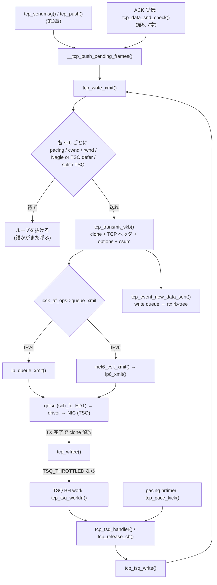

# 4. 送信 (2): tcp_write_xmit からワイヤまで

前の章（第 3 章）では、`tcp_sendmsg()` がユーザのデータを `sk_buff` に詰めて送信キュー（write queue）の末尾に積むところまでを追いました。この章では、その棚から小包を取り出して「いま本当に道路に出してよいか」を判断し、TCP ヘッダを書き、IP 層に渡し、さらにデバイスの送信完了から次の送信が再開されるまでの一周を、行単位で追います。

送信路の中心は `tcp_write_xmit()` です。この関数は 1 回の呼び出しで、輻輳ウィンドウ（cwnd）、受信側ウィンドウ（rwnd）、Nagle、TSO の遅延判断、pacing、TCP Small Queues（TSQ）という 6 種類の「ブレーキ」を順番に確認します。どれか 1 つでも「待て」と言えばループを抜けます。そして「誰がいつ再びこの関数を呼ぶのか」（ACK 到着、送信完了、pacing タイマ、ユーザの `sendmsg()`）こそが、TCP 送信路の正しさと性能を決めています。

## たとえ話で言うと

建物（ホスト）の部屋の郵便受け（ソケット）の横に、発送待ちの棚（write queue）があります。小包（`sk_buff`）には伝票（ヘッダ）がまだ貼られていません。

発送係（`tcp_write_xmit()`）は棚の先頭の小包を見て、出発の前に次のことを確認します。

- **道路の混雑**: 道路に出してよいトラックの台数（cwnd）はまだ残っているか。
- **相手の受け取り箱**: 相手の受け取り箱（受信ウィンドウ）に入りきるか。
- **小さすぎる荷物**: 小さな荷物を 1 個ずつ出すのは無駄ではないか（Nagle）。どうせすぐ受領印（ACK）が届くなら、もう少し待って大きなトラックにまとめた方がよいのではないか（TSO defer）。
- **出発時刻**: 前のトラックからの間隔を空けているか（pacing）。
- **門の前の渋滞**: 建物の門の前（qdisc やデバイスのキュー）に自分のトラックが並びすぎていないか（TSQ）。

全部 OK なら、発送係は小包の**コピー**に伝票（TCP ヘッダ）を貼って門（IP 層）に渡します。原本は「再発送用の控え棚」（retransmit queue）に移します。受領印が届くまでは捨てられないからです。

門の前の渋滞で止まったときは、トラックが門を出た時点（送信完了）で「空いたよ」というベル（`tcp_wfree()`）が鳴ります。発送係はそのベルで再び動き出します。

## RFC では

### RFC 9293: Transmission Control Protocol（送信ウィンドウ、Nagle、送信側 SWS 回避）

RFC 9293 は RFC 793 と、その後の多数の修正（RFC 1122 の TCP 部分、RFC 896 など）をまとめ直した現在の TCP 本体の仕様です（2022 年、RFC 793 を obsolete にしました）。この章に関係するのは「送信側がいつ、どれだけ送ってよいか」という 3 つのルールです。

**送信ウィンドウ（[RFC 9293 §3.8.6](https://www.rfc-editor.org/rfc/rfc9293#section-3.8.6)）**

送信側は次の状態変数を持ちます（[§3.3.1](https://www.rfc-editor.org/rfc/rfc9293#section-3.3.1)）。

- `SND.UNA`: まだ ACK されていない最古のシーケンス番号
- `SND.NXT`: 次に送るシーケンス番号
- `SND.WND`: 相手が広告した受信ウィンドウ

送ってよい範囲は `SND.UNA .. SND.UNA + SND.WND` です。まだ使える量は次のとおりです。

```
U = SND.UNA + SND.WND - SND.NXT     (usable window)
```

Linux では `tp->snd_una`、`tp->snd_nxt`、`tp->snd_wnd` がそれぞれに対応します。`tcp_wnd_end()` が `SND.UNA + SND.WND` を返します。ウィンドウがゼロのときは zero-window probe（[§3.8.6.1](https://www.rfc-editor.org/rfc/rfc9293#section-3.8.6.1)）が必要です。この章では「`tcp_write_xmit()` が `true` を返すと probe0 タイマが張られる」ところまでを扱い、タイマ本体は第 9 章に譲ります。

**Nagle アルゴリズム（[RFC 9293 §3.7.4](https://www.rfc-editor.org/rfc/rfc9293#section-3.7.4), 元は [RFC 896](https://www.rfc-editor.org/rfc/rfc896)）**

RFC 896（1984 年、John Nagle）は、telnet のような 1 バイトずつの書き込みが 41 バイトのパケットを大量に生み、ネットワークを詰まらせる問題（"tinygram"）を扱いました。ルールはひとことで言えます。

> 未 ACK のデータがある（`SND.NXT > SND.UNA`）間は、フルサイズ（`Eff.snd.MSS`）に満たないデータは送らずに溜めておく。

RFC 9293 は、TCP 実装は Nagle を実装すべき（SHOULD）であり、アプリケーションが接続ごとに無効化できなければならない（MUST）と定めています。Linux では `TCP_NODELAY` で無効化でき、`TCP_CORK` は逆に「フルサイズになるまで常に溜める」というより強い指示になります。

Linux はさらに **Minshall の変形**（Greg Minshall の Internet-Draft "A Proposed Modification to Nagle's Algorithm", 1999）を使います。条件を「未 ACK のデータがある間」から「未 ACK の**小さい**セグメントがある間」に緩めたものです。これで request/response 型の通信で「フルサイズ + 端数」を書いたとき、端数が delayed ACK を待たされる問題が緩和されます。

**送信側 SWS 回避（[RFC 9293 §3.8.6.2.1](https://www.rfc-editor.org/rfc/rfc9293#section-3.8.6.2.1)）**

Silly Window Syndrome（SWS）は、受信側が少しずつウィンドウを開き、送信側がそのたびに小さなセグメントを送ってしまう病気です。送信側の推奨アルゴリズムは次のとおりです。`D` を送信待ちデータ量、`U` を上の usable window とします。次のいずれかが成り立つときに送ります。

1. フルサイズのセグメントが送れる: `min(D, U) >= Eff.snd.MSS`
2. データが PUSH されていて、待ちデータを全部いま送れ、かつ（Nagle 無効、または未 ACK データがない）
3. 最大ウィンドウの一定割合 `Fs` 以上が送れる: `min(D, U) >= Fs * Max(SND.WND)`（推奨 `Fs = 1/2`）
4. データが PUSH されていて、override timeout（0.1-1.0 秒）が満了した

Linux の `tcp_nagle_test()` はおおむね 1 と 2 を、`tcp_tso_should_defer()` の `tcp_tso_win_divisor` 判定は 3 に相当する判断（ただし目的は「TSO の塊を大きくすること」）を実装しています。4 の override timer は Linux にはありません。代わりに ACK 到着、TLP、probe0 タイマが送信を再開させます。

### RFC 5681: TCP Congestion Control（送信量の上限としての cwnd）

RFC 5681 は slow start、congestion avoidance、fast retransmit/fast recovery を定義した輻輳制御の基本仕様です。cwnd をどう増減させるかは第 11 章で扱います。この章で必要なのは「どれだけ送ってよいか」のルールだけです。

[RFC 5681 §2](https://www.rfc-editor.org/rfc/rfc5681#section-2) で `cwnd`（送信側の制限）と `rwnd`（受信側の広告ウィンドウ）が定義され、[§3](https://www.rfc-editor.org/rfc/rfc5681#section-3) で次のように規定されています。

> The minimum of cwnd and rwnd governs data transmission.

つまり送信側は、`SND.UNA + min(cwnd, rwnd)` を超えるシーケンス番号を送ってはいけません。RFC は cwnd をバイトで数えますが、Linux は `tp->snd_cwnd` を**パケット数（セグメント数）**で数えます。比較対象も「ネットワーク内にあると推定されるパケット数」`tcp_packets_in_flight()` です。

```
in_flight = packets_out - (sacked_out + lost_out) + retrans_out
送ってよい  <=>  in_flight < snd_cwnd       (かつ rwnd 判定は別に行う)
```

これは RFC 6675（SACK ベースの loss recovery）の "pipe" に相当する推定値です。詳細は第 8 章で扱います。

アイドル後の cwnd については、[RFC 5681 §4.1](https://www.rfc-editor.org/rfc/rfc5681#section-4.1)（Restarting Idle Connections）と RFC 2861（Congestion Window Validation, 実験的）があります。RFC 2861 は後に RFC 7661 で obsolete になりましたが、Linux は今でも RFC 2861 の「精神」に沿った独自の実装（`tcp_cwnd_validate()`、`tcp_is_cwnd_limited()`）を使っています。

### RFC 7323: TCP Extensions for High Performance（各セグメントに書く Timestamps option）

RFC 7323 は window scale、timestamps、PAWS をまとめた仕様です（RFC 1323 を obsolete にしました）。送信路で関係するのは、ネゴシエーション済みの接続では**すべてのセグメント**に Timestamps option（kind 8, length 10）を付けることです（[§3.2](https://www.rfc-editor.org/rfc/rfc7323#section-3.2)）。

- `TSval`: 送信者のタイムスタンプクロックの現在値
- `TSecr`: 相手から最後に受け取った有効な `TSval`（`TS.Recent`）のエコー

RFC は timestamp clock の刻みを 1 ms から 1 s の範囲と推奨しています（[§5.4](https://www.rfc-editor.org/rfc/rfc7323#section-5.4)）。Linux は通常 1 ms 刻みです。ただし経路ごとに有効化できる usec 刻み（`tp->tcp_usec_ts`）も持っています。これは RFC の推奨範囲の外の拡張です。Linux では `TSval` を「いま」ではなく **skb の出発予定時刻（EDT）** から作ります。後で見るとおり、これが pacing と RTT 計測を整合させる鍵になっています。

### RFC ではないもの: TSO/GSO、TSQ、pacing

**TSO/GSO**: TCP Segmentation Offload は、最大 64 KB（BIG TCP ではそれ以上）の「スーパーパケット」を 1 個の skb としてスタックの下まで運び、NIC（TSO）またはドライバ直前のソフトウェア（GSO）で MSS ごとに切り分ける仕組みです。プロトコル上は MSS サイズのセグメント列と区別できません。スタックの per-packet コスト（ヘッダ処理、ロック、qdisc 操作）を数十分の一にします。代わりに「1 回で何セグメントを塊にするか」という新しい判断が必要になり、大きすぎる塊はマイクロバーストを生みます。Linux では `tcp_skb_pcount(skb)` がその skb が何セグメント分かを表し、`tcp_skb_mss(skb)`（= `gso_size`）が切り分けサイズです。

**TCP Small Queues（TSQ）**: bufferbloat への対策です。ホスト内の qdisc やデバイスのリングに 1 フローが大量の skb を積むと、他のフローのパケット（ACK を含む）がその後ろで待たされます。RTT が膨らみ、cwnd の推定も歪みます。TSQ は「qdisc + デバイスに滞留している、このソケットの skb の truesize 合計」（`sk->sk_wmem_alloc`）に上限を設けます。超えたら送信を止め、送信完了の destructor（`tcp_wfree()`）で再開します。目安は「2 パケット、または約 1 ms 分」です。

**Pacing**: cwnd だけで送信を制御すると、ACK が届いた瞬間に cwnd の空き分をまとめて送るバーストになります。pacing は「`sk_pacing_rate` バイト/秒を超えない間隔」で skb を送り出します。Linux は **EDT（Earliest Departure Time）モデル**を使います。TCP が各 skb に「この時刻より前に出すな」という時刻を `skb->tstamp` に書き、`sch_fq`（または EDT 対応 NIC）がそれを守ります。`sch_fq` がいない場合は TCP 自身が hrtimer で間隔を空けます（internal pacing）。

## 全体の流れ



ポイントは 2 つあります。

- `tcp_write_xmit()` は**再入口が 4 つある**関数です。ユーザコンテキスト（`sendmsg()`）、softirq の ACK 処理、BH workqueue の TSQ 処理、softirq の pacing hrtimer です。どの入口でも呼び出し側がソケットロックを持っています（softirq 側は `bh_lock_sock()` で、ユーザが所有中なら `tcp_release_cb()` に遅延されます）。
- 送るのは常に **clone** です。原本は retransmit queue（rb-tree）に移り、ACK まで保持されます。clone の destructor が `tcp_wfree()` になっていて、それが TSQ のフィードバック経路になります。

## コードを追う

### Step 1: 入口 — `tcp_push_pending_frames()` と `__tcp_push_pending_frames()`

`tcp_push_pending_frames()`（[include/net/tcp.h#L2375](https://git.kernel.org/pub/scm/linux/kernel/git/netdev/net-next.git/tree/include/net/tcp.h?id=279d5c8afcd38bd841832a39bfe1aa4f8518d98e#n2375)）は、送信キューに何かあれば現在の MSS と `tp->nonagle` で `__tcp_push_pending_frames()` を呼ぶだけの inline です。

```c
static inline void tcp_push_pending_frames(struct sock *sk)
{
	if (tcp_send_head(sk)) {
		struct tcp_sock *tp = tcp_sk(sk);

		__tcp_push_pending_frames(sk, tcp_current_mss(sk), tp->nonagle);
	}
}
```

`__tcp_push_pending_frames()`（[net/ipv4/tcp_output.c#L3243](https://git.kernel.org/pub/scm/linux/kernel/git/netdev/net-next.git/tree/net/ipv4/tcp_output.c?id=279d5c8afcd38bd841832a39bfe1aa4f8518d98e#n3243)）が実体です。

```c
/* Push out any pending frames which were held back due to
 * TCP_CORK or attempt at coalescing tiny packets.
 * The socket must be locked by the caller.
 */
void __tcp_push_pending_frames(struct sock *sk, unsigned int cur_mss,
			       int nonagle)
{
	/* If we are closed, the bytes will have to remain here.
	 * In time closedown will finish, we empty the write queue and
	 * all will be happy.
	 */
	if (unlikely(sk->sk_state == TCP_CLOSE))
		return;

	if (tcp_write_xmit(sk, cur_mss, nonagle, 0,
			   sk_gfp_mask(sk, GFP_ATOMIC)))
		tcp_check_probe_timer(sk);
}
```

- `TCP_CLOSE` のチェック: `tcp_set_state(TCP_CLOSE)` 後でも write queue が残ることがあります（`tcp_done()` 経路など）。そのデータは送らず、後で purge されるのを待ちます。
- `sk_gfp_mask(sk, GFP_ATOMIC)`: 送信路は softirq からも呼ばれるので、clone の割り当ては `GFP_ATOMIC` です。`sk_gfp_mask()` は `SOCK_MEMALLOC`（swap over NFS など）のソケットで `__GFP_MEMALLOC` を足します。
- 戻り値が `true` のとき `tcp_check_probe_timer()` を呼びます。`tcp_write_xmit()` が `true` を返すのは「送信中のパケットが 0 なのに、キューにデータがあるのに何も送れなかった」ときだけです。この状態では ACK が来ないので、自分で起き上がる手段がありません。だから probe0 タイマ（zero window probe、[RFC 9293 §3.8.6.1](https://www.rfc-editor.org/rfc/rfc9293#section-3.8.6.1)）を張ります。

```c
static inline void tcp_check_probe_timer(struct sock *sk)
{
	if (!tcp_sk(sk)->packets_out && !inet_csk(sk)->icsk_pending)
		tcp_reset_xmit_timer(sk, ICSK_TIME_PROBE0,
				     tcp_probe0_base(sk), true);
}
```

`packets_out == 0` かつ他の icsk タイマが張られていないときだけ、`tcp_probe0_base()`（`max(icsk_rto, TCP_RTO_MIN)`）に pacing 遅延を足した時刻で `ICSK_TIME_PROBE0` を張ります。

もう 1 つの入口 `tcp_push_one()`（[net/ipv4/tcp_output.c#L3261](https://git.kernel.org/pub/scm/linux/kernel/git/netdev/net-next.git/tree/net/ipv4/tcp_output.c?id=279d5c8afcd38bd841832a39bfe1aa4f8518d98e#n3261)）は、`tcp_sendmsg_locked()` が「送信キューの先頭がちょうどフルサイズになった」ときに 1 個だけ押し出すための近道です（第 3 章）。

```c
/* Send _single_ skb sitting at the send head. This function requires
 * true push pending frames to setup probe timer etc.
 */
void tcp_push_one(struct sock *sk, unsigned int mss_now)
{
	struct sk_buff *skb = tcp_send_head(sk);

	BUG_ON(!skb || skb->len < mss_now);

	tcp_write_xmit(sk, mss_now, TCP_NAGLE_PUSH, 1, sk->sk_allocation);
}
```

`push_one = 1` で呼ぶので、MTU probe と TSO defer をスキップし、1 skb 送った時点でループを抜けます。`nonagle = TCP_NAGLE_PUSH` なので Nagle も効きません（そもそも先頭 skb が `>= mss_now` であることを `BUG_ON` で保証しています）。

`push_one` には 3 つの値があります。

| `push_one` | 呼び出し元 | 意味 |
| --- | --- | --- |
| 0 | `__tcp_push_pending_frames()`、`tcp_tsq_write()` | 通常。MTU probe、TSO defer を行い、送れるだけ送る |
| 1 | `tcp_push_one()` | 1 skb だけ。MTU probe と TSO defer はしない |
| 2 | `tcp_send_loss_probe()` | TLP 用。cwnd が尽きていても 1 skb を強制的に送る（第 8 章） |

### Step 2: `tcp_write_xmit()` (1) — 準備と MTU probe

ここから `tcp_write_xmit()`（[net/ipv4/tcp_output.c#L2972](https://git.kernel.org/pub/scm/linux/kernel/git/netdev/net-next.git/tree/net/ipv4/tcp_output.c?id=279d5c8afcd38bd841832a39bfe1aa4f8518d98e#n2972)）を最初から最後まで追います。

```c
static bool tcp_write_xmit(struct sock *sk, unsigned int mss_now, int nonagle,
			   int push_one, gfp_t gfp)
{
	struct tcp_sock *tp = tcp_sk(sk);
	struct sk_buff *skb;
	unsigned int tso_segs, sent_pkts;
	u32 cwnd_quota, max_segs;
	int result;
	bool is_cwnd_limited = false, is_rwnd_limited = false;

	sent_pkts = 0;

	tcp_mstamp_refresh_inline(tp);

	/* AccECN option beacon depends on mstamp, it may change mss */
	if (tcp_ecn_mode_accecn(tp) && tcp_accecn_option_beacon_check(sk))
		mss_now = tcp_current_mss(sk);

	if (!push_one) {
		/* Do MTU probing. */
		result = tcp_mtu_probe(sk);
		if (!result) {
			return false;
		} else if (result > 0) {
			sent_pkts = 1;
		}
	}

	max_segs = tcp_tso_segs(sk, mss_now);
```

- `tcp_mstamp_refresh_inline(tp)`: `tp->tcp_clock_cache`（ns）と `tp->tcp_mstamp`（us）を 1 回だけ更新します。以降、このループ内の pacing 判定、EDT の刻印、TSO defer の時刻計算は全部この 1 つの「いま」を使います。`tcp_clock_ns()` は `ktime_get_ns()`（CLOCK_MONOTONIC）です。skb ごとに読み直さないのは、コストの削減と、同じバッチ内の時刻の一貫性のためです。

```c
static inline void tcp_mstamp_refresh_inline(struct tcp_sock *tp)
{
	u64 val = tcp_clock_ns();

	tp->tcp_clock_cache = val;
	tp->tcp_mstamp = div_u64(val, NSEC_PER_USEC);
}
```

- AccECN の option beacon: AccECN option を周期的に載せるかどうかは時刻に依存します。option 長が変わると MSS（ペイロード長）が変わるので、`mss_now` を取り直します（第 14 章）。
- `if (!push_one)`: MTU probe は通常の push でだけ試みます。`tcp_mtu_probe()` の戻り値は 3 値です。`0` は「probe を送りたいが、いまは cwnd/rwnd が足りないので待つ」で、`tcp_write_xmit()` は**何も送らずに** `false` を返します。probe 用の大きなセグメントを作るために、普通の小さいセグメントで cwnd を埋めてしまわないようにしているわけです。`1` は probe を送ったので `sent_pkts = 1`、`-1` は probe と無関係に通常処理を続けます。
- `max_segs = tcp_tso_segs(sk, mss_now)`: 1 個の TSO skb に入れてよいセグメント数の上限です。ループの外で 1 回だけ計算します（Step 3）。

`tcp_mtu_probe()` の `0` 返却が安全な理由: `0` を返す 2 つの経路（`after(snd_nxt + size_needed, tcp_wnd_end)` と `in_flight + 2 > cwnd` かつ `in_flight != 0`）は、どちらも in-flight のデータがある状態です。だから ACK が必ず戻ってきて、再び `tcp_write_xmit()` が呼ばれます。in-flight が 0 のときは `-1` を返して停止を避けています（コメント "With none in flight, don't stall"）。

`tcp_mtu_probe()`（[net/ipv4/tcp_output.c#L2692](https://git.kernel.org/pub/scm/linux/kernel/git/netdev/net-next.git/tree/net/ipv4/tcp_output.c?id=279d5c8afcd38bd841832a39bfe1aa4f8518d98e#n2692)）の判定部分を見ておきます（Packetization Layer PMTUD、RFC 4821/8899。`net.ipv4.tcp_mtu_probing` で有効化）。

```c
static int tcp_mtu_probe(struct sock *sk)
{
	struct inet_connection_sock *icsk = inet_csk(sk);
	struct tcp_sock *tp = tcp_sk(sk);
	struct sk_buff *skb, *nskb, *next;
	struct net *net = sock_net(sk);
	int probe_size;
	u64 size_needed;
	int copy, len;
	int mss_now;
	int interval;

	/* Not currently probing/verifying,
	 * not in recovery,
	 * have enough cwnd, and
	 * not SACKing (the variable headers throw things off)
	 */
	if (likely(!icsk->icsk_mtup.enabled ||
		   icsk->icsk_mtup.probe_size ||
		   inet_csk(sk)->icsk_ca_state != TCP_CA_Open ||
		   tcp_snd_cwnd(tp) < 11 ||
		   tp->rx_opt.num_sacks || tp->rx_opt.dsack))
		return -1;

	/* Use binary search for probe_size between tcp_mss_base,
	 * and current mss_clamp. if (search_high - search_low)
	 * smaller than a threshold, backoff from probing.
	 */
	mss_now = tcp_current_mss(sk);
	probe_size = tcp_mtu_to_mss(sk, (icsk->icsk_mtup.search_high +
				    icsk->icsk_mtup.search_low) >> 1);
	size_needed = probe_size + (tp->reordering + 1) * (u64)tp->mss_cache;
	interval = icsk->icsk_mtup.search_high - icsk->icsk_mtup.search_low;
	/* When misfortune happens, we are reprobing actively,
	 * and then reprobe timer has expired. We stick with current
	 * probing process by not resetting search range to its orignal.
	 */
	if (probe_size > tcp_mtu_to_mss(sk, icsk->icsk_mtup.search_high) ||
	    interval < READ_ONCE(net->ipv4.sysctl_tcp_probe_threshold)) {
		/* Check whether enough time has elaplased for
		 * another round of probing.
		 */
		tcp_mtu_check_reprobe(sk);
		return -1;
	}
```

- `likely(...)` で囲まれた早期 return: MTU probing は既定で無効（`tcp_mtu_probing=0`）なので、ほぼ常にここで抜けます。12a59abc22d6 で `likely()` が付けられました。probe 中（`probe_size != 0`）、recovery 中、cwnd < 11、SACK/DSACK ブロックを送信中（option 長が変わり計算が狂う）でも抜けます。
- `probe_size` は `search_low` と `search_high` の二分探索の中点です。`size_needed` は「probe 1 個 + `reordering + 1` 個の通常セグメント」です。probe が失われたとき、後続が dupack/SACK を起こしてロスを検出できるだけの量を要求しています。

```c
	/* Have enough data in the send queue to probe? */
	if (tp->write_seq - tp->snd_nxt < size_needed)
		return -1;

	if (tp->snd_wnd < size_needed)
		return -1;
	if (after(tp->snd_nxt + size_needed, tcp_wnd_end(tp)))
		return 0;

	/* Do we need to wait to drain cwnd? With none in flight, don't stall */
	if (tcp_packets_in_flight(tp) + 2 > tcp_snd_cwnd(tp)) {
		if (!tcp_packets_in_flight(tp))
			return -1;
		else
			return 0;
	}

	if (!tcp_can_coalesce_send_queue_head(sk, probe_size))
		return -1;
```

送信待ちデータ（`write_seq - snd_nxt`）、rwnd、cwnd のどれかが足りなければ probe しません。cwnd は probe 1 個が 2 セグメント相当なので `+ 2` で判定します。この後、probe 用 skb を作り、送信キュー先頭の skb 群から `probe_size` 分のペイロードを移します（`tcp_eat_one_skb()` / `__pskb_trim_head()`）。そして送信します。

```c
	tcp_init_tso_segs(nskb, nskb->len);

	/* We're ready to send.  If this fails, the probe will
	 * be resegmented into mss-sized pieces by tcp_write_xmit().
	 */
	if (!tcp_transmit_skb(sk, nskb, 1, GFP_ATOMIC)) {
		/* Decrement cwnd here because we are sending
		 * effectively two packets. */
		tcp_snd_cwnd_set(tp, tcp_snd_cwnd(tp) - 1);
		tcp_event_new_data_sent(sk, nskb);

		icsk->icsk_mtup.probe_size = tcp_mss_to_mtu(sk, nskb->len);
		tp->mtu_probe.probe_seq_start = TCP_SKB_CB(nskb)->seq;
		tp->mtu_probe.probe_seq_end = TCP_SKB_CB(nskb)->end_seq;

		return 1;
	}

	return -1;
}
```

成功したら cwnd を 1 減らします（probe は実質 2 パケット分なので）。そして `tcp_event_new_data_sent()` で通常のデータと同様に retransmit queue に入れ、`probe_seq_start/end` を記録します。成否は ACK 処理（`tcp_mtup_probe_success()`）またはロス検出（`tcp_mtup_probe_failed()`）で判定されます。

### Step 3: 1 skb に何セグメント詰めるか — `tcp_tso_segs()` と `tcp_tso_autosize()`

```c
__bpf_kfunc u32 tcp_tso_autosize(const struct sock *sk, unsigned int mss_now,
				 int min_tso_segs)
{
	u32 min_tso = max(min_tso_segs, 1);
	unsigned long bytes;
	u32 r;

	if (unlikely(!mss_now))
		return min_tso;

	bytes = READ_ONCE(sk->sk_pacing_rate) >> READ_ONCE(sk->sk_pacing_shift);

	r = tcp_min_rtt(tcp_sk(sk)) >> READ_ONCE(sock_net(sk)->ipv4.sysctl_tcp_tso_rtt_log);
	if (r < BITS_PER_TYPE(sk->sk_gso_max_size))
		bytes += sk->sk_gso_max_size >> r;

	bytes = min_t(unsigned long, bytes, sk->sk_gso_max_size);

	return max_t(u32, bytes / mss_now, min_tso);
}
EXPORT_SYMBOL_GPL(tcp_tso_autosize);

/* Return the number of segments we want in the skb we are transmitting.
 * See if congestion control module wants to decide; otherwise, autosize.
 */
static u32 tcp_tso_segs(struct sock *sk, unsigned int mss_now)
{
	const struct tcp_congestion_ops *ca_ops = inet_csk(sk)->icsk_ca_ops;
	u32 tso_segs;

	tso_segs = ca_ops->tso_segs ?
			ca_ops->tso_segs(sk, mss_now) :
			tcp_tso_autosize(sk, mss_now,
					 READ_ONCE(sock_net(sk)->ipv4.sysctl_tcp_min_tso_segs));
	return clamp_t(u32, tso_segs, 1, sk->sk_gso_max_segs);
}
```

`tcp_tso_autosize()`（[net/ipv4/tcp_output.c#L2260](https://git.kernel.org/pub/scm/linux/kernel/git/netdev/net-next.git/tree/net/ipv4/tcp_output.c?id=279d5c8afcd38bd841832a39bfe1aa4f8518d98e#n2260)）の計算は次のとおりです。

```
bytes  = sk_pacing_rate >> sk_pacing_shift            (既定 shift=10: 約 1 ms 分)
bytes += sk_gso_max_size >> (min_rtt_us >> tcp_tso_rtt_log)   (既定 log=9: 512 us ごとに半減)
bytes  = min(bytes, sk_gso_max_size)
segs   = max(bytes / mss, min_tso_segs)               (既定 min_tso_segs=2)
```

- 第 1 項は「pacing rate で約 1 ms に送る量」です。`sk_pacing_rate` はバイト/秒なので、`>> 10` は「/1024」、つまり約 1 ms 分です。95bd09eb2750 で導入された「1 ms に 1 個の TSO パケット」という設計です。低速フローではバーストが小さくなり、ACK clocking が保たれます。
- 第 2 項は 65466904b015 で追加された min_rtt 依存の上乗せです。同じラックの中のように min_rtt が小さいフローでは、多少のロスもすぐ回復できます。だから CPU コストを優先して大きな塊を送ります。min_rtt が 512 us 増えるごとに半分になり、約 3 ms で 1500 バイトを下回ります。`r < BITS_PER_TYPE(...)` は、未定義動作になる過大シフトを防ぐ条件です。
- `mss_now == 0` の分岐は BPF から呼ばれる場合の防御です（f69a0944415f で kfunc 化）。

`tcp_tso_segs()`（[net/ipv4/tcp_output.c#L2285](https://git.kernel.org/pub/scm/linux/kernel/git/netdev/net-next.git/tree/net/ipv4/tcp_output.c?id=279d5c8afcd38bd841832a39bfe1aa4f8518d98e#n2285)）は、CC モジュールが `tso_segs()` コールバックを持っていればそれに任せます（BBR は自分の pacing モデルから TSO サイズを決めます。第 13 章）。結果は `[1, sk_gso_max_segs]` に clamp されます。`sk_gso_max_segs` はデバイスの `gso_max_segs` から `sk_setup_caps()` で設定されます。

> [!NOTE]
> cb145191e9d3（2026-08）で CC コールバックが `min_tso_segs()` から `tso_segs()` に変わりました。以前は「`tcp_tso_autosize()` に渡す下限」を返していましたが、現在は「最終的なセグメント数」を返し、autosize を迂回します。古い資料と食い違う点です。

### Step 4: `tcp_write_xmit()` (2) — ループ前半: repair、pacing、cwnd、rwnd

```c
	while ((skb = tcp_send_head(sk))) {
		unsigned int limit;
		int missing_bytes;

		if (unlikely(tp->repair) && tp->repair_queue == TCP_SEND_QUEUE) {
			/* "skb_mstamp_ns" is used as a start point for the retransmit timer */
			tp->tcp_wstamp_ns = tp->tcp_clock_cache;
			skb_set_delivery_time(skb, tp->tcp_wstamp_ns, SKB_CLOCK_MONOTONIC);
			list_move_tail(&skb->tcp_tsorted_anchor, &tp->tsorted_sent_queue);
			tcp_init_tso_segs(skb, mss_now);
			goto repair; /* Skip network transmission */
		}

		if (tcp_pacing_check(sk))
			break;

		cwnd_quota = tcp_cwnd_test(tp);
		if (!cwnd_quota) {
			if (push_one == 2)
				/* Force out a loss probe pkt. */
				cwnd_quota = 1;
			else
				break;
		}
		cwnd_quota = min(cwnd_quota, max_segs);
		missing_bytes = cwnd_quota * mss_now - skb->len;
		if (missing_bytes > 0)
			tcp_grow_skb(sk, skb, missing_bytes);

		tso_segs = tcp_set_skb_tso_segs(skb, mss_now);

		if (unlikely(!tcp_snd_wnd_test(tp, skb, mss_now))) {
			is_rwnd_limited = true;
			break;
		}
```

**repair モード**: CRIU の `TCP_REPAIR` で送信キューを復元するとき、データは「すでに送った」ものとして扱い、ネットワークには出しません。`skb_mstamp_ns` を「いま」にして（RTO の起点になります）、tsorted リストへ移し、`repair:` ラベルへ飛んで `tcp_event_new_data_sent()` だけを行います。bf50b606cfd8 で `tcp_init_tso_segs()` が追加されました。これがないと pcount 0 の skb が retransmit queue に入ってしまいます。

**`tcp_pacing_check()`**: internal pacing の判定です。

```c
static bool tcp_pacing_check(struct sock *sk)
{
	struct tcp_sock *tp = tcp_sk(sk);

	if (!tcp_needs_internal_pacing(sk))
		return false;

	if (tp->tcp_wstamp_ns <= tp->tcp_clock_cache)
		return false;

	if (!hrtimer_is_queued(&tp->pacing_timer)) {
		hrtimer_start(&tp->pacing_timer,
			      ns_to_ktime(tp->tcp_wstamp_ns),
			      HRTIMER_MODE_ABS_PINNED_SOFT);
		sock_hold(sk);
	}
	return true;
}
```

- `tcp_needs_internal_pacing()` は `sk_pacing_status == SK_PACING_NEEDED` のときだけ真です。`smp_load_acquire()` なのは、`sch_fq` が別 CPU から `smp_store_release()` で `SK_PACING_FQ` に書き換えるからです。

```c
static inline bool tcp_needs_internal_pacing(const struct sock *sk)
{
	return smp_load_acquire(&sk->sk_pacing_status) == SK_PACING_NEEDED;
}
```

- `tcp_wstamp_ns`（次に送ってよい時刻）が「いま」以下なら送れます。未来なら hrtimer を `tcp_wstamp_ns` の絶対時刻に張ります。`HRTIMER_MODE_ABS_PINNED_SOFT` なので、同じ CPU の softirq で `tcp_pace_kick()` が走ります。タイマが参照するのでソケットを `sock_hold()` し、`tcp_pace_kick()` 側で `sock_put()` します。`hrtimer_is_queued()` で既に張られていれば二重に張りません。
- 864e5c090749 以前は「送った直後にタイマを張る」実装でした。現在は「送ろうとしたが早すぎたときだけ張る」実装です。RPC のようにタイマ満了前に次の書き込みが来ないワークロードで、無駄な hrtimer 割り込みを減らしました（TCP_RR で約 10% 改善）。
- `sch_fq` が pacing するとき（`SK_PACING_FQ`）は、ここでは止めません。EDT を `skb->tstamp` に書いて qdisc に任せます。

**`tcp_cwnd_test()`**: [RFC 5681 §3](https://www.rfc-editor.org/rfc/rfc5681#section-3) の cwnd 制限です。

```c
static u32 tcp_cwnd_test(const struct tcp_sock *tp)
{
	u32 in_flight, cwnd, halfcwnd;

	in_flight = tcp_packets_in_flight(tp);
	cwnd = tcp_snd_cwnd(tp);
	if (in_flight >= cwnd)
		return 0;

	/* For better scheduling, ensure we have at least
	 * 2 GSO packets in flight.
	 */
	halfcwnd = max(cwnd >> 1, 1U);
	return min(halfcwnd, cwnd - in_flight);
}
```

- `in_flight >= cwnd` なら 0（送れない）を返します。
- 送れる場合も `min(cwnd/2, cwnd - in_flight)` に制限します。1 個の TSO skb が cwnd の半分を超えないようにするためです。cwnd を 1 個の巨大 skb で使い切ると、ネットワークにも ACK clock にも「1 個のパケット」しか存在しない状態になります。最低 2 個の skb が in-flight にあれば、片方の ACK でもう片方の後続を送れます。
- 22555032c513（2024）で、「最後の skb が MSS 未満で FIN 付きなら cwnd を無視する」という例外が削除されました。RFC 違反だったうえに、結果が先頭 skb に依存すると次の `tcp_grow_skb()` が書けないためです。

`tcp_packets_in_flight()` の定義を再掲します。

```c
static inline unsigned int tcp_packets_in_flight(const struct tcp_sock *tp)
{
	return tp->packets_out - tcp_left_out(tp) + tp->retrans_out;
}
```

**`push_one == 2`**: TLP は「末尾のロスを検出するため、cwnd に関係なく 1 個送る」ものです（第 8 章）。だから cwnd_quota を強制的に 1 にします。

**`cwnd_quota = min(cwnd_quota, max_segs)` と `tcp_grow_skb()`**: ここで cwnd_quota は「この skb に詰めてよいセグメント数」に読み替えられます。先頭 skb が `cwnd_quota * mss_now` より小さければ、次の skb からペイロードを移して大きくします。

```c
static void tcp_grow_skb(struct sock *sk, struct sk_buff *skb, int amount)
{
	struct sk_buff *next_skb = skb->next;
	unsigned int nlen;

	if (tcp_skb_is_last(sk, skb))
		return;

	if (!tcp_skb_can_collapse(skb, next_skb))
		return;

	nlen = min_t(u32, amount, next_skb->len);
	if (!nlen || !skb_shift(skb, next_skb, nlen))
		return;

	TCP_SKB_CB(skb)->end_seq += nlen;
	TCP_SKB_CB(next_skb)->seq += nlen;

	if (!next_skb->len) {
		/* In case FIN is set, we need to update end_seq */
		TCP_SKB_CB(skb)->end_seq = TCP_SKB_CB(next_skb)->end_seq;

		tcp_eat_one_skb(sk, skb, next_skb);
	}
}
```

8ee602c63520（2024）の背景はこうです。BIG TCP 環境で `172032, 8192, 172032, 8192, ...` という「大 + 小」の固定パターンが観測されました。一度 split すると、残りの skb が最適サイズより小さいまま送られ続けます。`tcp_tso_should_defer()` は先頭 skb の大きさで判断するので、このパターンから抜け出せませんでした。`skb_shift()` で frag を移すだけなので、ペイロードのコピーは発生しません。`tcp_skb_can_collapse()` が、EOR、異なる decrypted 状態、zerocopy などの「結合してはいけない」条件を弾きます。次の skb が空になったら FIN を引き継ぐために `end_seq` を移し、`tcp_eat_one_skb()` で flags、eor、tx timestamp 要求を移してから解放します（1bede0a12d3a）。

**`tcp_set_skb_tso_segs()`**: pcount をいまの `mss_now` で計算し直します。

```c
static int tcp_set_skb_tso_segs(struct sk_buff *skb, unsigned int mss_now)
{
	int tso_segs;

	if (skb->len <= mss_now) {
		/* Avoid the costly divide in the normal
		 * non-TSO case.
		 */
		TCP_SKB_CB(skb)->tcp_gso_size = 0;
		tcp_skb_pcount_set(skb, 1);
		return 1;
	}
	TCP_SKB_CB(skb)->tcp_gso_size = mss_now;
	tso_segs = DIV_ROUND_UP(skb->len, mss_now);
	tcp_skb_pcount_set(skb, tso_segs);
	return tso_segs;
}
```

MSS 以下なら除算を避けて pcount=1、`tcp_gso_size=0` にします。それ以外は `DIV_ROUND_UP` です。d5b38a71d333 以前は `tcp_init_tso_segs()`（MSS が変わったときだけ再計算）でしたが、`tcp_grow_skb()` で長さが変わるので毎回の計算に変わりました。

**`tcp_snd_wnd_test()`**: [RFC 9293 §3.8.6](https://www.rfc-editor.org/rfc/rfc9293#section-3.8.6) の送信ウィンドウ判定です。

```c
static bool tcp_snd_wnd_test(const struct tcp_sock *tp,
			     const struct sk_buff *skb,
			     unsigned int cur_mss)
{
	u32 end_seq = TCP_SKB_CB(skb)->end_seq;

	if (skb->len > cur_mss)
		end_seq = TCP_SKB_CB(skb)->seq + cur_mss;

	return !after(end_seq, tcp_wnd_end(tp));
}
```

```c
static inline u32 tcp_wnd_end(const struct tcp_sock *tp)
{
	return tp->snd_una + tp->snd_wnd;
}
```

- 「先頭の 1 セグメントが `SND.UNA + SND.WND` に収まるか」だけを見ます。skb 全体が収まる必要はありません。収まらない部分は後で `tcp_mss_split_point()` が切り落とします。
- 失敗したら `is_rwnd_limited = true` で抜けます。これは `tcp_info` の `tcpi_rwnd_limited`（chrono）に反映されます。
- `snd_wnd` がゼロでも、in-flight があれば ACK で再開します。in-flight もなければ `tcp_write_xmit()` は `true` を返し、Step 1 の probe0 タイマが張られます。

### Step 5: `tcp_write_xmit()` (3) — Nagle か TSO defer か、split、TSQ、送信

```c
		if (tso_segs == 1) {
			if (unlikely(!tcp_nagle_test(tp, skb, mss_now,
						     (tcp_skb_is_last(sk, skb) ?
						      nonagle : TCP_NAGLE_PUSH))))
				break;
		} else {
			if (!push_one &&
			    tcp_tso_should_defer(sk, skb, &is_cwnd_limited,
						 &is_rwnd_limited, max_segs))
				break;
		}

		limit = mss_now;
		if (tso_segs > 1 && !tcp_urg_mode(tp))
			limit = tcp_mss_split_point(sk, skb, mss_now,
						    cwnd_quota,
						    nonagle);

		if (skb->len > limit &&
		    unlikely(tso_fragment(sk, skb, limit, mss_now, gfp)))
			break;

		if (tcp_small_queue_check(sk, skb, 0))
			break;

		/* Argh, we hit an empty skb(), presumably a thread
		 * is sleeping in sendmsg()/sk_stream_wait_memory().
		 * We do not want to send a pure-ack packet and have
		 * a strange looking rtx queue with empty packet(s).
		 */
		if (TCP_SKB_CB(skb)->end_seq == TCP_SKB_CB(skb)->seq)
			break;

		if (unlikely(tcp_transmit_skb(sk, skb, 1, gfp)))
			break;
```

ここが送信路でいちばん判断の多い部分です。

**`tso_segs == 1` のとき: Nagle**

1 セグメント以下の skb には Nagle を適用します。`nonagle` 引数は「その skb が送信キューの末尾のときだけ」呼び出し元の値を使い、途中の skb には `TCP_NAGLE_PUSH` を渡します。途中の skb は後ろに次の skb があるので、もうデータが追加されることはありません。待つ意味がないのです。

```c
static inline bool tcp_nagle_test(const struct tcp_sock *tp, const struct sk_buff *skb,
				  unsigned int cur_mss, int nonagle)
{
	/* Nagle rule does not apply to frames, which sit in the middle of the
	 * write_queue (they have no chances to get new data).
	 *
	 * This is implemented in the callers, where they modify the 'nonagle'
	 * argument based upon the location of SKB in the send queue.
	 */
	if (nonagle & TCP_NAGLE_PUSH)
		return true;

	/* Don't use the nagle rule for urgent data (or for the final FIN). */
	if (tcp_urg_mode(tp) || (TCP_SKB_CB(skb)->tcp_flags & TCPHDR_FIN))
		return true;

	if (!tcp_nagle_check(skb->len < cur_mss, tp, nonagle))
		return true;

	return false;
}
```

- `TCP_NAGLE_PUSH` は無条件で送ります。渡されるのは、途中の skb、`tcp_push_one()`、`tcp_sendmsg_locked()` 内の forced push（未 push のデータが最大ウィンドウの半分を超えたとき）、そして `TCP_NODELAY` / `TCP_CORK` 解除の `setsockopt()` が `tp->nonagle` に一時的に立てる場合です（次の `tcp_skb_entail()` で落とされます）。なお `tcp_push()` は `MSG_MORE` 付きなら `TCP_NAGLE_CORK` を渡します。
- urgent mode と FIN も Nagle の対象外です。FIN を溜めると close が遅れるだけだからです。
- 残りは `tcp_nagle_check()` に任せます。

```c
/* Return false, if packet can be sent now without violation Nagle's rules:
 * 1. It is full sized. (provided by caller in %partial bool)
 * 2. Or it contains FIN. (already checked by caller)
 * 3. Or TCP_CORK is not set, and TCP_NODELAY is set.
 * 4. Or TCP_CORK is not set, and all sent packets are ACKed.
 *    With Minshall's modification: all sent small packets are ACKed.
 */
static bool tcp_nagle_check(bool partial, const struct tcp_sock *tp,
			    int nonagle)
{
	return partial &&
		((nonagle & TCP_NAGLE_CORK) ||
		 (!nonagle && tp->packets_out && tcp_minshall_check(tp)));
}
```

`nonagle` のビットは次のとおりです（`include/net/tcp.h`）。

| 値 | 由来 | 意味 |
| --- | --- | --- |
| `TCP_NAGLE_OFF` (1) | `TCP_NODELAY` | Nagle 無効 |
| `TCP_NAGLE_CORK` (2) | `TCP_CORK` | フルサイズになるまで常に溜める |
| `TCP_NAGLE_PUSH` (4) | 内部 | この 1 回は必ず送る |

`tcp_nagle_check()` が `true`（=待て）を返す条件は「部分セグメント（MSS 未満）であり、かつ (CORK 中、または (Nagle 有効で、in-flight があり、未 ACK の小さいセグメントがある))」です。

- CORK は in-flight の有無に関係なく溜めます。RFC の Nagle より強い指示です。ただし CORK でも永遠には溜めません。`tcp_push()` 側の autocork や、CORK 解除時の push で吐き出されます。
- `!nonagle && tp->packets_out && tcp_minshall_check(tp)` が RFC 896 + Minshall の部分です。

```c
/* Minshall's variant of the Nagle send check. */
static bool tcp_minshall_check(const struct tcp_sock *tp)
{
	return after(tp->snd_sml, tp->snd_una) &&
		!after(tp->snd_sml, tp->snd_nxt);
}

/* Update snd_sml if this skb is under mss
 * Note that a TSO packet might end with a sub-mss segment
 * The test is really :
 * if ((skb->len % mss) != 0)
 *        tp->snd_sml = TCP_SKB_CB(skb)->end_seq;
 * But we can avoid doing the divide again given we already have
 *  skb_pcount = skb->len / mss_now
 */
static void tcp_minshall_update(struct tcp_sock *tp, unsigned int mss_now,
				const struct sk_buff *skb)
{
	if (skb->len < tcp_skb_pcount(skb) * mss_now)
		tp->snd_sml = TCP_SKB_CB(skb)->end_seq;
}
```

- `snd_sml` は「最後に送った小さい（MSS 未満の）セグメントの末尾」です。`tcp_minshall_check()` は `snd_una < snd_sml <= snd_nxt`、つまりその小さいセグメントがまだ ACK されていないときに真になります。
- 元の Nagle は「未 ACK のデータが 1 バイトでもあれば小さいセグメントを送らない」というルールでした。Minshall では「未 ACK の**小さい**セグメントがなければ送ってよい」になります。フルサイズ数個 + 端数の応答は、端数をすぐ送れます。
- `tcp_minshall_update()` は、TSO skb の最後のセグメントが端数かどうかを `skb->len < pcount * mss` で判定します。コメントのとおり `skb->len % mss != 0` と同値ですが、除算を避けています。

**`tso_segs > 1` のとき: `tcp_tso_should_defer()`**

複数セグメントの skb では Nagle ではなく「TSO 版 Nagle」を使います。cwnd や rwnd の空きが小さいときに小さな TSO パケットを送るより、次の ACK を待って大きな塊で送った方が CPU にもネットワークにもよい、という判断です。John Heffner のアルゴリズムが起源です。`push_one` のときは呼びません。

```c
static bool tcp_tso_should_defer(struct sock *sk, struct sk_buff *skb,
				 bool *is_cwnd_limited,
				 bool *is_rwnd_limited,
				 u32 max_segs)
{
	const struct inet_connection_sock *icsk = inet_csk(sk);
	u32 send_win, cong_win, limit, in_flight, threshold;
	u64 srtt_in_ns, expected_ack, how_far_is_the_ack;
	struct tcp_sock *tp = tcp_sk(sk);
	struct sk_buff *head;
	int win_divisor;
	s64 delta;

	if (icsk->icsk_ca_state >= TCP_CA_Recovery)
		goto send_now;

	/* Avoid bursty behavior by allowing defer
	 * only if the last write was recent (1 ms).
	 * Note that tp->tcp_wstamp_ns can be in the future if we have
	 * packets waiting in a qdisc or device for EDT delivery.
	 */
	delta = tp->tcp_clock_cache - tp->tcp_wstamp_ns - NSEC_PER_MSEC;
	if (delta > 0)
		goto send_now;

	in_flight = tcp_packets_in_flight(tp);

	BUG_ON(tcp_skb_pcount(skb) <= 1);
	BUG_ON(tcp_snd_cwnd(tp) <= in_flight);

	send_win = tcp_wnd_end(tp) - TCP_SKB_CB(skb)->seq;

	/* From in_flight test above, we know that cwnd > in_flight.  */
	cong_win = (tcp_snd_cwnd(tp) - in_flight) * tp->mss_cache;

	limit = min(send_win, cong_win);

	/* If a full-sized TSO skb can be sent, do it. */
	if (limit >= max_segs * tp->mss_cache)
		goto send_now;
```

- `icsk_ca_state >= TCP_CA_Recovery`（Recovery と Loss）では遅延しません。回復中は 1 個でも早く送ることが重要です。a0ea700e4095 で CWR が、99d7662a04c4 で Disorder が遅延可に変わりました。
- `delta = now - tcp_wstamp_ns - 1ms > 0`: 最後の送信（正確には次の EDT）から 1 ms 以上経っていれば送ります。しばらく送っていないフローでは、ACK を待つ根拠がありません（ACK がすぐ来るとは限らないからです）。コメントにあるとおり、EDT では `tcp_wstamp_ns` が未来のことがあり、そのとき `delta` は大きく負になります（=遅延候補）。a682850a114a で jiffies から ns に変わり、HZ に依存しなくなりました。
- `BUG_ON` は呼び出し側の不変条件です。`tso_segs > 1` で、かつ `tcp_cwnd_test()` を通っているので `cwnd > in_flight` です。
- `send_win`、`cong_win` はどちらもバイト単位で、`limit = min(send_win, cong_win)` が「いま送れるバイト数」です。
- `limit >= max_segs * mss_cache` なら、最大サイズの TSO skb が送れるので遅延しません。
- 途中の skb で全部送れるなら、遅延しません（もうデータは増えないので）。

```c
	/* Middle in queue won't get any more data, full sendable already? */
	if ((skb != tcp_write_queue_tail(sk)) && (limit >= skb->len))
		goto send_now;

	win_divisor = READ_ONCE(sock_net(sk)->ipv4.sysctl_tcp_tso_win_divisor);
	if (win_divisor) {
		u32 chunk = min(tp->snd_wnd, tcp_snd_cwnd(tp) * tp->mss_cache);

		/* If at least some fraction of a window is available,
		 * just use it.
		 */
		chunk /= win_divisor;
		if (limit >= chunk)
			goto send_now;
	} else {
		/* Different approach, try not to defer past a single
		 * ACK.  Receiver should ACK every other full sized
		 * frame, so if we have space for more than 3 frames
		 * then send now.
		 */
		if (limit > tcp_max_tso_deferred_mss(tp) * tp->mss_cache)
			goto send_now;
	}

	/* TODO : use tsorted_sent_queue ? */
	head = tcp_rtx_queue_head(sk);
	if (!head)
		goto send_now;

	srtt_in_ns = (u64)(NSEC_PER_USEC >> 3) * tp->srtt_us;
	/* When is the ACK expected ? */
	expected_ack = head->tstamp + srtt_in_ns;
	/* How far from now is the ACK expected ? */
	how_far_is_the_ack = expected_ack - tp->tcp_clock_cache;

	/* If next ACK is likely to come too late,
	 * ie in more than min(1ms, half srtt), do not defer.
	 */
	threshold = min(srtt_in_ns >> 1, NSEC_PER_MSEC);
```

- `tcp_tso_win_divisor`（既定 3）: `limit` が `min(snd_wnd, cwnd * mss) / 3` 以上なら送ります。[RFC 9293 §3.8.6.2.1](https://www.rfc-editor.org/rfc/rfc9293#section-3.8.6.2.1) の規則 3（`Fs * Max(SND.WND)`）と同じ形です。sysctl を 0 にすると、代わりに「3 MSS より多く送れるなら送る」（`tcp_max_tso_deferred_mss()`）になります。
- retransmit queue が空なら送ります。in-flight がないので、待っても ACK は来ません。
- **次の ACK はいつ来るか**: `head->tstamp` は retransmit queue の先頭（最古の未 ACK）skb の送信時刻（EDT）です。`srtt_in_ns = (NSEC_PER_USEC >> 3) * srtt_us` は、`srtt_us` が 8 倍の固定小数点で保持されていることを利用して「×1000/8」を 1 回の乗算で済ませています。`expected_ack = head->tstamp + srtt` が次の ACK の予想時刻です。
- `threshold = min(srtt/2, 1 ms)`。予想 ACK が `threshold` より先なら遅延しません。295ce1eb36ae（2025）以前は「先頭 skb の送信から srtt/2 経ったか」という判定でした。RTT が 50 ms のように大きいフローでは、10 ms 以上 ACK を待つことになり、cwnd が小さいまま張り付くバグがありました（Neal Cardwell の報告）。現在は「1 ms 以上先なら待たない」に一般化されています。

```c
	if ((s64)(how_far_is_the_ack - threshold) > 0)
		goto send_now;

	/* Ok, it looks like it is advisable to defer.
	 * Three cases are tracked :
	 * 1) We are cwnd-limited
	 * 2) We are rwnd-limited
	 * 3) We are application limited.
	 */
	if (cong_win < send_win) {
		if (cong_win <= skb->len) {
			*is_cwnd_limited = true;
			return true;
		}
	} else {
		if (send_win <= skb->len) {
			*is_rwnd_limited = true;
			return true;
		}
	}

	/* If this packet won't get more data, do not wait. */
	if ((TCP_SKB_CB(skb)->tcp_flags & TCPHDR_FIN) ||
	    TCP_SKB_CB(skb)->eor)
		goto send_now;

	return true;

send_now:
	return false;
}
```

- ここまで来たら遅延が妥当です。その理由を分類します。`cong_win < send_win` で skb が cwnd に収まらなければ cwnd-limited、`send_win` の方が小さければ rwnd-limited です。どちらでもなければ、application-limited（データが足りない）です。
- この分類は f9bfe4e6a9d0 / 299bcb55ecd1 の積み重ねです。後者（Neal Cardwell）は「pacing で抜けた後、TSQ や pacing タイマから再入したときに TSO defer で何も送らない」という状況で `is_cwnd_limited` が立たず、bulk フローなのに cwnd が増えない問題を直しました。遅延で抜けた場合でも、cwnd が原因なら cwnd-limited として記録しなければならないのです（Step 6 の `tcp_cwnd_validate()` へ）。
- application-limited の場合でも、FIN や `MSG_EOR`（`TCP_SKB_CB(skb)->eor`）が付いた skb にはもうデータが追加されないので、遅延しません（1c09f7d073b1, d8ed257f313f）。

**split: `tcp_mss_split_point()` と `tso_fragment()`**

送ると決めた skb が、cwnd_quota、rwnd、Nagle の許す長さを超えていたら、先頭だけを切り出して送ります。

```c
static unsigned int tcp_mss_split_point(const struct sock *sk,
					const struct sk_buff *skb,
					unsigned int mss_now,
					unsigned int max_segs,
					int nonagle)
{
	const struct tcp_sock *tp = tcp_sk(sk);
	u32 partial, needed, window, max_len;

	window = tcp_wnd_end(tp) - TCP_SKB_CB(skb)->seq;
	max_len = mss_now * max_segs;

	if (likely(max_len <= window && skb != tcp_write_queue_tail(sk)))
		return max_len;

	needed = min(skb->len, window);

	if (max_len <= needed)
		return max_len;

	partial = needed % mss_now;
	/* If last segment is not a full MSS, check if Nagle rules allow us
	 * to include this last segment in this skb.
	 * Otherwise, we'll split the skb at last MSS boundary
	 */
	if (tcp_nagle_check(partial != 0, tp, nonagle))
		return needed - partial;

	return needed;
}
```

- `window` は rwnd の残り（バイト）、`max_len` は cwnd_quota（ここでは `min(cwnd/2, cwnd - in_flight, max_segs)`）× MSS です。
- よくあるケース（rwnd に余裕があり、末尾 skb ではない）は `likely` で `max_len` を即座に返します。
- 末尾 skb や rwnd が狭い場合は `needed = min(skb->len, window)` を計算し、端数（`needed % mss_now`）を含めてよいかを Nagle で判定します。含められなければ MSS 境界で切ります。「cwnd/rwnd で切った結果、末尾に小さなセグメントができる」ことを Nagle の規則で防いでいるわけです。
- urgent mode のときは `limit = mss_now` のままです（コメントの "LARGESEND note"）。urgent pointer は 16 ビットなので、`snd_up` 付近の TSO skb を GSO が分割すると各セグメントの urg_ptr が正しく作れません。urgent 自体がまれなので、urgent mode 全体で TSO を諦めるという割り切りです。

```c
/* Trim TSO SKB to LEN bytes, put the remaining data into a new packet
 * which is put after SKB on the list.  It is very much like
 * tcp_fragment() except that it may make several kinds of assumptions
 * in order to speed up the splitting operation.  In particular, we
 * know that all the data is in scatter-gather pages, and that the
 * packet has never been sent out before (and thus is not cloned).
 */
static int tso_fragment(struct sock *sk, struct sk_buff *skb, unsigned int len,
			unsigned int mss_now, gfp_t gfp)
{
	int nlen = skb->len - len;
	struct sk_buff *buff;
	u16 flags;

	/* All of a TSO frame must be composed of paged data.  */
	DEBUG_NET_WARN_ON_ONCE(skb->len != skb->data_len);

	buff = tcp_stream_alloc_skb(sk, gfp, true);
	if (unlikely(!buff))
		return -ENOMEM;
	skb_copy_decrypted(buff, skb);
	mptcp_skb_ext_copy(buff, skb);

	sk_wmem_queued_add(sk, buff->truesize);
	sk_mem_charge(sk, buff->truesize);
	buff->truesize += nlen;
	skb->truesize -= nlen;

	/* Correct the sequence numbers. */
	TCP_SKB_CB(buff)->seq = TCP_SKB_CB(skb)->seq + len;
	TCP_SKB_CB(buff)->end_seq = TCP_SKB_CB(skb)->end_seq;
	TCP_SKB_CB(skb)->end_seq = TCP_SKB_CB(buff)->seq;
```

```c
	/* PSH and FIN should only be set in the second packet. */
	flags = TCP_SKB_CB(skb)->tcp_flags;
	TCP_SKB_CB(skb)->tcp_flags = flags & ~(TCPHDR_FIN | TCPHDR_PSH);
	TCP_SKB_CB(buff)->tcp_flags = flags;

	tcp_skb_fragment_eor(skb, buff);

	skb_split(skb, buff, len);
	tcp_fragment_tstamp(skb, buff);

	/* Fix up tso_factor for both original and new SKB.  */
	tcp_set_skb_tso_segs(skb, mss_now);
	tcp_set_skb_tso_segs(buff, mss_now);

	/* Link BUFF into the send queue. */
	__skb_header_release(buff);
	tcp_insert_write_queue_after(skb, buff, sk, TCP_FRAG_IN_WRITE_QUEUE);

	return 0;
}
```

- `tso_fragment()` は `tcp_fragment()`（retransmit queue 側でも使う汎用版）の軽量版です。送信キューの未送信 skb は、すべてのデータが page frag にあり（`skb->len == skb->data_len`、`DEBUG_NET_WARN_ON_ONCE`）、まだ clone されていません。だから `skb_split()` で frag を分けるだけで済みます。
- 新しい skb（`buff`）の truesize を `sk_wmem_queued` と forward alloc に計上し、ペイロード分の truesize を元の skb から移します。メモリ会計（家計簿）の合計は変わりません（第 10 章）。
- PSH と FIN は後半の skb だけに残します。FIN はストリームの最後なので当然です。PSH も「ここまでで一区切り」という印なので後ろに付けます。
- `tcp_skb_fragment_eor()` で EOR を後ろに移し、`tcp_fragment_tstamp()` で SO_TIMESTAMPING の要求を後ろに移します（要求は最後のバイトに付いているからです）。
- 分割後の両方の pcount を再計算し、`buff` を送信キューの `skb` の直後に挿入します。次のループで `buff` が先頭として評価されます。
- 割り当てに失敗したら（`-ENOMEM`）ループを抜けます。次の契機で再試行されます。

**`tcp_small_queue_check()`: TSQ**

split の**後**で判定するのは、TSQ の判断に使う truesize は実際に送る skb のものだからです（605ad7f184b6）。

```c
static bool tcp_rtx_queue_empty_or_single_skb(const struct sock *sk)
{
	const struct rb_node *node = sk->tcp_rtx_queue.rb_node;

	/* No skb in the rtx queue. */
	if (!node)
		return true;

	/* Only one skb in rtx queue. */
	return !node->rb_left && !node->rb_right;
}
```

```c
static bool tcp_small_queue_check(struct sock *sk, const struct sk_buff *skb,
				  unsigned int factor)
{
	unsigned long limit;

	limit = max_t(unsigned long,
		      2 * skb->truesize,
		      READ_ONCE(sk->sk_pacing_rate) >> READ_ONCE(sk->sk_pacing_shift));
	limit = min_t(unsigned long, limit,
		      READ_ONCE(sock_net(sk)->ipv4.sysctl_tcp_limit_output_bytes));
	limit <<= factor;

	if (static_branch_unlikely(&tcp_tx_delay_enabled) &&
	    tcp_sk(sk)->tcp_tx_delay) {
		u64 extra_bytes = (u64)READ_ONCE(sk->sk_pacing_rate) *
				  tcp_sk(sk)->tcp_tx_delay;

		/* TSQ is based on skb truesize sum (sk_wmem_alloc), so we
		 * approximate our needs assuming an ~100% skb->truesize overhead.
		 * USEC_PER_SEC is approximated by 2^20.
		 * do_div(extra_bytes, USEC_PER_SEC/2) is replaced by a right shift.
		 */
		extra_bytes >>= (20 - 1);
		limit += extra_bytes;
	}
```

- `limit = max(2 * skb->truesize, pacing_rate >> pacing_shift)`。「2 パケット分」と「約 1 ms 分」の大きい方です。c9eeec26e32e で固定値から動的な値に変わりました。
- `min(..., tcp_limit_output_bytes)`。既定は 4 MB です（c73e5807e4f6 で、pacing 下では実質的に上限にならないよう引き上げられました）。
- `limit <<= factor`。retransmit（`tcp_xmit_retransmit_queue()`）は `factor = 1` で呼ぶので、上限は 2 倍になります（f9616c35a0d7）。
- `sk_pacing_shift` は既定 10 です。Wi-Fi ドライバ（mac80211）は `sk_pacing_shift_update()` で 7 などの小さい値にして、A-MPDU 集約に必要な量（約 8 ms）を確保します（3a9b76fd0db9）。
- `TCP_TX_DELAY`（試験用に遅延を注入するソケットオプション）が使われていると、その遅延分だけ qdisc に溜まることになるので、上限に `pacing_rate * delay` を足します。`USEC_PER_SEC/2` での除算を `>> 19` で近似しています。truesize のオーバーヘッドを約 100% と見込んで 2 倍しているのです。

```c
	if (refcount_read(&sk->sk_wmem_alloc) > limit) {
		/* Always send skb if rtx queue is empty or has one skb.
		 * No need to wait for TX completion to call us back,
		 * after softirq schedule.
		 * This helps when TX completions are delayed too much.
		 */
		if (tcp_rtx_queue_empty_or_single_skb(sk))
			return false;

		set_bit(TSQ_THROTTLED, &sk->sk_tsq_flags);
		/* It is possible TX completion already happened
		 * before we set TSQ_THROTTLED, so we must
		 * test again the condition.
		 */
		smp_mb__after_atomic();
		if (refcount_read(&sk->sk_wmem_alloc) > limit)
			return true;
	}
	return false;
}
```

- `sk_wmem_alloc` は qdisc とデバイスに滞留している（まだ TX 完了していない）このソケットの clone の truesize 合計 + 1 です（Step 7 の `__tcp_transmit_skb()` で加算、`tcp_wfree()` で減算）。
- 上限を超えていても、retransmit queue が空または skb 1 個なら送ります。TX 完了が遅いドライバでは、1 個ずつしか qdisc に入れられないとワイヤに隙間ができます（f921a4a5bffa）。この短絡は 75eefc6c59fd で入りましたが、75c119afe14f（rb-tree 化）で「1 個」の場合が失われ、6 年後に回帰として見つかり直されました。
- **レースの処理**: `TSQ_THROTTLED` を立てた**後**に、もう一度 `sk_wmem_alloc` を読みます。立てる前に最後の TX 完了が起きていたら、`tcp_wfree()` は THROTTLED を見ずに素通りしています。その後に誰もこのソケットを起こさず、送信が止まります。`smp_mb__after_atomic()` で `set_bit()` と再読み込みの順序を保証し、`tcp_wfree()` 側の「`sk_wmem_alloc` を減らす → flags を読む」と対にしています。典型的な「フラグを立ててから条件を再確認する」パターンです。

**空 skb のチェック**

`tcp_sendmsg_locked()` が新しい skb を確保して送信キューに入れた直後に、`sk_stream_wait_memory()` で眠ることがあります。その間に別の契機で `tcp_write_xmit()` が走ると、長さ 0 の skb が先頭に見えます。これを送ると、retransmit queue に空の skb ができ、`packets_out` の会計が狂う原因になります（1f85e6267cac）。

**`tcp_transmit_skb(sk, skb, 1, gfp)`**

`clone_it = 1` で送ります（Step 8）。失敗（clone の割り当て失敗、qdisc での drop など）したらループを抜けます。skb は送信キューの先頭に残ったままなので、次の契機で再送されるのではなく「初送」されます。

### Step 6: `tcp_write_xmit()` (4) — 送信後の会計と cwnd validation

```c
repair:
		/* Advance the send_head.  This one is sent out.
		 * This call will increment packets_out.
		 */
		tcp_event_new_data_sent(sk, skb);

		tcp_minshall_update(tp, mss_now, skb);
		sent_pkts += tcp_skb_pcount(skb);

		if (push_one)
			break;
	}

	if (is_rwnd_limited)
		tcp_chrono_start(sk, TCP_CHRONO_RWND_LIMITED);
	else
		tcp_chrono_stop(sk, TCP_CHRONO_RWND_LIMITED);

	is_cwnd_limited |= (tcp_packets_in_flight(tp) >= tcp_snd_cwnd(tp));
	if (likely(sent_pkts || is_cwnd_limited))
		tcp_cwnd_validate(sk, is_cwnd_limited);

	if (likely(sent_pkts)) {
		if (tcp_in_cwnd_reduction(sk))
			tp->prr_out += sent_pkts;

		/* Send one loss probe per tail loss episode. */
		if (push_one != 2)
			tcp_schedule_loss_probe(sk, false);
		return false;
	}
	return !tp->packets_out && !tcp_write_queue_empty(sk);
}
```

**`tcp_event_new_data_sent()`**

```c
/* Account for new data that has been sent to the network. */
static void tcp_event_new_data_sent(struct sock *sk, struct sk_buff *skb)
{
	struct inet_connection_sock *icsk = inet_csk(sk);
	struct tcp_sock *tp = tcp_sk(sk);
	unsigned int prior_packets = tp->packets_out;

	WRITE_ONCE(tp->snd_nxt, TCP_SKB_CB(skb)->end_seq);

	__skb_unlink(skb, &sk->sk_write_queue);
	tcp_rbtree_insert(&sk->tcp_rtx_queue, skb);

	if (tp->highest_sack == NULL)
		tp->highest_sack = skb;

	tp->packets_out += tcp_skb_pcount(skb);
	if (!prior_packets || icsk->icsk_pending == ICSK_TIME_LOSS_PROBE)
		tcp_rearm_rto(sk);

	NET_ADD_STATS(sock_net(sk), LINUX_MIB_TCPORIGDATASENT,
		      tcp_skb_pcount(skb));
	tcp_check_space(sk);
}
```

- `snd_nxt` を skb の `end_seq` に進めます。`WRITE_ONCE()` なのは、`tcp_get_info()` や `tcp_poll()` 周りがロックなしで読むからです。
- skb を `sk_write_queue`（リスト）から外し、`tcp_rtx_queue`（seq でソートされた rb-tree）に入れます。75c119afe14f（2017）以前は 1 本のリストで `sk_send_head` が境界を示していました。数十万パケットが in-flight になる高 BDP フローで SACK 処理が O(N) になる問題から、rb-tree に分離されました。
- `packets_out += pcount`。最初のパケット（`prior_packets == 0`）か、TLP タイマが張られていた場合は RTO を張り直します。TLP は「最後の送信から PTO 後」に撃つので、新しいデータを送ったら起点を更新する必要があります。
- `TCPOrigDataSent` を pcount 分加算します（再送を含まない、新規データのセグメント数）。
- `tcp_check_space()` は送信バッファに空きができたかを見て、`sk_write_space` で書き込み待ちのユーザを起こします。

**`tcp_minshall_update()`、`sent_pkts`、`push_one`**

`sent_pkts` はセグメント数（pcount の合計）です。`push_one` なら 1 skb で抜けます。

**ループ後**

- rwnd-limited の chrono を開始または停止します（`tcpi_rwnd_limited`）。
- `is_cwnd_limited |= (in_flight >= cwnd)`。ループを cwnd で抜けた場合と、TSO defer で cwnd-limited と判定した場合の両方を拾います。
- 何か送ったか cwnd-limited なら `tcp_cwnd_validate()` を呼びます。
- `tcp_in_cwnd_reduction()`（CWR や Recovery 中）なら、PRR（Proportional Rate Reduction, RFC 6937）の `prr_out` に加算します（第 8 章）。
- TLP（`push_one == 2` 自身を除く）を予約します（第 8 章、第 9 章）。
- 何も送れなかった場合は `!packets_out && !write_queue_empty` を返します。Step 1 の probe0 タイマ判定に使われます。

**`tcp_cwnd_validate()`: cwnd を使い切っているか**

輻輳制御は「cwnd を実際に使い切っているとき」だけ cwnd を増やすべきです。アプリケーションが cwnd の半分しか使っていないのに ACK のたびに cwnd を増やすと、根拠のない巨大な cwnd ができ、後で一気にバーストします。これが RFC 2861（Congestion Window Validation）の考え方です。

```c
static void tcp_cwnd_validate(struct sock *sk, bool is_cwnd_limited)
{
	const struct tcp_congestion_ops *ca_ops = inet_csk(sk)->icsk_ca_ops;
	struct tcp_sock *tp = tcp_sk(sk);

	/* Track the strongest available signal of the degree to which the cwnd
	 * is fully utilized. If cwnd-limited then remember that fact for the
	 * current window. If not cwnd-limited then track the maximum number of
	 * outstanding packets in the current window. (If cwnd-limited then we
	 * chose to not update tp->max_packets_out to avoid an extra else
	 * clause with no functional impact.)
	 */
	if (!before(tp->snd_una, tp->cwnd_usage_seq) ||
	    is_cwnd_limited ||
	    (!tp->is_cwnd_limited &&
	     tp->packets_out > tp->max_packets_out)) {
		tp->is_cwnd_limited = is_cwnd_limited;
		tp->max_packets_out = tp->packets_out;
		tp->cwnd_usage_seq = tp->snd_nxt;
	}
```

- 1 RTT（`cwnd_usage_seq` = 前回記録時の `snd_nxt` が ACK されるまで）を 1 つの観測区間にします。その区間で一度でも cwnd-limited になれば `is_cwnd_limited` を立てたまま保持します。そうでなければ、区間内の最大 `packets_out` を `max_packets_out` に記録します。
- 区間が終わったら（`!before(snd_una, cwnd_usage_seq)`）、記録を今回の値でリセットします。
- f4ce91ce12a7（Neal Cardwell, 2022）は、区間の途中で「cwnd-limited（TSO defer 中で packets_out は小さい）→ pacing-limited（packets_out は大きい）」と遷移したとき、`max_packets_out` の更新と同時に `is_cwnd_limited` が `false` に戻ってしまうバグを直しました。`!tp->is_cwnd_limited &&` という条件がその修正です。cwnd-limited を一度記録したら、その区間中は忘れません。

```c
static inline bool tcp_is_cwnd_limited(const struct sock *sk)
{
	const struct tcp_sock *tp = tcp_sk(sk);

	if (tp->is_cwnd_limited)
		return true;

	/* If in slow start, ensure cwnd grows to twice what was ACKed. */
	if (tcp_in_slow_start(tp))
		return tcp_snd_cwnd(tp) < 2 * tp->max_packets_out;

	return false;
}
```

`tcp_is_cwnd_limited()` は CC モジュール（`tcp_reno_cong_avoid()`、CUBIC など）が「cwnd を増やしてよいか」を判断するために使います。slow start 中は「`max_packets_out` の 2 倍まで」は cwnd-limited と見なします。IW10 で 9 個しか送らないアプリケーションでも cwnd を 18 まで育てられます。slow start は元々 100% のオーバーシュートを許容しているので、これで危険が増えることはありません（ca8a22634381）。

```c
	if (tcp_is_cwnd_limited(sk)) {
		/* Network is feed fully. */
		tp->snd_cwnd_used = 0;
		tp->snd_cwnd_stamp = tcp_jiffies32;
	} else {
		/* Network starves. */
		if (tp->packets_out > tp->snd_cwnd_used)
			tp->snd_cwnd_used = tp->packets_out;

		if (READ_ONCE(sock_net(sk)->ipv4.sysctl_tcp_slow_start_after_idle) &&
		    (s32)(tcp_jiffies32 - tp->snd_cwnd_stamp) >= inet_csk(sk)->icsk_rto &&
		    !ca_ops->cong_control)
			tcp_cwnd_application_limited(sk);

		/* The following conditions together indicate the starvation
		 * is caused by insufficient sender buffer:
		 * 1) just sent some data (see tcp_write_xmit)
		 * 2) not cwnd limited (this else condition)
		 * 3) no more data to send (tcp_write_queue_empty())
		 * 4) application is hitting buffer limit (SOCK_NOSPACE)
		 */
		if (tcp_write_queue_empty(sk) && sk->sk_socket &&
		    test_bit(SOCK_NOSPACE, &sk->sk_socket->flags) &&
		    (1 << sk->sk_state) & (TCPF_ESTABLISHED | TCPF_CLOSE_WAIT))
			tcp_chrono_start(sk, TCP_CHRONO_SNDBUF_LIMITED);
```

- cwnd-limited なら `snd_cwnd_used` をリセットし、タイムスタンプを更新するだけです。
- そうでなければ（"network starves"）、使用量の最大値を記録します。`tcp_slow_start_after_idle`（既定 1）が有効で、1 RTO 以上 cwnd-limited でない状態が続き、CC が `cong_control`（BBR のような独自モデル）を持たない場合は、`tcp_cwnd_application_limited()` で cwnd を `(cwnd + 使った量) / 2` に減らします（RFC 2861 の "slow part"）。

```c
/* RFC2861, slow part. Adjust cwnd, after it was not full during one rto.
 * As additional protections, we do not touch cwnd in retransmission phases,
 * and if application hit its sndbuf limit recently.
 */
static void tcp_cwnd_application_limited(struct sock *sk)
{
	struct tcp_sock *tp = tcp_sk(sk);

	if (inet_csk(sk)->icsk_ca_state == TCP_CA_Open &&
	    sk->sk_socket && !test_bit(SOCK_NOSPACE, &sk->sk_socket->flags)) {
		/* Limited by application or receiver window. */
		u32 init_win = tcp_init_cwnd(tp, __sk_dst_get(sk));
		u32 win_used = max(tp->snd_cwnd_used, init_win);
		if (win_used < tcp_snd_cwnd(tp)) {
			WRITE_ONCE(tp->snd_ssthresh, tcp_current_ssthresh(sk));
			tcp_snd_cwnd_set(tp, (tcp_snd_cwnd(tp) + win_used) >> 1);
		}
		tp->snd_cwnd_used = 0;
	}
	tp->snd_cwnd_stamp = tcp_jiffies32;
}
```

- `SOCK_NOSPACE`（アプリケーションが送信バッファ上限に当たっている）ときは減らしません。この場合、cwnd を使わないのはアプリケーションのせいではなく、`sndbuf` のせいだからです。代わりに、送信キューが空で `SOCK_NOSPACE` なら `TCP_CHRONO_SNDBUF_LIMITED` を開始します（`tcpi_sndbuf_limited`）。

なお、アイドル後の cwnd リスタート（[RFC 5681 §4.1](https://www.rfc-editor.org/rfc/rfc5681#section-4.1)、`tcp_cwnd_restart()`）は、この章の経路ではなく `tcp_slow_start_after_idle_check()` から呼ばれます（新しい skb を送信キューに積む `tcp_skb_entail()` と ACK 処理。第 3 章、第 11 章）。

### Step 7: `__tcp_transmit_skb()` — clone、ヘッダ、options、checksum、IP へ

`__tcp_transmit_skb()`（[net/ipv4/tcp_output.c#L1536](https://git.kernel.org/pub/scm/linux/kernel/git/netdev/net-next.git/tree/net/ipv4/tcp_output.c?id=279d5c8afcd38bd841832a39bfe1aa4f8518d98e#n1536)）は、ソケットからの新規送信、再送、純 ACK、SYN、FIN などが通る「TCP ヘッダを書いて IP に渡す」関数です（SYN-ACK と TIME_WAIT/RST の応答は別経路です）。ほとんどの呼び出しは `tcp_transmit_skb()`（`rcv_nxt` に `tp->rcv_nxt` を渡すだけのラッパ）経由で、純 ACK を送る `__tcp_send_ack()` だけが `rcv_nxt` を明示して直接呼びます。

```c
static int tcp_transmit_skb(struct sock *sk, struct sk_buff *skb, int clone_it,
			    gfp_t gfp_mask)
{
	return __tcp_transmit_skb(sk, skb, clone_it, gfp_mask,
				  tcp_sk(sk)->rcv_nxt);
}
```

`rcv_nxt` が引数なのは、DCTCP が CE 状態の変化を正確に反映するため、「1 個前の `rcv_nxt`」で ACK を送ることがあるからです（第 14 章）。

```c
static int __tcp_transmit_skb(struct sock *sk, struct sk_buff *skb,
			      int clone_it, gfp_t gfp_mask, u32 rcv_nxt)
{
	const struct inet_connection_sock *icsk = inet_csk(sk);
	struct inet_sock *inet;
	struct tcp_sock *tp;
	struct tcp_skb_cb *tcb;
	struct tcp_out_options opts;
	unsigned int tcp_options_size, tcp_header_size;
	struct sk_buff *oskb = NULL;
	struct tcp_key key;
	struct tcphdr *th;
	u64 prior_wstamp;
	int err;

	BUG_ON(!skb || !tcp_skb_pcount(skb));
	tp = tcp_sk(sk);
	prior_wstamp = tp->tcp_wstamp_ns;
	tp->tcp_wstamp_ns = max(tp->tcp_wstamp_ns, tp->tcp_clock_cache);
	skb_set_delivery_time(skb, tp->tcp_wstamp_ns, SKB_CLOCK_MONOTONIC);
	if (clone_it) {
		oskb = skb;

		tcp_skb_tsorted_save(oskb) {
			if (unlikely(skb_cloned(oskb)))
				skb = pskb_copy(oskb, gfp_mask);
			else
				skb = skb_clone(oskb, gfp_mask);
		} tcp_skb_tsorted_restore(oskb);

		if (unlikely(!skb))
			return -ENOBUFS;
		/* retransmit skbs might have a non zero value in skb->dev
		 * because skb->dev is aliased with skb->rbnode.rb_left
		 */
		skb->dev = NULL;
	}
```

- **EDT の決定**: `tcp_wstamp_ns = max(tcp_wstamp_ns, tcp_clock_cache)`。pacing で予約された出発時刻が未来ならそれを使い、過去なら「いま」を使います。`prior_wstamp` は、更新前の値を `tcp_update_skb_after_send()` での jitter 補正に使うために保存します。
- `skb_set_delivery_time(skb, ..., SKB_CLOCK_MONOTONIC)`: **原本の** skb の `skb->tstamp`（= `skb_mstamp_ns`）に EDT を書きます。clone の前なので clone にもコピーされます。原本の値は「この skb を送った時刻」として RTT 計測、RACK、TSO defer（`head->tstamp`）で使われます。clone の値は `sch_fq` が「この時刻まで出すな」として使います。1 つのフィールドが両方の意味を持つのは、ab408b6dc744 で EDT モデルに統一されたからです。pacing で遅らせた分は RTT 計測に含まれません。
- **clone か copy か**: 通常の初回送信では `skb_clone()` が呼ばれ、第 3 章の `alloc_skb_fclone()` で同じスラブオブジェクト（`struct sk_buff_fclones`）の隣に確保されていた予備の `skb2` がアロケーションなしで即座に使われます（[補足ノート: `alloc_skb_fclone()` と `struct sk_buff_fclones`](appendix-notes.md#skb-fclone) を参照）。一方、原本がすでに clone されている（`skb_cloned(oskb)`）のは、前回送った clone がまだ qdisc やドライバにいる状態で再送しようとしたときです。ここで `skb_clone()` すると、両方の clone が同じデータ領域（ヘッダを push する headroom を含む）を共有します。新しいヘッダを書くと、まだ送信待ちの古い clone のヘッダを壊します。だから `pskb_copy()` で線形部分をコピーします（frag ページは共有のまま）。なお、通常は `tcp_retransmit_skb()` 側の `skb_still_in_host_queue()` で、まだホスト内にある skb の再送自体を避けています（f4dae54e486d）。
- `tcp_skb_tsorted_save/restore`: `skb->tcp_tsorted_anchor`（RACK 用の送信時刻順リスト）は `_skb_refdst` + `destructor` と union です。clone がリストのポインタを dst や destructor として引き継がないように、clone の間だけ 0 にします。
- `skb->dev = NULL`: retransmit queue の skb では `dev` が `rbnode.rb_left` と alias しています。再送の clone に rb-tree のポインタが dev として残らないようにしています。
- `-ENOBUFS` は呼び出し元でループ脱出になります。

```c
	inet = inet_sk(sk);
	tcb = TCP_SKB_CB(skb);
	memset(&opts.cleared, 0, sizeof(opts.cleared));

	tcp_get_current_key(sk, &key);
	if (unlikely(tcb->tcp_flags & TCPHDR_SYN)) {
		tcp_options_size = tcp_syn_options(sk, skb, &opts, &key);
	} else {
		tcp_options_size = tcp_established_options(sk, skb, &opts, &key);
		/* Force a PSH flag on all (GSO) packets to expedite GRO flush
		 * at receiver : This slightly improve GRO performance.
		 * Note that we do not force the PSH flag for non GSO packets,
		 * because they might be sent under high congestion events,
		 * and in this case it is better to delay the delivery of 1-MSS
		 * packets and thus the corresponding ACK packet that would
		 * release the following packet.
		 */
		if (tcp_skb_pcount(skb) > 1)
			tcb->tcp_flags |= TCPHDR_PSH;
	}
	tcp_header_size = tcp_options_size + sizeof(struct tcphdr);
```

- `memset(&opts.cleared, ...)`: `struct tcp_out_options` 全体（MPTCP 有効時 96 バイト）ではなく、`tcp_options_write()` が無条件に読む 3 フィールド（`mss`、`bpf_opt_len`、`num_sack_blocks`）だけを `struct_group` でまとめてゼロにします。全パケットで走るコードなので、`rep stos` を 1 命令の store にしました（cfcceb7a39fc, 2026）。
- `tcp_get_current_key()`: TCP-MD5（RFC 2385）または TCP-AO（RFC 5925）の鍵です。
- SYN は `tcp_syn_options()`（第 2 章）、それ以外は `tcp_established_options()` で option の長さを計算します（次に見ます）。
- **PSH の強制**: GSO パケット（pcount > 1）には常に PSH を立てます。受信側の GRO は PSH を見るとその場でフラッシュします。pacing 下では次のパケットが約 1 ms 後なので、GRO に溜めておく意味がありません（051ba67447de）。逆に 1 MSS のパケットには強制しません。輻輳時（CWR）は受信側で少し寝かせて ACK を遅らせた方が、送信側の次の送信も遅れるので好ましい、という理由です。

`tcp_established_options()` の Timestamps 部分です（[RFC 7323 §3.2](https://www.rfc-editor.org/rfc/rfc7323#section-3.2)）。

```c
static unsigned int tcp_established_options(struct sock *sk, struct sk_buff *skb,
					struct tcp_out_options *opts,
					struct tcp_key *key)
{
	struct tcp_sock *tp = tcp_sk(sk);
	unsigned int size = 0;
	unsigned int eff_sacks;

	opts->options = 0;

	/* Better than switch (key.type) as it has static branches */
	if (tcp_key_is_md5(key)) {
		opts->options |= OPTION_MD5;
		size += TCPOLEN_MD5SIG_ALIGNED;
	} else if (tcp_key_is_ao(key)) {
		opts->options |= OPTION_AO;
		size += tcp_ao_len_aligned(key->ao_key);
	}

	if (likely(tp->rx_opt.tstamp_ok)) {
		opts->options |= OPTION_TS;
		opts->tsval = skb ? tcp_skb_timestamp_ts(tp->tcp_usec_ts, skb) +
				tp->tsoffset : 0;
		opts->tsecr = tp->rx_opt.ts_recent;
		size += TCPOLEN_TSTAMP_ALIGNED;
	}
```

- `TSval = tcp_skb_timestamp_ts(tp->tcp_usec_ts, skb) + tp->tsoffset`。**skb の EDT**（ms または us に変換）から作り、「いま」ではありません。だから pacing で 3 ms 後に出る skb は 3 ms 後の TSval を持ちます。受信側が返す TSecr で RTT を測っても、pacing の待ち時間は含まれません。`tsoffset` は接続ごとのランダムなオフセットです（ホストの uptime を漏らさないため。`tcp_timestamps=1` の既定）。
- `skb == NULL` のケースは `tcp_current_mss()` が option 長だけを知りたいときの呼び出しです。
- `TSecr = ts_recent`（[RFC 7323 §4](https://www.rfc-editor.org/rfc/rfc7323#section-4) の規則に従い、受信路で更新された値。第 5 章）。
- 以降は MPTCP、SACK ブロック（残りの option 空間 40 バイトに入る数だけ。TS ありなら最大 3 ブロック）、AccECN、BPF の順に、残り空間を分け合います。

書き出しは `tcp_options_write()` です。TS の部分だけを抜き出します。

```c
static void tcp_options_write(struct tcphdr *th, struct tcp_sock *tp,
			      const struct tcp_request_sock *tcprsk,
			      struct tcp_out_options *opts,
			      struct tcp_key *key)
{
	u8 leftover_highbyte = TCPOPT_NOP; /* replace 1st NOP if avail */
	u8 leftover_lowbyte = TCPOPT_NOP;  /* replace 2nd NOP in succession */
	__be32 *ptr = (__be32 *)(th + 1);
	u16 options = opts->options;	/* mungable copy */
...
	if (likely(OPTION_TS & options)) {
		if (unlikely(OPTION_SACK_ADVERTISE & options)) {
			*ptr++ = htonl((TCPOPT_SACK_PERM << 24) |
				       (TCPOLEN_SACK_PERM << 16) |
				       (TCPOPT_TIMESTAMP << 8) |
				       TCPOLEN_TIMESTAMP);
			options &= ~OPTION_SACK_ADVERTISE;
		} else {
			*ptr++ = htonl((TCPOPT_NOP << 24) |
				       (TCPOPT_NOP << 16) |
				       (TCPOPT_TIMESTAMP << 8) |
				       TCPOLEN_TIMESTAMP);
		}
		*ptr++ = htonl(opts->tsval);
		*ptr++ = htonl(opts->tsecr);
	}
```

- 冒頭のコメントのとおり、option の**順序**は相互運用性のために固定です（SACK_PERM を先頭に置くと壊れる middlebox があります）。
- ESTABLISHED では `NOP, NOP, TS(8), len(10), TSval, TSecr` の 12 バイトになり、4 バイト境界に揃います。受信側の header prediction（第 5 章）はこのちょうどの並びを 1 回の 32 ビット比較で認識します。

```c
	/* We set skb->ooo_okay to one if this packet can select
	 * a different TX queue than prior packets of this flow,
	 * to avoid self inflicted reorders.
	 * The 'other' queue decision is based on current cpu number
	 * if XPS is enabled, or sk->sk_txhash otherwise.
	 * We can switch to another (and better) queue if:
	 * 1) No packet with payload is in qdisc/device queues.
	 *    Delays in TX completion can defeat the test
	 *    even if packets were already sent.
	 * 2) Or rtx queue is empty.
	 *    This mitigates above case if ACK packets for
	 *    all prior packets were already processed.
	 */
	skb->ooo_okay = sk_wmem_alloc_get(sk) < SKB_TRUESIZE(1) ||
			tcp_rtx_queue_empty(sk);

	/* If we had to use memory reserve to allocate this skb,
	 * this might cause drops if packet is looped back :
	 * Other socket might not have SOCK_MEMALLOC.
	 * Packets not looped back do not care about pfmemalloc.
	 */
	skb->pfmemalloc = 0;

	__skb_push(skb, tcp_header_size);
	skb_reset_transport_header(skb);

	skb_orphan(skb);
	skb->sk = sk;
	skb->destructor = skb_is_tcp_pure_ack(skb) ? __sock_wfree : tcp_wfree;
	refcount_add(skb->truesize, &sk->sk_wmem_alloc);

	skb_set_dst_pending_confirm(skb, READ_ONCE(sk->sk_dst_pending_confirm));
```

- **`skb->ooo_okay`**: XPS や `sk_txhash` に基づいて TX キューを選び直してよいかのヒントです。同じフローのパケットが別の TX キューに分かれると、ホスト内でリオーダが起きます。だから「このフローのデータが qdisc やデバイスに 1 つもない」（`sk_wmem_alloc < SKB_TRUESIZE(1)`）か、「retransmit queue が空」（全部 ACK 済み）のときだけ許可します。後者は 726e9e8b94b9 で追加されました。TX 完了が遅い忙しいキューに RPC フローが固定される問題に対して、「ACK はもう全部来たが TX 完了はまだ」という状態でもキューを移れるようにしたものです。
- `pfmemalloc = 0`: 緊急予備メモリで確保した skb を loopback で他のソケットに渡すと、相手が `SOCK_MEMALLOC` でなければ drop されます。送信パケットではこの印は不要です。
- `__skb_push(skb, tcp_header_size)`: TCP ヘッダ分の headroom を確保します。送信キューの skb は `MAX_TCP_HEADER` 分の headroom を持って確保されているので、チェックなしの `__skb_push()` で済みます（59b5e7f47c7c）。
- **所有権と TSQ の会計**: `skb_orphan()` の後、`skb->sk = sk`、destructor を設定し、`sk_wmem_alloc += truesize` とします。純 ACK（ペイロードなし）は `__sock_wfree`、データは `tcp_wfree` です。TSQ は「データの滞留」を制御するもので、純 ACK の TX 完了で送信路を起こす必要はありません。ここで加算した truesize が、Step 5 の `tcp_small_queue_check()` が比較する値です。
- `skb_set_dst_pending_confirm()`: 前進する ACK を受けたときに立つフラグを skb に移します。neighbour 層が「この経路はまだ生きている」と確認（neighbour confirm）するために使います。

```c
	/* Build TCP header and checksum it. */
	th = (struct tcphdr *)skb->data;
	th->source		= inet->inet_sport;
	th->dest		= inet->inet_dport;
	th->seq			= htonl(tcb->seq);
	th->ack_seq		= htonl(rcv_nxt);
	*(((__be16 *)th) + 6)	= htons(((tcp_header_size >> 2) << 12) |
					(tcb->tcp_flags & TCPHDR_FLAGS_MASK));

	th->check		= 0;
	th->urg_ptr		= 0;

	/* The urg_mode check is necessary during a below snd_una win probe */
	if (unlikely(tcp_urg_mode(tp) && before(tcb->seq, tp->snd_up))) {
		if (before(tp->snd_up, tcb->seq + 0x10000)) {
			th->urg_ptr = htons(tp->snd_up - tcb->seq);
			th->urg = 1;
		} else if (after(tcb->seq + 0xFFFF, tp->snd_nxt)) {
			th->urg_ptr = htons(0xFFFF);
			th->urg = 1;
		}
	}

	skb_shinfo(skb)->gso_type = sk->sk_gso_type;
	if (likely(!(tcb->tcp_flags & TCPHDR_SYN))) {
		th->window      = htons(tcp_select_window(sk));
		tcp_ecn_send(sk, skb, th, tcp_header_size);
	} else {
		/* RFC1323: The window in SYN & SYN/ACK segments
		 * is never scaled.
		 */
		th->window	= htons(min(tp->rcv_wnd, 65535U));
	}
```

- `th->seq = tcb->seq`、`th->ack_seq = rcv_nxt`。
- `*(((__be16 *)th) + 6) = ...`: オフセット 12 の 16 ビット（data offset 4 ビット + 予約 + フラグ 8 ビット、AccECN の AE ビットを含む）を 1 回の store で書きます。ビットフィールドを個別に書くより速いのです。`TCPHDR_FLAGS_MASK` は AE を含む 9 ビット分です。
- `check = 0`、`urg_ptr = 0` で初期化します。
- urgent pointer: `snd_up` がこのセグメントから 64 KB 以内なら相対値を書きます。それより先なら 0xFFFF（「まだ先」）を書きます。`before(tcb->seq, tp->snd_up)` のチェックは、`snd_una` より下の window probe でも正しくするためです。
- `gso_type = sk->sk_gso_type`（`SKB_GSO_TCPV4` / `SKB_GSO_TCPV6`。`tcp_v4_connect()` などで設定）。
- **window**: `tcp_select_window()` で広告する受信ウィンドウ（scale 済み）を決めます。詳細は第 10 章です。この関数は副作用（`rcv_wnd`、`rcv_wup` の更新）を持つので、ヘッダを書く直前、つまり実際に送るときにだけ呼ばれます。SYN/SYN-ACK の window は scale されません（RFC 7323 §2.2）。
- `tcp_ecn_send()`: ECT の設定と、CWR/ECE（または AccECN の ACE カウンタ）の書き込みです（第 14 章）。

```c
	tcp_options_write(th, tp, NULL, &opts, &key);

	if (tcp_key_is_md5(&key)) {
#ifdef CONFIG_TCP_MD5SIG
		/* Calculate the MD5 hash, as we have all we need now */
		sk_gso_disable(sk);
		tp->af_specific->calc_md5_hash(opts.hash_location,
					       key.md5_key, sk, skb);
#endif
	} else if (tcp_key_is_ao(&key)) {
		tcp_ao_transmit_skb(sk, skb, key.ao_key, th,
				    opts.hash_location);
	}

	/* BPF prog is the last one writing header option */
	bpf_skops_write_hdr_opt(sk, skb, NULL, NULL, 0, &opts);

#if IS_ENABLED(CONFIG_IPV6)
	if (likely(icsk->icsk_af_ops->net_header_len == sizeof(struct ipv6hdr)))
		tcp_v6_send_check(sk, skb);
	else
#endif
		tcp_v4_send_check(sk, skb);

	if (likely(tcb->tcp_flags & TCPHDR_ACK))
		tcp_event_ack_sent(sk, rcv_nxt);
```

- `tcp_options_write()` で option を書きます。
- **MD5**: ハッシュはセグメント全体にかかります。GSO で分割すると、分割後の各セグメントのハッシュが計算できません。だから `sk_gso_disable()` でこのソケットの GSO/TSO を永久に無効化してから、ハッシュを計算します。TCP-AO も `tcp_ao_transmit_skb()` で MAC を計算します（AO 側も GSO を無効化しています）。
- BPF の header option（`BPF_SOCK_OPS_WRITE_HDR_OPT_CB`）は最後に書きます。
- **checksum**: `icsk_af_ops->net_header_len` で IPv6 か IPv4 かを判定し、`tcp_v6_send_check()` / `tcp_v4_send_check()` を呼びます（`likely` は IPv6 側に付いています）。どちらも `__tcp_v{4,6}_send_check()` で `th->check` に**擬似ヘッダの checksum の補数だけ**を入れ、`csum_start`/`csum_offset` を設定します（`CHECKSUM_PARTIAL`）。ペイロード部分の checksum は NIC（または GSO 時のソフトウェア、もしくはオフロード非対応デバイス向けの `skb_checksum_help()`）が計算します。TCP 送信路でペイロードを CPU で読むことはありません（zerocopy や sendfile が成り立つ前提です）。
- ACK フラグがあれば `tcp_event_ack_sent()` を呼びます。

```c
/* Account for an ACK we sent. */
static inline void tcp_event_ack_sent(struct sock *sk, u32 rcv_nxt)
{
	struct tcp_sock *tp = tcp_sk(sk);

	if (unlikely(tp->compressed_ack)) {
		NET_ADD_STATS(sock_net(sk), LINUX_MIB_TCPACKCOMPRESSED,
			      tp->compressed_ack);
		tp->compressed_ack = 0;
		if (hrtimer_try_to_cancel(&tp->compressed_ack_timer) == 1)
			__sock_put(sk);
	}

	if (unlikely(rcv_nxt != tp->rcv_nxt))
		return;  /* Special ACK sent by DCTCP to reflect ECN */
	tcp_dec_quickack_mode(sk);
	inet_csk_clear_xmit_timer(sk, ICSK_TIME_DACK);
}
```

- ACK を送ったので、遅延 ACK のタイマ（`ICSK_TIME_DACK`）を止め、quickack のカウンタを減らします。データに ACK を piggyback した時点で、遅延 ACK は不要になるからです。
- SACK compression（`compressed_ack`）中だった場合は、何個の ACK を省いたかを `TCPAckCompressed` に計上し、そのタイマも止めます。
- `rcv_nxt != tp->rcv_nxt` の DCTCP 特殊 ACK では、遅延 ACK の状態に触りません。

```c
	if (skb->len != tcp_header_size) {
		tcp_event_data_sent(tp, sk);
		WRITE_ONCE(tp->data_segs_out,
			   tp->data_segs_out + tcp_skb_pcount(skb));
		WRITE_ONCE(tp->bytes_sent,
			   tp->bytes_sent + skb->len - tcp_header_size);
	}

	if (after(tcb->end_seq, tp->snd_nxt) || tcb->seq == tcb->end_seq)
		TCP_ADD_STATS(sock_net(sk), TCP_MIB_OUTSEGS,
			      tcp_skb_pcount(skb));

	tp->segs_out += tcp_skb_pcount(skb);
	skb_set_hash_from_sk(skb, sk);
	/* OK, its time to fill skb_shinfo(skb)->gso_{segs|size} */
	skb_shinfo(skb)->gso_segs = tcp_skb_pcount(skb);
	skb_shinfo(skb)->gso_size = tcp_skb_mss(skb);

	/* Leave earliest departure time in skb->tstamp (skb->skb_mstamp_ns) */

	/* Cleanup our debris for IP stacks */
	memset(skb->cb, 0, max(sizeof(struct inet_skb_parm),
			       sizeof(struct inet6_skb_parm)));

	tcp_add_tx_delay(skb, tp);

	err = INDIRECT_CALL_INET(icsk->icsk_af_ops->queue_xmit,
				 inet6_csk_xmit, ip_queue_xmit,
				 sk, skb, &inet->cork.fl);

	if (unlikely(err > 0)) {
		tcp_enter_cwr(sk);
		err = net_xmit_eval(err);
	}
	if (!err && oskb) {
		tcp_update_skb_after_send(sk, oskb, prior_wstamp);
		tcp_rate_skb_sent(sk, oskb);
	}
	return err;
}
```

- ペイロードがあれば `tcp_event_data_sent()`（下記）と、`data_segs_out` / `bytes_sent`（`tcp_info` 用。ロックなしで読まれるので `WRITE_ONCE()`）を更新します。
- `TCP_MIB_OUTSEGS`（`OutSegs`）は「新規データ（`end_seq > snd_nxt`）または長さ 0 のセグメント」だけを数えます。再送は `RetransSegs` として別に数えられます（第 8 章）。`segs_out` は再送も含む全セグメント数です。
- `skb_set_hash_from_sk()`: `sk_txhash` を skb に設定します（TX キュー選択、ECMP。PLB や RTO 時の rehash で変わります）。
- `gso_segs` / `gso_size` をここで初めて `skb_shinfo` に書きます。それまでは `TCP_SKB_CB` の `tcp_gso_segs` / `tcp_gso_size` で管理していました。
- `memset(skb->cb, ...)`: `skb->cb` には `TCP_SKB_CB` が入っていますが、IP 層は同じ領域を `IPCB` / `IP6CB` として使います。IP が読む前にゴミを消します。消すのは `inet_skb_parm` と `inet6_skb_parm` の大きい方のサイズだけです。
- `tcp_add_tx_delay()`: `TCP_TX_DELAY` が設定されていれば EDT に遅延を足します（static key で通常はコストゼロ）。
- **`INDIRECT_CALL_INET(icsk_af_ops->queue_xmit, inet6_csk_xmit, ip_queue_xmit, ...)`**: 関数ポインタ呼び出しを、既知の 2 候補との比較 + 直接呼び出しに変えるマクロです。retpoline のコストを避けるためです。
- **戻り値**: `err > 0` は qdisc からの `NET_XMIT_DROP`（1）や `NET_XMIT_CN`（2）です。ホスト内の輻輳なので `tcp_enter_cwr()` で cwnd を下げます（第 11 章）。`net_xmit_eval()` は `NET_XMIT_CN` を 0（成功）に変換します。CN では clone が別の理由で落とされたか、自分は入ったが他を落としたので、「送った」扱いにします。DROP は失敗のままで、`tcp_write_xmit()` はループを抜けます。
- 成功したら（clone の場合のみ）、`tcp_update_skb_after_send()` で次の EDT を進め、`tcp_rate_skb_sent()` で delivery rate 推定のスナップショットを取ります（第 7 章）。

`tcp_event_data_sent()` も見ておきます。

```c
/* Congestion state accounting after a packet has been sent. */
static void tcp_event_data_sent(struct tcp_sock *tp,
				struct sock *sk)
{
	struct inet_connection_sock *icsk = inet_csk(sk);
	const u32 now = tcp_jiffies32;

	if (tcp_packets_in_flight(tp) == 0)
		tcp_ca_event(sk, CA_EVENT_TX_START);

	tp->lsndtime = now;

	/* If it is a reply for ato after last received
	 * packet, increase pingpong count.
	 */
	if ((u32)(now - icsk->icsk_ack.lrcvtime) < icsk->icsk_ack.ato)
		inet_csk_inc_pingpong_cnt(sk);
}
```

- in-flight が 0 からの送信開始なら `CA_EVENT_TX_START` を CC に通知します。`tcp_ca_event()` はこのイベントだけを専用の `cwnd_event_tx_start()` コールバックに振り分けます。CUBIC はアイドル期間を epoch から除外するために使います（05c5a46d71f6）。
- `lsndtime`（最後にデータを送った jiffies）は、アイドル判定（`tcp_slow_start_after_idle_check()`）とキープアライブで使います。
- 最後にデータを受け取ってから ATO 以内に送ったなら、対話的（ping-pong）な通信と見なしてカウンタを増やします。遅延 ACK の挙動に影響します（第 6 章）。

### Step 8: IP 層へ — `ip_queue_xmit()` と `inet6_csk_xmit()` / `ip6_xmit()`

ここから先は IP 層なので、要点だけを見ます。どちらの経路も**ソケットにキャッシュされた dst（`sk->sk_dst_cache`）を使い、パケットごとの経路探索をしない**点が共通です。

**IPv4**: `ip_queue_xmit()`（[net/ipv4/ip_output.c#L545](https://git.kernel.org/pub/scm/linux/kernel/git/netdev/net-next.git/tree/net/ipv4/ip_output.c?id=279d5c8afcd38bd841832a39bfe1aa4f8518d98e#n545)）は、`inet->tos` を付けて `__ip_queue_xmit()`（[net/ipv4/ip_output.c#L462](https://git.kernel.org/pub/scm/linux/kernel/git/netdev/net-next.git/tree/net/ipv4/ip_output.c?id=279d5c8afcd38bd841832a39bfe1aa4f8518d98e#n462)）を呼びます。

```c
int ip_queue_xmit(struct sock *sk, struct sk_buff *skb, struct flowi *fl)
{
	return __ip_queue_xmit(sk, skb, fl, READ_ONCE(inet_sk(sk)->tos));
}
```

```c
int __ip_queue_xmit(struct sock *sk, struct sk_buff *skb, struct flowi *fl,
		    __u8 tos)
{
	struct inet_sock *inet = inet_sk(sk);
	struct net *net = sock_net(sk);
	struct ip_options_rcu *inet_opt;
	struct flowi4 *fl4;
	struct rtable *rt;
	struct iphdr *iph;
	int res;

	/* Skip all of this if the packet is already routed,
	 * f.e. by something like SCTP.
	 */
	rcu_read_lock();
	inet_opt = rcu_dereference(inet->inet_opt);
	fl4 = &fl->u.ip4;
	rt = skb_rtable(skb);
	if (rt)
		goto packet_routed;

	/* Make sure we can route this packet. */
	rt = dst_rtable(__sk_dst_check(sk, 0));
	if (!rt) {
		inet_sk_init_flowi4(inet, fl4);

		/* sctp_v4_xmit() uses its own DSCP value */
		fl4->flowi4_dscp = inet_dsfield_to_dscp(tos);

		/* If this fails, retransmit mechanism of transport layer will
		 * keep trying until route appears or the connection times
		 * itself out.
		 */
		rt = ip_route_output_flow(net, fl4, sk);
		if (IS_ERR(rt))
			goto no_route;
		sk_setup_caps(sk, &rt->dst);
	}
	skb_dst_set_noref(skb, &rt->dst);
```

- `__sk_dst_check(sk, 0)` でキャッシュ済みの dst が有効か（`dst->obsolete` が立っていないか）を確認します。無効なら `ip_route_output_flow()` で引き直し、`sk_setup_caps()` で `sk_route_caps`（GSO/TSO、checksum offload）、`sk_gso_max_size`、`sk_gso_max_segs` を更新します。Step 3 の `tcp_tso_autosize()` が使う値はここで決まります。
- `skb_dst_set_noref()`: パケットごとに dst の refcount を触りません。RCU read-side critical section の中で使うので安全です。
- 経路がなければ `-EHOSTUNREACH` を返し、skb を drop します。TCP 側は送信失敗としてループを抜け、再送タイマに任せます。

`packet_routed:` 以降（IP ヘッダの構築から `ip_local_out()` まで）は要点だけを挙げます。

- IP ヘッダを push し、最初の 16 ビット（version、IHL、TOS）を 1 回で書きます。
- PMTUD が有効なら DF を立てます。TCP の skb はすでに MSS（≦ PMTU）で切られているか、GSO で切られる予定なので、IP フラグメントは起きない前提です。
- `ip_select_ident_segs()`: DF 付き（`ignore_df` なし）のパケットは RFC 6864 に従い IP ID を 0 にします。TCP は通常 PMTUD で DF を立てるので、ここで終わります。DF なしの場合は、接続済みソケットなら per-socket のカウンタ（`inet->inet_id`）から GSO の分割数（`gso_segs`）分を一度に予約します。
- `ip_local_out()` から netfilter の `LOCAL_OUT`、`dst_output()` → `ip_output()` → `ip_finish_output2()` → neighbour → `dev_queue_xmit()` へと進みます。qdisc（ここで `sch_fq` が `skb->tstamp` の EDT を見ます）、ドライバ、NIC（TSO で分割、checksum 計算）の順です。GSO が必要な場合（デバイスが TSO 非対応、あるいは tunnel など）は、`validate_xmit_skb()` でドライバの直前にソフトウェアで分割されます。

**IPv6**: `inet6_csk_xmit()`（[net/ipv6/inet6_connection_sock.c#L97](https://git.kernel.org/pub/scm/linux/kernel/git/netdev/net-next.git/tree/net/ipv6/inet6_connection_sock.c?id=279d5c8afcd38bd841832a39bfe1aa4f8518d98e#n97)）は、`np->dst_cookie` で dst の有効性を確認し、必要なら `inet6_csk_route_socket()` で引き直します。その後 `ip6_xmit()`（[net/ipv6/ip6_output.c#L291](https://git.kernel.org/pub/scm/linux/kernel/git/netdev/net-next.git/tree/net/ipv6/ip6_output.c?id=279d5c8afcd38bd841832a39bfe1aa4f8518d98e#n291)）を呼びます。

```c
int inet6_csk_xmit(struct sock *sk, struct sk_buff *skb, struct flowi *fl_unused)
{
	struct flowi6 *fl6 = &inet_sk(sk)->cork.fl.u.ip6;
	struct ipv6_pinfo *np = inet6_sk(sk);
	struct dst_entry *dst;
	int res;

	dst = __sk_dst_check(sk, np->dst_cookie);
	if (unlikely(!dst)) {
		dst = inet6_csk_route_socket(sk, fl6);
		if (IS_ERR(dst)) {
			WRITE_ONCE(sk->sk_err_soft, -PTR_ERR(dst));
			sk->sk_route_caps = 0;
			sk_skb_reason_drop(sk, skb,
					   SKB_DROP_REASON_IP_OUTNOROUTES);
			return PTR_ERR(dst);
		}
		/* Restore final destination back after routing done */
		fl6->daddr = sk->sk_v6_daddr;
	}

	rcu_read_lock();
	skb_dst_set_noref(skb, dst);

	res = ip6_xmit(sk, skb, fl6, sk->sk_mark, rcu_dereference(np->opt),
		       np->tclass, READ_ONCE(sk->sk_priority));
	rcu_read_unlock();
	return res;
}
```

- 経路が引けないときは `sk_err_soft` を設定し、`sk_route_caps = 0` にして drop します。
- `ip6_xmit()` は extension header（`np->opt`）を push し、IPv6 ヘッダ（flow label を含む）を書きます。そして `NF_HOOK(NF_INET_LOCAL_OUT)` → `dst_output()` → `ip6_output()` → `ip6_finish_output2()` → neighbour → `dev_queue_xmit()` へと進みます。
- IPv6 では、ルータでのフラグメントはありません。`skb->len > mtu` でも GSO パケットなら通します（`skb_is_gso()`）。それ以外の過大パケットは `ipv6_local_error()` で `EMSGSIZE` を通知して drop します。TCP の skb は MSS に従っているので、通常はこの経路に入りません。

### Step 9: Pacing と EDT — `tcp_update_skb_after_send()`

`sk_pacing_status` には 3 つの状態があります。

| 状態 | 設定者 | pacing の実行者 |
| --- | --- | --- |
| `SK_PACING_NONE` | 既定 | pacing しない（EDT は「いま」） |
| `SK_PACING_NEEDED` | BBR の init（`cmpxchg`）、`SO_MAX_PACING_RATE` の設定 | TCP 自身（hrtimer、`tcp_pacing_check()`） |
| `SK_PACING_FQ` | `sch_fq` がこのソケットの skb を見たとき（`smp_store_release`） | `sch_fq`（`skb->tstamp` に従って dequeue） |

`SK_PACING_FQ` になると `tcp_needs_internal_pacing()` は偽になり、internal pacing は自動的に止まります。どちらの場合も EDT の計算は TCP が行います。`sk_pacing_rate` 自体は ACK 処理で `tcp_update_pacing_rate()`（cwnd 系の CC では slow start 中 `2 * cwnd * mss / srtt`、CA 中 `1.2 * cwnd * mss / srtt`。第 7 章、第 11 章）または BBR が更新します。

```c
static void tcp_update_skb_after_send(struct sock *sk, struct sk_buff *skb,
				      u64 prior_wstamp)
{
	struct tcp_sock *tp = tcp_sk(sk);

	if (sk->sk_pacing_status != SK_PACING_NONE) {
		unsigned long rate = READ_ONCE(sk->sk_pacing_rate);

		/* Original sch_fq does not pace first 10 MSS
		 * Note that tp->data_segs_out overflows after 2^32 packets,
		 * this is a minor annoyance.
		 */
		if (rate != ~0UL && rate && tp->data_segs_out >= 10) {
			u64 len_ns = div64_ul((u64)skb->len * NSEC_PER_SEC, rate);
			u64 credit = tp->tcp_wstamp_ns - prior_wstamp;

			/* take into account OS jitter */
			len_ns -= min_t(u64, len_ns / 2, credit);
			tp->tcp_wstamp_ns += len_ns;
		}
	}
	list_move_tail(&skb->tcp_tsorted_anchor, &tp->tsorted_sent_queue);
}
```

- 送信に成功した直後に、次の skb の EDT を `tcp_wstamp_ns += skb->len / rate` だけ進めます。`div64_ul` は 64 ビットの除算ですが、skb ごとに 1 回（TSO なので数十セグメントごとに 1 回）なので許容されています。
- `rate != ~0UL && rate`: 無制限（`~0UL`）や 0 のときは pacing しません。
- `data_segs_out >= 10`: 最初の 10 セグメントは pacing しません。`sch_fq` の initial quantum と同じ考えで、IW10 分は即座に送ります。
- **jitter 補正（a7a2563064e9）**: `credit = tcp_wstamp_ns - prior_wstamp` は、`__tcp_transmit_skb()` の冒頭で `tcp_wstamp_ns` が「いま」まで引き上げられた量、つまり予定より遅れて送った（アイドルだった）時間です。この credit を最大で `len_ns / 2` まで差し引きます。深さが半 skb のトークンバケットに相当します。タイマや softirq のスケジューリング遅延で失った時間を、次の間隔で少し取り戻します。
- 最後に、原本 skb を `tsorted_sent_queue` の末尾に移します。送信時刻順のリストで、RACK のロス検出が使います（第 8 章）。

internal pacing のタイマ満了処理は `tcp_pace_kick()`（[net/ipv4/tcp_output.c#L1435](https://git.kernel.org/pub/scm/linux/kernel/git/netdev/net-next.git/tree/net/ipv4/tcp_output.c?id=279d5c8afcd38bd841832a39bfe1aa4f8518d98e#n1435)）です。

```c
/* Note: Called under soft irq.
 * We can call TCP stack right away, unless socket is owned by user.
 */
enum hrtimer_restart tcp_pace_kick(struct hrtimer *timer)
{
	struct tcp_sock *tp = container_of(timer, struct tcp_sock, pacing_timer);
	struct sock *sk = (struct sock *)tp;

	tcp_tsq_handler(sk);
	sock_put(sk);

	return HRTIMER_NORESTART;
}
```

`tcp_tsq_handler()`（次の Step）をそのまま使い回します。「後で送信を再開する」という処理は、TSQ も pacing も同じだからです。最後に `tcp_pacing_check()` で取った参照を `sock_put()` で返します。

### Step 10: TSQ の完了経路 — `tcp_wfree()` から再び `tcp_write_xmit()` へ

TX 完了（ドライバが clone を `napi_consume_skb()` などで解放）すると、destructor の `tcp_wfree()`（[net/ipv4/tcp_output.c#L1387](https://git.kernel.org/pub/scm/linux/kernel/git/netdev/net-next.git/tree/net/ipv4/tcp_output.c?id=279d5c8afcd38bd841832a39bfe1aa4f8518d98e#n1387)）が呼ばれます。qdisc で drop されたときや、`skb_orphan()` されたときにも呼ばれます。

```c
/*
 * Write buffer destructor automatically called from kfree_skb.
 * We can't xmit new skbs from this context, as we might already
 * hold qdisc lock.
 */
void tcp_wfree(struct sk_buff *skb)
{
	struct sock *sk = skb->sk;
	struct tcp_sock *tp = tcp_sk(sk);
	unsigned long flags, nval, oval;
	struct tsq_work *tsq;
	bool empty;

	/* Keep one reference on sk_wmem_alloc.
	 * Will be released by sk_free() from here or tcp_tsq_workfn()
	 */
	WARN_ON(refcount_sub_and_test(skb->truesize - 1, &sk->sk_wmem_alloc));

	/* If this softirq is serviced by ksoftirqd, we are likely under stress.
	 * Wait until our queues (qdisc + devices) are drained.
	 * This gives :
	 * - less callbacks to tcp_write_xmit(), reducing stress (batches)
	 * - chance for incoming ACK (processed by another cpu maybe)
	 *   to migrate this flow (skb->ooo_okay will be eventually set)
	 */
	if (refcount_read(&sk->sk_wmem_alloc) >= SKB_TRUESIZE(1) && this_cpu_ksoftirqd() == current)
		goto out;
```

- コメントのとおり、ここ（destructor）から送信することはできません。qdisc のロックを持ったまま呼ばれている可能性があるからです（qdisc の drop 経路など）。そこから `dev_queue_xmit()` に再入するとデッドロックします。だから「後で送る」ための仕組みが必要になります。
- `refcount_sub_and_test(skb->truesize - 1, ...)`: truesize から **1 を残して**減算します。この 1 は、ソケットが解放されないように保持する一時的な参照です。最後に `sk_free()`（`sk_wmem_alloc` を 1 減らし、0 になったら `__sk_free()`）で返します。ソケットがキューに入る場合は、`tcp_tsq_workfn()` の `sk_free()` が返します。つまり、TSQ のキューに載っているソケットは `sk_wmem_alloc` 経由で生存が保証されています。`sock_hold()` を使わずに済み、atomic 操作を 1 回減らせます（a9b204d15647）。
- **ksoftirqd チェック（9b462d02d6dd "strange attractors"）**: TX 完了が ksoftirqd で処理されている、つまり softirq が溢れて負荷が高い状態で、まだ自分のパケットが qdisc/デバイスに残っている場合は、ここでは送信を再開しません。キューが空になるのを待ちます。空になれば Step 7 の `ooo_okay` が立ち、より空いた TX キューに移れるからです。多数のフローが遅い TX キューに「吸い寄せられ」、その TX 完了 CPU が 100% になる現象への対策です。

```c
	oval = smp_load_acquire(&sk->sk_tsq_flags);
	do {
		if (!(oval & TSQF_THROTTLED) || (oval & TSQF_QUEUED))
			goto out;

		nval = (oval & ~TSQF_THROTTLED) | TSQF_QUEUED;
	} while (!try_cmpxchg(&sk->sk_tsq_flags, &oval, nval));

	/* queue this socket to BH workqueue */
	local_irq_save(flags);
	tsq = this_cpu_ptr(&tsq_work);
	empty = list_empty(&tsq->head);
	list_add(&tp->tsq_node, &tsq->head);
	if (empty)
		queue_work(system_bh_wq, &tsq->work);
	local_irq_restore(flags);
	return;
out:
	sk_free(sk);
}
EXPORT_SYMBOL_GPL(tcp_wfree);
```

- `TSQF_THROTTLED` が立っていなければ（TSQ で止まっていなければ）何もしません。`TSQF_QUEUED` がすでに立っていれば、二重にキューに入れません。`try_cmpxchg` のループで、THROTTLED を落とし QUEUED を立てる操作を 1 回の atomic で行います（408f0a6c21e1、b548b17a93fd）。
- per-CPU のリストにソケットを追加し、リストが空だった場合だけ BH workqueue（`system_bh_wq`）に work を投入します。`local_irq_save()` なのは、NAPI を使わないドライバが hardirq から `tcp_wfree()` を呼ぶことがあるからです。
- `TSQ_THROTTLED` を立てるのは TSQ だけではありません。`tcp_push()` の autocork（第 3 章）も、qdisc に自分の skb が残っている間は小さな書き込みを送らずに `TSQ_THROTTLED` を立てて戻ります。したがって、この TX 完了の経路は autocork で溜めたデータを吐き出す契機にもなっています。
- fd0406e5ca53（2025）で、tasklet から BH workqueue に変わりました（tasklet の廃止方針による機械的な置き換えで、意味は同じです）。`tp->tsq_node` のコメントにはまだ "tsq_tasklet" の名前が残っています。

```c
/*
 * One work item per cpu tries to send more skbs.
 * We run in BH context but need to disable irqs when
 * transferring tsq->head because tcp_wfree() might
 * interrupt us (non NAPI drivers)
 */
static void tcp_tsq_workfn(struct work_struct *work)
{
	struct tsq_work *tsq = container_of(work, struct tsq_work, work);
	LIST_HEAD(list);
	unsigned long flags;
	struct list_head *q, *n;
	struct tcp_sock *tp;
	struct sock *sk;

	local_irq_save(flags);
	list_splice_init(&tsq->head, &list);
	local_irq_restore(flags);

	list_for_each_safe(q, n, &list) {
		tp = list_entry(q, struct tcp_sock, tsq_node);
		list_del(&tp->tsq_node);

		sk = (struct sock *)tp;
		smp_mb__before_atomic();
		clear_bit(TSQ_QUEUED, &sk->sk_tsq_flags);

		tcp_tsq_handler(sk);
		sk_free(sk);
	}
}
```

- リストを irq 禁止で丸ごと取り出し、1 ソケットずつ処理します。
- `clear_bit(TSQ_QUEUED)` の前の `smp_mb__before_atomic()` は、`list_del()` が QUEUED のクリアより先に見えることを保証します。QUEUED が落ちた瞬間に別 CPU の `tcp_wfree()` が同じ `tsq_node` を自分のリストに追加し得るからです。0a9648f12939 で追加されました。
- `sk_free(sk)` で、`tcp_wfree()` が残した 1 の参照を返します。

```c
static void tcp_tsq_handler(struct sock *sk)
{
	bh_lock_sock(sk);
	if (!sock_owned_by_user(sk))
		tcp_tsq_write(sk);
	else if (!test_and_set_bit(TCP_TSQ_DEFERRED, &sk->sk_tsq_flags))
		sock_hold(sk);
	bh_unlock_sock(sk);
}
```

- softirq（BH）で、ソケットロックの spinlock 部分を取ります。ユーザがソケットを所有中（`sendmsg()` の途中など）なら送信はできないので、`TCP_TSQ_DEFERRED` を立てて `sock_hold()` します。ユーザが `release_sock()` すると、`tcp_release_cb()` が代わりに処理します。

```c
void tcp_release_cb(struct sock *sk)
{
	unsigned long flags = smp_load_acquire(&sk->sk_tsq_flags);
	unsigned long nflags;

	/* perform an atomic operation only if at least one flag is set */
	do {
		if (!(flags & TCP_DEFERRED_ALL))
			return;
		nflags = flags & ~TCP_DEFERRED_ALL;
	} while (!try_cmpxchg(&sk->sk_tsq_flags, &flags, nflags));

	if (flags & TCPF_TSQ_DEFERRED) {
		tcp_tsq_write(sk);
		__sock_put(sk);
	}
```

`TCP_DEFERRED_ALL` のどれかが立っているときだけ `try_cmpxchg` を行い、まとめてクリアします（遅延 ACK、RTO、MTU reduced の遅延処理も同じ仕組みです。第 9 章）。

```c
static void tcp_tsq_write(struct sock *sk)
{
	if ((1 << sk->sk_state) &
	    (TCPF_ESTABLISHED | TCPF_FIN_WAIT1 | TCPF_CLOSING |
	     TCPF_CLOSE_WAIT  | TCPF_LAST_ACK)) {
		struct tcp_sock *tp = tcp_sk(sk);

		if (tp->lost_out > tp->retrans_out &&
		    tcp_snd_cwnd(tp) > tcp_packets_in_flight(tp)) {
			tcp_mstamp_refresh(tp);
			tcp_xmit_retransmit_queue(sk);
		}

		tcp_write_xmit(sk, tcp_current_mss(sk), tp->nonagle,
			       0, GFP_ATOMIC);
	}
}
```

- データを送れる状態（ESTABLISHED、FIN_WAIT1、CLOSING、CLOSE_WAIT、LAST_ACK）でだけ処理します（d01cb20711e3 で LAST_ACK が追加されました）。
- ロスとマークされたが未再送のパケット（`lost_out > retrans_out`）があり、cwnd に空きがあれば、新規データより先に再送します。再送も TSQ で止められていた可能性があるからです（f9616c35a0d7）。`tcp_mstamp_refresh()` は 3a91d29f2027 で追加されました。再送時のタイムスタンプが古いと RTT 推定が狂うからです。
- そして `tcp_write_xmit(..., push_one = 0, GFP_ATOMIC)` を呼び、一周が閉じます。

## RFC と実装の違い

| 項目 | RFC | Linux | 理由 |
| --- | --- | --- | --- |
| cwnd の単位 | バイト（RFC 5681） | パケット数（`snd_cwnd`）と `tcp_packets_in_flight()` | TSO/SACK の会計がセグメント単位で自然。バイト単位の判定は rwnd（`tcp_snd_wnd_test()`）でだけ行う |
| Nagle の条件 | 未 ACK のデータがあれば小さいセグメントを溜める（RFC 896, RFC 9293 §3.7.4） | 未 ACK の**小さい**セグメントがあれば溜める（Minshall の変形） | 「フルサイズ + 端数」の応答で端数が delayed ACK を待つ問題の回避 |
| `TCP_CORK` | RFC にない | in-flight に関係なくフルサイズまで溜める | sendfile + ヘッダのように、アプリが境界を明示したい用途 |
| 送信側 SWS の override timeout | 0.1-1.0 s のタイマ（RFC 9293 §3.8.6.2.1 規則 4） | なし | ACK、TLP、probe0 タイマ、TSQ/pacing の再開経路で十分。タイマを増やさない |
| 送信側 SWS の `Fs` | `Fs = 1/2` × 最大送信ウィンドウ | TSO defer で `min(snd_wnd, cwnd*mss) / tcp_tso_win_divisor`（既定 1/3） | 目的は SWS ではなく「TSO の塊を大きくすること」。cwnd も考慮する |
| TSO/GSO の塊 | RFC にない | `tcp_tso_autosize()`（約 1 ms 分 + min_rtt ボーナス）、`tcp_cwnd_test()` で cwnd の半分まで | ACK clocking の維持、マイクロバーストの抑制、CPU コストのバランス |
| TSval の値 | 「いま」のクロック値（RFC 7323 §3.2） | skb の EDT（出発予定時刻）+ ランダムな `tsoffset`。経路によっては usec 刻み | pacing の待ちを RTT に含めない。uptime を漏らさない。データセンター内の RTT の分解能 |
| cwnd validation | RFC 2861（実験的。RFC 7661 で obsolete） | RFC 2861 の精神 + 独自。slow start では `2 * max_packets_out` まで成長を許す | RFC 7661 の pipeACK 方式ではなく、測定に基づく簡潔なルール（ca8a22634381） |
| PSH フラグ | 送信側がアプリの push を示す（RFC 9293 §3.9.1） | GSO パケットには常に PSH | 受信側 GRO のフラッシュを促す（051ba67447de） |
| ホスト内のキューイング | RFC は扱わない | TSQ: qdisc + デバイスに約 1 ms / 2 パケットまで | bufferbloat 対策。RTT と cwnd の推定を歪ませない |
| pacing | RFC にない | EDT モデル（`skb->tstamp`）、`sch_fq` または internal hrtimer | cwnd ベースのバーストの抑制。BBR の前提 |

## 設計の背景と歴史

送信路の現在の形は、ほぼ Eric Dumazet が 2012 年から 2018 年に入れた一連の変更と、Neal Cardwell / Yuchung Cheng の CC 側の要求で決まっています。

- **46d3ceabd8d9 "tcp: TCP Small Queues"（Eric Dumazet, 2012）**: `sock_wfree()` を `tcp_wfree()` に置き換え、qdisc/デバイスにある skb の量を `sk_wmem_alloc` で制限しました。当時の測定で、1 Gbit で 50 ms あったバルク送信者のホスト内バッファリングが 1 ms 未満になりました。TSO パケットを上限の半分に抑えて「2 個 in-flight」にしたのもこのときです。
- **95bd09eb2750 "tcp: TSO packets automatic sizing"（Eric Dumazet, 2013）**: `sk_pacing_rate` を導入し、「1 ms に 1 個」の TSO サイズにしました。低速フローで巨大な TSO がマイクロバーストを起こすことへの対策です。続く sch_fq の導入で pacing の入力にもなりました。
- **c9eeec26e32e "tcp: TSQ can use a dynamic limit"（Eric Dumazet, 2013）**: TSQ の上限を固定の sysctl 値から「2 パケットまたは約 1 ms 分」に変えました。固定値は、低速では大きすぎ、高速では小さすぎたからです。
- **605ad7f184b6 "tcp: refine TSO autosizing"（Eric Dumazet, 2014）**: TSO サイズの決定を `sendmsg()` 時から送信時（`tcp_write_xmit()`）に移しました。`sendmsg()` 時点の rate は悲観的で、2 MSS の skb が大量にできていたからです。skb は 64 KB まで詰め、送信時に分割します。`tcp_tso_autosize()` が生まれ、TSQ の判定を split の後に移したのもこのときです。
- **9b462d02d6dd "tcp: TCP Small Queues and strange attractors"（Eric Dumazet, 2014）**: ksoftirqd から `tcp_wfree()` が呼ばれたときは、キューが空になるまで再開しないようにしました。フローが遅い TX キューに固定される問題への対策です。
- **ca8a22634381 "tcp: make cwnd-limited checks measurement-based, and gentler"（Neal Cardwell, 2014）**: 「将来送るであろう量」の予測をやめ、1 RTT 内の実測（`max_packets_out`）で cwnd-limited を判定するようにしました。slow start では 2 倍まで許します。
- **75c119afe14f "tcp: implement rb-tree based retransmit queue"（Eric Dumazet, 2017）**: 送信済みの skb を rb-tree に分離しました。`tcp_event_new_data_sent()` の `__skb_unlink()` + `tcp_rbtree_insert()` がこの名残です。
- **218af599fa63 "tcp: internal implementation for pacing"（Eric Dumazet, 2017）**: BBR が sch_fq なしでも動くように、hrtimer による internal pacing を追加しました。
- **ab408b6dc744 "tcp: switch tcp and sch_fq to new earliest departure time model"（Eric Dumazet, 2018）**: TCP が `tcp_wstamp_ns` を管理し、skb に EDT を書くモデルに統一しました。pacing の遅延が RTT 計測に入らなくなり、sch_fq の quantum による P99 の悪化も消えました。続く a7a2563064e9（jitter 補正）、864e5c090749（タイマを必要なときだけ張る）、a682850a114a（TSO defer の ns 化）、c73e5807e4f6（paced フローの TSQ 上限の緩和）は、すべてこの EDT 化の上に成り立っています。
- **f9bfe4e6a9d0 "tcp: lack of available data can also cause TSO defer"（Eric Dumazet, 2018）/ 299bcb55ecd1 "tcp: fix cwnd-limited bug for TSO deferral where we send nothing"（Neal Cardwell, 2020）/ f4ce91ce12a7 "tcp: fix tcp_cwnd_validate() to not forget is_cwnd_limited"（Neal Cardwell, 2022）**: TSO defer と cwnd validation の相互作用のバグ修正の系列です。「送らなかった理由」を正しく CC に伝えないと、cwnd が育たないことを示しています。
- **051ba67447de "tcp: force a PSH flag on TSO packets"（Eric Dumazet, 2019）**: 受信側 GRO のための PSH です。
- **1f85e6267cac "tcp: do not send empty skb from tcp_write_xmit()"（Eric Dumazet, 2019）**: `sk_stream_wait_memory()` 中の空 skb を送らないようにしました。
- **65466904b015 "tcp: adjust TSO packet sizes based on min_rtt"（Eric Dumazet, 2022, 原案 Neal Cardwell）**: 近いフローほど大きな TSO を送るようにしました（`tcp_tso_rtt_log`）。
- **726e9e8b94b9 "tcp: refine skb->ooo_okay setting"（Eric Dumazet, 2023）**: BIG TCP で 1 RPC が 1 skb に収まり TSQ が働かないケースでも、TX キューを移れるようにしました。
- **f921a4a5bffa "tcp: tsq: relax tcp_small_queue_check() when rtx queue contains a single skb"（Eric Dumazet, 2023）**: rb-tree 化で失われた「1 skb なら送る」短絡を復活させました。100 Mbit リンクでの単一フローの回帰が発端です。
- **22555032c513 / d5b38a71d333 / 8ee602c63520（Eric Dumazet, 2024）**: `tcp_cwnd_test()` から FIN の例外を除き、pcount を毎回計算し、`tcp_grow_skb()` で先頭 skb を大きくしました。BIG TCP での「大 + 小」パターンの解消が目的です。
- **295ce1eb36ae "tcp: fix tcp_tso_should_defer() vs large RTT"（Eric Dumazet, 2025）**: 「次の ACK が 1 ms 以上先なら待たない」に一般化し、大 RTT で cwnd が育たない問題を直しました。
- **fd0406e5ca53 "net: tcp: tsq: Convert from tasklet to BH workqueue"（Tejun Heo, 2025）**: TSQ の遅延実行の仕組みを tasklet から BH workqueue に置き換えました。
- **cfcceb7a39fc "tcp: shrink per-packet memset in __tcp_transmit_skb()"（Keita Morisaki, 2026）/ cb145191e9d3 "tcp: Replace min_tso_segs() with tso_segs() CC callback"（Chia-Yu Chang, 2026）**: 最近の変更です。前者は per-packet のコスト削減、後者は CC が TSO サイズを直接決められるようにする API 変更です。

## 性能の勘所

**実行コンテキストとロック**

| 入口 | コンテキスト | ロック |
| --- | --- | --- |
| `tcp_sendmsg_locked()` → `tcp_push()` → `__tcp_push_pending_frames()` | プロセス | `lock_sock()`（所有者 = ユーザ。BH は backlog に回る） |
| ACK 受信 → `tcp_data_snd_check()` → `__tcp_push_pending_frames()` | softirq（NET_RX） | `bh_lock_sock()` で、非所有時のみ。所有中は backlog に積まれ `release_sock()` で処理 |
| `tcp_tsq_workfn()` → `tcp_tsq_handler()` | BH workqueue（softirq 相当） | `bh_lock_sock()`。所有中は `TCP_TSQ_DEFERRED` で `tcp_release_cb()` に遅延 |
| `tcp_pace_kick()` → `tcp_tsq_handler()` | hrtimer softirq（`HRTIMER_MODE_ABS_PINNED_SOFT`） | 同上 |
| `tcp_wfree()` | TX 完了（NAPI softirq、まれに hardirq） | ソケットロックなし。atomic の `sk_tsq_flags` と `sk_wmem_alloc` だけを触る |

`tcp_write_xmit()` と `__tcp_transmit_skb()` の中は、常に「ソケットの所有者」として実行されます。だから `tp` のフィールドの大半はプレーンなロード/ストアで済みます。`WRITE_ONCE()` が付いているのは、ロックを取らずに読む読者がいるフィールドだけです。`snd_nxt`（`tcp_poll()`、`tcp_get_info()`）、`data_segs_out` / `bytes_sent`（`tcp_get_info()`）、`sk_pacing_rate`（`sch_fq` が dequeue 時にロックなしで読む）がそうです。逆に読み側の `READ_ONCE(sk->sk_pacing_rate)` / `READ_ONCE(sk->sk_pacing_shift)` は、ドライバ（mac80211）や `setsockopt()` が別コンテキストから書くことへの備えです（7c68fa2bddda）。sysctl の `READ_ONCE()` は、2022 年に netns の sysctl データ競合を一括で修正したシリーズによるものです（e0bb4ab9dfdd、2455e61b85e9 など）。

**キャッシュライン**

`struct tcp_sock`（`struct tcp_sock`（[include/linux/tcp.h#L197](https://git.kernel.org/pub/scm/linux/kernel/git/netdev/net-next.git/tree/include/linux/tcp.h?id=279d5c8afcd38bd841832a39bfe1aa4f8518d98e#n197)））は、アクセスパターンごとに `__cacheline_group_begin/end` でグループ化されています。

- `tcp_sock_write_tx`: `tcp_wstamp_ns`、`data_segs_out`、`snd_sml`、`lsndtime`、`max_packets_out`、`cwnd_usage_seq` など、送信路だけが書くフィールドです。
- `tcp_sock_write_txrx`: `snd_nxt`、`snd_una`、`packets_out`、`tcp_clock_cache`、`nonagle`、`segs_out` など、送信と ACK 処理の両方が書くフィールドです。
- `tcp_sock_read_txrx`: `snd_wnd`、`tcp_usec_ts`、`is_cwnd_limited` など、両方が読むフィールドです。

`struct sock` 側では `sk_wmem_alloc`、`sk_tsq_flags`、`sk_pacing_rate` が `sock_write_tx` グループで隣接しています。`tcp_wfree()` は別 CPU（TX 完了 CPU）からこの 2 つの atomic を触るので、同じラインにまとめると、ラインの移動が 1 回で済みます（7aa5470c2c09 "tcp: tsq: move tsq_flags close to sk_wmem_alloc"）。`sk_pacing_status`、`sk_pacing_shift` は `sock_read_tx` グループにあります。

**除算の回避と固定小数点**

- `tcp_set_skb_tso_segs()`: `len <= mss` の通常ケースでは除算をしません。
- `tcp_minshall_update()`: `len % mss` の代わりに `len < pcount * mss` を使います。
- `tcp_tso_should_defer()`: `srtt_us` が 8 倍の固定小数点であることを利用し、ns への変換を `(NSEC_PER_USEC >> 3) * srtt_us` の 1 回の乗算で済ませます。
- `tcp_small_queue_check()`: `pacing_rate >> pacing_shift` で「約 1 ms 分」を表します。`USEC_PER_SEC/2` を `>> 19` で近似します。
- 除算が残っているのは `tcp_update_skb_after_send()`（skb ごと、TSO なら数十セグメントに 1 回）と `tcp_tso_autosize()`（`tcp_write_xmit()` 1 回につき 1 回）だけです。

**バッチ化**

- `tcp_mstamp_refresh_inline()` は `tcp_write_xmit()` 1 回につき 1 回です。
- `tcp_tso_segs()` もループの外で 1 回だけ計算します。
- TSO/GSO そのものが最大のバッチ化です。`__tcp_transmit_skb()`、IP、qdisc、ドライバの処理が数十セグメントに 1 回になります。
- TSQ の再開は per-CPU のリストでまとめて処理されます。ksoftirqd 下では、キューが空になるまで再開を遅らせ、`tcp_write_xmit()` の呼び出し回数そのものを減らします。

**likely/unlikely**

`tcp_mtu_probe()` の早期 return、`tcp_snd_wnd_test()` の失敗、`tcp_nagle_test()` の失敗、`tso_fragment()` の失敗、`tcp_transmit_skb()` の失敗には、すべて `unlikely` が付いています。fast path は「全部通って送る」側です。`__tcp_transmit_skb()` では SYN、urgent mode、`err > 0` が `unlikely`、ACK フラグと IPv6（`net_header_len == sizeof(struct ipv6hdr)`）が `likely` です。

**メモリバリア**

- `tcp_small_queue_check()`: `set_bit(TSQ_THROTTLED)` → `smp_mb__after_atomic()` → `sk_wmem_alloc` の再読み込み。これと対になるのが、`tcp_wfree()` 側の `refcount_sub_and_test()`（完全バリアを伴う RMW）→ `smp_load_acquire(&sk_tsq_flags)` です。
- `tcp_tsq_workfn()`: `list_del()` → `smp_mb__before_atomic()` → `clear_bit(TSQ_QUEUED)`。
- `sk_pacing_status`: `sch_fq` の `smp_store_release()` と `tcp_needs_internal_pacing()` の `smp_load_acquire()` が対になります。

## 観測とデバッグ

**nstat（`/proc/net/snmp`、`/proc/net/netstat`）**

| カウンタ | 意味 | 加算箇所 |
| --- | --- | --- |
| `TcpOutSegs` | 送信セグメント数（新規データと長さ 0 のセグメント。再送は含まない） | `__tcp_transmit_skb()` |
| `TcpExtTCPOrigDataSent` | 新規データのセグメント数 | `tcp_event_new_data_sent()` |
| `TcpExtTCPAckCompressed` | SACK compression で省いた ACK の数 | `tcp_event_ack_sent()` |
| `TcpExtTCPMTUPSuccess` / `TcpExtTCPMTUPFail` | MTU probe の成功/失敗 | ACK 処理 / ロス処理 |
| `TcpExtTCPSpuriousRtxHostQueues` | 再送しようとしたが前の送信がまだホスト内にあった | `skb_still_in_host_queue()` |

TSQ で止まった回数を数える MIB はありません（aeeecb889165 で追加されましたが、ce8299b6f76f で revert されました）。

**`ss -ti` / `tcp_info`**

- `pacing_rate` / `max_pacing_rate`（`tcpi_pacing_rate` / `tcpi_max_pacing_rate`）: `sk_pacing_rate` / `sk_max_pacing_rate`。
- `cwnd`（`tcpi_snd_cwnd`）、`unacked`（`tcpi_unacked` = `packets_out`）。
- `busy:`、`rwnd_limited:`、`sndbuf_limited:`（`tcpi_busy_time`、`tcpi_rwnd_limited`、`tcpi_sndbuf_limited`）: chrono です。`tcp_write_xmit()` の `TCP_CHRONO_RWND_LIMITED` と、`tcp_cwnd_validate()` の `TCP_CHRONO_SNDBUF_LIMITED` が反映されます。「なぜ速度が出ないか」を最初に見る場所です。
- `app_limited`: 送信が application-limited だったか（rate sample 用。第 7 章）。
- `notsent:`（`tcpi_notsent_bytes` = `write_seq - snd_nxt`）: 送信キューに残っている未送信のバイト数です。大きければ、cwnd、rwnd、pacing、TSQ のどこかで止まっています。
- `segs_out`、`data_segs_out`、`bytes_sent`: `__tcp_transmit_skb()` が更新します。

**tracepoint**

送信路に専用の tracepoint はほとんどありません。`tcp:tcp_probe` は受信路（ACK 処理）で発火し、`snd_cwnd`、`snd_wnd`、`srtt` を出力します。`tcp:tcp_retransmit_skb` は再送路です。初送を追うには、`skb:kfree_skb`（drop reason 付き）や、`net:net_dev_queue` / `net:net_dev_xmit`（デバイス層）、あるいは `tcp_write_xmit` / `__tcp_transmit_skb` への fentry/kprobe（bpftrace）を使います。`tcp_wfree` への kprobe で TSQ の再開頻度が分かります。

**sysctl**

| sysctl | 既定 | 使用箇所 |
| --- | --- | --- |
| `net.ipv4.tcp_limit_output_bytes` | 4 MB | `tcp_small_queue_check()` の上限 |
| `net.ipv4.tcp_min_tso_segs` | 2 | `tcp_tso_autosize()` の下限 |
| `net.ipv4.tcp_tso_rtt_log` | 9（512 us） | `tcp_tso_autosize()` の min_rtt ボーナス（0 で無効） |
| `net.ipv4.tcp_tso_win_divisor` | 3 | `tcp_tso_should_defer()` |
| `net.ipv4.tcp_pacing_ss_ratio` / `tcp_pacing_ca_ratio` | 200 / 120 | `tcp_update_pacing_rate()` |
| `net.ipv4.tcp_slow_start_after_idle` | 1 | `tcp_cwnd_validate()`、`tcp_slow_start_after_idle_check()` |
| `net.ipv4.tcp_mtu_probing` / `tcp_probe_threshold` | 0 / 8 | `tcp_mtu_probe()` |
| `net.ipv4.tcp_autocorking` | 1 | `tcp_push()`（第 3 章） |

ソケットオプションは `TCP_NODELAY`、`TCP_CORK`、`SO_MAX_PACING_RATE`、`TCP_TX_DELAY`、`TCP_NOTSENT_LOWAT`（第 3 章）が関係します。

**packetdrill**（`tools/testing/selftests/net/packetdrill/`）

- `tcp_nagle_sockopt_cork_nodelay.pkt`: `TCP_CORK` 中は 40 バイトの書き込み 2 回が溜まり、CORK 解除や `TCP_NODELAY` 設定で 1 個にまとめて送られることを確認します（`tcp_nagle_check()` と `__tcp_push_pending_frames()`）。
- `tcp_nagle_sendmsg_msg_more.pkt`: `MSG_MORE` による溜め込みです。
- `tcp_nagle_https_client.pkt`: Nagle と Minshall の挙動（小さいセグメントが未 ACK の間は次の小さいセグメントを溜める）です。
- `tcp_tcp_info_tcp-info-rwnd-limited.pkt` / `tcp_tcp_info_tcp-info-sndbuf-limited.pkt`: `tcp_write_xmit()` と `tcp_cwnd_validate()` の chrono が `tcp_info` に反映されることを確認します。
- `tcp_slow_start_slow-start-app-limited.pkt`、`tcp_slow_start_slow-start-app-limited-9-packets-out.pkt`: application-limited なときの cwnd の成長（`tcp_is_cwnd_limited()` の「slow start では 2 倍まで」）を確認します。
- `tcp_limited_transmit_limited-transmit-*.pkt`: dupack 時の limited transmit で、`tcp_cwnd_test()` の判定を経て新規データが送られることを確認します。

## IPv4 と IPv6

`tcp_write_xmit()` から `__tcp_transmit_skb()` の `queue_xmit` 呼び出しの直前までは、アドレスファミリに依存しません。違いは checksum と IP 層への引き渡しだけです。

| 段階 | IPv4 | IPv6 |
| --- | --- | --- |
| `icsk_af_ops` | `ipv4_specific` | `ipv6_specific`（v4-mapped は `ipv6_mapped`） |
| checksum の準備 | `tcp_v4_send_check()` → `__tcp_v4_send_check()` | `tcp_v6_send_check()` → `__tcp_v6_send_check()` |
| 判定方法 | `icsk_af_ops->net_header_len != sizeof(struct ipv6hdr)` | `== sizeof(struct ipv6hdr)` |
| `gso_type` | `SKB_GSO_TCPV4` | `SKB_GSO_TCPV6` |
| `queue_xmit` | `ip_queue_xmit()` → `__ip_queue_xmit()` | `inet6_csk_xmit()` → `ip6_xmit()` |
| dst の検証 | `__sk_dst_check(sk, 0)` | `__sk_dst_check(sk, np->dst_cookie)` |
| 経路の再探索 | `ip_route_output_flow()` | `inet6_csk_route_socket()` |
| IP ID | `ip_select_ident_segs()`（DF なら 0、それ以外は GSO 分を予約） | なし（flow label は `ip6_make_flowlabel()`） |
| 過大パケット | DF 付きで送る（TCP は MSS で切っている） | GSO 以外は `EMSGSIZE` で drop |
| 次の段 | `ip_local_out()` → `NF_INET_LOCAL_OUT` → `ip_output()` | `NF_INET_LOCAL_OUT` → `dst_output()` → `ip6_output()` |

v4-mapped IPv6 ソケット（`::ffff:a.b.c.d`）は `icsk_af_ops` が `ipv6_mapped` になり、`net_header_len` が `sizeof(struct iphdr)` なので、IPv4 の経路（`tcp_v4_send_check()`、`ip_queue_xmit()`）を通ります。両者は `dev_queue_xmit()` で合流し、qdisc（EDT）、ドライバ、TX 完了の `tcp_wfree()` は共通です。

## 理解度チェック

1. `tcp_small_queue_check()` で `set_bit(TSQ_THROTTLED)` の後に `sk_wmem_alloc` を読み直す処理を削除すると、何が起きますか。

<details><summary>答え</summary>

最初の読み込みで上限超過と判断してから `set_bit()` するまでの間に、残りの clone の TX 完了がすべて終わる可能性があります。そのとき `tcp_wfree()` は THROTTLED が立っていないので、ソケットをキューに入れずに抜けます。その後は `sk_wmem_alloc` が小さいのに THROTTLED が立ったままになり、誰も `tcp_write_xmit()` を呼びません。ACK が来れば再開しますが、qdisc にしかデータがない（ACK はまだ）状態や、in-flight が少ない状態では、RTO（または TLP）まで送信が止まります。`smp_mb__after_atomic()` + 再読み込みは、`tcp_wfree()` の「減算（RMW、完全バリア）→ flags を読む」と対になっています。どちらの順序で競合しても、どちらか一方が必ず相手の更新を観測できます。
</details>

2. `tcp_cwnd_test()` が `cwnd - in_flight` ではなく `min(cwnd/2, cwnd - in_flight)` を返す理由は何ですか。cwnd が 1 のときはどうなりますか。

<details><summary>答え</summary>

1 個の TSO skb が cwnd の半分を超えないようにして、少なくとも 2 個の skb（GSO パケット）が in-flight にある状態を作るためです。cwnd 全体が 1 個の巨大な skb だと、qdisc/NIC から見ても受信側から見ても「1 パケット」になります。その ACK が戻るまで何も送れず、ACK clock が粗くなり、受信側の delayed ACK とも相性が悪くなります。cwnd が 1 のときは `halfcwnd = max(1 >> 1, 1U) = 1` なので、1 セグメントは送れます。なお、この戻り値はセグメント数で、後で `max_segs` とも min を取ります。
</details>

3. `__tcp_transmit_skb()` で、`skb_set_delivery_time()` を clone の**前**に原本に対して呼んでいるのはなぜですか。clone の後に clone にだけ設定すると、何が壊れますか。

<details><summary>答え</summary>

原本の `skb_mstamp_ns` は、retransmit queue でこの skb を「いつ送ったか」として使われるからです。RTT サンプル（ACK 時の `tcp_clean_rtx_queue()`）、RACK のロス検出、`tcp_tso_should_defer()` の `head->tstamp`、TLP や RTO の基準、`tcp_skb_timestamp_ts()` による TSval（option は clone に書きますが、値は skb の tstamp から作ります）がそうです。clone にだけ設定すると、原本の送信時刻が古いまま残ります。RTT が過大に測定され、RACK が誤ってロスと判定し、再送時の TSval もずれます。EDT モデルでは、1 つの値が「qdisc への出発予定時刻」と「TCP にとっての送信時刻」を兼ねているので、両方に同じ値が必要です。
</details>

4. `tcp_wfree()` が `refcount_sub_and_test(skb->truesize - 1, ...)` で 1 を残すのはなぜですか。`sock_hold()` / `sock_put()` を使わない利点は何ですか。

<details><summary>答え</summary>

`tcp_wfree()` の後半で、ソケットを per-CPU リストに載せて BH work から参照します。その間にユーザが close して最後の `sk_refcnt` が落ちても、`sk_wmem_alloc` が 0 にならない限り `__sk_free()` は呼ばれません（`sk_free()` は `sk_wmem_alloc` を減らし、0 になったときだけ解放します）。残した 1 はリストに載る場合は `tcp_tsq_workfn()` の `sk_free()` で、載らない場合はその場の `sk_free()` で返します。`sock_hold()` を使うと TX 完了ごとに `sk_refcnt` の atomic 操作が 1 回増え、しかも `sk_refcnt` は受信路など別のキャッシュラインにあります。`sk_wmem_alloc` は減算でどうせ触るので、そこに相乗りするのが最も安価です（a9b204d15647）。
</details>

5. Nagle が有効（`nonagle == 0`）で、送信キューに `[2 MSS + 100 バイト]` の skb が 1 個だけあり、in-flight にまだ ACK されていない小さいセグメント（`snd_sml` が `snd_una` より先）があるとします。cwnd も rwnd も十分なとき、`tcp_write_xmit()` は何バイト送りますか。

<details><summary>答え</summary>

`tso_segs = 3 > 1` なので、Nagle ではなく `tcp_tso_should_defer()` が呼ばれます。送れる量は十分にあるので、末尾の skb でも 3 セグメント分（`max_segs` 以下として）が `limit` を上回り、`goto send_now` になる可能性が高いです（例: `limit >= max_segs * mss`、あるいは `tcp_tso_win_divisor` の判定）。次に `tcp_mss_split_point()` が呼ばれます。この skb は送信キューの末尾なので、`likely` の近道は使えません。`needed = min(skb->len, window) = 2 MSS + 100` で、`partial = 100` です。そして `tcp_nagle_check(true, tp, 0)` が「in-flight があり、Minshall 条件が真」なので `true` を返し、`needed - partial = 2 MSS` が limit になります。`tso_fragment()` で 2 MSS と 100 バイトに分割され、2 MSS だけが送られます。100 バイトの残りは次のループで `tso_segs == 1` として `tcp_nagle_test()` にかけられ、溜められます（小さいセグメントの ACK を待ちます）。
</details>

6. `sch_fq` がないホストで BBR を使っているとします。ACK 処理中（softirq）に `tcp_write_xmit()` が pacing で `break` しました。その後、どの経路で送信が再開されますか。ユーザが同時に `sendmsg()` 中だった場合はどうなりますか。

<details><summary>答え</summary>

`tcp_pacing_check()` が `tcp_wstamp_ns` の絶対時刻で `pacing_timer`（`HRTIMER_MODE_ABS_PINNED_SOFT`）を張り、`sock_hold()` しています。満了すると、同じ CPU の softirq で `tcp_pace_kick()` → `tcp_tsq_handler()` が走ります。`bh_lock_sock()` を取り、ソケットが所有されていなければ `tcp_tsq_write()` → `tcp_write_xmit()` を呼びます。ユーザが `sendmsg()` 中で所有していれば、`TCP_TSQ_DEFERRED` を立てて `sock_hold()` します。ユーザの `release_sock()` → `tcp_release_cb()` が `tcp_tsq_write()` を代行し、`__sock_put()` します。もちろん、ユーザの `sendmsg()` 自身が `tcp_push()` で `tcp_write_xmit()` を呼ぶこともあります。その場合も `tcp_pacing_check()` で同じ判定をし、タイマが既に張られていれば（`hrtimer_is_queued()`）二重には張りません。最後に `tcp_pace_kick()` が `sock_put()` で、タイマ用の参照を返します。
</details>

## まとめ

- `tcp_write_xmit()` は、送信キューの先頭 skb ごとに pacing → cwnd（`tcp_cwnd_test()`）→ rwnd（`tcp_snd_wnd_test()`）→ Nagle（1 セグメント）または TSO defer（複数セグメント）→ split（`tcp_mss_split_point()` / `tso_fragment()`）→ TSQ → 送信、の順に判定します。
- cwnd はパケット数で、`tcp_packets_in_flight()` と比較します。rwnd はバイトで、`tcp_wnd_end()` と比較します。1 個の TSO skb は cwnd の半分までです。
- 1 skb のサイズは `tcp_tso_autosize()`（約 1 ms 分 + min_rtt ボーナス）か、CC の `tso_segs()` で決まります。
- `__tcp_transmit_skb()` は EDT を原本に書いてから clone し、TCP ヘッダ（options、window、擬似ヘッダの checksum）を書き、`tcp_wfree` を destructor にして `sk_wmem_alloc` を加算し、`icsk_af_ops->queue_xmit` に渡します。
- 送信後、原本は retransmit queue（rb-tree）と tsorted リストに移り、次の EDT が `skb->len / pacing_rate` だけ進みます。
- 送信の再開経路は 4 つです。ユーザの `sendmsg()`、ACK、TSQ（`tcp_wfree()` → BH work → `tcp_tsq_handler()`）、internal pacing の hrtimer です。ソケットが所有中なら `tcp_release_cb()` に遅延されます。何も in-flight がなく送れないときは probe0 タイマが張られます。

**よくある誤解**

- 「Nagle は TSO パケットにも効く」: `tso_segs == 1` の skb にしか直接は効きません。複数セグメントの skb では `tcp_tso_should_defer()` が代わりに働きます。Nagle は `tcp_mss_split_point()` での末尾の端数の扱いにだけ関与します。
- 「`TCP_NODELAY` を立てれば即座に全部送られる」: cwnd、rwnd、pacing、TSQ、TSO defer（!）は残ります。TSO defer は `nonagle` を見ません。
- 「pacing は sch_fq の機能」: EDT（`skb->tstamp`）を計算するのは常に TCP です。sch_fq はそれを守るだけで、sch_fq がなければ TCP が hrtimer で自分で間隔を空けます（`SK_PACING_NEEDED` のとき）。
- 「TSQ は送信バッファ（`sk_sndbuf`）の制限」: 違います。`sk_sndbuf` は `sk_wmem_queued`（送信キュー + retransmit queue）を制限します（第 3 章、第 10 章）。TSQ はホスト内の qdisc とデバイスにある clone の truesize（`sk_wmem_alloc`）を制限します。
- 「`TcpOutSegs` は全送信セグメント数」: 再送は含みません。全数は `tcpi_segs_out` です。

## 次の章

次の第 5 章「受信 (1): tcp_v4_rcv と header prediction」では、この章で送ったセグメントが相手側でどのように受け取られ、fast path で処理されるかを追います。
