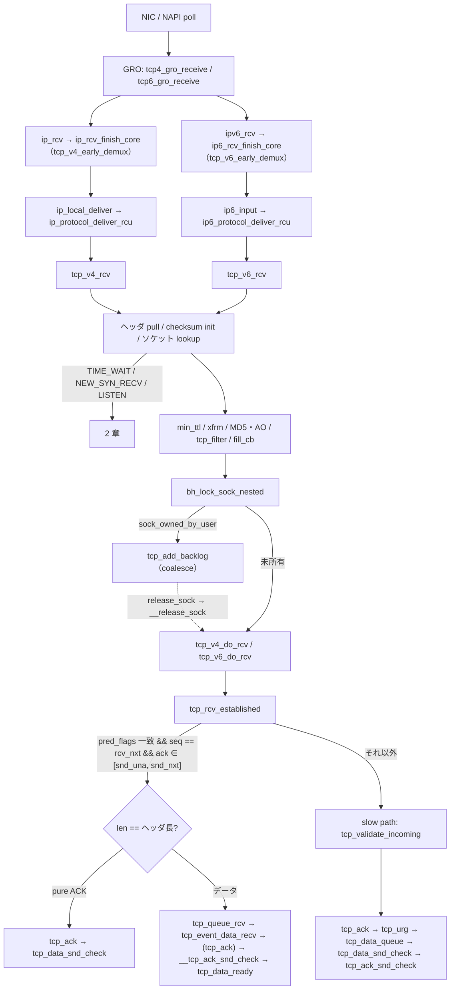

# 5. 受信 (1): tcp_v4_rcv と header prediction

この章では、NIC が受け取った TCP セグメントが ESTABLISHED ソケットに届き、`tcp_rcv_established()` の fast path（header prediction）か slow path（`tcp_validate_incoming()` → `tcp_ack()` → `tcp_data_queue()`）のどちらかで処理されるまでを、1 行ずつ追います。受信キューへの格納の中身と `tcp_recvmsg()` は [6 章](06-data-queue-recvmsg.md)、`tcp_ack()` の中身は [7 章](07-ack-processing.md) で扱います。

## たとえ話で言うと

大きなマンションの郵便室を想像してください。トラックが小包（`sk_buff`）を降ろすと、郵便室の係員はまず伝票（ヘッダ）の **建物の住所** と **部屋番号** を見て、どの部屋の郵便受け（`struct sock`）宛てかを調べます。

部屋の住人がちょうど郵便受けをいじっている最中（ユーザーがソケットロックを持っている）なら、係員は待たずに郵便受けの横の「あとで入れるトレイ」（backlog）に置いて次の仕事に戻ります。住人は作業を終えるときにトレイの小包をまとめて自分で取り込みます。

この係員は手際がよく、各部屋について **「次に届くはずの小包の伝票の見本」** を手元に持っています（`pred_flags`）。届いた伝票が見本とぴったり同じ（次の通し番号で、余計な印がなく、窓口の広さも同じ）なら、細かい検査を全部飛ばして受け取り箱にポンと入れ、必要なら受領印を返します。これが header prediction です。

見本と少しでも違うと、係員は精査用の机（slow path）に小包を回します。そこでは「日付スタンプが前回より古くないか」（PAWS）、「通し番号が受け付け範囲に入っているか」、「見知らぬ人からの“契約解除”の紙（RST）や“最初からやり直し”の紙（SYN）ではないか」を順番に確認します。怪しい紙には、すぐに従わずに「本当にあなたですか？」という受領印（challenge ACK）を返して、本物の相手にだけ正しい番号で出し直してもらいます。

## RFC では

### RFC 9293: SEGMENT ARRIVES（シーケンス番号の受け入れ判定）

[RFC 9293](https://www.rfc-editor.org/rfc/rfc9293)（Transmission Control Protocol, 2022）は RFC 793 と、それを補った RFC 1122 などをまとめ直した現行の TCP 本体仕様です。ESTABLISHED などの同期済み状態でセグメントが届いたときの処理は [RFC 9293 §3.10.7.4](https://www.rfc-editor.org/rfc/rfc9293#section-3.10.7.4)（Other States）に、次の順番で書かれています。

1. **first: シーケンス番号を検査する**
2. **second: RST ビットを検査する**
3. third: security を検査する
4. **fourth: SYN ビットを検査する**
5. **fifth: ACK フィールドを検査する**
6. sixth: URG ビットを検査する
7. seventh: セグメントのテキスト（データ）を処理する
8. eighth: FIN ビットを検査する

Linux の slow path はほぼこの順番どおりに書かれていて、`tcp_validate_incoming()` の中に `/* Step 1: ... */` `/* Step 2: ... */` といったコメントがそのまま残っています。

「first」の受け入れ判定（acceptability test）は、セグメント長と受信ウィンドウの組み合わせで 4 通りに分かれます。

| セグメント長 | 受信ウィンドウ | 受け入れ条件 |
| --- | --- | --- |
| 0 | 0 | `SEG.SEQ = RCV.NXT` |
| 0 | >0 | `RCV.NXT =< SEG.SEQ < RCV.NXT+RCV.WND` |
| >0 | 0 | 受け入れない |
| >0 | >0 | `RCV.NXT =< SEG.SEQ < RCV.NXT+RCV.WND` または `RCV.NXT =< SEG.SEQ+SEG.LEN-1 < RCV.NXT+RCV.WND` |

ポイントは次のとおりです。

- 「セグメントの先頭か末尾のどちらかがウィンドウに入っていれば受け入れる」という緩い判定です。ウィンドウからはみ出た部分を切り詰めるのは、その後のテキスト処理の役目です。
- 受け入れられないセグメントには（RST でない限り）ACK を返して捨てます。これにより、相手が古い状態のままでも正しい `RCV.NXT` を伝えられます。
- RCV.WND が 0 のときもデータは受け入れませんが、「有効な ACK、URG、RST は特別に受け付けるべき」とされています。

### RFC 7323: Timestamps、PAWS と header prediction

[RFC 7323](https://www.rfc-editor.org/rfc/rfc7323)（TCP Extensions for High Performance, 2014）は RFC 1323 を置き換えた RFC で、Window Scale と Timestamps オプションを定義します。この章に関係するのは Timestamps と、それを使う 2 つの仕組みです。

- **RTTM（Round-Trip Time Measurement）**: 送信側が TSval に自分の時計を入れ、受信側がそれを TSecr でエコーすることで、どの ACK でも RTT を測れるようにします（RTT 推定そのものは [7 章](07-ack-processing.md)）。
- **PAWS（Protection Against Wrapped Sequences）**: 高速リンクで 32 ビットのシーケンス番号が 1 周したとき、前の周回の古い重複セグメントを「タイムスタンプが古い」ことで見分けて捨てます。

[RFC 7323 §3](https://www.rfc-editor.org/rfc/rfc7323#section-3) の Timestamps オプションは `Kind=8, Length=10, TSval(4), TSecr(4)` の 10 バイトです。[RFC 7323 Appendix A](https://www.rfc-editor.org/rfc/rfc7323#appendix-A) は SYN 以外のセグメントで `NOP, NOP, TS` の 12 バイトに揃えて送ることを推奨しており、受信側はこの固定レイアウトを 32 ビット比較 1 回で判定できます。Linux の `tcp_parse_aligned_timestamp()` がまさにこれです。

受信側が持つ状態は 2 つです（[RFC 7323 §4.3](https://www.rfc-editor.org/rfc/rfc7323#section-4.3)）。

- `TS.Recent`: 次に TSecr で返すタイムスタンプ。Linux では `tp->rx_opt.ts_recent`。
- `Last.ACK.sent`: 最後に送った ACK の番号。Linux では「最後にウィンドウを通知したときの `rcv_nxt`」である `tp->rcv_wup` がこの役を果たします。

[RFC 7323 §5.3](https://www.rfc-editor.org/rfc/rfc7323#section-5.3) の PAWS の基本アルゴリズムは次のとおりです。

- **R1**: Timestamps オプションがあり、`SEG.TSval < TS.Recent` で、`TS.Recent` が有効で、RST ビットが立っていなければ、そのセグメントは受け入れない。ACK を返して捨てる。
- **R2**: ウィンドウ外なら（通常の TCP 処理として）捨てる。
- **R3**: `SEG.SEQ =< Last.ACK.sent` なら、その TSval を `TS.Recent` に記録する。
- **R4**: 順序どおり（ウィンドウ左端）のセグメントなら通常どおり受け入れる。

タイムスタンプの比較は 32 ビットの mod 演算で行うため、長時間アイドルなコネクションでは比較が意味をなさなくなります。[RFC 7323 §5.5](https://www.rfc-editor.org/rfc/rfc7323#section-5.5)（Outdated Timestamps）は、`TS.Recent` が 24 日以上更新されていなければ無効とみなすよう求めています。

[RFC 7323 §5.6](https://www.rfc-editor.org/rfc/rfc7323#section-5.6) は Van Jacobson の header prediction と PAWS の組み合わせ方を述べています。

- **H1**: タイムスタンプを検査する（R1 と同じ）。
- **H2**: header prediction を行う。次の順番のセグメントで特別な処理が要らなければ、受け入れてタイムスタンプを記録し、H3 は飛ばす。
- **H3**: 通常の RFC 793 の処理を行う。

header prediction の考え方は「ウィンドウに入っているか」という一般的な問いの代わりに、「これは次に来るはずのセグメントか」という単純な問いを先に立てることです。バルク転送中はほとんどのセグメントがこの条件を満たすので、平均的なコストが大きく下がります。Linux は H2 の判定（`pred_flags` と `seq == rcv_nxt`）を先に行い、そのあとで軽量なタイムスタンプ比較を行うので、H1 と H2 を入れ替えた形になっています。

ウィンドウの縮小（[RFC 7323 §2.4](https://www.rfc-editor.org/rfc/rfc7323#section-2.4)、window retraction）に関する受信側の要件も、後述の `tcp_sequence()` に関係します。

### RFC 5961: blind in-window 攻撃への対策

[RFC 5961](https://www.rfc-editor.org/rfc/rfc5961)（Improving TCP's Robustness to Blind In-Window Attacks, 2010）は、4-tuple は推測できるがシーケンス番号は見えない「ブラインド」攻撃者が、ウィンドウ内に当たるまで RST、SYN、データを撃ち込んでコネクションを切断・汚染する攻撃への対策です。RFC 793 の判定は「ウィンドウのどこかに入っていれば受け入れる」なので、ウィンドウが大きいほど当たりやすくなります。対策の中心は、**曖昧なときは従わずに challenge ACK を返し、本物の相手に正確な番号で出し直させる** ことです。

- [RFC 5961 §3.2](https://www.rfc-editor.org/rfc/rfc5961#section-3.2)（RST）: `SEG.SEQ == RCV.NXT` ならリセットする。ウィンドウ内だが一致しなければ challenge ACK を返して捨てる。ウィンドウ外なら黙って捨てる。
- [RFC 5961 §4.2](https://www.rfc-editor.org/rfc/rfc5961#section-4.2)（SYN）: 同期済み状態で SYN を受けたら、シーケンス番号に関係なく challenge ACK を返して捨てる（RFC 793 のようにリセットはしない）。
- [RFC 5961 §5.2](https://www.rfc-editor.org/rfc/rfc5961#section-5.2)（データ注入）: ACK が受け入れ可能なのは `(SND.UNA - MAX.SND.WND) =< SEG.ACK =< SND.NXT` のときだけ。範囲外なら捨てて ACK を返す。
- [RFC 5961 §7](https://www.rfc-editor.org/rfc/rfc5961#section-7)（ACK Throttling）: challenge ACK が増幅攻撃に使われないよう、送信レートを制限する。

RFC 9293 は §3.10.7.4 の RST と SYN の処理にこの RFC 5961 の手順を（任意の緩和策として）取り込んでいます。Linux は RFC 5961 を既定で有効にしており、さらにいくつか独自の拡張をしています（後述の比較表）。

## 全体の流れ



ソケットの lookup までは IPv4 と IPv6 で別関数ですが、`tcp_rcv_established()` から先は完全に共通です。fast path は「次のセグメントで、フラグは ACK だけ、ウィンドウ値も前回と同じ、ACK 番号も妥当」という最頻ケースだけを扱い、それ以外はすべて RFC 9293 の手順をなぞる slow path に落ちます。

## コードを追う

### Step 1: NIC から tcp_v4_rcv / tcp_v6_rcv まで（概要）

TCP に届くまでの経路は、この章では駆け足で済ませます。すべて NET_RX softirq（または threaded NAPI のカーネルスレッド）の中で、`rcu_read_lock()` の下で実行されます。

1. ドライバの NAPI poll が `napi_gro_receive()` に skb を渡します。`tcp4_gro_receive()`（[net/ipv4/tcp_offload.c#L428](https://git.kernel.org/pub/scm/linux/kernel/git/netdev/net-next.git/tree/net/ipv4/tcp_offload.c?id=279d5c8afcd38bd841832a39bfe1aa4f8518d98e#n428)） → `tcp_gro_receive()`（[net/ipv4/tcp_offload.c#L286](https://git.kernel.org/pub/scm/linux/kernel/git/netdev/net-next.git/tree/net/ipv4/tcp_offload.c?id=279d5c8afcd38bd841832a39bfe1aa4f8518d98e#n286)） は、同じフローで連続し、フラグ・オプションが一致するセグメントを 1 つの大きな skb（`gso_segs > 1`）にまとめます。以降の TCP 処理は「1 つの skb = 複数 MSS 分」を前提に書かれており、後述の `tcp_segs_in()` が `gso_segs` で数えるのはこのためです。
2. `ip_rcv()`（[net/ipv4/ip_input.c#L603](https://git.kernel.org/pub/scm/linux/kernel/git/netdev/net-next.git/tree/net/ipv4/ip_input.c?id=279d5c8afcd38bd841832a39bfe1aa4f8518d98e#n603)） → `ip_rcv_finish_core()`（[net/ipv4/ip_input.c#L361](https://git.kernel.org/pub/scm/linux/kernel/git/netdev/net-next.git/tree/net/ipv4/ip_input.c?id=279d5c8afcd38bd841832a39bfe1aa4f8518d98e#n361)） は、`net.ipv4.tcp_early_demux` が有効なら経路検索の前に `tcp_v4_early_demux()`（[net/ipv4/ip_input.c#L322](https://git.kernel.org/pub/scm/linux/kernel/git/netdev/net-next.git/tree/net/ipv4/ip_input.c?id=279d5c8afcd38bd841832a39bfe1aa4f8518d98e#n322)） を呼びます。IPv6 では `ipv6_rcv()`（[net/ipv6/ip6_input.c#L344](https://git.kernel.org/pub/scm/linux/kernel/git/netdev/net-next.git/tree/net/ipv6/ip6_input.c?id=279d5c8afcd38bd841832a39bfe1aa4f8518d98e#n344)） → `ip6_rcv_finish_core()`（[net/ipv6/ip6_input.c#L88](https://git.kernel.org/pub/scm/linux/kernel/git/netdev/net-next.git/tree/net/ipv6/ip6_input.c?id=279d5c8afcd38bd841832a39bfe1aa4f8518d98e#n88)） → `tcp_v6_early_demux()`（[net/ipv6/ip6_input.c#L49](https://git.kernel.org/pub/scm/linux/kernel/git/netdev/net-next.git/tree/net/ipv6/ip6_input.c?id=279d5c8afcd38bd841832a39bfe1aa4f8518d98e#n49)） です。

```c
	sk = __inet_lookup_established(net, iph->saddr, th->source,
				       iph->daddr, ntohs(th->dest),
				       skb->skb_iif, inet_sdif(skb));
	if (sk) {
		skb->sk = sk;
		skb->destructor = sock_edemux;
		if (sk_fullsock(sk)) {
			struct dst_entry *dst = rcu_dereference(sk->sk_rx_dst);

			if (dst)
				dst = dst_check(dst, 0);
			if (dst &&
			    sk->sk_rx_dst_ifindex == skb->skb_iif)
				skb_dst_set_noref(skb, dst);
		}
	}
```

ESTABLISHED テーブルだけを引き、見つかれば `skb->sk` にソケットを付けておきます（`sock_edemux` デストラクタで後始末）。さらにソケットに入力経路のキャッシュ `sk->sk_rx_dst` があり、まだ有効で受信インタフェースも同じなら、それを refcount なしで `skb` に付けます。これで FIB lookup を丸ごと省けます。後で `tcp_v4_rcv()` が `__inet_lookup_skb()` を呼んだときには、この `skb->sk` が「盗まれて」再 lookup も省かれます。

3. ローカル宛てなら `ip_local_deliver()`（[net/ipv4/ip_input.c#L250](https://git.kernel.org/pub/scm/linux/kernel/git/netdev/net-next.git/tree/net/ipv4/ip_input.c?id=279d5c8afcd38bd841832a39bfe1aa4f8518d98e#n250)） → `ip_protocol_deliver_rcu()`（[net/ipv4/ip_input.c#L189](https://git.kernel.org/pub/scm/linux/kernel/git/netdev/net-next.git/tree/net/ipv4/ip_input.c?id=279d5c8afcd38bd841832a39bfe1aa4f8518d98e#n189)） が、IPv6 なら `ip6_input()`（[net/ipv6/ip6_input.c#L540](https://git.kernel.org/pub/scm/linux/kernel/git/netdev/net-next.git/tree/net/ipv6/ip6_input.c?id=279d5c8afcd38bd841832a39bfe1aa4f8518d98e#n540)） → `ip6_protocol_deliver_rcu()`（[net/ipv6/ip6_input.c#L403](https://git.kernel.org/pub/scm/linux/kernel/git/netdev/net-next.git/tree/net/ipv6/ip6_input.c?id=279d5c8afcd38bd841832a39bfe1aa4f8518d98e#n403)） がプロトコルハンドラを呼びます。

```c
		ret = INDIRECT_CALL_2(ipprot->handler, tcp_v4_rcv, udp_rcv,
				      skb);
		if (ret < 0) {
			protocol = -ret;
			goto resubmit;
```

`INDIRECT_CALL_2()` は、retpoline 環境で関数ポインタ呼び出しのコストを避けるため、「よくある呼び先」と直接比較してから直接呼び出すマクロです。TCP と UDP が特別扱いされています。

### Step 2: tcp_v4_rcv() — 前半: ヘッダの検証と checksum の初期化

`tcp_v4_rcv()`（[net/ipv4/tcp_ipv4.c#L2073](https://git.kernel.org/pub/scm/linux/kernel/git/netdev/net-next.git/tree/net/ipv4/tcp_ipv4.c?id=279d5c8afcd38bd841832a39bfe1aa4f8518d98e#n2073)） は IPv4 TCP の入口です。

```c
int tcp_v4_rcv(struct sk_buff *skb)
{
	struct net *net = dev_net_rcu(skb->dev);
	enum skb_drop_reason drop_reason;
	enum tcp_tw_status tw_status;
	int sdif = inet_sdif(skb);
	int dif = inet_iif(skb);
	const struct iphdr *iph;
	const struct tcphdr *th;
	struct sock *sk = NULL;
	bool refcounted;
	int ret;
	u32 isn;

	drop_reason = SKB_DROP_REASON_NOT_SPECIFIED;
	if (skb->pkt_type != PACKET_HOST)
		goto discard_it;

	/* Count it even if it's bad */
	__TCP_INC_STATS(net, TCP_MIB_INSEGS);

	if (!pskb_may_pull(skb, sizeof(struct tcphdr)))
		goto discard_it;

	th = (const struct tcphdr *)skb->data;

	if (unlikely(th->doff < sizeof(struct tcphdr) / 4)) {
		drop_reason = SKB_DROP_REASON_PKT_TOO_SMALL;
		goto bad_packet;
	}
	if (!pskb_may_pull(skb, th->doff * 4))
		goto discard_it;

	/* An explanation is required here, I think.
	 * Packet length and doff are validated by header prediction,
	 * provided case of th->doff==0 is eliminated.
	 * So, we defer the checks. */

	if (skb_checksum_init(skb, IPPROTO_TCP, inet_compute_pseudo))
		goto csum_error;

	th = (const struct tcphdr *)skb->data;
	iph = ip_hdr(skb);
```

- `dev_net_rcu(skb->dev)`: RCU 下で netns を取ります。`skb->dev` はこの関数の後半で `NULL` にされるので、ここで取っておく必要があります。
- `sdif` / `dif`: VRF のために、L3 master デバイスの下にある実デバイス（slave）の ifindex と、受信 ifindex を取っておきます。lookup と MD5/AO の鍵選択で使います。
- `skb->pkt_type != PACKET_HOST`: promiscuous モードで拾った他ホスト宛てのフレームなどは、ここで捨てます。
- `TCP_MIB_INSEGS`（nstat の `TcpInSegs`）は「壊れていても数える」という MIB の定義どおり、検証より前に数えます。GRO でまとめられた skb も 1 として数えるので、`TcpInSegs` はワイヤ上のセグメント数より小さくなります。
- `pskb_may_pull(skb, sizeof(struct tcphdr))` → `doff` の検証 → `pskb_may_pull(skb, th->doff * 4)`: オプションを含む TCP ヘッダ全体を linear 領域（`skb->head`）に引き上げます。以降、`th` のオプション部分をポインタで直接読めるのはこの保証があるからです。`doff < 5` だけは不正パケットとして `TcpInErrs` に数えます。
- コメントの「Packet length and doff are validated by header prediction」は歴史的な説明です。現在は直前の `pskb_may_pull(skb, th->doff * 4)` が `skb->len >= doff * 4` を保証しているので、後述の fast path の「Header too small」分岐はほぼ防御的なものになっています。
- `skb_checksum_init()`: 擬似ヘッダの checksum を `skb->csum` にセットします。NIC が `CHECKSUM_COMPLETE` を返していれば、ここで検証が完了して `csum_valid` が立ちます。そうでない場合、`skb->len` が `CHECKSUM_BREAK`（76 バイト）以下ならここで全体を計算し、それより長ければ **検証を後回し** にします。後回しにした検証は、データをキューに入れる直前の `tcp_checksum_complete()` で行います。pure ACK（20 または 32 バイト）は必ずここで検証済みになる、という事実を fast path が利用しています。
- `pskb_may_pull()` は `skb->head` を再確保することがあるので、`th` と `iph` を取り直します。

### Step 3: tcp_v4_rcv() — ソケット lookup と状態による振り分け

```c
lookup:
	sk = __inet_lookup_skb(skb, __tcp_hdrlen(th), th->source,
			       th->dest, sdif, &refcounted);
	if (!sk)
		goto no_tcp_socket;

	if (sk->sk_state == TCP_TIME_WAIT)
		goto do_time_wait;
```

- `__inet_lookup_skb()`（[include/net/inet_hashtables.h#L485](https://git.kernel.org/pub/scm/linux/kernel/git/netdev/net-next.git/tree/include/net/inet_hashtables.h?id=279d5c8afcd38bd841832a39bfe1aa4f8518d98e#n485)） は、まず `inet_steal_sock()`（[include/net/inet_hashtables.h#L445](https://git.kernel.org/pub/scm/linux/kernel/git/netdev/net-next.git/tree/include/net/inet_hashtables.h?id=279d5c8afcd38bd841832a39bfe1aa4f8518d98e#n445)） で `skb->sk`（early demux や BPF の `bpf_sk_assign()` が付けたもの）を取り出し、なければ ehash → listener の順に通常の lookup をします。`refcounted` は、返ってきたソケットに参照を取ったかどうかです。listener は `SOCK_RCU_FREE` なので参照を取らずに返ることがあり、最後の `sock_put()` はこのフラグで制御されます。
- `TCP_TIME_WAIT` と `TCP_NEW_SYN_RECV` は full socket ではない mini socket です（[1 章](01-data-structures.md)、[2 章](02-connection-lifecycle.md)）。この章では扱いません。`TCP_NEW_SYN_RECV` の分岐（tcp_ipv4.c の 2125 行目から 2204 行目）は、request socket から listener を取り出して `tcp_check_req()` で 3WHS の最後の ACK を処理し、子ソケットができれば `tcp_child_process()` に渡します。別の CPU が先に子ソケットを作っていた場合（`req_stolen`）は、`tcp_v4_restore_cb()` で `IPCB` を戻して `lookup` からやり直します。

### Step 4: tcp_v4_rcv() — process: ポリシー、フィルタと TCP_SKB_CB の構築

```c
	isn = 0;
process:
	if (static_branch_unlikely(&ip4_min_ttl)) {
		/* min_ttl can be changed concurrently from do_ip_setsockopt() */
		if (unlikely(iph->ttl < READ_ONCE(inet_sk(sk)->min_ttl))) {
			__NET_INC_STATS(net, LINUX_MIB_TCPMINTTLDROP);
			drop_reason = SKB_DROP_REASON_TCP_MINTTL;
			goto discard_and_relse;
		}
	}

	if (!xfrm4_policy_check(sk, XFRM_POLICY_IN, skb)) {
		drop_reason = SKB_DROP_REASON_XFRM_POLICY;
		goto discard_and_relse;
	}

	drop_reason = tcp_inbound_hash(sk, NULL, skb, &iph->saddr, &iph->daddr,
				       AF_INET, dif, sdif);
	if (drop_reason)
		goto discard_and_relse;

	nf_reset_ct(skb);

	drop_reason = tcp_filter(sk, skb);
	if (drop_reason)
		goto discard_and_relse;

	th = (const struct tcphdr *)skb->data;
	iph = ip_hdr(skb);
	tcp_v4_fill_cb(skb, iph, th);
	TCP_SKB_CB(skb)->tcp_tw_isn = isn;

	skb->dev = NULL;

	if (sk->sk_state == TCP_LISTEN) {
		ret = tcp_v4_do_rcv(sk, skb);
		goto put_and_return;
	}
```

- `static_branch_unlikely(&ip4_min_ttl)`: `IP_MINTTL`（[RFC 5082](https://www.rfc-editor.org/rfc/rfc5082) GTSM）を設定したソケットが 1 つでもあるときだけ有効になる static key です。普段はジャンプ命令 1 つ分のコストもかかりません。`min_ttl` は `setsockopt()` がロックなしで書き換えうるので `READ_ONCE()` で読みます。
- `xfrm4_policy_check()`: IPsec の入力ポリシーを検査します。この検査は `IPCB(skb)` を参照するので、`TCP_SKB_CB()` を作る `tcp_v4_fill_cb()` より **前** に行う必要があります（後述）。
- `tcp_inbound_hash()`（[net/ipv4/tcp.c#L5027](https://git.kernel.org/pub/scm/linux/kernel/git/netdev/net-next.git/tree/net/ipv4/tcp.c?id=279d5c8afcd38bd841832a39bfe1aa4f8518d98e#n5027)）: TCP-MD5（RFC 2385）と TCP-AO（RFC 5925）の署名を検査します。鍵がなければすぐに戻ります。
- `nf_reset_ct()`: conntrack への参照を外します。skb はこの後、受信キューに長く留まる可能性があるので、conntrack エントリを無駄に生かし続けないようにここで切ります。
- `tcp_filter()`（[include/net/tcp.h#L1734](https://git.kernel.org/pub/scm/linux/kernel/git/netdev/net-next.git/tree/include/net/tcp.h?id=279d5c8afcd38bd841832a39bfe1aa4f8518d98e#n1734)）: `SO_ATTACH_FILTER` などのソケットフィルタ（classic BPF / eBPF）を実行します。`sk_filter_trim_cap()` はペイロードを切り詰めることがありますが、TCP ヘッダ長（`__tcp_hdrlen(th)`）より短くはしません。フィルタが skb を書き換えうるので、この後 `th` と `iph` を取り直しています。
- `tcp_v4_fill_cb()`: `TCP_SKB_CB(skb)` に seq などを詰めます（次の小節）。
- `TCP_SKB_CB(skb)->tcp_tw_isn = isn`: TIME_WAIT から listener に回された SYN に、TIME_WAIT 側が選んだ ISN を渡すための欄です。通常は 0 です。
- `skb->dev = NULL`: ここから先、skb はソケットのキューに長く留まります。その間にデバイスが消えても dangling pointer にならないよう、デバイスへの参照をここで消します。以降、受信インタフェースが必要なときは `skb->skb_iif` か `TCP_SKB_CB()` に退避した `IPCB` を使います。
- `TCP_LISTEN` のときはソケットロックを取らずに `tcp_v4_do_rcv()` を呼びます。listener はロックレスで動くので（[2 章](02-connection-lifecycle.md)）、ここで分岐しています。
- `sk_incoming_cpu_update()`: `SO_INCOMING_CPU` 用に、このソケットのパケットを最後に処理した CPU を記録します。

#### tcp_v4_fill_cb() と struct tcp_skb_cb

`tcp_v4_fill_cb()`（[net/ipv4/tcp_ipv4.c#L2048](https://git.kernel.org/pub/scm/linux/kernel/git/netdev/net-next.git/tree/net/ipv4/tcp_ipv4.c?id=279d5c8afcd38bd841832a39bfe1aa4f8518d98e#n2048)） は、`struct tcp_skb_cb`（[include/net/tcp.h#L1138](https://git.kernel.org/pub/scm/linux/kernel/git/netdev/net-next.git/tree/include/net/tcp.h?id=279d5c8afcd38bd841832a39bfe1aa4f8518d98e#n1138)） の受信側フィールドを埋めます。

```c
static void tcp_v4_restore_cb(struct sk_buff *skb)
{
	memmove(IPCB(skb), &TCP_SKB_CB(skb)->header.h4,
		sizeof(struct inet_skb_parm));
}

static void tcp_v4_fill_cb(struct sk_buff *skb, const struct iphdr *iph,
			   const struct tcphdr *th)
{
	/* This is tricky : We move IPCB at its correct location into TCP_SKB_CB()
	 * barrier() makes sure compiler wont play fool^Waliasing games.
	 */
	memmove(&TCP_SKB_CB(skb)->header.h4, IPCB(skb),
		sizeof(struct inet_skb_parm));
	barrier();

	TCP_SKB_CB(skb)->seq = ntohl(th->seq);
	TCP_SKB_CB(skb)->end_seq = (TCP_SKB_CB(skb)->seq + th->syn + th->fin +
				    skb->len - th->doff * 4);
	TCP_SKB_CB(skb)->ack_seq = ntohl(th->ack_seq);
	TCP_SKB_CB(skb)->tcp_flags = tcp_flags_ntohs(th);
	TCP_SKB_CB(skb)->ip_dsfield = ipv4_get_dsfield(iph);
	TCP_SKB_CB(skb)->sacked	 = 0;
	TCP_SKB_CB(skb)->has_rxtstamp =
			skb->tstamp || skb_hwtstamps(skb)->hwtstamp;
}
```

- `skb->cb[]`（48 バイト）は層ごとに使い回す領域です。IP 層は先頭に `struct inet_skb_parm`（`IPCB`）を置きますが、TCP は先頭に `seq`, `end_seq` などを置きたいので、`IPCB` を `TCP_SKB_CB(skb)->header.h4` に `memmove()` で移してから上書きします。`barrier()` は、同じメモリを別の型で読み書きするので、コンパイラに順序を入れ替えさせないためのものです。
- このため、`IPCB(skb)` を使う処理（`xfrm4_policy_check()` など）は必ず fill_cb の前に済ませなければなりません。逆に、lookup をやり直すときは `tcp_v4_restore_cb()` で `IPCB` を元の位置に戻します。
- `end_seq = seq + SYN + FIN + ペイロード長`: SYN と FIN はシーケンス空間を 1 つずつ消費するので、`end_seq` に含めます。以降の TCP コードは「`seq == end_seq` なら pure ACK」という判定を多用します。
- `tcp_flags`: フラグ部を CPU のバイトオーダで保持し、`TCPHDR_*` で判定できるようにします。
- `ip_dsfield`: ECN ビットを含む TOS / Traffic Class を保存します。backlog の coalesce 判定や ECN 処理で使います。
- `sacked = 0`: 受信 skb では SACK 状態は使いませんが、`sacked` は送信側と共用の欄なので明示的にクリアします。
- `has_rxtstamp`: ソフトウェアまたはハードウェアの受信タイムスタンプがあるかどうかです（`SO_TIMESTAMPING` 用）。

### Step 5: tcp_v4_rcv() — ソケットロックと backlog

```c
	sk_incoming_cpu_update(sk);

	bh_lock_sock_nested(sk);
	tcp_segs_in(tcp_sk(sk), skb);
	ret = 0;
	if (!sock_owned_by_user(sk)) {
		ret = tcp_v4_do_rcv(sk, skb);
	} else {
		drop_reason = tcp_add_backlog(sk, skb);
		if (drop_reason)
			goto discard_and_relse;
	}
	bh_unlock_sock(sk);

put_and_return:
	if (refcounted)
		sock_put(sk);

	return ret;
```

ソケットの「ロック」は 2 段構えになっていることを思い出してください。

- `sk->sk_lock.slock`: spinlock。softirq とプロセスの両方が短時間だけ取ります。
- `sk->sk_lock.owned`: プロセスコンテキストが `lock_sock()` で立てるフラグ。立っている間、プロセスは spinlock を離して（BH も有効にして）眠ることができます。

`tcp_v4_rcv()` は softirq なので、眠る `lock_sock()` は使えません。そこで `bh_lock_sock_nested()` で spinlock だけを取り、`sock_owned_by_user()` で `owned` を確認します。

- `owned == 0` なら、そのまま `tcp_v4_do_rcv()` → `tcp_rcv_established()` を **softirq の中で、spinlock を持ったまま** 実行します。
- `owned == 1` なら、ユーザーが `tcp_sendmsg()` や `tcp_recvmsg()` の途中でソケットを触っているので、ソケットの状態を変更できません。skb を `tcp_add_backlog()` で backlog に積んで、すぐに戻ります。積まれた skb は、ユーザーが `release_sock()` するときに `__release_sock()`（[net/core/sock.c#L3295](https://git.kernel.org/pub/scm/linux/kernel/git/netdev/net-next.git/tree/net/core/sock.c?id=279d5c8afcd38bd841832a39bfe1aa4f8518d98e#n3295)） が `sk_backlog_rcv()`（TCP では `tcp_v4_do_rcv()` / `tcp_v6_do_rcv()`）を呼んで処理します。

`tcp_segs_in()`（[include/net/tcp.h#L2810](https://git.kernel.org/pub/scm/linux/kernel/git/netdev/net-next.git/tree/include/net/tcp.h?id=279d5c8afcd38bd841832a39bfe1aa4f8518d98e#n2810)） は `segs_in` と `data_segs_in` を `gso_segs` 単位で数えます。spinlock の中ですが、`tcp_get_info()` がロックなしで読むので `WRITE_ONCE()` を使っています。backlog に積む場合も数えるので、backlog で落とした skb も `segs_in` には含まれます。

**ロックの非対称性** に注意してください。`tcp_add_backlog()` は失敗したとき、**自分で `bh_unlock_sock()` してから** drop reason を返します。そのため呼び出し側は `bh_unlock_sock()` を飛ばして `discard_and_relse` に直行しています。drop の処理（`sk_skb_reason_drop()` と tracepoint）を spinlock の外で行うための設計です。

`put_and_return` の `sock_put()` は lookup で取った参照を返すものです。`tcp_v4_do_rcv()` は常に 0 を返すので、`ret` は実質的に 0 です。

### Step 6: tcp_add_backlog() — backlog への coalesce

`tcp_add_backlog()`（[net/ipv4/tcp_ipv4.c#L1904](https://git.kernel.org/pub/scm/linux/kernel/git/netdev/net-next.git/tree/net/ipv4/tcp_ipv4.c?id=279d5c8afcd38bd841832a39bfe1aa4f8518d98e#n1904)） は IPv4 と IPv6 で共通です。

```c
enum skb_drop_reason tcp_add_backlog(struct sock *sk, struct sk_buff *skb)
{
	u32 tail_gso_size, tail_gso_segs;
	struct skb_shared_info *shinfo;
	const struct tcphdr *th;
	struct tcphdr *thtail;
	struct sk_buff *tail;
	unsigned int hdrlen;
	bool fragstolen;
	u32 gso_segs;
	u32 gso_size;
	u64 limit;
	int delta;
	int err;

	/* In case all data was pulled from skb frags (in __pskb_pull_tail()),
	 * we can fix skb->truesize to its real value to avoid future drops.
	 * This is valid because skb is not yet charged to the socket.
	 * It has been noticed pure SACK packets were sometimes dropped
	 * (if cooked by drivers without copybreak feature).
	 */
	skb_condense(skb);

	tcp_cleanup_skb(skb);

	if (unlikely(tcp_checksum_complete(skb))) {
		bh_unlock_sock(sk);
		trace_tcp_bad_csum(skb);
		__TCP_INC_STATS(sock_net(sk), TCP_MIB_CSUMERRORS);
		__TCP_INC_STATS(sock_net(sk), TCP_MIB_INERRS);
		return SKB_DROP_REASON_TCP_CSUM;
	}
```

- `skb_condense()`: `pskb_may_pull()` などでデータがすべて linear 領域に引き上げられ、frag が空になっていれば、frag を解放して `skb->truesize` を実際の値に縮めます。まだソケットに課金していないので、truesize を書き換えても家計簿は狂いません。コメントにあるとおり、copybreak を持たないドライバから来た pure SACK が、truesize の過大評価のせいで backlog 上限に引っかかって落ちていた問題への対策です。
- `tcp_cleanup_skb()`（[include/net/tcp.h#L824](https://git.kernel.org/pub/scm/linux/kernel/git/netdev/net-next.git/tree/include/net/tcp.h?id=279d5c8afcd38bd841832a39bfe1aa4f8518d98e#n824)）: `skb_dst_drop()` と `secpath_reset()` を行います。backlog に積んだ skb は RCU 区間の外で処理されるので、refcount のない dst を持ち越すわけにはいきません（`__sk_add_backlog()` も念のため `skb_dst_force()` しています）。そもそも TCP は受信後に dst を使わないので、ここで捨てるのが一番安上がりです。
- `tcp_checksum_complete()`（[include/net/tcp.h#L1726](https://git.kernel.org/pub/scm/linux/kernel/git/netdev/net-next.git/tree/include/net/tcp.h?id=279d5c8afcd38bd841832a39bfe1aa4f8518d98e#n1726)）: 後回しにしていた checksum の検証をここで済ませます。理由は 2 つあります。1 つは、この後 tail と coalesce するとペイロードが混ざり、個別には検証できなくなるからです。もう 1 つは、検証のコストを BH 側の CPU に負担させ、ユーザー側の CPU が `__release_sock()` で抱える仕事を減らすためです。失敗時はここで `bh_unlock_sock()` します（前述の非対称性）。

```c
	/* Attempt coalescing to last skb in backlog, even if we are
	 * above the limits.
	 * This is okay because skb capacity is limited to MAX_SKB_FRAGS.
	 */
	th = (const struct tcphdr *)skb->data;
	hdrlen = th->doff * 4;

	tail = sk->sk_backlog.tail;
	if (!tail)
		goto no_coalesce;
	thtail = (struct tcphdr *)tail->data;

	if (TCP_SKB_CB(tail)->end_seq != TCP_SKB_CB(skb)->seq ||
	    TCP_SKB_CB(tail)->ip_dsfield != TCP_SKB_CB(skb)->ip_dsfield ||
	    ((TCP_SKB_CB(tail)->tcp_flags |
	      TCP_SKB_CB(skb)->tcp_flags) & (TCPHDR_SYN | TCPHDR_RST | TCPHDR_URG)) ||
	    !((TCP_SKB_CB(tail)->tcp_flags &
	      TCP_SKB_CB(skb)->tcp_flags) & TCPHDR_ACK) ||
	    ((TCP_SKB_CB(tail)->tcp_flags ^
	      TCP_SKB_CB(skb)->tcp_flags) &
	     (TCPHDR_ECE | TCPHDR_CWR | TCPHDR_AE)) ||
	    !tcp_skb_can_collapse_rx(tail, skb) ||
	    thtail->doff != th->doff ||
	    memcmp(thtail + 1, th + 1, hdrlen - sizeof(*th)) ||
	    /* prior to PSP Rx policy check, retain exact PSP metadata */
	    psp_skb_coalesce_diff(tail, skb))
		goto no_coalesce;
```

backlog の末尾（`sk->sk_backlog.tail`）と coalesce できる条件を列挙しています。どれか 1 つでも満たさなければ `no_coalesce` です。

- `end_seq == seq`: シーケンス上で連続していること。
- `ip_dsfield` が同じであること。ECN の CE マークを持つセグメントと持たないセグメントを混ぜると、CE の数え方（特に AccECN のバイト単位カウンタ）が狂います。
- どちらにも SYN / RST / URG がないこと、どちらにも ACK があること。
- ECE / CWR / AE が同じであること（ECN フィードバックを失わないため）。
- `tcp_skb_can_collapse_rx()`（[include/net/tcp.h#L1273](https://git.kernel.org/pub/scm/linux/kernel/git/netdev/net-next.git/tree/include/net/tcp.h?id=279d5c8afcd38bd841832a39bfe1aa4f8518d98e#n1273)）: MPTCP の DSS マッピングや kTLS の decrypted ビットが一致していること。
- `doff` が同じで、**オプションのバイト列が `memcmp()` で完全に一致** すること。TSval / TSecr も同じでなければならないので、主に同じ ms のうちに届いたバースト（GRO が効かない場合）や、ACK の連打がまとまります。SACK ブロックが変化する ACK はまとまりません。
- `psp_skb_coalesce_diff()`: PSP（暗号化）のメタデータが同じであること。PSP の受信ポリシー検査は `tcp_v4_do_rcv()` の先頭で行うので、それより前の段階で異なるメタデータを混ぜるわけにはいきません。

```c
	__skb_pull(skb, hdrlen);

	shinfo = skb_shinfo(skb);
	gso_size = shinfo->gso_size ?: skb->len;
	gso_segs = shinfo->gso_segs ?: 1;

	shinfo = skb_shinfo(tail);
	tail_gso_size = shinfo->gso_size ?: (tail->len - hdrlen);
	tail_gso_segs = shinfo->gso_segs ?: 1;

	if (skb_try_coalesce(tail, skb, &fragstolen, &delta)) {
		TCP_SKB_CB(tail)->end_seq = TCP_SKB_CB(skb)->end_seq;

		if (likely(!before(TCP_SKB_CB(skb)->ack_seq, TCP_SKB_CB(tail)->ack_seq))) {
			TCP_SKB_CB(tail)->ack_seq = TCP_SKB_CB(skb)->ack_seq;
			thtail->window = th->window;
		}
```

- 新しい skb の TCP ヘッダを `__skb_pull()` で外し、ペイロードだけを tail に足せるようにします。
- `gso_size` / `gso_segs` を両方の skb について求めます（GRO を通っていない skb は `gso_size == 0` なので、長さそのものを 1 セグメントとみなします）。
- `skb_try_coalesce()` は frag の付け替えなどでペイロードを tail に移します。`fragstolen` は「skb の head ごと盗んだ」ことを、`delta` は tail の truesize の増分を返します。
- coalesce できたら `end_seq` を伸ばし、ACK が新しければ（`!before()`）`ack_seq` と **TCP ヘッダの `window` も** 新しい値に置き換えます。`tcp_rcv_established()` は `th->window` を生で読んで `pred_flags` と比較し、`tcp_ack_update_window()` に渡すので、ヘッダ上の値を更新しないと古いウィンドウで処理してしまいます（86bccd036713）。

```c
		/* We have to update both TCP_SKB_CB(tail)->tcp_flags and
		 * thtail->fin, so that the fast path in tcp_rcv_established()
		 * is not entered if we append a packet with a FIN.
		 * SYN, RST, URG are not present.
		 * ACK is set on both packets.
		 * PSH : we do not really care in TCP stack,
		 *       at least for 'GRO' packets.
		 */
		thtail->fin |= th->fin;
		TCP_SKB_CB(tail)->tcp_flags |= TCP_SKB_CB(skb)->tcp_flags;

		if (TCP_SKB_CB(skb)->has_rxtstamp) {
			TCP_SKB_CB(tail)->has_rxtstamp = true;
			tail->tstamp = skb->tstamp;
			skb_hwtstamps(tail)->hwtstamp = skb_hwtstamps(skb)->hwtstamp;
		}

		/* Not as strict as GRO. We only need to carry mss max value */
		shinfo->gso_size = max(gso_size, tail_gso_size);
		shinfo->gso_segs = min_t(u32, gso_segs + tail_gso_segs, 0xFFFF);

		sk->sk_backlog.len += delta;
		__NET_INC_STATS(sock_net(sk),
				LINUX_MIB_TCPBACKLOGCOALESCE);
		kfree_skb_partial(skb, fragstolen);
		return SKB_NOT_DROPPED_YET;
	}
	__skb_push(skb, hdrlen);
```

- FIN は `thtail->fin` と `tcp_flags` の両方に OR します。`tcp_rcv_established()` の `pred_flags` 比較は TCP ヘッダのフラグを見るので、ヘッダ側にも FIN を立てておかないと、FIN 付きのセグメントが fast path に入ってしまいます。
- 受信タイムスタンプは新しい skb のものを引き継ぎます。
- `gso_size` は最大値、`gso_segs` は合計（16 ビットで飽和）にします。GRO ほど厳密ではありませんが、`tcp_measure_rcv_mss()` などが必要とするのは最大 MSS だけなので十分です。
- `sk_backlog.len += delta`、`TCPBacklogCoalesce` を数え、`kfree_skb_partial()` で新しい skb の殻だけを解放します。
- coalesce に失敗したら `__skb_push()` でヘッダを戻します。

```c
no_coalesce:
	/* sk->sk_backlog.len is reset only at the end of __release_sock().
	 * Both sk->sk_backlog.len and sk->sk_rmem_alloc could reach
	 * sk_rcvbuf in normal conditions.
	 */
	limit = ((u64)READ_ONCE(sk->sk_rcvbuf)) << 1;

	limit += ((u32)READ_ONCE(sk->sk_sndbuf)) >> 1;

	/* Only socket owner can try to collapse/prune rx queues
	 * to reduce memory overhead, so add a little headroom here.
	 * Few sockets backlog are possibly concurrently non empty.
	 */
	limit += 64 * 1024;

	limit = min_t(u64, limit, UINT_MAX);

	err = sk_add_backlog(sk, skb, limit);
	if (unlikely(err)) {
		bh_unlock_sock(sk);
		if (err == -ENOMEM) {
			__NET_INC_STATS(sock_net(sk), LINUX_MIB_PFMEMALLOCDROP);
			return SKB_DROP_REASON_PFMEMALLOC;
		}
		__NET_INC_STATS(sock_net(sk), LINUX_MIB_TCPBACKLOGDROP);
		return SKB_DROP_REASON_SOCKET_BACKLOG;
	}
	return SKB_NOT_DROPPED_YET;
}
```

- 上限は `2 * sk_rcvbuf + sk_sndbuf / 2 + 64KB` です。`sk_rcvbuf` と `sk_sndbuf` は `setsockopt()` や autotuning がロックなしで書き換えうるので `READ_ONCE()` で読みます。
- `sk_rcvbuf` を 2 倍にしているのは、`sk_backlog.len` が `__release_sock()` の **最後** にしか 0 に戻らないからです。ユーザーが backlog を処理している最中は、処理済みの skb が受信キューの `sk_rmem_alloc` にも数えられ、`sk_backlog.len` にも残っているので、二重に数えられます（ec00ed472bdb）。
- `sk_sndbuf / 2` は、双方向フローでは受信 ACK も大量に backlog に入ることへの配慮です。`64KB` は、受信キューの collapse や prune ができるのはソケットの持ち主だけなので、その分の余裕です（c9c3321257e1）。
- `u64` で計算して `UINT_MAX` で飽和させているのは、`sk_rcvbuf` が大きいと 2 倍したときに 32 ビットで溢れるからです（ec791d8149ff）。
- `sk_add_backlog()`（[include/net/sock.h#L1163](https://git.kernel.org/pub/scm/linux/kernel/git/netdev/net-next.git/tree/include/net/sock.h?id=279d5c8afcd38bd841832a39bfe1aa4f8518d98e#n1163)） は `sk_rcvqueues_full()`（[include/net/sock.h#L1155](https://git.kernel.org/pub/scm/linux/kernel/git/netdev/net-next.git/tree/include/net/sock.h?id=279d5c8afcd38bd841832a39bfe1aa4f8518d98e#n1155)） で `sk_backlog.len + sk_rmem_alloc > limit` を判定します。この skb 自身の truesize は含めないので、どんなに大きな skb でも、キューが空なら 1 つは必ず入ります。pfmemalloc の skb は `SOCK_MEMALLOC` のソケット（swap over NFS など）にしか入れません。
- 失敗時は（ここでも）`bh_unlock_sock()` してから `TCPBacklogDrop` または `PFMemallocDrop` を数えます。

backlog を処理する側の `__release_sock()` は、backlog 全体をリストごと切り離して spinlock を離し、BH を有効にした状態で 1 つずつ `sk_backlog_rcv()` を呼びます。16 個ごとに `cond_resched()` し、最後に `sk_backlog.len = 0` とします。処理中に新たに届いたパケットは新しい backlog に積まれるので、外側の `while` で再び拾われます。`sk_backlog.len` を最後にしか 0 にしないのは、softirq が backlog を無限に注ぎ込み続けてもユーザーが永遠にループしないようにするためです（上限に達すれば softirq 側が drop します）。

### Step 7: tcp_v4_do_rcv() — ESTABLISHED の入口

`tcp_v4_do_rcv()`（[net/ipv4/tcp_ipv4.c#L1833](https://git.kernel.org/pub/scm/linux/kernel/git/netdev/net-next.git/tree/net/ipv4/tcp_ipv4.c?id=279d5c8afcd38bd841832a39bfe1aa4f8518d98e#n1833)） は softirq（spinlock 保持）からも、`__release_sock()`（プロセスコンテキスト、`owned == 1`）からも呼ばれます。

```c
/* The socket must have it's spinlock held when we get
 * here, unless it is a TCP_LISTEN socket.
 *
 * We have a potential double-lock case here, so even when
 * doing backlog processing we use the BH locking scheme.
 * This is because we cannot sleep with the original spinlock
 * held.
 */
int tcp_v4_do_rcv(struct sock *sk, struct sk_buff *skb)
{
	enum skb_drop_reason reason;

	reason = psp_sk_rx_policy_check(sk, skb);
	if (reason)
		goto err_discard;

	if (sk->sk_state == TCP_ESTABLISHED) { /* Fast path */
		struct dst_entry *dst;

		dst = rcu_dereference_protected(sk->sk_rx_dst,
						lockdep_sock_is_held(sk));

		sock_rps_save_rxhash(sk, skb);
		sk_mark_napi_id(sk, skb);
		if (dst && unlikely(dst != skb_dst(skb))) {
			if (sk->sk_rx_dst_ifindex != skb->skb_iif ||
			    !INDIRECT_CALL_1(dst->ops->check, ipv4_dst_check,
					     dst, 0)) {
				RCU_INIT_POINTER(sk->sk_rx_dst, NULL);
				dst_release(dst);
			}
		}
		tcp_rcv_established(sk, skb);
		return 0;
	}

	if (tcp_checksum_complete(skb))
		goto csum_err;
```

- `psp_sk_rx_policy_check()`: PSP で暗号化すべきソケットに平文が届いていないかを検査します。
- `sk->sk_state == TCP_ESTABLISHED` を **最初に** 判定し、それ以外の状態の処理より前に置いています。コメントのとおりこれが fast path で、データ転送中のパケットのほぼすべてがここを通ります。
- `sk->sk_rx_dst` は early demux 用の入力経路キャッシュです。ソケットロックを持っているので `rcu_dereference_protected()` で読みます。
- `sock_rps_save_rxhash()`: RFS（Receive Flow Steering）のために、このフローの rxhash を記録します。
- `sk_mark_napi_id()`: busy polling のために、パケットが来た NAPI の ID を記録します。
- `dst && unlikely(dst != skb_dst(skb))`: キャッシュした dst と、今回のパケットに付いている dst が違うときだけ詳しく調べます。受信インタフェースが変わったか、`ipv4_dst_check()` で dst が無効になっていれば、キャッシュを捨てます。次の `tcp_rcv_established()` の先頭で、新しい dst がキャッシュされます。backlog 経由の skb は dst を持っていない（`tcp_cleanup_skb()` で捨てた）ので、ここでは「インタフェースが同じで dst がまだ有効なら残す」という判定になります。
- ESTABLISHED 以外では、`tcp_checksum_complete()` を先に済ませてから `tcp_rcv_state_process()` に回します（[2 章](02-connection-lifecycle.md)）。ESTABLISHED の場合は checksum の検証を `tcp_rcv_established()` に任せて、pure ACK の検証を省いています。

```c
	if (sk->sk_state == TCP_LISTEN) {
		struct sock *nsk = tcp_v4_cookie_check(sk, skb);

		if (!nsk)
			return 0;
		if (nsk != sk) {
			reason = tcp_child_process(sk, nsk, skb);
			sock_put(nsk);
			if (reason)
				goto reset;
			return 0;
		}
	} else
		sock_rps_save_rxhash(sk, skb);

	reason = tcp_rcv_state_process(sk, skb);
	if (reason)
		goto reset;
	return 0;

reset:
	tcp_v4_send_reset(sk, skb, sk_rst_convert_drop_reason(reason));
discard:
	sk_skb_reason_drop(sk, skb, reason);
	/* Be careful here. If this function gets more complicated and
	 * gcc suffers from register pressure on the x86, sk (in %ebx)
	 * might be destroyed here. This current version compiles correctly,
	 * but you have been warned.
	 */
	return 0;

csum_err:
	reason = SKB_DROP_REASON_TCP_CSUM;
	trace_tcp_bad_csum(skb);
	TCP_INC_STATS(sock_net(sk), TCP_MIB_CSUMERRORS);
err_discard:
	TCP_INC_STATS(sock_net(sk), TCP_MIB_INERRS);
	goto discard;
}
```

ESTABLISHED 以外の後半は 2 章の範囲です。`reset` / `discard` / `csum_err` のラベルは ESTABLISHED からは使われません。`tcp_rcv_established()` は自分で skb を消費するか捨てるので、戻り値はありません（`void`、c995ae2259ee）。

### Step 8: pred_flags — header prediction の「見本」

`tcp_rcv_established()` を読む前に、fast path の判定に使う `tp->pred_flags` がどう作られるかを見ておきます。`__tcp_fast_path_on()`（[include/net/tcp.h#L1984](https://git.kernel.org/pub/scm/linux/kernel/git/netdev/net-next.git/tree/include/net/tcp.h?id=279d5c8afcd38bd841832a39bfe1aa4f8518d98e#n1984)）、`tcp_fast_path_on()`（[include/net/tcp.h#L2002](https://git.kernel.org/pub/scm/linux/kernel/git/netdev/net-next.git/tree/include/net/tcp.h?id=279d5c8afcd38bd841832a39bfe1aa4f8518d98e#n2002)）、`tcp_fast_path_check()`（[include/net/tcp.h#L2007](https://git.kernel.org/pub/scm/linux/kernel/git/netdev/net-next.git/tree/include/net/tcp.h?id=279d5c8afcd38bd841832a39bfe1aa4f8518d98e#n2007)） です。

```c
static inline void __tcp_fast_path_on(struct tcp_sock *tp, u32 snd_wnd)
{
	u32 ace;

	/* mptcp hooks are only on the slow path */
	if (sk_is_mptcp((struct sock *)tp))
		return;

	ace = tcp_ecn_mode_accecn(tp) ?
	      ((tp->delivered_ce + TCP_ACCECN_CEP_INIT_OFFSET) &
	       TCP_ACCECN_CEP_ACE_MASK) : 0;

	tp->pred_flags = htonl((tp->tcp_header_len << 26) |
			       (ace << 22) |
			       ntohl(TCP_FLAG_ACK) |
			       snd_wnd);
}

static inline void tcp_fast_path_on(struct tcp_sock *tp)
{
	__tcp_fast_path_on(tp, tp->snd_wnd >> tp->rx_opt.snd_wscale);
}

static inline void tcp_fast_path_check(struct sock *sk)
{
	struct tcp_sock *tp = tcp_sk(sk);

	if (RB_EMPTY_ROOT(&tp->out_of_order_queue) &&
	    tp->rcv_wnd &&
	    atomic_read(&sk->sk_rmem_alloc) < sk->sk_rcvbuf &&
	    !tp->urg_data)
		tcp_fast_path_on(tp);
}
```

TCP ヘッダの 4 番目の 32 ビットワード（`tcp_flag_word(th)`）は、上位から `doff(4) | AE + 予約(4) | CWR ECE URG ACK PSH RST SYN FIN(8) | window(16)` という並びです。`pred_flags` はこのワードの「期待値」を、ネットワークバイトオーダで作ったものです。

- `tcp_header_len << 26`: `tcp_header_len` はバイト単位（`doff * 4`）なので、26 ビットシフトすると `doff << 28` になり、ちょうど `doff` の位置に入ります。タイムスタンプを使うコネクションなら 32 バイト（`doff = 8`）、使わなければ 20 バイト（`doff = 5`）です。
- `ace << 22`: AccECN（[14 章](14-ecn-dctcp.md)）を使うときは、ECE / CWR / AE の 3 ビットが「CE を受けたパケット数の下位 3 ビット」（ACE フィールド）になります。今の `delivered_ce` から期待される ACE 値を入れておくので、新しい CE マークを伝える ACK は見本と一致せず slow path に落ちます。AccECN でなければ 0 なので、ECE / CWR が立ったセグメントは必ず slow path です。`tcp_accecn_process()` は CE を数えたあと、fast path が有効なら `tcp_fast_path_on()` を呼んで見本を作り直します。
- `TCP_FLAG_ACK`: フラグは ACK だけ。SYN / FIN / RST / URG は見本に含まれないので、それらが立ったセグメントは一致しません。
- `snd_wnd`: 相手が最後に通知した **スケール前の** ウィンドウ値です。ウィンドウ値が変わったセグメントは一致せず、slow path の `tcp_ack_update_window()` で `snd_wnd` が更新され、そこで `tcp_fast_path_check()` が見本を作り直します（`tcp_ack_update_window()` のコメントにある「fast path が送信側で回復する唯一の場所」です）。
- MPTCP のソケットは、オプション処理のフックが slow path にしかないので、fast path を使いません。

比較の際は `TCP_HP_BITS`（`~(TCP_RESERVED_BITS | TCP_FLAG_PSH)`）でマスクするので、3 つの予約ビットと PSH は無視されます。PSH は Linux の受信処理では意味を持たないからです。

`tcp_fast_path_check()` は次の 4 条件がそろったときだけ fast path を有効にします。

- out-of-order キューが空（穴があると、到着したセグメントで穴が埋まったかの判定や SACK の生成が必要になる）
- `rcv_wnd != 0`（ゼロウィンドウ中は window probe を slow path で扱う）
- `sk_rmem_alloc < sk_rcvbuf`（メモリに余裕がある）
- 緊急データを待っていない

逆に、`pred_flags = 0` にして fast path を止める場所は次のとおりです。0 は doff が 0 の見本なので、`doff >= 5` が保証された実際のヘッダとは決して一致しません。

| 場所 | 理由 |
| --- | --- |
| `tcp_create_openreq_child()`（tcp_minisocks.c） | 子ソケットの初期化。ESTABLISHED になるときに `tcp_rcv_state_process()` が `tcp_fast_path_on()` する |
| `tcp_finish_connect()` | 能動オープンで Window Scale を使う場合は、正しい `snd_wnd` が分かるまで止めておく |
| `tcp_select_window()`（tcp_output.c） | ゼロウィンドウを広告するとき、メモリ不足（`ICSK_ACK_NOMEM`）のとき |
| `tcp_data_queue_ofo()` | out-of-order セグメントが届いた |
| `tcp_check_urg()` | 緊急ポインタを受けた |
| `tcp_prune_queue()` | 受信メモリの深刻な超過 |
| `tcp_ack_update_window()` | ウィンドウ値が変わった（直後に `tcp_fast_path_check()` で作り直す） |

再び有効にするのは、`tcp_data_queue()` が順序どおりのデータを受け取って out-of-order キューが空になったとき、`tcp_recvmsg_locked()` が緊急データを読み終えたとき、そして上の `tcp_ack_update_window()` です。

### Step 9: tcp_rcv_established() — 冒頭

`tcp_rcv_established()`（[net/ipv4/tcp_input.c#L6520](https://git.kernel.org/pub/scm/linux/kernel/git/netdev/net-next.git/tree/net/ipv4/tcp_input.c?id=279d5c8afcd38bd841832a39bfe1aa4f8518d98e#n6520)） の前には、fast path が無効になる条件を列挙した長いコメントがあります。

```c
/*
 *	TCP receive function for the ESTABLISHED state.
 *
 *	It is split into a fast path and a slow path. The fast path is
 * 	disabled when:
 *	- A zero window was announced from us - zero window probing
 *        is only handled properly in the slow path.
 *	- Out of order segments arrived.
 *	- Urgent data is expected.
 *	- There is no buffer space left
 *	- Unexpected TCP flags/window values/header lengths are received
 *	  (detected by checking the TCP header against pred_flags)
 *	- Data is sent in both directions. Fast path only supports pure senders
 *	  or pure receivers (this means either the sequence number or the ack
 *	  value must stay constant)
 *	- Unexpected TCP option.
 *	- ACK sequence number is outside [SND.UNA, SND.NXT].
 *
 *	When these conditions are not satisfied it drops into a standard
 *	receive procedure patterned after RFC793 to handle all cases.
 *	The first three cases are guaranteed by proper pred_flags setting,
 *	the rest is checked inline. Fast processing is turned on in
 *	tcp_data_queue when everything is OK.
 */
```

「pure sender か pure receiver だけを fast path で扱う」とありますが、後で見るとおり、現在のコードはデータを受けつつ ACK も進むセグメントも fast path で処理します（「one small jumplet」）。コメントは歴史的な書き方だと考えてください。

```c
void tcp_rcv_established(struct sock *sk, struct sk_buff *skb)
{
	enum skb_drop_reason reason = SKB_DROP_REASON_NOT_SPECIFIED;
	const struct tcphdr *th = (const struct tcphdr *)skb->data;
	struct tcp_sock *tp = tcp_sk(sk);
	unsigned int len = skb->len;

	/* TCP congestion window tracking */
	trace_tcp_probe(sk, skb);

	tcp_mstamp_refresh_inline(tp);
	if (unlikely(!rcu_access_pointer(sk->sk_rx_dst)))
		inet_csk(sk)->icsk_af_ops->sk_rx_dst_set(sk, skb);
	/*
	 *	Header prediction.
	 *	The code loosely follows the one in the famous
	 *	"30 instruction TCP receive" Van Jacobson mail.
	 *
	 *	Van's trick is to deposit buffers into socket queue
	 *	on a device interrupt, to call tcp_recv function
	 *	on the receive process context and checksum and copy
	 *	the buffer to user space. smart...
	 *
	 *	Our current scheme is not silly either but we take the
	 *	extra cost of the net_bh soft interrupt processing...
	 *	We do checksum and copy also but from device to kernel.
	 */

	tp->rx_opt.saw_tstamp = 0;
	tp->rx_opt.accecn = 0;

	/*	pred_flags is 0xS?10 << 16 + snd_wnd
	 *	if header_prediction is to be made
	 *	'S' will always be tp->tcp_header_len >> 2
	 *	'?' will be 0 for the fast path, otherwise pred_flags is 0 to
	 *  turn it off	(when there are holes in the receive
	 *	 space for instance)
	 *	PSH flag is ignored.
	 */
```

- `trace_tcp_probe()`: cwnd などを観測する tracepoint です（旧 `tcp_probe` モジュールの代わり）。
- `tcp_mstamp_refresh_inline()`（[include/net/tcp.h#L1048](https://git.kernel.org/pub/scm/linux/kernel/git/netdev/net-next.git/tree/include/net/tcp.h?id=279d5c8afcd38bd841832a39bfe1aa4f8518d98e#n1048)）: `tcp_clock_ns()` を 1 回だけ読み、`tp->tcp_clock_cache`（ns）と `tp->tcp_mstamp`（us）を更新します。このパケットの処理中、RTT 計測や rate sample、TSval の生成はすべてこのキャッシュを使うので、時計を何度も読まずに済みます。fast path 専用に inline 版が用意されています（28df22acc275）。
- `sk_rx_dst` がなければ、`icsk_af_ops->sk_rx_dst_set()`（IPv4 では `inet_sk_rx_dst_set()`）で今回の dst をキャッシュします。`tcp_v4_do_rcv()` で無効と判定されて捨てられた直後は、ここで新しい dst に入れ替わります。backlog 経由で dst を持たない skb の場合は何もしません。
- Van Jacobson の「30 instruction TCP receive」に触れたコメントは、彼が checksum とユーザーへのコピーを受信プロセスのコンテキストでまとめて行ったのに対し、Linux はデバイスからカーネルへのコピーと checksum を softirq で行う、と対比しています。
- `saw_tstamp` と `accecn` を 0 にするのは、fast path ではフルのオプションパーサ `tcp_parse_options()` を呼ばないからです。前のパケットの解析結果が残っていると、タイムスタンプがないセグメントをあるかのように扱ってしまいます。

### Step 10: header prediction の判定とタイムスタンプ

```c
	if ((tcp_flag_word(th) & TCP_HP_BITS) == tp->pred_flags &&
	    TCP_SKB_CB(skb)->seq == tp->rcv_nxt &&
	    between(TCP_SKB_CB(skb)->ack_seq, tp->snd_una, tp->snd_nxt)) {
		int tcp_header_len = tp->tcp_header_len;
		s32 delta = 0;
		int flag = 0;

		/* Timestamp header prediction: tcp_header_len
		 * is automatically equal to th->doff*4 due to pred_flags
		 * match.
		 */

		/* Check timestamp */
		if (tcp_header_len == sizeof(struct tcphdr) + TCPOLEN_TSTAMP_ALIGNED) {
			/* No? Slow path! */
			if (!tcp_parse_aligned_timestamp(tp, th))
				goto slow_path;

			delta = tp->rx_opt.rcv_tsval -
				tp->rx_opt.ts_recent;
			/* If PAWS failed, check it more carefully in slow path */
			if (delta < 0)
				goto slow_path;

			/* DO NOT update ts_recent here, if checksum fails
			 * and timestamp was corrupted part, it will result
			 * in a hung connection since we will drop all
			 * future packets due to the PAWS test.
			 */
		}
```

fast path に入る条件は 3 つです。

1. `(tcp_flag_word(th) & TCP_HP_BITS) == tp->pred_flags`: doff、フラグ（ACK だけ）、ACE、ウィンドウ値が見本どおり。`pred_flags` が 0 なら絶対に一致しません。
2. `seq == tp->rcv_nxt`: 次に期待するセグメントそのもの。これで RFC 9293 の acceptability test（左端）と、PAWS の R2（ウィンドウ内）を一度に満たします。
3. `between(ack_seq, snd_una, snd_nxt)`: ACK 番号が `[SND.UNA, SND.NXT]` に入っている。古すぎる ACK や、送っていないデータへの ACK は slow path に回し、`tcp_ack()` の RFC 5961 §5.2 の検査を **データを受け入れる前に** 受けさせます。これは 2026 年に入った修正で（f81e6c3fb063）、それまでは古い ACK を持つデータセグメントでも fast path でデータを受け入れて `rcv_nxt` を進めた後で `tcp_ack()` が ACK を拒否していました。

条件を満たしたら、`tcp_header_len` は見本との一致によって `th->doff * 4` に等しいことが保証されます。

タイムスタンプを使うコネクション（`tcp_header_len == 20 + 12`）では、`tcp_parse_aligned_timestamp()`（[net/ipv4/tcp_input.c#L4709](https://git.kernel.org/pub/scm/linux/kernel/git/netdev/net-next.git/tree/net/ipv4/tcp_input.c?id=279d5c8afcd38bd841832a39bfe1aa4f8518d98e#n4709)） でオプションが `NOP, NOP, TS` の固定レイアウトであることを確認します。

```c
static bool tcp_parse_aligned_timestamp(struct tcp_sock *tp, const struct tcphdr *th)
{
	const __be32 *ptr = (const __be32 *)(th + 1);

	if (*ptr == htonl((TCPOPT_NOP << 24) | (TCPOPT_NOP << 16)
			  | (TCPOPT_TIMESTAMP << 8) | TCPOLEN_TIMESTAMP)) {
		tp->rx_opt.saw_tstamp = 1;
		++ptr;
		tp->rx_opt.rcv_tsval = ntohl(*ptr);
		++ptr;
		if (*ptr)
			tp->rx_opt.rcv_tsecr = ntohl(*ptr) - tp->tsoffset;
		else
			tp->rx_opt.rcv_tsecr = 0;
		return true;
	}
	return false;
}
```

- 最初の 32 ビットを `NOP NOP 8 10` の定数と 1 回比較するだけです。doff が 8 でも、たとえば SACK や MD5 など別のオプションが入っていれば一致しないので slow path です。
- `rcv_tsecr` からは `tp->tsoffset` を引きます。Linux はコネクションごとにランダムなオフセットを TSval に足して送っているので（起動時刻などが推測されないように）、エコーされた値から引き戻して自分の時計に戻します。`TSecr == 0` は「エコーなし」の意味なので 0 のまま残します。

続いて `delta = rcv_tsval - ts_recent` を **符号付き 32 ビット** で計算し、負なら（つまり `SEG.TSval < TS.Recent` なら）slow path に回します。これが RFC 7323 の H1 / R1 の軽量版です。fast path では `TS.Recent` の有効期限（§5.5）や 1 tick の猶予（`TCP_PAWS_WINDOW`）は見ず、疑わしければすべて slow path の `tcp_validate_incoming()` に任せます。

ここではまだ `ts_recent` を更新しません。コメントにあるとおり、データセグメントの checksum はまだ検証していないことがあり、壊れたタイムスタンプで `ts_recent` を未来の値にしてしまうと、以後の正しいパケットがすべて PAWS で捨てられてコネクションが固まるからです。

### Step 11: fast path (1) — pure ACK（バルク送信側）

```c
		if (len <= tcp_header_len) {
			/* Bulk data transfer: sender */
			if (len == tcp_header_len) {
				/* Predicted packet is in window by definition.
				 * seq == rcv_nxt and rcv_wup <= rcv_nxt.
				 * Hence, check seq<=rcv_wup reduces to:
				 */
				if (tcp_header_len ==
				    (sizeof(struct tcphdr) + TCPOLEN_TSTAMP_ALIGNED) &&
				    tp->rcv_nxt == tp->rcv_wup)
					flag |= __tcp_replace_ts_recent(tp,
									delta);

				tcp_ecn_received_counters(sk, skb, 0);

				/* We know that such packets are checksummed
				 * on entry.
				 */
				tcp_ack(sk, skb, flag);
				__kfree_skb(skb);
				tcp_data_snd_check(sk);
				/* When receiving pure ack in fast path, update
				 * last ts ecr directly instead of calling
				 * tcp_rcv_rtt_measure_ts()
				 */
				tp->rcv_rtt_last_tsecr = tp->rx_opt.rcv_tsecr;
				return;
			} else { /* Header too small */
				reason = SKB_DROP_REASON_PKT_TOO_SMALL;
				TCP_INC_STATS(sock_net(sk), TCP_MIB_INERRS);
				goto discard;
			}
```

`len == tcp_header_len`、つまりペイロードのない ACK です。バルク送信側が受け取る ACK のほとんどがこれです。

- `tp->rcv_nxt == tp->rcv_wup` のときだけ `ts_recent` を更新します。RFC 7323 の R3 は `SEG.SEQ =< Last.ACK.sent` のときに記録せよと言っており、Linux では `Last.ACK.sent` に当たるのが `rcv_wup` です。fast path では `seq == rcv_nxt` かつ常に `rcv_wup =< rcv_nxt` なので、`seq =< rcv_wup` は `rcv_nxt == rcv_wup` に簡約できます（コメントの「check seq<=rcv_wup reduces to」）。`__tcp_replace_ts_recent()` は `delta > 0`、つまり TSval が進んだときに `FLAG_TS_PROGRESS` を返します。AccECN が「ACE が変わっていないのは CE がなかったからか、ACK が間引かれたからか」を判断する材料に使います（da610e18313b）。
- pure ACK は 20 または 32 バイトで `CHECKSUM_BREAK` 以下なので、`tcp_v4_rcv()` の `skb_checksum_init()` で検証済みです（コメントの「checksummed on entry」）。ここで checksum を検証しない理由はこれです。
- `tcp_ack(sk, skb, flag)`: `FLAG_SLOWPATH` を付けずに呼びます。`tcp_ack()` は「`FLAG_SLOWPATH` がなく、`snd_una` が進んだ」場合、ウィンドウ値が変わっていない（`pred_flags` との一致で保証済み）ので、ウィンドウ更新の検査を省いて `snd_wl1` と `snd_una` を更新するだけで済ませます（`TCPHPAcks` を数える）。詳細は [7 章](07-ack-processing.md) です。
- `__kfree_skb(skb)`: ACK を処理し終えた skb を解放します。drop ではないので `kfree_skb_reason()` ではありません。
- `tcp_data_snd_check()`（[net/ipv4/tcp_input.c#L6125](https://git.kernel.org/pub/scm/linux/kernel/git/netdev/net-next.git/tree/net/ipv4/tcp_input.c?id=279d5c8afcd38bd841832a39bfe1aa4f8518d98e#n6125)）: ACK で cwnd や送信ウィンドウが空いたので、送信キューに溜まったデータを送り（`tcp_push_pending_frames()`）、送信バッファに空きができていれば書き込み待ちのプロセスを起こします（`tcp_check_space()`）。
- `rcv_rtt_last_tsecr`: 受信側 RTT 推定（`tcp_rcv_rtt_measure_ts()`、[10 章](10-window-memory.md)）が「同じ TSecr で二度測らない」ために使う値です。pure ACK では RTT を測らず、最後に見た TSecr だけを更新します（3f6c65d6255a）。
- `len < tcp_header_len` の「Header too small」は、Step 2 で見たとおり現在は `pskb_may_pull()` が先に弾くので、防御的な分岐です。

### Step 12: fast path (2) — 順序どおりのデータ（バルク受信側）

```c
		} else {
			int eaten = 0;
			bool fragstolen = false;

			if (tcp_checksum_complete(skb))
				goto csum_error;

			if (after(TCP_SKB_CB(skb)->end_seq,
				  tp->rcv_nxt + tcp_receive_window(tp)))
				goto validate;

			if ((int)skb->truesize > sk->sk_forward_alloc)
				goto step5;

			/* Predicted packet is in window by definition.
			 * seq == rcv_nxt and rcv_wup <= rcv_nxt.
			 * Hence, check seq<=rcv_wup reduces to:
			 */
			if (tcp_header_len ==
			    (sizeof(struct tcphdr) + TCPOLEN_TSTAMP_ALIGNED) &&
			    tp->rcv_nxt == tp->rcv_wup)
				flag |= __tcp_replace_ts_recent(tp,
								delta);

			tcp_rcv_rtt_measure_ts(sk, skb);

			NET_INC_STATS(sock_net(sk), LINUX_MIB_TCPHPHITS);
```

ペイロードを持つセグメントです。fast path に残るためには、さらに 3 つの検査を通る必要があります。

- `tcp_checksum_complete()`: このセグメントは受信キューに直接入るので、ここで checksum を確定させます。NIC が検証済み（`CHECKSUM_UNNECESSARY` か、`CHECKSUM_COMPLETE` で一致）なら、`skb_csum_unnecessary()` を見るだけで終わります。
- `after(end_seq, rcv_nxt + tcp_receive_window(tp))`: セグメントの末尾が、今広告しているウィンドウ（`tcp_receive_window()`（[include/net/tcp.h#L956](https://git.kernel.org/pub/scm/linux/kernel/git/netdev/net-next.git/tree/include/net/tcp.h?id=279d5c8afcd38bd841832a39bfe1aa4f8518d98e#n956)）、`rcv_wup + rcv_wnd - rcv_nxt`）からはみ出していないか。はみ出していれば `validate`（`tcp_validate_incoming()`）に回し、後述の `tcp_sequence()` に受け入れるかどうかを判断させます。checksum とフラグの検査は済んでいるので、`slow_path` ラベルではなく `validate` に飛びます（9ca48d616ed7）。
- `skb->truesize > sk->sk_forward_alloc`: 事前に確保した受信メモリ（forward alloc、[10 章](10-window-memory.md)）が足りなければ `step5` に回します。`tcp_data_queue()` の中の `tcp_try_rmem_schedule()` に、メモリの確保（必要なら collapse や prune）を任せるためです。`seq == rcv_nxt`、フラグは ACK だけ、PAWS も通過済みなので、`tcp_validate_incoming()` は飛ばして構いません。

あとは pure ACK と同じ条件で `ts_recent` を更新し、`tcp_rcv_rtt_measure_ts()`（[net/ipv4/tcp_input.c#L893](https://git.kernel.org/pub/scm/linux/kernel/git/netdev/net-next.git/tree/net/ipv4/tcp_input.c?id=279d5c8afcd38bd841832a39bfe1aa4f8518d98e#n893)） で受信側の RTT を TSecr から測り、`TCPHPHits` を数えます。

```c
			/* Bulk data transfer: receiver */
			tcp_cleanup_skb(skb);
			__skb_pull(skb, tcp_header_len);
			tcp_ecn_received_counters(sk, skb,
						  len - tcp_header_len);
			eaten = tcp_queue_rcv(sk, skb, &fragstolen);

			tcp_event_data_recv(sk, skb);

			if (TCP_SKB_CB(skb)->ack_seq != tp->snd_una) {
				/* Well, only one small jumplet in fast path... */
				tcp_ack(sk, skb, flag | FLAG_DATA);
				tcp_data_snd_check(sk);
				if (!inet_csk_ack_scheduled(sk))
					goto no_ack;
			} else {
				tcp_update_wl(tp, TCP_SKB_CB(skb)->seq);
			}

			__tcp_ack_snd_check(sk, 0);
no_ack:
			if (eaten)
				kfree_skb_partial(skb, fragstolen);
			tcp_data_ready(sk);
			return;
		}
	}
```

- `tcp_cleanup_skb()`: dst と secpath を捨てます。受信キューに入った skb が refcount 付きの dst（loopback など）を持ち続けると、netns の破棄後に dst の解放が走って use-after-free になりえます（783d108dd71d）。slow path でも `tcp_data_queue()` が同じことをします。
- `__skb_pull(skb, tcp_header_len)`: TCP ヘッダを外し、`skb->data` がペイロードの先頭を指すようにします。受信キューの skb はペイロードだけを持つ、という不変条件があります。
- `tcp_ecn_received_counters()`: AccECN のバイト単位カウンタ（ECT(0) / ECT(1) / CE のバイト数）を更新します。
- `tcp_queue_rcv()`（[net/ipv4/tcp_input.c#L5538](https://git.kernel.org/pub/scm/linux/kernel/git/netdev/net-next.git/tree/net/ipv4/tcp_input.c?id=279d5c8afcd38bd841832a39bfe1aa4f8518d98e#n5538)） で受信キューに入れます。

```c
static int __must_check tcp_queue_rcv(struct sock *sk, struct sk_buff *skb,
				      bool *fragstolen)
{
	int eaten;
	struct sk_buff *tail = skb_peek_tail(&sk->sk_receive_queue);

	eaten = (tail &&
		 tcp_try_coalesce(sk, tail,
				  skb, fragstolen)) ? 1 : 0;
	tcp_rcv_nxt_update(tcp_sk(sk), TCP_SKB_CB(skb)->end_seq);
	if (!eaten) {
		tcp_add_receive_queue(sk, skb);
		skb_set_owner_r(skb, sk);
	}
	return eaten;
}
```

受信キューの末尾の skb に `tcp_try_coalesce()` でペイロードをまとめられれば `eaten = 1` です（b081f85c2977）。まとめられなければ `tcp_add_receive_queue()` で末尾に繋ぎ、`skb_set_owner_r()` で `sk_rmem_alloc` に課金します（forward alloc から差し引く）。どちらの場合も `tcp_rcv_nxt_update()`（[net/ipv4/tcp_input.c#L3936](https://git.kernel.org/pub/scm/linux/kernel/git/netdev/net-next.git/tree/net/ipv4/tcp_input.c?id=279d5c8afcd38bd841832a39bfe1aa4f8518d98e#n3936)） が `rcv_nxt` を `end_seq` まで進め、`bytes_received` も加算します。`rcv_nxt` は `tcp_poll()` や `tcp_get_info()` がロックなしで読むので `WRITE_ONCE()` で書かれています。コアレス処理とキューの詳細は [6 章](06-data-queue-recvmsg.md) です。

- `tcp_event_data_recv()`（[net/ipv4/tcp_input.c#L1015](https://git.kernel.org/pub/scm/linux/kernel/git/netdev/net-next.git/tree/net/ipv4/tcp_input.c?id=279d5c8afcd38bd841832a39bfe1aa4f8518d98e#n1015)）: データ受信のたびに呼ばれる「イベント」処理です。ACK を予約し（`inet_csk_schedule_ack()`）、相手の MSS を推定し（`tcp_measure_rcv_mss()`）、遅延 ACK のタイムアウト `ato` と quickack モードを調整し、ウィンドウを広げる（`tcp_grow_window()`）判断をします。詳しくは [9 章](09-timers.md) と [10 章](10-window-memory.md) です。`eaten` のときも skb はまだ解放されていないので、ここで `skb->len` などを参照できます。
- ACK 番号が進んでいれば（`ack_seq != snd_una`）、`FLAG_DATA` 付きで `tcp_ack()` を呼び、送信もできるか `tcp_data_snd_check()` で確かめます。ここで送ったデータセグメントが ACK を兼ねた場合、`tcp_event_ack_sent()` が ACK の予約を取り消すので、`inet_csk_ack_scheduled()` が偽になり、ACK の送信判断を丸ごと飛ばします。
- ACK 番号が進んでいなければ `tcp_update_wl(tp, seq)` で `snd_wl1` を今のシーケンス番号に追従させます。ウィンドウ値は見本どおりなので更新は要りませんが、`snd_wl1` を更新しないまま大量に受信すると、シーケンス番号が 2^31 以上進んだときに `tcp_may_update_window()` の `after(ack_seq, snd_wl1)` が逆転し、後でウィンドウの更新を受け付けられずに送信が止まってしまいます（18ded910b589）。
- `__tcp_ack_snd_check(sk, 0)`: ACK をすぐ送るか遅延させるかを決めます。fast path では out-of-order キューが空であることが分かっているので `ofo_possible = 0` です。

```c
static void __tcp_ack_snd_check(struct sock *sk, int ofo_possible)
{
	struct tcp_sock *tp = tcp_sk(sk);
	struct net *net = sock_net(sk);
	unsigned long rtt;
	u64 delay;

	    /* More than one full frame received... */
	if (((tp->rcv_nxt - tp->rcv_wup) > inet_csk(sk)->icsk_ack.rcv_mss &&
	     /* ... and right edge of window advances far enough.
	      * (tcp_recvmsg() will send ACK otherwise).
	      * If application uses SO_RCVLOWAT, we want send ack now if
	      * we have not received enough bytes to satisfy the condition.
	      */
	    (tp->rcv_nxt - tp->copied_seq < sk->sk_rcvlowat ||
	     __tcp_select_window(sk) >= tp->rcv_wnd)) ||
	    /* We ACK each frame or... */
	    tcp_in_quickack_mode(sk) ||
	    /* Protocol state mandates a one-time immediate ACK */
	    inet_csk(sk)->icsk_ack.pending & ICSK_ACK_NOW) {
		/* If we are running from __release_sock() in user context,
		 * Defer the ack until tcp_release_cb().
		 */
		if (sock_owned_by_user_nocheck(sk) &&
		    READ_ONCE(net->ipv4.sysctl_tcp_backlog_ack_defer)) {
			set_bit(TCP_ACK_DEFERRED, &sk->sk_tsq_flags);
			return;
		}
send_now:
		tcp_send_ack(sk);
		return;
	}
```

1 MSS より多く受信していて、かつ ACK によってウィンドウの右端が十分に進むなら（`SO_RCVLOWAT` を満たしていない場合も）、すぐに ACK します。quickack モードや `ICSK_ACK_NOW` の場合もすぐ ACK します。そうでなければ遅延 ACK のタイマーを仕掛けます。`__release_sock()` から呼ばれていて（`sock_owned_by_user_nocheck()`）、`net.ipv4.tcp_backlog_ack_defer` が有効なら、ACK を送らずに `TCP_ACK_DEFERRED` を立て、backlog を処理し終えた `tcp_release_cb()` で 1 回だけ送ります。ACK は累積的なので、backlog の 1 パケットごとに ACK を送る必要はありません（133c4c0d3717）。

- `kfree_skb_partial(skb, fragstolen)`: coalesce で中身を移し終えた skb の殻を解放します。`fragstolen` なら head も盗まれているので、`skb` 構造体だけを解放します。`tcp_event_data_recv()` や `tcp_ack()` が skb を読み終えた **後** に解放する順番になっていることに注意してください。
- `tcp_data_ready()`（[net/ipv4/tcp_input.c#L5607](https://git.kernel.org/pub/scm/linux/kernel/git/netdev/net-next.git/tree/net/ipv4/tcp_input.c?id=279d5c8afcd38bd841832a39bfe1aa4f8518d98e#n5607)）: `SO_RCVLOWAT` を満たしたとき（または FIN を受けたとき）だけ `sk_data_ready()` で読み手を起こします。小さなセグメントのたびに起こすと、`SO_RCVLOWAT` を使うアプリが無駄に起床するからです（03f45c883c6f）。

### Step 13: slow path の入口

```c
slow_path:
	if (len < (th->doff << 2) || tcp_checksum_complete(skb))
		goto csum_error;

	if (!th->ack && !th->rst && !th->syn) {
		reason = SKB_DROP_REASON_TCP_FLAGS;
		goto discard;
	}

	/*
	 *	Standard slow path.
	 */
validate:
	if (!tcp_validate_incoming(sk, skb, th, 1))
		return;

step5:
	tcp_ecn_received_counters_payload(sk, skb);

	reason = tcp_ack(sk, skb, FLAG_SLOWPATH | FLAG_UPDATE_TS_RECENT);
	if ((int)reason < 0) {
		reason = -reason;
		goto discard;
	}
	tcp_rcv_rtt_measure_ts(sk, skb);

	/* Process urgent data. */
	tcp_urg(sk, skb, th);

	/* step 7: process the segment text */
	tcp_data_queue(sk, skb);

	tcp_data_snd_check(sk);
	tcp_ack_snd_check(sk);
	return;
```

- `slow_path`: header prediction に一致しなかったセグメントです。まず長さが `doff` に足りるかと checksum を確定させます。ここで `tcp_checksum_complete()` するので、以降の slow path の関数はすべて checksum 済みの skb を扱います。
- `!th->ack && !th->rst && !th->syn`: ESTABLISHED で ACK も RST も SYN もないセグメントは捨てます。RFC 9293 は「ACK ビットがなければ捨てる」と言いますが、RST と SYN は ACK がなくても後の検査に回して、RST の処理と SYN への challenge ACK を行います（c3ae62af8e75, 7b514a886ba5）。
- `validate`: `tcp_validate_incoming()` が偽を返したら、skb はすでに消費されているので戻ります。第 4 引数の `1` は、SYN を受けたときに `TcpInErrs` も数えるかどうかです。
- `step5`（RFC 9293 の fifth: ACK の検査）: `FLAG_SLOWPATH | FLAG_UPDATE_TS_RECENT` で `tcp_ack()` を呼びます。`FLAG_SLOWPATH` はウィンドウ更新の完全な検査を、`FLAG_UPDATE_TS_RECENT` は「ACK が妥当だと分かってから `ts_recent` を更新する」（`tcp_replace_ts_recent()`）ことを指示します（12fb3dd9dc3c）。`tcp_ack()` は不正な ACK（RFC 5961 §5.2 の範囲外や、送っていないデータへの ACK）に対しては challenge ACK を送り、**負の drop reason** を返します。その場合、データは受け入れずに捨てます。
- `tcp_rcv_rtt_measure_ts()`: 受信側 RTT を測ります。
- `tcp_urg()`（[net/ipv4/tcp_input.c#L6296](https://git.kernel.org/pub/scm/linux/kernel/git/netdev/net-next.git/tree/net/ipv4/tcp_input.c?id=279d5c8afcd38bd841832a39bfe1aa4f8518d98e#n6296)）（sixth: URG）: 新しい緊急ポインタがあれば `tcp_check_urg()` で `urg_seq` を記録し、fast path を止めます。緊急データの 1 バイトがこのセグメントに入っていれば、それを取り出して読み手を起こします。
- `tcp_data_queue()`（[net/ipv4/tcp_input.c#L5613](https://git.kernel.org/pub/scm/linux/kernel/git/netdev/net-next.git/tree/net/ipv4/tcp_input.c?id=279d5c8afcd38bd841832a39bfe1aa4f8518d98e#n5613)）（seventh と eighth: テキストと FIN）: 順序どおりなら受信キューへ、穴があれば out-of-order キューへ入れ、ウィンドウ外の部分を切り詰め、重複には D-SACK を準備し、FIN なら `tcp_fin()` を呼びます。ここで条件がそろえば `tcp_fast_path_check()` が fast path を再開します。詳細は [6 章](06-data-queue-recvmsg.md) です。
- `tcp_data_snd_check()` と `tcp_ack_snd_check()`（[net/ipv4/tcp_input.c#L6211](https://git.kernel.org/pub/scm/linux/kernel/git/netdev/net-next.git/tree/net/ipv4/tcp_input.c?id=279d5c8afcd38bd841832a39bfe1aa4f8518d98e#n6211)）: 送信できるデータがあれば送り、ACK が予約されていれば `__tcp_ack_snd_check(sk, 1)` で送信を判断します。slow path では out-of-order キューが空でない可能性があるので `ofo_possible = 1` です。穴がある間は SACK を早く返す必要があるので、SACK の compression（`tcp_comp_sack_*`）の判断もここで行われます。

```c
csum_error:
	reason = SKB_DROP_REASON_TCP_CSUM;
	trace_tcp_bad_csum(skb);
	TCP_INC_STATS(sock_net(sk), TCP_MIB_CSUMERRORS);
	TCP_INC_STATS(sock_net(sk), TCP_MIB_INERRS);

discard:
	tcp_drop_reason(sk, skb, reason);
}
```

checksum エラーは `TcpInCsumErrors` と `TcpInErrs` を数え、`trace_tcp_bad_csum` を発火します。`tcp_drop_reason()` は `sk_drops` を増やし、drop reason 付きで skb を解放します（`skb:kfree_skb` tracepoint で reason が見えます）。

### Step 14: tcp_validate_incoming() — PAWS

`tcp_validate_incoming()`（[net/ipv4/tcp_input.c#L6341](https://git.kernel.org/pub/scm/linux/kernel/git/netdev/net-next.git/tree/net/ipv4/tcp_input.c?id=279d5c8afcd38bd841832a39bfe1aa4f8518d98e#n6341)） は RFC 9293 の first から fourth まで（シーケンス番号、RST、security、SYN）と、その前に行う PAWS をまとめた関数です。ESTABLISHED の slow path だけでなく、`tcp_rcv_state_process()` からも（SYN_RECV 以降の状態で）呼ばれます。2008 年に、両方に重複していたコードをまとめて作られました（cbe2d128a013）。

```c
/* Does PAWS and seqno based validation of an incoming segment, flags will
 * play significant role here.
 */
static bool tcp_validate_incoming(struct sock *sk, struct sk_buff *skb,
				  const struct tcphdr *th, int syn_inerr)
{
	struct tcp_sock *tp = tcp_sk(sk);
	bool accecn_reflector = false;
	SKB_DR(reason);

	/* RFC1323: H1. Apply PAWS check first. */
	if (!tcp_fast_parse_options(sock_net(sk), skb, th, tp) ||
	    !tp->rx_opt.saw_tstamp ||
	    tcp_paws_check(&tp->rx_opt, TCP_PAWS_WINDOW))
		goto step1;

	reason = tcp_disordered_ack_check(sk, skb);
	if (!reason)
		goto step1;
	/* Reset is accepted even if it did not pass PAWS. */
	if (th->rst)
		goto step1;
	if (unlikely(th->syn))
		goto syn_challenge;

	/* Old ACK are common, increment PAWS_OLD_ACK
	 * and do not send a dupack.
	 */
	if (reason == SKB_DROP_REASON_TCP_RFC7323_PAWS_ACK) {
		NET_INC_STATS(sock_net(sk), LINUX_MIB_PAWS_OLD_ACK);
		goto discard;
	}
	NET_INC_STATS(sock_net(sk), LINUX_MIB_PAWSESTABREJECTED);
	if (!tcp_oow_rate_limited(sock_net(sk), skb,
				  LINUX_MIB_TCPACKSKIPPEDPAWS,
				  &tp->last_oow_ack_time))
		tcp_send_dupack(sk, skb);
	goto discard;
```

最初の `if` は「PAWS の検査をする必要がない」条件を並べています。どれかが真なら `step1` に進みます。

- `!tcp_fast_parse_options()`: オプションがない（`doff == 5`）なら偽を返し、PAWS は省略します。
- `!saw_tstamp`: タイムスタンプがなければ PAWS はできません。
- `tcp_paws_check(&tp->rx_opt, TCP_PAWS_WINDOW)`: PAWS に合格すれば真です。

`tcp_fast_parse_options()`（[net/ipv4/tcp_input.c#L4731](https://git.kernel.org/pub/scm/linux/kernel/git/netdev/net-next.git/tree/net/ipv4/tcp_input.c?id=279d5c8afcd38bd841832a39bfe1aa4f8518d98e#n4731)） は、fast path と同じく「タイムスタンプだけ」を期待した高速なパーサです。

```c
/* Fast parse options. This hopes to only see timestamps.
 * If it is wrong it falls back on tcp_parse_options().
 */
static bool tcp_fast_parse_options(const struct net *net,
				   const struct sk_buff *skb,
				   const struct tcphdr *th, struct tcp_sock *tp)
{
	/* In the spirit of fast parsing, compare doff directly to constant
	 * values.  Because equality is used, short doff can be ignored here.
	 */
	if (th->doff == (sizeof(*th) / 4)) {
		tp->rx_opt.saw_tstamp = 0;
		tp->rx_opt.accecn = 0;
		return false;
	} else if (tp->rx_opt.tstamp_ok &&
		   th->doff == ((sizeof(*th) + TCPOLEN_TSTAMP_ALIGNED) / 4)) {
		if (tcp_parse_aligned_timestamp(tp, th)) {
			tp->rx_opt.accecn = 0;
			return true;
		}
	}

	tcp_parse_options(net, skb, &tp->rx_opt, 1, NULL);
	if (tp->rx_opt.saw_tstamp && tp->rx_opt.rcv_tsecr)
		tp->rx_opt.rcv_tsecr -= tp->tsoffset;

	return true;
}
```

doff が 5 なら即座に「オプションなし」、`tstamp_ok` でかつ doff が 8 なら `tcp_parse_aligned_timestamp()` を試し、だめなら汎用の `tcp_parse_options()` に落ちます。`tcp_parse_options()` は SACK ブロックなども解析して `rx_opt` に格納するので、slow path の `tcp_ack()` が SACK を処理できるのはこの呼び出しのおかげです。

`tcp_paws_check()`（[include/net/tcp.h#L1942](https://git.kernel.org/pub/scm/linux/kernel/git/netdev/net-next.git/tree/include/net/tcp.h?id=279d5c8afcd38bd841832a39bfe1aa4f8518d98e#n1942)） は次のとおりです。

```c
static inline bool tcp_paws_check(const struct tcp_options_received *rx_opt,
				  int paws_win)
{
	if ((s32)(rx_opt->ts_recent - rx_opt->rcv_tsval) <= paws_win)
		return true;
	if (unlikely(!time_before32(ktime_get_seconds(),
				    rx_opt->ts_recent_stamp + TCP_PAWS_WRAP)))
		return true;
	/*
	 * Some OSes send SYN and SYNACK messages with tsval=0 tsecr=0,
	 * then following tcp messages have valid values. Ignore 0 value,
	 * or else 'negative' tsval might forbid us to accept their packets.
	 */
	if (!rx_opt->ts_recent)
		return true;
	return false;
}
```

- `ts_recent - rcv_tsval <= paws_win`: `SEG.TSval >= TS.Recent - paws_win` なら合格です。slow path では `TCP_PAWS_WINDOW`（1）を渡すので、1 tick 古いだけなら許します。相手の時計の刻みと送信順の揺らぎに対する猶予です。
- `ts_recent_stamp + TCP_PAWS_WRAP` を過ぎていれば合格: RFC 7323 §5.5 の「古い TS.Recent は無効」に相当します。ただし Linux の `TCP_PAWS_WRAP` は 24 日ではなく `INT_MAX / USEC_PER_SEC`（約 2147 秒 ≒ 36 分）です。相手が 1 MHz（us 単位）の TS クロックを使っていても、符号付き 32 ビットの比較が逆転する前に失効させるためです。`ts_recent_stamp` は秒単位の `ktime_get_seconds()` です。
- `ts_recent == 0` なら合格: SYN / SYN-ACK で TSval = 0 を送ってくる実装への対策です。

PAWS に不合格なら、`tcp_disordered_ack_check()`（[net/ipv4/tcp_input.c#L4797](https://git.kernel.org/pub/scm/linux/kernel/git/netdev/net-next.git/tree/net/ipv4/tcp_input.c?id=279d5c8afcd38bd841832a39bfe1aa4f8518d98e#n4797)） で「害のない、順序が入れ替わっただけの ACK」かどうかを確かめます。

```c
static u32 tcp_tsval_replay(const struct sock *sk)
{
	/* If we use usec TS resolution,
	 * then expect the remote peer to use the same resolution.
	 */
	if (tcp_sk(sk)->tcp_usec_ts)
		return inet_csk(sk)->icsk_rto * (USEC_PER_SEC / HZ);

	/* RFC 7323 recommends a TSval clock between 1ms and 1sec.
	 * We know that some OS (including old linux) can use 1200 Hz.
	 */
	return inet_csk(sk)->icsk_rto * 1200 / HZ;
}
```

```c
static enum skb_drop_reason tcp_disordered_ack_check(const struct sock *sk,
						     const struct sk_buff *skb)
{
	const struct tcp_sock *tp = tcp_sk(sk);
	const struct tcphdr *th = tcp_hdr(skb);
	SKB_DR_INIT(reason, TCP_RFC7323_PAWS);
	u32 ack = TCP_SKB_CB(skb)->ack_seq;
	u32 seq = TCP_SKB_CB(skb)->seq;

	/* 1. Is this not a pure ACK ? */
	if (!th->ack || seq != TCP_SKB_CB(skb)->end_seq)
		return reason;

	/* 2. Is its sequence not the expected one ? */
	if (seq != tp->rcv_nxt)
		return before(seq, tp->rcv_nxt) ?
			SKB_DROP_REASON_TCP_RFC7323_PAWS_ACK :
			reason;

	/* 3. Is this not a duplicate ACK ? */
	if (ack != tp->snd_una)
		return reason;

	/* 4. Is this updating the window ? */
	if (tcp_may_update_window(tp, ack, seq, ntohs(th->window) <<
						tp->rx_opt.snd_wscale))
		return reason;

	/* 5. Is this not in the replay window ? */
	if ((s32)(tp->rx_opt.ts_recent - tp->rx_opt.rcv_tsval) >
	    tcp_tsval_replay(sk))
		return reason;

	return 0;
}
```

上のコメントで DaveM が嘆いているとおり、RFC どおりの PAWS は pure ACK に対して厳しすぎます。たとえば受信側が遅延 ACK と即時 ACK を並べて送り、それがネットワーク上で入れ替わると、新しい TSval の ACK の後に古い TSval の ACK が届きます。これを捨てると duplicate ACK が失われ、fast retransmit の判断が狂います。そこで次のすべてを満たす ACK は PAWS 不合格でも受け入れます（戻り値 0）。

1. pure ACK であること（データも SYN / FIN もない）
2. `seq == rcv_nxt` であること
3. `ack == snd_una`、つまり duplicate ACK であること（`snd_una` を動かさない）
4. ウィンドウを更新しないこと（`tcp_may_update_window()` が偽）
5. TSval の遅れが「replay window」以内であること。`tcp_tsval_replay()` は現在の RTO の間に相手の TSval が進みうる最大量を見積もります（us 単位の TS なら `icsk_rto` を us に、そうでなければ 1200 Hz を仮定）

つまり「接続の重要な状態（シーケンス番号、ウィンドウ）を一切変えず、輻輳制御や fast retransmit の材料にしかならない ACK」だけを通します。2 番目の条件で `seq` が `rcv_nxt` より **前** の pure ACK なら、`SKB_DROP_REASON_TCP_RFC7323_PAWS_ACK` を返して区別します（124c4c32e9f3）。

不合格の場合の処理（`tcp_validate_incoming()` の残り）は次のとおりです。

- RST は PAWS 不合格でも `step1` に進めます。RFC 7323 も RST には PAWS を適用しないことを推奨しています。相手が再起動して時計が戻ると、RST まで捨てていたら half-open のコネクションを掃除できないからです。
- SYN は `syn_challenge` に飛んで challenge ACK を送ります。PAWS の後に SYN を見ることで、大半のパケットに余分な分岐を足さずに済ませています（ee05d90d0ac7）。
- `PAWS_ACK`（古い pure ACK）は `PAWSOldAck` を数えて黙って捨てます。古い ACK はよくあることなので、dupack を返すと無駄なトラフィックになるからです（d16b34479064）。
- それ以外は `PAWSEstab` を数え、`tcp_oow_rate_limited()` の許す範囲で `tcp_send_dupack()` を返して捨てます。RFC 7323 R1 の「ACK を返して捨てる」です。

### Step 15: tcp_validate_incoming() — Step 1: シーケンス番号の検査

```c
step1:
	/* Step 1: check sequence number */
	reason = tcp_sequence(sk, TCP_SKB_CB(skb)->seq,
			      TCP_SKB_CB(skb)->end_seq, th);
	if (reason) {
		/* RFC793, page 37: "In all states except SYN-SENT, all reset
		 * (RST) segments are validated by checking their SEQ-fields."
		 * And page 69: "If an incoming segment is not acceptable,
		 * an acknowledgment should be sent in reply (unless the RST
		 * bit is set, if so drop the segment and return)".
		 */
		if (!th->rst) {
			if (th->syn)
				goto syn_challenge;

			if (reason == SKB_DROP_REASON_TCP_INVALID_SEQUENCE ||
			    reason == SKB_DROP_REASON_TCP_INVALID_END_SEQUENCE)
				NET_INC_STATS(sock_net(sk),
					      LINUX_MIB_BEYOND_WINDOW);
			if (!tcp_oow_rate_limited(sock_net(sk), skb,
						  LINUX_MIB_TCPACKSKIPPEDSEQ,
						  &tp->last_oow_ack_time))
				tcp_send_dupack(sk, skb);
		} else if (tcp_reset_check(sk, skb)) {
			goto reset;
		}
		goto discard;
	}
```

`tcp_sequence()`（[net/ipv4/tcp_input.c#L4846](https://git.kernel.org/pub/scm/linux/kernel/git/netdev/net-next.git/tree/net/ipv4/tcp_input.c?id=279d5c8afcd38bd841832a39bfe1aa4f8518d98e#n4846)） が RFC 9293 の acceptability test に当たります。

```c
/* Check segment sequence number for validity.
 *
 * Segment controls are considered valid, if the segment
 * fits to the window after truncation to the window. Acceptability
 * of data (and SYN, FIN, of course) is checked separately.
 * See tcp_data_queue(), for example.
 *
 * Also, controls (RST is main one) are accepted using RCV.WUP instead
 * of RCV.NXT. Peer still did not advance his SND.UNA when we
 * delayed ACK, so that hisSND.UNA<=ourRCV.WUP.
 * (borrowed from freebsd)
 */

static enum skb_drop_reason tcp_sequence(const struct sock *sk,
					 u32 seq, u32 end_seq,
					 const struct tcphdr *th)
{
	const struct tcp_sock *tp = tcp_sk(sk);
	u32 seq_limit;

	if (before(end_seq, tp->rcv_wup))
		return SKB_DROP_REASON_TCP_OLD_SEQUENCE;

	seq_limit = tp->rcv_nxt + tcp_max_receive_window(tp);
	if (unlikely(after(end_seq, seq_limit))) {
		/* Some stacks are known to handle FIN incorrectly; allow the
		 * FIN to extend beyond the window and check it in detail later.
		 */
		if (!after(end_seq - th->fin, seq_limit))
			return SKB_NOT_DROPPED_YET;

		if (after(seq, seq_limit))
			return SKB_DROP_REASON_TCP_INVALID_SEQUENCE;

		/* Only accept this packet if receive queue is empty. */
		if (skb_queue_len(&sk->sk_receive_queue))
			return SKB_DROP_REASON_TCP_INVALID_END_SEQUENCE;
	}

	return SKB_NOT_DROPPED_YET;
}
```

- **下限**: `end_seq` が `rcv_wup` より前（セグメント全体が、最後に通知した ACK より古い）なら `TCP_OLD_SEQUENCE` です。RFC は `RCV.NXT` を基準にしますが、Linux は `rcv_wup` を使います。遅延 ACK のせいで相手の `SND.UNA` はまだ `rcv_wup` のあたりにいるかもしれず、その間に相手が送った RST などの制御セグメントを受け入れられるようにするためです（コメントの「borrowed from freebsd」）。また、`seq` ではなく `end_seq` で判定するので、一部が古く一部が新しいセグメントも通ります。重複部分の切り詰めや D-SACK の生成は `tcp_data_queue()` の役目です。
- **上限**: `end_seq` が `rcv_nxt + tcp_max_receive_window(tp)` を超えていないか。`tcp_max_receive_window()`（[include/net/tcp.h#L969](https://git.kernel.org/pub/scm/linux/kernel/git/netdev/net-next.git/tree/include/net/tcp.h?id=279d5c8afcd38bd841832a39bfe1aa4f8518d98e#n969)） は「今の」ウィンドウではなく、**これまでに広告したことのある最大の右端**（`rcv_mwnd_seq`）までを許します。Linux がメモリ逼迫などでウィンドウを縮めた（retraction した）場合でも、相手が古い大きなウィンドウを信じて送ったセグメントや pure ACK をすべて捨ててしまわないためです（RFC 7323 §2.4、0e24d17bd966）。
- 上限を超えても、超えたのが FIN の 1 バイト分だけなら受け入れて、後で詳しく調べます（1e3bb184e941）。ゼロウィンドウで FIN を受け付けない壊れた実装との ACK / FIN ループを避けるためです。
- `seq` 自体が上限を超えていれば `TCP_INVALID_SEQUENCE` です。
- `seq` は上限内で `end_seq` だけがはみ出しているなら、**受信キューが空のときだけ** 受け入れ、そうでなければ `TCP_INVALID_END_SEQUENCE` です。以前の Linux は `seq` がウィンドウ内なら受け入れていましたが、広告したウィンドウを超えるデータでメモリを食われないよう、末尾も検査するようになりました（9ca48d616ed7）。キューが空なら受け入れるのは、ウィンドウを守らない実装でもフローが完全に止まらないようにするためです。RFC 9293 の「長さ > 0 でウィンドウ 0 は受け入れない」のケースも、キューが空ならここを通り、`tcp_data_queue()` がゼロウィンドウとしてデータを捨てて ACK を返します。

不合格のとき（`tcp_validate_incoming()` に戻って）:

- RST でなければ、SYN なら `syn_challenge`、そうでなければ `BeyondWindow`（ウィンドウより先の場合だけ。古いだけなら数えない、b115c7758802）を数え、レート制限付きで dupack を返します。RFC 9293 の「受け入れられないセグメントには ACK を返す」です。
- RST なら原則として黙って捨てます。例外が `tcp_reset_check()` です。

```c
/* Accept RST for rcv_nxt - 1 after a FIN.
 * When tcp connections are abruptly terminated from Mac OSX (via ^C), a
 * FIN is sent followed by a RST packet. The RST is sent with the same
 * sequence number as the FIN, and thus according to RFC 5961 a challenge
 * ACK should be sent. However, Mac OSX rate limits replies to challenge
 * ACKs on the closed socket. In addition middleboxes can drop either the
 * challenge ACK or a subsequent RST.
 */
static bool tcp_reset_check(const struct sock *sk, const struct sk_buff *skb)
{
	const struct tcp_sock *tp = tcp_sk(sk);

	return unlikely(TCP_SKB_CB(skb)->seq == (tp->rcv_nxt - 1) &&
			(1 << sk->sk_state) & (TCPF_CLOSE_WAIT | TCPF_LAST_ACK |
					       TCPF_CLOSING));
```

CLOSE_WAIT / LAST_ACK / CLOSING、つまり相手の FIN を受け取った後の状態で、`seq == rcv_nxt - 1`（FIN と同じ番号）の RST を受け入れます。macOS は ^C で切断すると FIN の直後に FIN と同じ番号の RST を送りますが、RFC 5961 どおりに challenge ACK を返しても、macOS 側が閉じたソケットへの応答をレート制限したり、ミドルボックスが落としたりして、コネクションがいつまでも残る問題がありました（0e40f4c9593b）。FIN を受けた後は `rcv_nxt` が FIN の分だけ進んでいるので、この RST は `tcp_sequence()` の下限検査では通る場合もあり通らない場合もあります。どちらの経路でも同じ判定をしています。

### Step 16: tcp_validate_incoming() — Step 2: RST と RFC 5961 §3.2

```c
	/* Step 2: check RST bit */
	if (th->rst) {
		/* RFC 5961 3.2 (extend to match against (RCV.NXT - 1) after a
		 * FIN and SACK too if available):
		 * If seq num matches RCV.NXT or (RCV.NXT - 1) after a FIN, or
		 * the right-most SACK block,
		 * then
		 *     RESET the connection
		 * else
		 *     Send a challenge ACK
		 */
		if (TCP_SKB_CB(skb)->seq == tp->rcv_nxt ||
		    tcp_reset_check(sk, skb))
			goto reset;

		if (tcp_is_sack(tp) && tp->rx_opt.num_sacks > 0) {
			struct tcp_sack_block *sp = &tp->selective_acks[0];
			int max_sack = sp[0].end_seq;
			int this_sack;

			for (this_sack = 1; this_sack < tp->rx_opt.num_sacks;
			     ++this_sack) {
				max_sack = after(sp[this_sack].end_seq,
						 max_sack) ?
					sp[this_sack].end_seq : max_sack;
			}

			if (TCP_SKB_CB(skb)->seq == max_sack)
				goto reset;
		}

		/* Disable TFO if RST is out-of-order
		 * and no data has been received
		 * for current active TFO socket
		 */
		if (tp->syn_fastopen && !tp->data_segs_in &&
		    sk->sk_state == TCP_ESTABLISHED)
			tcp_fastopen_active_disable(sk);
		tcp_send_challenge_ack(sk, false);
		SKB_DR_SET(reason, TCP_RESET);
		goto discard;
	}
```

シーケンス番号の検査を通った（ウィンドウ内の）RST です。RFC 5961 §3.2 に従い、ぴったりのときだけリセットします。

- `seq == rcv_nxt` か、`tcp_reset_check()` が真ならリセット。
- SACK が有効で、こちらが SACK ブロックを送っている（out-of-order データを持っている）なら、その中で一番右の `end_seq` と一致する RST もリセットします（e00431bc93bb）。穴があるとき、相手の `SND.NXT` は `rcv_nxt` ではなく、こちらが受け取った最も右のデータの末尾にあるはずだからです。相手は自分の `SND.NXT` を RST の seq に使います。
- それ以外のウィンドウ内 RST には challenge ACK を返して捨てます（282f23c6ee34）。本物の相手なら、challenge ACK の ACK 番号を見て、正しい seq で RST を出し直せます。
- TFO（TCP Fast Open）の能動側で、まだデータを 1 バイトも受け取っていないのに順序違いの RST が来たら、TFO を妨害するミドルボックスがいると見なして、TFO を一時的に無効化します。
- `tcp_send_challenge_ack()`（[net/ipv4/tcp_input.c#L4069](https://git.kernel.org/pub/scm/linux/kernel/git/netdev/net-next.git/tree/net/ipv4/tcp_input.c?id=279d5c8afcd38bd841832a39bfe1aa4f8518d98e#n4069)） を見ておきます。

```c
/* RFC 5961 7 [ACK Throttling] */
static void tcp_send_challenge_ack(struct sock *sk, bool accecn_reflector)
{
	struct tcp_sock *tp = tcp_sk(sk);
	struct net *net = sock_net(sk);

	/* First check our per-socket dupack rate limit. */
	if (__tcp_oow_rate_limited(net,
				   LINUX_MIB_TCPACKSKIPPEDCHALLENGE,
				   &tp->last_oow_ack_time))
		return;

	/* Then check the per-netns RFC 5961 rate limit. */
	if (tcp_challenge_ack_allowed(net)) {
		NET_INC_STATS(net, LINUX_MIB_TCPCHALLENGEACK);
		tcp_send_ack_reflect_ect(sk, accecn_reflector);
	}
}
```

レート制限は 2 段です。

1. ソケットごと: `__tcp_oow_rate_limited()`（[net/ipv4/tcp_input.c#L3989](https://git.kernel.org/pub/scm/linux/kernel/git/netdev/net-next.git/tree/net/ipv4/tcp_input.c?id=279d5c8afcd38bd841832a39bfe1aa4f8518d98e#n3989)） が `tp->last_oow_ack_time` を見て、`net.ipv4.tcp_invalid_ratelimit`（既定 500 ms）以内に out-of-window への応答を送っていれば送らずに `TCPACKSkippedChallenge` を数えます。dupack 用の `tcp_oow_rate_limited()`（[net/ipv4/tcp_input.c#L4020](https://git.kernel.org/pub/scm/linux/kernel/git/netdev/net-next.git/tree/net/ipv4/tcp_input.c?id=279d5c8afcd38bd841832a39bfe1aa4f8518d98e#n4020)） と同じ時刻を共有するので、ACK ループや、同じコネクションへの SYN / ACK の連打に対して 1 本ずつしか応答しません（f2b2c582e824）。`last_oow_ack_time` を `READ_ONCE()` / `WRITE_ONCE()` で扱っているのは、request socket など、ソケットロックを持たない文脈からも同じ仕組みが使われるからです。なお `tcp_oow_rate_limited()` は、SYN のないデータセグメントは ACK ループの一部ではないとして、常にレート制限しません。
2. netns ごと: `tcp_challenge_ack_allowed()`（[net/ipv4/tcp_input.c#L4044](https://git.kernel.org/pub/scm/linux/kernel/git/netdev/net-next.git/tree/net/ipv4/tcp_input.c?id=279d5c8afcd38bd841832a39bfe1aa4f8518d98e#n4044)） が RFC 5961 §7 の ACK throttling を実装しています。

```c
static bool tcp_challenge_ack_allowed(struct net *net)
{
	u32 count, now, ack_limit;

	ack_limit = READ_ONCE(net->ipv4.sysctl_tcp_challenge_ack_limit);
	if (ack_limit == INT_MAX)
		return true;

	now = jiffies / HZ;
	if (now != READ_ONCE(net->ipv4.tcp_challenge_timestamp)) {
		u32 half = (ack_limit + 1) >> 1;

		WRITE_ONCE(net->ipv4.tcp_challenge_timestamp, now);
		WRITE_ONCE(net->ipv4.tcp_challenge_count,
			   get_random_u32_inclusive(half, ack_limit + half - 1));
	}
	count = READ_ONCE(net->ipv4.tcp_challenge_count);
	if (count > 0) {
		WRITE_ONCE(net->ipv4.tcp_challenge_count, count - 1);
		return true;
	}
	return false;
}
```

1 秒ごとに `[limit/2, limit*1.5)` の乱数でクォータを決め直し、使い切ったら送りません。かつてこの上限はホスト全体で共有され、値も固定（既定 100/秒）でした。攻撃者は自分のコネクションで challenge ACK の数を観測することで、別のコネクションがウィンドウ内に当たったかどうかを推測できてしまいました（2016 年の off-path 攻撃、CVE-2016-5696）。そこでまずクォータを乱数化し、さらに 2022 年に netns ごとに分けて既定値を `INT_MAX`（実質無効）にしました（79e3602caa6f）。現在の既定では、challenge ACK を絞っているのは 1 段目のソケットごとの制限だけです。

### Step 17: tcp_validate_incoming() — Step 4: SYN と RFC 5961 §4.2

```c
	/* step 3: check security and precedence [ignored] */

	/* step 4: Check for a SYN
	 * RFC 5961 4.2 : Send a challenge ack
	 */
	if (th->syn) {
		if (tcp_ecn_mode_accecn(tp)) {
			accecn_reflector = true;
			tp->syn_ect_rcv = TCP_SKB_CB(skb)->ip_dsfield &
					  INET_ECN_MASK;
			if (tp->rx_opt.accecn &&
			    tp->saw_accecn_opt < TCP_ACCECN_OPT_COUNTER_SEEN) {
				u8 saw_opt = tcp_accecn_option_init(skb, tp->rx_opt.accecn);

				tcp_accecn_saw_opt_fail_recv(tp, saw_opt);
				tcp_accecn_opt_demand_min(sk, 1);
			}
		}
		if (sk->sk_state == TCP_SYN_RECV && sk->sk_socket && th->ack &&
		    TCP_SKB_CB(skb)->seq + 1 == TCP_SKB_CB(skb)->end_seq &&
		    TCP_SKB_CB(skb)->seq + 1 == tp->rcv_nxt &&
		    TCP_SKB_CB(skb)->ack_seq == tp->snd_nxt)
			goto pass;
syn_challenge:
		if (syn_inerr)
			TCP_INC_STATS(sock_net(sk), TCP_MIB_INERRS);
		NET_INC_STATS(sock_net(sk), LINUX_MIB_TCPSYNCHALLENGE);
		tcp_send_challenge_ack(sk, accecn_reflector);
		SKB_DR_SET(reason, TCP_INVALID_SYN);
		goto discard;
	}
```

- step 3（security / precedence）は無視します。
- 同期済みの状態で SYN を受けたら、シーケンス番号に関係なく challenge ACK を返して捨てます（RFC 5961 §4.2、0c24604b68fc）。RFC 793 は「ウィンドウ内の SYN にはリセットで応じる」としていたので、ブラインド攻撃者は SYN を撃つだけでコネクションを切れました。本物の相手が再起動して新しい SYN を送ってきた場合は、challenge ACK を受けた相手が RST を返し（相手にとってその ACK は存在しないコネクションのものなので）、その RST で古いコネクションが消えます。
- AccECN の場合は、SYN の IP ECN フィールドを ACK で反射するための情報（`syn_ect_rcv`）を記録してから challenge ACK を送ります。
- `TCP_SYN_RECV` の例外は、同時オープン（simultaneous connect）でこちらの SYN-ACK に対する相手の SYN-ACK の再送を受け入れるためのものです（23e89e8ee7be）。ESTABLISHED では関係ありません。
- `syn_inerr` が真（ESTABLISHED の slow path から）なら `TcpInErrs` も数え、`TCPSYNChallenge` を数えます。

```c
pass:
	bpf_skops_parse_hdr(sk, skb);

	return true;

discard:
	tcp_drop_reason(sk, skb, reason);
	return false;

reset:
	tcp_reset(sk, skb);
	__kfree_skb(skb);
	return false;
}
```

- `pass`: 検査をすべて通過しました。`bpf_skops_parse_hdr()` は、BPF sockops プログラムが要求していれば、未知のヘッダオプションを BPF に渡します。
- `discard`: drop reason 付きで捨てて偽を返します。
- `reset`: `tcp_reset()`（[net/ipv4/tcp_input.c#L4890](https://git.kernel.org/pub/scm/linux/kernel/git/netdev/net-next.git/tree/net/ipv4/tcp_input.c?id=279d5c8afcd38bd841832a39bfe1aa4f8518d98e#n4890)） で状態に応じた `sk_err`（ECONNRESET など）を立ててコネクションを閉じ、RST の skb は正常に消費したものとして `__kfree_skb()` で解放します（d9d024f96609）。

### Step 18: tcp_validate_incoming() の後 — ts_recent の更新

slow path では、`ts_recent` の更新は `tcp_validate_incoming()` ではなく `tcp_ack()` の中で、ACK が妥当だと分かった後に行います（`FLAG_UPDATE_TS_RECENT`）。

```c
static void tcp_store_ts_recent(struct tcp_sock *tp)
{
	tp->rx_opt.ts_recent = tp->rx_opt.rcv_tsval;
	tp->rx_opt.ts_recent_stamp = ktime_get_seconds();
}

static int __tcp_replace_ts_recent(struct tcp_sock *tp, s32 tstamp_delta)
{
	tcp_store_ts_recent(tp);
	return tstamp_delta > 0 ? FLAG_TS_PROGRESS : 0;
}

static int tcp_replace_ts_recent(struct tcp_sock *tp, u32 seq)
{
	s32 delta;

	if (tp->rx_opt.saw_tstamp && !after(seq, tp->rcv_wup)) {
		/* PAWS bug workaround wrt. ACK frames, the PAWS discard
		 * extra check below makes sure this can only happen
		 * for pure ACK frames.  -DaveM
		 *
		 * Not only, also it occurs for expired timestamps.
		 */

		if (tcp_paws_check(&tp->rx_opt, 0)) {
			delta = tp->rx_opt.rcv_tsval - tp->rx_opt.ts_recent;
			return __tcp_replace_ts_recent(tp, delta);
		}
	}

	return 0;
}
```

`tcp_replace_ts_recent()` は RFC 7323 R3 の `SEG.SEQ =< Last.ACK.sent`（`!after(seq, rcv_wup)`）と、`SEG.TSval >= TS.Recent`（`tcp_paws_check(..., 0)`、期限切れの場合も含む）を満たすときだけ更新します。PAWS の検査で `tcp_disordered_ack_check()` に救われた ACK は TSval が古いので、ここで `ts_recent` を巻き戻すことはありません（コメントの「PAWS bug workaround」）。

以前は `tcp_validate_incoming()` の中で `ts_recent` を更新していましたが、それだと ACK 番号が不正なセグメント（攻撃者が撃ち込んだものなど）でも `ts_recent` が進んでしまい、以後の正しいセグメントが PAWS で捨てられる危険がありました。そこで更新を `tcp_ack()` の ACK 検査の後に移しました（bd090dfc634d、12fb3dd9dc3c）。packetdrill の `tcp_ts_recent_invalid_ack.pkt` がこの性質を確かめています。

### Step 19: tcp_v6_rcv() と tcp_v6_do_rcv()

`tcp_v6_rcv()`（[net/ipv6/tcp_ipv6.c#L1734](https://git.kernel.org/pub/scm/linux/kernel/git/netdev/net-next.git/tree/net/ipv6/tcp_ipv6.c?id=279d5c8afcd38bd841832a39bfe1aa4f8518d98e#n1734)） は `tcp_v4_rcv()` と行単位でほぼ同じ構造で、lookup（`__inet6_lookup_skb()`）、hop 制限（`ip6_min_hopcount`）、IPsec（`xfrm6_policy_check()`）、CB の移動（`tcp_v6_fill_cb()`（[net/ipv6/tcp_ipv6.c#L1711](https://git.kernel.org/pub/scm/linux/kernel/git/netdev/net-next.git/tree/net/ipv6/tcp_ipv6.c?id=279d5c8afcd38bd841832a39bfe1aa4f8518d98e#n1711)））が IPv6 版に置き換わっているだけです。対応表は後の「IPv4 と IPv6」にまとめます。

最後の戻り値だけは `return ret ? -1 : 0;` になっています。`ip6_protocol_deliver_rcu()` はハンドラの正の戻り値を「次のヘッダ番号」とみなして再投入するので、正の値を返すわけにはいかないからです（実際には `tcp_v6_do_rcv()` は常に 0 を返します）。

`tcp_v6_do_rcv()`（[net/ipv6/tcp_ipv6.c#L1570](https://git.kernel.org/pub/scm/linux/kernel/git/netdev/net-next.git/tree/net/ipv6/tcp_ipv6.c?id=279d5c8afcd38bd841832a39bfe1aa4f8518d98e#n1570)） には IPv6 固有の処理が 2 つあります。

```c
	if (skb->protocol == htons(ETH_P_IP))
		return tcp_v4_do_rcv(sk, skb);
```

IPv4-mapped IPv6 アドレス（`::ffff:a.b.c.d`）で通信している IPv6 ソケットには、IPv4 パケットが `tcp_v4_rcv()` 経由で届きます。backlog に積まれた場合、`sk->sk_backlog_rcv` は v4-mapped のソケットでは `tcp_v4_do_rcv()` に差し替えられていますが（`tcp_v6_connect()` などで）、念のため `skb->protocol` を見て IPv4 側に回しています。

```c
	if (np->rxopt.all &&
	    !((1 << sk->sk_state) & (TCPF_LISTEN | TCPF_CLOSE)))
		opt_skb = skb_clone_and_charge_r(skb, sk);

	if (sk->sk_state == TCP_ESTABLISHED) { /* Fast path */
		struct dst_entry *dst;

		dst = rcu_dereference_protected(sk->sk_rx_dst,
						lockdep_sock_is_held(sk));

		sock_rps_save_rxhash(sk, skb);
		sk_mark_napi_id(sk, skb);
		if (dst && unlikely(dst != skb_dst(skb))) {
			if (sk->sk_rx_dst_ifindex != skb->skb_iif ||
			    INDIRECT_CALL_1(dst->ops->check, ip6_dst_check,
					    dst, sk->sk_rx_dst_cookie) == NULL) {
				RCU_INIT_POINTER(sk->sk_rx_dst, NULL);
				dst_release(dst);
			}
		}

		tcp_rcv_established(sk, skb);
		if (opt_skb)
			goto ipv6_pktoptions;
```

- `np->rxopt.all`: `IPV6_PKTOPTIONS` / `IPV6_RECVPKTINFO` などで、アプリが受信パケットの IPv6 情報（hop limit、flow label など）を要求している場合は、skb を clone して後で `np->pktoptions` に保存します。そのためのコストは IPv6 側だけにかかります。
- `ip6_dst_check()` には `sk_rx_dst_cookie`（FIB6 のシリアル番号）を渡します。IPv4 の dst は cookie 0 で検査できますが、IPv6 の dst は FIB の変更を cookie で検出するからです。

`tcp_v6_fill_cb()` のコメントにあるとおり、`IP6CB` を動かすのは `xfrm6_policy_check()` の後でなければなりません（`_decode_session6()` が `IP6CB` を使う）。この制約は IPv4 と同じです。`tcp_rcv_established()` 以降は完全に共通です。

## RFC と実装の違い

| 項目 | RFC | Linux | 理由 |
| --- | --- | --- | --- |
| 受け入れ判定の下限 | `RCV.NXT =< SEG.SEQ`（または末尾が `RCV.NXT` 以上）（RFC 9293 §3.10.7.4） | `end_seq` が `rcv_wup` 以上なら通す | 遅延 ACK 中は相手の `SND.UNA` が `rcv_wup` 付近にいるため、制御セグメントを取りこぼさない。重複部分の処理は `tcp_data_queue()` |
| 受け入れ判定の上限 | 先頭か末尾がウィンドウ内なら可 | 末尾が「過去に広告した最大の右端」以内であること。ただし FIN の 1 バイトの超過は許し、受信キューが空なら末尾の超過も許す | 広告ウィンドウを超えるデータでメモリを食われないため。window retraction 後の取りこぼし防止（RFC 7323 §2.4）。壊れた相手との ACK / FIN ループ回避 |
| ウィンドウ 0 でデータあり | 受け入れない（ACK / URG / RST は特別扱い） | キューが空なら `tcp_sequence()` は通し、ACK を処理した後 `tcp_data_queue()` がデータを捨てて ACK を返す | ACK 処理（送信側の進行）を止めないため |
| ACK ビットなし | 捨てる | RST と SYN は ACK なしでも検査に回す | RST を受け入れ、SYN には challenge ACK を返すため |
| PAWS（R1） | `SEG.TSval < TS.Recent` なら捨てて ACK | 1 tick（`TCP_PAWS_WINDOW`）の猶予。順序が入れ替わっただけの duplicate pure ACK は replay window（≒ RTO）内なら受け入れる。古い pure ACK には dupack を返さない。dupack はレート制限 | RFC どおりだと順序入れ替わりで dupack が失われ fast retransmit が狂う。ACK ループ対策 |
| TS.Recent の失効 | 24 日（RFC 7323 §5.5） | 約 2147 秒（`TCP_PAWS_WRAP`） | us 単位の TS クロック（`tcp_usec_ts`）でも符号付き比較が逆転する前に失効させる |
| TS.Recent の更新（R3） | `SEG.SEQ =< Last.ACK.sent` のとき | `!after(seq, rcv_wup)` かつ TSval が進んだとき。slow path では `tcp_ack()` が ACK を妥当と判断した **後** | 不正な ACK を持つセグメントで `ts_recent` を進められると、以後の正規セグメントが PAWS で捨てられる |
| header prediction の順序 | H1（TS 検査）→ H2（予測）（RFC 7323 §5.6） | 予測（`pred_flags`、`seq`、`ack` 範囲）→ 軽量な TS 比較 | 予測が外れる大半のケースで TS を解析せずに済む |
| RST の受け入れ | `SEG.SEQ == RCV.NXT` のみ（RFC 5961 §3.2） | 加えて FIN 受信後の `rcv_nxt - 1`、最も右の SACK ブロックの右端 | macOS の FIN + RST、損失の多い環境で RST が永遠に受け入れられない問題 |
| SYN（同期済み状態） | challenge ACK（RFC 5961 §4.2） | 同じ。PAWS 不合格の SYN も challenge ACK に回す。SYN_RECV での同時オープンの SYN-ACK 再送は例外 | 正しい MIB で数え、レート制限するため |
| ACK の受け入れ範囲 | `SND.UNA - MAX.SND.WND =< SEG.ACK =< SND.NXT`（RFC 5961 §5.2） | `MAX.SND.WND` を `min(max_window, bytes_acked)` で近似（`tcp_ack()`）。fast path は `[snd_una, snd_nxt]` 以外を slow path に回す | 接続初期は `bytes_acked` が小さいので範囲を狭められる。データを受け入れる前に ACK を検査する |
| ACK throttling | システム全体の上限（RFC 5961 §7） | ソケットごとの 500 ms と、netns ごとの乱数化クォータ（既定は無効） | 全体共有のカウンタがサイドチャネルになった（CVE-2016-5696） |
| security / precedence | third step で検査 | 無視 | 実質的に使われていない |

## 設計の背景と歴史

- **header prediction の起源**: header prediction は Van Jacobson が 1990 年前後に提案した手法で、Linux には v2.1.8（1996 年）で `tcp_rcv_established()` とともに入りました（18ded910b589 の説明より）。git 以前の話なので、この関数の「骨格」は 30 年近く変わっていません。
- **a4356b2920fd** "tcp: Add tcp_parse_aligned_timestamp"（Ilpo Järvinen, 2008）と **cbe2d128a013** "tcp: Add tcp_validate_incoming & put duplicated code there"（Ilpo Järvinen, 2008）: `tcp_rcv_established()` と `tcp_rcv_state_process()` に重複していた PAWS とシーケンス検査を 1 つの関数にまとめました。現在の slow path の形はここで決まりました。
- **41063e9dd119** "ipv4: Early TCP socket demux."（David S. Miller, 2012）: ESTABLISHED ソケットの 4-tuple が確定すれば入力経路も変わらない、という観察から、経路検索とソケット検索の 2 回の demux を 1 回にしました。`sk_rx_dst` と `tcp_v4_do_rcv()` の dst 検査はこのときからです。
- **282f23c6ee34** "tcp: implement RFC 5961 3.2" と **0c24604b68fc** "tcp: implement RFC 5961 4.2"（Eric Dumazet, 2012）: RST はぴったりの seq だけ、SYN は常に challenge ACK、という現在の挙動を入れました。`tcp_challenge_ack_limit` もこのとき追加されています。
- **bd090dfc634d** "tcp: tcp_replace_ts_recent() should not be called from tcp_validate_incoming()" と **12fb3dd9dc3c** "tcp: call tcp_replace_ts_recent() from tcp_ack()"（Eric Dumazet, 2012-2013）: RFC 5961 を入れた直後に、ACK 検査の前に `ts_recent` を更新していたため、高い TSval を注入されると ACK storm になる穴が見つかりました。`ts_recent` の更新を ACK 検査の後へ移しています。
- **c3ae62af8e75** "tcp: should drop incoming frames without ACK flag set"（Eric Dumazet, 2012）と **7b514a886ba5** "tcp: accept RST without ACK flag"（Eric Dumazet, 2013）: ACK なしのセグメントを捨てるようにした後、ACK なしの RST まで捨てていたのを直しました。
- **b081f85c2977** "net: implement tcp coalescing in tcp_queue_rcv()"（Eric Dumazet, 2012）: 受信キューの末尾の skb にまとめることで、skb の数と truesize のオーバーヘッドを減らしました。
- **f2b2c582e824** "tcp: mitigate ACK loops for connections as tcp_sock"（Neal Cardwell, 2015）: ミドルボックスなどが原因で 2 つのホストが互いに out-of-window の ACK を返し合う「ACK ループ」を、ソケットごとのレート制限（`tcp_invalid_ratelimit`）で止めました。
- **c9c3321257e1** "tcp: add tcp_add_backlog()"（Eric Dumazet, 2016）: SACK ブロックを運ぶ ACK が backlog で落ちると、損失回復が RTO に頼るしかなくなります。`skb_condense()` で truesize を正し、上限に余裕を持たせました。
- **e00431bc93bb** "tcp: accept RST if SEQ matches right edge of right-most SACK block"（Pau Espin Pedrol, 2016）と **0e40f4c9593b** "tcp: accept RST for rcv_nxt - 1 after receiving a FIN"（Jason Baron, 2017）: RFC 5961 の厳格さが現実のネットワークで RST を受け入れられない問題を生んだので、安全な範囲で例外を設けました。
- **e7942d0633c4** "tcp: remove prequeue support"（Florian Westphal, 2017）: Van Jacobson の「受信プロセスのコンテキストで checksum とコピーをまとめる」手法（prequeue）を削除しました。epoll が主流になり、`recv()` でブロックしているプロセスがいる前提が崩れたからです。
- **45f119bf936b** "tcp: remove header prediction" と **31770e34e43d** "tcp: Revert "tcp: remove header prediction""（Florian Westphal, 2017）: GRO があれば header prediction の利益は集約後のパケット単位でしか得られない、として一度削除されましたが、約 1 か月後に Google で TCP_RR の大きな性能低下が見つかり、差し戻されました。原因は予測そのものではなく、データ受信のたびに `tcp_ack()` を呼ぶようになったことで、触るキャッシュラインが増えたことでした。「fast path の本質は `tcp_ack()` を呼ばずに済ませること」という教訓が、差し戻しのコミットメッセージに残っています。
- **4f693b55c3d2** "tcp: implement coalescing on backlog queue"（Eric Dumazet, 2018）: GRO が効かないとき、ユーザースレッドが `__release_sock()` から抜けられない間に softirq が backlog を溢れさせる問題に対し、backlog 上でもまとめることで仕事量を釣り合わせました。GRO なしで約 60% のスループット向上と、`release_sock()` のレイテンシ 1000 分の 1 を報告しています。
- **86bccd036713** "tcp: fix receive window update in tcp_add_backlog()"（Eric Dumazet, 2020）: backlog の coalesce で `th->window` を更新していなかったため、古いウィンドウ値が使われ、conntrack がウィンドウ外と判断して RST するという問題を直しました。
- **18ded910b589** "tcp: fix to update snd_wl1 in bulk receiver fast path"（Neal Cardwell, 2020）: 1996 年から潜んでいたバグで、バルク受信中に `snd_wl1` が取り残され、2^31 バイト以上受信した後でウィンドウ更新を受け付けられずに送信が永久に止まる可能性がありました。
- **79e3602caa6f** "tcp: make global challenge ack rate limitation per net-ns and default disabled"（Eric Dumazet, 2022）: ホスト全体の challenge ACK 上限がサイドチャネルになる問題に対し、netns ごとに分け、既定で無効にしました。ソケットごとの制限があれば十分という判断です。
- **783d108dd71d** "tcp: drop skb dst in tcp_rcv_established()"（Eric Dumazet, 2022）: fast path が dst を持ったまま skb を受信キューに入れていたため、per-CPU の遅延解放と netns の破棄が重なると use-after-free が起きました。
- **133c4c0d3717** "tcp: defer regular ACK while processing socket backlog"（Eric Dumazet, 2023）: backlog 処理中の ACK を 1 つにまとめ、ユーザー側 CPU の負担を減らしました。
- **ee05d90d0ac7** "tcp: Refine SYN handling for PAWS."（Kuniyuki Iwashima, 2023）: 同じ 4-tuple に別のクライアントから新しい SYN が来る NLB の構成で、PAWS 不合格の SYN が dupack として扱われ `PAWSEstab` を数えていたのを、challenge ACK として扱うようにしました。
- **ec00ed472bdb** "tcp: avoid premature drops in tcp_add_backlog()"（Eric Dumazet, 2024）: backlog の上限で `sk_rcvbuf` を 2 倍にしました。
- **ea98b61bddf4**、**124c4c32e9f3**、**d16b34479064**（Eric Dumazet, 2025）: `tcp_disordered_ack()` を drop reason を返す `tcp_disordered_ack_check()` に作り替え、古い pure ACK を `PAWSOldAck` として区別し、dupack を返さないようにしました。
- **9ca48d616ed7** "tcp: do not accept packets beyond window"（Eric Dumazet, 2025）と **1e3bb184e941** "tcp: re-enable acceptance of FIN packets when RWIN is 0"（Simon Baatz, 2026）: 末尾がウィンドウを超えるセグメントを拒否し、その副作用で FIN が受け付けられなくなった問題を後から直しました。
- **0e24d17bd966** "tcp: implement RFC 7323 window retraction receiver requirements"（Simon Baatz, 2026）: ウィンドウを縮めた後も、過去に広告した最大の右端（`rcv_mwnd_seq`）までは受け入れるようにしました。
- **28df22acc275** "tcp: add tcp_mstamp_refresh_inline()"（Eric Dumazet, 2026）: fast path（`tcp_rcv_established()` と `tcp_write_xmit()`）だけで時計の更新を inline 化し、他の呼び出し元は `noinline` にしてコードサイズを抑えました。
- **f81e6c3fb063** "tcp: exclude old ACKs from tcp fast path"（Inbal Schussheim, 2026）: fast path の条件に `between(ack_seq, snd_una, snd_nxt)` を加えました。古い ACK を持つデータセグメントが fast path で `rcv_nxt` を進めてしまい、RFC 5961 §5 の「ACK を検査してからデータを受け入れる」という前提が崩れていた問題です。`Fixes:` は header prediction を差し戻した 31770e34e43d を指しています。

## 性能の勘所

### 実行コンテキストとロック

| 段階 | コンテキスト | 保持しているもの |
| --- | --- | --- |
| GRO、`ip_rcv()`、early demux | NET_RX softirq（または threaded NAPI） | RCU read lock |
| `tcp_v4_rcv()` の lookup から `tcp_filter()` まで | softirq | RCU、ソケットの参照（`refcounted` のとき） |
| `tcp_v4_do_rcv()` → `tcp_rcv_established()`（直接） | softirq | `sk_lock.slock`（spinlock） |
| `tcp_add_backlog()` | softirq | `sk_lock.slock`（失敗時は関数内で解放） |
| `__release_sock()` → `tcp_v4_do_rcv()` → `tcp_rcv_established()` | プロセス（BH 有効） | `sk_lock.owned = 1`（spinlock は持たない） |

`tcp_rcv_established()` は、どちらの経路でも「ソケットの所有者」として実行されることが保証されています。そのため `tcp_sock` のフィールドの多くはロックなしで読み書きできます。ただし、`tcp_poll()`、`tcp_get_info()`（`ss -ti`）、`inet_diag` などはソケットロックを取らずに一部のフィールドを読むので、それらのフィールドは書く側が `WRITE_ONCE()` を使います（`rcv_nxt`、`segs_in`、`data_segs_in`、`urg_data` など）。sysctl や `sk_rcvbuf` / `sk_sndbuf`、`min_ttl` は別のコンテキストが書き換えうるので、読む側が `READ_ONCE()` を使います。

backlog 経由の処理は、softirq の CPU の仕事をユーザーの CPU に移すことになります。大量のデータを受信するフローでは、ユーザースレッドが `tcp_recvmsg()` で長くソケットを所有していると、ほとんどのパケットが backlog 経由になり、`__release_sock()` がレイテンシのスパイクを生みます。backlog の coalesce（4f693b55c3d2）や ACK の遅延（133c4c0d3717）、`tcp_recvmsg()` 内の定期的な `__sk_flush_backlog()`（[6 章](06-data-queue-recvmsg.md)）は、この問題への対策です。

### キャッシュライン

`struct tcp_sock`（[include/linux/tcp.h#L197](https://git.kernel.org/pub/scm/linux/kernel/git/netdev/net-next.git/tree/include/linux/tcp.h?id=279d5c8afcd38bd841832a39bfe1aa4f8518d98e#n197)） のフィールドは、`__cacheline_group_begin()` / `__cacheline_group_end()` でアクセスパターンごとにまとめられています（[1 章](01-data-structures.md)）。fast path が触るものは次のグループに集まっています。

- `tcp_sock_write_txrx`: `pred_flags`、`tcp_mstamp`、`rcv_nxt`、`snd_nxt`、`snd_una`、`rcv_wnd`、`rx_opt`、`segs_in` など。送受信の両方で書かれるものです。
- `tcp_sock_read_rx`: `copied_seq`、`snd_wl1` など。受信で読まれるものです。
- `tcp_sock_write_rx`: `bytes_received`、`data_segs_in`、`rcv_wup` など。受信で書かれるものです。
- `tcp_sock_read_txrx`: `tcp_header_len` など。

header prediction の判定（`pred_flags`、`rcv_nxt`、`snd_una`、`snd_nxt`）が同じキャッシュライングループで済むように配置されています。`tcp_get_info()` などでのフィールド追加がこれを崩さないよう、`tcp_struct_check()`（net/ipv4/tcp.c）が `CACHELINE_ASSERT_GROUP_MEMBER()` でビルド時に検査しています。2017 年に header prediction を外したときの性能低下は、まさに「`tcp_ack()` が触る余分なキャッシュライン」が原因でした。

### 分岐とコスト

- `unlikely()` が付いているのは、`sk_rx_dst` の不一致、`doff < 5`、`th->syn`、backlog の checksum エラーなど、ESTABLISHED のデータ転送中にはほぼ起きないものです。
- `ip4_min_ttl` / `ip6_min_hopcount` は static key なので、使われていなければ分岐命令すら実行されません。
- `INDIRECT_CALL_*()` は、retpoline 環境での間接呼び出しのコストを避けます。
- header prediction の判定は、32 ビットのマスク付き比較 1 回、32 ビット比較 1 回、`between()`（減算と比較）1 回です。タイムスタンプの判定も 32 ビット比較 1 回です。fast path ではフルのオプションパーサを呼びません。
- pure ACK の checksum は `skb_checksum_init()` の時点で（NIC が検証していなくても）76 バイト以下として検証済みなので、fast path で再計算しません。データの checksum は、NIC が検証していれば `skb_csum_unnecessary()` を見るだけです。
- 時計は `tcp_mstamp_refresh_inline()` で 1 パケットにつき 1 回だけ読みます。
- fast path のデータ受信では `tcp_ack()` を呼ばずに済む（ACK 番号が進まないなら `tcp_update_wl()` だけ）のが最大の利点です。
- 受信キューの末尾への coalesce（`tcp_try_coalesce()`）と backlog の coalesce は、skb の数を減らして truesize のオーバーヘッドとキュー操作を減らします。
- `__release_sock()` は次の skb を `prefetch()` しながら処理します。

## 観測とデバッグ

### MIB カウンタ（`nstat -az`）

| nstat 名 | 意味 |
| --- | --- |
| `TcpInSegs` | `tcp_v4_rcv()` / `tcp_v6_rcv()` に届いた skb 数（GRO 後、不正なものも含む） |
| `TcpInErrs` | 不正なセグメント（checksum エラー、短すぎるヘッダ、SYN challenge など） |
| `TcpInCsumErrors` | checksum エラー |
| `TcpExtTCPHPHits` | データの fast path でキューに入れた回数 |
| `TcpExtTCPHPAcks` | `tcp_ack()` が「ウィンドウ一定で `snd_una` が進むだけ」として処理した ACK |
| `TcpExtTCPPureAcks` | slow path 扱いで処理した pure ACK |
| `TcpExtTCPBacklogCoalesce` | backlog でまとめた回数 |
| `TcpExtTCPBacklogDrop` | backlog の上限で落とした回数 |
| `TcpExtPFMemallocDrop` | pfmemalloc の skb を通常のソケットに入れようとして落とした回数 |
| `TcpExtTCPMinTTLDrop` | `IP_MINTTL` / `IPV6_MINHOPCOUNT` で落とした回数 |
| `TcpExtPAWSEstab` | PAWS で落とした（dupack を返す）セグメント |
| `TcpExtPAWSOldAck` | PAWS 不合格の古い pure ACK（dupack を返さない） |
| `TcpExtBeyondWindow` | ウィンドウより先に出たセグメント |
| `TcpExtTCPACKSkippedPAWS` / `TcpExtTCPACKSkippedSeq` / `TcpExtTCPACKSkippedChallenge` | レート制限で dupack / challenge ACK を省いた回数 |
| `TcpExtTCPChallengeACK` | 送った challenge ACK |
| `TcpExtTCPSYNChallenge` | SYN に対して送った challenge ACK |

`TCPHPHits` が多く、`TCPPureAcks` に比べて `TCPHPAcks` が多ければ、fast path がよく効いています。受信側で `TCPHPHits` が少ない場合は、out-of-order（`TCPOFOQueue`）、ゼロウィンドウ、メモリ逼迫（`TCPRcvPruned` など）、ECN などで fast path が止まっていないかを疑います。

### tcp_info（`ss -ti`）

- `segs_in` / `data_segs_in`（`tcpi_segs_in` / `tcpi_data_segs_in`）: `tcp_segs_in()` が数えた値。`gso_segs` 単位です。
- `bytes_received`（`tcpi_bytes_received`）: `tcp_rcv_nxt_update()` が加算した値。
- `rcv_rtt`、`rcv_space`: `tcp_rcv_rtt_measure_ts()` などが更新する受信側の推定値（[10 章](10-window-memory.md)）。
- `lastrcv`（`tcpi_last_data_recv`）: `icsk_ack.lrcvtime` から計算されます（`tcp_event_data_recv()` で更新）。

### tracepoint

- `tcp:tcp_probe`: `tcp_rcv_established()` の先頭で発火。cwnd、`snd_wnd`、`srtt` などを観測できます。
- `tcp:tcp_bad_csum`: checksum エラー。
- `skb:kfree_skb`: drop reason 付き。`TCP_RFC7323_PAWS`、`TCP_RFC7323_PAWS_ACK`、`TCP_OLD_SEQUENCE`、`TCP_INVALID_SEQUENCE`、`TCP_INVALID_END_SEQUENCE`、`TCP_RESET`、`TCP_INVALID_SYN`、`TCP_FLAGS`、`TCP_CSUM`、`SOCKET_BACKLOG`、`TCP_TOO_OLD_ACK`、`TCP_ACK_UNSENT_DATA` などで、どの検査で落ちたかが分かります。`perf record -e skb:kfree_skb` や `perfetto`、bpftrace で集計すると便利です。

### sysctl

| sysctl | 既定値 | 関係する処理 |
| --- | --- | --- |
| `net.ipv4.ip_early_demux` / `net.ipv4.tcp_early_demux` | 1 / 1 | early demux（IPv6 も同じ sysctl を使う） |
| `net.ipv4.tcp_invalid_ratelimit` | 500（ms） | dupack と challenge ACK のソケットごとのレート制限 |
| `net.ipv4.tcp_challenge_ack_limit` | `INT_MAX` | netns ごとの challenge ACK のクォータ（既定は無効） |
| `net.ipv4.tcp_backlog_ack_defer` | 1 | backlog 処理中の ACK をまとめる |
| `net.ipv4.tcp_comp_sack_*` | — | slow path（`ofo_possible = 1`）での SACK compression |
| `net.ipv4.tcp_timestamps` | 1 | タイムスタンプ（PAWS、header prediction のレイアウト） |

### packetdrill

`tools/testing/selftests/net/packetdrill/` に、この章のコードを直接突くテストがあります。

- `tcp_rfc5961_ack-out-of-window.pkt`: ACK 番号が `[SND.UNA - MAX.SND.WND, SND.NXT]` の外なら捨てて challenge ACK。
- `tcp_rfc5961_reject-old-ack.pkt`: 古すぎる ACK を持つデータセグメントを拒否する（f81e6c3fb063 の fast path の条件）。
- `tcp_rfc5961_rst-syn-recv.pkt`: SYN_RECV でのぴったりでない RST への challenge ACK。
- `tcp_rcv_big_endseq.pkt`: 末尾がウィンドウを超えるセグメント（`tcp_sequence()` の `TCP_INVALID_END_SEQUENCE`）。
- `tcp_rcv_zero_wnd_fin.pkt`: ゼロウィンドウでの FIN の受け入れ。
- `tcp_rcv_wnd_shrink_allowed.pkt`、`tcp_rcv_wnd_shrink_nomem.pkt`: ウィンドウを縮めた後の受け入れ範囲（`rcv_mwnd_seq`）。
- `tcp_validate_validate-established-no-flags.pkt`: ACK も RST も SYN もないセグメントを捨てる。
- `tcp_ts_recent_invalid_ack.pkt`: 不正な ACK を持つセグメントでは `ts_recent` を更新しない。
- `tcp_ts_recent_fin_tsval.pkt`、`tcp_ts_recent_reset_tsval.pkt`: `ts_recent` と返す TSecr。
- `tcp_old_ack_ts.pkt`: 穴を埋めたセグメントが古い ACK を持つときに、エコーするタイムスタンプ。

実行例:

```bash
cd tools/testing/selftests/net/packetdrill
sudo ./ksft_runner.sh tcp_rfc5961_reject-old-ack.pkt
```

## IPv4 と IPv6

`tcp_rcv_established()` 以降（header prediction、`tcp_validate_incoming()`、`tcp_ack()`、`tcp_data_queue()`）と `tcp_add_backlog()` は、アドレスファミリに依存しません。違うのはソケットに届くまでの入口と、`*_do_rcv()` の前処理だけです。

| 処理 | IPv4 | IPv6 |
| --- | --- | --- |
| L3 の入口 | `ip_rcv()` → `ip_local_deliver()` → `ip_protocol_deliver_rcu()` | `ipv6_rcv()` → `ip6_input()` → `ip6_protocol_deliver_rcu()` |
| early demux | `tcp_v4_early_demux()`（`dst_check(dst, 0)`） | `tcp_v6_early_demux()`（`dst_check(dst, sk_rx_dst_cookie)`） |
| TCP の入口 | `tcp_v4_rcv()` | `tcp_v6_rcv()` |
| 擬似ヘッダ | `inet_compute_pseudo` | `ip6_compute_pseudo` |
| lookup | `__inet_lookup_skb()` | `__inet6_lookup_skb()` |
| hop 制限 | `ip4_min_ttl` / `IP_MINTTL` | `ip6_min_hopcount` / `IPV6_MINHOPCOUNT` |
| IPsec | `xfrm4_policy_check()` | `xfrm6_policy_check()` |
| CB の移動 | `tcp_v4_fill_cb()`（`IPCB` → `header.h4`） | `tcp_v6_fill_cb()`（`IP6CB` → `header.h6`） |
| 戻り値 | `ret`（常に 0） | `ret ? -1 : 0`（`ip6_protocol_deliver_rcu()` は正の値を次ヘッダとして再投入するので、正の値を返さない） |
| backlog の処理関数 | `tcp_v4_do_rcv()` | `tcp_v6_do_rcv()`（v4-mapped なら `tcp_v4_do_rcv()` へ） |
| `*_do_rcv()` 固有の処理 | — | `IPV6_PKTOPTIONS` 用の skb clone、`ip6_dst_check()` に cookie |

v4-mapped の IPv6 ソケットに届く IPv4 パケットは `tcp_v4_rcv()` を通り、`sk_backlog_rcv` も `tcp_v4_do_rcv()` なので、IPv4 の経路だけで処理されます。

## 理解度チェック

1. pure ACK の fast path（`len == tcp_header_len`）では `tcp_checksum_complete()` を呼びません。checksum の検証はどこで、なぜ保証されているのでしょうか。

<details><summary>答え</summary>

`tcp_v4_rcv()` / `tcp_v6_rcv()` の `skb_checksum_init()` です。NIC が `CHECKSUM_COMPLETE` で正しい値を返していればそこで検証が終わり、そうでなくても `skb->len <= CHECKSUM_BREAK`（76 バイト）なら `__skb_checksum_validate_complete()` がその場で全体を計算して、不一致なら非 0 を返します（`csum_error` へ）。fast path の pure ACK は見本との一致で `doff` が 5 または 8 に限られ、`len == tcp_header_len` なので 20 または 32 バイトです。必ず 76 バイト以下なので、ここで検証済みです。データを持つセグメントは 76 バイトを超えうるので、キューに入れる前に `tcp_checksum_complete()` が必要です。

</details>

2. バルク受信の fast path で `tcp_update_wl(tp, seq)` を消すと、何が起こりうるでしょうか。

<details><summary>答え</summary>

ACK 番号が進まないデータセグメントでは `tcp_ack()` が呼ばれないので、`snd_wl1`（最後にウィンドウを更新したセグメントの seq）が取り残されます。2^31 バイト以上受信すると、`tcp_may_update_window()` の `after(ack_seq, snd_wl1)` が mod 演算で逆転して偽になります。その状態で相手のウィンドウが 0 になり、後でウィンドウが開いても、`ack == snd_una` かつ `ack_seq` が `snd_wl1` より「前」に見えるので、ウィンドウの更新を受け付けず、こちらからの送信が永久に止まります（18ded910b589）。ウィンドウ値自体は `pred_flags` で一致を確認しているので更新不要ですが、`snd_wl1` だけは追従させる必要があります。

</details>

3. `tcp_add_backlog()` が失敗したとき、`tcp_v4_rcv()` は `bh_unlock_sock()` を呼ばずに `discard_and_relse` に飛びます。なぜこれで正しく、なぜこういう設計なのでしょうか。

<details><summary>答え</summary>

`tcp_add_backlog()` は、checksum エラーと `sk_add_backlog()` の失敗のどちらの場合も、戻る前に自分で `bh_unlock_sock()` しているからです。drop の処理（`sk_skb_reason_drop()`、`kfree_skb` tracepoint、`sk_drops` の加算）を spinlock の外で行うことで、ロックの保持時間を短くしています。逆に、成功時（coalesce を含む）はロックを持ったまま戻るので、呼び出し側が `bh_unlock_sock()` します。新しい失敗経路を `tcp_add_backlog()` に足すときは、この非対称性を守らないとロックが二重に解放されるか、解放されないままになります。

</details>

4. 古い ACK（`ack_seq < snd_una`）を持つ順序どおりのデータセグメントが届いたとき、f81e6c3fb063 の前と後で何が違うでしょうか。RFC 5961 のどの考え方に関係しますか。

<details><summary>答え</summary>

修正前は、`pred_flags` と `seq == rcv_nxt` さえ一致すれば fast path に入り、`tcp_queue_rcv()` でデータを受信キューに入れて `rcv_nxt` を進めてから、`ack_seq != snd_una` なので `tcp_ack()` を呼んでいました。`tcp_ack()` が `SND.UNA - MAX.SND.WND` より古い ACK として challenge ACK を返しても、データはすでに受け入れられていました。修正後は `between(ack_seq, snd_una, snd_nxt)` を満たさないので slow path に落ち、`step5` の `tcp_ack()` が負の drop reason を返した時点で、`tcp_data_queue()` に到達せずに捨てられます。RFC 5961 §5 の blind data injection 対策は「ACK の受け入れ範囲を狭め、範囲外ならデータごと捨てる」ことで、攻撃者がシーケンス番号と ACK 番号の両方を当てなければデータを注入できないようにするものです。修正前の fast path はこの前提を破っていました。

</details>

5. `tcp_sequence()` の下限検査で `rcv_nxt` ではなく `rcv_wup` を使い、しかも `seq` ではなく `end_seq` を比較しているのはなぜでしょうか。

<details><summary>答え</summary>

`rcv_wup` は最後にウィンドウを通知した（ACK を送った）ときの `rcv_nxt` です。遅延 ACK 中は、相手はまだ `rcv_wup` までしか ACK されていないと考えているので、相手が送ってくる RST などの制御セグメントの seq は `rcv_wup` と `rcv_nxt` の間にあるかもしれません。`rcv_nxt` を基準にすると、それらを捨ててしまいます。また `end_seq` で比較するのは、一部が重複し一部が新しいセグメント（再送と新データが混ざったものなど）を受け入れるためです。完全に `rcv_wup` より前のものだけを `TCP_OLD_SEQUENCE` として捨て、部分的な重複は `tcp_data_queue()` が切り詰めて D-SACK を返します。

</details>

6. backlog の coalesce で、なぜ `thtail->fin |= th->fin` と TCP ヘッダの `window` の書き換えが必要なのでしょうか。

<details><summary>答え</summary>

`tcp_rcv_established()` は `TCP_SKB_CB()` ではなく、TCP ヘッダのフラグワードを `pred_flags` と比較します。FIN を `tcp_flags` にだけ OR してヘッダに立てないと、FIN を含むまとめた skb が fast path に入り、`tcp_fin()` が呼ばれずに FIN を取りこぼします。ウィンドウも同じで、`pred_flags` の比較と slow path の `tcp_ack_update_window()` はどちらも `th->window` を生で読むので、新しい ACK を取り込んだらヘッダの値も新しくしないと、古いウィンドウで処理されます（86bccd036713 で直された、conntrack が RST するバグ）。

</details>

## まとめ

- `tcp_v4_rcv()` / `tcp_v6_rcv()` は、ヘッダの pull、checksum の初期化（短いパケットはここで検証完了）、lookup、ポリシーとフィルタ、`TCP_SKB_CB()` の構築を行い、ソケットの spinlock を取って、所有者がいなければ直接 `tcp_v4_do_rcv()`、いれば `tcp_add_backlog()` に回します。
- `tcp_add_backlog()` は checksum を BH 側で確定させ、条件がそろえば backlog の末尾にまとめ、`2 * rcvbuf + sndbuf / 2 + 64KB` を上限に積みます。失敗時は自分で spinlock を離します。
- `tcp_rcv_established()` の fast path は「`pred_flags` 一致（doff、ACK だけ、ACE、ウィンドウ値）」「`seq == rcv_nxt`」「`ack ∈ [snd_una, snd_nxt]`」「TSval が後退していない」の 4 条件です。pure ACK なら `tcp_ack()` と送信、データなら `tcp_queue_rcv()` と ACK 判断で終わります。
- fast path は `pred_flags = 0` で止まり（ゼロウィンドウ、out-of-order、緊急データ、メモリ逼迫、ウィンドウ値の変化）、`tcp_fast_path_check()` の 4 条件がそろうと再開します。
- slow path は RFC 9293 の順番どおりで、`tcp_validate_incoming()`（PAWS → シーケンス → RST → SYN）、`tcp_ack()`、`tcp_urg()`、`tcp_data_queue()` と進みます。
- RST と SYN はぴったりでなければ従わず、challenge ACK を返します（RFC 5961）。challenge ACK と dupack はソケットごとに 500 ms のレート制限がかかります。
- `ts_recent` は、ACK とシーケンス番号の妥当性が確定した後にしか更新しません。

### よくある誤解

- 「header prediction は GRO があれば不要」: 2017 年に一度削除されて差し戻されたとおり、利益の本体は予測の判定ではなく、データ受信のたびに `tcp_ack()` を呼ばずに済むことと、それによってキャッシュラインを触らずに済むことです。
- 「fast path では checksum を一切検証しない」: pure ACK は入口で検証済み、データは `tcp_checksum_complete()` で検証しています。
- 「PAWS で落ちた ACK は必ず dupack を返す」: 古い pure ACK は `PAWSOldAck` として黙って捨て、順序が入れ替わっただけの duplicate ACK は受け入れます。
- 「ウィンドウ内の RST は受け入れられる」: RFC 5961 以降、`rcv_nxt` にぴったりでなければ challenge ACK です（いくつかの例外を除く）。
- 「`tcp_rcv_established()` は常に softirq で動く」: backlog 経由なら、`release_sock()` を呼んだプロセスのコンテキストで動きます。

## 次の章

[6. 受信 (2): データキューイングと tcp_recvmsg](06-data-queue-recvmsg.md) では、`tcp_data_queue()` が順序どおりのデータと out-of-order のデータをどうキューに入れ、`tcp_recvmsg()` がそれをどうユーザーに渡すかを追います。
