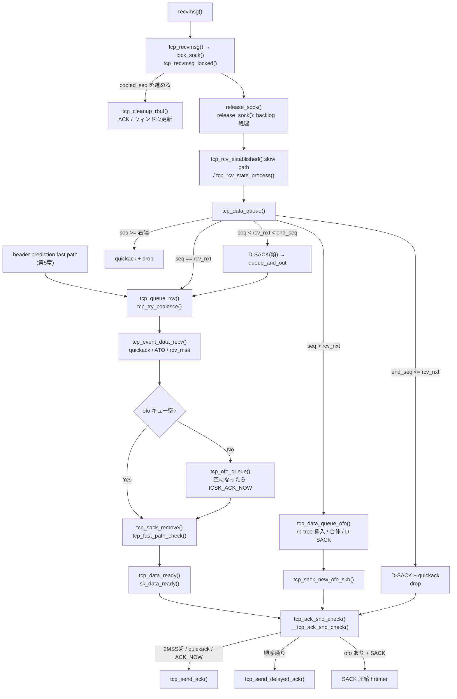

# 6. 受信 (2): データキューイングと tcp_recvmsg

第 5 章では、パケットが `tcp_v4_rcv()` / `tcp_v6_rcv()` からソケットを見つけ、`tcp_rcv_established()` の header prediction（fast path）か slow path を通るところまでを見ました。この章はその続きです。ペイロードを **受け取り箱 (`sk_receive_queue`)** か **順番待ちの棚 (`out_of_order_queue`)** に入れる `tcp_data_queue()`、受領印 (ACK) を「今すぐ／少し待って／まとめて」のどれで返すかを決める `__tcp_ack_snd_check()`、そしてアプリケーションが `recvmsg()` でデータを取り出し、その結果ウィンドウが開いて ACK が飛ぶ `tcp_recvmsg()` / `tcp_cleanup_rbuf()` までを、一行ずつ追います。

## たとえ話で言うと

部屋の郵便受け（ソケット）には、番号付きの小包（`sk_buff`）が届きます。小包には「全体の何バイト目から何バイト目まで」という通し番号が伝票（ヘッダ）に書いてあります。

- 次に欲しい番号ちょうどの小包が来たら、そのまま **受け取り箱** に入れます。直前の小包と中身をひとまとめにできるなら、箱を一つにまとめて場所を節約します。
- 番号が飛んでいる小包が来たら、**順番待ちの棚** に番号順に並べておきます。そして差出人に「ここまでは受け取った、それとは別にこの範囲も持っている」と書いた受領印（SACK）を返します。
- 抜けていた小包が届いたら、棚の小包を受け取り箱へ一気に移し、すぐに受領印を返します。
- もう持っている番号の小包がまた届いたら、「それ、二重に届いたよ」と書いた受領印（D-SACK）を返して小包は捨てます。
- 受領印は毎回すぐ書くと手間なので、「2 個に 1 回」「少し待ってまとめて」書くのが普通です。ただし差出人が困っていそうなとき（最初のうち、抜けがあるとき、二重に届いたとき）はすぐ書きます。
- 住人（アプリ）が受け取り箱から小包を取り出すと、家計簿と予算に余裕ができます。余裕が大きく増えたら「もっと送っていいよ」という受領印を出します。
- 住人が郵便受けを開けている間（ソケットロック中）に届いた小包は、玄関先の仮置き場（backlog）に置かれ、住人が郵便受けを閉じる (`release_sock()`) ときにまとめて処理されます。

## RFC では

### RFC 9293 — TCP 本体（RFC 793 を置き換え）

[RFC 9293](https://www.rfc-editor.org/rfc/rfc9293) は 2022 年に RFC 793 / 1122 の TCP 部分などを統合・置き換えた現行の TCP 仕様です。受信側について、この章に関係するのは次の 3 か所です。

**セグメント到着時の処理（[RFC 9293 §3.10.7.4](https://www.rfc-editor.org/rfc/rfc9293#section-3.10.7.4)）**

ESTABLISHED などの同期済み状態では、到着セグメントを「first, check sequence number」から「eighth, check the FIN bit」までの 8 段階で処理します。この章の主題は **seventh, process the segment text** です。

- 前提として、セグメントは `RCV.NXT` から始まりウィンドウ内に収まる「理想化されたセグメント」とみなします。ウィンドウ外の部分は切り落とし、`RCV.NXT` から始まる場合だけ処理を進めます。**開始番号がもっと先のセグメントは後で処理するために保持すべき (SHOULD, SHLD-31)** とされています。これが out-of-order キューの根拠です。
- ウィンドウがゼロのときは ACK 以外のセグメントを受け付けません（ただし RST と URG は処理する）。
- seventh step: ESTABLISHED / FIN-WAIT-1 / FIN-WAIT-2 では、データをユーザの受信バッファに渡し、引き受けたデータの分だけ `RCV.NXT` を進め、バッファの空き具合に応じて `RCV.WND` を調整します。`RCV.NXT + RCV.WND`（ウィンドウ右端）は縮めてはいけません。そして `<SEQ=SND.NXT><ACK=RCV.NXT><CTL=ACK>` の ACK を返します。この ACK は「過度な遅延を招かない限り」送信データに piggyback させるべきだとされています。
- 受け付けられない（重複・ウィンドウ外の）セグメントに対しては、RST でない限り ACK を返して破棄します（first step の規則）。

**遅延 ACK（[RFC 9293 §3.8.6.3](https://www.rfc-editor.org/rfc/rfc9293#section-3.8.6.3)、元は [RFC 1122 §4.2.3.2](https://www.rfc-editor.org/rfc/rfc1122#section-4.2.3.2)）**

- TCP は遅延 ACK を実装すべき (SHOULD, SHLD-18)。ただし遅延は **0.5 秒未満でなければならない** (MUST-40)。
- フルサイズのセグメントの流れでは、**少なくとも 2 セグメント（または 2*RMSS バイト）ごとに ACK を返すべき** (SHOULD, SHLD-19)。
- 輻輳制御側の [RFC 5681 §4.2](https://www.rfc-editor.org/rfc/rfc5681#section-4.2) はさらに、**out-of-order セグメントを受けたら即座に ACK すべき**、**シーケンス空間の穴を（一部でも）埋めるセグメントを受けたら即座に ACK すべき** (SHOULD) と定めています。これらは送信側の fast retransmit（重複 ACK 3 つ）と回復の速さに直結します。

**受信側 SWS 回避（[RFC 9293 §3.8.6.2.2](https://www.rfc-editor.org/rfc/rfc9293#section-3.8.6.2.2)）**

受信側は Silly Window Syndrome 回避アルゴリズムを実装しなければなりません (MUST-39)。推奨アルゴリズムは「ウィンドウ右端 `RCV.NXT + RCV.WND` を固定したまま、

```
RCV.BUFF - RCV.USER - RCV.WND >= min(Fr * RCV.BUFF, Eff.snd.MSS)    (Fr = 1/2 推奨)
```

を満たすまでウィンドウを広げない」というものです。つまり「空きが MSS かバッファの半分くらい溜まるまで、ちまちまウィンドウを広げる更新を出さない」。Linux では、ウィンドウ値の丸め自体は `__tcp_select_window()`（第 10 章）で、そして「読んだ結果、広告できるウィンドウが倍以上になったら ACK を出す」という **ウィンドウ更新の送信タイミング** はこの章の `__tcp_cleanup_rbuf()` で実装されています。

### RFC 2018 — SACK（受信側の規則）

[RFC 2018](https://www.rfc-editor.org/rfc/rfc2018) は、累積 ACK だけでは「穴の向こうに何が届いているか」が送信側に分からない問題を、TCP オプションで「受信済みの不連続ブロック」を伝えることで解決します。受信側の規則は [RFC 2018 §4](https://www.rfc-editor.org/rfc/rfc2018#section-4) にあります。

- SACK を使うなら、受信キューの最高シーケンスを ACK していない（= 穴がある）ACK には SACK オプションを付けるべき (SHOULD)。
- **最初の SACK ブロックは、この ACK を発生させたセグメントを含む連続ブロックでなければならない (MUST)**。ただしそのセグメントが累積 ACK を進めた場合は除く。
- 残りのブロックは、直近に報告したブロック（過去の SACK の先頭ブロック）を、すでに含めたブロックの部分集合でない限り繰り返して埋めるべき (SHOULD)。これにより ACK が失われても各ブロックが複数回報告されます。
- オプション長は 40 バイトまでなので最大 4 ブロック、Timestamps（10 バイト + パディング 2）を併用すると 3 ブロックです。
- 受信側は SACK 済みデータを後で捨ててよい（reneging）。送信側は SACK を「ヒント」として扱います。Linux は `tcp_prune_ofo_queue()`（第 10 章）でこれを行います。

### RFC 2883 — D-SACK

[RFC 2883](https://www.rfc-editor.org/rfc/rfc2883) は SACK を拡張し、**重複して受信したセグメント** を報告できるようにします。送信側はこれを見て「その再送は不要だった（spurious）」と判断し、輻輳ウィンドウの undo や再順序許容幅の調整（第 8 章）に使います。規則は [RFC 2883 §4](https://www.rfc-editor.org/rfc/rfc2883#section-4) です。

- 重複受信したブロックは SACK オプションの **最初のブロック** に入れる。これが D-SACK ブロックです。累積 ACK 以下（`< RCV.NXT`）の重複でも、累積 ACK より上の重複でもかまいません。
- D-SACK ブロックが累積 ACK より上の（より大きい）受信済みブロックの一部の重複を報告する場合、**2 番目のブロックはその大きい方のブロックにすべき**。
- 重複した各連続範囲は、**高々 1 つの D-SACK ブロックで報告する**（同じ重複を後続の ACK で繰り返さない）。
- 残りのブロックは通常の SACK 規則に従う。

## 全体の流れ



受信の書き込み側（softirq、またはロック解放時の backlog 処理）は `rcv_nxt` を進め、読み出し側（プロセス文脈）は `copied_seq` を進めます。`rcv_nxt - copied_seq` が「受け取り箱に溜まっている未読バイト数」です。ACK の判断は、書き込み側では `__tcp_ack_snd_check()`、読み出し側では `__tcp_cleanup_rbuf()` の 2 か所で行われ、両者は `icsk->icsk_ack.pending` のビットで連携しています。

なお、header prediction が当たった純粋な in-order バルク受信（第 5 章）は `tcp_data_queue()` を通らず、`tcp_rcv_established()`（[net/ipv4/tcp_input.c#L6520](https://git.kernel.org/pub/scm/linux/kernel/git/netdev/net-next.git/tree/net/ipv4/tcp_input.c?id=279d5c8afcd38bd841832a39bfe1aa4f8518d98e#n6520)）から直接 `tcp_queue_rcv()` → `tcp_event_data_recv()` → `__tcp_ack_snd_check(sk, 0)` を呼びます。この章で見る部品は、fast path でもそのまま使われます。

## コードを追う

### Step 1: 前提 — 誰が、どのロックで呼ぶのか

`tcp_data_queue()` の呼び出し元は 2 つです。

- `tcp_rcv_established()` の slow path: `tcp_validate_incoming()`、`tcp_ack()`、`tcp_urg()` の後、コメント `/* step 7: process the segment text */` の直後で呼ばれ、続いて `tcp_data_snd_check()` と `tcp_ack_snd_check()` が呼ばれます。RFC 9293 の 8 段階処理がそのままコードの並びになっています。
- `tcp_rcv_state_process()`: ESTABLISHED 以外の状態でデータを受ける場合（SYN-RECV から確立した直後のセグメントや FIN-WAIT-1/2）。FIN-WAIT 中に自分がすでに受信方向を shutdown していれば、新しいデータには RST を返します（`TCPAbortOnData`）。CLOSE-WAIT / CLOSING / LAST-ACK では相手の FIN より後ろのデータは無視されます。

どちらの場合も **ソケットはユーザに所有されていない** ことが保証されています。softirq で `tcp_v4_rcv()` が `bh_lock_sock_nested()` を取り、`sock_owned_by_user()` が偽ならその場で `tcp_v4_do_rcv()` を呼びます。真なら `tcp_add_backlog()` で backlog に積み、ユーザが `release_sock()` するときに `__release_sock()` がプロセス文脈で `sk_backlog_rcv()` → `tcp_v4_do_rcv()` を呼びます（Step 15）。つまり `tcp_data_queue()` は「softirq + spinlock」か「プロセス文脈 + owned=1（spinlock は外している）」のどちらかで動き、いずれも **ソケットに対して排他** です。`tcp_rcv_nxt_update()` の `sock_owned_by_me()` はこの前提を lockdep で確認しています。

一方、`rcv_nxt` や `copied_seq` は `tcp_poll()` や `tcp_inq_hint()`、`tcp_diag` などロックを取らない読み手からも読まれるため、書き込みは `WRITE_ONCE()` になっています。

### Step 2: `tcp_data_queue()` — 振り分けの本体

`tcp_data_queue()`（[net/ipv4/tcp_input.c#L5613](https://git.kernel.org/pub/scm/linux/kernel/git/netdev/net-next.git/tree/net/ipv4/tcp_input.c?id=279d5c8afcd38bd841832a39bfe1aa4f8518d98e#n5613)）は、ペイロードの位置を `rcv_nxt` と比べて 5 つに分類します。

| 条件 | 意味 | 処理 |
| --- | --- | --- |
| `seq == rcv_nxt` | 順序通り | 受信キューへ（ウィンドウ 0 なら drop、ただし裸の FIN は受理） |
| `end_seq <= rcv_nxt` | 完全な重複（再送） | D-SACK、quickack、drop |
| `seq >= rcv_nxt + rcv_window` | ウィンドウの右外 | quickack、drop |
| `seq < rcv_nxt < end_seq` | 頭が重複・尻が新規 | 頭を D-SACK、残りを受信キューへ |
| それ以外 (`seq > rcv_nxt`) | 穴の向こう | `tcp_data_queue_ofo()` |

```c
static void tcp_data_queue(struct sock *sk, struct sk_buff *skb)
{
	struct tcp_sock *tp = tcp_sk(sk);
	enum skb_drop_reason reason;
	bool fragstolen;
	int eaten;

	/* If a subflow has been reset, the packet should not continue
	 * to be processed, drop the packet.
	 */
	if (sk_is_mptcp(sk) && !mptcp_incoming_options(sk, skb)) {
		__kfree_skb(skb);
		return;
	}

	if (TCP_SKB_CB(skb)->seq == TCP_SKB_CB(skb)->end_seq) {
		__kfree_skb(skb);
		return;
	}
	tcp_cleanup_skb(skb);
	__skb_pull(skb, tcp_hdr(skb)->doff * 4);

	reason = SKB_DROP_REASON_NOT_SPECIFIED;
	tp->rx_opt.dsack = 0;

	/*  Queue data for delivery to the user.
	 *  Packets in sequence go to the receive queue.
	 *  Out of sequence packets to the out_of_order_queue.
	 */
```

- `sk_is_mptcp()`: MPTCP のサブフローなら、DSS オプションなどを `mptcp_incoming_options()` で処理し、サブフローがリセットされていれば捨てます。素の TCP では `sk_is_mptcp()` はビットを 1 つ見るだけです。
- `seq == end_seq`: `end_seq` は `seq + ペイロード長 + SYN + FIN` で計算されている（`tcp_v4_fill_cb()`）ので、ここで弾かれるのは **データも FIN も無い純 ACK** だけです。純 ACK はすでに `tcp_ack()` で処理済みなので、ここでは単に解放します。`__kfree_skb()` を使い、drop として数えない（drop reason を付けない）点に注意してください。正常系だからです。
- `tcp_cleanup_skb()`: `skb_dst_drop()` と `secpath_reset()` を行います。受信キューに長く滞在しうる skb が dst の参照や xfrm の secpath を握り続けないようにするためで、`tcp_add_receive_queue()` の `DEBUG_NET_WARN_ON_ONCE(skb_dst(skb))` がこれを検査しています。
- `__skb_pull(skb, doff * 4)`: TCP ヘッダを剥がします。以降 `skb->len` は **ペイロード長** です。オフセット計算 (`copied_seq - TCP_SKB_CB(skb)->seq`) が単純になるのはこのおかげです。
- `tp->rx_opt.dsack = 0`: **D-SACK は「このセグメントに対する ACK」にだけ載せる** ため、セグメントごとにリセットします。RFC 2883 の「各重複は高々 1 つの D-SACK ブロックで報告」に対応します。送信時にも `tcp_options_write()` が D-SACK を書いた後に `rx_opt.dsack = 0` に戻します。

```c
	if (TCP_SKB_CB(skb)->seq == tp->rcv_nxt) {
		if (tcp_receive_window(tp) == 0) {
			/* Some stacks are known to send bare FIN packets
			 * in a loop even if we send RWIN 0 in our ACK.
			 * Accepting this FIN does not hurt memory pressure
			 * because the FIN flag will simply be merged to the
			 * receive queue tail skb in most cases.
			 */
			if (!skb->len &&
			    (TCP_SKB_CB(skb)->tcp_flags & TCPHDR_FIN))
				goto queue_and_out;

			reason = SKB_DROP_REASON_TCP_ZEROWINDOW;
			NET_INC_STATS(sock_net(sk), LINUX_MIB_TCPZEROWINDOWDROP);
			goto out_of_window;
		}

		/* Ok. In sequence. In window. */
queue_and_out:
		if (tcp_try_rmem_schedule(sk, skb, skb->truesize)) {
			/* TODO: maybe ratelimit these WIN 0 ACK ? */
			inet_csk(sk)->icsk_ack.pending |=
					(ICSK_ACK_NOMEM | ICSK_ACK_NOW);
			inet_csk_schedule_ack(sk);
			READ_ONCE(sk->sk_data_ready)(sk);

			if (skb_queue_len(&sk->sk_receive_queue) && skb->len) {
				reason = SKB_DROP_REASON_PROTO_MEM;
				NET_INC_STATS(sock_net(sk), LINUX_MIB_TCPRCVQDROP);
				goto drop;
			}
			sk_forced_mem_schedule(sk, skb->truesize);
		}
```

- `seq == rcv_nxt` でも、`tcp_receive_window(tp) == 0`（[include/net/tcp.h#L956](https://git.kernel.org/pub/scm/linux/kernel/git/netdev/net-next.git/tree/include/net/tcp.h?id=279d5c8afcd38bd841832a39bfe1aa4f8518d98e#n956)）なら受け付けません。`tcp_receive_window()` は `rcv_wup + rcv_wnd - rcv_nxt`、つまり **最後に広告したウィンドウの残り** です（負なら 0）。RFC 9293 の「ウィンドウ 0 なら ACK 以外は受け付けない」です。drop すると `TCPZeroWindowDrop` が増え、`out_of_window` で quickack に入るので、相手にはすぐ「ウィンドウ 0」の ACK が返ります（相手の zero window probe への応答にもなります）。
- 例外は **ペイロード無しの FIN** です。macOS の一部が、RWIN 0 の ACK を受けても FIN を指数バックオフなしで再送し続け、FIN と dup ACK のループになる問題への対処です（設計の背景を参照）。FIN だけなら受信キュー末尾の skb に `tcp_flags` として合体されることが多く、メモリを増やしません。
- `queue_and_out:` 以下は「順序通りかつウィンドウ内」です。`tcp_try_rmem_schedule()` で `sk_rmem_alloc <= sk_rcvbuf`（`tcp_can_ingest()`）と、プロトコル全体・memcg の予算 (`sk_rmem_schedule()`) を確認し、足りなければ `tcp_prune_queue()` / `tcp_prune_ofo_queue()` でメモリを空けようとします（詳細は第 10 章）。
- それでも失敗した場合:
  - `ICSK_ACK_NOMEM | ICSK_ACK_NOW` を立てます。`ICSK_ACK_NOMEM` は `tcp_select_window()` が見て、**次の ACK でウィンドウを 0 にする**（`rcv_wnd = 0`, `rcv_wup = rcv_nxt`）フラグです。`ICSK_ACK_NOW` で `__tcp_ack_snd_check()` が即座に ACK を出します。
  - `sk_data_ready()` を直接呼ぶのは、読み手を起こして受信キューを掃除させ、メモリを空けてもらうためです。`tcp_data_ready()` 経由だと SO_RCVLOWAT を満たさない限り起こさないので、メモリ不足で SO_RCVLOWAT の読み手と送り手が互いに待ち合うハングになりえます（ba3bb0e76ccd）。
  - 受信キューが空でなく、かつこの skb にデータがあれば drop します（`TCPRcvQDrop`）。
  - 逆に **受信キューが空** なら、`sk_forced_mem_schedule()` で予算を強制的に確保して受け入れます。受信キューが空のときに drop すると、読み手が何も読めず、メモリが永遠に空かないデッドロックになりうるため、「ソケットあたり最低 1 skb は必ず受け入れる」という前進保証です。裸の FIN (`skb->len == 0`) も同様に必ず受け入れます。

```c
		eaten = tcp_queue_rcv(sk, skb, &fragstolen);
		if (skb->len)
			tcp_event_data_recv(sk, skb);
		if (TCP_SKB_CB(skb)->tcp_flags & TCPHDR_FIN)
			tcp_fin(sk);

		if (!RB_EMPTY_ROOT(&tp->out_of_order_queue)) {
			tcp_ofo_queue(sk);

			/* RFC5681. 4.2. SHOULD send immediate ACK, when
			 * gap in queue is filled.
			 */
			if (RB_EMPTY_ROOT(&tp->out_of_order_queue))
				inet_csk(sk)->icsk_ack.pending |= ICSK_ACK_NOW;
		}

		if (tp->rx_opt.num_sacks)
			tcp_sack_remove(tp);

		tcp_fast_path_check(sk);

		if (eaten > 0)
			kfree_skb_partial(skb, fragstolen);
		if (!sock_flag(sk, SOCK_DEAD))
			tcp_data_ready(sk);
		return;
	}
```

- `tcp_queue_rcv()`: 受信キューの末尾と合体を試み、`rcv_nxt` を進めます（Step 3）。戻り値 `eaten` は「skb の中身を末尾 skb に移したので、この skb 自体は解放してよい」を意味します。
- `if (skb->len) tcp_event_data_recv()`: 遅延 ACK エンジンの更新（Step 4）は **データがある場合だけ** です。裸の FIN では ATO 推定や rcv_mss 推定を乱さないようにしています。
- `tcp_fin()`: FIN の処理（状態遷移、`RCV_SHUTDOWN`、`SOCK_DONE`、ofo キューの purge など）。詳しくは第 2 章です。`tcp_fin()` は ofo キューを空にするので、この後の ofo 処理は実質スキップされます。
- ofo キューが空でなければ `tcp_ofo_queue()` で、今回進んだ `rcv_nxt` に繋がる skb を受信キューへ移します（Step 5）。その結果 **ofo キューが完全に空になったら `ICSK_ACK_NOW`** を立てます。RFC 5681 §4.2 の「穴を埋めたら即 ACK」です。穴が一部だけ埋まった場合（ofo キューにまだ残っている場合）は、ofo キューが空でないので `__tcp_ack_snd_check()` 側で SACK 付き ACK（または SACK 圧縮）の経路に入ります。
- `tcp_sack_remove()`: `rcv_nxt` が進んだので、`rcv_nxt` 以下に入った SACK ブロックを消します（Step 8）。
- `tcp_fast_path_check()`（[include/net/tcp.h#L2007](https://git.kernel.org/pub/scm/linux/kernel/git/netdev/net-next.git/tree/include/net/tcp.h?id=279d5c8afcd38bd841832a39bfe1aa4f8518d98e#n2007)）: ofo キューが空、`rcv_wnd != 0`、`sk_rmem_alloc < sk_rcvbuf`、緊急データ無し、の全条件が揃えば `pred_flags` を再設定して header prediction を再有効化します。`tcp_data_queue_ofo()` は `pred_flags = 0` で fast path を止めるので、穴が埋まった後にここで戻すわけです。
- `kfree_skb_partial(skb, fragstolen)`: 合体済み skb の解放は **最後** です。`tcp_event_data_recv()` が `skb->len` や `skb->truesize` を使うため、それより前に解放できません。`fragstolen` が真なら skb の head（page frag）ごと末尾 skb に移っているので、`struct sk_buff` だけを解放します。
- `SOCK_DEAD` でなければ `tcp_data_ready()` で読み手を起こします（Step 11）。orphan ソケットには起こす相手がいません。

```c
	if (!after(TCP_SKB_CB(skb)->end_seq, tp->rcv_nxt)) {
		tcp_rcv_spurious_retrans(sk, skb);
		/* A retransmit, 2nd most common case.  Force an immediate ack. */
		reason = SKB_DROP_REASON_TCP_OLD_DATA;
		NET_INC_STATS(sock_net(sk), LINUX_MIB_DELAYEDACKLOST);
		tcp_dsack_set(sk, TCP_SKB_CB(skb)->seq, TCP_SKB_CB(skb)->end_seq);

out_of_window:
		tcp_enter_quickack_mode(sk, TCP_MAX_QUICKACKS);
		inet_csk_schedule_ack(sk);
drop:
		tcp_drop_reason(sk, skb, reason);
		return;
	}
```

- **完全な重複**: `end_seq <= rcv_nxt` のとき、全バイトがすでに受信済みです。コメントの通り「2 番目によくあるケース」で、典型的には自分の ACK が失われたか遅れて相手が RTO / TLP で再送したケースです。なお `end_seq < rcv_wup`（最後に広告したウィンドウの左端より前）の古い重複は、ここまで来ずに `tcp_validate_incoming()` の `tcp_sequence()` で弾かれ、`tcp_send_dupack()`（Step 6）で処理されます。ここに来るのは `rcv_wup <= end_seq <= rcv_nxt` の重複です。
- `tcp_rcv_spurious_retrans()`（[net/ipv4/tcp_input.c#L5043](https://git.kernel.org/pub/scm/linux/kernel/git/netdev/net-next.git/tree/net/ipv4/tcp_input.c?id=279d5c8afcd38bd841832a39bfe1aa4f8518d98e#n5043)）: IPv6 で、再送セグメントのフローラベルが前回と違う（= 送信側が RTO で経路を変えた）なら、**自分の ACK 経路が壊れている** と推定して `__sk_rethink_txhash_reset_dst()` で自分の txhash（= 送信フローラベル）も変え、ACK の経路を変えようとします（`TCPDuplicateDataRehash`）。AccECN の失敗検出もここで行います。
- `LINUX_MIB_DELAYEDACKLOST`（nstat 名 `TcpExtDelayedACKLost`）: 名前の由来は「（遅延）ACK が失われたので相手が再送してきた」です。
- `tcp_dsack_set(seq, end_seq)`: 重複範囲をそのまま D-SACK にします（Step 6）。
- `out_of_window:` では `tcp_enter_quickack_mode(sk, TCP_MAX_QUICKACKS)` で最大 16 個の quick ACK を予約し、pingpong（対話モード）も解除し、`ato` を最小に戻します。相手は再送しているので、ACK を遅らせる理由がありません。RFC 9293 first step の「受け付けられないセグメントには ACK を返す」です。
- `tcp_drop_reason()`（[net/ipv4/tcp_input.c#L5303](https://git.kernel.org/pub/scm/linux/kernel/git/netdev/net-next.git/tree/net/ipv4/tcp_input.c?id=279d5c8afcd38bd841832a39bfe1aa4f8518d98e#n5303)）は `sk_drops_skbadd()` でソケットの drop カウンタ（`ss -m` の `d`）を増やし、`sk_skb_reason_drop()` で `kfree_skb` tracepoint に drop reason を出します。`noinline_for_tracing` なので kprobe/fentry でも捕まえられます。

```c
	/* Out of window. F.e. zero window probe. */
	if (!before(TCP_SKB_CB(skb)->seq,
		    tp->rcv_nxt + tcp_receive_window(tp))) {
		reason = SKB_DROP_REASON_TCP_OVERWINDOW;
		NET_INC_STATS(sock_net(sk), LINUX_MIB_BEYOND_WINDOW);
		goto out_of_window;
	}

	if (before(TCP_SKB_CB(skb)->seq, tp->rcv_nxt)) {
		/* Partial packet, seq < rcv_next < end_seq */
		tcp_dsack_set(sk, TCP_SKB_CB(skb)->seq, tp->rcv_nxt);

		/* If window is closed, drop tail of packet. But after
		 * remembering D-SACK for its head made in previous line.
		 */
		if (!tcp_receive_window(tp)) {
			reason = SKB_DROP_REASON_TCP_ZEROWINDOW;
			NET_INC_STATS(sock_net(sk), LINUX_MIB_TCPZEROWINDOWDROP);
			goto out_of_window;
		}
		goto queue_and_out;
	}

	tcp_data_queue_ofo(sk, skb);
}
```

- **ウィンドウの右外**: `seq >= rcv_nxt + tcp_receive_window()` は、広告ウィンドウを超えた位置から始まるセグメントです。`tcp_sequence()`（第 5 章）はすでに大まかなウィンドウ検査を通していますが、ここでは「`rcv_nxt` より先で、しかも残りウィンドウの外」を厳密に弾きます。`TcpExtBeyondWindow` を数えて quickack で ACK を返します。
- **部分的な重複**: `seq < rcv_nxt < end_seq` です。頭の `[seq, rcv_nxt)` を D-SACK にし、ウィンドウが 0 でなければ `queue_and_out` で受信キューに入れます。skb は **頭を切り落とさずに** そのまま入れます。`seq != tail->end_seq` なので `tcp_try_coalesce()` は失敗し、独立した skb として入ります。`tcp_rcv_nxt_update(end_seq)` は差分で `bytes_received` を数えるので重複分は数えず、`tcp_recvmsg_locked()` は `offset = copied_seq - seq` で重複部分を読み飛ばします。トリミングのコピーを避ける設計です。
- 残りはすべて `seq > rcv_nxt` の **穴の向こう** なので `tcp_data_queue_ofo()` へ（Step 7）。

### Step 3: `tcp_queue_rcv()` と `tcp_try_coalesce()` — 受信キューへの追加と合体

`tcp_queue_rcv()`（[net/ipv4/tcp_input.c#L5538](https://git.kernel.org/pub/scm/linux/kernel/git/netdev/net-next.git/tree/net/ipv4/tcp_input.c?id=279d5c8afcd38bd841832a39bfe1aa4f8518d98e#n5538)）:

```c
static int __must_check tcp_queue_rcv(struct sock *sk, struct sk_buff *skb,
				      bool *fragstolen)
{
	int eaten;
	struct sk_buff *tail = skb_peek_tail(&sk->sk_receive_queue);

	eaten = (tail &&
		 tcp_try_coalesce(sk, tail,
				  skb, fragstolen)) ? 1 : 0;
	tcp_rcv_nxt_update(tcp_sk(sk), TCP_SKB_CB(skb)->end_seq);
	if (!eaten) {
		tcp_add_receive_queue(sk, skb);
		skb_set_owner_r(skb, sk);
	}
	return eaten;
}
```

- 末尾 skb と合体できれば `eaten = 1`、できなければ `tcp_add_receive_queue()`（`__skb_queue_tail()` のラッパー）で末尾に繋ぎ、`skb_set_owner_r()` で `skb->destructor = sock_rfree` と `sk_rmem_alloc += truesize`、`sk_forward_alloc -= truesize` を行います。
- `tcp_rcv_nxt_update()` は合体の成否に関係なく呼ばれます。**`rcv_nxt` が進んだ瞬間に、そのバイトは「引き受けた」ことになる** ためです。`__must_check` は、呼び出し側が `eaten` を見落として skb をリークしないためのものです。
- `__skb_queue_tail()`（ロック無し版）を使えるのは、`sk_receive_queue` への追加・削除がすべてソケットロック下（owned か bh_lock）で行われるからです。`sk_receive_queue.lock` は TCP では基本的に使いません。

`tcp_rcv_nxt_update()`（[net/ipv4/tcp_input.c#L3936](https://git.kernel.org/pub/scm/linux/kernel/git/netdev/net-next.git/tree/net/ipv4/tcp_input.c?id=279d5c8afcd38bd841832a39bfe1aa4f8518d98e#n3936)）:

```c
/* If we update tp->rcv_nxt, also update tp->bytes_received */
static void tcp_rcv_nxt_update(struct tcp_sock *tp, u32 seq)
{
	u32 delta = seq - tp->rcv_nxt;

	sock_owned_by_me((struct sock *)tp);
	tp->bytes_received += delta;
	tcp_rcv_sne_update(tp, seq);
	WRITE_ONCE(tp->rcv_nxt, seq);
}
```

- `bytes_received`（RFC 4898 の `tcpEStatsAppHCThruOctetsReceived`、`tcpi_bytes_received`）は `rcv_nxt` の差分で数えます。重複バイトを数えないのはこのためです。
- `tcp_rcv_sne_update()` は TCP-AO の Sequence Number Extension（32 ビットのシーケンスの折り返し回数）の更新です。
- `WRITE_ONCE(tp->rcv_nxt, seq)`: `tcp_poll()` / `tcp_epollin_ready()` / `tcp_inq_hint()` などのロックレスな読み手と対になります。

`tcp_try_coalesce()`（[net/ipv4/tcp_input.c#L5250](https://git.kernel.org/pub/scm/linux/kernel/git/netdev/net-next.git/tree/net/ipv4/tcp_input.c?id=279d5c8afcd38bd841832a39bfe1aa4f8518d98e#n5250)）:

```c
static bool tcp_try_coalesce(struct sock *sk,
			     struct sk_buff *to,
			     struct sk_buff *from,
			     bool *fragstolen)
{
	int delta;

	*fragstolen = false;

	/* Its possible this segment overlaps with prior segment in queue */
	if (TCP_SKB_CB(from)->seq != TCP_SKB_CB(to)->end_seq)
		return false;

	if (!tcp_skb_can_collapse_rx(to, from))
		return false;

	if (!skb_try_coalesce(to, from, fragstolen, &delta))
		return false;

	atomic_add(delta, &sk->sk_rmem_alloc);
	sk_mem_charge(sk, delta);
	NET_INC_STATS(sock_net(sk), LINUX_MIB_TCPRCVCOALESCE);
	TCP_SKB_CB(to)->end_seq = TCP_SKB_CB(from)->end_seq;
	TCP_SKB_CB(to)->ack_seq = TCP_SKB_CB(from)->ack_seq;
	TCP_SKB_CB(to)->tcp_flags |= TCP_SKB_CB(from)->tcp_flags;

	if (TCP_SKB_CB(from)->has_rxtstamp) {
		TCP_SKB_CB(to)->has_rxtstamp = true;
		to->tstamp = from->tstamp;
		skb_hwtstamps(to)->hwtstamp = skb_hwtstamps(from)->hwtstamp;
	}

	return true;
}
```

- `seq != to->end_seq` なら合体しません。部分重複 skb（Step 2）や ofo キューの非隣接 skb はここで弾かれます。
- `tcp_skb_can_collapse_rx()`: MPTCP のマッピングが連続しているか、kTLS / PSP などで復号状態 (`skb_cmp_decrypted()`) が同じかを確認します。復号済みと未復号のバイトを 1 つの skb に混ぜると、上位層が区別できなくなるからです。
- `skb_try_coalesce()`（`net/core/skbuff.c`）が実際の合体を行います。`to` の tailroom に収まる小さいデータはコピーで済ませ（`delta = 0`）、そうでなければ `from` の page frag を `to` の `frags[]` に付け替えます。`from` に線形部分があり、その head が page frag でロックされていなければ head ごと frag として「盗み」ます（`*fragstolen = true`）。`delta` は `from` から `to` へ移る truesize です。合体できない条件は、`to` が cloned、page_pool 由来かどうかが異なる、`skb_frags_readable()`（devmem / unreadable netmem）が異なる、frag_list がある、zerocopy (`skb_zcopy()`)、`MAX_SKB_FRAGS` を超える、などです。
- 合体に成功すると truesize の `delta` 分が `to` に移るので、`to` の持ち主であるソケットに `sk_rmem_alloc += delta` と `sk_mem_charge()` を行います。`skb_try_coalesce()` は `from->truesize` を同じだけ減らすので、`from` がすでに `skb_set_owner_r()` 済み（`tcp_ofo_queue()` から呼ばれる場合）でも、後の `kfree_skb_partial()` → `sock_rfree()` で残りの truesize だけが差し引かれ、会計は一致します。
- `end_seq`、`ack_seq`、`tcp_flags`（FIN、PSH など）を引き継ぎます。FIN を OR で引き継げるので、裸の FIN は末尾 skb に吸収され、`tcp_recvmsg_locked()` は末尾 skb の `TCPHDR_FIN` を見て EOF を検出できます。
- 受信タイムスタンプ（`SO_TIMESTAMPING` の rx）は後の skb のもので上書きします。`recvmsg()` が返すタイムスタンプは「最後に読んだバイトを含む skb」のものになります。

この合体の目的は、`truesize/len` 比を改善してメモリ会計上の無駄を減らし、後で高価な `tcp_collapse()`（第 10 章）が走る頻度を減らすことです。GRO が効かない経路（per-packet ロードバランス、仮想 NIC の小さいバッファなど）で特に効きます。

### Step 4: `tcp_event_data_recv()` — 遅延 ACK エンジンの心臓部

`tcp_event_data_recv()`（[net/ipv4/tcp_input.c#L1015](https://git.kernel.org/pub/scm/linux/kernel/git/netdev/net-next.git/tree/net/ipv4/tcp_input.c?id=279d5c8afcd38bd841832a39bfe1aa4f8518d98e#n1015)）は、順序通りのデータを受け取るたびに呼ばれ、「次の ACK をどれくらい遅らせてよいか」を学習します。登場する状態はすべて `inet_connection_sock` の `icsk_ack`（[include/net/inet_connection_sock.h#L113](https://git.kernel.org/pub/scm/linux/kernel/git/netdev/net-next.git/tree/include/net/inet_connection_sock.h?id=279d5c8afcd38bd841832a39bfe1aa4f8518d98e#n113)）にあります。

| フィールド | 意味 |
| --- | --- |
| `pending` | `ICSK_ACK_SCHED`（ACK すべきデータがある）、`ICSK_ACK_TIMER`（遅延 ACK タイマー稼働中）、`ICSK_ACK_PUSHED` / `PUSHED2`（小さい/PSH 付きセグメントを見た）、`ICSK_ACK_NOW`（次は必ず即 ACK）、`ICSK_ACK_NOMEM`（次の ACK はウィンドウ 0） |
| `quick` | 残りの quick ACK（即時 ACK）数 |
| `pingpong` | 対話的（自分もデータを返す）と判定された度合い |
| `ato` | ACK timeout。遅延 ACK タイマーの長さ（jiffies） |
| `lrcvtime` | 最後にデータを受けた時刻（jiffies） |
| `last_seg_size` / `rcv_mss` | 相手の MSS の推定（遅延 ACK 判定用） |

```c
static void tcp_event_data_recv(struct sock *sk, struct sk_buff *skb)
{
	struct tcp_sock *tp = tcp_sk(sk);
	struct inet_connection_sock *icsk = inet_csk(sk);
	u32 now;

	inet_csk_schedule_ack(sk);

	tcp_measure_rcv_mss(sk, skb);

	tcp_rcv_rtt_measure(tp);

	now = tcp_jiffies32;

	if (!icsk->icsk_ack.ato) {
		/* The _first_ data packet received, initialize
		 * delayed ACK engine.
		 */
		tcp_incr_quickack(sk, TCP_MAX_QUICKACKS);
		icsk->icsk_ack.ato = TCP_ATO_MIN;
	} else {
```

- `inet_csk_schedule_ack()`: `pending |= ICSK_ACK_SCHED`。「ACK すべき新データがある」印です。ACK を運ぶセグメント（データ付きでも純 ACK でも）を送ると、`tcp_event_ack_sent()` → `inet_csk_clear_xmit_timer(sk, ICSK_TIME_DACK)` が `pending` 全体を 0 に戻すので、送信データに piggyback できればこの ACK は単独では送られません。
- `tcp_measure_rcv_mss()`: 相手の実効 MSS を推定し、PSH を見ます（後述）。
- `tcp_rcv_rtt_measure()`: Timestamps が無い場合の受信側 RTT 推定です。「1 ウィンドウ分（`rcv_nxt + rcv_wnd`）を受け取るのにかかった時間」を RTT とみなします。受信バッファ自動調整（DRS）と SACK 圧縮の遅延計算に使われます（第 10 章）。
- `now = tcp_jiffies32`: ATO 推定は jiffies 単位の粗い時計で十分です。
- `ato == 0` は「このコネクションで最初のデータ」です。`tcp_incr_quickack()` で quick ACK を予約し、`ato = TCP_ATO_MIN`（`HZ/25` = 40ms）にします。DaveM のコメントの通り、送信側はスロースタート中で ACK が来るまで cwnd を増やせないので、最初はすぐ ACK します。

```c
		int m = now - icsk->icsk_ack.lrcvtime;

		if (m <= TCP_ATO_MIN / 2) {
			/* The fastest case is the first. */
			icsk->icsk_ack.ato = (icsk->icsk_ack.ato >> 1) + TCP_ATO_MIN / 2;
		} else if (m < icsk->icsk_ack.ato) {
			icsk->icsk_ack.ato = min3((icsk->icsk_ack.ato >> 1) + (u32)m,
						  icsk->icsk_rto,
						  (u32)TCP_DELACK_MAX);
		} else if (m > icsk->icsk_rto) {
			/* Too long gap. Apparently sender failed to
			 * restart window, so that we send ACKs quickly.
			 */
			tcp_incr_quickack(sk, TCP_MAX_QUICKACKS);
		}
	}
	icsk->icsk_ack.lrcvtime = now;
	tcp_save_lrcv_flowlabel(sk, skb);

	tcp_data_ecn_check(sk, skb);

	if (skb->len >= 128)
		tcp_grow_window(sk, skb, true);
}
```

`m` は前回のデータ受信からの間隔です。ATO は「パケット間隔」の指数平滑推定です。

- `m <= TCP_ATO_MIN/2`（20ms 以下）: `ato = ato/2 + ATO_MIN/2`。これを繰り返すと `ato` は `TCP_ATO_MIN` に収束します。バルク転送ではパケットが密に来るので、`ato` は最小に張り付きます。
- `m < ato`: `ato = min(ato/2 + m, rto, TCP_DELACK_MAX)`。間隔に追従しつつ、RTO と 200ms (`TCP_DELACK_MAX` = `HZ/5`) を超えないようにします。RFC の「0.5 秒未満」より厳しい上限です。
- `m > rto`: 送信側が RTO 以上沈黙していた、つまり送信側はアイドル後の cwnd リスタート（RFC 5681 §4.1 / RFC 7661）でウィンドウが縮んでいる可能性が高いので、quick ACK に戻します。
- `ato <= m <= rto`: 何もしない。
- `tcp_save_lrcv_flowlabel()`: IPv6 のフローラベルを記録します（Step 2 の `tcp_rcv_spurious_retrans()` が比較に使う）。
- `tcp_data_ecn_check()`: IP ヘッダの ECN を見て、CE なら `tcp_enter_quickack_mode(sk, 2)` などを行います。輻輳通知を遅らせないためです（第 14 章）。
- `skb->len >= 128` なら `tcp_grow_window()` で `rcv_ssthresh` を広げます（第 10 章）。極小セグメントでは truesize 比が悪いので広げません。

quick ACK の補助関数（[net/ipv4/tcp_input.c#L311](https://git.kernel.org/pub/scm/linux/kernel/git/netdev/net-next.git/tree/net/ipv4/tcp_input.c?id=279d5c8afcd38bd841832a39bfe1aa4f8518d98e#n311)）:

```c
static void tcp_incr_quickack(struct sock *sk, unsigned int max_quickacks)
{
	struct inet_connection_sock *icsk = inet_csk(sk);
	unsigned int quickacks = tcp_sk(sk)->rcv_wnd / (2 * icsk->icsk_ack.rcv_mss);

	if (quickacks == 0)
		quickacks = 2;
	quickacks = min(quickacks, max_quickacks);
	if (quickacks > icsk->icsk_ack.quick)
		icsk->icsk_ack.quick = quickacks;
}

static void tcp_enter_quickack_mode(struct sock *sk, unsigned int max_quickacks)
{
	struct inet_connection_sock *icsk = inet_csk(sk);

	tcp_incr_quickack(sk, max_quickacks);
	inet_csk_exit_pingpong_mode(sk);
	icsk->icsk_ack.ato = TCP_ATO_MIN;
}

/* Send ACKs quickly, if "quick" count is not exhausted
 * and the session is not interactive.
 */

static bool tcp_in_quickack_mode(struct sock *sk)
{
	const struct inet_connection_sock *icsk = inet_csk(sk);

	return icsk->icsk_ack.dst_quick_ack ||
		(icsk->icsk_ack.quick && !inet_csk_in_pingpong_mode(sk));
}
```

- `tcp_incr_quickack()`: 予約数は `rcv_wnd / (2 * rcv_mss)`、つまり **「受信ウィンドウ分のセグメントを 2 個に 1 回 ACK するときの ACK 数」** です。送信側がスロースタートでウィンドウを使い切るまでの間、ACK を即時にするという意味になります。0 なら 2、上限は `max_quickacks`（通常 `TCP_MAX_QUICKACKS` = 16、ECN では 2）。既存の `quick` より大きいときだけ増やします。
- `tcp_enter_quickack_mode()`: 加えて pingpong を解除し、`ato` を最小にします。再送や異常を検知したときに使う「全力で ACK するモード」です。
- `tcp_in_quickack_mode()`: ルートの `RTAX_QUICKACK`（`ip route ... quickack 1`）がキャッシュされた `dst_quick_ack` が立っていれば常に真。そうでなければ「`quick` が残っていて、かつ pingpong でない」ときに真です。**対話的なセッションでは quick ACK しない** のは、応答データに ACK を piggyback できる見込みが高いからです。`quick` は新データを ACK するたびに `tcp_event_ack_sent()` → `tcp_dec_quickack_mode()` で 1 ずつ減り、0 になると `ato` も `TCP_ATO_MIN` に戻されます。

`tcp_measure_rcv_mss()`（[net/ipv4/tcp_input.c#L227](https://git.kernel.org/pub/scm/linux/kernel/git/netdev/net-next.git/tree/net/ipv4/tcp_input.c?id=279d5c8afcd38bd841832a39bfe1aa4f8518d98e#n227)）は、「フルサイズのセグメント 2 個」の判定基準になる `icsk_ack.rcv_mss` を推定します。

```c
static void tcp_measure_rcv_mss(struct sock *sk, const struct sk_buff *skb)
{
	struct inet_connection_sock *icsk = inet_csk(sk);
	const unsigned int lss = icsk->icsk_ack.last_seg_size;
	unsigned int len;

	icsk->icsk_ack.last_seg_size = 0;

	/* skb->len may jitter because of SACKs, even if peer
	 * sends good full-sized frames.
	 */
	len = skb_shinfo(skb)->gso_size ? : skb->len;
	if (len >= icsk->icsk_ack.rcv_mss) {
		/* Note: divides are still a bit expensive.
		 * For the moment, only adjust scaling_ratio
		 * when we update icsk_ack.rcv_mss.
		 */
		if (unlikely(len != icsk->icsk_ack.rcv_mss)) {
			u64 val = (u64)skb->len << TCP_RMEM_TO_WIN_SCALE;
			u8 old_ratio = tcp_sk(sk)->scaling_ratio;

			do_div(val, skb->truesize);
			tcp_sk(sk)->scaling_ratio = val ? val : 1;

			if (old_ratio != tcp_sk(sk)->scaling_ratio) {
				struct tcp_sock *tp = tcp_sk(sk);

				val = tcp_win_from_space(sk, sk->sk_rcvbuf);
				WRITE_ONCE(tp->window_clamp, val);

				if (tp->window_clamp < tp->rcvq_space.space)
					tp->rcvq_space.space = tp->window_clamp;
			}
		}
		icsk->icsk_ack.rcv_mss = min_t(unsigned int, len,
					       tcp_sk(sk)->advmss);
		/* Account for possibly-removed options */
		DO_ONCE_LITE_IF(len > icsk->icsk_ack.rcv_mss + MAX_TCP_OPTION_SPACE,
				tcp_gro_dev_warn, sk, skb, len);
		/* If the skb has a len of exactly 1*MSS and has the PSH bit
		 * set then it is likely the end of an application write. So
		 * more data may not be arriving soon, and yet the data sender
```

- `len = gso_size ?: skb->len`: GRO で集約された skb では `gso_size` が元のセグメント長です。`skb->len` を使うと MSS を数十倍に誤推定します。
- `len >= rcv_mss`: 推定以上のサイズが来たら、`rcv_mss = min(len, advmss)` に更新します。`advmss`（自分が広告した MSS）を超えることは本来ありません。
- サイズが変わったときだけ `scaling_ratio = len * 256 / truesize`（`TCP_RMEM_TO_WIN_SCALE` = 8 の固定小数点）を再計算し、`window_clamp` も再計算します。除算が高いので毎パケットはやりません。`scaling_ratio` は「バッファ 1 バイトあたり何バイトのペイロードが入るか」で、`sk_rcvbuf` とウィンドウの換算に使われます（第 10 章）。
- `DO_ONCE_LITE_IF(...)`: `rcv_mss + 40` を超える長さは、ドライバの GRO が `gso_size` を設定していないバグなので一度だけ警告します。
- PSH 付きで `len >= rcv_mss` なら `ICSK_ACK_PUSHED` を立てます。「ちょうど 1 MSS + PSH」はアプリの書き込みの終わりである可能性が高く、送信側は cwnd 制限や TX zerocopy の完了待ちで ACK を待っているかもしれません。このビットがあると、アプリが全部読んだ時点で `tcp_cleanup_rbuf()` が即 ACK します（Neal Cardwell の 4720852ed9af）。

```c
		 * may be waiting for an ACK if cwnd-bound or using TX zero
		 * copy. So we set ICSK_ACK_PUSHED here so that
		 * tcp_cleanup_rbuf() will send an ACK immediately if the app
		 * reads all of the data and is not ping-pong. If len > MSS
		 * then this logic does not matter (and does not hurt) because
		 * tcp_cleanup_rbuf() will always ACK immediately if the app
		 * reads data and there is more than an MSS of unACKed data.
		 */
		if (TCP_SKB_CB(skb)->tcp_flags & TCPHDR_PSH)
			icsk->icsk_ack.pending |= ICSK_ACK_PUSHED;
	} else {
		/* Otherwise, we make more careful check taking into account,
		 * that SACKs block is variable.
		 *
		 * "len" is invariant segment length, including TCP header.
		 */
		len += skb->data - skb_transport_header(skb);
		if (len >= TCP_MSS_DEFAULT + sizeof(struct tcphdr) ||
		    /* If PSH is not set, packet should be
		     * full sized, provided peer TCP is not badly broken.
		     * This observation (if it is correct 8)) allows
		     * to handle super-low mtu links fairly.
		     */
		    (len >= TCP_MIN_MSS + sizeof(struct tcphdr) &&
		     !(tcp_flag_word(tcp_hdr(skb)) & TCP_REMNANT))) {
			/* Subtract also invariant (if peer is RFC compliant),
			 * tcp header plus fixed timestamp option length.
			 * Resulting "len" is MSS free of SACK jitter.
			 */
			len -= tcp_sk(sk)->tcp_header_len;
			icsk->icsk_ack.last_seg_size = len;
			if (len == lss) {
				icsk->icsk_ack.rcv_mss = len;
				return;
			}
		}
		if (icsk->icsk_ack.pending & ICSK_ACK_PUSHED)
			icsk->icsk_ack.pending |= ICSK_ACK_PUSHED2;
		icsk->icsk_ack.pending |= ICSK_ACK_PUSHED;
	}
}
```

- `rcv_mss` 未満の小さいセグメントの場合、SACK ブロック数で TCP ヘッダ長が揺れることを考慮し、**TCP ヘッダ込みの長さ** で判定します。
- 長さが `536 + 20` 以上、または `88 + 20` 以上でフラグ (`TCP_REMNANT` = FIN|URG|SYN|PSH) が無ければ「フルサイズのはず」とみなし、`tcp_header_len`（基本ヘッダ + Timestamps）を引いた値を `last_seg_size` に記録します。**同じ長さが 2 回続いたら** それを新しい `rcv_mss` にします。経路 MTU が小さいリンクでも `rcv_mss` を下げられるようにするためです（MSS を下げないと「2 MSS 受信」の条件をいつまでも満たせず、ACK が遅延タイマー任せになる）。
- 小さいセグメントでは `ICSK_ACK_PUSHED` を立て、すでに立っていれば `ICSK_ACK_PUSHED2` も立てます。「小さいセグメントを 2 つ見た」= 対話的な小さい書き込みが続いている印で、`tcp_cleanup_rbuf()` は PUSHED2 なら pingpong でも即 ACK します。

### Step 5: `tcp_ofo_queue()` — 穴が埋まったら棚から移す

`tcp_ofo_queue()`（[net/ipv4/tcp_input.c#L5312](https://git.kernel.org/pub/scm/linux/kernel/git/netdev/net-next.git/tree/net/ipv4/tcp_input.c?id=279d5c8afcd38bd841832a39bfe1aa4f8518d98e#n5312)）:

```c
static void tcp_ofo_queue(struct sock *sk)
{
	struct tcp_sock *tp = tcp_sk(sk);
	__u32 dsack_high = tp->rcv_nxt;
	bool fin, fragstolen, eaten;
	struct sk_buff *skb, *tail;
	struct rb_node *p;

	p = rb_first(&tp->out_of_order_queue);
	while (p) {
		skb = rb_to_skb(p);
		if (after(TCP_SKB_CB(skb)->seq, tp->rcv_nxt))
			break;

		if (before(TCP_SKB_CB(skb)->seq, dsack_high)) {
			__u32 dsack = dsack_high;

			if (before(TCP_SKB_CB(skb)->end_seq, dsack_high))
				dsack = TCP_SKB_CB(skb)->end_seq;
			tcp_dsack_extend(sk, TCP_SKB_CB(skb)->seq, dsack);
		}
		p = rb_next(p);
		rb_erase(&skb->rbnode, &tp->out_of_order_queue);

		if (unlikely(!after(TCP_SKB_CB(skb)->end_seq, tp->rcv_nxt))) {
			tcp_drop_reason(sk, skb, SKB_DROP_REASON_TCP_OFO_DROP);
			continue;
		}

		tail = skb_peek_tail(&sk->sk_receive_queue);
		eaten = tail && tcp_try_coalesce(sk, tail, skb, &fragstolen);
		tcp_rcv_nxt_update(tp, TCP_SKB_CB(skb)->end_seq);
		fin = TCP_SKB_CB(skb)->tcp_flags & TCPHDR_FIN;
		if (!eaten)
			tcp_add_receive_queue(sk, skb);
		else
			kfree_skb_partial(skb, fragstolen);

		if (unlikely(fin)) {
			tcp_fin(sk);
			/* tcp_fin() purges tp->out_of_order_queue,
			 * so we must end this loop right now.
			 */
			break;
		}
	}
}
```

- `dsack_high = tp->rcv_nxt`: 呼ばれた時点の `rcv_nxt`、つまり **今受け取った in-order セグメントの終端** です。
- rb-tree の最左（最小 seq）から順に見ます。`seq > rcv_nxt` ならまだ穴があるので終了。
- `seq < dsack_high`: この ofo skb の先頭部分は、今受け取った in-order セグメントと重なっています。重なり `[seq, min(end_seq, dsack_high))` を `tcp_dsack_extend()` で D-SACK に追加します。重なり判定に `rcv_nxt` ではなく固定の `dsack_high` を使うのは、ofo skb 同士の重なりは挿入時（Step 7）にすでに D-SACK 済みで、二重に報告しないためです。
- `rb_next()` を先に取ってから `rb_erase()` します（erase 後は `p` の後続を辿れないため）。
- `end_seq <= rcv_nxt` なら全体が重複なので `TCP_OFO_DROP` で捨てます。挿入時に完全包含は除去されているので、これは in-order セグメントがこの ofo skb を丸ごと覆った場合です。
- 受信キュー末尾との合体を試み、`rcv_nxt` を `end_seq` まで進めます。前の ofo skb と部分的に重なっている skb は合体できず、重なったまま受信キューに入りますが、Step 2 で見た通り `tcp_recvmsg_locked()` はオフセットで読み飛ばします。
- ofo の skb は挿入時に `skb_set_owner_r()` 済みなので、ここでは `tcp_add_receive_queue()` だけです（`tcp_queue_rcv()` と違う点）。
- FIN 付きなら `tcp_fin()` を呼び、`tcp_fin()` が ofo キューを purge するのでループを抜けます。`p` が解放済みノードを指すのを避けるためです。

### Step 6: D-SACK の組み立て — `tcp_dsack_set()` と `tcp_dsack_extend()`

```c
static inline bool tcp_sack_extend(struct tcp_sack_block *sp, u32 seq,
				  u32 end_seq)
{
	if (!after(seq, sp->end_seq) && !after(sp->start_seq, end_seq)) {
		if (before(seq, sp->start_seq))
			sp->start_seq = seq;
		if (after(end_seq, sp->end_seq))
			sp->end_seq = end_seq;
		return true;
	}
	return false;
}

static void tcp_dsack_set(struct sock *sk, u32 seq, u32 end_seq)
{
	struct tcp_sock *tp = tcp_sk(sk);

	if (tcp_is_sack(tp) && READ_ONCE(sock_net(sk)->ipv4.sysctl_tcp_dsack)) {
		int mib_idx;

		if (before(seq, tp->rcv_nxt))
			mib_idx = LINUX_MIB_TCPDSACKOLDSENT;
		else
			mib_idx = LINUX_MIB_TCPDSACKOFOSENT;

		NET_INC_STATS(sock_net(sk), mib_idx);

		tp->rx_opt.dsack = 1;
		tp->duplicate_sack[0].start_seq = seq;
		tp->duplicate_sack[0].end_seq = end_seq;
	}
}

static void tcp_dsack_extend(struct sock *sk, u32 seq, u32 end_seq)
{
	struct tcp_sock *tp = tcp_sk(sk);

	if (!tp->rx_opt.dsack)
		tcp_dsack_set(sk, seq, end_seq);
	else
		tcp_sack_extend(tp->duplicate_sack, seq, end_seq);
}
```

- `tcp_sack_extend()`: 2 つの範囲が **重なるか接している** 場合だけ和集合にして真を返します。比較は `before()` / `after()` によるシーケンス空間の 32 ビット剰余比較です。
- `tcp_dsack_set()`: SACK が合意されていて `net.ipv4.tcp_dsack` が有効なときだけ、D-SACK ブロックを **1 つ** 記録します。`seq < rcv_nxt` なら `TCPDSACKOldSent`（累積 ACK 以下の重複）、そうでなければ `TCPDSACKOfoSent`（ofo キュー内の重複）を数えます。
- `tcp_dsack_extend()`: まだ D-SACK が無ければ設定し、あれば既存のブロックに隣接・重複する場合だけ広げます。**離れた 2 つ目の重複範囲は黙って捨てられます**。D-SACK ブロックは 1 つしか送れない（RFC 2883 では D-SACK は先頭の 1 ブロックだけ）ので、それで十分です。
- 送信時、`tcp_options_write()` は `rx_opt.dsack` が立っていれば `duplicate_sack` を先頭に置き、`selective_acks[]` が後に続くように **連続した配列として** 書き出します（`duplicate_sack[1]` の直後に `selective_acks[4]` が並ぶ struct レイアウトを利用）。書いた後 `rx_opt.dsack = 0` にするので、RFC 2883 の「各重複は 1 回だけ報告」になります。

参考までに、`tcp_validate_incoming()`（第 5 章）がシーケンス検査に落ちたセグメントに使う `tcp_send_dupack()`（[net/ipv4/tcp_input.c#L5078](https://git.kernel.org/pub/scm/linux/kernel/git/netdev/net-next.git/tree/net/ipv4/tcp_input.c?id=279d5c8afcd38bd841832a39bfe1aa4f8518d98e#n5078)）も同じ部品を使っています。

```c
static void tcp_send_dupack(struct sock *sk, const struct sk_buff *skb)
{
	struct tcp_sock *tp = tcp_sk(sk);

	if (TCP_SKB_CB(skb)->end_seq != TCP_SKB_CB(skb)->seq &&
	    before(TCP_SKB_CB(skb)->seq, tp->rcv_nxt)) {
		NET_INC_STATS(sock_net(sk), LINUX_MIB_DELAYEDACKLOST);
		tcp_enter_quickack_mode(sk, TCP_MAX_QUICKACKS);

		if (tcp_is_sack(tp) && READ_ONCE(sock_net(sk)->ipv4.sysctl_tcp_dsack)) {
			u32 end_seq = TCP_SKB_CB(skb)->end_seq;

			tcp_rcv_spurious_retrans(sk, skb);
			if (after(TCP_SKB_CB(skb)->end_seq, tp->rcv_nxt))
				end_seq = tp->rcv_nxt;
			tcp_dsack_set(sk, TCP_SKB_CB(skb)->seq, end_seq);
		}
	}

	tcp_send_ack(sk);
}
```

データを含み `seq < rcv_nxt` なら、`rcv_nxt` で切った範囲を D-SACK にし、quickack に入ってから即座に ACK を送ります。`tcp_data_queue()` の重複処理と同じ方針ですが、こちらはセグメントがウィンドウ検査そのものに落ちた場合（例: PAWS や完全に古いセグメント）です。

### Step 7: `tcp_data_queue_ofo()` — 順番待ちの棚（rb-tree）への挿入

`out_of_order_queue` は `struct rb_root` で、skb の `rbnode` を `TCP_SKB_CB(skb)->seq` 順に並べた赤黒木です（2016 年まではリストでした）。不変条件は次の 2 つです。

- 木は `seq` で昇順に並ぶ。
- ある skb が別の skb に **完全に包含される** ことはない（部分的な重なりは許す）。

`tp->ooo_last_skb` は最右ノード（最大 seq）のキャッシュです。

`tcp_data_queue_ofo()`（[net/ipv4/tcp_input.c#L5387](https://git.kernel.org/pub/scm/linux/kernel/git/netdev/net-next.git/tree/net/ipv4/tcp_input.c?id=279d5c8afcd38bd841832a39bfe1aa4f8518d98e#n5387)）:

```c
static void tcp_data_queue_ofo(struct sock *sk, struct sk_buff *skb)
{
	struct tcp_sock *tp = tcp_sk(sk);
	struct rb_node **p, *parent;
	struct sk_buff *skb1;
	u32 seq, end_seq;
	bool fragstolen;

	tcp_save_lrcv_flowlabel(sk, skb);
	tcp_data_ecn_check(sk, skb);

	if (unlikely(tcp_try_rmem_schedule(sk, skb, skb->truesize))) {
		NET_INC_STATS(sock_net(sk), LINUX_MIB_TCPOFODROP);
		READ_ONCE(sk->sk_data_ready)(sk);
		tcp_drop_reason(sk, skb, SKB_DROP_REASON_PROTO_MEM);
		return;
	}

	tcp_measure_rcv_mss(sk, skb);
	/* Disable header prediction. */
	tp->pred_flags = 0;
	inet_csk_schedule_ack(sk);

	tp->rcv_ooopack += max_t(u16, 1, skb_shinfo(skb)->gso_segs);
	NET_INC_STATS(sock_net(sk), LINUX_MIB_TCPOFOQUEUE);
	seq = TCP_SKB_CB(skb)->seq;
	end_seq = TCP_SKB_CB(skb)->end_seq;

	p = &tp->out_of_order_queue.rb_node;
	if (RB_EMPTY_ROOT(&tp->out_of_order_queue)) {
		/* Initial out of order segment, build 1 SACK. */
		if (tcp_is_sack(tp)) {
			tp->rx_opt.num_sacks = 1;
			tp->selective_acks[0].start_seq = seq;
			tp->selective_acks[0].end_seq = end_seq;
		}
		rb_link_node(&skb->rbnode, NULL, p);
		rb_insert_color(&skb->rbnode, &tp->out_of_order_queue);
		tp->ooo_last_skb = skb;
		goto end;
	}
```

- `tcp_save_lrcv_flowlabel()` と `tcp_data_ecn_check()` は、ofo パケットでも ECN（CE）を見落とさないためです。in-order なら `tcp_event_data_recv()` の中で呼ばれます。
- `tcp_try_rmem_schedule()` に失敗したら `TCPOFODrop` を数え、読み手を起こして（ba3bb0e76ccd）drop します。ofo データは捨てても送信側が再送するだけなので、in-order と違って「最低 1 skb は受け入れる」という前進保証はありません。
- `tcp_measure_rcv_mss()`: ofo パケットからも `rcv_mss` と `scaling_ratio` を学習します。新しいフローが最初から大量の ofo を受ける場合に `sk_rcvbuf` の調整を正しくするためです（38d7e4443365）。
- `tp->pred_flags = 0`: header prediction を止めます。ofo キューが空でない間は、到着パケットは全部 slow path を通り、`tcp_data_queue()` で穴埋めかどうかを判定される必要があるからです。
- `inet_csk_schedule_ack()`: ACK を予約するだけで、**ここでは quickack に入りません**。以前は `tcp_enter_quickack_mode()` を呼んでいましたが、SACK 圧縮の導入に先立って削除されました（a3893637e1eb）。「ofo なら即 ACK（RFC 5681）」の判断は `__tcp_ack_snd_check()` の ofo 分岐（Step 9）に一本化されています。
- `rcv_ooopack` は `tcpi_rcv_ooopack` として見えるカウンタで、GRO で集約されていれば元のセグメント数を足します。
- 木が空なら（最初の ofo）、SACK ブロックを 1 つだけ作り、ルートとして挿入し、`ooo_last_skb` に記録して `end` へ。RFC 2018 の「最初のブロックはこのセグメントを含むブロック」そのものです。

```c
	/* In the typical case, we are adding an skb to the end of the list.
	 * Use of ooo_last_skb avoids the O(Log(N)) rbtree lookup.
	 */
	if (tcp_ooo_try_coalesce(sk, tp->ooo_last_skb,
				 skb, &fragstolen)) {
coalesce_done:
		/* For non sack flows, do not grow window to force DUPACK
		 * and trigger fast retransmit.
		 */
		if (tcp_is_sack(tp))
			tcp_grow_window(sk, skb, true);
		kfree_skb_partial(skb, fragstolen);
		skb = NULL;
		goto add_sack;
	}
	/* Can avoid an rbtree lookup if we are adding skb after ooo_last_skb */
	if (!before(seq, TCP_SKB_CB(tp->ooo_last_skb)->end_seq)) {
		parent = &tp->ooo_last_skb->rbnode;
		p = &parent->rb_right;
		goto insert;
	}
```

- **典型ケースは末尾への追加** です。ロスが 1 つあると、その後ろのパケットは全部 `ooo_last_skb` の直後に順番に来ます。まず `ooo_last_skb` との合体を試みます（`tcp_ooo_try_coalesce()` は `seq == ooo_last_skb->end_seq` のときだけ成功）。
- 合体成功時 (`coalesce_done`) は、SACK フローなら `tcp_grow_window()` でウィンドウを広げ、skb を解放して SACK 更新へ。**非 SACK フローではウィンドウを広げません**。RFC 5681 の重複 ACK の定義は「広告ウィンドウが変わっていない」ことを含むので、ofo を受けるたびにウィンドウが変わると送信側が dupack として数えず、fast retransmit できなくなります（662051215c75）。
- 合体できなくても `seq >= ooo_last_skb->end_seq` なら、`ooo_last_skb` の右の子として直接挿入します。木を根から辿る O(log N) を省けます（2594a2a928a0）。最右ノードの右の子は必ず空なので、そのまま `rb_link_node()` できます。

`tcp_ooo_try_coalesce()`（[net/ipv4/tcp_input.c#L5285](https://git.kernel.org/pub/scm/linux/kernel/git/netdev/net-next.git/tree/net/ipv4/tcp_input.c?id=279d5c8afcd38bd841832a39bfe1aa4f8518d98e#n5285)）は `tcp_try_coalesce()` に加えて `gso_segs` を足し合わせます。後で `tcp_drop_reason()` → `sk_drops_skbadd()` がセグメント数で drop を数えるときに、合体済み skb の元のパケット数を正しく反映するためです。

```c
	/* Find place to insert this segment. Handle overlaps on the way. */
	parent = NULL;
	while (*p) {
		parent = *p;
		skb1 = rb_to_skb(parent);
		if (before(seq, TCP_SKB_CB(skb1)->seq)) {
			p = &parent->rb_left;
			continue;
		}
		if (before(seq, TCP_SKB_CB(skb1)->end_seq)) {
			if (!after(end_seq, TCP_SKB_CB(skb1)->end_seq)) {
				/* All the bits are present. Drop. */
				NET_INC_STATS(sock_net(sk),
					      LINUX_MIB_TCPOFOMERGE);
				tcp_drop_reason(sk, skb,
						SKB_DROP_REASON_TCP_OFOMERGE);
				skb = NULL;
				tcp_dsack_set(sk, seq, end_seq);
				goto add_sack;
			}
			if (after(seq, TCP_SKB_CB(skb1)->seq)) {
				/* Partial overlap. */
				tcp_dsack_set(sk, seq, TCP_SKB_CB(skb1)->end_seq);
			} else {
				/* skb's seq == skb1's seq and skb covers skb1.
				 * Replace skb1 with skb.
				 */
				rb_replace_node(&skb1->rbnode, &skb->rbnode,
						&tp->out_of_order_queue);
				tcp_dsack_extend(sk,
						 TCP_SKB_CB(skb1)->seq,
						 TCP_SKB_CB(skb1)->end_seq);
				NET_INC_STATS(sock_net(sk),
					      LINUX_MIB_TCPOFOMERGE);
				tcp_drop_reason(sk, skb1,
						SKB_DROP_REASON_TCP_OFOMERGE);
				goto merge_right;
			}
		} else if (tcp_ooo_try_coalesce(sk, skb1,
						skb, &fragstolen)) {
			goto coalesce_done;
		}
		p = &parent->rb_right;
	}
```

一般ケースの木の探索です。`skb1` を現在のノードとして:

1. `seq < skb1->seq` → 左へ。
2. `skb1->seq <= seq < skb1->end_seq`（`skb1` と先頭が重なる）:
   - `end_seq <= skb1->end_seq`: **完全に包含** されています。新しい skb は不要なので捨て（`TCPOFOMerge`）、`[seq, end_seq)` を D-SACK にして `add_sack` へ。`add_sack` で `tcp_sack_new_ofo_skb(seq, end_seq)` を呼ぶと、この範囲を含む既存の SACK ブロックが先頭に回転するので、送信される SACK オプションは「D-SACK ブロック、それを含むブロック、…」の順になります。RFC 2883 §4 の「2 番目のブロックは重複を含む大きい方のブロック」がこれで満たされます。
   - `seq > skb1->seq`: **部分的な重なり**。重なり `[seq, skb1->end_seq)` を D-SACK にして、さらに右へ探索を続けます。新しい skb は重なったまま挿入されます（前方を切り詰めない）。
   - `seq == skb1->seq` かつ新しい方が長い: 新しい skb が `skb1` を **完全に包含** するので、`rb_replace_node()` で置き換え、`skb1` の範囲を D-SACK に追加して `skb1` を捨て、`merge_right` へ。置き換えなので木の再平衡は不要です。
3. `seq >= skb1->end_seq` → `skb1` の直後に繋がるなら合体を試み、だめなら右へ。

```c
insert:
	/* Insert segment into RB tree. */
	rb_link_node(&skb->rbnode, parent, p);
	rb_insert_color(&skb->rbnode, &tp->out_of_order_queue);

merge_right:
	/* Remove other segments covered by skb. */
	while ((skb1 = skb_rb_next(skb)) != NULL) {
		if (!after(end_seq, TCP_SKB_CB(skb1)->seq))
			break;
		if (before(end_seq, TCP_SKB_CB(skb1)->end_seq)) {
			tcp_dsack_extend(sk, TCP_SKB_CB(skb1)->seq,
					 end_seq);
			break;
		}
		rb_erase(&skb1->rbnode, &tp->out_of_order_queue);
		tcp_dsack_extend(sk, TCP_SKB_CB(skb1)->seq,
				 TCP_SKB_CB(skb1)->end_seq);
		NET_INC_STATS(sock_net(sk), LINUX_MIB_TCPOFOMERGE);
		tcp_drop_reason(sk, skb1, SKB_DROP_REASON_TCP_OFOMERGE);
	}
	/* If there is no skb after us, we are the last_skb ! */
	if (!skb1)
		tp->ooo_last_skb = skb;

add_sack:
	if (tcp_is_sack(tp))
		tcp_sack_new_ofo_skb(sk, seq, end_seq);
end:
	if (skb) {
		/* For non sack flows, do not grow window to force DUPACK
		 * and trigger fast retransmit.
		 */
		if (tcp_is_sack(tp))
			tcp_grow_window(sk, skb, false);
		skb_condense(skb);
		skb_set_owner_r(skb, sk);
	}
	/* do not grow rcvbuf for not-yet-accepted or orphaned sockets. */
	if (sk->sk_socket)
		tcp_rcvbuf_grow(sk, tp->rcvq_space.space);
}
```

- `insert:` で新しいノードをリンクし、`rb_insert_color()` で再平衡します。
- `merge_right:` 新しい skb より右にあり、**新しい skb に完全に包含される** skb を順に削除して D-SACK に追加します。右隣と部分的に重なる場合は、重なり `[skb1->seq, end_seq)` を D-SACK に足して止めます。これで「完全包含なし」の不変条件が保たれます。
- 右隣がなくなった（`skb1 == NULL`）なら、新しい skb が最右なので `ooo_last_skb` を更新します。置き換え経路でもここを通るので、`ooo_last_skb` が解放済みの `skb1` を指したままになることはありません（76f0dcbb5ae1 で修正されたバグ）。
- `add_sack:` SACK フローなら SACK ブロックを更新します（Step 8）。合体・完全重複で `skb = NULL` になった場合もここは通ります。
- `end:` skb を木に残した場合だけ:
  - SACK フローなら `tcp_grow_window()`。
  - `skb_condense()`: frag のデータが head の tailroom に収まるなら head にコピーして page frag を即座に解放し、`truesize` を `SKB_TRUESIZE(skb_end_offset(skb))` に縮めます。ofo キューの skb は長く滞留しうるので、小さいパケットが 1 ページを握り続けるのを防ぎます。
  - `skb_set_owner_r()` で受信メモリとして会計します。`skb_condense()` で truesize が変わるので、**会計はその後** です。
- `tcp_rcvbuf_grow()`: ofo キューを抱えている間も DRS が `sk_rcvbuf` を育てられるようにします（1a03edeb84e6）。まだ accept されていないソケットや orphan（`sk->sk_socket == NULL`）では育てません。

### Step 8: SACK ブロックの維持

受信側の SACK 状態は `tp->selective_acks[4]` と `tp->rx_opt.num_sacks` です。**配列の先頭が「最近更新されたブロック」** になるように並べ替えるのが基本方針です（RFC 2018 §4 の「最初のブロックは最新のセグメントを含むブロック」）。

`tcp_sack_new_ofo_skb()`（[net/ipv4/tcp_input.c#L5156](https://git.kernel.org/pub/scm/linux/kernel/git/netdev/net-next.git/tree/net/ipv4/tcp_input.c?id=279d5c8afcd38bd841832a39bfe1aa4f8518d98e#n5156)）:

```c
/* Reasonable amount of sack blocks included in TCP SACK option
 * The max is 4, but this becomes 3 if TCP timestamps are there.
 * Given that SACK packets might be lost, be conservative and use 2.
 */
#define TCP_SACK_BLOCKS_EXPECTED 2

static void tcp_sack_new_ofo_skb(struct sock *sk, u32 seq, u32 end_seq)
{
	struct tcp_sock *tp = tcp_sk(sk);
	struct tcp_sack_block *sp = &tp->selective_acks[0];
	int cur_sacks = tp->rx_opt.num_sacks;
	int this_sack;

	if (!cur_sacks)
		goto new_sack;

	for (this_sack = 0; this_sack < cur_sacks; this_sack++, sp++) {
		if (tcp_sack_extend(sp, seq, end_seq)) {
			if (this_sack >= TCP_SACK_BLOCKS_EXPECTED)
				tcp_sack_compress_send_ack(sk);
			/* Rotate this_sack to the first one. */
			for (; this_sack > 0; this_sack--, sp--)
				swap(*sp, *(sp - 1));
			if (cur_sacks > 1)
				tcp_sack_maybe_coalesce(tp);
			return;
		}
	}

	if (this_sack >= TCP_SACK_BLOCKS_EXPECTED)
		tcp_sack_compress_send_ack(sk);
```

- `TCP_SACK_BLOCKS_EXPECTED = 2`: SACK オプションに入るブロックは最大 4 ですが、Timestamps があると 3、さらに SACK を載せた ACK 自体が失われることも考えて、「確実に届くのは先頭 2 ブロック」と保守的に仮定します。
- 既存のブロックと重なる・接するなら広げ、そのブロックを先頭へ回転させます（`swap` で 1 つずつ前へ）。先頭に来たブロックが広がった結果、他のブロックと繋がった可能性があるので `tcp_sack_maybe_coalesce()` を呼びます。
- 広げたブロックが **3 番目以降** (`this_sack >= 2`) だった場合、または新しいブロックを作るときに既存ブロックが 2 つ以上ある場合は、`tcp_sack_compress_send_ack()` で **圧縮中の ACK を今すぐ送ります**。並べ替えで 3 番目以降に押し出されるブロックが、少なくとも 1 回は先頭 2 つの位置で相手に報告されたことを保証するためです（ccd0628fca44）。

```c
	/* Could not find an adjacent existing SACK, build a new one,
	 * put it at the front, and shift everyone else down.  We
	 * always know there is at least one SACK present already here.
	 *
	 * If the sack array is full, forget about the last one.
	 */
	if (this_sack >= TCP_NUM_SACKS) {
		this_sack--;
		tp->rx_opt.num_sacks--;
		sp--;
	}
	for (; this_sack > 0; this_sack--, sp--)
		*sp = *(sp - 1);

new_sack:
	/* Build the new head SACK, and we're done. */
	sp->start_seq = seq;
	sp->end_seq = end_seq;
	tp->rx_opt.num_sacks++;
}
```

- どのブロックとも繋がらなければ新しいブロックを先頭に作り、他を 1 つずつ後ろにずらします。
- 4 つ埋まっていれば最後（最も古い）を捨てます。捨てられたブロックの範囲も ofo キューには残っているので、後で穴が埋まったり、他のブロックと繋がったりすれば再び報告されます。
- `num_sacks` が 0 のとき（`new_sack` へ直行）は、ofo キューは空でないのに SACK ブロックが無い状態です。例えば `tcp_prune_ofo_queue()` が SACK 状態をリセット（`tcp_sack_reset()`）した後や、溢れて捨てたブロックしか残っていなかった場合です。

`tcp_sack_maybe_coalesce()`（[net/ipv4/tcp_input.c#L5103](https://git.kernel.org/pub/scm/linux/kernel/git/netdev/net-next.git/tree/net/ipv4/tcp_input.c?id=279d5c8afcd38bd841832a39bfe1aa4f8518d98e#n5103)）:

```c
/* These routines update the SACK block as out-of-order packets arrive or
 * in-order packets close up the sequence space.
 */
static void tcp_sack_maybe_coalesce(struct tcp_sock *tp)
{
	int this_sack;
	struct tcp_sack_block *sp = &tp->selective_acks[0];
	struct tcp_sack_block *swalk = sp + 1;

	/* See if the recent change to the first SACK eats into
	 * or hits the sequence space of other SACK blocks, if so coalesce.
	 */
	for (this_sack = 1; this_sack < tp->rx_opt.num_sacks;) {
		if (tcp_sack_extend(sp, swalk->start_seq, swalk->end_seq)) {
			int i;

			/* Zap SWALK, by moving every further SACK up by one slot.
			 * Decrease num_sacks.
			 */
			tp->rx_opt.num_sacks--;
			for (i = this_sack; i < tp->rx_opt.num_sacks; i++)
				sp[i] = sp[i + 1];
			continue;
		}
		this_sack++;
		swalk++;
	}
}
```

先頭ブロックと 2 番目以降を比較し、繋がるものを先頭に吸収して配列を詰めます。先頭だけを相手にするのは、変化したのが先頭だけだからです（ブロック間の関係は先頭以外では変わっていない）。

`tcp_sack_compress_send_ack()`（[net/ipv4/tcp_input.c#L5129](https://git.kernel.org/pub/scm/linux/kernel/git/netdev/net-next.git/tree/net/ipv4/tcp_input.c?id=279d5c8afcd38bd841832a39bfe1aa4f8518d98e#n5129)）:

```c
void tcp_sack_compress_send_ack(struct sock *sk)
{
	struct tcp_sock *tp = tcp_sk(sk);

	if (!tp->compressed_ack)
		return;

	if (hrtimer_try_to_cancel(&tp->compressed_ack_timer) == 1)
		__sock_put(sk);

	/* Since we have to send one ack finally,
	 * substract one from tp->compressed_ack to keep
	 * LINUX_MIB_TCPACKCOMPRESSED accurate.
	 */
	NET_ADD_STATS(sock_net(sk), LINUX_MIB_TCPACKCOMPRESSED,
		      tp->compressed_ack - 1);

	tp->compressed_ack = 0;
	tcp_send_ack(sk);
}
```

- 圧縮中の ACK が無ければ何もしません。
- hrtimer のキャンセルに成功したら（`== 1`）、タイマー起動時の `sock_hold()` に対応する参照を `__sock_put()` で落とします。キャンセルできなかった（ハンドラ実行中）場合は、ハンドラ側の `sock_put()` に任せます。
- `TCPAckCompressed` には「抑制した ACK 数」を足します。最後に 1 つ送るので `- 1` です。

`tcp_sack_remove()`（[net/ipv4/tcp_input.c#L5205](https://git.kernel.org/pub/scm/linux/kernel/git/netdev/net-next.git/tree/net/ipv4/tcp_input.c?id=279d5c8afcd38bd841832a39bfe1aa4f8518d98e#n5205)）:

```c
/* RCV.NXT advances, some SACKs should be eaten. */

static void tcp_sack_remove(struct tcp_sock *tp)
{
	struct tcp_sack_block *sp = &tp->selective_acks[0];
	int num_sacks = tp->rx_opt.num_sacks;
	int this_sack;

	/* Empty ofo queue, hence, all the SACKs are eaten. Clear. */
	if (RB_EMPTY_ROOT(&tp->out_of_order_queue)) {
		tp->rx_opt.num_sacks = 0;
		return;
	}

	for (this_sack = 0; this_sack < num_sacks;) {
		/* Check if the start of the sack is covered by RCV.NXT. */
		if (!before(tp->rcv_nxt, sp->start_seq)) {
			int i;

			/* RCV.NXT must cover all the block! */
			WARN_ON(before(tp->rcv_nxt, sp->end_seq));

			/* Zap this SACK, by moving forward any other SACKS. */
			for (i = this_sack+1; i < num_sacks; i++)
				tp->selective_acks[i-1] = tp->selective_acks[i];
			num_sacks--;
			continue;
		}
		this_sack++;
		sp++;
	}
	tp->rx_opt.num_sacks = num_sacks;
}
```

- ofo キューが空なら、全ブロックが `rcv_nxt` 以下になったはずなので一括でクリアします。
- そうでなければ、開始点が `rcv_nxt` 以下になったブロックを削除します。`WARN_ON` は「ブロックの開始が `rcv_nxt` に覆われたなら終端も覆われているはず」という不変条件の確認です。SACK ブロックは ofo キューの連続範囲を表し、`rcv_nxt` は ofo キューの連続範囲を丸ごと飲み込む形でしか進まない（`tcp_ofo_queue()` が skb 単位で移す）からです。
- 削除後に配列を前へ詰めるので、残ったブロックの相対順序（新しさの順）は保たれます。

### Step 9: `__tcp_ack_snd_check()` — 今すぐ／遅延／圧縮

受信処理の最後に呼ばれるのが `tcp_ack_snd_check()`（[net/ipv4/tcp_input.c#L6211](https://git.kernel.org/pub/scm/linux/kernel/git/netdev/net-next.git/tree/net/ipv4/tcp_input.c?id=279d5c8afcd38bd841832a39bfe1aa4f8518d98e#n6211)）です。

```c
static inline void tcp_ack_snd_check(struct sock *sk)
{
	if (!inet_csk_ack_scheduled(sk)) {
		/* We sent a data segment already. */
		return;
	}
	__tcp_ack_snd_check(sk, 1);
}
```

`ICSK_ACK_SCHED` が無い、つまり ACK すべき新データが無いか、`tcp_data_snd_check()` で送ったデータにすでに ACK が piggyback された場合は何もしません。slow path は `ofo_possible = 1`、header prediction の fast path は ofo キューが空であることが分かっているので `__tcp_ack_snd_check(sk, 0)` を直接呼びます。

`__tcp_ack_snd_check()`（[net/ipv4/tcp_input.c#L6134](https://git.kernel.org/pub/scm/linux/kernel/git/netdev/net-next.git/tree/net/ipv4/tcp_input.c?id=279d5c8afcd38bd841832a39bfe1aa4f8518d98e#n6134)）:

```c
static void __tcp_ack_snd_check(struct sock *sk, int ofo_possible)
{
	struct tcp_sock *tp = tcp_sk(sk);
	struct net *net = sock_net(sk);
	unsigned long rtt;
	u64 delay;

	    /* More than one full frame received... */
	if (((tp->rcv_nxt - tp->rcv_wup) > inet_csk(sk)->icsk_ack.rcv_mss &&
	     /* ... and right edge of window advances far enough.
	      * (tcp_recvmsg() will send ACK otherwise).
	      * If application uses SO_RCVLOWAT, we want send ack now if
	      * we have not received enough bytes to satisfy the condition.
	      */
	    (tp->rcv_nxt - tp->copied_seq < sk->sk_rcvlowat ||
	     __tcp_select_window(sk) >= tp->rcv_wnd)) ||
	    /* We ACK each frame or... */
	    tcp_in_quickack_mode(sk) ||
	    /* Protocol state mandates a one-time immediate ACK */
	    inet_csk(sk)->icsk_ack.pending & ICSK_ACK_NOW) {
		/* If we are running from __release_sock() in user context,
		 * Defer the ack until tcp_release_cb().
		 */
		if (sock_owned_by_user_nocheck(sk) &&
		    READ_ONCE(net->ipv4.sysctl_tcp_backlog_ack_defer)) {
			set_bit(TCP_ACK_DEFERRED, &sk->sk_tsq_flags);
			return;
		}
send_now:
		tcp_send_ack(sk);
		return;
	}

```

即時 ACK の条件は次の 3 つの OR です。

1. **「1 MSS を超えて未 ACK」かつ「ACK する価値がある」**
   - `rcv_nxt - rcv_wup > rcv_mss`: `rcv_wup` は最後にウィンドウを広告した（= ACK を送った）時点の `rcv_nxt` です。その後 1 MSS を **超えて** 受け取った、つまりフルサイズ 2 セグメント分になったら ACK します。RFC 9293 の「少なくとも 2 フルサイズセグメントごとに ACK」（SHLD-19）です。`rcv_mss` は Step 4 の推定値なので、GRO で 64KB の skb が 1 つ来た場合も 1 回で条件を満たします。
   - さらに、次のどちらかが必要です。
     - `rcv_nxt - copied_seq < sk_rcvlowat`: 未読データが SO_RCVLOWAT に届かず、アプリが起こされない状態です。アプリの `recvmsg()` 経由の ACK（`tcp_cleanup_rbuf()`）は当分期待できないので、今 ACK して送信側に続きを送らせます（796f82eafcd9）。SO_RCVLOWAT 未設定なら `sk_rcvlowat = 1` で、データを受け取った直後は未読が 1 バイト以上あるので、この条件は実質的に偽になり、次の条件だけが効きます。
     - `__tcp_select_window(sk) >= rcv_wnd`: 今計算し直したウィンドウが現在のウィンドウ以上、つまり **ウィンドウ右端が十分に前進する** 場合です。アプリが読まずにバッファが埋まりつつあるときは新しいウィンドウが小さくなるのでこの条件は偽になり、ACK はアプリが読んだときの `tcp_cleanup_rbuf()`（より大きいウィンドウを広告できる）か、遅延 ACK タイマーに任されます。小さいウィンドウの ACK を連発しない、受信側 SWS 回避の一部です。
2. `tcp_in_quickack_mode()`: 接続開始直後、アイドル明け、再送受信後などの quick ACK 期間。
3. `ICSK_ACK_NOW`: 「一度だけ必ず即 ACK」。ofo キューの穴が埋まった（Step 2）、メモリ不足でウィンドウ 0 を通知したい、ECN の CE 状態が変わった（DCTCP、AccECN）などで立ちます（466466dc6c28）。

即時 ACK と決まっても、**`__release_sock()` から呼ばれている（ユーザがソケットを所有している）** 場合は、`net.ipv4.tcp_backlog_ack_defer`（既定 1）が有効なら `TCP_ACK_DEFERRED` を立てて戻ります。backlog の何十個ものパケットそれぞれに ACK を返す代わりに、`tcp_release_cb()` で最後に 1 つだけ返します。ACK は累積なので情報は失われません（133c4c0d3717）。`sock_owned_by_user_nocheck()` を使うのは、softirq 文脈（owned = 0）でも lockdep の検査なしに読めるようにするためです。

```c
	if (!ofo_possible || RB_EMPTY_ROOT(&tp->out_of_order_queue)) {
		tcp_send_delayed_ack(sk);
		return;
	}

	if (!tcp_is_sack(tp) ||
	    tp->compressed_ack >= READ_ONCE(net->ipv4.sysctl_tcp_comp_sack_nr))
		goto send_now;

	if (tp->compressed_ack_rcv_nxt != tp->rcv_nxt) {
		tp->compressed_ack_rcv_nxt = tp->rcv_nxt;
		tp->dup_ack_counter = 0;
	}
	if (tp->dup_ack_counter < TCP_FASTRETRANS_THRESH) {
		tp->dup_ack_counter++;
		goto send_now;
	}
	tp->compressed_ack++;
	if (hrtimer_is_queued(&tp->compressed_ack_timer))
		return;

	/* compress ack timer : comp_sack_rtt_percent of rtt,
	 * but no more than tcp_comp_sack_delay_ns.
	 */

	rtt = tp->rcv_rtt_est.rtt_us;
	if (tp->srtt_us && tp->srtt_us < rtt)
		rtt = tp->srtt_us;

	/* delay = (rtt >> 3) * NSEC_PER_USEC * comp_sack_rtt_percent / 100
	 * ->
	 * delay = rtt * 1.25 * comp_sack_rtt_percent
	 */
	delay = (u64)(rtt + (rtt >> 2)) *
		READ_ONCE(net->ipv4.sysctl_tcp_comp_sack_rtt_percent);

	delay = min(delay, READ_ONCE(net->ipv4.sysctl_tcp_comp_sack_delay_ns));

	sock_hold(sk);
	hrtimer_start_range_ns(&tp->compressed_ack_timer, ns_to_ktime(delay),
			       READ_ONCE(net->ipv4.sysctl_tcp_comp_sack_slack_ns),
			       HRTIMER_MODE_REL_PINNED_SOFT);
}
```

即時でない場合:

- `!ofo_possible || ofo キューが空`: 通常の **遅延 ACK** です。`tcp_send_delayed_ack()` でタイマーを設定します（Step 10）。
- ofo キューが空でない場合、RFC 5681 は「即時 ACK（SACK 付き重複 ACK）」を求めます。ただし大量の ofo パケット（例えば Wi-Fi のアグリゲーションや経路のリオーダー）に毎回 SACK を返すと、ACK 自体が帯域と CPU を消費し、送信側は 1 MSS ずつの病的な再送をすることになります。そこで **SACK 圧縮** を行います（5d9f4262b7ea）。
  - 非 SACK フロー、または圧縮済み ACK 数が `net.ipv4.tcp_comp_sack_nr`（既定 44）に達したら即送信。
  - `compressed_ack_rcv_nxt != rcv_nxt`: 前回から `rcv_nxt` が進んでいたら、重複 ACK カウンタをリセットします。
  - `dup_ack_counter < TCP_FASTRETRANS_THRESH (3)`: **同じ `rcv_nxt` に対する最初の 3 つの重複 ACK は必ず即座に送る**。RFC 6675 の「SACK で 3 セグメント以上先が届いていればロスとみなす」を実装していない古いスタックは、重複 ACK を 3 つ数えないと fast retransmit しないからです（86de5921a3d5）。`dup_ack_counter` は 2 ビットのビットフィールドで、3 で飽和します。
  - 4 つ目以降は `compressed_ack++` して、hrtimer が未起動なら起動します。遅延は `rcv_rtt_est.rtt_us` と `srtt_us` の小さい方（どちらも 8 倍スケールの µs）を `rtt` として、`rtt / 8 * 1000 * percent / 100` ns を `(rtt + rtt/4) * percent` という乗算とシフトだけで計算します（`tcp_comp_sack_rtt_percent` 既定 33%、416dd649f3aa）。上限は `tcp_comp_sack_delay_ns`（既定 1ms）。
  - `hrtimer_start_range_ns()` は `tcp_comp_sack_slack_ns`（既定 10µs）の slack 付きで、`HRTIMER_MODE_REL_PINNED_SOFT`（softirq で実行、CPU 固定）で起動します。タイマーがソケットを参照するので `sock_hold()` します。
  - タイマーが切れると `tcp_compressed_ack_kick()`（[net/ipv4/tcp_timer.c#L870](https://git.kernel.org/pub/scm/linux/kernel/git/netdev/net-next.git/tree/net/ipv4/tcp_timer.c?id=279d5c8afcd38bd841832a39bfe1aa4f8518d98e#n870)）が最新の SACK 情報で ACK を 1 つ送ります。ユーザがソケットを所有中なら `TCP_DELACK_TIMER_DEFERRED` で `tcp_release_cb()` に任せます。途中で何らかの ACK（データへの piggyback を含む）を送れば、`tcp_event_ack_sent()` がタイマーをキャンセルします。

### Step 10: `tcp_send_delayed_ack()` — 遅延 ACK タイマー（概要）

`tcp_send_delayed_ack()`（[net/ipv4/tcp_output.c#L4428](https://git.kernel.org/pub/scm/linux/kernel/git/netdev/net-next.git/tree/net/ipv4/tcp_output.c?id=279d5c8afcd38bd841832a39bfe1aa4f8518d98e#n4428)）の詳細とタイマー全般は第 9 章で扱うので、ここでは要点だけ見ます。

```c
void tcp_send_delayed_ack(struct sock *sk)
{
	struct inet_connection_sock *icsk = inet_csk(sk);
	int ato = icsk->icsk_ack.ato;
	unsigned long timeout;

	if (ato > TCP_DELACK_MIN) {
		const struct tcp_sock *tp = tcp_sk(sk);
		int max_ato = HZ / 2;

		if (inet_csk_in_pingpong_mode(sk) ||
		    (icsk->icsk_ack.pending & ICSK_ACK_PUSHED))
			max_ato = TCP_DELACK_MAX;

		/* Slow path, intersegment interval is "high". */

		/* If some rtt estimate is known, use it to bound delayed ack.
		 * Do not use inet_csk(sk)->icsk_rto here, use results of rtt measurements
		 * directly.
		 */
		if (tp->srtt_us) {
			int rtt = max_t(int, usecs_to_jiffies(tp->srtt_us >> 3),
					TCP_DELACK_MIN);

			if (rtt < max_ato)
				max_ato = rtt;
		}

		ato = min(ato, max_ato);
	}

	ato = min_t(u32, ato, tcp_delack_max(sk));

	/* Stay within the limit we were given */
	timeout = jiffies + ato;

	/* Use new timeout only if there wasn't a older one earlier. */
	if (icsk->icsk_ack.pending & ICSK_ACK_TIMER) {
		/* If delack timer is about to expire, send ACK now. */
		if (time_before_eq(icsk_delack_timeout(icsk), jiffies + (ato >> 2))) {
			tcp_send_ack(sk);
			return;
		}

		if (!time_before(timeout, icsk_delack_timeout(icsk)))
			timeout = icsk_delack_timeout(icsk);
	}
	smp_store_release(&icsk->icsk_ack.pending,
			  icsk->icsk_ack.pending | ICSK_ACK_SCHED | ICSK_ACK_TIMER);
	sk_reset_timer(sk, &icsk->icsk_delack_timer, timeout);
}
```

- `ato > TCP_DELACK_MIN` のとき（パケット間隔が長い「slow path」）だけ、上限を絞ります。上限は通常 `HZ/2`（500ms）、pingpong か `ICSK_ACK_PUSHED` なら `TCP_DELACK_MAX`（200ms）、さらに RTT が分かっていれば `max(srtt, TCP_DELACK_MIN)` まで下げます。ACK を RTT 以上遅らせても送信側を待たせるだけだからです。
- 最後に `tcp_delack_max(sk)`（ソケット単位の `icsk_delack_max`（既定 200ms、BPF の `TCP_BPF_DELACK_MAX` などで変更可）と `rto_min - 1` の小さい方、bbf80d713fe7）で必ず抑えるので、実効上限は RFC の 500ms より十分小さくなります。
- すでにタイマーが動いていれば、**残り時間が `ato/4` 以下なら今すぐ ACK** し、そうでなければ早い方の期限を維持します。遅延 ACK の期限を延長し続けて ACK が出なくなるのを防ぎます。
- `pending` の更新に `smp_store_release()` を使うのは、`tcp_delack_timer()` 側のロックレスな fast path（81df4fa94ee8）が `pending` を読むためです。

タイマーが切れると `tcp_delack_timer_handler()`（[net/ipv4/tcp_timer.c#L309](https://git.kernel.org/pub/scm/linux/kernel/git/netdev/net-next.git/tree/net/ipv4/tcp_timer.c?id=279d5c8afcd38bd841832a39bfe1aa4f8518d98e#n309)）が ACK を送ります。このとき pingpong でなければ「2 つ目のセグメントが `ato` 内に来なかった」ので `ato` を倍にし（上限 `min(rto, 200ms)`）、pingpong なら「相手の応答待ちに ACK を piggyback できなかった」ので pingpong を解除して `ato` を最小に戻します。`TcpExtDelayedACKs` はこの経路で送った ACK の数です。

### Step 11: `tcp_data_ready()` と SO_RCVLOWAT

`tcp_data_ready()`（[net/ipv4/tcp_input.c#L5607](https://git.kernel.org/pub/scm/linux/kernel/git/netdev/net-next.git/tree/net/ipv4/tcp_input.c?id=279d5c8afcd38bd841832a39bfe1aa4f8518d98e#n5607)）と `tcp_epollin_ready()`（[include/net/tcp.h#L1866](https://git.kernel.org/pub/scm/linux/kernel/git/netdev/net-next.git/tree/include/net/tcp.h?id=279d5c8afcd38bd841832a39bfe1aa4f8518d98e#n1866)）:

```c
void tcp_data_ready(struct sock *sk)
{
	if (tcp_epollin_ready(sk, sk->sk_rcvlowat) || sock_flag(sk, SOCK_DONE))
		READ_ONCE(sk->sk_data_ready)(sk);
}
```

```c
static inline bool tcp_epollin_ready(const struct sock *sk, int target)
{
	const struct tcp_sock *tp = tcp_sk(sk);
	int avail = READ_ONCE(tp->rcv_nxt) - READ_ONCE(tp->copied_seq);

	if (avail <= 0)
		return false;

	return (avail >= target) || tcp_rmem_pressure(sk) ||
	       (tcp_receive_window(tp) <= inet_csk(sk)->icsk_ack.rcv_mss);
}
```

- `sk_data_ready`（既定 `sock_def_readable()`、kTLS・sockmap・MPTCP などは差し替える）を呼ぶ条件は、未読バイト `rcv_nxt - copied_seq` が:
  - `sk_rcvlowat` 以上、または
  - `tcp_rmem_pressure()`: グローバルなメモリ圧迫中か、`sk_rmem_alloc` が `sk_rcvbuf` の 7/8 を超えた。SO_RCVLOWAT を満たす前にバッファが埋まると、ウィンドウ 0 で送信側も止まり、読み手も起きない膠着になるのを防ぎます（24adbc1676af）。
  - 残りウィンドウが `rcv_mss` 以下。送信側はもう送れないので、待っても SO_RCVLOWAT は満たされません。
- `SOCK_DONE`（FIN 受信）でも起こします。SO_RCVLOWAT の途中で FIN が来ても EPOLLIN を出すためです（39354eb29f59）。
- `READ_ONCE()` は、これらの関数が `tcp_poll()` からロック無しで呼ばれるためです。`sk_data_ready` 自体も `READ_ONCE()` で読むのは、BPF sockmap などが実行時に差し替えるからです（2ef2b20cf4e0）。

SO_RCVLOWAT の設定は `tcp_set_rcvlowat()`（[net/ipv4/tcp.c#L1832](https://git.kernel.org/pub/scm/linux/kernel/git/netdev/net-next.git/tree/net/ipv4/tcp.c?id=279d5c8afcd38bd841832a39bfe1aa4f8518d98e#n1832)）で、値を `sk_rcvbuf/2`（ロック時）か `tcp_rmem[2]/2` に制限し、必要なら `sk_rcvbuf` を `tcp_space_from_win(val)` まで増やします。設定直後に `tcp_data_ready()` を呼んで、すでに条件を満たしていれば即座に起こします。

### Step 12: `tcp_recvmsg()` — 入口

`tcp_recvmsg()`（[net/ipv4/tcp.c#L2935](https://git.kernel.org/pub/scm/linux/kernel/git/netdev/net-next.git/tree/net/ipv4/tcp.c?id=279d5c8afcd38bd841832a39bfe1aa4f8518d98e#n2935)）は `inet_recvmsg()` / `inet6_recvmsg()` から `sk->sk_prot->recvmsg` として呼ばれます。

```c
int tcp_recvmsg(struct sock *sk, struct msghdr *msg, size_t len, int flags)
{
	int cmsg_flags = 0, ret;
	struct scm_timestamping_internal tss;

	if (unlikely(flags & MSG_ERRQUEUE))
		return inet_recv_error(sk, msg, len);

	if (sk_can_busy_loop(sk) &&
	    skb_queue_empty_lockless(&sk->sk_receive_queue) &&
	    sk->sk_state == TCP_ESTABLISHED)
		sk_busy_loop(sk, flags & MSG_DONTWAIT);

	lock_sock(sk);
	ret = tcp_recvmsg_locked(sk, msg, len, flags, &tss, &cmsg_flags);
	release_sock(sk);

	if ((cmsg_flags | msg->msg_get_inq) && ret >= 0) {
		if (cmsg_flags & TCP_CMSG_TS)
			tcp_recv_timestamp(msg, sk, &tss);
		if ((cmsg_flags & TCP_CMSG_INQ) | msg->msg_get_inq) {
			msg->msg_inq = tcp_inq_hint(sk);
			if (cmsg_flags & TCP_CMSG_INQ)
				put_cmsg(msg, SOL_TCP, TCP_CM_INQ,
					 sizeof(msg->msg_inq), &msg->msg_inq);
		}
	}
	return ret;
}
```

- `MSG_ERRQUEUE`: TX タイムスタンプや MSG_ZEROCOPY の完了通知は `sk_error_queue` から読みます。データ経路とは無関係なので先に分岐します。
- **busy poll**: `SO_BUSY_POLL` / `net.core.busy_read` が有効で、受信キューが空で、ESTABLISHED なら、**ソケットロックを取る前に** `sk_busy_loop()` でこのソケットの NAPI（`sk_napi_id`）を直接ポーリングします。割り込み → softirq → wakeup の遅延を省くためで、ロックを取らないので、ポーリングで処理したパケットは通常どおり `tcp_v4_rcv()` から受信キューに入ります。
- `lock_sock()` → `tcp_recvmsg_locked()` → `release_sock()`。ロック中に softirq に届いたパケットは backlog に積まれ、`release_sock()` で処理されます（Step 15）。
- ロック解放後に cmsg を組み立てます。`TCP_CMSG_TS` は受信タイムスタンプ、`TCP_CMSG_INQ`（`TCP_INQ` ソケットオプション）は「まだ読めるバイト数」で、`tcp_inq_hint()`（[net/ipv4/tcp.c#L2418](https://git.kernel.org/pub/scm/linux/kernel/git/netdev/net-next.git/tree/net/ipv4/tcp.c?id=279d5c8afcd38bd841832a39bfe1aa4f8518d98e#n2418)）がロック無しで `rcv_nxt - copied_seq` を読みます（値が負や不安定なら一度だけロックを取り直します）。`msg_get_inq` は io_uring などカーネル内の呼び出し元向けです。

### Step 13: `tcp_recvmsg_locked()` — 一行ずつ

`tcp_recvmsg_locked()`（[net/ipv4/tcp.c#L2661](https://git.kernel.org/pub/scm/linux/kernel/git/netdev/net-next.git/tree/net/ipv4/tcp.c?id=279d5c8afcd38bd841832a39bfe1aa4f8518d98e#n2661)）はソケットロック（owned = 1）を保持したプロセス文脈で動きます。owned 状態なので、softirq の受信処理は backlog に回り、`sk_receive_queue` と `copied_seq` をこの関数だけが触れます。ページフォルトでスリープしても問題ありません。

```c
static int tcp_recvmsg_locked(struct sock *sk, struct msghdr *msg, size_t len,
			      int flags, struct scm_timestamping_internal *tss,
			      int *cmsg_flags)
{
	struct tcp_sock *tp = tcp_sk(sk);
	int last_copied_dmabuf = -1; /* uninitialized */
	int copied = 0;
	u32 peek_seq;
	u32 *seq;
	unsigned long used;
	int err;
	int target;		/* Read at least this many bytes */
	long timeo;
	struct sk_buff *skb, *last;
	u32 peek_offset = 0;
	u32 urg_hole = 0;

	err = -ENOTCONN;
	if (sk->sk_state == TCP_LISTEN)
		goto out;

	if (tp->recvmsg_inq)
		*cmsg_flags = TCP_CMSG_INQ;
	timeo = sock_rcvtimeo(sk, flags & MSG_DONTWAIT);

	/* Urgent data needs to be handled specially. */
	if (flags & MSG_OOB)
		goto recv_urg;

	if (unlikely(tp->repair)) {
		err = -EPERM;
		if (!(flags & MSG_PEEK))
			goto out;

		if (tp->repair_queue == TCP_SEND_QUEUE)
			goto recv_sndq;

		err = -EINVAL;
		if (tp->repair_queue == TCP_NO_QUEUE)
			goto out;

		/* 'common' recv queue MSG_PEEK-ing */
	}
```

- LISTEN ソケットからは読めません（`-ENOTCONN`）。
- `recvmsg_inq`（`TCP_INQ`）が有効なら INQ の cmsg を予約します。
- `timeo`: ブロッキングなら `SO_RCVTIMEO`、`MSG_DONTWAIT` / `O_NONBLOCK` なら 0。
- `MSG_OOB`: 緊急データ（1 バイト）は `tcp_recv_urg()` で別扱いです。
- TCP repair モード（CRIU のチェックポイント用）では `MSG_PEEK` だけが許され、`repair_queue` に応じて送信キューまたは受信キューを覗きます。

```c
	seq = &tp->copied_seq;
	if (flags & MSG_PEEK) {
		peek_offset = max(sk_peek_offset(sk, flags), 0);
		peek_seq = tp->copied_seq + peek_offset;
		seq = &peek_seq;
	}

	target = sock_rcvlowat(sk, flags & MSG_WAITALL, len);

	do {
		u32 offset;

		/* Are we at urgent data? Stop if we have read anything or have SIGURG pending. */
		if (unlikely(tp->urg_data) && tp->urg_seq == *seq) {
			if (copied)
				break;
			if (signal_pending(current)) {
				copied = timeo ? sock_intr_errno(timeo) : -EAGAIN;
				break;
			}
		}
```

- `seq` は **`copied_seq` へのポインタ** です。通常の読み出しではこの関数が `copied_seq` を直接進めます。`MSG_PEEK` ではローカル変数 `peek_seq`（`SO_PEEK_OFF` のオフセットを加算）を進めるので、`copied_seq` は変わりません。
- `target = sock_rcvlowat()`: `MSG_WAITALL` なら `len`、そうでなければ `min(sk_rcvlowat, len)`（最低 1）。「最低これだけ読むまでは戻らない」量です。
- ループ先頭の緊急データ検査: 次に読む位置がちょうど緊急ポインタ (`urg_seq`) なら、すでに何か読んでいれば **そこで止めます**。緊急データの手前で `read()` を区切り、`SIOCATMARK` で境界を判定できるようにする BSD 互換の挙動です。何も読んでいなくてシグナルが来ていれば `-EINTR` 系（ノンブロッキングなら `-EAGAIN`）で返ります。

```c
		/* Next get a buffer. */

		last = skb_peek_tail(&sk->sk_receive_queue);
		skb_queue_walk(&sk->sk_receive_queue, skb) {
			last = skb;
			/* Now that we have two receive queues this
			 * shouldn't happen.
			 */
			if (WARN(before(*seq, TCP_SKB_CB(skb)->seq),
				 "TCP recvmsg seq # bug: copied %X, seq %X, rcvnxt %X, fl %X\n",
				 *seq, TCP_SKB_CB(skb)->seq, tp->rcv_nxt,
				 flags))
				break;

			offset = *seq - TCP_SKB_CB(skb)->seq;
			if (unlikely(TCP_SKB_CB(skb)->tcp_flags & TCPHDR_SYN)) {
				pr_err_once("%s: found a SYN, please report !\n", __func__);
				offset--;
			}
			if (offset < skb->len)
				goto found_ok_skb;
			if (TCP_SKB_CB(skb)->tcp_flags & TCPHDR_FIN)
				goto found_fin_ok;
			WARN(!(flags & MSG_PEEK),
			     "TCP recvmsg seq # bug 2: copied %X, seq %X, rcvnxt %X, fl %X\n",
			     *seq, TCP_SKB_CB(skb)->seq, tp->rcv_nxt, flags);
		}
```

- 受信キューを先頭から歩き、`*seq` を含む skb を探します。読み終えた skb は即座に解放されるので、通常は **先頭の skb で見つかります**。歩く必要があるのは `MSG_PEEK` で先頭の skb をすでに覗き終えている場合です。
- `last` は最後に見た skb で、データが無いときに `sk_wait_data()` へ渡し、「末尾が `last` から変わったら起きる」条件に使います。
- `before(*seq, skb->seq)` は「読む位置より後ろから始まる skb がある」= 受信キューに穴があるという、ありえない状態なので WARN します。ofo キューが分離されている以上、受信キューは常に連続です。
- `offset = *seq - seq`: 部分重複で受け入れた skb（Step 2）でも、ここで正しく重複分を飛ばします。
- `TCPHDR_SYN` の補正は歴史的なもので、現在 SYN が受信キューに入ることはないため `pr_err_once()` で報告を求めています。
- `offset < skb->len` ならこの skb から読めます（`found_ok_skb`）。データを読み切った skb に FIN があれば EOF です（`found_fin_ok`）。

```c
		/* Well, if we have backlog, try to process it now yet. */

		if (copied >= target && !READ_ONCE(sk->sk_backlog.tail))
			break;

		if (copied) {
			if (!timeo ||
			    tcp_recv_should_stop(sk))
				break;
		} else {
			if (sock_flag(sk, SOCK_DONE))
				break;

			copied = sock_error(sk);
			if (copied)
				break;

			if (sk->sk_shutdown & RCV_SHUTDOWN)
				break;

			if (sk->sk_state == TCP_CLOSE) {
				/* This occurs when user tries to read
				 * from never connected socket.
				 */
				copied = -ENOTCONN;
				break;
			}

			if (!timeo) {
				copied = -EAGAIN;
				break;
			}

			if (signal_pending(current)) {
				copied = sock_intr_errno(timeo);
				break;
			}
		}
```

読めるデータが無い場合の判断です。

- `copied >= target` で、かつ backlog が空なら終了します。backlog に何かあれば、そこに新しいデータがあるかもしれないので処理を試みます。`sk_backlog.tail` は softirq が spinlock 下で書くので、ここでは `READ_ONCE()` でロックレスに覗きます（9ed498c6280a）。
- 何か読めていれば（`copied > 0`）、ノンブロッキングか、エラー・CLOSE・受信 shutdown・シグナルなら終了します（`tcp_recv_should_stop()`）。
- 何も読めていなければ、エラーコードを決めます。`SOCK_DONE`（FIN 受信済み）なら 0 を返して EOF、`sk_err` があればそれ、受信 shutdown なら 0、CLOSE（未接続）なら `-ENOTCONN`、ノンブロッキングなら `-EAGAIN`、シグナルなら `-ERESTARTSYS` などです。`SOCK_DONE` を `sk_err` より先に見るので、FIN の後に RST が来た場合も、先に EOF を返します。

```c
		if (copied >= target) {
			/* Do not sleep, just process backlog. */
			__sk_flush_backlog(sk);
		} else {
			tcp_cleanup_rbuf(sk, copied);
			err = sk_wait_data(sk, &timeo, last);
			if (err < 0) {
				err = copied ? : err;
				goto out;
			}
		}

		if ((flags & MSG_PEEK) &&
		    (peek_seq - peek_offset - copied - urg_hole != tp->copied_seq)) {
			net_dbg_ratelimited("TCP(%s:%d): Application bug, race in MSG_PEEK\n",
					    current->comm,
					    task_pid_nr(current));
			peek_seq = tp->copied_seq + peek_offset;
		}
		continue;
```

- `copied >= target` だが backlog がある: **スリープせずに** `__sk_flush_backlog()` で backlog を処理し、ループを続けます。新しいデータが受信キューに入れば、そのまま読めます。このとき `tcp_cleanup_rbuf()` を呼ばないのは、直後に backlog の新しいセグメントを処理するのに、その直前に ACK を出すのは無駄だからです（29fbc26e6dfc）。
- まだ足りない: **寝る前に `tcp_cleanup_rbuf()` で ACK / ウィンドウ更新を送ります**。ここまでに読んだ分でウィンドウが開いていれば、それを送信側に伝えないと、送信側はウィンドウ 0 のまま止まり、こちらは永遠に寝ることになりかねません。
- `sk_wait_data()`（[net/core/sock.c#L3356](https://git.kernel.org/pub/scm/linux/kernel/git/netdev/net-next.git/tree/net/core/sock.c?id=279d5c8afcd38bd841832a39bfe1aa4f8518d98e#n3356)）は `sk_wait_event()` の中で `release_sock()`（ここで backlog が処理される）→ 条件確認 → `wait_woken()` → `lock_sock()` を行います。backlog 処理でデータが入れば寝ずに戻ります。戻り値が負（`-EPIPE`: 待っている間に `tcp_disconnect()` された）ならエラーで抜けます。`timeo` は残り時間に更新されます。
- `MSG_PEEK` の競合検出: 覗いている間に他のスレッドが通常読み出しで `copied_seq` を進めたら、`peek_seq` を引き直します。複数スレッドが同じ TCP ソケットを読むのはアプリのバグとみなし、`net_dbg_ratelimited()` で記録するだけです。

```c
found_ok_skb:
		/* Ok so how much can we use? */
		used = skb->len - offset;
		if (len < used)
			used = len;

		/* Do we have urgent data here? */
		if (unlikely(tp->urg_data)) {
			u32 urg_offset = tp->urg_seq - *seq;
			if (urg_offset < used) {
				if (!urg_offset) {
					if (!sock_flag(sk, SOCK_URGINLINE)) {
						WRITE_ONCE(*seq, *seq + 1);
						urg_hole++;
						offset++;
						used--;
						if (!used)
							goto skip_copy;
					}
				} else
					used = urg_offset;
			}
		}
```

- `used = min(skb->len - offset, len)`: この skb から読む量です。
- 緊急データがこの範囲にある場合:
  - 範囲の先頭が緊急バイトで、`SO_OOBINLINE` でなければ、緊急バイトを **1 バイト飛ばします**（`*seq + 1`、`urg_hole++`）。緊急バイトは `MSG_OOB` で別に読むものだからです。飛ばして何も残らなければコピーを省略します。
  - 緊急バイトが範囲の途中にあれば、その手前までに制限します。次のループ先頭の検査で止まります。
- 緊急データは過去の遺物ですが、`urg_data` の検査は `unlikely()` で、`urg_data` が 0 なら分岐 1 つで済みます。

```c
		if (!(flags & MSG_TRUNC)) {
			if (last_copied_dmabuf != -1 &&
			    last_copied_dmabuf != !skb_frags_readable(skb))
				break;

			if (skb_frags_readable(skb)) {
				err = skb_copy_datagram_msg(skb, offset, msg,
							    used);
				if (err) {
					/* Exception. Bailout! */
					if (!copied)
						copied = -EFAULT;
					break;
				}
			} else {
				if (!(flags & MSG_SOCK_DEVMEM)) {
					/* dmabuf skbs can only be received
					 * with the MSG_SOCK_DEVMEM flag.
					 */
					if (!copied)
						copied = -EFAULT;

					break;
				}

				err = tcp_recvmsg_dmabuf(sk, skb, offset, msg,
							 used);
				if (err < 0) {
					if (!copied)
						copied = err;

					break;
				}
				used = err;
			}
		}

		last_copied_dmabuf = !skb_frags_readable(skb);
```

- `MSG_TRUNC`: TCP では「コピーせずに捨てる」意味になります。`copied_seq` は進むのでウィンドウは開きます。
- `skb_frags_readable()`: devmem TCP（デバイスメモリに直接受信したペイロード）の skb はホストからは読めません。読める skb と読めない skb を 1 回の呼び出しで混ぜないよう、`last_copied_dmabuf` で種類が変わったら止めます。
- 通常の skb は `skb_copy_datagram_msg()` でユーザの iovec にコピーします。**ここがこの章で唯一の重い処理** で、ページフォルトでスリープすることもあります。失敗したら、何も読んでいなければ `-EFAULT`、読んでいればそこまでの量を返します。
- devmem の skb は `MSG_SOCK_DEVMEM` が無ければエラー、あれば `tcp_recvmsg_dmabuf()` が frag ごとに dmabuf のトークンを cmsg で返します。

```c
		WRITE_ONCE(*seq, *seq + used);
		copied += used;
		len -= used;
		if (flags & MSG_PEEK)
			sk_peek_offset_fwd(sk, used);
		else
			sk_peek_offset_bwd(sk, used);
		tcp_rcv_space_adjust(sk);

skip_copy:
		if (unlikely(tp->urg_data) && after(tp->copied_seq, tp->urg_seq)) {
			WRITE_ONCE(tp->urg_data, 0);
			tcp_fast_path_check(sk);
		}

		if (TCP_SKB_CB(skb)->has_rxtstamp) {
			tcp_update_recv_tstamps(skb, tss);
			*cmsg_flags |= TCP_CMSG_TS;
		}

		if (used + offset < skb->len)
			continue;

		if (TCP_SKB_CB(skb)->tcp_flags & TCPHDR_FIN)
			goto found_fin_ok;
		if (!(flags & MSG_PEEK))
			tcp_eat_recv_skb(sk, skb);
		continue;

found_fin_ok:
		/* Process the FIN. */
		WRITE_ONCE(*seq, *seq + 1);
		if (!(flags & MSG_PEEK))
			tcp_eat_recv_skb(sk, skb);
		break;
	} while (len > 0);
```

- `WRITE_ONCE(*seq, *seq + used)`: `copied_seq` を進めます。`tcp_poll()` / `tcp_epollin_ready()` や `tcp_inq_hint()` がロック無しで読むので `WRITE_ONCE()` です。softirq 側の `__tcp_ack_snd_check()` や `tcp_epollin_ready()` も `copied_seq` を見ますが、前者はソケットロックで排他されています。
- `tcp_rcv_space_adjust()`: DRS（受信バッファの動的調整）。アプリの読み出し速度から `sk_rcvbuf` を育てます（第 10 章）。読み出しのたびに呼ばれるので、`ktime_get()` を呼ばずにキャッシュされた `tcp_mstamp` を使うよう最適化されています（0ae1ac7335ca）。
- `skip_copy:` 緊急バイトを読み過ぎたら `urg_data` をクリアし、`tcp_fast_path_check()` で header prediction を再開します。
- 受信タイムスタンプがあれば記録し、`recvmsg()` 終了後に cmsg にします。
- skb を読み切っていなければ（`len` を使い切った）ループを続け、`while (len > 0)` で抜けます。
- 読み切った skb に FIN があれば `found_fin_ok`、なければ `tcp_eat_recv_skb()`（[net/ipv4/tcp.c#L1617](https://git.kernel.org/pub/scm/linux/kernel/git/netdev/net-next.git/tree/net/ipv4/tcp.c?id=279d5c8afcd38bd841832a39bfe1aa4f8518d98e#n1617)）で解放します。`tcp_eat_recv_skb()` は `sock_rfree()` で受信メモリの会計を戻した後、`skb_attempt_defer_free()` で skb を **割り当てた CPU（多くは NAPI の CPU）に送り返して解放** します。slab やページを割り当て元 CPU で解放したほうがキャッシュとロックの局所性が良いからです。
- `found_fin_ok:` FIN は 1 シーケンス番号を消費するので `*seq + 1` して終了します。以降の `recvmsg()` は `SOCK_DONE` を見て 0（EOF）を返します。

```c

	/* According to UNIX98, msg_name/msg_namelen are ignored
	 * on connected socket. I was just happy when found this 8) --ANK
	 */

	/* Clean up data we have read: This will do ACK frames. */
	tcp_cleanup_rbuf(sk, copied);
	return copied;

out:
	return err;

recv_urg:
	err = tcp_recv_urg(sk, msg, len, flags);
	goto out;

recv_sndq:
	err = tcp_peek_sndq(sk, msg, len);
	goto out;
}
```

最後に `tcp_cleanup_rbuf(sk, copied)` で、読んだ結果として ACK やウィンドウ更新が必要かを判断します。

### Step 14: `tcp_cleanup_rbuf()` — 読んだらウィンドウを開く

`__tcp_cleanup_rbuf()`（[net/ipv4/tcp.c#L1554](https://git.kernel.org/pub/scm/linux/kernel/git/netdev/net-next.git/tree/net/ipv4/tcp.c?id=279d5c8afcd38bd841832a39bfe1aa4f8518d98e#n1554)）:

```c
/* Clean up the receive buffer for full frames taken by the user,
 * then send an ACK if necessary.  COPIED is the number of bytes
 * tcp_recvmsg has given to the user so far, it speeds up the
 * calculation of whether or not we must ACK for the sake of
 * a window update.
 */
void __tcp_cleanup_rbuf(struct sock *sk, int copied)
{
	struct tcp_sock *tp = tcp_sk(sk);
	bool time_to_ack = false;

	if (inet_csk_ack_scheduled(sk)) {
		const struct inet_connection_sock *icsk = inet_csk(sk);

		if (/* Once-per-two-segments ACK was not sent by tcp_input.c */
		    tp->rcv_nxt - tp->rcv_wup > icsk->icsk_ack.rcv_mss ||
		    /*
		     * If this read emptied read buffer, we send ACK, if
		     * connection is not bidirectional, user drained
		     * receive buffer and there was a small segment
		     * in queue.
		     */
		    (copied > 0 &&
		     ((icsk->icsk_ack.pending & ICSK_ACK_PUSHED2) ||
		      ((icsk->icsk_ack.pending & ICSK_ACK_PUSHED) &&
		       !inet_csk_in_pingpong_mode(sk))) &&
		      !atomic_read(&sk->sk_rmem_alloc)))
			time_to_ack = true;
	}

	/* We send an ACK if we can now advertise a non-zero window
	 * which has been raised "significantly".
```

ACK が予約されている（`ICSK_ACK_SCHED`、つまり遅延 ACK 待ちのデータがある）場合に、即座に ACK する条件:

- `rcv_nxt - rcv_wup > rcv_mss`: 2 フルセグメント分以上 ACK していない。Step 9 で「ウィンドウ右端が前進しない」ために遅延された ACK を、アプリが読んだこの時点で（大きくなったウィンドウとともに）送ります。`__tcp_ack_snd_check()` のコメント `(tcp_recvmsg() will send ACK otherwise)` はこのことです。
- または、今回何か読んで（`copied > 0`）、**受信バッファを空にした**（`sk_rmem_alloc == 0`）うえで:
  - `ICSK_ACK_PUSHED2`（小さいセグメントを 2 つ以上見た）、または
  - `ICSK_ACK_PUSHED`（小さいセグメント、または PSH 付きのちょうど 1 MSS）かつ pingpong でない。
  
  送信側の書き込みの区切りをすべて読み終えたので、これ以上データは来ないかもしれません。送信側が ACK を待っている（Nagle、cwnd 制限、TX zerocopy の完了待ち）可能性があるので、遅延 ACK タイマーを待たずに ACK します。pingpong（対話的）なら、まもなく送る応答に ACK を載せられるので待ちます。

```c
	 *
	 * Even if window raised up to infinity, do not send window open ACK
	 * in states, where we will not receive more. It is useless.
	 */
	if (copied > 0 && !time_to_ack && !(sk->sk_shutdown & RCV_SHUTDOWN)) {
		__u32 rcv_window_now = tcp_receive_window(tp);

		/* Optimize, __tcp_select_window() is not cheap. */
		if (2*rcv_window_now <= tp->window_clamp) {
			__u32 new_window = __tcp_select_window(sk);

			/* Send ACK now, if this read freed lots of space
			 * in our buffer. Certainly, new_window is new window.
			 * We can advertise it now, if it is not less than current one.
			 * "Lots" means "at least twice" here.
			 */
			if (new_window && new_window >= 2 * rcv_window_now)
				time_to_ack = true;
		}
	}
	if (time_to_ack) {
		tcp_mstamp_refresh(tp);
		tcp_send_ack(sk);
	}
}
```

ACK 予約が無くても、**ウィンドウ更新** を送るべき場合があります。

- `copied > 0` で、まだ送ると決まっておらず、受信 shutdown 済みでない（もう受け取らないのにウィンドウを開いても無意味）。
- `2 * rcv_window_now <= window_clamp`: 現在の残りウィンドウが最大値の半分以下のときだけ、高価な `__tcp_select_window()` を呼びます。
- `new_window >= 2 * rcv_window_now`: 新しいウィンドウが **現在の残りの 2 倍以上** になるなら送ります。少し読んだだけで細かいウィンドウ更新を連発しない、RFC 9293 §3.8.6.2.2 の受信側 SWS 回避（「空きが十分溜まるまで更新しない」）の Linux 版です。ウィンドウ 0 から開くとき（`rcv_window_now == 0`）は、`new_window` が 0 でなければ必ず送ります。送信側は persist タイマーで probe しているので、ここで早く開けば転送がすぐ再開します。
- 送るときは `tcp_mstamp_refresh()` で時刻を更新してから `tcp_send_ack()` します。`recvmsg()` 経路では時刻を更新しないようにしたので（0ae1ac7335ca）、ACK を送る珍しい場合だけ更新します。

`tcp_cleanup_rbuf()`（[net/ipv4/tcp.c#L1606](https://git.kernel.org/pub/scm/linux/kernel/git/netdev/net-next.git/tree/net/ipv4/tcp.c?id=279d5c8afcd38bd841832a39bfe1aa4f8518d98e#n1606)）は、不変条件の検査を足したラッパーです。

```c
void tcp_cleanup_rbuf(struct sock *sk, int copied)
{
	struct sk_buff *skb = skb_peek(&sk->sk_receive_queue);
	struct tcp_sock *tp = tcp_sk(sk);

	WARN(skb && !before(tp->copied_seq, TCP_SKB_CB(skb)->end_seq),
	     "cleanup rbuf bug: copied %X seq %X rcvnxt %X\n",
	     tp->copied_seq, TCP_SKB_CB(skb)->end_seq, tp->rcv_nxt);
	__tcp_cleanup_rbuf(sk, copied);
}
```

受信キュー先頭の skb が読み終わっている（`copied_seq >= end_seq`）なら、解放漏れのバグです。`tcp_read_skb()` など他の読み出し経路は `__tcp_cleanup_rbuf()` を直接呼びます。

### Step 15: `release_sock()` と backlog 処理

ユーザがソケットを所有している間に softirq で届いたパケットは、`tcp_add_backlog()`（[net/ipv4/tcp_ipv4.c#L1904](https://git.kernel.org/pub/scm/linux/kernel/git/netdev/net-next.git/tree/net/ipv4/tcp_ipv4.c?id=279d5c8afcd38bd841832a39bfe1aa4f8518d98e#n1904)）で `sk_backlog` に積まれます（純 ACK や連続データの合体もそこで行われます。第 5 章）。それを処理するのが `release_sock()`（[net/core/sock.c#L3906](https://git.kernel.org/pub/scm/linux/kernel/git/netdev/net-next.git/tree/net/core/sock.c?id=279d5c8afcd38bd841832a39bfe1aa4f8518d98e#n3906)）です。

```c
void release_sock(struct sock *sk)
{
	spin_lock_bh(&sk->sk_lock.slock);

	if (unlikely(sk->sk_backlog.tail))
		__release_sock(sk);

	if (sk->sk_prot->release_cb) {
		if (!tcp_release_cb_cond(sk))
			sk->sk_prot->release_cb(sk);
	}
	sock_release_ownership(sk);
	if (unlikely(waitqueue_active(&sk->sk_lock.wq)))
		wake_up(&sk->sk_lock.wq);

	spin_unlock_bh(&sk->sk_lock.slock);
}
```

- `sk_lock.slock`（spinlock、BH 無効）を取り、backlog があれば `__release_sock()` で処理します。
- 続いて `tcp_release_cb()` で、所有中に延期された仕事（TSQ による送信、RTO / 遅延 ACK タイマー、PMTU 縮小、そして `TCP_ACK_DEFERRED`）を処理します。`tcp_release_cb_cond()` は TCP なら間接呼び出しを避け、フラグが無ければ何もしません。
- `sock_release_ownership()` で owned = 0 にし、`lock_sock()` で待っている他のスレッドを起こします。

`__release_sock()`（[net/core/sock.c#L3295](https://git.kernel.org/pub/scm/linux/kernel/git/netdev/net-next.git/tree/net/core/sock.c?id=279d5c8afcd38bd841832a39bfe1aa4f8518d98e#n3295)）:

```c
void __release_sock(struct sock *sk)
	__releases(&sk->sk_lock.slock)
	__acquires(&sk->sk_lock.slock)
{
	struct sk_buff *skb, *next;
	int nb = 0;

	while ((skb = sk->sk_backlog.head) != NULL) {
		sk->sk_backlog.head = sk->sk_backlog.tail = NULL;

		spin_unlock_bh(&sk->sk_lock.slock);

		while (1) {
			next = skb->next;
			prefetch(next);
			DEBUG_NET_WARN_ON_ONCE(skb_dst_is_noref(skb));
			skb_mark_not_on_list(skb);
			sk_backlog_rcv(sk, skb);

			skb = next;
			if (!skb)
				break;

			if (!(++nb & 15))
				cond_resched();
		}

		spin_lock_bh(&sk->sk_lock.slock);
	}

	/*
	 * Doing the zeroing here guarantee we can not loop forever
	 * while a wild producer attempts to flood us.
	 */
	sk->sk_backlog.len = 0;
}
```

- backlog のリスト全体を取り外し（`head = tail = NULL`）、**spinlock を外して** から 1 つずつ `sk_backlog_rcv()`（TCP では `tcp_v4_do_rcv()` / `tcp_v6_do_rcv()`）を呼びます。owned = 1 のままなので、この間に届いたパケットは新しい backlog に積まれ、外側のループで再度処理されます。処理中は BH が有効なので、NIC の割り込み処理を長く止めません。
- `prefetch(next)` で次の skb を先読みします。
- 16 パケットごとに `cond_resched()` します。プロセス文脈なので、大量の backlog でもスケジューラを止めません。
- `sk_backlog.len = 0` は **最後に** 行います。backlog の上限（`2 * sk_rcvbuf + sk_sndbuf / 2 + 64KB`、`tcp_add_backlog()` 参照）は `len` で判定されるので、処理中は上限が回復せず、高速な送り手に無限に処理させられる（livelock）のを防ぎます。

`tcp_data_queue()` がこの経路で呼ばれると、`__tcp_ack_snd_check()` は `sock_owned_by_user_nocheck()` が真なので ACK を延期し、`tcp_release_cb()` の最後で 1 回だけ送ります。

```c
void tcp_release_cb(struct sock *sk)
{
	unsigned long flags = smp_load_acquire(&sk->sk_tsq_flags);
	unsigned long nflags;

	/* perform an atomic operation only if at least one flag is set */
	do {
		if (!(flags & TCP_DEFERRED_ALL))
			return;
		nflags = flags & ~TCP_DEFERRED_ALL;
	} while (!try_cmpxchg(&sk->sk_tsq_flags, &flags, nflags));
	...
	if ((flags & TCPF_ACK_DEFERRED) && inet_csk_ack_scheduled(sk))
		tcp_send_ack(sk);
}
```

- `sk_tsq_flags` のビットを `try_cmpxchg()` ループで一括クリアし、立っていたものを処理します（`...` の部分は TSQ、RTO、遅延 ACK タイマー、PMTU の延期処理で、第 4・9 章で扱います）。フラグが無ければアトミック操作を 1 つも行いません。
- `TCPF_ACK_DEFERRED` は、**まだ `ICSK_ACK_SCHED` が立っている場合だけ** ACK を送ります。直前の TSQ 送信などでデータに ACK が載っていれば、`pending` がクリアされているので送りません。

`tcp_recvmsg_locked()` の途中で backlog を処理する `__sk_flush_backlog()`（[net/core/sock.c#L3332](https://git.kernel.org/pub/scm/linux/kernel/git/netdev/net-next.git/tree/net/core/sock.c?id=279d5c8afcd38bd841832a39bfe1aa4f8518d98e#n3332)）も、`__release_sock()` と `tcp_release_cb()` を呼ぶだけで、所有権は手放しません。

## RFC と実装の違い

| 項目 | RFC | Linux | 理由 |
| --- | --- | --- | --- |
| 順序外セグメント | 後で処理するために保持すべき（RFC 9293 SHLD-31） | rb-tree の `out_of_order_queue` に保持。メモリ不足時は `tcp_prune_ofo_queue()` で捨てて SACK 状態をリセット（reneging） | 保持は性能上必須だが、メモリ保護を優先 |
| ウィンドウ 0 のときの受信 | ACK 以外は受け付けない（RST/URG は処理） | **ペイロード無しの FIN も受け付ける** | FIN を指数バックオフ無しで再送し続けるスタックとの FIN / dup ACK ループを断つ（2bd99aef1b19） |
| ウィンドウを跨ぐ/重複を含むセグメント | 範囲外部分を切り落として `RCV.NXT` から処理 | 切り落とさずに skb ごと格納し、`recvmsg()` 側でオフセットで読み飛ばす。ofo キュー内の部分重複も許す | コピーを避ける。完全包含だけは除去して不変条件を保つ |
| メモリ不足時の in-order データ | 規定なし | 受信キューが空なら強制的に受け入れる。そうでなければ drop してウィンドウ 0 の ACK を即送信 | デッドロック防止の前進保証（76dfa6082032） |
| 遅延 ACK の時間 | 0.5 秒未満 (MUST) | パケット間隔から適応的に `ato` を推定（40ms〜200ms）、RTT でも上限、さらに `tcp_delack_max()` | RTT が短いネットワークで 200ms 待つのは長すぎる |
| 2 セグメントごとの ACK | 少なくとも 2 フルサイズセグメントごと (SHOULD) | `rcv_nxt - rcv_wup > rcv_mss` に加え、「未読が SO_RCVLOWAT 未満」か「ウィンドウ右端が前進する」場合だけ即 ACK。それ以外はアプリの読み出し（`tcp_cleanup_rbuf()`）か遅延タイマーまで待つ | 縮んだウィンドウの ACK を連発しない。読み出し時により大きなウィンドウで ACK する |
| quick ACK | 規定なし | 接続開始・アイドル明け・再送受信・ECN CE で最大 16 回即 ACK。対話的（pingpong）なら行わない | スロースタート中の送信側を待たせない |
| 順序外受信時の即時 ACK | 即座に ACK すべき（RFC 5681 §4.2） | 同じ `rcv_nxt` に対して最初の 3 回は即時、以降は SACK 圧縮（RTT の 33%・最大 1ms・最大 44 個） | ACK 洪水の抑制（Wi-Fi など）と、dupack を数える古い送信側との互換の両立 |
| 穴埋め時の即時 ACK | 全部でも一部でも即 ACK すべき（RFC 5681 §4.2） | 全部埋まれば `ICSK_ACK_NOW`。一部なら `rcv_nxt` が変わるので `dup_ack_counter` がリセットされ、ofo 分岐で即 ACK | 15bdd5686c2c で全部埋まった場合の取りこぼしを修正 |
| SACK ブロックの順序 | 先頭はトリガーとなったセグメントを含むブロック (MUST)、残りは最近のものを繰り返す | `selective_acks[]` を「最近更新された順」に回転して維持。3 番目以降に押し出す前に圧縮中の ACK を送る | オプション長制限（TS 併用で 3 ブロック）と ACK ロスへの耐性 |
| D-SACK | 重複ごとに 1 回、先頭ブロックで報告。2 番目は重複を含むブロック | 連続した 1 範囲だけを記録（離れた 2 つ目は捨てる）。送信後とセグメント処理開始時にクリア。2 番目のブロックは SACK 配列の回転で自然に満たされる | 実装の単純化。D-SACK は 1 ブロックしか送れない |
| 受信側 SWS 回避 | `RCV.BUFF - RCV.USER - RCV.WND >= min(Fr*RCV.BUFF, Eff.snd.MSS)` まで右端を固定 | 読み出し時のウィンドウ更新は「新ウィンドウが現在の残りの 2 倍以上」のときだけ。値の丸めは `__tcp_select_window()`（第 10 章） | 同じ目的を安価な判定で |
| backlog 処理中の ACK | 規定なし | backlog のバッチごとに ACK を 1 つにまとめる（`tcp_backlog_ack_defer`） | ACK は累積なので情報を失わずに CPU とパケットを節約（133c4c0d3717） |
| 再送受信時の ACK 経路変更 | 規定なし | IPv6 で重複データのフローラベルが変わったら、自分の txhash を変えて ACK の経路を変える | ACK 経路の障害で送信側が RTO を繰り返すのを救う（7788174e8726） |

## 設計の背景と歴史

- **e86b291962cb tcp: introduce tcp_data_queue_ofo**（Eric Dumazet, 2012）
  巨大だった `tcp_data_queue()` から ofo 経路を分離しました。同時に `skb_set_owner_r()` を「drop しないと決まった後」に移し、これが後の ofo 合体（メモリ削減）の前提になりました。
- **1402d366019f tcp: introduce tcp_try_coalesce** / **b081f85c2977 net: implement tcp coalescing in tcp_queue_rcv()**（Eric Dumazet, 2012）
  ixgbe のように 1 セグメントに 3KB 以上の truesize を使うドライバでは、受信キューの skb の truesize が実データの何倍にもなり、`tcp_collapse()` と drop の原因になっていました。キューに入れる時点で隣の skb と合体し、truesize の無駄を減らします。GRO が効かない場合に特に効果があります。
- **bd1e75abf4b3 tcp: add coalescing attempt in tcp_ofo_queue()**（Eric Dumazet, 2014）
  per-packet ロードバランスなどのリオーダーで GRO が完全に無効化される経路でも、ofo から受信キューに移す時点で合体できるようにしました。
- **76dfa6082032 tcp: allow one skb to be received per socket under memory pressure**（Eric Dumazet, 2015）
  厳しい `tcp_mem` 設定で、1 つの skb も受け取れずにセッションが止まる問題への対処です。受信キューが空なら強制的に受け入れることで公平性を保ち、メモリを抱え込んでいる他のソケットにいずれ解放させます。現在の `sk_forced_mem_schedule()` の分岐の起源です。
- **9f5afeae5152 tcp: use an RB tree for ooo receive queue**（Yaogong Wang, 2016）
  BDP の増大で ofo キューに 10^5 個の skb が溜まりうるようになり、リストの線形探索（特にリオーダーで先頭近くに挿入する場合と prune）が問題になりました。赤黒木にして挿入を O(log N) にしました。続いて **2594a2a928a0**（Willem de Bruijn の提案）が `ooo_last_skb` による末尾挿入の O(1) 化を、**76f0dcbb5ae1** が置き換え時に `ooo_last_skb` が古いままになるバグを `merge_right` 経路の再利用で修正しました。
- **a3893637e1eb tcp: do not force quickack when receiving out-of-order packets** / **5d9f4262b7ea tcp: add SACK compression**（Eric Dumazet, 2018）
  ofo パケットごとの即時 SACK は Wi-Fi などでネットワーク負荷を上げ、送信側に 1 MSS の病的な再送を強います。まず ofo での quickack 突入をやめ、次に hrtimer による SACK 圧縮を導入しました。**86de5921a3d5 tcp: defer SACK compression after DupThresh** は、SACK の情報ではなく dupack を数える古いスタックが RTO まで待たされる回帰を受けて、最初の 3 つの dupack を必ず送るようにしました。**ccd0628fca44** は、TS 併用時に 3 ブロックしか載らないことを考慮して、ブロックが 3 番目以降に押し出される前に ACK を送るよう保守化しました。**416dd649f3aa tcp: add net.ipv4.tcp_comp_sack_rtt_percent**（2025）は固定 5% だった遅延を可変（既定 33%）にし、短い RTT のフローでも効果が出るようにしました。
- **9a9c9b51e546 / 522040ea5fdd**（Eric Dumazet, 2018）
  `tcp_incr_quickack()` / `tcp_enter_quickack_mode()` に `max_quickacks` 引数を足し、ECN イベントでは 16 個ではなく少数だけ quick ACK するようにしました。CE を受けるたびに最大 16 個の即時 ACK を出すのは DCTCP 環境で過剰だったためです。522040ea5fdd で 1 個に減らした後、送信側の cwnd が 1 まで下がった場合に次のパケットの ACK が遅延されないよう、**15ecbe94a45e**（Neal Cardwell の報告）で現在の 2 個になりました。
- **466466dc6c28 tcp: mandate a one-time immediate ACK** / **15bdd5686c2c tcp: always ACK immediately on hole repairs**（Yuchung Cheng, 2018）
  pingpong や `ato` の状態を壊さずに「一度だけ即 ACK」したい場面のために `ICSK_ACK_NOW` を導入しました。以前は穴が完全に埋まったときに pingpong を解除するだけで、quick カウンタが 0 だと即 ACK にならず、RFC 5681 §4.2 に反していました。
- **7788174e8726 tcp: change IPv6 flow-label upon receiving spurious retransmission**（Yuchung Cheng, 2018）
  送信側は RTO 時にフローラベルを変えてデータ経路を変えますが、壊れているのが ACK 経路だと効果がありません。受信側が spurious な再送（D-SACK 対象）を見たら自分の ACK の経路も変えます。現在は「再送のフローラベルが変わっていたら」という条件で `tcp_rcv_spurious_retrans()` にまとまっています。
- **796f82eafcd9 tcp: fix delayed acks behavior for SO_RCVLOWAT**（Eric Dumazet, 2018）
  SO_RCVLOWAT に届かずアプリが起きない状態では `tcp_recvmsg()` 由来の ACK が期待できないので、遅延せずに ACK するよう `__tcp_ack_snd_check()` に条件を加えました。同時期の **03f45c883c6f** が SO_RCVLOWAT 未満での不要な wakeup をやめ、**24adbc1676af**（2020）がメモリ圧迫時の膠着を `tcp_rmem_pressure()` で、**ba3bb0e76ccd**（2020）が受信メモリ確保失敗時の膠着を `sk_data_ready()` の直接呼び出しで解消しました。
- **662051215c75 tcp: grow window for OOO packets only for SACK flows**（Eric Dumazet, 2020）
  2013 年の変更（ofo でも `rcv_ssthresh` を増やす）で、非 SACK フローでは ofo を受けるたびに広告ウィンドウが変わり、送信側が dupack と認識せず fast retransmit できなくなっていました。
- **2cd81161848d net-tcp: Introduce tcp_recvmsg_locked().**（Arjun Roy, 2020）
  TCP receive zerocopy（`getsockopt(TCP_ZEROCOPY_RECEIVE)`）で、ページ未満の端数をロックを持ったままコピーで読むために、`tcp_recvmsg()` をロック取得部分と本体に分けました。
- **29fbc26e6dfc tcp: do not call tcp_cleanup_rbuf() if we have a backlog**（Eric Dumazet, 2021）
  backlog を処理する直前に ACK を送るのは、直後の新しいセグメント処理でまた ACK することになり無駄なので省きました。ACK clocking への影響はありません。
- **133c4c0d3717 tcp: defer regular ACK while processing socket backlog**（Eric Dumazet, 2023）
  バルク転送ではユーザ CPU がボトルネックになりやすく、ロック保持中に BH が backlog に積んだパケットを `release_sock()` で処理するときに、パケットごとに ACK を返すとユーザ CPU の負担が増えます。ACK は累積なので、バッチの最後に 1 つ返せば十分です。route の quickack 設定でバルク転送の性能が落ちた事例がきっかけでした。
- **4720852ed9af tcp: fix delayed ACKs for MSS boundary condition**（Neal Cardwell, 2023）
  アプリがちょうど MSS の倍数を書くと、最後のセグメントがフルサイズなので `ICSK_ACK_PUSHED` が立たず、受信側が全部読んでも即 ACK せず遅延 ACK タイマー（最大 200ms 程度）を待つ、という境界の不連続がありました。PSH 付きのフルサイズセグメントでも `ICSK_ACK_PUSHED` を立てるようにしました。
- **2bd99aef1b19 tcp: accept bare FIN packets under memory pressure**（Eric Dumazet, 2024）
  一部の macOS ホストが RWIN 0 の dup ACK を受けても FIN を即座に再送し続け、ループになる問題です。RFC 9293 の「ウィンドウ 0 では ACK 以外受け付けない」に対し、裸の FIN は受信キュー末尾に合体されるだけでメモリを増やさないので受け入れることにしました。packetdrill の `tcp_rcv_zero_wnd_fin.pkt` がこの挙動を確認します。
- **38d7e4443365 tcp: call tcp_measure_rcv_mss() for ooo packets** / **1a03edeb84e6 tcp: refine sk_rcvbuf increase for ooo packets**（Eric Dumazet, 2025）
  `sysctl_tcp_adv_win_scale` を廃止して `scaling_ratio` で受信バッファとウィンドウを換算するようになった後、最初から大量の ofo を受けるフローで `rcv_mss` と `scaling_ratio` が学習されず、`sk_rcvbuf` の調整がずれていました。
- **0ae1ac7335ca tcp: remove one ktime_get() from recvmsg() fast path**（Eric Dumazet, 2025）
  `tcp_rcv_space_adjust()` のたびに `tcp_mstamp_refresh()`（`ktime_get_ns()`、AMD EPYC で 100 サイクル以上）を呼んでいたのをやめ、ACK を送る珍しい場合だけ `__tcp_cleanup_rbuf()` で時刻を更新するようにしました。

## 性能の勘所

**実行文脈とロック**

| 処理 | 文脈 | ロック |
| --- | --- | --- |
| `tcp_data_queue()` 〜 `__tcp_ack_snd_check()`（直接処理） | softirq (NET_RX) | `bh_lock_sock()`（spinlock）、owned = 0 |
| 同上（backlog 経由） | プロセス（`release_sock()` / `sk_wait_data()` / `__sk_flush_backlog()`） | owned = 1、spinlock は外している、BH 有効 |
| `tcp_recvmsg_locked()`、`tcp_cleanup_rbuf()` | プロセス | owned = 1（`lock_sock()`） |
| `sk_busy_loop()` | プロセス | ソケットロック無し（NAPI をポーリング） |
| `tcp_compressed_ack_kick()` | softirq（hrtimer、pinned soft） | `bh_lock_sock()`、所有中なら延期 |
| `tcp_poll()`、`tcp_inq_hint()`、`tcp_epollin_ready()`（poll 側） | プロセス | ロック無し（`READ_ONCE()`） |

owned = 1 の間は softirq が backlog に積むだけなので、`sk_receive_queue`、`out_of_order_queue`、`copied_seq`、`rcv_nxt` の書き込みは常にどちらか一方だけが行います。`__skb_queue_tail()` や `rb_insert_color()` をロック無しで使えるのはこのためです。

**キャッシュライン**

`struct tcp_sock`（[include/linux/tcp.h#L197](https://git.kernel.org/pub/scm/linux/kernel/git/netdev/net-next.git/tree/include/linux/tcp.h?id=279d5c8afcd38bd841832a39bfe1aa4f8518d98e#n197)）は fast path のフィールドを `__cacheline_group_begin()` でまとめています。この章で使う主なものは次の通りです。

- `tcp_sock_read_rx`: `copied_seq`、`urg_data`、`advmss`、`out_of_order_queue` など。受信 softirq からは読むだけのフィールドです（`copied_seq` を書くのは `recvmsg()` 側）。
- `tcp_sock_write_txrx`: `rcv_nxt`、`rcv_wnd`、`pred_flags`、`window_clamp`、`srtt_us` など。送受信の両方で書かれます。
- `tcp_sock_write_rx`: `bytes_received`、`rcv_wup`、`rcv_rtt_est`、`rcvq_space` など。受信で書かれます。

SACK 配列 (`selective_acks[]`、`duplicate_sack[]`)、`ooo_last_skb`、`compressed_ack` などは hot path グループの外にあります。ofo が発生した時点で fast path ではないからです。`icsk_ack` は `inet_connection_sock` 側にまとまっていて、`dst_quick_ack` も RTAX_QUICKACK をホットなキャッシュラインにキャッシュしたものです（15492700ac41）。

**分岐予測と除算の回避**

- `unlikely()`: ofo 経路のメモリ不足、`tcp_ofo_queue()` の FIN と完全重複、`tcp_recvmsg_locked()` の緊急データと repair モード、`release_sock()` の backlog 有無など、正常系でないものに付いています。
- 除算: `tcp_measure_rcv_mss()` の `do_div()` は `rcv_mss` が変わったときだけ。`tcp_incr_quickack()` の除算は quickack 突入時だけ。SACK 圧縮の遅延は `(rtt + (rtt >> 2)) * percent` で、`/ 8 * 1000 / 100` を乗算とシフトで済ませています。`__tcp_cleanup_rbuf()` は `2 * rcv_window_now <= window_clamp` のときだけ高価な `__tcp_select_window()` を呼びます。
- `scaling_ratio` は 8 ビットの固定小数点（`TCP_RMEM_TO_WIN_SCALE`）。

**バッチ処理**

- 合体: GRO、`tcp_add_backlog()` での backlog 合体（第 5 章）、`tcp_try_coalesce()`、`tcp_ofo_queue()` での合体、`skb_condense()`。
- ACK の削減: 遅延 ACK、SACK 圧縮、backlog 処理中の ACK 延期、piggyback（`tcp_event_ack_sent()` が ACK 予約を消す）。
- 解放: `tcp_eat_recv_skb()` → `skb_attempt_defer_free()` は、skb を割り当てた CPU に戻してまとめて解放し、slab とページのリモート解放を避けます。
- `__release_sock()` は backlog をリストごと取り外し、spinlock を外して処理し、16 個ごとに `cond_resched()`、次の skb を `prefetch()` します。

**ロックレスな読み手**

- `WRITE_ONCE(tp->rcv_nxt)`、`WRITE_ONCE(*seq)`（`copied_seq`）と、`tcp_epollin_ready()` / `tcp_inq_hint()` の `READ_ONCE()` が対になります。`tcp_inq_hint()` は `copied_seq` を 2 回読んで不一致ならロックを取り直す、という seqlock 風の手法を使います。
- `READ_ONCE(sk->sk_backlog.tail)`、`READ_ONCE(sk->sk_rcvlowat)`、`READ_ONCE(sk->sk_data_ready)`、sysctl の `READ_ONCE()` は、いずれも別文脈から書かれうるフィールドです。
- `icsk_ack.pending` は `smp_store_release()` で更新され、`tcp_delack_timer()` のロック前 fast path が読みます。

**データ構造**

- ofo キューは赤黒木ですが、`ooo_last_skb` により典型的な末尾追加は木を辿らず O(1) です。
- 受信キューは双方向リストで、in-order しか入らないので、`recvmsg()` は通常先頭の skb だけを見ます。

## 観測とデバッグ

**nstat（`/proc/net/netstat` の `TcpExt*`）**

| カウンタ | 増える場所 |
| --- | --- |
| `TcpExtTCPRcvCoalesce` | `tcp_try_coalesce()` で合体に成功 |
| `TcpExtTCPOFOQueue` | `tcp_data_queue_ofo()` に入った |
| `TcpExtTCPOFODrop` | ofo パケットをメモリ不足で drop |
| `TcpExtTCPOFOMerge` | ofo キュー内で重複・包含により捨てた |
| `TcpExtTCPRcvQDrop` | in-order パケットをメモリ不足で drop |
| `TcpExtTCPZeroWindowDrop` | ウィンドウ 0 のため drop |
| `TcpExtBeyondWindow` | ウィンドウの右外のため drop |
| `TcpExtDelayedACKLost` | 完全重複（再送）を受信 |
| `TcpExtDelayedACKs` | 遅延 ACK タイマーで ACK を送信 |
| `TcpExtDelayedACKLocked` | 遅延 ACK タイマー発火時にソケットが所有中で延期 |
| `TcpExtTCPDSACKOldSent` / `TcpExtTCPDSACKOfoSent` | `rcv_nxt` 以下 / 以上の D-SACK を設定 |
| `TcpExtTCPAckCompressed` | SACK 圧縮で抑制した ACK 数 |
| `TcpExtTCPDuplicateDataRehash` | 重複データ受信で ACK 経路を変更（IPv6） |
| `TcpExtTCPHPHits` | header prediction の fast path でデータを受信（第 5 章） |
| `TcpExtTCPBacklogCoalesce` / `TcpExtTCPBacklogDrop` | backlog での合体 / 溢れ（第 5 章） |
| `TcpExtOfoPruned` / `TcpExtTCPRcvCollapsed` | ofo の prune / collapse（第 10 章） |

**`ss -tin` / `tcp_info`**

- `rcv_mss`（`tcpi_rcv_mss`）: Step 4 の `icsk_ack.rcv_mss`。
- `ato`（`tcpi_ato`）: 現在の ACK timeout。
- `rcv_ooopack`（`tcpi_rcv_ooopack`）: 受信した ofo パケット数。
- `bytes_received`、`segs_in`、`data_segs_in`。
- `lastrcv`（`tcpi_last_data_recv`）: `icsk_ack.lrcvtime` からの経過時間。
- `rcv_rtt`、`rcv_space`、`rcv_wnd`（第 10 章）。
- `ss -tm` の `skmem:(r...,rb...,d...)`: `sk_rmem_alloc`、`sk_rcvbuf`、`sk_drops`（`tcp_drop_reason()` が増やす）。

**tracepoint / drop reason**

- `skb:kfree_skb` の `reason`: `TCP_OLD_DATA`、`TCP_ZEROWINDOW`、`TCP_OVERWINDOW`、`TCP_OFOMERGE`、`TCP_OFO_DROP`、`PROTO_MEM` などで、この章のどの分岐で落ちたかが分かります。`perf record -e skb:kfree_skb` や `perf trace` で見られます。
- `tcp:tcp_probe`（`tcp_rcv_established()` の入口）、`tcp:tcp_rcv_space_adjust`、`tcp:tcp_rcvbuf_grow`。
- `tcp_drop_reason()` は `noinline_for_tracing` なので fentry/kprobe でも捕まえられます。

**sysctl**

| sysctl | 既定 | 効果 |
| --- | --- | --- |
| `net.ipv4.tcp_sack` / `tcp_dsack` | 1 / 1 | SACK / D-SACK の生成 |
| `net.ipv4.tcp_comp_sack_nr` | 44 | 圧縮する SACK の最大数（0 で圧縮無効） |
| `net.ipv4.tcp_comp_sack_delay_ns` | 1000000 | 圧縮遅延の上限 |
| `net.ipv4.tcp_comp_sack_rtt_percent` | 33 | 圧縮遅延の RTT 比 |
| `net.ipv4.tcp_comp_sack_slack_ns` | 10000 | hrtimer の slack |
| `net.ipv4.tcp_backlog_ack_defer` | 1 | backlog 処理中の ACK 延期 |
| `net.ipv4.tcp_pingpong_thresh` | 1 | pingpong 判定の閾値 |
| `net.core.busy_read` | 0 | `recvmsg()` の busy poll 時間（µs） |

ソケットオプションとしては `TCP_QUICKACK`、`SO_RCVLOWAT`、`TCP_INQ`、`SO_BUSY_POLL`、ルート属性として `quickack`（`RTAX_QUICKACK`）があります。

**packetdrill（`tools/testing/selftests/net/packetdrill/`）**

- `tcp_dsack_mult.pkt`: SACK ブロックの合体・並び順と、ofo 内重複・`rcv_nxt` 以下の重複の D-SACK（Step 6〜8）。RFC 2883 の「2 番目のブロックは重複を含むブロック」が `sack 1001:3001 7001:8001` のような期待値で確認できます。
- `tcp_ooo_rcv_mss.pkt`: ofo パケットからの `rcv_mss` 学習（38d7e4443365）。
- `tcp_rcv_zero_wnd_fin.pkt`: ウィンドウ 0 で裸の FIN を受け入れる（2bd99aef1b19）。
- `tcp_rcv_big_endseq.pkt`、`tcp_rcv_neg_window.pkt`、`tcp_rcv_wnd_shrink_nomem.pkt`: ウィンドウ境界と、ウィンドウ 0 / メモリ不足での drop と ACK。
- `tcp_inq_client.pkt` / `tcp_inq_server.pkt`: `TCP_INQ` と `TCP_CM_INQ`（`tcp_inq_hint()`）。
- `tcp_tcp_info_tcp-info-last_data_recv.pkt`: `tcpi_last_data_recv`（`lrcvtime`）。
- `tcp_slow_start_slow-start-ack-per-*.pkt`: 送信側のテストですが、受信側の ACK パターン（1 個ごと、2 個ごと）が送信側の cwnd 増加にどう効くかを見る参考になります。

## IPv4 と IPv6

この章のコードは **アドレスファミリに依存しません**。IPv4 と IPv6 で異なるのは入口と、IPv6 のフローラベルを使う 2 か所だけです。

| | IPv4 | IPv6 |
| --- | --- | --- |
| softirq の入口 | `tcp_v4_rcv()` | `tcp_v6_rcv()` |
| `TCP_SKB_CB` の設定（`end_seq` の計算） | `tcp_v4_fill_cb()`（[net/ipv4/tcp_ipv4.c#L2048](https://git.kernel.org/pub/scm/linux/kernel/git/netdev/net-next.git/tree/net/ipv4/tcp_ipv4.c?id=279d5c8afcd38bd841832a39bfe1aa4f8518d98e#n2048)） | `tcp_v6_fill_cb()`（[net/ipv6/tcp_ipv6.c#L1711](https://git.kernel.org/pub/scm/linux/kernel/git/netdev/net-next.git/tree/net/ipv6/tcp_ipv6.c?id=279d5c8afcd38bd841832a39bfe1aa4f8518d98e#n1711)） |
| 直接処理 / backlog 処理 (`sk_backlog_rcv`) | `tcp_v4_do_rcv()`（[net/ipv4/tcp_ipv4.c#L1833](https://git.kernel.org/pub/scm/linux/kernel/git/netdev/net-next.git/tree/net/ipv4/tcp_ipv4.c?id=279d5c8afcd38bd841832a39bfe1aa4f8518d98e#n1833)） | `tcp_v6_do_rcv()`（[net/ipv6/tcp_ipv6.c#L1570](https://git.kernel.org/pub/scm/linux/kernel/git/netdev/net-next.git/tree/net/ipv6/tcp_ipv6.c?id=279d5c8afcd38bd841832a39bfe1aa4f8518d98e#n1570)）。v4-mapped の IPv6 ソケットは `sk_backlog_rcv = tcp_v4_do_rcv` に差し替えられる |
| 共通部分 | `tcp_rcv_established()` / `tcp_rcv_state_process()` → `tcp_data_queue()` 以降すべて | 同じ |
| `recvmsg()` | `inet_recvmsg()` → `tcp_recvmsg()` | `inet6_recvmsg()` → `tcp_recvmsg()`（`tcpv6_prot.recvmsg` も `tcp_recvmsg`） |
| IPv6 固有 | — | `tcp_save_lrcv_flowlabel()` で最後に受けたフローラベルを記録し、`tcp_rcv_spurious_retrans()` で変化を検出したら ACK の txhash を変える |

`tcp_measure_rcv_mss()` の `TCP_MSS_DEFAULT`（536）や `TCP_MIN_MSS`（88）は IPv4 由来の定数ですが、IPv6 でも同じ式が使われます。目的は「フルサイズらしい」かどうかの粗い判定なので、IPv6 の最小 MTU 由来の値（1220）を使わなくても問題になりません。

## 理解度チェック

1. `tcp_data_queue()` の `queue_and_out` で、`tcp_try_rmem_schedule()` が失敗しても受信キューが空なら `sk_forced_mem_schedule()` で受け入れます。この分岐を削除すると何が起きますか？

<details><summary>答え</summary>

`tcp_mem` の上限に達した（グローバルなメモリ圧迫）状態で、受信キューが空のソケットが in-order データを一切受け入れられなくなります。受信キューが空なのでアプリは何も読めず、読まない限りこのソケットのメモリは減らないので、自力では回復しません。他のソケットがメモリを解放するまで、送信側は再送を繰り返すだけです。1 skb だけは必ず受け入れることで、各ソケットが前進でき、メモリを抱えている他のソケットも読み出しを通じていずれ解放するという公平性が保たれます（76dfa6082032）。ofo 経路にこの保証が無いのは、ofo データを捨てても前進（`rcv_nxt` の更新）には影響しないからです。

</details>

2. `tcp_data_queue_ofo()` で、非 SACK フローでは `tcp_grow_window()` を呼びません。なぜですか？

<details><summary>答え</summary>

非 SACK の送信側は、RFC 5681 の定義に従って「ACK 番号が同じで、ペイロードが無く、**広告ウィンドウが変わっていない**」ACK を重複 ACK として数え、3 つで fast retransmit します。ofo パケットを受けるたびに `rcv_ssthresh` が増えて広告ウィンドウが変わると、ACK が dupack として数えられず、ロスの回復が RTO まで遅れます。SACK フローは SACK ブロックでロスを検出できるので、ウィンドウを広げても問題ありません（662051215c75）。

</details>

3. `tcp_ofo_queue()` は D-SACK の判定に、ループ中に進む `tp->rcv_nxt` ではなく、入口で保存した `dsack_high` を使います。ofo キュー内で部分的に重なっている 2 つの skb が順に受信キューへ移されるとき、何がどう扱われますか？

<details><summary>答え</summary>

ofo キュー内の重なりは、2 つ目の skb が挿入された時点で `tcp_data_queue_ofo()` がすでに D-SACK として報告しています（部分重なりの分岐）。移動時に `rcv_nxt` で判定すると、1 つ目を移して進んだ `rcv_nxt` と 2 つ目の重なりを再び D-SACK にしてしまい、RFC 2883 の「各重複は 1 回だけ報告」に反します。`dsack_high` は「今受け取った in-order セグメントの終端」なので、in-order セグメントと ofo skb の重なりだけを D-SACK にします。2 つ目の skb は頭が重なったまま受信キューに入り（`tcp_try_coalesce()` は `seq != tail->end_seq` で失敗）、`tcp_rcv_nxt_update()` は差分だけを `bytes_received` に足し、`tcp_recvmsg_locked()` は `offset = copied_seq - seq` で重なりを読み飛ばします。

</details>

4. `__tcp_ack_snd_check()` は、ofo キューが空でない場合でも、同じ `rcv_nxt` に対する最初の 3 回は SACK 圧縮をせずに即座に ACK します。なぜ 3 回で、`rcv_nxt` が変わるとリセットするのですか？ また、header prediction の fast path が `ofo_possible = 0` を渡せるのはなぜですか？

<details><summary>答え</summary>

RFC 6675 準拠の送信側は SACK の情報だけでロスを判定できますが、古いスタックは重複 ACK を `DupThresh`（3）個数えるまで fast retransmit しません。圧縮で dupack が 1 つしか届かないと、こうした送信側は RTO を待つことになります（86de5921a3d5）。カウンタは「同じ累積 ACK 値に対する dupack の数」なので、`rcv_nxt` が進めば（穴の一部が埋まれば）新しい dupack 列が始まるため、`compressed_ack_rcv_nxt` と比べてリセットします。これは RFC 5681 の「穴の一部を埋めたら即 ACK」も自然に満たします。fast path は `pred_flags` が有効な場合だけ通り、`tcp_data_queue_ofo()` は ofo を受けた時点で `pred_flags = 0` にし、`tcp_fast_path_check()` は ofo キューが空のときだけ再有効化するので、fast path に来た時点で ofo キューは空です。

</details>

5. `tcp_recvmsg_locked()` は、`copied < target` で寝る前には `tcp_cleanup_rbuf()` を呼びますが、`copied >= target` で backlog を処理する前には呼びません。それぞれの理由は？

<details><summary>答え</summary>

寝る前: ここまでに読んだ分でウィンドウが開いていても、ACK（ウィンドウ更新）を送らずに寝ると、送信側はウィンドウ 0 か小さいウィンドウのまま止まり、受信側は新しいデータが来ないので起きられない、という膠着になりえます。寝る前にウィンドウ更新や遅延中の ACK を出しておく必要があります。backlog 処理前: 直後に backlog のセグメントを処理すると `rcv_nxt` が進み、また ACK の判断が行われる（しかも backlog 処理中の ACK は `tcp_release_cb()` まで延期されて 1 つにまとまる）ので、その直前の ACK は情報が古く無駄なパケットになります（29fbc26e6dfc）。

</details>

6. `tcp_data_queue()` は毎回 `tp->rx_opt.dsack = 0` で始まります。backlog 処理中（ACK 延期が有効）に、`tcp_sequence()` を通過した（`end_seq >= rcv_wup` の）重複セグメント A の直後に、新しいデータセグメント B が同じバッチで処理された場合、送信される ACK に A の D-SACK は載りますか？

<details><summary>答え</summary>

載りません。A の処理で `tcp_dsack_set()` が D-SACK を設定し、quickack で即 ACK と判断されますが、`sock_owned_by_user_nocheck()` が真なので `TCP_ACK_DEFERRED` を立てるだけで ACK は送られません。続く B の `tcp_data_queue()` が `rx_opt.dsack = 0` でクリアするので、`tcp_release_cb()` で送る 1 つの ACK には（B が新たな重複でない限り）D-SACK が含まれません。D-SACK は「このセグメントに対する ACK」に付ける情報という設計で、ACK をまとめる最適化と組み合わさると失われることがあります。送信側にとっての影響は、spurious retransmission の検出（undo や RACK の再順序ウィンドウの調整）の機会を逃すことです。なお純 ACK は `seq == end_seq` の早期 return でクリアに到達しないので、D-SACK を消しません。また `end_seq < rcv_wup` の古い重複は `tcp_validate_incoming()` で弾かれ、`tcp_send_dupack()` が延期なしで即座に ACK を送るので、この問題は起きません。

</details>

## まとめ

- `tcp_data_queue()` はペイロードを「順序通り」「完全重複」「ウィンドウ外」「部分重複」「穴の向こう」の 5 つに振り分けます。重複とウィンドウ外は D-SACK と quickack を付けて捨て、部分重複は切り落とさずに格納します。
- 順序通りのデータは `tcp_queue_rcv()` で受信キュー末尾と合体（`tcp_try_coalesce()`）され、`rcv_nxt` が進みます。メモリ不足でも受信キューが空なら必ず 1 skb は受け入れます。
- `tcp_event_data_recv()` は quick ACK（`rcv_wnd / (2 * rcv_mss)` 回、最大 16）、パケット間隔からの `ato` 推定、`rcv_mss` 推定と PSH の記録を行います。
- 順序外のデータは赤黒木の ofo キューに入り（末尾追加は `ooo_last_skb` で O(1)）、完全包含は除去、部分重複は D-SACK にして保持します。SACK ブロックは「最近更新された順」に並べ、3 番目以降に押し出す前に ACK を送ります。
- 穴が全部埋まると `ICSK_ACK_NOW` で即 ACK します。
- `__tcp_ack_snd_check()` は「2 MSS 超かつ（SO_RCVLOWAT 未満 or ウィンドウ前進）」「quick ACK」「ACK_NOW」なら即 ACK、ofo が無ければ遅延 ACK、ofo があれば最初の 3 回は即時・以降は SACK 圧縮。backlog 処理中の即時 ACK は 1 つにまとめます。
- `tcp_recvmsg_locked()` は `copied_seq` を進めながらコピーし、データが足りなければ寝る前に `tcp_cleanup_rbuf()` でウィンドウ更新を送り、`sk_wait_data()` の中の `release_sock()` で backlog を処理します。
- `tcp_cleanup_rbuf()` は「2 MSS 以上未 ACK」「PSH / 小さいセグメントを読み切った」で ACK し、「ウィンドウが倍以上に開く」ならウィンドウ更新を送ります。

**よくある誤解**

- 「遅延 ACK は 2 セグメントごとに必ず ACK する」: Linux ではウィンドウ右端が前進しない（アプリが読んでいない）場合、2 セグメント分を超えても即 ACK せず、アプリの読み出しかタイマーを待ちます。
- 「ofo を受けたら必ず即 SACK」: 最初の 3 回だけで、以降は SACK 圧縮されます（既定で最大 1ms、RTT の 33%）。
- 「受信キューの skb は重ならない」: 部分重複で受け入れた skb は頭が `copied_seq`（あるいは前の skb の終端）より前から始まることがあり、`recvmsg()` 側のオフセット計算が吸収しています。
- 「`release_sock()` はロックを外すだけ」: backlog に溜まったパケットの受信処理（`tcp_data_queue()` を含む）と、延期された ACK・タイマー処理をここで行います。`recvmsg()` のレイテンシに backlog 処理が含まれる理由です。

## 次の章

次は [7. ACK 処理と RTT 推定](07-ack-processing.md) で、この章で返した ACK と SACK を送信側がどう処理するか（`tcp_ack()`、`tcp_sacktag_write_queue()`、RTT 推定）を見ます。
