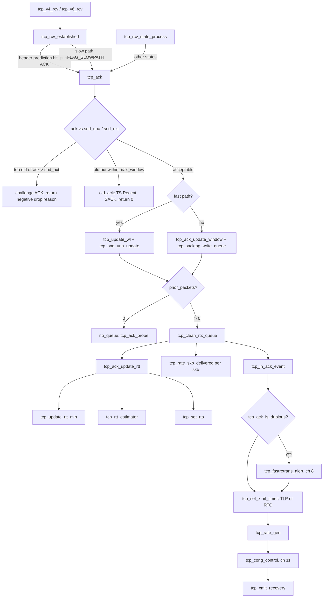

# 7. ACK 処理と RTT 推定

## たとえ話で言うと / The ELI5 version

あなたは部屋（ポート）から小包（`sk_buff`）を発送する係です。発送した小包は、届いたと確認できるまで「発送待ちの棚」の奥にある **控えの棚**（再送キュー）に置いておきます。

相手からは定期的に **受領印**（ACK）の付いたハガキが届きます。ハガキには「○番までの小包は全部受け取りました」「いまウチの受け取り箱にはあと △ 個分の空きがあります」と書いてあります。

受領印が届いたら、あなたは次のことをします。

- そのハガキが **古すぎないか / 未来すぎないか** を確かめます。まだ送っていない小包の受領印は偽物かもしれません。
- 「○番まで受け取り済み」の分を控えの棚から捨て、棚の空きを作ります。
- その小包を **いつ発送したか** を伝票（`skb->skb_mstamp_ns`）で見て、往復にかかった時間（RTT）を測ります。ただし **再発送した小包** の受領印からは測りません。どちらの発送分への受領印か分からないからです（Karn のアルゴリズム）。
- 測った往復時間を平均して、「これ以上待っても受領印が来なければ再発送する」という **キッチンタイマー**（RTO）の長さを決め直します。
- 相手の受け取り箱の空き（ウィンドウ）を書き写します。ただし、遅れて届いた古いハガキの空き情報で上書きしないよう気を付けます。
- 最後に「この受領印で何個届いたか」「どれくらいの速さで届いているか」を、**一度に道路へ出せるトラックの台数**（cwnd）を決める係（輻輳制御）に渡します。

この章は、この「受領印 1 枚を処理する」流れ、つまり `tcp_ack()` と、そこから呼ばれる RTT 推定・RTO 計算・配送レート推定を一行ずつ読みます。

## RFC では / What the RFCs say

### RFC 9293: Transmission Control Protocol（ACK フィールド処理）

RFC 9293 は 2022 年に RFC 793 を置き換えた TCP 本体の仕様です。セグメント到着時の処理は §3.10.7 に状態別の擬似コードとしてまとめられており、ESTABLISHED などの同期済み状態では [RFC 9293 §3.10.7.4](https://www.rfc-editor.org/rfc/rfc9293#section-3.10.7.4) の "Fifth, check the ACK field" が ACK 処理の本体です。

送信側の状態変数（[RFC 9293 §3.3.1](https://www.rfc-editor.org/rfc/rfc9293#section-3.3.1)）:

| RFC 変数 | 意味 | Linux のフィールド |
| --- | --- | --- |
| SND.UNA | 最古の未確認シーケンス番号 | `tp->snd_una` |
| SND.NXT | 次に送るシーケンス番号 | `tp->snd_nxt` |
| SND.WND | 送信ウィンドウ（SND.UNA からのオフセット） | `tp->snd_wnd` |
| SND.WL1 | 最後にウィンドウ更新に使ったセグメントの SEG.SEQ | `tp->snd_wl1` |
| SND.WL2 | 最後にウィンドウ更新に使ったセグメントの SEG.ACK | （持たない。`tp->snd_una` で代用） |
| MAX.SND.WND（RFC 5961） | 相手から受け取った最大ウィンドウ | `tp->max_window` |

ESTABLISHED での規則は次の 3 つです。

1. **SND.UNA < SEG.ACK =< SND.NXT** なら SND.UNA <- SEG.ACK とし、完全に確認されたセグメントを再送キューから取り除きます。
2. **SEG.ACK =< SND.UNA**（重複 / 古い ACK）は無視してよいです。**SEG.ACK > SND.NXT**（まだ送っていないものへの ACK）なら ACK を返し、セグメントを捨てます。
3. **SND.UNA =< SEG.ACK =< SND.NXT** なら送信ウィンドウを更新してよく、その条件は
   `SND.WL1 < SEG.SEQ  or  (SND.WL1 = SEG.SEQ and SND.WL2 =< SEG.ACK)` です。
   満たせば SND.WND <- SEG.WND, SND.WL1 <- SEG.SEQ, SND.WL2 <- SEG.ACK とします。これは「古いセグメントでウィンドウを巻き戻さない」ための辞書式順序比較です。

### RFC 5961 §5.2: Blind Data Injection 対策

RFC 5961 は、オフパスの攻撃者が推測したシーケンス番号で RST/SYN/データを注入する攻撃への対策をまとめたものです。[RFC 5961 §5.2](https://www.rfc-editor.org/rfc/rfc5961#section-5.2) は、ACK 値が **(SND.UNA - MAX.SND.WND) =< SEG.ACK =< SND.NXT** の範囲外ならセグメントを捨てて ACK（challenge ACK）を返すよう求めます。RFC 9293 もこれを MAY-12 として取り込んでいます。Linux はこれをさらに厳しくして、MAX.SND.WND を「これまでに ACK されたバイト数」で頭打ちにしています（後述）。

### RFC 6298: Computing TCP's Retransmission Timer

RFC 6298 は再送タイマー（RTO）の計算方法を定めた標準で、RFC 2988 を置き換えています。Van Jacobson（1988）の平滑化 RTT と平均偏差による推定が土台です。

[RFC 6298 §2](https://www.rfc-editor.org/rfc/rfc6298#section-2) の規則:

- (2.1) 最初の RTT 測定までは RTO = 1 秒です（Linux は `TCP_TIMEOUT_INIT` = 1 秒）。
- (2.2) 最初の測定値 R で `SRTT <- R`, `RTTVAR <- R/2`, `RTO <- SRTT + max(G, K*RTTVAR)`（K = 4）とします。
- (2.3) 以降の測定値 R' で、**この順番で**
  `RTTVAR <- (1 - beta) * RTTVAR + beta * |SRTT - R'|`,
  `SRTT <- (1 - alpha) * SRTT + alpha * R'` とします（alpha = 1/8, beta = 1/4）。RTTVAR の更新には更新前の SRTT を使います。
- (2.4) RTO が 1 秒未満なら 1 秒に切り上げるべき（SHOULD）です。Linux はここから大きく外れ、既定の最小値は 200 ms（`TCP_RTO_MIN` = HZ/5）です。
- (2.5) 上限を設けてよく、その場合 60 秒以上にします（Linux は `TCP_RTO_MAX` = 120 秒）。

[RFC 6298 §3](https://www.rfc-editor.org/rfc/rfc6298#section-3) は **Karn のアルゴリズム** を必須（MUST）としています。再送したセグメントからは RTT を測ってはいけません。ACK が元の送信と再送のどちらに対するものか曖昧だからです。例外は timestamp オプションを使う場合で、エコーされた値から送信インスタンスを特定できます。また、少なくとも 1 RTT に 1 回は測定しなければなりません。

[RFC 6298 §5](https://www.rfc-editor.org/rfc/rfc6298#section-5) はタイマー管理です。(5.2) 全データが確認されたらタイマーを止め、(5.3) 新しいデータを確認する ACK を受けたら RTO 後に満了するよう再起動します。(5.5) 満了時には RTO を 2 倍にします（バックオフ）。さらに §5 の末尾には、新しい RTT 測定が得られたら §2 の計算をやり直し、バックオフで膨らんだ RTO を「collapse」させてよいという注記があります。Linux が「有効な RTT サンプルを得たときだけ `icsk_backoff` を 0 に戻す」のはこの注記に対応します。

### RFC 7323: TCP Extensions for High Performance（RTTM）

RFC 7323 は RFC 1323 を置き換えた、Window Scale・Timestamps・PAWS の仕様です。この章に関係するのは timestamp による RTT 測定（RTTM）です。

- [RFC 7323 §2.2](https://www.rfc-editor.org/rfc/rfc7323#section-2.2): SYN セグメントの window フィールドはスケールしません。`tcp_ack_update_window()` が SYN のときに `snd_wscale` でシフトしないのはこのためです。
- [RFC 7323 §3.2](https://www.rfc-editor.org/rfc/rfc7323#section-3.2): TSecr は ACK ビットが立っているときだけ有効です。
- [RFC 7323 §4.1](https://www.rfc-editor.org/rfc/rfc7323#section-4.1): 送信者は送るセグメントに TSval を入れ、受信者はそれを TSecr にエコーします。ACK を受けた時刻と TSecr の差が RTT サンプルになります。再送でも曖昧さがないので、Karn の制約を受けません。
- [RFC 7323 §4.2](https://www.rfc-editor.org/rfc/rfc7323#section-4.2): 1 ウィンドウに何度もサンプルを取ると alpha/beta のままでは履歴が短くなりすぎるため、[Appendix G](https://www.rfc-editor.org/rfc/rfc7323#appendix-G) では `ExpectedSamples = ceil(FlightSize / (SMSS * 2))` で alpha, beta を割る修正を示しています。Linux はこの修正を採用していません。代わりに、RTTVAR の減衰を「1 RTT に 1 回」に制限する独自の方法をとっています（後述の `mdev_max_us` / `rttvar_us`）。
- [RFC 7323 §4.3](https://www.rfc-editor.org/rfc/rfc7323#section-4.3): どの TSval をエコーするか（TS.Recent の更新規則）を定めています。RTTM の規則として「TSecr は、送信ウィンドウの左端を進める（新しいデータを確認する）セグメントのものだけを RTT 平均の更新に使う」とされています。`tcp_ack_update_rtt()` が `flag & FLAG_ACKED` を条件にしているのはこのためです。

### RFC 5681 §2: duplicate ACK の定義

RFC 5681 は TCP の輻輳制御（slow start / congestion avoidance / fast retransmit / fast recovery）の標準です（詳細は第 11 章）。[RFC 5681 §2](https://www.rfc-editor.org/rfc/rfc5681#section-2) は、"DUPLICATE ACKNOWLEDGMENT" を次の 5 条件をすべて満たす ACK と定義しています。

- (a) 送信側に未確認データがある。
- (b) その ACK がデータを運んでいない。
- (c) SYN/FIN ビットがどちらも立っていない。
- (d) 確認番号が、これまでに受けた最大の確認番号（= SND.UNA）と等しい。
- (e) 広告ウィンドウが直前の ACK と同じ。

SACK を使う場合は (e) の代わりに SACK 情報を見る、という但し書きもあります。Linux ではこの判定が `FLAG_*` ビットの組み合わせ（`FLAG_NOT_DUP` など）で表現されています。

### RFC 3465: Appropriate Byte Counting（背景）

RFC 3465（Experimental）は、cwnd を「受け取った ACK の数」ではなく「ACK されたバイト数」で増やすよう提案したものです。受信側が delayed ACK や ACK 間引きをすると ACK 数が減り、ACK 数で数える方式では cwnd の増え方が遅くなってしまいます。slow start 中の 1 ACK あたりの増分は L*SMSS（L = 2 推奨）までに制限します。

Linux は「ACK の数」ではなく、`tcp_ack()` がその ACK で新たに ACK/SACK された **パケット数**（`delivered` = `acked_sacked`）を数えて輻輳制御に渡します。そのため実質的にバイト（セグメント）単位のカウントになっていて、stretch ACK にも追従します。cwnd をどう増やすかは第 11 章で扱います。この章で押さえておくのは、`tcp_ack()` が「この ACK で何パケット分届いたか」を正確に数える場所だという点です。

## 全体の流れ / The big picture



`tcp_ack()` の仕事は、大まかに次の 4 段階に分けられます。

1. **妥当性検査**: ACK 番号が `[snd_una - min(max_window, bytes_acked), snd_nxt]` に入っているかを調べます。
2. **送信側状態の更新**: `snd_una`・`snd_wnd`・`snd_wl1` を更新し、SACK タグ付けを行います（SACK の詳細は第 8 章）。
3. **再送キューの掃除と計測**: `tcp_clean_rtx_queue()` が ACK 済み skb を解放しつつ、RTT サンプル・配送パケット数・配送レートのサンプルを集めます。
4. **判断と送信**: ロス回復（第 8 章）と輻輳制御（第 11 章）にサンプルを渡し、TLP/RTO タイマーを張り直し、必要なら再送します。

ポイントは、**ロス回復と再送の決定が輻輳制御の後** に置かれていることです（`tcp_xmit_recovery()` が最後）。「いくつ送れるか（cwnd）」を決めてから「何を送るか」を決める順序になっています。

## コードを追う / Walking through the code

### Step 1: 入口と FLAG_* ビット

`tcp_ack()` の呼び出し元は次の 5 か所です（いずれも [net/ipv4/tcp_input.c](https://git.kernel.org/pub/scm/linux/kernel/git/netdev/net-next.git/tree/net/ipv4/tcp_input.c?id=279d5c8afcd38bd841832a39bfe1aa4f8518d98e)）。

| 呼び出し元 | 渡す flag | 状況 |
| --- | --- | --- |
| `tcp_rcv_established()` の header prediction（純 ACK） | `flag`（`__tcp_replace_ts_recent()` の結果のみ） | 予測どおりの純 ACK。`FLAG_SLOWPATH` なし |
| `tcp_rcv_established()` の header prediction（データ付き） | `flag \| FLAG_DATA` | 予測どおりのデータセグメントで `ack_seq != snd_una` のとき |
| `tcp_rcv_established()` の slow path（`step5:`） | `FLAG_SLOWPATH \| FLAG_UPDATE_TS_RECENT` | それ以外の ESTABLISHED セグメント |
| `tcp_rcv_synsent_state_process()` | `FLAG_SLOWPATH` | SYN-ACK 受信 |
| `tcp_rcv_state_process()`（step 5） | `FLAG_SLOWPATH \| FLAG_UPDATE_TS_RECENT \| FLAG_NO_CHALLENGE_ACK` | SYN_RECV, FIN_WAIT, CLOSING など |

`tcp_rcv_established()`（[net/ipv4/tcp_input.c#L6520](https://git.kernel.org/pub/scm/linux/kernel/git/netdev/net-next.git/tree/net/ipv4/tcp_input.c?id=279d5c8afcd38bd841832a39bfe1aa4f8518d98e#n6520)）は冒頭で `tcp_mstamp_refresh_inline(tp)` を呼び、`tp->tcp_mstamp` をこの受信処理の「現在時刻」に更新します。以降の RTT 計算はすべて、この `tcp_mstamp` との差分で行われます。header prediction 自体は第 5 章で扱います。この章で大事なのは、**header prediction が当たった場合、ウィンドウ値が変わっていないことが `pred_flags` の比較で既に保証されている** ことです。そのため `FLAG_SLOWPATH` なしで呼ばれた `tcp_ack()` は、ウィンドウ更新の判定を省略できます。

フラグの定義は次のとおりです。

```c
#define FLAG_DATA		0x01 /* Incoming frame contained data.		*/
#define FLAG_WIN_UPDATE		0x02 /* Incoming ACK was a window update.	*/
#define FLAG_DATA_ACKED		0x04 /* This ACK acknowledged new data.		*/
#define FLAG_RETRANS_DATA_ACKED	0x08 /* "" "" some of which was retransmitted.	*/
#define FLAG_SYN_ACKED		0x10 /* This ACK acknowledged SYN.		*/
#define FLAG_DATA_SACKED	0x20 /* New SACK.				*/
#define FLAG_ECE		0x40 /* ECE in this ACK				*/
#define FLAG_LOST_RETRANS	0x80 /* This ACK marks some retransmission lost */
#define FLAG_SLOWPATH		0x100 /* Do not skip RFC checks for window update.*/
#define FLAG_ORIG_SACK_ACKED	0x200 /* Never retransmitted data are (s)acked	*/
#define FLAG_SND_UNA_ADVANCED	0x400 /* Snd_una was changed (!= FLAG_DATA_ACKED) */
#define FLAG_DSACKING_ACK	0x800 /* SACK blocks contained D-SACK info */
#define FLAG_SET_XMIT_TIMER	0x1000 /* Set TLP or RTO timer */
#define FLAG_SACK_RENEGING	0x2000 /* snd_una advanced to a sacked seq */
#define FLAG_UPDATE_TS_RECENT	0x4000 /* tcp_replace_ts_recent() */
#define FLAG_NO_CHALLENGE_ACK	0x8000 /* do not call tcp_send_challenge_ack()	*/
#define FLAG_ACK_MAYBE_DELAYED	0x10000 /* Likely a delayed ACK */
#define FLAG_DSACK_TLP		0x20000 /* DSACK for tail loss probe */
#define FLAG_TS_PROGRESS	0x40000 /* Positive timestamp delta */

#define FLAG_ACKED		(FLAG_DATA_ACKED|FLAG_SYN_ACKED)
#define FLAG_NOT_DUP		(FLAG_DATA|FLAG_WIN_UPDATE|FLAG_ACKED)
#define FLAG_CA_ALERT		(FLAG_DATA_SACKED|FLAG_ECE|FLAG_DSACKING_ACK)
#define FLAG_FORWARD_PROGRESS	(FLAG_ACKED|FLAG_DATA_SACKED)

#define TCP_REMNANT (TCP_FLAG_FIN|TCP_FLAG_URG|TCP_FLAG_SYN|TCP_FLAG_PSH)
#define TCP_HP_BITS (~(TCP_RESERVED_BITS|TCP_FLAG_PSH))

#define REXMIT_NONE	0 /* no loss recovery to do */
#define REXMIT_LOST	1 /* retransmit packets marked lost */
#define REXMIT_NEW	2 /* FRTO-style transmit of unsent/new packets */
```

覚えておくべき合成フラグは 4 つです。

- `FLAG_ACKED` = データか SYN が新たに累積 ACK された。
- `FLAG_NOT_DUP` = データを運んでいる、ウィンドウ更新である、または何か ACK した。これが **立っていない** ACK が RFC 5681 の duplicate ACK の候補です。
- `FLAG_CA_ALERT` = SACK、ECE、DSACK のいずれかを含む。輻輳状態機械（第 8 章）を起こす必要があるかどうかの印です。
- `FLAG_FORWARD_PROGRESS` = 累積 ACK または SACK で何かが届いた。

`FLAG_SND_UNA_ADVANCED` と `FLAG_DATA_ACKED` が別なのは、SYN だけが ACK された場合や、partial ACK で TSO skb の一部だけが ACK された場合などに意味がずれるためです。コメントに `!= FLAG_DATA_ACKED` とあるのはこのことを指しています。

`REXMIT_*` は `tcp_fastretrans_alert()` が「何を再送すべきか」を `tcp_xmit_recovery()` に伝えるための値で、再送そのものを輻輳制御の後まで遅らせる仕組みです。

### Step 2: `tcp_ack()` (1) — 事前状態のスナップショット

`tcp_ack()`（[net/ipv4/tcp_input.c#L4276](https://git.kernel.org/pub/scm/linux/kernel/git/netdev/net-next.git/tree/net/ipv4/tcp_input.c?id=279d5c8afcd38bd841832a39bfe1aa4f8518d98e#n4276)）

```c
/* This routine deals with incoming acks, but not outgoing ones. */
static int tcp_ack(struct sock *sk, const struct sk_buff *skb, int flag)
{
	struct inet_connection_sock *icsk = inet_csk(sk);
	struct tcp_sock *tp = tcp_sk(sk);
	struct tcp_sacktag_state sack_state;
	struct rate_sample rs = { .prior_delivered = 0 };
	u32 prior_snd_una = tp->snd_una;
	bool is_sack_reneg = tp->is_sack_reneg;
	u32 ack_seq = TCP_SKB_CB(skb)->seq;
	u32 ack = TCP_SKB_CB(skb)->ack_seq;
	int num_dupack = 0;
	int prior_packets = tp->packets_out;
	u32 delivered = tp->delivered;
	u32 lost = tp->lost;
	int rexmit = REXMIT_NONE; /* Flag to (re)transmit to recover losses */
	u32 ecn_count = 0;	  /* Did we receive ECE/an AccECN ACE update? */
	u32 prior_fack;

	sack_state.first_sackt = 0;
	sack_state.rate = &rs;
	sack_state.sack_delivered = 0;
	sack_state.delivered_bytes = 0;

	/* We very likely will need to access rtx queue. */
	prefetch(sk->tcp_rtx_queue.rb_node);
```

- 戻り値の型は `int` です。**負値** は `-SKB_DROP_REASON_*`（セグメントを捨てる）、**0** は「古い ACK だが受け入れた」、**1** は通常の処理完了を表します。`tcp_rcv_state_process()` は「CLOSING 系の状態では古い ACK（0）も受け入れる」とコメントしており、この 3 値を区別しています。
- `prior_snd_una`、`prior_packets`、`delivered`、`lost`、`is_sack_reneg` は、この ACK を処理する **前** の値です。`tcp_ack()` は最後に `tp->delivered - delivered`（この ACK で新たに届いたパケット数）や `tp->lost - lost`（この ACK で新たにロスと判定された数）を計算します。差分で数えることで、SACK タグ付け・累積 ACK・RACK・Reno の疑似 SACK など、カウンタを増やす経路がいくつあっても二重に数えずに済みます。
- `ack_seq` は **このセグメントの SEG.SEQ**、`ack` は **SEG.ACK** です。名前が紛らわしいので注意してください。`ack_seq` はウィンドウ更新規則（SND.WL1 との比較）に使われます。
- `rs`（`struct rate_sample`）はスタック上に置かれ、`.prior_delivered = 0` で初期化されます。`prior_delivered == 0` は「まだどの skb からもサンプルを取っていない」という番兵です（`tcp_rate_skb_delivered()` が参照します）。
- `sack_state` も同様にスタック上に置かれ、SACK タグ付けと `tcp_clean_rtx_queue()` の間で、RTT 用のタイムスタンプ（`first_sackt` / `last_sackt`）、配送数、レートサンプルへのポインタを受け渡す入れ物になります。
- `prefetch(sk->tcp_rtx_queue.rb_node)`: 再送キューは rb-tree です（2017 年の 75c119afe14f 以降）。ACK 処理ではほぼ確実に先頭 skb を触るので、木の根のキャッシュラインを先読みして、後続の検査中にメモリレイテンシを隠します。

### Step 3: `tcp_ack()` (2) — 古すぎる ACK と未来の ACK

```c
	/* If the ack is older than previous acks
	 * then we can probably ignore it.
	 */
	if (before(ack, prior_snd_una)) {
		u32 max_window;

		/* do not accept ACK for bytes we never sent. */
		max_window = min_t(u64, tp->max_window, tp->bytes_acked);
		/* RFC 5961 5.2 [Blind Data Injection Attack].[Mitigation] */
		if (before(ack, prior_snd_una - max_window)) {
			if (!(flag & FLAG_NO_CHALLENGE_ACK))
				tcp_send_challenge_ack(sk, false);
			return -SKB_DROP_REASON_TCP_TOO_OLD_ACK;
		}
		goto old_ack;
	}

	/* If the ack includes data we haven't sent yet, drop the
	 * segment.  RFC 793 Section 3.9 and RFC 5961 Section 5.2
	 * require us to send an ACK back in that case.
	 */
	if (after(ack, tp->snd_nxt)) {
		if (!(flag & FLAG_NO_CHALLENGE_ACK))
			tcp_send_challenge_ack(sk, false);
		return -SKB_DROP_REASON_TCP_ACK_UNSENT_DATA;
	}

	if (after(ack, prior_snd_una)) {
		flag |= FLAG_SND_UNA_ADVANCED;
		WRITE_ONCE(icsk->icsk_retransmits, 0);

#if IS_ENABLED(CONFIG_TLS_DEVICE)
		if (static_branch_unlikely(&clean_acked_data_enabled.key))
			if (tp->tcp_clean_acked)
				tp->tcp_clean_acked(sk, ack);
#endif
	}
```

ここが RFC 9293 §3.10.7.4 と RFC 5961 §5.2 の実装です。シーケンス比較はすべて `before()` / `after()`（32 ビットの差を符号付きで見る）で行うので、ラップアラウンドしても正しく判定できます。

- **`before(ack, prior_snd_una)`**: SEG.ACK < SND.UNA です。RFC 9293 は「無視してよい」としていますが、Linux は 2 段階で扱います。
  - `max_window = min_t(u64, tp->max_window, tp->bytes_acked)` は RFC 5961 の MAX.SND.WND に相当します。ただし **これまでに実際に ACK されたバイト数** で頭打ちにします（3d501dd326fb）。新しいフローでは `bytes_acked` が小さいため、ISN より前（＝一度も送っていないバイト）を指す偽 ACK を弾けます。RFC そのままだと、接続直後でも `snd_una - 64KB` までの任意の ACK 値を受け入れてしまいます。
  - それより古い ACK は challenge ACK を返し（`FLAG_NO_CHALLENGE_ACK` がなければ）、`-SKB_DROP_REASON_TCP_TOO_OLD_ACK` で捨てます。`tcp_rcv_state_process()` が `FLAG_NO_CHALLENGE_ACK` を渡すのは、呼び出し元が自分で応答を決めるためです。負の戻り値を受けると、SYN_RECV では RST を返し、それ以外の状態では自分で `tcp_send_challenge_ack()` を呼びます。
  - 範囲内の古い ACK は `old_ack:` へ進みます。データや SACK を運んでいる可能性があるので、捨てずに処理を続けます。
- **`after(ack, tp->snd_nxt)`**: まだ送っていないデータへの ACK です。RFC 9293 の "send an ACK, drop the segment, and return" どおりに、challenge ACK を返して捨てます。`tcp_send_challenge_ack()`（[net/ipv4/tcp_input.c#L4069](https://git.kernel.org/pub/scm/linux/kernel/git/netdev/net-next.git/tree/net/ipv4/tcp_input.c?id=279d5c8afcd38bd841832a39bfe1aa4f8518d98e#n4069)）は、ソケット単位のレート制限（`sysctl_tcp_invalid_ratelimit`、超過時は `TCPACKSkippedChallenge`）と netns 単位の RFC 5961 レート制限（`sysctl_tcp_challenge_ack_limit`）の 2 段で制限されています。challenge ACK 自体が攻撃の増幅器にならないようにするためです。
- **`after(ack, prior_snd_una)`**: 新しいデータが確認されたので `FLAG_SND_UNA_ADVANCED` を立てます。
  - `icsk_retransmits = 0`: RTO 再送の連続回数をリセットします。この値は `tcp_write_timeout()` が接続を諦めるかどうかの判定に使います（第 9 章）。`WRITE_ONCE()` なのは、`tcp_get_timestamping_opt_stats()` などがロックなしで読むためです。
  - `CONFIG_TLS_DEVICE`: kTLS のデバイスオフロードでは、ACK 済みのレコードの再送用状態を解放するためのコールバック `tcp_clean_acked` を呼びます。static key で守られているので、TLS オフロードを使っていなければコストはほぼゼロです。

ここまでの判定で、以降の処理では **`snd_una <= ack <= snd_nxt`** が成り立ちます。後で出てくる `tcp_may_update_window()` のコメント "The function assumes that snd_una<=ack<=snd_next." はこの前提を指しています。

### Step 4: `tcp_ack()` (3) — ウィンドウ更新の fast path と slow path

```c
	prior_fack = tcp_is_sack(tp) ? tcp_highest_sack_seq(tp) : tp->snd_una;
	rs.prior_in_flight = tcp_packets_in_flight(tp);

	/* ts_recent update must be made after we are sure that the packet
	 * is in window.
	 */
	if (flag & FLAG_UPDATE_TS_RECENT)
		flag |= tcp_replace_ts_recent(tp, TCP_SKB_CB(skb)->seq);

	if ((flag & (FLAG_SLOWPATH | FLAG_SND_UNA_ADVANCED)) ==
	    FLAG_SND_UNA_ADVANCED) {
		/* Window is constant, pure forward advance.
		 * No more checks are required.
		 * Note, we use the fact that SND.UNA>=SND.WL2.
		 */
		tcp_update_wl(tp, ack_seq);
		tcp_snd_una_update(tp, ack);
		flag |= FLAG_WIN_UPDATE;

		NET_INC_STATS(sock_net(sk), LINUX_MIB_TCPHPACKS);
	} else {
		if (ack_seq != TCP_SKB_CB(skb)->end_seq)
			flag |= FLAG_DATA;
		else
			NET_INC_STATS(sock_net(sk), LINUX_MIB_TCPPUREACKS);

		flag |= tcp_ack_update_window(sk, skb, ack, ack_seq);

		if (TCP_SKB_CB(skb)->sacked)
			flag |= tcp_sacktag_write_queue(sk, skb, prior_snd_una,
							&sack_state);

		if (tcp_ecn_rcv_ecn_echo(tp, tcp_hdr(skb)))
			flag |= FLAG_ECE;

		if (sack_state.sack_delivered)
			tcp_count_delivered(tp, sack_state.sack_delivered,
					    flag & FLAG_ECE);
	}
```

- `prior_fack`: SACK 接続では「SACK された最も高いシーケンス」、そうでなければ `snd_una` です。`tcp_clean_rtx_queue()` は「一度も再送していない穴が累積 ACK で埋まった。それが `prior_fack` より下なら、それは並べ替え（reordering）だった」と判定するのに使います。
- `rs.prior_in_flight = tcp_packets_in_flight(tp)`: この ACK を処理する前の in-flight 量です。PRR（第 8 章）や BBR が使います。
- `FLAG_UPDATE_TS_RECENT`: slow path からの呼び出しでは、TS.Recent の更新を **ACK の妥当性検査に通った後** に行います。範囲外 ACK で TS.Recent を進めてしまうと、偽セグメントが PAWS の状態を汚せてしまうからです（packetdrill の `tcp_ts_recent_invalid_ack.pkt` がこの点を検査しています）。`tcp_replace_ts_recent()` は TSval が増えていれば `FLAG_TS_PROGRESS` を返します（AccECN が使います）。
- **fast path**（`FLAG_SLOWPATH` なし、かつ `snd_una` が進んだ）: header prediction が当たったので、ウィンドウ値は変わっていません。必要なのは `snd_wl1 = ack_seq` と `snd_una = ack` の更新だけです。コメントの "we use the fact that SND.UNA>=SND.WL2" は、Linux が SND.WL2 を持たず、`snd_una` を WL2 の代わりに使っていることを指しています。ACK は単調に進むので、WL2（最後にウィンドウ更新に使った ACK）は常に SND.UNA 以下であり、`snd_una` の更新が WL2 の更新を兼ねます。`FLAG_WIN_UPDATE` を立てるので、この ACK は「重複 ACK」とは数えられません。カウンタ `TCPHPAcks` を増やします。
- **slow path**:
  - `ack_seq != end_seq` ならセグメントはデータ（または SYN/FIN）を運んでいるので `FLAG_DATA` を立てます（RFC 5681 dupack 条件 (b)(c) の否定）。純 ACK なら `TCPPureAcks` を増やします。
  - `tcp_ack_update_window()` で WL1/WL2 規則に基づくウィンドウ更新を行い、`snd_una` も進めます（Step 5）。
  - `TCP_SKB_CB(skb)->sacked` は、オプション解析で SACK ブロックが見つかったときに、オプション内のオフセットが入る欄です。非 0 なら `tcp_sacktag_write_queue()` で SACK スコアボードを更新します（第 8 章）。
  - ECE（RFC 3168 の ECN-Echo）を検出したら `FLAG_ECE` を立てます。SACK で新たに届いた分（`sack_state.sack_delivered`）は、ここで `tcp_count_delivered()` によって `tp->delivered` に加算されます。累積 ACK で届いた分は、後で `tcp_clean_rtx_queue()` が加算します。

### Step 5: `tcp_ack_update_window()` と `tcp_may_update_window()`

`tcp_may_update_window()`（[net/ipv4/tcp_input.c#L3881](https://git.kernel.org/pub/scm/linux/kernel/git/netdev/net-next.git/tree/net/ipv4/tcp_input.c?id=279d5c8afcd38bd841832a39bfe1aa4f8518d98e#n3881)）

```c
/* Check that window update is acceptable.
 * The function assumes that snd_una<=ack<=snd_next.
 */
static inline bool tcp_may_update_window(const struct tcp_sock *tp,
					const u32 ack, const u32 ack_seq,
					const u32 nwin)
{
	return	after(ack, tp->snd_una) ||
		after(ack_seq, tp->snd_wl1) ||
		(ack_seq == tp->snd_wl1 && (nwin > tp->snd_wnd || !nwin));
}
```

RFC 9293 の規則は「`SND.WL1 < SEG.SEQ` または（`SND.WL1 = SEG.SEQ` かつ `SND.WL2 =< SEG.ACK`）」でした。Linux の規則は 3 項からなります。

1. `after(ack, tp->snd_una)`: ACK が SND.UNA を進めるなら無条件に更新します。新しいデータを確認したセグメントは、少なくとも「最後にウィンドウ更新に使ったセグメント」以降に相手が送ったものだからです（SND.WL2 =< SEG.ACK の強い形）。
2. `after(ack_seq, tp->snd_wl1)`: SND.WL1 < SEG.SEQ。RFC と同じです。
3. `ack_seq == tp->snd_wl1 && (nwin > tp->snd_wnd || !nwin)`: SEQ も ACK も変わらない（`ack == snd_una`）セグメントについて、RFC なら `SND.WL2 =< SEG.ACK` が常に成り立つので無条件に更新します。Linux は **ウィンドウが広がる場合と 0 になる場合だけ** 更新します。

3 番目の項が、`tcp_ack_update_window()` 冒頭のコメント "Window update algorithm, described in RFC793/RFC1122 ... is wrong." の中身です。相手がデータを送っていない一方向転送では、純 ACK の SEG.SEQ はずっと同じ値です。この状態で 2 つの純 ACK（同じ SEQ、同じ ACK 番号）がネットワーク内で入れ替わると、RFC の規則では後から届いた **古い** 方のウィンドウ値で上書きされ、ウィンドウが不必要に縮んでしまいます。Linux は「同順位ならウィンドウが増える方だけ信じる」ことで、並べ替えによる縮小を防ぎます。ただし受信側が本当にウィンドウを閉じた（0 を広告した）場合は、それを無視するとデータを押し込んでしまうので、`!nwin` だけは例外的に受け入れます。

なお、`ack == snd_una` で SEQ も同じ、ウィンドウも同じ純 ACK は、`FLAG_WIN_UPDATE` が立ちません。これが RFC 5681 の dupack 条件 (d)(e) に相当します。

`tcp_ack_update_window()`（[net/ipv4/tcp_input.c#L3951](https://git.kernel.org/pub/scm/linux/kernel/git/netdev/net-next.git/tree/net/ipv4/tcp_input.c?id=279d5c8afcd38bd841832a39bfe1aa4f8518d98e#n3951)）

```c
/* Update our send window.
 *
 * Window update algorithm, described in RFC793/RFC1122 (used in linux-2.2
 * and in FreeBSD. NetBSD's one is even worse.) is wrong.
 */
static int tcp_ack_update_window(struct sock *sk, const struct sk_buff *skb, u32 ack,
				 u32 ack_seq)
{
	struct tcp_sock *tp = tcp_sk(sk);
	int flag = 0;
	u32 nwin = ntohs(tcp_hdr(skb)->window);

	if (likely(!tcp_hdr(skb)->syn))
		nwin <<= tp->rx_opt.snd_wscale;

	if (tcp_may_update_window(tp, ack, ack_seq, nwin)) {
		flag |= FLAG_WIN_UPDATE;
		tcp_update_wl(tp, ack_seq);

		if (tp->snd_wnd != nwin) {
			tp->snd_wnd = nwin;

			/* Note, it is the only place, where
			 * fast path is recovered for sending TCP.
			 */
			tp->pred_flags = 0;
			tcp_fast_path_check(sk);

			if (!tcp_write_queue_empty(sk))
				tcp_slow_start_after_idle_check(sk);

			if (nwin > tp->max_window) {
				tp->max_window = nwin;
				tcp_sync_mss(sk, inet_csk(sk)->icsk_pmtu_cookie);
			}
		}
	}

	tcp_snd_una_update(tp, ack);

	return flag;
}
```

- `nwin <<= tp->rx_opt.snd_wscale`: RFC 7323 §2.2 により、SYN の window フィールドはスケールしません。`likely(!syn)` なのは、SYN-ACK を受けるときしか SYN ビットが立たないためです。
- `tcp_may_update_window()` が真なら `FLAG_WIN_UPDATE` を立て、`tcp_update_wl()`（[include/net/tcp.h#L1712](https://git.kernel.org/pub/scm/linux/kernel/git/netdev/net-next.git/tree/include/net/tcp.h?id=279d5c8afcd38bd841832a39bfe1aa4f8518d98e#n1712)）で `snd_wl1 = ack_seq` とします。ウィンドウ値が **変わらなくても** 規則を満たせば `snd_wl1` は進み、`FLAG_WIN_UPDATE` も立ちます。この ACK は dupack とは数えられません。
- ウィンドウ値が変わったときだけ、次の処理を行います。
  - `tp->pred_flags = 0; tcp_fast_path_check(sk);`: header prediction の予測値 `pred_flags` には、TCP ヘッダのフラグと **スケール前のウィンドウ値** が埋め込まれています（第 5 章）。ウィンドウが変われば予測を作り直す必要があります。`tcp_fast_path_check()`（[include/net/tcp.h#L2007](https://git.kernel.org/pub/scm/linux/kernel/git/netdev/net-next.git/tree/include/net/tcp.h?id=279d5c8afcd38bd841832a39bfe1aa4f8518d98e#n2007)）は、OOO キューが空、受信ウィンドウが非 0、受信メモリに余裕がある、urgent データがない、という条件がそろえば `tcp_fast_path_on()` で `pred_flags` を再計算します。コメントの「送信側の fast path を回復する唯一の場所」とはこのことです。
  - `tcp_slow_start_after_idle_check()`（[include/net/tcp.h#L1754](https://git.kernel.org/pub/scm/linux/kernel/git/netdev/net-next.git/tree/include/net/tcp.h?id=279d5c8afcd38bd841832a39bfe1aa4f8518d98e#n1754)）: 送るデータがあるのに in-flight が 0 で、最後の送信から RTO 以上経っていれば、`tcp_cwnd_restart()` で cwnd を縮めます（RFC 5681 §4.1 の restart window）。ゼロウィンドウで長く止まっていた後、ウィンドウが開いた瞬間に古い cwnd でバーストしないようにするためです。
  - `nwin > tp->max_window` なら `max_window` を更新し、`tcp_sync_mss()` を呼びます。`max_window` は Step 3 の RFC 5961 判定（MAX.SND.WND）に使われるほか、`tcp_bound_to_half_wnd()` で「MSS は相手の最大ウィンドウの半分を超えない」という制限にも使われます。そのため MSS を再計算します。
- 最後に、ウィンドウ更新の可否にかかわらず `tcp_snd_una_update()` を呼びます。

`tcp_snd_una_update()`（[net/ipv4/tcp_input.c#L3908](https://git.kernel.org/pub/scm/linux/kernel/git/netdev/net-next.git/tree/net/ipv4/tcp_input.c?id=279d5c8afcd38bd841832a39bfe1aa4f8518d98e#n3908)）

```c
static void tcp_snd_sne_update(struct tcp_sock *tp, u32 ack)
{
#ifdef CONFIG_TCP_AO
	struct tcp_ao_info *ao;

	if (!static_branch_unlikely(&tcp_ao_needed.key))
		return;

	ao = rcu_dereference_protected(tp->ao_info,
				       lockdep_sock_is_held((struct sock *)tp));
	if (ao && ack < tp->snd_una) {
		ao->snd_sne++;
		trace_tcp_ao_snd_sne_update((struct sock *)tp, ao->snd_sne);
	}
#endif
}

/* If we update tp->snd_una, also update tp->bytes_acked */
static void tcp_snd_una_update(struct tcp_sock *tp, u32 ack)
{
	u32 delta = ack - tp->snd_una;

	sock_owned_by_me((struct sock *)tp);
	tp->bytes_acked += delta;
	tcp_snd_sne_update(tp, ack);
	WRITE_ONCE(tp->snd_una, ack);
}
```

- `delta = ack - tp->snd_una` は u32 の差なので、ラップアラウンドしても正しい値になります。`bytes_acked`（u64、RFC 4898 の tcpEStatsAppHCThruOctetsAcked）に加算します。これが Step 3 の「ACK されたバイト数」の出どころです。
- `sock_owned_by_me()`: lockdep 用のアサーションです。`snd_una` の書き込みはソケットロック（softirq では `bh_lock_sock()` で `sock_owned_by_user()` でない状態、process context では `lock_sock()`）の下でしか起きません。
- `tcp_snd_sne_update()`: TCP-AO（RFC 5925）の Sequence Number Extension です。`ack < tp->snd_una` という **符号なしの数値比較** は「32 ビットのシーケンス空間を一周した」ことを意味するので、上位 32 ビットの `snd_sne` を 1 増やします。ここでは `before()` ではなく素の `<` を使っている点に注意してください。
- `WRITE_ONCE(tp->snd_una, ack)`: `tcp_get_timestamping_opt_stats()`（`write_seq - snd_una` を読む）や TCP-AO の SNE 計算など、ロックなしで読む側があります。そのための annotate です。

### Step 6: `tcp_ack()` (4) — 再送キューの掃除と CA へのイベント通知

```c
	/* This is a deviation from RFC3168 since it states that:
	 * "When the TCP data sender is ready to set the CWR bit after reducing
	 * the congestion window, it SHOULD set the CWR bit only on the first
	 * new data packet that it transmits."
	 * We accept CWR on pure ACKs to be more robust
	 * with widely-deployed TCP implementations that do this.
	 */
	tcp_ecn_accept_cwr(sk, skb);

	/* We passed data and got it acked, remove any soft error
	 * log. Something worked...
	 */
	if (READ_ONCE(sk->sk_err_soft))
		WRITE_ONCE(sk->sk_err_soft, 0);
	WRITE_ONCE(icsk->icsk_probes_out, 0);
	tp->rcv_tstamp = tcp_jiffies32;
	if (!prior_packets)
		goto no_queue;

	/* See if we can take anything off of the retransmit queue. */
	flag |= tcp_clean_rtx_queue(sk, skb, prior_fack, prior_snd_una,
				    &sack_state, flag & FLAG_ECE);

	tcp_rack_update_reo_wnd(sk, &rs);

	if (tcp_ecn_mode_accecn(tp))
		ecn_count = tcp_accecn_process(sk, skb,
					       tp->delivered - delivered,
					       sack_state.delivered_bytes,
					       &flag);

	tcp_in_ack_event(sk, flag);
```

- `tcp_ecn_accept_cwr()`: RFC 3168 からの意図的な逸脱で、純 ACK に付いた CWR も受け入れます（第 14 章）。
- `sk_err_soft = 0`: ICMP などで記録された「ソフトエラー」（`tcp_write_timeout()` で最終的に報告されるもの）を、ACK が届いた＝経路が生きている、という理由で消します。読み書きは `READ_ONCE()`/`WRITE_ONCE()` で、不要な書き込み（キャッシュラインの dirty 化）を避けるために、まず読んでから書いています。
- `icsk_probes_out = 0`: ゼロウィンドウプローブ / keepalive の連続未応答回数をリセットします。どんな ACK でも相手が生きている証拠になるからです。
- `rcv_tstamp = tcp_jiffies32`: 最後に ACK を受けた時刻です。keepalive やゼロウィンドウプローブのタイムアウト判定に使います（第 9 章）。
- `!prior_packets` → `no_queue`: ACK 処理の前に in-flight が 0 だったなら、掃除するものも RTT を測るものもありません（ウィンドウ更新やプローブへの応答）。RFC 5681 dupack 条件 (a)「未確認データがある」を満たさないので、dupack として数えることもしません。
- **`tcp_clean_rtx_queue()`**: この章の中核です（Step 9〜13）。戻り値の flag を OR します。`flag & FLAG_ECE` を `ece_ack` として渡すのは、累積 ACK で届いたパケットを RFC 3168 モードの `delivered_ce` に数えるためです。
- `tcp_rack_update_reo_wnd()`: RACK の並べ替えウィンドウの調整です（第 8 章）。
- `tcp_accecn_process()`: AccECN の ACE カウンタ処理です（第 14 章）。
- `tcp_in_ack_event()`（[net/ipv4/tcp_input.c#L4172](https://git.kernel.org/pub/scm/linux/kernel/git/netdev/net-next.git/tree/net/ipv4/tcp_input.c?id=279d5c8afcd38bd841832a39bfe1aa4f8518d98e#n4172)）: CA モジュールの `in_ack_event` フックを呼びます。`FLAG_*` を、CA 用の公開フラグ `CA_ACK_WIN_UPDATE` / `CA_ACK_SLOWPATH` / `CA_ACK_ECE` に変換して渡します。ECE が `FLAG_SLOWPATH` のときにしか報告されないのは、`FLAG_ECE` を立てる `tcp_ecn_rcv_ecn_echo()` が Step 4 の slow path 側にしかなく、ECE ビットの立ったセグメントはそもそも `pred_flags` に一致せず header prediction の fast path に来ないためです。DCTCP や Westwood がこのフックを使います。

### Step 7: `tcp_ack()` (5) — dupack 判定、タイマー、レート、輻輳制御

```c
	if (unlikely(tp->tlp_high_seq))
		tcp_process_tlp_ack(sk, ack, flag);

	if (tcp_ack_is_dubious(sk, flag)) {
		if (!(flag & (FLAG_SND_UNA_ADVANCED |
			      FLAG_NOT_DUP | FLAG_DSACKING_ACK))) {
			num_dupack = 1;
			/* Consider if pure acks were aggregated in tcp_add_backlog() */
			if (!(flag & FLAG_DATA))
				num_dupack = max_t(u16, 1, skb_shinfo(skb)->gso_segs);
		}
		tcp_fastretrans_alert(sk, prior_snd_una, num_dupack, &flag,
				      &rexmit);
	}

	/* If needed, reset TLP/RTO timer when RACK doesn't set. */
	if (flag & FLAG_SET_XMIT_TIMER)
		tcp_set_xmit_timer(sk);

	if ((flag & FLAG_FORWARD_PROGRESS) || !(flag & FLAG_NOT_DUP))
		sk_dst_confirm(sk);

	delivered = tcp_newly_delivered(sk, delivered, ecn_count, flag);

	lost = tp->lost - lost;			/* freshly marked lost */
	rs.is_ack_delayed = !!(flag & FLAG_ACK_MAYBE_DELAYED);
	tcp_rate_gen(sk, delivered, lost, is_sack_reneg, sack_state.rate);
	tcp_cong_control(sk, ack, delivered, flag, sack_state.rate);
	tcp_xmit_recovery(sk, rexmit);
	return 1;
```

- `tlp_high_seq` が非 0 なら Tail Loss Probe の結果を判定します（`tcp_process_tlp_ack()`、第 8 章）。
- `tcp_ack_is_dubious()`（[net/ipv4/tcp_input.c#L3831](https://git.kernel.org/pub/scm/linux/kernel/git/netdev/net-next.git/tree/net/ipv4/tcp_input.c?id=279d5c8afcd38bd841832a39bfe1aa4f8518d98e#n3831)）は「この ACK は輻輳状態機械を回す必要があるか」を判定します。

  ```c
  static inline bool tcp_ack_is_dubious(const struct sock *sk, const int flag)
  {
  	return !(flag & FLAG_NOT_DUP) || (flag & FLAG_CA_ALERT) ||
  		inet_csk(sk)->icsk_ca_state != TCP_CA_Open;
  }
  ```

  真になるのは、dupack 候補（`!(flag & FLAG_NOT_DUP)`）、SACK/ECE/DSACK を含む ACK、CA 状態が Open 以外（Disorder/CWR/Recovery/Loss）のいずれかの場合です。普通の「新しいデータを ACK した、SACK なし、Open 状態」の ACK はここを素通りします。fast path を軽く保つための判定です。
- `num_dupack`: `snd_una` が進まず、`FLAG_NOT_DUP`（データ・ウィンドウ更新・ACK のどれか）も DSACK もない ACK を **duplicate ACK** と数えます。RFC 5681 §2 の定義との対応は次のとおりです。(a) 未確認データあり = `prior_packets` 非 0（`no_queue` に行っていない）。(b)(c) データ/SYN/FIN なし = `!FLAG_DATA`。(d) ACK 番号が SND.UNA と同じ = `!FLAG_SND_UNA_ADVANCED`。(e) ウィンドウ不変 = `!FLAG_WIN_UPDATE`。
  - `gso_segs`: `tcp_add_backlog()`（[net/ipv4/tcp_ipv4.c#L1904](https://git.kernel.org/pub/scm/linux/kernel/git/netdev/net-next.git/tree/net/ipv4/tcp_ipv4.c?id=279d5c8afcd38bd841832a39bfe1aa4f8518d98e#n1904)）は、ソケットがユーザーに保持されている間に届いた純 ACK を backlog 上で **1 つの skb に合体** させることがあります。そのとき合体した数を `gso_segs` に記録します。合体した dupack を 1 個と数えると、Reno の dupthresh（3 個）に届かず fast retransmit が遅れるので、元の個数を復元します（19119f298bb1）。データ付きのセグメントは合体しないので `!(flag & FLAG_DATA)` の場合だけです。
- `tcp_fastretrans_alert()`: ロス検出と CA 状態遷移、undo などを行います（第 8 章）。`&flag` と `&rexmit` を渡し、flag の追加（例: `FLAG_SET_XMIT_TIMER` を落とす/立てる）と「何を再送するか」を返してもらいます。
- `FLAG_SET_XMIT_TIMER` → `tcp_set_xmit_timer()`: RFC 6298 (5.2)(5.3) の「新しいデータが ACK されたらタイマーを張り直す」に相当します（Step 17）。**1 つの ACK につき最大 1 回** だけ張り直す設計です（df92c8394e6e）。
- `sk_dst_confirm()`: 前進（`FLAG_FORWARD_PROGRESS`）または dupack（`!FLAG_NOT_DUP`、相手が生きていてセグメントを受け取っている証拠）があれば、`sk_dst_pending_confirm` を立てます。次の送信で `sock_confirm_neigh()` が近隣エントリ（ARP/ND）を「到達確認済み」にするので、NUD の再確認プローブを省けます。
- `tcp_newly_delivered()`（[net/ipv4/tcp_input.c#L4213](https://git.kernel.org/pub/scm/linux/kernel/git/netdev/net-next.git/tree/net/ipv4/tcp_input.c?id=279d5c8afcd38bd841832a39bfe1aa4f8518d98e#n4213)）: `tp->delivered - delivered` を `TCPDelivered`（と `TCPDeliveredCE`）に加算し、この ACK で届いたパケット数を返します。これが RFC 3465 の「ACK されたバイト数」に相当する `acked_sacked` として、輻輳制御に渡ります。
- `lost = tp->lost - lost`: この ACK の処理中（SACK タグ付け、RACK、`tcp_fastretrans_alert()`）に新たにロスとマークされたパケット数です。
- `rs.is_ack_delayed`: `tcp_clean_rtx_queue()` が推定した「delayed ACK っぽい」ビットを、レートサンプル経由で BBR に渡します。
- `tcp_rate_gen()`: 配送レートのサンプルを確定させます（Step 19）。
- `tcp_cong_control()`（[net/ipv4/tcp_input.c#L3858](https://git.kernel.org/pub/scm/linux/kernel/git/netdev/net-next.git/tree/net/ipv4/tcp_input.c?id=279d5c8afcd38bd841832a39bfe1aa4f8518d98e#n3858)）: CA に `cong_control` フック（BBR など）があればそれを呼びます。なければ、CWR/Recovery 中は `tcp_cwnd_reduction()`（PRR）、そうでなく cwnd を増やしてよいなら `tcp_cong_avoid()` を呼び、最後に `tcp_update_pacing_rate()` を呼びます（第 11 章）。
- `tcp_xmit_recovery()`: cwnd が決まった後で、`rexmit` に従って再送（または F-RTO の新規送信）を行います（e662ca40de84）。

### Step 8: `tcp_ack()` (6) — `no_queue` と `old_ack`

```c
no_queue:
	if (tcp_ecn_mode_accecn(tp))
		ecn_count = tcp_accecn_process(sk, skb,
					       tp->delivered - delivered,
					       sack_state.delivered_bytes,
					       &flag);
	tcp_in_ack_event(sk, flag);
	/* If data was DSACKed, see if we can undo a cwnd reduction. */
	if (flag & FLAG_DSACKING_ACK) {
		tcp_fastretrans_alert(sk, prior_snd_una, num_dupack, &flag,
				      &rexmit);
		tcp_newly_delivered(sk, delivered, ecn_count, flag);
	}
	/* If this ack opens up a zero window, clear backoff.  It was
	 * being used to time the probes, and is probably far higher than
	 * it needs to be for normal retransmission.
	 */
	tcp_ack_probe(sk);

	if (unlikely(tp->tlp_high_seq))
		tcp_process_tlp_ack(sk, ack, flag);
	return 1;
```

- `no_queue` は in-flight が 0 のときの経路です。CA へのイベント通知は行いますが、`tcp_clean_rtx_queue()`、`tcp_rate_gen()`、`tcp_cong_control()` は呼びません。
- `FLAG_DSACKING_ACK` なら `tcp_fastretrans_alert()` を呼びます。全データが ACK された後に DSACK が届き、「さっきの再送は不要だった」と分かった場合に、cwnd 削減を undo できる可能性があるからです。
- `tcp_ack_probe()`（[net/ipv4/tcp_input.c#L3807](https://git.kernel.org/pub/scm/linux/kernel/git/netdev/net-next.git/tree/net/ipv4/tcp_input.c?id=279d5c8afcd38bd841832a39bfe1aa4f8518d98e#n3807)）がゼロウィンドウプローブの後始末をします。

```c
static void tcp_ack_probe(struct sock *sk)
{
	struct inet_connection_sock *icsk = inet_csk(sk);
	struct sk_buff *head = tcp_send_head(sk);
	const struct tcp_sock *tp = tcp_sk(sk);

	/* Was it a usable window open? */
	if (!head)
		return;
	if (!after(TCP_SKB_CB(head)->end_seq, tcp_wnd_end(tp))) {
		icsk->icsk_backoff = 0;
		icsk->icsk_probes_tstamp = 0;
		inet_csk_clear_xmit_timer(sk, ICSK_TIME_PROBE0);
		/* Socket must be waked up by subsequent tcp_data_snd_check().
		 * This function is not for random using!
		 */
	} else {
		unsigned long when = tcp_probe0_when(sk, tcp_rto_max(sk));

		when = tcp_clamp_probe0_to_user_timeout(sk, when);
		tcp_reset_xmit_timer(sk, ICSK_TIME_PROBE0, when, true);
	}
}
```

- 送るべき skb（`tcp_send_head()`）がなければ何もしません。
- 先頭 skb の `end_seq` が `tcp_wnd_end(tp)`（= `snd_una + snd_wnd`）に収まる、つまり **ウィンドウが十分に開いた** なら、`icsk_backoff` と `icsk_probes_tstamp` をリセットし、PROBE0 タイマーを止めます。コメントにあるとおり、実際の送信はこの関数ではなく、呼び出し元の `tcp_data_snd_check()` が行います。backoff を 0 に戻すのは、プローブの間隔を測るために膨らんでいた値を、通常の再送にまで引きずらないためです。
- まだウィンドウが足りなければ、`tcp_probe0_when()` でバックオフ付きの間隔を計算し（`TCP_USER_TIMEOUT` で頭打ち）、PROBE0 タイマーを張り直します（第 9 章）。

```c
old_ack:
	/* An old ACK can carry new data. Update TS.Recent before SACK
	 * processing can trigger a retransmission.
	 */
	if (flag & FLAG_UPDATE_TS_RECENT)
		tcp_replace_ts_recent(tp, TCP_SKB_CB(skb)->seq);

	/* If data was SACKed, tag it and see if we should send more data.
	 * If data was DSACKed, see if we can undo a cwnd reduction.
	 */
	if (TCP_SKB_CB(skb)->sacked) {
		flag |= tcp_sacktag_write_queue(sk, skb, prior_snd_una,
						&sack_state);
		tcp_fastretrans_alert(sk, prior_snd_una, num_dupack, &flag,
				      &rexmit);
		tcp_newly_delivered(sk, delivered, ecn_count, flag);
		tcp_xmit_recovery(sk, rexmit);
	}

	return 0;
}
```

- `old_ack` は、`snd_una - max_window <= ack < snd_una` の ACK の経路です。データセグメントが並べ替えで遅れて届いた場合などに起こります。
- コメントにあるとおり、古い ACK でも **新しいデータ** を運んでいることがあるので、TS.Recent を更新します。packetdrill の `tcp_old_ack_ts.pkt` は「穴埋めセグメントが古い ACK を運んでいても、返信はその穴埋めセグメントの TSval をエコーしなければならない」ことを検査しています。SACK 処理より前に更新するのは、SACK 処理が再送を誘発した場合に、その再送が正しい TSecr を運ぶようにするためです。
- SACK ブロックがあれば、それは新しい情報かもしれないので、タグ付けとロス回復を行います。
- 戻り値 0 は「ACK としては何もしなかったが、セグメントは捨てない」の意味です。呼び出し元はデータ部の処理を続けます。

### Step 9: `tcp_clean_rtx_queue()` (1) — ACK 済み skb の判定

`tcp_clean_rtx_queue()`（[net/ipv4/tcp_input.c#L3602](https://git.kernel.org/pub/scm/linux/kernel/git/netdev/net-next.git/tree/net/ipv4/tcp_input.c?id=279d5c8afcd38bd841832a39bfe1aa4f8518d98e#n3602)）は、再送キューの先頭から ACK 済みの skb を外し、その過程で RTT・配送・ロス・並べ替えの情報を集めます。呼ばれる時点では、`tp->snd_una` は既に新しい値（Step 4/5）になっています。

```c
/* Remove acknowledged frames from the retransmission queue. If our packet
 * is before the ack sequence we can discard it as it's confirmed to have
 * arrived at the other end.
 */
static int tcp_clean_rtx_queue(struct sock *sk, const struct sk_buff *ack_skb,
			       u32 prior_fack, u32 prior_snd_una,
			       struct tcp_sacktag_state *sack, bool ece_ack)
{
	const struct inet_connection_sock *icsk = inet_csk(sk);
	u64 first_ackt, last_ackt;
	struct tcp_sock *tp = tcp_sk(sk);
	u32 prior_sacked = tp->sacked_out;
	u32 reord = tp->snd_nxt; /* lowest acked un-retx un-sacked seq */
	struct sk_buff *skb, *next;
	bool fully_acked = true;
	long sack_rtt_us = -1L;
	long seq_rtt_us = -1L;
	long ca_rtt_us = -1L;
	u32 pkts_acked = 0;
	bool rtt_update;
	int flag = 0;

	first_ackt = 0;

	for (skb = skb_rb_first(&sk->tcp_rtx_queue); skb; skb = next) {
		struct tcp_skb_cb *scb = TCP_SKB_CB(skb);
		const u32 start_seq = scb->seq;
		u8 sacked = scb->sacked;
		u32 acked_pcount;

		/* Determine how many packets and what bytes were acked, tso and else */
		if (after(scb->end_seq, tp->snd_una)) {
			if (tcp_skb_pcount(skb) == 1 ||
			    !after(tp->snd_una, scb->seq))
				break;

			acked_pcount = tcp_tso_acked(sk, skb);
			if (!acked_pcount)
				break;
			fully_acked = false;
		} else {
			acked_pcount = tcp_skb_pcount(skb);
		}
```

- ローカル変数の意味は次のとおりです。
  - `first_ackt` / `last_ackt`: 今回累積 ACK された、**再送されていない、かつ SACK されていない** skb のうち、最初（最古）と最後（最新）の送信時刻です。
  - `reord`: 今回 ACK された「再送していない、SACK されていない」skb の最小シーケンスです。初期値の `snd_nxt` は「該当なし」を表します。
  - `seq_rtt_us` / `sack_rtt_us` / `ca_rtt_us`: -1 は「サンプルなし」です。`long` で負値を表せるようにしています。
  - `flag`: **この関数のローカルな** flag で、0 から始まります。`tcp_ack()` の flag とは別物で、戻り値として OR されます。
- ループは rb-tree の先頭から順に進みます。再送キューはシーケンス順に並んでいるので、`end_seq > snd_una` の skb に出会ったところで（部分 ACK の処理を除いて）終わります。
- **部分 ACK（TSO/GSO skb）**: `end_seq` が `snd_una` を越えていても、`pcount > 1` かつ `snd_una > seq` なら、skb の前半だけが ACK されています。`tcp_tso_acked()` で前半を切り落とし、完全に ACK されたセグメント数を得ます。0 なら（MSS 境界に達していなければ）何もせず終了します。`fully_acked = false` は、この skb を解放しない（ループの最後で break する）ことを示します。

`tcp_tso_acked()`（[net/ipv4/tcp_input.c#L3560](https://git.kernel.org/pub/scm/linux/kernel/git/netdev/net-next.git/tree/net/ipv4/tcp_input.c?id=279d5c8afcd38bd841832a39bfe1aa4f8518d98e#n3560)）

```c
/* If we get here, the whole TSO packet has not been acked. */
static u32 tcp_tso_acked(struct sock *sk, struct sk_buff *skb)
{
	struct tcp_sock *tp = tcp_sk(sk);
	u32 packets_acked;

	BUG_ON(!after(TCP_SKB_CB(skb)->end_seq, tp->snd_una));

	packets_acked = tcp_skb_pcount(skb);
	if (tcp_trim_head(sk, skb, tp->snd_una - TCP_SKB_CB(skb)->seq))
		return 0;
	packets_acked -= tcp_skb_pcount(skb);

	if (packets_acked) {
		BUG_ON(tcp_skb_pcount(skb) == 0);
		BUG_ON(!before(TCP_SKB_CB(skb)->seq, TCP_SKB_CB(skb)->end_seq));
	}

	return packets_acked;
}
```

`tcp_trim_head()` は skb の先頭から `snd_una - seq` バイトを削り、`seq` を進め、`tcp_set_skb_tso_segs()` で `pcount` を再計算します。この関数の戻り値は「削る前の pcount − 削った後の pcount」なので、MSS の倍数ちょうどでなくても **完全に ACK されたセグメント数** になります（端数のバイトは skb に残ったまま `pcount` に含まれます）。`tcp_trim_head()` が失敗する（メモリ不足で、クローンされた skb をコピーできない）と 0 を返し、何も ACK されなかったものとして扱います。この場合でも `snd_una` は既に進んでいるので、次の ACK で再挑戦することになります。

### Step 10: `tcp_clean_rtx_queue()` (2) — Karn、スコアボード、配送数

```c
		if (unlikely(sacked & TCPCB_RETRANS)) {
			if (sacked & TCPCB_SACKED_RETRANS)
				tp->retrans_out -= acked_pcount;
			flag |= FLAG_RETRANS_DATA_ACKED;
		} else if (!(sacked & TCPCB_SACKED_ACKED)) {
			last_ackt = tcp_skb_timestamp_us(skb);
			WARN_ON_ONCE(last_ackt == 0);
			if (!first_ackt)
				first_ackt = last_ackt;

			if (before(start_seq, reord))
				reord = start_seq;
			if (!after(scb->end_seq, tp->high_seq))
				flag |= FLAG_ORIG_SACK_ACKED;
		}

		if (sacked & TCPCB_SACKED_ACKED) {
			tp->sacked_out -= acked_pcount;
			/* snd_una delta covers these skbs */
			sack->delivered_bytes -= skb->len;
		} else if (tcp_is_sack(tp)) {
			tcp_count_delivered(tp, acked_pcount, ece_ack);
			if (!tcp_skb_spurious_retrans(tp, skb))
				tcp_rack_advance(tp, sacked, scb->end_seq,
						 tcp_skb_timestamp_us(skb));
		}
		if (sacked & TCPCB_LOST)
			tp->lost_out -= acked_pcount;

		tp->packets_out -= acked_pcount;
		pkts_acked += acked_pcount;
		tcp_rate_skb_delivered(sk, skb, sack->rate);
```

- **`TCPCB_RETRANS`**（`TCPCB_SACKED_RETRANS | TCPCB_EVER_RETRANS`）: 一度でも再送した skb です。
  - `TCPCB_SACKED_RETRANS` は「再送したパケットがまだネットワーク内にいる」ことを表し、`retrans_out` に数えられています。それが ACK されたので減らします。
  - `FLAG_RETRANS_DATA_ACKED` を立てます。これが **Karn のアルゴリズム** のスイッチで、後で `seq_rtt_us` を計算しないようにします（RFC 6298 §3）。
- 再送していない、かつ以前に SACK されていない skb について:
  - `last_ackt` を更新し、最初の 1 個は `first_ackt` にも記録します。`WARN_ON_ONCE(last_ackt == 0)` は「送信済みなのに送信時刻がない」という不変条件の違反を検出します。
  - `reord` を最小シーケンスで更新します。
  - `!after(end_seq, high_seq)` なら `FLAG_ORIG_SACK_ACKED` を立てます。`high_seq` はロス回復を始めた時点の `snd_nxt` で、それ以前に送った元データが（再送なしで）届いたことは「ロスではなかった」証拠になります。F-RTO や undo の判定に使います（第 8 章）。
- 以前に SACK 済み（`TCPCB_SACKED_ACKED`）の skb なら `sacked_out` を減らします。この skb は SACK されたときに既に `delivered` へ数えられているので、ここでは数えません。また AccECN 用の `delivered_bytes` からも `skb->len` を引きます。後で `snd_una` の差分で計算し直すときに、二重に数えないためです。
- SACK 接続で、まだ SACK されていなかった skb なら、ここで `tcp_count_delivered()`（[net/ipv4/tcp_input.c#L483](https://git.kernel.org/pub/scm/linux/kernel/git/netdev/net-next.git/tree/net/ipv4/tcp_input.c?id=279d5c8afcd38bd841832a39bfe1aa4f8518d98e#n483)）により `delivered` に加算し、`tcp_rack_advance()`（[net/ipv4/tcp_input.c#L1583](https://git.kernel.org/pub/scm/linux/kernel/git/netdev/net-next.git/tree/net/ipv4/tcp_input.c?id=279d5c8afcd38bd841832a39bfe1aa4f8518d98e#n1583)）で RACK の「最も最近送られて届いたパケット」の時刻を進めます。ただし `tcp_skb_spurious_retrans()`（再送後、元の送信の方が届いたと思われる skb）は除きます。非 SACK（Reno）接続では、`delivered` の加算は後で `tcp_remove_reno_sacks()` が行います。
- `TCPCB_LOST` なら `lost_out` を減らします。
- `packets_out` を減らし、`pkts_acked` に加算します。
- `tcp_rate_skb_delivered()` で、この skb の送信時スナップショットをレートサンプルに反映します（Step 19）。

不変条件 `packets_out >= sacked_out + lost_out - retrans_out...` や `tcp_packets_in_flight() = packets_out - (sacked_out + lost_out) + retrans_out` が崩れないよう、すべてのカウンタを **同じ `acked_pcount` 単位** で減らしているのが重要です。部分 ACK の場合も、`tcp_tso_acked()` が返したセグメント数だけを減らします。

### Step 11: `tcp_clean_rtx_queue()` (3) — 解放とループ後の処理

```c
		/* Initial outgoing SYN's get put onto the write_queue
		 * just like anything else we transmit.  It is not
		 * true data, and if we misinform our callers that
		 * this ACK acks real data, we will erroneously exit
		 * connection startup slow start one packet too
		 * quickly.  This is severely frowned upon behavior.
		 */
		if (likely(!(scb->tcp_flags & TCPHDR_SYN))) {
			flag |= FLAG_DATA_ACKED;
		} else {
			flag |= FLAG_SYN_ACKED;
			tp->retrans_stamp = 0;
		}

		if (!fully_acked)
			break;

		tcp_ack_tstamp(sk, skb, ack_skb, prior_snd_una);

		next = skb_rb_next(skb);
		if (unlikely(skb == tp->retransmit_skb_hint))
			tp->retransmit_skb_hint = NULL;
		tcp_highest_sack_replace(sk, skb, next);
		tcp_rtx_queue_unlink_and_free(skb, sk);
	}

	if (!skb)
		tcp_chrono_stop(sk, TCP_CHRONO_BUSY);

	if (likely(between(tp->snd_up, prior_snd_una, tp->snd_una)))
		tp->snd_up = tp->snd_una;

	if (skb) {
		tcp_ack_tstamp(sk, skb, ack_skb, prior_snd_una);
		if (TCP_SKB_CB(skb)->sacked & TCPCB_SACKED_ACKED)
			flag |= FLAG_SACK_RENEGING;
	}
```

- SYN（能動オープンの SYN、または SYN_RECV ソケットの SYN-ACK）は再送キューに普通の skb として載っています。これを「データが ACK された」と報告すると、CA が slow start を 1 パケット早く抜けるなどの誤動作が起きるので、`FLAG_SYN_ACKED` として区別します。`retrans_stamp = 0` は、SYN の再送タイムアウト判定用のタイムスタンプを消します。
- 部分 ACK（`!fully_acked`）ならここで抜けます。skb は解放しません。
- `tcp_ack_tstamp()`（[net/ipv4/tcp_input.c#L3580](https://git.kernel.org/pub/scm/linux/kernel/git/netdev/net-next.git/tree/net/ipv4/tcp_input.c?id=279d5c8afcd38bd841832a39bfe1aa4f8518d98e#n3580)）: `SO_TIMESTAMPING` の `SOF_TIMESTAMPING_TX_ACK` を要求した skb であれば、`SCM_TSTAMP_ACK` をエラーキューに積みます。`likely(!txstamp_ack)` で、`skb_shinfo()` のキャッシュラインに触る前に抜けます。
- `retransmit_skb_hint` が解放される skb を指していれば消します。`tcp_highest_sack_replace()` は、`highest_sack` が解放される skb を指していれば `next` に付け替えます。dangling pointer を残さないためです（2bec445f9bf3）。
- `tcp_rtx_queue_unlink_and_free()`: rb-tree から外し、`tcp_wmem_free_skb()` で送信メモリの計上（`sk_wmem_queued`、`sk_forward_alloc`）を戻します（第 10 章）。ここで空いた送信バッファは、`tcp_rcv_established()` 側の `tcp_check_space()` → `sk_stream_write_space()` で `sendmsg()` 待ちのプロセスを起こすのに使われます。
- ループ後の処理は次のとおりです。
  - `!skb` → 再送キューが空になったので、`TCP_CHRONO_BUSY`（`tcpi_busy_time`）の計測を止めます。
  - `snd_up` が今回 ACK された範囲内にあれば `snd_una` に追従させます（urgent pointer の後始末）。
  - 残った先頭 skb が `TCPCB_SACKED_ACKED` なら `FLAG_SACK_RENEGING` を立てます。累積 ACK が「SACK 済みのブロックの途中」で止まったということは、受信側が SACK したデータを捨てた（renege した）疑いがあることを意味します（第 8 章、d2a0fc372aca）。

### Step 12: `tcp_clean_rtx_queue()` (4) — RTT サンプルの計算

```c
	if (likely(first_ackt) && !(flag & FLAG_RETRANS_DATA_ACKED)) {
		seq_rtt_us = tcp_stamp_us_delta(tp->tcp_mstamp, first_ackt);
		ca_rtt_us = tcp_stamp_us_delta(tp->tcp_mstamp, last_ackt);

		if (pkts_acked == 1 && fully_acked && !prior_sacked &&
		    (tp->snd_una - prior_snd_una) < tp->mss_cache &&
		    sack->rate->prior_delivered + 1 == tp->delivered &&
		    !(flag & (FLAG_CA_ALERT | FLAG_SYN_ACKED))) {
			/* Conservatively mark a delayed ACK. It's typically
			 * from a lone runt packet over the round trip to
			 * a receiver w/o out-of-order or CE events.
			 */
			flag |= FLAG_ACK_MAYBE_DELAYED;
		}
	}
	if (sack->first_sackt) {
		sack_rtt_us = tcp_stamp_us_delta(tp->tcp_mstamp, sack->first_sackt);
		ca_rtt_us = tcp_stamp_us_delta(tp->tcp_mstamp, sack->last_sackt);
	}
	rtt_update = tcp_ack_update_rtt(sk, flag, seq_rtt_us, sack_rtt_us,
					ca_rtt_us, sack->rate);
```

RTT サンプルは 3 種類あります。

| 変数 | 計算元 | 性格 | 使い道 |
| --- | --- | --- | --- |
| `seq_rtt_us` | 累積 ACK された非再送 skb のうち **最古** の送信時刻 | 大きめ（保守的） | SRTT/RTTVAR → RTO |
| `sack_rtt_us` | 新たに SACK された非再送 skb のうち最古（`sack->first_sackt`） | 同上 | `seq_rtt_us` がないときの代替 |
| `ca_rtt_us` | 今回 ACK/SACK された skb のうち **最新** の送信時刻 | 小さめ（遅延 ACK や ACK 圧縮の影響が少ない） | min_rtt フィルタ、`rs->rtt_us`、CA の `pkts_acked` |

- **Karn**: `FLAG_RETRANS_DATA_ACKED` があれば `seq_rtt_us` も `ca_rtt_us` も計算しません。今回の累積 ACK に再送 skb が 1 つでも含まれていれば、その ACK の時刻を、非再送 skb の送信時刻と組み合わせても安全とは言えないからです。ACK が「再送分が届いたこと」によって生成されたのなら、非再送 skb の RTT は実際より長く見えます。
- 時刻はすべて `tp->tcp_mstamp`（受信処理の冒頭で更新した µs 時刻）と `tcp_skb_timestamp_us(skb)`（送信時の `skb->skb_mstamp_ns` / 1000）の差です。`tcp_stamp_us_delta()`（[include/net/tcp.h#L1057](https://git.kernel.org/pub/scm/linux/kernel/git/netdev/net-next.git/tree/include/net/tcp.h?id=279d5c8afcd38bd841832a39bfe1aa4f8518d98e#n1057)）は負になると 0 に丸めます。EDT（Earliest Departure Time）でペーシングしている場合、`skb_mstamp_ns` は「出発予定時刻」なので、未来になることがあるためです。
- **`FLAG_ACK_MAYBE_DELAYED`**（eb36be0fd55e）: 次の条件がすべてそろうと、その ACK は「受信側の delayed ACK タイマーで遅れて返ってきた」可能性が高いと判断します。
  - ちょうど 1 パケットが完全に ACK された（`pkts_acked == 1 && fully_acked`）。
  - 以前の SACK がない（`!prior_sacked`）。
  - ACK されたのが 1 MSS 未満の小さなパケット（runt）。
  - その skb の送信以降、他に何も届いていない（`prior_delivered + 1 == tp->delivered`）。つまりネットワーク上にこのパケットしかなかった。
  - SYN ではない。

  受信側（Linux なら `tcp_send_delayed_ack()`）は、フル MSS 2 つ分が溜まらない限り ACK を遅らせるので、小さな単発のリクエストの RTT は最大で delayed ACK タイムアウト（〜40 ms）分だけ膨らみます。このサンプルを min_rtt フィルタに入れると、BBR などが伝搬遅延を桁違いに過大評価してしまいます。この判定は「保守的に（迷ったら delayed とみなさない）」作られています。

  > [!NOTE]
  > この判定の `!(flag & (FLAG_CA_ALERT | FLAG_SYN_ACKED))` の `flag` は、`tcp_clean_rtx_queue()` のローカル変数（0 始まり）です。このローカル flag には `FLAG_DATA_SACKED` / `FLAG_ECE` / `FLAG_DSACKING_ACK` が立たないので、現在のコードでは `FLAG_CA_ALERT` の部分は実質的に効いていません（SACK は `!prior_sacked` で部分的に代替されています）。

- `sack->first_sackt` が非 0（SACK タグ付けで新たに SACK された非再送 skb があった）なら、`sack_rtt_us` を計算し、`ca_rtt_us` も **SACK 側の最新値で上書き** します。SACK されたデータは累積 ACK されたデータより後に送られているので、より新しい（遅延の影響が少ない）サンプルになるからです。

### Step 13: `tcp_clean_rtx_queue()` (5) — タイマー再設定フラグと CA への通知

```c
	if (flag & FLAG_ACKED) {
		flag |= FLAG_SET_XMIT_TIMER;  /* set TLP or RTO timer */
		if (unlikely(icsk->icsk_mtup.probe_size &&
			     !after(tp->mtu_probe.probe_seq_end, tp->snd_una))) {
			tcp_mtup_probe_success(sk);
		}

		if (tcp_is_reno(tp)) {
			tcp_remove_reno_sacks(sk, pkts_acked, ece_ack);

			/* If any of the cumulatively ACKed segments was
			 * retransmitted, non-SACK case cannot confirm that
			 * progress was due to original transmission due to
			 * lack of TCPCB_SACKED_ACKED bits even if some of
			 * the packets may have been never retransmitted.
			 */
			if (flag & FLAG_RETRANS_DATA_ACKED)
				flag &= ~FLAG_ORIG_SACK_ACKED;
		} else {
			/* Non-retransmitted hole got filled? That's reordering */
			if (before(reord, prior_fack))
				tcp_check_sack_reordering(sk, reord, 0);
		}

		sack->delivered_bytes = (skb ?
					 TCP_SKB_CB(skb)->seq : tp->snd_una) -
					 prior_snd_una;
	} else if (skb && rtt_update && sack_rtt_us >= 0 &&
		   sack_rtt_us > tcp_stamp_us_delta(tp->tcp_mstamp,
						    tcp_skb_timestamp_us(skb))) {
		/* Do not re-arm RTO if the sack RTT is measured from data sent
		 * after when the head was last (re)transmitted. Otherwise the
		 * timeout may continue to extend in loss recovery.
		 */
		flag |= FLAG_SET_XMIT_TIMER;  /* set TLP or RTO timer */
	}
```

- **`FLAG_ACKED`**（データか SYN が累積 ACK された）なら `FLAG_SET_XMIT_TIMER` を立てます。RFC 6298 (5.3) です。
  - MTU プローブ（第 4 章）のパケットまで ACK されたら `tcp_mtup_probe_success()` を呼びます。
  - Reno（非 SACK）では、`tcp_remove_reno_sacks()` で dupack から推測した「疑似 SACK」数（`sacked_out`）を減らし、`delivered` を数えます。さらに、累積 ACK に再送分が含まれていれば `FLAG_ORIG_SACK_ACKED` を落とします。SACK がないので、「元の送信が届いた」のか「再送が届いた」のかを区別できないからです。
  - SACK では、`reord < prior_fack`、つまり **一度も再送していないパケットが、既に SACK されていた最大シーケンスより下で累積 ACK された** なら、それは失われていたのではなく並べ替えで遅れていたことになるので、`tcp_check_sack_reordering()`（[net/ipv4/tcp_input.c#L1275](https://git.kernel.org/pub/scm/linux/kernel/git/netdev/net-next.git/tree/net/ipv4/tcp_input.c?id=279d5c8afcd38bd841832a39bfe1aa4f8518d98e#n1275)）で reordering の度合いを更新します（第 8 章）。
  - `delivered_bytes`（AccECN 用）を、累積 ACK が進んだバイト数（残った skb の先頭まで、または `snd_una` まで）で計算します。SACK 済み分は Step 10 で引いてあるので、二重にはなりません。
- **累積 ACK が進まなかったが SACK で RTT が取れた** 場合は、条件付きでタイマーを張り直します（2f715c1dde6e）。条件 `sack_rtt_us > (now - 先頭 skb の送信時刻)` は、「SACK された skb は、先頭 skb の **最後の（再）送信より前** に送られたものである」ことを意味します。先頭 skb を再送した **後** に送ったデータの SACK でタイマーを延長すると、ロス回復中に先頭の穴がいつまでも RTO にならない、という問題が起こります。この条件はそれを防ぎます。

```c
	if (icsk->icsk_ca_ops->pkts_acked) {
		struct ack_sample sample = { .pkts_acked = pkts_acked,
					     .rtt_us = sack->rate->rtt_us };

		sample.in_flight = tp->mss_cache *
			(tp->delivered - sack->rate->prior_delivered);
		icsk->icsk_ca_ops->pkts_acked(sk, &sample);
	}
```

- `pkts_acked` フック: Vegas、Illinois、HyStart（CUBIC）などの遅延ベースの CA 向けです。`ack_sample.rtt_us` は `rs->rtt_us`（= `ca_rtt_us`、`tcp_ack_update_rtt()` で設定）、`in_flight` は「この skb を送ってから今までに届いたパケット数 × MSS」で、送信時点の in-flight バイト数の近似です。
- この後に続く `#if FASTRETRANS_DEBUG > 0` のブロック（引用は省略）は、デバッグビルドで `sacked_out`、`lost_out`、`retrans_out` が負になっていないか、全部 ACK されたのにスコアボードが残っていないか（リーク）を検査します。通常のビルドではコンパイルされません。

### Step 14: `tcp_ack_update_rtt()` — どのサンプルを信じるか

`tcp_ack_update_rtt()`（[net/ipv4/tcp_input.c#L3459](https://git.kernel.org/pub/scm/linux/kernel/git/netdev/net-next.git/tree/net/ipv4/tcp_input.c?id=279d5c8afcd38bd841832a39bfe1aa4f8518d98e#n3459)）

```c
static bool tcp_ack_update_rtt(struct sock *sk, const int flag,
			       long seq_rtt_us, long sack_rtt_us,
			       long ca_rtt_us, struct rate_sample *rs)
{
	const struct tcp_sock *tp = tcp_sk(sk);

	/* Prefer RTT measured from ACK's timing to TS-ECR. This is because
	 * broken middle-boxes or peers may corrupt TS-ECR fields. But
	 * Karn's algorithm forbids taking RTT if some retransmitted data
	 * is acked (RFC6298).
	 */
	if (seq_rtt_us < 0)
		seq_rtt_us = sack_rtt_us;

	/* RTTM Rule: A TSecr value received in a segment is used to
	 * update the averaged RTT measurement only if the segment
	 * acknowledges some new data, i.e., only if it advances the
	 * left edge of the send window.
	 * See draft-ietf-tcplw-high-performance-00, section 3.3.
	 */
	if (seq_rtt_us < 0 && tp->rx_opt.saw_tstamp &&
	    tp->rx_opt.rcv_tsecr && flag & FLAG_ACKED)
		seq_rtt_us = ca_rtt_us = tcp_rtt_tsopt_us(tp, 1);

	rs->rtt_us = ca_rtt_us; /* RTT of last (S)ACKed packet (or -1) */
	if (seq_rtt_us < 0)
		return false;

	/* ca_rtt_us >= 0 is counting on the invariant that ca_rtt_us is
	 * always taken together with ACK, SACK, or TS-opts. Any negative
	 * values will be skipped with the seq_rtt_us < 0 check above.
	 */
	tcp_update_rtt_min(sk, ca_rtt_us, flag);
	tcp_rtt_estimator(sk, seq_rtt_us);
	tcp_set_rto(sk);

	/* RFC6298: only reset backoff on valid RTT measurement. */
	inet_csk(sk)->icsk_backoff = 0;
	return true;
}
```

- **優先順位**: 累積 ACK のタイミング → SACK のタイミング → TS-ECR の順です。TS-ECR より自分で記録した送信時刻を優先するのは、ミドルボックスや相手実装が TSecr を壊すことがあるためです（5b08e47caf1f、本番の Web サーバーで RTT が吹き飛ぶ事例があったとコミットログにあります）。
- **TS フォールバック**: パケットのタイミングが取れない（典型的には再送分を含む ACK で Karn に引っかかった）とき、`saw_tstamp && rcv_tsecr && (flag & FLAG_ACKED)` なら TSecr から RTT を計算します。
  - `flag & FLAG_ACKED` は RFC 7323 §4 の RTTM 規則「左端を進める ACK の TSecr だけを使う」に対応します。純粋な dupack や SACK だけの ACK の TSecr は、受信側が「最後に左端を進めたセグメント」の TSval をエコーする規則（§4.3）により、古いセグメントのものである可能性があり、RTT を過大評価してしまうからです。
  - `rcv_tsecr != 0` の条件は、TSecr = 0 を「無効」として扱う慣習によるものです。
  - `tcp_rtt_tsopt_us()`（[net/ipv4/tcp_input.c#L876](https://git.kernel.org/pub/scm/linux/kernel/git/netdev/net-next.git/tree/net/ipv4/tcp_input.c?id=279d5c8afcd38bd841832a39bfe1aa4f8518d98e#n876)）は、現在の TS クロック（既定は 1 ms 単位、`tcp_usec_ts` 有効時は µs）との差を µs に換算します。差が 0 なら `min_delta`（ここでは 1 tick = 1 ms）に切り上げ、`INT_MAX` 近くの異常値（壊れた TSecr）なら -1 を返してサンプルを捨てます。
- `rs->rtt_us = ca_rtt_us`: BBR などの `cong_control` 用です。サンプルがなければ -1 です。
- サンプルがあれば、次の 3 つを順に行います。
  1. `tcp_update_rtt_min(sk, ca_rtt_us, flag)`: 最小 RTT フィルタには **小さめの** サンプル `ca_rtt_us` を入れます。
  2. `tcp_rtt_estimator(sk, seq_rtt_us)`: SRTT/RTTVAR には **大きめの** サンプル `seq_rtt_us` を入れます。RTO は過小評価すると spurious な再送になるので、保守的な値を使います。
  3. `tcp_set_rto(sk)`: RTO を再計算します。
- `icsk_backoff = 0`: RFC 6298 §5 末尾の「新しい RTT 測定が得られたら RTO を collapse してよい」に対応します。逆に言えば、RTT サンプルが取れない（Karn により再送分の ACK しか来ない）間は、バックオフは解除されません。これは Karn の論文にある「バックオフした RTO を、有効なサンプルが得られるまで維持する」規則そのものです。

SYN-ACK の RTT（パッシブオープン側）は `tcp_synack_rtt_meas()`（[net/ipv4/tcp_input.c#L3501](https://git.kernel.org/pub/scm/linux/kernel/git/netdev/net-next.git/tree/net/ipv4/tcp_input.c?id=279d5c8afcd38bd841832a39bfe1aa4f8518d98e#n3501)）が、`request_sock` に記録した SYN-ACK 送信時刻（`snt_synack`）から計算します。SYN-ACK を再送していれば（`req->num_retrans`）Karn によりサンプルを取らず、`rtt_us = -1` のまま `tcp_ack_update_rtt(sk, FLAG_SYN_ACKED, rtt_us, -1L, rtt_us, &rs)` を呼びます。

### Step 15: `tcp_rtt_estimator()` — Jacobson/Karels の固定小数点実装

`tcp_rtt_estimator()`（[net/ipv4/tcp_input.c#L1070](https://git.kernel.org/pub/scm/linux/kernel/git/netdev/net-next.git/tree/net/ipv4/tcp_input.c?id=279d5c8afcd38bd841832a39bfe1aa4f8518d98e#n1070)）

```c
/* Called to compute a smoothed rtt estimate. The data fed to this
 * routine either comes from timestamps, or from segments that were
 * known _not_ to have been retransmitted [see Karn/Partridge
 * Proceedings SIGCOMM 87]. The algorithm is from the SIGCOMM 88
 * piece by Van Jacobson.
 * NOTE: the next three routines used to be one big routine.
 * To save cycles in the RFC 1323 implementation it was better to break
 * it up into three procedures. -- erics
 */
static void tcp_rtt_estimator(struct sock *sk, long mrtt_us)
{
	struct tcp_sock *tp = tcp_sk(sk);
	long m = mrtt_us; /* RTT */
	u32 srtt = tp->srtt_us;

	/*	The following amusing code comes from Jacobson's
	 *	article in SIGCOMM '88.  Note that rtt and mdev
	 *	are scaled versions of rtt and mean deviation.
	 *	This is designed to be as fast as possible
	 *	m stands for "measurement".
	 *
	 *	On a 1990 paper the rto value is changed to:
	 *	RTO = rtt + 4 * mdev
	 *
	 * Funny. This algorithm seems to be very broken.
	 * These formulae increase RTO, when it should be decreased, increase
	 * too slowly, when it should be increased quickly, decrease too quickly
	 * etc. I guess in BSD RTO takes ONE value, so that it is absolutely
	 * does not matter how to _calculate_ it. Seems, it was trap
	 * that VJ failed to avoid. 8)
	 */
	if (srtt != 0) {
		m -= (srtt >> 3);	/* m is now error in rtt est */
		srtt += m;		/* rtt = 7/8 rtt + 1/8 new */
```

まず、関係するフィールドの単位を整理します（定義は `struct tcp_sock`、[include/linux/tcp.h](https://git.kernel.org/pub/scm/linux/kernel/git/netdev/net-next.git/tree/include/linux/tcp.h?id=279d5c8afcd38bd841832a39bfe1aa4f8518d98e)）。

| フィールド | 中身 | RFC 6298 との対応 |
| --- | --- | --- |
| `srtt_us` | SRTT × 8（µs） | SRTT |
| `mdev_us` | 平均偏差 × 4（µs） | 4·RTTVAR = K·RTTVAR に相当 |
| `mdev_max_us` | 現在の RTT 区間内での `mdev_us` の最大値（下限 `tcp_rto_min_us()`） | なし（Linux 独自） |
| `rttvar_us` | `mdev_max_us` を 1 RTT に 1 回平滑化したもの | RTO 式の K·RTTVAR 項として使う |
| `rtt_seq` | 現在の RTT 区間の終わり（区間開始時の `snd_nxt`） | なし |

**SRTT の更新**（`srtt != 0` の場合）:

- `m -= (srtt >> 3)` で m = R − SRTT（誤差 err）になります。
- `srtt += m` で 8·SRTT + err = 8·(SRTT + err/8) = 8·((7/8)·SRTT + (1/8)·R) になります。これは RFC 6298 の `SRTT <- (1 - alpha)·SRTT + alpha·R'`（alpha = 1/8）を、8 倍スケールで **シフトと加算だけ** で計算したものです。除算は 1 つもありません。

**平均偏差の更新**:

- 正の誤差（RTT が増えた）の場合、`m -= (mdev_us >> 2)` で m = |err| − mdev になり、`mdev_us += m` で 4·mdev + |err| − mdev = 4·((3/4)·mdev + (1/4)·|err|) になります。RFC の `RTTVAR <- (1 - beta)·RTTVAR + beta·|SRTT - R'|`（beta = 1/4）を 4 倍スケールで計算したものです。誤差 `err` は **更新前の SRTT** から計算しているので、RFC の「RTTVAR を先に、更新前の SRTT で」という順序要件も満たしています（`srtt` はローカル変数で、`m` を計算した後に更新しています）。
- 負の誤差（RTT が減った）の場合は Linux 独自の処理です。`m = -m` で |err| にした後、`m -= mdev_us >> 2` を計算し、それが **正**（|err| > mdev、つまり予想外に大きく RTT が下がった）なら `m >>= 3` で 1/8 にします。実効ゲインは beta × 1/8 = 1/32 です。
  - RFC の式は「RTT が急に **下がった** 場合にも |err| が大きくなり、RTTVAR、ひいては RTO が増える」という直観に反する振る舞いをします。冒頭のコメント "These formulae increase RTO, when it should be decreased" はこれを指しています。
  - Eifel（RFC 4015）は、RTT が下がったときに偏差の更新そのものを止めます。Linux は止めずに、ゲインを小さくすることで、RTO の不要な増加を抑えつつ、偏差が急に小さくなりすぎることも防いでいます（コメントの "it limits too fast rto decreases, happening in pure Eifel"）。
  - |err| ≤ mdev の場合は m ≤ 0 なので、通常の 1/4 ゲインで偏差が減衰します。

```c
		if (m < 0) {
			m = -m;		/* m is now abs(error) */
			m -= (tp->mdev_us >> 2);   /* similar update on mdev */
			/* This is similar to one of Eifel findings.
			 * Eifel blocks mdev updates when rtt decreases.
			 * This solution is a bit different: we use finer gain
			 * for mdev in this case (alpha*beta).
			 * Like Eifel it also prevents growth of rto,
			 * but also it limits too fast rto decreases,
			 * happening in pure Eifel.
			 */
			if (m > 0)
				m >>= 3;
		} else {
			m -= (tp->mdev_us >> 2);   /* similar update on mdev */
		}
		tp->mdev_us += m;		/* mdev = 3/4 mdev + 1/4 new */
		if (tp->mdev_us > tp->mdev_max_us) {
			tp->mdev_max_us = tp->mdev_us;
			if (tp->mdev_max_us > tp->rttvar_us)
				tp->rttvar_us = tp->mdev_max_us;
		}
		if (after(tp->snd_una, tp->rtt_seq)) {
			if (tp->mdev_max_us < tp->rttvar_us)
				tp->rttvar_us -= (tp->rttvar_us - tp->mdev_max_us) >> 2;
			tp->rtt_seq = tp->snd_nxt;
			tp->mdev_max_us = tcp_rto_min_us(sk);

			tcp_bpf_rtt(sk, mrtt_us, srtt);
		}
	} else {
		/* no previous measure. */
		srtt = m << 3;		/* take the measured time to be rtt */
		tp->mdev_us = m << 1;	/* make sure rto = 3*rtt */
		tp->rttvar_us = max(tp->mdev_us, tcp_rto_min_us(sk));
		tp->mdev_max_us = tp->rttvar_us;
		tp->rtt_seq = tp->snd_nxt;

		tcp_bpf_rtt(sk, mrtt_us, srtt);
	}
	WRITE_ONCE(tp->srtt_us, max(1U, srtt));
}
```

**`mdev_max_us` と `rttvar_us`（Linux 独自の RTTVAR）**:

- `mdev_us` が `mdev_max_us` を超えたら `mdev_max_us` を引き上げ、それが `rttvar_us` を超えたら **即座に** `rttvar_us` も引き上げます。偏差が増える方向には遅れなく追従します。
- `after(snd_una, rtt_seq)`、つまり **区間開始時に送っていたデータがすべて ACK された（1 RTT 経過した）** ときだけ、次の処理を行います。
  - `rttvar_us` を `mdev_max_us` に向けて差の 1/4 だけ下げます。偏差が減る方向には **1 RTT に 1 回** しか動きません。RFC 7323 Appendix G が問題にしている「1 ウィンドウに多数のサンプルを取ると alpha/beta が実質的に大きくなり、履歴が短くなる」問題に対する Linux の答えがこれです。サンプル数に依存せず、減衰は RTT 単位になります。
  - `rtt_seq = snd_nxt` で次の区間を始めます。
  - `mdev_max_us = tcp_rto_min_us(sk)` でリセットします。**最大値を `rto_min` から測り始める** ので、`mdev_max_us >= rto_min` が常に成り立ちます。
  - `tcp_bpf_rtt()`: BPF sockops の `BPF_SOCK_OPS_RTT_CB` を（有効なら）1 RTT に 1 回呼びます。
- **最初のサンプル**: `srtt = 8R`、`mdev_us = 2R`（= 4·R/2、RFC 2.2 の RTTVAR = R/2）、`rttvar_us = max(2R, rto_min)` とします。RTO = R + max(2R, rto_min) なので、R が大きければ RFC と同じ 3R（コメントの "make sure rto = 3*rtt"）になります。
- `WRITE_ONCE(tp->srtt_us, max(1U, srtt))`: `srtt_us == 0` は「まだ一度も測っていない」という意味で予約されている（`tcp_rtt_estimator()` 自身や `tcp_rcv_state_process()` の `if (!tp->srtt_us)` が使う）ので、最低 1 にします。`WRITE_ONCE()` は、`tcp_get_timestamping_opt_stats()` がロックなしで読むためのものです（290b693ce7c9）。

**最小 RTO はどこにあるのか**: `rttvar_us` は `mdev_max_us` より下には減衰しません。そして `mdev_max_us` は区間ごとに `rto_min` から測り始めます。したがって **`rttvar_us >= tcp_rto_min_us()`**（`rto_min` が途中で変わらない限り）が常に成り立ち、

RTO = SRTT + rttvar_us ≥ SRTT + rto_min

となります。Linux の最小 RTO は、RFC 6298 (2.4) のように「RTO 全体を 1 秒で切り上げる」ものではありません。「**ばらつき項を 200 ms で下駄履きさせる**」ものです。`tcp_set_rto()` のコメント "clamping at TCP_RTO_MIN is not required, current algo guarantees that rto is higher" はこのことを言っています。

**数値例**:

| 状況 | 計算 | 結果 |
| --- | --- | --- |
| WAN、初回 R = 100 ms | srtt_us = 800000, mdev_us = 200000, rttvar_us = max(200000, 200000) | RTO = 100 + 200 = 300 ms |
| 続いて R = 120 ms | m = 120000 − 100000 = 20000; srtt_us = 820000（102.5 ms）; m = 20000 − 50000 = −30000; mdev_us = 170000 | mdev = 42.5 ms（RFC の 3/4·50 + 1/4·20 と一致）。rttvar_us は区間終了まで 200000 のまま。RTO = 302.5 ms |
| DC、初回 R = 50 µs | srtt_us = 400, mdev_us = 100, rttvar_us = max(100, 200000) | RTO = 0.05 + 200 ≈ 200 ms |

DC 内では、RTO はほぼ `rto_min` そのものになります。`tcp_rto_min_us` sysctl、`TCP_RTO_MIN_US` ソケットオプション、ルートの `rto_min` メトリックで下げられるのはこのためです。

### Step 16: `tcp_set_rto()`、`__tcp_set_rto()`、`tcp_rto_min()`

`tcp_set_rto()`（[net/ipv4/tcp_input.c#L1175](https://git.kernel.org/pub/scm/linux/kernel/git/netdev/net-next.git/tree/net/ipv4/tcp_input.c?id=279d5c8afcd38bd841832a39bfe1aa4f8518d98e#n1175)）

```c
/* Calculate rto without backoff.  This is the second half of Van Jacobson's
 * routine referred to above.
 */
void tcp_set_rto(struct sock *sk)
{
	const struct tcp_sock *tp = tcp_sk(sk);
	/* Old crap is replaced with new one. 8)
	 *
	 * More seriously:
	 * 1. If rtt variance happened to be less 50msec, it is hallucination.
	 *    It cannot be less due to utterly erratic ACK generation made
	 *    at least by solaris and freebsd. "Erratic ACKs" has _nothing_
	 *    to do with delayed acks, because at cwnd>2 true delack timeout
	 *    is invisible. Actually, Linux-2.4 also generates erratic
	 *    ACKs in some circumstances.
	 */
	inet_csk(sk)->icsk_rto = __tcp_set_rto(tp);

	/* 2. Fixups made earlier cannot be right.
	 *    If we do not estimate RTO correctly without them,
	 *    all the algo is pure shit and should be replaced
	 *    with correct one. It is exactly, which we pretend to do.
	 */

	/* NOTE: clamping at TCP_RTO_MIN is not required, current algo
	 * guarantees that rto is higher.
	 */
	tcp_bound_rto(sk);
}
```

`__tcp_set_rto()`（[include/net/tcp.h#L910](https://git.kernel.org/pub/scm/linux/kernel/git/netdev/net-next.git/tree/include/net/tcp.h?id=279d5c8afcd38bd841832a39bfe1aa4f8518d98e#n910)）、`tcp_bound_rto()`（[include/net/tcp.h#L905](https://git.kernel.org/pub/scm/linux/kernel/git/netdev/net-next.git/tree/include/net/tcp.h?id=279d5c8afcd38bd841832a39bfe1aa4f8518d98e#n905)）、`tcp_rto_min()`（[include/net/tcp.h#L926](https://git.kernel.org/pub/scm/linux/kernel/git/netdev/net-next.git/tree/include/net/tcp.h?id=279d5c8afcd38bd841832a39bfe1aa4f8518d98e#n926)）

```c
static inline unsigned int tcp_rto_max(const struct sock *sk)
{
	return READ_ONCE(inet_csk(sk)->icsk_rto_max);
}

static inline void tcp_bound_rto(struct sock *sk)
{
	inet_csk(sk)->icsk_rto = min(inet_csk(sk)->icsk_rto, tcp_rto_max(sk));
}

static inline u32 __tcp_set_rto(const struct tcp_sock *tp)
{
	return usecs_to_jiffies((tp->srtt_us >> 3) + tp->rttvar_us);
}
```

```c
/* Compute the actual rto_min value */
static inline u32 tcp_rto_min(const struct sock *sk)
{
	const struct dst_entry *dst = __sk_dst_get(sk);
	u32 rto_min = READ_ONCE(inet_csk(sk)->icsk_rto_min);

	if (dst && dst_metric_locked(dst, RTAX_RTO_MIN))
		rto_min = dst_metric_rtt(dst, RTAX_RTO_MIN);
	return rto_min;
}

static inline u32 tcp_rto_min_us(const struct sock *sk)
{
	return jiffies_to_usecs(tcp_rto_min(sk));
}
```

- `__tcp_set_rto()` は `(srtt_us >> 3) + rttvar_us` を jiffies に変換するだけです。RFC の `SRTT + max(G, K·RTTVAR)` の `max(G, ...)` は、`rttvar_us >= rto_min`（≫ 1 jiffy）であることと、`usecs_to_jiffies()` が切り上げることで暗黙に満たされます。
- 結果は `icsk_rto`（jiffies）に入ります。バックオフは含みません。実際のタイマー値は `inet_csk_rto_backoff()` などで `icsk_rto << icsk_backoff` として計算され、`tcp_rto_max()` で頭打ちになります（第 9 章）。
- `tcp_bound_rto()` は上限 `icsk_rto_max`（既定 `TCP_RTO_MAX` = 120 秒、`tcp_rto_max_ms` sysctl / `TCP_RTO_MAX_MS` ソケットオプションで変更可）で切ります。
- `tcp_rto_min()` は、ソケットごとの `icsk_rto_min`（ソケット作成時に `sysctl_tcp_rto_min_us` から初期化され、`TCP_RTO_MIN_US` や BPF の `TCP_BPF_RTO_MIN` で変更可）を返します。ただし、ルートメトリック `RTAX_RTO_MIN` が **lock** されていれば（`ip route ... rto_min 5ms lock`）、そちらを優先します。`__sk_dst_get()` はソケットロック下の RCU なし版で、ここはソケットロックを保持して呼ばれる前提です。
- `READ_ONCE(icsk_rto_min)` / `READ_ONCE(icsk_rto_max)` なのは、`setsockopt()` がソケットロックを取らずに書く経路があるためです。

### Step 17: `tcp_rearm_rto()` と `tcp_set_xmit_timer()`

`tcp_rearm_rto()`（[net/ipv4/tcp_input.c#L3524](https://git.kernel.org/pub/scm/linux/kernel/git/netdev/net-next.git/tree/net/ipv4/tcp_input.c?id=279d5c8afcd38bd841832a39bfe1aa4f8518d98e#n3524)）

```c
/* Restart timer after forward progress on connection.
 * RFC2988 recommends to restart timer to now+rto.
 */
void tcp_rearm_rto(struct sock *sk)
{
	const struct inet_connection_sock *icsk = inet_csk(sk);
	struct tcp_sock *tp = tcp_sk(sk);

	/* If the retrans timer is currently being used by Fast Open
	 * for SYN-ACK retrans purpose, stay put.
	 */
	if (rcu_access_pointer(tp->fastopen_rsk))
		return;

	if (!tp->packets_out) {
		inet_csk_clear_xmit_timer(sk, ICSK_TIME_RETRANS);
	} else {
		u32 rto = inet_csk(sk)->icsk_rto;
		/* Offset the time elapsed after installing regular RTO */
		if (icsk->icsk_pending == ICSK_TIME_REO_TIMEOUT ||
		    icsk->icsk_pending == ICSK_TIME_LOSS_PROBE) {
			s64 delta_us = tcp_rto_delta_us(sk);
			/* delta_us may not be positive if the socket is locked
			 * when the retrans timer fires and is rescheduled.
			 */
			rto = usecs_to_jiffies(max_t(int, delta_us, 1));
		}
		tcp_reset_xmit_timer(sk, ICSK_TIME_RETRANS, rto, true);
	}
}

/* Try to schedule a loss probe; if that doesn't work, then schedule an RTO. */
static void tcp_set_xmit_timer(struct sock *sk)
{
	if (!tcp_sk(sk)->packets_out || !tcp_schedule_loss_probe(sk, true))
		tcp_rearm_rto(sk);
}
```

- Fast Open のサーバー側で、まだ SYN-ACK の再送に retrans タイマーを使っている間（`fastopen_rsk` が非 NULL）は触りません。
- `packets_out == 0` なら RTO タイマーを止めます。RFC 6298 (5.2) です。
- それ以外は `icsk_rto` で張り直します（5.3）。ただし、現在張られているのが RACK の再順序タイマー（`ICSK_TIME_REO_TIMEOUT`）や TLP（`ICSK_TIME_LOSS_PROBE`）であれば、`tcp_rto_delta_us()` で「先頭 skb の送信時刻 + RTO − 現在時刻」を使います。TLP や RACK タイマーが発火するたびに RTO が「今から RTO 後」へ先送りされると、本来の RTO が永遠に来なくなるからです（e1a10ef7fa87、df92c8394e6e）。`delta_us` が負になりうるのは、タイマーがソケットロック中に発火して遅延処理された場合で、`max(…, 1)` で最低 1 µs にします。
- `tcp_set_xmit_timer()` は、まず TLP（RFC 8985）を `tcp_schedule_loss_probe()`（[net/ipv4/tcp_output.c#L3107](https://git.kernel.org/pub/scm/linux/kernel/git/netdev/net-next.git/tree/net/ipv4/tcp_output.c?id=279d5c8afcd38bd841832a39bfe1aa4f8518d98e#n3107)）で試し、張れなければ RTO を張ります。

### Step 18: `tcp_update_rtt_min()` と windowed min filter

`tcp_update_rtt_min()`（[net/ipv4/tcp_input.c#L3443](https://git.kernel.org/pub/scm/linux/kernel/git/netdev/net-next.git/tree/net/ipv4/tcp_input.c?id=279d5c8afcd38bd841832a39bfe1aa4f8518d98e#n3443)）

```c
static void tcp_update_rtt_min(struct sock *sk, u32 rtt_us, const int flag)
{
	u32 wlen = READ_ONCE(sock_net(sk)->ipv4.sysctl_tcp_min_rtt_wlen) * HZ;
	struct tcp_sock *tp = tcp_sk(sk);

	if ((flag & FLAG_ACK_MAYBE_DELAYED) && rtt_us > tcp_min_rtt(tp)) {
		/* If the remote keeps returning delayed ACKs, eventually
		 * the min filter would pick it up and overestimate the
		 * prop. delay when it expires. Skip suspected delayed ACKs.
		 */
		return;
	}
	minmax_running_min(&tp->rtt_min, wlen, tcp_jiffies32,
			   rtt_us ? : jiffies_to_usecs(1));
}
```

- ウィンドウ長は `sysctl_tcp_min_rtt_wlen`（既定 300 秒）× HZ で、時刻には `tcp_jiffies32` を使います。
- `FLAG_ACK_MAYBE_DELAYED` かつ現在の最小値より大きいサンプルは捨てます。delayed ACK のサンプルばかりが続くと、ウィンドウが満了した時点で「最小値」が delayed ACK 込みの値に入れ替わってしまうからです。現在の最小値より **小さい** サンプルは、delayed 判定でも入れます。それより小さいなら、少なくとも過大評価ではないからです。
- `rtt_us ? : jiffies_to_usecs(1)`: 0 µs のサンプル（loopback など）は 1 jiffy 相当に置き換えます。`minmax` の値 0 との混同を避けるためと思われます。`tcp_min_rtt()` は `~0U` を「未測定」として扱います（`tcp_sock` 初期化時に `minmax_reset(&tp->rtt_min, tcp_jiffies32, ~0U)`）。

`minmax_running_min()`（[lib/win_minmax.c#L85](https://git.kernel.org/pub/scm/linux/kernel/git/netdev/net-next.git/tree/lib/win_minmax.c?id=279d5c8afcd38bd841832a39bfe1aa4f8518d98e#n85)）

```c
/* Check if new measurement updates the 1st, 2nd or 3rd choice min. */
u32 minmax_running_min(struct minmax *m, u32 win, u32 t, u32 meas)
{
	struct minmax_sample val = { .t = t, .v = meas };

	if (unlikely(val.v <= m->s[0].v) ||	  /* found new min? */
	    unlikely(val.t - m->s[2].t > win))	  /* nothing left in window? */
		return minmax_reset(m, t, meas);  /* forget earlier samples */

	if (unlikely(val.v <= m->s[1].v))
		m->s[2] = m->s[1] = val;
	else if (unlikely(val.v <= m->s[2].v))
		m->s[2] = val;

	return minmax_subwin_update(m, win, &val);
}
EXPORT_SYMBOL(minmax_running_min);
```

Kathleen Nichols のアルゴリズムで、全サンプルを保持せずに、時間窓内の最小値を **定数空間・定数時間** で追跡します。`s[0]`、`s[1]`、`s[2]` に「最良、2 番目、3 番目」の (時刻, 値) を、時刻が単調になるように保持します。

- 新しい値が最良以下か、3 番目すら窓の外なら、全部をその値でリセットします（新しい最小値は、それより古いすべてのサンプルを無価値にします）。
- 2 番目、3 番目より良ければ、そこから後ろを置き換えます。
- `minmax_subwin_update()` は、最良が窓を外れたら 2 番目、3 番目を繰り上げます。また、窓の 1/4、1/2 を過ぎても更新がなければ、2 番目、3 番目を新しいサンプルで埋めて、時間的に分散させます。これにより、値が単調に増加する場合でも、窓満了時の誤差を抑えます。

BBR の `min_rtt`（10 秒窓）は、このフィルタとは別に BBR 自身が持っています（第 13 章）。こちらの `tp->rtt_min` は、RACK の reo_wnd（min_rtt/4）、`tcp_rate_gen()` の妥当性検査、HyStart などが使います。

### Step 19: 配送レート推定 — `tcp_rate_skb_sent()`、`tcp_rate_skb_delivered()`、`tcp_rate_gen()`

配送レート推定はもともと `net/ipv4/tcp_rate.c` にありました。2026 年 1 月に Eric Dumazet がインライン化のために分割し、現在 `tcp_rate.c` は存在しません。送信側のスナップショットは `tcp_output.c`、ACK 側は `tcp_input.c`、app-limited 判定は `tcp.c` にあります（f10ab9d3a7ea、670ade3bfae6、b814bdcecd79、bc1f0b1c98f5）。アルゴリズムの説明コメントは `tcp_rate_gen()` の直前に残っています（draft-cheng-iccrg-delivery-rate-estimation）。

基本のアイデアは次のとおりです。ACK を受けたとき、その ACK で（S）ACK された「最も最近送られた skb」について、

- d0 = その skb を送った時点の `tp->delivered`
- t0 = その時点の `tp->delivered_mstamp`（最後に delivered が増えた時刻）

を skb に記録しておけば、レートは `(tp->delivered − d0) / (now − t0)` で求まります。ACK 圧縮で ACK 側の間隔が縮む場合に備えて、送信側の間隔（send phase）と ACK 側の間隔（ACK phase）の **長い方** を分母に使います。

`tcp_rate_skb_sent()`（[net/ipv4/tcp_output.c#L1473](https://git.kernel.org/pub/scm/linux/kernel/git/netdev/net-next.git/tree/net/ipv4/tcp_output.c?id=279d5c8afcd38bd841832a39bfe1aa4f8518d98e#n1473)）

```c
/* Snapshot the current delivery information in the skb, to generate
 * a rate sample later when the skb is (s)acked in tcp_rate_skb_delivered().
 */
static void tcp_rate_skb_sent(struct sock *sk, struct sk_buff *skb)
{
	struct tcp_sock *tp = tcp_sk(sk);

	 /* In general we need to start delivery rate samples from the
	  * time we received the most recent ACK, to ensure we include
	  * the full time the network needs to deliver all in-flight
	  * packets. If there are no packets in flight yet, then we
	  * know that any ACKs after now indicate that the network was
	  * able to deliver those packets completely in the sampling
	  * interval between now and the next ACK.
	  *
	  * Note that we use packets_out instead of tcp_packets_in_flight(tp)
	  * because the latter is a guess based on RTO and loss-marking
	  * heuristics. We don't want spurious RTOs or loss markings to cause
	  * a spuriously small time interval, causing a spuriously high
	  * bandwidth estimate.
	  */
	if (!tp->packets_out) {
		u64 tstamp_us = tcp_skb_timestamp_us(skb);

		tp->first_tx_mstamp  = tstamp_us;
		tp->delivered_mstamp = tstamp_us;
	}

	TCP_SKB_CB(skb)->tx.first_tx_mstamp	= tp->first_tx_mstamp;
	TCP_SKB_CB(skb)->tx.delivered_mstamp	= tp->delivered_mstamp;
	TCP_SKB_CB(skb)->tx.delivered		= tp->delivered;
	TCP_SKB_CB(skb)->tx.delivered_ce	= tp->delivered_ce;
	TCP_SKB_CB(skb)->tx.is_app_limited	= tp->app_limited ? 1 : 0;
}
```

- `__tcp_transmit_skb()` と `__tcp_retransmit_skb()`（の一部の経路）から、skb を送るたびに呼ばれます。
- `packets_out == 0`（何も飛んでいない）なら、`first_tx_mstamp` と `delivered_mstamp` を **今の送信時刻** にリセットします。アイドル明けに古い `delivered_mstamp` を t0 にすると、アイドル時間が分母に入って、レートが過小評価されるからです。コメントにあるとおり、`tcp_packets_in_flight()` ではなく `packets_out` を使います。前者は RTO やロスのマーキングによる推測を含むので、spurious な RTO の後に「何も飛んでいない」と誤認すると、区間が短くなってレートが過大評価されるからです。
- `TCP_SKB_CB(skb)->tx` は送信 skb でだけ使う union メンバで、受信 skb では IP 制御ブロック（`header`）と同じ場所を共有します。

`tcp_rate_check_app_limited()`（[net/ipv4/tcp.c#L1102](https://git.kernel.org/pub/scm/linux/kernel/git/netdev/net-next.git/tree/net/ipv4/tcp.c?id=279d5c8afcd38bd841832a39bfe1aa4f8518d98e#n1102)）

```c
/* If a gap is detected between sends, mark the socket application-limited. */
void tcp_rate_check_app_limited(struct sock *sk)
{
	struct tcp_sock *tp = tcp_sk(sk);

	if (/* We have less than one packet to send. */
	    tp->write_seq - tp->snd_nxt < tp->mss_cache &&
	    /* Nothing in sending host's qdisc queues or NIC tx queue. */
	    sk_wmem_alloc_get(sk) < SKB_TRUESIZE(1) &&
	    /* We are not limited by CWND. */
	    tcp_packets_in_flight(tp) < tcp_snd_cwnd(tp) &&
	    /* All lost packets have been retransmitted. */
	    tp->lost_out <= tp->retrans_out)
		tp->app_limited =
			(tp->delivered + tcp_packets_in_flight(tp)) ? : 1;
}
```

`tcp_sendmsg_locked()` などから呼ばれます（第 3 章）。次の 4 条件がすべてそろったら、「アプリケーションがデータを供給しないせいで、パイプに泡（bubble）がある」とみなします。

- 送るデータが 1 MSS 未満。
- qdisc/NIC にも何も溜まっていない。
- cwnd に余裕がある。
- 再送待ちのロスもない。

そして `app_limited` に「この泡が ACK されて消える時点の `delivered` 値」（`delivered + in_flight`、0 を避けて最低 1）を記録します。この区間に送った skb は `is_app_limited = 1` のスナップショットを持ちます。

`tcp_rate_skb_delivered()`（[net/ipv4/tcp_input.c#L1808](https://git.kernel.org/pub/scm/linux/kernel/git/netdev/net-next.git/tree/net/ipv4/tcp_input.c?id=279d5c8afcd38bd841832a39bfe1aa4f8518d98e#n1808)）

```c
/* When an skb is sacked or acked, we fill in the rate sample with the (prior)
 * delivery information when the skb was last transmitted.
 *
 * If an ACK (s)acks multiple skbs (e.g., stretched-acks), this function is
 * called multiple times. We favor the information from the most recently
 * sent skb, i.e., the skb with the most recently sent time and the highest
 * sequence.
 */
static void tcp_rate_skb_delivered(struct sock *sk, struct sk_buff *skb,
				   struct rate_sample *rs)
{
	struct tcp_skb_cb *scb = TCP_SKB_CB(skb);
	struct tcp_sock *tp = tcp_sk(sk);
	u64 tx_tstamp;

	if (!scb->tx.delivered_mstamp)
		return;

	tx_tstamp = tcp_skb_timestamp_us(skb);
	if (!rs->prior_delivered ||
	    tcp_skb_sent_after(tx_tstamp, tp->first_tx_mstamp,
			       scb->end_seq, rs->last_end_seq)) {
		rs->prior_delivered_ce  = scb->tx.delivered_ce;
		rs->prior_delivered  = scb->tx.delivered;
		rs->prior_mstamp     = scb->tx.delivered_mstamp;
		rs->is_app_limited   = scb->tx.is_app_limited;
		rs->is_retrans	     = scb->sacked & TCPCB_RETRANS;
		rs->last_end_seq     = scb->end_seq;

		/* Record send time of most recently ACKed packet: */
		tp->first_tx_mstamp  = tx_tstamp;
		/* Find the duration of the "send phase" of this window: */
		rs->interval_us = tcp_stamp_us_delta(tp->first_tx_mstamp,
						     scb->tx.first_tx_mstamp);

	}
	/* Mark off the skb delivered once it's sacked to avoid being
	 * used again when it's cumulatively acked. For acked packets
	 * we don't need to reset since it'll be freed soon.
	 */
	if (scb->sacked & TCPCB_SACKED_ACKED)
		scb->tx.delivered_mstamp = 0;
}
```

- `tcp_clean_rtx_queue()`（累積 ACK）と SACK タグ付け（`tcp_sacktag_one()` の呼び出し元、`tcp_shifted_skb()`）から、(S)ACK された skb ごとに呼ばれます。
- `delivered_mstamp == 0` は、既に SACK でサンプルに使った skb（下で 0 にする）か、スナップショットのない skb です。
- 1 つの ACK で複数の skb が届いた場合（stretch ACK）は、**最も最近送られた** skb の情報を採用します。`tcp_skb_sent_after()`（[include/net/tcp.h#L1508](https://git.kernel.org/pub/scm/linux/kernel/git/netdev/net-next.git/tree/include/net/tcp.h?id=279d5c8afcd38bd841832a39bfe1aa4f8518d98e#n1508)）は「送信時刻が新しい、同時刻なら `end_seq` が大きい」方を新しいとみなします。再送 skb は送信時刻が新しくなるので、シーケンスが低くても採用されえます（b253a0680cea）。
- `tp->first_tx_mstamp = tx_tstamp`: 「最も最近 ACK された skb の送信時刻」を記録します。以降に送る skb は、これを `tx.first_tx_mstamp` として持ちます。`rs->interval_us` は、この skb の送信時刻から、この skb の送信時点の `first_tx_mstamp`（その時点で最後に ACK されていた skb の送信時刻）までで、**send phase の長さ** になります。
- SACK された skb は `delivered_mstamp = 0` にします。後で累積 ACK されたときに、同じ skb で 2 回サンプルを取らないためです。

`tcp_rate_gen()`（[net/ipv4/tcp_input.c#L1724](https://git.kernel.org/pub/scm/linux/kernel/git/netdev/net-next.git/tree/net/ipv4/tcp_input.c?id=279d5c8afcd38bd841832a39bfe1aa4f8518d98e#n1724)）

```c
/* Update the connection delivery information and generate a rate sample. */
static void tcp_rate_gen(struct sock *sk, u32 delivered, u32 lost,
			 bool is_sack_reneg, struct rate_sample *rs)
{
	struct tcp_sock *tp = tcp_sk(sk);
	u32 snd_us, ack_us;

	/* Clear app limited if bubble is acked and gone. */
	if (tp->app_limited && after(tp->delivered, tp->app_limited))
		tp->app_limited = 0;

	/* TODO: there are multiple places throughout tcp_ack() to get
	 * current time. Refactor the code using a new "tcp_acktag_state"
	 * to carry current time, flags, stats like "tcp_sacktag_state".
	 */
	if (delivered)
		tp->delivered_mstamp = tp->tcp_mstamp;

	rs->acked_sacked = delivered;	/* freshly ACKed or SACKed */
	rs->losses = lost;		/* freshly marked lost */
	/* Return an invalid sample if no timing information is available or
	 * in recovery from loss with SACK reneging. Rate samples taken during
	 * a SACK reneging event may overestimate bw by including packets that
	 * were SACKed before the reneg.
	 */
	if (!rs->prior_mstamp || is_sack_reneg) {
		rs->delivered = -1;
		rs->interval_us = -1;
		return;
	}
	rs->delivered   = tp->delivered - rs->prior_delivered;

	rs->delivered_ce = tp->delivered_ce - rs->prior_delivered_ce;
	/* delivered_ce occupies less than 32 bits in the skb control block */
	rs->delivered_ce &= TCPCB_DELIVERED_CE_MASK;

```

- `app_limited` に記録した泡が ACK されて消えたら（`delivered` がその値を超えたら）、app-limited 状態を解除します。
- この ACK で何か届いていれば `delivered_mstamp = tcp_mstamp` とします。これが次に送る skb の t0 になります。
- `rs->acked_sacked`、`rs->losses` は、この ACK での新規配送数、新規ロス数です（CA が使います）。
- `prior_mstamp == 0`（この ACK でスナップショットを持つ skb が 1 つも届いていない）か、SACK renege からの回復中（`is_sack_reneg`、d4761754b4fb）なら、サンプルは無効（`delivered = interval_us = -1`）です。renege 前に SACK された分が、累積 ACK で再び「届いた」と数えられて、レートが過大になるからです。
- `rs->delivered = tp->delivered − prior_delivered` は、その skb を送ってから今までに届いたパケット数です。
- `delivered_ce` は、`tcp_skb_cb` の 20 ビットフィールドに収まるようマスクします。

```c
	/* Model sending data and receiving ACKs as separate pipeline phases
	 * for a window. Usually the ACK phase is longer, but with ACK
	 * compression the send phase can be longer. To be safe we use the
	 * longer phase.
	 */
	snd_us = rs->interval_us;				/* send phase */
	ack_us = tcp_stamp_us_delta(tp->tcp_mstamp,
				    rs->prior_mstamp); /* ack phase */
	rs->interval_us = max(snd_us, ack_us);

	/* Record both segment send and ack receive intervals */
	rs->snd_interval_us = snd_us;
	rs->rcv_interval_us = ack_us;

	/* Normally we expect interval_us >= min-rtt.
	 * Note that rate may still be over-estimated when a spuriously
	 * retransmistted skb was first (s)acked because "interval_us"
	 * is under-estimated (up to an RTT). However continuously
	 * measuring the delivery rate during loss recovery is crucial
	 * for connections suffer heavy or prolonged losses.
	 */
	if (unlikely(rs->interval_us < tcp_min_rtt(tp))) {
		if (!rs->is_retrans)
			pr_debug("tcp rate: %ld %d %u %u %u\n",
				 rs->interval_us, rs->delivered,
				 inet_csk(sk)->icsk_ca_state,
				 tp->rx_opt.sack_ok, tcp_min_rtt(tp));
		rs->interval_us = -1;
		return;
	}

	/* Record the last non-app-limited or the highest app-limited bw */
	if (!rs->is_app_limited ||
	    ((u64)rs->delivered * tp->rate_interval_us >=
	     (u64)tp->rate_delivered * rs->interval_us)) {
		tp->rate_delivered = rs->delivered;
		tp->rate_interval_us = rs->interval_us;
		tp->rate_app_limited = rs->is_app_limited;
	}
}
```

- `snd_us`（send phase）と `ack_us`（ACK phase = 今 − `prior_mstamp`）の長い方を `interval_us` にします。ACK 圧縮があると ACK phase が短くなって、レートが物理的にありえない値になるからです。
- `interval_us < min_rtt` は「1 RTT より短い区間でパケットが届いた」ことになり、通常はありえないので捨てます。再送 skb のサンプル（spurious 再送で、元の送信が届いていた場合など）ではこれが起こりうるので、デバッグ出力は非再送の場合だけです。
- `rate_delivered` / `rate_interval_us` / `rate_app_limited` は、`tcpi_delivery_rate` 用に「最後の非 app-limited サンプル、または app-limited の中で最大のサンプル」を保存します。割り算を避けて `delivered × 保存 interval >= 保存 delivered × interval` と **掛け算で比較** しています（u64 にキャストしてオーバーフローを防いでいます）。app-limited のサンプルはパイプが埋まっていないので帯域を過小評価しがちです。そのため、保存済みの値より大きい場合だけ採用します。

BBR は `cong_control` フックで `rs` を受け取り、`rs->delivered / rs->interval_us` から帯域サンプルを作ります（第 13 章）。

## RFC と実装の違い / RFC vs Linux

| 項目 | RFC | Linux | 理由 |
| --- | --- | --- | --- |
| 古い ACK の受理範囲 | RFC 9293: SEG.ACK < SND.UNA は無視。RFC 5961 §5.2: `SND.UNA - MAX.SND.WND` 未満は破棄＋ACK | `snd_una - min(max_window, bytes_acked)` 未満は破棄＋challenge ACK | 新しいフローで「一度も送っていないバイト」への ACK を弾くため（3d501dd326fb） |
| 範囲内の古い ACK | 無視してよい | `old_ack:` で TS.Recent 更新、SACK 処理、ロス回復を行い、データ処理を続ける | 並べ替えで遅れたセグメントも、新しいデータや SACK を運んでいることがある |
| challenge ACK | RFC 5961 は送信を求める（レート制限は推奨） | ソケット単位（`tcp_invalid_ratelimit`）と netns 単位（`tcp_challenge_ack_limit`）の 2 段の制限 | challenge ACK 自体が反射・増幅やサイドチャネルにならないようにするため |
| SND.WL2 | 状態変数として保持 | 持たない。`snd_una` で代用 | ACK は単調なので、WL2 ≤ SND.UNA が常に成り立つ |
| ウィンドウ更新規則 | `WL1 < SEQ` または（`WL1 = SEQ` かつ `WL2 ≤ ACK`） | `ACK > SND.UNA` または `SEQ > WL1` または（`SEQ = WL1` かつ（ウィンドウ拡大またはゼロ）） | 同順位の純 ACK の並べ替えでウィンドウが縮むのを防ぐため。ゼロウィンドウは例外的に受け入れる（800a666141de） |
| ヘッダ予測時のウィンドウ | なし | `FLAG_SLOWPATH` なしならウィンドウ判定を省略 | `pred_flags` がウィンドウ値の一致を既に保証している |
| 最小 RTO | (2.4) RTO < 1 秒なら 1 秒に切り上げ（SHOULD） | 既定 200 ms。しかも RTO 全体ではなく **ばらつき項の下限**（RTO ≥ SRTT + rto_min） | 1 秒は LAN/DC には長すぎる。経験的に 200 ms で spurious RTO が十分少ない。sysctl / sockopt / route で可変 |
| RTTVAR の減衰 | 毎サンプル beta = 1/4 | 増加は即時、減少は 1 RTT に 1 回（`mdev_max_us` → `rttvar_us`） | サンプル数が多くても履歴が短くならないようにするため（RFC 7323 Appendix G の代わり） |
| RTT 減少時の偏差 | 区別しない | \|err\| > mdev なら偏差ゲインを 1/32 に | RTT が下がっただけで RTO が増える逆効果を抑えるため（Eifel 類似） |
| RFC 7323 Appendix G の alpha', beta' | MAY 相当の提案 | 不採用 | 上記の per-RTT 減衰で代替している |
| RTT サンプル源 | Karn または TS | 累積 ACK のタイミング → SACK のタイミング → TSecr の順 | TSecr はミドルボックスに壊されることがある（5b08e47caf1f）。SACK からの RTT は RFC に規定がない拡張 |
| RTO 用と CA 用のサンプル | 区別しない | RTO には最古 skb の RTT（`seq_rtt_us`）、min_rtt/CA には最新 skb の RTT（`ca_rtt_us`） | RTO は保守的に、min_rtt は遅延 ACK や ACK 圧縮の影響を受けにくくするため |
| バックオフの解除 | §5 の注記: 新しい RTT 測定で RTO を collapse してよい | 有効な RTT サンプルを得たときだけ `icsk_backoff = 0` | Karn の「サンプルが得られるまでバックオフを維持する」規則 |
| タイマーの再起動 (5.3) | 新しいデータの ACK ごとに now + RTO | まず TLP を試す。TLP/RACK タイマー中は「先頭 skb の送信時刻 + RTO」。SACK による延長は条件付き | RTO が先送りされ続けるのを防ぐため（df92c8394e6e、2f715c1dde6e） |
| (5.7) SYN タイムアウト後の RTO | 3 秒に再初期化 | 3WHS で RTT が取れなかった場合、`tcp_init_metrics()` で `TCP_TIMEOUT_FALLBACK`（3 秒） | RFC どおり |
| RTO の上限 | 60 秒以上なら可 | 既定 120 秒（`tcp_rto_max_ms`、`TCP_RTO_MAX_MS`） | |
| duplicate ACK | §2 の 5 条件 | `FLAG_NOT_DUP` などのビット判定。backlog で合体した純 ACK は `gso_segs` 個と数える。DSACK を運ぶ ACK は数えない | GRO や backlog での ACK 合体に対応するため（19119f298bb1） |
| ABC | バイト数で数える。L = 2 の上限 | 新たに (S)ACK されたパケット数 `acked_sacked` を CA に渡す | stretch ACK、SACK、ACK 合体に正確に追従するため（増やし方は第 11 章） |
| 純 ACK 上の CWR | RFC 3168: CWR は新データにのみ付ける | 純 ACK の CWR も受け入れる | 広く使われている実装との互換性のため（第 14 章） |

## 設計の背景と歴史 / Design history

`git log` で見つけた、この章のコードを形作ったコミットを古い順に並べます（いずれも pinned commit から到達可能です）。

- **1da177e4c3f4 "Linux-2.6.12-rc2"**（Linus Torvalds, 2005）: git 以前から引き継いだコードです。`tcp_rtt_estimator()` の `mdev_max` / `rttvar` 方式や、`tcp_may_update_window()` の「同じ SEQ ならウィンドウ拡大時だけ」という規則は、この時点で既にありました（Alexey Kuznetsov 時代の 2.2/2.4 系のコードです）。皮肉の効いたコメント（"Funny. This algorithm seems to be very broken."、"Old crap is replaced with new one. 8)"）もこの時代のものです。
- **354e4aa391ed "tcp: RFC 5961 5.2 Blind Data Injection Attack Mitigation"**（Eric Dumazet, 2012）: `snd_una - max_window` より古い ACK を challenge ACK 付きで捨てる検査を導入しました。
- **5b08e47caf1f "tcp: prefer packet timing to TS-ECR for RTT"**（Yuchung Cheng, 2013）: RTT の取得元として、自分で記録した送信時刻を TSecr より優先するようにしました。壊れたミドルボックスや相手実装の TSecr で RTT が吹き飛ぶ事例が、本番の Web サーバーで起きていたためです。「有効な RTT 測定でのみバックオフを解除する」コメントもここで入りました。
- **2f715c1dde6e "tcp: do not rearm RTO when future data are sacked"**（Yuchung Cheng, 2013）: 直前の "use RTT from SACK for RTO"（ed08495c3）が、SACK RTT が取れるたびに RTO を張り直していたのを修正しました。「先頭 skb の最後の（再）送信より前に送られたデータの SACK でだけ張り直す」ことで、ロス回復中に RTO がいつまでも延びるのを防ぎます。
- **740b0f1841f6 "tcp: switch rtt estimations to usec resolution"**（Eric Dumazet, 2014）: `srtt` / `mdev` / `rttvar` を jiffies から µs 単位（`*_us`）にしました。DC 内の数十 µs の RTT を表現し、FQ/pacing を細かく制御するためです。`tcp_rto_min_us()` もここで生まれました。ms 単位では、DC の RTT はすべて 0 か 1 jiffy に潰れてしまっていました。
- **0df48c26d841 "tcp: add tcpi_bytes_acked to tcp_info"**（Eric Dumazet, 2015）: `tcp_snd_una_update()` を導入し、`snd_una` の更新と `bytes_acked` の加算を 1 か所にまとめました。後に、この `bytes_acked` が RFC 5961 判定の強化（3d501dd326fb）に使われます。
- **e662ca40de84 "tcp: retransmit after recovery processing and congestion control"**（Yuchung Cheng, 2016）: 再送を `tcp_fastretrans_alert()` の中から `tcp_ack()` の最後（`tcp_xmit_recovery()`）に移しました。「どれだけ送れるか（cwnd）」が決まってから「何を送るか」を決めるためで、`REXMIT_*` はこのとき生まれました。
- **b9f64820fb22 "tcp: track data delivery rate for a TCP connection"**（Yuchung Cheng, 2016）: BBR シリーズの一部として、配送レート推定（`tcp_rate.c`、`struct rate_sample`）を導入しました。skb の送信時に (d0, t0) をスナップショットし、ACK 時に (d1 − d0)/(t1 − t0) を計算する方式です。
- **6403389211e1 "tcp: use windowed min filter library for TCP min_rtt estimation"**（Neal Cardwell, 2016）: TCP 内にあった min_rtt 追跡を `lib/win_minmax.c` に切り出し、BBR の帯域 max フィルタと共有できるようにしました。純粋なリファクタリングです。
- **df92c8394e6e "tcp: fix xmit timer to only be reset if data ACKed/SACKed"**（Neal Cardwell, 2017）と **e1a10ef7fa87 "tcp: introduce tcp_rto_delta_us() helper for xmit timer fix"**: 前進を示さないパケットでも TLP/RTO タイマーが張り直されてしまい、(1) ミドルボックスに壊された SACK で TLP を無限に打ち続ける、(2) 受信データが送信側の RTO を先送りしてしまう、という問題がありました。`FLAG_SET_XMIT_TIMER` で「1 ACK につき 1 回、前進したときだけ」に変え、RTO を「先頭 skb の送信時刻 + RTO」で計算するようにしました。
- **75c119afe14f "tcp: implement rb-tree based retransmit queue"**（Eric Dumazet, 2017）: 再送キューをリストから rb-tree に変えました。巨大なウィンドウで SACK 処理が O(n) になるのを避けるためです。`tcp_ack()` 冒頭の `prefetch(sk->tcp_rtx_queue.rb_node)` はこのときのものです。
- **d4761754b4fb "tcp: invalidate rate samples during SACK reneging"**（Yousuk Seung, 2017）: SACK renege 中のレートサンプルを無効化するようにしました。renege 前に SACK された分が、累積 ACK で再度「届いた」と数えられて帯域を過大評価するためです。
- **eb36be0fd55e "tcp: avoid min-RTT overestimation from delayed ACKs"** と **e42866031ff0 "tcp: avoid min RTT bloat by skipping RTT from delayed-ACK in BBR"**（Yuchung Cheng, 2018）: `FLAG_ACK_MAYBE_DELAYED` を導入しました。永続接続上のヘルスチェックや小さな RPC のように、すべてのサンプルが 1 パケット転送の場合、min_rtt が delayed ACK 込みで桁違いに過大評価されていたためです。
- **19119f298bb1 "tcp: take care of compressed acks in tcp_add_reno_sack()"**（Eric Dumazet, 2018）: ACK 圧縮・合体（`tcp_add_backlog()` での純 ACK の合体など）に対応して、dupack の数を `gso_segs` から復元するようにしました。
- **2bec445f9bf3 "tcp: do not leave dangling pointers in tp->highest_sack"**（Eric Dumazet, 2020）: skb の解放時に `tcp_highest_sack_replace()` を呼ぶようにしました。
- **b253a0680cea "tcp: ensure to use the most recently sent skb when filling the rate sample"**（Pengcheng Yang, 2022）: `tcp_skb_sent_after()` で「送信時刻、同時刻ならシーケンス」の順に比較し、再送 skb を含めて最も最近送られた skb を正しく選ぶようにしました。
- **800a666141de "net: tcp: allow zero-window ACK update the window"**（Menglong Dong, 2023）: `tcp_may_update_window()` に `|| !nwin` を追加しました。メモリ逼迫時に受信側が返すゼロウィンドウ ACK（SEQ も ACK も変わらない）が、従来は「ウィンドウ拡大ではない」として無視されていたためです。
- **3d501dd326fb "tcp: do not accept ACK of bytes we never sent"**（Eric Dumazet, 2023）: RFC 5961 の MAX.SND.WND を `bytes_acked` で頭打ちにしました。Yepeng Pan と Christian Rossow の報告に基づく修正で、RFC に忠実だった元のコードにもあえて Fixes: タグを付けて stable に流しています。
- **149dfb31615e "tcp: reorganize tcp_in_ack_event() and tcp_count_delivered()"**（Ilpo Järvinen, 2025）: AccECN の導入に向けて、CA イベントの呼び出し位置と ECE の数え方を整理しました。
- **f38805c5d26f "tcp: support TCP_RTO_MIN_US for set/getsockopt use"**（Jason Xing, 2025）: `icsk_rto_min` をソケットオプションから µs 単位で設定できるようにしました。それ以前は、ルートメトリックか BPF（ca584ba07086 の `TCP_BPF_RTO_MIN`）しか手段がありませんでした。
- **f10ab9d3a7ea / 670ade3bfae6 / b814bdcecd79 / bc1f0b1c98f5**（Eric Dumazet, 2026）: `tcp_rate.c` を解体し、`tcp_rate_skb_sent()` を `tcp_output.c` へ、`tcp_rate_skb_delivered()` と `tcp_rate_gen()` を `tcp_input.c` へ、`tcp_rate_check_app_limited()` を `tcp.c` へ移して static 化しました。コンパイラが呼び出し元（`__tcp_transmit_skb()` など）にインライン化できるようにするためです。
- **290b693ce7c9 "tcp: annotate data-races around tp->srtt_us"**（Eric Dumazet, 2026）: `tcp_get_timestamping_opt_stats()` がロックなしで `srtt_us` を読むことに対する KCSAN 対策として、`WRITE_ONCE()` を入れました。

## 性能の勘所 / Performance notes

**実行コンテキストとロック**:

- `tcp_ack()` は、ソケットがユーザーに保持されていなければ **softirq（NET_RX）** で `tcp_v4_rcv()` / `tcp_v6_rcv()` → `bh_lock_sock_nested()` の下で呼ばれます。保持されていれば、skb は `tcp_add_backlog()` で backlog に積まれ、`release_sock()` → `__release_sock()` → `sk_backlog_rcv()` の中で、**process context**（BH は有効、`sk_lock.owned = 1`）で処理されます。どちらの場合も「ソケットの所有権」によって排他されているので、`tcp_sock` の大半のフィールドは普通の読み書きで済みます。`READ_ONCE()` / `WRITE_ONCE()` が必要なのは、`tcp_get_info()`、`tcp_diag`、`tcp_get_timestamping_opt_stats()`、`tcp_poll()`、sch_fq（`sk_pacing_rate`）などの **ロックなし読者** がいるフィールドだけです。この章では `snd_una`、`srtt_us`、`delivered`、`delivered_ce`、`icsk_retransmits`、`icsk_probes_out`、`sk_err_soft` がこれに当たります。
- `tcp_ack()` の中では送信（`tcp_xmit_recovery()`、`tcp_send_challenge_ack()`）も起こります。これも同じロックの下で行われます。

**キャッシュライン**: `struct tcp_sock` は、`__cacheline_group_begin/end` でアクセスパターン別にグループ分けされています（[include/linux/tcp.h](https://git.kernel.org/pub/scm/linux/kernel/git/netdev/net-next.git/tree/include/linux/tcp.h?id=279d5c8afcd38bd841832a39bfe1aa4f8518d98e)）。

| グループ | この章で触るフィールド |
| --- | --- |
| `tcp_sock_read_tx` | `max_window` |
| `tcp_sock_read_txrx` | `snd_wnd` |
| `tcp_sock_read_rx` | `snd_wl1`、`rttvar_us`、`rtt_min` |
| `tcp_sock_write_tx` | `delivered`、`bytes_acked`、`first_tx_mstamp`、`delivered_mstamp`、`mdev_us`、`rtt_seq`、`rate_delivered`、`rate_interval_us` |
| `tcp_sock_write_txrx` | `tcp_mstamp`、`snd_una`、`srtt_us`、`packets_out`、`app_limited` |

ACK 処理は RX 側の処理でありながら、送信状態を大量に書き換えます。そのため、TX と RX の両方で書くフィールドが `write_txrx` に集められています。`mdev_max_us` はこれらのグループの外にあり、`tcp_rtt_estimator()` が `rttvar_us` を更新するときだけ触る、比較的冷たいフィールドです。

**分岐予測と fast path**:

- header prediction が当たった純 ACK は `FLAG_SLOWPATH` なしで来るので、ウィンドウ判定、SACK 解析、ECE 検査をすべて飛ばします。さらに `tcp_ack_is_dubious()` が偽（Open 状態で SACK/ECE なし）なら `tcp_fastretrans_alert()` も呼びません。バルク送信の定常状態の ACK 1 つは、「`snd_una` 更新 → skb 解放 → RTT 推定 → `cong_avoid`」だけで済みます。
- `likely(!tcp_hdr(skb)->syn)`、`unlikely(sacked & TCPCB_RETRANS)`、`likely(first_ackt)`、`unlikely(tp->tlp_high_seq)`、`likely(!TCP_SKB_CB(skb)->txstamp_ack)` などは、すべて「再送もタイムスタンプ要求もない定常状態」を fast path に置くための注釈です。
- TLS デバイスオフロードのコールバックと TCP-AO の SNE 更新は、static key（`clean_acked_data_enabled`、`tcp_ao_needed`）で守られています。使っていなければ NOP になります。

**算術**:

- `tcp_rtt_estimator()` はシフトと加減算だけで、除算はありません。8 倍、4 倍のスケールで固定小数点の精度を保ちながら、`>> 3`、`>> 2` で alpha、beta を実現しています。
- `tcp_rate_gen()` の app-limited 比較は、2 つの比を交差乗算で比べて割り算を避けています。
- `__tcp_set_rto()` の `usecs_to_jiffies()` は、HZ に応じて定数乗算とシフトに展開されます。

**バッチ化とプリフェッチ**:

- `prefetch(sk->tcp_rtx_queue.rb_node)` で、再送キューの根を先読みします。
- stretch ACK（GRO で集約された ACK や、受信側の ACK 間引き）1 つで多数の skb を解放し、RTT 推定と CA 呼び出しは **ACK ごとに 1 回** だけ行います。サンプル数が少なくなる代わりに、ACK 処理のコストが ACK 数に比例するだけで済みます。
- `tcp_add_backlog()` での純 ACK の合体は、ソケットがユーザーに保持されている間に届いた ACK の処理回数自体を減らします。その分、`gso_segs` で dupack 数を復元する必要があります（Step 7）。
- `tcp_ack_tstamp()` は `TCP_SKB_CB(skb)->txstamp_ack` ビットを先に見て、`skb_shinfo()`（別のキャッシュライン）に触るのを避けています。

## 観測とデバッグ / Observing it

**nstat（MIB カウンタ）**:

| カウンタ | 意味 |
| --- | --- |
| `TcpExtTCPHPAcks` | `tcp_ack()` の fast path（ウィンドウ判定なし）で処理した ACK |
| `TcpExtTCPPureAcks` | slow path で処理した純 ACK |
| `TcpExtTCPDelivered` / `TcpExtTCPDeliveredCE` | `tcp_newly_delivered()` で数えた配送パケット数（CE 付き） |
| `TcpExtTCPChallengeACK` | 送信した challenge ACK |
| `TcpExtTCPACKSkippedChallenge` | ソケット単位のレート制限で抑止した challenge ACK |
| `TcpExtTCPLossProbeRecovery` | TLP でロスを回復した回数（第 8 章） |
| `TcpRtoMin` / `TcpRtoMax` | RFC 4022 の MIB。`TCP_RTO_MIN` / `TCP_RTO_MAX` の固定値（ms）を返すだけで、sysctl の値は反映しない |

範囲外 ACK によるドロップは、drop reason の `TCP_TOO_OLD_ACK` / `TCP_ACK_UNSENT_DATA` として `skb:kfree_skb` トレースポイントや `dropwatch` で見えます。

**`ss -ti` / `tcp_info`**（`tcp_get_info()`）:

| `ss` の表示 | `tcp_info` フィールド | 中身 |
| --- | --- | --- |
| `rto:` | `tcpi_rto` | `icsk_rto`（µs。バックオフなし） |
| `rtt:a/b` | `tcpi_rtt` / `tcpi_rttvar` | `srtt_us >> 3` / **`mdev_us >> 2`** |
| `minrtt:` | `tcpi_min_rtt` | `tcp_min_rtt()` |
| `backoff:` | `tcpi_backoff` | `icsk_backoff` |
| `bytes_acked:` | `tcpi_bytes_acked` | `bytes_acked` |
| `delivered:` | `tcpi_delivered` | `delivered` |
| `delivery_rate` / `app_limited` | `tcpi_delivery_rate` / `tcpi_delivery_rate_app_limited` | `rate_delivered × mss_cache × USEC_PER_SEC / rate_interval_us`（バイト/秒） |
| `snd_wnd:` | `tcpi_snd_wnd` | `snd_wnd` |
| `busy:` | `tcpi_busy_time` | `TCP_CHRONO_BUSY` |

> [!WARNING]
> `ss` の `rtt:` のスラッシュの後ろの値（`tcpi_rttvar`）は、RTO 計算に使う `rttvar_us` **ではなく**、平均偏差 `mdev_us >> 2` です。「`rto` ≈ `rtt` + 4 × `rttvar`」で検算しようとすると、DC 内では一致しません。`rttvar_us` が `rto_min` で下駄履きされているからです。

**トレースポイントと BPF**:

- `tcp:tcp_probe`: `tcp_rcv_established()` の冒頭で発火し、`snd_una`、`snd_wnd`、`srtt`、`snd_cwnd`、`ssthresh` などを記録します。ACK ごとの RTT の推移を追うのに便利です（`perf record -e tcp:tcp_probe`）。
- `tcp:tcp_cong_state_set`: CA 状態の遷移です（第 8 章）。
- BPF sockops の `BPF_SOCK_OPS_RTT_CB`（`BPF_SOCK_OPS_RTT_CB_FLAG` で有効化）は、`tcp_rtt_estimator()` から 1 RTT に 1 回、生サンプルと SRTT を受け取れます。
- `SO_TIMESTAMPING` の `SOF_TIMESTAMPING_TX_ACK` は、`tcp_ack_tstamp()` 経由でアプリケーションに「この送信が ACK された時刻」を通知します。

**sysctl とノブ**:

| 名前 | 既定値 | 影響 |
| --- | --- | --- |
| `net.ipv4.tcp_rto_min_us` | 200000 | 新規ソケットの `icsk_rto_min` |
| `net.ipv4.tcp_rto_max_ms` | 120000 | 新規ソケットの `icsk_rto_max` |
| `net.ipv4.tcp_min_rtt_wlen` | 300 | min_rtt フィルタの窓（秒） |
| `net.ipv4.tcp_invalid_ratelimit` | HZ/2（500 ms） | ソケット単位の challenge ACK / 不正 ACK 応答の間隔 |
| `net.ipv4.tcp_challenge_ack_limit` | `INT_MAX`（実質無制限） | netns 単位の challenge ACK の上限 |
| `net.ipv4.tcp_slow_start_after_idle` | 1 | `tcp_slow_start_after_idle_check()` |
| `TCP_RTO_MIN_US` / `TCP_RTO_MAX_MS` | — | ソケット単位の RTO の下限・上限 |
| `ip route ... rto_min X lock` | — | `RTAX_RTO_MIN`。lock 付きならソケット値より優先 |

**packetdrill**（[tools/testing/selftests/net/packetdrill/](https://git.kernel.org/pub/scm/linux/kernel/git/netdev/net-next.git/tree/tools/testing/selftests/net/packetdrill?id=279d5c8afcd38bd841832a39bfe1aa4f8518d98e)）:

- `tcp_rfc5961_ack-out-of-window.pkt`: `[SND.UNA - MAX.SND.WND, SND.NXT]` の両端の外の ACK が、破棄と challenge ACK になることを確認します（Step 3）。
- `tcp_rfc5961_reject-old-ack.pkt`: 極端に古い ACK を持つデータセグメントの拒否を確認します。
- `tcp_old_ack_ts.pkt`: 古い ACK を運ぶ穴埋めセグメントでも、TS.Recent を更新してその TSval をエコーすることを確認します（`old_ack:` の `tcp_replace_ts_recent()`）。
- `tcp_ts_recent_invalid_ack.pkt`: 不正な ACK を持つパケットで TS.Recent を更新しないことを確認します（Step 4 の順序）。
- `tcp_slow_start_slow-start-after-win-update.pkt`: ウィンドウ更新時の `tcp_slow_start_after_idle_check()` を確認します（Step 5）。
- `tcp_slow_start_slow-start-app-limited.pkt`、`tcp_slow_start_slow-start-app-limited-9-packets-out.pkt`: app-limited 時の cwnd の挙動を確認します（`tcp_rate_check_app_limited()` と第 11 章）。
- `tcp_slow_start_slow-start-ack-per-*.pkt`: stretch ACK に対する `acked_sacked` の数え方を確認します。
- `tcp_tcp_info_tcp-info-rwnd-limited.pkt`: ゼロウィンドウ/受信ウィンドウ制限下の `tcp_info` を確認します。
- `tcp_timestamping_*.pkt`: `SCM_TSTAMP_ACK`（`tcp_ack_tstamp()`）の発生条件を確認します。
- `tcp_fast_recovery_prr-ss-ack-below-snd_una-cubic.pkt`: ロス回復中に `snd_una` より下の ACK（`old_ack:`）を受けた場合を確認します。

## IPv4 と IPv6 / IPv4 vs IPv6

この章のコード（`tcp_ack()` 以下すべて）は **アドレスファミリに依存しません**。違うのは入口だけで、どちらも `tcp_rcv_established()` / `tcp_rcv_state_process()` で合流します。

| | IPv4 | IPv6 |
| --- | --- | --- |
| softirq の入口 | `tcp_v4_rcv()`（[net/ipv4/tcp_ipv4.c#L2073](https://git.kernel.org/pub/scm/linux/kernel/git/netdev/net-next.git/tree/net/ipv4/tcp_ipv4.c?id=279d5c8afcd38bd841832a39bfe1aa4f8518d98e#n2073)） | `tcp_v6_rcv()`（[net/ipv6/tcp_ipv6.c#L1734](https://git.kernel.org/pub/scm/linux/kernel/git/netdev/net-next.git/tree/net/ipv6/tcp_ipv6.c?id=279d5c8afcd38bd841832a39bfe1aa4f8518d98e#n1734)） |
| ソケット上の処理 | `tcp_v4_do_rcv()`（[net/ipv4/tcp_ipv4.c#L1833](https://git.kernel.org/pub/scm/linux/kernel/git/netdev/net-next.git/tree/net/ipv4/tcp_ipv4.c?id=279d5c8afcd38bd841832a39bfe1aa4f8518d98e#n1833)） | `tcp_v6_do_rcv()`（[net/ipv6/tcp_ipv6.c#L1570](https://git.kernel.org/pub/scm/linux/kernel/git/netdev/net-next.git/tree/net/ipv6/tcp_ipv6.c?id=279d5c8afcd38bd841832a39bfe1aa4f8518d98e#n1570)） |
| backlog（純 ACK の合体） | `tcp_add_backlog()`（共通） | 同じ |
| 合流点 | `tcp_rcv_established()` → `tcp_ack()` | 同じ |

アドレスファミリの差が間接的に現れるのは、次の 2 点だけです。

- `sk_dst_confirm()` → 次の送信時の `sock_confirm_neigh()` は、IPv4 では ARP、IPv6 では ND の近隣エントリを確認済みにします（`dst_ops->confirm_neigh` 経由）。
- `tcp_rto_min()` が参照するルートメトリック `RTAX_RTO_MIN` は、IPv4 では FIB（`ip route`）、IPv6 では `ip -6 route` で設定します。仕組みは同じです。

## 理解度チェック / Check your understanding

1. `tcp_may_update_window()` の第 3 項から `nwin > tp->snd_wnd` の条件を取り除き、RFC 9293 どおり「SEQ が同じなら更新する」に変えると、一方向のバルク転送で何が起こりえますか。

<details><summary>答え</summary>

受信側がデータを送っていないと、純 ACK の SEG.SEQ はずっと同じ値です。この状態で、ウィンドウ値の異なる 2 つの純 ACK（同じ ACK 番号、たとえば受信側アプリケーションが読んでウィンドウが開いた ACK と、その前の ACK）がネットワーク内で入れ替わると、後から届いた **古い** 小さいウィンドウで `snd_wnd` が上書きされます。送信側は不必要に送信を止め、次のウィンドウ更新まで待つことになります。最悪の場合は、ゼロウィンドウとして扱われてプローブに頼ることになります。Linux はウィンドウが広がる方向（とゼロ）だけを受け入れることで、この並べ替えに耐えています。なお、ACK 番号が進む ACK は第 1 項で無条件に受け入れられるので、通常のデータ転送中のウィンドウ縮小は正しく反映されます。

</details>

2. ある RTO 再送の後、累積 ACK が再送した skb と、その後ろの再送していない skb の両方をカバーしました。`seq_rtt_us` は計算されますか。timestamp オプションが有効な場合とそうでない場合で、`icsk_backoff` はどうなりますか。

<details><summary>答え</summary>

再送 skb が含まれるので `FLAG_RETRANS_DATA_ACKED` が立ち、`first_ackt` があっても `seq_rtt_us` と `ca_rtt_us` は計算されません（Karn）。新たな SACK がなければ `sack_rtt_us` も -1 です。timestamp が有効なら、`tcp_ack_update_rtt()` が `FLAG_ACKED` を条件に TSecr から RTT を計算し（RFC 6298 §3 の例外、RFC 7323 §4）、`tcp_rtt_estimator()` → `tcp_set_rto()` を経て `icsk_backoff = 0` になります。timestamp がなければサンプルなしで `false` を返し、`icsk_backoff` はそのまま残ります。つまり、再送していないデータの RTT サンプルが取れるまでバックオフは解除されません（Karn の論文の「バックオフ値を維持する」規則）。ただし RTO タイマー自体は、`FLAG_ACKED` によって `FLAG_SET_XMIT_TIMER` が立つので、`tcp_set_xmit_timer()` で張り直されます。

</details>

3. DC 内で RTT が 20 µs、ばらつきも数 µs しかない接続で、`ss -ti` の `rto:` が 204 ms 前後になるのはなぜですか。RFC 6298 の式 `SRTT + 4·RTTVAR` と、どこが違いますか。

<details><summary>答え</summary>

`tcp_rtt_estimator()` は、`rttvar_us` を `mdev_max_us` より下には減衰させません。そして `mdev_max_us` は、RTT 区間ごとに `tcp_rto_min_us()`（既定 200 ms）にリセットされます。初回も `rttvar_us = max(mdev_us, rto_min)` です。そのため `rttvar_us` ≥ 200 ms が常に成り立ち、RTO = SRTT + rttvar_us ≈ 0.02 ms + 200 ms になります。表示が 204 ms になるのは、`usecs_to_jiffies()` の切り上げと jiffies → µs の変換で、HZ（例: 250 なら 4 ms 刻み）の 1 tick 分が上乗せされるためです。RFC は RTO 全体に 1 秒の下限を設けますが、Linux は K·RTTVAR 項に 200 ms の下限を設けている点が違います。下げたい場合は、`tcp_rto_min_us`、`TCP_RTO_MIN_US`、または `ip route ... rto_min ... lock` を使います。なお、`ss` の `rtt:20/3` の `3` は `mdev_us >> 2` で、`rttvar_us` ではありません。

</details>

4. `tcp_rate_skb_sent()` が、アイドル明けの判定に `tcp_packets_in_flight()` ではなく `packets_out` を使うのはなぜですか。逆にすると、どんな誤差が出ますか。

<details><summary>答え</summary>

`tcp_packets_in_flight()` は `packets_out - (sacked_out + lost_out) + retrans_out` で、`lost_out` は RTO や RACK の **推測** に基づきます。spurious な RTO ですべてが lost とマークされると、実際にはパケットがまだ飛んでいるのに in_flight = 0 に見えます。そこで `first_tx_mstamp` / `delivered_mstamp` を「今」にリセットしてしまうと、その後に元の送信分の ACK が次々に届いたとき、`interval_us` が実際の配送時間より短くなり、`delivered / interval_us` が過大になります。BBR はこの過大な帯域サンプルを max フィルタで 10 ラウンド近く保持するので、過剰なペーシングレートで送ることになります。`packets_out` は実際に送って未 ACK の数なので、この誤認が起きません。

</details>

5. `tcp_clean_rtx_queue()` が `FLAG_ACKED` なしで（SACK だけで）`FLAG_SET_XMIT_TIMER` を立てる条件は何ですか。この条件がないと、どんな病的な挙動が起こりえますか。

<details><summary>答え</summary>

`skb && rtt_update && sack_rtt_us >= 0 && sack_rtt_us > (now - 先頭 skb の送信時刻)` の場合です。つまり、新たに SACK された非再送 skb の RTT が先頭 skb の経過時間より長い、言い換えると **SACK されたデータが、先頭 skb の最後の（再）送信より前に送られていた** 場合だけです。この条件がないと、先頭の穴が埋まらないまま、先頭の再送 **後** に送った新しいデータの SACK が届くたびに RTO が「今から RTO 後」に延長されます。その結果、ロス回復中に先頭の穴の RTO がいつまでも発火しなくなります（2f715c1dde6e）。累積 ACK や TSecr の RTT にはこの問題がありません。そのサンプル源は、必ず先頭より前に送ったデータだからです。

</details>

6. `tcp_ack()` が、`tcp_fastretrans_alert()` の中で即座に再送せず、`rexmit` に記録して `tcp_cong_control()` の後で `tcp_xmit_recovery()` を呼ぶ理由は何ですか。

<details><summary>答え</summary>

再送できる量は cwnd（と PRR の `prr_delivered` など）で決まり、その cwnd はこの ACK による `tcp_cong_control()`（`tcp_cwnd_reduction()` や CA の `cong_control`）で更新されます。先に再送すると、古い cwnd で送信量を判断することになり、PRR の配分が 1 ACK 分ずれたり、BBR のように ACK ごとに cwnd とペーシングを決める CA の判断を飛び越して送ったりしてしまいます。「何をいくつ送れるか」を確定してから「何を送るか」を実行する順序にしたのが e662ca40de84 です。

</details>

## まとめ / Summary

- `tcp_ack()` は、(1) ACK 番号の妥当性検査（RFC 9293 + RFC 5961、`bytes_acked` で強化）、(2) `snd_una` / `snd_wnd` / `snd_wl1` の更新、(3) `tcp_clean_rtx_queue()` による解放と計測、(4) ロス回復・タイマー・レート・輻輳制御・再送、の順に処理します。
- 戻り値は 3 値です。負は drop reason、0 は古い ACK（データ処理は続ける）、1 は通常の完了です。
- ウィンドウ更新は SND.WL2 を持たず `snd_una` で代用します。同じ SEQ の純 ACK では、ウィンドウの拡大とゼロだけを受け入れます。
- RTT サンプルは、累積 ACK → SACK → TSecr の優先順で取ります。再送分を含む ACK からは、パケットのタイミングで測りません（Karn）。RTO には最古の skb の RTT、min_rtt と CA には最新の skb の RTT を使います。
- `tcp_rtt_estimator()` は、`srtt_us` = 8·SRTT、`mdev_us` = 4·mdev の固定小数点で、RFC 6298 の alpha = 1/8、beta = 1/4 をシフトだけで実装しています。RTO のばらつき項は `rttvar_us` で、増加は即時、減少は 1 RTT に 1 回で、下限は `rto_min` です。
- 配送レートは、skb の送信時に (delivered, delivered_mstamp) をスナップショットし、ACK 時に「最も最近送られた (S)ACK 済み skb」を基準に、send phase と ACK phase の長い方で割って求めます。

**よくある誤解 / Common pitfalls**:

- 「Linux の最小 RTO は 200 ms のクランプ」ではありません。RTO ≥ **SRTT +** 200 ms です。RTT 100 ms の経路では、RTO は最低でも約 300 ms になります。
- `ss` の `rtt:x/y` の `y` は `rttvar_us` ではありません（`mdev_us >> 2` です）。
- `ack_seq` という変数は SEG.ACK ではなく SEG.SEQ です（`ack` が SEG.ACK です）。
- `FLAG_DATA_ACKED` と `FLAG_SND_UNA_ADVANCED` は同じではありません（SYN、部分 ACK）。
- `tcp_rate.c` はもう存在しません。配送レート推定のコードは `tcp_output.c`、`tcp_input.c`、`tcp.c` に分かれています。
- `tcp_clean_rtx_queue()` の `flag` は `tcp_ack()` の `flag` とは別のローカル変数です。この関数内の flag 判定では、SACK/ECE 系のビットは見えません。

## 次の章 / Next

[第 8 章「ロス検出と回復」](08-loss-recovery.md)では、この章で呼び出しだけを見た `tcp_sacktag_write_queue()` と `tcp_fastretrans_alert()`、RACK-TLP を読みます。
