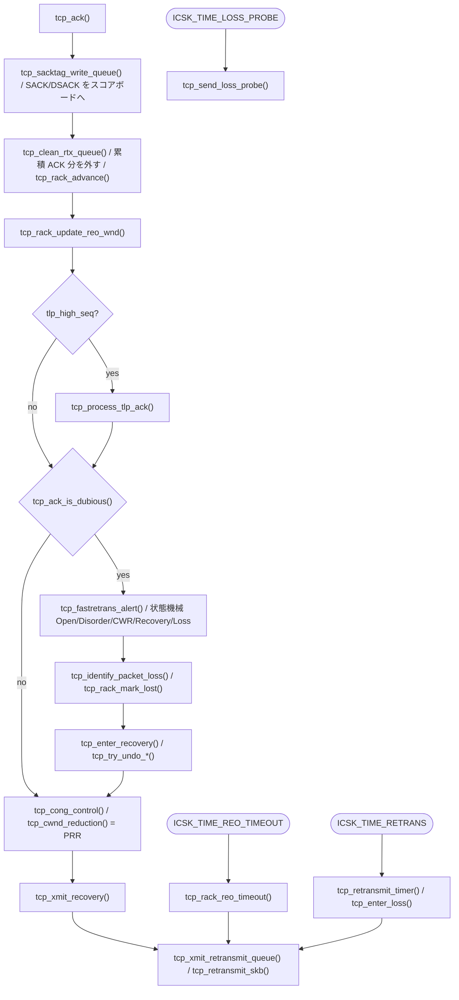

# 8. ロス検出と回復

この章は「送ったはずのセグメントが届いていない」とどう気づき、どう再発送し、どう速度を落とし、勘違いだったときにどう元に戻すかを扱います。対象は `net/ipv4/tcp_input.c` の SACK スコアボード処理と輻輳状態機械、`net/ipv4/tcp_recovery.c` の RACK、`net/ipv4/tcp_output.c` の再送と TLP、`net/ipv4/tcp_timer.c` の RTO ハンドラです。タイマーの仕組みそのもの（`icsk_pending` の多重化や `tcp_write_timer_handler()` の dispatch）は 9 章、ACK 受信の全体像と RTT 推定は 7 章、cwnd の増加側は 11 章に任せます。

## たとえ話で言うと

宅配会社が 1 番から 10 番までの小包（伝票付きの小包）を同じ部屋の郵便受けに順番に出荷したとします。受け取り側は「3 番まで受け取りました」という受領印に加えて、「ただし 5〜7 番と 9 番は先に届いて順番待ちの棚に置いてあります」というメモ（SACK）を付けて返してくれます。

発送係は手元の台帳（スコアボード）に「届いた」「たぶん失くした」「再発送した」の印を付けていきます。4 番が失くなったのか、ただ遅れているだけなのかは分かりません。そこで現代の発送係は「4 番より**後に出荷した** 7 番がもう届いたのに、4 番は出荷から『最近の往復時間 + 少しの猶予』を過ぎても届かない。なら失くしたと判断しよう」と時刻で決めます（RACK）。

失くしたと判断したら再発送しますが、道路が混んでいた証拠なので、一度に道路へ出せるトラックの台数（cwnd）を減らします。ただし急ブレーキは踏まず、「受領印が 1 つ返ってくるたびに、新しい目標台数との比率でトラックを出す」ようにじわじわ減らします（PRR）。

最後の何個かがまとめて失くなると、受領印そのものが返ってこなくなります。そのときはキッチンタイマーを短めにかけて、鳴ったら最後の 1 個だけ試しに再発送して様子を見ます（TLP）。それでも駄目なら長いタイマー（RTO）が鳴り、棚の小包をほぼ全部「失くした」扱いにして最初からやり直します。

そして後から「実は 4 番は届いていて、再発送分が二重に届きました」（DSACK）や「4 番の受領印のタイムスタンプは再発送より前のものでした」（Eifel）と分かったら、減らしたトラック台数を元に戻します（undo）。

## RFC では

### 関係する RFC のあらまし

- **RFC 2018 — TCP Selective Acknowledgment Options**: 受信側が「累積 ACK より先で受け取った範囲」を最大 4 ブロック（タイムスタンプ併用時は通常 3）まで送り返すオプションです。送信側には「SACK された範囲を再送しなくてよい」という情報を与えます。送信側の振る舞いは [RFC 2018 §5](https://www.rfc-editor.org/rfc/rfc2018#section-5)、受信側が SACK 済みデータを捨てうる（reneging）ことは [RFC 2018 §8](https://www.rfc-editor.org/rfc/rfc2018#section-8) にあります。
- **RFC 2883 — An Extension to the SACK Option (D-SACK)**: 重複して受け取ったセグメントを最初の SACK ブロックで報告する拡張です。送信側はこれで「再送は不要だった」と知ることができます（[RFC 2883 §4](https://www.rfc-editor.org/rfc/rfc2883#section-4)）。
- **RFC 6675 — A Conservative Loss Recovery Algorithm Based on SACK**（RFC 3517 を置き換え）: SACK スコアボードから `pipe`（ネットワーク内にあると推定されるデータ量）を計算し、`IsLost()`（DupThresh 個の SACK が上にあればロス）で再送対象を決める古典的アルゴリズムです。Linux はこれを**文字通りには実装していません**。2025 年に関連コードも削除されました（後述）。
- **RFC 8985 — The RACK-TLP Loss Detection Algorithm for TCP**: パケット数ではなく**送信時刻**でロスを判定する RACK と、テール（末尾）ロスを RTO より早く発見する TLP を定義した Standards Track の RFC です。現在の Linux のロス検出はこれが基本です。
- **RFC 6937 — Proportional Rate Reduction for TCP**（Experimental。標準化版の RFC 9937 で置き換えられています）: 回復中に cwnd を ssthresh までどう減らしていくかを決めるアルゴリズムです。ACK で届いた量に比例して送信量を決めます。
- **RFC 6298 — Computing TCP's Retransmission Timer**: RTO の計算と、タイムアウト時に RTO を 2 倍にする backoff を定めます（[RFC 6298 §5](https://www.rfc-editor.org/rfc/rfc6298#section-5)）。
- **RFC 5682 — Forward RTO-Recovery (F-RTO)**: RTO の後に届く ACK を見て、そのタイムアウトが spurious（実はロスでなかった）かどうかを判定します。SACK 版は [RFC 5682 §3](https://www.rfc-editor.org/rfc/rfc5682#section-3) です。
- **RFC 3522 — The Eifel Detection Algorithm** と **RFC 4015 — The Eifel Response Algorithm**: タイムスタンプのエコーで「再送より前に送った元のセグメントへの ACK だった」と検出し、輻輳制御の状態を元に戻す仕組みです。
- **RFC 3708 — Using TCP DSACKs and SCTP Duplicate TSNs to Detect Spurious Retransmissions**（Experimental）: すべての再送が DSACK で報告されたら、その回復は spurious だったとみなす考え方です。Linux の `undo_retrans` カウンタがこれに相当します。

### SACK 送信側の規則（RFC 2018 / RFC 2883）

[RFC 2018 §5](https://www.rfc-editor.org/rfc/rfc2018#section-5) は、送信側が再送キューの各セグメントに「SACKed」フラグを持ち、SACK されたセグメントは再送しないことを求めます。一方で [RFC 2018 §8](https://www.rfc-editor.org/rfc/rfc2018#section-8) により受信側は SACK 済みのデータを捨ててもよい（reneging）ので、送信側は SACK フラグを「ヒント」として扱い、RTO 時には SACK 情報を信用しすぎてはいけません。Linux ではこれが `tcp_timeout_mark_lost()` の reneging 処理と `tcp_check_sack_reneging()` に現れます。

D-SACK（[RFC 2883 §4](https://www.rfc-editor.org/rfc/rfc2883#section-4)）の判定規則は次の 2 通りです。

1. 最初の SACK ブロックが累積 ACK より下にある（`start_seq < ack_seq`）なら、それは D-SACK です。
2. そうでなくても、最初のブロックが 2 番目のブロックに完全に含まれていれば D-SACK です（順番待ちの棚にあるデータの重複）。

### RFC 6675 のスコアボード、pipe、IsLost

RFC 6675 はスコアボードの上で次の関数を定義します（[RFC 6675 §4](https://www.rfc-editor.org/rfc/rfc6675#section-4)）。

- `IsLost(SeqNum)`: `SeqNum` より上に DupThresh 個以上の不連続な SACK 済みセグメントがある、または `(DupThresh - 1) * SMSS` バイトより多く SACK されていれば真。
- `SetPipe()`: `HighACK` から `HighData` まで走査し、各オクテットについて「SACK されておらず IsLost でもなければ 1」「再送済みならさらに 1」を足したものが `pipe` です。
- `NextSeg()`: 次に送るべきセグメントを決める規則です（ロスした最小の未 SACK セグメント → 新データ → ロスではない未 SACK セグメント → rescue retransmission）。

回復の手順は [RFC 6675 §5](https://www.rfc-editor.org/rfc/rfc6675#section-5) にあり、DupThresh 個目の重複 ACK（または IsLost）で回復に入り、`cwnd - pipe >= 1 SMSS` の間 `NextSeg()` で送ります。

Linux の対応はこうなっています。

- `pipe` はバイトではなく**パケット数**で、`tcp_packets_in_flight()` = `packets_out - (sacked_out + lost_out) + retrans_out` です。RFC の SetPipe() の「SACK されておらず IsLost でもないもの + 再送分」をカウンタの足し引きで O(1) に求めたものです。
- `IsLost()` は RACK に置き換えられています。DupThresh の考え方は `tcp_rack_reo_wnd()` が「まだ並べ替えを見ていない接続で SACK が `tp->reordering` 個以上あれば reo_wnd を 0 にする」という形で残しています。
- `NextSeg()` の規則 1（ロスした所の再送）は `tcp_xmit_retransmit_queue()`、規則 2（新データ）は `tcp_write_xmit()` が担当します。規則 3（ロスと判定されていない穴の先回り再送）と rescue retransmission は Linux にはありません。後者の役目は TLP が果たします。

### RACK（RFC 8985 §6）

RACK は 1 接続あたり次の状態を持ちます（[RFC 8985 §5](https://www.rfc-editor.org/rfc/rfc8985#section-5)）。

| RFC 8985 の変数 | 意味 | Linux |
| --- | --- | --- |
| `RACK.xmit_ts` | (S)ACK された中で最も新しく送信されたセグメントの送信時刻 | `tp->rack.mstamp` |
| `RACK.end_seq` | そのセグメントの終端シーケンス | `tp->rack.end_seq` |
| `RACK.rtt` | そのセグメントで測った RTT | `tp->rack.rtt_us` |
| `RACK.min_RTT` | min RTT | `tcp_min_rtt(tp)`（`tp->rtt_min` の windowed min filter） |
| `RACK.reo_wnd` | reordering window | `tcp_rack_reo_wnd()` の戻り値 |
| `RACK.reo_wnd_mult` | DSACK で増やす倍率 | `tp->rack.reo_wnd_steps` |
| `RACK.reo_wnd_persist` | 倍率を保持する回復回数 | `tp->rack.reo_wnd_persist` |
| `RACK.dsack_round` | DSACK に反応した round | `tp->rack.last_delivered` |
| `RACK.reordering_seen` | 並べ替えを見たか | `tp->reord_seen`（回数） |

ACK を受けたときの手順は [RFC 8985 §6.2](https://www.rfc-editor.org/rfc/rfc8985#section-6.2) にあります。

1. **Step 1**: `RACK.min_RTT` を更新します（Linux では 7 章の `tcp_update_rtt_min()`）。
2. **Step 2**: 新たに (S)ACK された各セグメントについて、再送されたセグメントで RTT が `min_RTT` より小さいもの（元の送信への ACK かもしれず曖昧）を除き、`RACK.rtt` を更新し、そのセグメントが `RACK.xmit_ts` より後に送られていれば `RACK.xmit_ts / end_seq` を進めます。「後に送られた」は送信時刻で比べ、同時刻なら `end_seq` で比べます。
3. **Step 3**: 再送されていないセグメントが、より大きなシーケンスのセグメントより後に (S)ACK されたら並べ替えとみなします。
4. **Step 4**: reordering window を更新します。

   ```
   RACK.reo_wnd = 0                         (並べ替え未観測で、回復中 or SACK 数 >= DupThresh)
   RACK.reo_wnd = min(RACK.reo_wnd_mult * RACK.min_RTT / 4, SRTT)   (それ以外)
   ```

   DSACK を受けた round ごとに `reo_wnd_mult` を 1 増やし、16 回の回復の間はその値を保持します。
5. **Step 5**: 各未 (S)ACK セグメントについて、`RACK.xmit_ts` より前に送られていて、かつ

   ```
   Segment.xmit_ts + RACK.rtt + RACK.reo_wnd - Now() <= 0
   ```

   ならロスとマークします。まだ正なら、その残り時間の最大値で RACK reordering timer を張ります。

RTO が起きたとき（[RFC 8985 §6.3](https://www.rfc-editor.org/rfc/rfc8985#section-6.3)）は、`RACK.rtt + RACK.reo_wnd` より前に送られたセグメントだけをロスとし、最近送ったものはロス扱いしません。Linux の `tcp_timeout_mark_lost()` がこれに当たります（reo_wnd は 0 で計算します）。

### TLP（RFC 8985 §7）

TLP は「最後の数セグメントが失われると重複 ACK も SACK も来ないので、RACK も発火できない」という問題への答えです（[RFC 8985 §7](https://www.rfc-editor.org/rfc/rfc8985#section-7)）。

- **PTO の計算**（[§7.2](https://www.rfc-editor.org/rfc/rfc8985#section-7.2)）:

  ```
  PTO = 2 * SRTT
  if FlightSize == 1: PTO += WCDelAckT   (最悪の遅延 ACK 時間、推奨 200ms)
  PTO = min(PTO, RTO までの残り時間)
  SRTT が無ければ PTO = 1 秒
  ```

- **PTO 満了時**（[§7.3](https://www.rfc-editor.org/rfc/rfc8985#section-7.3)）: 送れる新データがあればそれを 1 セグメント送り、なければ最後のセグメントを再送します。1 回のテールロスにつき probe は 1 つまでです。
- **probe の ACK によるロス検出**（[§7.4](https://www.rfc-editor.org/rfc/rfc8985#section-7.4)）: 一般には RACK が SACK を見てロスを検出します（[§7.4.1](https://www.rfc-editor.org/rfc/rfc8985#section-7.4.1)）。特別なケースとして「1 個だけ失われて probe がそれを修復した」場合（[§7.4.2](https://www.rfc-editor.org/rfc/rfc8985#section-7.4.2)）、`TLP.end_seq` を越える ACK が DSACK を伴わずに来たらロスがあったと判断し、輻輳応答（cwnd 削減）だけを行います。DSACK が来たら元のセグメントも probe も届いた、つまりロスは無かったと判断します。

### PRR（RFC 6937）

PRR の擬似コードは [RFC 6937 §3](https://www.rfc-editor.org/rfc/rfc6937#section-3) にあります。

```
回復開始時:
   ssthresh      = CongCtrlAlg()
   prr_delivered = 0
   prr_out       = 0
   RecoverFS     = snd.nxt - snd.una

回復中の各 ACK で:
   DeliveredData  = change_in(snd.una) + change_in(SACKd)
   prr_delivered += DeliveredData
   pipe = (RFC 6675 の pipe)
   if (pipe > ssthresh) {
       // Proportional Rate Reduction
       sndcnt = CEIL(prr_delivered * ssthresh / RecoverFS) - prr_out
   } else {
       // Reduction Bound
       if (conservative)  limit = prr_delivered - prr_out                         // PRR-CRB
       else               limit = MAX(prr_delivered - prr_out, DeliveredData) + MSS  // PRR-SSRB
       sndcnt = MIN(ssthresh - pipe, limit)
   }

送信・再送のたびに:
   prr_out += (送ったデータ量)
```

直感的には、`pipe > ssthresh` の間は「ACK で抜けた量 × ssthresh/RecoverFS」だけ送るので、1 RTT かけて送信量が ssthresh へ滑らかに減っていきます。`pipe <= ssthresh` になったら、PRR-SSRB では 1 ACK あたり最大「届いた量 + 1 MSS」まで送って ssthresh まで slow start 的に戻します。標準化版の [RFC 9937](https://www.rfc-editor.org/rfc/rfc9937) は Linux の改良点（後述の `9ad084d66619`）を取り込んでいます。

### RTO と backoff（RFC 6298 §5）

[RFC 6298 §5](https://www.rfc-editor.org/rfc/rfc6298#section-5) の規則のうち、この章に関係するのは次のものです。

- (5.4) タイマーが満了したら、最も古い未 ACK セグメントを再送します。
- (5.5) `RTO <- RTO * 2`（"back off the timer"）。上限は [§2](https://www.rfc-editor.org/rfc/rfc6298#section-2) の (2.5) により 60 秒以上の任意の値です。
- (5.6) 新しい RTO でタイマーを再始動します。
- 有効な RTT サンプルを得たら backoff を解除して RTO を再計算します（Karn のアルゴリズムにより、再送されたセグメントからはサンプルを取りません。[§3](https://www.rfc-editor.org/rfc/rfc6298#section-3)）。

### F-RTO（RFC 5682 §3）

SACK 版 F-RTO（[RFC 5682 §3.1](https://www.rfc-editor.org/rfc/rfc5682#section-3.1)）は、RTO 後の最初の 2 つの ACK を見ます。

1. **Step 1**: RTO が満了したら、最初の未 ACK セグメント（SND.UNA）を再送します。回復中でなければ `SpuriousRecovery = FALSE` とし、`recover = SND.NXT` を覚えます。
2. **Step 2**: 最初の ACK で
   - (a) 重複 ACK、または ACK が `recover` 以上を確認したら、通常の RTO 回復を続けます。
   - (b) SND.UNA を進めたが `recover` に届かないなら、**新しいデータ**を 2 セグメント送り、Step 3 へ進みます（送れる新データがなければ通常の回復へ）。
3. **Step 3**: 次の ACK で
   - (a) 重複 ACK（または SACK が付いている）なら、ロスは本物でした。通常の回復を続けます。
   - (b) SND.UNA を進め、かつ**再送していない**セグメントを確認したなら、RTO は spurious でした。Eifel response（RFC 4015）などで輻輳状態を元に戻します。

### Undo（RFC 3522 / RFC 4015 / RFC 2883 / RFC 3708）

- **Eifel detection**（[RFC 3522 §3.2](https://www.rfc-editor.org/rfc/rfc3522#section-3.2)）: 最初の再送時のタイムスタンプ値を覚えておき、回復後の最初の ACK の TSecr がそれより古ければ「元のセグメントへの ACK だった」ので spurious と判断します。
- **Eifel response**（[RFC 4015](https://www.rfc-editor.org/rfc/rfc4015)）: spurious と判断したら、回復前に保存しておいた cwnd と ssthresh を戻します。
- **DSACK-based undo**（[RFC 2883](https://www.rfc-editor.org/rfc/rfc2883) / [RFC 3708](https://www.rfc-editor.org/rfc/rfc3708)）: その回復で行った再送が**すべて** DSACK で報告されたら、全部不要だったので元に戻します。

Linux はこれらを `undo_marker` / `undo_retrans` / `retrans_stamp` / `prior_ssthresh` / `prior_cwnd` の 5 つの変数で実装しています（Step 14）。

## 全体の流れ



ACK 1 つの処理は次の 3 段階に分かれます。

1. **情報の取り込み**: SACK と累積 ACK からスコアボード（skb ごとのビットと 4 つのカウンタ）と RACK の状態を更新します。
2. **判断**: `tcp_fastretrans_alert()` が RACK を呼んでロスをマークし、`icsk_ca_state` を遷移させ、必要なら undo します。この関数は cwnd を**減らしません**。
3. **実行**: `tcp_cong_control()` が PRR で cwnd を決め、`tcp_xmit_recovery()` が再送します。

タイマー側の 3 つの入口（RACK の reordering timer、TLP の probe timer、RTO）は、1 つの `icsk_retransmit_timer` を `icsk_pending` で多重化しています（詳細は 9 章）。

`icsk_ca_state` の遷移をまとめると次のとおりです。

| 現在 | きっかけ | 次 | 主な関数 |
| --- | --- | --- | --- |
| Open | SACK / 重複 ACK を受信（まだロスなし） | Disorder | `tcp_try_keep_open()` |
| Open / Disorder | RACK がロスをマーク（`lost_out != 0`） | Recovery | `tcp_enter_recovery()` |
| Open / Disorder | ECE、ローカル輻輳、TLP がロスを発見 | CWR | `tcp_enter_cwr()` / `tcp_process_tlp_ack()` |
| CWR | `snd_una > high_seq` | Open | `tcp_end_cwnd_reduction()` |
| Recovery | `snd_una >= high_seq` | Open / Disorder | `tcp_try_undo_recovery()` → `tcp_end_cwnd_reduction()` |
| Recovery | DSACK / タイムスタンプで spurious と判明 | Open / Disorder | `tcp_try_undo_dsack()` / `tcp_try_undo_partial()` |
| 任意 | RTO 満了 | Loss | `tcp_enter_loss()` |
| Loss | `snd_una >= high_seq`、F-RTO で spurious、undo | Open | `tcp_process_loss()` |
| Loss | 再送パケットもロス（`FLAG_LOST_RETRANS`） | Recovery | `tcp_enter_recovery()` |

## コードを追う

### Step 1: スコアボード ― skb ごとの 3 ビットと 4 つのカウンタ

再送キュー（`sk->tcp_rtx_queue`、seq 順の rbtree）の各 skb は `TCP_SKB_CB(skb)->sacked` にタグを持ちます。定義は `enum tcp_skb_cb_sacked_flags`（[include/net/tcp.h#L1120](https://git.kernel.org/pub/scm/linux/kernel/git/netdev/net-next.git/tree/include/net/tcp.h?id=279d5c8afcd38bd841832a39bfe1aa4f8518d98e#n1120)） です。

```c
/* State flags for sacked in struct tcp_skb_cb */
enum tcp_skb_cb_sacked_flags {
	TCPCB_SACKED_ACKED	= (1 << 0),	/* SKB ACK'd by a SACK block	*/
	TCPCB_SACKED_RETRANS	= (1 << 1),	/* SKB retransmitted		*/
	TCPCB_LOST		= (1 << 2),	/* SKB is lost			*/
	TCPCB_TAGBITS		= (TCPCB_SACKED_ACKED | TCPCB_SACKED_RETRANS |
				   TCPCB_LOST),	/* All tag bits			*/
	TCPCB_REPAIRED		= (1 << 4),	/* SKB repaired (no skb_mstamp_ns)	*/
	TCPCB_EVER_RETRANS	= (1 << 7),	/* Ever retransmitted frame	*/
	TCPCB_RETRANS		= (TCPCB_SACKED_RETRANS | TCPCB_EVER_RETRANS |
				   TCPCB_REPAIRED),
};
```

- `TCPCB_SACKED_ACKED`（S）: SACK で届いたと分かったもの
- `TCPCB_SACKED_RETRANS`（R）: 再送して、その再送がまだ飛んでいると考えているもの
- `TCPCB_LOST`（L）: ロスと判定したもの
- `TCPCB_EVER_RETRANS`: 一度でも再送したもの。R は DSACK や再ロスで消えますが、こちらは消えません。Karn のアルゴリズム（再送したものから RTT を取らない）と RACK の曖昧さ判定に使います。
- `TCPCB_RETRANS` はビットではなく、R・EVER_RETRANS・REPAIRED をまとめたマスクです。`sacked & TCPCB_RETRANS` は「再送されたことがある（または repair で送信時刻が不正確な）skb」を意味します。なお `tcp_retransmit_skb()` は `sacked |= TCPCB_RETRANS` とするので REPAIRED ビットも立ちますが、REPAIRED を単独で見るコードは無いので実害はありません。

各ビットの合計が `tcp_sock` の 4 つのカウンタです。すべて **skb 数ではなくセグメント数（`tcp_skb_pcount()`）** で数えます。

| カウンタ | 意味 | 対応ビット |
| --- | --- | --- |
| `packets_out` | `snd_una`〜`snd_nxt` のセグメント数 | （全体） |
| `sacked_out` | S のセグメント数（非 SACK 接続では重複 ACK 数で推定） | S |
| `lost_out` | L のセグメント数 | L |
| `retrans_out` | R のセグメント数 | R |

`tcp_sacktag_write_queue()` の前にある巨大なコメントが、有効な組み合わせを表にしています。

```c
 * Valid combinations are:
 * Tag  InFlight	Description
 * 0	1		- orig segment is in flight.
 * S	0		- nothing flies, orig reached receiver.
 * L	0		- nothing flies, orig lost by net.
 * R	2		- both orig and retransmit are in flight.
 * L|R	1		- orig is lost, retransmit is in flight.
 * S|R  1		- orig reached receiver, retrans is still in flight.
 * (L|S|R is logically valid, it could occur when L|R is sacked,
 *  but it is equivalent to plain S and code short-circuits it to S.
 *  L|S is logically invalid, it would mean -1 packet in flight 8))
 *
```

L|S は「-1 個飛んでいる」ことになるので不正です。SACK が L|R の skb に当たると `tcp_sacktag_one()` は L と R の両方を落として S にします（短絡）。この不変条件から、飛んでいるセグメント数は次の式で表せます。

```c
static inline unsigned int tcp_left_out(const struct tcp_sock *tp)
{
	return tp->sacked_out + tp->lost_out;
}

/* This determines how many packets are "in the network" to the best
 * of our knowledge.  In many cases it is conservative, but where
 * detailed information is available from the receiver (via SACK
 * blocks etc.) we can make more aggressive calculations.
 *
 * Use this for decisions involving congestion control, use just
 * tp->packets_out to determine if the send queue is empty or not.
 *
 * Read this equation as:
 *
 *	"Packets sent once on transmission queue" MINUS
 *	"Packets left network, but not honestly ACKed yet" PLUS
 *	"Packets fast retransmitted"
 */
static inline unsigned int tcp_packets_in_flight(const struct tcp_sock *tp)
{
	return tp->packets_out - tcp_left_out(tp) + tp->retrans_out;
}
```

`tcp_packets_in_flight()`（[include/net/tcp.h#L1549](https://git.kernel.org/pub/scm/linux/kernel/git/netdev/net-next.git/tree/include/net/tcp.h?id=279d5c8afcd38bd841832a39bfe1aa4f8518d98e#n1549)） が RFC 6675 の `pipe` です。`tcp_verify_left_out()` マクロ（`WARN_ON(tcp_left_out(tp) > tp->packets_out)`）は S と L が重ならないという不変条件の番人です。cwnd による送信判定（`tcp_cwnd_test()`、4 章）も PRR もこの値を使うので、カウンタが 1 つずれるだけで送信が止まったり（過大な場合）、バーストしたり（過小な場合）します。

ロスのマークはすべて `tcp_mark_skb_lost()`（[net/ipv4/tcp_input.c#L1329](https://git.kernel.org/pub/scm/linux/kernel/git/netdev/net-next.git/tree/net/ipv4/tcp_input.c?id=279d5c8afcd38bd841832a39bfe1aa4f8518d98e#n1329)） を通ります。

```c
static void tcp_verify_retransmit_hint(struct tcp_sock *tp, struct sk_buff *skb)
{
	if ((!tp->retransmit_skb_hint && tp->retrans_out >= tp->lost_out) ||
	    (tp->retransmit_skb_hint &&
	     before(TCP_SKB_CB(skb)->seq,
		    TCP_SKB_CB(tp->retransmit_skb_hint)->seq)))
		tp->retransmit_skb_hint = skb;
}

/* Sum the number of packets on the wire we have marked as lost, and
 * notify the congestion control module that the given skb was marked lost.
 */
static void tcp_notify_skb_loss_event(struct tcp_sock *tp, const struct sk_buff *skb)
{
	tp->lost += tcp_skb_pcount(skb);
}

void tcp_mark_skb_lost(struct sock *sk, struct sk_buff *skb)
{
	__u8 sacked = TCP_SKB_CB(skb)->sacked;
	struct tcp_sock *tp = tcp_sk(sk);

	if (sacked & TCPCB_SACKED_ACKED)
		return;

	tcp_verify_retransmit_hint(tp, skb);
	if (sacked & TCPCB_LOST) {
		if (sacked & TCPCB_SACKED_RETRANS) {
			/* Account for retransmits that are lost again */
			TCP_SKB_CB(skb)->sacked &= ~TCPCB_SACKED_RETRANS;
			tp->retrans_out -= tcp_skb_pcount(skb);
			NET_ADD_STATS(sock_net(sk), LINUX_MIB_TCPLOSTRETRANSMIT,
				      tcp_skb_pcount(skb));
			tcp_notify_skb_loss_event(tp, skb);
		}
	} else {
		tp->lost_out += tcp_skb_pcount(skb);
		TCP_SKB_CB(skb)->sacked |= TCPCB_LOST;
		tcp_notify_skb_loss_event(tp, skb);
	}
}
```

- 1334 行: S の skb はロスにしません（L|S の禁止）。
- 1337 行: `tcp_verify_retransmit_hint()` は `retransmit_skb_hint`（`tcp_xmit_retransmit_queue()` が走査を始める位置）を、新しくロスになった skb がヒントより前なら巻き戻します。ヒントが NULL のときは「L は全部再送済み（`retrans_out >= lost_out`）」の場合に限ってこの skb をヒントにします。コメントにあるとおり、`lost_out` / `retrans_out` を更新する**前**に呼ぶ必要があります。
- 1338〜1346 行: すでに L の skb が再びロスと判定されるのは、**再送がロスした**ときだけです（L|R → L）。R を落として `retrans_out` を減らすと pipe が減り、もう一度再送できるようになります。`TCPLostRetransmit` が数えるのはこれです。RACK は再送にも送信時刻を付けるので、再送のロスを RTO を待たずに検出できます。これが FACK や RFC 6675 に対する RACK の大きな利点です。
- 1347〜1350 行: 初めてのロスなら L を立てて `lost_out` を増やします。
- `tp->lost` は累積のロス数で、`tcp_rate_gen()` が rate sample の `rs->losses` として輻輳制御（BBR など）に渡します。`tcp_notify_skb_loss_event()` という名前は、CC へのロスイベント通知フックを入れる余地として残っているものです。

### Step 2: tcp_ack() の中での呼び出し順

ACK 処理全体は 7 章で扱います。ここではロス回復に関係する順序だけを押さえます。`tcp_ack()`（[net/ipv4/tcp_input.c#L4276](https://git.kernel.org/pub/scm/linux/kernel/git/netdev/net-next.git/tree/net/ipv4/tcp_input.c?id=279d5c8afcd38bd841832a39bfe1aa4f8518d98e#n4276)）の抜粋です。

```c
	prior_fack = tcp_is_sack(tp) ? tcp_highest_sack_seq(tp) : tp->snd_una;
	rs.prior_in_flight = tcp_packets_in_flight(tp);
...
		if (TCP_SKB_CB(skb)->sacked)
			flag |= tcp_sacktag_write_queue(sk, skb, prior_snd_una,
							&sack_state);
...
	/* See if we can take anything off of the retransmit queue. */
	flag |= tcp_clean_rtx_queue(sk, skb, prior_fack, prior_snd_una,
				    &sack_state, flag & FLAG_ECE);

	tcp_rack_update_reo_wnd(sk, &rs);
...
	if (unlikely(tp->tlp_high_seq))
		tcp_process_tlp_ack(sk, ack, flag);

	if (tcp_ack_is_dubious(sk, flag)) {
		if (!(flag & (FLAG_SND_UNA_ADVANCED |
			      FLAG_NOT_DUP | FLAG_DSACKING_ACK))) {
			num_dupack = 1;
			/* Consider if pure acks were aggregated in tcp_add_backlog() */
			if (!(flag & FLAG_DATA))
				num_dupack = max_t(u16, 1, skb_shinfo(skb)->gso_segs);
		}
		tcp_fastretrans_alert(sk, prior_snd_una, num_dupack, &flag,
				      &rexmit);
	}

	/* If needed, reset TLP/RTO timer when RACK doesn't set. */
	if (flag & FLAG_SET_XMIT_TIMER)
		tcp_set_xmit_timer(sk);

	if ((flag & FLAG_FORWARD_PROGRESS) || !(flag & FLAG_NOT_DUP))
		sk_dst_confirm(sk);

	delivered = tcp_newly_delivered(sk, delivered, ecn_count, flag);

	lost = tp->lost - lost;			/* freshly marked lost */
	rs.is_ack_delayed = !!(flag & FLAG_ACK_MAYBE_DELAYED);
	tcp_rate_gen(sk, delivered, lost, is_sack_reneg, sack_state.rate);
	tcp_cong_control(sk, ack, delivered, flag, sack_state.rate);
	tcp_xmit_recovery(sk, rexmit);
```

- `prior_fack` は SACK 処理**前**の最大 SACK シーケンスです。`tcp_clean_rtx_queue()` が「累積 ACK で埋まった穴が、すでに SACK されていた範囲より下だったか」（＝並べ替え）を判定するのに使います。
- `rs.prior_in_flight` は ACK 処理前の pipe です（CC 用）。
- SACK 処理（`tcp_sacktag_write_queue()`）は slow path の ACK でしか走りません。header prediction の fast path（5 章）に乗る ACK は SACK を持たないからです。
- 順序が重要です。**SACK タグ付け → 累積 ACK の除去 → reo_wnd 更新 → TLP 判定 → 状態機械 → cwnd 計算 → 再送** の順になっています。`tcp_fastretrans_alert()` は cwnd を決めません。`rexmit` に「何を送るべきか」だけを記録し、実際の送信は `tcp_cong_control()` が PRR で cwnd を決めた**後**の `tcp_xmit_recovery()` が行います。`tcp_cong_control()` ヘルパ（`d452e6caf836`「tcp: tcp_cong_control helper」）と、それに続く `c0402760f565`「tcp: new CC hook to set sending rate with rate_sample in any CA state」で、cwnd の決定をまとめて ACK 処理の後半へ移し、その後で送信する形になりました。
- `tcp_ack_is_dubious()`（[net/ipv4/tcp_input.c#L3831](https://git.kernel.org/pub/scm/linux/kernel/git/netdev/net-next.git/tree/net/ipv4/tcp_input.c?id=279d5c8afcd38bd841832a39bfe1aa4f8518d98e#n3831)）は「重複 ACK（`FLAG_NOT_DUP` が無い）」「SACK・ECE・DSACK がある（`FLAG_CA_ALERT`）」「Open 以外の状態」のどれかで真になります。Open 状態で順調に累積 ACK だけが来ている間は、状態機械に一切入りません。
- `num_dupack` は、GRO / `tcp_add_backlog()` で純 ACK が結合されていれば `gso_segs` 個分の重複 ACK として数えます。非 SACK 接続の `sacked_out` 推定にとって重要です。

### Step 3: tcp_sacktag_write_queue() ― SACK ブロックの検証と整列

`tcp_sacktag_write_queue()`（[net/ipv4/tcp_input.c#L2219](https://git.kernel.org/pub/scm/linux/kernel/git/netdev/net-next.git/tree/net/ipv4/tcp_input.c?id=279d5c8afcd38bd841832a39bfe1aa4f8518d98e#n2219)） は SACK オプションをスコアボードに反映する入口です。ブロック単位で見ていきます。

```c
static int
tcp_sacktag_write_queue(struct sock *sk, const struct sk_buff *ack_skb,
			u32 prior_snd_una, struct tcp_sacktag_state *state)
{
	struct tcp_sock *tp = tcp_sk(sk);
	const unsigned char *ptr = (skb_transport_header(ack_skb) +
				    TCP_SKB_CB(ack_skb)->sacked);
	struct tcp_sack_block_wire *sp_wire = (struct tcp_sack_block_wire *)(ptr+2);
	struct tcp_sack_block sp[TCP_NUM_SACKS];
	struct tcp_sack_block *cache;
	struct sk_buff *skb;
	int num_sacks = min(TCP_NUM_SACKS, (ptr[1] - TCPOLEN_SACK_BASE) >> 3);
	int used_sacks;
	bool found_dup_sack = false;
	int i, j;
	int first_sack_index;

	state->flag = 0;
	state->reord = tp->snd_nxt;

	if (!tp->sacked_out)
		tcp_highest_sack_reset(sk);

	found_dup_sack = tcp_check_dsack(sk, ack_skb, sp_wire,
					 num_sacks, prior_snd_una, state);

	/* Eliminate too old ACKs, but take into
	 * account more or less fresh ones, they can
	 * contain valid SACK info.
	 */
	if (before(TCP_SKB_CB(ack_skb)->ack_seq, prior_snd_una - tp->max_window))
		return 0;

	if (!tp->packets_out)
		goto out;
```

- 2224〜2226 行: `TCP_SKB_CB(ack_skb)->sacked` には、オプション解析（`tcp_parse_options()`）が SACK オプションの TCP ヘッダ先頭からのオフセットを入れています。`ptr[1]` はオプション長です。
- 2230 行: ブロック数は `(len - 2) / 8` を `TCP_NUM_SACKS`（4）で上限します。
- 2237 行: `state->reord` は「並べ替えで埋まった最小のシーケンス」を探す変数で、`snd_nxt` は「見つからなかった」を表す番兵です。
- 2239〜2240 行: `sacked_out == 0` なら `highest_sack`（最大 SACK 位置の次の skb を指すポインタ）を再送キューの先頭へリセットします。
- 2242 行: DSACK 判定は検証より前に行います（Step 4）。
- 2249〜2250 行: `prior_snd_una - max_window` より古い ACK は捨てます。少し古いだけの ACK は、ACK の並べ替えで遅れて来たもので有用な SACK を持つかもしれないので処理します。
- 2252〜2253 行: 飛んでいるデータが無ければ、DSACK の統計だけ取って終わります。

```c
	used_sacks = 0;
	first_sack_index = 0;
	for (i = 0; i < num_sacks; i++) {
		bool dup_sack = !i && found_dup_sack;

		sp[used_sacks].start_seq = get_unaligned_be32(&sp_wire[i].start_seq);
		sp[used_sacks].end_seq = get_unaligned_be32(&sp_wire[i].end_seq);

		if (!tcp_is_sackblock_valid(tp, dup_sack,
					    sp[used_sacks].start_seq,
					    sp[used_sacks].end_seq)) {
			int mib_idx;

			if (dup_sack) {
				if (!tp->undo_marker)
					mib_idx = LINUX_MIB_TCPDSACKIGNOREDNOUNDO;
				else
					mib_idx = LINUX_MIB_TCPDSACKIGNOREDOLD;
			} else {
				/* Don't count olds caused by ACK reordering */
				if ((TCP_SKB_CB(ack_skb)->ack_seq != tp->snd_una) &&
				    !after(sp[used_sacks].end_seq, tp->snd_una))
					continue;
				mib_idx = LINUX_MIB_TCPSACKDISCARD;
			}

			NET_INC_STATS(sock_net(sk), mib_idx);
			if (i == 0)
				first_sack_index = -1;
			continue;
		}

		/* Ignore very old stuff early */
		if (!after(sp[used_sacks].end_seq, prior_snd_una)) {
			if (i == 0)
				first_sack_index = -1;
			continue;
		}

		used_sacks++;
	}
```

各ブロックをホストバイトオーダの `sp[]` にコピーしながら検証します。

- `dup_sack` は先頭ブロック（i == 0）が DSACK だった場合だけ真です。
- `tcp_is_sackblock_valid()`（Step 4）で弾かれたブロックは統計を取って捨てます。ACK 自体が古い（`ack_seq != snd_una`）ために `snd_una` 以下になったブロックは、ACK の並べ替えによる正常な現象なので `TCPSACKDiscard` に数えません。
- `first_sack_index` は「受信側が最初に書いたブロック」がソート後にどこへ行ったかを追跡します。RFC 2018 では先頭ブロックが最新の受信を表し、DSACK も先頭に置かれるので、それを覚えておく必要があります。先頭が捨てられたら -1 にします。
- 2288 行: `prior_snd_una` 以下に終わるブロック（すでに累積 ACK 済み）も捨てます。

```c
	/* order SACK blocks to allow in order walk of the retrans queue */
	for (i = used_sacks - 1; i > 0; i--) {
		for (j = 0; j < i; j++) {
			if (after(sp[j].start_seq, sp[j + 1].start_seq)) {
				swap(sp[j], sp[j + 1]);

				/* Track where the first SACK block goes to */
				if (j == first_sack_index)
					first_sack_index = j + 1;
			}
		}
	}

	state->mss_now = tcp_current_mss(sk);
	skb = NULL;
	i = 0;

	if (!tp->sacked_out) {
		/* It's already past, so skip checking against it */
		cache = tp->recv_sack_cache + ARRAY_SIZE(tp->recv_sack_cache);
	} else {
		cache = tp->recv_sack_cache;
		/* Skip empty blocks in at head of the cache */
		while (tcp_sack_cache_ok(tp, cache) && !cache->start_seq &&
		       !cache->end_seq)
			cache++;
	}
```

- 2298〜2308 行: 高々 4 要素なのでバブルソートです。seq 順に並べると、seq 順に並んだ rbtree を**一方向に 1 回だけ**歩けば済むようになります。
- 2310 行: `mss_now` は SACK shifting（Step 6）で使います。
- 2314〜2323 行: `recv_sack_cache[]` は**前回の ACK で処理したブロック**のコピーです。受信側は SACK ブロックを毎回送り直すので、同じ範囲を何度もタグ付けすると、大きなウィンドウでは O(ブロック長) の走査が ACK ごとに発生します。キャッシュと重なる部分を飛ばすのがこの後のループです。

```c
	while (i < used_sacks) {
		u32 start_seq = sp[i].start_seq;
		u32 end_seq = sp[i].end_seq;
		bool dup_sack = (found_dup_sack && (i == first_sack_index));
		struct tcp_sack_block *next_dup = NULL;

		if (found_dup_sack && ((i + 1) == first_sack_index))
			next_dup = &sp[i + 1];

		/* Skip too early cached blocks */
		while (tcp_sack_cache_ok(tp, cache) &&
		       !before(start_seq, cache->end_seq))
			cache++;

		/* Can skip some work by looking recv_sack_cache? */
		if (tcp_sack_cache_ok(tp, cache) && !dup_sack &&
		    after(end_seq, cache->start_seq)) {

			/* Head todo? */
			if (before(start_seq, cache->start_seq)) {
				skb = tcp_sacktag_skip(skb, sk, start_seq);
				skb = tcp_sacktag_walk(skb, sk, next_dup,
						       state,
						       start_seq,
						       cache->start_seq,
						       dup_sack);
			}

			/* Rest of the block already fully processed? */
			if (!after(end_seq, cache->end_seq))
				goto advance_sp;

			skb = tcp_maybe_skipping_dsack(skb, sk, next_dup,
						       state,
						       cache->end_seq);

			/* ...tail remains todo... */
			if (tcp_highest_sack_seq(tp) == cache->end_seq) {
				/* ...but better entrypoint exists! */
				skb = tcp_highest_sack(sk);
				if (!skb)
					break;
				cache++;
				goto walk;
			}

			skb = tcp_sacktag_skip(skb, sk, cache->end_seq);
			/* Check overlap against next cached too (past this one already) */
			cache++;
			continue;
		}
```

ここがキャッシュを使った走査の中心です。

- 2331〜2332 行: DSACK は普通、累積 ACK より下か、別の SACK ブロックの内側にあります。後者の場合、ソート後は DSACK ブロックが直後（i+1）に来るので、`next_dup` として渡し、通常ブロックの走査中に「DSACK の範囲にも当たる skb」を検出させます。
- 2335〜2337 行: 今のブロックより前で終わるキャッシュは飛ばします。
- 2340 行: キャッシュと重なるブロック（DSACK は除く）について:
  - 2344〜2351 行: ブロックの頭がキャッシュより前なら、その部分（`start_seq`〜`cache->start_seq`）だけを歩きます。
  - 2354〜2355 行: 末尾もキャッシュ内に収まっていれば、このブロックは処理済みです。
  - 2357〜2359 行: キャッシュ範囲に DSACK が重なっていれば、その分だけ別に歩きます（`tcp_maybe_skipping_dsack()`）。
  - 2362〜2369 行: キャッシュの終端が現在の最大 SACK と一致するなら、`highest_sack` の skb から直接歩き始めます。これは「SACK ブロックの右端だけが伸びていく」という最も多いパターン（1 つの穴の後ろで受信が続く）を O(新規分) で処理するための近道です。
  - 2371〜2374 行: そうでなければキャッシュ終端まで skip します。`tcp_sacktag_skip()` は、現在の skb がすでに目的地より先にあればそのまま、なければ rbtree を二分探索（`tcp_sacktag_bsearch()`）します。2017 年に再送キューが rbtree になった（`75c119afe14f`）ので、skip は O(log n) です。

```c
		if (!before(start_seq, tcp_highest_sack_seq(tp))) {
			skb = tcp_highest_sack(sk);
			if (!skb)
				break;
		}
		skb = tcp_sacktag_skip(skb, sk, start_seq);

walk:
		skb = tcp_sacktag_walk(skb, sk, next_dup, state,
				       start_seq, end_seq, dup_sack);

advance_sp:
		i++;
	}
```

キャッシュに当たらないブロックの処理です。`highest_sack` より上から始まるなら（右端に新しい SACK ブロックが増えたとき）、そこから歩き始めます。そうでなければ `start_seq` まで skip してから、`tcp_sacktag_walk()` で `[start_seq, end_seq)` の skb を順にタグ付けします。

```c
	/* Clear the head of the cache sack blocks so we can skip it next time */
	for (i = 0; i < ARRAY_SIZE(tp->recv_sack_cache) - used_sacks; i++) {
		tp->recv_sack_cache[i].start_seq = 0;
		tp->recv_sack_cache[i].end_seq = 0;
	}
	for (j = 0; j < used_sacks; j++)
		tp->recv_sack_cache[i++] = sp[j];

	if (inet_csk(sk)->icsk_ca_state != TCP_CA_Loss || tp->undo_marker)
		tcp_check_sack_reordering(sk, state->reord, 0);

	tcp_verify_left_out(tp);
out:

#if FASTRETRANS_DEBUG > 0
	WARN_ON((int)tp->sacked_out < 0);
	WARN_ON((int)tp->lost_out < 0);
	WARN_ON((int)tp->retrans_out < 0);
	WARN_ON((int)tcp_packets_in_flight(tp) < 0);
#endif
	return state->flag;
}
```

- 2393〜2398 行: 今回使ったブロックを `recv_sack_cache[]` の**後ろ詰め**で保存し、前は 0 で埋めます。2320 行の「先頭の空エントリを飛ばす」はこれに対応しています。
- 2400〜2401 行: 並べ替えの量（`state->reord` と最大 SACK の差）を `tp->reordering` に反映します。Loss 状態では、どれが再送でどれが元の送信か分からなくなるので行いません（`undo_marker` がある、つまり undo 可能な Loss は例外）。
- 2403 行: 不変条件 `sacked_out + lost_out <= packets_out` の確認です。
- 戻り値の `state->flag` には `FLAG_DATA_SACKED`、`FLAG_DSACKING_ACK`、`FLAG_ORIG_SACK_ACKED`、`FLAG_DSACK_TLP` などが入り、`tcp_ack()` の `flag` に OR されます。

### Step 4: DSACK の検出と SACK ブロックの検証

`tcp_check_dsack()`（[net/ipv4/tcp_input.c#L1484](https://git.kernel.org/pub/scm/linux/kernel/git/netdev/net-next.git/tree/net/ipv4/tcp_input.c?id=279d5c8afcd38bd841832a39bfe1aa4f8518d98e#n1484)） は RFC 2883 の 2 つの規則をそのまま実装しています。

```c
static bool tcp_check_dsack(struct sock *sk, const struct sk_buff *ack_skb,
			    struct tcp_sack_block_wire *sp, int num_sacks,
			    u32 prior_snd_una, struct tcp_sacktag_state *state)
{
	struct tcp_sock *tp = tcp_sk(sk);
	u32 start_seq_0 = get_unaligned_be32(&sp[0].start_seq);
	u32 end_seq_0 = get_unaligned_be32(&sp[0].end_seq);
	u32 dup_segs;

	if (before(start_seq_0, TCP_SKB_CB(ack_skb)->ack_seq)) {
		NET_INC_STATS(sock_net(sk), LINUX_MIB_TCPDSACKRECV);
	} else if (num_sacks > 1) {
		u32 end_seq_1 = get_unaligned_be32(&sp[1].end_seq);
		u32 start_seq_1 = get_unaligned_be32(&sp[1].start_seq);

		if (after(end_seq_0, end_seq_1) || before(start_seq_0, start_seq_1))
			return false;
		NET_INC_STATS(sock_net(sk), LINUX_MIB_TCPDSACKOFORECV);
	} else {
		return false;
	}

	dup_segs = tcp_dsack_seen(tp, start_seq_0, end_seq_0, state);
	if (!dup_segs) {	/* Skip dubious DSACK */
		NET_INC_STATS(sock_net(sk), LINUX_MIB_TCPDSACKIGNOREDDUBIOUS);
		return false;
	}

	NET_ADD_STATS(sock_net(sk), LINUX_MIB_TCPDSACKRECVSEGS, dup_segs);

	/* D-SACK for already forgotten data... Do dumb counting. */
	if (tp->undo_marker && tp->undo_retrans > 0 &&
	    !after(end_seq_0, prior_snd_una) &&
	    after(end_seq_0, tp->undo_marker))
		tp->undo_retrans = max_t(int, 0, tp->undo_retrans - dup_segs);

	return true;
}
```

- 1493 行: 規則 1。先頭ブロックが**この ACK の** `ack_seq` より下なら DSACK です。
- 1495〜1501 行: 規則 2。先頭ブロックが 2 番目のブロックに完全に含まれていれば、順番待ちの棚にあるデータの重複です（`TCPDSACKOfoRecv`）。
- 1506 行: `tcp_dsack_seen()` が「信用できる DSACK か」を判定し、重複セグメント数を返します。
- 1515〜1518 行: `prior_snd_una` 以下の DSACK は、対応する skb がすでに再送キューから消えているので、`tcp_sacktag_one()` でタグ付けできません。そこで「dumb counting」で直接 `undo_retrans` を減らします。`undo_marker` より上の範囲に限るのは、今回の回復エピソードより前の再送への DSACK を数えないためです。

`tcp_dsack_seen()`（[net/ipv4/tcp_input.c#L1232](https://git.kernel.org/pub/scm/linux/kernel/git/netdev/net-next.git/tree/net/ipv4/tcp_input.c?id=279d5c8afcd38bd841832a39bfe1aa4f8518d98e#n1232)） は DSACK を簡単には信用しません。

```c
static u32 tcp_dsack_seen(struct tcp_sock *tp, u32 start_seq,
			  u32 end_seq, struct tcp_sacktag_state *state)
{
	u32 seq_len, dup_segs = 1;

	if (!before(start_seq, end_seq))
		return 0;

	seq_len = end_seq - start_seq;
	/* Dubious DSACK: DSACKed range greater than maximum advertised rwnd */
	if (seq_len > tp->max_window)
		return 0;
	if (seq_len > tp->mss_cache)
		dup_segs = DIV_ROUND_UP(seq_len, tp->mss_cache);
	else if (tp->tlp_high_seq && tp->tlp_high_seq == end_seq)
		state->flag |= FLAG_DSACK_TLP;

	WRITE_ONCE(tp->dsack_dups, tp->dsack_dups + dup_segs);
	/* Skip the DSACK if dup segs weren't retransmitted by sender */
	if (tp->dsack_dups > tp->total_retrans)
		return 0;

	tp->rx_opt.sack_ok |= TCP_DSACK_SEEN;
	/* We increase the RACK ordering window in rounds where we receive
	 * DSACKs that may have been due to reordering causing RACK to trigger
	 * a spurious fast recovery. Thus RACK ignores DSACKs that happen
	 * without having seen reordering, or that match TLP probes (TLP
	 * is timer-driven, not triggered by RACK).
	 */
	if (tp->reord_seen && !(state->flag & FLAG_DSACK_TLP))
		tp->rack.dsack_seen = 1;

	state->flag |= FLAG_DSACKING_ACK;
	/* A spurious retransmission is delivered */
	state->sack_delivered += dup_segs;

	return dup_segs;
}
```

- 1242 行: `max_window` より長い DSACK はありえないので無視します（`ad2b9b0f8d01`、悪意ある受信側や壊れた middlebox への対策）。
- 1244〜1247 行: 1 MSS を超える範囲なら、MSS 単位に切り上げて複数セグメント分と数えます（`a71d77e6be1e`）。1 MSS 以下で、終端が `tlp_high_seq`（TLP probe の直後のシーケンス）と一致するなら、TLP の probe に対する DSACK だと印を付けます（`FLAG_DSACK_TLP`、`63f367d9de77`）。
- 1249〜1252 行: 累計の DSACK 重複数が累計の再送数（`total_retrans`）を超えたら、自分の再送が原因ではない（ネットワークによる複製など）と判断して無視します。`dsack_dups` は `tcp_info` から lockless に読まれるので `WRITE_ONCE()` を使います。
- 1261〜1262 行: `rack.dsack_seen` は RACK の reo_wnd を広げるきっかけです（Step 7）。並べ替えを一度も見ていない接続や、TLP 由来の DSACK では広げません。TLP は RACK ではなくタイマーで送るので、その DSACK は「reo_wnd が狭すぎた」証拠にならないからです。
- 1266 行: DSACK された分も「配送された」として `sack_delivered` に足します（rate sample と `tp->delivered` のため）。

`tcp_is_sackblock_valid()`（[net/ipv4/tcp_input.c#L1447](https://git.kernel.org/pub/scm/linux/kernel/git/netdev/net-next.git/tree/net/ipv4/tcp_input.c?id=279d5c8afcd38bd841832a39bfe1aa4f8518d98e#n1447)） の判定ロジックは、直前の長いコメント（seq 空間のラップアラウンドの図）を読むのが一番の近道です。

```c
static bool tcp_is_sackblock_valid(struct tcp_sock *tp, bool is_dsack,
				   u32 start_seq, u32 end_seq)
{
	/* Too far in future, or reversed (interpretation is ambiguous) */
	if (after(end_seq, tp->snd_nxt) || !before(start_seq, end_seq))
		return false;

	/* Nasty start_seq wrap-around check (see comments above) */
	if (!before(start_seq, tp->snd_nxt))
		return false;

	/* In outstanding window? ...This is valid exit for D-SACKs too.
	 * start_seq == snd_una is non-sensical (see comments above)
	 */
	if (after(start_seq, tp->snd_una))
		return true;

	if (!is_dsack || !tp->undo_marker)
		return false;

	/* ...Then it's D-SACK, and must reside below snd_una completely */
	if (after(end_seq, tp->snd_una))
		return false;

	if (!before(start_seq, tp->undo_marker))
		return true;

	/* Too old */
	if (!after(end_seq, tp->undo_marker))
		return false;

	/* Undo_marker boundary crossing (overestimates a lot). Known already:
	 *   start_seq < undo_marker and end_seq >= undo_marker.
	 */
	return !before(start_seq, end_seq - tp->max_window);
}
```

- 1451 行: `snd_nxt` を超える、または逆転したブロックは不正です。
- 1455 行: `start_seq` だけが `snd_nxt` 以降にある場合（`end_seq` がラップして「正しく」見える場合）を弾きます。
- 1461〜1462 行: `snd_una < start_seq` なら有効です。`start_seq == snd_una` は「累積 ACK を進めるべきなのに SACK で報告している」矛盾した状態（reneging の兆候）なので、ここでは受け付けません。先頭 skb の扱いは通常のロス回復に任せます。
- 1464〜1481 行: DSACK だけは `snd_una` より下でも有効です。ただし `undo_marker`（今回の回復エピソード開始時の `snd_una`）より上に限ります。境界をまたぐものは `max_window` を上限に許します。`undo_marker` が 0（回復中でない）なら DSACK を使う理由が無いので捨てます（`TCPDSACKIgnoredNoUndo`）。

### Step 5: tcp_sacktag_walk() と tcp_sacktag_one()

`tcp_sacktag_walk()`（[net/ipv4/tcp_input.c#L2092](https://git.kernel.org/pub/scm/linux/kernel/git/netdev/net-next.git/tree/net/ipv4/tcp_input.c?id=279d5c8afcd38bd841832a39bfe1aa4f8518d98e#n2092)） は 1 つの SACK ブロックについて skb を順に処理します。

```c
static struct sk_buff *tcp_sacktag_walk(struct sk_buff *skb, struct sock *sk,
					struct tcp_sack_block *next_dup,
					struct tcp_sacktag_state *state,
					u32 start_seq, u32 end_seq,
					bool dup_sack_in)
{
	struct tcp_sock *tp = tcp_sk(sk);
	struct sk_buff *tmp;

	skb_rbtree_walk_from(skb) {
		int in_sack = 0;
		bool dup_sack = dup_sack_in;

		/* queue is in-order => we can short-circuit the walk early */
		if (!before(TCP_SKB_CB(skb)->seq, end_seq))
			break;

		if (next_dup  &&
		    before(TCP_SKB_CB(skb)->seq, next_dup->end_seq)) {
			in_sack = tcp_match_skb_to_sack(sk, skb,
							next_dup->start_seq,
							next_dup->end_seq);
			if (in_sack > 0)
				dup_sack = true;
		}

		/* skb reference here is a bit tricky to get right, since
		 * shifting can eat and free both this skb and the next,
		 * so not even _safe variant of the loop is enough.
		 */
		if (in_sack <= 0) {
			tmp = tcp_shift_skb_data(sk, skb, state,
						 start_seq, end_seq, dup_sack);
			if (tmp) {
				if (tmp != skb) {
					skb = tmp;
					continue;
				}

				in_sack = 0;
			} else {
				in_sack = tcp_match_skb_to_sack(sk, skb,
								start_seq,
								end_seq);
			}
		}
```

- 2106〜2107 行: rbtree は seq 順なので、ブロック終端を越えたら打ち切れます。
- 2109〜2116 行: `next_dup`（このブロックの内側にある DSACK）と重なる skb は、DSACK として扱います。
- 2122〜2137 行: まず SACK shifting（Step 6）を試みます。`tcp_shift_skb_data()` は次の 3 通りの値を返します。
  - 別の skb（直前の SACK 済み skb に**吸収された**）: その skb から続けます。コメントにあるとおり、shift は今の skb も次の skb も free しうるので、`_safe` 版のループでも安全ではありません。戻り値で位置を受け取り直すのはそのためです。
  - 同じ skb（noop）: このブロックには該当しなかったので `in_sack = 0` とします。
  - NULL（fallback）: shift できなかったので、従来どおり `tcp_match_skb_to_sack()` で「skb がブロックに含まれるか」を判定します。GSO skb がブロックに部分的にしか含まれない場合は、`tcp_fragment()` で MSS 境界で分割します。

```c
		if (unlikely(in_sack < 0))
			break;

		if (in_sack) {
			TCP_SKB_CB(skb)->sacked =
				tcp_sacktag_one(sk,
						state,
						TCP_SKB_CB(skb)->sacked,
						TCP_SKB_CB(skb)->seq,
						TCP_SKB_CB(skb)->end_seq,
						dup_sack,
						tcp_skb_pcount(skb),
						skb->len,
						tcp_skb_timestamp_us(skb));
			tcp_rate_skb_delivered(sk, skb, state->rate);
			if (TCP_SKB_CB(skb)->sacked & TCPCB_SACKED_ACKED)
				list_del_init(&skb->tcp_tsorted_anchor);

			if (!before(TCP_SKB_CB(skb)->seq,
				    tcp_highest_sack_seq(tp)))
				tcp_advance_highest_sack(sk, skb);
		}
	}
	return skb;
}
```

- 2139〜2140 行: `tcp_fragment()` が失敗（メモリ不足）したら、このブロックの処理を諦めます。正しさには影響せず、次の ACK でまた SACK が来ます。
- 2143〜2152 行: タグ付け本体は `tcp_sacktag_one()` です。
- 2153 行: 配送率推定（7 章の rate sample）に「この skb が配送された」と伝えます。
- 2154〜2155 行: S になった skb は `tsorted_sent_queue`（送信時刻順のリスト）から外します。RACK は「まだ (S)ACK されていない skb」だけを時刻順に見ればよいので、このリストを短く保つことが RACK の性能の鍵です。
- 2157〜2159 行: 最大 SACK 位置を進めます。

`tcp_sacktag_one()`（[net/ipv4/tcp_input.c#L1612](https://git.kernel.org/pub/scm/linux/kernel/git/netdev/net-next.git/tree/net/ipv4/tcp_input.c?id=279d5c8afcd38bd841832a39bfe1aa4f8518d98e#n1612)） はスコアボードの状態遷移そのものです。skb 全体ではなく `[start_seq, end_seq)` と `pcount` を引数に取るのは、shift で skb の一部だけをタグ付けする場合があるからです（`cc9a672ee522`）。

```c
static u8 tcp_sacktag_one(struct sock *sk,
			  struct tcp_sacktag_state *state, u8 sacked,
			  u32 start_seq, u32 end_seq,
			  int dup_sack, int pcount, u32 plen,
			  u64 xmit_time)
{
	struct tcp_sock *tp = tcp_sk(sk);

	/* Account D-SACK for retransmitted packet. */
	if (dup_sack && (sacked & TCPCB_RETRANS)) {
		if (tp->undo_marker && tp->undo_retrans > 0 &&
		    after(end_seq, tp->undo_marker))
			tp->undo_retrans = max_t(int, 0, tp->undo_retrans - pcount);
		if ((sacked & TCPCB_SACKED_ACKED) &&
		    before(start_seq, state->reord))
				state->reord = start_seq;
	}

	/* Nothing to do; acked frame is about to be dropped (was ACKed). */
	if (!after(end_seq, tp->snd_una))
		return sacked;

	if (!(sacked & TCPCB_SACKED_ACKED)) {
		tcp_rack_advance(tp, sacked, end_seq, xmit_time);

		if (sacked & TCPCB_SACKED_RETRANS) {
			/* If the segment is not tagged as lost,
			 * we do not clear RETRANS, believing
			 * that retransmission is still in flight.
			 */
			if (sacked & TCPCB_LOST) {
				sacked &= ~(TCPCB_LOST|TCPCB_SACKED_RETRANS);
				tp->lost_out -= pcount;
				tp->retrans_out -= pcount;
			}
```

- 1621〜1628 行: 再送された skb への DSACK です。`undo_marker` より上なら `undo_retrans` を減らします（RFC 3708 の考え方）。すでに S の skb に DSACK が来たなら、元の送信が SACK され、さらに再送も届いたということです。つまり再送は並べ替えによる不要な再送だったので、`state->reord` を更新します。
- 1631〜1632 行: `snd_una` 以下はこの後の `tcp_clean_rtx_queue()` で消えるので何もしません。
- 1634 行: 初めて S になる場合だけカウンタを動かします。同じ範囲の SACK が何度来ても 1 回しか数えない、というのが冪等性の要です。
- 1635 行: `tcp_rack_advance()` で RACK の「最新に送られて届いたセグメント」を更新します（RFC 8985 Step 2）。
- 1637〜1646 行: R の skb が SACK された場合です。
  - L|R なら、元の送信はロスしたので、SACK されたのは再送分です。L と R を落として S にします（`lost_out--`、`retrans_out--`）。
  - L の無い R（元の送信がロスとは判定されていないのに再送したもの。RTO 後の head や TLP の再送など）なら、R は残します。SACK されたのは元の送信の方かもしれず、再送分はまだ飛んでいる可能性があるからです。これが表の「S|R: 1 個飛んでいる」状態です。

```c
		} else {
			if (!(sacked & TCPCB_RETRANS)) {
				/* New sack for not retransmitted frame,
				 * which was in hole. It is reordering.
				 */
				if (before(start_seq,
					   tcp_highest_sack_seq(tp)) &&
				    before(start_seq, state->reord))
					state->reord = start_seq;

				if (!after(end_seq, tp->high_seq))
					state->flag |= FLAG_ORIG_SACK_ACKED;
				if (state->first_sackt == 0)
					state->first_sackt = xmit_time;
				state->last_sackt = xmit_time;
			}

			if (sacked & TCPCB_LOST) {
				sacked &= ~TCPCB_LOST;
				tp->lost_out -= pcount;
			}
		}

		sacked |= TCPCB_SACKED_ACKED;
		state->flag |= FLAG_DATA_SACKED;
		tp->sacked_out += pcount;
		/* Out-of-order packets delivered */
		state->sack_delivered += pcount;
		state->delivered_bytes += plen;
	}

	/* D-SACK. We can detect redundant retransmission in S|R and plain R
	 * frames and clear it. undo_retrans is decreased above, L|R frames
	 * are accounted above as well.
	 */
	if (dup_sack && (sacked & TCPCB_SACKED_RETRANS)) {
		sacked &= ~TCPCB_SACKED_RETRANS;
		tp->retrans_out -= pcount;
	}

	return sacked;
}
```

- 1648〜1662 行: 一度も再送していない skb が SACK された場合です。
  - それが現在の最大 SACK より**下**なら、後から送ったものが先に届いていた、つまり並べ替えの証拠です（RFC 8985 Step 3）。最小の位置を `state->reord` に記録します。
  - `high_seq`（回復開始時の `snd_nxt`）以下なら `FLAG_ORIG_SACK_ACKED` を立てます。F-RTO の Step 3.b（「再送していないデータが確認された」）の判定に使います。
  - `first_sackt` / `last_sackt` は SACK からの RTT サンプル（7 章）用です。
- 1664〜1667 行: L だけの skb（ロスと判定したが、まだ再送していない）が SACK されたら、L を外します。ロス判定が早すぎた（並べ替えだった）ことになります。
- 1670〜1675 行: S を立てて `sacked_out` を増やし、配送量を記録します。
- 1682〜1685 行: DSACK が R の skb に当たったら、再送分も届いたと分かったので R を落とします（S|R → S、R → 0）。

`tcp_rack_advance()`（[net/ipv4/tcp_input.c#L1583](https://git.kernel.org/pub/scm/linux/kernel/git/netdev/net-next.git/tree/net/ipv4/tcp_input.c?id=279d5c8afcd38bd841832a39bfe1aa4f8518d98e#n1583)） は、2026 年に `tcp_recovery.c` から `tcp_input.c` へ移されました（`d5fb143dbe8d`）。呼び出し元と同じ翻訳単位に置いて inline 化させるためです。

```c
static void tcp_rack_advance(struct tcp_sock *tp, u8 sacked,
			     u32 end_seq, u64 xmit_time)
{
	u32 rtt_us;

	rtt_us = tcp_stamp_us_delta(tp->tcp_mstamp, xmit_time);
	if (rtt_us < tcp_min_rtt(tp) && (sacked & TCPCB_RETRANS)) {
		/* If the sacked packet was retransmitted, it's ambiguous
		 * whether the retransmission or the original (or the prior
		 * retransmission) was sacked.
		 *
		 * If the original is lost, there is no ambiguity. Otherwise
		 * we assume the original can be delayed up to aRTT + min_rtt.
		 * the aRTT term is bounded by the fast recovery or timeout,
		 * so it's at least one RTT (i.e., retransmission is at least
		 * an RTT later).
		 */
		return;
	}
	tp->rack.advanced = 1;
	tp->rack.rtt_us = rtt_us;
	if (tcp_skb_sent_after(xmit_time, tp->rack.mstamp,
			       end_seq, tp->rack.end_seq)) {
		tp->rack.mstamp = xmit_time;
		tp->rack.end_seq = end_seq;
	}
}
```

- 1588 行: `tp->tcp_mstamp` は ACK 処理の開始時に `tcp_mstamp_refresh()` で 1 回だけ取った現在時刻（µs）です。skb ごとに時計を読まないのは性能のためです。
- 1589〜1601 行: 再送したことのある skb で、測った RTT が min_rtt より小さいなら、元の送信と再送のどちらへの (S)ACK か曖昧なので捨てます。RFC 8985 Step 2 の規則そのものです。逆に RTT が min_rtt 以上なら、たとえ再送分への ACK だったとしても、少なくとも物理的にありえない値ではないので使います。
- 1602〜1603 行: `advanced` を立てると、この ACK の後で `tcp_rack_mark_lost()` がキューを走査します。`rtt_us` は**呼ばれるたびに上書き**されます。呼び出しは seq 順なので、最終的に残るのは「この ACK で最後に処理した skb の RTT」です。
- 1604〜1608 行: より後に送られた skb なら `mstamp` / `end_seq` を進めます。`tcp_skb_sent_after()`（[include/net/tcp.h#L1508](https://git.kernel.org/pub/scm/linux/kernel/git/netdev/net-next.git/tree/include/net/tcp.h?id=279d5c8afcd38bd841832a39bfe1aa4f8518d98e#n1508)） は「送信時刻が新しい、または同時刻で seq が後」という比較です。TSO で 1 つの `tcp_write_xmit()` 呼び出しから同じ µs 時刻の skb が複数出るので、seq によるタイブレークが必要です（`1d0833df5943`）。

累積 ACK 側でも、`tcp_clean_rtx_queue()` が同じ関数を呼びます。

```c
		if (sacked & TCPCB_SACKED_ACKED) {
			tp->sacked_out -= acked_pcount;
			/* snd_una delta covers these skbs */
			sack->delivered_bytes -= skb->len;
		} else if (tcp_is_sack(tp)) {
			tcp_count_delivered(tp, acked_pcount, ece_ack);
			if (!tcp_skb_spurious_retrans(tp, skb))
				tcp_rack_advance(tp, sacked, scb->end_seq,
						 tcp_skb_timestamp_us(skb));
		}
		if (sacked & TCPCB_LOST)
			tp->lost_out -= acked_pcount;
```

S ではなかった skb が累積 ACK されたときに RACK を進めます。ただし `tcp_skb_spurious_retrans()`（TSecr が skb の送信時刻より前、つまり元の送信への ACK だとタイムスタンプで分かる）なら進めません。

### Step 6: SACK shifting ― 断片化した skb をまとめ直す

TSO で送った大きな skb に飛び飛びの SACK が来ると、`tcp_match_skb_to_sack()` が MSS 単位に `tcp_fragment()` し、再送キューは 1 MSS の skb だらけになります。これはメモリ（skb ごとに truesize）と、以後の走査コストの両面で高くつきます。Ilpo Järvinen が 2008 年に入れた SACK shifting（`832d11c5cd07`）は、逆に「新しく SACK された部分を、直前のすでに SACK 済みの skb へ**ページごと移す**」ことで、SACK 済みの範囲を 1 つの大きな skb にまとめます。

`tcp_shift_skb_data()`（[net/ipv4/tcp_input.c#L1954](https://git.kernel.org/pub/scm/linux/kernel/git/netdev/net-next.git/tree/net/ipv4/tcp_input.c?id=279d5c8afcd38bd841832a39bfe1aa4f8518d98e#n1954)） の前提チェックと、移動量の決定です。

```c
	/* Normally R but no L won't result in plain S */
	if (!dup_sack &&
	    (TCP_SKB_CB(skb)->sacked & (TCPCB_LOST|TCPCB_SACKED_RETRANS)) == TCPCB_SACKED_RETRANS)
		goto fallback;
	if (!skb_can_shift(skb))
		goto fallback;
	/* This frame is about to be dropped (was ACKed). */
	if (!after(TCP_SKB_CB(skb)->end_seq, tp->snd_una))
		goto fallback;

	/* Can only happen with delayed DSACK + discard craziness */
	prev = skb_rb_prev(skb);
	if (!prev)
		goto fallback;

	if ((TCP_SKB_CB(prev)->sacked & TCPCB_TAGBITS) != TCPCB_SACKED_ACKED)
		goto fallback;

	if (!tcp_skb_can_collapse(prev, skb))
		goto fallback;
...
		if (mss != tcp_skb_seglen(prev))
			goto fallback;
...
	/* tcp_sacktag_one() won't SACK-tag ranges below snd_una */
	if (!after(TCP_SKB_CB(skb)->seq + len, tp->snd_una))
		goto fallback;

	if (!tcp_skb_shift(prev, skb, pcount, len))
		goto fallback;
	if (!tcp_shifted_skb(sk, prev, skb, state, pcount, len, mss, dup_sack))
		goto out;

	/* Hole filled allows collapsing with the next as well, this is very
	 * useful when hole on every nth skb pattern happens
	 */
	skb = skb_rb_next(prev);
	if (!skb)
		goto out;

	if (!skb_can_shift(skb) ||
	    ((TCP_SKB_CB(skb)->sacked & TCPCB_TAGBITS) != TCPCB_SACKED_ACKED) ||
	    (mss != tcp_skb_seglen(skb)))
		goto out;

	if (!tcp_skb_can_collapse(prev, skb))
		goto out;
	len = skb->len;
	pcount = tcp_skb_pcount(skb);
	if (tcp_skb_shift(prev, skb, pcount, len))
		tcp_shifted_skb(sk, prev, skb, state, pcount,
				len, mss, 0);
```

- 1967〜1969 行: L の無い R（S|R に遷移する skb）は、prev（純粋な S）と状態が違うのでまとめられません。
- 1970〜1971 行: `skb_can_shift()` は「linear 部分が空で frags だけ」の skb に限ります。ページの参照（`frags[]` の `(page, offset, size)`）を付け替えるだけでゼロコピーで移せるからです（[補足ノート: SACK shifting と線形領域のペイロードを 0 にする理由](appendix-notes.md#sack-shifting) を参照）。
- 1981〜1982 行: prev が**純粋な S**（L も R も無い）でなければなりません。
- 1984〜1985 行: `tcp_skb_can_collapse()` は EOR（`MSG_EOR`）や zerocopy などでまとめてはいけない skb を弾きます。
- 1998〜1999 行: prev と MSS（`tcp_skb_seglen()`）が一致しなければなりません。pcount の整合性を保つためです（skb の一部だけを移す場合も 2039 行で同じ確認をします）。その間の省略部分では、skb の一部だけがブロックに含まれる場合に、移す長さを MSS の倍数に丸めています。
- 2052〜2054 行: `snd_una` 以下へは shift しません（`4648dc97af9d`）。
- 2056〜2059 行: `tcp_skb_shift()` が実際のページ移動で、`tcp_shifted_skb()` がスコアボードと seq の付け替えです。
- 2064〜2079 行: 穴が埋まって prev の次の skb も純粋な S になったら、それも続けて吸収します。「n 個おきに穴がある」パターンで効きます。

`tcp_shifted_skb()`（[net/ipv4/tcp_input.c#L1847](https://git.kernel.org/pub/scm/linux/kernel/git/netdev/net-next.git/tree/net/ipv4/tcp_input.c?id=279d5c8afcd38bd841832a39bfe1aa4f8518d98e#n1847)） の要点です。

```c
	tcp_sacktag_one(sk, state, TCP_SKB_CB(skb)->sacked,
			start_seq, end_seq, dup_sack, pcount, skb->len,
			tcp_skb_timestamp_us(skb));
	tcp_rate_skb_delivered(sk, skb, state->rate);

	TCP_SKB_CB(prev)->end_seq += shifted;
	TCP_SKB_CB(skb)->seq += shifted;

	tcp_skb_pcount_add(prev, pcount);
	WARN_ON_ONCE(tcp_skb_pcount(skb) < pcount);
	tcp_skb_pcount_add(skb, -pcount);
...
	/* Whole SKB was eaten :-) */

	if (skb == tp->retransmit_skb_hint)
		tp->retransmit_skb_hint = prev;

	TCP_SKB_CB(prev)->tcp_flags |= TCP_SKB_CB(skb)->tcp_flags;
	TCP_SKB_CB(prev)->eor = TCP_SKB_CB(skb)->eor;
	if (TCP_SKB_CB(skb)->tcp_flags & TCPHDR_FIN)
		TCP_SKB_CB(prev)->end_seq++;

	if (skb == tcp_highest_sack(sk))
		tcp_advance_highest_sack(sk, skb);

	tcp_skb_collapse_tstamp(prev, skb);
	if (unlikely(TCP_SKB_CB(prev)->tx.delivered_mstamp))
		TCP_SKB_CB(prev)->tx.delivered_mstamp = 0;

	tcp_rtx_queue_unlink_and_free(skb, sk);

	NET_INC_STATS(sock_net(sk), LINUX_MIB_SACKMERGED);

	return true;
```

- 1865〜1868 行: 移す範囲を**先に** `tcp_sacktag_one()` でタグ付けします。後ろで `seq` をずらすと、`skb` が `highest_sack` だった場合に `tcp_highest_sack_seq()` まで暗黙に動いてしまうからです（コメントのとおり）。
- 1870〜1875 行: prev の `end_seq` を伸ばし、skb の `seq` を縮め、pcount を移します。
- 1898〜1919 行: skb が丸ごと吸収されたら、ヒント類（`retransmit_skb_hint`、`highest_sack`）を prev に付け替え、FIN と EOR を引き継ぎ、送信タイムスタンプを統合してから skb を free します。`TCPSackMerged` が数えるのはこれで、部分的な移動は `TCPSackShifted` です。

### Step 7: RACK ― net/ipv4/tcp_recovery.c

#### tcp_rack_reo_wnd(): reordering window

`tcp_rack_reo_wnd()`（[net/ipv4/tcp_recovery.c#L5](https://git.kernel.org/pub/scm/linux/kernel/git/netdev/net-next.git/tree/net/ipv4/tcp_recovery.c?id=279d5c8afcd38bd841832a39bfe1aa4f8518d98e#n5)）

```c
static u32 tcp_rack_reo_wnd(const struct sock *sk)
{
	const struct tcp_sock *tp = tcp_sk(sk);

	if (!tp->reord_seen) {
		/* If reordering has not been observed, be aggressive during
		 * the recovery or starting the recovery by DUPACK threshold.
		 */
		if (inet_csk(sk)->icsk_ca_state >= TCP_CA_Recovery)
			return 0;

		if (tp->sacked_out >= tp->reordering &&
		    !(READ_ONCE(sock_net(sk)->ipv4.sysctl_tcp_recovery) &
		      TCP_RACK_NO_DUPTHRESH))
			return 0;
	}

	/* To be more reordering resilient, allow min_rtt/4 settling delay.
	 * Use min_rtt instead of the smoothed RTT because reordering is
	 * often a path property and less related to queuing or delayed ACKs.
	 * Upon receiving DSACKs, linearly increase the window up to the
	 * smoothed RTT.
	 */
	return min((tcp_min_rtt(tp) >> 2) * tp->rack.reo_wnd_steps,
		   tp->srtt_us >> 3);
}
```

- 9 行: `reord_seen` はこの接続で並べ替えを観測した回数です（`tcp_check_sack_reordering()` などが増やします）。
- 13〜14 行: 並べ替えを見ていない接続が、すでに Recovery か Loss にいるなら reo_wnd = 0 です。回復中は「一番新しく届いたものより前に送ったもの」を全部即座にロスとみなし、回復を速めます。
- 16〜19 行: 並べ替えを見ていない接続で、SACK されたセグメントが `tp->reordering`（既定値は `sysctl_tcp_reordering` = 3 = DupThresh）以上あれば、reo_wnd = 0 です。これが RFC 6675 の DupThresh 規則を RACK の中で再現している部分です（`20b654dfe1be`）。RFC 6675 は「上に DupThresh 個の SACK があるセグメントだけ」をロスとしますが、ここでは「SACK が合計 DupThresh 個あれば、RACK.xmit_ts より前に送った未 SACK のものを全部」ロスとします。`TCP_RACK_NO_DUPTHRESH`（sysctl `tcp_recovery` の bit 2）でこの規則を無効にできます。
- 28〜29 行: それ以外は `min(min_rtt/4 × steps, srtt)` です。`srtt_us` は 8 倍で保持しているので `>> 3` で実際の SRTT になります。min_rtt を使うのは、並べ替えは経路の性質で、キューイングや遅延 ACK とはあまり関係しないからです（コメントのとおり）。

`min_rtt/4` は割り算ではなくシフトです。`reo_wnd_steps` は u8 で、0xFF で飽和させます。

#### tcp_rack_skb_timeout() と tcp_rack_detect_loss()

```c
s32 tcp_rack_skb_timeout(struct tcp_sock *tp, struct sk_buff *skb, u32 reo_wnd)
{
	return tp->rack.rtt_us + reo_wnd -
	       tcp_stamp_us_delta(tp->tcp_mstamp, tcp_skb_timestamp_us(skb));
}
```

`tcp_rack_skb_timeout()`（[net/ipv4/tcp_recovery.c#L32](https://git.kernel.org/pub/scm/linux/kernel/git/netdev/net-next.git/tree/net/ipv4/tcp_recovery.c?id=279d5c8afcd38bd841832a39bfe1aa4f8518d98e#n32)） は RFC 8985 Step 5 の `Segment.xmit_ts + RACK.rtt + RACK.reo_wnd - Now()` そのもので、µs 単位の符号付きの値を返します。負または 0 ならロスです。

`tcp_rack_detect_loss()`（[net/ipv4/tcp_recovery.c#L58](https://git.kernel.org/pub/scm/linux/kernel/git/netdev/net-next.git/tree/net/ipv4/tcp_recovery.c?id=279d5c8afcd38bd841832a39bfe1aa4f8518d98e#n58)）

```c
static void tcp_rack_detect_loss(struct sock *sk, u32 *reo_timeout)
{
	struct tcp_sock *tp = tcp_sk(sk);
	struct sk_buff *skb, *n;
	u32 reo_wnd;

	*reo_timeout = 0;
	reo_wnd = tcp_rack_reo_wnd(sk);
	list_for_each_entry_safe(skb, n, &tp->tsorted_sent_queue,
				 tcp_tsorted_anchor) {
		struct tcp_skb_cb *scb = TCP_SKB_CB(skb);
		s32 remaining;

		/* Skip ones marked lost but not yet retransmitted */
		if ((scb->sacked & TCPCB_LOST) &&
		    !(scb->sacked & TCPCB_SACKED_RETRANS))
			continue;

		if (!tcp_skb_sent_after(tp->rack.mstamp,
					tcp_skb_timestamp_us(skb),
					tp->rack.end_seq, scb->end_seq))
			break;

		/* A packet is lost if it has not been s/acked beyond
		 * the recent RTT plus the reordering window.
		 */
		remaining = tcp_rack_skb_timeout(tp, skb, reo_wnd);
		if (remaining <= 0) {
			tcp_mark_skb_lost(sk, skb);
			list_del_init(&skb->tcp_tsorted_anchor);
		} else {
			/* Record maximum wait time */
			*reo_timeout = max_t(u32, *reo_timeout, remaining);
		}
	}
}
```

- 66〜67 行: 走査するのは rbtree（seq 順）ではなく `tsorted_sent_queue`、つまり**最後に（再）送信した時刻の順**に並んだリストです。skb を送信・再送するたびに `tcp_update_skb_after_send()`（[net/ipv4/tcp_output.c#L1446](https://git.kernel.org/pub/scm/linux/kernel/git/netdev/net-next.git/tree/net/ipv4/tcp_output.c?id=279d5c8afcd38bd841832a39bfe1aa4f8518d98e#n1446)）がリストの末尾へ移し、S になったら `tcp_sacktag_walk()` が外し、累積 ACK されたら free と同時に外れます。したがってこのリストには「まだ (S)ACK されていない skb」が送信時刻順に並んでいます。
- 72〜74 行: L で R の無い skb（ロスとマークしたが未再送）は、判定し直す必要が無いので飛ばします。
- 76〜79 行: `rack.mstamp`（最新の届いたセグメントの送信時刻）以降に送った skb に到達したら終了です。時刻順のリストなので、これ以降はすべてもっと新しいからです。この早期打ち切りのおかげで、走査は「`rack.mstamp` より古い未 (S)ACK の skb」の数で済みます。2017 年に Eric Dumazet がこのリストを導入する（`e2080072ed2d`）までは、RACK は再送キュー全体を歩いていました。
- 84〜87 行: 期限切れならロスとマークし、**リストから外します**。外しておけば次回以降の走査で再び見ることはなく、再送されたときに `tcp_update_skb_after_send()` が末尾へ戻します。
- 88〜91 行: まだなら、残り時間の**最大値**を記録します。リストは送信時刻順なので、後ろの skb ほど残り時間が長く、最大値は「`rack.mstamp` より前に送った中で最も新しい skb」の残り時間になります。つまり REO タイマーは、待っている skb の**最後の 1 つ**が期限切れになる時刻に 1 回だけ満了し、そこでまとめてロスと判定します。先に期限が来る skb はその分だけ判定が遅れますが、同じフライト内の skb は送信時刻が近いので差は小さく、タイマーの張り直しを ACK ごとに繰り返さずに済みます。

#### tcp_rack_mark_lost(): ACK 処理からの入口

`tcp_rack_mark_lost()`（[net/ipv4/tcp_recovery.c#L95](https://git.kernel.org/pub/scm/linux/kernel/git/netdev/net-next.git/tree/net/ipv4/tcp_recovery.c?id=279d5c8afcd38bd841832a39bfe1aa4f8518d98e#n95)）

```c
bool tcp_rack_mark_lost(struct sock *sk)
{
	struct tcp_sock *tp = tcp_sk(sk);
	u32 timeout;

	if (!tp->rack.advanced)
		return false;

	/* Reset the advanced flag to avoid unnecessary queue scanning */
	tp->rack.advanced = 0;
	tcp_rack_detect_loss(sk, &timeout);
	if (timeout) {
		timeout = usecs_to_jiffies(timeout + TCP_TIMEOUT_MIN_US);
		inet_csk_reset_xmit_timer(sk, ICSK_TIME_REO_TIMEOUT,
					  timeout, inet_csk(sk)->icsk_rto);
	}
	return !!timeout;
}
```

- 100〜104 行: `rack.advanced` は `tcp_rack_advance()` が「新しい配送があった」ときに立てるフラグです。RACK.xmit_ts が進まない限り新たにロスと判定できるものは無いので、走査自体を省きます。重複 ACK が大量に来る状況でも無駄な走査をしないための工夫です。
- 106〜110 行: 期限待ちの skb があれば `ICSK_TIME_REO_TIMEOUT` のタイマーを張ります。`TCP_TIMEOUT_MIN_US`（2ms）を足すのは、HZ への丸めでタイマーが早く満了して何も判定できずに終わるのを防ぐためです（`1c2709cfff1d`）。`inet_csk_reset_xmit_timer()` の最後の引数 `icsk_rto` は上限値です。
- 戻り値が真（タイマーを張った）なら、呼び出し元の `tcp_identify_packet_loss()` が `FLAG_SET_XMIT_TIMER` を落とします。1 本のタイマーを RTO / TLP と共有しているので、REO タイマーを張ったのに `tcp_set_xmit_timer()` で上書きされては困るからです。

#### tcp_rack_reo_timeout(): reordering timer の満了

`tcp_rack_reo_timeout()`（[net/ipv4/tcp_recovery.c#L117](https://git.kernel.org/pub/scm/linux/kernel/git/netdev/net-next.git/tree/net/ipv4/tcp_recovery.c?id=279d5c8afcd38bd841832a39bfe1aa4f8518d98e#n117)）

```c
void tcp_rack_reo_timeout(struct sock *sk)
{
	struct tcp_sock *tp = tcp_sk(sk);
	u32 timeout, prior_inflight;
	u32 lost = tp->lost;

	prior_inflight = tcp_packets_in_flight(tp);
	tcp_rack_detect_loss(sk, &timeout);
	if (prior_inflight != tcp_packets_in_flight(tp)) {
		if (inet_csk(sk)->icsk_ca_state != TCP_CA_Recovery) {
			tcp_enter_recovery(sk, false);
			if (!inet_csk(sk)->icsk_ca_ops->cong_control)
				tcp_cwnd_reduction(sk, 1, tp->lost - lost, 0);
		}
		tcp_xmit_retransmit_queue(sk);
	}
	if (inet_csk(sk)->icsk_pending != ICSK_TIME_RETRANS)
		tcp_rearm_rto(sk);
}
```

- 123〜124 行: `tcp_write_timer_handler()` が直前に `tcp_mstamp_refresh()` しているので、`tcp_mstamp` は現在時刻です。もう一度 `tcp_rack_detect_loss()` を走らせます。ここでは `rack.advanced` を見ません。時間が経ったこと自体が新しい情報だからです。
- 125 行: pipe が変わった、つまり新たにロスをマークしたかどうかで判定します。
- 126〜130 行: まだ Recovery でなければ Recovery に入ります。ACK 処理の外なので、`tcp_cong_control()` を経由せずに PRR（`tcp_cwnd_reduction()`）を直接 1 回呼び、少なくとも 1 セグメント送れる cwnd を作ります。`cong_control` を持つ CC（BBR）では呼びません。
- 131 行: 再送します。
- 133〜134 行: REO タイマーの満了で `icsk_pending` は ICSK_TIME_REO_TIMEOUT のままです。`tcp_xmit_retransmit_queue()` が RTO を張り直していなければ（`ICSK_TIME_RETRANS` でなければ）、ここで RTO を張り直します。

#### tcp_rack_update_reo_wnd(): DSACK で reo_wnd を広げる

`tcp_rack_update_reo_wnd()`（[net/ipv4/tcp_input.c#L4250](https://git.kernel.org/pub/scm/linux/kernel/git/netdev/net-next.git/tree/net/ipv4/tcp_input.c?id=279d5c8afcd38bd841832a39bfe1aa4f8518d98e#n4250)） は `tcp_ack()` の中で `tcp_clean_rtx_queue()` の直後に呼ばれます。こちらも 2026 年に `tcp_input.c` へ移されました（`629a68865abb`）。

```c
static void tcp_rack_update_reo_wnd(struct sock *sk, struct rate_sample *rs)
{
	struct tcp_sock *tp = tcp_sk(sk);

	if ((READ_ONCE(sock_net(sk)->ipv4.sysctl_tcp_recovery) &
	     TCP_RACK_STATIC_REO_WND) ||
	    !rs->prior_delivered)
		return;

	/* Disregard DSACK if a rtt has not passed since we adjusted reo_wnd */
	if (before(rs->prior_delivered, tp->rack.last_delivered))
		tp->rack.dsack_seen = 0;

	/* Adjust the reo_wnd if update is pending */
	if (tp->rack.dsack_seen) {
		tp->rack.reo_wnd_steps = min_t(u32, 0xFF,
					       tp->rack.reo_wnd_steps + 1);
		tp->rack.dsack_seen = 0;
		tp->rack.last_delivered = tp->delivered;
		tp->rack.reo_wnd_persist = TCP_RACK_RECOVERY_THRESH;
	} else if (!tp->rack.reo_wnd_persist) {
		tp->rack.reo_wnd_steps = 1;
	}
}
```

- 4254〜4257 行: `TCP_RACK_STATIC_REO_WND`（sysctl `tcp_recovery` の bit 1）なら適応しません。`rs->prior_delivered` が 0 なのは、この ACK で新たに (S)ACK されたものが無い（rate sample が取れない）場合です。
- 4260〜4261 行: 「前回 reo_wnd を広げてから 1 RTT 経ったか」の判定です。`rs->prior_delivered` は、この ACK で届いた最新の skb が**送信された時点**の `tp->delivered` です。それが前回広げた時点の `tp->delivered`（`last_delivered`）より小さいなら、その skb は前回の調整より前に送られたもので、その DSACK は古い reo_wnd での誤判定の名残です。そこで無視します。これが RFC 8985 の「1 round に 1 回だけ」の実装です。
- 4264〜4269 行: 広げるときは `reo_wnd_steps++` とし、16 回の回復の間はその値を保持します（`reo_wnd_persist = 16`）。
- 4270〜4272 行: 保持期間が終わったら 1 step（min_rtt/4）に戻ります。

`reo_wnd_persist` は、spurious ではなかった回復の終わり（`tcp_try_undo_recovery()` で undo できなかったとき）に 1 ずつ減り、DSACK undo（`tcp_try_undo_dsack()`）のたびに 1 ずつ増えます（上限 16）。つまり「16 回続けて本物のロスで回復したら、並べ替えへの警戒を解く」という意味です。RFC 8985 §6.2 Step 4 と同じ考え方です。

#### tcp_check_sack_reordering(): tp->reordering と reord_seen

`tcp_check_sack_reordering()`（[net/ipv4/tcp_input.c#L1275](https://git.kernel.org/pub/scm/linux/kernel/git/netdev/net-next.git/tree/net/ipv4/tcp_input.c?id=279d5c8afcd38bd841832a39bfe1aa4f8518d98e#n1275)）

```c
static void tcp_check_sack_reordering(struct sock *sk, const u32 low_seq,
				      const int ts)
{
	struct tcp_sock *tp = tcp_sk(sk);
	const u32 mss = tp->mss_cache;
	u32 fack, metric;

	fack = tcp_highest_sack_seq(tp);
	if (!before(low_seq, fack))
		return;

	metric = fack - low_seq;
	if ((metric > tp->reordering * mss) && mss) {
...
		WRITE_ONCE(tp->reordering,
			   min_t(u32, (metric + mss - 1) / mss,
				 READ_ONCE(sock_net(sk)->ipv4.sysctl_tcp_max_reordering)));
	}

	/* This exciting event is worth to be remembered. 8) */
	WRITE_ONCE(tp->reord_seen, tp->reord_seen + 1);
	NET_INC_STATS(sock_net(sk),
		      ts ? LINUX_MIB_TCPTSREORDER : LINUX_MIB_TCPSACKREORDER);
}
```

並べ替えの距離（最大 SACK − 埋まった穴の位置）を MSS 単位に切り上げ、`tp->reordering` を増やします（上限は `sysctl_tcp_max_reordering`、既定 300）。RACK にとって重要なのは `reord_seen` の増加です。これが 1 以上になると `tcp_rack_reo_wnd()` は DupThresh 規則と「回復中は reo_wnd = 0」を使わなくなり、時間ベースの reordering window だけで判定するようになります。`tp->reordering` 自体は RACK の判定では DupThresh としてしか使われず、主に `tcp_may_raise_cwnd()`（並べ替えが多いなら SACK でも cwnd を増やす）と `tcp_info` の `tcpi_reordering` に影響します。

### Step 8: tcp_fastretrans_alert() ― 輻輳状態機械

`tcp_fastretrans_alert()`（[net/ipv4/tcp_input.c#L3328](https://git.kernel.org/pub/scm/linux/kernel/git/netdev/net-next.git/tree/net/ipv4/tcp_input.c?id=279d5c8afcd38bd841832a39bfe1aa4f8518d98e#n3328)） は「dubious な ACK」ごとに呼ばれ、ロスの検出・状態遷移・undo を行い、`*rexmit` に送るべきものを返します。

```c
static void tcp_fastretrans_alert(struct sock *sk, const u32 prior_snd_una,
				  int num_dupack, int *ack_flag, int *rexmit)
{
	struct inet_connection_sock *icsk = inet_csk(sk);
	struct tcp_sock *tp = tcp_sk(sk);
	int flag = *ack_flag;
	bool ece_ack = flag & FLAG_ECE;

	if (!tp->packets_out && tp->sacked_out)
		tp->sacked_out = 0;

	/* Now state machine starts.
	 * A. ECE, hence prohibit cwnd undoing, the reduction is required. */
	if (ece_ack)
		tp->prior_ssthresh = 0;

	/* B. In all the states check for reneging SACKs. */
	if (tcp_check_sack_reneging(sk, ack_flag))
		return;

	/* C. Check consistency of the current state. */
	tcp_verify_left_out(tp);
```

- 3336〜3337 行: 全部 ACK されたのに `sacked_out` が残っている（非 SACK 接続の推定のずれなど）なら 0 にします。
- 3341〜3342 行: **A**。ECE を受けたら `prior_ssthresh = 0` で undo を禁止します。ECN は輻輳の明示的な証拠なので、その cwnd 削減は spurious ではありえないからです。
- 3345〜3346 行: **B**。SACK reneging の検査です。`tcp_check_sack_reneging()` は、`tcp_clean_rtx_queue()` が「累積 ACK の後の先頭 skb がすでに S だった」（受信側が SACK したデータを捨てて、累積 ACK をその手前で止めている）ときに立てた `FLAG_SACK_RENEGING` を見ます。

```c
static bool tcp_check_sack_reneging(struct sock *sk, int *ack_flag)
{
	if (*ack_flag & FLAG_SACK_RENEGING &&
	    *ack_flag & FLAG_SND_UNA_ADVANCED) {
		struct tcp_sock *tp = tcp_sk(sk);
		unsigned long delay = max(usecs_to_jiffies(tp->srtt_us >> 4),
					  msecs_to_jiffies(10));

		tcp_reset_xmit_timer(sk, ICSK_TIME_RETRANS, delay, false);
		*ack_flag &= ~FLAG_SET_XMIT_TIMER;
		return true;
	}
	return false;
}
```

reneging らしく見えても、その場ですべてをロス扱いにはしません。`max(RTT/2, 10ms)` だけ待つ RTO を張り、それまでに続く ACK でスコアボードが正常に戻るのを待ちます（`5ae344c949e7`。その後 `3d2af9cce313` と `d2a0fc372aca` で、遅延が無限に先送りされる問題と待ち時間の計算が修正されました）。本当に reneging なら RTO が満了し、`tcp_timeout_mark_lost()` が SACK 情報を捨てます（Step 12）。`FLAG_SET_XMIT_TIMER` を落とすのは、この短い RTO を `tcp_set_xmit_timer()` に上書きさせないためです。

```c
	/* D. Check state exit conditions. State can be terminated
	 *    when high_seq is ACKed. */
	if (icsk->icsk_ca_state == TCP_CA_Open) {
		WARN_ON(tp->retrans_out != 0 && !tp->syn_data);
		tp->retrans_stamp = 0;
	} else if (!before(tp->snd_una, tp->high_seq)) {
		switch (icsk->icsk_ca_state) {
		case TCP_CA_CWR:
			/* CWR is to be held something *above* high_seq
			 * is ACKed for CWR bit to reach receiver. */
			if (tp->snd_una != tp->high_seq) {
				tcp_end_cwnd_reduction(sk);
				tcp_set_ca_state(sk, TCP_CA_Open);
			}
			break;

		case TCP_CA_Recovery:
			if (tcp_is_reno(tp))
				tcp_reset_reno_sack(tp);
			if (tcp_try_undo_recovery(sk))
				return;
			tcp_end_cwnd_reduction(sk);
			break;
		}
	}
```

**D**。状態の終了条件です。

- 3353〜3355 行: Open なら再送は残っていないはずなので、`retrans_stamp` をクリアします（TFO の SYN データ再送だけは例外）。
- 3356 行: `high_seq` は CWR / Recovery / Loss に入ったときの `snd_nxt` です。`snd_una` がそこに達したら、そのエピソードで送り出していたデータは全部届いたことになります。
- 3358〜3365 行: CWR は `snd_una == high_seq` ではまだ終わらず、それより**先**が ACK されるまで続けます。コメントにあるとおり、CWR フラグ付きのセグメント（`high_seq` 以降に送った新データ）が受信側へ届いたことを確かめるためです（RFC 3168）。
- 3367〜3373 行: Recovery の終了です。まず `tcp_try_undo_recovery()` で undo できるか試します。undo できなくても、非 SACK 接続で `snd_una == high_seq` なら真を返して状態を保持します（NewReno の「high_seq より**上**が ACK されるまで回復を続ける」規則）。続けて `tcp_end_cwnd_reduction()` で cwnd を ssthresh に揃えます。Loss の終了判定はここではなく `tcp_process_loss()` で行います。

```c
	/* E. Process state. */
	switch (icsk->icsk_ca_state) {
	case TCP_CA_Recovery:
		if (!(flag & FLAG_SND_UNA_ADVANCED)) {
			if (tcp_is_reno(tp))
				tcp_add_reno_sack(sk, num_dupack, ece_ack);
		} else if (tcp_try_undo_partial(sk, prior_snd_una))
			return;

		if (tcp_try_undo_dsack(sk))
			tcp_try_to_open(sk, flag);

		tcp_identify_packet_loss(sk, ack_flag);
		if (icsk->icsk_ca_state != TCP_CA_Recovery) {
			if (!tcp_time_to_recover(tp))
				return;
			/* Undo reverts the recovery state. If loss is evident,
			 * starts a new recovery (e.g. reordering then loss);
			 */
			tcp_enter_recovery(sk, ece_ack);
		}
		break;
```

**E**。状態ごとの処理です。まず **Recovery** の場合を見ます。

- 3380〜3384 行: `snd_una` が進まない ACK なら、非 SACK 接続では重複 ACK を「SACK 1 個分」として `sacked_out` に足します。`snd_una` が進んだ（partial ACK）なら、`tcp_try_undo_partial()` でタイムスタンプによる undo を試みます。そこで真が返る（undo の条件は満たしたが再送がまだ飛んでいる）なら、ロスのマークも再送もせずに戻ります。
- 3386〜3387 行: DSACK で `undo_retrans` が 0 になっていれば undo し、`tcp_try_to_open()` で Open / Disorder / CWR へ戻ります。ここで `tcp_try_to_open()` を呼ぶのは `a6458ab7fd4f` の修正です。それまでは undo の後も Recovery 状態のまま残っていました。
- 3389 行: RACK でロスを探します。
- 3390〜3397 行: undo によって Recovery から出ていた場合、RACK が新しいロスを見つけていれば（`lost_out != 0`）**同じ ACK の中で** Recovery に入り直します。並べ替えで spurious な回復に入り、undo した直後に本物のロスが見つかるケースです（`a29cb6914681`）。

```c
	case TCP_CA_Loss:
		tcp_process_loss(sk, flag, num_dupack, rexmit);
		if (icsk->icsk_ca_state != TCP_CA_Loss)
			tcp_update_rto_time(tp);
		tcp_identify_packet_loss(sk, ack_flag);
		if (!(icsk->icsk_ca_state == TCP_CA_Open ||
		      (*ack_flag & FLAG_LOST_RETRANS)))
			return;
		/* Change state if cwnd is undone or retransmits are lost */
		fallthrough;
	default:
		if (tcp_is_reno(tp)) {
			if (flag & FLAG_SND_UNA_ADVANCED)
				tcp_reset_reno_sack(tp);
			tcp_add_reno_sack(sk, num_dupack, ece_ack);
		}

		if (icsk->icsk_ca_state <= TCP_CA_Disorder)
			tcp_try_undo_dsack(sk);

		tcp_identify_packet_loss(sk, ack_flag);
		if (!tcp_time_to_recover(tp)) {
			tcp_try_to_open(sk, flag);
			return;
		}
```

**Loss** の場合です。

- 3400 行: Loss 状態の ACK 処理（F-RTO と undo）は `tcp_process_loss()` に任せます（Step 13）。
- 3401〜3402 行: Loss を抜けたなら RTO 回復に要した時間を `total_rto_time` に足します（`tcp_info` の `tcpi_total_rto_time`）。
- 3403 行: Loss 中でも RACK は動きます。Loss に入ったときの L は `tcp_timeout_mark_lost()` が付けたものですが、RTO 後の再送がまたロスした場合は RACK が検出します。
- 3404〜3408 行: undo で Open に戻った場合、または `FLAG_LOST_RETRANS`（この ACK で再送のロスを検出した）の場合は、**default にフォールスルー**します。後者では default の最後で `tcp_enter_recovery()` が呼ばれ、Loss から Recovery へ移って ssthresh をもう一度下げます（`291a00d1a70f`）。再送までロスするのは輻輳がひどい証拠だからです。

**default**（Open / Disorder / CWR）の場合です。

- 3410〜3414 行: 非 SACK 接続の重複 ACK を `sacked_out` に数えます。
- 3416〜3417 行: Open / Disorder での DSACK undo です。たとえば Recovery を抜けた**後**に、その回復の再送に対する DSACK が届いた場合がこれに当たります。
- 3419 行: RACK でロスを探します。
- 3420〜3423 行: ロスが無ければ `tcp_try_to_open()` で Open か Disorder に留まります（ECE があれば CWR）。

```c
		/* MTU probe failure: don't reduce cwnd */
		if (icsk->icsk_ca_state < TCP_CA_CWR &&
		    icsk->icsk_mtup.probe_size &&
		    tp->snd_una == tp->mtu_probe.probe_seq_start) {
			tcp_mtup_probe_failed(sk);
			/* Restores the reduction we did in tcp_mtup_probe() */
			tcp_snd_cwnd_set(tp, tcp_snd_cwnd(tp) + 1);
			tcp_simple_retransmit(sk);
			return;
		}

		/* Otherwise enter Recovery state */
		tcp_enter_recovery(sk, ece_ack);
	}

	*rexmit = REXMIT_LOST;
}
```

- 3426〜3434 行: Path MTU probe（大きなセグメントで MTU を探るもの）が失われただけなら、それは輻輳ではなく MTU が小さかったという情報です。cwnd を下げず、`tcp_simple_retransmit()` で MTU を超える skb をロスとして再送します。
- 3437 行: それ以外は Recovery に入ります。
- 3440 行: Recovery / Loss / default のどの経路でもここに来れば、`REXMIT_LOST`（L の skb を再送せよ）を返します。

#### tcp_identify_packet_loss() と tcp_time_to_recover()

```c
static void tcp_identify_packet_loss(struct sock *sk, int *ack_flag)
{
	struct tcp_sock *tp = tcp_sk(sk);

	if (tcp_rtx_queue_empty(sk))
		return;

	if (unlikely(tcp_is_reno(tp))) {
		tcp_newreno_mark_lost(sk, *ack_flag & FLAG_SND_UNA_ADVANCED);
	} else {
		u32 prior_retrans = tp->retrans_out;

		if (tcp_rack_mark_lost(sk))
			*ack_flag &= ~FLAG_SET_XMIT_TIMER;
		if (prior_retrans > tp->retrans_out)
			*ack_flag |= FLAG_LOST_RETRANS;
	}
}
```

`tcp_identify_packet_loss()`（[net/ipv4/tcp_input.c#L3297](https://git.kernel.org/pub/scm/linux/kernel/git/netdev/net-next.git/tree/net/ipv4/tcp_input.c?id=279d5c8afcd38bd841832a39bfe1aa4f8518d98e#n3297)） が、Linux に残っている唯一の「ロスを見つける」入口です。非 SACK 接続は NewReno（Step 15）、SACK 接続は RACK です。再送のロスを検出したかどうかは、`retrans_out` が減ったかどうかで判定します（`tcp_mark_skb_lost()` の L|R → L で減るため）。

```c
static bool tcp_time_to_recover(const struct tcp_sock *tp)
{
	/* Has loss detection marked at least one packet lost? */
	return tp->lost_out != 0;
}
```

`tcp_time_to_recover()`（[net/ipv4/tcp_input.c#L2717](https://git.kernel.org/pub/scm/linux/kernel/git/netdev/net-next.git/tree/net/ipv4/tcp_input.c?id=279d5c8afcd38bd841832a39bfe1aa4f8518d98e#n2717)） は「L の skb が 1 つでもあれば回復に入る」だけになりました。かつてはここに DupThresh、FACK、early retransmit などの判定が詰まっていましたが、ロスを判定するのは RACK（と NewReno）だけになったので、この関数は「判定の結果」を見るだけで済みます。

#### tcp_enter_recovery() と tcp_init_undo()

`tcp_enter_recovery()`（[net/ipv4/tcp_input.c#L3177](https://git.kernel.org/pub/scm/linux/kernel/git/netdev/net-next.git/tree/net/ipv4/tcp_input.c?id=279d5c8afcd38bd841832a39bfe1aa4f8518d98e#n3177)）

```c
void tcp_enter_recovery(struct sock *sk, bool ece_ack)
{
	struct tcp_sock *tp = tcp_sk(sk);
	int mib_idx;

	/* Start the clock with our fast retransmit, for undo and ETIMEDOUT. */
	tcp_retrans_stamp_cleanup(sk);

	if (tcp_is_reno(tp))
		mib_idx = LINUX_MIB_TCPRENORECOVERY;
	else
		mib_idx = LINUX_MIB_TCPSACKRECOVERY;

	NET_INC_STATS(sock_net(sk), mib_idx);

	tp->prior_ssthresh = 0;
	tcp_init_undo(tp);

	if (!tcp_in_cwnd_reduction(sk)) {
		if (!ece_ack)
			tp->prior_ssthresh = tcp_current_ssthresh(sk);
		tcp_init_cwnd_reduction(sk);
	}
	tcp_set_ca_state(sk, TCP_CA_Recovery);
}
```

- 3183 行: 再送が 1 つも飛んでいなければ `retrans_stamp` をクリアし、これから行う fast retransmit の時刻から測り直します。`retrans_stamp` は undo（Eifel）と、`tcp_write_timeout()` による接続のタイムアウト（ETIMEDOUT）判定の両方に使う時刻だからです（`b41b4cbd9655`）。
- 3192〜3193 行: undo の準備をします。
- 3195〜3199 行: すでに CWR（ECN などで削減中）なら、ssthresh を二重に下げずに PRR をそのまま続けます。そうでなければ、ECE によるものでない限り `prior_ssthresh` を保存して undo を可能にし、`tcp_init_cwnd_reduction()` で PRR を初期化します。`tcp_current_ssthresh()` は「cwnd の 3/4 と ssthresh の大きい方」で、undo したときに ssthresh を回復前の水準へ戻すための値です。

`tcp_init_undo()`（[net/ipv4/tcp_input.c#L2505](https://git.kernel.org/pub/scm/linux/kernel/git/netdev/net-next.git/tree/net/ipv4/tcp_input.c?id=279d5c8afcd38bd841832a39bfe1aa4f8518d98e#n2505)）

```c
static inline void tcp_init_undo(struct tcp_sock *tp)
{
	tp->undo_marker = tp->snd_una;

	/* Retransmission still in flight may cause DSACKs later. */
	/* First, account for regular retransmits in flight: */
	tp->undo_retrans = tp->retrans_out;
	/* Next, account for TLP retransmits in flight: */
	if (tp->tlp_high_seq && tp->tlp_retrans)
		tp->undo_retrans++;
	/* Finally, avoid 0, because undo_retrans==0 means "can undo now": */
	if (!tp->undo_retrans)
		tp->undo_retrans = -1;
}
```

- `undo_marker = snd_una`: このエピソードの起点です。0 なら「undo できない」を意味します。
- `undo_retrans`: このエピソードで「DSACK が返ってくるべき再送」の数です。開始時点ですでに飛んでいる再送も数えておきます。それらへの DSACK で誤って 0 になるのを防ぐためです。
- TLP の再送が飛んでいればさらに 1 足します。そうしないと、TLP probe への DSACK が本物の再送への DSACK と取り違えられ、本物のロスがあったのに undo してしまいます（`0ec986ed7bab` のコミットメッセージにある P1〜P4 の例）。
- 0 を -1 にするのは、0 が「全部 DSACK された＝undo せよ」の意味だからです。再送するたびに `tcp_retransmit_skb()` が -1 なら 0 に戻してから足します。

#### tcp_try_to_open() と tcp_try_keep_open()

```c
static void tcp_try_keep_open(struct sock *sk)
{
	struct tcp_sock *tp = tcp_sk(sk);
	int state = TCP_CA_Open;

	if (tcp_left_out(tp) || tcp_any_retrans_done(sk))
		state = TCP_CA_Disorder;

	if (inet_csk(sk)->icsk_ca_state != state) {
		tcp_set_ca_state(sk, state);
		tp->high_seq = tp->snd_nxt;
	}
}
```

`tcp_try_to_open()`（[net/ipv4/tcp_input.c#L3057](https://git.kernel.org/pub/scm/linux/kernel/git/netdev/net-next.git/tree/net/ipv4/tcp_input.c?id=279d5c8afcd38bd841832a39bfe1aa4f8518d98e#n3057)）は、再送が残っていなければ `retrans_stamp` を 0 にし、ECE なら `tcp_enter_cwr()` で CWR に入り、CWR でなければ上の `tcp_try_keep_open()` を呼びます。ロスが無いときの状態の決め方は、SACK や L が残っている、または再送が残っているなら Disorder、そうでなければ Open です。Disorder は Open とほぼ同じですが、`tcp_ack_is_dubious()` が真になるので毎 ACK で状態機械を通ります。つまり「少し注意が必要な Open」です。状態が変わるときには `high_seq = snd_nxt` も更新します。

### Step 9: PRR ― tcp_cwnd_reduction()

#### 入口: tcp_cong_control()

`tcp_ack()` の終盤で呼ばれる `tcp_cong_control()`（[net/ipv4/tcp_input.c#L3858](https://git.kernel.org/pub/scm/linux/kernel/git/netdev/net-next.git/tree/net/ipv4/tcp_input.c?id=279d5c8afcd38bd841832a39bfe1aa4f8518d98e#n3858)）が、cwnd の増減を振り分けます。

```c
static void tcp_cong_control(struct sock *sk, u32 ack, u32 acked_sacked,
			     int flag, const struct rate_sample *rs)
{
	const struct inet_connection_sock *icsk = inet_csk(sk);

	if (icsk->icsk_ca_ops->cong_control) {
		icsk->icsk_ca_ops->cong_control(sk, ack, flag, rs);
		return;
	}

	if (tcp_in_cwnd_reduction(sk)) {
		/* Reduce cwnd if state mandates */
		tcp_cwnd_reduction(sk, acked_sacked, rs->losses, flag);
	} else if (tcp_may_raise_cwnd(sk, flag)) {
		/* Advance cwnd if state allows */
		tcp_cong_avoid(sk, ack, acked_sacked);
	}
	tcp_update_pacing_rate(sk);
}
```

- `cong_control` を持つ CC（BBR など、13 章）は自分で cwnd とペーシングレートを決めるので、PRR は使われません。
- CWR / Recovery（`tcp_in_cwnd_reduction()`）なら PRR で減らし、それ以外の状態で「増やしてよい ACK」なら `cong_avoid`（11 章）で増やします。Disorder 状態は「増やしてよい」側に入ります。
- `acked_sacked` は `tp->delivered` の増分、`rs->losses` は `tp->lost` の増分です。DSACK された重複分も `tcp_dsack_seen()` が `sack_delivered` に足しているので、「配送された」に含まれます。

#### tcp_init_cwnd_reduction(): PRR の初期化

`tcp_init_cwnd_reduction()`（[net/ipv4/tcp_input.c#L2971](https://git.kernel.org/pub/scm/linux/kernel/git/netdev/net-next.git/tree/net/ipv4/tcp_input.c?id=279d5c8afcd38bd841832a39bfe1aa4f8518d98e#n2971)）

```c
/* The cwnd reduction in CWR and Recovery uses the PRR algorithm in RFC 6937.
 * It computes the number of packets to send (sndcnt) based on packets newly
 * delivered:
 *   1) If the packets in flight is larger than ssthresh, PRR spreads the
 *	cwnd reductions across a full RTT.
 *   2) Otherwise PRR uses packet conservation to send as much as delivered.
 *      But when SND_UNA is acked without further losses,
 *      slow starts cwnd up to ssthresh to speed up the recovery.
 */
static void tcp_init_cwnd_reduction(struct sock *sk)
{
	struct tcp_sock *tp = tcp_sk(sk);

	tp->high_seq = tp->snd_nxt;
	tp->tlp_high_seq = 0;
	tp->snd_cwnd_cnt = 0;
	tp->prior_cwnd = tcp_snd_cwnd(tp);
	tp->prr_delivered = 0;
	tp->prr_out = 0;
	WRITE_ONCE(tp->snd_ssthresh, inet_csk(sk)->icsk_ca_ops->ssthresh(sk));
	tcp_ecn_queue_cwr(tp);
}
```

- `high_seq = snd_nxt`: このエピソードの終了点（RFC 6582 の `recover`）です。
- `tlp_high_seq = 0`: 進行中の TLP エピソードを終わらせます。回復に入ったので、TLP 側で輻輳応答をする必要は無くなるからです。
- `prior_cwnd = cwnd`: RFC 6937 の `RecoverFS` に当たる値です（RFC との違いは後述）。
- `prr_delivered = prr_out = 0`。
- `snd_ssthresh = ca_ops->ssthresh(sk)`: Reno なら cwnd/2、CUBIC なら cwnd × 0.7 です（11、12 章）。`snd_ssthresh` は `tcp_get_timestamping_opt_stats()` などからソケットロック無しで読まれるので `WRITE_ONCE()` を使います。
- `tcp_ecn_queue_cwr()`: ECN 接続なら、次の新データに CWR フラグを立てる予約をします（14 章）。

#### tcp_cwnd_reduction(): RFC 6937 の擬似コードと 1 行ずつ対応させる

`tcp_cwnd_reduction()`（[net/ipv4/tcp_input.c#L2985](https://git.kernel.org/pub/scm/linux/kernel/git/netdev/net-next.git/tree/net/ipv4/tcp_input.c?id=279d5c8afcd38bd841832a39bfe1aa4f8518d98e#n2985)）

```c
void tcp_cwnd_reduction(struct sock *sk, int newly_acked_sacked, int newly_lost, int flag)
{
	struct tcp_sock *tp = tcp_sk(sk);
	int sndcnt = 0;
	int delta = tp->snd_ssthresh - tcp_packets_in_flight(tp);

	if (newly_acked_sacked <= 0 || WARN_ON_ONCE(!tp->prior_cwnd))
		return;

	trace_tcp_cwnd_reduction_tp(sk, newly_acked_sacked, newly_lost, flag);

	tp->prr_delivered += newly_acked_sacked;
	if (delta < 0) {
		u64 dividend = (u64)tp->snd_ssthresh * tp->prr_delivered +
			       tp->prior_cwnd - 1;
		sndcnt = div_u64(dividend, tp->prior_cwnd) - tp->prr_out;
	} else {
		sndcnt = max_t(int, tp->prr_delivered - tp->prr_out,
			       newly_acked_sacked);
		if (flag & FLAG_SND_UNA_ADVANCED && !newly_lost)
			sndcnt++;
		sndcnt = min(delta, sndcnt);
	}
	/* Force a fast retransmit upon entering fast recovery */
	sndcnt = max(sndcnt, (tp->prr_out ? 0 : 1));
	tcp_snd_cwnd_set(tp, tcp_packets_in_flight(tp) + sndcnt);
}
```

| 行 | Linux | RFC 6937 |
| --- | --- | --- |
| 2989 | `delta = ssthresh - tcp_packets_in_flight(tp)` | `ssthresh - pipe` |
| 2991 | `newly_acked_sacked <= 0` なら何もしない | （DeliveredData が 0 の ACK では送らない） |
| 2996 | `prr_delivered += newly_acked_sacked` | `prr_delivered += DeliveredData` |
| 2997〜3000 | `delta < 0` なら `ceil(ssthresh * prr_delivered / prior_cwnd) - prr_out` | `pipe > ssthresh` のときの Proportional Rate Reduction |
| 3002〜3003 | `max(prr_delivered - prr_out, newly_acked_sacked)` | PRR-SSRB の `MAX(prr_delivered - prr_out, DeliveredData)` |
| 3004〜3005 | `snd_una` が進み、新たなロスが無ければ +1 | PRR-SSRB の `+ MSS` |
| 3006 | `min(delta, sndcnt)` | `MIN(ssthresh - pipe, limit)` |
| 3009 | `prr_out == 0` なら最低 1 | （回復開始時に必ず fast retransmit） |
| 3010 | `cwnd = pipe + sndcnt` | （sndcnt をそのまま送信許可量にする） |

各行を細かく見ていきます。

- 2989 行: `pipe` は、この ACK の SACK タグ付けとロスのマークが**済んだ後**の値です。まだこの ACK による再送はしていません。
- 2991 行: 何も配送しなかった ACK では cwnd を触りません。ただし同じ ACK で RACK が新たにロスをマークしていれば pipe が減っているので、前回の cwnd のままでも `cwnd - pipe > 0` となり、再送できることがあります。
- 2994 行: `trace_tcp_cwnd_reduction_tp()` は tracefs にイベントを出さない bare tracepoint（`DECLARE_TRACE`）で、BPF から attach するためのものです（`8e677a466145`）。
- 2998〜3000 行: 積は u64 で計算します（ssthresh と prr_delivered はどちらも u32）。`+ prior_cwnd - 1` は切り上げ除算のための加算で、RFC の CEIL です。ACK ごとに 1 回の 64 ビット除算ですが、回復中だけの処理なので許容されています。
- 3002〜3006 行: pipe が ssthresh 以下に落ちた（ロスが多くて ssthresh を下回った）ときの処理です。`prr_delivered - prr_out` は「これまでに届いた量に対して、まだ送っていない量」（以前アプリケーションが送らなかった分の貯金も含む）です。`9ad084d66619` 以前は「snd_una が進み、ロスも無い」場合だけこの貯金を使い、そうでなければ `newly_acked_sacked` だけ（PRR-CRB 相当）でした。現在は常に貯金を使い、+1 MSS の slow start 部分だけを「回復が順調に進んでいる」ときに限っています（`7e901ee7b6ab`）。
- 3009 行: 回復に入った最初の ACK では、比例計算が 0 になっても必ず 1 セグメント送らせ、fast retransmit を保証します。
- 3010 行: Linux の PRR は sndcnt を直接送るのではなく、`cwnd = pipe + sndcnt` として表現します。送信路（`tcp_write_xmit()` の `tcp_cwnd_test()` と `tcp_xmit_retransmit_queue()`）は `cwnd - pipe` だけ送れるので、結果として sndcnt セグメントを送ることになります。送った分は `prr_out` に足されます（`tcp_write_xmit()` の 3096〜3097 行と、`tcp_xmit_retransmit_queue()` の 3793〜3794 行）。

具体例で確かめます。cwnd = 10 の接続が Reno（ssthresh = 5）で Recovery に入り、入った ACK の時点で pipe = 8（SACK とロスのマークを反映した後）、その ACK で新たに届いたのが 1 セグメントだったとします。以後の ACK もそれぞれ 1 セグメントずつ届けるとします。

- 1 つ目の ACK: pipe = 8 > 5、prr_delivered = 1 なので、sndcnt = ceil(5 × 1 / 10) − 0 = 1 となり、cwnd = 8 + 1 = 9 でロスした skb を 1 個再送します。再送後は prr_out = 1、pipe = 9 です。
- 2 つ目の ACK: pipe = 8、prr_delivered = 2 なので、sndcnt = ceil(10/10) − 1 = 0 となり、cwnd = 8 で何も送りません。
- 3 つ目の ACK: pipe = 7、prr_delivered = 3 なので、sndcnt = ceil(15/10) − 1 = 1 となり、1 個送って pipe = 8 に戻ります。
- 以後も同様に、届いた 2 セグメントにつき 1 セグメントを送り、pipe が 5 まで下がると `delta >= 0` 側に移ります。

このように「2 ACK に 1 個」のペースで送り、約 1 RTT で pipe ≒ 5 = ssthresh に収束します。packetdrill の `tcp_fast_recovery_prr-ss-*.pkt` がこの挙動を検証しています。

#### tcp_end_cwnd_reduction(): 回復の終わり

`tcp_end_cwnd_reduction()`（[net/ipv4/tcp_input.c#L3013](https://git.kernel.org/pub/scm/linux/kernel/git/netdev/net-next.git/tree/net/ipv4/tcp_input.c?id=279d5c8afcd38bd841832a39bfe1aa4f8518d98e#n3013)）

```c
static inline void tcp_end_cwnd_reduction(struct sock *sk)
{
	struct tcp_sock *tp = tcp_sk(sk);

	if (inet_csk(sk)->icsk_ca_ops->cong_control)
		return;

	/* Reset cwnd to ssthresh in CWR or Recovery (unless it's undone) */
	if (tp->snd_ssthresh < TCP_INFINITE_SSTHRESH &&
	    (inet_csk(sk)->icsk_ca_state == TCP_CA_CWR || tp->undo_marker)) {
		tcp_snd_cwnd_set(tp, tp->snd_ssthresh);
		tp->snd_cwnd_stamp = tcp_jiffies32;
	}
	tcp_ca_event(sk, CA_EVENT_COMPLETE_CWR);
}
```

- `cong_control` を持つ CC では何もしません。
- CWR、または undo されなかった Recovery（`undo_marker` が残っている）なら cwnd = ssthresh とします。PRR が終わった時点で pipe が ssthresh より小さいこともあるので（アプリケーション制限など）、ここで揃えます。undo された Recovery では、`tcp_undo_cwnd_reduction()` が `undo_marker = 0` にしているので cwnd はそのまま残ります。CWR では `tcp_enter_cwr()` が `undo_marker = 0` にしているので、`icsk_ca_state == TCP_CA_CWR` を明示的に見る必要があります。
- `CA_EVENT_COMPLETE_CWR` を CC に通知します（CUBIC や DCTCP が使います）。

### Step 10: 何を再送するか ― tcp_xmit_retransmit_queue()

#### tcp_xmit_recovery()

`tcp_xmit_recovery()`（[net/ipv4/tcp_input.c#L4195](https://git.kernel.org/pub/scm/linux/kernel/git/netdev/net-next.git/tree/net/ipv4/tcp_input.c?id=279d5c8afcd38bd841832a39bfe1aa4f8518d98e#n4195)）

```c
static void tcp_xmit_recovery(struct sock *sk, int rexmit)
{
	struct tcp_sock *tp = tcp_sk(sk);

	if (rexmit == REXMIT_NONE || sk->sk_state == TCP_SYN_SENT)
		return;

	if (unlikely(rexmit == REXMIT_NEW)) {
		__tcp_push_pending_frames(sk, tcp_current_mss(sk),
					  TCP_NAGLE_OFF);
		if (after(tp->snd_nxt, tp->high_seq))
			return;
		tp->frto = 0;
	}
	tcp_xmit_retransmit_queue(sk);
}
```

`REXMIT_NEW` は F-RTO Step 2.b の「新データを送る」です（Step 13）。送れて `snd_nxt` が `high_seq` を越えたらそれで終わり、送れなければ F-RTO を諦めて通常の再送に移ります。`REXMIT_LOST` は L の skb の再送です。

#### tcp_xmit_retransmit_queue()

`tcp_xmit_retransmit_queue()`（[net/ipv4/tcp_output.c#L3733](https://git.kernel.org/pub/scm/linux/kernel/git/netdev/net-next.git/tree/net/ipv4/tcp_output.c?id=279d5c8afcd38bd841832a39bfe1aa4f8518d98e#n3733)）

```c
void tcp_xmit_retransmit_queue(struct sock *sk)
{
	const struct inet_connection_sock *icsk = inet_csk(sk);
	struct sk_buff *skb, *rtx_head, *hole = NULL;
	struct tcp_sock *tp = tcp_sk(sk);
	bool rearm_timer = false;
	u32 max_segs;
	int mib_idx;

	if (!tp->packets_out)
		return;

	rtx_head = tcp_rtx_queue_head(sk);
	skb = tp->retransmit_skb_hint ?: rtx_head;
	max_segs = tcp_tso_segs(sk, tcp_current_mss(sk));
	skb_rbtree_walk_from(skb) {
		__u8 sacked;
		int segs;

		if (tcp_pacing_check(sk))
			break;

		/* we could do better than to assign each time */
		if (!hole)
			tp->retransmit_skb_hint = skb;

		segs = tcp_snd_cwnd(tp) - tcp_packets_in_flight(tp);
		if (segs <= 0)
			break;
		sacked = TCP_SKB_CB(skb)->sacked;
		/* In case tcp_shift_skb_data() have aggregated large skbs,
		 * we need to make sure not sending too bigs TSO packets
		 */
		segs = min_t(int, segs, max_segs);

```

- 3746 行: `retransmit_skb_hint` から走査を始めます。毎回キューの先頭から歩くと、大きなウィンドウで SACK 済みの skb を何千個も読み飛ばすことになるからです。ヒントは `tcp_verify_retransmit_hint()` で巻き戻され、`tcp_clean_rtx_queue()` で skb が消えるときには `tcp_clear_all_retrans_hints()` などでクリアされます。
- 3747 行: 1 回の再送で送る最大セグメント数です。SACK shifting で大きくなった skb を、1 つの巨大な TSO パケットとして再送しないためです。
- 3752〜3753 行: 内部ペーシング（fq qdisc を使わない場合の `tcp_wstamp_ns` による pacing、4 章）で、まだ送ってはいけない時刻なら止めます。pacing timer が後で呼び直します。
- 3756〜3757 行: 「まだ穴を見ていない間」は、ヒントを現在位置へ進めます。
- 3759〜3761 行: cwnd に空きが無ければ終わります。PRR の結果がここで効きます。

```c
		if (tp->retrans_out >= tp->lost_out) {
			break;
		} else if (!(sacked & TCPCB_LOST)) {
			if (!hole && !(sacked & (TCPCB_SACKED_RETRANS|TCPCB_SACKED_ACKED)))
				hole = skb;
			continue;

		} else {
			if (icsk->icsk_ca_state != TCP_CA_Loss)
				mib_idx = LINUX_MIB_TCPFASTRETRANS;
			else
				mib_idx = LINUX_MIB_TCPSLOWSTARTRETRANS;
		}

		if (sacked & (TCPCB_SACKED_ACKED|TCPCB_SACKED_RETRANS))
			continue;

		if (tcp_small_queue_check(sk, skb, 1))
			break;

		if (tcp_retransmit_skb(sk, skb, segs))
			break;

		NET_ADD_STATS(sock_net(sk), mib_idx, tcp_skb_pcount(skb));

		if (tcp_in_cwnd_reduction(sk))
			tp->prr_out += tcp_skb_pcount(skb);

		if (skb == rtx_head &&
		    icsk->icsk_pending != ICSK_TIME_REO_TIMEOUT)
			rearm_timer = true;

	}
	if (rearm_timer)
		tcp_reset_xmit_timer(sk, ICSK_TIME_RETRANS,
				     inet_csk(sk)->icsk_rto, true);
}
```

- 3768〜3769 行: L の skb をすべて再送し終えていれば（`retrans_out >= lost_out`）終わりです。L|R の skb は R としても数えられているので、この比較で「未再送の L がまだあるか」が分かります。走査を早く打ち切るための重要な条件です。
- 3770〜3773 行: L でない skb は再送しません。ロスと判定していない穴（S でも R でもない skb）を最初に見つけたら `hole` として覚え、それ以降はヒントを進めません。次回はその穴から走査し直したいからです。かつてはこの `hole` を RFC 6675 NextSeg() 規則 3（ロスと判定していない穴の先回り再送）に使っていましたが、その処理は 2025 年に削除され（`1c120191dcec`）、今はヒントを止める役割だけが残っています。
- 3776〜3779 行: Recovery 中の再送は `TCPFastRetrans`、Loss 中の再送は `TCPSlowStartRetrans` に数えます。
- 3782〜3783 行: S（L とは共存しない）や、すでに R（L|R）の skb は飛ばします。
- 3785〜3786 行: TSQ（TCP Small Queues）です。qdisc やドライバに積まれている量が上限を超えていたら止めます。`factor` = 1 で上限を 2 倍にしているのは、再送は新データより優先したいからです。止めた場合は TX completion の後に `tcp_tsq_write()`（[net/ipv4/tcp_output.c#L1271](https://git.kernel.org/pub/scm/linux/kernel/git/netdev/net-next.git/tree/net/ipv4/tcp_output.c?id=279d5c8afcd38bd841832a39bfe1aa4f8518d98e#n1271)） が「未再送の L があり、cwnd に空きがある」ことを確かめて `tcp_xmit_retransmit_queue()` を呼び直します。
- 3788〜3789 行: 再送が失敗したら止めます（メモリ不足、ホストキューにまだ元の skb が残っている、など）。
- 3793〜3794 行: CWR / Recovery 中なら `prr_out` に足します。
- 3796〜3798 行と 3801〜3803 行: 先頭の skb を再送したら RTO を張り直します。ただしループの中ではなく、最後に 1 回だけ張ります（`916e6d1a5ef1`）。REO タイマー待ちのときに張り直さないのは、RACK のタイマーを RTO で潰さないためです。

#### tcp_retransmit_skb(): スコアボードの更新

`tcp_retransmit_skb()`（[net/ipv4/tcp_output.c#L3703](https://git.kernel.org/pub/scm/linux/kernel/git/netdev/net-next.git/tree/net/ipv4/tcp_output.c?id=279d5c8afcd38bd841832a39bfe1aa4f8518d98e#n3703)）

```c
int tcp_retransmit_skb(struct sock *sk, struct sk_buff *skb, int segs)
{
	struct tcp_sock *tp = tcp_sk(sk);
	int err = __tcp_retransmit_skb(sk, skb, segs);

	if (err == 0) {
#if FASTRETRANS_DEBUG > 0
		if (TCP_SKB_CB(skb)->sacked & TCPCB_SACKED_RETRANS) {
			net_dbg_ratelimited("retrans_out leaked\n");
		}
#endif
		TCP_SKB_CB(skb)->sacked |= TCPCB_RETRANS;
		tp->retrans_out += tcp_skb_pcount(skb);
	}

	/* Save stamp of the first (attempted) retransmit. */
	if (!tp->retrans_stamp)
		tp->retrans_stamp = tcp_skb_timestamp_ts(tp->tcp_usec_ts, skb);

	if (tp->undo_retrans < 0)
		tp->undo_retrans = 0;
	tp->undo_retrans += tcp_skb_pcount(skb);
	return err;
}
```

- 送信に成功したら R（と EVER_RETRANS）を立て、`retrans_out` を増やします。これで pipe が 1 増えます。
- `retrans_stamp` はエピソードの**最初の**再送の試行時刻です。失敗した試行でも記録します。`tcp_packet_delayed()`（Eifel）と `tcp_write_timeout()` が使います。
- `undo_retrans` を増やします。これが「DSACK が返ってくるべき再送」の数です。

#### __tcp_retransmit_skb(): 実際の再送

`__tcp_retransmit_skb()`（[net/ipv4/tcp_output.c#L3558](https://git.kernel.org/pub/scm/linux/kernel/git/netdev/net-next.git/tree/net/ipv4/tcp_output.c?id=279d5c8afcd38bd841832a39bfe1aa4f8518d98e#n3558)）

```c
int __tcp_retransmit_skb(struct sock *sk, struct sk_buff *skb, int segs)
{
	struct inet_connection_sock *icsk = inet_csk(sk);
	struct tcp_sock *tp = tcp_sk(sk);
	unsigned int cur_mss;
	int diff, len, err;
	int avail_wnd;

	/* Inconclusive MTU probe */
	if (icsk->icsk_mtup.probe_size)
		icsk->icsk_mtup.probe_size = 0;

	if (skb_still_in_host_queue(sk, skb)) {
		err = -EBUSY;
		goto out;
	}

start:
	if (before(TCP_SKB_CB(skb)->seq, tp->snd_una)) {
		if (unlikely(TCP_SKB_CB(skb)->tcp_flags & TCPHDR_SYN)) {
			TCP_SKB_CB(skb)->tcp_flags &= ~TCPHDR_SYN;
			TCP_SKB_CB(skb)->seq++;
			goto start;
		}
		if (unlikely(before(TCP_SKB_CB(skb)->end_seq, tp->snd_una))) {
			WARN_ON_ONCE(1);
			err = -EINVAL;
			goto out;
		}
		if (tcp_trim_head(sk, skb, tp->snd_una - TCP_SKB_CB(skb)->seq)) {
			err = -ENOMEM;
			goto out;
		}
	}

	if (inet_csk(sk)->icsk_af_ops->rebuild_header(sk)) {
		err = -EHOSTUNREACH; /* Routing failure or similar. */
		goto out;
	}
```

- 3567〜3568 行: 再送が起きた時点で MTU probe の結果は判定不能になるので、probe を中止します。
- 3570〜3573 行: `skb_still_in_host_queue()` です（下で説明します）。
- 3576〜3591 行: skb の一部がすでに累積 ACK されていたら、`tcp_trim_head()` で先頭を切り落とします。TFO の SYN の場合は SYN フラグを外して seq を 1 進めます。
- 3593〜3596 行: `rebuild_header` は経路を再確認します。IPv4 では `inet_sk_rebuild_header()`、IPv6 では `inet6_sk_rebuild_header()` です。この章のコードで唯一アドレスファミリに依存する部分です。

```c
	cur_mss = tcp_current_mss(sk);
	avail_wnd = tcp_wnd_end(tp) - TCP_SKB_CB(skb)->seq;

	/* If receiver has shrunk his window, and skb is out of
	 * new window, do not retransmit it. The exception is the
	 * case, when window is shrunk to zero. In this case
	 * our retransmit of one segment serves as a zero window probe.
	 */
	if (avail_wnd <= 0) {
		if (TCP_SKB_CB(skb)->seq != tp->snd_una) {
			err = -EAGAIN;
			goto out;
		}
		avail_wnd = cur_mss;
	}

	len = cur_mss * (tcp_urg_mode(tp) ? 1 : segs);
	if (len > avail_wnd) {
		len = rounddown(avail_wnd, cur_mss);
		if (!len)
			len = avail_wnd;
	}
	if (skb->len > len) {
		if (tcp_fragment(sk, TCP_FRAG_IN_RTX_QUEUE, skb, len,
				 cur_mss, GFP_ATOMIC)) {
			err = -ENOMEM;  /* We'll try again later. */
			goto out;
		}
	} else {
		if (skb_unclone_keeptruesize(skb, GFP_ATOMIC)) {
			err = -ENOMEM;
			goto out;
		}

		diff = tcp_skb_pcount(skb);
		tcp_set_skb_tso_segs(skb, cur_mss);
		diff -= tcp_skb_pcount(skb);
		if (diff)
			tcp_adjust_pcount(sk, skb, diff);
		avail_wnd = min_t(int, avail_wnd, cur_mss);
		if (skb->len < avail_wnd)
			tcp_retrans_try_collapse(sk, skb, avail_wnd);
	}
```

- 3599〜3612 行: 受信ウィンドウの外は再送しません（受信側がウィンドウを縮めた場合）。ただし先頭（`snd_una`）だけは、ゼロウィンドウでも 1 MSS 再送して zero window probe の役を兼ねさせます。
- 3614〜3619 行: 送る長さは「`segs` × MSS」と「ウィンドウ」の小さい方です。urgent mode では 1 MSS に限ります（`536a6c8e05f9` でウィンドウに収める処理が入りました）。
- 3620〜3625 行: skb の方が長ければ `tcp_fragment()` で分割します。後半は再送キューに残り、L のままなので、次の再送の対象になります。
- 3626〜3640 行: そうでなければ、clone 中なら unclone し、現在の MSS で TSO セグメント数を数え直します（MSS が変わっていれば `tcp_adjust_pcount()` でスコアボードのカウンタも補正します）。小さければ後続の skb と結合（`tcp_retrans_try_collapse()`）して、再送パケットの数を減らします。

```c
	if (!tcp_ecn_mode_pending(tp) || icsk->icsk_retransmits > 1) {
		/* RFC3168, section 6.1.1.1. ECN fallback
		 * As AccECN uses the same SYN flags (+ AE), this check
		 * covers both cases.
		 */
		if ((TCP_SKB_CB(skb)->tcp_flags & TCPHDR_SYN_ECN) ==
		    TCPHDR_SYN_ECN)
			tcp_ecn_clear_syn(sk, skb);
	}

	/* Update global and local TCP statistics. */
	segs = tcp_skb_pcount(skb);
	TCP_ADD_STATS(sock_net(sk), TCP_MIB_RETRANSSEGS, segs);
	if (TCP_SKB_CB(skb)->tcp_flags & TCPHDR_SYN)
		__NET_INC_STATS(sock_net(sk), LINUX_MIB_TCPSYNRETRANS);
	WRITE_ONCE(tp->total_retrans, tp->total_retrans + segs);
	WRITE_ONCE(tp->bytes_retrans, tp->bytes_retrans + skb->len);

	/* make sure skb->data is aligned on arches that require it
	 * and check if ack-trimming & collapsing extended the headroom
	 * beyond what csum_start can cover.
	 */
	if (unlikely((NET_IP_ALIGN && ((unsigned long)skb->data & 3)) ||
		     skb_headroom(skb) >= 0xFFFF)) {
		struct sk_buff *nskb;

		tcp_skb_tsorted_save(skb) {
			nskb = __pskb_copy(skb, MAX_TCP_HEADER, GFP_ATOMIC);
			if (nskb) {
				nskb->dev = NULL;
				err = tcp_transmit_skb(sk, nskb, 0, GFP_ATOMIC);
			} else {
				err = -ENOBUFS;
			}
		} tcp_skb_tsorted_restore(skb);

		if (!err) {
			tcp_update_skb_after_send(sk, skb, tp->tcp_wstamp_ns);
			tcp_rate_skb_sent(sk, skb);
		}
	} else {
		err = tcp_transmit_skb(sk, skb, 1, GFP_ATOMIC);
	}
```

- 3642〜3650 行: SYN の再送で ECN ネゴシエーションをやめる（RFC 3168 §6.1.1.1 の fallback）処理です。
- 3653〜3658 行: `RetransSegs`（SNMP の `TCP_MIB_RETRANSSEGS`）と、`tcp_info` 用の `total_retrans` / `bytes_retrans` を更新します。後者は `WRITE_ONCE()` で、lockless に読まれます。
- 3664〜3681 行: データが 4 バイト境界に揃っていないアーキテクチャや、headroom が大きすぎる場合（ACK による trim と collapse の結果）は `__pskb_copy()` でコピーを送ります。このとき `tcp_skb_tsorted_save()` / `tcp_skb_tsorted_restore()` で `tcp_tsorted_anchor`（`sk_buff` の中で `_skb_refdst` / `destructor` と union になっている）を退避しています。コピーを送ったので、送信時刻の更新（`tcp_update_skb_after_send()`）と rate sample の記録（`tcp_rate_skb_sent()`）を元の skb に対して手動で行います。
- 3683 行: 通常は clone を送ります（`tcp_transmit_skb(sk, skb, 1, ...)`。4 章）。

```c
	if (BPF_SOCK_OPS_TEST_FLAG(tp, BPF_SOCK_OPS_RETRANS_CB_FLAG))
		tcp_call_bpf_3arg(sk, BPF_SOCK_OPS_RETRANS_CB,
				  TCP_SKB_CB(skb)->seq, segs, err);

	if (unlikely(err) && err != -EBUSY)
		NET_ADD_STATS(sock_net(sk), LINUX_MIB_TCPRETRANSFAIL, segs);

	/* To avoid taking spuriously low RTT samples based on a timestamp
	 * for a transmit that never happened, always mark EVER_RETRANS
	 */
	TCP_SKB_CB(skb)->sacked |= TCPCB_EVER_RETRANS;

out:
	trace_tcp_retransmit_skb(sk, skb, err);
	return err;
}
```

- BPF の sock_ops に再送を通知します。
- `-EBUSY`（ホストキューにまだある）は失敗として数えません。
- 3696 行: 送信に失敗しても EVER_RETRANS は必ず立てます。送信時刻が更新されていないかもしれない skb から RTT を取ると、ありえないほど小さい値になるからです。
- `trace_tcp_retransmit_skb` は tracefs で見られるイベントで、エラーコードも記録します。

`skb_still_in_host_queue()`（[net/ipv4/tcp_output.c#L3160](https://git.kernel.org/pub/scm/linux/kernel/git/netdev/net-next.git/tree/net/ipv4/tcp_output.c?id=279d5c8afcd38bd841832a39bfe1aa4f8518d98e#n3160)）

```c
/* Thanks to skb fast clones, we can detect if a prior transmit of
 * a packet is still in a qdisc or driver queue.
 * In this case, there is very little point doing a retransmit !
 */
static bool skb_still_in_host_queue(struct sock *sk,
				    const struct sk_buff *skb)
{
	if (unlikely(skb_fclone_busy(sk, skb))) {
		set_bit(TSQ_THROTTLED, &sk->sk_tsq_flags);
		smp_mb__after_atomic();
		if (skb_fclone_busy(sk, skb)) {
			NET_INC_STATS(sock_net(sk),
				      LINUX_MIB_TCPSPURIOUS_RTX_HOSTQUEUES);
			return true;
		}
	}
	return false;
}
```

TCP は送信時に skb を fast clone して clone の方を下位層へ渡します。clone がまだ解放されていない（`skb_fclone_busy()`）なら、前回の送信がまだ qdisc かドライバのキューに残っています。ここで再送すると同じデータを 2 回キューに積むだけなので、`TSQ_THROTTLED` を立てて TX completion からの呼び戻しを待ちます。`smp_mb__after_atomic()` を挟んでもう一度確認するのは、ビットを立てる前に completion が終わっていた場合の取りこぼしを防ぐためです。RTO が短いデータセンターや、輻輳した qdisc で効きます（`TCPSpuriousRtxHostQueues`）。

### Step 11: TLP ― テールロスを RTO より早く見つける

#### tcp_schedule_loss_probe()

`tcp_write_xmit()` は新データを送った最後に TLP を予約します。

```c
	if (likely(sent_pkts)) {
		if (tcp_in_cwnd_reduction(sk))
			tp->prr_out += sent_pkts;

		/* Send one loss probe per tail loss episode. */
		if (push_one != 2)
			tcp_schedule_loss_probe(sk, false);
		return false;
	}
	return !tp->packets_out && !tcp_write_queue_empty(sk);
}
```

`push_one == 2` は「TLP 自身が呼んだ `tcp_write_xmit()`」で、そのときは予約し直しません。1 つのテールロスにつき probe は 1 つだからです。ACK 処理側では `tcp_set_xmit_timer()`（[net/ipv4/tcp_input.c#L3553](https://git.kernel.org/pub/scm/linux/kernel/git/netdev/net-next.git/tree/net/ipv4/tcp_input.c?id=279d5c8afcd38bd841832a39bfe1aa4f8518d98e#n3553)）が、まず TLP を、駄目なら RTO を張ります。

`tcp_schedule_loss_probe()`（[net/ipv4/tcp_output.c#L3107](https://git.kernel.org/pub/scm/linux/kernel/git/netdev/net-next.git/tree/net/ipv4/tcp_output.c?id=279d5c8afcd38bd841832a39bfe1aa4f8518d98e#n3107)）

```c
bool tcp_schedule_loss_probe(struct sock *sk, bool advancing_rto)
{
	struct inet_connection_sock *icsk = inet_csk(sk);
	struct tcp_sock *tp = tcp_sk(sk);
	u32 timeout, timeout_us, rto_delta_us;
	int early_retrans;

	/* Don't do any loss probe on a Fast Open connection before 3WHS
	 * finishes.
	 */
	if (rcu_access_pointer(tp->fastopen_rsk))
		return false;

	early_retrans = READ_ONCE(sock_net(sk)->ipv4.sysctl_tcp_early_retrans);
	/* Schedule a loss probe in 2*RTT for SACK capable connections
	 * not in loss recovery, that are either limited by cwnd or application.
	 */
	if ((early_retrans != 3 && early_retrans != 4) ||
	    !tcp_is_sack(tp) ||
	    (icsk->icsk_ca_state != TCP_CA_Open &&
	     icsk->icsk_ca_state != TCP_CA_CWR))
		return false;
```

- 3117〜3118 行: TFO の 3WHS が終わるまでは TLP を使いません。
- 3120〜3128 行: `sysctl_tcp_early_retrans` が 3 か 4（既定値は 3）、SACK 接続、Open か CWR のときだけ TLP を使います。Disorder / Recovery / Loss では RACK や再送の仕組みがすでに動いているからです。CWR を許すのは `b4f70c3d4ec3` からです（ECN で cwnd を減らしている最中にテールロスが起きても、TLP なしでは RTO を待つことになるため）。

```c
	/* Probe timeout is 2*rtt. Add minimum RTO to account
	 * for delayed ack when there's one outstanding packet. If no RTT
	 * sample is available then probe after TCP_TIMEOUT_INIT.
	 */
	if (tp->srtt_us) {
		timeout_us = tp->srtt_us >> 2;
		if (tp->packets_out == 1)
			timeout_us += tcp_rto_min_us(sk);
		else
			timeout_us += TCP_TIMEOUT_MIN_US;
		timeout = usecs_to_jiffies(timeout_us);
	} else {
		timeout = TCP_TIMEOUT_INIT;
	}

	/* If the RTO formula yields an earlier time, then use that time. */
	rto_delta_us = advancing_rto ?
			jiffies_to_usecs(inet_csk(sk)->icsk_rto) :
			tcp_rto_delta_us(sk);  /* How far in future is RTO? */
	if (rto_delta_us > 0)
		timeout = min_t(u32, timeout, usecs_to_jiffies(rto_delta_us));

	tcp_reset_xmit_timer(sk, ICSK_TIME_LOSS_PROBE, timeout, true);
	return true;
}
```

- 3135 行: `srtt_us` は 8 倍で保持しているので、`>> 2` で 2 × SRTT になります。RFC 8985 の `PTO = 2 * SRTT` です。
- 3136〜3139 行: 飛んでいるセグメントが 1 つだけなら、受信側の遅延 ACK を待つ可能性があるので `tcp_rto_min_us()`（既定 200ms。経路ごとの `rto_min` や sysctl で変わります）を足します（RFC の WCDelAckT）。2 つ以上なら、遅延 ACK はすぐ返ってくるはずなので、HZ への丸めの誤差を吸収する 2ms だけを足します（`1c2709cfff1d`）。
- 3141〜3142 行: RTT サンプルが無ければ 1 秒です。
- 3146〜3150 行: RTO の方が早く満了するならそちらに合わせます。`advancing_rto` は ACK 処理から呼ばれた場合で、この ACK で RTO が張り直される（今から `icsk_rto` 後）ことを考慮します（`ed66dfaf236c`）。そうでなければ、先頭 skb の送信時刻 + RTO までの残り時間（`tcp_rto_delta_us()`）を使います。
- 3152 行: `ICSK_TIME_LOSS_PROBE` でタイマーを張ります。RTO と同じタイマー構造体を使うので、TLP を張っている間は RTO は張られていません。TLP が満了したら `tcp_rearm_rto()` で RTO を張り直します。

#### tcp_send_loss_probe()

`tcp_send_loss_probe()`（[net/ipv4/tcp_output.c#L3178](https://git.kernel.org/pub/scm/linux/kernel/git/netdev/net-next.git/tree/net/ipv4/tcp_output.c?id=279d5c8afcd38bd841832a39bfe1aa4f8518d98e#n3178)）

```c
void tcp_send_loss_probe(struct sock *sk)
{
	struct tcp_sock *tp = tcp_sk(sk);
	struct sk_buff *skb;
	int pcount;
	int mss = tcp_current_mss(sk);

	/* At most one outstanding TLP */
	if (tp->tlp_high_seq)
		goto rearm_timer;

	tp->tlp_retrans = 0;
	skb = tcp_send_head(sk);
	if (skb && tcp_snd_wnd_test(tp, skb, mss)) {
		pcount = tp->packets_out;
		tcp_write_xmit(sk, mss, TCP_NAGLE_OFF, 2, GFP_ATOMIC);
		if (tp->packets_out > pcount)
			goto probe_sent;
		goto rearm_timer;
	}
	skb = skb_rb_last(&sk->tcp_rtx_queue);
	if (unlikely(!skb)) {
		tcp_warn_once(sk, tp->packets_out, "invalid inflight: ");
		smp_store_release(&inet_csk(sk)->icsk_pending, 0);
		return;
	}
```

- 3186〜3187 行: すでに TLP エピソード中（`tlp_high_seq != 0`）なら probe を送らず、RTO を張るだけです。1 回のテールロスにつき probe は 1 つまでで、新データの probe でも同じです（`76be93fc0702`）。
- 3190〜3197 行: 受信ウィンドウ内に未送信の新データがあれば、それを 1 つ送ります（`push_one = 2`）。新データの probe なら、それへの SACK で RACK が前のロスを検出できますし、再送ではないので DSACK の曖昧さもありません。Nagle は無効にし、cwnd の空きは見ません（`tcp_write_xmit()` は `push_one` のとき cwnd を超えても 1 つは送れます）。
- 3198〜3203 行: 新データが無ければ、再送キューの**最後**の skb を使います。

```c
	if (skb_still_in_host_queue(sk, skb))
		goto rearm_timer;

	pcount = tcp_skb_pcount(skb);
	if (WARN_ON(!pcount))
		goto rearm_timer;

	if ((pcount > 1) && (skb->len > (pcount - 1) * mss)) {
		if (unlikely(tcp_fragment(sk, TCP_FRAG_IN_RTX_QUEUE, skb,
					  (pcount - 1) * mss, mss,
					  GFP_ATOMIC)))
			goto rearm_timer;
		skb = skb_rb_next(skb);
	}

	if (WARN_ON(!skb || !tcp_skb_pcount(skb)))
		goto rearm_timer;

	if (__tcp_retransmit_skb(sk, skb, 1))
		goto rearm_timer;

	tp->tlp_retrans = 1;

probe_sent:
	/* Record snd_nxt for loss detection. */
	tp->tlp_high_seq = tp->snd_nxt;

	NET_INC_STATS(sock_net(sk), LINUX_MIB_TCPLOSSPROBES);
	/* Reset s.t. tcp_rearm_rto will restart timer from now */
	smp_store_release(&inet_csk(sk)->icsk_pending, 0);
rearm_timer:
	tcp_rearm_rto(sk);
}
```

- 3205〜3206 行: 最後の skb がまだホストキューにあるなら、probe しても意味がありません。
- 3212〜3218 行: 最後の skb が複数セグメントなら、末尾の 1 MSS だけを切り出して再送します。probe は小さく保つためです。
- 3223〜3226 行: `__tcp_retransmit_skb()` を直接呼びます。`tcp_retransmit_skb()` ではないので、`retrans_out` も R ビットも `undo_retrans` も**更新しません**。probe はスコアボード上では「再送」として扱わない、というのが TLP の重要な設計です。代わりに `tlp_retrans = 1` で「probe は再送だった」ことを覚えておきます。
- 3230 行: `tlp_high_seq = snd_nxt` は RFC の `TLP.end_seq` です。
- 3234 行: `icsk_pending = 0` にしておくと、続く `tcp_rearm_rto()` が「TLP の残り時間を差し引く」補正をせず、今から丸ごと RTO を張ります。`smp_store_release()` なのは、`icsk_pending` がタイマーの softirq 側から lockless に読まれるからです。

#### tcp_process_tlp_ack(): probe の結果を判定する

`tcp_process_tlp_ack()`（[net/ipv4/tcp_input.c#L4142](https://git.kernel.org/pub/scm/linux/kernel/git/netdev/net-next.git/tree/net/ipv4/tcp_input.c?id=279d5c8afcd38bd841832a39bfe1aa4f8518d98e#n4142)） は `tcp_ack()` から `unlikely(tp->tlp_high_seq)` のときだけ呼ばれます（`773a70021313`）。

```c
/* This routine deals with acks during a TLP episode and ends an episode by
 * resetting tlp_high_seq. Ref: TLP algorithm in RFC8985
 */
static void tcp_process_tlp_ack(struct sock *sk, u32 ack, int flag)
{
	struct tcp_sock *tp = tcp_sk(sk);

	if (before(ack, tp->tlp_high_seq))
		return;

	if (!tp->tlp_retrans) {
		/* TLP of new data has been acknowledged */
		tp->tlp_high_seq = 0;
	} else if (flag & FLAG_DSACK_TLP) {
		/* This DSACK means original and TLP probe arrived; no loss */
		tp->tlp_high_seq = 0;
	} else if (after(ack, tp->tlp_high_seq)) {
		/* ACK advances: there was a loss, so reduce cwnd. Reset
		 * tlp_high_seq in tcp_init_cwnd_reduction()
		 */
		tcp_init_cwnd_reduction(sk);
		tcp_set_ca_state(sk, TCP_CA_CWR);
		tcp_end_cwnd_reduction(sk);
		tcp_try_keep_open(sk);
		NET_INC_STATS(sock_net(sk),
				LINUX_MIB_TCPLOSSPROBERECOVERY);
	} else if (!(flag & (FLAG_SND_UNA_ADVANCED |
			     FLAG_NOT_DUP | FLAG_DATA_SACKED))) {
		/* Pure dupack: original and TLP probe arrived; no loss */
		tp->tlp_high_seq = 0;
	}
}
```

- 4146〜4147 行: まだ `tlp_high_seq` まで ACK されていなければ判定を保留します。
- 4149〜4151 行: 新データの probe だったなら、DSACK による判定ができないので、ここでエピソードを終えます。ロスがあったなら、RACK がそれを見つけて通常の回復に入っているはずです。
- 4152〜4154 行: probe の範囲に対する DSACK（`FLAG_DSACK_TLP`）なら、元のセグメントも probe も届いていたことになり、ロスはありませんでした（RFC 8985 §7.4.2）。
- 4155〜4164 行: ACK が `tlp_high_seq` を**越えて**進み、DSACK が無ければ、probe がロスを 1 つ修復したと判断します。cwnd の削減だけを行います。具体的には、CWR に入って PRR を初期化し（ssthresh を下げ）、すぐに終了して cwnd = ssthresh とし、Open（または Disorder）に戻ります。再送はすでに probe で済んでいるからです。これが `TCPLossProbeRecovery` です。
- 4165〜4169 行: ACK が `tlp_high_seq` ちょうどで止まっている純粋な重複 ACK なら、probe が重複して届いただけとみなし、ロスは無かったと判断します。ACK が `tlp_high_seq` ちょうどで、かつ何かが進んだ場合は判定を保留します（次の ACK で DSACK が来るかもしれないため）。

### Step 12: RTO ― tcp_retransmit_timer() と tcp_enter_loss()

#### tcp_retransmit_timer()

`tcp_write_timer_handler()` が `ICSK_TIME_RETRANS` で呼ぶ `tcp_retransmit_timer()`（[net/ipv4/tcp_timer.c#L537](https://git.kernel.org/pub/scm/linux/kernel/git/netdev/net-next.git/tree/net/ipv4/tcp_timer.c?id=279d5c8afcd38bd841832a39bfe1aa4f8518d98e#n537)） の、ロス回復に関係する部分です。実行コンテキストは、タイマー softirq でソケットがユーザに所有されていなければその場、所有されていれば `tcp_release_cb()` からの遅延実行です。どちらもソケットロックを持った状態です（9 章）。

```c
	if (!tp->packets_out)
		return;

	skb = tcp_rtx_queue_head(sk);
	if (WARN_ON_ONCE(!skb))
		return;

	if (!tp->snd_wnd && !sock_flag(sk, SOCK_DEAD) &&
	    !((1 << sk->sk_state) & (TCPF_SYN_SENT | TCPF_SYN_RECV))) {
...
		if (tcp_rtx_probe0_timed_out(sk, skb, rtx_delta)) {
			tcp_write_err(sk);
			goto out;
		}
		tcp_enter_loss(sk);
		tcp_retransmit_skb(sk, skb, 1);
		__sk_dst_reset(sk);
		goto out_reset_timer;
	}
```

- 省略した先頭部分では、TFO で SYN-ACK 待ちの子ソケットなら SYN-ACK の再送だけを行って戻ります。
- 受信ウィンドウが 0 のとき（相手がウィンドウを縮めた）は、再送をゼロウィンドウプローブとして扱います。`tcp_write_timeout()` の代わりに `tcp_rtx_probe0_timed_out()` で寿命を判定し、Loss に入って先頭を再送します。

```c
	__NET_INC_STATS(sock_net(sk), LINUX_MIB_TCPTIMEOUTS);
	if (tcp_write_timeout(sk))
		goto out;

	if (icsk->icsk_retransmits == 0) {
		int mib_idx = 0;

		if (icsk->icsk_ca_state == TCP_CA_Recovery) {
			if (tcp_is_sack(tp))
				mib_idx = LINUX_MIB_TCPSACKRECOVERYFAIL;
			else
				mib_idx = LINUX_MIB_TCPRENORECOVERYFAIL;
		} else if (icsk->icsk_ca_state == TCP_CA_Loss) {
			mib_idx = LINUX_MIB_TCPLOSSFAILURES;
		} else if ((icsk->icsk_ca_state == TCP_CA_Disorder) ||
			   tp->sacked_out) {
			if (tcp_is_sack(tp))
				mib_idx = LINUX_MIB_TCPSACKFAILURES;
			else
				mib_idx = LINUX_MIB_TCPRENOFAILURES;
		}
		if (mib_idx)
			__NET_INC_STATS(sock_net(sk), mib_idx);
	}

	tcp_enter_loss(sk);

	tcp_update_rto_stats(sk);
	if (tcp_retransmit_skb(sk, tcp_rtx_queue_head(sk), 1) > 0) {
		/* Retransmission failed because of local congestion,
		 * Let senders fight for local resources conservatively.
		 */
		tcp_reset_xmit_timer(sk, ICSK_TIME_RETRANS,
				     TCP_RESOURCE_PROBE_INTERVAL,
				     false);
		goto out;
	}
```

- 605〜607 行: `TCPTimeouts` を数え、`tcp_write_timeout()` で再送回数・時間の上限（`tcp_retries2`、`TCP_USER_TIMEOUT` など。9 章）を超えていれば接続を切ります。
- 609〜628 行: 連続 RTO の 1 回目なら、どの状態で RTO になったかを MIB に数えます。Recovery 中の RTO は「fast recovery が失敗した」（`TCPSackRecoveryFail`）、Disorder 中や SACK が残っている状態での RTO は「SACK があったのに回復に入れなかった」（`TCPSackFailures`）という意味です。これらの比率は、ロス検出がうまく働いているかの指標になります。
- 630 行: Loss に入ります（下で説明します）。
- 632 行: `icsk_retransmits++` と RTO 統計（`total_rto`、`total_rto_recoveries`）を更新します。`icsk_retransmits` は `tcp_ack()` で `snd_una` が進むと 0 に戻るので、「同じ `snd_una` での連続 RTO 回数」を表します。
- 633〜641 行: 先頭の skb を 1 セグメントだけ再送します（RFC 6298 (5.4)）。残りの L の skb は、ACK が返ってくるたびに `tcp_xmit_retransmit_queue()` が cwnd の範囲で再送します（slow start で回復）。ローカルの輻輳（qdisc が満杯など）で送れなかったときは、backoff せずに 0.5 秒後に再試行します。

```c
out_reset_timer:
...
	if (sk->sk_state == TCP_ESTABLISHED &&
	    (tp->thin_lto || READ_ONCE(net->ipv4.sysctl_tcp_thin_linear_timeouts)) &&
	    tcp_stream_is_thin(tp) &&
	    icsk->icsk_retransmits <= TCP_THIN_LINEAR_RETRIES) {
		icsk->icsk_backoff = 0;
		icsk->icsk_rto = clamp(__tcp_set_rto(tp),
				       tcp_rto_min(sk),
				       tcp_rto_max(sk));
	} else if (sk->sk_state != TCP_SYN_SENT ||
		   tp->total_rto >
		   READ_ONCE(net->ipv4.sysctl_tcp_syn_linear_timeouts)) {
		/* Use normal (exponential) backoff unless linear timeouts are
		 * activated.
		 */
		icsk->icsk_backoff++;
		icsk->icsk_rto = min(icsk->icsk_rto << 1, tcp_rto_max(sk));
	}
	tcp_reset_xmit_timer(sk, ICSK_TIME_RETRANS,
			     tcp_clamp_rto_to_user_timeout(sk), false);
	if (retransmits_timed_out(sk, READ_ONCE(net->ipv4.sysctl_tcp_retries1) + 1, 0))
		__sk_dst_reset(sk);

out:;
}
```

- 669〜676 行: thin stream（飛んでいるパケットが 4 未満）で `TCP_THIN_LINEAR_TIMEOUTS` が有効なら、最初の 6 回は backoff しません。
- 677〜685 行: それ以外は RFC 6298 (5.5) の `RTO <- RTO * 2` で、上限は `tcp_rto_max()`（既定 120 秒。`TCP_RTO_MAX_SEC` と、ソケットオプション / sysctl の `tcp_rto_max_ms`）です。`icsk_backoff` は有効な RTT サンプルが得られたときに `tcp_ack_update_rtt()` が 0 に戻します（RFC 6298 の Karn 規則）。SYN_SENT では `tcp_syn_linear_timeouts` 回まで backoff しません。
- 686〜687 行: RFC 6298 (5.6) のタイマー再始動です。`TCP_USER_TIMEOUT` を越えないように丸めます。
- 688〜689 行: `tcp_retries1` 回を超えたら経路キャッシュを捨て、経路の再解決（別の経路やネクストホップの選択）を促します。

#### tcp_enter_loss()

`tcp_enter_loss()`（[net/ipv4/tcp_input.c#L2554](https://git.kernel.org/pub/scm/linux/kernel/git/netdev/net-next.git/tree/net/ipv4/tcp_input.c?id=279d5c8afcd38bd841832a39bfe1aa4f8518d98e#n2554)）

```c
/* Enter Loss state. */
void tcp_enter_loss(struct sock *sk)
{
	const struct inet_connection_sock *icsk = inet_csk(sk);
	struct tcp_sock *tp = tcp_sk(sk);
	struct net *net = sock_net(sk);
	bool new_recovery = icsk->icsk_ca_state < TCP_CA_Recovery;
	u8 reordering;

	tcp_timeout_mark_lost(sk);

	/* Reduce ssthresh if it has not yet been made inside this window. */
	if (icsk->icsk_ca_state <= TCP_CA_Disorder ||
	    !after(tp->high_seq, tp->snd_una) ||
	    (icsk->icsk_ca_state == TCP_CA_Loss && !icsk->icsk_retransmits)) {
		tp->prior_ssthresh = tcp_current_ssthresh(sk);
		tp->prior_cwnd = tcp_snd_cwnd(tp);
		WRITE_ONCE(tp->snd_ssthresh, icsk->icsk_ca_ops->ssthresh(sk));
		tcp_ca_event(sk, CA_EVENT_LOSS);
		tcp_init_undo(tp);
	}
	tcp_snd_cwnd_set(tp, tcp_packets_in_flight(tp) + 1);
	tp->snd_cwnd_cnt   = 0;
	tp->snd_cwnd_stamp = tcp_jiffies32;
```

- 2559 行: `new_recovery` は「Recovery / Loss 以外から RTO になった」かどうかで、F-RTO を使うかの判定に使います。
- 2562 行: まず L のマークを付けます（下の `tcp_timeout_mark_lost()`）。
- 2565〜2573 行: ssthresh を下げるのは次の 3 つの場合です。
  1. Open / Disorder / CWR から RTO になった場合。
  2. 以前の回復エピソードの範囲（`high_seq`）がすでに ACK されている場合。つまり Recovery や Loss の状態のままでも、前のエピソードとは別のロスである場合です。
  3. Loss 中だが、前回の RTO の後に `snd_una` が進んだ（`icsk_retransmits` が 0 に戻った）場合。新しいデータがまたロスしたことになります。

  逆に、同じデータでの連続 RTO や、Recovery 中で `high_seq` 未満のロスによる RTO では、すでにそのエピソードで下げているので、二重には下げません。下げる場合は `prior_ssthresh` / `prior_cwnd` を保存して undo に備え、CC に `CA_EVENT_LOSS` を通知します（CUBIC などはここで状態をリセットします）。
- 2574 行: cwnd = pipe + 1 です。L を付けた直後なので pipe はほぼ 0（再送中の分と、直近に送ってまだロス扱いしていない分）であり、結果として 1 セグメントからの slow start になります。RFC 5681 の「RTO 後は cwnd = 1 (LW)」と同じ考え方ですが、`tcp_timeout_mark_lost()` が最近送った skb をロス扱いしないので、cwnd が 1 より大きくなることもあります（`56f8c5d78f57`）。

```c
	/* Timeout in disordered state after receiving substantial DUPACKs
	 * suggests that the degree of reordering is over-estimated.
	 */
	reordering = READ_ONCE(net->ipv4.sysctl_tcp_reordering);
	if (icsk->icsk_ca_state <= TCP_CA_Disorder &&
	    tp->sacked_out >= reordering)
		WRITE_ONCE(tp->reordering,
			   min_t(unsigned int, tp->reordering, reordering));

	tcp_set_ca_state(sk, TCP_CA_Loss);
	tp->high_seq = tp->snd_nxt;
	tp->tlp_high_seq = 0;
	tcp_ecn_queue_cwr(tp);

	/* F-RTO RFC5682 sec 3.1 step 1: retransmit SND.UNA if no previous
	 * loss recovery is underway except recurring timeout(s) on
	 * the same SND.UNA (sec 3.2). Disable F-RTO on path MTU probing
	 */
	tp->frto = READ_ONCE(net->ipv4.sysctl_tcp_frto) &&
		   (new_recovery || icsk->icsk_retransmits) &&
		   !inet_csk(sk)->icsk_mtup.probe_size;
}
```

- 2581〜2585 行: Disorder で十分な数の SACK を受けていたのに RTO になったのは、`tp->reordering` を大きく見積もりすぎていたからだと考え、sysctl の値まで戻します。
- 2587〜2590 行: Loss に入り、`high_seq` を現在の `snd_nxt` にし、TLP エピソードを打ち切り、ECN の CWR を予約します。
- 2596〜2598 行: F-RTO を有効にするのは、sysctl `tcp_frto` が有効（既定 2）で、かつ「回復中ではなかった」か「同じ `snd_una` での 2 回目以降の RTO」の場合です。後者について、コード中のコメントは RFC 5682 §3.2 を根拠に挙げています（同じ `snd_una` で繰り返すタイムアウトは「進行中の別の回復」とはみなさない）。MTU probe 中は無効にします。

`tcp_timeout_mark_lost()`（[net/ipv4/tcp_input.c#L2524](https://git.kernel.org/pub/scm/linux/kernel/git/netdev/net-next.git/tree/net/ipv4/tcp_input.c?id=279d5c8afcd38bd841832a39bfe1aa4f8518d98e#n2524)）

```c
/* If we detect SACK reneging, forget all SACK information
 * and reset tags completely, otherwise preserve SACKs. If receiver
 * dropped its ofo queue, we will know this due to reneging detection.
 */
static void tcp_timeout_mark_lost(struct sock *sk)
{
	struct tcp_sock *tp = tcp_sk(sk);
	struct sk_buff *skb, *head;
	bool is_reneg;			/* is receiver reneging on SACKs? */

	head = tcp_rtx_queue_head(sk);
	is_reneg = head && (TCP_SKB_CB(head)->sacked & TCPCB_SACKED_ACKED);
	if (is_reneg) {
		NET_INC_STATS(sock_net(sk), LINUX_MIB_TCPSACKRENEGING);
		tp->sacked_out = 0;
		/* Mark SACK reneging until we recover from this loss event. */
		tp->is_sack_reneg = 1;
	} else if (tcp_is_reno(tp)) {
		tcp_reset_reno_sack(tp);
	}

	skb = head;
	skb_rbtree_walk_from(skb) {
		if (is_reneg)
			TCP_SKB_CB(skb)->sacked &= ~TCPCB_SACKED_ACKED;
		else if (skb != head && tcp_rack_skb_timeout(tp, skb, 0) > 0)
			continue; /* Don't mark recently sent ones lost yet */
		tcp_mark_skb_lost(sk, skb);
	}
	tcp_verify_left_out(tp);
	tcp_clear_all_retrans_hints(tp);
}
```

- 2530〜2536 行: RTO の時点で先頭の skb が S なら、受信側は SACK したデータを捨てた（reneging）と判断します。`sacked_out` を 0 にし、`is_sack_reneg` を立てて、回復が終わるまで rate sample を無効にします（`tcp_rate_gen()` の `is_sack_reneg`）。
- 2541〜2548 行: 再送キュー全体を歩きます。
  - reneging なら S を剥がして、全部を L にします。
  - そうでなければ、先頭以外で `tcp_rack_skb_timeout(tp, skb, 0) > 0`（送ってから `rack.rtt_us` 経っていない）の skb は L にしません。RFC 8985 §6.3 と同じ扱いです。先頭は常に L にします。`rack.rtt_us` が RTO より大きい（RTT が急に伸びた）場合でも、最低限先頭は再送するためです。
  - `tcp_mark_skb_lost()` は S の skb を飛ばすので、SACK 情報は（reneging でなければ）保たれます。RFC 2018 の「RTO で SACK 情報を捨ててもよい」とは違い、Linux は捨てません。
- 2550 行: ヒントをすべてクリアします。

### Step 13: Loss 状態の ACK 処理と F-RTO ― tcp_process_loss()

`tcp_process_loss()`（[net/ipv4/tcp_input.c#L3214](https://git.kernel.org/pub/scm/linux/kernel/git/netdev/net-next.git/tree/net/ipv4/tcp_input.c?id=279d5c8afcd38bd841832a39bfe1aa4f8518d98e#n3214)）

```c
/* Process an ACK in CA_Loss state. Move to CA_Open if lost data are
 * recovered or spurious. Otherwise retransmits more on partial ACKs.
 */
static void tcp_process_loss(struct sock *sk, int flag, int num_dupack,
			     int *rexmit)
{
	struct tcp_sock *tp = tcp_sk(sk);
	bool recovered = !before(tp->snd_una, tp->high_seq);

	if ((flag & FLAG_SND_UNA_ADVANCED || rcu_access_pointer(tp->fastopen_rsk)) &&
	    tcp_try_undo_loss(sk, false))
		return;

	if (tp->frto) { /* F-RTO RFC5682 sec 3.1 (sack enhanced version). */
		/* Step 3.b. A timeout is spurious if not all data are
		 * lost, i.e., never-retransmitted data are (s)acked.
		 */
		if ((flag & FLAG_ORIG_SACK_ACKED) &&
		    tcp_try_undo_loss(sk, true))
			return;

		if (after(tp->snd_nxt, tp->high_seq)) {
			if (flag & FLAG_DATA_SACKED || num_dupack)
				tp->frto = 0; /* Step 3.a. loss was real */
		} else if (flag & FLAG_SND_UNA_ADVANCED && !recovered) {
			tp->high_seq = tp->snd_nxt;
			/* Step 2.b. Try send new data (but deferred until cwnd
			 * is updated in tcp_ack()). Otherwise fall back to
			 * the conventional recovery.
			 */
			if (!tcp_write_queue_empty(sk) &&
			    after(tcp_wnd_end(tp), tp->snd_nxt)) {
				*rexmit = REXMIT_NEW;
				return;
			}
			tp->frto = 0;
		}
	}
```

- 3218 行: `recovered` は、RTO の時点で送っていたデータがすべて ACK されたかどうかです。
- 3220〜3222 行: `snd_una` が進んだ ACK で、`tcp_try_undo_loss(sk, false)` を試みます。条件は `tcp_may_undo()`、つまり全再送が DSACK された（`undo_retrans == 0`）か、タイムスタンプで元の送信への ACK だと分かった（Eifel）場合です。TFO の `fastopen_rsk` 中は `snd_una` が進まないので例外的に試します。
- 3224〜3248 行: F-RTO（`tp->frto` が真のときだけ）です。
  - 3228〜3230 行: **Step 3.b**。再送していない（元の送信の）データが (S)ACK された（`FLAG_ORIG_SACK_ACKED`）なら、RTO は spurious でした。`frto_undo = true` で undo します。`tcp_may_undo()` の条件が無くても undo し、`TCPSpuriousRTOs` を数えます。
  - 3232〜3234 行: すでに Step 2.b で新データを送っている（`snd_nxt > high_seq`）状態で、SACK や重複 ACK が来たら、**Step 3.a**、つまりロスは本物でした。F-RTO を終えて通常の回復に移ります。
  - 3235〜3247 行: まだ新データを送っておらず、`snd_una` が進んだが `high_seq` には届かない場合が **Step 2.b** です。`high_seq` を現在の `snd_nxt` に更新し（これで Step 3 では、この時点より前に送ったデータが「元の送信」となります）、送れる新データがあれば `REXMIT_NEW` を返します。実際の送信は、cwnd が更新された後の `tcp_xmit_recovery()` で行います。新データが無ければ F-RTO を諦めます。RFC は Step 2.b で「2 セグメント」の新データを送るとしていますが、Linux は cwnd の許す範囲で送ります（`tcp_enter_loss()` で cwnd = pipe + 1 になっており、`snd_una` が進んだ分だけ空きがあるので、通常は 1〜2 セグメントになります）。

```c
	if (recovered) {
		/* F-RTO RFC5682 sec 3.1 step 2.a and 1st part of step 3.a */
		tcp_try_undo_recovery(sk);
		return;
	}
	if (tcp_is_reno(tp)) {
		/* A Reno DUPACK means new data in F-RTO step 2.b above are
		 * delivered. Lower inflight to clock out (re)transmissions.
		 */
		if (after(tp->snd_nxt, tp->high_seq) && num_dupack)
			tcp_add_reno_sack(sk, num_dupack, flag & FLAG_ECE);
		else if (flag & FLAG_SND_UNA_ADVANCED)
			tcp_reset_reno_sack(tp);
	}
	*rexmit = REXMIT_LOST;
}
```

- 3250〜3254 行: RTO 時点のデータがすべて ACK されたなら、Loss を終えます。`tcp_try_undo_recovery()` は undo できればし、できなくても Open に戻します（RFC 5682 Step 2.a と Step 3.a の前半）。
- 3255〜3263 行: 非 SACK 接続では、F-RTO の新データ送信後の重複 ACK を `sacked_out` に数え、pipe を減らして次の送信を可能にします。
- 3264 行: それ以外は L の skb を再送します。

### Step 14: Undo ― 減らしすぎた cwnd を元に戻す

#### undo の材料

| 変数 | 設定する場所 | 意味 |
| --- | --- | --- |
| `undo_marker` | `tcp_init_undo()`（Recovery / Loss 開始時） | エピソード開始時の `snd_una`。0 なら undo 不可 |
| `undo_retrans` | `tcp_init_undo()`、`tcp_retransmit_skb()`、DSACK 処理 | DSACK が返ってくるべき再送の残り数 |
| `retrans_stamp` | `tcp_retransmit_skb()` | エピソード最初の再送の TSval |
| `prior_ssthresh` | `tcp_enter_recovery()` / `tcp_enter_loss()` | 回復前の ssthresh。0 なら cwnd/ssthresh を戻さない |
| `prior_cwnd` | `tcp_init_cwnd_reduction()` / `tcp_enter_loss()` | 回復前の cwnd。`undo_cwnd` が使う |

#### tcp_packet_delayed(): Eifel 検出

`tcp_packet_delayed()`（[net/ipv4/tcp_input.c#L2742](https://git.kernel.org/pub/scm/linux/kernel/git/netdev/net-next.git/tree/net/ipv4/tcp_input.c?id=279d5c8afcd38bd841832a39bfe1aa4f8518d98e#n2742)）

```c
static inline bool tcp_packet_delayed(const struct tcp_sock *tp)
{
	const struct sock *sk = (const struct sock *)tp;

	/* Received an echoed timestamp before the first retransmission? */
	if (tp->retrans_stamp)
		return tcp_tsopt_ecr_before(tp, tp->retrans_stamp);
...

	/* (1) For non-SACK connections, tcp_is_non_sack_preventing_reopen()
	 * clears tp->retrans_stamp when snd_una == high_seq.
	 */
	if (!tcp_is_sack(tp) && !before(tp->snd_una, tp->high_seq))
		return false;

	/* (2) In TCP_SYN_SENT tcp_clean_rtx_queue() clears tp->retrans_stamp
	 * when setting FLAG_SYN_ACKED is set, even if the SYN was
	 * retransmitted.
	 */
	if (sk->sk_state == TCP_SYN_SENT)
		return false;

	return true;	/* tp->retrans_stamp is zero; no retransmit yet */
}
```

- 2747〜2748 行: RFC 3522 の判定そのものです。ACK の TSecr が最初の再送の TSval より前なら、その ACK は元の送信が届いたことで生まれたものです。`tcp_tsopt_ecr_before()`（[net/ipv4/tcp_input.c#L2723](https://git.kernel.org/pub/scm/linux/kernel/git/netdev/net-next.git/tree/net/ipv4/tcp_input.c?id=279d5c8afcd38bd841832a39bfe1aa4f8518d98e#n2723)）は TSecr が 0（相手がエコーしていない）なら偽を返します。TSval は ms 単位、または `tcp_usec_ts` が有効なら µs 単位で、`tcp_skb_timestamp_ts()` が単位を合わせます。
- 2758〜2772 行: `retrans_stamp == 0` は「まだ一度も再送していない」ことを意味し、その間に `snd_una` が進んだなら、単に遅れていただけです（`e37ab7373696`）。TSQ や `skb_still_in_host_queue()` で fast retransmit が実際には送られなかった場合がこれに当たります。ただし、非 SACK 接続が `tcp_is_non_sack_preventing_reopen()` で `retrans_stamp` を 0 にした場合（`d0fa59897e04`）と、SYN_SENT の場合は除きます。

`tcp_may_undo()`（[net/ipv4/tcp_input.c#L2872](https://git.kernel.org/pub/scm/linux/kernel/git/netdev/net-next.git/tree/net/ipv4/tcp_input.c?id=279d5c8afcd38bd841832a39bfe1aa4f8518d98e#n2872)）

```c
static inline bool tcp_may_undo(const struct tcp_sock *tp)
{
	return tp->undo_marker && (!tp->undo_retrans || tcp_packet_delayed(tp));
}
```

「エピソード中であり、かつ『全再送が DSACK された』か『Eifel が spurious と言っている』」が undo の条件です。

#### tcp_undo_cwnd_reduction(): Eifel response

`tcp_undo_cwnd_reduction()`（[net/ipv4/tcp_input.c#L2843](https://git.kernel.org/pub/scm/linux/kernel/git/netdev/net-next.git/tree/net/ipv4/tcp_input.c?id=279d5c8afcd38bd841832a39bfe1aa4f8518d98e#n2843)）

```c
static void tcp_undo_cwnd_reduction(struct sock *sk, bool unmark_loss)
{
	struct tcp_sock *tp = tcp_sk(sk);

	if (unmark_loss) {
		struct sk_buff *skb;

		skb_rbtree_walk(skb, &sk->tcp_rtx_queue) {
			TCP_SKB_CB(skb)->sacked &= ~TCPCB_LOST;
		}
		tp->lost_out = 0;
		tcp_clear_all_retrans_hints(tp);
	}

	if (tp->prior_ssthresh) {
		const struct inet_connection_sock *icsk = inet_csk(sk);

		tcp_snd_cwnd_set(tp, icsk->icsk_ca_ops->undo_cwnd(sk));

		if (tp->prior_ssthresh > tp->snd_ssthresh) {
			WRITE_ONCE(tp->snd_ssthresh, tp->prior_ssthresh);
			tcp_ecn_withdraw_cwr(tp);
		}
	}
	tp->snd_cwnd_stamp = tcp_jiffies32;
	tp->undo_marker = 0;
	tp->rack.advanced = 1; /* Force RACK to re-exam losses */
}
```

- 2847〜2855 行: `unmark_loss` なら全 skb の L を外して `lost_out = 0` にします。Loss からの undo と partial undo で使います。Recovery の終わりや DSACK による undo ではすでに L は残っていないか、残っていても再送済みなので外しません。
- 2857〜2866 行: `prior_ssthresh` が残っている（ECE で潰されていない）なら、`ca_ops->undo_cwnd()` で cwnd を戻します。Reno の `tcp_reno_undo_cwnd()` は `max(cwnd, prior_cwnd)`、CUBIC も同様です（11、12 章）。ssthresh は大きい方へ戻し、ECN の CWR 予約も取り消します（`tcp_ecn_withdraw_cwr()`）。
- 2868 行: `undo_marker = 0` でこのエピソードを閉じます。二重 undo の防止と、`tcp_end_cwnd_reduction()` に「undo 済み」と知らせる役割があります。
- 2869 行: `rack.advanced = 1` で、次の `tcp_rack_mark_lost()` にキューの再評価を強制します。undo で L を外した skb の中に本当のロスが混じっていれば、RACK がすぐに見つけ直します（`cd1fc85b4399`）。

#### 4 つの tcp_try_undo_*()

```c
static bool tcp_is_non_sack_preventing_reopen(struct sock *sk)
{
	struct tcp_sock *tp = tcp_sk(sk);

	if (tp->snd_una == tp->high_seq && tcp_is_reno(tp)) {
		/* Hold old state until something *above* high_seq
		 * is ACKed. For Reno it is MUST to prevent false
		 * fast retransmits (RFC2582). SACK TCP is safe. */
		if (!tcp_any_retrans_done(sk))
			tp->retrans_stamp = 0;
		return true;
	}
	return false;
}

/* People celebrate: "We love our President!" */
static bool tcp_try_undo_recovery(struct sock *sk)
{
	struct tcp_sock *tp = tcp_sk(sk);

	if (tcp_may_undo(tp)) {
		int mib_idx;

		/* Happy end! We did not retransmit anything
		 * or our original transmission succeeded.
		 */
		DBGUNDO(sk, inet_csk(sk)->icsk_ca_state == TCP_CA_Loss ? "loss" : "retrans");
		tcp_undo_cwnd_reduction(sk, false);
		if (inet_csk(sk)->icsk_ca_state == TCP_CA_Loss)
			mib_idx = LINUX_MIB_TCPLOSSUNDO;
		else
			mib_idx = LINUX_MIB_TCPFULLUNDO;

		NET_INC_STATS(sock_net(sk), mib_idx);
	} else if (tp->rack.reo_wnd_persist) {
		tp->rack.reo_wnd_persist--;
	}
	if (tcp_is_non_sack_preventing_reopen(sk))
		return true;
	tcp_set_ca_state(sk, TCP_CA_Open);
	tp->is_sack_reneg = 0;
	return false;
}
```

`tcp_try_undo_recovery()`（[net/ipv4/tcp_input.c#L2893](https://git.kernel.org/pub/scm/linux/kernel/git/netdev/net-next.git/tree/net/ipv4/tcp_input.c?id=279d5c8afcd38bd841832a39bfe1aa4f8518d98e#n2893)） は、Recovery / Loss の**終わり**（`snd_una >= high_seq`）で呼ばれます。

- `tcp_may_undo()` なら undo し、Recovery なら `TCPFullUndo`、Loss なら `TCPLossUndo` を数えます。
- undo できなかった（本物のロスだった）なら `reo_wnd_persist` を減らします（Step 7）。
- `tcp_is_non_sack_preventing_reopen()`: 非 SACK 接続では、`snd_una == high_seq` の時点で Open に戻すと、後から来る重複 ACK（回復中に送った再送への ACK）で再び fast retransmit してしまいます（RFC 6582、旧 RFC 2582）。そのため `high_seq` より**上**が ACK されるまで状態を保ちます。SACK 接続ではスコアボードがあるので不要です。
- 最後に Open に戻し、reneging のフラグを下ろします。

`tcp_try_undo_dsack()`（[net/ipv4/tcp_input.c#L2922](https://git.kernel.org/pub/scm/linux/kernel/git/netdev/net-next.git/tree/net/ipv4/tcp_input.c?id=279d5c8afcd38bd841832a39bfe1aa4f8518d98e#n2922)）

```c
/* Try to undo cwnd reduction, because D-SACKs acked all retransmitted data */
static bool tcp_try_undo_dsack(struct sock *sk)
{
	struct tcp_sock *tp = tcp_sk(sk);

	if (tp->undo_marker && !tp->undo_retrans) {
		tp->rack.reo_wnd_persist = min(TCP_RACK_RECOVERY_THRESH,
					       tp->rack.reo_wnd_persist + 1);
		DBGUNDO(sk, "D-SACK");
		tcp_undo_cwnd_reduction(sk, false);
		NET_INC_STATS(sock_net(sk), LINUX_MIB_TCPDSACKUNDO);
		return true;
	}
	return false;
}
```

DSACK で `undo_retrans` が 0 になった、つまりこのエピソードの再送が全部不要だったときの undo です（RFC 3708）。L は外しません。並べ替えで回復に入ったのだから、`reo_wnd_persist` を増やして reordering window の拡大を長く保ちます。

`tcp_try_undo_loss()`（[net/ipv4/tcp_input.c#L2938](https://git.kernel.org/pub/scm/linux/kernel/git/netdev/net-next.git/tree/net/ipv4/tcp_input.c?id=279d5c8afcd38bd841832a39bfe1aa4f8518d98e#n2938)）

```c
/* Undo during loss recovery after partial ACK or using F-RTO. */
static bool tcp_try_undo_loss(struct sock *sk, bool frto_undo)
{
	struct tcp_sock *tp = tcp_sk(sk);

	if (frto_undo || tcp_may_undo(tp)) {
		tcp_undo_cwnd_reduction(sk, true);

		DBGUNDO(sk, "partial loss");
		NET_INC_STATS(sock_net(sk), LINUX_MIB_TCPLOSSUNDO);
		if (frto_undo)
			NET_INC_STATS(sock_net(sk),
					LINUX_MIB_TCPSPURIOUSRTOS);
		WRITE_ONCE(inet_csk(sk)->icsk_retransmits, 0);
		if (tcp_is_non_sack_preventing_reopen(sk))
			return true;
		if (frto_undo || tcp_is_sack(tp)) {
			tcp_set_ca_state(sk, TCP_CA_Open);
			tp->is_sack_reneg = 0;
		}
		return true;
	}
	return false;
}
```

Loss からの undo です。`unmark_loss = true` で L をすべて外します。外さないと、RTO で付けた大量の L の skb が、RTO が spurious だったのに再送されてしまいます。`icsk_retransmits` を 0 に戻し、SACK 接続（または F-RTO による undo）なら Open に戻ります。非 SACK 接続の通常の undo で Open に戻さないのは、上の reopen 防止と同じ理由です。

`tcp_try_undo_partial()`（[net/ipv4/tcp_input.c#L3268](https://git.kernel.org/pub/scm/linux/kernel/git/netdev/net-next.git/tree/net/ipv4/tcp_input.c?id=279d5c8afcd38bd841832a39bfe1aa4f8518d98e#n3268)）

```c
/* Undo during fast recovery after partial ACK. */
static bool tcp_try_undo_partial(struct sock *sk, u32 prior_snd_una)
{
	struct tcp_sock *tp = tcp_sk(sk);

	if (tp->undo_marker && tcp_packet_delayed(tp)) {
		/* Plain luck! Hole if filled with delayed
		 * packet, rather than with a retransmit. Check reordering.
		 */
		tcp_check_sack_reordering(sk, prior_snd_una, 1);

		/* We are getting evidence that the reordering degree is higher
		 * than we realized. If there are no retransmits out then we
		 * can undo. Otherwise we clock out new packets but do not
		 * mark more packets lost or retransmit more.
		 */
		if (tp->retrans_out)
			return true;

		if (!tcp_any_retrans_done(sk))
			tp->retrans_stamp = 0;

		DBGUNDO(sk, "partial recovery");
		tcp_undo_cwnd_reduction(sk, true);
		NET_INC_STATS(sock_net(sk), LINUX_MIB_TCPPARTIALUNDO);
		tcp_try_keep_open(sk);
	}
	return false;
}
```

Recovery 中の partial ACK（`snd_una` は進んだが `high_seq` には届かない）で、タイムスタンプから「埋まった穴は再送ではなく遅れて届いた元の送信だった」と分かった場合です。

- 3276 行: その穴の位置で並べ替えを記録します（`TCPTSReorder`）。これで `reord_seen` が増え、以後の RACK は時間ベースの判定になります。
- 3283〜3284 行: まだ再送が飛んでいるなら undo はせず、真を返します。呼び出し元（`tcp_fastretrans_alert()`）は、この ACK ではロスのマークも再送もしません。並べ替えの度合いが思ったより大きいと分かったので、新たな再送は控えて新データだけを送ります。
- 3286〜3292 行: 再送が残っていなければ、L を外して undo し、Open / Disorder に戻ります（`TCPPartialUndo`）。

### Step 15: SACK を使わない接続 ― NewReno

SACK がネゴシエートされなかった接続（`tcp_is_reno()`）では、スコアボードの `sacked_out` を重複 ACK の数で近似します。

```c
/* Emulate SACKs for SACKless connection: account for a new dupack. */

static void tcp_add_reno_sack(struct sock *sk, int num_dupack, bool ece_ack)
{
	if (num_dupack) {
		struct tcp_sock *tp = tcp_sk(sk);
		u32 prior_sacked = tp->sacked_out;
		s32 delivered;

		tp->sacked_out += num_dupack;
		tcp_check_reno_reordering(sk, 0);
		delivered = tp->sacked_out - prior_sacked;
		if (delivered > 0)
			tcp_count_delivered(tp, delivered, ece_ack);
		tcp_verify_left_out(tp);
	}
}
```

`tcp_newreno_mark_lost()`（[net/ipv4/tcp_recovery.c#L142](https://git.kernel.org/pub/scm/linux/kernel/git/netdev/net-next.git/tree/net/ipv4/tcp_recovery.c?id=279d5c8afcd38bd841832a39bfe1aa4f8518d98e#n142)） がロスを判定します（`6ac06ecd3a5d`）。

```c
/* RFC6582 NewReno recovery for non-SACK connection. It simply retransmits
 * the next unacked packet upon receiving
 * a) three or more DUPACKs to start the fast recovery
 * b) an ACK acknowledging new data during the fast recovery.
 */
void tcp_newreno_mark_lost(struct sock *sk, bool snd_una_advanced)
{
	const u8 state = inet_csk(sk)->icsk_ca_state;
	struct tcp_sock *tp = tcp_sk(sk);

	if ((state < TCP_CA_Recovery && tp->sacked_out >= tp->reordering) ||
	    (state == TCP_CA_Recovery && snd_una_advanced)) {
		struct sk_buff *skb = tcp_rtx_queue_head(sk);
		u32 mss;

		if (TCP_SKB_CB(skb)->sacked & TCPCB_LOST)
			return;

		mss = tcp_skb_mss(skb);
		if (tcp_skb_pcount(skb) > 1 && skb->len > mss)
			tcp_fragment(sk, TCP_FRAG_IN_RTX_QUEUE, skb,
				     mss, mss, GFP_ATOMIC);

		tcp_mark_skb_lost(sk, skb);
	}
}
```

- 147 行: 回復前なら重複 ACK が `tp->reordering`（DupThresh、既定 3）個に達したとき、回復中なら partial ACK（`snd_una` が進んだとき）に、先頭の skb を L にします。RFC 6582 そのものです。
- 155〜158 行: 先頭が複数セグメントの GSO skb なら、1 MSS に切り出してから L にします。1 回の partial ACK につき 1 セグメントを再送するという NewReno の規則を守るためです。

非 SACK 接続では TLP も RACK も使われないので、テールロスは RTO を待つことになります。

## RFC と実装の違い

| 項目 | RFC | Linux | 理由 |
| --- | --- | --- | --- |
| pipe の単位 | オクテット（RFC 6675 SetPipe()） | セグメント数（`tcp_packets_in_flight()`） | skb ごとのビットとカウンタで O(1) に保つため |
| ロス判定 | RFC 6675 `IsLost()`（DupThresh 個の SACK） | RACK のみ（`tcp_rack_detect_loss()`）。DupThresh は「並べ替え未観測の接続で reo_wnd = 0」として残る | 再送のロスとテールロスを扱え、並べ替えに強いため。RFC 6675 コードは 2025 年に削除（`1c120191dcec`） |
| DupThresh 規則の範囲 | `SeqNum` より上に DupThresh 個の SACK | SACK が合計 DupThresh 個あれば、RACK.xmit_ts より前に送った未 SACK のものすべて（`20b654dfe1be` のメッセージにある例: 3、5、7 が SACK されると RFC 6675 は 1、2 を、Linux は 1、2、4、6 をロスとする） | 初回フライトの回復を速めるため。並べ替えを一度でも見たら使わない |
| NextSeg() 規則 3 / rescue retransmission | あり | なし | 不要な再送を避けるため。テールの面倒は TLP が見る |
| RACK.rtt の更新順 | (S)ACK された各セグメントについて更新 | seq 順に処理し、最後に処理した skb の RTT が残る（`tcp_rack_advance()`） | 実装の簡潔さのため。結果は「この ACK で届いたもの」の RTT のどれかになる |
| RACK の走査対象 | 全未 (S)ACK セグメント | 送信時刻順リスト `tsorted_sent_queue` を `rack.mstamp` まで | 走査を O(候補数) にするため |
| reo_wnd タイマーの猶予 | 規定なし | `+ TCP_TIMEOUT_MIN_US`（2ms） | jiffies への丸めで早く満了するのを防ぐため（`1c2709cfff1d`） |
| PTO（飛んでいるのが 2 個以上のとき） | `2 * SRTT` | `2 * SRTT + 2ms` | 同上 |
| PTO（飛んでいるのが 1 個のとき） | `+ WCDelAckT`（200ms） | `+ tcp_rto_min_us()`（経路ごとの `rto_min` を反映） | 遅延 ACK の上限と RTO 最小値を同じ値として扱うため |
| TLP の probe | RFC は 1 エピソードに 1 個 | 同じ（`76be93fc0702` で新データ probe にも適用） | — |
| TLP 再送のスコアボード | 規定なし | `retrans_out` / R ビット / `undo_retrans` を更新しない（`tlp_retrans` だけ） | probe を「本物の再送」と区別するため。DSACK 判定は `tlp_high_seq` で行う |
| PRR の RecoverFS | `snd.nxt - snd.una`（回復開始時） | `prior_cwnd`（回復開始時の cwnd） | 実装の簡潔さのため。アプリケーション制限の場合などに差が出る |
| PRR-SSRB の +MSS | 常に | `snd_una` が進み、新たなロスが無い ACK のときだけ（`7e901ee7b6ab`） | ロスが続いている間に slow start しないため |
| PRR の貯金 | CRB / SSRB の選択 | 常に `max(prr_delivered - prr_out, newly_acked_sacked)`（`9ad084d66619`）。RFC 9937 にも反映 | アプリケーション制限時の回復遅延を減らすため |
| PRR の適用範囲 | 回復（fast recovery） | Recovery と CWR（ECN、ローカル輻輳、TLP によるロス発見） | 削減をすべて同じ滑らかな方法で行うため（`684bad110757`） |
| RTO 後の SACK 情報 | 捨ててもよい（RFC 2018 §8） | reneging と判断した場合だけ捨てる | 不要な再送を避けるため |
| RTO 後にロス扱いする範囲 | RFC 6298 では全部 | `rack.rtt_us` 以内に送ったものは除く（`56f8c5d78f57`、RFC 8985 §6.3 と同じ） | アプリケーション制限で後から送ったものを再送しないため |
| RTO の上限 | 60 秒以上の任意の値 | 既定 120 秒（`tcp_rto_max_ms` で変更可） | 歴史的な値 |
| F-RTO Step 2.b の新データ | 2 セグメント | cwnd の許す範囲（`REXMIT_NEW`） | cwnd の計算と送信を `tcp_ack()` の最後に集約しているため |
| D-SACK の受け入れ範囲 | 規定なし | `undo_marker` より上、長さは `max_window` 以下、累計が `total_retrans` 以下 | 誤った undo と攻撃への対策 |
| undo の条件 | Eifel（タイムスタンプ）または DSACK のどちらか | 両方を `tcp_may_undo()` で OR、partial ACK でも可能。ECE があれば禁止 | ECN は明示的な輻輳の証拠だから |
| Loss 中の再送ロス | 規定なし | `FLAG_LOST_RETRANS` で Recovery に移り、ssthresh をさらに下げる（`291a00d1a70f`） | 再送までロスするのはひどい輻輳の証拠だから |

## 設計の背景と歴史

ロス回復のコードは、「パケット数で数える」時代から「時間で測る」時代へ移った約 15 年の歴史の上にあります。

- **SACK 処理の高速化（2007〜2008、Ilpo Järvinen）**: `68f8353b480e`「[TCP]: Rewrite SACK block processing & sack_recv_cache use」で、現在の「SACK ブロックをソートし、前回のブロック（`recv_sack_cache`）と重なる部分を飛ばす」構造ができました。`9e10c47cb9fe`「[TCP]: Create tcp_sacktag_one().」でスコアボードの遷移が 1 か所にまとまり、`832d11c5cd07`「tcp: Try to restore large SKBs while SACK processing」で SACK shifting が入りました。大きなウィンドウで SACK が飛び飛びに来ると、1 ACK の処理が O(ウィンドウ) になって CPU を食いつぶす、という問題への対策です。
- **SACK shifting の修正（2012、Neal Cardwell）**: `cc9a672ee522`「tcp: allow tcp_sacktag_one() to tag ranges not aligned with skbs」、`daef52bab1fd`、`4648dc97af9d`「tcp: fix tcp_shift_skb_data() to not shift SACKed data below snd_una」で、shift が部分範囲をタグ付けするときの会計のずれが直されました。
- **PRR（2011、Nandita Dukkipati）**: `a262f0cdf1f2`「Proportional Rate Reduction for TCP.」は、それまでの rate halving（ACK 2 つに 1 つ送る）が、ロスが多いと cwnd を極端に小さくし、少ないと回復の終わりにバーストを出す問題を解決しました。Google の Web サーバでの測定に基づいて IETF に提案され、RFC 6937 になりました。その後 Yuchung Cheng が `684bad110757`「tcp: use PRR to reduce cwin in CWR state」で CWR にも PRR を使うようにし、`6804973ffb42`「tcp: consolidate PRR packet accounting」で `prr_out` の会計を `tcp_write_xmit()` / `tcp_xmit_retransmit_queue()` に集めました。
- **TLP（2013、Nandita Dukkipati）**: `6ba8a3b19e76`「tcp: Tail loss probe (TLP)」。Web の短いレスポンスではロスの多くがテール（最後の数パケット）で起き、その回復を RTO（最低 200ms）に頼っていたことが遅延の大きな原因でした。「Reducing Web Latency: the Virtue of Gentle Aggression」（SIGCOMM 2013）の成果です。
- **F-RTO の書き直し（2013、Yuchung Cheng）**: `9b44190dc114`「tcp: refactor F-RTO」、`ab42d9ee3d21`「tcp: refactor CA_Loss state processing」、`e33099f96d99`「tcp: implement RFC5682 F-RTO」で、独自拡張の多かった F-RTO を RFC 5682 の SACK 版に揃え、Loss 状態の処理を `tcp_process_loss()` にまとめました。
- **RACK の導入（2015〜2017、Yuchung Cheng）**: `4f41b1c58a32`「tcp: use RACK to detect losses」は、まず回復中の再送のロス検出として RACK を入れました。2017 年 1 月の一連のパッチ（`deed7be78f51`「tcp: record most recent RTT in RACK loss detection」、`57dde7f70de3`「tcp: add reordering timer in RACK loss detection」、`1d0833df5943`「tcp: use sequence to break TS ties for RACK loss detection」、`a0370b3f3f2c`「tcp: enable RACK loss detection to trigger recovery」）で、RACK が reordering timer を持ち、回復の開始も決めるようになりました。early retransmit（RFC 5827）はこのとき RACK に吸収されました。
- **データ構造の刷新（2017、Eric Dumazet）**: `e2080072ed2d`「tcp: new list for sent but unacked skbs for RACK recovery」で `tsorted_sent_queue` を導入し、RACK の走査を「古い未 SACK の skb」だけにしました。`75c119afe14f`「tcp: implement rb-tree based retransmit queue」で、再送キューを線形リストから rbtree にし、`tcp_sacktag_bsearch()` で SACK の skip を O(log n) にしました。数万パケットのウィンドウで SACK 処理が CPU を食いつぶす問題への対策です。
- **適応的 reordering window（2017、Priyaranjan Jha）**: `1f2556916d97`「tcp: higher throughput under reordering with adaptive RACK reordering wnd」で、DSACK を見るたびに reo_wnd を min_rtt/4 ずつ広げ、16 回の回復の間保持する仕組み（`reo_wnd_steps` / `reo_wnd_persist`）が入りました。
- **FACK と RFC 6675 の引退（2017〜2025）**: `713bafea9292`「tcp: retire FACK loss detection」、`737ff314563c`「tcp: use sequence distance to detect reordering」に続き、2018 年 5 月の `b38a51fec1c1`「tcp: disable RFC6675 loss detection」、`20b654dfe1be`「tcp: support DUPACK threshold in RACK」、`6ac06ecd3a5d`「tcp: simpler NewReno implementation」、`56f8c5d78f57`「tcp: don't mark recently sent packets lost on RTO」で、SACK 接続のロス検出は RACK だけになりました。最後に Neal Cardwell が `1c120191dcec`「tcp: remove obsolete and unused RFC3517/RFC6675 loss recovery code」、`ba4618885b23`（`lost_skb_hint` / `lost_cnt_hint` の削除）、`db16319efcc7` でコードと状態そのものを消しました。コミットメッセージによると、7 年間 `tcp_recovery = 0` に戻した報告が無く、RACK-TLP が RFC 8985 として標準化され、他の主要実装もデフォルトで有効にしていることが理由です。`tcp_sock` も 64 ビットで 12 バイト小さくなりました。現在の `tcp_time_to_recover()` が `lost_out != 0` だけになっているのはこの結果です。
- **TLP の精度向上（2020〜2024）**: `76be93fc0702`「tcp: allow at most one TLP probe per flight」（cwnd 制限下で新データ probe を何度も送ってしまう問題）、`63f367d9de77`「tcp: more accurately detect spurious TLP probes」（DSACK の範囲が probe と一致するかを見る）、`0ec986ed7bab`「tcp: fix incorrect undo caused by DSACK of TLP retransmit」（`tcp_init_undo()` で TLP 再送を `undo_retrans` に数える）が入りました。
- **PRR の改良（2020〜2022、Yuchung Cheng）**: `7e901ee7b6ab`「tcp: avoid slow start during fast recovery on new losses」と `9ad084d66619`「tcp: improve PRR loss recovery」で、現在の `tcp_cwnd_reduction()` の else 節の形になりました。後者の考え方は RFC 6937bis（RFC 9937）に取り込まれています。
- **並べ替えとロスが重なる場合（2021）**: `a29cb6914681`「net: tcp better handling of reordering then loss cases」で、undo の直後にも RACK を走らせ、同じ ACK で Recovery に入り直せるようになりました。
- **retrans_stamp と undo の修正（2024〜2025、Neal Cardwell）**: `e37ab7373696`「tcp: fix to allow timestamp undo if no retransmits were sent」、`b41b4cbd9655`「tcp: fix tcp_enter_recovery() to zero retrans_stamp when it's safe」、`d0fa59897e04`「tcp: fix tcp_packet_delayed() for tcp_is_non_sack_preventing_reopen() behavior」。`retrans_stamp` は undo と ETIMEDOUT 判定の両方に使われるので、0 にする時機の誤りが「undo できない」「早すぎる ETIMEDOUT」の両方の不具合につながっていました。
- **最近の整理（2026、Eric Dumazet）**: `d5fb143dbe8d`「tcp: move tcp_rack_advance() to tcp_input.c」、`629a68865abb`「tcp: move tcp_rack_update_reo_wnd() to tcp_input.c」、`773a70021313`「tcp: mark tcp_process_tlp_ack() as unlikely」。ACK の fast path のコード生成を改善するための移動と注釈です。

## 性能の勘所

### 実行コンテキストとロック

| 処理 | コンテキスト | 保持しているもの |
| --- | --- | --- |
| `tcp_ack()` 以下（SACK、RACK、状態機械、PRR、再送） | 受信 softirq（`tcp_v4_rcv()` / `tcp_v6_rcv()` → `tcp_v4_do_rcv()` / `tcp_v6_do_rcv()`）、またはソケット所有中なら `release_sock()` → `__release_sock()` での backlog 処理 | ソケットのスピンロック（softirq）またはオーナー権（`sock_owned_by_user()`）。いずれにせよソケットに対して排他的 |
| `tcp_rack_reo_timeout()`、`tcp_send_loss_probe()`、`tcp_retransmit_timer()` | タイマー softirq（`tcp_write_timer()`）。所有中なら `TCP_WRITE_TIMER_DEFERRED` を立てて `tcp_release_cb()` で実行 | 同上 |
| `tcp_tsq_write()` からの `tcp_xmit_retransmit_queue()` | TX completion 後の TSQ（per-CPU work、または `tcp_release_cb()`） | 同上 |
| `tcp_get_info()`（`ss -ti`） | プロセス文脈 | `lock_sock_fast()` |
| `tcp_get_timestamping_opt_stats()`（`SO_TIMESTAMPING` の `OPT_STATS`） | 送信完了などの経路 | ソケットロックなし。`READ_ONCE()` で読む |

スコアボードのビットとカウンタは、すべてソケットロックの下で更新されます。`tcp_get_info()` も `lock_sock_fast()` を取るので、`sacked_out` / `lost_out` / `retrans_out` はプレーンな代入のままです。一方、`tcp_get_timestamping_opt_stats()`（[net/ipv4/tcp.c#L4413](https://git.kernel.org/pub/scm/linux/kernel/git/netdev/net-next.git/tree/net/ipv4/tcp.c?id=279d5c8afcd38bd841832a39bfe1aa4f8518d98e#n4413)）はソケットロック無しで `dsack_dups`、`reord_seen`、`reordering`、`total_retrans`、`bytes_retrans`、`snd_ssthresh`、`snd_cwnd`、`icsk_retransmits` などを読むので、これらの書き込みには `WRITE_ONCE()`（`tcp_snd_cwnd_set()` を含む）が付いています（`a984705ca88b`「tcp: annotate data-races around tp->dsack_dups」など）。sysctl（`tcp_recovery`、`tcp_frto`、`tcp_reordering`、`tcp_early_retrans` など）は別のプロセスが書き換えうるので、読む側はすべて `READ_ONCE()` です（`e7d2ef837e14`「tcp: Fix data-races around sysctl_tcp_recovery.」などのデータレース修正）。

### キャッシュラインの配置

`struct tcp_sock`（[include/linux/tcp.h#L197](https://git.kernel.org/pub/scm/linux/kernel/git/netdev/net-next.git/tree/include/linux/tcp.h?id=279d5c8afcd38bd841832a39bfe1aa4f8518d98e#n197)）はホットなフィールドを `__cacheline_group_begin()` / `__cacheline_group_end()` でまとめています（1 章）。

- `tcp_sock_read_txrx`: `snd_cwnd`、`prr_out`、`lost_out`、`sacked_out`、`mss_cache`。送信路（cwnd テスト）と ACK 処理の両方が読みます。
- `tcp_sock_read_rx`: `tlp_high_seq`、`retrans_out`、`lost`、`snd_ssthresh`、`rtt_min`。ACK 処理が読みます。`tcp_ack()` の `unlikely(tp->tlp_high_seq)` 判定は、この行を読むだけで済みます。
- `tcp_sock_write_txrx`: `packets_out` など。
- `tcp_sock_read_tx`: `reordering`、`retransmit_skb_hint`。
- `rack`、`undo_marker`、`undo_retrans`、`prior_ssthresh`、`high_seq`、`recv_sack_cache` などは**どのグループにも入っていません**。これらは回復中か SACK を受けたときにしか触らない「slow path」のフィールドだからです。Open 状態の通常の ACK（`tcp_ack_is_dubious()` が偽）では、`tcp_fastretrans_alert()` に入らないので読まれません。

### 速い経路を速く保つ工夫

- **Open 状態の ACK は状態機械に入らない**: `tcp_ack_is_dubious()` が偽なら、ロス回復のコードは一切走りません（`tcp_rack_update_reo_wnd()` の数行と `tcp_process_tlp_ack()` の `unlikely` 判定だけです）。
- **`rack.advanced` による走査の省略**: 新しい配送が無い ACK（純粋な重複 ACK）では、`tcp_rack_mark_lost()` はフラグを見て即座に戻ります。
- **`tsorted_sent_queue` と早期 break**: RACK の走査は「`rack.mstamp` より前に送った未 (S)ACK の skb」の数に比例します。ロスしたものはリストから外すので、同じ skb を何度も判定しません。
- **`recv_sack_cache` と `highest_sack`**: SACK ブロックの右端が伸びるだけの典型的なパターンでは、新しく SACK された skb だけを歩きます。
- **rbtree の二分探索**: `tcp_sacktag_skip()` は、現在位置より先にジャンプするときに O(log n) です。
- **`retransmit_skb_hint`**: 再送の走査をキューの先頭からやり直さずに済みます。
- **SACK shifting**: SACK 済みの範囲を大きな skb にまとめ、skb の数（メモリと走査コスト）を抑えます。
- **時計の読み出しは ACK あたり 1 回**: `tp->tcp_mstamp` を使い回すので、RACK の時刻計算でクロックソースを読みません。
- **割り算の回避**: `min_rtt/4` はシフト、`srtt_us` は 8 倍の固定小数点（`>> 3` で SRTT、`>> 2` で 2×SRTT）です。PRR の 64 ビット除算は CWR / Recovery 中だけです。DSACK の `DIV_ROUND_UP` も、1 MSS を超える DSACK のときだけです。
- **`likely()` / `unlikely()`**: `tcp_is_sack()` は `likely()` を含み、`tcp_identify_packet_loss()` の Reno 分岐は `unlikely()` です。`tcp_any_retrans_done()` の先頭 skb 判定、`tcp_rate_gen()` の異常系、`tcp_process_tlp_ack()` の呼び出しも `unlikely()` です。

### 再送のバースト制御

- `tcp_xmit_retransmit_queue()` は、pacing（`tcp_pacing_check()`）と TSQ（`tcp_small_queue_check()`）で止まります。止まった場合はそれぞれ pacing timer と TX completion から呼び直されるので、再送が qdisc に溜まりすぎることはありません。
- `skb_still_in_host_queue()` は、前回の送信がまだホスト内にある skb を再送しません。RTO がとても短いデータセンター環境で、ローカルの遅延による spurious な再送を防ぎます。
- RTO 後は 1 セグメントだけ再送し、残りは ACK に合わせて slow start で送ります。

## 観測とデバッグ

### nstat の MIB カウンタ

| カウンタ | 意味 | 増やす場所 |
| --- | --- | --- |
| `TcpRetransSegs` | 再送したセグメント数（RFC 1213） | `__tcp_retransmit_skb()` |
| `TcpExtTCPSackRecovery` / `TCPRenoRecovery` | Recovery に入った回数 | `tcp_enter_recovery()` |
| `TcpExtTCPFastRetrans` / `TCPSlowStartRetrans` | Recovery 中 / Loss 中の再送セグメント数 | `tcp_xmit_retransmit_queue()` |
| `TcpExtTCPLostRetransmit` | 再送がロスした回数 | `tcp_mark_skb_lost()` |
| `TcpExtTCPTimeouts` | RTO の回数 | `tcp_retransmit_timer()` |
| `TcpExtTCPSackRecoveryFail` / `TCPSackFailures` / `TCPLossFailures` | Recovery 中 / Disorder 中 / Loss 中の RTO | `tcp_retransmit_timer()` |
| `TcpExtTCPLossProbes` / `TCPLossProbeRecovery` | TLP を送った回数 / TLP がロスを修復した回数 | `tcp_send_loss_probe()` / `tcp_process_tlp_ack()` |
| `TcpExtTCPFullUndo` / `TCPPartialUndo` / `TCPDSACKUndo` / `TCPLossUndo` | 各種 undo | `tcp_try_undo_*()` |
| `TcpExtTCPSpuriousRTOs` | F-RTO が spurious と判定した RTO | `tcp_try_undo_loss()` |
| `TcpExtTCPDSACKRecv` / `TCPDSACKOfoRecv` / `TCPDSACKRecvSegs` | 受信した DSACK（規則 1 / 規則 2 / セグメント数） | `tcp_check_dsack()` |
| `TcpExtTCPDSACKIgnoredOld` / `TCPDSACKIgnoredNoUndo` / `TCPDSACKIgnoredDubious` | 捨てた DSACK | `tcp_sacktag_write_queue()` / `tcp_check_dsack()` |
| `TcpExtTCPSACKReorder` / `TCPTSReorder` / `TCPRenoReorder` | 並べ替えの検出 | `tcp_check_sack_reordering()` など |
| `TcpExtTCPSACKReneging` | RTO 時に reneging と判定した回数 | `tcp_timeout_mark_lost()` |
| `TcpExtTCPSACKDiscard` | 不正な SACK ブロック | `tcp_sacktag_write_queue()` |
| `TcpExtTCPSackShifted` / `TCPSackMerged` / `TCPSackShiftFallback` | SACK shifting の部分移動 / 完全吸収 / 断念 | `tcp_shifted_skb()` / `tcp_shift_skb_data()` |
| `TcpExtTCPSpuriousRtxHostQueues` | ホストキューにあるため再送しなかった回数 | `skb_still_in_host_queue()` |
| `TcpExtTCPRetransFail` | 再送の送信失敗 | `__tcp_retransmit_skb()` |

`nstat -az | grep -E 'Retrans|Recovery|Undo|DSACK|LossProbe|Reorder|Timeouts'` でまとめて見られます。`TCPLossProbeRecovery / TCPLossProbes` は TLP が実際に役立った割合、`(TCPFullUndo + TCPDSACKUndo + TCPPartialUndo) / TCPSackRecovery` は spurious な回復の割合（並べ替えの多い経路で高くなります）の目安になります。

### tcp_info（ss -ti）

| `tcp_info` | `ss -ti` の表示 | 中身 |
| --- | --- | --- |
| `tcpi_ca_state` | （`TCP_INFO` を直接読む） | `icsk_ca_state` |
| `tcpi_retransmits` | （`TCP_INFO` を直接読む） | `icsk_retransmits`（同じ `snd_una` での連続 RTO 回数） |
| `tcpi_retrans` | `retrans:X/Y` の X | `retrans_out` |
| `tcpi_total_retrans` | `retrans:X/Y` の Y | `total_retrans` |
| `tcpi_lost` | `lost:` | `lost_out` |
| `tcpi_sacked` | `sacked:` | `sacked_out` |
| `tcpi_reordering` | `reordering:` | `tp->reordering` |
| `tcpi_reord_seen` | `reord_seen:` | `reord_seen` |
| `tcpi_dsack_dups` | `dsack_dups:` | `dsack_dups` |
| `tcpi_backoff` | `backoff:` | `icsk_backoff` |
| `tcpi_rto` | `rto:` | `icsk_rto` |
| `tcpi_bytes_retrans` | `bytes_retrans:` | `bytes_retrans` |
| `tcpi_total_rto` / `tcpi_total_rto_recoveries` / `tcpi_total_rto_time` | （`TCP_INFO` を直接読む） | RTO の累計回数 / RTO 回復の回数 / RTO 回復に費やした時間（ms） |

> [!NOTE]
> `ss` が表示するフィールドは iproute2 のバージョンによって異なります。上の表に無いものや、手元の `ss` が表示しないものは `getsockopt(TCP_INFO)` で直接読んでください。

### トレースポイント

- `tcp:tcp_retransmit_skb`: 再送のたびに、4 タプル、seq、状態、エラーコードを記録します。`perf record -e tcp:tcp_retransmit_skb` や `bpftrace` で使えます。
- `tcp:tcp_cong_state_set`: `tcp_set_ca_state()` による `icsk_ca_state` の遷移を記録します。この章の状態機械を観察するのに最適です。
- `tcp_cwnd_reduction_tp`: PRR の入力（`newly_acked_sacked`、`newly_lost`、`flag`）を見るための bare tracepoint です（tracefs には出ません。BPF の `tp_btf` などで attach します）。
- `tcp:tcp_probe`: ACK 受信ごとの cwnd、ssthresh、srtt などを記録します。

### sysctl

| sysctl | 既定値 | 意味 |
| --- | --- | --- |
| `net.ipv4.tcp_recovery` | 1 | bit 0: RACK（常に有効。もう 0 にしても RFC 6675 には戻りません）、bit 1: `TCP_RACK_STATIC_REO_WND`、bit 2: `TCP_RACK_NO_DUPTHRESH` |
| `net.ipv4.tcp_early_retrans` | 3 | 3 か 4 で TLP 有効。それ以外で無効 |
| `net.ipv4.tcp_frto` | 2 | 0 以外で F-RTO 有効 |
| `net.ipv4.tcp_reordering` | 3 | `tp->reordering` の初期値（DupThresh） |
| `net.ipv4.tcp_max_reordering` | 300 | `tp->reordering` の上限 |
| `net.ipv4.tcp_sack` / `tcp_dsack` | 1 / 1 | SACK / DSACK のネゴシエーション（受信側の生成） |
| `net.ipv4.tcp_retries1` / `tcp_retries2` | 3 / 15 | 経路の再解決 / 接続を切るまでの RTO 回数の目安 |
| `net.ipv4.tcp_thin_linear_timeouts` | 0 | thin stream で backoff しない |
| `net.ipv4.tcp_rto_min_us` / `tcp_rto_max_ms` | 200000 / 120000 | RTO の下限 / 上限 |

### packetdrill

`tools/testing/selftests/net/packetdrill/` の中で、この章のコードを直接検証しているテストです。

- `tcp_fast_recovery_prr-ss-10pkt-lost-1.pkt`、`tcp_fast_recovery_prr-ss-30pkt-lost-1_4-11_16.pkt`、`tcp_fast_recovery_prr-ss-30pkt-lost1_4.pkt`: PRR-SSRB の sndcnt の推移です。pipe と ssthresh の関係ごとに、ACK 1 つあたり何セグメント送るかを検証します。
- `tcp_fast_recovery_prr-ss-ack-below-snd_una-cubic.pkt`: `snd_una` より下の SACK を含む ACK と CUBIC での PRR です。
- `tcp_dsack_mult.pkt`: 複数セグメントにまたがる DSACK の数え方（`tcp_dsack_seen()` の `DIV_ROUND_UP`）です。
- `tcp_sack_sack-shift-sacked-2-6-8-3-9-nofack.pkt`、`tcp_sack_sack-shift-sacked-7-3-4-8-9-fack.pkt`、`tcp_sack_sack-shift-sacked-7-5-6-8-9-fack.pkt`: SACK shifting と、ブロックの到着順によるスコアボードの状態です（ファイル名の「fack」は FACK が存在した頃の名残です）。
- `tcp_limited_transmit_limited-transmit-sack.pkt`、`tcp_limited_transmit_limited-transmit-no-sack.pkt`: 回復前に重複 ACK で新データを送る limited transmit（RFC 3042）と、そこから回復に入るまでです。
- `tcp_eor_no-coalesce-retrans.pkt`: `MSG_EOR` の境界を再送時の結合（`tcp_retrans_try_collapse()`）や SACK shifting が越えないことの確認です。

`./ksft_runner.sh tcp_dsack_mult.pkt` のように実行すると、IPv4、IPv6、IPv4-mapped IPv6 の 3 通りで実行されます。

## IPv4 と IPv6

この章のコードはすべてアドレスファミリに依存しません。`tcp_ack()` 以下のロス検出・状態機械・PRR・TLP・RTO はどちらも同じ関数を通ります。違いは入口と出口だけです。

| | IPv4 | IPv6 |
| --- | --- | --- |
| ACK の入口 | `tcp_v4_rcv()` → `tcp_v4_do_rcv()` → `tcp_rcv_established()` | `tcp_v6_rcv()` → `tcp_v6_do_rcv()` → `tcp_rcv_established()` |
| 再送時の経路確認（`icsk_af_ops->rebuild_header`） | `inet_sk_rebuild_header()` | `inet6_sk_rebuild_header()` |
| 再送の送出（`icsk_af_ops->queue_xmit`） | `ip_queue_xmit()` | `inet6_csk_xmit()` |
| RTO での経路キャッシュの破棄 | `__sk_dst_reset()`（共通） | 同左 |

IPv6 で効く違いとして、RTO のたびに `tcp_write_timeout()` が `__sk_rethink_txhash_reset_dst()` で `sk_txhash` を選び直す処理があります（`TcpExtTCPTimeoutRehash`）。IPv6 ではこのハッシュがフローラベルに使われるので、ECMP などの経路が変わり、ブラックホール化した経路から抜け出せる可能性があります。受信側で重複データを受けたときの同様の処理（`tcp_rcv_spurious_retrans()`）は 6 章の範囲です。

## 理解度チェック

1. `tcp_rack_detect_loss()` は、ロスとマークした skb を `tsorted_sent_queue` から `list_del_init()` で外します。この行を消すと何が起きるでしょうか。

<details><summary>答え</summary>

正しさの面では、ロスとマークした skb は 72〜74 行の「L で R が無い skb は飛ばす」条件に引っかかるので、二重にマークされることはありません。ただし、再送されるまでの間、毎回の走査でその skb を読み飛ばすことになり、走査コストが「未再送のロス数」だけ増えます。cwnd や pacing、TSQ で再送が遅れ、ロスが大量にある状況（大きなウィンドウでのバーストロス）では、ACK ごとの走査が O(ロス数) になります。また、再送時の `tcp_update_skb_after_send()` は `list_move_tail()` なので、外していなくてもリストの整合性は壊れません。外すのは主に性能のためです。

</details>

2. `tcp_send_loss_probe()` は再送 probe を `tcp_retransmit_skb()` ではなく `__tcp_retransmit_skb()` で送ります。もし `tcp_retransmit_skb()` を使ったら、スコアボードと undo はどうなるでしょうか。

<details><summary>答え</summary>

- R ビットが立ち、`retrans_out` が増えます。しかし TLP の対象は L ではない skb なので、表の「R（L なし）: 2 個飛んでいる」状態になり、pipe が 1 増えます。Open 状態で cwnd がいっぱいなら、新データの送信が 1 つ減ります。
- その skb が後で RACK にロスと判定されると、`tcp_mark_skb_lost()` は L を立てるだけで R は落とさない（L でない状態から来たため）ので、L|R として「再送済み」扱いになり、`tcp_xmit_retransmit_queue()` が再送しません。probe が実際にはロスしていた場合、RACK がもう一度その skb を判定するまで（L|R の再判定は送信時刻ベースなので probe の送信時刻から rtt+reo_wnd 後）回復が遅れます。
- `undo_retrans` が増えるので、`0ec986ed7bab` 以前と逆の問題、つまり probe への DSACK が来ないと undo できない状態になります。現在は `tlp_retrans` と `tcp_init_undo()` の +1、そして `FLAG_DSACK_TLP` による照合で、probe を回復の再送とは別に扱っています。

</details>

3. `tcp_cwnd_reduction()` の最後で `max(sndcnt, prr_out ? 0 : 1)` を取っています。これを消すと、どのような条件で何が起きるでしょうか。

<details><summary>答え</summary>

回復に入った最初の ACK で、`delta >= 0`（pipe ≤ ssthresh）かつ `delta == 0` の場合、`sndcnt = min(0, ...) = 0` になります。たとえば、もともと pipe が ssthresh 付近まで減っている状態でロスを検出した場合（大量の SACK で pipe が小さくなっている場合など）です。比例計算側（`delta < 0`）は、`prr_delivered >= 1` かつ ssthresh >= 2 なら CEIL で必ず 1 以上になるので、問題になるのは `delta == 0` の場合です。sndcnt = 0 だと cwnd = pipe となり、fast retransmit が次の ACK まで遅れます。次の ACK が来なければ（テールに近いロス）、TLP も Recovery 中は使えないので、RTO まで待つことになります。この 1 行は、回復開始時の再送を保証するためのものです。

</details>

4. `tcp_enter_loss()` で、同じ `snd_una` に対する 2 回目の RTO（`icsk_ca_state == TCP_CA_Loss` かつ `icsk_retransmits != 0`）では ssthresh を下げません。なぜでしょうか。また、そのとき F-RTO はどうなるでしょうか。

<details><summary>答え</summary>

同じデータに対する連続 RTO は同じ輻輳イベントの続きなので、ssthresh をさらに半分にすると、1 回の輻輳で何度も削減することになります（RFC 5681 の「1 RTT に 1 回の削減」）。cwnd は `packets_in_flight + 1` に戻り、RTO 自体は backoff で 2 倍になるので、送信量は十分抑えられています。`prior_ssthresh` / `undo_marker` も初回の値を保つので、後で spurious と分かれば初回の RTO より前の状態まで戻せます。F-RTO については、`new_recovery` は偽ですが `icsk_retransmits != 0` なので `tp->frto` は再び有効になります（2596〜2598 行）。連続 RTO の後でも、最初の ACK が `snd_una` を進めれば F-RTO の Step 2 から判定し直せます。

</details>

5. Recovery 中の partial ACK で `tcp_try_undo_partial()` が真を返すのは、どういう状況でしょうか。そのとき `tcp_fastretrans_alert()` が何もせずに戻るのはなぜでしょうか。

<details><summary>答え</summary>

`undo_marker` があり、TSecr が `retrans_stamp` より古い（埋まった穴は再送ではなく元の送信によるもの、つまり並べ替えだった）が、まだ別の再送が飛んでいる（`retrans_out != 0`）状況です。並べ替えの度合いを過小評価していたことが分かった（`tcp_check_sack_reordering(..., 1)` で `reord_seen` も増える）ので、この ACK では新たなロスのマーク（RACK）も再送もしません。飛んでいる再送も不要かもしれないので、それらへの DSACK を待ちます。cwnd 自体は `tcp_cong_control()` の PRR で引き続き計算されるので、新データの送信は続きます。再送がすべて戻れば、後続の ACK で `tcp_try_undo_partial()` が undo するか、`tcp_try_undo_dsack()` が DSACK で undo します。

</details>

6. `tcp_rack_update_reo_wnd()` の `before(rs->prior_delivered, tp->rack.last_delivered)` という比較は、何を測っているのでしょうか。

<details><summary>答え</summary>

`rs->prior_delivered` は、この ACK で (S)ACK された中で最も新しく送られた skb が**送信された時点**の `tp->delivered` です（`tcp_rate_skb_delivered()` が `scb->tx.delivered` から取ります）。`rack.last_delivered` は前回 reo_wnd を広げた時点の `tp->delivered` です。前者が後者より小さいということは、その skb が前回の調整より前に送られた、つまり DSACK の原因になった spurious な再送は古い（狭い）reo_wnd の下で行われたものだということです。そういう DSACK で再び広げると、1 回の並べ替えイベントで何段も広げてしまいます。そこで「調整後に送ったデータの DSACK だけを数える」ことで、1 round trip に 1 段だけ広げる規則（RFC 8985 の DSACK round）を、時刻ではなく配送数のカウンタで実現しています。

</details>

## まとめ

- スコアボードは skb ごとの S / R / L の 3 ビットと、`sacked_out` / `retrans_out` / `lost_out` / `packets_out` のカウンタです。pipe（`tcp_packets_in_flight()`）は `packets_out - sacked_out - lost_out + retrans_out` で、これが cwnd テストと PRR の基準になります。
- `tcp_sacktag_write_queue()` は SACK ブロックを検証・整列し、`recv_sack_cache` と `highest_sack` で処理済みの範囲を飛ばし、rbtree の二分探索で skip します。DSACK は RFC 2883 の 2 規則で検出し、`max_window` と `total_retrans` で信用できるかを確かめます。
- SACK 接続のロス検出は RACK（RFC 8985）だけです。「後から送ったものが届いたのに、送ってから `rack.rtt + reo_wnd` 経っても届かない」ものをロスとします。reo_wnd は並べ替えを見るまでは 0（DupThresh 規則）、見た後は `min_rtt/4 × steps`（DSACK で広がる）です。
- `tcp_fastretrans_alert()` は Open / Disorder / CWR / Recovery / Loss の状態機械で、ロスのマーク・状態遷移・undo を行いますが、cwnd は変えません。cwnd は `tcp_cong_control()` の PRR（`tcp_cwnd_reduction()`）が `pipe + sndcnt` として決め、`tcp_xmit_recovery()` が最後に再送します。
- TLP は `2×SRTT (+ 遅延 ACK 分)` 後に新データか最後のセグメントを 1 つだけ送ります。その再送はスコアボードに載せず、`tlp_high_seq` と DSACK でロスの有無を判定します。
- RTO は `tcp_enter_loss()` で、最近送ったもの以外を L にし、cwnd = pipe + 1 とし、RTO を 2 倍にします。F-RTO は RTO 後の ACK で「再送していないデータが届いた」なら spurious と判断します。
- Undo は `undo_marker` / `undo_retrans`（DSACK）/ `retrans_stamp`（Eifel）で判定し、`prior_ssthresh` / `prior_cwnd` に戻します。ECE があれば undo しません。

### よくある誤解

- 「Linux は RFC 6675 を実装している」: していません。pipe の考え方だけを継承し、ロス判定は RACK、再送の選択は単純な「L で未再送のもの」です。RFC 6675 由来のコードは 2025 年に削除されました。
- 「3 つの重複 ACK で fast retransmit する」: 非 SACK 接続（NewReno）ではそのとおりですが、SACK 接続では「SACK が `tp->reordering` 個以上あれば reo_wnd を 0 にする」だけで、判定するのは RACK です。並べ替えを一度でも見た接続では、重複 ACK の数は関係ありません。
- 「`tcp_fastretrans_alert()` が cwnd を半分にする」: ssthresh を設定するのは `tcp_init_cwnd_reduction()` で、cwnd を毎 ACK 決めるのは PRR です。BBR のように `cong_control` を持つ CC では PRR 自体が使われません。
- 「TLP の再送は `retrans_out` に数えられる」: 数えられません。
- 「RTO で再送キューの全部がロス扱いになる」: SACK 済みのものと、`rack.rtt_us` 以内に送ったものは除かれます（reneging の場合を除く）。

## 次の章

次は [9. タイマー](09-timers.md) で、この章で使った `ICSK_TIME_RETRANS` / `ICSK_TIME_LOSS_PROBE` / `ICSK_TIME_REO_TIMEOUT` が 1 本のタイマーでどう多重化され、ソケット所有中にどう遅延実行されるかを見ます。
