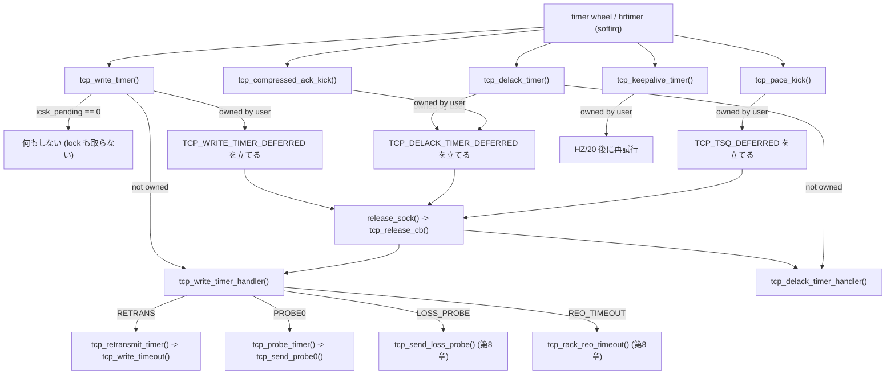

# 9. タイマー

## たとえ話で言うと

部屋の郵便受け（ソケット）の横には、キッチンタイマーがいくつか置いてあります。

- **再発送タイマー**: 小包を送ったのに受領印が返ってこないとき、「そろそろ再発送しよう」と知らせるタイマーです。再発送するたびに待ち時間を倍にしていき、あまりに長く返事がなければ「相手はもういない」と諦めます。
- **窓口確認タイマー**: 相手の受け取り箱が満杯（ウィンドウ 0）で発送待ちの棚に荷物が溜まっているとき、「空きましたか？」と小さな問い合わせを定期的に送るタイマーです。相手が「まだ満杯です」と返事をくれる限り、いつまでも待ち続けます。
- **受領印まとめ押しタイマー**: 小包が届くたびに受領印を返すのは大変なので、少しだけ待って何通かまとめて返します。待ちすぎないよう、このタイマーが鳴ったら必ず受領印を出します。
- **生存確認タイマー**: 何時間もやりとりのない相手に「まだそこにいますか？」と声をかけるタイマーです。

1 つ大事な決まりがあります。郵便受けを住人（ユーザプロセス）が使用中のときにタイマーが鳴っても、係員（softirq）は中を触れません。代わりに「タイマーが鳴りましたよ」というメモを貼っておき、住人が郵便受けから手を離す瞬間（`release_sock()`）にメモを読んで仕事を片付けてもらいます。

## RFC では

### RFC 6298: Computing TCP's Retransmission Timer

RFC 6298 は RTO（Retransmission TimeOut）の計算方法と、再送タイマーの管理ルールを定めた RFC です（RFC 2988 を置き換え）。RTO の計算（SRTT / RTTVAR）は第 7 章の範囲なので、ここではタイマーの「いつ起動し、いつ止め、満了したら何をするか」という §5 のルールを扱います。

[RFC 6298 §5](https://www.rfc-editor.org/rfc/rfc6298#section-5) のルールは次のとおりです。

| ルール | 内容 | Linux での対応 |
| --- | --- | --- |
| (5.1) | データを含むセグメントを送るたび（再送含む）、タイマーが止まっていれば RTO 後に満了するよう起動する | `tcp_event_new_data_sent()` → `tcp_rearm_rto()` |
| (5.2) | 未 ACK データがすべて ACK されたらタイマーを止める | `tcp_rearm_rto()` の `!tp->packets_out` 分岐 |
| (5.3) | 新しいデータを ACK する ACK を受けたら、RTO 後に満了するよう再起動する | `tcp_rearm_rto()`（第 7 章） |
| (5.4) | 満了したら、まだ ACK されていない最も古いセグメントを再送する | `tcp_retransmit_timer()` の `tcp_retransmit_skb(sk, tcp_rtx_queue_head(sk), 1)` |
| (5.5) | RTO ← RTO × 2（"back off the timer"）。上限（§2.5、60 秒以上）を適用してよい | `icsk_rto = min(icsk_rto << 1, tcp_rto_max(sk))` |
| (5.6) | RTO 後に満了するようタイマーを起動する | `tcp_reset_xmit_timer(sk, ICSK_TIME_RETRANS, ...)` |
| (5.7) | SYN の ACK 待ちで満了し、RTO が 3 秒未満だった場合、データ転送開始時に RTO を 3 秒に戻す | `tcp_init_metrics()` の `TCP_TIMEOUT_FALLBACK` |

[§2.4](https://www.rfc-editor.org/rfc/rfc6298#section-2) は RTO の下限を 1 秒と "SHOULD" で定め、§2.5 は上限を「少なくとも 60 秒」とします。Linux の下限は `TCP_RTO_MIN` = 200 ms（per-route / per-socket / sysctl で変更可）、上限は `TCP_RTO_MAX` = 120 秒（`TCP_RTO_MAX_MS` / `tcp_rto_max_ms` で変更可）です。

### RFC 1122 §4.2.3.5 / RFC 9293 §3.8.3: R1 と R2

[RFC 1122 §4.2.3.5](https://www.rfc-editor.org/rfc/rfc1122#section-4.2.3.5) は「再送がどのくらい続いたら諦めるか」を 2 つのしきい値で定めます。RFC 9293（RFC 793 を置き換えた TCP 本体の新仕様）では同じ内容が [§3.8.3 "TCP Connection Failures"](https://www.rfc-editor.org/rfc/rfc9293#section-3.8.3) にまとめられています（§3.8.1 は "Retransmission Timeout" で、RFC 6298 を参照する節です）。

- **R1**: 同一セグメントの再送が R1 に達したら、IP 層に "negative advice" を渡して経路（dead gateway）の見直しを促す。R1 は「現在の RTO で少なくとも 3 回の再送」に相当すべき（SHOULD）。
- **R2**: 再送が R2 に達したらコネクションを閉じる。データセグメントでは少なくとも 100 秒（SHOULD）、SYN では少なくとも 3 分（MUST）。
- R1/R2 は回数でも時間でもよい。アプリケーションが R2 を設定できなければならない（MUST）。

Linux では R1 = `tcp_retries1`（既定 3）、R2 = `tcp_retries2`（既定 15）、SYN の R2 = `tcp_syn_retries`（既定 6）/ `tcp_synack_retries`（既定 5）です。アプリケーションが設定できる R2 は `TCP_USER_TIMEOUT`（[RFC 5482](https://www.rfc-editor.org/rfc/rfc5482) の User Timeout のローカル側）です。ただし後述のとおり、Linux は「回数」を**時間に変換**して判定します。

### RFC 1122 §4.2.2.17 / RFC 9293 §3.8.6.1: ゼロウィンドウプローブ（persist timer）

相手が受信ウィンドウ 0 を通知してきたら、送信側は定期的にプローブを送ってウィンドウが開いたことを検出しなければなりません。ウィンドウ更新を運ぶ ACK は信頼性のある配送の対象ではないため、それが失われるとデッドロックするからです。

- [RFC 1122 §4.2.2.17](https://www.rfc-editor.org/rfc/rfc1122#page-92): 送信側はゼロウィンドウを probe しなければならない（MUST）。最初のプローブは 1 RTO 後、その後は指数的に間隔を伸ばすべき（SHOULD）。相手がプローブに応答し続ける限り、コネクションを閉じてはならない（MUST NOT）。
- [RFC 9293 §3.8.6.1](https://www.rfc-editor.org/rfc/rfc9293#section-3.8.6.1) も同じ内容（MUST-36/37）を再掲しています。

### RFC 1122 §4.2.3.6 / RFC 9293 §3.8.4: keep-alive

[RFC 1122 §4.2.3.6](https://www.rfc-editor.org/rfc/rfc1122#page-101) / [RFC 9293 §3.8.4](https://www.rfc-editor.org/rfc/rfc9293#section-3.8.4) では、keep-alive は実装してもよい（MAY）が、実装するならコネクションごとに on/off でき、既定は off（MUST）、間隔は既定で 2 時間以上（MUST）、データを含まない ACK の喪失で死んだと判定してはならない（MUST NOT）、とされています。プローブは `SEG.SEQ = SND.NXT-1` で 0 または 1 バイトのゴミを含むもの、と説明されています。

### RFC 1122 §4.2.3.2 / RFC 9293 §3.8.6.3: delayed ACK

[RFC 1122 §4.2.3.2](https://www.rfc-editor.org/rfc/rfc1122#page-96) / [RFC 9293 §3.8.6.3](https://www.rfc-editor.org/rfc/rfc9293#section-3.8.6.3) は、ACK を遅延させてよい（SHOULD implement）が、遅延は 0.5 秒未満（MUST）、フルサイズセグメントのストリームでは少なくとも 2 セグメントに 1 回 ACK すべき（SHOULD）としています。この「いつ ACK するか」の判断は第 6 章、ここではその遅延を実現するタイマー側を扱います。

### RFC 8985: RACK-TLP

[RFC 8985](https://www.rfc-editor.org/rfc/rfc8985) の Tail Loss Probe（PTO）と RACK の reordering timer も同じ再送タイマーを使います。その意味と判定は第 8 章で扱い、本章では「1 本のタイマーを共有する仕組み」だけを見ます。

## 全体の流れ

TCP ソケットが持つタイマーは次の 5 本（＋ request_sock ごとの 1 本）です。

| タイマー | 実体 | 用途 | コールバック |
| --- | --- | --- | --- |
| 再送タイマー | `sk->tcp_retransmit_timer`（`sk_timer` と union） | `ICSK_TIME_RETRANS` / `PROBE0` / `LOSS_PROBE` / `REO_TIMEOUT` を多重化 | `tcp_write_timer()` |
| delayed ACK | `icsk->icsk_delack_timer` | 遅延 ACK | `tcp_delack_timer()` |
| keepalive | `icsk->icsk_keepalive_timer` | keep-alive と orphan FIN_WAIT2 | `tcp_keepalive_timer()` |
| pacing | `tp->pacing_timer`（hrtimer） | 内部 pacing の送信再開 | `tcp_pace_kick()` |
| SACK 圧縮 | `tp->compressed_ack_timer`（hrtimer） | まとめた SACK の送出 | `tcp_compressed_ack_kick()` |
| SYN-ACK 再送 | `req->rsk_timer` | request_sock の SYN-ACK 再送 | `reqsk_timer_handler()` |



すべてのコールバックは softirq（timer wheel は `TIMER_SOFTIRQ`、hrtimer は `*_SOFT` モードなので `HRTIMER_SOFTIRQ`）で動き、`bh_lock_sock()` でソケットの spinlock を取ります。ユーザがソケットを所有中（`sock_owned_by_user()`）なら仕事を `sk->sk_tsq_flags` のビットに積んで `tcp_release_cb()` に委ねる、というのが共通パターンです。keepalive だけは遅延に鈍感なので、50 ms 後に再試行するという昔ながらの方式のままです。

## コードを追う

### Step 1: タイマーの状態と arm / clear

まず状態を持つフィールドです。`struct inet_connection_sock`（[include/net/inet_connection_sock.h#L81](https://git.kernel.org/pub/scm/linux/kernel/git/netdev/net-next.git/tree/include/net/inet_connection_sock.h?id=279d5c8afcd38bd841832a39bfe1aa4f8518d98e#n81)）から抜粋します。

```c
struct inet_connection_sock {
	/* inet_sock has to be the first member! */
	struct inet_sock	  icsk_inet;
	struct request_sock_queue icsk_accept_queue;
	struct inet_bind_bucket	  *icsk_bind_hash;
	struct inet_bind2_bucket  *icsk_bind2_hash;
	struct timer_list	  icsk_delack_timer;
	union {
		struct timer_list icsk_keepalive_timer;
		struct timer_list mptcp_tout_timer;
	};
	__u32			  icsk_rto;
	__u32                     icsk_rto_min;
	u32			  icsk_rto_max;
	__u32                     icsk_delack_max;
...
	__u8			  icsk_retransmits;
	__u8			  icsk_pending;
	__u8			  icsk_backoff;
	__u8			  icsk_syn_retries;
	__u8			  icsk_probes_out;
...
	u32			  icsk_probes_tstamp;
	u32			  icsk_user_timeout;
```

- `icsk_pending`: 再送タイマーに今どのイベントが載っているか（`ICSK_TIME_*` のいずれか、または 0）。**1 本のタイマーに 1 つのイベント**しか載らないのが重要な不変条件です。
- `icsk_retransmits`: 現在の RTO 回復での RTO 回数。`tcp_ack()` で `snd_una` が進むと 0 に戻ります。R1/R2 判定の「回数がゼロかどうか」に使われます。
- `icsk_backoff`: 指数バックオフの指数。RTO とゼロウィンドウプローブで共有されます。有効な RTT サンプルが取れたときだけ 0 に戻ります（`tcp_ack_update_rtt()`、RFC 6298 の Karn のルール）。
- `icsk_probes_out`: 応答のないプローブの数。ゼロウィンドウプローブと keep-alive で**共有**されます（前者は送信キューが空でないとき、後者は空のときにしか動かないので衝突しません）。任意の ACK を受けると `tcp_ack()` で 0 に戻ります。
- `icsk_probes_tstamp`: ゼロウィンドウプローブを始めた時刻（`TCP_USER_TIMEOUT` 判定用）。
- `icsk_user_timeout`: `TCP_USER_TIMEOUT`（ミリ秒）。setsockopt からロックなしで書かれるため、読む側は常に `READ_ONCE()` です。

再送タイマー本体は `struct sock` の `sk_timer` と union になった `tcp_retransmit_timer` で、満了時刻は `tcp_timeout_expires()`（[include/net/inet_connection_sock.h#L194](https://git.kernel.org/pub/scm/linux/kernel/git/netdev/net-next.git/tree/include/net/inet_connection_sock.h?id=279d5c8afcd38bd841832a39bfe1aa4f8518d98e#n194)）が `READ_ONCE(sk->tcp_retransmit_timer.expires)` で返します。以前は `icsk_timeout` という別フィールドに満了時刻を複製していましたが、`timer_list.expires` 自体を使うことで 8 バイト削られました（後述の歴史を参照）。

`ICSK_TIME_*` の定義（[include/net/inet_connection_sock.h#L146](https://git.kernel.org/pub/scm/linux/kernel/git/netdev/net-next.git/tree/include/net/inet_connection_sock.h?id=279d5c8afcd38bd841832a39bfe1aa4f8518d98e#n146)）:

```c
#define ICSK_TIME_RETRANS	1	/* Retransmit timer */
#define ICSK_TIME_DACK		2	/* Delayed ack timer */
#define ICSK_TIME_PROBE0	3	/* Zero window probe timer */
#define ICSK_TIME_LOSS_PROBE	5	/* Tail loss probe timer */
#define ICSK_TIME_REO_TIMEOUT	6	/* Reordering timer */
```

`DACK` だけは別タイマー（`icsk_delack_timer`）で、状態も `icsk_ack.pending` の `ICSK_ACK_TIMER` ビットで管理されます。残りの 4 つが 1 本の再送タイマーを共有します。

arm するのは `inet_csk_reset_xmit_timer()`（[include/net/inet_connection_sock.h#L228](https://git.kernel.org/pub/scm/linux/kernel/git/netdev/net-next.git/tree/include/net/inet_connection_sock.h?id=279d5c8afcd38bd841832a39bfe1aa4f8518d98e#n228)）です。

```c
static inline void inet_csk_reset_xmit_timer(struct sock *sk, const int what,
					     unsigned long when,
					     const unsigned long max_when)
{
	struct inet_connection_sock *icsk = inet_csk(sk);

	if (when > max_when) {
		pr_debug("reset_xmit_timer: sk=%p %d when=0x%lx, caller=%p\n",
			 sk, what, when, (void *)_THIS_IP_);
		when = max_when;
	}

	when += jiffies;
	if (what == ICSK_TIME_RETRANS || what == ICSK_TIME_PROBE0 ||
	    what == ICSK_TIME_LOSS_PROBE || what == ICSK_TIME_REO_TIMEOUT) {
		smp_store_release(&icsk->icsk_pending, what);
		sk_reset_timer(sk, &sk->tcp_retransmit_timer, when);
	} else if (what == ICSK_TIME_DACK) {
		smp_store_release(&icsk->icsk_ack.pending,
				  icsk->icsk_ack.pending | ICSK_ACK_TIMER);
		sk_reset_timer(sk, &icsk->icsk_delack_timer, when);
	} else {
		pr_debug("inet_csk BUG: unknown timer value\n");
	}
}
```

- `when` は相対 jiffies で、`max_when`（TCP では `tcp_rto_max(sk)`）でクランプされます。RFC 6298 (5.5) の上限です。
- `icsk_pending` を `what` で**上書き**します。例えば TLP を arm すると、それまでの RETRANS イベントは消えます。TLP / RACK のハンドラが最後に `tcp_rearm_rto()` を呼んで RETRANS を載せ直すのはこのためです。
- `smp_store_release()` は、ロックなしで `icsk_pending` を読む `tcp_write_timer()` / `get_tcp4_sock()` の `smp_load_acquire()` と対になります。
- `sk_reset_timer()`（[net/core/sock.c#L3773](https://git.kernel.org/pub/scm/linux/kernel/git/netdev/net-next.git/tree/net/core/sock.c?id=279d5c8afcd38bd841832a39bfe1aa4f8518d98e#n3773)）は `mod_timer()` が 0（＝タイマーが pending でなかった）を返したときだけ `sock_hold()` します。つまり「**タイマーが pending である間、ソケットの参照を 1 つ持つ**」という不変条件があり、コールバックは最後に必ず `sock_put()` します。

TCP 側のラッパ `tcp_reset_xmit_timer()`（[include/net/tcp.h#L1667](https://git.kernel.org/pub/scm/linux/kernel/git/netdev/net-next.git/tree/include/net/tcp.h?id=279d5c8afcd38bd841832a39bfe1aa4f8518d98e#n1667)）は、`pace_delay` が真なら `tcp_pacing_delay()`（次の送信予定時刻 `tcp_wstamp_ns` までの残り）を足します。pacing で送信が先送りされているのに RTO や probe が早く満了して誤再送するのを防ぐためです。中身は `when += tcp_pacing_delay(sk)` の後に `inet_csk_reset_xmit_timer(sk, what, when, tcp_rto_max(sk))` を呼ぶだけです。

逆に止める `inet_csk_clear_xmit_timer()`（[include/net/inet_connection_sock.h#L205](https://git.kernel.org/pub/scm/linux/kernel/git/netdev/net-next.git/tree/include/net/inet_connection_sock.h?id=279d5c8afcd38bd841832a39bfe1aa4f8518d98e#n205)）は、`INET_CSK_CLEAR_TIMERS` が定義されていないので**タイマー自体は止めず**、`smp_store_release()` で `icsk_pending`（DACK なら `icsk_ack.pending` と `icsk_ack.retry`）を 0 にするだけです（`sk_stop_timer()` は `#ifdef INET_CSK_CLEAR_TIMERS` の中にあります）。

これは意図的な選択です。アクティブなフローでは ACK のたびに「止める→また arm する」を繰り返しますが、`timer_delete()` は timer base のロックを取り、しかも別 CPU から呼ばれることが多いので false sharing とロック競合を生みます。止めずに放っておけば、次の arm は `mod_timer()` 1 回で済み、満了時刻が同じなら何もしないで済むことすらあります。代償として、タイマーは「空振り」で満了しうるので、コールバック側で `icsk_pending == 0` を安価に検出する必要があります（Step 2）。本当にタイマーを止めるのはソケット破棄時の `inet_csk_clear_xmit_timers()` / `tcp_clear_xmit_timers()` だけです。

### Step 2: `tcp_write_timer()` — 再送タイマーの入口

`tcp_write_timer()`（[net/ipv4/tcp_timer.c#L732](https://git.kernel.org/pub/scm/linux/kernel/git/netdev/net-next.git/tree/net/ipv4/tcp_timer.c?id=279d5c8afcd38bd841832a39bfe1aa4f8518d98e#n732)）は timer wheel から softirq で呼ばれます。

```c
static void tcp_write_timer(struct timer_list *t)
{
	struct sock *sk = timer_container_of(sk, t, tcp_retransmit_timer);

	/* Avoid locking the socket when there is no pending event. */
	if (!smp_load_acquire(&inet_csk(sk)->icsk_pending))
		goto out;

	bh_lock_sock(sk);
	if (!sock_owned_by_user(sk)) {
		tcp_write_timer_handler(sk);
	} else {
		/* delegate our work to tcp_release_cb() */
		if (!test_and_set_bit(TCP_WRITE_TIMER_DEFERRED, &sk->sk_tsq_flags))
			sock_hold(sk);
	}
	bh_unlock_sock(sk);
out:
	sock_put(sk);
}
```

- `smp_load_acquire(&icsk_pending)`: Step 1 のとおりタイマーは止められないので、空振りの満了がよく起きます。そのときソケットの spinlock すら取らずに帰る fast path です。ロックなしで読むため、他 CPU の `smp_store_release()` と対にしています。競合して見落としても、arm 側は必ず `mod_timer()` を呼ぶので、タイマーは再び載り、取りこぼしにはなりません。
- `bh_lock_sock()`: softirq なので spinlock だけ取ります。プロセスが `lock_sock()` で所有していれば `sock_owned_by_user()` が真です。
- 所有中なら `TCP_WRITE_TIMER_DEFERRED` を立てます。`test_and_set_bit()` が 0 を返した（自分が初めて立てた）ときだけ `sock_hold()` し、この参照は `tcp_release_cb()` の `__sock_put()` で返されます。何度満了しても参照は 1 つしか増えません。
- 末尾の `sock_put()` は、arm 時の `sk_reset_timer()` で取った参照を返すものです。

以前は所有中なら「50 ms 後に再試行」していましたが、それでは RTO や TLP のタイミングが最大 50 ms ずれるので、`tcp_release_cb()` への委譲に変わりました（歴史を参照）。

### Step 3: `tcp_write_timer_handler()` — イベントの振り分け

`tcp_write_timer_handler()`（[net/ipv4/tcp_timer.c#L697](https://git.kernel.org/pub/scm/linux/kernel/git/netdev/net-next.git/tree/net/ipv4/tcp_timer.c?id=279d5c8afcd38bd841832a39bfe1aa4f8518d98e#n697)）は `tcp_write_timer()` と `tcp_release_cb()` の両方から、BH 無効・ソケット spinlock 保持（後者はさらに owner も保持）で呼ばれます。

```c
void tcp_write_timer_handler(struct sock *sk)
{
	struct inet_connection_sock *icsk = inet_csk(sk);
	int event;

	if (((1 << sk->sk_state) & (TCPF_CLOSE | TCPF_LISTEN)) ||
	    !icsk->icsk_pending)
		return;

	if (time_after(tcp_timeout_expires(sk), jiffies)) {
		sk_reset_timer(sk, &sk->tcp_retransmit_timer,
			       tcp_timeout_expires(sk));
		return;
	}
	tcp_mstamp_refresh(tcp_sk(sk));
	event = icsk->icsk_pending;

	switch (event) {
	case ICSK_TIME_REO_TIMEOUT:
		tcp_rack_reo_timeout(sk);
		break;
	case ICSK_TIME_LOSS_PROBE:
		tcp_send_loss_probe(sk);
		break;
	case ICSK_TIME_RETRANS:
		smp_store_release(&icsk->icsk_pending, 0);
		tcp_retransmit_timer(sk);
		break;
	case ICSK_TIME_PROBE0:
		smp_store_release(&icsk->icsk_pending, 0);
		tcp_probe_timer(sk);
		break;
	}
}
```

- CLOSE / LISTEN では何もしません。`tcp_disconnect()` や `listen()` への遷移でタイマーが残っていても無害にするためです。ロックを取った後で `icsk_pending` をもう一度見るのは、Step 2 のロックなしチェックの後に clear された可能性があるからです。
- `time_after(tcp_timeout_expires(sk), jiffies)`: **満了時刻がまだ未来**なら再 arm して帰ります。これは主に委譲経路のためです。タイマーが満了して `TCP_WRITE_TIMER_DEFERRED` が立った後、ユーザがロックを持っている間に backlog の ACK が処理されて `tcp_rearm_rto()` が新しい満了時刻を設定することがあります。そのまま `tcp_release_cb()` から処理すると早すぎる再送になるので、ここで弾きます。`sk_reset_timer()` はタイマーが既に pending なら参照を増やしません。
- `tcp_mstamp_refresh()`: タイマー経由で送るパケットの TSval や RTT 計測、`skb->skb_mstamp_ns` が古いキャッシュ時刻にならないよう、`tp->tcp_mstamp` を更新します。
- RETRANS と PROBE0 は**ハンドラを呼ぶ前に** `icsk_pending` を 0 にします。ハンドラが自分で再 arm する（または諦めて終わる）ためです。
- REO_TIMEOUT と LOSS_PROBE は `icsk_pending` を残したままハンドラを呼びます。これらのハンドラは最後に `tcp_rearm_rto()`（[net/ipv4/tcp_input.c#L3524](https://git.kernel.org/pub/scm/linux/kernel/git/netdev/net-next.git/tree/net/ipv4/tcp_input.c?id=279d5c8afcd38bd841832a39bfe1aa4f8518d98e#n3524)）を呼び、そこで `icsk_pending == ICSK_TIME_REO_TIMEOUT / LOSS_PROBE` を見て「元の RTO から既に経過した分」を差し引いた残り（`tcp_rto_delta_us()`）で RETRANS を載せ直します。pending を先に消すと、この差し引きができず RTO が実質的に延びてしまいます。

### Step 4: `tcp_retransmit_timer()` — RTO の概略

`tcp_retransmit_timer()`（[net/ipv4/tcp_timer.c#L537](https://git.kernel.org/pub/scm/linux/kernel/git/netdev/net-next.git/tree/net/ipv4/tcp_timer.c?id=279d5c8afcd38bd841832a39bfe1aa4f8518d98e#n537)）の中身（`tcp_enter_loss()` と `tcp_retransmit_skb()`）は第 8 章の担当なので、ここではタイマー視点の骨格を追います。

```c
	req = rcu_dereference_protected(tp->fastopen_rsk,
					lockdep_sock_is_held(sk));
	if (req) {
		WARN_ON_ONCE(sk->sk_state != TCP_SYN_RECV &&
			     sk->sk_state != TCP_FIN_WAIT1);
		tcp_fastopen_synack_timer(sk, req);
		/* Before we receive ACK to our SYN-ACK don't retransmit
		 * anything else (e.g., data or FIN segments).
		 */
		return;
	}

	if (!tp->packets_out)
		return;

	skb = tcp_rtx_queue_head(sk);
	if (WARN_ON_ONCE(!skb))
		return;
```

- TFO サーバの子ソケットは、3WHS 完了前から full socket として存在し、SYN-ACK の再送にこの再送タイマーを使います（通常の SYN-ACK 再送は request_sock の `rsk_timer`、Step 10）。
- `!tp->packets_out`: 未 ACK データがなければ何もしません（空振りの満了）。

```c
	if (!tp->snd_wnd && !sock_flag(sk, SOCK_DEAD) &&
	    !((1 << sk->sk_state) & (TCPF_SYN_SENT | TCPF_SYN_RECV))) {
		/* Receiver dastardly shrinks window. Our retransmits
		 * become zero probes, but we should not timeout this
		 * connection. If the socket is an orphan, time it out,
		 * we cannot allow such beasts to hang infinitely.
		 */
		struct inet_sock *inet = inet_sk(sk);
		u32 rtx_delta;

		rtx_delta = tcp_time_stamp_ts(tp) - (tp->retrans_stamp ?: 
				tcp_skb_timestamp_ts(tp->tcp_usec_ts, skb));
		if (tp->tcp_usec_ts)
			rtx_delta /= USEC_PER_MSEC;
...
		if (tcp_rtx_probe0_timed_out(sk, skb, rtx_delta)) {
			tcp_write_err(sk);
			goto out;
		}
		tcp_enter_loss(sk);
		tcp_retransmit_skb(sk, skb, 1);
		__sk_dst_reset(sk);
		goto out_reset_timer;
	}
```

（`...` は `net_dbg_ratelimited()` による IPv4 / IPv6 別のデバッグ出力です。）

ここが RFC 1122 §4.2.2.17 の実装の一部です。送信済みデータがあるのに相手がウィンドウを 0 に**縮めた**場合、再送はゼロウィンドウプローブとして働きます。プローブに相手が応答している限り（`rcv_tstamp` が更新され続ける限り）殺してはいけないので、`tcp_write_timeout()` を通らず、`icsk_retransmits` も増やしません。代わりに `tcp_rtx_probe0_timed_out()`（[net/ipv4/tcp_timer.c#L496](https://git.kernel.org/pub/scm/linux/kernel/git/netdev/net-next.git/tree/net/ipv4/tcp_timer.c?id=279d5c8afcd38bd841832a39bfe1aa4f8518d98e#n496)）で「最後に ACK を受けてから `2 * tcp_rto_max`（または `TCP_USER_TIMEOUT`）を超え、**かつ**再送開始から同じだけ経った」ときだけ諦めます。`rcv_delta` を `jiffies` ではなく `tcp_timeout_expires(sk)`（本来の満了時刻）から測るのは、timer wheel の粒度で満了が遅れた分（HZ=1000 で 512 ms〜4 s の範囲なら最大 63 ms）を誤って経過時間に含めないためで、遅れの間に ACK が来ると `rcv_delta` は負になりうるので符号付きで比較します。

```c
	__NET_INC_STATS(sock_net(sk), LINUX_MIB_TCPTIMEOUTS);
	if (tcp_write_timeout(sk))
		goto out;

	if (icsk->icsk_retransmits == 0) {
		int mib_idx = 0;
...
	}

	tcp_enter_loss(sk);

	tcp_update_rto_stats(sk);
	if (tcp_retransmit_skb(sk, tcp_rtx_queue_head(sk), 1) > 0) {
		/* Retransmission failed because of local congestion,
		 * Let senders fight for local resources conservatively.
		 */
		tcp_reset_xmit_timer(sk, ICSK_TIME_RETRANS,
				     TCP_RESOURCE_PROBE_INTERVAL,
				     false);
		goto out;
	}
```

- `TCPTimeouts` は SYN / データ / FIN を問わずすべての RTO を数えます。
- `tcp_write_timeout()`（Step 5）が 1 を返したらソケットは既に閉じられています。
- `icsk_retransmits == 0`（この回復で最初の RTO）のとき、どの状態から RTO に落ちたかで `TCPSackRecoveryFail` / `TCPLossFailures` / `TCPSackFailures` などを数えます（省略部分）。
- `tcp_update_rto_stats()`（[net/ipv4/tcp_timer.c#L442](https://git.kernel.org/pub/scm/linux/kernel/git/netdev/net-next.git/tree/net/ipv4/tcp_timer.c?id=279d5c8afcd38bd841832a39bfe1aa4f8518d98e#n442)）で `icsk_retransmits` と `total_rto` を増やします。`icsk_retransmits` が 0 から 1 になる瞬間に `total_rto_recoveries` と `rto_stamp` を記録します。
- `tcp_retransmit_skb()` が正の値を返すのは qdisc が満杯などローカル輻輳の場合です。このときは RTO をバックオフせず、`TCP_RESOURCE_PROBE_INTERVAL`（500 ms）後に再試行します。データセンターのように RTO が数 ms しかない環境で、ローカル輻輳中に再送の嵐を起こさないためです。`icsk_retransmits` は既に増えているので、R2 判定は正しく進みます。

```c
out_reset_timer:
...
	if (sk->sk_state == TCP_ESTABLISHED &&
	    (tp->thin_lto || READ_ONCE(net->ipv4.sysctl_tcp_thin_linear_timeouts)) &&
	    tcp_stream_is_thin(tp) &&
	    icsk->icsk_retransmits <= TCP_THIN_LINEAR_RETRIES) {
		icsk->icsk_backoff = 0;
		icsk->icsk_rto = clamp(__tcp_set_rto(tp),
				       tcp_rto_min(sk),
				       tcp_rto_max(sk));
	} else if (sk->sk_state != TCP_SYN_SENT ||
		   tp->total_rto >
		   READ_ONCE(net->ipv4.sysctl_tcp_syn_linear_timeouts)) {
		/* Use normal (exponential) backoff unless linear timeouts are
		 * activated.
		 */
		icsk->icsk_backoff++;
		icsk->icsk_rto = min(icsk->icsk_rto << 1, tcp_rto_max(sk));
	}
	tcp_reset_xmit_timer(sk, ICSK_TIME_RETRANS,
			     tcp_clamp_rto_to_user_timeout(sk), false);
	if (retransmits_timed_out(sk, READ_ONCE(net->ipv4.sysctl_tcp_retries1) + 1, 0))
		__sk_dst_reset(sk);

out:;
```

- thin stream（in flight が 4 パケット未満）で `TCP_THIN_LINEAR_TIMEOUTS` / `tcp_thin_linear_timeouts` が有効なら、最初の `TCP_THIN_LINEAR_RETRIES`（6）回は RTO を倍にせず、SRTT/RTTVAR から再計算した値を使います（線形タイムアウト）。
- `SYN_SENT` では最初の `tcp_syn_linear_timeouts`（既定 4）回の RTO はバックオフしません（1, 1, 1, 1, 1, 2, 4, ... 秒）。数えるのに `icsk_backoff` ではなく `total_rto` を使うのは、ICMP による RTO revert（`tcp_ld_RTO_revert()`）で `icsk_backoff` が減らされても破綻しないようにするためです。
- それ以外は RFC 6298 (5.5) どおり `icsk_backoff++` と RTO の倍化、上限は `tcp_rto_max(sk)` です。RTO そのものを倍にし、`icsk_backoff` は「何回倍にしたか」を別途記録します（`inet_csk_rto_backoff()` やゼロウィンドウプローブが使う）。
- (5.6) の再 arm では `tcp_clamp_rto_to_user_timeout()`（[net/ipv4/tcp_timer.c#L28](https://git.kernel.org/pub/scm/linux/kernel/git/netdev/net-next.git/tree/net/ipv4/tcp_timer.c?id=279d5c8afcd38bd841832a39bfe1aa4f8518d98e#n28)）で `TCP_USER_TIMEOUT` の残り時間を上限にします。そうしないと、例えば RTO が 60 秒のときに user timeout が 5 秒後に切れても、次の満了まで気付けません。
- R1 + 1 回分の時間を超えたら `__sk_dst_reset()` で経路キャッシュを捨て、次の送信で経路を引き直させます（R1 の negative advice の追加分）。

### Step 5: `tcp_write_timeout()` と `retransmits_timed_out()` — R1 / R2

`retransmits_timed_out()`（[net/ipv4/tcp_timer.c#L215](https://git.kernel.org/pub/scm/linux/kernel/git/netdev/net-next.git/tree/net/ipv4/tcp_timer.c?id=279d5c8afcd38bd841832a39bfe1aa4f8518d98e#n215)）は「`boundary` 回の再送」を**時間**に換算して、`retrans_stamp`（この回復で最初に再送した時刻）からの経過時間と比べます。

```c
static bool retransmits_timed_out(struct sock *sk,
				  unsigned int boundary,
				  unsigned int timeout)
{
	struct tcp_sock *tp = tcp_sk(sk);
	unsigned int start_ts, delta;

	if (!inet_csk(sk)->icsk_retransmits)
		return false;

	start_ts = tp->retrans_stamp;
	if (likely(timeout == 0)) {
		unsigned int rto_base = TCP_RTO_MIN;

		if ((1 << sk->sk_state) & (TCPF_SYN_SENT | TCPF_SYN_RECV))
			rto_base = tcp_timeout_init(sk);
		timeout = tcp_model_timeout(sk, boundary, rto_base);
	}

	if (tp->tcp_usec_ts) {
		/* delta maybe off up to a jiffy due to timer granularity. */
		delta = tp->tcp_mstamp - start_ts + jiffies_to_usecs(1);
		return (s32)(delta - timeout * USEC_PER_MSEC) >= 0;
	}
	return (s32)(tcp_time_stamp_ts(tp) - start_ts - timeout) >= 0;
}
```

- `icsk_retransmits == 0` ならまだ再送していないので、決してタイムアウトしません。この関数は `retrans_stamp` が有効であることをこれで保証しています。
- `timeout`（ミリ秒）が 0 でなければ、それは `TCP_USER_TIMEOUT` です。0 なら `tcp_model_timeout()` で「初期 RTO が `rto_base` の TCP が `boundary` 回指数バックオフしたらかかる時間」を計算します。SYN 系の状態では `rto_base` は `tcp_timeout_init()`（既定 1 秒、BPF で変更可）、それ以外は 200 ms です。
- `retrans_stamp` は TS オプションと同じクロック（ms、または `TCP_USEC_TS` 有効時は us）です。usec の場合は timer の粒度ぶん 1 jiffy を足して早めに判定します。
- 実際の RTO が 200 ms より大きくても小さくても、判定は「モデル化した時間」で行われます。つまり `tcp_retries2 = 15` は「15 回」ではなく「約 924.6 秒」を意味します。

`tcp_model_timeout()`（[net/ipv4/tcp_timer.c#L188](https://git.kernel.org/pub/scm/linux/kernel/git/netdev/net-next.git/tree/net/ipv4/tcp_timer.c?id=279d5c8afcd38bd841832a39bfe1aa4f8518d98e#n188)）:

```c
static unsigned int tcp_model_timeout(struct sock *sk,
				      unsigned int boundary,
				      unsigned int rto_base)
{
	unsigned int linear_backoff_thresh, timeout;

	linear_backoff_thresh = ilog2(tcp_rto_max(sk) / rto_base);
	if (boundary <= linear_backoff_thresh)
		timeout = ((2 << boundary) - 1) * rto_base;
	else
		timeout = ((2 << linear_backoff_thresh) - 1) * rto_base +
			(boundary - linear_backoff_thresh) * tcp_rto_max(sk);
	return jiffies_to_msecs(timeout);
}
```

`rto_base` から倍々で増え、`tcp_rto_max` に張り付いた後は線形、という等比数列＋等差数列の和です。既定値（200 ms, 120 s）では `linear_backoff_thresh = ilog2(600) = 9` なので:

| 呼び出し | boundary | 時間 |
| --- | --- | --- |
| R1（`tcp_retries1` = 3） | 3 | (2^4 − 1) × 0.2 = 3.0 s |
| R1 + 1（経路リセット） | 4 | (2^5 − 1) × 0.2 = 6.2 s |
| R2（`tcp_retries2` = 15） | 15 | (2^10 − 1) × 0.2 + 6 × 120 = 924.6 s |

`tcp_write_timeout()`（[net/ipv4/tcp_timer.c#L243](https://git.kernel.org/pub/scm/linux/kernel/git/netdev/net-next.git/tree/net/ipv4/tcp_timer.c?id=279d5c8afcd38bd841832a39bfe1aa4f8518d98e#n243)）の前半:

```c
static int tcp_write_timeout(struct sock *sk)
{
	struct inet_connection_sock *icsk = inet_csk(sk);
	struct tcp_sock *tp = tcp_sk(sk);
	struct net *net = sock_net(sk);
	bool expired = false, do_reset;
	int retry_until, max_retransmits;

	if ((1 << sk->sk_state) & (TCPF_SYN_SENT | TCPF_SYN_RECV)) {
		if (icsk->icsk_retransmits)
			__dst_negative_advice(sk);
		/* Paired with WRITE_ONCE() in tcp_sock_set_syncnt() */
		retry_until = READ_ONCE(icsk->icsk_syn_retries) ? :
			READ_ONCE(net->ipv4.sysctl_tcp_syn_retries);

		max_retransmits = retry_until;
		if (sk->sk_state == TCP_SYN_SENT)
			max_retransmits += READ_ONCE(net->ipv4.sysctl_tcp_syn_linear_timeouts);

		expired = icsk->icsk_retransmits >= max_retransmits;
	} else {
		if (retransmits_timed_out(sk, READ_ONCE(net->ipv4.sysctl_tcp_retries1), 0)) {
			/* Black hole detection */
			tcp_mtu_probing(icsk, sk);

			__dst_negative_advice(sk);
		}

		retry_until = READ_ONCE(net->ipv4.sysctl_tcp_retries2);
		if (sock_flag(sk, SOCK_DEAD)) {
			const bool alive = icsk->icsk_rto < tcp_rto_max(sk);

			retry_until = tcp_orphan_retries(sk, alive);
			do_reset = alive ||
				!retransmits_timed_out(sk, retry_until, 0);

			if (tcp_out_of_resources(sk, do_reset))
				return 1;
		}
	}
```

- **SYN 系**: 2 回目以降の SYN（SYN-ACK）タイムアウトでは毎回 `__dst_negative_advice()` で経路の見直しを促します。R2 はまず**回数**で判定します（`TCP_SYNCNT` → `tcp_syn_retries`）。`SYN_SENT` では線形タイムアウトの回数ぶん上限を足します。そうしないと、線形区間のぶん総待ち時間が短くなり、RFC の「SYN は 3 分以上」から遠ざかるからです。
- **同期状態**: R1 の時間を過ぎたら、`tcp_mtu_probing()`（[net/ipv4/tcp_timer.c#L166](https://git.kernel.org/pub/scm/linux/kernel/git/netdev/net-next.git/tree/net/ipv4/tcp_timer.c?id=279d5c8afcd38bd841832a39bfe1aa4f8518d98e#n166)）で PMTU black hole 検出を有効化（既に有効なら探索下限 MSS を半分に）し、`__dst_negative_advice()` で IPv4/IPv6 の dst に negative advice を渡します。これが RFC 1122 R1 の実装です。
- R2 は `tcp_retries2` ですが、orphan（`close()` 済み、`SOCK_DEAD`）なら `tcp_orphan_retries()`（[net/ipv4/tcp_timer.c#L150](https://git.kernel.org/pub/scm/linux/kernel/git/netdev/net-next.git/tree/net/ipv4/tcp_timer.c?id=279d5c8afcd38bd841832a39bfe1aa4f8518d98e#n150)）に置き換えます。`tcp_orphan_retries` は既定 0 で、その場合「RTO がまだ上限に達していない（最近まで生きていた）なら 8」、soft error（ICMP）が来ていて生きていなければ 0 になります。
- orphan はさらに `tcp_out_of_resources()`（[net/ipv4/tcp_timer.c#L107](https://git.kernel.org/pub/scm/linux/kernel/git/netdev/net-next.git/tree/net/ipv4/tcp_timer.c?id=279d5c8afcd38bd841832a39bfe1aa4f8518d98e#n107)）で、orphan 数の上限超過やメモリ逼迫（`tcp_check_oom()`）、netns の終了時に即座に殺されます。これは RFC 違反ですが DoS 対策として明記されています。

後半:

```c
	if (!expired)
		expired = retransmits_timed_out(sk, retry_until,
						READ_ONCE(icsk->icsk_user_timeout));
	tcp_fastopen_active_detect_blackhole(sk, expired);
	mptcp_active_detect_blackhole(sk, expired);

	if (BPF_SOCK_OPS_TEST_FLAG(tp, BPF_SOCK_OPS_RTO_CB_FLAG))
		tcp_call_bpf_3arg(sk, BPF_SOCK_OPS_RTO_CB,
				  icsk->icsk_retransmits,
				  icsk->icsk_rto, (int)expired);

	if (expired) {
		/* Has it gone just too far? */
		tcp_write_err(sk);
		return 1;
	}

	if (__sk_rethink_txhash_reset_dst(sk)) {
		WRITE_ONCE(tp->timeout_rehash, tp->timeout_rehash + 1);
		__NET_INC_STATS(sock_net(sk), LINUX_MIB_TCPTIMEOUTREHASH);
	}

	return 0;
}
```

- 回数で期限切れでなくても、`retry_until` 回分の**時間**（`TCP_USER_TIMEOUT` が設定されていればそれ）を過ぎたら期限切れです。`TCP_USER_TIMEOUT` は R2 を時間で上書きするので、SYN 状態でも同期状態でも効きます。
- TFO / MPTCP は、SYN に付けたオプションが中間装置に落とされている（black hole）可能性を検出して、以後のコネクションで機能を無効化します。
- 期限切れなら `tcp_write_err()`（[net/ipv4/tcp_timer.c#L77](https://git.kernel.org/pub/scm/linux/kernel/git/netdev/net-next.git/tree/net/ipv4/tcp_timer.c?id=279d5c8afcd38bd841832a39bfe1aa4f8518d98e#n77)）が `sk_err_soft`（ICMP で記録されたエラー、例えば `EHOSTUNREACH`）か `ETIMEDOUT` でソケットを閉じ、`TCPAbortOnTimeout` を数えます。
- まだ続けるなら `__sk_rethink_txhash_reset_dst()` で `sk_txhash` を引き直し（`sysctl net.core.txrehash` / `SO_TXREHASH` に従う）、IPv6 flow label や ECMP の経路選択を変えて、壊れた経路を避ける機会を作ります。キャッシュした dst もリセットされるので、ローカルの ECMP 選択もやり直されます。

### Step 6: `tcp_probe_timer()` — ゼロウィンドウプローブ（persist timer）

送信キューにデータがあるのに `packets_out == 0`（何も飛んでいない）でウィンドウが足りないとき、`tcp_check_probe_timer()`（[include/net/tcp.h#L1700](https://git.kernel.org/pub/scm/linux/kernel/git/netdev/net-next.git/tree/include/net/tcp.h?id=279d5c8afcd38bd841832a39bfe1aa4f8518d98e#n1700)）が `ICSK_TIME_PROBE0` を `tcp_probe0_base()` = max(RTO, 200 ms) 後に arm します。満了すると `tcp_probe_timer()`（[net/ipv4/tcp_timer.c#L391](https://git.kernel.org/pub/scm/linux/kernel/git/netdev/net-next.git/tree/net/ipv4/tcp_timer.c?id=279d5c8afcd38bd841832a39bfe1aa4f8518d98e#n391)）が呼ばれます。

```c
static void tcp_probe_timer(struct sock *sk)
{
	struct inet_connection_sock *icsk = inet_csk(sk);
	struct sk_buff *skb = tcp_send_head(sk);
	struct tcp_sock *tp = tcp_sk(sk);
	int max_probes;

	if (tp->packets_out || !skb) {
		WRITE_ONCE(icsk->icsk_probes_out, 0);
		icsk->icsk_probes_tstamp = 0;
		return;
	}

	/* RFC 1122 4.2.2.17 requires the sender to stay open indefinitely as
	 * long as the receiver continues to respond probes. We support this by
	 * default and reset icsk_probes_out with incoming ACKs. But if the
	 * socket is orphaned or the user specifies TCP_USER_TIMEOUT, we
	 * kill the socket when the retry count and the time exceeds the
	 * corresponding system limit. We also implement similar policy when
	 * we use RTO to probe window in tcp_retransmit_timer().
	 */
	if (!icsk->icsk_probes_tstamp) {
		icsk->icsk_probes_tstamp = tcp_jiffies32;
	} else {
		u32 user_timeout = READ_ONCE(icsk->icsk_user_timeout);

		if (user_timeout &&
		    (s32)(tcp_jiffies32 - icsk->icsk_probes_tstamp) >=
		     msecs_to_jiffies(user_timeout))
			goto abort;
	}
```

- 飛んでいるパケットがある（RTO が面倒を見る）か、送るものがないなら、プローブは不要です。カウンタを消して終わります（PROBE0 は既に `tcp_write_timer_handler()` で clear 済みなので、タイマーも再 arm されません）。
- `icsk_probes_tstamp` はゼロウィンドウ状態に入った最初のプローブ時刻です。`icsk_probes_out` は**任意の ACK**（ウィンドウ 0 のままでも）で 0 に戻るため、「相手は応答しているがウィンドウを開かない」状態の継続時間を測れません。そこで別に開始時刻を持ち、`TCP_USER_TIMEOUT` を超えたら諦めます。`icsk_probes_tstamp` は使えるウィンドウが開いたとき（`tcp_ack_probe()`）に 0 に戻ります。

```c
	max_probes = READ_ONCE(sock_net(sk)->ipv4.sysctl_tcp_retries2);
	if (sock_flag(sk, SOCK_DEAD)) {
		unsigned int rto_max = tcp_rto_max(sk);
		const bool alive = inet_csk_rto_backoff(icsk, rto_max) < rto_max;

		max_probes = tcp_orphan_retries(sk, alive);
		if (!alive && icsk->icsk_backoff >= max_probes)
			goto abort;
		if (tcp_out_of_resources(sk, true))
			return;
	}

	if (icsk->icsk_probes_out >= max_probes) {
abort:		tcp_write_err(sk);
	} else {
		/* Only send another probe if we didn't close things up. */
		tcp_send_probe0(sk);
	}
}
```

- 上限は `tcp_retries2` 回の**連続して応答のない**プローブです。応答がある限り `icsk_probes_out` は 0 に戻るので、RFC 1122 の「応答し続ける限り閉じない」を満たします。
- orphan では `tcp_orphan_retries()` を使い、バックオフが上限に達していれば打ち切ります。
- `tcp_send_probe0()`（[net/ipv4/tcp_output.c#L4619](https://git.kernel.org/pub/scm/linux/kernel/git/netdev/net-next.git/tree/net/ipv4/tcp_output.c?id=279d5c8afcd38bd841832a39bfe1aa4f8518d98e#n4619)）は `tcp_write_wakeup()` でプローブを送り、`icsk_probes_out++`、`icsk_backoff++`（`tcp_retries2` まで）して `tcp_probe0_when()`（[include/net/tcp.h#L1690](https://git.kernel.org/pub/scm/linux/kernel/git/netdev/net-next.git/tree/include/net/tcp.h?id=279d5c8afcd38bd841832a39bfe1aa4f8518d98e#n1690)）= `tcp_probe0_base() << backoff`（上限 `tcp_rto_max`）後に再 arm します。送信がローカル輻輳で失敗したら 500 ms 後です。`tcp_clamp_probe0_to_user_timeout()`（[net/ipv4/tcp_timer.c#L50](https://git.kernel.org/pub/scm/linux/kernel/git/netdev/net-next.git/tree/net/ipv4/tcp_timer.c?id=279d5c8afcd38bd841832a39bfe1aa4f8518d98e#n50)）で user timeout の残りを上限にし、満了済みなら `TCP_TIMEOUT_MIN`（2 jiffies）後にして、すぐ次の `tcp_probe_timer()` で abort させます。

`tcp_write_wakeup()`（[net/ipv4/tcp_output.c#L4573](https://git.kernel.org/pub/scm/linux/kernel/git/netdev/net-next.git/tree/net/ipv4/tcp_output.c?id=279d5c8afcd38bd841832a39bfe1aa4f8518d98e#n4573)）のプローブの中身にも注目してください。ウィンドウが完全に 0 なら `tcp_xmit_probe_skb()` で `SEG.SEQ = snd_una - 1` の長さ 0 の ACK（受信側には「古い」セグメントなので必ず ACK が返る）を送ります。ウィンドウが少しでも開いていれば（SWS 回避のため送らずにいた場合）、収まる分だけ実データを分割して送ります。RFC は 1 バイトのデータを送るプローブを例示していますが、Linux は長さ 0 のプローブで済ませています。

### Step 7: delayed ACK タイマー

ACK を遅らせると決めた受信パスは `tcp_send_delayed_ack()`（[net/ipv4/tcp_output.c#L4428](https://git.kernel.org/pub/scm/linux/kernel/git/netdev/net-next.git/tree/net/ipv4/tcp_output.c?id=279d5c8afcd38bd841832a39bfe1aa4f8518d98e#n4428)）でタイマーを arm します（いつ遅らせるかの判断は第 6 章）。

```c
	ato = min_t(u32, ato, tcp_delack_max(sk));

	/* Stay within the limit we were given */
	timeout = jiffies + ato;

	/* Use new timeout only if there wasn't a older one earlier. */
	if (icsk->icsk_ack.pending & ICSK_ACK_TIMER) {
		/* If delack timer is about to expire, send ACK now. */
		if (time_before_eq(icsk_delack_timeout(icsk), jiffies + (ato >> 2))) {
			tcp_send_ack(sk);
			return;
		}

		if (!time_before(timeout, icsk_delack_timeout(icsk)))
			timeout = icsk_delack_timeout(icsk);
	}
	smp_store_release(&icsk->icsk_ack.pending,
			  icsk->icsk_ack.pending | ICSK_ACK_SCHED | ICSK_ACK_TIMER);
	sk_reset_timer(sk, &icsk->icsk_delack_timer, timeout);
```

`ato`（ACK timeout）は受信間隔から推定した値（`tcp_event_data_recv()`、第 6 章）で、`tcp_delack_max()`（[net/ipv4/tcp_output.c#L4417](https://git.kernel.org/pub/scm/linux/kernel/git/netdev/net-next.git/tree/net/ipv4/tcp_output.c?id=279d5c8afcd38bd841832a39bfe1aa4f8518d98e#n4417)）で上限が付きます。これは per-socket の `icsk_delack_max`（既定 `TCP_DELACK_MAX` = 200 ms、BPF の `TCP_BPF_DELACK_MAX` で変更可）と `rto_min - 1` の小さい方です。RFC の「0.5 秒未満」を十分に満たします。既に arm されていれば、より早い方の満了時刻を保ちます（遅延を延ばし続けないため）。

タイマーが満了すると `tcp_delack_timer()`（[net/ipv4/tcp_timer.c#L363](https://git.kernel.org/pub/scm/linux/kernel/git/netdev/net-next.git/tree/net/ipv4/tcp_timer.c?id=279d5c8afcd38bd841832a39bfe1aa4f8518d98e#n363)）が呼ばれます。

```c
static void tcp_delack_timer(struct timer_list *t)
{
	struct inet_connection_sock *icsk =
			timer_container_of(icsk, t, icsk_delack_timer);
	struct sock *sk = &icsk->icsk_inet.sk;

	/* Avoid taking socket spinlock if there is no ACK to send.
	 * The compressed_ack check is racy, but a separate hrtimer
	 * will take care of it eventually.
	 */
	if (!(smp_load_acquire(&icsk->icsk_ack.pending) & ICSK_ACK_TIMER) &&
	    !READ_ONCE(tcp_sk(sk)->compressed_ack))
		goto out;

	bh_lock_sock(sk);
	if (!sock_owned_by_user(sk)) {
		tcp_delack_timer_handler(sk);
	} else {
		__NET_INC_STATS(sock_net(sk), LINUX_MIB_DELAYEDACKLOCKED);
		/* deleguate our work to tcp_release_cb() */
		if (!test_and_set_bit(TCP_DELACK_TIMER_DEFERRED, &sk->sk_tsq_flags))
			sock_hold(sk);
	}
	bh_unlock_sock(sk);
out:
	sock_put(sk);
}
```

- データ送信に ACK が piggyback されると `inet_csk_clear_xmit_timer(sk, ICSK_TIME_DACK)` で `icsk_ack.pending` が 0 になりますが、タイマーは止まりません。その空振りをロックなしで検出します。
- `compressed_ack` も見るのは、SACK 圧縮の hrtimer がユーザ所有中に満了したとき、仕事を `TCP_DELACK_TIMER_DEFERRED` 経由で `tcp_delack_timer_handler()` に委ねるからです（Step 8）。この読みは racy ですが、見落としても SACK 圧縮の hrtimer 自身がいずれ拾います。
- 所有中なら `DelayedACKLocked` を数えて委譲します。

`tcp_delack_timer_handler()`（[net/ipv4/tcp_timer.c#L309](https://git.kernel.org/pub/scm/linux/kernel/git/netdev/net-next.git/tree/net/ipv4/tcp_timer.c?id=279d5c8afcd38bd841832a39bfe1aa4f8518d98e#n309)）:

```c
void tcp_delack_timer_handler(struct sock *sk)
{
	struct inet_connection_sock *icsk = inet_csk(sk);
	struct tcp_sock *tp = tcp_sk(sk);

	if ((1 << sk->sk_state) & (TCPF_CLOSE | TCPF_LISTEN))
		return;

	/* Handling the sack compression case */
	if (tp->compressed_ack) {
		tcp_mstamp_refresh(tp);
		tcp_sack_compress_send_ack(sk);
		return;
	}

	if (!(icsk->icsk_ack.pending & ICSK_ACK_TIMER))
		return;

	if (time_after(icsk_delack_timeout(icsk), jiffies)) {
		sk_reset_timer(sk, &icsk->icsk_delack_timer,
			       icsk_delack_timeout(icsk));
		return;
	}
	icsk->icsk_ack.pending &= ~ICSK_ACK_TIMER;

	if (inet_csk_ack_scheduled(sk)) {
		if (!inet_csk_in_pingpong_mode(sk)) {
			/* Delayed ACK missed: inflate ATO. */
			icsk->icsk_ack.ato = min3((u32)icsk->icsk_ack.ato << 1,
						  icsk->icsk_rto,
						  (u32)TCP_DELACK_MAX);
		} else {
			/* Delayed ACK missed: leave pingpong mode and
			 * deflate ATO.
			 */
			inet_csk_exit_pingpong_mode(sk);
			icsk->icsk_ack.ato      = TCP_ATO_MIN;
		}
		tcp_mstamp_refresh(tp);
		tcp_send_ack(sk);
		__NET_INC_STATS(sock_net(sk), LINUX_MIB_DELAYEDACKS);
	}
}
```

- `compressed_ack` が残っていれば、それは延期された SACK 圧縮の後始末です。`tcp_sack_compress_send_ack()` が hrtimer を cancel して SACK を送ります。これを `ICSK_ACK_TIMER` チェックより前に置かないと、`ICSK_ACK_TIMER` が立っていない（SACK 圧縮は delack タイマーを arm しない）ために SACK が送られず、相手の RTO まで止まってしまいます。
- `time_after(...)`: Step 3 と同じ理由で、委譲中に満了時刻が延ばされていたら再 arm して帰ります。
- `ICSK_ACK_TIMER` を落とします（ロック保持中なので普通の書き込みで十分。ロックなしの読み手はヒントとして使うだけです）。
- タイマーで ACK を出す羽目になった＝「データ送信に piggyback できなかった」ということです。bulk 受信（pingpong でない）なら `ato` を倍にして次からもう少し待ち、上限は `icsk_rto` と `TCP_DELACK_MAX` です（`ato` は 8 ビットの bitfield なので、`TCP_DELACK_MAX` での上限が必須。歴史を参照）。対話的（pingpong）モードなら、応答データが来なかったのでモードを抜けて `ato` を最小に戻します。
- `tcp_send_ack()` を送り `DelayedACKs` を数えます。ACK の送出は `__tcp_transmit_skb()` → `tcp_event_ack_sent()` で delack 状態をクリアします。

### Step 8: hrtimer: pacing と SACK 圧縮

jiffies タイマーは HZ=1000 でも 1 ms 単位、しかも timer wheel では満了時刻が先になるほど粒度が粗くなります。µs 単位で動く pacing と SACK 圧縮には向かないので、この 2 つは softirq 版 hrtimer を使います。初期化は `tcp_init_xmit_timers()`（[net/ipv4/tcp_timer.c#L898](https://git.kernel.org/pub/scm/linux/kernel/git/netdev/net-next.git/tree/net/ipv4/tcp_timer.c?id=279d5c8afcd38bd841832a39bfe1aa4f8518d98e#n898)）です。`inet_csk_init_xmit_timers()` で 3 本の timer_list を設定した後、`pacing_timer` を `HRTIMER_MODE_ABS_PINNED_SOFT`、`compressed_ack_timer` を `HRTIMER_MODE_REL_PINNED_SOFT`（どちらも `CLOCK_MONOTONIC`）で `hrtimer_setup()` します。

pacing は「次のパケットの送信予定時刻 `tcp_wstamp_ns`」という絶対時刻（`ABS`）で、SACK 圧縮は「今から何 ns」という相対時刻（`REL`）で arm されます。`PINNED` は arm した CPU で満了させる指定で、`SOFT` は hardirq ではなく `HRTIMER_SOFTIRQ` で実行させる指定です（ソケットの spinlock を BH から取れるようにするため）。どちらも arm 時に `sock_hold()` し、コールバックの最後で `sock_put()` します。破棄時は `tcp_clear_xmit_timers()` が `hrtimer_try_to_cancel() == 1`（cancel できた）なら参照を返します。

内部 pacing（`fq` qdisc を使わない場合）は、`tcp_write_xmit()` から呼ばれる `tcp_pacing_check()` が「まだ送信時刻になっていない」と判断すると hrtimer を arm します（詳細は第 4 章）。満了時の `tcp_pace_kick()`（[net/ipv4/tcp_output.c#L1435](https://git.kernel.org/pub/scm/linux/kernel/git/netdev/net-next.git/tree/net/ipv4/tcp_output.c?id=279d5c8afcd38bd841832a39bfe1aa4f8518d98e#n1435)）は TSQ と同じハンドラに合流します。

```c
enum hrtimer_restart tcp_pace_kick(struct hrtimer *timer)
{
	struct tcp_sock *tp = container_of(timer, struct tcp_sock, pacing_timer);
	struct sock *sk = (struct sock *)tp;

	tcp_tsq_handler(sk);
	sock_put(sk);

	return HRTIMER_NORESTART;
}
```

`tcp_tsq_handler()`（[net/ipv4/tcp_output.c#L1289](https://git.kernel.org/pub/scm/linux/kernel/git/netdev/net-next.git/tree/net/ipv4/tcp_output.c?id=279d5c8afcd38bd841832a39bfe1aa4f8518d98e#n1289)）は、所有されていなければ `tcp_tsq_write()` で再送キューと `tcp_write_xmit()` を回し、所有中なら `TCP_TSQ_DEFERRED` を立てます。pacing の「時間が来た」も TSQ の「qdisc / NIC が空いた」も、結局「送れるなら送る」という同じ仕事だからです。

SACK 圧縮は、順番待ちの棚（OOO キュー）にデータがあるときに毎回 SACK を返す代わりに、`__tcp_ack_snd_check()`（[net/ipv4/tcp_input.c#L6134](https://git.kernel.org/pub/scm/linux/kernel/git/netdev/net-next.git/tree/net/ipv4/tcp_input.c?id=279d5c8afcd38bd841832a39bfe1aa4f8518d98e#n6134)）が `tp->compressed_ack` を数え、RTT の `tcp_comp_sack_rtt_percent`（既定 33%）、上限 `tcp_comp_sack_delay_ns`（既定 1 ms）、slack `tcp_comp_sack_slack_ns`（既定 10 µs）で hrtimer を arm します。最初の `TCP_FASTRETRANS_THRESH`（3）回の dupack は相手の fast retransmit を遅らせないよう即座に送ります。満了時の `tcp_compressed_ack_kick()`（[net/ipv4/tcp_timer.c#L870](https://git.kernel.org/pub/scm/linux/kernel/git/netdev/net-next.git/tree/net/ipv4/tcp_timer.c?id=279d5c8afcd38bd841832a39bfe1aa4f8518d98e#n870)）:

```c
static enum hrtimer_restart tcp_compressed_ack_kick(struct hrtimer *timer)
{
	struct tcp_sock *tp = container_of(timer, struct tcp_sock, compressed_ack_timer);
	struct sock *sk = (struct sock *)tp;

	bh_lock_sock(sk);
	if (!sock_owned_by_user(sk)) {
		if (tp->compressed_ack) {
			/* Since we have to send one ack finally,
			 * subtract one from tp->compressed_ack to keep
			 * LINUX_MIB_TCPACKCOMPRESSED accurate.
			 */
			tp->compressed_ack--;
			tcp_mstamp_refresh(tp);
			tcp_send_ack(sk);
		}
	} else {
		if (!test_and_set_bit(TCP_DELACK_TIMER_DEFERRED,
				      &sk->sk_tsq_flags))
			sock_hold(sk);
	}
	bh_unlock_sock(sk);

	sock_put(sk);

	return HRTIMER_NORESTART;
}
```

- `compressed_ack` が 0 なら、その間に別の ACK（データ送信や in-order 受信）が出て圧縮が解消されています。
- ACK 送信時に `tcp_event_ack_sent()` が残りの `compressed_ack` を `TCPAckCompressed` に加算するので、ここで送る 1 つを引いておきます。
- 所有中は専用のフラグを持たず、`TCP_DELACK_TIMER_DEFERRED` を借ります。だから Step 7 の `tcp_delack_timer_handler()` は先頭で `compressed_ack` を見るのです。

### Step 9: 所有中の延期と `tcp_release_cb()`

延期の種類は `enum tsq_enum`（[include/linux/tcp.h#L535](https://git.kernel.org/pub/scm/linux/kernel/git/netdev/net-next.git/tree/include/linux/tcp.h?id=279d5c8afcd38bd841832a39bfe1aa4f8518d98e#n535)）にまとまっています。

```c
enum tsq_enum {
	TSQ_THROTTLED,
	TSQ_QUEUED,
	TCP_TSQ_DEFERRED,	   /* tcp_tasklet_func() found socket was owned */
	TCP_WRITE_TIMER_DEFERRED,  /* tcp_write_timer() found socket was owned */
	TCP_DELACK_TIMER_DEFERRED, /* tcp_delack_timer() found socket was owned */
	TCP_MTU_REDUCED_DEFERRED,  /* tcp_v{4|6}_err() could not call
				    * tcp_v{4|6}_mtu_reduced()
				    */
	TCP_ACK_DEFERRED,	   /* TX pure ack is deferred */
};
```

`TCP_DEFERRED_ALL`（[include/linux/tcp.h#L558](https://git.kernel.org/pub/scm/linux/kernel/git/netdev/net-next.git/tree/include/linux/tcp.h?id=279d5c8afcd38bd841832a39bfe1aa4f8518d98e#n558)）は `TSQ_DEFERRED | WRITE_TIMER_DEFERRED | DELACK_TIMER_DEFERRED | MTU_REDUCED_DEFERRED | ACK_DEFERRED` です。`sk_tsq_flags` は TSQ と同じワードで、`sk_wmem_alloc` の近くに置かれています（TX 完了時の `tcp_wfree()` が触るため）。

`release_sock()` は `sk_lock.slock` を BH 無効で取り、backlog を `__release_sock()` で処理した後、まだ owner を手放す前に `tcp_release_cb()`（[net/ipv4/tcp_output.c#L1337](https://git.kernel.org/pub/scm/linux/kernel/git/netdev/net-next.git/tree/net/ipv4/tcp_output.c?id=279d5c8afcd38bd841832a39bfe1aa4f8518d98e#n1337)）を呼びます。インライン版の `tcp_release_cb_cond()`（[include/net/tcp.h#L379](https://git.kernel.org/pub/scm/linux/kernel/git/netdev/net-next.git/tree/include/net/tcp.h?id=279d5c8afcd38bd841832a39bfe1aa4f8518d98e#n379)）が、フラグが 1 つも立っていなければ間接呼び出し自体を省きます。

```c
void tcp_release_cb(struct sock *sk)
{
	unsigned long flags = smp_load_acquire(&sk->sk_tsq_flags);
	unsigned long nflags;

	/* perform an atomic operation only if at least one flag is set */
	do {
		if (!(flags & TCP_DEFERRED_ALL))
			return;
		nflags = flags & ~TCP_DEFERRED_ALL;
	} while (!try_cmpxchg(&sk->sk_tsq_flags, &flags, nflags));

	if (flags & TCPF_TSQ_DEFERRED) {
		tcp_tsq_write(sk);
		__sock_put(sk);
	}

	if (flags & TCPF_WRITE_TIMER_DEFERRED) {
		tcp_write_timer_handler(sk);
		__sock_put(sk);
	}
	if (flags & TCPF_DELACK_TIMER_DEFERRED) {
		tcp_delack_timer_handler(sk);
		__sock_put(sk);
	}
	if (flags & TCPF_MTU_REDUCED_DEFERRED) {
		inet_csk(sk)->icsk_af_ops->mtu_reduced(sk);
		__sock_put(sk);
	}
	if ((flags & TCPF_ACK_DEFERRED) && inet_csk_ack_scheduled(sk))
		tcp_send_ack(sk);
}
```

- フラグを読み、`TCP_DEFERRED_ALL` のビットが 1 つも無ければ atomic 操作をせずに帰ります。大多数の `release_sock()` はここで終わります。
- `try_cmpxchg()` ループで延期ビットだけを**一括で取り出して消します**。`TSQ_THROTTLED` / `TSQ_QUEUED` は `tcp_wfree()` が並行して更新するので残します。取り出した後に softirq が新たにビットを立てても、それは次の `release_sock()` で処理されます。
- 各ハンドラは softirq のときと同じ関数ですが、ここでは process context で、spinlock 保持・BH 無効・owner 保持の状態です。どのハンドラも「満了時刻がまだ未来なら再 arm」「pending が消えていれば何もしない」を自分で確認するので、延期中に状態が変わっていても安全です。
- 各 `__sock_put()` は、ビットを立てたときの `sock_hold()` を返します。呼び出し元が参照を持っているので最後の参照にはならず、`__sock_put()`（解放チェックなし）で足ります。`TCP_ACK_DEFERRED` は process context から `set_bit()` されるだけで参照を取らないので、`__sock_put()` もありません。
- 順序にも意味があります。TSQ（送信）→ 再送タイマー → delayed ACK の順なので、データ送信で ACK が piggyback されれば、その後の delack ハンドラは `ICSK_ACK_TIMER` が消えているのを見て何もしません。

### Step 10: `tcp_keepalive_timer()` — keep-alive と orphan FIN_WAIT2

`tcp_keepalive_timer()`（[net/ipv4/tcp_timer.c#L781](https://git.kernel.org/pub/scm/linux/kernel/git/netdev/net-next.git/tree/net/ipv4/tcp_timer.c?id=279d5c8afcd38bd841832a39bfe1aa4f8518d98e#n781)）の前半:

```c
static void tcp_keepalive_timer(struct timer_list *t)
{
	struct inet_connection_sock *icsk =
		timer_container_of(icsk, t, icsk_keepalive_timer);
	struct sock *sk = &icsk->icsk_inet.sk;
	struct tcp_sock *tp = tcp_sk(sk);
	u32 elapsed;

	/* Only process if socket is not in use. */
	bh_lock_sock(sk);
	if (sock_owned_by_user(sk)) {
		/* Try again later. */
		tcp_reset_keepalive_timer(sk, HZ/20);
		goto out;
	}

	if (sk->sk_state == TCP_LISTEN) {
		pr_err("Hmm... keepalive on a LISTEN ???\n");
		goto out;
	}

	tcp_mstamp_refresh(tp);
	if (sk->sk_state == TCP_FIN_WAIT2 && sock_flag(sk, SOCK_DEAD)) {
		if (READ_ONCE(tp->linger2) >= 0) {
			const int tmo = tcp_fin_time(sk) - TCP_TIMEWAIT_LEN;

			if (tmo > 0) {
				tcp_time_wait(sk, TCP_FIN_WAIT2, tmo);
				goto out;
			}
		}
		tcp_send_active_reset(sk, SK_RST_REASON_TCP_STATE);
		goto death;
	}

	if (!sock_flag(sk, SOCK_KEEPOPEN) ||
	    ((1 << sk->sk_state) & (TCPF_CLOSE | TCPF_SYN_SENT)))
		goto out;
```

- 所有中なら 50 ms 後に再試行します。keep-alive は分〜時間単位なので、延期フラグを設けるほどの価値がありません。
- LISTEN で keepalive タイマーが走るのはバグです（listen ソケットには `tcp_set_keepalive()` が arm しない）。
- **orphan FIN_WAIT2**: このタイマーは FIN_WAIT2 のタイムアウトにも転用されます。`close()` 済みで FIN_WAIT2 にいるソケットは、`tcp_fin_time()`（[include/net/tcp.h#L1930](https://git.kernel.org/pub/scm/linux/kernel/git/netdev/net-next.git/tree/include/net/tcp.h?id=279d5c8afcd38bd841832a39bfe1aa4f8518d98e#n1930)、`TCP_LINGER2` か `tcp_fin_timeout`、ただし 3.5 RTO 以上）が `TCP_TIMEWAIT_LEN`（60 秒）より長いとき、`tcp_close()` や `tcp_rcv_state_process()` で「`tmo - TCP_TIMEWAIT_LEN`」後に keepalive タイマーが arm されます。full socket のまま待つのはその超過分だけで、満了したら残りの 60 秒は軽量な TIME_WAIT minisock（`tcp_time_wait(sk, TCP_FIN_WAIT2, tmo)`、substate が FIN_WAIT2）で待ちます（第 2 章）。`linger2 < 0` か残り時間が無ければ RST を送って破棄します。
- 以降は本来の keep-alive です。`SO_KEEPALIVE` が無い、または CLOSE / SYN_SENT なら何もしません。

後半:

```c
	elapsed = keepalive_time_when(tp);

	/* It is alive without keepalive 8) */
	if (tp->packets_out || !tcp_write_queue_empty(sk))
		goto resched;

	elapsed = keepalive_time_elapsed(tp);

	if (elapsed >= keepalive_time_when(tp)) {
		u32 user_timeout = READ_ONCE(icsk->icsk_user_timeout);

		/* If the TCP_USER_TIMEOUT option is enabled, use that
		 * to determine when to timeout instead.
		 */
		if ((user_timeout != 0 &&
		    elapsed >= msecs_to_jiffies(user_timeout) &&
		    icsk->icsk_probes_out > 0) ||
		    (user_timeout == 0 &&
		    icsk->icsk_probes_out >= keepalive_probes(tp))) {
			tcp_send_active_reset(sk,
					      SK_RST_REASON_TCP_KEEPALIVE_TIMEOUT);
			tcp_write_err(sk);
			goto out;
		}
		if (tcp_write_wakeup(sk, LINUX_MIB_TCPKEEPALIVE) <= 0) {
			WRITE_ONCE(icsk->icsk_probes_out, icsk->icsk_probes_out + 1);
			elapsed = keepalive_intvl_when(tp);
		} else {
			/* If keepalive was lost due to local congestion,
			 * try harder.
			 */
			elapsed = TCP_RESOURCE_PROBE_INTERVAL;
		}
	} else {
		/* It is tp->rcv_tstamp + keepalive_time_when(tp) */
		elapsed = keepalive_time_when(tp) - elapsed;
	}

resched:
	tcp_reset_keepalive_timer(sk, elapsed);
	goto out;

death:
	tcp_done(sk);

out:
	bh_unlock_sock(sk);
	sock_put(sk);
}
```

- 未 ACK データや未送信データがあれば、生存確認は再送タイマーやプローブタイマーの仕事なので、keepalive は `keepalive_time` 後に先送りします。これにより keep-alive は「アイドル」の定義（RFC 9293 §3.8.4）どおりにだけ動きます。
- `keepalive_time_elapsed()`（[include/net/tcp.h#L1922](https://git.kernel.org/pub/scm/linux/kernel/git/netdev/net-next.git/tree/include/net/tcp.h?id=279d5c8afcd38bd841832a39bfe1aa4f8518d98e#n1922)）は「最後にデータを受信した時刻（`icsk_ack.lrcvtime`）」と「最後に ACK を受信した時刻（`rcv_tstamp`）」の新しい方からの経過時間です。タイマーは定期的に鳴るのではなく、毎回「残り時間」で arm し直されるので、受信のたびにタイマーを触る必要がありません（受信の fast path を汚さない工夫）。
- abort 条件は、`TCP_USER_TIMEOUT` があれば「アイドル時間が user timeout を超え、かつ 1 回以上プローブ済み」、無ければ「応答のないプローブが `TCP_KEEPCNT` / `tcp_keepalive_probes` 回」です。RST を送り（相手が実は生きていた場合に半開きを解消するため）、`ETIMEDOUT` で閉じます。
- プローブは `tcp_write_wakeup()` で送ります。送信キューは空なので、`snd_una - 1` の長さ 0 の ACK になります。RFC の「SND.NXT-1」と同じ趣旨で、相手は重複として ACK を返します。`icsk_probes_out` は任意の ACK 受信で 0 に戻ります。
- まだアイドル時間に達していなければ、残り時間で arm し直します。

`keepalive_time_when()` / `keepalive_intvl_when()` / `keepalive_probes()` はソケットの `TCP_KEEPIDLE` / `TCP_KEEPINTVL` / `TCP_KEEPCNT` を `READ_ONCE()` で読み、0 なら netns の sysctl（既定 7200 s / 75 s / 9）を返します。

### Step 11: SYN-ACK 再送（`reqsk_timer_handler()`）

通常の（TFO でない）passive open では full socket がまだ無いので、request_sock ごとの `rsk_timer` が SYN-ACK を再送します。`reqsk_timer_handler()`（[net/ipv4/inet_connection_sock.c#L1033](https://git.kernel.org/pub/scm/linux/kernel/git/netdev/net-next.git/tree/net/ipv4/inet_connection_sock.c?id=279d5c8afcd38bd841832a39bfe1aa4f8518d98e#n1033)）の要点だけ示します。

```c
	icsk = inet_csk(sk_listener);
	net = sock_net(sk_listener);
	max_syn_ack_retries = READ_ONCE(icsk->icsk_syn_retries) ? :
		READ_ONCE(net->ipv4.sysctl_tcp_synack_retries);
...
	queue = &icsk->icsk_accept_queue;
	qlen = reqsk_queue_len(queue);
	if ((qlen << 1) > max(8U, READ_ONCE(sk_listener->sk_max_ack_backlog))) {
		int young = reqsk_queue_len_young(queue) << 1;

		while (max_syn_ack_retries > 2) {
			if (qlen < young)
				break;
			max_syn_ack_retries--;
			young <<= 1;
		}
	}

	syn_ack_recalc(req, max_syn_ack_retries, READ_ONCE(queue->rskq_defer_accept),
		       &expire, &resend);
	tcp_syn_ack_timeout(req);

	if (!expire &&
	    (!resend ||
	     !tcp_rtx_synack(sk_listener, req) ||
	     inet_rsk(req)->acked)) {
...
		if (req->num_timeout++ == 0)
			atomic_dec(&queue->young);
		mod_timer(&req->rsk_timer, jiffies + tcp_reqsk_timeout(req));
```

- 前半（省略）は、listener が閉じられていれば `SO_REUSEPORT` グループの別 listener に request_sock を移す（`tcp_migrate_req`）処理です。
- 上限は `TCP_SYNCNT` か `tcp_synack_retries`（既定 5）。SYN キューの半分以上が埋まっていて「young」（まだ一度もタイムアウトしていない）な request が少ないと、古い request の再送回数を最低 2 まで減らします。SYN flood 時に古い整理券で窓口が詰まるのを防ぐ工夫です。
- `syn_ack_recalc()`（[net/ipv4/inet_connection_sock.c#L829](https://git.kernel.org/pub/scm/linux/kernel/git/netdev/net-next.git/tree/net/ipv4/inet_connection_sock.c?id=279d5c8afcd38bd841832a39bfe1aa4f8518d98e#n829)）は `TCP_DEFER_ACCEPT` を考慮して「期限切れか」「再送するか」を決めます。
- 再送間隔は `tcp_reqsk_timeout()` = `req->timeout << num_timeout`（上限 `tcp_rto_max`）の指数バックオフです。`tcp_syn_ack_timeout()` は `TCPTimeouts` を数えるだけで、BPF からトレースできるよう `noinline_for_tracing` になっています。

TFO の子ソケットでは、Step 4 の `tcp_fastopen_synack_timer()`（[net/ipv4/tcp_timer.c#L459](https://git.kernel.org/pub/scm/linux/kernel/git/netdev/net-next.git/tree/net/ipv4/tcp_timer.c?id=279d5c8afcd38bd841832a39bfe1aa4f8518d98e#n459)）が同じ役目を果たし、上限は `tcp_synack_retries + 1` です（既に accept されているかもしれない子ソケットを簡単に諦めないため）。

### Step 12: 関連 sysctl / ソケットオプション

| sysctl（`net.ipv4.`） | 既定 | ソケットオプション | 意味 |
| --- | --- | --- | --- |
| `tcp_retries1` | 3 | — | R1（3 回分の時間 ≈ 3 s）で negative advice と MTU probing |
| `tcp_retries2` | 15 | `TCP_USER_TIMEOUT` | R2（≈ 924.6 s）、ゼロウィンドウプローブの最大連続無応答回数 |
| `tcp_orphan_retries` | 0（→ 8） | — | orphan の R2 |
| `tcp_syn_retries` | 6 | `TCP_SYNCNT` | SYN の再送上限 |
| `tcp_synack_retries` | 5 | `TCP_SYNCNT`（listener） | SYN-ACK の再送上限 |
| `tcp_syn_linear_timeouts` | 4 | — | SYN_SENT で線形にする RTO 回数 |
| `tcp_thin_linear_timeouts` | 0 | `TCP_THIN_LINEAR_TIMEOUTS` | thin stream の線形 RTO |
| `tcp_rto_min_us` | 200000 | `TCP_RTO_MIN_US`、route `rto_min` | RTO 下限 |
| `tcp_rto_max_ms` | 120000 | `TCP_RTO_MAX_MS` | RTO 上限（`tcp_rto_max()`） |
| `tcp_keepalive_time` / `_intvl` / `_probes` | 7200 / 75 / 9 | `TCP_KEEPIDLE` / `TCP_KEEPINTVL` / `TCP_KEEPCNT`、`SO_KEEPALIVE` | keep-alive |
| `tcp_fin_timeout` | 60 | `TCP_LINGER2` | orphan FIN_WAIT2 の寿命 |
| `tcp_comp_sack_delay_ns` / `_slack_ns` / `_nr` / `_rtt_percent` | 1 ms / 10 µs / 44 / 33 | — | SACK 圧縮 |
| `tcp_backlog_ack_defer` | 1 | — | backlog 処理中の ACK を `TCP_ACK_DEFERRED` で延期 |
| — | 200 ms | `TCP_BPF_DELACK_MAX`（BPF） | `icsk_delack_max` |

## RFC と実装の違い

| 項目 | RFC | Linux | 理由 |
| --- | --- | --- | --- |
| RTO 下限 | 1 s（RFC 6298 §2.4、SHOULD） | 200 ms（`TCP_RTO_MIN`、per-socket / route / sysctl で変更可） | 1 s は低 RTT 環境では保守的すぎる。delayed ACK（≤ 200 ms）との兼ね合いで 200 ms |
| RTO 上限 | 60 s 以上なら可（§2.5） | 120 s（`tcp_rto_max_ms` / `TCP_RTO_MAX_MS` で 1〜120 s） | 歴史的な値。アプリが速く再試行したい場合のため可変に |
| R1 / R2 | 回数か時間 | 回数を `tcp_model_timeout()` で**時間に換算**して判定 | RTO revert（RFC 6069）やバックオフの変化があっても総時間を予測可能に保つ |
| R2 = 100 s 以上 | SHOULD | `tcp_retries2` = 15 → 約 924.6 s | 長時間の経路断に耐えるため保守的な既定値 |
| R2 をアプリが設定 | MUST | `TCP_USER_TIMEOUT`（ms） | RFC 5482 のローカル側 |
| R1 時の通知 | アプリに通知すべき（SHOULD） | 通知はしない。negative advice、MTU probing、txhash 再計算、dst リセットのみ | `sk_err_soft` は ICMP 由来のみ |
| SYN の R2 ≥ 3 分 | MUST | `tcp_syn_retries` = 6 ＋線形 4 回。既定で約 2 分程度 | 接続待ちが長すぎるとアプリが困るため短め |
| orphan の扱い | 規定なし | `tcp_orphan_retries`、`tcp_out_of_resources()` で早期に破棄 | DoS 対策（コメントでも RFC 違反と明記） |
| ゼロウィンドウ中の再送 | 規定なし | `snd_wnd == 0` の RTO はプローブ扱いで `icsk_retransmits` を増やさない | 応答する受信側を R2 で殺さないため（RFC 1122 §4.2.2.17） |
| ゼロウィンドウプローブの中身 | 1 バイトのデータ（例示） | 長さ 0、`seq = snd_una - 1`（ウィンドウが少し開いていれば実データ） | 受信側の挙動に依存せず必ず ACK を引き出せる |
| ゼロウィンドウを永久に待つ | MUST NOT close | 応答があれば `icsk_probes_out` が戻るので永久に待つ。ただし `TCP_USER_TIMEOUT` か orphan なら打ち切る | アプリの明示的な要求とリソース保護 |
| keep-alive プローブ | `SND.NXT-1`、0〜1 バイト | `snd_una - 1`、長さ 0 | アイドル時は `snd_una == snd_nxt` なので同じ |
| keep-alive 間隔 | 既定 2 時間以上 | 7200 s、プローブ 75 s 間隔で 9 回 | RFC どおり |
| delayed ACK | < 0.5 s | ≤ 200 ms（`TCP_DELACK_MAX`）、`ato` を受信間隔から適応 | 対話的トラフィックと bulk の両立 |
| SACK の即時送出 | RFC 2018 / 5681 は OOO で即 ACK を推奨 | 3 回までは即時、以降は hrtimer で圧縮 | Wi-Fi や輻輳時の ACK 洪水を抑える |
| 線形タイムアウト | 指数バックオフ（5.5） | thin stream と SYN_SENT の最初の数回は線形 | 経路切り替えを早く検出、thin stream の遅延削減 |

## 設計の背景と歴史

- `6fa12c850314` "Revert Backoff [v3]: Calculate TCP's connection close threshold as a time value."（Damian Lukowski, 2009）: `retransmits_timed_out()` を導入しました。ICMP を契機に RTO のバックオフを戻す（TCP-LCD、後の RFC 6069）と、回数ベースの R2 では最短 3.2 秒でコネクションが切れてしまいます。そこで「初期 RTO が `TCP_RTO_MIN` の TCP が N 回バックオフしたらかかる時間」を閾値にする、という今の考え方が生まれました。
- `dca43c75e7e5` "tcp: Add TCP_USER_TIMEOUT socket option."（Jerry Chu, 2010）: RFC 793 の user timeout と RFC 5482 のローカル側を実装しました。既定では WAN で最大 20 分かかる切断検出を、アプリが速めたり遅らせたりできるようになりました。
- `6f458dfb4092` "tcp: improve latencies of timer triggered events"（Eric Dumazet, 2012）: それまで所有中のタイマーは 50 ms 後に再試行していましたが、これでは RTO や（後の）TLP のタイミングが予測不能になります。`tcp_release_cb()` に委ねる `TCP_*_DEFERRED` 方式に変え、ユーザがロックを離した瞬間に処理されるようにしました。
- `57dde7f70de3` "tcp: add reordering timer in RACK loss detection"（Yuchung Cheng, 2017）: `ICSK_TIME_REO_TIMEOUT` を追加し、TLP と同じく再送タイマーを多重化する設計を踏襲しました。
- `218af599fa63` "tcp: internal implementation for pacing" と `73a6bab5aa2a` "tcp: switch pacing timer to softirq based hrtimer"（Eric Dumazet, 2017/2018）: `fq` なしでも pacing できるよう hrtimer を導入し、softirq 版 hrtimer の登場後は tasklet を経由しない形にしました。
- `5d9f4262b7ea` "tcp: add SACK compression"（Eric Dumazet, 2018）: OOO 受信のたびに SACK を返すと、ネットワーク負荷が増えるうえ、相手に 1 MSS の病的な再送を強いて再送キューが深くなります。RTT の数 % かつ 1 ms 以下の hrtimer で SACK をまとめるようにしました。`30c6f0bf9579` "tcp: fix mishandling when the sack compression is deferred."（fuyuanli, 2023）は、委譲された SACK 圧縮が `ICSK_ACK_TIMER` 不在で捨てられ、相手の RTO まで止まるバグを直し、`tcp_delack_timer_handler()` 先頭の `compressed_ack` 分岐を加えました。
- `01a523b07161` "tcp: create a helper to model exponential backoff" と `590d2026d624` "tcp: retry more conservatively on local congestion"（Yuchung Cheng, 2019）: `tcp_model_timeout()` に整理し、ローカル輻輳時の再送失敗を 500 ms 間隔に抑えつつ `icsk_retransmits` を正しく進めるようにしました。データセンターの数 ms の RTO でローカル輻輳が再送の嵐を呼ぶのを防ぐためです。
- `3256a2d6ab1f` "tcp: adjust rto_base in retransmits_timed_out()"（Eric Dumazet, 2019）: SYN 系の状態では初期 RTO が 1 秒なのに 200 ms でモデル化していたため、SYN の再送回数が 6 から 4 に減っていたのを直しました。
- `9d9b1ee0b2d1` "tcp: fix TCP_USER_TIMEOUT with zero window" と `344db93ae3ee` "tcp: make TCP_USER_TIMEOUT accurate for zero window probes"（Enke Chen, 2021）: `icsk_probes_out` は ACK のたびに戻るので、ゼロウィンドウの継続時間を測れませんでした。`icsk_probes_tstamp` を導入し、プローブ間隔も user timeout の残りでクランプするようにしました。`2b9f6f7065d4` "tcp: make probe0 timer handle expired user timeout"（Altan Hacigumus, 2026）は、残り時間の計算が unsigned で underflow し、期限切れなのに 1 バックオフ分延びるバグを `max_t(int, remaining, TCP_TIMEOUT_MIN)` で直しました。
- `e89688e3e978` "net: tcp: fix unexcepted socket die when snd_wnd is 0"（Menglong Dong, 2023）、`36534d3c5453` "tcp: use signed arithmetic in tcp_rtx_probe0_timed_out()"、`97a9063518f1` "tcp: avoid too many retransmit packets"（Eric Dumazet, 2024）: ゼロウィンドウ中の RTO の打ち切り判定を、timer wheel の遅れ（`jiffies` ではなく本来の満了時刻を使う）、符号、`TCP_USER_TIMEOUT`（期限切れ後に 2 jiffies ごとに再送し続けるバグ）について順に直したものです。
- `ccce324dabfe` "tcp: make the first N SYN RTO backoffs linear"（David Morley, 2023）と `14dd92d0a117` "tcp: use tp->total_rto to track number of linear timeouts in SYN_SENT state"（Eric Dumazet, 2023）: macOS / iOS と同様に最初の SYN 再送を線形にし、リンク障害時に経路の切り替えを早く見つけられるようにしました。カウントは `icsk_backoff` から `total_rto` に移されました。
- `5a9071a760a6` "tcp: annotate data-races around icsk->icsk_pending"、`3b7842930162` "tcp: add a fast path in tcp_write_timer()"、`81df4fa94ee8` "tcp: add a fast path in tcp_delack_timer()"（Eric Dumazet, 2024）: タイマーを止めない（`INET_CSK_CLEAR_TIMERS` 未定義）設計のため、空振りの満了が頻繁に起きます。`smp_load_acquire()` で pending を見て、ソケットの spinlock を取らずに帰る fast path を加えました。
- `a7c428ee8f59` "tcp/dccp: remove icsk->icsk_timeout" と `f1e30061e8a5` "tcp/dccp: remove icsk->icsk_ack.timeout"（Eric Dumazet, 2025）: 満了時刻の複製をやめて `timer_list.expires` を直接読むようにし、ソケットを 16 バイト縮めました。
- `54a378f43425` "tcp: add the ability to control max RTO"（Eric Dumazet, 2025）: 120 秒固定だった RTO 上限を `TCP_RTO_MAX_MS` と `tcp_rto_max_ms` で可変にしました。`tcp_model_timeout()` も `tcp_rto_max(sk)` を使うので、R2 の時間も変わります。
- `08dfe370239e` "tcp: introduce icsk->icsk_keepalive_timer"、`3a6e8fd0bf40` "tcp: rename icsk_timeout() to tcp_timeout_expires()"、`9a5e5334adc0` "tcp: remove icsk->icsk_retransmit_timer"（Eric Dumazet, 2025）: keepalive を `sk->sk_timer` から専用タイマーへ移し、空いた `sk_timer` の領域（`struct sock` 内のホットな位置）を再送タイマーとして使うようにしました。キャッシュ局所性のための変更です。
- `60837e4b840a` "tcp: fix icsk_ack.ato bitfield overflow"（Jiayuan Chen, 2026）: `ato` が 8 ビットに詰められたのに、`icsk_rto` で上限を付けていたため 256 jiffies 以上で wrap し、`ato == 0`（「最初のデータ」の番兵）になって quickack が暴発していました。上限を `TCP_DELACK_MAX` に揃えました。
- `658eb696544c` "tcp: rehash onto different local ECMP path on retransmit timeout"（Neil Spring, 2026）: RTO 時の txhash 再計算が、キャッシュした dst のせいでローカルの ECMP 経路選択に反映されていなかったため、`__sk_dst_reset()` を併用するようにしました。

## 性能の勘所

- **実行コンテキストとロック**: timer wheel のコールバック（`tcp_write_timer()`、`tcp_delack_timer()`、`tcp_keepalive_timer()`）は `TIMER_SOFTIRQ`、hrtimer の 2 本は `HRTIMER_SOFTIRQ` で動き、どちらも BH コンテキストで `bh_lock_sock()`（`sk_lock.slock`）を取ります。`*_handler()` は spinlock 保持・BH 無効が前提で、`tcp_release_cb()` から呼ばれる場合はさらに owner（`sk_lock.owned`）も保持した process context です。`tcp_retransmit_timer()` 内の `lockdep_sock_is_held()` はこの両方を許容します。
- **タイマーを止めない**: `inet_csk_clear_xmit_timer()` は pending を 0 にするだけです。ACK のたびに `timer_delete()` + `mod_timer()` をすると、timer base のロックを 2 回取り、しかもタイマーは arm した CPU の base にあるので、ACK を処理する別 CPU との間で cacheline が行き来します。止めなければ次の arm は `mod_timer()` 1 回で、満了時刻が同じなら最適化パスで終わります。代わりに空振りを `smp_load_acquire()` 1 回で弾く fast path を持ちます。
- **`smp_load_acquire()` / `smp_store_release()`**: `icsk_pending` と `icsk_ack.pending` は、タイマーの fast path、`/proc/net/tcp`（`get_tcp4_sock()` / `get_tcp6_sock()`）、`inet_diag` からロックなしで読まれます。`READ_ONCE()/WRITE_ONCE()` ではなく acquire/release にしているのは、fast path で「pending が見えたのにその前に書かれた状態が見えない」ことを防ぐためです。
- **`READ_ONCE()` の対象**: `icsk_user_timeout`、`icsk_syn_retries`、`linger2`、`keepalive_*`、`icsk_rto_max` は setsockopt からロックなしで書かれる（`tcp_sock_set_*()` の `WRITE_ONCE()`）ので、タイマー側は必ず `READ_ONCE()` で読みます。sysctl もすべて `READ_ONCE(net->ipv4.sysctl_*)` です。`icsk_retransmits` と `icsk_probes_out` は `tcp_info` がロックなしで読むので、書き込みは `WRITE_ONCE()` です。
- **参照カウントの規律**: 「pending なタイマー 1 本につき参照 1 つ」「延期ビット 1 つにつき参照 1 つ」です。`test_and_set_bit()` で初めて立てたときだけ `sock_hold()` するので、何度委譲しても参照は増えません。`tcp_release_cb()` は呼び出し元が参照を持つので `__sock_put()` で済みます。
- **`tcp_release_cb()` の安さ**: `tcp_release_cb_cond()` がインラインで `smp_load_acquire()` 1 回と `unlikely()` 判定をして、延期が無ければ間接呼び出しすらしません。延期があっても `try_cmpxchg()` 1 回で全ビットを取り出します。
- **jiffies と hrtimer の使い分け**: RTO / probe / keepalive / delack は ms〜分単位なので、安価な timer wheel（満了が遅れるのは許容）を使います。その遅れのせいで `tcp_rtx_probe0_timed_out()` は `tcp_timeout_expires()` を基準にしています。µs 精度が要る pacing と SACK 圧縮だけ hrtimer で、`PINNED` によって arm した CPU で満了させ、キャッシュの温かさを保ちます。SACK 圧縮は `hrtimer_start_range_ns()` の slack（10 µs）で満了をまとめられるようにしています。
- **時刻のキャッシュ**: タイマーから送るパケットは、`tcp_mstamp_refresh()` で `tp->tcp_mstamp` を更新してから送ります。受信 / 送信パスでは softirq の入口で 1 回だけ時刻を取る設計なので、タイマーのような「外から」の入口では明示的な更新が必要です。
- **keepalive は受信パスを汚さない**: 受信のたびにタイマーを触らず、満了時に `lrcvtime` / `rcv_tstamp` から残り時間を計算して arm し直します。`rcv_tstamp` は `tcp_sock_write_txrx`、`lsndtime` は `tcp_sock_write_tx` という fast path の cacheline group にありますが、それは ACK 処理や送信で使うためで、タイマー専用の `retrans_stamp` や `total_rto` は group の外（cold 領域）に置かれています。
- **再送タイマーの配置**: 再送タイマーは `struct sock` の `sk_timer` と union にされ、`sk_write_queue` の近くにあります。`icsk_timeout` を廃止して `timer_list.expires` を直接読むのも、同じ cacheline で済ませるためです。
- **分岐ヒント**: `retransmits_timed_out()` の `likely(timeout == 0)`（user timeout はまれ）、`tcp_clamp_probe0_to_user_timeout()` の `unlikely(elapsed < 0)` 程度で、タイマー経路は fast path ではないのでヒントは控えめです。

## 観測とデバッグ

**MIB（`nstat -az`）**

| 名前 | 意味 |
| --- | --- |
| `TcpExtTCPTimeouts` | すべての RTO（SYN / SYN-ACK / データ / FIN） |
| `TcpExtTCPAbortOnTimeout` | R2 / user timeout / keepalive / probe0 で中止 |
| `TcpExtTCPAbortOnMemory` | `tcp_out_of_resources()` での orphan 破棄 |
| `TcpExtTCPTimeoutRehash` | RTO 時の txhash 再計算 |
| `TcpExtTCPSackRecoveryFail` / `TCPRenoRecoveryFail` / `TCPLossFailures` / `TCPSackFailures` / `TCPRenoFailures` | 最初の RTO に落ちる前の状態 |
| `TcpExtTCPWinProbe` | ゼロウィンドウプローブ |
| `TcpExtTCPKeepAlive` | keep-alive プローブ |
| `TcpExtDelayedACKs` | delayed ACK タイマーで送った ACK |
| `TcpExtDelayedACKLocked` | 所有中で延期された delayed ACK |
| `TcpExtTCPAckCompressed` | 圧縮されて送らずに済んだ SACK |
| `TcpExtTCPLossProbes` | TLP（第 8 章） |

**`tcp_info` / `ss -ti`**

- `tcpi_retransmits`（`icsk_retransmits`）、`tcpi_backoff`（`icsk_backoff`）、`tcpi_probes`（`icsk_probes_out`）
- `tcpi_rto`、`tcpi_ato`（µs）。`ss` では `rto:`、`ato:`、`backoff:`
- `tcpi_total_rto`、`tcpi_total_rto_recoveries`、`tcpi_total_rto_time`、`tcpi_timeout_rehash`
- `ss -o` の `timer:(on,...)` / `(probe,...)` / `(keepalive,...)` は `inet_diag` の `idiag_timer` から来ます。`/proc/net/tcp` の `tr` 列は `get_tcp4_sock()`（[net/ipv4/tcp_ipv4.c#L2772](https://git.kernel.org/pub/scm/linux/kernel/git/netdev/net-next.git/tree/net/ipv4/tcp_ipv4.c?id=279d5c8afcd38bd841832a39bfe1aa4f8518d98e#n2772)）/ `get_tcp6_sock()`（[net/ipv6/tcp_ipv6.c#L2130](https://git.kernel.org/pub/scm/linux/kernel/git/netdev/net-next.git/tree/net/ipv6/tcp_ipv6.c?id=279d5c8afcd38bd841832a39bfe1aa4f8518d98e#n2130)）が `icsk_pending` から作り、1 = RETRANS / REO / TLP、4 = PROBE0、2 = keepalive です。delayed ACK は表示されません。

**トレースポイントと BPF**

- `tcp:tcp_retransmit_skb`（RTO / TLP の再送を含む）、`tcp:tcp_retransmit_synack`、`tcp:tcp_send_reset`（keepalive / FIN_WAIT2 の RST は `SK_RST_REASON_TCP_KEEPALIVE_TIMEOUT` / `SK_RST_REASON_TCP_STATE` で区別）。
- タイマー専用の tcp トレースポイントはありません。`timer:timer_expire_entry`（`function=tcp_write_timer` など）、`timer:hrtimer_expire_entry` で満了を、kprobe / fentry で `tcp_retransmit_timer()`、`tcp_probe_timer()`、`tcp_keepalive_timer()`、`tcp_syn_ack_timeout()`（`noinline_for_tracing`）を観測できます。
- `BPF_SOCK_OPS_RTO_CB`（`BPF_SOCK_OPS_RTO_CB_FLAG`）は `tcp_write_timeout()` から `icsk_retransmits`、`icsk_rto`、`expired` を渡します。

**packetdrill**（`tools/testing/selftests/net/packetdrill/`）

- `tcp_user_timeout_user-timeout-probe.pkt`: qdisc で全パケットを落とし、ローカル輻輳による 500 ms 間隔の再試行と `TCP_USER_TIMEOUT` による `ETIMEDOUT`、`tcpi_probes` / `tcpi_backoff` を確認します。
- `tcp_user_timeout_user_timeout.pkt`: 通常の再送中の `TCP_USER_TIMEOUT`。
- `tcp_rto_synack_rto_max.pkt`: `tcp_rto_max_ms=1000` で TFO の SYN-ACK 再送（`tcp_fastopen_synack_timer()`）が 1 秒に頭打ちになることを確認します。
- `tcp_close_close-on-syn-sent.pkt`、`tcp_rcv_zero_wnd_fin.pkt` なども関連します。keep-alive やゼロウィンドウプローブ単体の専用テストは、この pinned tree の selftests にはありません。

## IPv4 と IPv6

本章のコードはアドレスファミリに依存しません。タイマーはすべて `inet_connection_sock` / `tcp_sock` 上にあり、IPv4 と IPv6 で共通の `tcp_init_xmit_timers()` で初期化されます（`tcp_init_sock()` から）。違いは次の箇所だけです。

| 箇所 | IPv4 | IPv6 |
| --- | --- | --- |
| ゼロウィンドウ中の RTO のデバッグ出力 | `%pI4` で `inet_daddr` | `%pI6` で `sk_v6_daddr` |
| `TCP_MTU_REDUCED_DEFERRED` の処理 | `icsk_af_ops->mtu_reduced` = `tcp_v4_mtu_reduced()` | `tcp_v6_mtu_reduced()` |
| R1 の `__dst_negative_advice()` | `ipv4_negative_advice()` | `ip6_negative_advice()` |
| RTO 時の txhash 再計算の効果 | ECMP のハッシュ（`fib_multipath_hash_policy`） | flow label と、policy 0 では `mp_hash`（`658eb696544c`） |
| `/proc/net/tcp*` | `get_tcp4_sock()` | `get_tcp6_sock()` |

## 理解度チェック

1. `tcp_write_timer_handler()` で、RETRANS と PROBE0 は `icsk_pending` を 0 にしてからハンドラを呼ぶのに、LOSS_PROBE と REO_TIMEOUT はそうしないのはなぜですか。後者でも 0 にしたら何が起きますか。

<details><summary>答え</summary>

TLP / RACK のハンドラは最後に `tcp_rearm_rto()` を呼びます。`tcp_rearm_rto()` は `icsk_pending` が `ICSK_TIME_REO_TIMEOUT` か `ICSK_TIME_LOSS_PROBE` のとき、`tcp_rto_delta_us()` で「最も古い未 ACK パケットの送信時刻 + RTO」までの残りを計算し、それを RTO として載せ直します。pending を先に 0 にすると、この分岐に入らず「今から RTO」で arm されるため、TLP や reo timeout を挟むたびに RTO が実質的に延びます。RETRANS / PROBE0 のハンドラは自分でバックオフと再 arm をし、諦めるときは arm しないので、先に 0 にしておく必要があります。

</details>

2. `tcp_write_timer_handler()` の `time_after(tcp_timeout_expires(sk), jiffies)` チェックを消すと、どんなシナリオで誤動作しますか。

<details><summary>答え</summary>

再送タイマーがユーザ所有中に満了して `TCP_WRITE_TIMER_DEFERRED` が立ったとします。その後 `release_sock()` の `__release_sock()` が backlog の ACK を処理し、新しいデータが ACK されて `tcp_rearm_rto()` が満了時刻を未来に動かします。続く `tcp_release_cb()` がチェックなしにハンドラを呼ぶと、もう満了していない RTO で `tcp_retransmit_timer()` が走り、不要な再送、`tcp_enter_loss()` による cwnd の崩壊、バックオフが起きます。チェックがあれば `sk_reset_timer()` で正しい時刻に再 arm するだけです（タイマーは pending なので参照も増えません）。delack ハンドラにも同じ理由で同じチェックがあります。

</details>

3. 既定設定で RTO が常に 5 ms（データセンター）の場合と常に 120 s に張り付いている場合、`tcp_retries2 = 15` による切断までの時間はそれぞれどうなりますか。

<details><summary>答え</summary>

どちらも `retrans_stamp` から約 924.6 秒です。`retransmits_timed_out()` は実際の RTO ではなく、`tcp_model_timeout(15, TCP_RTO_MIN)` =（2^10 − 1）× 200 ms + 6 × 120 s という**モデル化した時間**と経過時間を比べます。5 ms の RTO なら 15 回よりはるかに多く再送されてから切れ、RTO が大きければ 15 回より少ない再送で切れます（判定は RTO 満了時にしか行われないので、実際には直後の満了時です）。ただし `icsk_retransmits == 0` なら判定されず、`tcp_rto_max_ms` を下げればモデル化した時間も短くなります。

</details>

4. 相手がウィンドウ 0 を通知し続けつつプローブには ACK を返し続ける場合、`TCP_USER_TIMEOUT` が設定されていないソケットは永久に生き続けます。`icsk_probes_out` ではなく `icsk_probes_tstamp` が必要なのはなぜで、orphan ソケットはどうやって死にますか。

<details><summary>答え</summary>

`tcp_ack()` は任意の ACK で `icsk_probes_out` を 0 に戻すので、応答があるゼロウィンドウでは `icsk_probes_out >= tcp_retries2` は決して成立しません（RFC 1122 §4.2.2.17 の要求どおり）。そのため「ゼロウィンドウがどのくらい続いたか」は回数からは分からず、`TCP_USER_TIMEOUT` を実現するには開始時刻 `icsk_probes_tstamp` が必要です（使えるウィンドウが開いたときだけ `tcp_ack_probe()` で 0 に戻る）。orphan では `tcp_orphan_retries()` と `inet_csk_rto_backoff()` で「バックオフが `tcp_rto_max` に達し、かつ `icsk_backoff >= max_probes`」なら打ち切り、さらに `tcp_out_of_resources()` が orphan 数やメモリ逼迫で破棄します。送信済みデータがある状態でウィンドウが 0 に縮んだ場合は、`tcp_retransmit_timer()` 側の `tcp_rtx_probe0_timed_out()` が `2 * tcp_rto_max` の無応答で打ち切ります。

</details>

5. `tcp_compressed_ack_kick()` は所有中に専用ビットではなく `TCP_DELACK_TIMER_DEFERRED` を立てます。`tcp_delack_timer_handler()` の `compressed_ack` 分岐を `ICSK_ACK_TIMER` チェックの後ろに移すと何が起きますか。

<details><summary>答え</summary>

SACK 圧縮は delack タイマーを arm しないので、`ICSK_ACK_TIMER` は立っていないことがあります。分岐を後ろに移すと、延期された SACK 圧縮は `!(pending & ICSK_ACK_TIMER)` で早期 return して SACK が送られず、hrtimer はもう満了済みなので誰も送りません。送信側は SACK を受け取れず、RTO まで回復が止まります。これは `30c6f0bf9579` で実際に直されたバグです。

</details>

6. `inet_csk_clear_xmit_timer()` がタイマーを止めない設計は、参照カウントとソケット破棄にどう影響しますか。

<details><summary>答え</summary>

タイマーが pending のままなので、`sk_reset_timer()` で取ったソケットへの参照も残ります。つまり `packets_out == 0` で RETRANS を clear しても、満了するまでソケットは解放されません。満了すると `tcp_write_timer()` が `icsk_pending == 0` を見てロックも取らずに `sock_put()` して終わります。本当に止める必要がある破棄時には、`tcp_done()` などから `tcp_clear_xmit_timers()` → `inet_csk_clear_xmit_timers()` が `sk_stop_timer()`（`timer_delete()` が成功したら `__sock_put()`）を呼び、hrtimer も `hrtimer_try_to_cancel() == 1` のときだけ参照を返します。実行中のコールバックが参照を持ち続けるので、ここで同期的に待つ必要はありません（待つ必要がある経路には `inet_csk_clear_xmit_timers_sync()` があります）。

</details>

## まとめ

- TCP ソケットには、再送タイマー（RETRANS / PROBE0 / LOSS_PROBE / REO_TIMEOUT を `icsk_pending` で多重化）、delayed ACK、keepalive（orphan FIN_WAIT2 と兼用）、pacing の hrtimer、SACK 圧縮の hrtimer があり、passive open では request_sock ごとの SYN-ACK タイマーがあります。
- どのコールバックも softirq で `bh_lock_sock()` を取り、ユーザ所有中なら `sk_tsq_flags` の `TCP_*_DEFERRED` に積んで `tcp_release_cb()` で処理します（keepalive だけは 50 ms 後の再試行）。
- タイマーは clear しても止めません。空振りの満了は `smp_load_acquire()` の fast path で弾き、ハンドラは「満了時刻がまだ未来なら再 arm」を自分で確認します。
- R1（`tcp_retries1`）/ R2（`tcp_retries2`）は `tcp_model_timeout()` で**時間に換算**され、`retrans_stamp` からの経過時間で判定されます。既定では R1 ≈ 3 s、R2 ≈ 924.6 s です。`TCP_USER_TIMEOUT` はこの時間を上書きし、RTO / probe0 の再 arm 間隔もその残り時間でクランプされます。
- ゼロウィンドウでは、相手が応答する限り（`icsk_probes_out` が ACK で戻る限り）永久に待ちます。打ち切るのは `TCP_USER_TIMEOUT`（`icsk_probes_tstamp`）と orphan の場合だけです。
- delayed ACK のタイマーが鳴ったら「piggyback に失敗した」ということなので、bulk なら `ato` を倍に、pingpong ならモードを抜けます。

**よくある誤解**

- 「`tcp_retries2 = 15` は 15 回の再送」→ 実際には約 924.6 秒という時間です。RTO が小さければ回数ははるかに多くなります。
- 「`inet_csk_clear_xmit_timer()` でタイマーが止まる」→ pending を消すだけで、タイマーは空振りで満了します。
- 「keep-alive は送信中のコネクションも監視する」→ 未 ACK / 未送信データがあれば keepalive は先送りされ、生存確認は RTO / probe0 の R2 に委ねられます。死んだ相手への送信中の検出を速めたいなら `TCP_USER_TIMEOUT` を使います。
- 「`icsk_probes_out` はゼロウィンドウ専用」→ keep-alive と共有で、どちらも任意の ACK で 0 に戻ります。

## 次の章

次は [10. ウィンドウとメモリ管理](10-window-memory.md) で、受信ウィンドウの計算、送受信バッファの自動調整、メモリ会計を見ていきます。
