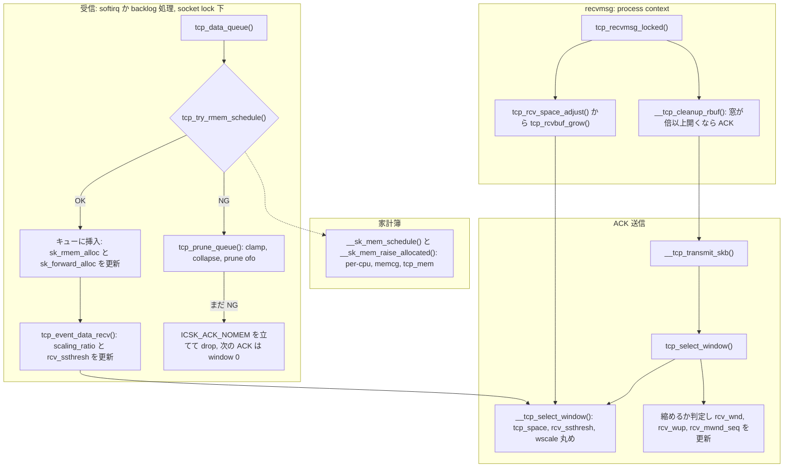

# 10. ウィンドウとメモリ管理

## たとえ話で言うと / The ELI5 version

部屋の郵便受け（ソケット）には、小包（`sk_buff`）を入れておく受け取り箱があります。受け取り箱の大きさには **家計簿と予算** が決まっていて、住人（アプリ）が中身を取り出すまでは、それ以上は入りません。

そこで郵便受けは、受領印（ACK）を返すたびに「あと **これだけ** なら入ります」というメモ（受信ウィンドウ）を添えます。

- メモに書く数字は「箱の空き容量」そのものではありません。小包には梱包材（`truesize` のオーバーヘッド）が付いてくるので、空き容量を **中身換算** に直してから書きます。
- 一度「あと 10 個入ります」と書いたら、次のメモで「やっぱり 3 個」と減らすのはマナー違反です（ウィンドウを縮めない）。だから箱が埋まりかけたら、早めに「あと 0 個」と書きます。
- 住人が中身をどんどん取り出す人なら、箱そのものを大きく買い替えます（autotuning）。取り出すのが遅い人に大きな箱を渡すのはお金の無駄です。
- 建物全体（ホスト）にも予算があります（`tcp_mem`）。建物の予算が苦しくなると、各部屋は梱包材を詰め直して（collapse）箱を小さく使い、それでも足りなければ順番待ちの棚から後ろの小包を捨てます（prune）。
- 発送側も同じで、発送待ちの棚の大きさは「一度に道路へ出せるトラックの台数」（cwnd）に合わせて広げます。

この章は、このメモの数字の決め方と、家計簿の付け方を、1 行ずつ追いかけます。

## RFC では / What the RFCs say

### RFC 9293 §3.8.6: Managing the Window

[RFC 9293](https://www.rfc-editor.org/rfc/rfc9293) は TCP の本体仕様で、RFC 793 / 1122 の TCP 部分 / 879 / 6093 / 6429 / 6528 / 6691 を統合し obsolete にしました。[§3.8.6](https://www.rfc-editor.org/rfc/rfc9293#section-3.8.6) はフロー制御、つまり「受信側がどれだけ受け取れるかを送信側に知らせる仕組み」を規定します。素朴に言えば、受信側は ACK のたびに `SEG.WND` で「`SEG.ACK` からこのバイト数までなら送ってよい」と伝え、送信側は `SND.UNA + SND.WND` を超えて送りません。

コードに直接効いてくる規則は次のとおりです。

- **ウィンドウを縮めない（SHOULD NOT shrink）**: 右端 `RCV.NXT + RCV.WND` を左に動かすことは強く非推奨です。送信側はこれに対して頑健でなければならず（MUST-34）、usable window が負になったら新規データは送らず、再送は続けます。
- **ゼロウィンドウ**: 受信側はウィンドウを無期限に 0 にしてよく、送信側は zero window probe を送らなければなりません（[§3.8.6.1](https://www.rfc-editor.org/rfc/rfc9293#section-3.8.6.1)、probe タイマーは第 9 章）。
- **受信側 SWS 回避**（[§3.8.6.2.2](https://www.rfc-editor.org/rfc/rfc9293#section-3.8.6.2.2)、MUST-39）: 受信バッファを `RCV.BUFF`、受信済み未読を `RCV.USER`、広告中を `RCV.WND` とすると、右端は

  ```text
  RCV.BUFF - RCV.USER - RCV.WND  >=  min(Fr * RCV.BUFF, Eff.snd.MSS)     (Fr = 1/2 推奨)
  ```

  になるまで固定しておき、条件を満たしたら `RCV.WND = RCV.BUFF - RCV.USER` に開く、というのが推奨アルゴリズムです。小さな空きを 1 バイト単位で広告し続けると、送信側が小さなセグメントしか送れなくなる（Silly Window Syndrome）からです。

### RFC 1122 §4.2.2.16 / §4.2.2.17 / §4.2.3.3

[RFC 1122](https://www.rfc-editor.org/rfc/rfc1122) はホスト要件です。TCP 部分は RFC 9293 に吸収されましたが、Linux のコメントは今も RFC 1122 を引用しているので、対応関係を押さえておきます。

- [§4.2.2.16 Managing the Window](https://www.rfc-editor.org/rfc/rfc1122#section-4.2.2.16): 「receiver SHOULD NOT shrink the window」の原典です。
- [§4.2.2.17 Probing Zero Windows](https://www.rfc-editor.org/rfc/rfc1122#section-4.2.2.17): 受信側はウィンドウを閉じたままにしてよく、送信側は probe に ACK が返る限りコネクションを維持しなければなりません。Linux がメモリ逼迫時に「パケットを捨てて黙る」より「ゼロウィンドウを広告する」方を選ぶ根拠がここにあります。
- [§4.2.3.3 When to Send a Window Update](https://www.rfc-editor.org/rfc/rfc1122#section-4.2.3.3): 受信側 SWS 回避の原典で、`RCV.BUFF - RCV.USER - RCV.WND >= min(1/2 RCV.BUFF, MSS)` の式はここから来ています。`__tcp_select_window()` の直前の長いコメントはこの節を引用しています。

### RFC 7323 §2: Window Scale

[RFC 7323](https://www.rfc-editor.org/rfc/rfc7323)（TCP Extensions for High Performance、RFC 1323 を obsolete）は、16 bit の window フィールドでは 64KB しか広告できず、高 BDP 経路で帯域を使い切れない問題を、Window Scale オプションで解決します。

- [§2.2](https://www.rfc-editor.org/rfc/rfc7323#section-2.2): SYN / SYN-ACK にだけ載る 3 バイトのオプション `shift.cnt` です。両方向で独立に決まり、最大値は 14 です（Linux の `TCP_MAX_WSCALE`）。
- [§2.3](https://www.rfc-editor.org/rfc/rfc7323#section-2.3): 受信した `SEG.WND` は `SND.WND = SEG.WND << Snd.Wind.Shift` と解釈します。自分が送るときは、内部の 32 bit 値を `Rcv.Wind.Shift` だけ右シフトして載せます。SYN / SYN-ACK の window はスケールしません。
- [§2.4 Addressing Window Retraction](https://www.rfc-editor.org/rfc/rfc7323#section-2.4): スケールを使うと window の粒度が `2^shift` バイトになるので、空きを正確に表せません。切り上げれば「バッファを超える約束」、切り捨てれば「ウィンドウの縮小（retraction）」になります（具体例は [Appendix F](https://www.rfc-editor.org/rfc/rfc7323#appendix-F)）。そのため RFC 7323 は「縮小は起こりうる」と認め、受信側に対しては、**過去に送ったどの ACK に対しても窓内だったセグメントは受け入れなければならず（MUST）**、スケール使用時は **広告した最大の右端を追跡すべき（SHOULD）** と求めます。

Linux はデフォルトでは「縮めない（切り上げる）」側に倒し、`net.ipv4.tcp_shrink_window=1` かつ wscale が非 0 の場合だけ縮小を許します。さらに、縮めた場合でも受信側の MUST を守るため、最大右端 `tp->rcv_mwnd_seq` を記録して `tcp_sequence()` で使います。

### DRS（Dynamic Right-Sizing）: autotuning の元になった考え方

DRS は RFC ではなく、Los Alamos の Mike Fisk と Wu-chun Feng が 2001 年ごろ提案した方式です。受信側のバッファ（＝広告ウィンドウの上限）が BDP より小さいと、送信側の cwnd がどれだけ大きくても rwnd で頭打ちになります。かといって全ソケットに巨大なバッファを持たせるとメモリが足りません。DRS の考え方は次のとおりです。

1. 受信側で RTT を推定します（タイムスタンプがあればそれを使い、なければ「1 ウィンドウ分のデータを受け取るのにかかった時間」で近似します）。
2. 1 RTT の間にアプリが **消費した** バイト数を測ります。これは送信側の実効 cwnd の推定値です。
3. 送信側が slow start で次の RTT に倍増しても rwnd で止まらないよう、受信バッファをその 2 倍程度に広げます。

Linux の実装（John Heffner らによる）は `tcp_rcv_rtt_measure()` / `tcp_rcv_rtt_measure_ts()` で RTT を、`tcp_rcv_space_adjust()` で 1 RTT ごとの消費量を測り、`tcp_rcvbuf_grow()` で `sk_rcvbuf` を広げます。`net.ipv4.tcp_moderate_rcvbuf`（デフォルト 1）で有効になり、アプリが `SO_RCVBUF` を設定すると（`SOCK_RCVBUF_LOCK`）無効になります。

### RFC の変数と Linux の変数

| RFC | Linux | メモ |
| --- | --- | --- |
| `RCV.NXT` | `tp->rcv_nxt` | 次に期待するシーケンス番号 |
| `RCV.WND` | `tp->rcv_wnd` | **最後に広告した** ウィンドウ（バイト、スケール前） |
| （広告時点の `RCV.NXT`） | `tp->rcv_wup` | 右端は `rcv_wup + rcv_wnd` |
| （最大右端、RFC 7323 §2.4） | `tp->rcv_mwnd_seq` | 縮めたときの受け入れ判定用 |
| `RCV.BUFF` | `sk->sk_rcvbuf` | ただしメモリ量（`truesize`）単位 |
| `RCV.USER` | `sk->sk_rmem_alloc` + `sk->sk_backlog.len` | 同上 |
| `Rcv.Wind.Shift` | `tp->rx_opt.rcv_wscale` | 自分が送る window の shift |
| `Snd.Wind.Shift` | `tp->rx_opt.snd_wscale` | 相手の window の shift |
| `Eff.snd.MSS`（相手の） | `icsk->icsk_ack.rcv_mss` | 相手の MSS の推定値 |
| — | `tp->window_clamp` | 広告ウィンドウの上限 |
| — | `tp->rcv_ssthresh` | 「今はここまでしか開かない」という緩やかな上限 |
| — | `tp->scaling_ratio` | メモリ → ペイロードの換算率（/256） |

一番大事なのは、RFC の `RCV.BUFF` / `RCV.USER` は **ペイロードのバイト数** なのに、Linux の `sk_rcvbuf` / `sk_rmem_alloc` は **`skb->truesize` の合計（実際に消費したメモリ）** だという点です。この差を埋めるのが `scaling_ratio` です。

## 全体の流れ / The big picture



受信側では、データが届くたびに「メモリ予算の確保」→「キューに入れる」→「換算率と `rcv_ssthresh` の更新」が起こります。アプリが読むたびに DRS が `sk_rcvbuf` を育て、ACK を送るたびに `tcp_select_window()` がそれらの値から広告ウィンドウを計算します。送信側の `sk_sndbuf` の伸長と EPOLLOUT 判定は Step 12 で扱います。

> [!NOTE]
> ACK を「いつ」送るか（delayed ACK、quickack）は第 6 章と第 7 章、ゼロウィンドウ probe のタイマーは第 9 章、送信側が `snd_wnd` をどう使うかは第 4 章の担当です。この章は「ACK に **何を** 書くか」と、その裏のメモリ会計に集中します。

## コードを追う / Walking through the code

### Step 1: メモリ量をウィンドウに換算する — `scaling_ratio`

受信キューの上限 `sk_rcvbuf` と使用量 `sk_rmem_alloc` は、どちらも `skb->truesize`（`struct sk_buff` 本体 + `skb_shared_info` + データ領域 + page frag 全体）の合計です。一方、相手に広告できるのはペイロードのバイト数だけです。MTU 1500 のフレームを 4KB ページや半ページの frag に受けるドライバでは、`truesize` はペイロードの 1.5〜3 倍になります。換算を誤ると、「広告したとおり送られてきたのにメモリが足りない」（＝collapse や drop）か、「メモリは余っているのに窓が小さい」（＝スループット低下）のどちらかになります。

換算関数は `__tcp_win_from_space()`（[include/net/tcp.h#L1774](https://git.kernel.org/pub/scm/linux/kernel/git/netdev/net-next.git/tree/include/net/tcp.h?id=279d5c8afcd38bd841832a39bfe1aa4f8518d98e#n1774)）とその逆関数です。

```c
static inline int __tcp_win_from_space(u8 scaling_ratio, int space)
{
	s64 scaled_space = (s64)space * scaling_ratio;

	return scaled_space >> TCP_RMEM_TO_WIN_SCALE;
}

static inline int tcp_win_from_space(const struct sock *sk, int space)
{
	return __tcp_win_from_space(tcp_sk(sk)->scaling_ratio, space);
}

/* inverse of __tcp_win_from_space() */
static inline int __tcp_space_from_win(u8 scaling_ratio, int win)
{
	u64 val = (u64)win << TCP_RMEM_TO_WIN_SCALE;

	do_div(val, scaling_ratio);
	return val;
}

static inline int tcp_space_from_win(const struct sock *sk, int win)
{
	return __tcp_space_from_win(tcp_sk(sk)->scaling_ratio, win);
}
```

`TCP_RMEM_TO_WIN_SCALE` は 8 です（[include/linux/tcp.h#L195](https://git.kernel.org/pub/scm/linux/kernel/git/netdev/net-next.git/tree/include/linux/tcp.h?id=279d5c8afcd38bd841832a39bfe1aa4f8518d98e#n195)）。つまり `scaling_ratio` は「ペイロード / truesize」を 256 倍した `u8` の固定小数点で、`win = space * ratio / 256` です。

- 乗算を `s64` で行うのは、`space * 255` が 32 bit を溢れうるからです（`sk_rcvbuf` は最大で `INT_MAX` 近くまで設定できます）。
- 逆方向の `__tcp_space_from_win()` は除算が必要なので `do_div()` を使います。こちらは DRS（Step 6）のように RTT に 1 回しか呼ばれない場所でだけ使います。順方向は ACK ごとに呼ばれるので、乗算とシフトだけで済むようになっています。
- `scaling_ratio` は 0 にならないよう `tcp_measure_rcv_mss()` で最低 1 に丸められます。0 だと逆関数でゼロ除算になります。

初期値と、それを使う 2 つのラッパーです。

```c
/* Assume a 50% default for skb->len/skb->truesize ratio.
 * This may be adjusted later in tcp_measure_rcv_mss().
 */
#define TCP_DEFAULT_SCALING_RATIO (1 << (TCP_RMEM_TO_WIN_SCALE - 1))

static inline void tcp_scaling_ratio_init(struct sock *sk)
{
	tcp_sk(sk)->scaling_ratio = TCP_DEFAULT_SCALING_RATIO;
}

/* Note: caller must be prepared to deal with negative returns */
static inline int tcp_space(const struct sock *sk)
{
	return tcp_win_from_space(sk, READ_ONCE(sk->sk_rcvbuf) -
				  READ_ONCE(sk->sk_backlog.len) -
				  atomic_read(&sk->sk_rmem_alloc));
}

static inline int tcp_full_space(const struct sock *sk)
{
	return tcp_win_from_space(sk, READ_ONCE(sk->sk_rcvbuf));
}
```

- `TCP_DEFAULT_SCALING_RATIO` は `1 << 7` = 128、つまり 50% です。`tcp_init_sock()`（[net/ipv4/tcp.c#L421](https://git.kernel.org/pub/scm/linux/kernel/git/netdev/net-next.git/tree/net/ipv4/tcp.c?id=279d5c8afcd38bd841832a39bfe1aa4f8518d98e#n421)）で `sk_rcvbuf = tcp_rmem[1]` と一緒に設定されます。
- `tcp_space()` は「まだ使っていない受信予算をウィンドウ換算したもの」です。`sk_backlog.len` も差し引いている点に注意してください。ユーザーがソケットロックを持っている間に softirq が backlog に積んだ skb は、まだ `sk_rmem_alloc` に計上されていませんが、メモリはすでに使っているからです。3 つの値はどれもロックなしで更新されうるので `READ_ONCE()` / `atomic_read()` で読み、結果は **負になりえます**（コメントのとおり）。呼び出し側はすべて `int` で受けて比較しています。
- `tcp_full_space()` は「予算全部を使ったらどれだけ広告できるか」です。

#### `scaling_ratio` はどこで測るか

測定は `tcp_measure_rcv_mss()`（[net/ipv4/tcp_input.c#L227](https://git.kernel.org/pub/scm/linux/kernel/git/netdev/net-next.git/tree/net/ipv4/tcp_input.c?id=279d5c8afcd38bd841832a39bfe1aa4f8518d98e#n227)）で、受信データごとに `tcp_event_data_recv()` から呼ばれます（ofo パケットについても `38d7e4443365` 以降は呼ばれます）。関連部分だけを示します。

```c
static void tcp_measure_rcv_mss(struct sock *sk, const struct sk_buff *skb)
{
...
	len = skb_shinfo(skb)->gso_size ? : skb->len;
	if (len >= icsk->icsk_ack.rcv_mss) {
		/* Note: divides are still a bit expensive.
		 * For the moment, only adjust scaling_ratio
		 * when we update icsk_ack.rcv_mss.
		 */
		if (unlikely(len != icsk->icsk_ack.rcv_mss)) {
			u64 val = (u64)skb->len << TCP_RMEM_TO_WIN_SCALE;
			u8 old_ratio = tcp_sk(sk)->scaling_ratio;

			do_div(val, skb->truesize);
			tcp_sk(sk)->scaling_ratio = val ? val : 1;

			if (old_ratio != tcp_sk(sk)->scaling_ratio) {
				struct tcp_sock *tp = tcp_sk(sk);

				val = tcp_win_from_space(sk, sk->sk_rcvbuf);
				WRITE_ONCE(tp->window_clamp, val);

				if (tp->window_clamp < tp->rcvq_space.space)
					tp->rcvq_space.space = tp->window_clamp;
			}
		}
		icsk->icsk_ack.rcv_mss = min_t(unsigned int, len,
					       tcp_sk(sk)->advmss);
```

- `len` は GRO 済み skb なら `gso_size`、つまり 1 セグメントのサイズです。これで相手の MSS（`rcv_mss`）を推定します。delayed ACK の判断に使う値で、詳しくは第 6 章で扱います。
- 比率の再計算は `len != rcv_mss`、つまり MSS の推定値が変わるときだけです（`unlikely()`）。コメントのとおり除算を避けるためです。定常状態では除算は一切走りません。
- 比率そのものは `skb->len / skb->truesize` で、GRO で束ねられた skb 全体の値です。束ねるほど `sk_buff` 本体のオーバーヘッドが薄まるので比率は上がります。
- 比率が変わったら `window_clamp` を `tcp_win_from_space(sk_rcvbuf)` に **直接** 書き直します。`window_clamp` は「`sk_rcvbuf` を全部使ったときの窓」でなければならないので、換算率が変われば一緒に動かす必要があります。`WRITE_ONCE()` なのは、`tcp_get_info()` などがロックなしで読むからです。
- `rcvq_space.space`（DRS の「前回 RTT の消費量」）が新しい `window_clamp` を超えないように抑えます（`f5da7c45188e`）。
- 以前はここで `tcp_set_window_clamp()` を呼んでいて、その副作用で `rcv_ssthresh` まで削られていました。比率が揺れるフローで窓が回復しなくなる問題があったため、`0e125ecfe20c` で単純な `WRITE_ONCE()` に戻されました。`rcv_ssthresh` を下げるのはメモリ逼迫時だけ、という不変条件が保たれています（packetdrill `tcp_rcv_ssthresh_scaling_ratio.pkt`）。

数値例です。`len = 1448`、`truesize = 2304`（半ページ frag + `sk_buff`）なら `1448 * 256 / 2304 = 160`（約 62.5%）です。`sk_rcvbuf = 131072`（`tcp_rmem[1]` のデフォルト）なら `tcp_full_space()` は `131072 * 160 / 256 = 81920` バイトになります。

### Step 2: 初期ウィンドウと `window_clamp` / `rcv_ssthresh` の初期化

SYN / SYN-ACK の時点では、まず `tcp_select_initial_window()`（[net/ipv4/tcp_output.c#L223](https://git.kernel.org/pub/scm/linux/kernel/git/netdev/net-next.git/tree/net/ipv4/tcp_output.c?id=279d5c8afcd38bd841832a39bfe1aa4f8518d98e#n223)）が初期窓と `rcv_wscale` を決めます。

```c
void tcp_select_initial_window(const struct sock *sk, int __space, __u32 mss,
			       __u32 *rcv_wnd, __u32 *__window_clamp,
			       int wscale_ok, __u8 *rcv_wscale,
			       __u32 init_rcv_wnd)
{
	unsigned int space = (__space < 0 ? 0 : __space);
	u32 window_clamp = READ_ONCE(*__window_clamp);

	/* If no clamp set the clamp to the max possible scaled window */
	if (window_clamp == 0)
		window_clamp = (U16_MAX << TCP_MAX_WSCALE);
	space = min(window_clamp, space);

	/* Quantize space offering to a multiple of mss if possible. */
	if (space > mss)
		space = rounddown(space, mss);

...
	if (READ_ONCE(sock_net(sk)->ipv4.sysctl_tcp_workaround_signed_windows))
		(*rcv_wnd) = min(space, MAX_TCP_WINDOW);
	else
		(*rcv_wnd) = space;

	if (init_rcv_wnd)
		*rcv_wnd = min_t(u64, *rcv_wnd, (u64)init_rcv_wnd * mss);

	*rcv_wscale = 0;
	if (wscale_ok) {
		/* Set window scaling on max possible window */
		space = max_t(u32, space, READ_ONCE(sock_net(sk)->ipv4.sysctl_tcp_rmem[2]));
		space = max_t(u32, space, READ_ONCE(sysctl_rmem_max));
		space = min_t(u32, space, window_clamp);
		*rcv_wscale = clamp_t(int, ilog2(space) - 15,
				      0, TCP_MAX_WSCALE);
	}
	/* Set the clamp no higher than max representable value */
	WRITE_ONCE(*__window_clamp,
		   min_t(__u32, U16_MAX << (*rcv_wscale), window_clamp));
}
```

- `window_clamp == 0`（`TCP_WINDOW_CLAMP` 未設定）なら、表現できる最大値 `65535 << 14` を仮の上限にします。
- `space` を MSS の倍数に切り捨てます。初期窓をセグメント境界に揃えると、送信側が端数セグメントを作りにくくなります。
- `tcp_workaround_signed_windows` は、window フィールドを符号付きと誤解する古いスタック向けの回避策です（デフォルト 0）。
- `init_rcv_wnd` は route の `initrwnd` メトリックや BPF からの指定で、初期窓をセグメント数で制限します。
- **wscale の決め方が重要です。** 今の `space` ではなく、`tcp_rmem[2]` と `rmem_max` のうち大きいほう（ただし `window_clamp` 以下）、つまり「将来 autotuning で育ちうる最大値」から `ilog2(space) - 15` を計算します。wscale は SYN でしか交渉できないので、後から大きくすることはできません。`tcp_rmem[2]` が 32MB（`572be9bf9d0d` 以降のデフォルト）なら `ilog2(32M) - 15 = 25 - 15 = 10` になります。packetdrill で `wscale 10` がよく出てくるのはこのためです。
- 最後に `window_clamp` を `65535 << rcv_wscale` 以下に抑えます。それ以上は表現できないからです。

`rcv_ssthresh` の初期値は、この `*rcv_wnd`（初期窓）です（呼び出し側で `tp->rcv_ssthresh = tp->rcv_wnd` と設定されます。詳細は第 2 章）。そして ESTABLISHED に入った直後に `tcp_init_buffer_space()`（[net/ipv4/tcp_input.c#L740](https://git.kernel.org/pub/scm/linux/kernel/git/netdev/net-next.git/tree/net/ipv4/tcp_input.c?id=279d5c8afcd38bd841832a39bfe1aa4f8518d98e#n740)）が呼ばれます。

```c
static void tcp_init_buffer_space(struct sock *sk)
{
	int tcp_app_win = READ_ONCE(sock_net(sk)->ipv4.sysctl_tcp_app_win);
	struct tcp_sock *tp = tcp_sk(sk);
	int maxwin;

	if (!(sk->sk_userlocks & SOCK_SNDBUF_LOCK))
		tcp_sndbuf_expand(sk);

	tcp_mstamp_refresh(tp);
	tp->rcvq_space.time = tp->tcp_mstamp;
	tp->rcvq_space.seq = tp->copied_seq;

	maxwin = tcp_full_space(sk);

	if (tp->window_clamp >= maxwin) {
		WRITE_ONCE(tp->window_clamp, maxwin);

		if (tcp_app_win && maxwin > 4 * tp->advmss)
			WRITE_ONCE(tp->window_clamp,
				   max(maxwin - (maxwin >> tcp_app_win),
				       4 * tp->advmss));
	}

	/* Force reservation of one segment. */
	if (tcp_app_win &&
	    tp->window_clamp > 2 * tp->advmss &&
	    tp->window_clamp + tp->advmss > maxwin)
		WRITE_ONCE(tp->window_clamp,
			   max(2 * tp->advmss, maxwin - tp->advmss));

	tp->rcv_ssthresh = min(tp->rcv_ssthresh, tp->window_clamp);
	tp->snd_cwnd_stamp = tcp_jiffies32;
	tp->rcvq_space.space = min3(tp->rcv_ssthresh, tp->rcv_wnd,
				    (u32)TCP_INIT_CWND * tp->advmss);
}
```

- `SO_SNDBUF` が設定されていなければ、まず送信バッファを cwnd に合わせて伸ばします（Step 12）。
- DRS の測定起点（`rcvq_space.time` / `.seq`）をここで初期化します。
- `window_clamp` を `tcp_full_space()` 以下にします。`tcp_app_win`（デフォルト 31）は「窓の `1/2^tcp_app_win` をアプリ用バッファとして広告しない」という古い仕組みで、31 なら事実上 0 です。
- `rcv_ssthresh <= window_clamp` にします。
- `rcvq_space.space`（DRS が「前回 RTT に消費された量」として比較に使う基準値）を、`min(rcv_ssthresh, rcv_wnd, 10 * advmss)` にします。IW10 の送信側が最初の RTT に送れる量に合わせた値です（`72d05c00d7ec`）。

ここで 3 つの上限の関係をまとめておきます。

```text
rcv_wnd(広告値)  <=  rcv_ssthresh  <=  window_clamp  <=  tcp_full_space() = win(sk_rcvbuf)
                     (緩い上限,         (硬い上限,          (メモリ予算)
                      データ到着で       DRS/SO_RCVBUF/
                      growする)          TCP_WINDOW_CLAMP)
```

`rcv_ssthresh` はいわば「受信側の slow start 閾値」です。相手が `truesize` の悪い（＝細切れの）パケットを送ってくるかもしれないので、最初から `window_clamp` まで開かず、「このサイズのパケットなら予算内に収まる」と確認できた分だけ少しずつ開きます（Step 5）。

> [!NOTE]
> 実際の `rcv_wnd` は、Step 4 で見るように wscale への切り上げや「縮めない」処理のために、一時的に `rcv_ssthresh` を少し超えることがあります。上の不等式は「`__tcp_select_window()` が目指す値」の関係です。

### Step 3: `tcp_select_window()` — 広告値を決めて状態を更新する

`tcp_select_window()`（[net/ipv4/tcp_output.c#L275](https://git.kernel.org/pub/scm/linux/kernel/git/netdev/net-next.git/tree/net/ipv4/tcp_output.c?id=279d5c8afcd38bd841832a39bfe1aa4f8518d98e#n275)）は、SYN 以外のすべての送信セグメントで `__tcp_transmit_skb()` から `th->window = htons(tcp_select_window(sk))` として呼ばれます。データセグメントにも ACK は載るので、ACK 専用パケットに限らず毎回呼ばれます。実行コンテキストは送信を起こした側で、softirq（ACK の受信処理から）でもプロセス（`sendmsg` / `recvmsg` / `tcp_release_cb`）でもかまいません。どちらの場合もソケットロック（`bh_lock_sock` かオーナー）を持っています。

```c
static u16 tcp_select_window(struct sock *sk)
{
	struct tcp_sock *tp = tcp_sk(sk);
	struct net *net = sock_net(sk);
	u32 old_win = tp->rcv_wnd;
	u32 cur_win, new_win;

	/* Make the window 0 if we failed to queue the data because we
	 * are out of memory.
	 */
	if (unlikely(inet_csk(sk)->icsk_ack.pending & ICSK_ACK_NOMEM)) {
		tp->pred_flags = 0;
		tp->rcv_wnd = 0;
		tp->rcv_wup = tp->rcv_nxt;
		tcp_update_max_rcv_wnd_seq(tp);
		return 0;
	}
```

- **メモリ枯渇時の即時ゼロウィンドウ**: `tcp_data_queue()` が in-sequence のデータすら受け入れられなかったとき（Step 11）、`ICSK_ACK_NOMEM | ICSK_ACK_NOW` を立てて ACK を予約します。ここではそれを見て、計算を飛ばして 0 を返します。
- `pred_flags = 0` で header prediction（第 5 章）を無効にします。header prediction は「相手から来るパケットの window が前と同じ」ことを前提に高速パスへ入るので、ゼロウィンドウ中は slow path で丁寧に処理させます。
- **`rcv_wnd = 0` と `rcv_wup = rcv_nxt` を記録するのが肝です**（`8c670bdfa58e`）。以前はゼロを広告しても状態には残さなかったため、自分の `tcp_receive_window()` は大きいままでした。そのため、アプリが読んで空きができても `__tcp_cleanup_rbuf()` の「窓が 2 倍以上開いたら ACK」の判定が成り立たず、相手は 0 を見たまま待ち続けるというデッドロックがありました。状態に 0 を記録しておけば、空きができた瞬間に `new_window >= 2 * 0` が成り立ち、window update が出ます。
- これは「縮めない」原則の **意図的な例外** です。右端が `rcv_nxt` まで左に動くからです。そこで `tcp_update_max_rcv_wnd_seq()` が最大右端を保持し、それまでの窓内で飛んでくるパケットを `tcp_sequence()` が受け入れられるようにしています（RFC 7323 §2.4 の受信側 MUST）。
- `ICSK_ACK_NOMEM` は ACK を送った後、`tcp_event_ack_sent()` → `inet_csk_clear_xmit_timer(sk, ICSK_TIME_DACK)` で `icsk_ack.pending` ごとクリアされます。つまり「次の 1 回だけ 0」です。

```c
	cur_win = tcp_receive_window(tp);
	new_win = __tcp_select_window(sk);
	if (new_win < cur_win) {
		/* Danger Will Robinson!
		 * Don't update rcv_wup/rcv_wnd here or else
		 * we will not be able to advertise a zero
		 * window in time.  --DaveM
		 *
		 * Relax Will Robinson.
		 */
		if (!READ_ONCE(net->ipv4.sysctl_tcp_shrink_window) || !tp->rx_opt.rcv_wscale) {
			/* Never shrink the offered window */
			if (new_win == 0)
				NET_INC_STATS(net, LINUX_MIB_TCPWANTZEROWINDOWADV);
			new_win = ALIGN(cur_win, 1 << tp->rx_opt.rcv_wscale);
		}
	}

	tp->rcv_wnd = new_win;
	tp->rcv_wup = tp->rcv_nxt;
	tcp_update_max_rcv_wnd_seq(tp);
```

- `cur_win` は「前回広告した右端 − 今の `rcv_nxt`」、つまり相手から見て **まだ有効な残り窓** です。`tcp_receive_window()`（[include/net/tcp.h#L956](https://git.kernel.org/pub/scm/linux/kernel/git/netdev/net-next.git/tree/include/net/tcp.h?id=279d5c8afcd38bd841832a39bfe1aa4f8518d98e#n956)）は、相手が窓を超えて送ってきた場合に負にならないよう 0 で止めます。
- `new_win` は今のメモリ状況から計算した「理想の窓」です（Step 4）。
- **`new_win < cur_win` が「縮小」です。** デフォルト（`tcp_shrink_window=0`）か、wscale が 0 の場合は、`new_win` を `cur_win` まで戻して縮小を防ぎます。ここで `ALIGN(cur_win, 1 << rcv_wscale)`、つまり **切り上げ** ているのが重要です。後で `>>= rcv_wscale` するときに端数が切り捨てられると、相手から見た右端が少し左に動いてしまうからです。切り上げた結果、右端は最大で `2^wscale - 1` バイト右に進みます。これが RFC 7323 §2.4 の言う「Beyond Buffer」側の選択です。
- `LINUX_MIB_TCPWANTZEROWINDOWADV` は「本当は 0 にしたかったが、縮めない原則のため 0 にできなかった」回数です。これが多いなら、受信アプリが遅いか、受信バッファが小さすぎます。
- 縮小を許す設定（`tcp_shrink_window=1` かつ `rcv_wscale != 0`）では、`new_win` をそのまま採用します。wscale 0 で縮小を許さないのは、wscale 0 なら 1 バイト単位で正確に表現でき、そもそも粒度による縮小が起きないからです（`b650d953cd39` の判断）。
- "Danger Will Robinson" のコメントは、昔ここで `rcv_wup` / `rcv_wnd` を更新しなかった時代の名残です。今は下で必ず更新します。
- `rcv_wnd` / `rcv_wup` を更新し、`tcp_update_max_rcv_wnd_seq()`（[include/net/tcp.h#L979](https://git.kernel.org/pub/scm/linux/kernel/git/netdev/net-next.git/tree/include/net/tcp.h?id=279d5c8afcd38bd841832a39bfe1aa4f8518d98e#n979)）で `rcv_mwnd_seq = max(rcv_mwnd_seq, rcv_wup + rcv_wnd)` を保ちます。`after()` で比較しているので、シーケンス番号の wrap にも対応しています。

```c
	/* Make sure we do not exceed the maximum possible
	 * scaled window.
	 */
	if (!tp->rx_opt.rcv_wscale &&
	    READ_ONCE(net->ipv4.sysctl_tcp_workaround_signed_windows))
		new_win = min(new_win, MAX_TCP_WINDOW);
	else
		new_win = min(new_win, (65535U << tp->rx_opt.rcv_wscale));

	/* RFC1323 scaling applied */
	new_win >>= tp->rx_opt.rcv_wscale;

	/* If we advertise zero window, disable fast path. */
	if (new_win == 0) {
		tp->pred_flags = 0;
		if (old_win)
			NET_INC_STATS(net, LINUX_MIB_TCPTOZEROWINDOWADV);
	} else if (old_win == 0) {
		NET_INC_STATS(net, LINUX_MIB_TCPFROMZEROWINDOWADV);
	}

	return new_win;
}
```

- wscale 0 の場合は 65535（`workaround_signed_windows` なら 32767）、wscale がある場合は `65535 << wscale` で上限を抑えます。ここで抑えた後の値は `rcv_wnd` には書き戻しません。`window_clamp` が `tcp_select_initial_window()` ですでに `65535 << wscale` 以下に制限されているので、通常はここで削られることはありません。
- `new_win >>= rcv_wscale` が RFC 7323 §2.3 の「送るときは右シフト」です。直前の `ALIGN` や `__tcp_select_window()` 内の丸めがあるので、ここで端数が切り捨てられて縮小することはありません。
- ゼロウィンドウを広告するときは header prediction を無効にします。0 への遷移と 0 からの復帰をそれぞれ `TCPToZeroWindowAdv` / `TCPFromZeroWindowAdv` で数えます（`8e165e20348b`）。`old_win` は関数の先頭で読んだ `rcv_wnd` です。

### Step 4: `__tcp_select_window()` — 理想の窓を計算する

`__tcp_select_window()`（[net/ipv4/tcp_output.c#L3322](https://git.kernel.org/pub/scm/linux/kernel/git/netdev/net-next.git/tree/net/ipv4/tcp_output.c?id=279d5c8afcd38bd841832a39bfe1aa4f8518d98e#n3322)）は「縮小チェックもスケーリングもしない生の窓」を返します。`tcp_select_window()` のほかに、`__tcp_cleanup_rbuf()`（窓が十分開いたか）と `__tcp_ack_snd_check()`（ACK を即送るべきか）からも呼ばれます。どちらも **状態を変えてはいけない** 呼び出しなので、この関数は `rcv_wnd` を書きません（`rcv_ssthresh` と `icsk_ack.quick` は書きます。後述）。

```c
u32 __tcp_select_window(struct sock *sk)
{
	struct inet_connection_sock *icsk = inet_csk(sk);
	struct tcp_sock *tp = tcp_sk(sk);
	struct net *net = sock_net(sk);
	/* MSS for the peer's data.  Previous versions used mss_clamp
	 * here.  I don't know if the value based on our guesses
	 * of peer's MSS is better for the performance.  It's more correct
	 * but may be worse for the performance because of rcv_mss
	 * fluctuations.  --SAW  1998/11/1
	 */
	int mss = icsk->icsk_ack.rcv_mss;
	int free_space = tcp_space(sk);
	int allowed_space = tcp_full_space(sk);
	int full_space, window;

	if (sk_is_mptcp(sk))
		mptcp_space(sk, &free_space, &allowed_space);

	full_space = min_t(int, tp->window_clamp, allowed_space);

	if (unlikely(mss > full_space)) {
		mss = full_space;
		if (mss <= 0)
			return 0;
	}
```

- `mss` は **相手の** MSS の推定値（`rcv_mss`）です。自分の `mss_cache` ではありません。コメントは 1998 年の Alexey Kuznetsov（SAW）のもので、`mss_clamp` から推定値に切り替えた経緯が書かれています。
- `free_space` は `tcp_space()`（負もありうる）、`allowed_space` は `tcp_full_space()` です。MPTCP サブフローの場合は、親 MPTCP ソケットの受信バッファで上書きします。
- `full_space = min(window_clamp, allowed_space)` が、この呼び出しでの「最大の窓」です。
- `mss > full_space`、つまり受信バッファが 1 MSS より小さい極端なケース（`SO_RCVBUF` を極小にした場合など）では、`mss` を `full_space` に縮めます。`full_space <= 0` なら 0 を返します。昔ここで後段の `rounddown(free_space, mss)` がゼロ除算を起こしたことがあります（`06425c308b92`）。

```c
	/* Only allow window shrink if the sysctl is enabled and we have
	 * a non-zero scaling factor in effect.
	 */
	if (READ_ONCE(net->ipv4.sysctl_tcp_shrink_window) && tp->rx_opt.rcv_wscale)
		goto shrink_window_allowed;

	/* do not allow window to shrink */

	if (free_space < (full_space >> 1)) {
		icsk->icsk_ack.quick = 0;

		if (tcp_under_memory_pressure(sk))
			tcp_adjust_rcv_ssthresh(sk);

		/* free_space might become our new window, make sure we don't
		 * increase it due to wscale.
		 */
		free_space = round_down(free_space, 1 << tp->rx_opt.rcv_wscale);

		/* if free space is less than mss estimate, or is below 1/16th
		 * of the maximum allowed, try to move to zero-window, else
		 * tcp_clamp_window() will grow rcv buf up to tcp_rmem[2], and
		 * new incoming data is dropped due to memory limits.
		 * With large window, mss test triggers way too late in order
		 * to announce zero window in time before rmem limit kicks in.
		 */
		if (free_space < (allowed_space >> 4) || free_space < mss)
			return 0;
	}
```

- 縮小許可時は別ラベルへ飛びます（後述）。
- **`free_space < full_space / 2`**: 受信バッファの半分以上が埋まっている状態です。これは RFC 1122 の受信側 SWS 回避の「`min(1/2 RCV.BUFF, MSS)`」の 1/2 に相当する閾値です。
  - `icsk_ack.quick = 0` で quickack を止めます。バッファが詰まっているのに ACK を急いで返して相手を煽る理由はありません。
  - メモリ逼迫中なら `tcp_adjust_rcv_ssthresh()` で `rcv_ssthresh` を `4 * advmss` まで下げます（`SO_RESERVE_MEM` の未使用分があればその換算値まで）。
  - `free_space` を wscale の粒度に **切り捨て** ます。この値がそのまま新しい窓になる可能性があり、後で `ALIGN` で切り上げると空き以上を約束してしまうからです。
  - **ゼロウィンドウへの移行条件**: `free_space < allowed_space / 16` または `free_space < mss` です。MSS 条件だけだと、32MB のバッファで空きが 1 MSS を切るまで窓を閉じません。その間も「縮めない」ために古い窓を切り上げて広告し続けるので、相手は送り続け、バッファがあふれて drop されます。1/16 条件はそれを防ぐためのものです（`86c1a045640d`、コメントに経緯あり）。ここで 0 を返しても、呼び出し元の `tcp_select_window()` が `cur_win` まで戻すので、実際に 0 が広告されるのは **右端に追いついたとき** です。
- `free_space` は `int` なので、負の場合もこの分岐に入って 0 を返します。

```c
	if (free_space > tp->rcv_ssthresh)
		free_space = tp->rcv_ssthresh;

	/* Don't do rounding if we are using window scaling, since the
	 * scaled window will not line up with the MSS boundary anyway.
	 */
	if (tp->rx_opt.rcv_wscale) {
		window = free_space;

		/* Advertise enough space so that it won't get scaled away.
		 * Import case: prevent zero window announcement if
		 * 1<<rcv_wscale > mss.
		 */
		window = ALIGN(window, (1 << tp->rx_opt.rcv_wscale));
	} else {
		window = tp->rcv_wnd;
		/* Get the largest window that is a nice multiple of mss.
		 * Window clamp already applied above.
		 * If our current window offering is within 1 mss of the
		 * free space we just keep it. This prevents the divide
		 * and multiply from happening most of the time.
		 * We also don't do any window rounding when the free space
		 * is too small.
		 */
		if (window <= free_space - mss || window > free_space)
			window = rounddown(free_space, mss);
		else if (mss == full_space &&
			 free_space > window + (full_space >> 1))
			window = free_space;
	}

	return window;
```

- **`rcv_ssthresh` によるキャップ**: 空きがあっても `rcv_ssthresh` までしか開きません。Step 5 の「確認できた分だけ開く」が効いてくるのはここです。
- **wscale ありの場合**: MSS への丸めはしません。スケール後の値は MSS 境界に揃わないからです。代わりに `ALIGN` で wscale 粒度に **切り上げ** ます。コメントの "Import case"（Important の誤記）は、`2^wscale > mss`（wscale 14 なら 16KB）のときに切り捨てると、空きが数 MSS あってもスケール後に 0 になってしまう問題です。切り上げで最大 `2^wscale - 1` バイト多く約束しますが、`rcv_ssthresh` や `full_space` は硬い上限ではない（Step 11 の collapse で吸収する）、という割り切りです。
  - ただし前の分岐で `free_space` を切り捨てた場合（バッファ半分超使用）は、すでに粒度に揃っているので `ALIGN` しても値は変わりません。つまり「余裕があるときは切り上げ、余裕がないときは切り捨て」です。
- **wscale なしの場合**: RFC 1122 の SWS 回避を MSS の倍数で近似します。
  - 現在の `rcv_wnd` が `(free_space - mss, free_space]` の範囲内なら、今の値をそのまま使います。毎回 `rounddown()`（除算）をしないための最適化で、結果として窓が MSS 単位でしか動かず、header prediction も効きやすくなります（BSD 互換の挙動。上の長いコメント参照）。
  - 範囲外なら `rounddown(free_space, mss)` にします。
  - `mss == full_space`（受信バッファが 1 MSS 以下まで縮んだ場合）で、空きが今の窓より `full_space / 2` 以上大きいなら、丸めずに `free_space` を使います。これは John Heffner の `84565070e442`「rcvbuf < MSS のときの受信側 SWS 回避」で、MSS で丸めると常に 0 になってデッドロックするのを防ぎます。

縮小を許す設定のときの経路です。

```c
shrink_window_allowed:
	/* new window should always be an exact multiple of scaling factor */
	free_space = round_down(free_space, 1 << tp->rx_opt.rcv_wscale);

	if (free_space < (full_space >> 1)) {
		icsk->icsk_ack.quick = 0;

		if (tcp_under_memory_pressure(sk))
			tcp_adjust_rcv_ssthresh(sk);

		/* if free space is too low, return a zero window */
		if (free_space < (allowed_space >> 4) || free_space < mss ||
			free_space < (1 << tp->rx_opt.rcv_wscale))
			return 0;
	}

	if (free_space > tp->rcv_ssthresh) {
		free_space = tp->rcv_ssthresh;
		/* new window should always be an exact multiple of scaling factor
		 *
		 * For this case, we ALIGN "up" (increase free_space) because
		 * we know free_space is not zero here, it has been reduced from
		 * the memory-based limit, and rcv_ssthresh is not a hard limit
		 * (unlike sk_rcvbuf).
		 */
		free_space = ALIGN(free_space, (1 << tp->rx_opt.rcv_wscale));
	}

	return free_space;
}
```

- まず wscale 粒度に切り捨てます（新しい窓は常に粒度の倍数）。
- ゼロウィンドウ条件に `free_space < (1 << rcv_wscale)` が追加されています。切り捨てた結果が粒度未満なら、スケール後は 0 になるからです。
- `rcv_ssthresh` でキャップした場合だけ `ALIGN` で切り上げます。コメントのとおり、`rcv_ssthresh` は硬い上限ではなく、メモリ由来の `free_space` より小さいことが分かっているので、切り上げてもメモリ上限は超えません。

縮小を許すと何がうれしいのでしょうか。`b650d953cd39` の再現例は、受信アプリが読まない状態で、送信側が 4 バイトずつ 1ms 間隔で送り続けるというものです。4 バイトの skb でも `truesize` は 1KB 近くあるので、メモリはペイロードの何百倍も消費されます。縮めない実装では、広告済みの窓を守るために `tcp_clamp_window()` が `sk_rcvbuf` を `tcp_rmem[2]` まで膨らませてしまいます。縮小を許せば、窓を即座に実メモリに合わせられます。

### Step 5: `rcv_ssthresh` を育てる — `tcp_grow_window()`

`tcp_grow_window()`（[net/ipv4/tcp_input.c#L700](https://git.kernel.org/pub/scm/linux/kernel/git/netdev/net-next.git/tree/net/ipv4/tcp_input.c?id=279d5c8afcd38bd841832a39bfe1aa4f8518d98e#n700)）は、in-sequence データ（`tcp_event_data_recv()`、`skb->len >= 128` のとき）と ofo データ（`tcp_data_queue_ofo()`、SACK 有効時のみ）の受信時に呼ばれます。冒頭の長いコメント（"2. Tuning advertised window"）がこの仕組みの設計思想です。`rcv_ssthresh` には 2 つの役割があります。

1. **Check #1**: アプリ用バッファを確保しつつ、送信側の header prediction（窓が一定であること）を保つ。
2. **Check #2**: 受信窓の見積もりを誤って、受信キューを prune する羽目になるのを防ぐ。

```c
static void tcp_grow_window(struct sock *sk, const struct sk_buff *skb,
			    bool adjust)
{
	struct tcp_sock *tp = tcp_sk(sk);
	int room;

	room = min_t(int, tp->window_clamp, tcp_space(sk)) - tp->rcv_ssthresh;

	if (room <= 0)
		return;

	/* Check #1 */
	if (!tcp_under_memory_pressure(sk)) {
		unsigned int truesize = truesize_adjust(adjust, skb);
		int incr;

		/* Check #2. Increase window, if skb with such overhead
		 * will fit to rcvbuf in future.
		 */
		if (tcp_win_from_space(sk, truesize) <= skb->len)
			incr = 2 * tp->advmss;
		else
			incr = __tcp_grow_window(sk, skb, truesize);

		if (incr) {
			incr = max_t(int, incr, 2 * skb->len);
			tp->rcv_ssthresh += min(room, incr);
			inet_csk(sk)->icsk_ack.quick |= 1;
		}
	} else {
		/* Under pressure:
		 * Adjust rcv_ssthresh according to reserved mem
		 */
		tcp_adjust_rcv_ssthresh(sk);
	}
}
```

- `room` は「`rcv_ssthresh` をあとどれだけ上げられるか」です。上限は `window_clamp` と現在の空き `tcp_space()` の小さいほうです。
- メモリ逼迫中は増やさず、逆に `tcp_adjust_rcv_ssthresh()` で `4 * advmss` まで下げます。
- `truesize_adjust()` は Step 5 の後半で見ます。
- **Check #2 の高速判定**: `tcp_win_from_space(truesize) <= skb->len`、つまりこの skb のペイロード / truesize 比が、平均（`scaling_ratio`）と同じかそれより良いなら、「この調子のパケットなら予算内で収まる」と判断し、`2 * advmss` 増やします。
- そうでなければ `__tcp_grow_window()` で詳しく判定します。
- 増分は `max(incr, 2 * skb->len)` です。GRO で 64KB の skb が来たときに 2 MSS ずつしか増えないのでは遅すぎるからです。
- `icsk_ack.quick |= 1` で quickack を 1 回分予約します。窓が開いたことを早く相手に知らせ、slow start を妨げないためです。

```c
static int __tcp_grow_window(const struct sock *sk, const struct sk_buff *skb,
			     unsigned int skbtruesize)
{
	const struct tcp_sock *tp = tcp_sk(sk);
	/* Optimize this! */
	int truesize = tcp_win_from_space(sk, skbtruesize) >> 1;
	int window = tcp_win_from_space(sk, READ_ONCE(sock_net(sk)->ipv4.sysctl_tcp_rmem[2])) >> 1;

	while (tp->rcv_ssthresh <= window) {
		if (truesize <= skb->len)
			return 2 * inet_csk(sk)->icsk_ack.rcv_mss;

		truesize >>= 1;
		window >>= 1;
	}
	return 0;
}

/* Even if skb appears to have a bad len/truesize ratio, TCP coalescing
 * can play nice with us, as sk_buff and skb->head might be either
 * freed or shared with up to MAX_SKB_FRAGS segments.
 * Only give a boost to drivers using page frag(s) to hold the frame(s),
 * and if no payload was pulled in skb->head before reaching us.
 */
static u32 truesize_adjust(bool adjust, const struct sk_buff *skb)
{
	u32 truesize = skb->truesize;

	if (adjust && !skb_headlen(skb)) {
		truesize -= SKB_TRUESIZE(skb_end_offset(skb));
		/* paranoid check, some drivers might be buggy */
		if (unlikely((int)truesize < (int)skb->len))
			truesize = skb->truesize;
	}
	return truesize;
}
```

`__tcp_grow_window()` は John Heffner の `326f36e9e7de`「mixed MTU での受信バッファ成長制限」が由来です。

- `window` を `win(tcp_rmem[2]) / 2` から、`truesize` を `win(skb->truesize) / 2` から始めて、両方を半分ずつにしていきます。
- 「`rcv_ssthresh` が小さいうちは、比率の悪い skb でもある程度まで窓を開いてよい。`rcv_ssthresh` が大きくなるほど、良い比率を要求する」というルールです。具体的には、`rcv_ssthresh <= window` を保ったまま `truesize` が `skb->len` 以下に縮むまでに必要な半減回数が、許容できる比率の悪さに対応します。
- 開いてよいと判断したら `2 * rcv_mss` を返します（最終的には `max(…, 2 * skb->len)`）。
- ループは `window` が `rcv_ssthresh` を下回ったら終わり、0 を返します。細切れパケットばかり送ってくる相手には、それ以上窓を開きません。

`truesize_adjust()` は Eric Dumazet の `240bfd134c59` です。ペイロードが全部 page frag にあり、線形部分が空（`!skb_headlen(skb)`）の skb は、受信キューに入るときに `tcp_try_coalesce()` で前の skb に frag ごと吸収され、`sk_buff` 本体と `skb->head` は解放されます。なので、`SKB_TRUESIZE(skb_end_offset(skb))`（本体 + head 分）を差し引いて評価します。`adjust` は in-sequence 経路で true、ofo 経路で false です（ofo キューでは coalesce が保証されないため）。

関連して、`__tcp_adjust_rcv_ssthresh()`（[include/net/tcp.h#L1828](https://git.kernel.org/pub/scm/linux/kernel/git/netdev/net-next.git/tree/include/net/tcp.h?id=279d5c8afcd38bd841832a39bfe1aa4f8518d98e#n1828)）も見ておきます。

```c
static inline void __tcp_adjust_rcv_ssthresh(struct sock *sk, u32 new_ssthresh)
{
	int unused_mem = sk_unused_reserved_mem(sk);
	struct tcp_sock *tp = tcp_sk(sk);

	tp->rcv_ssthresh = min(tp->rcv_ssthresh, new_ssthresh);
	if (unused_mem)
		tp->rcv_ssthresh = max_t(u32, tp->rcv_ssthresh,
					 tcp_win_from_space(sk, unused_mem));
}

static inline void tcp_adjust_rcv_ssthresh(struct sock *sk)
{
	__tcp_adjust_rcv_ssthresh(sk, 4U * tcp_sk(sk)->advmss);
}
```

- メモリ逼迫時は `rcv_ssthresh` を `4 * advmss` まで下げますが、`SO_RESERVE_MEM` で事前に確保した未使用分（`sk_unused_reserved_mem()`）があれば、その換算値までは残します（`053f368412c9`）。予約は memcg 下のソケットが「逼迫時でも最低限の窓」を確保するための仕組みです。

### Step 6: DRS — `tcp_rcv_space_adjust()` と `tcp_rcvbuf_grow()`

#### 受信側の RTT 推定

DRS には受信側から見た RTT が必要です。送信側の RTT 推定（第 7 章）は自分が送ったデータの ACK で測りますが、受信専用のソケットには送信データがありません。そこで `tcp_rcv_rtt_update()`（[net/ipv4/tcp_input.c#L829](https://git.kernel.org/pub/scm/linux/kernel/git/netdev/net-next.git/tree/net/ipv4/tcp_input.c?id=279d5c8afcd38bd841832a39bfe1aa4f8518d98e#n829)）に 2 つの経路でサンプルを入れます。

```c
static void tcp_rcv_rtt_update(struct tcp_sock *tp, u32 sample, int win_dep)
{
	u32 new_sample, old_sample = tp->rcv_rtt_est.rtt_us;
	long m = sample << 3;

	if (old_sample == 0 || m < old_sample) {
		new_sample = m;
	} else {
...
		if (win_dep)
			return;
		/* Do not use this sample if receive queue is not empty. */
		if (tp->rcv_nxt != tp->copied_seq)
			return;
		new_sample = old_sample - (old_sample >> 3) + sample;
	}

	tp->rcv_rtt_est.rtt_us = new_sample;
}

static inline void tcp_rcv_rtt_measure(struct tcp_sock *tp)
{
	u32 delta_us;

	if (tp->rcv_rtt_est.time == 0)
		goto new_measure;
	if (before(tp->rcv_nxt, tp->rcv_rtt_est.seq))
		return;
	delta_us = tcp_stamp_us_delta(tp->tcp_mstamp, tp->rcv_rtt_est.time);
	if (!delta_us)
		delta_us = 1;
	tcp_rcv_rtt_update(tp, delta_us, 1);

new_measure:
	tp->rcv_rtt_est.seq = tp->rcv_nxt + tp->rcv_wnd;
	tp->rcv_rtt_est.time = tp->tcp_mstamp;
}
```

- `rcv_rtt_est.rtt_us` は 8 倍した固定小数点です（`m = sample << 3`）。
- 初回、または新しいサンプルが現在値より小さいときは即座に採用します。**最小値寄り** の推定です。
- `win_dep = 1`（タイムスタンプなしの経路）では、大きいサンプルは捨てます。この方法は「1 窓分を受け取るのにかかった時間」なので、送信側がアプリ律速だと RTT を大きく見積もってしまうからです。
- タイムスタンプ経路でも、受信キューが空でないとき（`rcv_nxt != copied_seq`）は平滑化しません。アプリが遅いと、相手の送信は rwnd で止まっていて、TS の echo が遅れて見えるからです。
- 平滑化は `new = old - old/8 + sample` で、`old` は 8 倍値なので、通常の SRTT と同じく 1/8 の EWMA です。
- `tcp_rcv_rtt_measure()` は TS なしの経路です。`rcv_rtt_est.seq` に「今の `rcv_nxt + rcv_wnd`」を記録し、`rcv_nxt` がそこを越えたら（＝1 窓分を受け取ったら）経過時間をサンプルにします。
- `tcp_rcv_rtt_measure_ts()`（[net/ipv4/tcp_input.c#L893](https://git.kernel.org/pub/scm/linux/kernel/git/netdev/net-next.git/tree/net/ipv4/tcp_input.c?id=279d5c8afcd38bd841832a39bfe1aa4f8518d98e#n893)）は TS 経路で、`rcv_tsecr` が変わり、かつ 1 MSS 以上のセグメントのときだけ、`tcp_time_stamp - tsecr` をサンプルにします。delta が 0 のサンプルは捨てます（`d59fc95be9d0`。1ms 粒度の TS では低 RTT で 0 が多発し、最小値推定が壊れるため）。

#### `tcp_rcv_space_adjust()`

`tcp_rcv_space_adjust()`（[net/ipv4/tcp_input.c#L960](https://git.kernel.org/pub/scm/linux/kernel/git/netdev/net-next.git/tree/net/ipv4/tcp_input.c?id=279d5c8afcd38bd841832a39bfe1aa4f8518d98e#n960)）は、`tcp_recvmsg_locked()`、`tcp_read_sock()`、`tcp_zerocopy_receive()`、BPF sockmap などの、**データをユーザーに渡した後** に呼ばれます。プロセスコンテキストで、ソケットロックを持っています。

```c
void tcp_rcv_space_adjust(struct sock *sk)
{
	struct tcp_sock *tp = tcp_sk(sk);
	int time, inq, copied;

	trace_tcp_rcv_space_adjust(sk);

	if (unlikely(!tp->rcv_rtt_est.rtt_us))
		return;

	/* We do not refresh tp->tcp_mstamp here.
	 * Some platforms have expensive ktime_get() implementations.
	 * Using the last cached value is enough for DRS.
	 */
	time = tcp_stamp_us_delta(tp->tcp_mstamp, tp->rcvq_space.time);
	if (time < (tp->rcv_rtt_est.rtt_us >> 3))
		return;

	/* Number of bytes copied to user in last RTT */
	copied = tp->copied_seq - tp->rcvq_space.seq;
	/* Number of bytes in receive queue. */
	inq = tp->rcv_nxt - tp->copied_seq;
	copied -= inq;
	if (copied <= tp->rcvq_space.space)
		goto new_measure;

	trace_tcp_rcvbuf_grow(sk, time);

	tcp_rcvbuf_grow(sk, copied);

new_measure:
	tp->rcvq_space.seq = tp->copied_seq;
	tp->rcvq_space.time = tp->tcp_mstamp;
}
```

- tracepoint `tcp:tcp_rcv_space_adjust` は毎回発火します。
- 受信 RTT がまだ測れていなければ何もしません（`unlikely()`）。
- **`tcp_mstamp` を更新しない** 点に注意してください。`tcp_mstamp` は直近の受信や送信で更新されたキャッシュ値です。recvmsg のたびに `ktime_get()` を呼ぶのはプラットフォームによっては高価なので、DRS の精度にはキャッシュ値で十分と割り切っています（`0ae1ac7335ca`）。
- 前回の測定から **1 RTT 以上** 経っていなければ何もしません。`rtt_us >> 3` が 8 倍値を戻す操作です。DRS は RTT に 1 回だけ判断します。
- `copied = copied_seq - rcvq_space.seq` は、この RTT にアプリが読んだバイト数です。
- `inq = rcv_nxt - copied_seq` は、受信キューにまだ残っているバイト数です。**`copied -= inq` で残量を差し引きます**（`ea33537d8292`）。アプリが追いついていないとき、つまりキューが溜まっているときは、受信バッファを広げてもアプリが読む速さは変わらず、メモリとキャッシュを浪費するだけだからです。一見奇妙な引き算ですが、「アプリが追いついている分だけ」を成長の根拠にする、という意味です。
- 前回の `rcvq_space.space` 以下なら成長させず、測定区間だけを更新します。DRS は **縮めません**。縮めるのは Step 11 のメモリ逼迫パスだけです。
- 成長させる場合は、tracepoint `tcp:tcp_rcvbuf_grow`（time、rtt、copied、inq、space、ooo、rcvbuf、rcv_ssthresh、window_clamp、rcv_wnd、scaling_ratio を出力）を出してから `tcp_rcvbuf_grow()` を呼びます。
- `copied` は `int` です。`copied_seq - rcvq_space.seq` が 2GB を超えることは 1 RTT ではまずありませんが、`607065bad993` 以降、各所で overflow に注意が払われています。

#### `tcp_rcvbuf_grow()`

`tcp_rcvbuf_grow()`（[net/ipv4/tcp_input.c#L911](https://git.kernel.org/pub/scm/linux/kernel/git/netdev/net-next.git/tree/net/ipv4/tcp_input.c?id=279d5c8afcd38bd841832a39bfe1aa4f8518d98e#n911)）は、`tcp_rcv_space_adjust()` からの呼び出し（`newval = copied`）と、ofo キューに挿入した直後の `tcp_data_queue_ofo()` からの呼び出し（`newval = rcvq_space.space`、つまり値は変えずに ofo 分だけ再評価する）の 2 か所から使われます。MPTCP も使います。

```c
void tcp_rcvbuf_grow(struct sock *sk, u32 newval)
{
	const struct net *net = sock_net(sk);
	struct tcp_sock *tp = tcp_sk(sk);
	u32 rcvwin, rcvbuf, cap, oldval;
	u32 rtt_threshold, rtt_us;
	u64 grow;

	oldval = tp->rcvq_space.space;
	tp->rcvq_space.space = newval;

	if (!READ_ONCE(net->ipv4.sysctl_tcp_moderate_rcvbuf) ||
	    (sk->sk_userlocks & SOCK_RCVBUF_LOCK))
		return;

	/* DRS is always one RTT late. */
	rcvwin = newval << 1;

	rtt_us = tp->rcv_rtt_est.rtt_us >> 3;
	rtt_threshold = READ_ONCE(net->ipv4.sysctl_tcp_rcvbuf_low_rtt);
	if (rtt_us < rtt_threshold) {
		/* For small RTT, we set @grow to rcvwin * rtt_us/rtt_threshold.
		 * It might take few additional ms to reach 'line rate',
		 * but will avoid sk_rcvbuf inflation and poor cache use.
		 */
		grow = div_u64((u64)rcvwin * rtt_us, rtt_threshold);
	} else {
		/* slow start: allow the sender to double its rate. */
		grow = div_u64(((u64)rcvwin << 1) * (newval - oldval), oldval);
	}
	rcvwin += grow;

	if (!RB_EMPTY_ROOT(&tp->out_of_order_queue))
		rcvwin += TCP_SKB_CB(tp->ooo_last_skb)->end_seq - tp->rcv_nxt;

	cap = READ_ONCE(net->ipv4.sysctl_tcp_rmem[2]);

	rcvbuf = min_t(u32, tcp_space_from_win(sk, rcvwin), cap);
	if (rcvbuf > sk->sk_rcvbuf) {
		WRITE_ONCE(sk->sk_rcvbuf, rcvbuf);
		/* Make the window clamp follow along.  */
		WRITE_ONCE(tp->window_clamp,
			   tcp_win_from_space(sk, rcvbuf));
	}
}
```

- 先に `rcvq_space.space = newval` を記録します。autotuning が無効でも、次の比較基準は更新しておきます。
- `tcp_moderate_rcvbuf=0` か `SO_RCVBUF` 設定済み（`SOCK_RCVBUF_LOCK`）なら、ここで終わりです。
- **`rcvwin = newval << 1`**: 「DRS is always one RTT late」。測ったのは前の RTT の消費量なので、slow start 中の送信側は今の RTT にはもう 2 倍送っているかもしれません。そこで 2 倍を基本にします。
- **低 RTT（`rtt_us < tcp_rcvbuf_low_rtt`、デフォルト 1ms）** では、`grow = rcvwin * rtt / threshold` に抑えます（`ecfea98b7d0d`）。データセンター内の低 RTT フローでは、BDP が小さいのに `sk_rcvbuf` を大きくしすぎると、NIC の page pool のページが再利用されにくくなったり、DDIO の LLC から追い出されたりします。数 ms 余計にかかっても、小さいバッファで済ませるほうが得、という判断です。
- **通常の RTT** では `grow = 2 * rcvwin * (newval - oldval) / oldval` です。前回からの消費量の伸び率に比例させます。slow start で毎 RTT 倍増しているなら `(newval - oldval) / oldval ≈ 1` なので、`rcvwin = 2 * newval` に `4 * newval` が加わり、合計 `6 * newval` になります。伸びが止まっていれば `grow ≈ 0` で `2 * newval` です。`aa251c84636c` で、「オーバーシュートを避けた結果、送信側が rwnd 律速になって BDP を倍増できない」という退行を直したときの式です。
- `tcp_rcv_space_adjust()` 経由では `newval > oldval` が保証されています。ofo 経由では `newval == oldval` なので `grow = 0` です。
- **ofo キューがあれば、その範囲（`ooo_last_skb->end_seq - rcv_nxt`）を加えます**（`63ad7dfedfae`）。ロスがあると穴の後ろのデータが ofo キューに溜まり、アプリは読めないので `copied` には現れません。しかし再送が届くまでの 1 RTT 以上、そのデータを抱えておく必要があります。これを見込まないと、ロス回復中に受信バッファが足りなくなり、窓が詰まってパイプが止まります。
- `tcp_space_from_win()` で窓からメモリ量に戻し、`tcp_rmem[2]` で頭打ちにします。
- **大きくなるときだけ** `sk_rcvbuf` を書き換え、`window_clamp` も追従させます。`sk_rcvbuf` はロックなしで読まれる（`tcp_space()`、`sock_rcvbuf` の diag など）ので `WRITE_ONCE()` を使います。`rcv_ssthresh` はここでは上げません。実際に窓が開くのは、データ到着時の `tcp_grow_window()` が `rcv_ssthresh` を上げてからです。

ofo 側の呼び出しは `tcp_data_queue_ofo()`（[net/ipv4/tcp_input.c#L5387](https://git.kernel.org/pub/scm/linux/kernel/git/netdev/net-next.git/tree/net/ipv4/tcp_input.c?id=279d5c8afcd38bd841832a39bfe1aa4f8518d98e#n5387)）の末尾です。

```c
end:
	if (skb) {
		/* For non sack flows, do not grow window to force DUPACK
		 * and trigger fast retransmit.
		 */
		if (tcp_is_sack(tp))
			tcp_grow_window(sk, skb, false);
		skb_condense(skb);
		skb_set_owner_r(skb, sk);
	}
	/* do not grow rcvbuf for not-yet-accepted or orphaned sockets. */
	if (sk->sk_socket)
		tcp_rcvbuf_grow(sk, tp->rcvq_space.space);
}
```

非 SACK フローでは窓を広げません。SACK がない場合、送信側は dupack の数でしかロスを検出できないので、窓の更新を含む ACK だと dupack と見なされなくなる（RFC 5681 の dupack 定義には「窓が変わらないこと」が含まれる）からです。`sk->sk_socket` が NULL のソケット（accept 前、orphan）は、誰も読まないので `sk_rcvbuf` を育てません。

### Step 7: 窓が開いたことを知らせる — `__tcp_cleanup_rbuf()`

窓を計算するのは ACK を送るときだけなので、アプリが読んで空きができても、ACK を送らなければ相手は知りません。`__tcp_cleanup_rbuf()`（[net/ipv4/tcp.c#L1554](https://git.kernel.org/pub/scm/linux/kernel/git/netdev/net-next.git/tree/net/ipv4/tcp.c?id=279d5c8afcd38bd841832a39bfe1aa4f8518d98e#n1554)）が recvmsg の後にその判断をします（ACK タイミング全般は第 6 章）。窓に関する部分だけを示します。

```c
	/* We send an ACK if we can now advertise a non-zero window
	 * which has been raised "significantly".
	 *
	 * Even if window raised up to infinity, do not send window open ACK
	 * in states, where we will not receive more. It is useless.
	 */
	if (copied > 0 && !time_to_ack && !(sk->sk_shutdown & RCV_SHUTDOWN)) {
		__u32 rcv_window_now = tcp_receive_window(tp);

		/* Optimize, __tcp_select_window() is not cheap. */
		if (2*rcv_window_now <= tp->window_clamp) {
			__u32 new_window = __tcp_select_window(sk);

			/* Send ACK now, if this read freed lots of space
			 * in our buffer. Certainly, new_window is new window.
			 * We can advertise it now, if it is not less than current one.
			 * "Lots" means "at least twice" here.
			 */
			if (new_window && new_window >= 2 * rcv_window_now)
				time_to_ack = true;
		}
	}
```

- `RCV_SHUTDOWN` 後（FIN 受信後など）は、もうデータは来ないので window update は無意味です。
- **`2 * rcv_window_now <= window_clamp`**: 今の残り窓が上限の半分以下のときだけ `__tcp_select_window()` を呼びます。これは除算を含みうる比較的重い関数なので、窓に余裕があるときは計算すらしません。
- **`new_window >= 2 * rcv_window_now`**: 窓が「2 倍以上」開くなら ACK を送ります。これが Linux 流の受信側 SWS 回避の後半です。RFC の「`min(RCV.BUFF/2, MSS)` 以上空いたら」の代わりに、「残り窓の 2 倍」という相対条件を使っています。
- `rcv_window_now == 0` のとき（Step 3 の NOMEM 後など）は、`new_window` が非 0 になった瞬間に ACK します。`8c670bdfa58e` が `rcv_wnd = 0` を記録するようにしたのは、この判定を成り立たせるためでした。

同様に `__tcp_ack_snd_check()` も、「1 MSS を超える未 ACK データがあり、かつ（`SO_RCVLOWAT` に未達か、`__tcp_select_window(sk) >= tp->rcv_wnd`、つまり右端を前に進められる）」なら即 ACK します。

### Step 8: ソケットの家計簿 — 4 つのカウンタと `sk_forward_alloc`

ここからは家計簿の話です。TCP のメモリ会計は 3 層になっています。

| 層 | 変数 | 単位 | 意味 |
| --- | --- | --- | --- |
| ソケット（受信） | `sk->sk_rmem_alloc` | バイト（truesize） | 受信キュー + ofo キューの skb の合計。`skb_set_owner_r()` で加算し、`sock_rfree()` で減算します |
| ソケット（送信） | `sk->sk_wmem_queued` | バイト（truesize） | write queue + rtx queue の skb の合計。`sk_wmem_queued_add()` |
| ソケット（前借り） | `sk->sk_forward_alloc` | バイト | プロトコル予算から **前借り済みでまだ使っていない** 分 |
| プロトコル全体 | `*sk->sk_prot->memory_allocated`（TCP は `tcp_memory_allocated`）+ per-cpu `tcp_memory_per_cpu_fw_alloc` | ページ | 全 TCP ソケットの前借り総額。`tcp_mem[0..2]` と比較します |
| memcg | `memcg->memory`（v2）/ `tcpmem`（v1） | ページ | ソケットが属する cgroup に課金 |

なお、`sk_wmem_alloc` は「qdisc / NIC にまだ残っている送信 skb」の参照カウント兼バイト数で、TSQ（第 4 章）が使います。ここでいう家計簿とは別物です。

基本の流れは次のとおりです。

1. skb をキューに入れる前に `sk_wmem_schedule()` / `sk_rmem_schedule()` で「`truesize` 分の前借りがあるか」を確認します。足りなければ `__sk_mem_schedule()` でページ単位でまとめて前借りします。
2. 入れたら `sk_mem_charge()` で `sk_forward_alloc` から差し引きます（`skb_set_owner_r()` が内部で呼びます）。
3. skb を解放したら `sk_mem_uncharge()` で `sk_forward_alloc` に戻し、1 ページ以上余ったら `__sk_mem_reclaim()` でプロトコル予算に返します。

前借りをページ単位でまとめるのは、グローバルな `memory_allocated`（全 CPU で共有されるアトミック変数）への書き込みを減らすためです。

```c
/* sysctl_mem values are in pages */
static inline long sk_prot_mem_limits(const struct sock *sk, int index)
{
	return READ_ONCE(sk->sk_prot->sysctl_mem[index]);
}

static inline int sk_mem_pages(int amt)
{
	return (amt + PAGE_SIZE - 1) >> PAGE_SHIFT;
}

static inline bool sk_has_account(struct sock *sk)
{
	/* return true if protocol supports memory accounting */
	return !!sk->sk_prot->memory_allocated;
}

static inline bool sk_wmem_schedule(struct sock *sk, int size)
{
	int delta;

	if (!sk_has_account(sk))
		return true;
	delta = size - sk->sk_forward_alloc;
	return delta <= 0 || __sk_mem_schedule(sk, delta, SK_MEM_SEND);
}

static inline bool
__sk_rmem_schedule(struct sock *sk, int size, bool pfmemalloc)
{
	int delta;

	if (!sk_has_account(sk))
		return true;
	delta = size - sk->sk_forward_alloc;
	return delta <= 0 || __sk_mem_schedule(sk, delta, SK_MEM_RECV) ||
	       pfmemalloc;
}

static inline bool
sk_rmem_schedule(struct sock *sk, const struct sk_buff *skb, int size)
{
	return __sk_rmem_schedule(sk, size, skb_pfmemalloc(skb));
}
```

- `sk_has_account()`: `memory_allocated` を持つプロトコル（TCP、UDP、SCTP など）だけが会計の対象です。
- `sk_mem_pages()` は切り上げです。
- `sk_wmem_schedule()` / `__sk_rmem_schedule()`: 前借りの残りで足りれば（`delta <= 0`）何もせず true を返します。これが **fast path** で、ほとんどの skb はここで終わります。
- 受信側は `pfmemalloc` の skb なら失敗しても true を返します。swap over NFS / NBD のように、メモリ回収そのものがネットワーク経由の場合、緊急予備から確保した skb を捨てるとデッドロックするからです。
- 失敗しても `__sk_mem_schedule()` は `sk_forward_alloc` を元に戻すので、呼び出し側は何も戻さなくてよい設計です。

```c
static inline int sk_unused_reserved_mem(const struct sock *sk)
{
	int unused_mem;

	if (likely(!sk->sk_reserved_mem))
		return 0;

	unused_mem = sk->sk_reserved_mem - sk->sk_wmem_queued -
			atomic_read(&sk->sk_rmem_alloc);

	return unused_mem > 0 ? unused_mem : 0;
}

static inline void sk_mem_reclaim(struct sock *sk)
{
	int reclaimable;

	if (!sk_has_account(sk))
		return;

	reclaimable = sk->sk_forward_alloc - sk_unused_reserved_mem(sk);

	if (reclaimable >= (int)PAGE_SIZE)
		__sk_mem_reclaim(sk, reclaimable);
}

static inline void sk_mem_reclaim_final(struct sock *sk)
{
	sk->sk_reserved_mem = 0;
	sk_mem_reclaim(sk);
}

static inline void sk_mem_charge(struct sock *sk, int size)
{
	if (!sk_has_account(sk))
		return;
	sk_forward_alloc_add(sk, -size);
}

static inline void sk_mem_uncharge(struct sock *sk, int size)
{
	if (!sk_has_account(sk))
		return;
	sk_forward_alloc_add(sk, size);
	sk_mem_reclaim(sk);
}
```

- `sk_unused_reserved_mem()`: `SO_RESERVE_MEM` で予約した `sk_reserved_mem` のうち、送受信キューでまだ使っていない量です。`likely(!sk->sk_reserved_mem)` で、通常は即 0 を返します。
- `sk_mem_reclaim()`: 前借りの残り（予約分を除く）が 1 ページ以上あれば、ページ単位で返却します。返さずに抱えておく上限が 1 ページ未満なので、アイドルなソケットが大量にあっても、ソケットあたり最大 4KB 弱しか前借りを抱えません。
- `sk_mem_charge()` / `sk_mem_uncharge()` は `sk_forward_alloc` を増減するだけです。`sk_forward_alloc_add()`（[include/net/sock.h#L1125](https://git.kernel.org/pub/scm/linux/kernel/git/netdev/net-next.git/tree/include/net/sock.h?id=279d5c8afcd38bd841832a39bfe1aa4f8518d98e#n1125)）は `WRITE_ONCE()` を使います（`ss -m` / `inet_diag` がロックなしで読むため）。**書き手はソケットロックを持っている** 前提なので、read-modify-write 自体はアトミックである必要がありません。

`__sk_mem_schedule()`（[net/core/sock.c#L3503](https://git.kernel.org/pub/scm/linux/kernel/git/netdev/net-next.git/tree/net/core/sock.c?id=279d5c8afcd38bd841832a39bfe1aa4f8518d98e#n3503)）は、前借り分を先に `sk_forward_alloc` に積んでから `__sk_mem_raise_allocated()` に判定を任せ、失敗したら戻します。

```c
int __sk_mem_schedule(struct sock *sk, int size, int kind)
{
	int ret, amt = sk_mem_pages(size);

	sk_forward_alloc_add(sk, amt << PAGE_SHIFT);
	ret = __sk_mem_raise_allocated(sk, size, amt, kind);
	if (!ret)
		sk_forward_alloc_add(sk, -(amt << PAGE_SHIFT));
	return ret;
}
```

### Step 9: `__sk_mem_raise_allocated()` — 予算を増やしてよいか

`__sk_mem_raise_allocated()`（[net/core/sock.c#L3385](https://git.kernel.org/pub/scm/linux/kernel/git/netdev/net-next.git/tree/net/core/sock.c?id=279d5c8afcd38bd841832a39bfe1aa4f8518d98e#n3385)）はこの章で最も重要な判定関数です。`amt` ページを、プロトコル全体と memcg に計上してよいかを決めます。呼ばれるのはソケットロックを持っているときですが、softirq とプロセスのどちらからも呼ばれます。

```c
int __sk_mem_raise_allocated(struct sock *sk, int size, int amt, int kind)
{
	bool memcg_enabled = false, charged = false;
	struct proto *prot = sk->sk_prot;
	long allocated = 0;

	if (!sk->sk_bypass_prot_mem) {
		sk_memory_allocated_add(sk, amt);
		allocated = sk_memory_allocated(sk);
	}

	if (mem_cgroup_sk_enabled(sk)) {
		memcg_enabled = true;
		charged = mem_cgroup_sk_charge(sk, amt, gfp_memcg_charge());
		if (!charged)
			goto suppress_allocation;
	}

	if (!allocated)
		return 1;

	/* Under limit. */
	if (allocated <= sk_prot_mem_limits(sk, 0)) {
		sk_leave_memory_pressure(sk);
		return 1;
	}

	/* Under pressure. */
	if (allocated > sk_prot_mem_limits(sk, 1))
		sk_enter_memory_pressure(sk);

	/* Over hard limit. */
	if (allocated > sk_prot_mem_limits(sk, 2))
		goto suppress_allocation;
```

- **楽観的に先に加算します。** 判定より前に `sk_memory_allocated_add()` で計上し、失敗したら最後に引き戻します。先に判定してから加算すると、判定と加算の間に他の CPU が加算して上限を超える、という TOCTOU が起きます。「先に足してから見る」なら、上限超過は一時的なものに限られます。
- `sk_bypass_prot_mem`（`7c268eaeec63`、`net.core.bypass_prot_mem` や BPF で設定）が立っているソケットは、プロトコル全体の会計をスキップします。memcg で管理しているコンテナのソケットに、二重の会計コストを払わせないためです。このとき `allocated = 0` のままです。
- **memcg への課金**: `mem_cgroup_sk_enabled()` は「memcg のソケット会計が有効で、このソケットが memcg に属している」ことを表します。`mem_cgroup_sk_charge()`（[mm/memcontrol.c#L5621](https://git.kernel.org/pub/scm/linux/kernel/git/netdev/net-next.git/tree/mm/memcontrol.c?id=279d5c8afcd38bd841832a39bfe1aa4f8518d98e#n5621)）は v2 なら `try_charge_memcg()` で、cgroup の `memory.max` を超えそうなら直接回収を試みます。gfp は `gfp_memcg_charge()` で、softirq なら `GFP_ATOMIC` 相当（回収なし）、プロセスなら `GFP_KERNEL` 相当になります。失敗したら即 `suppress_allocation` へ行きます。memcg の上限は硬い上限だからです。
- `allocated == 0`（bypass か、まれに per-cpu 予約で総額が 0 以下に見える場合）なら、memcg の課金だけで成功とします。
- **`tcp_mem[0]` 以下**: 余裕あり。`sk_leave_memory_pressure()` で、もし逼迫状態ならそれを解除して成功とします。
- **`tcp_mem[1]` 超え**: 逼迫状態に入ります（`sk_enter_memory_pressure()` → `tcp_enter_memory_pressure()`）。ただし、ここではまだ失敗にしません。
- **`tcp_mem[2]` 超え**: 硬い上限なので失敗です。

`tcp_mem` のデフォルトは `tcp_init_mem()`（[net/ipv4/tcp.c#L5192](https://git.kernel.org/pub/scm/linux/kernel/git/netdev/net-next.git/tree/net/ipv4/tcp.c?id=279d5c8afcd38bd841832a39bfe1aa4f8518d98e#n5192)）で、空きバッファページの 1/16 を基準に、`[0] = 3/4`、`[1] = 1`、`[2] = 3/2` 倍です（コメントでは物理メモリの約 4.68% / 6.25% / 9.37%）。`[0]` と `[1]` の間はヒステリシス帯で、`[1]` を超えると逼迫に入り、`[0]` を下回るまで出ません。

```c
	/* Guarantee minimum buffer size under pressure (either global
	 * or memcg) to make sure features described in RFC 7323 (TCP
	 * Extensions for High Performance) work properly.
	 *
	 * This rule does NOT stand when exceeds global or memcg's hard
	 * limit, or else a DoS attack can be taken place by spawning
	 * lots of sockets whose usage are under minimum buffer size.
	 */
	if (kind == SK_MEM_RECV) {
		if (atomic_read(&sk->sk_rmem_alloc) < sk_get_rmem0(sk, prot))
			return 1;

	} else { /* SK_MEM_SEND */
		int wmem0 = sk_get_wmem0(sk, prot);

		if (sk->sk_type == SOCK_STREAM) {
			if (sk->sk_wmem_queued < wmem0)
				return 1;
		} else if (refcount_read(&sk->sk_wmem_alloc) < wmem0) {
				return 1;
		}
	}

	if (sk_has_memory_pressure(sk)) {
		u64 alloc;

		/* The following 'average' heuristic is within the
		 * scope of global accounting, so it only makes
		 * sense for global memory pressure.
		 */
		if (!sk_under_global_memory_pressure(sk))
			return 1;

		/* Try to be fair among all the sockets under global
		 * pressure by allowing the ones that below average
		 * usage to raise.
		 */
		alloc = sk_sockets_allocated_read_positive(sk);
		if (sk_prot_mem_limits(sk, 2) > alloc *
		    sk_mem_pages(sk->sk_wmem_queued +
				 atomic_read(&sk->sk_rmem_alloc) +
				 sk->sk_forward_alloc))
			return 1;
	}
```

ここに来るのは「`tcp_mem[0]` 超え、`tcp_mem[2]` 以下」のときです。

- **最低保証**: 逼迫中でも、受信なら `sk_rmem_alloc < tcp_rmem[0]`、送信なら `sk_wmem_queued < tcp_wmem[0]` のソケットは成功させます。コメントのとおり、RFC 7323 の機能（大きな窓、タイムスタンプ）が最低限動くためです。ただし、硬い上限（`tcp_mem[2]` や memcg の上限）を超えてまで保証すると、小さなソケットを大量に作る DoS が成立するので、それより前で判定しています。
- `sk_get_rmem0()` / `sk_get_wmem0()` は、netns ごとの `tcp_rmem[0]` / `tcp_wmem[0]` を `proto->sysctl_rmem_offset` 経由で読みます。
- **公平性ヒューリスティック**: グローバルに逼迫している（`tcp_memory_pressure` が立っている）とき、`tcp_mem[2] > ソケット数 × 自分の使用ページ数`、つまり「自分の使用量が、硬い上限をソケット数で均等割りした平均を下回っている」なら成功させます。たくさん使っているソケットから先に我慢させる仕組みです。
- `sk_sockets_allocated_read_positive()` は `percpu_counter` の近似読みです（正確な合計は取らない）。
- **グローバル逼迫フラグが立っていない場合**、つまり `tcp_mem[0] < allocated <= tcp_mem[1]` のヒステリシス帯をまだ上っている途中（`tcp_memory_pressure` は 0）では、`!sk_under_global_memory_pressure()` で成功させます。コードのコメントのとおり、平均値ヒューリスティックはグローバル会計の話なので、グローバル逼迫時にしか意味がないからです。memcg 側の逼迫には、呼び出し側が `tcp_under_memory_pressure()` を見て、窓や sndbuf を抑える方向で反応します（関数冒頭の kernel-doc の「memcg には楽観的に」の意味です）。

```c
suppress_allocation:

	if (kind == SK_MEM_SEND && sk->sk_type == SOCK_STREAM) {
		sk_stream_moderate_sndbuf(sk);

		/* Fail only if socket is _under_ its sndbuf.
		 * In this case we cannot block, so that we have to fail.
		 */
		if (sk->sk_wmem_queued + size >= sk->sk_sndbuf) {
			/* Force charge with __GFP_NOFAIL */
			if (memcg_enabled && !charged)
				mem_cgroup_sk_charge(sk, amt,
						     gfp_memcg_charge() | __GFP_NOFAIL);
			return 1;
		}
	}

	trace_sock_exceed_buf_limit(sk, prot, allocated, kind);

	if (allocated)
		sk_memory_allocated_sub(sk, amt);

	if (charged)
		mem_cgroup_sk_uncharge(sk, amt);

	return 0;
}
```

- **送信側の特別扱い**: TCP の送信で失敗する場合は、まず `sk_stream_moderate_sndbuf()` で `sk_sndbuf` を `sk_wmem_queued / 2` 程度に縮め、これ以上キューを伸ばさないようにします。そのうえで、**`sk_wmem_queued + size >= sk_sndbuf`（＝縮めた sndbuf をすでに超えている）なら、成功を返します**。直感に反しますが、コメントのとおりです。sndbuf を超えているなら、`tcp_sendmsg()` はこの後 `sk_stream_memory_free()` で失敗し、`sk_stream_wait_memory()` で **ブロックして待てる** ので、ここで失敗させる必要がありません。逆に sndbuf 未満なのに失敗させると、待つ理由がないのに送れない、という状態になります。
- その場合、memcg で失敗していれば `__GFP_NOFAIL` で強制課金して整合を取ります。
- 失敗時は tracepoint `sock:sock_exceed_buf_limit` を出し、先に加算したプロトコル予算と memcg 課金を引き戻します。

#### `mem_cgroup_sk_under_memory_pressure()`

`tcp_under_memory_pressure()` が呼ぶ memcg 側の判定、`mem_cgroup_sk_under_memory_pressure()`（[include/net/sock.h#L2706](https://git.kernel.org/pub/scm/linux/kernel/git/netdev/net-next.git/tree/include/net/sock.h?id=279d5c8afcd38bd841832a39bfe1aa4f8518d98e#n2706)）です。

```c
static inline bool mem_cgroup_sk_under_memory_pressure(const struct sock *sk)
{
	struct mem_cgroup *memcg = mem_cgroup_from_sk(sk);

#ifdef CONFIG_MEMCG_V1
	if (!cgroup_subsys_on_dfl(memory_cgrp_subsys))
		return !!memcg->tcpmem_pressure;
#endif /* CONFIG_MEMCG_V1 */

	do {
		if (time_before64(get_jiffies_64(),
				  mem_cgroup_get_socket_pressure(memcg))) {
			memcg_memory_event(mem_cgroup_from_sk(sk),
					   MEMCG_SOCK_THROTTLED);
			return true;
		}
	} while ((memcg = parent_mem_cgroup(memcg)));

	return false;
}
```

- v1 は `tcpmem_pressure` フラグです（`memory.kmem.tcp.limit_in_bytes` の超過で立ちます）。
- v2 は、**自分と祖先のどれか** の memcg で「socket pressure の期限（jiffies）」が未来にあれば逼迫と見なします。vmpressure / PSI が回収困難を検知すると、`mem_cgroup_get_socket_pressure()` の期限が延長されます。逼迫と判定するたびに `MEMCG_SOCK_THROTTLED` イベント（`memory.events` の `sock_throttled`）を数えます。

### Step 10: per-cpu 予約と、予算の返却

`sk_memory_allocated_add()`（[include/net/proto_memory.h#L65](https://git.kernel.org/pub/scm/linux/kernel/git/netdev/net-next.git/tree/include/net/proto_memory.h?id=279d5c8afcd38bd841832a39bfe1aa4f8518d98e#n65)） / `sk_memory_allocated_sub()`（[include/net/proto_memory.h#L76](https://git.kernel.org/pub/scm/linux/kernel/git/netdev/net-next.git/tree/include/net/proto_memory.h?id=279d5c8afcd38bd841832a39bfe1aa4f8518d98e#n76)）は、グローバルのアトミック変数を直接触りません。

```c
static inline long
sk_memory_allocated(const struct sock *sk)
{
	return proto_memory_allocated(sk->sk_prot);
}

static inline void proto_memory_pcpu_drain(struct proto *proto)
{
	int val = this_cpu_xchg(*proto->per_cpu_fw_alloc, 0);

	if (val)
		atomic_long_add(val, proto->memory_allocated);
}

static inline void
sk_memory_allocated_add(const struct sock *sk, int val)
{
	struct proto *proto = sk->sk_prot;

	val = this_cpu_add_return(*proto->per_cpu_fw_alloc, val);

	if (unlikely(val >= READ_ONCE(net_hotdata.sysctl_mem_pcpu_rsv)))
		proto_memory_pcpu_drain(proto);
}

static inline void
sk_memory_allocated_sub(const struct sock *sk, int val)
{
	struct proto *proto = sk->sk_prot;

	val = this_cpu_sub_return(*proto->per_cpu_fw_alloc, val);

	if (unlikely(val <= -READ_ONCE(net_hotdata.sysctl_mem_pcpu_rsv)))
		proto_memory_pcpu_drain(proto);
}
```

- 各 CPU に `per_cpu_fw_alloc` という差分カウンタがあります。`this_cpu_add_return()` で加算し、絶対値が `net.core.mem_pcpu_rsv`（デフォルト `SK_MEMORY_PCPU_RESERVE` = 1MB 分のページ数）を超えたときだけ、`this_cpu_xchg()` で 0 にしてグローバルに流し込みます（`3cd3399dd7a8`、tunable 化は `12a686c2e761`）。
- 多数の CPU で TCP が動くと、`tcp_memory_allocated` のキャッシュラインが激しく行き来します。per-cpu 化で、グローバルへの書き込みは CPU あたり 1MB の変動ごとに 1 回になります。
- 代償として、グローバル値は最大で `CPU 数 × 1MB` 程度ずれます。そのため `proto_memory_allocated()` は `max(0L, …)` で負の値を 0 に丸めています（ある CPU に正の差分、別の CPU からの負の差分がグローバルに流れると、一時的に負になりうる）。`tcp_mem` の判定はこの誤差を許容しています。
- `this_cpu_*()`（`__this_cpu_*()` ではない）を使うのは、ソケットロックを持っていても、プロセスコンテキストでは softirq に割り込まれうるからです。x86 以外では `__this_cpu_add_return()` が irq-safe ではなく、カウンタが壊れました（`3584718cf2ec`）。`preempt_disable()` も不要になり、むしろ速くなっています。
- `sysctl_mem_pcpu_rsv` は `net_hotdata` に置かれています（`c204fef97ee6`）。fast path で読む sysctl をまとめて、キャッシュミスを減らすためです。

返却側の `__sk_mem_reduce_allocated()`（[net/core/sock.c#L3522](https://git.kernel.org/pub/scm/linux/kernel/git/netdev/net-next.git/tree/net/core/sock.c?id=279d5c8afcd38bd841832a39bfe1aa4f8518d98e#n3522)）と `__sk_mem_reclaim()`（[net/core/sock.c#L3542](https://git.kernel.org/pub/scm/linux/kernel/git/netdev/net-next.git/tree/net/core/sock.c?id=279d5c8afcd38bd841832a39bfe1aa4f8518d98e#n3542)）です。

```c
void __sk_mem_reduce_allocated(struct sock *sk, int amount)
{
	if (mem_cgroup_sk_enabled(sk))
		mem_cgroup_sk_uncharge(sk, amount);

	if (sk->sk_bypass_prot_mem)
		return;

	sk_memory_allocated_sub(sk, amount);

	if (sk_under_global_memory_pressure(sk) &&
	    (sk_memory_allocated(sk) < sk_prot_mem_limits(sk, 0)))
		sk_leave_memory_pressure(sk);
}

/**
 *	__sk_mem_reclaim - reclaim sk_forward_alloc and memory_allocated
 *	@sk: socket
 *	@amount: number of bytes (rounded down to a PAGE_SIZE multiple)
 */
void __sk_mem_reclaim(struct sock *sk, int amount)
{
	amount >>= PAGE_SHIFT;
	sk_forward_alloc_add(sk, -(amount << PAGE_SHIFT));
	__sk_mem_reduce_allocated(sk, amount);
}
```

- memcg の課金を戻し（bypass でも memcg は戻します）、プロトコル予算を減らします。
- 逼迫中に `tcp_mem[0]` を下回ったら、逼迫を解除します。解除は「下回ったソケット」が行うので、逼迫の解除は確保側（`__sk_mem_raise_allocated()` の `tcp_mem[0]` 以下の分岐）と返却側の両方から起こります。
- `__sk_mem_reclaim()` はバイトをページに切り捨ててから返します。端数は `sk_forward_alloc` に残ります。

逼迫フラグそのものは `tcp_enter_memory_pressure()`（[net/ipv4/tcp.c#L326](https://git.kernel.org/pub/scm/linux/kernel/git/netdev/net-next.git/tree/net/ipv4/tcp.c?id=279d5c8afcd38bd841832a39bfe1aa4f8518d98e#n326)） / `tcp_leave_memory_pressure()`（[net/ipv4/tcp.c#L340](https://git.kernel.org/pub/scm/linux/kernel/git/netdev/net-next.git/tree/net/ipv4/tcp.c?id=279d5c8afcd38bd841832a39bfe1aa4f8518d98e#n340)）です。

```c
void tcp_enter_memory_pressure(struct sock *sk)
{
	unsigned long val;

	if (READ_ONCE(tcp_memory_pressure))
		return;
	val = jiffies;

	if (!val)
		val--;
	if (!cmpxchg(&tcp_memory_pressure, 0, val))
		NET_INC_STATS(sock_net(sk), LINUX_MIB_TCPMEMORYPRESSURES);
}

void tcp_leave_memory_pressure(struct sock *sk)
{
	unsigned long val;

	if (!READ_ONCE(tcp_memory_pressure))
		return;
	val = xchg(&tcp_memory_pressure, 0);
	if (val)
		NET_ADD_STATS(sock_net(sk), LINUX_MIB_TCPMEMORYPRESSURESCHRONO,
			      jiffies_to_msecs(jiffies - val));
}
```

- `tcp_memory_pressure` は bool ではなく、**逼迫に入った時刻（jiffies）** です。`jiffies` がちょうど 0 のときは「逼迫なし」と区別できないので、`val--` で 0 を避けます。
- `READ_ONCE()` による事前チェックで、すでに逼迫中なら書き込みません。全 CPU が同じキャッシュラインに `cmpxchg` を打ち込むのを避けるためです（`503978aca461` の、`sk_leave_memory_pressure()` で false sharing を避けるのと同じ発想）。
- `cmpxchg` で 0 から遷移させた CPU だけが `TCPMemoryPressures` を数えます。
- 解除時は `xchg` で取り出した開始時刻から、逼迫していた時間を `TCPMemoryPressuresChrono`（ミリ秒）に加算します（`0604475119de`）。
- `tcp.c` の先頭のコメント「accounting is strict, actions are advisory and have some latency」が設計思想です。会計（`memory_allocated`）は厳密ですが、逼迫フラグに基づく行動（窓を絞る、sndbuf を伸ばさない）は緩く、遅れてもかまいません。

`tcp_under_memory_pressure()`（[include/net/tcp.h#L299](https://git.kernel.org/pub/scm/linux/kernel/git/netdev/net-next.git/tree/include/net/tcp.h?id=279d5c8afcd38bd841832a39bfe1aa4f8518d98e#n299)）は、汎用版の `sk_under_memory_pressure()` を TCP 用に特化したものです（`b8da51ebb1aa`）。

```c
/* optimized version of sk_under_memory_pressure() for TCP sockets */
static inline bool tcp_under_memory_pressure(const struct sock *sk)
{
	if (mem_cgroup_sk_enabled(sk) &&
	    mem_cgroup_sk_under_memory_pressure(sk))
		return true;

	if (sk->sk_bypass_prot_mem)
		return false;

	return READ_ONCE(tcp_memory_pressure);
}
```

TCP は必ず `memory_pressure` を持つので、`sk_prot->memory_pressure` の NULL チェックと間接参照を省き、グローバル変数を直接読みます。memcg が逼迫していればグローバルより優先し、bypass ソケットはグローバルの逼迫を無視します。

#### 予算を無視して確保する — `sk_forced_mem_schedule()`

`sk_forced_mem_schedule()`（[net/ipv4/tcp.c#L909](https://git.kernel.org/pub/scm/linux/kernel/git/netdev/net-next.git/tree/net/ipv4/tcp.c?id=279d5c8afcd38bd841832a39bfe1aa4f8518d98e#n909)）は、上限判定をせずに前借りを強制します。

```c
void sk_forced_mem_schedule(struct sock *sk, int size)
{
	int delta, amt;

	delta = size - sk->sk_forward_alloc;
	if (delta <= 0)
		return;

	amt = sk_mem_pages(delta);
	sk_forward_alloc_add(sk, amt << PAGE_SHIFT);

	if (mem_cgroup_sk_enabled(sk))
		mem_cgroup_sk_charge(sk, amt, gfp_memcg_charge() | __GFP_NOFAIL);

	if (sk->sk_bypass_prot_mem)
		return;

	sk_memory_allocated_add(sk, amt);
}
```

使われるのは、FIN や RST の送信、TFO の SYN データ、そして受信キューが空のときの in-sequence データ（Step 11）です。コメントにあるとおり、「ソケットあたり 1 skb は許す」ことで、edge-triggered epoll がハングしたり、FIN を送れずにコネクションを閉じられなくなったりするのを防ぎます。memcg には `__GFP_NOFAIL` で課金します。`tcp_mem` の超過は `tcp_out_of_memory()`（`sk_wmem_queued > SOCK_MIN_SNDBUF` かつ `tcp_mem[2]` 超え）で別途検出され、タイマーなどでコネクションが破棄されます（`tcp_check_oom()`）。

送信側の `tcp_wmem_schedule()`（[net/ipv4/tcp.c#L1029](https://git.kernel.org/pub/scm/linux/kernel/git/netdev/net-next.git/tree/net/ipv4/tcp.c?id=279d5c8afcd38bd841832a39bfe1aa4f8518d98e#n1029)）も同じ発想です。

```c
int tcp_wmem_schedule(struct sock *sk, int copy)
{
	int left;

	if (likely(sk_wmem_schedule(sk, copy)))
		return copy;

	/* We could be in trouble if we have nothing queued.
	 * Use whatever is left in sk->sk_forward_alloc and tcp_wmem[0]
	 * to guarantee some progress.
	 */
	left = READ_ONCE(sock_net(sk)->ipv4.sysctl_tcp_wmem[0]) - sk->sk_wmem_queued;
	if (left > 0)
		sk_forced_mem_schedule(sk, min(left, copy));
	return min(copy, sk->sk_forward_alloc);
}
```

`sk_wmem_schedule()` が失敗しても、`sk_wmem_queued` が `tcp_wmem[0]` 未満なら、その差分までは強制的に確保し、`sk_forward_alloc` の範囲でコピーを続けます。「どんなに逼迫しても、`tcp_wmem[0]` までは送信キューを持てる」という保証です。

### Step 11: 受信側でメモリが足りないとき — prune と collapse

受信データをキューに入れる前の関門が `tcp_try_rmem_schedule()`（[net/ipv4/tcp_input.c#L5370](https://git.kernel.org/pub/scm/linux/kernel/git/netdev/net-next.git/tree/net/ipv4/tcp_input.c?id=279d5c8afcd38bd841832a39bfe1aa4f8518d98e#n5370)）です。in-sequence（`tcp_data_queue()`）、ofo（`tcp_data_queue_ofo()`）、`tcp_send_rcvq()`（repair 用）から呼ばれます。

```c
static bool tcp_can_ingest(const struct sock *sk, const struct sk_buff *skb)
{
	unsigned int rmem = atomic_read(&sk->sk_rmem_alloc);

	return rmem <= sk->sk_rcvbuf;
}

static int tcp_try_rmem_schedule(struct sock *sk, const struct sk_buff *skb,
				 unsigned int size)
{
	if (!tcp_can_ingest(sk, skb) ||
	    !sk_rmem_schedule(sk, skb, size)) {

		if (tcp_prune_queue(sk, skb) < 0)
			return -1;

		while (!sk_rmem_schedule(sk, skb, size)) {
			if (!tcp_prune_ofo_queue(sk, skb))
				return -1;
		}
	}
	return 0;
}
```

- **2 つの関門** があります。1 つは `tcp_can_ingest()` で、ソケットごとの上限 `sk_rmem_alloc <= sk_rcvbuf` を見ます。もう 1 つは `sk_rmem_schedule()` で、プロトコル全体と memcg の予算を見ます（Step 8-9）。
- `tcp_can_ingest()` は、入ってくる skb のサイズを足さずに「今すでに超えていないか」だけを見ます。2025 年に `1d2fbaad7cd8`「stronger sk_rcvbuf checks」で `rmem + skb->truesize <= sk_rcvbuf` に強化されましたが、小さな `SO_RCVBUF` や LRO/HW-GRO で drop が多発し（`f017c1f768b6` で `skb->len` に緩和）、最終的に `026dfef287c0` で元に戻されました。`skb` 引数は使われていませんが、シグネチャは残っています。
- どちらかが NG なら `tcp_prune_queue()` を試し、負（もうどうにもならない）なら失敗です。
- `tcp_prune_queue()` が 0（ソケット上限内に戻った）を返しても、プロトコル予算がまだ取れない場合は、ofo キューの末尾から 1 バッチずつ捨てながら `sk_rmem_schedule()` を再試行します。ofo が空になったら失敗です。

失敗したときの扱いは、呼び出し元で異なります。in-sequence の場合（`tcp_data_queue()`）を示します。

```c
queue_and_out:
		if (tcp_try_rmem_schedule(sk, skb, skb->truesize)) {
			/* TODO: maybe ratelimit these WIN 0 ACK ? */
			inet_csk(sk)->icsk_ack.pending |=
					(ICSK_ACK_NOMEM | ICSK_ACK_NOW);
			inet_csk_schedule_ack(sk);
			READ_ONCE(sk->sk_data_ready)(sk);

			if (skb_queue_len(&sk->sk_receive_queue) && skb->len) {
				reason = SKB_DROP_REASON_PROTO_MEM;
				NET_INC_STATS(sock_net(sk), LINUX_MIB_TCPRCVQDROP);
				goto drop;
			}
			sk_forced_mem_schedule(sk, skb->truesize);
		}
```

- `ICSK_ACK_NOMEM | ICSK_ACK_NOW` を立てて ACK を予約し、`sk_data_ready()` でアプリを起こします（読んでもらえれば空きができるので）。この ACK は Step 3 のとおりゼロウィンドウになります（`e2142825c120`）。drop して黙っていると、相手は RTO で再送を繰り返し、最後はタイムアウトで切断してしまいます。ゼロウィンドウなら相手は persist（probe）モードに入り、コネクションを維持します（RFC 1122 §4.2.2.17）。
- **受信キューが空なら（または `skb->len == 0`、つまり FIN だけなら）drop しません。** `sk_forced_mem_schedule()` で強制的に受け入れます。キューが空なのにメモリが取れない状況（`tcp_rmem[0]` より大きい GRO skb が来た場合など）で drop すると、永久に進まない可能性があるからです。空でなければ `TCPRcvQDrop` を数えて drop します。
- ofo の場合は `TCPOFODrop` を数えて単に drop します。ofo データは SACK で再送してもらえばよいからです。

#### `tcp_prune_queue()`

`tcp_prune_queue()`（[net/ipv4/tcp_input.c#L6006](https://git.kernel.org/pub/scm/linux/kernel/git/netdev/net-next.git/tree/net/ipv4/tcp_input.c?id=279d5c8afcd38bd841832a39bfe1aa4f8518d98e#n6006)）は、非破壊的な手段から破壊的な手段へと段階的に進みます。

```c
static int tcp_prune_queue(struct sock *sk, const struct sk_buff *in_skb)
{
	struct tcp_sock *tp = tcp_sk(sk);

	/* Do nothing if our queues are empty. */
	if (!atomic_read(&sk->sk_rmem_alloc))
		return -1;

	NET_INC_STATS(sock_net(sk), LINUX_MIB_PRUNECALLED);

	if (!tcp_can_ingest(sk, in_skb))
		tcp_clamp_window(sk);
	else if (tcp_under_memory_pressure(sk))
		tcp_adjust_rcv_ssthresh(sk);

	if (tcp_can_ingest(sk, in_skb))
		return 0;

	tcp_collapse_ofo_queue(sk);
	if (!skb_queue_empty(&sk->sk_receive_queue))
		tcp_collapse(sk, &sk->sk_receive_queue, NULL,
			     skb_peek(&sk->sk_receive_queue),
			     NULL,
			     tp->copied_seq, tp->rcv_nxt);

	if (tcp_can_ingest(sk, in_skb))
		return 0;

	/* Collapsing did not help, destructive actions follow.
	 * This must not ever occur. */

	tcp_prune_ofo_queue(sk, in_skb);

	if (tcp_can_ingest(sk, in_skb))
		return 0;

	/* If we are really being abused, tell the caller to silently
	 * drop receive data on the floor.  It will get retransmitted
	 * and hopefully then we'll have sufficient space.
	 */
	NET_INC_STATS(sock_net(sk), LINUX_MIB_RCVPRUNED);

	/* Massive buffer overcommit. */
	tp->pred_flags = 0;
	return -1;
}
```

1. キューが完全に空なら何もできないので -1 を返します。
2. `PruneCalled` を数えます。
3. **ソケット上限超えなら `tcp_clamp_window()`**、ソケット上限内（＝プロトコル予算の問題）でメモリ逼迫中なら、`rcv_ssthresh` を下げるだけにします。
4. 上限内に戻れば終わりです。
5. **collapse（非破壊）**: ofo キューと受信キューの skb を、`truesize` の小さい新しい skb にコピーし直して詰めます。データは失いません。
6. **ofo prune（破壊的）**: ofo キューの後ろから捨てます。「This must not ever occur」とありますが、実際には攻撃や極端な状況で起こります。SACK で受信済みと伝えたデータを捨てることになるので（SACK reneging）、相手は RTO まで気づけません。
7. それでもダメなら `RcvPruned` を数え、header prediction を止めて -1 を返します。呼び出し元はパケットを捨てます。

#### `tcp_clamp_window()`

```c
static void tcp_clamp_window(struct sock *sk)
{
	struct tcp_sock *tp = tcp_sk(sk);
	struct inet_connection_sock *icsk = inet_csk(sk);
	struct net *net = sock_net(sk);
	int rmem2;

	icsk->icsk_ack.quick = 0;
	rmem2 = READ_ONCE(net->ipv4.sysctl_tcp_rmem[2]);

	if (sk->sk_rcvbuf < rmem2 &&
	    !(sk->sk_userlocks & SOCK_RCVBUF_LOCK) &&
	    !tcp_under_memory_pressure(sk) &&
	    sk_memory_allocated(sk) < sk_prot_mem_limits(sk, 0)) {
		WRITE_ONCE(sk->sk_rcvbuf,
			   min(atomic_read(&sk->sk_rmem_alloc), rmem2));
	}
	if (atomic_read(&sk->sk_rmem_alloc) > sk->sk_rcvbuf)
		tp->rcv_ssthresh = min(tp->window_clamp, 2U * tp->advmss);
}
```

これが Step 4 のコメントに出てきた「`tcp_clamp_window()` will grow rcv buf up to `tcp_rmem[2]`」の正体です。

- 広告した窓どおりに送られてきたのに `sk_rcvbuf` を超えた、つまり見積もりが甘かった場合です。autotuning が有効で、メモリにも余裕があれば（逼迫なし、`tcp_mem[0]` 未満）、**`sk_rcvbuf` を今の使用量まで引き上げて受け入れます**（`tcp_rmem[2]` が上限）。広告済みの窓を守るための措置です。
- それでも超えているなら、`rcv_ssthresh` を `2 * advmss` まで下げ、今後の窓を絞ります。
- `icsk_ack.quick = 0` で quickack も止めます。

この「`sk_rcvbuf` を引き上げてでも受け入れる」挙動が、`b650d953cd39` の言う「細切れパケットで `sk_rcvbuf` が `tcp_rmem[2]` まで膨らむ」原因でした。`tcp_shrink_window=1` にすれば、窓を即座に絞れるのでここに来る回数が減ります。

#### `tcp_collapse_ofo_queue()` と `tcp_collapse()`

`tcp_collapse_ofo_queue()`（[net/ipv4/tcp_input.c#L5892](https://git.kernel.org/pub/scm/linux/kernel/git/netdev/net-next.git/tree/net/ipv4/tcp_input.c?id=279d5c8afcd38bd841832a39bfe1aa4f8518d98e#n5892)）は、ofo キューを「シーケンスが連続している範囲」に分け、範囲ごとに `tcp_collapse()` を呼びます。

```c
static void tcp_collapse_ofo_queue(struct sock *sk)
{
	struct tcp_sock *tp = tcp_sk(sk);
	u32 range_truesize, sum_tiny = 0;
	struct sk_buff *skb, *head;
	u32 start, end;

	skb = skb_rb_first(&tp->out_of_order_queue);
new_range:
	if (!skb) {
		tp->ooo_last_skb = skb_rb_last(&tp->out_of_order_queue);
		return;
	}
	start = TCP_SKB_CB(skb)->seq;
	end = TCP_SKB_CB(skb)->end_seq;
	range_truesize = skb->truesize;

	for (head = skb;;) {
		skb = skb_rb_next(skb);

		/* Range is terminated when we see a gap or when
		 * we are at the queue end.
		 */
		if (!skb ||
		    after(TCP_SKB_CB(skb)->seq, end) ||
		    before(TCP_SKB_CB(skb)->end_seq, start)) {
			/* Do not attempt collapsing tiny skbs */
			if (range_truesize != head->truesize ||
			    end - start >= SKB_WITH_OVERHEAD(PAGE_SIZE)) {
				tcp_collapse(sk, NULL, &tp->out_of_order_queue,
					     head, skb, start, end);
			} else {
				sum_tiny += range_truesize;
				if (sum_tiny > sk->sk_rcvbuf >> 3)
					return;
			}
			goto new_range;
		}

		range_truesize += skb->truesize;
		if (unlikely(before(TCP_SKB_CB(skb)->seq, start)))
			start = TCP_SKB_CB(skb)->seq;
		if (after(TCP_SKB_CB(skb)->end_seq, end))
			end = TCP_SKB_CB(skb)->end_seq;
	}
}
```

- 範囲は、隙間が見つかるか、キューの末尾に来たら終わります。
- **小さな範囲は collapse しません。** 範囲が 1 skb だけ（`range_truesize == head->truesize`）で、しかもデータが 1 ページ未満の場合です。collapse しても節約できないからです。そういう tiny な範囲の `truesize` の合計が `sk_rcvbuf / 8` を超えたら、ofo キューを細切れにして攻撃されていると見なして、collapse を打ち切ります（`3d4bf93ac120`、いわゆる SegmentSmack 対策）。collapse は O(n) のコピーなので、攻撃者が 1 バイトずつ穴だらけで送ってくると CPU を食い潰されます。その場合は次の段階の prune に任せます。
- 最後に `ooo_last_skb` を作り直します。collapse で skb が入れ替わるからです。

`tcp_collapse()`（[net/ipv4/tcp_input.c#L5779](https://git.kernel.org/pub/scm/linux/kernel/git/netdev/net-next.git/tree/net/ipv4/tcp_input.c?id=279d5c8afcd38bd841832a39bfe1aa4f8518d98e#n5779)）の本体は 2 段構えです。ブロック単位で見ていきます。

```c
static void
tcp_collapse(struct sock *sk, struct sk_buff_head *list, struct rb_root *root,
	     struct sk_buff *head, struct sk_buff *tail, u32 start, u32 end)
{
	struct sk_buff *skb = head, *n;
	struct sk_buff_head tmp;
	bool end_of_skbs;

	/* First, check that queue is collapsible and find
	 * the point where collapsing can be useful.
	 */
restart:
	for (end_of_skbs = true; skb != NULL && skb != tail; skb = n) {
		n = tcp_skb_next(skb, list);

		if (!skb_frags_readable(skb))
			goto skip_this;

		/* No new bits? It is possible on ofo queue. */
		if (!before(start, TCP_SKB_CB(skb)->end_seq)) {
			skb = tcp_collapse_one(sk, skb, list, root);
			if (!skb)
				break;
			goto restart;
		}

		/* The first skb to collapse is:
		 * - not SYN/FIN and
		 * - bloated or contains data before "start" or
		 *   overlaps to the next one and mptcp allow collapsing.
		 */
		if (!(TCP_SKB_CB(skb)->tcp_flags & (TCPHDR_SYN | TCPHDR_FIN)) &&
		    (tcp_win_from_space(sk, skb->truesize) > skb->len ||
		     before(TCP_SKB_CB(skb)->seq, start))) {
			end_of_skbs = false;
			break;
		}

		if (n && n != tail && skb_frags_readable(n) &&
		    tcp_skb_can_collapse_rx(skb, n) &&
		    TCP_SKB_CB(skb)->end_seq != TCP_SKB_CB(n)->seq) {
			end_of_skbs = false;
			break;
		}

skip_this:
		/* Decided to skip this, advance start seq. */
		start = TCP_SKB_CB(skb)->end_seq;
	}
	if (end_of_skbs ||
	    (TCP_SKB_CB(skb)->tcp_flags & (TCPHDR_SYN | TCPHDR_FIN)) ||
	    !skb_frags_readable(skb))
		return;
```

**前半（collapse を始める位置を探す）**:

- `skb_frags_readable()` が偽の skb（devmem TCP の、CPU から読めない frag を持つ skb）は、コピーできないのでスキップします。
- 先頭の skb が `start` より前で終わっていれば（ofo キューでは重複がありうる）、その skb はまるごと冗長なので `tcp_collapse_one()` で解放し、最初からやり直します。`tcp_collapse_one()` は `TCPRcvCollapsed` を数えます。
- **collapse する価値がある最初の skb** は、SYN/FIN を含まず、かつ次のどれかに当てはまるものです。
  - 「太っている」: `tcp_win_from_space(truesize) > len`、つまり平均より比率が悪い。
  - `start` より前のデータを含む（重複がある）。
  - 次の skb と隙間なく接していない（重なっている）。
- どれにも当てはまらない skb、つまりすでに効率よく詰まっている skb は、触らずに `start` だけを進めます。
- 最後まで価値のある skb がなければ何もしません。

```c
	__skb_queue_head_init(&tmp);

	while (before(start, end)) {
		int copy = min_t(int, SKB_MAX_ORDER(0, 0), end - start);
		struct sk_buff *nskb;

		nskb = alloc_skb(copy, GFP_ATOMIC);
		if (!nskb)
			break;

		memcpy(nskb->cb, skb->cb, sizeof(skb->cb));
		TCP_SKB_CB(nskb)->has_rxtstamp = false;
		skb_copy_decrypted(nskb, skb);
		TCP_SKB_CB(nskb)->seq = TCP_SKB_CB(nskb)->end_seq = start;
		if (list)
			__skb_queue_before(list, skb, nskb);
		else
			__skb_queue_tail(&tmp, nskb); /* defer rbtree insertion */
		skb_set_owner_r(nskb, sk);
		mptcp_skb_ext_move(nskb, skb);

		/* Copy data, releasing collapsed skbs. */
		while (copy > 0) {
			int offset = start - TCP_SKB_CB(skb)->seq;
			int size = TCP_SKB_CB(skb)->end_seq - start;

			BUG_ON(offset < 0);
			if (size > 0) {
				size = min(copy, size);
				if (skb_copy_bits(skb, offset, skb_put(nskb, size), size))
					BUG();
				TCP_SKB_CB(nskb)->end_seq += size;
...
				copy -= size;
				start += size;
			}
			if (!before(start, TCP_SKB_CB(skb)->end_seq)) {
				skb = tcp_collapse_one(sk, skb, list, root);
				if (!skb ||
				    skb == tail ||
				    !tcp_skb_can_collapse_rx(nskb, skb) ||
				    (TCP_SKB_CB(skb)->tcp_flags & (TCPHDR_SYN | TCPHDR_FIN)) ||
				    !skb_frags_readable(skb))
					goto end;
			}
		}
	}
end:
	skb_queue_walk_safe(&tmp, skb, n)
		tcp_rbtree_insert(root, skb);
}
```

**後半（コピーして詰め直す）**:

- `SKB_MAX_ORDER(0, 0)`、つまり order-0 ページ 1 枚に収まる線形 skb を `GFP_ATOMIC` で確保します（softirq から呼ばれうるため）。確保に失敗したら、そこまでで諦めます。
- `cb`（シーケンス番号やフラグ）を引き継ぎ、受信キューなら元の skb の直前に挿入します。ofo キュー（rbtree）なら一時リスト `tmp` に貯めておき、最後にまとめて挿入します。走査中の rbtree を変更すると、`tcp_skb_next()` によるイテレーションが壊れるからです。
- `skb_set_owner_r()` で新しい skb を `sk_rmem_alloc` に計上します。古い skb は `__kfree_skb()` で解放され、その destructor（`sock_rfree()`）が `sk_rmem_alloc` から引くので、差し引き `truesize` の差だけ減ります。
- データをコピーしながら、元の skb を使い切ったら解放して次へ進みます。次の skb が `tail`、SYN/FIN、collapse 不可（MPTCP の拡張が違う、decrypted 状態が違うなど、`tcp_skb_can_collapse_rx()`）、または読めない frag なら終わります。
- 受信タイムスタンプ（`has_rxtstamp`、`tstamp`、hwtstamp）も引き継ぎます（上の `...` で省略した部分。`SO_TIMESTAMPING` のため）。
- コピーは O(データ量) で CPU を食い、`truesize` は節約できても `memcpy` のコストは高いです。`scaling_ratio` の導入（`dfa2f0483360`）の大きな動機の 1 つが、「窓を大きく広告しすぎて collapse が頻発する」問題の解消でした。

#### `tcp_prune_ofo_queue()`

`tcp_prune_ofo_queue()`（[net/ipv4/tcp_input.c#L5952](https://git.kernel.org/pub/scm/linux/kernel/git/netdev/net-next.git/tree/net/ipv4/tcp_input.c?id=279d5c8afcd38bd841832a39bfe1aa4f8518d98e#n5952)）は、ofo キューの後ろ（高いシーケンス番号）から捨てます。

```c
static bool tcp_prune_ofo_queue(struct sock *sk, const struct sk_buff *in_skb)
{
	struct tcp_sock *tp = tcp_sk(sk);
	struct rb_node *node, *prev;
	bool pruned = false;
	int goal;

	if (RB_EMPTY_ROOT(&tp->out_of_order_queue))
		return false;

	goal = sk->sk_rcvbuf >> 3;
	node = &tp->ooo_last_skb->rbnode;

	do {
		struct sk_buff *skb = rb_to_skb(node);

		/* If incoming skb would land last in ofo queue, stop pruning. */
		if (after(TCP_SKB_CB(in_skb)->seq, TCP_SKB_CB(skb)->seq))
			break;
		pruned = true;
		prev = rb_prev(node);
		rb_erase(node, &tp->out_of_order_queue);
		goal -= skb->truesize;
		tcp_drop_reason(sk, skb, SKB_DROP_REASON_TCP_OFO_QUEUE_PRUNE);
		tp->ooo_last_skb = rb_to_skb(prev);
		if (!prev || goal <= 0) {
			if (tcp_can_ingest(sk, in_skb) &&
			    !tcp_under_memory_pressure(sk))
				break;
			goal = sk->sk_rcvbuf >> 3;
		}
		node = prev;
	} while (node);

	if (pruned) {
		NET_INC_STATS(sock_net(sk), LINUX_MIB_OFOPRUNED);
		/* Reset SACK state.  A conforming SACK implementation will
		 * do the same at a timeout based retransmit.  When a connection
		 * is in a sad state like this, we care only about integrity
		 * of the connection not performance.
		 */
		if (tp->rx_opt.sack_ok)
			tcp_sack_reset(&tp->rx_opt);
	}
	return pruned;
}
```

- **後ろから捨てる理由**（関数上のコメント）: 前方の穴が埋まれば、穴の直後のデータはすぐ受信キューに移せます。後ろのデータは、まだしばらく ofo に居座ることになります。
- **`in_skb` より後ろだけを捨てます**（`b0e01253a764`）。今届いたパケットが ofo キューの最後に入る位置なら、その手前で止めます。今届いたパケットが穴を埋めるものかもしれないのに、それより手前を捨てるのは本末転倒だからです。
- **`sk_rcvbuf / 8` ずつバッチで捨てます**（`72cd43ba64fc`）。1 つ捨てるたびに `tcp_can_ingest()` を判定すると、攻撃者に 1 パケットごとに prune を走らせることができてしまいます。少なくとも 12.5% は空けるようにしています。バッチが終わるごとに、ソケット上限内で逼迫もしていなければ止めます。
- 1 つでも捨てたら `OfoPruned` を数え、**SACK の状態をリセットします**。受信済みと伝えていたブロックを捨てたので、それ以降の SACK を送らないようにするためです。送信側は SACK reneging として扱います（RFC 2018 で許される受信側の振る舞い。送信側の処理は第 8 章）。
- `ooo_last_skb` を各ステップで更新するのは、`7eeabfb23738`（UaF 修正）以降の書き方です。

### Step 12: 送信側 — sndbuf の伸長と EPOLLOUT

#### `tcp_sndbuf_expand()`

送信バッファ `sk_sndbuf` の初期値は `tcp_wmem[1]`（デフォルト 16KB）です。ESTABLISHED に入ったとき（`tcp_init_buffer_space()`）と、ACK で空きができたとき（`tcp_new_space()`）に、`tcp_sndbuf_expand()`（[net/ipv4/tcp_input.c#L605](https://git.kernel.org/pub/scm/linux/kernel/git/netdev/net-next.git/tree/net/ipv4/tcp_input.c?id=279d5c8afcd38bd841832a39bfe1aa4f8518d98e#n605)）で cwnd に見合うサイズまで伸ばします。

```c
static void tcp_sndbuf_expand(struct sock *sk)
{
	const struct tcp_sock *tp = tcp_sk(sk);
	const struct tcp_congestion_ops *ca_ops = inet_csk(sk)->icsk_ca_ops;
	int sndmem, per_mss;
	u32 nr_segs;

	/* Worst case is non GSO/TSO : each frame consumes one skb
	 * and skb->head is kmalloced using power of two area of memory
	 */
	per_mss = max_t(u32, tp->rx_opt.mss_clamp, tp->mss_cache) +
		  MAX_TCP_HEADER +
		  SKB_DATA_ALIGN(sizeof(struct skb_shared_info));

	per_mss = roundup_pow_of_two(per_mss) +
		  SKB_DATA_ALIGN(sizeof(struct sk_buff));

	nr_segs = max_t(u32, TCP_INIT_CWND, tcp_snd_cwnd(tp));
	nr_segs = max_t(u32, nr_segs, tp->reordering + 1);

	/* Fast Recovery (RFC 5681 3.2) :
	 * Cubic needs 1.7 factor, rounded to 2 to include
	 * extra cushion (application might react slowly to EPOLLOUT)
	 */
	sndmem = ca_ops->sndbuf_expand ? ca_ops->sndbuf_expand(sk) : 2;
	sndmem *= nr_segs * per_mss;

	if (sk->sk_sndbuf < sndmem)
		WRITE_ONCE(sk->sk_sndbuf,
			   min(sndmem, READ_ONCE(sock_net(sk)->ipv4.sysctl_tcp_wmem[2])));
}
```

- `per_mss` は、**最悪ケース**（TSO/GSO なしで 1 セグメント = 1 skb、`skb->head` を 2 の冪で kmalloc）での 1 セグメントあたりの `truesize` です。
- `nr_segs` は `max(TCP_INIT_CWND, cwnd, reordering + 1)` です。
- 倍率は 2 です（CC モジュールの `sndbuf_expand` コールバックで変更可能で、BBR は 3 を返します。第 13 章）。コメントのとおり、fast recovery 中は送信済み（rtx queue）と新規送信を合わせて cwnd の 1.7 倍程度のデータを抱えるので、それに余裕を持たせた値です。
- `tcp_wmem[2]` で頭打ちにし、大きくなる場合だけ書き換えます。

#### `tcp_should_expand_sndbuf()` と `tcp_new_space()`

```c
static bool tcp_should_expand_sndbuf(struct sock *sk)
{
	const struct tcp_sock *tp = tcp_sk(sk);

	/* If the user specified a specific send buffer setting, do
	 * not modify it.
	 */
	if (sk->sk_userlocks & SOCK_SNDBUF_LOCK)
		return false;

	/* If we are under global TCP memory pressure, do not expand.  */
	if (tcp_under_memory_pressure(sk)) {
		int unused_mem = sk_unused_reserved_mem(sk);

		/* Adjust sndbuf according to reserved mem. But make sure
		 * it never goes below SOCK_MIN_SNDBUF.
		 * See sk_stream_moderate_sndbuf() for more details.
		 */
		if (unused_mem > SOCK_MIN_SNDBUF)
			WRITE_ONCE(sk->sk_sndbuf, unused_mem);

		return false;
	}

	/* If we are under soft global TCP memory pressure, do not expand.  */
	if (sk_memory_allocated(sk) >= sk_prot_mem_limits(sk, 0))
		return false;

	/* If we filled the congestion window, do not expand.  */
	if (tcp_packets_in_flight(tp) >= tcp_snd_cwnd(tp))
		return false;

	return true;
}

static void tcp_new_space(struct sock *sk)
{
	struct tcp_sock *tp = tcp_sk(sk);

	if (tcp_should_expand_sndbuf(sk)) {
		tcp_sndbuf_expand(sk);
		tp->snd_cwnd_stamp = tcp_jiffies32;
	}

	INDIRECT_CALL_1(READ_ONCE(sk->sk_write_space),
			sk_stream_write_space,
			sk);
}
```

伸ばしてよい条件は 4 つです。

1. `SO_SNDBUF` が設定されていない。
2. メモリ逼迫中でない。逼迫中は逆に、予約メモリの未使用分まで `sk_sndbuf` を下げます（`SOCK_MIN_SNDBUF` 以上）。
3. `tcp_mem[0]` 未満（soft pressure でない）。
4. **cwnd を使い切っていない**（`packets_in_flight < cwnd`）。cwnd を使い切っているなら、律速はネットワーク側なので、送信バッファを伸ばしても意味がありません。逆に、cwnd が余っているのに送信が止まったなら、sndbuf 律速の可能性があります。

`tcp_new_space()` は、伸ばしたら `snd_cwnd_stamp` を更新し（RFC 2861 の cwnd validation、`tcp_cwnd_application_limited()` が使う時刻。第 11 章）、`sk_write_space` を呼びます。TCP では通常 `sk_stream_write_space()` なので、`INDIRECT_CALL_1` で間接呼び出しを避けています（retpoline 対策）。

#### `tcp_check_space()` と `tp->tcp_nospace`

`tcp_check_space()`（[include/net/tcp.h#L813](https://git.kernel.org/pub/scm/linux/kernel/git/netdev/net-next.git/tree/include/net/tcp.h?id=279d5c8afcd38bd841832a39bfe1aa4f8518d98e#n813)）は、ACK を処理するたび（`tcp_data_snd_check()`）と、`tcp_write_xmit()` でパケットを送るたびに呼ばれます。

```c
/* Mirror of SOCK_NOSPACE in tcp_sock, maintained by sk_set_nospace()
 * and sk_clear_nospace().
 *
 * MPTCP subflows share the parent socket, and thus its SOCK_NOSPACE bit.
 * Keep their mirror always set (see subflow_ulp_init()) so that they
 * always reach __tcp_check_space() and behave as before.
 */
static inline void tcp_set_nospace(struct sock *sk)
{
	if (sk_is_tcp(sk)) {
		/* pairs with smp_mb__before_atomic() in tcp_clear_nospace() */
		smp_mb__after_atomic();
		/* pairs with smp_mb() in tcp_check_space() */
		smp_store_mb(tcp_sk(sk)->tcp_nospace, 1);
	}
}

static inline void tcp_clear_nospace(struct sock *sk)
{
	if (sk_is_tcp(sk) && !sk_is_mptcp(sk)) {
		WRITE_ONCE(tcp_sk(sk)->tcp_nospace, 0);
		/* pairs with smp_mb__after_atomic() in tcp_set_nospace() */
		smp_mb__before_atomic();
	}
}

static inline void tcp_check_space(struct sock *sk)
{
	/* pairs with tcp_poll() */
	smp_mb();

	if (unlikely(READ_ONCE(tcp_sk(sk)->tcp_nospace)))
		__tcp_check_space(sk);
}
```

`__tcp_check_space()`（[net/ipv4/tcp_input.c#L6112](https://git.kernel.org/pub/scm/linux/kernel/git/netdev/net-next.git/tree/net/ipv4/tcp_input.c?id=279d5c8afcd38bd841832a39bfe1aa4f8518d98e#n6112)）の中身は次のとおりです。

```c
void __tcp_check_space(struct sock *sk)
{
	struct socket *sock = sk->sk_socket;

	/* tp->tcp_nospace is only a hint, SOCK_NOSPACE is authoritative. */
	if (!sock || !test_bit(SOCK_NOSPACE, &sock->flags))
		return;

	tcp_new_space(sk);
	if (!test_bit(SOCK_NOSPACE, &sock->flags))
		tcp_chrono_stop(sk, TCP_CHRONO_SNDBUF_LIMITED);
}
```

- 書き手が「空きがない」と諦めて待っているとき（`SOCK_NOSPACE`）だけ、`tcp_new_space()` で起こします。誰も待っていないのに毎回 wakeup の判定をするのは無駄だからです。
- **`tp->tcp_nospace` は 2026 年の最適化です**（`4eee6d58ad14`）。以前は `sk->sk_socket->flags` を毎回読んでいましたが、`struct socket` は TCP の fast path が他に触らないキャッシュラインにあるので、ソケット数が多いとキャッシュミスになっていました。`tcp_sock_write_tx` グループ（送信と ACK の両方の経路がすでに触るライン）に 1 バイトのミラーを置き、普段はこちらだけを読むようにしました。
- 不変条件は **`SOCK_NOSPACE` が立っている ⇒ `tcp_nospace` が立っている** の一方向だけです。`sk_set_nospace()` は `SOCK_NOSPACE` → `tcp_nospace` の順で立て、`sk_clear_nospace()` は `tcp_nospace` → `SOCK_NOSPACE` の順で下ろします。`tcp_nospace` が古くて 1 のままでも、`__tcp_check_space()` が正規の `SOCK_NOSPACE` を見直すだけ（以前と同じコスト）で済みます。逆に `SOCK_NOSPACE` が立っているのに `tcp_nospace` が 0 だと EPOLLOUT を取りこぼしますが、それは順序付けで防いでいます。
- `smp_mb()` は残っています。`tcp_poll()` はソケットロックなしで「空きなし → `sk_set_nospace()` → もう一度判定」を行い、ACK 側は「空きを作る → `smp_mb()` → nospace を見る」を行います。これは store-buffer パターンなので、両側に full barrier が必要です（`tcp_poll()` 側は `smp_store_mb()` と `smp_mb__after_atomic()`）。どちらかが欠けると、両方が古い値を見て、EPOLLOUT を永久に取りこぼします。
- MPTCP のサブフローは親の `struct socket` を共有するので、ミラーを常に 1 にしておき、以前の挙動を保ちます。

#### `sk_stream_memory_free()` と `TCP_NOTSENT_LOWAT`

書けるかどうかの判定は `__sk_stream_memory_free()`（[include/net/sock.h#L1415](https://git.kernel.org/pub/scm/linux/kernel/git/netdev/net-next.git/tree/include/net/sock.h?id=279d5c8afcd38bd841832a39bfe1aa4f8518d98e#n1415)）です。

```c
static inline bool __sk_stream_memory_free(const struct sock *sk, int wake)
{
	if (READ_ONCE(sk->sk_wmem_queued) >= READ_ONCE(sk->sk_sndbuf))
		return false;

	return sk->sk_prot->stream_memory_free ?
		INDIRECT_CALL_INET_1(sk->sk_prot->stream_memory_free,
				     tcp_stream_memory_free, sk, wake) : true;
}

static inline bool sk_stream_memory_free(const struct sock *sk)
{
	return __sk_stream_memory_free(sk, 0);
}

static inline bool __sk_stream_is_writeable(const struct sock *sk, int wake)
{
	return sk_stream_wspace(sk) >= sk_stream_min_wspace(sk) &&
	       __sk_stream_memory_free(sk, wake);
}

static inline bool sk_stream_is_writeable(const struct sock *sk)
{
	return __sk_stream_is_writeable(sk, 0);
}
```

- まず `sk_wmem_queued >= sk_sndbuf` なら書けません。
- 次に、プロトコル固有の `stream_memory_free`、TCP なら `tcp_stream_memory_free()` を呼びます。`INDIRECT_CALL_INET_1` で直接呼び出しにしています。
- `__sk_stream_is_writeable()` は、wakeup 判定用にさらに「空き（`sk_sndbuf - sk_wmem_queued`）が使用量の半分以上」を要求します。これは `sock_def_write_space()` と同じヒステリシスで、1 skb 空くたびに起こして、またすぐ寝る、という thundering を避けるためです。

```c
/* @wake is one when sk_stream_write_space() calls us.
 * This sends EPOLLOUT only if notsent_bytes is half the limit.
 * This mimics the strategy used in sock_def_write_space().
 */
bool tcp_stream_memory_free(const struct sock *sk, int wake)
{
	const struct tcp_sock *tp = tcp_sk(sk);
	u32 notsent_bytes = READ_ONCE(tp->write_seq) - READ_ONCE(tp->snd_nxt);

	return (notsent_bytes << wake) < tcp_notsent_lowat(tp);
}
```

- `notsent_bytes = write_seq - snd_nxt` は、送信キューにあって **まだ一度も送っていない** バイト数です。送信済みで ACK 待ちのデータ（rtx queue）は含みません。
- `TCP_NOTSENT_LOWAT`（ソケットオプション）または `net.ipv4.tcp_notsent_lowat`（デフォルト `UINT_MAX` = 無効）未満なら書けます（`c9bee3b7fdec`）。sndbuf を cwnd に合わせて大きくしても、未送信データを大量に溜めると、アプリが「次に送るべき最新のデータ」に差し替える機会を失い、レイテンシが増えます（HTTP/2 の優先度制御など）。未送信を少量に抑えれば、sndbuf は rtx 用に大きいまま、アプリ側のキューイングを短くできます。
- **`wake` が 1**（`sk_stream_write_space()` と `tcp_poll()` から）のときは、`notsent_bytes << 1` と比較します。つまり、閾値の **半分** まで減ってから起こします（`a74f0fa082b7`、`tcp_poll()` 側は `8ba3c9d1c6d7`）。`sendmsg()` 側（`wake = 0`）は閾値まで書けます。これも起床回数を減らすためのヒステリシスです。
- 2 つの値は送信パスで更新され、`tcp_poll()` がロックなしで読むので `READ_ONCE()` を使います。

最後に、起こす側の `sk_stream_write_space()`（[net/core/stream.c#L34](https://git.kernel.org/pub/scm/linux/kernel/git/netdev/net-next.git/tree/net/core/stream.c?id=279d5c8afcd38bd841832a39bfe1aa4f8518d98e#n34)）です。

```c
void sk_stream_write_space(struct sock *sk)
{
	struct socket *sock = sk->sk_socket;
	struct socket_wq *wq;

	if (__sk_stream_is_writeable(sk, 1) && sock) {
		sk_clear_nospace(sk);

		rcu_read_lock();
		wq = rcu_dereference(sk->sk_wq);
		if (skwq_has_sleeper(wq))
			wake_up_interruptible_poll(&wq->wait, EPOLLOUT |
						EPOLLWRNORM | EPOLLWRBAND);
		if (wq && wq->fasync_list && !(sk->sk_shutdown & SEND_SHUTDOWN))
			sock_wake_async(wq, SOCK_WAKE_SPACE, POLL_OUT);
		rcu_read_unlock();
	}
}
```

`__sk_stream_is_writeable(sk, 1)` が真になって初めて `SOCK_NOSPACE`（とミラー）を下ろし、待っているタスクを起こして SIGIO を送ります。条件を満たさなければ `SOCK_NOSPACE` は立ったままなので、次の ACK でまた `__tcp_check_space()` が呼ばれます。

#### 送信側の逼迫時の縮小 — `sk_stream_moderate_sndbuf()`

```c
static inline void sk_stream_moderate_sndbuf(struct sock *sk)
{
	u32 val;

	if (sk->sk_userlocks & SOCK_SNDBUF_LOCK)
		return;

	val = min(sk->sk_sndbuf, sk->sk_wmem_queued >> 1);
	val = max_t(u32, val, sk_unused_reserved_mem(sk));

	WRITE_ONCE(sk->sk_sndbuf, max_t(u32, val, SOCK_MIN_SNDBUF));
}
```

skb の確保に失敗したとき（`tcp_stream_alloc_skb()`）や、`__sk_mem_raise_allocated()` の suppress パスで呼ばれます。`sk_sndbuf` を「今キューにある量の半分」まで下げます。すでにキューにあるデータは ACK で減っていくので、新しい書き込みを止めつつ、キューが自然に縮むのを待つことになります。下限は `SOCK_MIN_SNDBUF`（2 skb 分）と予約メモリの未使用分です。

## RFC と実装の違い / RFC vs Linux

| 項目 | RFC | Linux | 理由 |
| --- | --- | --- | --- |
| 受信バッファの単位 | `RCV.BUFF` / `RCV.USER` はペイロードのバイト数 | `sk_rcvbuf` / `sk_rmem_alloc` は `truesize`。`scaling_ratio` で換算 | 実際に消費するメモリで制限しないと、細切れパケットでメモリを食い潰されるため |
| ウィンドウ縮小 | SHOULD NOT（RFC 9293 §3.8.6）。RFC 7323 §2.4 はスケール時の縮小を許容 | デフォルトは縮めず、wscale 粒度に **切り上げ**。`tcp_shrink_window=1` かつ wscale > 0 なら縮小可。NOMEM 時は常に 0 | 互換性を優先しつつ、メモリ上限を守りたい運用（`b650d953cd39`）に選択肢を残す |
| 縮小後の受け入れ | RFC 7323 §2.4: 過去の窓内なら MUST 受け入れ、最大右端を SHOULD 追跡 | `rcv_mwnd_seq` を追跡し、`tcp_sequence()` で使用（`0e24d17bd966`） | 縮めた直後に相手の ACK まで捨てると、デッドロックするため |
| 受信側 SWS 回避 | `RCV.BUFF - RCV.USER - RCV.WND >= min(RCV.BUFF/2, MSS)` になるまで右端固定 | wscale なし: MSS の倍数に丸め、1 MSS 以内の変化は無視。wscale あり: 粒度に丸めるだけ。window update ACK は「残り窓の 2 倍以上」で送る | header prediction（窓一定）との両立と、除算の回避。コメントにあるとおり厳密には RFC を満たさない |
| ゼロウィンドウへの移行 | 規定なし（空きが MSS 未満なら自然に 0） | `free_space < full_space/16` でも 0 を目指す | 大きなバッファで MSS 条件だけだと、窓を閉じるのが遅すぎるため（`86c1a045640d`） |
| メモリ不足時 | 規定なし | drop して黙らず、ゼロウィンドウ ACK を返す。キューが空なら強制受け入れ | RFC 1122 §4.2.2.17 の persist に乗せて、コネクションを保つため（`e2142825c120`） |
| wscale の選び方 | 規定なし | 今のバッファではなく `max(tcp_rmem[2], rmem_max)` から決める | SYN でしか交渉できず、autotuning で後から育つため |
| 受信バッファの自動調整 | RFC にはない（DRS 論文） | `tcp_rcv_space_adjust()` / `tcp_rcvbuf_grow()`。キュー残量差し引き、低 RTT 抑制、ofo 加算 | BDP への追従と、キャッシュ効率の両立 |
| 受信済み SACK ブロックの破棄 | RFC 2018 は受信側の reneging を許容 | 逼迫時に ofo を prune し、SACK 状態をリセット | メモリ保護を優先。送信側は RTO まで気づかない |

## 設計の背景と歴史 / Design history

- `1da177e4c3f4`（Linux-2.6.12-rc2、2005）: git 以前からの `tcp_select_window()` / `__tcp_select_window()` / `tcp_grow_window()` / `tcp_prune_queue()` / `tcp_collapse()` の骨格です。「Danger Will Robinson」（DaveM）や「SAW 1998/11/1」（Alexey Kuznetsov）のコメントはこの時代のものです。
- `326f36e9e7de` "[TCP]: receive buffer growth limiting with mixed MTU"（John Heffner, 2005）: `__tcp_grow_window()` の「`rcv_ssthresh` が大きくなるほど良い比率を要求する」ループの起源です。MTU の違うパケットが混ざるときに `rcv_ssthresh` が育ちすぎないようにしました。
- `6fcf9412de64` "[TCP]: rcvbuf lock when tcp_moderate_rcvbuf enabled"（John Heffner, 2006）: `SO_RCVBUF` を設定したソケットは autotuning しない、という `SOCK_RCVBUF_LOCK` のルールです。
- `84565070e442` "[TCP]: Do receiver-side SWS avoidance for rcvbuf < MSS."（John Heffner, 2007）: `__tcp_select_window()` の `mss == full_space` 分岐です。
- `607bfbf2d55d` "[TCP]: Fix shrinking windows with window scaling"（Patrick McHardy, 2008）: 縮めないときに `cur_win` を wscale 粒度へ **切り上げる** 処理の原型です。切り捨てると、スケール後に右端が縮んでいました。
- `b0983d3c9b13` "tcp: fix dynamic right sizing"（Eric Dumazet, 2013）: DRS の計算を整理し、`rcvq_space.space` を「前回の消費量」として一貫させました。
- `c9bee3b7fdec` "tcp: TCP_NOTSENT_LOWAT socket option"（Eric Dumazet, 2013）: 未送信バイト数で EPOLLOUT を制御する仕組みです。`a74f0fa082b7`（2018）で wakeup を閾値の半分にし、`8ba3c9d1c6d7`（Soheil Hassas Yeganeh, 2020）で `tcp_poll()` 側も揃えました。
- `86c1a045640d` "tcp: use zero-window when free_space is low"（Florian Westphal, 2014）: 1/16 ルールです。縮められない以上、早めに 0 を目指すしかない、という理屈が commit message に書かれています。`8e165e20348b` でゼロウィンドウ遷移の MIB を追加しました。
- `b8da51ebb1aa` "tcp: introduce tcp_under_memory_pressure()"（Eric Dumazet, 2015）: 間接参照を省いた TCP 専用版です。
- `c3916ad9320e` "tcp: smoother receiver autotuning"（Eric Dumazet, 2017）と `645f4c6f2ebd`（2017）: DRS を µs 精度にし、成長の段差を滑らかにしました。
- `72cd43ba64fc` / `3d4bf93ac120`（Eric Dumazet, 2018）: SegmentSmack（CVE-2018-5390）対策です。ofo prune をバッチ化し、tiny な ofo 範囲の collapse を打ち切ります。`36a6503fedda`（2016）と `b0e01253a764`（2022）で、prune は「`in_skb` より後ろだけ」「12.5% 単位」に洗練されました。
- `240bfd134c59` "tcp: tweak len/truesize ratio for coalesce candidates"（Eric Dumazet, 2021）: `truesize_adjust()` です。page frag だけの skb は coalesce で本体が消えることを見込みます。
- `053f368412c9` "tcp: adjust rcv_ssthresh according to sk_reserved_mem"（Wei Wang, 2021）: `SO_RESERVE_MEM` との連携です。
- `3cd3399dd7a8` "net: implement per-cpu reserves for memory_allocated"（Eric Dumazet, 2022）: `memory_allocated` の false sharing 対策です。`sk_forward_alloc` を小さく保つ（＝グローバルへの加減算が増える）ための前提として入りました。`3584718cf2ec`（2024）で irq-safe な `this_cpu_*()` に修正され、`12a686c2e761`（Adam Li, 2024）で `net.core.mem_pcpu_rsv` として調整可能になりました。
- `b650d953cd39` "tcp: enforce receive buffer memory limits by allowing the tcp window to shrink"（Mike Freemon, 2023）: `tcp_shrink_window` sysctl です。RFC 7323 Appendix F の粒度問題が根本原因で、縮めないかぎり `sk_rcvbuf` が `tcp_rmem[2]` まで膨らみ続ける、という分析です。デフォルトは 0 のままです。
- `dfa2f0483360` "tcp: get rid of sysctl_tcp_adv_win_scale"（Eric Dumazet, 2023）: 固定の `tcp_adv_win_scale`（デフォルトで 50%）を、実測の `scaling_ratio` に置き換えました。MTU 1500 で order-0 ページを使うドライバでは窓を大きく広告しすぎて collapse が頻発し、逆に BIG TCP などでは窓が小さすぎる、という両方の問題を解決します。`697a6c8cec03`（Hechao Li, 2024）で初期値を 25% 相当から 50% に引き上げ、`SO_RCVBUF` 固定のアプリでの退行を直しました。`119ff04864a2` で `scaling_ratio` を `tcp_sock_read_txrx` グループに移しています。
- `e2142825c120` "net: tcp: send zero-window ACK when no memory"（Menglong Dong, 2023）と `8c670bdfa58e` "tcp: correct handling of extreme memory squeeze"（Jon Maloy, 2025）: NOMEM 時にゼロウィンドウを返し、その 0 を `rcv_wnd` に記録するようにしました。後者の commit message には、記録しないと window update が永久に出ないトレースが載っています。
- `65c5287892e9` / `ea33537d8292` / `63ad7dfedfae` / `c1269d3d12b8`（Eric Dumazet, 2025-05）: DRS の大改修です。オーバーシュートをやめて slow start 分だけを見込み、キュー残量を差し引き、ofo 分を別途加算し、tracepoint を追加しました。同時に `572be9bf9d0d` で `tcp_rmem[2]` を 32MB に上げています。
- `aa251c84636c` "tcp: fix too slow tcp_rcvbuf_grow() action" と `ecfea98b7d0d` "tcp: add net.ipv4.tcp_rcvbuf_low_rtt"（Eric Dumazet, 2025）: 改修で成長が遅くなりすぎたのを伸び率比例の式で戻し、それによって再発した低 RTT でのオーバーシュートを、RTT 比例の抑制で解決しました。「速く育てたい」と「育てすぎたくない」の綱引きの現在地です。
- `1d2fbaad7cd8` "tcp: stronger sk_rcvbuf checks"（Eric Dumazet, 2025）→ `f017c1f768b6`（緩和）→ `026dfef287c0` "tcp: give up on stronger sk_rcvbuf checks (for now)"（Jakub Kicinski, 2026）: 受け入れ判定に到着 skb のサイズを含める試みは、`__tcp_select_window()` が窓を wscale 粒度に切り上げることなどと噛み合わず、spurious drop を繰り返したため撤回されました。「rmem 管理の大きな見直しまで保留」とされています。
- `7c268eaeec63` / `b46ab63181ff` "net: Allow opt-out from global protocol memory accounting." / "net: Introduce net.core.bypass_prot_mem sysctl."（Kuniyuki Iwashima, 2025）: memcg 管理下のソケットが `tcp_mem` の二重会計を避けるための `sk_bypass_prot_mem` です。`sk_has_account()` が読む `sk_prot` と同じキャッシュラインに置き、追加のキャッシュミスを出しません。
- `0e24d17bd966` "tcp: implement RFC 7323 window retraction receiver requirements"（Simon Baatz, 2026）: `rcv_mwnd_seq` です。縮小（NOMEM の 0 や `tcp_shrink_window`）の後に、相手の正当なセグメントや pure ACK まで捨ててしまう問題を直しました。
- `0e125ecfe20c` "tcp: do not change rcv_ssthresh in tcp_measure_rcv_mss()"（Nathan Gao, 2026）と `b025461303d8` "tcp: update window_clamp when SO_RCVBUF is set"（Jakub Kicinski, 2026）: `scaling_ratio` の変化に伴う `window_clamp` の追従を整理しました。`rcv_ssthresh` を巻き込まないこと、`SO_RCVBUF` を設定した時点で clamp を更新することの 2 点です。
- `4eee6d58ad14` "tcp: add tp->tcp_nospace"（Eric Dumazet, 2026）: `tcp_check_space()` が `struct socket` のキャッシュラインを触らないようにしました。commit message には、ソケット数が多いときに 1 呼び出しあたり 48 サイクルから 0 程度に減ったマイクロベンチマークが載っています。

## 性能の勘所 / Performance notes

- **実行コンテキストとロック**
  - `tcp_select_window()` / `__tcp_select_window()`: 送信経路。softirq（ACK を受けて送信するとき、delayed ACK タイマー）かプロセス（`sendmsg`、`recvmsg` の `tcp_cleanup_rbuf()`、`tcp_release_cb()`）で、いずれもソケットロック下です。
  - `tcp_grow_window()` / `tcp_measure_rcv_mss()` / `tcp_try_rmem_schedule()` / `tcp_prune_queue()`: 受信経路。softirq（`bh_lock_sock` 下でオーナーなし）か、オーナーがいたときの `__release_sock()` による backlog 処理（プロセス、オーナー）です。
  - `tcp_rcv_space_adjust()` / `tcp_rcvbuf_grow()`（recvmsg 経由）: プロセスコンテキスト、オーナーです。ofo 経由の `tcp_rcvbuf_grow()` は受信経路です。
  - `tcp_poll()` / `tcp_get_info()` / `inet_diag`: **ロックなし** の読み手です。`sk_rcvbuf`、`sk_sndbuf`、`window_clamp`、`sk_forward_alloc`、`notsent_lowat`、`write_seq`、`snd_nxt` などの書き込みが `WRITE_ONCE()` になっているのはこのためです。逆に、`rcv_ssthresh` や `rcvq_space` はロック下でしか読まれないので、plain なアクセスです。
- **cacheline groups**（`struct tcp_sock`（[include/linux/tcp.h#L197](https://git.kernel.org/pub/scm/linux/kernel/git/netdev/net-next.git/tree/include/linux/tcp.h?id=279d5c8afcd38bd841832a39bfe1aa4f8518d98e#n197)））
  - `tcp_sock_read_tx`: `rcv_ssthresh`、`notsent_lowat`。送信経路で読む値です（`__tcp_select_window()`、`tcp_stream_memory_free()`）。
  - `tcp_sock_read_txrx`: `scaling_ratio`。送受信の両方で読みます。
  - `tcp_sock_write_txrx`: `window_clamp`、`rcv_wnd`、`rcv_mwnd_seq`。`tcp_select_window()` が書き、受信経路の `tcp_sequence()` が読みます。
  - `tcp_sock_write_rx`: `rcv_wup`、`rcv_rtt_est`、`rcvq_space`。
  - `tcp_sock_write_tx`: `tcp_nospace`。ACK 経路と送信経路がもともと触るラインに置き、`struct socket` へのアクセスを避けています。
  - `struct sock` 側では、`sk_rmem_alloc`（`sk_backlog` の穴埋め）が `sock_write_rx`、`sk_rcvbuf` が `sock_read_rx`、`sk_forward_alloc` / `sk_reserved_mem` が `sock_write_rxtx`、`sk_wmem_queued` が `sock_write_tx`、`sk_sndbuf` が `sock_read_tx` です。
- **除算の回避**
  - `scaling_ratio` は 256 倍の `u8` 固定小数点なので、ACK ごとの換算は乗算とシフトで済みます。比率の再計算（`do_div()`）は `rcv_mss` が変わったときだけです。
  - wscale なしの `__tcp_select_window()` は、「現在の窓が 1 MSS 以内なら維持」で `rounddown()` を省きます。`__tcp_cleanup_rbuf()` は「残り窓が clamp の半分以下」のときだけ `__tcp_select_window()` を呼びます。
  - `tcp_space_from_win()`（除算）は DRS（1 RTT に 1 回）でしか使いません。
- **バッチング**
  - 前借り（`sk_forward_alloc`）はページ単位でまとめ、返却は 1 ページ以上たまってから行います。
  - グローバルの `memory_allocated` には、per-cpu 差分が ±`mem_pcpu_rsv`（1MB）を超えたときだけ書きます。
  - ofo の prune は `sk_rcvbuf / 8` 単位で行います。
- **`likely()` / `unlikely()`**
  - `unlikely(ICSK_ACK_NOMEM)`、`unlikely(mss > full_space)`、`unlikely(len != rcv_mss)`、`unlikely(!rtt_us)`、`unlikely(tcp_nospace)`、`unlikely(val >= mem_pcpu_rsv)` など、すべて「普通は起こらない」側に付いています。`sk_wmem_schedule()` の fast path は `tcp_wmem_schedule()` 側で `likely()` になっています。
- **グローバル変数への書き込みを避ける**
  - `tcp_enter_memory_pressure()` / `tcp_leave_memory_pressure()` は、`READ_ONCE()` で状態を確認してから `cmpxchg` / `xchg` します。逼迫中に毎回書き込むと、全 CPU でキャッシュラインが行き来するからです。
- **メモリバリア**
  - `tcp_check_space()` の `smp_mb()` と、`tcp_poll()` 側の `smp_mb__after_atomic()` / `smp_store_mb()` は、ロックなしの `tcp_poll()` との store-buffer パターンのためのものです。安易に消すと EPOLLOUT を取りこぼします。
- **キャッシュ効率と窓の大きさのトレードオフ**
  - 受信バッファを大きくしすぎると、NIC の page pool の再利用率と DDIO の LLC ヒット率が落ちます。`tcp_rcv_space_adjust()` がキュー残量を差し引くこと、`tcp_rcvbuf_low_rtt` で低 RTT フローの成長を抑えることは、どちらも「窓は BDP に必要な分だけ」という方針の表れです。

## 観測とデバッグ / Observing it

**nstat（`/proc/net/netstat` の TcpExt）**

| カウンタ | 意味 |
| --- | --- |
| `TcpExtTCPWantZeroWindowAdv` | 0 にしたかったが、縮めない原則で 0 にできなかった |
| `TcpExtTCPToZeroWindowAdv` / `TcpExtTCPFromZeroWindowAdv` | ゼロウィンドウへの遷移 / 復帰 |
| `TcpExtTCPZeroWindowDrop` | ゼロウィンドウ中に届いたデータを捨てた（第 6 章） |
| `TcpExtPruneCalled` | `tcp_prune_queue()` の呼び出し回数 |
| `TcpExtTCPRcvCollapsed` | collapse で解放した skb の数 |
| `TcpExtOfoPruned` | ofo を prune した回数 |
| `TcpExtRcvPruned` | prune しても足りず、パケットを捨てた |
| `TcpExtTCPRcvQDrop` / `TcpExtTCPOFODrop` | メモリ不足で in-sequence / ofo パケットを捨てた |
| `TcpExtTCPMemoryPressures` / `TcpExtTCPMemoryPressuresChrono` | グローバル逼迫に入った回数 / 逼迫していた合計ミリ秒 |
| `TcpExtTCPBacklogDrop` | backlog の上限超過（第 5 章） |

**`ss -tim`（`tcp_info` と `skmem`）**

- `skmem:(r…,rb…,t…,tb…,f…,w…,o…,bl…,d…)`: `r` = `sk_rmem_alloc`、`rb` = `sk_rcvbuf`、`t` = `sk_wmem_alloc`、`tb` = `sk_sndbuf`、`f` = `sk_forward_alloc`、`w` = `sk_wmem_queued`、`bl` = backlog、`d` = drops です（`SK_MEMINFO_*`）。
- `rcv_space`（`tcpi_rcv_space` = `rcvq_space.space`）、`rcv_ssthresh`（`tcpi_rcv_ssthresh`）、`rcv_wnd`（`tcpi_rcv_wnd` = `tp->rcv_wnd`）、`snd_wnd`、`rcv_rtt`、`rcvmss` などが見えます。
- `rwnd_limited` / `sndbuf_limited`（`tcpi_rwnd_limited` / `tcpi_sndbuf_limited`）: 送信が相手の rwnd / 自分の sndbuf で止まっていた累積時間（µs）です。`TCP_CHRONO_SNDBUF_LIMITED` は `__tcp_check_space()` で止められます。
- `notsent`（`tcpi_notsent_bytes`）: `write_seq - snd_nxt` です。

**tracepoint**

- `tcp:tcp_rcv_space_adjust`: recvmsg ごとに発火します。
- `tcp:tcp_rcvbuf_grow`: DRS が `sk_rcvbuf` を育てるときに発火します。`perf record -e tcp:tcp_rcvbuf_grow` で、`copied` / `inq` / `space` / `ooo_space` / `rcvbuf` / `window_clamp` / `scaling_ratio` を RTT ごとに追えます。`aa251c84636c` の commit message がそのまま使い方の例になっています。
- `sock:sock_exceed_buf_limit`: `__sk_mem_raise_allocated()` が失敗したとき（`tcp_mem` / memcg 超過）に発火します。
- drop の理由は `skb:kfree_skb` の reason（`SKB_DROP_REASON_PROTO_MEM`、`TCP_OFO_QUEUE_PRUNE`、`TCP_ZEROWINDOW` など）で見えます。

**sysctl**

- `net.ipv4.tcp_rmem` / `tcp_wmem`（min / default / max、バイト）、`net.ipv4.tcp_mem`（min / pressure / max、ページ）
- `net.ipv4.tcp_moderate_rcvbuf`（1）、`net.ipv4.tcp_rcvbuf_low_rtt`（1000µs）、`net.ipv4.tcp_shrink_window`（0）
- `net.ipv4.tcp_app_win`（31）、`net.ipv4.tcp_workaround_signed_windows`（0）、`net.ipv4.tcp_notsent_lowat`（`UINT_MAX`）
- `net.core.mem_pcpu_rsv`（1MB 分のページ数）、`net.core.bypass_prot_mem`（0）、`net.core.rmem_max`（wscale 計算にも影響）
- memcg: `memory.stat` の `sock`、`memory.events` の `sock_throttled`

**packetdrill**（`tools/testing/selftests/net/packetdrill/`）

- `tcp_rcv_ssthresh_scaling_ratio.pkt`: `scaling_ratio` の低下で `window_clamp` は下がるが、`rcv_ssthresh` は下がらないこと（`0e125ecfe20c`）。
- `tcp_rcv_wnd_shrink_allowed.pkt`: `tcp_shrink_window=1` で窓が縮むこと。
- `tcp_rcv_wnd_shrink_nomem.pkt`: NOMEM でゼロウィンドウにした後、`rcv_mwnd_seq` までの過去の窓内のパケットが受け入れられること。
- `tcp_rcv_neg_window.pkt`: `rcv_nxt` が `rcv_mwnd_seq` を越えたとき、最大窓が負にならず 0 になること。受信キューが空なら窓を超えるパケットも受け入れること。
- `tcp_rcv_zero_wnd_fin.pkt`: ゼロウィンドウ中でも FIN は受け入れること。
- `tcp_ooo_rcv_mss.pkt`: ofo パケットでも `rcv_mss` / `scaling_ratio` が更新されること（`38d7e4443365`）。
- `tcp_tcp_info_tcp-info-sndbuf-limited.pkt`: `tcpi_sndbuf_limited` の計測。
- `tcp_slow_start_slow-start-after-win-update.pkt`: 窓の更新後の送信側の挙動（第 4 章、第 11 章）。

## IPv4 と IPv6 / IPv4 vs IPv6

この章のコードはすべてアドレスファミリーに依存しません。`tcp_select_window()`、`tcp_rcv_space_adjust()`、メモリ会計はどれも `tcp_prot` / `tcpv6_prot` で共有されています。両者は `memory_allocated`（`tcp_memory_allocated`）、`per_cpu_fw_alloc`、`memory_pressure`（`tcp_memory_pressure`）、`sysctl_mem`（`sysctl_tcp_mem`）を同じ変数として指しているので、IPv4 と IPv6 の TCP は **1 つの `tcp_mem` 予算を共有** しています。違いが出るのは、MSS が変わることによって `advmss` / `rcv_mss` / `scaling_ratio` / `tcp_sndbuf_expand()` の `per_mss` が変わる点（IPv6 ヘッダは 20 バイト大きい）と、`truesize` に含まれるヘッダ分の差くらいです。

## 理解度チェック / Check your understanding

1. `tcp_select_window()` で、縮めない場合に `new_win = cur_win` ではなく `ALIGN(cur_win, 1 << rcv_wscale)` としているのはなぜですか。`ALIGN` を外すと、どんなときに何が起きますか。

<details><summary>答え</summary>

`cur_win` はバイト単位で、直後に `new_win >>= rcv_wscale` で右シフトされます。`cur_win` が `2^wscale` の倍数でなければ、シフトで端数が切り捨てられ、相手から見た右端（`SEG.ACK + (SEG.WND << shift)`）が前回より左に動きます。これは「縮めない」はずの経路で縮小が起きることを意味します。RFC 7323 §2.4 / Appendix F の粒度問題で、`607bfbf2d55d` で直されたバグそのものです。切り上げの代償は、最大 `2^wscale - 1` バイト、バッファを超える約束をすることです。これが `tcp_clamp_window()` で `sk_rcvbuf` を引き上げてでも受け入れる理由であり、`tcp_shrink_window` が生まれた背景です。

</details>

2. `ICSK_ACK_NOMEM` の経路で `rcv_wnd = 0` と `rcv_wup = rcv_nxt` を **記録** しないと、どうなりますか。また、記録すると RFC 7323 §2.4 のどの要件に気をつける必要がありますか。

<details><summary>答え</summary>

記録しないと、相手は 0 を見ているのに、自分の `tcp_receive_window()` は前の大きな値のままになります。アプリが読んで空きができても、`__tcp_cleanup_rbuf()` の「`new_window >= 2 * rcv_window_now`」が成り立たず、window update が出ません。相手は 0 を見たまま、こちらは「窓は開いている」と思ったまま、状態が食い違って膠着します（`8c670bdfa58e` のトレース）。記録すると右端が `rcv_nxt` まで左に動く、つまり縮小になるので、相手がすでに送った（以前の窓内の）セグメントや pure ACK を捨てないよう、受信側は「過去のどの ACK に対しても窓内だったものは受け入れる（MUST）」必要があります。Linux は `rcv_mwnd_seq` で最大右端を追跡し、`tcp_sequence()` がそれを基準に判定します（`0e24d17bd966`）。

</details>

3. `tcp_rcv_space_adjust()` が `copied -= inq` で受信キューの残量を差し引くのはなぜですか。差し引かないと、どんなワークロードで何が起きますか。

<details><summary>答え</summary>

DRS の目的は「送信側の実効レートに見合う窓」を用意することで、その推定値として「1 RTT にアプリが消費した量」を使います。アプリが追いついておらずキューが溜まっている状態では、受信バッファを広げても送信レートは上がらず（律速はアプリ）、溜まるデータが増えるだけです。差し引かないと、読み出しの遅いアプリ（ディスク I/O 待ちのバックアップ受信など）で `rcvq_space.space` が過大に見積もられ、`sk_rcvbuf` が `tcp_rmem[2]`（32MB）まで膨らみます。メモリの浪費、page pool の再利用率低下、LLC 汚染を招きます（`ea33537d8292`）。

</details>

4. `__sk_mem_raise_allocated()` で、送信側（`SK_MEM_SEND`、`SOCK_STREAM`）が上限を超えているのに、`sk_wmem_queued + size >= sk_sndbuf` なら **成功** を返すのはなぜですか。

<details><summary>答え</summary>

直前の `sk_stream_moderate_sndbuf()` で `sk_sndbuf` を縮めているので、この条件は「すでに sndbuf を超えている」ことを意味します。その場合、`tcp_sendmsg_locked()` は次のループで `sk_stream_memory_free()` が偽になり、`sk_stream_wait_memory()` で **ブロックして待つ** ことができます。ここで失敗させても待つ理由が増えるだけなので、成功にしておきます（必要なら memcg に `__GFP_NOFAIL` で強制課金して整合を取ります）。逆に、sndbuf 未満で失敗させると、「キューは空いているのにメモリが取れない」状態になり、ブロックできない（待っても sndbuf の空きは増えない）ので、エラーを返すしかありません。コメントの「Fail only if socket is _under_ its sndbuf」はこの意味です。

</details>

5. `tcp_check_space()` は `tp->tcp_nospace` だけを見て `__tcp_check_space()` を呼ぶかどうかを決めます。`sk_set_nospace()` が `SOCK_NOSPACE` → `tcp_nospace` の順で立て、`sk_clear_nospace()` が逆順で下ろすのはなぜですか。`smp_mb()` を `smp_wmb()` にしたらどうなりますか。

<details><summary>答え</summary>

守りたい不変条件は「`SOCK_NOSPACE` が立っている ⇒ `tcp_nospace` が立っている」です。ロックなしの `tcp_poll()`（set）と、ACK 処理中の `sk_stream_write_space()`（clear）が競合しても、set 側は `SOCK_NOSPACE` を先に、clear 側は `tcp_nospace` を先に操作するので、最終的に `SOCK_NOSPACE` が残るなら `tcp_nospace` も残ります。`tcp_nospace` だけが残るのは無害です（余計な `__tcp_check_space()` 呼び出しが 1 回増えるだけ）。`smp_mb()` は、「ACK 側: 空きを作る（`sk_wmem_queued` を減らす）→ nospace を読む」と「poll 側: nospace を立てる → 空きを読む」という store-buffer パターンのためのものです。store → load の順序は full barrier でしか保証されないので、`smp_wmb()` では両側が古い値を読み、「poll は空きなしと判断して寝る、ACK 側は nospace が見えずに起こさない」という EPOLLOUT の取りこぼしが起こりえます。

</details>

6. `tcp_prune_ofo_queue()` が `in_skb` より後ろのものだけを捨て、しかも `sk_rcvbuf >> 3` 単位で捨てるのはなぜですか。

<details><summary>答え</summary>

`in_skb` が ofo キューの手前（低いシーケンス）に入るなら、それは穴を埋めるパケットかもしれません。その手前のデータを捨てると、穴が埋まっても受信キューに移せるデータが減り、回復が遅れます。後ろの高いシーケンスのデータは、どのみち穴が埋まるまで居座るので、捨てたときの損失が小さいです（`b0e01253a764`）。バッチ化（最低 12.5%）は、1 skb ずつ捨てて毎回判定すると、攻撃者が小さなパケットを送るたびに prune（と SACK リセット）を走らせられるので、それを防ぐためです（`72cd43ba64fc`、SegmentSmack 対策）。prune は SACK reneging を伴うので、回数自体を減らす意味もあります。

</details>

## まとめ / Summary

- 広告ウィンドウは `tcp_select_window()` → `__tcp_select_window()` で、**メモリ予算（`sk_rcvbuf - sk_rmem_alloc - backlog`）を `scaling_ratio` で換算した値** から作られます。`rcv_ssthresh`（緩い上限）、`window_clamp`（硬い上限）、wscale 粒度での丸めがかかります。
- 「縮めない」がデフォルトです。縮めないために窓は wscale 粒度へ **切り上げ** られ、空きが `full_space/16` か MSS を下回ると 0 を目指します。`tcp_shrink_window=1`（wscale > 0）で縮小可、NOMEM 時は必ず 0 で、どちらの場合も `rcv_mwnd_seq` で RFC 7323 §2.4 の受信側要件を守ります。
- `scaling_ratio` は `skb->len / skb->truesize` を 256 倍した値で、`rcv_mss` が変わるときだけ再計算されます。変わったら `window_clamp` も追従します。
- `rcv_ssthresh` は、データ到着ごとに `tcp_grow_window()` が「その skb の比率なら予算に収まる」と確認できた分だけ育ち、逼迫時は `4 * advmss` まで下がります。
- DRS（`tcp_rcv_space_adjust()` → `tcp_rcvbuf_grow()`）は 1 RTT ごとに「アプリが消費した量 − キュー残量」を測り、slow start を見込んで `sk_rcvbuf` と `window_clamp` を育てます。低 RTT では成長を抑え、ofo 分は上乗せします。縮めることはしません。
- メモリ会計は「ソケット（`sk_rmem_alloc` / `sk_wmem_queued`）→ 前借り（`sk_forward_alloc`、ページ単位）→ プロトコル全体（per-cpu 差分 + グローバル、`tcp_mem`）→ memcg」の多層です。判定は `__sk_mem_raise_allocated()` に集約されています。
- 受信側でメモリが足りなければ、`tcp_clamp_window()` → collapse → ofo prune → drop の順に進みます。in-sequence データの drop はゼロウィンドウ ACK を伴い、キューが空なら強制的に受け入れます。
- 送信側は `tcp_sndbuf_expand()` で `2 × max(cwnd, IW, reordering+1) × 最悪ケースの truesize` まで伸び、`tcp_check_space()` / `tcp_nospace` / `sk_stream_write_space()` で、待っている書き手だけを起こします。`TCP_NOTSENT_LOWAT` は未送信量で EPOLLOUT を制御します。

### よくある誤解 / Common pitfalls

- 「`rcv_wnd` は今の空き容量」: 違います。**最後に広告した値** です。今の残り窓は `tcp_receive_window()` = `rcv_wup + rcv_wnd - rcv_nxt` です。
- 「`sk_rcvbuf` はペイロードのバイト数」: `truesize` の合計です。`SO_RCVBUF` に設定した値の 2 倍が `sk_rcvbuf` に入り（`sock_setsockopt()` の仕様）、そのうち `scaling_ratio` 分だけが窓になります。
- 「`SO_RCVBUF` を大きく設定すれば速くなる」: `SO_RCVBUF` を設定すると autotuning が止まり、wscale も SYN 時点のバッファで決まります。多くの場合、設定しないほうが速いです。
- 「`tcp_mem` を超えたら即 drop」: `tcp_mem[1]` は逼迫モードに入るだけで、`tcp_mem[2]` までは公平性ヒューリスティックと最低保証（`tcp_rmem[0]` / `tcp_wmem[0]`）で確保が続きます。
- 「collapse は無害な最適化」: O(データ量) のコピーで、高い CPU コストがかかります。`TCPRcvCollapsed` が増えているなら、窓の見積もり（`scaling_ratio`）か、アプリの読み出し速度を疑ってください。
- 「`tcp_shrink_window=1` にすれば RFC 違反」: RFC 7323 §2.4 は、スケール使用時の縮小を明示的に許容しています。守るべきは受信側の受け入れ要件で、Linux は `rcv_mwnd_seq` で満たしています。

## 次の章 / Next

次は第 11 章「輻輳制御フレームワークと Reno」です。受信側の窓（rwnd）と対になる、送信側の「一度に道路へ出せるトラックの台数」（cwnd）を決める仕組みに進みます。
