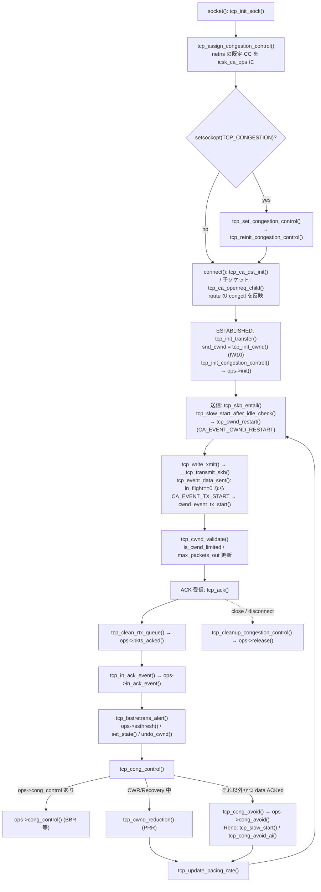

# 11. 輻輳制御フレームワークと Reno

この章では、Linux TCP の「輻輳制御 (congestion control, CC) を差し替え可能にする枠組み」と、その既定実装かつフォールバックである Reno（実体は NewReno の増減ルール）を一行ずつ読みます。CUBIC（第 12 章）、BBR（第 13 章）、DCTCP（第 14 章）はすべてこの章で扱う `struct tcp_congestion_ops` の上に載っているので、ここで「どのフックが、いつ、どのロックの下で、何を期待されて呼ばれるか」を固めておくと、後の章はアルゴリズム本体だけに集中できます。

---

## たとえ話で言うと

ある建物の発送係が、受け取り先の建物へ小包を届けています。道路には他の会社のトラックも走っているので、**一度に道路へ出せるトラックの台数 (cwnd)** を決めなければなりません。

- 最初は道路の混み具合が分からないので、とりあえず 10 台だけ出します（IW10）。
- 受領印 (ACK) が 1 枚戻るたびに 1 台増やします。往復 1 回で台数がほぼ倍になります（slow start）。
- ある台数（ssthresh という目印）を超えたら、慎重に「往復 1 回につき 1 台」ずつしか増やしません（congestion avoidance）。
- 途中で小包がなくなった（ロス）と分かったら、「出し過ぎた」と判断して台数を半分にし、目印もそこへ下げます。
- しばらく発送を休んでいたら、道路の様子はもう分からないので、台数を初期値近くまで戻してからやり直します（restart after idle）。
- 荷物が少なくて、決められた台数を使い切っていないのに台数だけを増やすのは危険なので、「本当に台数いっぱい使っていたときだけ増やす」というルールもあります（cwnd validation）。

この「何台出すか」を決める**配車係**は交換可能です。Reno 係、CUBIC 係、BBR 係……と入れ替えられ、本部（TCP コア）は「受領印が届いた」「休み明けで最初の発送をした」「事故が起きた」といった**出来事を配車係に知らせる窓口**だけを持っています。この窓口の一覧が `struct tcp_congestion_ops` です。

---

## RFC では

### 各 RFC のあらまし

- **[RFC 5681](https://www.rfc-editor.org/rfc/rfc5681) — TCP Congestion Control (2009)**
  Jacobson の slow start / congestion avoidance と、fast retransmit / fast recovery の 4 アルゴリズムを標準化した文書です。RFC 2581（さらにその前の RFC 2001）を置き換えました。状態変数 `cwnd` と `ssthresh`、増加式、ロス時の `ssthresh = max(FlightSize/2, 2*SMSS)`、アイドル後の再始動 (§4.1) などを定めます。Linux の Reno 実装の「親」です。
- **[RFC 6582](https://www.rfc-editor.org/rfc/rfc6582) — The NewReno Modification to TCP's Fast Recovery Algorithm (2012)**
  SACK を使わない接続で、1 ウィンドウ内に複数ロスがあったときに fast recovery を途中で抜けてしまう Reno の弱点を、`recover` 変数と partial ACK の扱いで直します。RFC 3782 を置き換えました。Linux では非 SACK 接続のロス回復（第 8 章）に効いています。
- **[RFC 3465](https://www.rfc-editor.org/rfc/rfc3465) — TCP Congestion Control with Appropriate Byte Counting (ABC) (2003, Experimental)**
  「ACK の個数」ではなく「ACK された量」で cwnd を増やそうという提案です。ACK を細切れにする受信側 (ACK division) への耐性と、delayed ACK で slow start が鈍る問題への対処が目的です。Linux はバイトではなく「完全に ACK されたパケット数」で数えるという独自の形でこの考えを取り込んでいます。
- **[RFC 2861](https://www.rfc-editor.org/rfc/rfc2861) — TCP Congestion Window Validation (2000, Experimental)** と **[RFC 7661](https://www.rfc-editor.org/rfc/rfc7661) — Updating TCP to Support Rate-Limited Traffic (2015, Experimental)**
  アプリが cwnd を使い切っていない（application-limited）間やアイドル中に cwnd が「検証されないまま」膨らんだり残ったりする問題を扱います。RFC 2861 は「使っていない cwnd は減衰させる」、RFC 7661 はそれを置き換え「一定期間 (NVP) は cwnd を保つが、増やしはしない」という方針です。Linux は RFC 2861 の減衰を `tcp_slow_start_after_idle` sysctl の下で実装しつつ、「cwnd を使い切っていないなら増やさない」部分は RFC 7661 に近い独自の測定ベース実装になっています。
- **[RFC 6928](https://www.rfc-editor.org/rfc/rfc6928) — Increasing TCP's Initial Window (2013, Experimental)**
  初期ウィンドウを最大 10 セグメント（約 14600 バイト）に引き上げます。Linux の `TCP_INIT_CWND` = 10 です。
- **[RFC 3168](https://www.rfc-editor.org/rfc/rfc3168) — The Addition of Explicit Congestion Notification (ECN) to IP (2001)**
  ルータがパケットを捨てる代わりに CE マークを付け、受信側が ECE で返し、送信側は「ロスと同じように」cwnd を減らして CWR で応える仕組みです。この章では送信側の反応（`tcp_enter_cwr()`）だけを触れ、詳細は第 14 章に譲ります。

### 状態変数と式（RFC 5681 §2, §3.1）

[RFC 5681 §2](https://www.rfc-editor.org/rfc/rfc5681#section-2) の定義のうち、コードに直接出てくるものを整理します。

| RFC の変数 | 意味 | Linux での対応 |
| --- | --- | --- |
| `SMSS` | 送信側の最大セグメントサイズ（バイト） | `tp->mss_cache`。ただし cwnd はパケット単位なので式の中には現れない |
| `cwnd` | 輻輳ウィンドウ（バイト） | `tp->snd_cwnd`（**パケット数**） |
| `ssthresh` | slow start と CA の境目 | `tp->snd_ssthresh`（パケット数、初期値 `TCP_INFINITE_SSTHRESH`） |
| `FlightSize` | 送信済みで未 ACK のデータ量 | `tcp_packets_in_flight()` = `packets_out - (sacked_out + lost_out) + retrans_out` |
| `IW` | 初期ウィンドウ | `tcp_init_cwnd()`（既定 10、route の `initcwnd` で上書き可） |
| `LW` | RTO 後のウィンドウ（1 SMSS） | `tcp_enter_loss()` で `in_flight + 1` |
| `RW` | アイドル後の再始動ウィンドウ | `tcp_cwnd_restart()` の `restart_cwnd` |

[RFC 5681 §3.1](https://www.rfc-editor.org/rfc/rfc5681#section-3.1) の要点は次のとおりです。

- `cwnd < ssthresh` なら slow start、`cwnd > ssthresh` なら congestion avoidance。`cwnd == ssthresh` のときはどちらでもよい、とされています。
- slow start では、新しいデータを ACK する ACK を受け取るたびに

  ```text
  cwnd += min(N, SMSS)        (2)
  ```

  ここで `N` はその ACK が新たに ACK したバイト数です。`min` は ACK division 対策（ABC 由来）です。
- congestion avoidance では 1 RTT あたり約 1 SMSS 増やします。推奨は「ACK されたバイト数を数え、cwnd 分たまったら SMSS 増やす」方法で、よく使われる近似が

  ```text
  cwnd += SMSS*SMSS/cwnd      (3)
  ```

- RTO でロスを検出したら

  ```text
  ssthresh = max(FlightSize / 2, 2*SMSS)   (4)
  ```

  とし、`cwnd = LW = 1 SMSS` から slow start をやり直します。RFC は「`FlightSize` の代わりに `cwnd` を使うのはよくある間違い」とまで書いています（Linux はあえて `cwnd` を使います。後述）。

### Fast retransmit / Fast recovery（RFC 5681 §3.2, RFC 6582）

[RFC 5681 §3.2](https://www.rfc-editor.org/rfc/rfc5681#section-3.2) の手順は次のとおりです。

1. 重複 ACK (dupACK) を 3 回受けたら、`ssthresh` を式 (4) で更新する。
2. 失われたと思われるセグメントを再送し、`cwnd = ssthresh + 3*SMSS` とする（ネットワークを抜けた 3 パケット分の「膨らませ」）。
3. 追加の dupACK ごとに `cwnd += SMSS`（inflation）。
4. 新しいデータを ACK する ACK が来たら `cwnd = ssthresh`（deflation）として CA に戻る。

[RFC 6582 §3.2](https://www.rfc-editor.org/rfc/rfc6582#section-3.2) の NewReno は、ここに `recover`（fast retransmit 開始時の最大送信シーケンス）を加えます。`recover` 未満までしか ACK しない **partial ACK** では fast recovery を抜けず、次の穴を再送して cwnd を部分的に deflate します。`recover` 以上を ACK する **full ACK** で初めて抜け、`cwnd = min(ssthresh, max(FlightSize, SMSS) + SMSS)` か `cwnd = ssthresh` にします。

Linux の fast recovery は inflation/deflation ではなく **PRR (RFC 6937)** で cwnd を `ssthresh` へ滑らかに近づけます（`tcp_cwnd_reduction()`、第 8 章）。CC モジュールから見えるのは「`ssthresh()` が呼ばれて新しい ssthresh を返す」「回復が誤りだったら `undo_cwnd()` が呼ばれる」の 2 点だけです。この章ではこの 2 つの接点を読みます。

### Appropriate Byte Counting（RFC 3465）

- [RFC 3465 §2.1](https://www.rfc-editor.org/rfc/rfc3465#section-2.1): CA では「ACK されたバイト数」を `bytes_acked` に積み、`cwnd` を超えたら `cwnd += SMSS` して `bytes_acked -= cwnd`。
- [RFC 3465 §2.2](https://www.rfc-editor.org/rfc/rfc3465#section-2.2): slow start では ACK ごとに「新たに ACK されたバイト数」だけ増やすが、上限 `L` を設ける。
- [RFC 3465 §2.3](https://www.rfc-editor.org/rfc/rfc3465#section-2.3): `L = 2*SMSS` を MAY、`L > 2*SMSS` は MUST NOT。delayed ACK（2 セグメントに 1 ACK）を相殺しつつ、stretch ACK による大きなバーストを防ぐためです。

Linux の `tcp_cong_avoid_ai()` の `snd_cwnd_cnt` は §2.1 の `bytes_acked` を**パケット単位**にしたものとそっくりです。一方 slow start では `L` 相当の上限を持たず、stretch ACK に対しても ACK されたパケット数だけ増やします（後述）。

### アイドル後の再始動と CWV（RFC 5681 §4.1, RFC 2861, RFC 7661）

- [RFC 5681 §4.1](https://www.rfc-editor.org/rfc/rfc5681#section-4.1): 最後の送信から RTO 以上何も送っていなければ、送信前に `cwnd = RW = min(IW, cwnd)` にする（SHOULD）。
- [RFC 2861 §3](https://www.rfc-editor.org/rfc/rfc2861#section-3): もう少し緩やかに、アイドルが RTO を 1 つ超えるごとに cwnd を半分にする（下限は RW）。その前に `ssthresh = max(ssthresh, 3/4 * cwnd)` として「以前の到達点」を ssthresh に覚えさせておきます。また application-limited の期間が RTO 続いたら、`cwnd = (cwnd + 実際に使った量) / 2` に減らします。
- [RFC 7661 §4.3](https://www.rfc-editor.org/rfc/rfc7661#section-4.3) / [§5](https://www.rfc-editor.org/rfc/rfc7661#section-5): rate-limited な期間 (non-validated phase, NVP。既定 6 分) は cwnd を減らさずに保つ。ただし `pipeACK`（実際に ACK された量）が cwnd の半分未満なら「検証されていない」ので cwnd を増やさない。

Linux はこのうち、RFC 2861 のアイドル減衰を `tcp_cwnd_restart()` で、application-limited 減衰を `tcp_cwnd_application_limited()` で（どちらも `tcp_slow_start_after_idle=1` のとき）、RFC 7661 の「検証されていない cwnd は増やさない」を `tcp_is_cwnd_limited()` + `tcp_cwnd_validate()` で（常に）実装しています。

### 初期ウィンドウ（RFC 6928）

[RFC 6928 §2](https://www.rfc-editor.org/rfc/rfc6928#section-2) は `IW = min(10*MSS, max(2*MSS, 14600))` を認めます。Linux はパケット単位で単純に 10 とし、`ip route ... initcwnd N` (`RTAX_INITCWND`) で経路ごとに変えられます。また RFC 5681 §3.1 は「SYN か SYN-ACK が失われたら IW は 1 SMSS にせよ」と定めており、`tcp_init_transfer()` がこれを（少し緩めて）実装します。

### ECN への反応（RFC 3168 §6.1.2）

[RFC 3168 §6.1.2](https://www.rfc-editor.org/rfc/rfc3168#section-6.1.2): ECE 付き ACK を受けた送信側は、パケットロスと同じように cwnd と ssthresh を半分にする。ただし 1 ウィンドウ（1 RTT）に 1 回まで。そして次に送る新データに CWR を立てる。Linux ではこれが `tcp_enter_cwr()` → `TCP_CA_CWR` 状態 → PRR による段階的な削減になります。

---

## 全体の流れ

CC モジュールが TCP コアから呼ばれる場所を、ソケットの一生に沿って並べると次のようになります。



ポイントは 3 つです。

- **CC は「決める」だけで「送る」ことはしません。** cwnd（と pacing rate、TSO サイズ）という「つまみ」を回すだけで、実際に何をいつ送るかは `tcp_write_xmit()`（第 4 章）が cwnd を見て決めます。`tcp_cong_control()` の後で `tcp_xmit_recovery()` や `tcp_data_snd_check()` が走るのはそのためです。
- **ロス時の削減は TCP コアが持っています。** CC が返すのは新しい `ssthresh` の値だけで、cwnd をそこまでどう下げるか（PRR）、誤検出だったら戻すか（undo）はコアが決めます。`cong_control` を実装した CC（BBR）だけがこの枠を外れます。
- **ほぼすべてのフックはソケットロックを持ったプロセス文脈か、BH を無効にした softirq 文脈（`tcp_v4_rcv()` / `tcp_v6_rcv()` → `bh_lock_sock()` 下で `sock_owned_by_user()` が偽のとき）で呼ばれます。** 1 つのソケットに対してフックが並行に走ることはありません。CC の私有データ `icsk_ca_priv` がロックなしで読み書きされているのはこの前提のおかげです。

各フックの呼び出し元を一覧にしておきます（詳細は Step 1 で読みます）。

| フック | 必須? | 主な呼び出し元 | タイミング |
| --- | --- | --- | --- |
| `cong_avoid` | `cong_control` とどちらか | `tcp_cong_avoid()` ← `tcp_cong_control()` | ACK 処理の最後、Open/Disorder/Loss 状態で data が ACK されたとき |
| `cong_control` | `cong_avoid` とどちらか | `tcp_cong_control()` | ACK 処理の最後、**全状態**で毎回 |
| `ssthresh` | 必須 | `tcp_init_cwnd_reduction()`, `tcp_enter_loss()` | fast recovery / CWR 開始時、RTO 時 |
| `undo_cwnd` | 必須 | `tcp_undo_cwnd_reduction()` | ロス回復が spurious と判明したとき |
| `set_state` | 任意 | `tcp_set_ca_state()` | `icsk_ca_state` を書き換える**直前** |
| `cwnd_event` | 任意 | `tcp_ca_event()` | `CA_EVENT_*`（TX_START 以外） |
| `cwnd_event_tx_start` | 任意 | `tcp_ca_event()` ← `tcp_event_data_sent()` | 飛行中 0 の状態から最初にデータを送るとき |
| `in_ack_event` | 任意 | `tcp_in_ack_event()` ← `tcp_ack()` | ACK ごと（`tcp_fastretrans_alert()` より前） |
| `pkts_acked` | 任意 | `tcp_clean_rtx_queue()` | 再送キューから何か外れた（または SACK された）とき |
| `tso_segs` | 任意 | `tcp_tso_segs()` | TSO の目標セグメント数を決めるとき |
| `sndbuf_expand` | 任意 | `tcp_sndbuf_expand()` | 送信バッファ自動拡張の倍率 |
| `get_info` | 任意 | `inet_sk_diag_fill()`, `do_tcp_getsockopt()` | `ss -i` / `TCP_CC_INFO` |
| `init` | 任意 | `tcp_init_congestion_control()` | ESTABLISHED になったとき、または途中で CC を切り替えたとき |
| `release` | 任意 | `tcp_cleanup_congestion_control()`, `tcp_disconnect()` | ソケット破棄、CC 切り替え、disconnect |

---

## コードを追う

### Step 1: `struct tcp_congestion_ops` — CC と TCP コアの契約

`struct tcp_congestion_ops`（[include/net/tcp.h#L1355](https://git.kernel.org/pub/scm/linux/kernel/git/netdev/net-next.git/tree/include/net/tcp.h?id=279d5c8afcd38bd841832a39bfe1aa4f8518d98e#n1355)）を前半から読みます。

```c
struct tcp_congestion_ops {
/* fast path fields are put first to fill one cache line */

	/* A congestion control (CC) must provide one of either:
	 *
	 * (a) a cong_avoid function, if the CC wants to use the core TCP
	 *     stack's default functionality to implement a "classic"
	 *     (Reno/CUBIC-style) response to packet loss, RFC3168 ECN,
	 *     idle periods, pacing rate computations, etc.
	 *
	 * (b) a cong_control function, if the CC wants custom behavior and
	 *      complete control of all congestion control behaviors.
	 */
	/* (a) "classic" response: calculate new cwnd.
	 */
	void (*cong_avoid)(struct sock *sk, u32 ack, u32 acked);
	/* (b) "custom" response: call when packets are delivered to update
	 * cwnd and pacing rate, after all the ca_state processing.
	 */
	void (*cong_control)(struct sock *sk, u32 ack, int flag, const struct rate_sample *rs);

	/* return slow start threshold (required) */
	u32 (*ssthresh)(struct sock *sk);

	/* call before changing ca_state (optional) */
	void (*set_state)(struct sock *sk, u8 new_state);

	/* call when cwnd event occurs (optional) */
	void (*cwnd_event)(struct sock *sk, enum tcp_ca_event ev);

	/* call when CA_EVENT_TX_START cwnd event occurs (optional) */
	void (*cwnd_event_tx_start)(struct sock *sk);

	/* call when ack arrives (optional) */
	void (*in_ack_event)(struct sock *sk, u32 flags);

	/* hook for packet ack accounting (optional) */
	void (*pkts_acked)(struct sock *sk, const struct ack_sample *sample);
```

- 先頭コメント「fast path fields are put first to fill one cache line」が構造体全体の設計方針です。ACK ごと・送信ごとに引かれる関数ポインタを先頭 64 バイトに詰め、`name` や `list` のような制御パス用のフィールドは後ろへ追いやっています。構造体は `____cacheline_aligned_in_smp` なので、先頭が必ずキャッシュラインの頭に来ます。
- `cong_avoid(sk, ack, acked)`: 「古典的」CC の本体です。`ack` は今回の累積 ACK 番号、`acked` は**今回新たに配送されたパケット数**（`tcp_newly_delivered()` が返す `tp->delivered` の差分で、累積 ACK 分と SACK 分の合計）です。名前は "congestion avoidance" ですが、slow start もここで処理します。呼ばれるのは「cwnd を増やしてよい」とコアが判断したときだけです（Step 5）。
- `cong_control(sk, ack, flag, rs)`: 「全権委任」型です。これを持つ CC は、ロス回復中の PRR、アイドル後の再始動、application-limited 減衰、既定の pacing rate 計算をすべて**スキップされ**、自分で cwnd と `sk_pacing_rate` を決めます。`rs` は `tcp_rate_gen()` が作った配送レートのサンプルです。BBR がこちらを使います（第 13 章）。`ack` と `flag` は 2024 年に追加された引数です（後述の歴史を参照）。
- `ssthresh(sk)`: 必須です。ロスや ECE で「減らす」ときに新しい ssthresh を返します。cwnd 自体は書き換えません（書き換えるのはコア）。
- `set_state(sk, new_state)`: `icsk_ca_state` が書き換わる**直前**に呼ばれます。旧状態は `inet_csk(sk)->icsk_ca_state` でまだ読めます。
- `cwnd_event(sk, ev)` と `cwnd_event_tx_start(sk)`: 後者は 2026 年に分離された専用フックです。前者を毎回 `switch (ev)` で振り分けると分岐予測に悪いため、最も頻繁な `CA_EVENT_TX_START` だけを別ポインタにしました（Step 10）。
- `in_ack_event(sk, flags)`: ACK ごとに呼ばれ、`CA_ACK_SLOWPATH` / `CA_ACK_WIN_UPDATE` / `CA_ACK_ECE` を渡します。DCTCP や Westwood が使います。
- `pkts_acked(sk, sample)`: `struct ack_sample { pkts_acked, rtt_us, in_flight }` を受け取ります。CUBIC の HyStart や Vegas 系の遅延ベース CC が RTT サンプルを得る場所です。

```c
	/* Override tcp_tso_autosize() (optional)
	 *
	 * If provided, this callback supplies the TSO segment target count
	 * instead of using tcp_tso_autosize(). The returned value is
	 * subsequently clamped to [1, sk->sk_gso_max_segs] by the caller.
	 *
	 * For the kernel callback path, mss_now originates from
	 * tcp_current_mss() and should never be zero.
	 */
	u32 (*tso_segs)(struct sock *sk, u32 mss_now);

	/* new value of cwnd after loss (required) */
	u32  (*undo_cwnd)(struct sock *sk);
	/* returns the multiplier used in tcp_sndbuf_expand (optional) */
	u32 (*sndbuf_expand)(struct sock *sk);

/* control/slow paths put last */
	/* get info for inet_diag (optional) */
	size_t (*get_info)(struct sock *sk, u32 ext, int *attr,
			   union tcp_cc_info *info);

	char 			name[TCP_CA_NAME_MAX];
	struct module		*owner;
	struct list_head	list;
	u32			key;
	u32			flags;

	/* initialize private data (optional) */
	void (*init)(struct sock *sk);
	/* cleanup private data  (optional) */
	void (*release)(struct sock *sk);
} ____cacheline_aligned_in_smp;
```

- `tso_segs`: TSO で 1 つの skb に詰めるセグメント数を CC が決めたいときに使います（BBR）。
- `undo_cwnd`: 必須です。コメントは "new value of cwnd after loss" ですが、実際には「**ロス判定が誤りだったと分かったときに戻すべき cwnd**」を返します（Step 9）。
- `sndbuf_expand`: `tcp_sndbuf_expand()` が `sk_sndbuf` を何倍の cwnd 分にするかを決めます。既定は 2 で、BBR は 3 を返します。
- ここから下は「control/slow paths」です。`name` は最大 16 バイト（`TCP_CA_NAME_MAX`）、`key` は `name` の jhash で、route メトリック `RTAX_CC_ALGO` に名前ではなくこの 32 ビット値を入れるために使います。
- `flags` は次のビットの組み合わせです。

  | フラグ | 意味 |
  | --- | --- |
  | `TCP_CONG_NON_RESTRICTED` | `CAP_NET_ADMIN` なしで `TCP_CONGESTION` に指定できる（`tcp_allowed_congestion_control` に載る） |
  | `TCP_CONG_NEEDS_ECN` | 全パケットに ECT を付けたい（DCTCP） |
  | `TCP_CONG_NEEDS_ACCECN` | AccECN の交渉成功が必要 |
  | `TCP_CONG_ECT_1_NEGOTIATION` | CA 初期化前は ECT(0) ではなく ECT(1) を使う |
  | `TCP_CONG_NO_FALLBACK_RFC3168` | AccECN 交渉中に RFC 3168 ECN へ落ちてはいけない |

- `init` / `release` が最後にあるのは、接続ごとに 1 回しか呼ばれないからです。

#### ソケット側の器: `icsk_ca_ops`, `icsk_ca_state`, `icsk_ca_priv`

CC の状態は `struct inet_connection_sock`（[include/net/inet_connection_sock.h#L81](https://git.kernel.org/pub/scm/linux/kernel/git/netdev/net-next.git/tree/include/net/inet_connection_sock.h?id=279d5c8afcd38bd841832a39bfe1aa4f8518d98e#n81)）に置かれています。

```c
	const struct tcp_congestion_ops *icsk_ca_ops;
...
	__u8			  icsk_ca_state:5,
				  icsk_ca_initialized:1,
				  icsk_ca_setsockopt:1,
				  icsk_ca_dst_locked:1;
...
	u64			  icsk_ca_priv[104 / sizeof(u64)];
```

- `icsk_ca_ops`: 現在の CC です。ソケットロック下で書き換えられますが、`getsockopt(TCP_CONGESTION)` や inet_diag はロックなしで読むため、書き込みは `WRITE_ONCE()`、読み出しは RCU 下の `READ_ONCE()` で行います（Step 3）。
- `icsk_ca_state`: `TCP_CA_Open` / `Disorder` / `CWR` / `Recovery` / `Loss` の 5 状態（`enum tcp_ca_state`、[include/uapi/linux/tcp.h#L194](https://git.kernel.org/pub/scm/linux/kernel/git/netdev/net-next.git/tree/include/uapi/linux/tcp.h?id=279d5c8afcd38bd841832a39bfe1aa4f8518d98e#n194)）。状態遷移そのものは第 8 章で扱います。
- `icsk_ca_initialized`: `init()` を呼んだかどうか。`release()` を呼ぶかどうかの判定と、BPF が先に初期化した場合の二重初期化防止に使います。
- `icsk_ca_setsockopt`: アプリ（または BPF）が明示的に CC を選んだ印です。子ソケット生成時に「親の選択を引き継ぐか、システム既定にするか」の判定に使います（Step 3）。
- `icsk_ca_dst_locked`: route で `congctl lock` が指定されていたら立ち、以後 `TCP_CONGESTION` での変更を `-EPERM` で拒否します。
- `icsk_ca_priv`: CC の私有領域で 104 バイトです。CC は `inet_csk_ca(sk)` でこれを自分の構造体として使い、`BUILD_BUG_ON(sizeof(struct bictcp) > ICSK_CA_PRIV_SIZE)` のようにサイズを静的に検査します。Reno は何も使いません。

#### イベントと ACK フラグ

`enum tcp_ca_event`（[include/net/tcp.h#L1281](https://git.kernel.org/pub/scm/linux/kernel/git/netdev/net-next.git/tree/include/net/tcp.h?id=279d5c8afcd38bd841832a39bfe1aa4f8518d98e#n1281)）です。

```c
enum tcp_ca_event {
	CA_EVENT_TX_START,	/* first transmit when no packets in flight */
	CA_EVENT_CWND_RESTART,	/* congestion window restart */
	CA_EVENT_COMPLETE_CWR,	/* end of congestion recovery */
	CA_EVENT_LOSS,		/* loss timeout */
	CA_EVENT_ECN_NO_CE,	/* ECT set, but not CE marked */
	CA_EVENT_ECN_IS_CE,	/* received CE marked IP packet */
};
```

| イベント | 発生源 | 意味 |
| --- | --- | --- |
| `CA_EVENT_TX_START` | `tcp_event_data_sent()` | 飛行中 0 のときにデータ送信（アイドル明け） |
| `CA_EVENT_CWND_RESTART` | `tcp_cwnd_restart()` | RFC 2861 の再始動を実施する直前 |
| `CA_EVENT_COMPLETE_CWR` | `tcp_end_cwnd_reduction()` | CWR / Recovery を抜けた |
| `CA_EVENT_LOSS` | `tcp_enter_loss()` | RTO で Loss 状態へ（ssthresh を下げた場合のみ） |
| `CA_EVENT_ECN_NO_CE` / `CA_EVENT_ECN_IS_CE` | `tcp_data_ecn_check()` | `TCP_CONG_NEEDS_ECN` な CC にだけ、受信パケットの ECN コードポイントを通知（DCTCP 用） |

---

### Step 2: 登録 — `tcp_register_congestion_control()`

CC は `tcp_cong_list` という RCU リストに登録されます。`tcp_ca_find()`（[net/ipv4/tcp_cong.c#L26](https://git.kernel.org/pub/scm/linux/kernel/git/netdev/net-next.git/tree/net/ipv4/tcp_cong.c?id=279d5c8afcd38bd841832a39bfe1aa4f8518d98e#n26)）は名前で、`tcp_ca_find_key()`（[net/ipv4/tcp_cong.c#L66](https://git.kernel.org/pub/scm/linux/kernel/git/netdev/net-next.git/tree/net/ipv4/tcp_cong.c?id=279d5c8afcd38bd841832a39bfe1aa4f8518d98e#n66)）はキーで、`list_for_each_entry_rcu()` による線形探索をします（"Simple linear search, don't expect many entries!"）。

- 書き込み側は `tcp_cong_list_lock`（spinlock）、読み出し側は RCU です。読み出しはすべて「名前 / キー → ops」の解決で、接続確立時や setsockopt 時にしか走らないので線形探索で十分です。データパスでは `icsk_ca_ops` を直接たどるだけで、このリストには触れません。

`tcp_ca_find_autoload()`（[net/ipv4/tcp_cong.c#L50](https://git.kernel.org/pub/scm/linux/kernel/git/netdev/net-next.git/tree/net/ipv4/tcp_cong.c?id=279d5c8afcd38bd841832a39bfe1aa4f8518d98e#n50)）は、見つからなければ `request_module("tcp_%s", name)` で `tcp_cubic.ko` などを自動ロードします。

```c
#ifdef CONFIG_MODULES
	if (!ca && capable(CAP_NET_ADMIN)) {
		rcu_read_unlock();
		request_module("tcp_%s", name);
		rcu_read_lock();
		ca = tcp_ca_find(name);
	}
#endif
```

- `request_module()` は眠るので、いったん RCU を抜けています。呼び出し元は「RCU の中で呼んだのに戻ったときにはいったん抜けている」ことを前提にしなければならず、RCU 区間をまたいでポインタを保持していないことが重要です（呼び出し元はすべて戻り値の `ca` だけを使います）。
- `capable(CAP_NET_ADMIN)` は**初期 user namespace での** capability です。非特権コンテナからモジュールを勝手にロードさせないための制限です。後で見る `tcp_set_congestion_control()` の `cap_net_admin` 引数（netns の user_ns に対する `ns_capable`）とは別物である点に注意してください。

`tcp_validate_congestion_control()`（[net/ipv4/tcp_cong.c#L78](https://git.kernel.org/pub/scm/linux/kernel/git/netdev/net-next.git/tree/net/ipv4/tcp_cong.c?id=279d5c8afcd38bd841832a39bfe1aa4f8518d98e#n78)）と `tcp_register_congestion_control()`（[net/ipv4/tcp_cong.c#L93](https://git.kernel.org/pub/scm/linux/kernel/git/netdev/net-next.git/tree/net/ipv4/tcp_cong.c?id=279d5c8afcd38bd841832a39bfe1aa4f8518d98e#n93)）:

```c
int tcp_validate_congestion_control(struct tcp_congestion_ops *ca)
{
	/* all algorithms must implement these */
	if (!ca->ssthresh || !ca->undo_cwnd ||
	    !(ca->cong_avoid || ca->cong_control)) {
		pr_err("%s does not implement required ops\n", ca->name);
		return -EINVAL;
	}

	return 0;
}

/* Attach new congestion control algorithm to the list
 * of available options.
 */
int tcp_register_congestion_control(struct tcp_congestion_ops *ca)
{
	int ret;

	ret = tcp_validate_congestion_control(ca);
	if (ret)
		return ret;

	ca->key = jhash(ca->name, sizeof(ca->name), strlen(ca->name));

	spin_lock(&tcp_cong_list_lock);
	if (ca->key == TCP_CA_UNSPEC || tcp_ca_find_key(ca->key)) {
		pr_notice("%s already registered or non-unique key\n",
			  ca->name);
		ret = -EEXIST;
	} else {
		list_add_tail_rcu(&ca->list, &tcp_cong_list);
		pr_debug("%s registered\n", ca->name);
	}
	spin_unlock(&tcp_cong_list_lock);

	return ret;
}
```

- 必須フックは `ssthresh`、`undo_cwnd`、そして `cong_avoid` か `cong_control` のどちらかです。コアはこの 3 つを NULL チェックなしで呼びます（`tcp_cong_avoid()` は `cong_avoid` を無条件に呼びますが、`cong_control` があるとそもそも到達しないので、`cong_control` だけの CC は `cong_avoid` が NULL でも安全です）。
- `key` は `jhash(name, sizeof(name), strlen(name))`。`sizeof(ca->name)` は 16 なので、**NUL の後ろのゴミも含めてハッシュされる**点に注意してください。CC の `name` は静的初期化されているので残りは 0 で埋まり、問題になりません。
- キーの衝突（または 0 = `TCP_CA_UNSPEC`）は `-EEXIST` で拒否されます。キーは route メトリックに保存されるので、2 つの CC が同じキーを持つと route から一意に引けなくなるからです。
- 名前の重複チェックが `tcp_ca_find_key()` だけで済んでいるのは、同名なら同じキーになるからです。

`tcp_unregister_congestion_control()`（[net/ipv4/tcp_cong.c#L124](https://git.kernel.org/pub/scm/linux/kernel/git/netdev/net-next.git/tree/net/ipv4/tcp_cong.c?id=279d5c8afcd38bd841832a39bfe1aa4f8518d98e#n124)）はリストから外して `synchronize_rcu()` を呼ぶだけです。**ソケットがまだその CC を使っていないことは、モジュール参照カウントが保証します。** 各ソケットは `bpf_try_module_get()` で `owner` の参照を取っているので、使用中のモジュールは `rmmod` できません。BPF 製 CC の場合は `bpf_try_module_get()` が struct_ops map の参照カウントを取ります。

`tcp_update_congestion_control()`（[net/ipv4/tcp_cong.c#L146](https://git.kernel.org/pub/scm/linux/kernel/git/netdev/net-next.git/tree/net/ipv4/tcp_cong.c?id=279d5c8afcd38bd841832a39bfe1aa4f8518d98e#n146)）は BPF struct_ops の `bpf_link_update` 用で、同名の CC を「新しいものを先に足してから古いものを外す」順で差し替えます。既存のソケットは古い実装を使い続け、新しい接続から新しい実装になります。

---

### Step 3: 選択 — 既定値、setsockopt、route

#### ソケット生成時: `tcp_assign_congestion_control()`

`tcp_init_sock()`（[net/ipv4/tcp.c#L421](https://git.kernel.org/pub/scm/linux/kernel/git/netdev/net-next.git/tree/net/ipv4/tcp.c?id=279d5c8afcd38bd841832a39bfe1aa4f8518d98e#n421)）の中で、cwnd 関連の初期値と一緒に CC が割り当てられます。

```c
	tcp_snd_cwnd_set(tp, TCP_INIT_CWND);
...
	tp->snd_ssthresh = TCP_INFINITE_SSTHRESH;
	tp->snd_cwnd_clamp = ~0;
	tp->mss_cache = TCP_MSS_DEFAULT;

	tp->reordering = READ_ONCE(sock_net(sk)->ipv4.sysctl_tcp_reordering);
	tcp_assign_congestion_control(sk);
```

- `snd_ssthresh = TCP_INFINITE_SSTHRESH`（`0x7fffffff`）: RFC 5681 §3.1 の「ssthresh の初期値は任意に大きくてよい」に従います。最初のロスまで slow start が続きます。`tcp_in_initial_slowstart()` はこの値で「まだ一度もロスしていない」を判定します。
- `snd_cwnd_clamp = ~0`: cwnd の上限です。route の `cwnd` メトリック（lock 付き）や `TCP_BPF_SNDCWND_CLAMP` で絞れます。`tcp_slow_start()` と `tcp_cong_avoid_ai()` が最後に必ずこれで `min` を取ります。
- `snd_cwnd = TCP_INIT_CWND` はここでは仮置きで、本当の初期値は ESTABLISHED 時の `tcp_init_transfer()` が決めます（Step 4）。

`tcp_assign_congestion_control()`（[net/ipv4/tcp_cong.c#L216](https://git.kernel.org/pub/scm/linux/kernel/git/netdev/net-next.git/tree/net/ipv4/tcp_cong.c?id=279d5c8afcd38bd841832a39bfe1aa4f8518d98e#n216)）:

```c
/* Assign choice of congestion control. */
void tcp_assign_congestion_control(struct sock *sk)
{
	struct net *net = sock_net(sk);
	struct inet_connection_sock *icsk = inet_csk(sk);
	const struct tcp_congestion_ops *ca;

	rcu_read_lock();
	ca = rcu_dereference(net->ipv4.tcp_congestion_control);
	if (unlikely(!bpf_try_module_get(ca, ca->owner)))
		ca = &tcp_reno;
	WRITE_ONCE(icsk->icsk_ca_ops, ca);
	rcu_read_unlock();

	memset(icsk->icsk_ca_priv, 0, sizeof(icsk->icsk_ca_priv));
	if (ca->flags & TCP_CONG_NEEDS_ECN)
		INET_ECN_xmit_ect_1_negotiation(sk);
	else
		INET_ECN_dontxmit(sk);
}
```

- 既定 CC は **netns ごと**の `net->ipv4.tcp_congestion_control` です。`sysctl net.ipv4.tcp_congestion_control` で変わります。
- `bpf_try_module_get()` が失敗するのは、既定 CC のモジュールが今まさにアンロード中（"going" 状態）か、BPF CC の map が解放中のときです。そのときは組み込みで絶対に消えない `tcp_reno` にフォールバックします。**Reno が「フォールバック」と呼ばれるのはこのためです。** `tcp_reno` は `tcp_init()` で `BUG_ON(tcp_register_congestion_control(&tcp_reno) != 0)` として必ず登録されています。
- `icsk_ca_priv` のゼロクリアは、`init()` がまだ呼ばれていなくても私有領域が既知の状態であることを保証します。`init()` は ESTABLISHED まで呼ばれないので、その前に呼ばれうるフック（たとえば `get_info()`）が未初期化メモリを読まないためです。
- `TCP_CONG_NEEDS_ECN` な CC（DCTCP）なら SYN の段階から ECT を付ける準備をします。

#### sysctl: `tcp_set_default_congestion_control()`

`proc_tcp_congestion_control()`（[net/ipv4/sysctl_net_ipv4.c#L220](https://git.kernel.org/pub/scm/linux/kernel/git/netdev/net-next.git/tree/net/ipv4/sysctl_net_ipv4.c?id=279d5c8afcd38bd841832a39bfe1aa4f8518d98e#n220)）から呼ばれる `tcp_set_default_congestion_control()`（[net/ipv4/tcp_cong.c#L281](https://git.kernel.org/pub/scm/linux/kernel/git/netdev/net-next.git/tree/net/ipv4/tcp_cong.c?id=279d5c8afcd38bd841832a39bfe1aa4f8518d98e#n281)）:

```c
int tcp_set_default_congestion_control(struct net *net, const char *name)
{
	struct tcp_congestion_ops *ca;
	const struct tcp_congestion_ops *prev;
	int ret;

	rcu_read_lock();
	ca = tcp_ca_find_autoload(name);
	if (!ca) {
		ret = -ENOENT;
	} else if (!bpf_try_module_get(ca, ca->owner)) {
		ret = -EBUSY;
	} else if (!net_eq(net, &init_net) &&
			!(ca->flags & TCP_CONG_NON_RESTRICTED)) {
		/* Only init netns can set default to a restricted algorithm */
		ret = -EPERM;
	} else {
		prev = xchg(&net->ipv4.tcp_congestion_control, ca);
		if (prev)
			bpf_module_put(prev, prev->owner);

		ca->flags |= TCP_CONG_NON_RESTRICTED;
		ret = 0;
	}
	rcu_read_unlock();

	return ret;
}
```

- netns の既定値はモジュール参照を 1 つ保持します。`xchg()` で入れ替え、古い方の参照を落とします。読み出し側（`tcp_assign_congestion_control()`）は RCU 下で `rcu_dereference()` するので、ロックは要りません。
- **init_net 以外の netns は、許可リスト (`tcp_allowed_congestion_control`) にある CC しか既定値にできません。** 一方、init_net で既定値に設定した CC には自動的に `TCP_CONG_NON_RESTRICTED` が付きます（「システム管理者が既定にしたものは誰でも使ってよい」）。
- 細かい点ですが、コードを読む限り `-EPERM` の分岐では直前の `bpf_try_module_get()` で取った参照が解放されません。モジュール製の CC を非 init netns の既定値にしようとして拒否されると、そのモジュールの参照が 1 つ残ります。読むときに気にしておく価値のある非対称です。
- 新しい netns の既定値は `tcp_sk_init()`（[net/ipv4/tcp_ipv4.c#L3440](https://git.kernel.org/pub/scm/linux/kernel/git/netdev/net-next.git/tree/net/ipv4/tcp_ipv4.c?id=279d5c8afcd38bd841832a39bfe1aa4f8518d98e#n3440)）で init_net の既定値を継承し、参照が取れなければ Reno になります。

`tcp_set_allowed_congestion_control()`（[net/ipv4/tcp_cong.c#L369](https://git.kernel.org/pub/scm/linux/kernel/git/netdev/net-next.git/tree/net/ipv4/tcp_cong.c?id=279d5c8afcd38bd841832a39bfe1aa4f8518d98e#n369)）は `tcp_allowed_congestion_control` sysctl の書き込みで、「全部検査 → 全部クリア → 指定分を立てる」の 3 パスで `TCP_CONG_NON_RESTRICTED` を付け直します。このフラグは **ops 構造体そのもの**に付くので、netns をまたいだグローバルな設定です（sysctl 自体も init_net にしか見えません）。

#### setsockopt: `tcp_set_congestion_control()`

`do_tcp_setsockopt()`（[net/ipv4/tcp.c#L3841](https://git.kernel.org/pub/scm/linux/kernel/git/netdev/net-next.git/tree/net/ipv4/tcp.c?id=279d5c8afcd38bd841832a39bfe1aa4f8518d98e#n3841)）の `TCP_CONGESTION` 分岐です。

```c
	case TCP_CONGESTION: {
		char name[TCP_CA_NAME_MAX];
...
		sockopt_lock_sock(sk);
		err = tcp_set_congestion_control(sk, name, !has_current_bpf_ctx(),
						 sockopt_ns_capable(sock_net(sk)->user_ns,
								    CAP_NET_ADMIN));
		sockopt_release_sock(sk);
		return err;
	}
```

- `load = !has_current_bpf_ctx()`: BPF プログラム（`bpf_setsockopt()`）から呼ばれたときはモジュールの自動ロードをしません。BPF は softirq などの眠れない文脈から呼ばれうるからです。
- `cap_net_admin` は **netns の user_ns に対する** `CAP_NET_ADMIN` です。コンテナ内の root は制限付き CC も選べますが、モジュールのロードはできません（Step 2 の `capable()`）。

`tcp_set_congestion_control()`（[net/ipv4/tcp_cong.c#L412](https://git.kernel.org/pub/scm/linux/kernel/git/netdev/net-next.git/tree/net/ipv4/tcp_cong.c?id=279d5c8afcd38bd841832a39bfe1aa4f8518d98e#n412)）:

```c
int tcp_set_congestion_control(struct sock *sk, const char *name, bool load,
			       bool cap_net_admin)
{
	struct inet_connection_sock *icsk = inet_csk(sk);
	const struct tcp_congestion_ops *ca;
	int err = 0;

	if (icsk->icsk_ca_dst_locked)
		return -EPERM;

	rcu_read_lock();
	if (!load)
		ca = tcp_ca_find(name);
	else
		ca = tcp_ca_find_autoload(name);

	/* No change asking for existing value */
	if (ca == icsk->icsk_ca_ops) {
		icsk->icsk_ca_setsockopt = 1;
		goto out;
	}

	if (!ca)
		err = -ENOENT;
	else if (!((ca->flags & TCP_CONG_NON_RESTRICTED) || cap_net_admin))
		err = -EPERM;
	else if (!bpf_try_module_get(ca, ca->owner))
		err = -EBUSY;
	else
		tcp_reinit_congestion_control(sk, ca);
 out:
	rcu_read_unlock();
	return err;
}
```

- `icsk_ca_dst_locked` が先頭にあります。route で `congctl lock` された接続はアプリから CC を変えられません。
- 同じ CC を指定し直したときも `icsk_ca_setsockopt = 1` を立てます。リスナーで「既定と同じ CC を明示的に選んだ」場合、あとで既定値が変わっても子ソケットはその CC を引き継ぐ、という意味論のためです（`tcp_ca_openreq_child()` を参照）。
- 参照を取ってから `tcp_reinit_congestion_control()` へ進みます。古い CC の参照はその中の `tcp_cleanup_congestion_control()` が落とします。

`tcp_reinit_congestion_control()`（[net/ipv4/tcp_cong.c#L250](https://git.kernel.org/pub/scm/linux/kernel/git/netdev/net-next.git/tree/net/ipv4/tcp_cong.c?id=279d5c8afcd38bd841832a39bfe1aa4f8518d98e#n250)）:

```c
static void tcp_reinit_congestion_control(struct sock *sk,
					  const struct tcp_congestion_ops *ca)
{
	struct inet_connection_sock *icsk = inet_csk(sk);

	tcp_cleanup_congestion_control(sk);
	WRITE_ONCE(icsk->icsk_ca_ops, ca);
	icsk->icsk_ca_setsockopt = 1;
	memset(icsk->icsk_ca_priv, 0, sizeof(icsk->icsk_ca_priv));

	if (ca->flags & TCP_CONG_NEEDS_ECN)
		INET_ECN_xmit_ect_1_negotiation(sk);
	else
		INET_ECN_dontxmit(sk);

	if (!((1 << sk->sk_state) & (TCPF_CLOSE | TCPF_LISTEN)))
		tcp_init_congestion_control(sk);
}
```

- 旧 CC の `release()` → ポインタ差し替え → 私有領域クリア、の順です。`WRITE_ONCE()` はロックなしの読み手（`do_tcp_getsockopt()` や inet_diag）向けです。
- **途中切り替え**（ESTABLISHED などで呼ばれた場合）だけ、その場で `tcp_init_congestion_control()` を呼びます。CLOSE / LISTEN ではまだ接続がないので、ESTABLISHED 時の `tcp_init_transfer()` に任せます。
- 注意: 切り替えでは `snd_cwnd` も `snd_ssthresh` も**そのまま引き継がれます**。新しい CC は前の CC が残した cwnd から始めます。`tcp_init_congestion_control()` が `prior_ssthresh = 0` にするのは、前の CC が保存した ssthresh へ undo で戻ってしまうのを防ぐためです（Step 4）。

#### route ごとの CC: `tcp_ca_dst_init()` と `tcp_ca_openreq_child()`

`ip route add ... congctl [lock] dctcp` で指定した CC は `RTAX_CC_ALGO` メトリックに**キー**として保存されます。能動オープン側は `tcp_connect_init()` から呼ばれる `tcp_ca_dst_init()`（[net/ipv4/tcp_output.c#L4092](https://git.kernel.org/pub/scm/linux/kernel/git/netdev/net-next.git/tree/net/ipv4/tcp_output.c?id=279d5c8afcd38bd841832a39bfe1aa4f8518d98e#n4092)）で反映します。

```c
static void tcp_ca_dst_init(struct sock *sk, const struct dst_entry *dst)
{
	struct inet_connection_sock *icsk = inet_csk(sk);
	const struct tcp_congestion_ops *ca;
	u32 ca_key = dst_metric(dst, RTAX_CC_ALGO);

	if (ca_key == TCP_CA_UNSPEC)
		return;

	rcu_read_lock();
	ca = tcp_ca_find_key(ca_key);
	if (likely(ca && bpf_try_module_get(ca, ca->owner))) {
		bpf_module_put(icsk->icsk_ca_ops, icsk->icsk_ca_ops->owner);
		icsk->icsk_ca_dst_locked = tcp_ca_dst_locked(dst);
		WRITE_ONCE(icsk->icsk_ca_ops, ca);
	}
	rcu_read_unlock();
}
```

- route の指定は **setsockopt より強い**ことに注意してください。connect() の前に `TCP_CONGESTION` で選んでいても、route に `congctl` があれば上書きされます。`release()` を呼ばずに参照だけ付け替えているのは、この時点ではまだ `init()` が呼ばれていない（SYN 送信前）からです。
- 受動オープン側は `tcp_v4_syn_recv_sock()` / `tcp_v6_syn_recv_sock()` から `tcp_ca_openreq_child()`（[net/ipv4/tcp_minisocks.c#L497](https://git.kernel.org/pub/scm/linux/kernel/git/netdev/net-next.git/tree/net/ipv4/tcp_minisocks.c?id=279d5c8afcd38bd841832a39bfe1aa4f8518d98e#n497)）を呼びます。

```c
void tcp_ca_openreq_child(struct sock *sk, const struct dst_entry *dst)
{
	struct inet_connection_sock *icsk = inet_csk(sk);
	u32 ca_key = dst_metric(dst, RTAX_CC_ALGO);
	bool ca_got_dst = false;

	if (ca_key != TCP_CA_UNSPEC) {
		const struct tcp_congestion_ops *ca;

		rcu_read_lock();
		ca = tcp_ca_find_key(ca_key);
		if (likely(ca && bpf_try_module_get(ca, ca->owner))) {
			icsk->icsk_ca_dst_locked = tcp_ca_dst_locked(dst);
			WRITE_ONCE(icsk->icsk_ca_ops, ca);
			ca_got_dst = true;
		}
		rcu_read_unlock();
	}

	/* If no valid choice made yet, assign current system default ca. */
	if (!ca_got_dst &&
	    (!icsk->icsk_ca_setsockopt ||
	     !bpf_try_module_get(icsk->icsk_ca_ops, icsk->icsk_ca_ops->owner)))
		tcp_assign_congestion_control(sk);

	tcp_set_ca_state(sk, TCP_CA_Open);
}
```

- 子ソケットは親リスナーを `sk_clone_lock()` でコピーしたものなので、`icsk_ca_ops` は親のポインタが入っていますが、**参照はまだ取っていません**。ここで改めて参照を取ります。
- 優先順位は route の `congctl` > リスナーで明示的に選んだ CC (`icsk_ca_setsockopt`) > **子の生成時点**のシステム既定値です。リスナー作成後に sysctl で既定値を変えれば、明示的に選んでいないリスナーの子には新しい既定値が適用されます。
- ここで `tcp_set_ca_state(sk, TCP_CA_Open)` を呼ぶのは、新しい CC の `set_state()` に初期状態を通知するためです。

---

### Step 4: 初期化 — `tcp_init_transfer()`, `tcp_init_cwnd()`, `tcp_init_congestion_control()`

3WHS が完了して ESTABLISHED になると、能動側は `tcp_finish_connect()`、受動側は `tcp_rcv_state_process()` の SYN_RECV 処理から `tcp_init_transfer()`（[net/ipv4/tcp_input.c#L6725](https://git.kernel.org/pub/scm/linux/kernel/git/netdev/net-next.git/tree/net/ipv4/tcp_input.c?id=279d5c8afcd38bd841832a39bfe1aa4f8518d98e#n6725)）が呼ばれます。

```c
void tcp_init_transfer(struct sock *sk, int bpf_op, struct sk_buff *skb)
{
	struct inet_connection_sock *icsk = inet_csk(sk);
	struct tcp_sock *tp = tcp_sk(sk);

	tcp_mtup_init(sk);
	icsk->icsk_af_ops->rebuild_header(sk);
	tcp_init_metrics(sk);

	/* Initialize the congestion window to start the transfer.
	 * Cut cwnd down to 1 per RFC5681 if SYN or SYN-ACK has been
	 * retransmitted. In light of RFC6298 more aggressive 1sec
	 * initRTO, we only reset cwnd when more than 1 SYN/SYN-ACK
	 * retransmission has occurred.
	 */
	if (tp->total_retrans > 1 && tp->undo_marker)
		tcp_snd_cwnd_set(tp, 1);
	else
		tcp_snd_cwnd_set(tp, tcp_init_cwnd(tp, __sk_dst_get(sk)));
	tp->snd_cwnd_stamp = tcp_jiffies32;

	bpf_skops_established(sk, bpf_op, skb);
	/* Initialize congestion control unless BPF initialized it already: */
	if (!icsk->icsk_ca_initialized)
		tcp_init_congestion_control(sk);
	tcp_init_buffer_space(sk);
}
```

- `tcp_init_metrics()` が先に走るので、`tcp_metrics` にキャッシュされた前回の ssthresh（`TCP_METRIC_SSTHRESH`）があれば `snd_ssthresh` が初期化されます。これは無限大ではない ssthresh から始まる例外的なケースです。
- **SYN / SYN-ACK 再送時の IW = 1**: RFC 5681 §3.1 は「SYN か SYN-ACK が失われたら IW は 1」と定めていますが、Linux は RFC 6298 で初期 RTO が 1 秒に短縮されたことを考慮し、**2 回以上**再送したときだけ 1 に落とします。1 回の再送は「初期 RTO が短すぎただけ」かもしれないからです。さらに `tp->undo_marker` が条件に入っているのは、SYN の再送が spurious だった（元の SYN への応答だった）と判明した場合には `undo_marker` がクリアされ、IW を落とさずに済むようにするためです（2019 年の Yuchung Cheng による一連の修正）。
- `bpf_skops_established()` の中で BPF が `bpf_setsockopt(TCP_CONGESTION)` を呼ぶと、その時点で `tcp_reinit_congestion_control()` → `tcp_init_congestion_control()` が走り `icsk_ca_initialized = 1` になります。続く `if (!icsk->icsk_ca_initialized)` は、BPF が設定した CC 固有の値を二重初期化で消さないための条件です。

`tcp_init_cwnd()`（[net/ipv4/tcp_input.c#L1202](https://git.kernel.org/pub/scm/linux/kernel/git/netdev/net-next.git/tree/net/ipv4/tcp_input.c?id=279d5c8afcd38bd841832a39bfe1aa4f8518d98e#n1202)）:

```c
__u32 tcp_init_cwnd(const struct tcp_sock *tp, const struct dst_entry *dst)
{
	__u32 cwnd = (dst ? dst_metric(dst, RTAX_INITCWND) : 0);

	if (!cwnd)
		cwnd = TCP_INIT_CWND;
	return min_t(__u32, cwnd, tp->snd_cwnd_clamp);
}
```

- route の `initcwnd` があればそれを、なければ `TCP_INIT_CWND`（[include/net/tcp.h#L269](https://git.kernel.org/pub/scm/linux/kernel/git/netdev/net-next.git/tree/include/net/tcp.h?id=279d5c8afcd38bd841832a39bfe1aa4f8518d98e#n269)）= 10 を使います。RFC 6928 の `min(10*MSS, max(2*MSS, 14600))` のバイト上限は**実装していません**。MSS が 9000 のジャンボフレーム経路でも 10 パケット = 90KB を最初に送ります。
- この関数は初期化だけでなく、`tcp_cwnd_restart()` と `tcp_cwnd_application_limited()` でも「下限」として再利用されます。

`tcp_init_congestion_control()`（[net/ipv4/tcp_cong.c#L236](https://git.kernel.org/pub/scm/linux/kernel/git/netdev/net-next.git/tree/net/ipv4/tcp_cong.c?id=279d5c8afcd38bd841832a39bfe1aa4f8518d98e#n236)）:

```c
void tcp_init_congestion_control(struct sock *sk)
{
	struct inet_connection_sock *icsk = inet_csk(sk);

	tcp_sk(sk)->prior_ssthresh = 0;
	if (icsk->icsk_ca_ops->init)
		icsk->icsk_ca_ops->init(sk);
	if (tcp_ca_needs_ecn(sk))
		INET_ECN_xmit(sk);
	else
		INET_ECN_dontxmit(sk);
	icsk->icsk_ca_initialized = 1;
}
```

- `prior_ssthresh = 0`: undo の可否は `prior_ssthresh != 0` で判定されます（`tcp_undo_cwnd_reduction()`）。CC を途中で切り替えたとき、前の CC 時代に保存した ssthresh（BBR なら無限大）へ戻ってしまう事故を防ぎます。
- `init()` は CC の私有データを初期化します。Reno は `init` を持ちません。
- `TCP_CONG_NEEDS_ECN` なら以後のデータパケットに ECT を付けます（`INET_ECN_xmit()`）。

後始末は `tcp_cleanup_congestion_control()`（[net/ipv4/tcp_cong.c#L270](https://git.kernel.org/pub/scm/linux/kernel/git/netdev/net-next.git/tree/net/ipv4/tcp_cong.c?id=279d5c8afcd38bd841832a39bfe1aa4f8518d98e#n270)）です。

```c
void tcp_cleanup_congestion_control(struct sock *sk)
{
	struct inet_connection_sock *icsk = inet_csk(sk);

	if (icsk->icsk_ca_initialized && icsk->icsk_ca_ops->release)
		icsk->icsk_ca_ops->release(sk);
	icsk->icsk_ca_initialized = 0;
	bpf_module_put(icsk->icsk_ca_ops, icsk->icsk_ca_ops->owner);
}
```

- `release()` は `init()` を呼んだ場合にだけ呼びます。`init()` が確保したものを解放する対称性のためです。一方、参照の解放は**常に**行います。参照は `init()` ではなく `tcp_assign_congestion_control()` などで取っているからです。
- `tcp_disconnect()`（[net/ipv4/tcp.c#L3365](https://git.kernel.org/pub/scm/linux/kernel/git/netdev/net-next.git/tree/net/ipv4/tcp.c?id=279d5c8afcd38bd841832a39bfe1aa4f8518d98e#n3365)）は CC を外さずに `release()` だけ呼び、`snd_cwnd = TCP_INIT_CWND`、`snd_ssthresh = TCP_INFINITE_SSTHRESH`、`snd_cwnd_cnt = 0`、`is_cwnd_limited = 0`、`max_packets_out = 0` に戻してから `tcp_set_ca_state(sk, TCP_CA_Open)` を呼びます。同じソケットで `connect()` し直したときに、前の接続の cwnd を引きずらないためです。

---

### Step 5: ACK から CC へ — `tcp_ack()` の末尾と `tcp_cong_control()`

ACK 処理全体は第 7 章で扱います。ここでは CC へつながる部分だけを抜き出します。`tcp_ack()`（[net/ipv4/tcp_input.c#L4276](https://git.kernel.org/pub/scm/linux/kernel/git/netdev/net-next.git/tree/net/ipv4/tcp_input.c?id=279d5c8afcd38bd841832a39bfe1aa4f8518d98e#n4276)）の冒頭で

```c
	int prior_packets = tp->packets_out;
	u32 delivered = tp->delivered;
	u32 lost = tp->lost;
```

と「処理前」の値を覚えておき、末尾で差分を取ります。

```c
	/* See if we can take anything off of the retransmit queue. */
	flag |= tcp_clean_rtx_queue(sk, skb, prior_fack, prior_snd_una,
				    &sack_state, flag & FLAG_ECE);

	tcp_rack_update_reo_wnd(sk, &rs);
...
	tcp_in_ack_event(sk, flag);
...
	if (tcp_ack_is_dubious(sk, flag)) {
...
		tcp_fastretrans_alert(sk, prior_snd_una, num_dupack, &flag,
				      &rexmit);
	}
...
	delivered = tcp_newly_delivered(sk, delivered, ecn_count, flag);

	lost = tp->lost - lost;			/* freshly marked lost */
	rs.is_ack_delayed = !!(flag & FLAG_ACK_MAYBE_DELAYED);
	tcp_rate_gen(sk, delivered, lost, is_sack_reneg, sack_state.rate);
	tcp_cong_control(sk, ack, delivered, flag, sack_state.rate);
	tcp_xmit_recovery(sk, rexmit);
	return 1;
```

CC フックの呼び出し順はこの抜粋の順そのものです。

1. `tcp_clean_rtx_queue()` の中で `pkts_acked()`（RTT サンプル付き）。
2. `tcp_in_ack_event()` で `in_ack_event()`。
3. `tcp_fastretrans_alert()` の中で、状態遷移に応じて `ssthresh()`、`set_state()`、`undo_cwnd()`、`cwnd_event(CA_EVENT_COMPLETE_CWR)`。
4. `tcp_cong_control()` で `cong_control()` または `cong_avoid()`。

**「状態を決めてから増減する」順序**が重要です。たとえば SACK でロスを検出した ACK では、先に `tcp_fastretrans_alert()` が Recovery に入って ssthresh を下げ、その後の `tcp_cong_control()` は Recovery 中なので `cong_avoid()` ではなく PRR を走らせます。逆に Recovery を抜けた ACK では、`tcp_end_cwnd_reduction()` で cwnd = ssthresh にした後、同じ ACK で `cong_avoid()` が少し増やすことがあります。

`delivered`（`tcp_newly_delivered()`、[net/ipv4/tcp_input.c#L4213](https://git.kernel.org/pub/scm/linux/kernel/git/netdev/net-next.git/tree/net/ipv4/tcp_input.c?id=279d5c8afcd38bd841832a39bfe1aa4f8518d98e#n4213)）は `tp->delivered` の差分です。`tp->delivered` は累積 ACK で外れたパケット、新たに SACK されたパケット、そして非 SACK 接続では dupACK ごとに「1 つ届いた」とみなした分（`tcp_add_reno_sack()`）で増えます。つまり `cong_avoid()` の `acked` は「この ACK で受信側に届いたと分かったパケット数」であり、**バイト数でも ACK の個数でもありません。** RFC 3465 の「ACK された量で数える」をパケット粒度で実装したものです。

`tcp_in_ack_event()`（[net/ipv4/tcp_input.c#L4172](https://git.kernel.org/pub/scm/linux/kernel/git/netdev/net-next.git/tree/net/ipv4/tcp_input.c?id=279d5c8afcd38bd841832a39bfe1aa4f8518d98e#n4172)）:

```c
static void tcp_in_ack_event(struct sock *sk, int flag)
{
	const struct inet_connection_sock *icsk = inet_csk(sk);

	if (icsk->icsk_ca_ops->in_ack_event) {
		u32 ack_ev_flags = 0;

		if (flag & FLAG_WIN_UPDATE)
			ack_ev_flags |= CA_ACK_WIN_UPDATE;
		if (flag & FLAG_SLOWPATH) {
			ack_ev_flags |= CA_ACK_SLOWPATH;
			if (flag & FLAG_ECE)
				ack_ev_flags |= CA_ACK_ECE;
		}

		icsk->icsk_ca_ops->in_ack_event(sk, ack_ev_flags);
	}
}
```

- 内部の `FLAG_*` を、CC 向けに安定した `CA_ACK_*` へ翻訳しています。内部フラグは頻繁に変わるので、CC（特に BPF CC）に直接見せないための層です。
- `CA_ACK_ECE` は slow path のときしか立ちません。fast path（header prediction が成功し、ウィンドウ不変で純粋に前進した ACK）では ECE を見ていないからです。ECE 付きの ACK は TCP ヘッダのフラグが予測と異なるので、そもそも fast path に乗りません。
- フックがなければ何もしない、という典型的な「NULL チェック → 間接呼び出し」です。

`tcp_cong_control()`（[net/ipv4/tcp_input.c#L3858](https://git.kernel.org/pub/scm/linux/kernel/git/netdev/net-next.git/tree/net/ipv4/tcp_input.c?id=279d5c8afcd38bd841832a39bfe1aa4f8518d98e#n3858)）を一行ずつ読みます。

```c
/* The "ultimate" congestion control function that aims to replace the rigid
 * cwnd increase and decrease control (tcp_cong_avoid,tcp_*cwnd_reduction).
 * It's called toward the end of processing an ACK with precise rate
 * information. All transmission or retransmission are delayed afterwards.
 */
static void tcp_cong_control(struct sock *sk, u32 ack, u32 acked_sacked,
			     int flag, const struct rate_sample *rs)
{
	const struct inet_connection_sock *icsk = inet_csk(sk);

	if (icsk->icsk_ca_ops->cong_control) {
		icsk->icsk_ca_ops->cong_control(sk, ack, flag, rs);
		return;
	}

	if (tcp_in_cwnd_reduction(sk)) {
		/* Reduce cwnd if state mandates */
		tcp_cwnd_reduction(sk, acked_sacked, rs->losses, flag);
	} else if (tcp_may_raise_cwnd(sk, flag)) {
		/* Advance cwnd if state allows */
		tcp_cong_avoid(sk, ack, acked_sacked);
	}
	tcp_update_pacing_rate(sk);
}
```

- コメントの「All transmission or retransmission are delayed afterwards」が設計の要です。`tcp_fastretrans_alert()` は再送すべきものを `rexmit` に記録するだけで、実際の再送は `tcp_cong_control()` の**後**の `tcp_xmit_recovery()` で行います。cwnd が確定してから送るためです。
- `cong_control` があれば即座に委譲して `return`。PRR も `tcp_update_pacing_rate()` も走りません。BBR は自分で pacing rate を設定するので、コアに上書きされては困るからです。
- `tcp_in_cwnd_reduction()` は `icsk_ca_state` が `CWR` か `Recovery` のとき真です（[include/net/tcp.h#L1577](https://git.kernel.org/pub/scm/linux/kernel/git/netdev/net-next.git/tree/include/net/tcp.h?id=279d5c8afcd38bd841832a39bfe1aa4f8518d98e#n1577)）。**Loss 状態は含まれません。** RTO 後は `tcp_enter_loss()` が cwnd を `in_flight + 1` まで一気に落としているので、そこから先は通常の slow start（`cong_avoid()`）で増やします。これが RFC 5681 §3.1 の「RTO 後は LW から slow start」です。
- `tcp_cwnd_reduction()` は PRR です。`acked_sacked`（届いた量）と `rs->losses`（新たにロス判定された量）を使い、cwnd を `ssthresh` まで 1 RTT かけて下げます（第 8 章）。
- `tcp_may_raise_cwnd()` が偽なら、Open / Disorder / Loss 状態でも cwnd を増やしません（すぐ下で読みます）。
- `tcp_update_pacing_rate()` は `cong_avoid` 型 CC のための既定 pacing rate を計算します。slow start 中（`cwnd < ssthresh/2`）は `mss * cwnd / srtt` の 200%（`tcp_pacing_ss_ratio`）、それ以外は 120%（`tcp_pacing_ca_ratio`）です。`sch_fq` やTCP 内部 pacing がこれを使います。

`tcp_may_raise_cwnd()`（[net/ipv4/tcp_input.c#L3838](https://git.kernel.org/pub/scm/linux/kernel/git/netdev/net-next.git/tree/net/ipv4/tcp_input.c?id=279d5c8afcd38bd841832a39bfe1aa4f8518d98e#n3838)）:

```c
/* Decide wheather to run the increase function of congestion control. */
static inline bool tcp_may_raise_cwnd(const struct sock *sk, const int flag)
{
	/* If reordering is high then always grow cwnd whenever data is
	 * delivered regardless of its ordering. Otherwise stay conservative
	 * and only grow cwnd on in-order delivery (RFC5681). A stretched ACK w/
	 * new SACK or ECE mark may first advance cwnd here and later reduce
	 * cwnd in tcp_fastretrans_alert() based on more states.
	 */
	if (tcp_sk(sk)->reordering >
	    READ_ONCE(sock_net(sk)->ipv4.sysctl_tcp_reordering))
		return flag & FLAG_FORWARD_PROGRESS;

	return flag & FLAG_DATA_ACKED;
}
```

- 通常は `FLAG_DATA_ACKED`、つまり**累積 ACK が新しいデータを ACK したとき**だけ増やします。RFC 5681 §3.1 の「新しいデータを ACK する ACK を受け取ったら」に忠実です。SACK だけが増えた ACK（穴が残っている状態）では増やしません。
- 接続ごとの `tp->reordering` が sysctl の既定値（3）より大きい、つまり**この経路はリオーダが多い**と学習済みなら、SACK による前進（`FLAG_FORWARD_PROGRESS` = ACKed | SACKed）でも増やします。リオーダの多い経路では SACK ブロックが常に存在するため、累積 ACK の前進だけを待っていると cwnd がほとんど増えなくなるからです。
- コメント後半は、stretch ACK に新しい SACK や ECE が乗っている場合に「ここで先に cwnd を増やし、後で `tcp_fastretrans_alert()` が下げる」順序になりうる、と注意しています。ただし Step 5 で見たとおり、現行の `tcp_ack()` では `tcp_fastretrans_alert()` が `tcp_cong_control()` より**先に**呼ばれます。ECE や SACK でロスを検出した ACK はすでに CWR / Recovery に入っているので、`tcp_in_cwnd_reduction()` が真になって増加側には来ません。このコメントは、呼び出し順が今と違っていた頃の記述と読むのが妥当です。
- `READ_ONCE()` は sysctl をロックなしで読むためです（2022 年の sysctl データ競合修正シリーズで一斉に付けられたものの 1 つです）。

`tcp_cong_avoid()`（[net/ipv4/tcp_input.c#L3513](https://git.kernel.org/pub/scm/linux/kernel/git/netdev/net-next.git/tree/net/ipv4/tcp_input.c?id=279d5c8afcd38bd841832a39bfe1aa4f8518d98e#n3513)）:

```c
static void tcp_cong_avoid(struct sock *sk, u32 ack, u32 acked)
{
	const struct inet_connection_sock *icsk = inet_csk(sk);

	icsk->icsk_ca_ops->cong_avoid(sk, ack, acked);
	tcp_sk(sk)->snd_cwnd_stamp = tcp_jiffies32;
}
```

- `snd_cwnd_stamp` は「cwnd が最後に検証（＝使い切られた／増減した）時刻」です。`tcp_cwnd_validate()` が「RTO 以上 cwnd を使い切っていない」を判定する基準になります（Step 11）。`cong_avoid()` が実際に cwnd を増やさなかった場合（`tcp_is_cwnd_limited()` が偽で早期 return した場合）でもスタンプは更新されます。

---

### Step 6: `tcp_reno_cong_avoid()` — Reno の増加則

`tcp_reno_cong_avoid()`（[net/ipv4/tcp_cong.c#L496](https://git.kernel.org/pub/scm/linux/kernel/git/netdev/net-next.git/tree/net/ipv4/tcp_cong.c?id=279d5c8afcd38bd841832a39bfe1aa4f8518d98e#n496)）:

```c
/*
 * TCP Reno congestion control
 * This is special case used for fallback as well.
 */
/* This is Jacobson's slow start and congestion avoidance.
 * SIGCOMM '88, p. 328.
 */
__bpf_kfunc void tcp_reno_cong_avoid(struct sock *sk, u32 ack, u32 acked)
{
	struct tcp_sock *tp = tcp_sk(sk);

	if (!tcp_is_cwnd_limited(sk))
		return;

	/* In "safe" area, increase. */
	if (tcp_in_slow_start(tp)) {
		acked = tcp_slow_start(tp, acked);
		if (!acked)
			return;
	}
	/* In dangerous area, increase slowly. */
	tcp_cong_avoid_ai(tp, tcp_snd_cwnd(tp), acked);
}
EXPORT_SYMBOL_GPL(tcp_reno_cong_avoid);
```

- `__bpf_kfunc`: BPF の struct_ops CC から kfunc として呼べるように印が付いています。BPF で CUBIC の亜種を書く人は、増加則の部品としてこれらを再利用できます。
- **`tcp_is_cwnd_limited()` が偽なら何もしません。** cwnd を使い切っていないのに増やすと、cwnd が「検証されていない」値へ際限なく膨らみ、アプリが急にデータを出したときに巨大なバーストになるからです。RFC 7661 の考え方です。詳しくはすぐ下で読みます。
- `tcp_in_slow_start()` は `snd_cwnd < snd_ssthresh`（[include/net/tcp.h#L1567](https://git.kernel.org/pub/scm/linux/kernel/git/netdev/net-next.git/tree/include/net/tcp.h?id=279d5c8afcd38bd841832a39bfe1aa4f8518d98e#n1567)）。**等しいときは CA** です。RFC 5681 はどちらでもよいとしていますが、Linux は 2015 年に「等しいときは slow start しない」と決めました（後述）。
- `tcp_slow_start()` は ssthresh を超えた分の「余り」を返します。余りが 0 なら終わり、余りがあればその分を CA の増加に回します。1 つの stretch ACK が slow start と CA の境目をまたいだ場合に、余りを捨てずに CA で使うためです。
- `tcp_cong_avoid_ai(tp, w, acked)` の `w` に `snd_cwnd` を渡しています。「cwnd 個 ACK されたら 1 増やす」＝ 1 RTT に約 1 パケット、が Reno の AIMD の AI です。CUBIC はここに自分で計算した `ca->cnt` を渡します（第 12 章）。

`tcp_is_cwnd_limited()`（[include/net/tcp.h#L1632](https://git.kernel.org/pub/scm/linux/kernel/git/netdev/net-next.git/tree/include/net/tcp.h?id=279d5c8afcd38bd841832a39bfe1aa4f8518d98e#n1632)）:

```c
/* We follow the spirit of RFC2861 to validate cwnd but implement a more
 * flexible approach. The RFC suggests cwnd should not be raised unless
 * it was fully used previously. And that's exactly what we do in
 * congestion avoidance mode. But in slow start we allow cwnd to grow
 * as long as the application has used half the cwnd.
 * Example :
 *    cwnd is 10 (IW10), but application sends 9 frames.
 *    We allow cwnd to reach 18 when all frames are ACKed.
 * This check is safe because it's as aggressive as slow start which already
 * risks 100% overshoot. The advantage is that we discourage application to
 * either send more filler packets or data to artificially blow up the cwnd
 * usage, and allow application-limited process to probe bw more aggressively.
 */
static inline bool tcp_is_cwnd_limited(const struct sock *sk)
{
	const struct tcp_sock *tp = tcp_sk(sk);

	if (tp->is_cwnd_limited)
		return true;

	/* If in slow start, ensure cwnd grows to twice what was ACKed. */
	if (tcp_in_slow_start(tp))
		return tcp_snd_cwnd(tp) < 2 * tp->max_packets_out;

	return false;
}
```

- `tp->is_cwnd_limited`: 直近の送信ラウンドで「cwnd が理由で送れなかった」ことがあったか。`tcp_cwnd_validate()` が送信側で記録します（Step 11）。真なら CA でも slow start でも増やしてよい。
- slow start では、cwnd を使い切っていなくても「**このラウンドで実際に飛ばした最大数 `max_packets_out` の 2 倍**」までは増やしてよい。コメントの例のとおり、IW10 で 9 パケットしか送らなかった場合、9 個の ACK で cwnd は 10 → 18 になります（19 にはならない）。slow start はもともと 1 RTT で倍にするアルゴリズムで、「実際に送った量の倍」までなら slow start 本来の攻撃性を超えないからです。
- これは RFC 7661 の「`pipeACK >= cwnd/2` なら検証済みとみなす」と同じ形の条件です。RFC 7661 は CA でも半分で検証済みとしますが、Linux の CA は「使い切ったときだけ」と、より保守的です。
- コメント後半の「filler packets を送って cwnd を膨らませる動機をなくす」は実務的な理由です。この緩和がないと、アプリは cwnd を育てるためだけにダミーデータを送りたくなります。

---

### Step 7: `tcp_slow_start()` — RFC 5681 式 (2) のパケット版

`tcp_slow_start()`（[net/ipv4/tcp_cong.c#L456](https://git.kernel.org/pub/scm/linux/kernel/git/netdev/net-next.git/tree/net/ipv4/tcp_cong.c?id=279d5c8afcd38bd841832a39bfe1aa4f8518d98e#n456)）:

```c
/* Slow start is used when congestion window is no greater than the slow start
 * threshold. We base on RFC2581 and also handle stretch ACKs properly.
 * We do not implement RFC3465 Appropriate Byte Counting (ABC) per se but
 * something better;) a packet is only considered (s)acked in its entirety to
 * defend the ACK attacks described in the RFC. Slow start processes a stretch
 * ACK of degree N as if N acks of degree 1 are received back to back except
 * ABC caps N to 2. Slow start exits when cwnd grows over ssthresh and
 * returns the leftover acks to adjust cwnd in congestion avoidance mode.
 */
__bpf_kfunc u32 tcp_slow_start(struct tcp_sock *tp, u32 acked)
{
	u32 cwnd = min(tcp_snd_cwnd(tp) + acked, tp->snd_ssthresh);

	acked -= cwnd - tcp_snd_cwnd(tp);
	tcp_snd_cwnd_set(tp, min(cwnd, tp->snd_cwnd_clamp));

	return acked;
}
EXPORT_SYMBOL_GPL(tcp_slow_start);
```

コメントから読みます。

- 「Slow start is used when congestion window is no greater than ...」は古い記述で、実際の条件は `tcp_in_slow_start()` の `cwnd < ssthresh`（strictly less）です。
- 「a packet is only considered (s)acked in its entirety」: ACK division 攻撃（1 セグメントを 1 バイトずつ ACK して cwnd を膨らませる）への防御です。Linux の `acked` は「**完全に**ACK / SACK されたパケット数」なので、1 セグメントを 100 個の ACK に分けても `acked` の合計は 1 です。RFC 3465 がバイト計数と `L` の上限で守ろうとしたものを、パケット計数で自然に守っています。
- 「processes a stretch ACK of degree N as if N acks of degree 1 ... except ABC caps N to 2」: 「RFC 3465 の ABC なら N を 2 に制限するところを、Linux は制限しない」という意味です。GRO / LRO や ACK 間引き（ACK thinning）で 1 つの ACK が 10 パケット以上をまとめて ACK することは日常的で、`L = 2` で抑えると slow start が極端に遅くなるからです。

本体の 3 行です。

- `cwnd = min(snd_cwnd + acked, snd_ssthresh)`: RFC 5681 式 (2) の `cwnd += min(N, SMSS)` を「ACK 1 パケットにつき cwnd +1」として N 個分まとめて適用し、ssthresh で頭打ちにします。式 (2) の `min(N, SMSS)` は「1 ACK あたり最大 1 SMSS」の意味でしたが、Linux は**ACK の個数ではなく届いたパケット数**で数えるので、この上限は「1 パケットあたり最大 1」に置き換わっています。
- `acked -= cwnd - snd_cwnd`: 実際に増やした量を引き、余りを残します。`tcp_in_slow_start()` が真のときだけ呼ばれるので `cwnd >= snd_cwnd` が保証され、引き算は負になりません。ssthresh で頭打ちになったときだけ余りが正になります。
- `tcp_snd_cwnd_set(tp, min(cwnd, snd_cwnd_clamp))`: clamp で抑えます。clamp で抑えた分は `acked` に戻していない点に注意してください。clamp に当たったら、余りは CA でも使われますが、`tcp_cong_avoid_ai()` の最後でも同じ clamp が効くので結果は変わりません。

数値例です。

| 前の cwnd | ssthresh | acked | 新しい cwnd | 戻り値 | その後 |
| --- | --- | --- | --- | --- | --- |
| 10 | ∞ | 2 | 12 | 0 | 終了 |
| 10 | ∞ | 20（stretch ACK） | 30 | 0 | 終了（ABC なら 12） |
| 10 | 15 | 8 | 15 | 3 | `tcp_cong_avoid_ai(tp, 15, 3)` へ |

packetdrill の `tcp_slow_start_slow-start-ack-per-2pkt.pkt` は、2 パケットごとの ACK で ACK 1 つにつき cwnd が 2 増え、毎回 4000 バイトずつ送り出されることを確かめています。

---

### Step 8: `tcp_cong_avoid_ai()` — 端数を貯める加算増加

`tcp_cong_avoid_ai()`（[net/ipv4/tcp_cong.c#L470](https://git.kernel.org/pub/scm/linux/kernel/git/netdev/net-next.git/tree/net/ipv4/tcp_cong.c?id=279d5c8afcd38bd841832a39bfe1aa4f8518d98e#n470)）:

```c
/* In theory this is tp->snd_cwnd += 1 / tp->snd_cwnd (or alternative w),
 * for every packet that was ACKed.
 */
__bpf_kfunc void tcp_cong_avoid_ai(struct tcp_sock *tp, u32 w, u32 acked)
{
	/* If credits accumulated at a higher w, apply them gently now. */
	if (tp->snd_cwnd_cnt >= w) {
		tp->snd_cwnd_cnt = 0;
		tcp_snd_cwnd_set(tp, tcp_snd_cwnd(tp) + 1);
	}

	tp->snd_cwnd_cnt += acked;
	if (tp->snd_cwnd_cnt >= w) {
		u32 delta = tp->snd_cwnd_cnt / w;

		tp->snd_cwnd_cnt -= delta * w;
		tcp_snd_cwnd_set(tp, tcp_snd_cwnd(tp) + delta);
	}
	tcp_snd_cwnd_set(tp, min(tcp_snd_cwnd(tp), tp->snd_cwnd_clamp));
}
EXPORT_SYMBOL_GPL(tcp_cong_avoid_ai);
```

- コメントの「`snd_cwnd += 1 / snd_cwnd` for every packet ACKed」が RFC 5681 式 (3) `cwnd += SMSS*SMSS/cwnd` をパケット単位にしたものです（両辺を SMSS で割ると `cwnd_pkts += 1/cwnd_pkts`）。cwnd が整数なので、1/cwnd の端数を `snd_cwnd_cnt` に貯めます。これは RFC 3465 §2.1 の `bytes_acked` を「パケット数」にしたものと同じで、RFC 5681 §3.1 が推奨する「ACK された量を数え、cwnd 分たまったら 1 SMSS 増やす」方式です。式 (3) の近似が持つ「cwnd が大きいと 1 RTT で 1 SMSS に届かない」誤差もありません。
- **最初の if（credit の穏やかな適用）**: `w` が前回より小さくなった場合の安全装置です。CUBIC は `w` に `ca->cnt` を渡し、これは状況によって `100 * cwnd` のような大きな値から急に小さな値に変わります。大きな `w` の間に貯まった `snd_cwnd_cnt` を新しい小さな `w` で割ると、一度に大きな delta になり、バーストとロスを招きます。そこで「`w` 以上貯まっていたら、それは前の `w` のときの credit なので、+1 だけして捨てる」という処理をしています。2015 年の Neal Cardwell の修正です（後述）。
- `snd_cwnd_cnt += acked` と `delta = snd_cwnd_cnt / w`: stretch ACK で `acked` が `w` の何倍もある場合に、その倍数だけまとめて増やします。例: `w = 10`、`acked = 20` なら `delta = 2`、`snd_cwnd_cnt` は 0 に戻ります。この割り算は CA 中でも ACK ごとに 1 回走りますが、`snd_cwnd_cnt >= w` のとき（≒ 1 RTT に 1 回）だけです。
- `snd_cwnd_cnt -= delta * w`: `%` の代わりに乗算と減算で余りを求めています。直前の除算の結果を再利用するためです。
- 最後に clamp。増やした後で clamp するので、clamp に当たっている間は `snd_cwnd_cnt` だけが回り続けます。

ここで、cwnd を**減らす**側（`tcp_init_cwnd_reduction()`、`tcp_enter_loss()`）は `snd_cwnd_cnt = 0` にしています。半減した cwnd に、半減前の端数を持ち越さないためです。

数値例（Reno、`w = cwnd`）:

| cwnd | snd_cwnd_cnt（前） | acked | 処理 | cwnd（後） | snd_cwnd_cnt（後） |
| --- | --- | --- | --- | --- | --- |
| 20 | 0 | 2 | 加算のみ | 20 | 2 |
| 20 | 18 | 2 | `delta = 1` | 21 | 0 |
| 20 | 0 | 45 | `delta = 2` | 22 | 5 |

---

### Step 9: `tcp_reno_ssthresh()` と `tcp_reno_undo_cwnd()` — 減らすとき、戻すとき

`tcp_reno_ssthresh()`（[net/ipv4/tcp_cong.c#L515](https://git.kernel.org/pub/scm/linux/kernel/git/netdev/net-next.git/tree/net/ipv4/tcp_cong.c?id=279d5c8afcd38bd841832a39bfe1aa4f8518d98e#n515)）と `tcp_reno_undo_cwnd()`（[net/ipv4/tcp_cong.c#L523](https://git.kernel.org/pub/scm/linux/kernel/git/netdev/net-next.git/tree/net/ipv4/tcp_cong.c?id=279d5c8afcd38bd841832a39bfe1aa4f8518d98e#n523)）、そして ops 本体 `tcp_reno`（[net/ipv4/tcp_cong.c#L531](https://git.kernel.org/pub/scm/linux/kernel/git/netdev/net-next.git/tree/net/ipv4/tcp_cong.c?id=279d5c8afcd38bd841832a39bfe1aa4f8518d98e#n531)）:

```c
/* Slow start threshold is half the congestion window (min 2) */
__bpf_kfunc u32 tcp_reno_ssthresh(struct sock *sk)
{
	const struct tcp_sock *tp = tcp_sk(sk);

	return max(tcp_snd_cwnd(tp) >> 1U, 2U);
}
EXPORT_SYMBOL_GPL(tcp_reno_ssthresh);

__bpf_kfunc u32 tcp_reno_undo_cwnd(struct sock *sk)
{
	const struct tcp_sock *tp = tcp_sk(sk);

	return max(tcp_snd_cwnd(tp), tp->prior_cwnd);
}
EXPORT_SYMBOL_GPL(tcp_reno_undo_cwnd);

struct tcp_congestion_ops tcp_reno = {
	.flags		= TCP_CONG_NON_RESTRICTED,
	.name		= "reno",
	.owner		= THIS_MODULE,
	.ssthresh	= tcp_reno_ssthresh,
	.cong_avoid	= tcp_reno_cong_avoid,
	.undo_cwnd	= tcp_reno_undo_cwnd,
};
```

- `tcp_reno_ssthresh()` は RFC 5681 式 (4) の `max(FlightSize/2, 2*SMSS)` を**`cwnd/2`** で実装しています。RFC が「よくある間違い」と呼ぶ形ですが、Linux では次の理由でほぼ問題になりません。
  - Step 6 の `tcp_is_cwnd_limited()` のおかげで、CA 中の cwnd は「実際に使い切った値」からしか増えません。application-limited な接続で cwnd だけが膨らみ、`cwnd/2` が `FlightSize/2` より大きくなりすぎる、という RFC が恐れた状況が起きにくいのです。
  - 削減そのものは PRR が実際の in-flight を見ながら行うので、ssthresh が多少大きくても一度にバーストすることはありません。
  - 一方で slow start 中は cwnd が `2 * max_packets_out` まで先行できるため、`cwnd/2` は実際の FlightSize と同程度か少し大きくなりえます。これは slow start の「最大 100% overshoot」の範囲内として許容されています。
- `>> 1U` は除算の代わりのシフトで、`2U` の下限は式 (4) の `2*SMSS` です。
- `tcp_reno_undo_cwnd()`: undo のときに戻す cwnd です。`prior_cwnd` は「削減を始める直前の cwnd」で、`tcp_init_cwnd_reduction()` と `tcp_enter_loss()` が保存します。`max` を取るのは、誤検出の回復中にすでに cwnd が `prior_cwnd` を超えて回復していたら、それを下げないためです。
- `.flags = TCP_CONG_NON_RESTRICTED`: Reno は誰でも選べます。
- Reno は `init` / `release` / `set_state` / `cwnd_event` / `pkts_acked` を持ちません。**私有データを一切使わない**唯一の組み込み CC です。必要な状態はすべて `tcp_sock` 側（`snd_cwnd`, `snd_ssthresh`, `snd_cwnd_cnt`, `prior_cwnd`）にあります。

これらが呼ばれる場所（いずれも第 8 章で詳しく扱います）を、CC との接点に絞って見ておきます。`tcp_init_cwnd_reduction()`（[net/ipv4/tcp_input.c#L2971](https://git.kernel.org/pub/scm/linux/kernel/git/netdev/net-next.git/tree/net/ipv4/tcp_input.c?id=279d5c8afcd38bd841832a39bfe1aa4f8518d98e#n2971)）は fast recovery と CWR の入口です。

```c
static void tcp_init_cwnd_reduction(struct sock *sk)
{
	struct tcp_sock *tp = tcp_sk(sk);

	tp->high_seq = tp->snd_nxt;
	tp->tlp_high_seq = 0;
	tp->snd_cwnd_cnt = 0;
	tp->prior_cwnd = tcp_snd_cwnd(tp);
	tp->prr_delivered = 0;
	tp->prr_out = 0;
	WRITE_ONCE(tp->snd_ssthresh, inet_csk(sk)->icsk_ca_ops->ssthresh(sk));
	tcp_ecn_queue_cwr(tp);
}
```

- `high_seq = snd_nxt` は RFC 6582 の `recover` に相当します。`snd_una` が `high_seq` を超えたら（full ACK）回復を抜けます。
- `prior_cwnd` を保存してから `ssthresh()` を呼ぶので、CC の `ssthresh()` は削減前の cwnd を見ます。
- `snd_ssthresh` への書き込みが `WRITE_ONCE()` なのは、`tcp_get_info()` などのロックレスな読み手がいるからです。
- `tcp_ecn_queue_cwr()`: ECN 接続なら、次の新データに CWR を立てるよう予約します。RFC 3168 では ECE による削減でもロスによる削減でも CWR を送ります。

`tcp_enter_loss()`（[net/ipv4/tcp_input.c#L2554](https://git.kernel.org/pub/scm/linux/kernel/git/netdev/net-next.git/tree/net/ipv4/tcp_input.c?id=279d5c8afcd38bd841832a39bfe1aa4f8518d98e#n2554)）の CC 部分です。

```c
	/* Reduce ssthresh if it has not yet been made inside this window. */
	if (icsk->icsk_ca_state <= TCP_CA_Disorder ||
	    !after(tp->high_seq, tp->snd_una) ||
	    (icsk->icsk_ca_state == TCP_CA_Loss && !icsk->icsk_retransmits)) {
		tp->prior_ssthresh = tcp_current_ssthresh(sk);
		tp->prior_cwnd = tcp_snd_cwnd(tp);
		WRITE_ONCE(tp->snd_ssthresh, icsk->icsk_ca_ops->ssthresh(sk));
		tcp_ca_event(sk, CA_EVENT_LOSS);
		tcp_init_undo(tp);
	}
	tcp_snd_cwnd_set(tp, tcp_packets_in_flight(tp) + 1);
	tp->snd_cwnd_cnt   = 0;
	tp->snd_cwnd_stamp = tcp_jiffies32;
```

- 「同じウィンドウ内ですでに削減していたら ssthresh は下げ直さない」条件です。fast recovery 中に RTO が来た場合、ssthresh は fast recovery 開始時にすでに半分になっているので、さらに半分にはしません（RFC 5681 §3.1 も「同じウィンドウのロスで ssthresh を二重に下げない」ことを推奨しています）。
- `prior_ssthresh = tcp_current_ssthresh()` は undo 用の保存で、`max(ssthresh, 3/4 cwnd)` です（[include/net/tcp.h#L1587](https://git.kernel.org/pub/scm/linux/kernel/git/netdev/net-next.git/tree/include/net/tcp.h?id=279d5c8afcd38bd841832a39bfe1aa4f8518d98e#n1587)）。
- `cwnd = in_flight + 1`: RFC の `LW = 1 SMSS` に相当します。RTO 時点では `tcp_timeout_mark_lost()` が飛行中のものをほぼすべて lost とマークしているので、`in_flight` は通常 0 に近く、cwnd ≈ 1 になります。
- `CA_EVENT_LOSS` は ssthresh を下げたときだけ通知されます。DCTCP はこれを受けて `dctcp_react_to_loss()` で RTO による削減を行います（CUBIC は代わりに `set_state()` で `TCP_CA_Loss` への遷移を見て内部状態をリセットします）。

`tcp_undo_cwnd_reduction()`（[net/ipv4/tcp_input.c#L2843](https://git.kernel.org/pub/scm/linux/kernel/git/netdev/net-next.git/tree/net/ipv4/tcp_input.c?id=279d5c8afcd38bd841832a39bfe1aa4f8518d98e#n2843)）の CC 部分です。

```c
	if (tp->prior_ssthresh) {
		const struct inet_connection_sock *icsk = inet_csk(sk);

		tcp_snd_cwnd_set(tp, icsk->icsk_ca_ops->undo_cwnd(sk));

		if (tp->prior_ssthresh > tp->snd_ssthresh) {
			WRITE_ONCE(tp->snd_ssthresh, tp->prior_ssthresh);
			tcp_ecn_withdraw_cwr(tp);
		}
	}
```

- `prior_ssthresh == 0` は「undo 禁止」です。ECE による削減（`tcp_enter_cwr()` と `tcp_enter_recovery(sk, true)`）では `prior_ssthresh` を 0 のままにするので、**ECN で示された輻輳は undo されません**。ECN は誤検出のありえない明示的な信号だからです。CC の切り替え時も同様です（Step 4）。
- cwnd は CC の `undo_cwnd()` に任せ、ssthresh はコアが `prior_ssthresh` へ戻します。CC ごとに「どこまで戻すのが妥当か」が違う（CUBIC は `last_max_cwnd` を使う）ので cwnd は CC に任せ、ssthresh は共通処理にしています。
- `tcp_ecn_withdraw_cwr()`: まだ送っていない CWR の予約を取り消します。

`tcp_end_cwnd_reduction()`（[net/ipv4/tcp_input.c#L3013](https://git.kernel.org/pub/scm/linux/kernel/git/netdev/net-next.git/tree/net/ipv4/tcp_input.c?id=279d5c8afcd38bd841832a39bfe1aa4f8518d98e#n3013)）は CWR / Recovery の出口です。

```c
static inline void tcp_end_cwnd_reduction(struct sock *sk)
{
	struct tcp_sock *tp = tcp_sk(sk);

	if (inet_csk(sk)->icsk_ca_ops->cong_control)
		return;

	/* Reset cwnd to ssthresh in CWR or Recovery (unless it's undone) */
	if (tp->snd_ssthresh < TCP_INFINITE_SSTHRESH &&
	    (inet_csk(sk)->icsk_ca_state == TCP_CA_CWR || tp->undo_marker)) {
		tcp_snd_cwnd_set(tp, tp->snd_ssthresh);
		tp->snd_cwnd_stamp = tcp_jiffies32;
	}
	tcp_ca_event(sk, CA_EVENT_COMPLETE_CWR);
}
```

- RFC 5681 §3.2 step 6 / RFC 6582 の「full ACK で `cwnd = ssthresh`」に相当します（Linux は PRR で徐々に ssthresh へ近づけているので、多くの場合ここではほぼ同じ値への微調整です）。
- `cong_control` 型 CC は自分で cwnd を決めるので、ここでも介入しません（イベント通知もしません）。
- `snd_ssthresh < TCP_INFINITE_SSTHRESH`: ssthresh を使わない CC（ssthresh が無限大のまま）から切り替わった直後などに、cwnd を無限大にしてしまわないためのガードです。
- `undo_marker` が 0（＝ undo 済み）なら cwnd を ssthresh に下げません。undo で戻した cwnd を、出口で再び下げてしまわないためです。

---

### Step 10: 状態とイベントの通知 — `tcp_set_ca_state()` と `tcp_ca_event()`

`tcp_set_ca_state()`（[net/ipv4/tcp_cong.c#L38](https://git.kernel.org/pub/scm/linux/kernel/git/netdev/net-next.git/tree/net/ipv4/tcp_cong.c?id=279d5c8afcd38bd841832a39bfe1aa4f8518d98e#n38)）:

```c
void tcp_set_ca_state(struct sock *sk, const u8 ca_state)
{
	struct inet_connection_sock *icsk = inet_csk(sk);

	trace_tcp_cong_state_set(sk, ca_state);

	if (icsk->icsk_ca_ops->set_state)
		icsk->icsk_ca_ops->set_state(sk, ca_state);
	icsk->icsk_ca_state = ca_state;
}
```

- tracepoint `tcp:tcp_cong_state_set` → CC の `set_state()` → 書き換え、の順です。CC は `set_state()` の中で `icsk_ca_state`（旧状態）と `new_state` を比べられます。たとえば DCTCP の `dctcp_state()` は `new_state == TCP_CA_Recovery && new_state != icsk_ca_state` で「Recovery に入った瞬間」を検出し、BBR の `bbr_set_state()` は Loss への遷移を検出します。
- 同じ状態への「遷移」でも呼ばれます（呼び出し側が差分チェックをしない箇所があります）。CC 側は冪等であるべきです。
- `icsk_ca_state` は 5 ビットのビットフィールドなので `WRITE_ONCE()` は使えません。`tcp_get_info()` は `icsk_ca_state` をロックなしで読む場合がありますが、1 バイト内の読み書きなので値が壊れることはなく、多少古い値が見えるだけです。

`tcp_ca_event()`（[include/net/tcp.h#L1491](https://git.kernel.org/pub/scm/linux/kernel/git/netdev/net-next.git/tree/include/net/tcp.h?id=279d5c8afcd38bd841832a39bfe1aa4f8518d98e#n1491)）:

```c
static inline void tcp_ca_event(struct sock *sk, const enum tcp_ca_event event)
{
	const struct inet_connection_sock *icsk = inet_csk(sk);

	if (event == CA_EVENT_TX_START) {
		if (icsk->icsk_ca_ops->cwnd_event_tx_start)
			icsk->icsk_ca_ops->cwnd_event_tx_start(sk);
		return;
	}
	if (icsk->icsk_ca_ops->cwnd_event)
		icsk->icsk_ca_ops->cwnd_event(sk, event);
}
```

- `static inline` で、`event` はほとんどの呼び出し元でコンパイル時定数です。そのため `event == CA_EVENT_TX_START` の比較はコンパイル時に消え、各呼び出し元には片方の分岐だけが残ります。
- `CA_EVENT_TX_START` は **`cwnd_event()` には届きません**。2026 年 3 月以降、TX_START を受け取りたい CC は `cwnd_event_tx_start` を実装しなければなりません。古い外部モジュールや BPF CC を移植するときに見落としやすい点です。

`CA_EVENT_TX_START` の発生源 `tcp_event_data_sent()`（[net/ipv4/tcp_output.c#L179](https://git.kernel.org/pub/scm/linux/kernel/git/netdev/net-next.git/tree/net/ipv4/tcp_output.c?id=279d5c8afcd38bd841832a39bfe1aa4f8518d98e#n179)）:

```c
/* Congestion state accounting after a packet has been sent. */
static void tcp_event_data_sent(struct tcp_sock *tp,
				struct sock *sk)
{
	struct inet_connection_sock *icsk = inet_csk(sk);
	const u32 now = tcp_jiffies32;

	if (tcp_packets_in_flight(tp) == 0)
		tcp_ca_event(sk, CA_EVENT_TX_START);

	tp->lsndtime = now;

	/* If it is a reply for ato after last received
	 * packet, increase pingpong count.
	 */
	if ((u32)(now - icsk->icsk_ack.lrcvtime) < icsk->icsk_ack.ato)
		inet_csk_inc_pingpong_cnt(sk);
}
```

- `__tcp_transmit_skb()`（[net/ipv4/tcp_output.c#L1536](https://git.kernel.org/pub/scm/linux/kernel/git/netdev/net-next.git/tree/net/ipv4/tcp_output.c?id=279d5c8afcd38bd841832a39bfe1aa4f8518d98e#n1536)）でペイロードのある skb を送るたびに呼ばれます。新データの `packets_out` 加算は送信後の `tcp_event_new_data_sent()` で行われるので、アイドル明けの最初の skb ではここで `in_flight == 0` です。
- 再送でも呼ばれるため、RTO 後に飛行中のものがすべて lost とマークされて `in_flight == 0` になった状態での再送でも TX_START が出ます。CUBIC はこれを「アイドル期間」とみなして `epoch_start` をずらすので、CC 側で「本当にアイドルだったか」を `lsndtime` などで確認する必要があります。
- `lsndtime` は「最後にデータを送った時刻」で、Step 12 のアイドル判定に使われます。
- 後半の pingpong カウントは delayed ACK の対話モード判定で、CC とは無関係です（第 6 章）。

---

### Step 11: cwnd を使い切っているか — `tcp_cwnd_validate()`（RFC 7661 / RFC 2861）

`tcp_write_xmit()`（[net/ipv4/tcp_output.c#L2972](https://git.kernel.org/pub/scm/linux/kernel/git/netdev/net-next.git/tree/net/ipv4/tcp_output.c?id=279d5c8afcd38bd841832a39bfe1aa4f8518d98e#n2972)）は、送信ループの中で `tcp_cwnd_test()` が 0 を返した（cwnd が理由で送れなかった）ときや、`tcp_tso_should_defer()` が「cwnd の残りが少ないので次の ACK を待つ」と判断したときに、ローカル変数 `is_cwnd_limited` を立てます。ループの後で次のように締めくくります。

```c
	is_cwnd_limited |= (tcp_packets_in_flight(tp) >= tcp_snd_cwnd(tp));
	if (likely(sent_pkts || is_cwnd_limited))
		tcp_cwnd_validate(sk, is_cwnd_limited);
...
```

- `in_flight >= cwnd` でも cwnd-limited とみなします。送信キューの最後のデータでちょうど cwnd を埋めた場合（それ以上送るものがないので `tcp_cwnd_test()` に引っかかっていない）も「使い切った」と数えるためです。2015 年の thin stream 向け修正です（後述）。
- `sent_pkts == 0` でも `is_cwnd_limited` なら `tcp_cwnd_validate()` を呼びます。TSO deferral で何も送らなかったが cwnd が理由だった、というケースを取りこぼさないためです（2020 年の修正）。

`tcp_cwnd_validate()`（[net/ipv4/tcp_output.c#L2156](https://git.kernel.org/pub/scm/linux/kernel/git/netdev/net-next.git/tree/net/ipv4/tcp_output.c?id=279d5c8afcd38bd841832a39bfe1aa4f8518d98e#n2156)）:

```c
static void tcp_cwnd_validate(struct sock *sk, bool is_cwnd_limited)
{
	const struct tcp_congestion_ops *ca_ops = inet_csk(sk)->icsk_ca_ops;
	struct tcp_sock *tp = tcp_sk(sk);

	/* Track the strongest available signal of the degree to which the cwnd
	 * is fully utilized. If cwnd-limited then remember that fact for the
	 * current window. If not cwnd-limited then track the maximum number of
	 * outstanding packets in the current window. (If cwnd-limited then we
	 * chose to not update tp->max_packets_out to avoid an extra else
	 * clause with no functional impact.)
	 */
	if (!before(tp->snd_una, tp->cwnd_usage_seq) ||
	    is_cwnd_limited ||
	    (!tp->is_cwnd_limited &&
	     tp->packets_out > tp->max_packets_out)) {
		tp->is_cwnd_limited = is_cwnd_limited;
		tp->max_packets_out = tp->packets_out;
		tp->cwnd_usage_seq = tp->snd_nxt;
	}
```

この if 文が「1 ウィンドウ（≒ 1 RTT）単位で cwnd の使用度を覚える」仕組みの全部です。3 つの更新条件を読み解きます。

- `!before(snd_una, cwnd_usage_seq)`: 前回記録したときの `snd_nxt` まで ACK が進んだ、つまり**前のウィンドウが終わった**。新しいウィンドウの記録を、今回の値で始め直します。これで `is_cwnd_limited` は「最後に送ったウィンドウの間に 1 度でも cwnd-limited だったか」という意味になり、ACK が 1 RTT 分返ってくる間は保持されます。
- `is_cwnd_limited`: 今回 cwnd-limited だった。これは「最も強い信号」なので、ウィンドウの途中でも即座に真にします。
- `!tp->is_cwnd_limited && packets_out > max_packets_out`: まだこのウィンドウで cwnd-limited になっていないなら、飛行中の最大数を更新します。ここで `!tp->is_cwnd_limited` が付いているのが 2022 年の修正の核心です。これがないと、ウィンドウ前半で cwnd-limited（真）になった後、後半で pacing に律速されて（偽で）`packets_out` が増えたときに、真が偽で上書きされていました。
- どの条件でも、3 つのフィールドをまとめて上書きします。`cwnd_usage_seq = snd_nxt` は「今送ったものが全部 ACK されたら次のウィンドウ」という境界です。

```c
	if (tcp_is_cwnd_limited(sk)) {
		/* Network is feed fully. */
		tp->snd_cwnd_used = 0;
		tp->snd_cwnd_stamp = tcp_jiffies32;
	} else {
		/* Network starves. */
		if (tp->packets_out > tp->snd_cwnd_used)
			tp->snd_cwnd_used = tp->packets_out;

		if (READ_ONCE(sock_net(sk)->ipv4.sysctl_tcp_slow_start_after_idle) &&
		    (s32)(tcp_jiffies32 - tp->snd_cwnd_stamp) >= inet_csk(sk)->icsk_rto &&
		    !ca_ops->cong_control)
			tcp_cwnd_application_limited(sk);

		/* The following conditions together indicate the starvation
		 * is caused by insufficient sender buffer:
		 * 1) just sent some data (see tcp_write_xmit)
		 * 2) not cwnd limited (this else condition)
		 * 3) no more data to send (tcp_write_queue_empty())
		 * 4) application is hitting buffer limit (SOCK_NOSPACE)
		 */
		if (tcp_write_queue_empty(sk) && sk->sk_socket &&
		    test_bit(SOCK_NOSPACE, &sk->sk_socket->flags) &&
		    (1 << sk->sk_state) & (TCPF_ESTABLISHED | TCPF_CLOSE_WAIT))
			tcp_chrono_start(sk, TCP_CHRONO_SNDBUF_LIMITED);
	}
}
```

後半は RFC 2861 の「application-limited なら cwnd を減衰させる」部分です。

- cwnd-limited なら、`snd_cwnd_used`（application-limited 期間中に使った最大量）をリセットし、`snd_cwnd_stamp` を今にします。「cwnd は今まさに検証された」という意味です。
- そうでなければ（network starves）、使った最大量を `snd_cwnd_used` に記録し、`snd_cwnd_stamp` から RTO 以上経っていれば `tcp_cwnd_application_limited()` で cwnd を減らします。RFC 2861 の「application-limited が RTO 続いたら」に相当します。
- この減衰も `tcp_slow_start_after_idle` sysctl に連動します。sysctl を 0 にする人の多くは「アイドル後でも cwnd を保ちたい」のであって、application-limited で減らされるのも望まないからです（2007 年の David S. Miller の修正）。`cong_control` 型 CC には適用されません。
- 最後の 4 条件は、送信バッファ不足による律速時間を `tcpi_sndbuf_limited` として計測するためのものです（CC とは独立した観測用）。
- `(s32)(tcp_jiffies32 - snd_cwnd_stamp)` は jiffies の巻き戻りに強い差分の取り方です。

`tcp_cwnd_application_limited()`（[net/ipv4/tcp_output.c#L2138](https://git.kernel.org/pub/scm/linux/kernel/git/netdev/net-next.git/tree/net/ipv4/tcp_output.c?id=279d5c8afcd38bd841832a39bfe1aa4f8518d98e#n2138)）:

```c
/* RFC2861, slow part. Adjust cwnd, after it was not full during one rto.
 * As additional protections, we do not touch cwnd in retransmission phases,
 * and if application hit its sndbuf limit recently.
 */
static void tcp_cwnd_application_limited(struct sock *sk)
{
	struct tcp_sock *tp = tcp_sk(sk);

	if (inet_csk(sk)->icsk_ca_state == TCP_CA_Open &&
	    sk->sk_socket && !test_bit(SOCK_NOSPACE, &sk->sk_socket->flags)) {
		/* Limited by application or receiver window. */
		u32 init_win = tcp_init_cwnd(tp, __sk_dst_get(sk));
		u32 win_used = max(tp->snd_cwnd_used, init_win);
		if (win_used < tcp_snd_cwnd(tp)) {
			WRITE_ONCE(tp->snd_ssthresh, tcp_current_ssthresh(sk));
			tcp_snd_cwnd_set(tp, (tcp_snd_cwnd(tp) + win_used) >> 1);
		}
		tp->snd_cwnd_used = 0;
	}
	tp->snd_cwnd_stamp = tcp_jiffies32;
}
```

- Open 状態でだけ減らします。回復中は cwnd を PRR や undo が管理しているからです。
- `SOCK_NOSPACE` が立っていたら減らしません。アプリが送信バッファの上限に当たっている＝送りたいのに送れないのは cwnd ではなく sndbuf の問題で、ここで cwnd を下げると状況を悪化させるからです。
- `win_used = max(snd_cwnd_used, IW)`: 使った量が IW 未満でも IW より下げません。
- `ssthresh = tcp_current_ssthresh()` = `max(ssthresh, 3/4 * cwnd)`、`cwnd = (cwnd + win_used) / 2`。RFC 2861 §3 の式そのものです。ssthresh に以前の到達点を残すので、アプリが再び大量に送り始めたら slow start で素早く戻れます。

---

### Step 12: アイドル後の再始動 — `tcp_slow_start_after_idle_check()` と `tcp_cwnd_restart()`

アイドル判定は送信キューに skb を積むとき、`tcp_skb_entail()`（[net/ipv4/tcp.c#L700](https://git.kernel.org/pub/scm/linux/kernel/git/netdev/net-next.git/tree/net/ipv4/tcp.c?id=279d5c8afcd38bd841832a39bfe1aa4f8518d98e#n700)）の最後で行われます。

```c
	tcp_add_write_queue_tail(sk, skb);
	sk_wmem_queued_add(sk, skb->truesize);
	sk_mem_charge(sk, skb->truesize);
	if (tp->nonagle & TCP_NAGLE_PUSH)
		tp->nonagle &= ~TCP_NAGLE_PUSH;

	tcp_slow_start_after_idle_check(sk);
}
```

- 「パケットを送るとき」ではなく「**新しい skb を作るとき**」にチェックしているのがポイントです。TSO では最初の skb がすでに 64KB 近いことがあり、送信時にチェックしても、cwnd を下げる前にその巨大な skb の分割サイズが決まってしまうからです（2015 年の Eric Dumazet の修正）。

`tcp_slow_start_after_idle_check()`（[include/net/tcp.h#L1754](https://git.kernel.org/pub/scm/linux/kernel/git/netdev/net-next.git/tree/include/net/tcp.h?id=279d5c8afcd38bd841832a39bfe1aa4f8518d98e#n1754)）:

```c
static inline void tcp_slow_start_after_idle_check(struct sock *sk)
{
	const struct tcp_congestion_ops *ca_ops = inet_csk(sk)->icsk_ca_ops;
	struct tcp_sock *tp = tcp_sk(sk);
	s32 delta;

	if (!READ_ONCE(sock_net(sk)->ipv4.sysctl_tcp_slow_start_after_idle) ||
	    tp->packets_out || ca_ops->cong_control)
		return;
	delta = tcp_jiffies32 - tp->lsndtime;
	if (delta > inet_csk(sk)->icsk_rto)
		tcp_cwnd_restart(sk, delta);
}
```

- 3 つの早期 return 条件: sysctl が 0、まだ飛行中のパケットがある（＝アイドルではない）、`cong_control` 型 CC（BBR は自分でアイドルを扱う）。
- `delta = now - lsndtime > icsk_rto` で RFC 5681 §4.1 の「RTO より長く送っていない」を判定します。`lsndtime` は Step 10 の `tcp_event_data_sent()` が更新します。
- `tcp_finish_connect()` と受動側の ESTABLISHED 遷移で `tp->lsndtime = tcp_jiffies32` としているのは、3WHS に時間がかかった接続が最初の送信で「アイドルだった」と誤判定されないためです（ソース中のコメント「Prevent spurious tcp_cwnd_restart() on first data packet」）。
- このチェックは `tcp_skb_entail()` 以外に、受信ウィンドウが開いたとき（`tcp_ack_update_window()` 経由）にも行われます（packetdrill の `tcp_slow_start_slow-start-after-win-update.pkt`）。

`tcp_cwnd_restart()`（[net/ipv4/tcp_output.c#L160](https://git.kernel.org/pub/scm/linux/kernel/git/netdev/net-next.git/tree/net/ipv4/tcp_output.c?id=279d5c8afcd38bd841832a39bfe1aa4f8518d98e#n160)）:

```c
/* RFC2861. Reset CWND after idle period longer RTO to "restart window".
 * This is the first part of cwnd validation mechanism.
 */
void tcp_cwnd_restart(struct sock *sk, s32 delta)
{
	struct tcp_sock *tp = tcp_sk(sk);
	u32 restart_cwnd = tcp_init_cwnd(tp, __sk_dst_get(sk));
	u32 cwnd = tcp_snd_cwnd(tp);

	tcp_ca_event(sk, CA_EVENT_CWND_RESTART);

	WRITE_ONCE(tp->snd_ssthresh, tcp_current_ssthresh(sk));
	restart_cwnd = min(restart_cwnd, cwnd);

	while ((delta -= inet_csk(sk)->icsk_rto) > 0 && cwnd > restart_cwnd)
		cwnd >>= 1;
	tcp_snd_cwnd_set(tp, max(cwnd, restart_cwnd));
	tp->snd_cwnd_stamp = tcp_jiffies32;
	tp->snd_cwnd_used = 0;
}
```

- `restart_cwnd = min(IW, cwnd)`: RFC 5681 §4.1 の `RW = min(IW, cwnd)` です。
- `CA_EVENT_CWND_RESTART` を先に通知します（Vegas などが内部状態をリセットします）。
- `ssthresh = max(ssthresh, 3/4 * cwnd)`: RFC 2861 の「減衰前に ssthresh へ以前の到達点を記録」です。これにより、再始動後は slow start で以前の 3/4 まで一気に戻れます。
- `while` ループ: アイドル時間から RTO を 1 つずつ引き、**まだ正なら** cwnd を半分にします。RFC 5681 §4.1 なら一気に RW まで落としますが、Linux は RFC 2861 に従い「RTO ごとに半分、下限 RW」です。たとえば `delta = 1.5 RTO` なら 1 回、`delta = 3.5 RTO` なら 3 回半減します（`delta` がちょうど RTO の整数倍なら 1 回少なくなります）。
- 最後に `max(cwnd, restart_cwnd)` で下限を保証し、`snd_cwnd_stamp` と `snd_cwnd_used` をリセットして「ここから新しい検証期間」とします。

packetdrill の `tcp_slow_start_slow-start-after-idle.pkt` では、cwnd を 36 まで育てた後で 2 秒アイドルにし、次の `write()` で cwnd が 10 に戻っていることを確かめています。

---

### Step 13: ECN への反応（RFC 3168）— `tcp_enter_cwr()`

詳細は第 14 章に譲り、CC フレームワークとの接点だけを見ます。ECE 付き ACK は `FLAG_ECE` → `tcp_ack_is_dubious()` → `tcp_fastretrans_alert()` → `tcp_try_to_open()`（[net/ipv4/tcp_input.c#L3057](https://git.kernel.org/pub/scm/linux/kernel/git/netdev/net-next.git/tree/net/ipv4/tcp_input.c?id=279d5c8afcd38bd841832a39bfe1aa4f8518d98e#n3057)）と流れます。

```c
static void tcp_try_to_open(struct sock *sk, int flag)
{
	struct tcp_sock *tp = tcp_sk(sk);

	tcp_verify_left_out(tp);

	if (!tcp_any_retrans_done(sk))
		tp->retrans_stamp = 0;

	if (flag & FLAG_ECE)
		tcp_enter_cwr(sk);

	if (inet_csk(sk)->icsk_ca_state != TCP_CA_CWR) {
		tcp_try_keep_open(sk);
	}
}
```

`tcp_enter_cwr()`（[net/ipv4/tcp_input.c#L3030](https://git.kernel.org/pub/scm/linux/kernel/git/netdev/net-next.git/tree/net/ipv4/tcp_input.c?id=279d5c8afcd38bd841832a39bfe1aa4f8518d98e#n3030)）:

```c
/* Enter CWR state. Disable cwnd undo since congestion is proven with ECN */
void tcp_enter_cwr(struct sock *sk)
{
	struct tcp_sock *tp = tcp_sk(sk);

	tp->prior_ssthresh = 0;
	if (inet_csk(sk)->icsk_ca_state < TCP_CA_CWR) {
		tp->undo_marker = 0;
		tcp_init_cwnd_reduction(sk);
		tcp_set_ca_state(sk, TCP_CA_CWR);
	}
}
```

- `prior_ssthresh = 0` と `undo_marker = 0`: ECN による削減は undo しません（Step 9）。
- `icsk_ca_state < TCP_CA_CWR` のときだけ削減を始めます。すでに CWR / Recovery / Loss なら何もしません。これが RFC 3168 §6.1.2 の「1 ウィンドウに 1 回まで」の実装で、CWR を抜ける（`snd_una` が `high_seq` を超える）までは追加の ECE で再度削減しません。
- 削減量は CC の `ssthresh()` が決め（Reno なら半分）、削減の速さは PRR が決めます。RFC 3168 は「cwnd を半分に」としていますが、Linux は ssthresh だけを半分にし、cwnd は 1 RTT かけて PRR で下げます。
- `tcp_enter_cwr()` は ECE 以外に、**ローカルの輻輳**でも呼ばれます。`__tcp_transmit_skb()` で `queue_xmit()` が正の値（`NET_XMIT_CN` など、qdisc が輻輳を通知した）を返したときです。自ホストの qdisc で詰まったのも輻輳の一種として cwnd を下げます。

DCTCP のように `ssthresh()` を「CE マークの割合に応じた削減量」に差し替えれば、同じ `tcp_enter_cwr()` の流れのまま、反応の強さだけを変えられます。これが CC フレームワークの典型的な使い方です。

---

### Step 14: BPF struct_ops による CC（概要）

`net/ipv4/bpf_tcp_ca.c` は `struct tcp_congestion_ops` を BPF の struct_ops（`bpf_tcp_congestion_ops`、[net/ipv4/bpf_tcp_ca.c#L333](https://git.kernel.org/pub/scm/linux/kernel/git/netdev/net-next.git/tree/net/ipv4/bpf_tcp_ca.c?id=279d5c8afcd38bd841832a39bfe1aa4f8518d98e#n333)）として公開します。

- `.reg` / `.unreg` / `.update` / `.validate` はそれぞれ `tcp_register_congestion_control()` / `tcp_unregister_congestion_control()` / `tcp_update_congestion_control()` / `tcp_validate_congestion_control()` を呼ぶだけです（`bpf_tcp_ca_reg()`、[net/ipv4/bpf_tcp_ca.c#L239](https://git.kernel.org/pub/scm/linux/kernel/git/netdev/net-next.git/tree/net/ipv4/bpf_tcp_ca.c?id=279d5c8afcd38bd841832a39bfe1aa4f8518d98e#n239)）。BPF CC はカーネルモジュールの CC と**まったく同じリストに、同じ規則で**登録されます。
- BPF CC の `owner` には特別な値 `BPF_MODULE_OWNER` が入り、`bpf_try_module_get()` / `bpf_module_put()` はモジュール参照の代わりに struct_ops map の参照カウントを扱います。これにより、BPF CC を使っているソケットがある間は map が解放されません。
- `tcp_reno_ssthresh` / `tcp_reno_cong_avoid` / `tcp_reno_undo_cwnd` / `tcp_slow_start` / `tcp_cong_avoid_ai` / `tcp_tso_autosize` は kfunc として BPF から呼べるよう登録されています。BPF で書く CC はこれらを部品として再利用できます。
- `cfi_stubs` は、kCFI 有効カーネルで BPF トランポリン経由の間接呼び出しの型ハッシュを合わせるためのダミー実装です。新しいフック（たとえば `cwnd_event_tx_start`）を追加したときは、ここにもスタブが必要になります。
- BPF CC の導入により `icsk_ca_ops` が「解放されうるメモリ」を指すようになったため、ロックなしの読み手（`getsockopt(TCP_CONGESTION)`）は RCU で守る必要が生じました（2026 年 8 月の UAF 修正、後述）。

---

## RFC と実装の違い

| 項目 | RFC | Linux | 理由 |
| --- | --- | --- | --- |
| cwnd の単位 | バイト（SMSS の倍数） | パケット（`snd_cwnd`, `snd_cwnd_cnt`） | 送信ループ・TSO・SACK スコアボードがすべてパケット（skb の `pcount`）単位で動くため。MSS 変化時の再計算も不要 |
| slow start と CA の境界 | `cwnd < ssthresh` で SS、`==` はどちらでも可（RFC 5681 §3.1） | `cwnd < ssthresh` のみ SS（`tcp_in_slow_start()`） | HyStart や回復後に `cwnd == ssthresh` となったときに SS で倍々に増やすのは不自然で、bufferbloat も増える（2015） |
| slow start の増加 | `cwnd += min(N, SMSS)`／ACK（RFC 5681 式 (2)）、ABC なら上限 `L = 2*SMSS`（RFC 3465 §2.3） | 完全に ACK / SACK されたパケット数だけ増やす。上限なし（`tcp_slow_start()`） | GRO・LRO・ACK 間引きで stretch ACK が普通になったため。パケット単位で数えるので ACK division には強い |
| SS → CA の境界をまたぐ ACK | 規定なし | 余りを `tcp_cong_avoid_ai()` へ持ち越す | stretch ACK のクレジットを捨てないため |
| CA の増加 | `cwnd += SMSS*SMSS/cwnd`（式 (3)）またはバイト計数 | `snd_cwnd_cnt` にパケット数を貯め、`w` 以上で `delta = cnt / w` 増やす | 式 (3) の近似誤差がない。stretch ACK でも正確 |
| 増加の条件 | 新しいデータを ACK する ACK ごと | `FLAG_DATA_ACKED`（リオーダが多ければ SACK でも）かつ `tcp_is_cwnd_limited()` | RFC 7661 の考え方で、検証されていない cwnd を育てない |
| ssthresh の計算 | `max(FlightSize/2, 2*SMSS)`（式 (4)） | `max(cwnd/2, 2)`（`tcp_reno_ssthresh()`） | cwnd は CWV で使用量に追従しているため。削減の実際は PRR が in-flight を見て行う |
| fast recovery の cwnd | `ssthresh + 3` → dupACK ごとに inflate → `ssthresh` に deflate | PRR（RFC 6937）で in-flight を ssthresh へ滑らかに近づける | バーストを避け、回復終了時に cwnd が ssthresh 付近になることを保証 |
| ロス回復の取り消し | 規定なし（RFC 3522 Eifel / RFC 5682 F-RTO は別文書） | `undo_cwnd()` と `prior_ssthresh` で戻す。ECN による削減は戻さない | spurious retransmission 後に性能を回復するため |
| 初期ウィンドウ | `min(10*MSS, max(2*MSS, 14600))`（RFC 6928） | 10 パケット（route の `initcwnd` で変更可） | 実装の簡潔さ。MSS が大きい経路ではバイト上限を超える |
| SYN 損失時の IW | 1 SMSS（RFC 5681 §3.1） | SYN / SYN-ACK を **2 回以上**再送したときだけ 1 | 初期 RTO が 1 秒（RFC 6298）になり、1 回の再送は spurious なことが多いため |
| アイドル後の再始動 | `cwnd = min(IW, cwnd)`（RFC 5681 §4.1） | RTO ごとに cwnd を半減、下限 `min(IW, cwnd)`、ssthresh に 3/4 cwnd を記録（RFC 2861 方式）。sysctl で無効化可、`cong_control` 型 CC には適用しない | 短いアイドルで cwnd を全部捨てるのはもったいない |
| application-limited | RFC 7661: NVP の間は cwnd 維持、`pipeACK < cwnd/2` なら増やさない | 増やさない部分は常に有効（SS は `2*max_packets_out` まで）。減らす部分は RFC 2861 方式で sysctl 連動 | RFC 7661 より前から独自に発展した実装。CA では「使い切ったときだけ」とより保守的 |
| ECN への反応 | cwnd と ssthresh を半分、1 RTT に 1 回（RFC 3168 §6.1.2） | `tcp_enter_cwr()` で CWR 状態、ssthresh は CC が決め、cwnd は PRR で下げる。undo しない | 削減量を CC で差し替え可能にする（DCTCP） |
| ローカル輻輳 | 規定なし | qdisc が `NET_XMIT_CN` を返したら `tcp_enter_cwr()` | 自ホスト内の詰まりも輻輳として扱う |

---

## 設計の背景と歴史

### プラガブル CC の誕生（2005）

- `317a76f9a44b` "[TCP]: Add pluggable congestion control algorithm infrastructure."（Stephen Hemminger, 2005）: `tcp_input.c` に sysctl 分岐で埋め込まれていた複数のアルゴリズムを、I/O スケジューラにならって ops 構造体に切り出しました。NewReno を「出発点かつフォールバック」として組み込んだのがこのときで、今も `tcp_reno` がその役目を担っています。
- `5f8ef48d2409` "[TCP]: Allow choosing TCP congestion control via sockopt."（同, 2005）で `TCP_CONGESTION` が、`ce7bc3bf15cb` "[TCP]: Restrict congestion control choices."（同, 2006）で `TCP_CONG_NON_RESTRICTED` と許可リストが入りました。一般ユーザーが選べる CC を管理者がポリシーとして決められるようにするためで、既定は「reno と既定 CC」です。

### ABC の導入と撤去、そしてパケット計数へ

- `9772efb97078` "[TCP]: Appropriate Byte Count support"（Stephen Hemminger, 2005）で RFC 3465 が sysctl `tcp_abc` 付きで実装されましたが、後に既定で無効化され、`ca2eb5679f8d` "tcp: remove Appropriate Byte Count support"（同, 2013）で削除されました。理由は「バグの温床で、Linux にはもっとよいウィンドウ保護のヒューリスティックがある」。それが「完全に ACK されたパケットだけを数える」方式です。
- `9f9843a751d0` "tcp: properly handle stretch acks in slow start"（Yuchung Cheng, 2013）: slow start を「ACK 1 つにつき +1」から「ACK されたパケット数 N だけ +N」に変えました。delayed ACK や GRO で ACK が圧縮されると slow start が受信側の挙動に左右されていた問題の修正です。同時に、実験的だった Limited Slow-Start（RFC 3742、`tcp_max_ssthresh`）を「HyStart の方が overshoot 対策として優れている」として撤去しました。
- `e73ebb0881ea` "tcp: stretch ACK fixes prep"、`814d488c6126` "tcp: fix the timid additive increase on stretch ACKs"、`c22bdca94782` "tcp: fix stretch ACK bugs in Reno"（いずれも Neal Cardwell, 2015）: CA 側の stretch ACK 対応です。`tcp_cong_avoid_ai()` に `acked` 引数を追加して「`w = 10` で 20 パケット ACK されたら +2」とし、`tcp_slow_start()` が余りを返して境界をまたぐ ACK のクレジットを CA に持ち越すようにしました。
- `9949afa42be0` "tcp: fix tcp_cong_avoid_ai() credit accumulation bug with decreases in w"（Neal Cardwell, 2015）: 上の修正の直後に見つかったバグです。CUBIC の `bictcp_update()` が `ca->cnt = 100 * cwnd` のような巨大な `w` を設定している間に `snd_cwnd_cnt` が貯まり、`w` が小さくなった瞬間に cwnd が一気に増えて大バーストとロスを起こしていました。冒頭の「credit が `w` 以上なら +1 だけして捨てる」はこのためです。
- `76174004a0f1` "tcp: do not slow start when cwnd equals ssthresh" と `071d5080e33d` "tcp: add tcp_in_slow_start helper"（Yuchung Cheng, 2015）: 境界を `cwnd < ssthresh` に統一しました。HyStart が ssthresh を設定した直後や回復後に cwnd = ssthresh となった直後に倍々で増やすのは設計意図に反し、bufferbloat も増やすという理由です。

### cwnd-limited の追跡（CWV）

- `35089bb203f4` "[TCP]: Add tcp_slow_start_after_idle sysctl."（David S. Miller, 2006）: `tcp_cwnd_restart()` を無効にしたいという要望に応えて sysctl を追加しました。続く `15d33c070ddd` "[TCP]: slow_start_after_idle should influence cwnd validation too"（同, 2007）は、sysctl を 0 にしても application-limited 減衰で結局 cwnd が減ってしまう問題を直し、`tcp_cwnd_application_limited()` も同じ sysctl に連動させました。追跡状態そのものは維持し、sysctl を後から変えても整合するようにしています。
- `e114a710aa50` "tcp: fix cwnd limited checking to improve congestion control"（Eric Dumazet, 2014）: TSO の自動 defer や TCP Small Queues で送信が保留されると、アプリがキューを満たしていても in-flight が cwnd に届かず、`tcp_is_cwnd_limited()` が偽になって slow start が止まる問題の修正です。「cwnd の 2 倍まで」という考え方はここで生まれました。
- `ca8a22634381` "tcp: make cwnd-limited checks measurement-based, and gentler"（Neal Cardwell, 2014）: 上の修正は送信キューから「将来送るはず」の量を予測していたため、cwnd を必要以上に大きくし、TSO autosizing が巨大な skb を作る副作用がありました。予測をやめ、過去 1 ウィンドウの実測値 `max_packets_out` と「そのとき cwnd-limited だったか」を記録する方式に変え、「2 倍まで」を slow start に限定しました。現在の `tcp_is_cwnd_limited()` の形です。
- `d2e1339f40db` "tcp: Fix CWV being too strict on thin streams"（Bendik Rønning Opstad, 2015）: 少量のデータを定期的に送る thin stream は毎回全部送れてしまうので「cwnd が理由で送れなかった」状態にならず、CA で cwnd が育ちませんでした。`in_flight >= cwnd` も cwnd-limited と数えるようにしました。
- `299bcb55ecd1` "tcp: fix cwnd-limited bug for TSO deferral where we send nothing"（Neal Cardwell, 2020）: cwnd が TSO サイズの倍数でないと「満杯の skb を送ったときは cwnd に余りがあるので not limited」「余りは TSO defer で送らない」が繰り返され、バルク転送なのに何秒も cwnd-limited と記録されませんでした。`sent_pkts == 0` でも `is_cwnd_limited` なら `tcp_cwnd_validate()` を呼ぶよう直しました。
- `f4ce91ce12a7` "tcp: fix tcp_cwnd_validate() to not forget is_cwnd_limited"（Neal Cardwell, 2022）: ウィンドウ前半で cwnd-limited、後半で pacing-limited になると、`max_packets_out` の更新と一緒に `is_cwnd_limited` が偽で上書きされていました。シーケンス番号を 1 つ増やして別々に追跡する案もありましたが、`tcp_sock` を大きくしないために「最も強い信号だけを覚える」方式（`!tp->is_cwnd_limited &&` の条件）を選んでいます。メンテナが構造体のバイト数をどれほど気にしているかがよく分かる修正です。

### アイドル後の再始動と初期ウィンドウ

- `6f021c62d64f` "tcp: fix slow start after idle vs TSO/GSO"（Eric Dumazet, 2015）: アイドル判定を送信時から `tcp_skb_entail()` へ移しました。送信時の判定では最初の TSO パケットが削減前のサイズで作られてしまうからです。Neal Cardwell の指摘で、受信ウィンドウが開いたときにも判定するようにしています。
- `1b1fc3fddabf` "tcp: make congestion control optionally skip slow start after idle"（Wei Wang, 2017）: `cong_control` 型 CC（BBR）には再始動も application-limited 減衰も適用しないようにしました。BBR は帯域推定と pacing で送信量を制御するので、cwnd を勝手に削られると困るからです。
- `4845b5713ab1` "tcp: Fix data-races around sysctl_tcp_slow_start_after_idle."（Kuniyuki Iwashima, 2022）: sysctl のロックレス読み出しに `READ_ONCE()` を付けた一連の修正の 1 つです。
- `442b9635c569` "tcp: Increase the initial congestion window to 10."（David S. Miller, 2011）: 当時 draft 段階だった IW10 の提案（後の RFC 6928）に基づき、RFC の出版より前に既定値を 10 にしました。
- `98fa6271cfcb` "tcp: refactor setting the initial congestion window" と同時期の `7c1f08154c4e` / `336c39a03151` / `794200d66273`（Yuchung Cheng, 2019）: IW の設定を `tcp_init_metrics()` から `tcp_init_transfer()` へ移し、SYN / SYN-ACK の spurious timeout を検出したら IW の削減を取り消すようにしました。`tcp_init_transfer()` の `tp->undo_marker` 条件はこのときのものです。

### フックの拡張

- `d452e6caf836` "tcp: tcp_cong_control helper" と `c0402760f565` "tcp: new CC hook to set sending rate with rate_sample in any CA state"（Yuchung Cheng, 2016）: cwnd の増減を `tcp_cong_control()` に集約し、「全権委任」の `cong_control()` フックを追加しました。ACK 処理の**最後**（SACK スコアボードとロス検出の後）で呼ぶので正確な配送レートを使えます。直前の F-RTO などの変更で「再送や新規送信を `tcp_cong_control()` の後まで遅らせる」ようになっていたことを利用しています。BBR のための下準備です。
- `57bfc7605ca5` "tcp: Add new args for cong_control in tcp_congestion_ops"（Miao Xu, 2024）: `cong_control()` に `ack` と `flag` を追加し、CC が「この ACK で増やすべきか」を判断できるようにしました。
- `d1e59a469737` "tcp: add cwnd_event_tx_start to tcp_congestion_ops"（Eric Dumazet, 2026）: `cwnd_event()` の `event` が `CA_EVENT_TX_START` と他の値の間で揺れ、分岐予測に悪いため、TX_START 専用のポインタを分けました。CUBIC と BBR は TX_START にしか興味がないので `cwnd_event()` 自体が不要になり、カーネルサイズも 4 バイト減っています。

### 必須フック、undo、選択の意味論

- `e97991832a4e` "tcp: make undo_cwnd mandatory for congestion modules"（Florian Westphal, 2016）: コアのフォールバック undo が「ssthresh を 2 倍する」＝ Reno の半減を前提にしていたため、CC ごとに `ssthresh` と `undo_cwnd` を対で実装させるようにしました。
- `4faf783998b8` "tcp: fix cwnd undo in Reno and HTCP congestion controls"（Yuchung Cheng, 2017）: ssthresh から cwnd を復元すると、ssthresh が下限 2 に張り付いているときに正しく戻らないため、削減直前の `prior_cwnd` を使うよう変えました。
- `44abafc4cc09` "tcp: disallow cwnd undo when switching congestion control"（Yuchung Cheng, 2017）: BBR（ssthresh 無限大）から切り替えた後に undo が走ると cwnd が無限大になる問題への対処で、`tcp_init_congestion_control()` の `prior_ssthresh = 0` がそれです。
- `81164413ad09` "net: tcp: add per route congestion control" と `c5c6a8ab45ec` "net: tcp: add key management to congestion control"（Daniel Borkmann, 2015）: DCTCP を「データセンター内の宛先にだけ」使えるよう、route ごとの CC と名前→32 ビットキーの仕組みを導入しました。netns ごとではなく route にしたのは「どの CC が適切かはリンクの性質だから」です。
- `9f950415e4e2` "tcp: fix child sockets to use system default congestion control if not set"（Neal Cardwell, 2015）: 子ソケットは「リスナーが明示的に選んでいなければ、**子の生成時点**のシステム既定」を使う、という 2007 年以来の意味論を復元しました。`icsk_ca_setsockopt` ビットはこのためにあります。
- `8919a9b31eb4` "tcp: Only init congestion control if not initialized already" と `29a949325c6c` "tcp: simplify tcp_set_congestion_control(): Always reinitialize"（Neal Cardwell, 2020）: `BPF_SOCK_OPS_*_ESTABLISHED_CB` で設定した CC が、直後の `tcp_init_transfer()` の再初期化で消される問題を、`icsk_ca_initialized` を見ることで解決しました。
- `0baf26b0fcd7` "bpf: tcp: Support tcp_congestion_ops in bpf"（Martin KaFai Lau, 2020）と `8fb1a76a0f35` "net: Update an existing TCP congestion control algorithm."（Kui-Feng Lee, 2023）: BPF struct_ops による CC と同名 CC の無停止差し替えを導入しました。後者で必須フックの検査が `tcp_validate_congestion_control()` に切り出されています。
- `5271b79b7ad6` "tcp: fix use-after-free in do_tcp_getsockopt(TCP_CONGESTION)"（Cen Zhang, 2026）: BPF CC は動的に解放されうるため、`getsockopt()` がロックなしで `icsk_ca_ops->name` を読んでいる間に `setsockopt()` で差し替えられると UAF になっていました。読み手を `rcu_read_lock()` + `READ_ONCE()` でコピーするよう直し、`icsk_ca_ops` への代入をすべて `WRITE_ONCE()` にしました。
- `40570375356c` "tcp: add accessors to read/set tp->snd_cwnd"（Eric Dumazet, 2022）: `snd_cwnd` が 0 以下になる不具合が何度も起き、症状（`tcp_cwnd_reduction()` の `WARN_ON_ONCE(!tp->prior_cwnd)`）が出たときには原因から遠く離れていることが多かったため、すべての書き込みを `tcp_snd_cwnd_set()` に通し、**書き込んだ瞬間に** `WARN_ON_ONCE((int)val <= 0)` で捕まえるようにしました。

---

## 性能の勘所

### 実行コンテキストとロック

| 処理 | 文脈 | ロック |
| --- | --- | --- |
| `tcp_register_congestion_control()` など | プロセス（module_init, BPF link） | `tcp_cong_list_lock`（spinlock）、読み手は RCU |
| `tcp_set_default_congestion_control()` | プロセス（sysctl 書き込み） | RCU + `xchg()` |
| `tcp_assign_congestion_control()` | プロセス（`socket()`）、softirq（子ソケット生成時の `tcp_ca_openreq_child()`） | 新しいソケットなので他から見えない。既定値は RCU で読む |
| `tcp_set_congestion_control()` | プロセス（setsockopt）、BPF（softirq の場合あり） | ソケットロック（`sockopt_lock_sock()`）+ RCU |
| `tcp_init_transfer()` | softirq（受信処理）またはプロセス（backlog 処理） | ソケットロック相当（`bh_lock_sock()` + not owned、または owned） |
| `tcp_ack()` → 各フック | 同上 | 同上 |
| `tcp_write_xmit()` → `tcp_cwnd_validate()` | プロセス（sendmsg）、softirq（ACK 後、TSQ tasklet、pacing hrtimer） | 同上 |
| `tcp_skb_entail()` → `tcp_cwnd_restart()` | プロセス（sendmsg） | ソケットロック |

すべてのフックは「ソケットを所有している 1 つの実行主体」から呼ばれます。そのため `tcp_slow_start()` も `tcp_cong_avoid_ai()` も、`snd_cwnd_cnt` を普通の `+=` で更新しています。`snd_cwnd` と `snd_ssthresh` だけが `WRITE_ONCE()` で書かれるのは、`tcp_get_info()`（`ss -ti`）、inet_diag、`tcp_probe` tracepoint、BPF iterator などの**ロックを取らない読み手**がいるからです。`snd_cwnd_cnt` や `prior_cwnd` はそうした読み手に公開されていないので素の代入です。

### キャッシュライン

`struct tcp_sock`（[include/linux/tcp.h#L197](https://git.kernel.org/pub/scm/linux/kernel/git/netdev/net-next.git/tree/include/linux/tcp.h?id=279d5c8afcd38bd841832a39bfe1aa4f8518d98e#n197)）は 2023 年の再編（`d5fed5addb2b` "tcp: reorganize tcp_sock fast path variables"、Coco Li）で、アクセスパターンごとのキャッシュライングループに分けられています。この章のフィールドは次のとおりです。

| フィールド | グループ | 主なアクセス |
| --- | --- | --- |
| `snd_cwnd`, `is_cwnd_limited` | `tcp_sock_read_txrx` | 送信（cwnd テスト）と受信（ACK 処理）の両方で読む |
| `snd_ssthresh` | `tcp_sock_read_rx` | ACK 処理で読む（`tcp_in_slow_start()`） |
| `lsndtime`, `max_packets_out`, `cwnd_usage_seq` | `tcp_sock_write_tx` | 送信時に書く |
| `snd_cwnd_cnt`, `snd_cwnd_clamp`, `snd_cwnd_used`, `snd_cwnd_stamp`, `prior_cwnd`, `prior_ssthresh` | グループ外（後方） | CA 中の ACK、回復の開始・終了時 |

`snd_cwnd` は「read_txrx」、つまり主に読まれるグループにあります。書き込みは CA で 1 RTT に 1 回程度、slow start でも ACK ごとに 1 回なのに対し、読み出しは送信のたびに起きるからです。`CACHELINE_ASSERT_GROUP_MEMBER()`（`tcp_struct_check()`）がビルド時にこの配置を検査します。

`struct tcp_congestion_ops` 自体も、先頭に fast path の関数ポインタを集めた `____cacheline_aligned_in_smp` 構造体です。全ソケットが同じ ops 構造体を共有して読むだけなので、1 キャッシュラインに収めておけば全 CPU の L1 / L2 に常駐します。

### 間接呼び出し、算術、分岐ヒント、バッチ

- **間接呼び出し**: retpoline / kCFI 下では関数ポインタ呼び出しが高くつきます。任意フックは NULL チェックで呼ばずに済ませ、Reno は任意フックを一切持たないので ACK 1 つあたりの間接呼び出しは `cong_avoid()` の 1 回だけです。`tcp_ca_event()` は `static inline` でイベント定数ごとに分岐がコンパイル時に解決され、`cwnd_event_tx_start` の分離（2026）は呼び出し先での `switch` の分岐予測ミスを減らします。
- **算術**: `tcp_reno_ssthresh()` は `>> 1`、`tcp_current_ssthresh()` は `(cwnd >> 1) + (cwnd >> 2)` で 3/4、`tcp_cwnd_restart()` の半減もシフトです。`tcp_cong_avoid_ai()` の除算は `snd_cwnd_cnt >= w` のとき（CA では約 1 RTT に 1 回）だけ走り、剰余は `cnt -= delta * w` で除算を 2 回しないようにしています。
- **likely / unlikely**: `tcp_assign_congestion_control()` の `unlikely(!bpf_try_module_get(...))`（アンロードとの競合）、`tcp_ca_dst_init()` / `tcp_ca_openreq_child()` の `likely(ca && bpf_try_module_get(...))`、`tcp_write_xmit()` 末尾の `likely(sent_pkts || is_cwnd_limited)` が代表例です。
- **バッチとしての stretch ACK**: GRO で 1 つの ACK が数十パケットをまとめて ACK しても、`tcp_cong_control()` → `cong_avoid()` は 1 回しか走りません。`acked` にまとめて渡し、`tcp_slow_start()` / `tcp_cong_avoid_ai()` が N 個分を一度に処理する設計は、正しさ（ACK 圧縮で cwnd が育たない問題）とコスト（ACK ごとの処理回数）の両方のためです。

---

## 観測とデバッグ

### sysctl

| sysctl | 既定値 | 意味 |
| --- | --- | --- |
| `net.ipv4.tcp_congestion_control` | `CONFIG_DEFAULT_TCP_CONG`（通常 `cubic`） | netns ごとの既定 CC |
| `net.ipv4.tcp_available_congestion_control` | 読み出し専用 | 登録済みの CC 一覧 |
| `net.ipv4.tcp_allowed_congestion_control` | 既定 CC と `reno` | 非特権で選べる CC（グローバル、init_net のみ） |
| `net.ipv4.tcp_slow_start_after_idle` | 1 | RFC 2861 の再始動と application-limited 減衰（netns ごと） |
| `net.ipv4.tcp_reordering` | 3 | `tcp_may_raise_cwnd()` の閾値にも使われる |
| `net.ipv4.tcp_pacing_ss_ratio` / `tcp_pacing_ca_ratio` | 200 / 120 | `tcp_update_pacing_rate()` の倍率 |
| `net.ipv4.tcp_no_ssthresh_metrics_save` | 1 | 1 なら tcp_metrics に ssthresh を保存・復元しない |

route 単位では `ip route add ... congctl [lock] <name> initcwnd <N> cwnd lock <N>` が使えます（`RTAX_CC_ALGO`、`RTAX_INITCWND`、`RTAX_CWND`）。

### `ss -ti` と `tcp_info`

`ss -tin` の出力（`cubic wscale:7,7 rto:204 rtt:1.2/0.3 mss:1448 cwnd:87 ssthresh:62 ... pacing_rate 1.0Gbps ... app_limited ... rwnd_limited:2ms(20.0%)` のような行）と `tcp_info` の対応です。

| 表示 | `tcp_info` フィールド | 出どころ |
| --- | --- | --- |
| `reno` / `cubic` | `INET_DIAG_CONG` | `icsk_ca_ops->name` |
| `cwnd:` | `tcpi_snd_cwnd` | `tcp_snd_cwnd(tp)` |
| `ssthresh:` | `tcpi_snd_ssthresh` | `tp->snd_ssthresh`（無限大なら表示されない） |
| （`ca_state`） | `tcpi_ca_state` | `icsk_ca_state` |
| `app_limited` | `tcpi_delivery_rate_app_limited` | `tp->rate_app_limited` |
| `rwnd_limited:` / `sndbuf_limited:` | `tcpi_rwnd_limited` / `tcpi_sndbuf_limited` | `TCP_CHRONO_*`（`tcp_cwnd_validate()` で開始） |
| `pacing_rate` | `tcpi_pacing_rate` | `sk_pacing_rate`（`tcp_update_pacing_rate()`） |

CC 固有の情報（CUBIC の `bic_*`、BBR の `bbr:(bw:...)`、DCTCP の `dctcp:(ce_state...)`）は `get_info()` フックが `INET_DIAG_VEGASINFO` / `INET_DIAG_DCTCPINFO` / `INET_DIAG_BBRINFO` として返します。Reno は `get_info` を持たないので何も表示されません。

### nstat（MIB）

CC の増加則そのものに専用のカウンタはありません。CC のフック呼び出しに関係するものは次のとおりです。

| nstat 名 | 意味 |
| --- | --- |
| `TcpExtTCPRenoRecovery` / `TcpExtTCPSackRecovery` | fast recovery に入った回数（非 SACK / SACK）。`ssthresh()` が呼ばれた回数の目安 |
| `TcpExtTCPFullUndo` / `TcpExtTCPPartialUndo` / `TcpExtTCPDSACKUndo` / `TcpExtTCPLossUndo` | undo（`undo_cwnd()` 呼び出し）の回数 |
| `TcpExtTCPTimeouts` | RTO の回数（`tcp_enter_loss()`） |
| `TcpExtTCPRenoRecoveryFail` | 非 SACK 接続で fast recovery 中に RTO になった回数 |
| `TcpExtTCPDelivered` / `TcpExtTCPDeliveredCE` | `tcp_newly_delivered()` が加算する配送パケット数（`cong_avoid()` の `acked` の総和）と、そのうち ECE 付き |
| `TcpExtTCPHPAcks` | fast path（header prediction）で処理された ACK 数 |

### tracepoint

- `tcp:tcp_cong_state_set`: `tcp_set_ca_state()` の先頭で発火します。CA 状態遷移の追跡に使えます。
- `tcp:tcp_probe`: `snd_cwnd` と `ssthresh`（`tcp_current_ssthresh()` の値）を含みます。`perf record -e tcp:tcp_probe` で cwnd の時系列を取るのが定番です。
- `tcp:tcp_cwnd_reduction_tp`: PRR の各ステップ（第 8 章）。
- BPF なら `fentry/tcp_reno_cong_avoid` や `fentry/tcp_slow_start` に直接フックして `acked` と前後の cwnd を記録できます。

### packetdrill

`tools/testing/selftests/net/packetdrill/`（[tools/testing/selftests/net/packetdrill/](https://git.kernel.org/pub/scm/linux/kernel/git/netdev/net-next.git/tree/tools/testing/selftests/net/packetdrill/?id=279d5c8afcd38bd841832a39bfe1aa4f8518d98e)）の中で、この章のコードを直接検証しているのは次のテストです（`defaults.sh` で `tcp_congestion_control=cubic`、`tcp_slow_start_after_idle=0` が設定される点に注意）。

| テスト | 検証内容 |
| --- | --- |
| `tcp_slow_start_slow-start-ack-per-1pkt.pkt` | 1 パケットごとの ACK で cwnd が 1 ずつ増える |
| `tcp_slow_start_slow-start-ack-per-2pkt.pkt` | 2 パケットごとの ACK（delayed ACK 相当）で cwnd が 2 ずつ増える（stretch ACK 対応） |
| `tcp_slow_start_slow-start-ack-per-4pkt.pkt` | 4 パケットごとの ACK |
| `tcp_slow_start_slow-start-ack-per-2pkt-send-5pkt.pkt` / `-send-6pkt.pkt` | application-limited 時の `2 * max_packets_out` 上限 |
| `tcp_slow_start_slow-start-app-limited.pkt` | IW10 でちょうど 10 パケット送ると cwnd が 20 まで育つ |
| `tcp_slow_start_slow-start-app-limited-9-packets-out.pkt` | 9 パケットしか送らないと 18 で止まる（`tcp_is_cwnd_limited()` のコメントの例） |
| `tcp_slow_start_slow-start-after-idle.pkt` | アイドル後に cwnd が IW に戻る（`tcp_cwnd_restart()`） |
| `tcp_slow_start_slow-start-after-win-update.pkt` | 受信ウィンドウが開いたときのアイドル判定 |
| `tcp_slow_start_slow-start-fq-ack-per-2pkt.pkt` | `sch_fq` による pacing 下での slow start |
| `tcp_fast_recovery_prr-ss-*.pkt` | 回復時の PRR と、回復後の slow start（第 8 章） |
| `tcp_tcp_info_tcp-info-rwnd-limited.pkt` / `tcp_tcp_info_tcp-info-sndbuf-limited.pkt` | `tcp_cwnd_validate()` 周辺の chrono 計測 |

実行は `make -C tools/testing/selftests TARGETS=net/packetdrill run_tests` です（packetdrill 本体が必要）。

---

## IPv4 と IPv6

この章のコードはすべてアドレスファミリ非依存です。CC は `struct sock` / `struct tcp_sock` しか見ないので、IPv4 でも IPv6 でも同じ関数が同じ順序で呼ばれます。違いは CC を選ぶ入口だけで、どちらも同じ関数に合流します。

| 入口 | IPv4 | IPv6 | 合流点 |
| --- | --- | --- | --- |
| 能動オープン時の route CC | `tcp_v4_connect()` → `tcp_connect()` → `tcp_connect_init()` | `tcp_v6_connect()` → `tcp_connect()` → `tcp_connect_init()` | `tcp_ca_dst_init()` |
| 受動オープン時の子ソケット | `tcp_v4_syn_recv_sock()` | `tcp_v6_syn_recv_sock()` | `tcp_ca_openreq_child()` |
| route メトリック | `fib_metrics`（`ip route ... congctl`） | `fib6_info` の metrics（`ip -6 route ... congctl`） | `dst_metric(dst, RTAX_CC_ALGO)` |
| ECN のコードポイント設定 | `INET_ECN_xmit()` が `inet->tos` を更新 | 同じ関数が `np->tclass` も更新 | `INET_ECN_xmit()` / `INET_ECN_dontxmit()` |

なお既定 CC の sysctl は IPv6 も含めて `net.ipv4.tcp_congestion_control` です（`net->ipv4` 配下にあるのは歴史的な理由です）。

---

## 理解度チェック

**Q1.** `tcp_reno_cong_avoid()` から `if (!tcp_is_cwnd_limited(sk)) return;` を削除すると何が起きますか。特に、HTTP のように数 KB の応答をときどき返すだけの長寿命接続で考えてください。

<details><summary>答え</summary>

応答を送るたびに、送った量に関係なく ACK のたびに cwnd が増えていきます。少量のデータしか送らない接続でも、ACK が返るたびに slow start（または CA）が進むので、cwnd はネットワークで一度も検証されていない巨大な値に育ちます。アイドルが RTO を超えれば `tcp_cwnd_restart()` で減りますが、`tcp_slow_start_after_idle=0` の環境やアイドルが短い場合はそのまま残ります。その後アプリが大きなレスポンスを書くと、その巨大な cwnd 分のパケットを一気に送り出し（TSO で巨大な skb も作られ）、ボトルネックのバッファをあふれさせて大量のロスを起こします。RFC 2861 / 7661 が防ごうとしている「検証されていない cwnd」の典型です。また ssthresh も `cwnd/2` で計算されるので、ロス後の ssthresh も過大になります。

</details>

**Q2.** ssthresh = 15、cwnd = 10、`snd_cwnd_cnt` = 0 の Reno 接続に、12 パケットを一度に ACK する stretch ACK が届きました（cwnd-limited とします）。`tcp_reno_cong_avoid()` 終了後の `snd_cwnd` と `snd_cwnd_cnt` を答えてください。また RFC 3465 の `L = 2*SMSS` を適用した場合と比べてください。

<details><summary>答え</summary>

`tcp_slow_start()`: `cwnd = min(10 + 12, 15) = 15`、`acked = 12 - (15 - 10) = 7` を返します。次に `tcp_cong_avoid_ai(tp, 15, 7)`: 最初の if は `0 >= 15` が偽、`snd_cwnd_cnt = 7`、`7 >= 15` が偽なので増やしません。結果は `snd_cwnd = 15`、`snd_cwnd_cnt = 7` です。RFC 3465 の `L = 2` を ACK 単位で適用すると、この ACK での増加は 2 にとどまり cwnd = 12 です。Linux は stretch ACK を「1 パケット ACK × 12 回」として扱い、slow start の境界をまたいだ余りも CA に持ち越します。

</details>

**Q3.** `tcp_cong_avoid_ai()` 冒頭の「`snd_cwnd_cnt >= w` なら 0 にして +1」を削除すると、どの CC で何が起きますか。

<details><summary>答え</summary>

`w` を呼び出しごとに大きく変える CC、典型的には CUBIC で問題になります。CUBIC は `w` に `ca->cnt` を渡し、cwnd が `W_max` 付近の平坦部にあるときなどは `ca->cnt` が `100 * cwnd` のような非常に大きな値になります。その間に `snd_cwnd_cnt` は数百〜数千まで貯まります。その後 `ca->cnt` が急に小さくなると、`delta = snd_cwnd_cnt / w` が非常に大きくなり、1 回の ACK で cwnd が数十〜数百増えて、大きなバーストとロスを起こします。これが `9949afa42be0` で直されたバグです。Reno は常に `w = cwnd` で、cwnd は増加時に 1 ずつしか動かず、減少時には `snd_cwnd_cnt = 0` にリセットされるので、この問題はほぼ起きません。

</details>

**Q4.** ECE 付き ACK で `tcp_enter_cwr()` に入った後、実はそれが spurious な再送の DSACK だったと分かっても、cwnd は undo されません。それはなぜですか。またコード上どこがそれを保証していますか。

<details><summary>答え</summary>

ECN の CE マークは「ルータが実際に輻輳を観測した」という明示的な信号で、パケットロスのような「実は遅延やリオーダだった」という誤検出がありえないからです。`tcp_enter_cwr()` は `tp->prior_ssthresh = 0` と `tp->undo_marker = 0` に設定します。`tcp_undo_cwnd_reduction()` は `if (tp->prior_ssthresh)` のときだけ `undo_cwnd()` を呼んで ssthresh を戻すので、cwnd と ssthresh は戻りません。また `undo_marker == 0` なので `tcp_may_undo()` 系の判定もそもそも成立しません。ECE を伴う fast recovery の開始（`tcp_enter_recovery(sk, true)`）でも、`ece_ack` が真だと `prior_ssthresh` を設定しないので同様です。

</details>

**Q5.** `tcp_cwnd_validate()` の更新条件から `!tp->is_cwnd_limited &&` を取り除くと、どのようなシナリオでスループットが落ちますか。

<details><summary>答え</summary>

ウィンドウの前半では TSO deferral などで cwnd-limited と判定されて `is_cwnd_limited = true`、`max_packets_out` は小さな値で記録されます。その後、同じウィンドウの後半で pacing に律速され（cwnd-limited ではない）、`packets_out` がそれまでの `max_packets_out` を上回ると、条件 `packets_out > max_packets_out` が成立し、`is_cwnd_limited = false` で上書きされてしまいます。すると ACK が返ってきたとき、CA 中なら `tcp_is_cwnd_limited()` が偽になって cwnd が増えません。slow start 中でも `2 * max_packets_out` で頭打ちになります。バルク転送なのに cwnd が育たず、スループットが本来より低くなります（`f4ce91ce12a7` が直したバグ）。

</details>

**Q6.** `getsockopt(TCP_CONGESTION)` はソケットロックを取りません。`tcp_reinit_congestion_control()` の `WRITE_ONCE(icsk->icsk_ca_ops, ca)` と、読み手側の `rcu_read_lock()` は、それぞれ何から何を守っていますか。

<details><summary>答え</summary>

`WRITE_ONCE()` は、コンパイラがポインタの書き込みを分割したり複数回に分けたりしないことを保証し、ロックなしの読み手が「半分だけ書かれたポインタ」を読まないようにします（KCSAN のデータ競合報告もこれで消えます）。読み手側の `rcu_read_lock()` + `READ_ONCE()` は、読んだ ops 構造体が `name` をコピーし終わるまで解放されないことを保証します。カーネルモジュールの CC は使用中のソケットがある限りアンロードされませんが、BPF struct_ops の CC は、`setsockopt()` で別の CC に切り替えて最後の参照が落ちると、RCU の猶予期間の後に解放されます。RCU 読み出し区間の中でコピーすれば、その解放は区間が終わるまで遅延されるので UAF になりません（`5271b79b7ad6`）。

</details>

---

## まとめ

- `struct tcp_congestion_ops` は「CC が決め、コアが送る」契約です。必須は `ssthresh`、`undo_cwnd`、そして `cong_avoid` か `cong_control` のどちらか。`cong_control` を持つ CC は PRR、アイドル後の再始動、application-limited 減衰、既定の pacing 計算をすべてスキップします。
- CC の選択の優先順位は、route の `congctl` > 明示的な `TCP_CONGESTION`（子ソケットではリスナーの選択）> netns の既定値。非特権ユーザーは `tcp_allowed_congestion_control` の CC しか選べず、モジュールの自動ロードには初期 user namespace の `CAP_NET_ADMIN` が必要です。フォールバックは常に組み込みの `tcp_reno` です。
- ACK 処理では `pkts_acked()` → `in_ack_event()` → `tcp_fastretrans_alert()`（`ssthresh()` / `set_state()` / `undo_cwnd()`）→ `tcp_cong_control()` の順にフックが呼ばれます。cwnd が決まってから再送・送信が行われます。
- Linux の cwnd は**パケット単位**で、`acked` は「完全に ACK / SACK されたパケット数」です。これにより ACK division に強く、stretch ACK を N 個の ACK として正しく扱えます。
- `tcp_slow_start()` は RFC 5681 式 (2) をパケット単位で、ABC の上限なしに実装し、ssthresh を超えた余りを返します。`tcp_cong_avoid_ai()` は式 (3) を `snd_cwnd_cnt` による正確な計数で実装し、`w` が減ったときの credit 暴発を防ぎます。
- `tcp_reno_ssthresh()` は `max(cwnd/2, 2)`、`tcp_reno_undo_cwnd()` は `max(cwnd, prior_cwnd)`。
- cwnd を増やすのは `tcp_is_cwnd_limited()` が真のときだけです。CA では「直近のウィンドウで cwnd を使い切った」、slow start では「`2 * max_packets_out` 未満」。これを `tcp_cwnd_validate()` が送信側で記録します。
- `tcp_slow_start_after_idle=1` なら、RTO 以上のアイドル後に cwnd を RTO ごとに半減し（下限 `min(IW, cwnd)`）、application-limited が RTO 続いたら `(cwnd + used) / 2` に減らします（RFC 2861）。
- ECE による削減（`tcp_enter_cwr()`）は 1 ウィンドウに 1 回で、undo されません。

### よくある誤解

- 「`cong_avoid()` は congestion avoidance のときだけ呼ばれる」→ slow start もここで処理します。呼ばれないのは CWR / Recovery 中と、data が ACK されなかった ACK のときです。Loss 状態（RTO 後）では呼ばれます。
- 「CC が cwnd を半分にする」→ CC は ssthresh を返すだけで、cwnd をそこまで下げるのはコア（PRR、`tcp_end_cwnd_reduction()`、`tcp_enter_loss()`）です。
- 「`CA_EVENT_TX_START` は `cwnd_event()` に来る」→ 現在は専用の `cwnd_event_tx_start()` にしか届きません。
- 「`tcp_slow_start_after_idle=0` にすれば cwnd は一切減らない」→ 再始動と application-limited 減衰は止まりますが、`tcp_is_cwnd_limited()` による「増やさない」制御は常に有効です。
- 「setsockopt で選んだ CC が必ず使われる」→ route に `congctl` があれば、connect 時にそちらで上書きされます。`lock` 付きなら変更もできません。
- 「CC を途中で切り替えると cwnd が初期化される」→ `snd_cwnd` と `snd_ssthresh` はそのまま引き継がれます。初期化されるのは CC の私有データと `prior_ssthresh` だけです。

---

## 次の章

次は [12. CUBIC](12-cubic.md) で、この章の `tcp_cong_avoid_ai()` に渡す `w` を三次関数で計算する、Linux の既定 CC を読みます。
