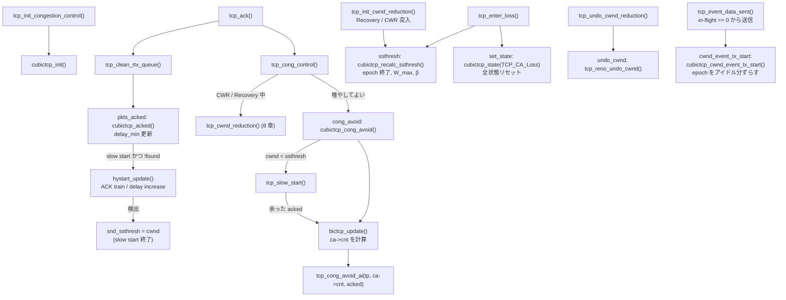

# 12. CUBIC

Linux のデフォルト輻輳制御である CUBIC を、RFC 9438 の式と `net/ipv4/tcp_cubic.c` の固定小数点実装を 1 行ずつ突き合わせながら読みます。前半は「ロス後に cwnd をどう増やすか」（cubic 関数・Reno-friendly region・fast convergence）、後半は「最初の slow start をどこで止めるか」（HyStart）です。フレームワーク側（`tcp_congestion_ops` の各フックがどこから呼ばれるか、`tcp_slow_start()` / `tcp_cong_avoid_ai()` の詳細、Reno）は 11 章、ロス検出と PRR は 8 章、RTT サンプルの作り方は 7 章を前提にします。

## たとえ話で言うと

道路（ネットワーク）に一度に出せるトラックの台数（cwnd）を決める配車係の話です。

- Reno の配車係は「受領印（ACK）が一往復ぶん戻ってくるたびに 1 台ずつ増やし、渋滞（ロス）が起きたら半分に減らす」という単純な人です。道路が長くて広い（帯域 × 遅延が大きい）と、元の台数に戻るまでに何十分もかかってしまいます。
- CUBIC の配車係は、渋滞が起きたときの台数 **W_max** をメモしておきます。渋滞が起きたら台数を 7 割に減らし、そこから **時計（経過時間）** を見ながら増やします。最初は W_max まで急いで戻し、W_max に近づくと「前回はここで渋滞したな」と慎重にほぼ横ばいで様子を見ます。しばらく渋滞しなければ「道路が空いたのかも」と、最初はそっと、だんだん大胆に台数を増やして新しい上限を探ります。この「速く → ゆっくり → また速く」という形が 3 次関数（cubic）です。
- 受領印の数ではなく時計で増やすので、往復が長い配車係も短い配車係も、同じ時間で同じだけ台数を増やせます。
- ただし道路が狭くて短い場所では、昔ながらの Reno 方式の方が速く増えることがあります。そこで CUBIC は「Reno ならいま何台だったか」も裏で計算しておき（W_est）、それより少なくならないようにします。
- 一番最初の出発（slow start）では、台数を倍々に増やすと必ずどこかで大渋滞します。HyStart は「受領印が途切れなく長い列になって戻ってくるようになった」「受領印の戻りが遅くなってきた」という 2 つの兆候を見て、渋滞が起きる前に倍々ゲームをやめます。

## RFC では

### RFC 9438 の概要

[RFC 9438](https://www.rfc-editor.org/rfc/rfc9438)「CUBIC for Fast and Long-Distance Networks」（2023 年, Standards Track）は、Reno の AIMD（1 RTT に 1 MSS 増、ロスで半減）が高 BDP 経路で遅すぎるという問題を解く輻輳制御です。cwnd を「最後の輻輳イベントからの経過時間 t の 3 次関数」として決めるので、増加速度が RTT に依存せず（RTT-fairness）、ロス直前の窓 W_max 付近では増加が鈍り、W_max を超えると再び加速します。RFC 9438 は Informational だった [RFC 8312](https://www.rfc-editor.org/rfc/rfc8312) を obsolete にし、主に次の点を変えました。

- K の式を `W_max * (1 - β)` から `W_max - cwnd_epoch` ベースに一般化（[§4.2](https://www.rfc-editor.org/rfc/rfc9438#section-4.2)）。
- target を `[cwnd, 1.5 * cwnd]` にクランプ（同上）。
- W_est が cwnd_prior に達したら α を 1 に切り替える（[§4.3](https://www.rfc-editor.org/rfc/rfc9438#section-4.3)）。
- ssthresh を cwnd ではなく flight_size から計算することを基本にし、cwnd を使う実装には cwnd validation を義務付け（[§4.6](https://www.rfc-editor.org/rfc/rfc9438#section-4.6)）。
- spurious な輻輳イベントからの undo 手順（[§4.9](https://www.rfc-editor.org/rfc/rfc9438#section-4.9)）。
- slow start は HyStart++（RFC 9406）を SHOULD とし、Linux が使っている元祖 HyStart は「実験的な代替」と位置付け（[§4.10](https://www.rfc-editor.org/rfc/rfc9438#section-4.10)）。

Linux の実装は RFC 8312 より古い 2008 年の CUBIC v2.3（Ha, Rhee, Xu の論文実装）が出発点で、RFC はむしろ Linux の実装経験を文書化したものです。そのため「RFC の式をコードに落とした」のではなく「コードの振る舞いを RFC が後追いした」部分が多く、両者のズレは後の [RFC と実装の違い](#rfc-と実装の違い) にまとめます。

### HyStart と RFC 9406 HyStart++ の概要

- **HyStart**（Sangtae Ha, Injong Rhee, "Taming the Elephants: New TCP Slow Start", 2008/2011）: 初回 slow start の倍々増加は BDP を最大 2 倍オーバーシュートし、大量ロスと長い回復を招きます。HyStart は 2 つの独立した検出器で slow start を早めに打ち切ります。(1) **ACK train**: 1 ラウンド内で密に（間隔 2 ms 以内で）並んで返る ACK 列の長さが min RTT の半分を超えたら、in-flight が BDP に達したと判断します。(2) **Delay increase**: ラウンド内の RTT サンプル（最初の 8 個以上）の最小値が、接続の min RTT より閾値以上大きくなったらキューが溜まり始めたと判断します。どちらかが発火すると `ssthresh = cwnd` として即座に congestion avoidance に移ります。
- **HyStart++**（[RFC 9406](https://www.rfc-editor.org/rfc/rfc9406), 2023 年, Standards Track）: Microsoft Windows の実装経験から標準化された改良版です。ACK train 検出は **持たず**、delay increase だけを使います（比較対象は「接続全体の min RTT」ではなく「前ラウンドの min RTT」）。さらに検出後すぐ congestion avoidance に入らず、**Conservative Slow Start (CSS)** で増加率を 1/4 に落として最大 5 ラウンド様子を見て、RTT が下がれば誤検出として slow start に戻ります（[§4.2](https://www.rfc-editor.org/rfc/rfc9406#section-4.2)）。推奨定数は `MIN_RTT_THRESH = 4 ms`, `MAX_RTT_THRESH = 16 ms`, `MIN_RTT_DIVISOR = 8`, `N_RTT_SAMPLE = 8`, `CSS_GROWTH_DIVISOR = 4`, `CSS_ROUNDS = 5`, `L = 8`（非ペーシング時）です（[§4.3](https://www.rfc-editor.org/rfc/rfc9406#section-4.3)）。

固定ピン留めしたツリーで確認すると、Linux の `tcp_cubic.c` が実装しているのは **元祖 HyStart（ACK train + delay increase）** であり、HyStart++ の CSS はありません。ただし delay increase の定数（4 ms / 16 ms / `>> 3` / 8 サンプル）は HyStart++ の推奨値とまったく同じです。これは偶然ではなく、HyStart++ が Linux の長年の値を取り込んだためです。`net/ipv4/` 以下で `hystart` を grep しても、HyStart++ 由来のコードは見つかりません（`tcp_cdg.c` に元祖 HyStart の簡易コピーがあるだけです）。

### 定数と変数（[RFC 9438 §4.1](https://www.rfc-editor.org/rfc/rfc9438#section-4.1)）

RFC は窓をセグメント単位、時間を秒単位で定義します。コードを読むのに必要なものだけ抜き出します。

| RFC の記号 | 意味 | Linux での対応 |
| --- | --- | --- |
| β_cubic | 乗算的減少係数（0.7） | `beta / BICTCP_BETA_SCALE` = 717/1024 |
| α_cubic | Reno-friendly region の加算係数 | `beta_scale`（逆数を 8 倍した値） |
| C | 攻撃性の定数（0.4 segment/s³） | `bic_scale * 10 / 1024` = 410/1024 |
| cwnd_prior | 直近に ssthresh を設定したときの cwnd | `tp->prior_cwnd`（undo 用、CUBIC 自身は持たない） |
| W_max | 直前の輻輳イベント直前の cwnd（fast convergence で縮むこともある） | `ca->last_max_cwnd` |
| K | 現在の CA ステージ開始時の cwnd から W_max に戻るまでの時間 | `ca->bic_K`（1/1024 秒単位） |
| t_epoch | 現在の CA ステージの開始時刻 | `ca->epoch_start`（jiffies） |
| cwnd_epoch | t_epoch での cwnd | `bictcp_update()` 冒頭の `cwnd` |
| W_est | Reno-friendly region 用の Reno 窓の推定値 | `ca->tcp_cwnd` |
| target | W_cubic(t + RTT) | `bic_target` |
| RTT | 平滑化 RTT（RFC 6298） | `ca->delay_min`（**最小** RTT を使う） |
| segments_acked | 新しい ACK で確認されたセグメント数 | `acked` 引数 |

### 窓増加関数（[RFC 9438 §4.2](https://www.rfc-editor.org/rfc/rfc9438#section-4.2)）

congestion avoidance 中、CUBIC は次の関数で窓を決めます。

```text
W_cubic(t) = C * (t - K)^3 + W_max            (Figure 1)
K = cbrt((W_max - cwnd_epoch) / C)            (Figure 2)
t = t_current - t_epoch
```

ロス直後に `cwnd_epoch = β * W_max` なら `K = cbrt(W_max * (1 - β) / C)` となり、RFC 8312 の式と一致します。例えば W_max = 100 なら K = cbrt(100 × 0.3 / 0.4) = cbrt(75) ≈ 4.22 秒です。RTT が 10 ms でも 200 ms でも、ロスから約 4.2 秒で cwnd は 100 に戻ります。これが RTT-fairness（[§3.3](https://www.rfc-editor.org/rfc/rfc9438#section-3.3)）の正体です。

新しい ACK を受け取るたびに、1 RTT 先の目標値を計算してクランプします。

```text
target = cwnd              if W_cubic(t + RTT) < cwnd
       = 1.5 * cwnd        if W_cubic(t + RTT) > 1.5 * cwnd
       = W_cubic(t + RTT)  otherwise
```

下限は「増加率が負にならない」、上限は「slow start より速く増えない」ことを保証します。また t には **アプリケーション制限で cwnd が更新されなかった期間を含めてはならない**（MUST NOT）と定められています（[§5.8](https://www.rfc-editor.org/rfc/rfc9438#section-5.8)）。含めてしまうと、アイドル明けに W_cubic(t) が巨大になり、cwnd が一気に膨らむからです。Linux ではこれを `cubictcp_cwnd_event_tx_start()` が担当します。

### Reno-friendly region（[§4.3](https://www.rfc-editor.org/rfc/rfc9438#section-4.3)）

短 RTT・低帯域（低 BDP）では Reno の方が速く増えることがあります。AIMD(α, β) の平均窓は `sqrt(α(1+β) / (2(1-β)p))` なので、Reno（AIMD(1, 0.5)）と同じ平均窓を得るには次の値が必要です。

```text
α_cubic = 3 * (1 - β_cubic) / (1 + β_cubic)   = 3 * 0.3 / 1.7 ≈ 0.529
W_est   = cwnd_epoch                          (CA ステージ開始時)
W_est  += α_cubic * segments_acked / cwnd     (新しい ACK ごと, Figure 4)
```

`W_cubic(t) < W_est` なら Reno-friendly region にいるので、cwnd を W_est にします（SHOULD）。さらに W_est が cwnd_prior に達したら α_cubic を 1 にして、Reno と同じ増加率にします（SHOULD）。

### Concave / Convex region（[§4.4](https://www.rfc-editor.org/rfc/rfc9438#section-4.4), [§4.5](https://www.rfc-editor.org/rfc/rfc9438#section-4.5)）

Reno-friendly region でなければ、cwnd < W_max なら concave（凹、W_max に向かって減速しながら近づく）、cwnd ≥ W_max なら convex（凸、「max probing」で加速しながら新しい上限を探す）です。どちらの領域でも、新しい ACK ごとの増分は同じ式です。

```text
cwnd += (target - cwnd) / cwnd
```

つまり 1 RTT（約 cwnd 個の ACK）で cwnd が target に到達します。Linux はこれを「`cnt = cwnd / (target - cwnd)` 個の ACK ごとに 1 増やす」と書き換えています。

### 乗算的減少（[§4.6](https://www.rfc-editor.org/rfc/rfc9438#section-4.6)）

```text
ssthresh   = flight_size * β_cubic
cwnd_prior = cwnd
cwnd       = max(ssthresh, 2)   (ロス)  / max(ssthresh, 1) (ECE)
ssthresh   = max(ssthresh, 2)
```

β_cubic は 0.7 です（SHOULD）。RFC は「cwnd を使って ssthresh を計算する実装もあるが、その場合は in-flight が cwnd より小さいときに cwnd が増えないようにする別の手段が MUST」と書いています。Linux はまさに cwnd を使う実装であり、その「別の手段」が `tcp_is_cwnd_limited()` です（Step 7）。

### Fast convergence（[§4.7](https://www.rfc-editor.org/rfc/rfc9438#section-4.7)）

```text
W_max = cwnd * (1 + β_cubic) / 2   if cwnd < W_max and fast convergence enabled
W_max = cwnd                       otherwise
```

前回の W_max に届かないうちにまたロスしたなら、新しいフローが帯域を取りに来た可能性が高いと考え、W_max を 0.85 倍に下げて早めに頭打ちにし、帯域を譲ります（SHOULD）。

### Timeout（[§4.8](https://www.rfc-editor.org/rfc/rfc9438#section-4.8)）

RTO 時は Reno と同じく cwnd を落としますが、ssthresh は β_cubic で決めます。RTO 後の最初の CA ステージでは **K = 0、W_max = そのステージ開始時の cwnd**、W_est もその cwnd から始めます。つまり過去の W_max は忘れ、凸（convex）領域からやり直します。

### Spurious な輻輳イベント（[§4.9](https://www.rfc-editor.org/rfc/rfc9438#section-4.9)）

F-RTO（RFC 5682）、Eifel（RFC 3522）、D-SACK（RFC 2883 / 3708）などで誤検出と分かったら、cwnd, cwnd_prior, ssthresh, W_max, K, t_epoch, W_est を退避値に戻してよい（MAY）、とされています。

### Slow start（[§4.10](https://www.rfc-editor.org/rfc/rfc9438#section-4.10)）

cwnd ≤ ssthresh では slow start が MUST です。HyStart++ を SHOULD、Reno の slow start を MAY とし、元祖 HyStart（[HR11]）は「過去 10 年あまり一部の CUBIC 実装がデフォルトで使ってきた前身」として実験的な代替に挙げられています。HyStart(++) がロスなしで slow start を抜けた場合は W_max が未定義なので、**K = 0、W_max = CA 開始時の cwnd** として Figure 1 を使います。

### HyStart の 2 つの検出器（論文と Linux）

ACK train 検出の理屈を一行でまとめると、「slow start では ACK 1 個につき 2 セグメント送るので、ボトルネックが飽和して ACK がボトルネック帯域 BW の間隔で返ってくるようになると、ラウンド開始から Δ 秒で in-flight は 2·BW·Δ になる。Δ = minRTT/2 で in-flight = BW·minRTT = BDP」です。したがって「間隔の詰まった ACK 列がラウンド開始から minRTT/2 以上続いた」ことが、BDP 到達のシグナルになります。

delay increase 検出は、ラウンドの最初の N 個のサンプルの最小値 `curr_rtt` が `delay_min + clamp(delay_min / 8, 4 ms, 16 ms)` を超えたらキューが伸び始めたと見なします。HyStart++ の `RttThresh = max(4 ms, min(lastRoundMinRTT / 8, 16 ms))` と形はまったく同じですが、比較の基準が「前ラウンドの min」か「接続全体の min」かが違います。

## 全体の流れ

CUBIC は `struct tcp_congestion_ops` の「古典的」なフック（`cong_avoid` / `ssthresh`）を使うモジュールです。BBR のように `cong_control` で cwnd とペーシングレートを丸ごと握るのではなく、cwnd の **増やし方** と **減らす量** だけを提供し、ロス回復中の cwnd 制御（PRR）やペーシングレート計算はコア（`tcp_input.c`）に任せます。



1 つの ACK の中では、`tcp_clean_rtx_queue()` から呼ばれる `pkts_acked`（RTT サンプルと HyStart）が先、`tcp_cong_control()` から呼ばれる `cong_avoid`（cwnd 増加）が後です。このため HyStart が `snd_ssthresh` を下げると、**同じ ACK** の `cong_avoid` で既に congestion avoidance 側に入ります。

各フックの呼び出し元と実行文脈を表にします。どれも `struct sock` のソケットロック（プロセス文脈なら `lock_sock()` 済み、softirq なら `bh_lock_sock()` 済みで `!sock_owned_by_user()`）の下で動くので、`struct bictcp` 自体へのアクセスは直列化されており、CUBIC は自分の状態に対して一切ロックや atomic を使いません。

| `tcp_congestion_ops` のフィールド | CUBIC の関数 | 主な呼び出し元 | 文脈 |
| --- | --- | --- | --- |
| `.init` | `cubictcp_init()` | `tcp_init_congestion_control()`（`tcp_init_transfer()` や `TCP_CONGESTION` の setsockopt から） | ESTABLISHED 遷移時の softirq / プロセス |
| `.cong_avoid` | `cubictcp_cong_avoid()` | `tcp_cong_avoid()` ← `tcp_cong_control()` ← `tcp_ack()` | ACK 受信（softirq または backlog 処理） |
| `.pkts_acked` | `cubictcp_acked()` | `tcp_clean_rtx_queue()` ← `tcp_ack()` | 同上 |
| `.ssthresh` | `cubictcp_recalc_ssthresh()` | `tcp_init_cwnd_reduction()`（Recovery / CWR）、`tcp_enter_loss()`（RTO） | ACK 受信 / RTO タイマー |
| `.set_state` | `cubictcp_state()` | `tcp_set_ca_state()` | 同上 |
| `.undo_cwnd` | `tcp_reno_undo_cwnd()` | `tcp_undo_cwnd_reduction()` | ACK 受信 |
| `.cwnd_event_tx_start` | `cubictcp_cwnd_event_tx_start()` | `tcp_ca_event(sk, CA_EVENT_TX_START)` ← `tcp_event_data_sent()` | 送信パス（sendmsg / ACK 駆動 / タイマー） |

## コードを追う

### Step 1: 定数、モジュールパラメータ、事前計算（`cubictcp_register()`）

まずファイル先頭の定数とモジュールパラメータです。CUBIC のすべての式はここで決まる固定小数点のスケールに依存します。

```c
#define BICTCP_BETA_SCALE    1024	/* Scale factor beta calculation
					 * max_cwnd = snd_cwnd * beta
					 */
#define	BICTCP_HZ		10	/* BIC HZ 2^10 = 1024 */

/* Two methods of hybrid slow start */
#define HYSTART_ACK_TRAIN	0x1
#define HYSTART_DELAY		0x2

/* Number of delay samples for detecting the increase of delay */
#define HYSTART_MIN_SAMPLES	8
#define HYSTART_DELAY_MIN	(4000U)	/* 4 ms */
#define HYSTART_DELAY_MAX	(16000U)	/* 16 ms */
#define HYSTART_DELAY_THRESH(x)	clamp(x, HYSTART_DELAY_MIN, HYSTART_DELAY_MAX)

static int fast_convergence __read_mostly = 1;
static int beta __read_mostly = 717;	/* = 717/1024 (BICTCP_BETA_SCALE) */
static int initial_ssthresh __read_mostly;
static int bic_scale __read_mostly = 41;
static int tcp_friendliness __read_mostly = 1;

static int hystart __read_mostly = 1;
static int hystart_detect __read_mostly = HYSTART_ACK_TRAIN | HYSTART_DELAY;
static int hystart_low_window __read_mostly = 16;
static int hystart_ack_delta_us __read_mostly = 2000;

static u32 cube_rtt_scale __read_mostly;
static u32 beta_scale __read_mostly;
static u64 cube_factor __read_mostly;
```

- `BICTCP_BETA_SCALE = 1024`: β を 1024 分率で表すためのスケールです。`beta = 717` なので β = 717/1024 = 0.7002 で、RFC 9438 の β_cubic = 0.7 に相当します。
- `BICTCP_HZ = 10`: CUBIC 内部の時間単位は jiffies でも秒でもなく **1/1024 秒**（2^10 分の 1 秒）です。`bic_K` や `bictcp_update()` 内の `t` はすべてこの単位です。HZ に依存しない固定の分解能にすることで、`t^3` の計算のビット幅を HZ と無関係に見積もれます。
- `HYSTART_ACK_TRAIN` / `HYSTART_DELAY`: `hystart_detect` のビットです。デフォルトは両方有効（3）。
- `HYSTART_MIN_SAMPLES = 8`, `HYSTART_DELAY_MIN = 4000U`, `HYSTART_DELAY_MAX = 16000U`: delay increase 検出の定数で、単位は **マイクロ秒** です（2019 年に usec 化、後述）。HyStart++ の `N_RTT_SAMPLE`, `MIN_RTT_THRESH`, `MAX_RTT_THRESH` と同じ値です。
- `HYSTART_DELAY_THRESH(x)`: `clamp(x, 4ms, 16ms)`。呼び出し側で `delay_min >> 3` を渡すので `MIN_RTT_DIVISOR = 8` に相当します。
- `fast_convergence = 1`: RFC §4.7 の fast convergence を有効にします。
- `initial_ssthresh = 0`: 0 なら初期 ssthresh はコアが設定した `TCP_INFINITE_SSTHRESH` のまま、HyStart 無効時だけ意味を持ちます（Step 3）。
- `bic_scale = 41`: C を決める値です。下の `cube_rtt_scale` の説明を参照してください。
- `tcp_friendliness = 1`: RFC §4.3 の Reno-friendly region を有効にします。
- `hystart_low_window = 16`: cwnd が 16 未満のうちは HyStart の検出を行いません。
- `hystart_ack_delta_us = 2000`: ACK train とみなす ACK 間隔の上限（2 ms）です。
- `cube_rtt_scale`, `beta_scale`, `cube_factor`: モジュールロード時に一度だけ計算し、ACK ごとの割り算を避けるための事前計算値です。

```c
/* Note parameters that are used for precomputing scale factors are read-only */
module_param(fast_convergence, int, 0644);
MODULE_PARM_DESC(fast_convergence, "turn on/off fast convergence");
module_param(beta, int, 0644);
MODULE_PARM_DESC(beta, "beta for multiplicative increase");
module_param(initial_ssthresh, int, 0644);
MODULE_PARM_DESC(initial_ssthresh, "initial value of slow start threshold");
module_param(bic_scale, int, 0444);
MODULE_PARM_DESC(bic_scale, "scale (scaled by 1024) value for bic function (bic_scale/1024)");
module_param(tcp_friendliness, int, 0644);
MODULE_PARM_DESC(tcp_friendliness, "turn on/off tcp friendliness");
module_param(hystart, int, 0644);
MODULE_PARM_DESC(hystart, "turn on/off hybrid slow start algorithm");
module_param(hystart_detect, int, 0644);
MODULE_PARM_DESC(hystart_detect, "hybrid slow start detection mechanisms"
		 " 1: packet-train 2: delay 3: both packet-train and delay");
module_param(hystart_low_window, int, 0644);
MODULE_PARM_DESC(hystart_low_window, "lower bound cwnd for hybrid slow start");
module_param(hystart_ack_delta_us, int, 0644);
MODULE_PARM_DESC(hystart_ack_delta_us, "spacing between ack's indicating train (usecs)");
```

パーミッションに注目してください。`bic_scale` だけが `0444`（読み取り専用）で、他は `0644` です。コメントのとおり「事前計算に使うパラメータは read-only」という意図ですが、**`beta` は `0644` なのに `beta_scale` の計算に使われています**。実行時に `/sys/module/tcp_cubic/parameters/beta` を書き換えると、`cubictcp_recalc_ssthresh()` の β と fast convergence の係数は即座に変わる一方、Reno-friendly region の α（`beta_scale`）はロード時の値のままになります。また、これらはすべてモジュール全体のグローバル変数で、netns ごとの sysctl ではありません（`net.ipv4.tcp_congestion_control` が per-netns なのとは対照的です）。

事前計算はファイル末尾の `cubictcp_register()`（[net/ipv4/tcp_cubic.c#L501](https://git.kernel.org/pub/scm/linux/kernel/git/netdev/net-next.git/tree/net/ipv4/tcp_cubic.c?id=279d5c8afcd38bd841832a39bfe1aa4f8518d98e#n501)）にあります。説明の都合でここで読みます。

```c
static int __init cubictcp_register(void)
{
	int b = READ_ONCE(beta);
	int ret;

	BUILD_BUG_ON(sizeof(struct bictcp) > ICSK_CA_PRIV_SIZE);

	if (b < 0 || b >= BICTCP_BETA_SCALE ||
	    bic_scale <= 0 || bic_scale > INT_MAX / 10) {
		pr_err("tcp_cubic: invalid beta %d or bic_scale %d\n",
		       b, bic_scale);
		return -EINVAL;
	}
```

続いて、ACK ごとに使うスケール値の事前計算と登録です。

```c
	/* Precompute a bunch of the scaling factors that are used per-packet
	 * based on SRTT of 100ms
	 */

	beta_scale = 8 * (BICTCP_BETA_SCALE + b) / 3
		/ (BICTCP_BETA_SCALE - b);
	/* bictcp_update() needs (cwnd * beta_scale) >> 3 to be >= 1 */
	beta_scale = max(beta_scale, 8U);

	cube_rtt_scale = (bic_scale * 10);	/* 1024*c/rtt */

	/* calculate the "K" for (wmax-cwnd) = c/rtt * K^3
	 *  so K = cubic_root( (wmax-cwnd)*rtt/c )
	 * the unit of K is bictcp_HZ=2^10, not HZ
	 *
	 *  c = bic_scale >> 10
	 *  rtt = 100ms
	 *
	 * the following code has been designed and tested for
	 * cwnd < 1 million packets
	 * RTT < 100 seconds
	 * HZ < 1,000,00  (corresponding to 10 nano-second)
	 */

	/* 1/c * 2^2*bictcp_HZ * srtt */
	cube_factor = 1ull << (10+3*BICTCP_HZ); /* 2^40 */

	/* divide by bic_scale and by constant Srtt (100ms) */
	do_div(cube_factor, bic_scale * 10);

	ret = register_btf_kfunc_id_set(BPF_PROG_TYPE_STRUCT_OPS, &tcp_cubic_kfunc_set);
	if (ret < 0)
		return ret;
	return tcp_register_congestion_control(&cubictcp);
}
```

- `BUILD_BUG_ON(sizeof(struct bictcp) > ICSK_CA_PRIV_SIZE)`: CC モジュールの私的状態は `inet_connection_sock` に埋め込まれた `icsk_ca_priv[]`（現在 104 バイト）に置かれます。`struct bictcp` は 60 バイトなので収まります。動的確保しないので、ソケットごとの追加アロケーションもポインタ追跡もありません。
- `b = READ_ONCE(beta)` と範囲チェック: 2026 年の 7d52b5d16afc で追加されました。`beta == 1024` や `bic_scale == 0` は下の割り算でゼロ除算になり、`bic_scale * 10` は int オーバーフローし得ます。`beta` は `insmod tcp_cubic beta=...` だけでなく、組み込み時は init 関数が走る前に sysfs から書かれる可能性もあるので `READ_ONCE()` で一度だけ読みます。
- `beta_scale = 8 * (1024 + b) / 3 / (1024 - b)`: Reno-friendly region の α の **逆数の 8 倍** です。α = 3(1-β)/(1+β) なので 1/α = (1+β)/(3(1-β)) = (1024+b)/(3(1024-b))。C の評価順は左から `((8 * 1741) / 3) / 307` = `4642 / 307` = **15** です。`bictcp_update()` は「`(cwnd * 15) >> 3` = 1.875·cwnd 個の ACK ごとに W_est を 1 増やす」ので、実効 α = 8/15 = 0.533 で、RFC の 0.529 とほぼ一致します。
- `beta_scale = max(beta_scale, 8U)`: β を極端に小さくすると `beta_scale` が小さくなり、cwnd が小さいときに `(cwnd * beta_scale) >> 3` が 0 になって `bictcp_update()` の `while` ループが無限ループします。8 以上を保証すれば `cwnd >= 1` で delta ≥ 1 です。
- `cube_rtt_scale = bic_scale * 10`（= 410）: コメントの「1024*c/rtt」は BIC 時代の名残です。元の実装は C を「基準 RTT 100 ms あたり」の値 c = 41/1024 ≈ 0.04 として持ち、`c/rtt = c / 0.1 = c * 10` を掛けていました。結果として RTT には依存せず、実効的に **C = 410/1024 ≈ 0.4004 segment/s³**、つまり RFC の C = 0.4 になります。
- `cube_factor = 2^40 / 410`（= 2681735677）: `bic_K` を求めるための係数です。K[秒] = cbrt(ΔW / C) を 1/1024 秒単位で求めたいので、K·1024 = cbrt(ΔW · 1024³ / C) = cbrt(ΔW · 2^30 · 1024 / 410) = cbrt(ΔW · 2^40 / 410) となり、`cube_factor * ΔW` の立方根を取ればちょうど 1/1024 秒単位の K になります。`do_div()` は 64bit ÷ 32bit で、32bit アーキテクチャでも動きます。
- 最後に BPF struct_ops から CUBIC の関数を kfunc として呼べるよう登録し（BPF で書いた CC が CUBIC の一部を再利用できる）、`tcp_register_congestion_control()` で CC リストに登録します。

ここまでの対応を表にしておきます。

| RFC 9438 / RFC 9406 | 値 | Linux の表現 | 実効値 |
| --- | --- | --- | --- |
| β_cubic | 0.7 | `beta / BICTCP_BETA_SCALE` = 717/1024 | 0.7002 |
| C | 0.4 | `cube_rtt_scale / 2^10` = 410/1024（`bic_scale = 41` × 10） | 0.4004 |
| K の時間単位 | 秒 | `bic_K` は 1/1024 秒（`BICTCP_HZ = 10`） | — |
| K の計算 | cbrt(ΔW / C) | `cubic_root(cube_factor * ΔW)`, `cube_factor = 2^40 / 410` | 誤差 約 0.2% |
| α_cubic | 3(1-β)/(1+β) ≈ 0.529 | `beta_scale = 15` → `(cwnd * 15) >> 3` ACK ごとに +1 | 8/15 ≈ 0.533 |
| fast convergence 係数 | (1+β)/2 = 0.85 | `(1024 + 717) / 2048` | 0.850 |
| target の上限 | 1.5·cwnd | `ca->cnt >= 2`（2 ACK で 1 増） | 1.5 倍 / RTT |
| W_cubic(t + RTT) の RTT | SRTT | `usecs_to_jiffies(ca->delay_min)`（min RTT） | — |
| MIN_RTT_THRESH / MAX_RTT_THRESH | 4 ms / 16 ms | `HYSTART_DELAY_MIN` / `HYSTART_DELAY_MAX`（usec） | 同じ |
| MIN_RTT_DIVISOR | 8 | `ca->delay_min >> 3` | 同じ |
| N_RTT_SAMPLE | 8 | `HYSTART_MIN_SAMPLES` | 同じ |
| CSS_GROWTH_DIVISOR / CSS_ROUNDS / L | 4 / 5 / 8 | なし（CSS 未実装、slow start の増分上限は ssthresh のみ） | — |

### Step 2: `struct bictcp` と小さなヘルパー

`struct bictcp`（[net/ipv4/tcp_cubic.c#L86](https://git.kernel.org/pub/scm/linux/kernel/git/netdev/net-next.git/tree/net/ipv4/tcp_cubic.c?id=279d5c8afcd38bd841832a39bfe1aa4f8518d98e#n86)）は CUBIC のソケットごとの状態です。名前が BIC のままなのは、CUBIC が BIC-TCP から派生した歴史のためです（関数名の `bictcp_` → `cubictcp_` の改名は 2021 年の d22f6ad18709 で、BPF kfunc として名前が衝突しないようにするためでした。内部ヘルパーと構造体名は BIC のまま残っています）。

```c
/* BIC TCP Parameters */
struct bictcp {
	u32	cnt;		/* increase cwnd by 1 after ACKs */
	u32	last_max_cwnd;	/* last maximum snd_cwnd */
	u32	last_cwnd;	/* the last snd_cwnd */
	u32	last_time;	/* time when updated last_cwnd */
	u32	bic_origin_point;/* origin point of bic function */
	u32	bic_K;		/* time to origin point
				   from the beginning of the current epoch */
	u32	delay_min;	/* min delay (usec) */
	u32	epoch_start;	/* beginning of an epoch */
	u32	ack_cnt;	/* number of acks */
	u32	tcp_cwnd;	/* estimated tcp cwnd */
	u16	unused;
	u8	sample_cnt;	/* number of samples to decide curr_rtt */
	u8	found;		/* the exit point is found? */
	u32	round_start;	/* beginning of each round */
	u32	end_seq;	/* end_seq of the round */
	u32	last_ack;	/* last time when the ACK spacing is close */
	u32	curr_rtt;	/* the minimum rtt of current round */
};
```

フィールドを 3 つのグループに分けて理解すると読みやすくなります。

- **cubic 曲線の状態**（ロスごと・epoch ごとに変わる）
  - `cnt`: 「何 ACK ごとに cwnd を 1 増やすか」。`tcp_cong_avoid_ai()` の `w` 引数として渡されます。cubic 曲線の傾きの逆数です。
  - `last_max_cwnd`: RFC の W_max。fast convergence 適用後の値です。0 は「W_max 未知」（初回 slow start 直後や RTO 後）を意味します。
  - `last_cwnd`, `last_time`: `bictcp_update()` の再計算を間引くためのキャッシュです（cwnd が同じで 1/32 秒以内なら再計算しない）。
  - `bic_origin_point`: 3 次関数の変曲点の高さ。通常は W_max ですが、W_max 未知または cwnd ≥ W_max で epoch が始まったときは epoch 開始時の cwnd です。
  - `bic_K`: 変曲点までの時間（1/1024 秒）。
  - `epoch_start`: epoch（RFC の「CA ステージ」）の開始時刻（jiffies）。**0 は「epoch が始まっていない」の番兵** です。ロスで 0 に戻されます。
- **Reno-friendly region の状態**
  - `ack_cnt`: W_est を進めるための ACK カウンタ（余りを持ち越す）。
  - `tcp_cwnd`: RFC の W_est。
- **HyStart / RTT の状態**
  - `delay_min`: 接続の最小 RTT（usec）。0 は未測定。HyStart と `bictcp_update()` の「t + RTT」の両方に使われます。
  - `unused`, `sample_cnt`, `found`: `found` は「slow start の出口を見つけた」フラグ。`sample_cnt` はラウンド内の RTT サンプル数。
  - `round_start`, `end_seq`, `last_ack`, `curr_rtt`: HyStart の「ラウンド」管理です。`end_seq` まで ACK されたらラウンド終了。時刻は usec（`tcp_mstamp` の下位 32 bit）です。

```c
static inline void bictcp_reset(struct bictcp *ca)
{
	memset(ca, 0, offsetof(struct bictcp, unused));
	ca->found = 0;
}

static inline u32 bictcp_clock_us(const struct sock *sk)
{
	return tcp_sk(sk)->tcp_mstamp;
}

static inline void bictcp_hystart_reset(struct sock *sk)
{
	struct tcp_sock *tp = tcp_sk(sk);
	struct bictcp *ca = inet_csk_ca(sk);

	ca->round_start = ca->last_ack = bictcp_clock_us(sk);
	ca->end_seq = tp->snd_nxt;
	ca->curr_rtt = ~0U;
	ca->sample_cnt = 0;
}
```

- `bictcp_reset()`: `memset(ca, 0, offsetof(struct bictcp, unused))` で `cnt` から `tcp_cwnd` までの曲線状態と `delay_min` を一括でゼロにし、`found` も 0 にします。`sample_cnt` や `round_start` 以降はゼロにしません。これらは直後に呼ばれる `bictcp_hystart_reset()` が設定するからです（f4d133d86af7 で個別代入から `memset` + `offsetof` に変わりました。フィールドの並び順が意味を持つので、`struct bictcp` に新しいフィールドを足すときは `unused` の前か後かに注意が必要です）。
- `bictcp_clock_us()`: `tp->tcp_mstamp`（u64 の usec 時刻）を u32 に切り詰めて返します。`tcp_mstamp` は ACK 処理の入口などで `tcp_mstamp_refresh()` により更新済みなので、新たに時計を読むコストがかかりません。u32 の usec は約 71 分で一周しますが、HyStart が使うのは常に `(s32)(now - x)` の差分なので、差が 35 分未満なら問題ありません。
- `bictcp_hystart_reset()`: 新しいラウンドを始めます。`round_start` と `last_ack` を現在時刻にし、`end_seq = snd_nxt`（いま送信済みの最後尾が ACK されたらラウンド終了）、`curr_rtt = ~0U`（無限大）、`sample_cnt = 0`。`curr_rtt` を 0 ではなく `~0U` にしておくことで、`hystart_update()` で「未設定なら」の分岐が不要になります（35821fc2b41c）。RFC 9406 の「windowEnd = SND.NXT」「currentRoundMinRTT = infinity」とまったく同じ構造です。

### Step 3: `cubictcp_init()`

`cubictcp_init()`（[net/ipv4/tcp_cubic.c#L129](https://git.kernel.org/pub/scm/linux/kernel/git/netdev/net-next.git/tree/net/ipv4/tcp_cubic.c?id=279d5c8afcd38bd841832a39bfe1aa4f8518d98e#n129)）は接続が ESTABLISHED になったとき（`tcp_init_transfer()` → `tcp_init_congestion_control()`）、または `TCP_CONGESTION` で CC を切り替えたときに呼ばれます。

```c
__bpf_kfunc static void cubictcp_init(struct sock *sk)
{
	struct bictcp *ca = inet_csk_ca(sk);

	bictcp_reset(ca);

	if (hystart)
		bictcp_hystart_reset(sk);

	if (!hystart && initial_ssthresh)
		WRITE_ONCE(tcp_sk(sk)->snd_ssthresh, initial_ssthresh);
}
```

- `bictcp_reset(ca)`: 全状態をゼロにします。`last_max_cwnd = 0` なので「W_max 未知」から始まります。
- `if (hystart) bictcp_hystart_reset(sk)`: 最初のラウンドを `snd_nxt` 基準で開始します。
- `if (!hystart && initial_ssthresh)`: HyStart を無効にした場合だけ、モジュールパラメータで初期 ssthresh を固定できます。HyStart 有効時は無視されるのは、HyStart 自体が slow start の出口を決める仕組みだからです。`snd_ssthresh` への書き込みが `WRITE_ONCE()` なのは、`tcp_get_info()` や `SCM_TIMESTAMPING_OPT_STATS` がソケットロックなしで読むためです（fd571afb05eb）。

### Step 4: `cubictcp_cwnd_event_tx_start()` — アイドル期間を曲線から除く

RFC 9438 §4.2/§5.8 の「t にアプリケーション制限期間を含めてはならない」を実装しているのがこの関数です（[net/ipv4/tcp_cubic.c#L142](https://git.kernel.org/pub/scm/linux/kernel/git/netdev/net-next.git/tree/net/ipv4/tcp_cubic.c?id=279d5c8afcd38bd841832a39bfe1aa4f8518d98e#n142)）。呼び出し元は送信パスの `tcp_event_data_sent()`（[net/ipv4/tcp_output.c#L179](https://git.kernel.org/pub/scm/linux/kernel/git/netdev/net-next.git/tree/net/ipv4/tcp_output.c?id=279d5c8afcd38bd841832a39bfe1aa4f8518d98e#n179)）で、**in-flight が 0 の状態からデータを送るとき** に `CA_EVENT_TX_START` が発生します。

```c
static void tcp_event_data_sent(struct tcp_sock *tp,
				struct sock *sk)
{
	struct inet_connection_sock *icsk = inet_csk(sk);
	const u32 now = tcp_jiffies32;

	if (tcp_packets_in_flight(tp) == 0)
		tcp_ca_event(sk, CA_EVENT_TX_START);

	tp->lsndtime = now;

	/* If it is a reply for ato after last received
	 * packet, increase pingpong count.
	 */
	if ((u32)(now - icsk->icsk_ack.lrcvtime) < icsk->icsk_ack.ato)
		inet_csk_inc_pingpong_cnt(sk);
}
```

`tcp_ca_event(sk, CA_EVENT_TX_START)` を呼ぶのは `tp->lsndtime = now` で更新する **前** です。したがって CUBIC からは `lsndtime` が「前回最後にデータを送った時刻」に見えます。

```c
__bpf_kfunc static void cubictcp_cwnd_event_tx_start(struct sock *sk)
{
	struct bictcp *ca = inet_csk_ca(sk);
	u32 now = tcp_jiffies32;
	s32 delta;

	delta = now - tcp_sk(sk)->lsndtime;

	/* We were application limited (idle) for a while.
	 * Shift epoch_start to keep cwnd growth to cubic curve.
	 */
	if (ca->epoch_start && delta > 0) {
		ca->epoch_start += delta;
		if (after(ca->epoch_start, now))
			ca->epoch_start = now;
	}
}
```

- `delta = now - tcp_sk(sk)->lsndtime`: 最後に送信してからの経過 jiffies、すなわちアイドル時間です。
- `if (ca->epoch_start && delta > 0)`: epoch が進行中（CA 中）のときだけ、`epoch_start` をアイドル時間だけ後ろにずらします。これで `t = now - epoch_start` はアイドル期間を含まなくなり、cubic 曲線の **形はそのままで時間方向に平行移動** します。
- `if (after(ca->epoch_start, now)) ca->epoch_start = now`: `epoch_start` が未来になるのを防ぎます。`epoch_start` は ACK 処理時（`bictcp_update()`）に設定され、`lsndtime` は送信時に設定されるので、「最後の送信 → epoch 開始（ACK）→ アイドル → 送信再開」という順序だと `epoch_start + delta > now` になり得ます。未来の `epoch_start` は `bictcp_update()` で `(s32)(tcp_jiffies32 - ca->epoch_start)` を負にし、それを u64 の `t` に代入すると符号拡張で巨大な値になって曲線が暴走します（c2e7204d180f）。

なぜ `epoch_start = 0` にリセットしないのでしょうか。リセットすると次の ACK で新しい epoch が始まり、`cwnd < last_max_cwnd` なら K を再計算して W_max に向かって急上昇する、つまりロス直後と同じ攻撃的な増加をやり直してしまいます。Neal Cardwell の指摘により、「曲線の形を保ったまま時間だけずらす」方式が選ばれました（30927520dbae）。なお slow start 中（`epoch_start == 0`）は何もしません。アイドル後の cwnd 自体の縮小は `tcp_slow_start_after_idle` による `tcp_cwnd_restart()`（RFC 2861）の担当で、CUBIC はそれとは独立に「曲線の時間軸」だけを補正します。

この関数は 2026 年の d1e59a469737 で汎用の `cwnd_event(sk, ev)` から独立したフック `cwnd_event_tx_start` に分離されました。`cwnd_event()` は送信のたびに `CA_EVENT_TX_START` とそれ以外のイベントで交互に呼ばれ、間接分岐の予測に不利だったためです。CUBIC と BBR は `CA_EVENT_TX_START` しか見ないので、専用ポインタにすると `tcp_ca_event()`（[include/net/tcp.h#L1491](https://git.kernel.org/pub/scm/linux/kernel/git/netdev/net-next.git/tree/include/net/tcp.h?id=279d5c8afcd38bd841832a39bfe1aa4f8518d98e#n1491)）内で分岐が静的に決まります。

```c
static inline void tcp_ca_event(struct sock *sk, const enum tcp_ca_event event)
{
	const struct inet_connection_sock *icsk = inet_csk(sk);

	if (event == CA_EVENT_TX_START) {
		if (icsk->icsk_ca_ops->cwnd_event_tx_start)
			icsk->icsk_ca_ops->cwnd_event_tx_start(sk);
		return;
	}
	if (icsk->icsk_ca_ops->cwnd_event)
		icsk->icsk_ca_ops->cwnd_event(sk, event);
}
```

### Step 5: `cubic_root()` — 固定小数点の立方根

K の計算には 64bit 整数の立方根が必要です。カーネルは浮動小数点を使えないので、`cubic_root()`（[net/ipv4/tcp_cubic.c#L164](https://git.kernel.org/pub/scm/linux/kernel/git/netdev/net-next.git/tree/net/ipv4/tcp_cubic.c?id=279d5c8afcd38bd841832a39bfe1aa4f8518d98e#n164)）は **テーブル引きで初期値を作り、Newton-Raphson を 1 回だけ回す** 方式で求めます。平均誤差は約 0.195% です。

```c
/* calculate the cubic root of x using a table lookup followed by one
 * Newton-Raphson iteration.
 * Avg err ~= 0.195%
 */
static u32 cubic_root(u64 a)
{
	u32 x, b, shift;
	/*
	 * cbrt(x) MSB values for x MSB values in [0..63].
	 * Precomputed then refined by hand - Willy Tarreau
	 *
	 * For x in [0..63],
	 *   v = cbrt(x << 18) - 1
	 *   cbrt(x) = (v[x] + 10) >> 6
	 */
	static const u8 v[] = {
		/* 0x00 */    0,   54,   54,   54,  118,  118,  118,  118,
		/* 0x08 */  123,  129,  134,  138,  143,  147,  151,  156,
		/* 0x10 */  157,  161,  164,  168,  170,  173,  176,  179,
		/* 0x18 */  181,  185,  187,  190,  192,  194,  197,  199,
		/* 0x20 */  200,  202,  204,  206,  209,  211,  213,  215,
		/* 0x28 */  217,  219,  221,  222,  224,  225,  227,  229,
		/* 0x30 */  231,  232,  234,  236,  237,  239,  240,  242,
		/* 0x38 */  244,  245,  246,  248,  250,  251,  252,  254,
	};

	b = fls64(a);
	if (b < 7) {
		/* a in [0..63] */
		return ((u32)v[(u32)a] + 35) >> 6;
	}

	b = ((b * 84) >> 8) - 1;
	shift = (a >> (b * 3));

	x = ((u32)(((u32)v[shift] + 10) << b)) >> 6;
```

後半が Newton-Raphson の 1 反復です。

```c
	/*
	 * Newton-Raphson iteration
	 *                         2
	 * x    = ( 2 * x  +  a / x  ) / 3
	 *  k+1          k         k
	 */
	x = (2 * x + (u32)div64_u64(a, (u64)x * (u64)(x - 1)));
	x = ((x * 341) >> 10);
	return x;
}
```

数学を順に分解します。

1. **テーブル `v[]` の意味**: 0〜63 の x について `v[x] = cbrt(x << 18) - 1` を（手で調整して）格納しています。`x << 18` は x·2^18 = x·64³ なので、`cbrt(x << 18) = 64·cbrt(x)`、つまり `v[x]` は cbrt(x) を **6bit の固定小数点（×64）** で表した値です。u8 に収めるため 1 を引いています（cbrt(63)·64 ≈ 254.7）。
2. **小さい入力（a < 64）**: `fls64(a) < 7` なら a は 6bit 以内なので、テーブルから直接 `(v[a] + 35) >> 6` を返します。+35 は ×64 の固定小数点を整数に戻すときの丸め調整で、例えば a = 1 → (54+35)>>6 = 1、a = 8 → (123+35)>>6 = 2、a = 27 → (190+35)>>6 = 3、a = 63 → 4 になります。
3. **大きい入力の正規化**: `b = fls64(a)` はビット長です。`((b * 84) >> 8) - 1` は 84/256 ≈ 0.328 ≈ 1/3 を使った「b/3 − 1」の近似で、立方根のビット長を見積もっています。`shift = a >> (b * 3)` は a を 2^(3b) で割った上位ビットで、b の選び方により常に 0〜63 に収まります（例: ビット長 64 なら b = 20、64 − 60 = 4 bit。ビット長 63 なら b = 19、63 − 57 = 6 bit）。
4. **初期値**: cbrt(a) = cbrt(shift · 2^(3b)) = cbrt(shift) · 2^b なので、`x = ((v[shift] + 10) << b) >> 6` は「テーブルで求めた cbrt(shift)（×64）を 2^b 倍して ×64 を外した値」です。ここでの +10 は、テーブルが 1 を引いていることと、あとの Newton 1 回で誤差が縮むことを前提にした調整値です。
5. **Newton-Raphson 1 回**: f(x) = x³ − a に対する反復は x' = x − (x³ − a)/(3x²) = (2x + a/x²)/3 です。コードは `2 * x + a / (x * (x - 1))` を計算してから `* 341 >> 10` で 3 で割ります（341/1024 = 0.333）。分母を x² ではなく `x * (x - 1)` にしているのは、整数割り算の切り捨てと `341/1024 < 1/3` による下振れを少し打ち消すためと読めます。分母は u64 で計算するので、x が 2^21 程度（a ≈ 2^64）でもオーバーフローしません。
6. Newton 法は 2 次収束なので、初期値が数 % 以内なら 1 回で 0.2% 程度に収まります。ループを回さないことで、実行時間が入力によらずほぼ一定になります。

具体例を手で確かめてみます（`cube_factor = 2681735677`）。W_max − cwnd = 30 のとき `a = 80452070310`（37 bit）なので `b = ((37 * 84) >> 8) - 1 = 11`、`shift = a >> 33 = 9`、`x = ((129 + 10) << 11) >> 6 = 4448` です。Newton 1 回で **4316** になります。真値は cbrt(a) = 4316.97 で、K = 4316/1024 ≈ 4.215 秒です。RFC の式 cbrt(30/0.4) = 4.217 秒とよく一致します。

関数が呼ばれるのは epoch 開始時（ロス後の最初の CA ACK）に 1 回だけです。毎 ACK の計算ではないので、`div64_u64()` が 1 回入っても問題ありません。

### Step 6: `bictcp_update()` — cubic 曲線から `ca->cnt` を求める

CUBIC の心臓部です（[net/ipv4/tcp_cubic.c#L211](https://git.kernel.org/pub/scm/linux/kernel/git/netdev/net-next.git/tree/net/ipv4/tcp_cubic.c?id=279d5c8afcd38bd841832a39bfe1aa4f8518d98e#n211)）。この関数は cwnd を直接いじりません。「何 ACK ごとに cwnd を 1 増やすか」を `ca->cnt` に書くだけで、実際の加算は呼び出し元の `tcp_cong_avoid_ai()` が行います。RFC の「ACK ごとに `(target - cwnd) / cwnd` 増やす」を、整数で扱いやすい「`cwnd / (target - cwnd)` ACK ごとに 1 増やす」に変形しているわけです。

#### 6-1: 再計算の間引きと epoch の開始

```c
/*
 * Compute congestion window to use.
 */
static inline void bictcp_update(struct bictcp *ca, u32 cwnd, u32 acked)
{
	u32 delta, bic_target, max_cnt;
	u64 offs, t;

	ca->ack_cnt += acked;	/* count the number of ACKed packets */

	if (ca->last_cwnd == cwnd &&
	    (s32)(tcp_jiffies32 - ca->last_time) <= HZ / 32)
		return;

	/* The CUBIC function can update ca->cnt at most once per jiffy.
	 * On all cwnd reduction events, ca->epoch_start is set to 0,
	 * which will force a recalculation of ca->cnt.
	 */
	if (ca->epoch_start && tcp_jiffies32 == ca->last_time)
		goto tcp_friendliness;

	ca->last_cwnd = cwnd;
	ca->last_time = tcp_jiffies32;

	if (ca->epoch_start == 0) {
		ca->epoch_start = tcp_jiffies32;	/* record beginning */
		ca->ack_cnt = acked;			/* start counting */
		ca->tcp_cwnd = cwnd;			/* syn with cubic */

		if (ca->last_max_cwnd <= cwnd) {
			ca->bic_K = 0;
			ca->bic_origin_point = cwnd;
		} else {
			/* Compute new K based on
			 * (wmax-cwnd) * (srtt>>3 / HZ) / c * 2^(3*bictcp_HZ)
			 */
			ca->bic_K = cubic_root(cube_factor
					       * (ca->last_max_cwnd - cwnd));
			ca->bic_origin_point = ca->last_max_cwnd;
		}
	}
```

- `ca->ack_cnt += acked`: Reno-friendly region（W_est）用の ACK カウンタは、早期 return する場合でも **必ず先に** 加算します。そうしないと間引かれた ACK の分だけ W_est の成長が遅れてしまいます。`acked` はストレッチ ACK や遅延 ACK も含めた「この ACK で新たに配送されたセグメント数」です（9cd981dcf174 以前は `delayed_ack` を推定して補正していました）。
- `if (ca->last_cwnd == cwnd && (s32)(tcp_jiffies32 - ca->last_time) <= HZ / 32) return`: cwnd が前回の計算から変わっておらず、1/32 秒（約 31 ms）以内なら何もしません。cubic 曲線は時間の関数なので、cwnd も時間もほとんど変わっていなければ `cnt` もほとんど変わらないからです。100 万 pps のフローで毎 ACK 64bit の 3 乗を計算しないための間引きです。この return は friendliness の計算も飛ばしますが、`ack_cnt` は上で加算済みなので、次の計算でまとめて W_est に反映されます。
- `if (ca->epoch_start && tcp_jiffies32 == ca->last_time) goto tcp_friendliness`: cwnd は変わったが同じ jiffy 内という場合、cubic 部分（`cnt`）の再計算は飛ばし、friendliness だけ計算します。これは Neal Cardwell の d6b1a8a92a14 で入りました。`bic_target` は jiffies 単位の時刻から計算するので、同じ jiffy の間は増えません。ところが cwnd はその間も増えるので、毎回 `cnt = cwnd / (bic_target - cwnd)` を計算し直すと分母が縮んで `cnt` が過大になり、増加が遅くなります（コミットメッセージの例: cwnd = 40, target = 44 で cnt = 10。10 ACK で cwnd = 41 になると cnt = 41/3 = 13 に悪化）。`epoch_start` が 0 のとき（ロス直後）はこの近道を使わず、必ず再計算します。コメントの「On all cwnd reduction events, ca->epoch_start is set to 0, which will force a recalculation」はこのことです。
- `ca->last_cwnd = cwnd; ca->last_time = tcp_jiffies32`: キャッシュを更新します。
- `if (ca->epoch_start == 0)`: 新しい epoch（RFC の CA ステージ）の開始です。`epoch_start` は slow start 中には設定されず（slow start 中は `bictcp_update()` 自体が呼ばれません）、ロスで 0 に戻ります。そのため epoch はつねに「**CA に入って最初の ACK**」で始まります。RFC の t_epoch の定義どおりです。
  - `ca->epoch_start = tcp_jiffies32`: 時刻を記録します。jiffies が偶然 0 のときは番兵と区別できませんが、次の ACK で epoch を始め直すだけなので実害はありません。
  - `ca->ack_cnt = acked; ca->tcp_cwnd = cwnd`: W_est = cwnd_epoch で初期化します（RFC §4.3「W_est is set equal to cwnd_epoch」）。
  - `if (ca->last_max_cwnd <= cwnd)`: W_max が未知（0）か、すでに W_max 以上から始まる場合です。`bic_K = 0`、`bic_origin_point = cwnd` とするので、曲線は「現在の cwnd を変曲点として、いきなり convex（max probing）領域」になります。RFC §4.8（RTO 後）と §4.10（HyStart でロスなしに抜けた後）の「K = 0、W_max = CA 開始時の cwnd」と一致します。
  - `else`: 通常のロス後です。`bic_K = cubic_root(cube_factor * (W_max - cwnd))` で K を 1/1024 秒単位で求め、変曲点を W_max に置きます。RFC 9438 の `K = cbrt((W_max - cwnd_epoch) / C)` そのもので、RFC 8312 の `W_max * (1 - β)` 版ではありません。cwnd は PRR で ssthresh まで下がっているので通常は `ΔW ≈ 0.3·W_max` ですが、undo の後や ECN で cwnd が W_max·β と違う値で CA に戻っても正しい K になります。`cube_factor * ΔW` は ΔW が 2^20（約 100 万）でも 2^52 程度で、u64 に収まります。

#### 6-2: cubic 関数の評価と `cnt` の計算

```c
	/* cubic function - calc*/
	/* calculate c * time^3 / rtt,
	 *  while considering overflow in calculation of time^3
	 * (so time^3 is done by using 64 bit)
	 * and without the support of division of 64bit numbers
	 * (so all divisions are done by using 32 bit)
	 *  also NOTE the unit of those veriables
	 *	  time  = (t - K) / 2^bictcp_HZ
	 *	  c = bic_scale >> 10
	 * rtt  = (srtt >> 3) / HZ
	 * !!! The following code does not have overflow problems,
	 * if the cwnd < 1 million packets !!!
	 */

	t = (s32)(tcp_jiffies32 - ca->epoch_start);
	t += usecs_to_jiffies(ca->delay_min);
	/* change the unit from HZ to bictcp_HZ */
	t <<= BICTCP_HZ;
	do_div(t, HZ);

	if (t < ca->bic_K)		/* t - K */
		offs = ca->bic_K - t;
	else
		offs = t - ca->bic_K;

	/* c/rtt * (t-K)^3 */
	delta = (cube_rtt_scale * offs * offs * offs) >> (10+3*BICTCP_HZ);
	if (t < ca->bic_K)                            /* below origin*/
		bic_target = ca->bic_origin_point - delta;
	else                                          /* above origin*/
		bic_target = ca->bic_origin_point + delta;
```

求めた `bic_target` から、ACK 何個ごとに 1 増やすかを決めます。

```c
	/* cubic function - calc bictcp_cnt*/
	if (bic_target > cwnd) {
		ca->cnt = cwnd / (bic_target - cwnd);
	} else {
		ca->cnt = 100 * cwnd;              /* very small increment*/
	}

	/*
	 * The initial growth of cubic function may be too conservative
	 * when the available bandwidth is still unknown.
	 */
	if (ca->last_max_cwnd == 0 && ca->cnt > 20)
		ca->cnt = 20;	/* increase cwnd 5% per RTT */
```

- `t = (s32)(tcp_jiffies32 - ca->epoch_start)`: epoch 開始からの経過 jiffies です。`(s32)` へのキャストは必須です。2013 年の 2ed0edf9090b 以前は `unsigned long` への暗黙の昇格で、HZ=1000 のホストでは起動から約 24 日後（jiffies の 2^31 ビットが立つ頃）に `t` が巨大になり、再送率が上がるバグがありました（Van Jacobson が発見）。
- `t += usecs_to_jiffies(ca->delay_min)`: RFC の W_cubic(**t + RTT**)、つまり「1 RTT 後の目標」を求めるために RTT を足します。ここで使う RTT は SRTT ではなく **最小 RTT** です。キューが溜まって SRTT が膨らんでいるときに目標を先取りしすぎない、保守的な選択です。
- `t <<= BICTCP_HZ; do_div(t, HZ)`: jiffies を 1/1024 秒単位に変換します。`do_div()` は 64bit ÷ 32bit で、HZ は定数なのでコンパイラは乗算に置き換えられます。
- `offs = |t - K|`: 変曲点からの距離です。符号は後で `bic_target` の加減で扱います。u64 の符号なし演算でアンダーフローさせないための分岐です。
- `delta = (cube_rtt_scale * offs * offs * offs) >> (10 + 3 * BICTCP_HZ)`: C·(t − K)³ を計算します。`offs` は 1/1024 秒単位なので、offs³ は 2^30 倍され、`cube_rtt_scale = 410` は C の 1024 倍なので、合計 2^40 で割ると「セグメント単位の C·(t − K)³」になります。`cube_rtt_scale` は u32 ですが、`offs` が u64 なので乗算は u64 で行われます。410·offs³ が 2^64 を超えるのは offs ≈ 3.5×10^5（約 340 秒）からです。ファイル内のコメントにある「cwnd < 100 万パケット」の設計範囲であれば、それより十分前に cwnd が clamp にかかるかロスが起きます。
- `bic_target = origin ∓ delta`: 変曲点の前（concave）なら W_max − δ、後（convex）なら W_max + δ です。
- `if (bic_target > cwnd) ca->cnt = cwnd / (bic_target - cwnd)`: RFC §4.4/§4.5 の「ACK ごとに `(target − cwnd) / cwnd`」の逆数です。cwnd 個の ACK、つまり約 1 RTT で target に到達します。target が 2·cwnd を超えると商は 0 になりますが、関数末尾で 2 に切り上げられます。
- `else ca->cnt = 100 * cwnd`: target が cwnd 以下、すなわち W_max 付近の平坦部で、すでに曲線より上にいる場合です。RFC は「target = cwnd」（増やさない）ですが、Linux は 100 RTT に 1 セグメントというごくわずかな増加を残します。完全に止めないことで、`tcp_cong_avoid_ai()` の `w` が 0 にならず、計算も単純になります。
- `if (ca->last_max_cwnd == 0 && ca->cnt > 20) ca->cnt = 20`: W_max が未知のとき（初回 slow start を HyStart で抜けた直後や RTO の後）は、K = 0 なので曲線は変曲点から始まり、最初の数秒はほぼ平坦になります。それでは遅すぎるので、少なくとも cwnd/20、つまり 1 RTT に 5% は増やします。Sangtae Ha の b5ccd0733748 で入りました（HyStart が 0.5·BDP で抜けたときに帯域を使い切れない問題への対処）。RFC 9438 にはない Linux 独自のルールです。

具体例で確認します。HZ = 1000、`delay_min` = 100 ms、W_max（`last_max_cwnd`）= 100 の状態でロスし、cwnd = 70 で CA に戻ったとします。K = 4316（4.215 秒）で、`bic_target` は次のように動きます（cwnd の増加は無視）。

| epoch 開始からの時間 | `t`（1/1024 秒, RTT 込み） | `delta` | `bic_target` |
| --- | --- | --- | --- |
| 0 ms | 102 | 27 | 73 |
| 1000 ms | 1126 | 12 | 88 |
| 2000 ms | 2150 | 3 | 97 |
| 3000 ms | 3174 | 0 | 100 |
| 4000 ms | 4198 | 0 | 100 |
| 5000 ms | 5222 | 0 | 100 |
| 6000 ms | 6246 | 2 | 102 |

最初の ACK では `cnt = 70 / (73 - 70) = 23` なので、23 ACK ごとに 1 増、つまり 1 RTT に約 3 セグメント増えます。3〜5 秒のあたりは `delta` が 0 で平坦（W_max 付近で慎重に様子見）になり、6 秒を超えると convex 領域で再び加速します。

#### 6-3: Reno-friendly region と 1.5 倍の上限

```c
tcp_friendliness:
	/* TCP Friendly */
	if (tcp_friendliness) {
		u32 scale = beta_scale;

		delta = (cwnd * scale) >> 3;
		while (ca->ack_cnt > delta) {		/* update tcp cwnd */
			ca->ack_cnt -= delta;
			ca->tcp_cwnd++;
		}

		if (ca->tcp_cwnd > cwnd) {	/* if bic is slower than tcp */
			delta = ca->tcp_cwnd - cwnd;
			max_cnt = cwnd / delta;
			if (ca->cnt > max_cnt)
				ca->cnt = max_cnt;
		}
	}

	/* The maximum rate of cwnd increase CUBIC allows is 1 packet per
	 * 2 packets ACKed, meaning cwnd grows at 1.5x per RTT.
	 */
	ca->cnt = max(ca->cnt, 2U);
}
```

- `delta = (cwnd * scale) >> 3`: W_est を 1 増やすのに必要な ACK 数で、`cwnd * 15 / 8 = 1.875·cwnd` です。言い換えると「ACK ごとに W_est += 1/(1.875·cwnd) = 0.533/cwnd」で、RFC Figure 4 の `W_est += α_cubic * segments_acked / cwnd` を整数カウンタで実装したものです。
- `while (ca->ack_cnt > delta)`: 溜まった ACK を `delta` ずつ消費して `tcp_cwnd` を増やします。ストレッチ ACK や間引かれた ACK の分を一気に精算できるよう、`if` ではなく `while` になっています。`delta >= 1` は `beta_scale >= 8` で保証されます（Step 1）。
- `if (ca->tcp_cwnd > cwnd)`: W_est が実際の cwnd を上回っている、つまり CUBIC が Reno より遅い（RFC の「W_cubic < W_est」）場合です。
  - `max_cnt = cwnd / (ca->tcp_cwnd - cwnd)`: 1 RTT で W_est に追いつく増加率です。
  - `if (ca->cnt > max_cnt) ca->cnt = max_cnt`: cubic の増加率の方が遅ければ、Reno 側の増加率に置き換えます。RFC は「cwnd を W_est に **設定** する」（SHOULD）ですが、Linux は「1 RTT かけて W_est に **近づく** 増加率を使う」ので、cwnd が瞬間的にジャンプしてバーストを生むことがありません。
- `ca->cnt = max(ca->cnt, 2U)`: 最低でも 2 ACK で 1 増、すなわち **1 RTT で最大 1.5 倍** に抑えます。RFC の「target ≤ 1.5·cwnd」に対応します。この行には経緯があります。2015 年に Neal Cardwell がストレッチ ACK のバグを直した際（9cd981dcf174, 814d488c6126）、`tcp_cong_avoid_ai()` が正しく働くようになった結果、CUBIC が「1 ACK で 1 増 = 1 RTT で 2 倍」まで増えられるようになりました。これはアルゴリズムとしては正しいものの、浅いバッファの経路で YouTube の再送率がほぼ倍増したため、d578e18ce93f で 1.5 倍に戻されました。RFC 9438 の 1.5 倍の上限は、この Linux の運用経験を反映したものです。

Reno-friendly region が効くかどうかは RTT 次第です。先ほどの例（W_max = 100 → cwnd = 70）で考えます。W_est は 1 RTT ごとに約 0.53 増えるので、**RTT = 10 ms** なら 1 秒（100 RTT）で W_est ≈ 70 + 53 = 123 になり、cubic の target（88）を大きく上回ります。このフローは Reno-friendly region で動きます。一方、**RTT = 100 ms** なら 1 秒（10 RTT）で W_est ≈ 75 にしかならず、cubic の 88 の方が大きいので cubic 領域です。BDP が小さい（短 RTT）ほど Reno-friendly になる、という RFC §4.3 の説明がそのまま数字で確認できます。

### Step 7: `cubictcp_cong_avoid()` — slow start と CA の振り分け

`cubictcp_cong_avoid()`（[net/ipv4/tcp_cubic.c#L321](https://git.kernel.org/pub/scm/linux/kernel/git/netdev/net-next.git/tree/net/ipv4/tcp_cubic.c?id=279d5c8afcd38bd841832a39bfe1aa4f8518d98e#n321)）は `tcp_cong_control()` から、CWR / Recovery 状態ではなく、かつ cwnd を増やしてよい ACK のたびに呼ばれます。

```c
__bpf_kfunc static void cubictcp_cong_avoid(struct sock *sk, u32 ack, u32 acked)
{
	struct tcp_sock *tp = tcp_sk(sk);
	struct bictcp *ca = inet_csk_ca(sk);

	if (!tcp_is_cwnd_limited(sk))
		return;

	if (tcp_in_slow_start(tp)) {
		acked = tcp_slow_start(tp, acked);
		if (!acked)
			return;
	}
	bictcp_update(ca, tcp_snd_cwnd(tp), acked);
	tcp_cong_avoid_ai(tp, ca->cnt, acked);
}
```

- `if (!tcp_is_cwnd_limited(sk)) return`: cwnd を使い切っていない（アプリケーション制限・受信窓制限）なら増やしません。RFC 9438 §4.6 が「cwnd から ssthresh を計算する実装は、in-flight が cwnd より小さいときに cwnd が増えない仕組みを MUST」としている、その仕組みです。§5.8「アプリケーション制限のフローでは cwnd を増やさない」にも対応します。`tcp_is_cwnd_limited()`（[include/net/tcp.h#L1632](https://git.kernel.org/pub/scm/linux/kernel/git/netdev/net-next.git/tree/include/net/tcp.h?id=279d5c8afcd38bd841832a39bfe1aa4f8518d98e#n1632)）は、CA 中は `tp->is_cwnd_limited`（送信側 `tcp_cwnd_validate()` が「直近のウィンドウで cwnd に当たったか」を記録）を、slow start 中は「cwnd が `max_packets_out` の 2 倍未満か」を見ます。cwnd が増えない間も cubic の時計（`epoch_start`）は進むので、Step 4 のアイドル補正が別途必要になります。
- `if (tcp_in_slow_start(tp))`: `snd_cwnd < snd_ssthresh` なら `tcp_slow_start()`（[net/ipv4/tcp_cong.c#L456](https://git.kernel.org/pub/scm/linux/kernel/git/netdev/net-next.git/tree/net/ipv4/tcp_cong.c?id=279d5c8afcd38bd841832a39bfe1aa4f8518d98e#n456)）で `acked` 分だけ cwnd を増やします。ssthresh を超える分は「余り」として返されます。`if (!acked) return` で、slow start 内で使い切ったら終わりです。余りがあれば、そのまま CA の計算に流れます（ssthresh をまたぐストレッチ ACK を正確に扱うための設計で、9f9843a751d0 / e73ebb0881ea）。
- `bictcp_update(ca, tcp_snd_cwnd(tp), acked)`: `ca->cnt` を更新します。
- `tcp_cong_avoid_ai(tp, ca->cnt, acked)`（[net/ipv4/tcp_cong.c#L470](https://git.kernel.org/pub/scm/linux/kernel/git/netdev/net-next.git/tree/net/ipv4/tcp_cong.c?id=279d5c8afcd38bd841832a39bfe1aa4f8518d98e#n470)）: `snd_cwnd_cnt` に `acked` を足し、`cnt` を超えた分だけ cwnd を増やします（余りは持ち越し）。`cnt` が前回より小さくなったとき（曲線が急になったとき）に溜まっていた `snd_cwnd_cnt` は「1 だけ」増やしてリセットする、という緩和が入っています（11 章参照）。最後に `snd_cwnd_clamp` で上限をかけます。

slow start 自体は Reno と同じ `tcp_slow_start()` で、CUBIC 独自の slow start 増加則はありません。CUBIC が slow start に関与するのは、次に見る HyStart で **ssthresh を下げて出口を作る** ことだけです。

### Step 8: `cubictcp_recalc_ssthresh()` — epoch の終了、fast convergence、β

`cubictcp_recalc_ssthresh()`（[net/ipv4/tcp_cubic.c#L338](https://git.kernel.org/pub/scm/linux/kernel/git/netdev/net-next.git/tree/net/ipv4/tcp_cubic.c?id=279d5c8afcd38bd841832a39bfe1aa4f8518d98e#n338)）は輻輳イベントのたびに呼ばれます。具体的には、ロスによる Recovery 突入と ECE による CWR 突入時に `tcp_init_cwnd_reduction()`（[net/ipv4/tcp_input.c#L2971](https://git.kernel.org/pub/scm/linux/kernel/git/netdev/net-next.git/tree/net/ipv4/tcp_input.c?id=279d5c8afcd38bd841832a39bfe1aa4f8518d98e#n2971)）から、RTO 時に `tcp_enter_loss()`（[net/ipv4/tcp_input.c#L2554](https://git.kernel.org/pub/scm/linux/kernel/git/netdev/net-next.git/tree/net/ipv4/tcp_input.c?id=279d5c8afcd38bd841832a39bfe1aa4f8518d98e#n2554)）から呼ばれます。戻り値がそのまま `snd_ssthresh` になります。

```c
__bpf_kfunc static u32 cubictcp_recalc_ssthresh(struct sock *sk)
{
	const struct tcp_sock *tp = tcp_sk(sk);
	struct bictcp *ca = inet_csk_ca(sk);

	ca->epoch_start = 0;	/* end of epoch */

	/* Wmax and fast convergence */
	if (tcp_snd_cwnd(tp) < ca->last_max_cwnd && fast_convergence)
		ca->last_max_cwnd = (tcp_snd_cwnd(tp) * (BICTCP_BETA_SCALE + beta))
			/ (2 * BICTCP_BETA_SCALE);
	else
		ca->last_max_cwnd = tcp_snd_cwnd(tp);

	return max((tcp_snd_cwnd(tp) * beta) / BICTCP_BETA_SCALE, 2U);
}
```

- `ca->epoch_start = 0`: 現在の epoch を終わらせます。次に CA に戻った最初の ACK で `bictcp_update()` が新しい K を計算します。Recovery 中は `cong_avoid` が呼ばれないので（`tcp_cong_control()` が `tcp_cwnd_reduction()` 側に行く）、epoch は自然に「回復が終わって CA に戻った時点」から始まります。
- `if (tcp_snd_cwnd(tp) < ca->last_max_cwnd && fast_convergence)`: 前回の W_max に届く前にまたロスした場合は、`W_max = cwnd * (1024 + 717) / 2048 = 0.85·cwnd` にします。RFC §4.7 の `cwnd * (1 + β) / 2` そのものです。`cwnd * 1741` は u32 で計算されるので、cwnd が約 246 万を超えるとオーバーフローしますが、ここも「100 万パケット未満」の設計範囲内です。
- `else ca->last_max_cwnd = tcp_snd_cwnd(tp)`: W_max = ロス直前の cwnd です。
- `return max((cwnd * beta) / BICTCP_BETA_SCALE, 2U)`: ssthresh = 0.7·cwnd（最低 2）。RFC §4.6 の `ssthresh = flight_size * β` ではなく **cwnd** を使います（RFC が認める「cwnd を使う実装」で、Step 7 の `tcp_is_cwnd_limited()` が前提条件を満たしています）。`beta` は `0644` のモジュールパラメータを毎回そのまま読みます。

`ssthresh()` は「ssthresh を計算する」だけでなく「epoch を閉じ、W_max を記録する」という **副作用を持つ** ことに注意してください。CC の `ssthresh` フックは「輻輳イベント 1 回につき 1 回だけ」呼ばれる、というコア側の約束（`tcp_init_cwnd_reduction()` は Recovery/CWR の入口でのみ呼ばれ、`tcp_enter_loss()` も同じウィンドウ内では 2 回目以降は呼ばない）に依存しています。もし同じイベントで 2 回呼ばれると、2 回目は「cwnd < W_max」になって fast convergence が誤発動し、W_max が 0.85 倍に縮んでしまいます。

### Step 9: `cubictcp_state()` と undo

`cubictcp_state()`（[net/ipv4/tcp_cubic.c#L355](https://git.kernel.org/pub/scm/linux/kernel/git/netdev/net-next.git/tree/net/ipv4/tcp_cubic.c?id=279d5c8afcd38bd841832a39bfe1aa4f8518d98e#n355)）は `tcp_set_ca_state()`（[net/ipv4/tcp_cong.c#L38](https://git.kernel.org/pub/scm/linux/kernel/git/netdev/net-next.git/tree/net/ipv4/tcp_cong.c?id=279d5c8afcd38bd841832a39bfe1aa4f8518d98e#n38)）から、`icsk_ca_state` を書き換える **直前** に呼ばれます。

```c
__bpf_kfunc static void cubictcp_state(struct sock *sk, u8 new_state)
{
	if (new_state == TCP_CA_Loss) {
		bictcp_reset(inet_csk_ca(sk));
		bictcp_hystart_reset(sk);
	}
}
```

CUBIC が反応するのは `TCP_CA_Loss`（RTO）だけで、曲線状態・`delay_min`・`found` をすべて消し、HyStart のラウンドも始め直します。`tcp_enter_loss()` の中の順序が重要です。

```c
	/* Reduce ssthresh if it has not yet been made inside this window. */
	if (icsk->icsk_ca_state <= TCP_CA_Disorder ||
	    !after(tp->high_seq, tp->snd_una) ||
	    (icsk->icsk_ca_state == TCP_CA_Loss && !icsk->icsk_retransmits)) {
		tp->prior_ssthresh = tcp_current_ssthresh(sk);
		tp->prior_cwnd = tcp_snd_cwnd(tp);
		WRITE_ONCE(tp->snd_ssthresh, icsk->icsk_ca_ops->ssthresh(sk));
		tcp_ca_event(sk, CA_EVENT_LOSS);
		tcp_init_undo(tp);
	}
	tcp_snd_cwnd_set(tp, tcp_packets_in_flight(tp) + 1);
	tp->snd_cwnd_cnt   = 0;
	tp->snd_cwnd_stamp = tcp_jiffies32;

	/* Timeout in disordered state after receiving substantial DUPACKs
	 * suggests that the degree of reordering is over-estimated.
	 */
	reordering = READ_ONCE(net->ipv4.sysctl_tcp_reordering);
	if (icsk->icsk_ca_state <= TCP_CA_Disorder &&
	    tp->sacked_out >= reordering)
		WRITE_ONCE(tp->reordering,
			   min_t(unsigned int, tp->reordering, reordering));

	tcp_set_ca_state(sk, TCP_CA_Loss);
```

`ssthresh()`（Step 8）が先に呼ばれて `last_max_cwnd` を設定し、ssthresh = 0.7·cwnd を返します。その後 `tcp_set_ca_state(sk, TCP_CA_Loss)` → `cubictcp_state()` → `bictcp_reset()` で、**せっかく設定した `last_max_cwnd` が 0 に戻ります**。結果として RTO 後は、

- ssthresh は β_cubic で決まり（RFC §4.8「sets ssthresh using β_cubic」）、
- cwnd は `tcp_enter_loss()` が in-flight + 1 に落として slow start で ssthresh まで戻り、
- CA に入った最初の ACK では `last_max_cwnd == 0 <= cwnd` なので K = 0、変曲点 = 現在の cwnd、W_est = 現在の cwnd になり（RFC §4.8 と完全に一致）、
- さらに `cnt` は 20 以下に制限されるので、最低でも 1 RTT に 5% 増えます。

`found = 0` と `delay_min = 0` もリセットされるので、RTO 後の slow start では HyStart が再び有効になり、min RTT も測り直されます。経路が変わった（RTT が伸びた）ことが RTO の原因だった場合、古い小さな `delay_min` を引きずらずに済みます。

RTO 以外の状態遷移（Open → Disorder → Recovery → Open、CWR）では何もしません。ロス回復中の cwnd はコアの PRR（8 章）が ssthresh に向けて下げ、CUBIC は回復後の最初の CA ACK で epoch を始めます。

undo（`.undo_cwnd`）は Reno と共通の `tcp_reno_undo_cwnd()`（[net/ipv4/tcp_cong.c#L523](https://git.kernel.org/pub/scm/linux/kernel/git/netdev/net-next.git/tree/net/ipv4/tcp_cong.c?id=279d5c8afcd38bd841832a39bfe1aa4f8518d98e#n523)）です。

```c
__bpf_kfunc u32 tcp_reno_undo_cwnd(struct sock *sk)
{
	const struct tcp_sock *tp = tcp_sk(sk);

	return max(tcp_snd_cwnd(tp), tp->prior_cwnd);
}
```

`tcp_undo_cwnd_reduction()` は D-SACK や timestamp（Eifel）、F-RTO でロスが spurious と判明したときに、`snd_cwnd = max(cwnd, prior_cwnd)` と `snd_ssthresh = prior_ssthresh` を戻します。しかし **CUBIC の内部状態は戻しません**。`epoch_start` は 0 のまま、`last_max_cwnd` は fast convergence で縮んだ値のままです。そのため undo 後の最初の CA ACK では、多くの場合「`last_max_cwnd`（0.85·cwnd など）≤ 戻った cwnd」になり、K = 0 の convex 領域から再出発します。RFC 9438 §4.9 は W_max, K, t_epoch, W_est も戻してよい（MAY）としていますが、Linux は cwnd と ssthresh だけです。かつて BIC 系は `last_max_cwnd` から cwnd を戻していましたが、RTO で 0 にされる・fast convergence で縮んでいるという 2 つの理由で正しく undo できず（5a45f0086a2d）、最終的に Yuchung Cheng の f1722a1be19d で `prior_cwnd` を使う共通関数に統一されました。

### Step 10: `cubictcp_acked()` — `delay_min` の追跡

`cubictcp_acked()`（[net/ipv4/tcp_cubic.c#L449](https://git.kernel.org/pub/scm/linux/kernel/git/netdev/net-next.git/tree/net/ipv4/tcp_cubic.c?id=279d5c8afcd38bd841832a39bfe1aa4f8518d98e#n449)）は `tcp_clean_rtx_queue()` の終わりで、新たに ACK / SACK されたものがあるたびに呼ばれます。`sample->rtt_us` は `tcp_clean_rtx_queue()` が計算した `ca_rtt_us` です。これは「今回 ACK（または SACK）されたうち **最後に送ったセグメント** の RTT」で、再送されたセグメントしか ACK されていない場合（Karn のアルゴリズム）や RTT が取れない場合は -1 になります（7 章）。

```c
__bpf_kfunc static void cubictcp_acked(struct sock *sk, const struct ack_sample *sample)
{
	const struct tcp_sock *tp = tcp_sk(sk);
	struct bictcp *ca = inet_csk_ca(sk);
	u32 delay;

	/* Some calls are for duplicates without timetamps */
	if (sample->rtt_us < 0)
		return;

	/* Discard delay samples right after fast recovery */
	if (ca->epoch_start && (s32)(tcp_jiffies32 - ca->epoch_start) < HZ)
		return;

	delay = sample->rtt_us;
	if (delay == 0)
		delay = 1;

	/* first time call or link delay decreases */
	if (ca->delay_min == 0 || ca->delay_min > delay)
		ca->delay_min = delay;

	if (!ca->found && tcp_in_slow_start(tp) && hystart)
		hystart_update(sk, delay);
}
```

- `if (sample->rtt_us < 0) return`: RTT サンプルがない ACK は無視します。
- `if (ca->epoch_start && (s32)(tcp_jiffies32 - ca->epoch_start) < HZ) return`: epoch 開始（回復後の最初の CA ACK）から 1 秒以内のサンプルは捨てます。コメントは「fast recovery 直後」と言っています。`epoch_start != 0` の条件が付いている点が重要です。2013 年の cd6b423afd3c 以前はこの条件がなく、`epoch_start == 0`（初期状態や RTO 後）のときに `tcp_time_stamp` の最上位ビットが立つと `(s32)(now - 0) < HZ` が真になって、起動 24 日後から 24 日間 HyStart が無効になるバグがありました（これも Van Jacobson が発見）。なお CA 中（epoch 中）は HyStart は動かないので、このフィルタが実際に影響するのは「CA に入って 1 秒以内に `delay_min` が下がる」ケースだけです。
- `delay = sample->rtt_us; if (delay == 0) delay = 1`: 0 は「未測定」の番兵なので、ループバックなどで 0 us が出ても 1 にします。
- `if (ca->delay_min == 0 || ca->delay_min > delay) ca->delay_min = delay`: 接続全体の最小 RTT です。**下がる方向にしか更新されません**。増やせるのは RTO（`bictcp_reset()`）だけです。経路変更で RTT が恒久的に伸びても、RTO が起きない限り古い小さな値が残ります。HyStart の delay 検出にとっては「閾値が低いまま」になるので、slow start を早めに抜けやすくなる方向の誤差です。BBR の min_rtt が 10 秒の窓で期限切れになるのとは対照的です。
- `if (!ca->found && tcp_in_slow_start(tp) && hystart) hystart_update(sk, delay)`: slow start 中で、まだ出口を見つけておらず、HyStart が有効なら検出器を回します。`found` を先に評価するので、出口が見つかった後はグローバル変数 `hystart` を読みにいきません（473900a504e5「possibly avoiding one cache line miss」）。`tcp_in_slow_start()` は ssthresh との比較なので、HyStart が ssthresh を下げた次の ACK からは自動的に呼ばれなくなります。

### Step 11: `hystart_ack_delay()` — TSO/GRO 集約の分のクッション

`hystart_ack_delay()`（[net/ipv4/tcp_cubic.c#L372](https://git.kernel.org/pub/scm/linux/kernel/git/netdev/net-next.git/tree/net/ipv4/tcp_cubic.c?id=279d5c8afcd38bd841832a39bfe1aa4f8518d98e#n372)）は ACK train 検出の閾値に足すクッションです。

```c
/* Account for TSO/GRO delays.
 * Otherwise short RTT flows could get too small ssthresh, since during
 * slow start we begin with small TSO packets and ca->delay_min would
 * not account for long aggregation delay when TSO packets get bigger.
 * Ideally even with a very small RTT we would like to have at least one
 * TSO packet being sent and received by GRO, and another one in qdisc layer.
 * We apply another 100% factor because @rate is doubled at this point.
 * We cap the cushion to 1ms.
 */
static u32 hystart_ack_delay(const struct sock *sk)
{
	unsigned long rate;

	rate = READ_ONCE(sk->sk_pacing_rate);
	if (!rate)
		return 0;
	return min_t(u64, USEC_PER_MSEC,
		     div64_ul((u64)sk->sk_gso_max_size * 4 * USEC_PER_SEC, rate));
}
```

`delay_min` は slow start 初期の小さな TSO パケットで測られます。cwnd が大きくなると TSO パケットは最大 64KB（BIG TCP なら `sk_gso_max_size` まで）になり、受信側の GRO/LRO 集約や割り込み緩和のせいで ACK の戻りが遅れ、RTT が実際以上に大きく見えます。データセンターのような RTT が数十 us のフローでは、この集約遅延だけで「ACK train が delay_min/2 を超えた」と誤判定し、cwnd = 20 程度で slow start を抜けてしまっていました（42f3a8aaae66）。

- `rate = READ_ONCE(sk->sk_pacing_rate)`: `tcp_update_pacing_rate()` が ACK ごとに計算しているペーシングレート（バイト/秒）です。fq を使っていなくても TSO autosizing のために常に計算されています。`sch_fq` などがロックなしで読むフィールドなので `READ_ONCE()` で読みます。
- `sk_gso_max_size * 4 * USEC_PER_SEC / rate`: 最大 GSO パケット 4 個をペーシングレートで送るのにかかる時間（usec）です。コメントのとおり「GRO で受信中の TSO パケット 1 個 + qdisc にいる 1 個」で 2 個、slow start 中の `rate` は `tcp_pacing_ss_ratio`（200%）で 2 倍されているのでさらに 2 倍して 4 個です。`sk_gso_max_size` は BIG TCP 対応のため 9957b38b5e7a で `GSO_MAX_SIZE` 定数から置き換えられました。
- `min_t(u64, USEC_PER_MSEC, ...)`: 最大 1 ms で頭打ちにします。
- 64bit 割り算（`div64_ul()`）を含むので、ACK train 検出の候補になったときだけ呼ばれるように配置されています（f278b99ca6b2）。

### Step 12: `hystart_update()` — ACK train と delay increase

`hystart_update()`（[net/ipv4/tcp_cubic.c#L383](https://git.kernel.org/pub/scm/linux/kernel/git/netdev/net-next.git/tree/net/ipv4/tcp_cubic.c?id=279d5c8afcd38bd841832a39bfe1aa4f8518d98e#n383)）は、slow start 中の RTT サンプル付き ACK ごとに呼ばれます。

#### 12-1: ラウンド管理と ACK train 検出

```c
static void hystart_update(struct sock *sk, u32 delay)
{
	struct tcp_sock *tp = tcp_sk(sk);
	struct bictcp *ca = inet_csk_ca(sk);
	u32 threshold;

	if (after(tp->snd_una, ca->end_seq))
		bictcp_hystart_reset(sk);

	/* hystart triggers when cwnd is larger than some threshold */
	if (tcp_snd_cwnd(tp) < hystart_low_window)
		return;
```

ここまでがラウンド管理と cwnd の下限チェックで、続きが ACK train 検出です。

```c
	if (hystart_detect & HYSTART_ACK_TRAIN) {
		u32 now = bictcp_clock_us(sk);

		/* first detection parameter - ack-train detection */
		if ((s32)(now - ca->last_ack) <= hystart_ack_delta_us) {
			ca->last_ack = now;

			threshold = ca->delay_min + hystart_ack_delay(sk);

			/* Hystart ack train triggers if we get ack past
			 * ca->delay_min/2.
			 * Pacing might have delayed packets up to RTT/2
			 * during slow start.
			 */
			if (sk->sk_pacing_status == SK_PACING_NONE)
				threshold >>= 1;

			if ((s32)(now - ca->round_start) > threshold) {
				ca->found = 1;
				pr_debug("hystart_ack_train (%u > %u) delay_min %u (+ ack_delay %u) cwnd %u\n",
					 now - ca->round_start, threshold,
					 ca->delay_min, hystart_ack_delay(sk), tcp_snd_cwnd(tp));
				NET_INC_STATS(sock_net(sk),
					      LINUX_MIB_TCPHYSTARTTRAINDETECT);
				NET_ADD_STATS(sock_net(sk),
					      LINUX_MIB_TCPHYSTARTTRAINCWND,
					      tcp_snd_cwnd(tp));
				WRITE_ONCE(tp->snd_ssthresh, tcp_snd_cwnd(tp));
			}
		}
	}
```

- `if (after(tp->snd_una, ca->end_seq)) bictcp_hystart_reset(sk)`: 前回のラウンド開始時の `snd_nxt` を越えて ACK されたら、1 RTT 分のデータが往復したことになるので、新しいラウンドを始めます（RFC 9406 の「When windowEnd is ACKed, the current round ends」と同じです）。この判定は 2021 年の 4e1fddc98d25 までは `cubictcp_cong_avoid()` の中にありました。`cong_avoid` は `tcp_is_cwnd_limited()` が偽だと早期 return するので、RPC のような cwnd を使い切らないフローでは **ラウンドがリセットされず**、複数の RPC にまたがる長い「ACK train」が観測されて cwnd = 30 程度で HyStart が誤発動していました（BIG TCP のテスト中に Eric Dumazet が発見）。ここに移したことで、すべての RTT サンプル付き ACK でラウンドが進みます。
- `if (tcp_snd_cwnd(tp) < hystart_low_window) return`: cwnd が 16 未満なら検出しません。小さい cwnd では ACK train も RTT サンプルも統計的に意味がないからです。この行がラウンドリセットの **後** にあることが重要です。2025 年の 25c1a9ca53db 以前は逆の順序（`cubictcp_acked()` 側で cwnd を確認してから `hystart_update()` を呼ぶ）だったため、cwnd < 16 の間はラウンドの区切りが更新されず、cwnd が 16 を超えた最初のラウンドが不正に長くなって `sample_cnt` もおかしくなっていました（Mahdi Arghavani の修正、150 ms / 50 Mbps の環境で delay 検出が cwnd = 516 で早すぎる発動をしていたのが、ACK train で cwnd = 632 = 約 1 BDP で正しく発動するようになりました）。
- `if (hystart_detect & HYSTART_ACK_TRAIN)`: ACK train 検出が有効な場合です。
  - `now = bictcp_clock_us(sk)`: usec 時刻です。2019 年の cff04e2da308 までは 1 ms 分解能の時計を使っていたので、`delay_min` が 1 ms 未満のデータセンターのフローでは jiffies が進むたびに train 検出が発火する「ランダムな」挙動でした。
  - `if ((s32)(now - ca->last_ack) <= hystart_ack_delta_us)`: 直前の「train に属する ACK」から 2 ms 以内に届いた ACK だけを train の続きとみなし、`last_ack` を進めます。間隔が 2 ms を超えた ACK が来ると、そのラウンドでは `last_ack` が二度と更新されず、**train はそこで途切れたまま** になります（次のラウンドのリセットまで）。アプリケーションの休止で ACK 列が途切れたものを、長い train と誤認しないためです。
  - `threshold = ca->delay_min + hystart_ack_delay(sk)`: 基準は min RTT に TSO/GRO のクッションを足した値です。
  - `if (sk->sk_pacing_status == SK_PACING_NONE) threshold >>= 1`: ペーシングなしなら、論文どおり min RTT の **半分** を閾値にします（slow start で ACK 1 個につき 2 セグメント送るので、train 長が RTT/2 に達すると in-flight ≈ BDP、という理屈。RFC の節を参照）。一方 fq や BBR 由来の内部ペーシングが有効な場合、パケットは RTT 全体に散らばって送られ、ACK も最大で RTT/2 程度遅れて広がるので、半分にすると早すぎる発動になります。そのため閾値を RTT 全体のままにします（ede656e84658。Google では長年、ペーシングのせいで ACK train 検出を無効にしていた、とコミットメッセージにあります）。
  - `if ((s32)(now - ca->round_start) > threshold)`: ラウンド開始から train が閾値を超えて続いていたら検出です。`found = 1` にし、`TcpExtTCPHystartTrainDetect` を 1 増やし、`TcpExtTCPHystartTrainCwnd` に現在の cwnd を加算します（平均の出口 cwnd = Cwnd / Detect で求められます）。そして `WRITE_ONCE(tp->snd_ssthresh, tcp_snd_cwnd(tp))` で slow start を終わらせます。cwnd 自体は減らしません。この時点の cwnd はほぼ BDP のはずなので、そのまま CA で使います。
  - `pr_debug()`: dynamic debug（`echo 'file tcp_cubic.c +p' > /sys/kernel/debug/dynamic_debug/control`）で有効にでき、閾値の内訳が dmesg に出ます。f278b99ca6b2 のコミットメッセージにも実例があります。

ACK train 検出の判定は `found` を立てた後も、同じ呼び出しの中で delay 検出側に進みます。`ssthresh` を 2 回同じ値で書き、MIB も 2 種類加算される可能性がありますが、どちらも害はありません。分岐を減らすことを優先した書き方です（473900a504e5 で `found` をビットフラグからブール相当の 1 に単純化しました）。

#### 12-2: delay increase 検出

```c
	if (hystart_detect & HYSTART_DELAY) {
		/* obtain the minimum delay of more than sampling packets */
		if (ca->curr_rtt > delay)
			ca->curr_rtt = delay;
		if (ca->sample_cnt < HYSTART_MIN_SAMPLES) {
			ca->sample_cnt++;
		} else {
			if (ca->curr_rtt > ca->delay_min +
			    HYSTART_DELAY_THRESH(ca->delay_min >> 3)) {
				ca->found = 1;
				NET_INC_STATS(sock_net(sk),
					      LINUX_MIB_TCPHYSTARTDELAYDETECT);
				NET_ADD_STATS(sock_net(sk),
					      LINUX_MIB_TCPHYSTARTDELAYCWND,
					      tcp_snd_cwnd(tp));
				WRITE_ONCE(tp->snd_ssthresh, tcp_snd_cwnd(tp));
			}
		}
	}
}
```

- `if (ca->curr_rtt > delay) ca->curr_rtt = delay`: ラウンド内の最小 RTT を **毎サンプル** 更新します。2020 年の b344579ca847 以前は、最初の 8 サンプルでしか `curr_rtt` を更新していませんでした。そのため「最初の 8 サンプルが 150 ms で `curr_rtt = delay_min = 150 ms`、9 個目が 100 ms で `delay_min` だけが 100 ms に下がる」と、150 > 100 + 12.5 で偽の検出が起きていました（Mirja Kühlewind の報告、Neal Cardwell の修正）。`delay_min` は `cubictcp_acked()` でこの関数より先に更新されるので、`curr_rtt` も同じサンプルで下げないと比較が非対称になります。
- `if (ca->sample_cnt < HYSTART_MIN_SAMPLES) ca->sample_cnt++`: 最初の 8 サンプルは数えるだけで、判定はしません。1 ラウンドの最初の数 ACK は、前ラウンドのバーストの名残などで揺れが大きいからです（RFC 9406 の `rttSampleCount >= N_RTT_SAMPLE`）。
- `else if (ca->curr_rtt > ca->delay_min + HYSTART_DELAY_THRESH(ca->delay_min >> 3))`: 9 サンプル目以降は、このラウンドの最小 RTT が `delay_min + clamp(delay_min/8, 4 ms, 16 ms)` を超えたら、キューが伸び始めたと判断します。`delay_min >> 3`（12.5%）は 2014 年の 42eef7a0bb09 で `>> 4`（6.25%）から変わりました。RTT 80 ms の環境では 6.25% = 5 ms の揺らぎで誤発動し、スループットが 20 Mbps と 250 Mbps の間で二極化していたためです。下限 4 ms は 2011 年の 2b4636a5f8ca で、バッファブロートによる急な遅延変動に鈍感にするために入りました。結果として、データセンター（RTT ≪ 32 ms）ではつねに閾値 4 ms、RTT 128 ms 以上ではつねに 16 ms になります。
- 検出時の処理は ACK train と同じで、`found = 1`、`TcpExtTCPHystartDelayDetect` / `TcpExtTCPHystartDelayCwnd` を加算し、`ssthresh = cwnd` です。

HyStart++ との違いをもう一度整理します。

| 項目 | Linux（元祖 HyStart） | RFC 9406 HyStart++ |
| --- | --- | --- |
| ACK train 検出 | あり（ペーシング有無で閾値を変える） | なし |
| delay の比較基準 | 接続全体の最小 RTT `delay_min` | 前ラウンドの最小 RTT |
| ラウンド内の最小 RTT | 全サンプルの最小（判定は 9 個目から） | 全サンプルの最小（判定は 8 個目から） |
| 検出後 | 即 `ssthresh = cwnd`（CA へ） | CSS で 1/4 の増加率、最大 5 ラウンド、RTT が戻れば slow start に復帰 |
| 1 ACK あたりの増加上限 L | なし（`tcp_slow_start()` は ssthresh までの `acked` 全部） | 非ペーシング時 8 SMSS |
| 適用範囲 | `found` が 0 の slow start（初回と RTO 後） | 初回 slow start のみを推奨 |
| 最小 cwnd | `hystart_low_window = 16` | 規定なし |

### Step 13: `struct tcp_congestion_ops cubictcp` と BPF kfunc

```c
static struct tcp_congestion_ops cubictcp __read_mostly = {
	.init		= cubictcp_init,
	.ssthresh	= cubictcp_recalc_ssthresh,
	.cong_avoid	= cubictcp_cong_avoid,
	.set_state	= cubictcp_state,
	.undo_cwnd	= tcp_reno_undo_cwnd,
	.cwnd_event_tx_start = cubictcp_cwnd_event_tx_start,
	.pkts_acked     = cubictcp_acked,
	.owner		= THIS_MODULE,
	.name		= "cubic",
};

BTF_KFUNCS_START(tcp_cubic_check_kfunc_ids)
BTF_ID_FLAGS(func, cubictcp_init)
BTF_ID_FLAGS(func, cubictcp_recalc_ssthresh)
BTF_ID_FLAGS(func, cubictcp_cong_avoid)
BTF_ID_FLAGS(func, cubictcp_state)
BTF_ID_FLAGS(func, cubictcp_cwnd_event_tx_start)
BTF_ID_FLAGS(func, cubictcp_acked)
BTF_KFUNCS_END(tcp_cubic_check_kfunc_ids)

static const struct btf_kfunc_id_set tcp_cubic_kfunc_set = {
	.owner = THIS_MODULE,
	.set   = &tcp_cubic_check_kfunc_ids,
};
```

- `.ssthresh` と `.cong_avoid` があり、`.cong_control` がないので、コアは「古典的」な経路（`tcp_cong_control()` 内で PRR か `tcp_cong_avoid()` か）を使います。
- `.undo_cwnd = tcp_reno_undo_cwnd`（Step 9）。
- `.cwnd_event` はなく、`.cwnd_event_tx_start` だけです（Step 4）。ECN 関連のイベント（`CA_EVENT_ECN_IS_CE` など）には反応しません。CUBIC は RFC 3168 ECN を「ロスと同じ輻輳イベント」として扱い、コアが ECE で `tcp_enter_cwr()` → `tcp_init_cwnd_reduction()` → `cubictcp_recalc_ssthresh()` を呼びます。つまり ECN でも β = 0.7 の削減と W_max の更新が起きます。
- `.flags` を指定していないので `TCP_CONG_NON_RESTRICTED` は付きません。それでもデフォルト CC は `tcp_allowed_congestion_control` に自動的に含まれるので、デフォルトが CUBIC なら非特権ユーザも使えます（11 章参照）。
- `BTF_KFUNCS_START ... BTF_ID_FLAGS(func, ...)`: 6 つのフック関数を BPF struct_ops 用の kfunc として公開します。関数に付いている `__bpf_kfunc` は、`static` でもインライン化・削除されないようにするための注釈です（400031e05adf）。BPF で書いた CC（`tools/testing/selftests/bpf/progs/bpf_cc_cubic.c` など）は、これらを呼んで CUBIC の一部を再利用できます。

## RFC と実装の違い

| 項目 | RFC 9438 / RFC 9406 | Linux `tcp_cubic.c` | 理由・コメント |
| --- | --- | --- | --- |
| ssthresh の基準 | `flight_size * β`（§4.6） | `cwnd * β`（`cubictcp_recalc_ssthresh()`） | RFC が認める「cwnd を使う実装」。前提となる cwnd validation は `tcp_is_cwnd_limited()` |
| target の下限 | `target = cwnd`（増やさない） | `cnt = 100 * cwnd`（100 RTT で 1 セグメント） | ゼロ除算や `w = 0` を避ける単純化。実質的には同じ |
| target の上限 | `1.5 * cwnd` | `cnt >= 2` | 2015 年の Linux の運用経験（d578e18ce93f）が RFC に反映された |
| W_cubic(t + RTT) の RTT | 平滑化 RTT | `delay_min`（接続の最小 RTT） | キュー遅延で目標を先取りしすぎない保守的な選択 |
| Reno-friendly region の適用 | `cwnd = W_est` に設定 | `cnt` を「1 RTT で W_est に追いつく」値まで下げる | cwnd のジャンプによるバーストを避ける |
| α_cubic の切り替え | W_est ≥ cwnd_prior で α = 1（SHOULD） | 常に 8/15 ≈ 0.533 | RFC 9438 で新しく入ったルールで、Linux は未実装 |
| W_max 未知時の増加 | K = 0、W_max = cwnd_epoch（§4.8, §4.10） | 同じ。さらに `cnt <= 20`（1 RTT に 5% 以上） | HyStart が早めに抜けたときの帯域不足対策（b5ccd0733748） |
| アプリ制限期間 | t に含めない（MUST NOT, §4.2/§5.8） | `cwnd_event_tx_start` で `epoch_start` をアイドル分ずらす | in-flight = 0 になるアイドルだけを補正。cwnd を使い切らないが送信は続いているケースは、`tcp_is_cwnd_limited()` で cwnd を増やさないことで対処 |
| spurious undo | cwnd, ssthresh, W_max, K, t_epoch, W_est を復元（MAY） | cwnd（`prior_cwnd`）と ssthresh だけ | 内部状態は復元せず、次の epoch を K = 0 から始める |
| ECN | ECE で cwnd を最小 1 まで下げる | ssthresh/cwnd の下限は 2（`max(..., 2U)`） | 1 SMSS 以下の扱いはコア（RTO バックオフ）に依存 |
| 時間の分解能 | 秒（実数） | jiffies → 1/1024 秒の整数、HyStart は usec | 固定小数点化。`bictcp_update()` は 1 jiffy に 1 回しか `cnt` を更新しない |
| C, β | 0.4, 0.7 | 410/1024, 717/1024 | 1024 分率の固定小数点 |
| slow start | HyStart++ を SHOULD | 元祖 HyStart（ACK train + delay）。CSS なし、L なし | 2008 年から実績のある実装を維持。ACK train はペーシングと TSO/GRO を考慮して改良されてきた |
| HyStart の delay 基準 | 前ラウンドの min RTT | 接続全体の min RTT（`delay_min`） | — |
| HyStart の適用範囲 | 初回 slow start のみ推奨 | `found == 0` の slow start（初回と RTO 後） | RTO で `found` と `delay_min` をリセットするため |
| fast convergence | SHOULD、単一フロー環境では無効が SHOULD | デフォルト有効（モジュールパラメータで切り替え） | — |

## 設計の背景と歴史

`git log -- net/ipv4/tcp_cubic.c` を古い順にたどると、このファイルは「BIC からの派生と固定小数点化（2005〜2008）」「HyStart の実戦投入と時計の問題（2011〜2014）」「ストレッチ ACK と増加率の上限（2015）」「データセンター・ペーシング・TSO 時代への適応（2019〜2022）」「細かな正しさの修正（2025〜2026）」という段階を経ています。

### 誕生と固定小数点化（2005〜2008）

- **df3271f3361b** "[TCP] BIC: CUBIC window growth (2.0)"（Stephen Hemminger, 2005）: BIC-TCP の後継として CUBIC が入りました。`struct bictcp` や `bic_K` などの名前はここから来ています。
- **89b3d9aaf467** "[TCP] cubic: precompute constants"、**9eb2d627190a** "[TCP] cubic: use Newton-Raphson"（Stephen Hemminger, 2005）: 毎 ACK の割り算を避けるため `cube_factor` などを事前計算し、立方根を二分探索から Newton-Raphson に変えました。「スケールした div64 の方が 64bit CPU で本物の 64bit 除算より速い」とコミットメッセージにあります。
- **c5f5877c043c** "[TCP] tcp_cubic: faster cube root"、**7e58886b45bc** "[TCP]: cubic optimization"（Stephen Hemminger, 2007）: Newton のループを展開し、Willy Tarreau の小さな値用テーブルを導入しました。これで現在の「テーブル + Newton 1 回」の形になりました。
- **6b3d626321c1** "[TCP]: TCP cubic v2.2"（Sangtae Ha, 2008）: convex 領域での増加上限（smax）を外し、大きな BDP での増加の遅さを解消しました。
- **ae27e98a5152** "[TCP] CUBIC v2.3"（Sangtae Ha, 2008）: HyStart（ACK train + delay increase）を導入しました。現在の `hystart_*` パラメータと `found`, `round_start`, `curr_rtt` などはここが起源です。

### HyStart の時計と閾値（2011〜2014）

- **17a6e9f1aa9b** "tcp_cubic: fix clock dependency"、**3b585b34493e** "tcp_cubic: enable high resolution ack time if needed"（Stephen Hemminger, 2011）: HyStart は HZ = 1000 を前提にしていたので、ms 単位の独自時計 `bictcp_clock()` を導入しました。後にこれ自体が 2019 年に usec 化されます。
- **2b4636a5f8ca** "tcp_cubic: make the delay threshold of HyStart less sensitive"、**b5ccd0733748** "tcp_cubic: fix low utilization of CUBIC with HyStart"（Sangtae Ha, 2011）: delay 閾値の下限を 4 ms にし、W_max 未知時の `cnt <= 20` を追加しました。HyStart が早めに抜けすぎることへの、閾値側と CA 側の両面からの対処です。
- **2ed0edf9090b** "tcp: cubic: fix overflow error in bictcp_update()"、**cd6b423afd3c** "tcp: cubic: fix bug in bictcp_acked()"（Eric Dumazet, 2013）: どちらも Van Jacobson が「起動から約 24 日後に再送率が上がる」現象から突き止めた、jiffies の最上位ビットに関するバグです。`(s32)` キャストと `epoch_start &&` の条件はここで入りました。32bit のタイムスタンプ差分は必ず符号付きで扱う、という教訓の典型例です。
- **6e3a8a937c2f** "tcp_cubic: add SNMP counters to track how effective is Hystart"、**42eef7a0bb09** "tcp_cubic: refine Hystart delay threshold"（Eric Dumazet, 2014）: FQ ペーシングを展開したところ HyStart の発動が早すぎることに気づき、まず計測用の MIB カウンタ（`TCPHystart*`）を追加してから、delay 閾値を 6.25% から 12.5% に緩めました。「変更の前にまず観測手段を入れる」という進め方は、Eric Dumazet のパッチでよく見られるパターンです。

### ストレッチ ACK と 1.5 倍の上限（2015）

- **e73ebb0881ea** "tcp: stretch ACK fixes prep"、**9cd981dcf174** "tcp: fix stretch ACK bugs in CUBIC"、**d6b1a8a92a14** "tcp: fix timing issue in CUBIC slope calculation"（Neal Cardwell, 2015）: GRO/LRO や遅延 ACK による「ストレッチ ACK」（1 ACK で 2 セグメント超を確認）で CUBIC の増加が遅すぎる問題を直しました。`acked` を `tcp_cong_avoid_ai()` まで正確に渡すようにし、それまでの `delayed_ack` 推定を削除しました。さらに、同じ jiffy 内で `cnt` を再計算すると増加が遅くなる問題を `goto tcp_friendliness` で回避しました。
- **d578e18ce93f** "tcp: restore 1.5x per RTT limit to CUBIC cwnd growth in congestion avoidance"（Neal Cardwell, 2015）: 上の修正で 1 RTT に 2 倍まで増えられるようになった結果、浅いバッファの経路で YouTube の再送率がほぼ倍増したため、`cnt >= 2` に戻しました。「アルゴリズムとして正しい」ことと「実際のネットワークで良い」ことは別、という判断です。
- **30927520dbae** "tcp_cubic: better follow cubic curve after idle period"、**c2e7204d180f** "tcp_cubic: do not set epoch_start in the future"（Eric Dumazet, 2015）: Jana Iyengar が見つけた、アイドル明けに cwnd が 1 RTT で 1.5 倍に膨らむ問題の修正です。最初の案は「アプリ制限なら epoch をリセット」でしたが、Neal Cardwell が「それではロス直後のような急上昇をやり直すことになる。曲線を時間方向にずらすべき」と指摘し、現在の方式になりました。さらに Neal の packetdrill テストが不安定だったことから、`epoch_start` が未来にならないようにする修正が続きました。

### undo の統一（2012, 2017）

- **5a45f0086a2d** "tcp: fix undo after RTO for CUBIC"（Neal Cardwell, 2012）: `last_max_cwnd` からの undo は、RTO でリセットされている・fast convergence で縮んでいるという理由で壊れていたので、`loss_cwnd` を使うようにしました。
- **f1722a1be19d** "tcp: consolidate congestion control undo functions"（Yuchung Cheng, 2017）: 各 CC がばらばらに持っていた undo を、`tp->prior_cwnd` を使う `tcp_reno_undo_cwnd()` に統一しました。CUBIC から `loss_cwnd` が消えたのはこのときです。

### データセンター・ペーシング・TSO 時代（2019〜2022）

2019 年 12 月の Eric Dumazet による一連のパッチは、40/10 Gbps のテストベッドで HyStart の ACK train 検出を作り直したものです。

- **473900a504e5** "tcp_cubic: optimize hystart_update()"、**35821fc2b41c** "tcp_cubic: remove one conditional from hystart_update()": `found` の評価順と `curr_rtt = ~0U` の初期化で、分岐とキャッシュミスを減らしました。
- **cff04e2da308** "tcp_cubic: switch bictcp_clock() to usec resolution": 1 ms の時計では `delay_min` が 1 ms 未満のフローで判定がランダムになるため、`tp->tcp_mstamp` を使う usec 時計に変えました。コミットメッセージには「この直後は短 RTT フローが cwnd = 20 で slow start を抜けるようになるので、次のパッチで対処する」と書かれており、意図的に 2 段階に分けて投稿されています。
- **42f3a8aaae66** "tcp_cubic: tweak Hystart detection for short RTT flows": `hystart_ack_delay()` を導入し、TSO/GRO 集約による RTT の膨らみ分を閾値に足しました。
- **ede656e84658** "tcp_cubic: make Hystart aware of pacing": ペーシング時は閾値を RTT/2 ではなく RTT 全体にしました。Google では長年 ACK train 検出を無効にしていたが、これで有効にできる、という背景が書かれています。
- **f278b99ca6b2** "tcp_cubic: refactor code to perform a divide only when needed"（Eric Dumazet, 2019 年 12 月 30 日）: Neal Cardwell の提案で、`delay_min` 自体は変えず、ACK train の候補になったときだけ 64bit 除算を行う形にしました。
- **b344579ca847** "tcp_cubic: fix spurious HYSTART_DELAY exit upon drop in min RTT"（Neal Cardwell, 2020）: `curr_rtt` を毎サンプル更新するようにしました。
- **d22f6ad18709** "tcp: Rename bictcp function prefix to cubictcp"（Martin KaFai Lau, 2021）: BPF の kfunc として公開するにあたり、`tcp_bic.c` と名前が衝突しないよう改名しました。
- **4e1fddc98d25** "tcp_cubic: fix spurious Hystart ACK train detections for not-cwnd-limited flows"（Eric Dumazet, Neal Cardwell, 2021）: ラウンドのリセットを `cong_avoid` から `hystart_update()` に移し、RPC のような cwnd 非制限フローでの誤検出を直しました。
- **9957b38b5e7a** "tcp_cubic: make hystart_ack_delay() aware of BIG TCP"（Eric Dumazet, 2022）: `GSO_MAX_SIZE` を `sk->sk_gso_max_size` に置き換えました。

### 最近の修正（2025〜2026）

- **25c1a9ca53db** "tcp_cubic: fix incorrect HyStart round start detection"（Mahdi Arghavani, 2025）: 4e1fddc98d25 の副作用で、cwnd < 16 の間ラウンドがリセットされなかった問題を、`hystart_low_window` の判定をリセットの後に移すことで直しました。
- **d1e59a469737** "tcp: add cwnd_event_tx_start to tcp_congestion_ops"（Eric Dumazet, 2026）: 分岐予測のため `CA_EVENT_TX_START` 専用のフックを追加しました。
- **fd571afb05eb** "tcp: annotate data-races around tp->snd_ssthresh"（Eric Dumazet, 2026）: `snd_ssthresh` への書き込みを `WRITE_ONCE()` にしました。
- **7d52b5d16afc** "tcp_cubic: fix divide by zero and endless loop on bad module params"（Jiayuan Chen, 2026）: `cubictcp_register()` でのパラメータ検証と `beta_scale >= 8` を追加しました。毎 ACK のチェックを増やすのではなく、init で不変条件を保証するという方針です（Eric Dumazet の提案）。

## 性能の勘所

- **実行文脈とロック**: CUBIC のフックはすべてソケットロックの下で動きます。ACK 処理（`cong_avoid`, `pkts_acked`, `ssthresh`, `set_state`, `undo_cwnd`）は softirq の `tcp_v4_rcv()` / `tcp_v6_rcv()` → `tcp_rcv_established()` → `tcp_ack()` で `bh_lock_sock()` 済み・ユーザ非所有のとき、またはユーザがロックを持っていた場合は `release_sock()` の backlog 処理（プロセス文脈）で実行されます。RTO 経由の `ssthresh` / `set_state` はタイマー softirq（`tcp_write_timer()`、ユーザ所有なら `tcp_release_cb()` に延期）です。`cwnd_event_tx_start` は送信パスなので、`tcp_sendmsg()` のプロセス文脈、ACK 駆動の `tcp_data_snd_check()`、タイマーからの送信のいずれからも来ますが、どれもロック下です。そのため `struct bictcp` には atomic も `READ_ONCE()` も不要です。
- **ロックなしの読み手**: CUBIC が書くソケット共有フィールドは `snd_ssthresh` だけで、`tcp_get_info()`（`ss -ti`）や `tcp_get_timestamping_opt_stats()` がロックなしで読むため、`WRITE_ONCE()` を使っています。`snd_cwnd` は `tcp_snd_cwnd_set()`（内部で `WRITE_ONCE()`）経由で、コアのヘルパーが書きます。逆に CUBIC がロックなしで読むのは `sk->sk_pacing_rate`（`READ_ONCE()`）です。
- **モジュールパラメータの読み方**: `beta`, `fast_convergence`, `hystart*` などのグローバル変数は `__read_mostly` に置かれ、ACK パスで素の読み出しをしています（`cubictcp_register()` の `beta` だけが `READ_ONCE()`）。sysfs からの書き込みとの競合は「古い値か新しい値のどちらかが見える」だけで、単一の int なので実害はありません。`hystart_update()` に入る前に `!ca->found` を評価するのは、出口が見つかった後に `hystart` 変数のキャッシュラインに触らないためです。
- **割り算の回避**: 毎 ACK 実行される可能性がある `bictcp_update()` では、64bit の割り算は `do_div(t, HZ)`（HZ は定数なので乗算に最適化される）だけです。`cube_factor` と `beta_scale` は事前計算され、`cubic_root()` の `div64_u64()` は epoch の開始時に 1 回だけ、`hystart_ack_delay()` の `div64_ul()` は ACK train の候補になったときだけです。`cnt = cwnd / (bic_target - cwnd)` の 32bit 除算は残っていますが、`last_cwnd` / `last_time` による間引き（31 ms 以内で cwnd が不変ならスキップ、同じ jiffy ならスキップ）で頻度を抑えています。
- **固定小数点の設計範囲**: コメントにあるとおり、cwnd < 100 万パケット、RTT < 100 秒が前提です。`cube_factor * ΔW`（u64）、`410 * offs^3`（u64、epoch 開始から変曲点までの距離が約 340 秒を超えると溢れる）、`cwnd * 1741`（u32）がそれぞれの限界です。
- **私的状態の配置**: `struct bictcp`（60 バイト）は `icsk_ca_priv[]` に直接埋め込まれます。ACK 処理で `tcp_sock` の他のフィールドと一緒にキャッシュに乗っていることが多く、ポインタの間接参照もありません。`bictcp_reset()` が `memset()` + `offsetof()` で一括クリアできるのも、HyStart のラウンド状態を末尾にまとめた並び順のおかげです。
- **時計の再利用**: HyStart の時刻は `tp->tcp_mstamp`（ACK 処理の冒頭で更新済み）を使い、新たに `ktime_get()` を呼びません。CA 側の時刻は `tcp_jiffies32` です。
- **間接呼び出し**: `tcp_ca_event()` を TX_START 専用のフックに分けたのは、retpoline 環境での間接分岐の予測を安定させるためです（d1e59a469737）。CUBIC はデフォルト CC なので、このような 1 命令単位の最適化がシステム全体に効きます。

## 観測とデバッグ

- **nstat（MIB カウンタ）**: CUBIC 固有のカウンタは HyStart の 4 つです。
  - `TcpExtTCPHystartTrainDetect` / `TcpExtTCPHystartTrainCwnd`: ACK train 検出の回数と、検出時 cwnd の累計。
  - `TcpExtTCPHystartDelayDetect` / `TcpExtTCPHystartDelayCwnd`: delay increase 検出の回数と、検出時 cwnd の累計。
  - `Cwnd / Detect` が平均の slow start 出口 cwnd です。BDP よりずっと小さければ誤発動を疑い、`hystart_detect` を 1（train のみ）や 2（delay のみ）にして比べます。
  - ロスや回復の回数（`TcpExtTCPLossProbes`, `TcpExtTCPSackRecovery`, `TcpExtTCPTimeouts`, `TcpExtTCPLossUndo`, `TcpExtTCPFullUndo` など）は 8 章を参照してください。
- **`ss -ti` / `tcp_info`**: CUBIC は `.get_info` を実装していないので、BBR や DCTCP のような CC 固有の情報（`INET_DIAG_BBRINFO` など）は出ません。見えるのは汎用フィールドです。
  - `cubic`: CC 名（`tcpi_...` ではなく `INET_DIAG_CONG` 属性）。
  - `cwnd:` / `ssthresh:`（`tcpi_snd_cwnd` / `tcpi_snd_ssthresh`）: HyStart で抜けた場合、ssthresh が初期値（表示されない）から cwnd と同じ値に変わります。
  - `rtt:` / `minrtt:`（`tcpi_rtt` / `tcpi_min_rtt`）: `minrtt` はコアの `tcp_min_rtt()`（窓付き最小値）で、CUBIC の `delay_min`（生涯最小）とは別物です。
  - `retrans:`, `lost:`, `delivery_rate`, `app_limited`、および `busy:` / `rwnd_limited:` / `sndbuf_limited:`（`tcpi_busy_time` / `tcpi_rwnd_limited` / `tcpi_sndbuf_limited`）: Step 7 の `tcp_is_cwnd_limited()` で cwnd が伸びないとき、原因がアプリ・受信窓・送信バッファのどれかを切り分けるのに使えます。`tcpi_ca_state` も `struct tcp_info` には入っています。
- **トレースポイント**:
  - `tcp:tcp_probe`: ACK ごとに `snd_cwnd` と `ssthresh` を出すので、cubic 曲線を時系列で描くのに最適です（`perf record -e tcp:tcp_probe`）。
  - `tcp:tcp_cong_state_set`: `tcp_set_ca_state()` で出るので、`TCP_CA_Loss` による `cubictcp_state()` のリセットのタイミングが分かります。
  - `cubictcp_*` は kfunc として `noinline` なので、`bpftrace -e 'kprobe:cubictcp_recalc_ssthresh { ... }'` や fentry で直接フックできます。`bictcp_update()` と `hystart_update()` は `static`（前者は `inline`）なのでインライン化されている可能性があり、プローブできないことがあります。
  - `hystart_update()` の `pr_debug()` は dynamic debug で有効にできます。
- **sysctl とモジュールパラメータ**:
  - `net.ipv4.tcp_congestion_control`（per-netns、デフォルト `cubic`）、`net.ipv4.tcp_available_congestion_control`、`net.ipv4.tcp_allowed_congestion_control`。
  - `net.ipv4.tcp_slow_start_after_idle`: アイドル後の cwnd 縮小（`tcp_cwnd_restart()`）。CUBIC の epoch ずらしとは独立です。
  - `net.ipv4.tcp_pacing_ss_ratio` / `tcp_pacing_ca_ratio`: `sk_pacing_rate` を通じて `hystart_ack_delay()` に効きます。
  - `/sys/module/tcp_cubic/parameters/{beta,fast_convergence,tcp_friendliness,hystart,hystart_detect,hystart_low_window,hystart_ack_delta_us,initial_ssthresh}`（`0644`、グローバル）、`bic_scale`（`0444`）。`beta` を実行時に変えても `beta_scale` は変わらない点に注意してください。
- **packetdrill**: `tools/testing/selftests/net/packetdrill/defaults.sh` が `net.ipv4.tcp_congestion_control=cubic` を設定するので、このディレクトリの TCP テストはすべて CUBIC の上で走ります。特に関係が深いのは次のものです。
  - `tcp_slow_start_slow-start-ack-per-1pkt.pkt`, `-ack-per-2pkt.pkt`, `-ack-per-4pkt.pkt`, `-ack-per-2pkt-send-5pkt.pkt`, `-ack-per-2pkt-send-6pkt.pkt`: `cubictcp_cong_avoid()` → `tcp_slow_start()` のストレッチ ACK の扱い。
  - `tcp_slow_start_slow-start-app-limited.pkt`, `-app-limited-9-packets-out.pkt`: `tcp_is_cwnd_limited()` によるアプリ制限時の増加抑制。
  - `tcp_slow_start_slow-start-after-idle.pkt`, `-after-win-update.pkt`: アイドル後の再開（`tcp_cwnd_restart()` と `CA_EVENT_TX_START`）。
  - `tcp_slow_start_slow-start-fq-ack-per-2pkt.pkt`: fq ペーシング下の slow start。
  - `tcp_fast_recovery_prr-ss-ack-below-snd_una-cubic.pkt`: CUBIC の ssthresh（β = 0.7）と PRR の組み合わせ。
  - HyStart の発動そのもの（cwnd ≥ 16 で usec 精度のタイミングが必要）や cubic 曲線の長時間の形を直接検証する packetdrill テストは、このディレクトリにはありません。

## IPv4 と IPv6

`tcp_cubic.c` は完全にアドレスファミリ非依存です。IPv4 では `tcp_v4_rcv()`、IPv6 では `tcp_v6_rcv()` から入った ACK が、どちらも `tcp_rcv_established()` → `tcp_ack()` で合流し、同じ `icsk->icsk_ca_ops` を通じて CUBIC を呼びます（5 章、7 章）。違いが出得るのは間接的な入力だけです。`hystart_ack_delay()` が使う `sk->sk_gso_max_size` は `sk_setup_caps()` → `sk_dst_gso_max_size()` で設定され、IPv6 ソケットはデバイスの `gso_max_size`、IPv4 ソケット（と v4-mapped の IPv6 ソケット）は `gso_ipv4_max_size` を使います。そのため BIG TCP の設定次第で、ACK train のクッションの大きさがファミリごとに異なり得ます。また、`net.ipv4.tcp_congestion_control` は名前に反して IPv6 ソケットにも適用されます。

## 理解度チェック

1. `cubictcp_recalc_ssthresh()` の `ca->epoch_start = 0;` を削除すると、何が壊れますか。

<details><summary>答え</summary>

ロス後に新しい epoch が始まらず、K と変曲点（`bic_origin_point`）がロス前の値のまま残ります。`bictcp_update()` は古い `epoch_start` からの経過時間で `bic_target` を計算し続けるので、ロス前に convex 領域の後半にいた場合、回復後も「W_max を大きく超えた target」から再開して `cnt` が最小の 2 に張り付き、1 RTT に 1.5 倍で増え続けます。β = 0.7 で下げた直後に、また輻輳を引き起こすことになります。さらに、`last_max_cwnd` は更新されるのに K が再計算されないので、W_max の記録と曲線が食い違います。`epoch_start` が 0 でないため、`bictcp_update()` の同じ jiffy 内の近道（`goto tcp_friendliness`）も、ロス直後の 1 回目から効いてしまいます。

</details>

2. `cubictcp_cwnd_event_tx_start()` の `if (after(ca->epoch_start, now)) ca->epoch_start = now;` がないと、どういう順序のイベントで何が起きますか。

<details><summary>答え</summary>

`lsndtime` は送信時、`epoch_start` は ACK 処理時に設定されます。「最後のデータ送信（`lsndtime = T0`）→ その ACK で回復が終わり、CA の最初の ACK で `epoch_start = T1 > T0` → 送信するデータがなくアイドル → T2 で送信再開」という順序だと、`delta = T2 - T0` を足した `epoch_start = T1 + T2 - T0` は T2 より `T1 - T0` だけ未来になります。すると `bictcp_update()` の `(s32)(tcp_jiffies32 - ca->epoch_start)` が負になり、それを u64 の `t` に代入すると符号拡張で約 2^64 になります。`<< BICTCP_HZ` と `do_div()` の結果も巨大で、`offs` の 3 乗はオーバーフローして `bic_target` はでたらめになり、cwnd が急増したり逆に止まったりします（c2e7204d180f）。

</details>

3. `hystart_update()` で、ラウンドのリセット（`after(tp->snd_una, ca->end_seq)`）を `tcp_snd_cwnd(tp) < hystart_low_window` の判定より後に置くと、何が起きますか。また、リセットを `cubictcp_cong_avoid()` に置くと何が問題ですか。

<details><summary>答え</summary>

前者は 2025 年に直されたバグ（25c1a9ca53db）の再現です。cwnd < 16 の間はラウンドの区切りが更新されないので、cwnd が 16 を超えた時点の `round_start` は何ラウンドも前のままです。ACK train 検出は `now - round_start` を見るので、実際より長い train と誤認して早すぎる発動をしやすくなり、`sample_cnt` や `curr_rtt` も複数ラウンド分が混ざります。

後者は 2021 年以前の実装（4e1fddc98d25 で修正）です。`cubictcp_cong_avoid()` は `tcp_is_cwnd_limited()` が偽だと早期 return するので、RPC のような cwnd を使い切らないフローでは、ラウンドが長期間リセットされません。複数の RPC の応答 ACK が 1 つの長い ACK train に見えて、cwnd = 30 程度で `ssthresh = cwnd` にされてしまいます。

</details>

4. CUBIC はなぜ `.undo_cwnd` に `tcp_reno_undo_cwnd()` を使えるのでしょうか。また undo の後、cubic 曲線はどこから再開しますか。

<details><summary>答え</summary>

`tcp_reno_undo_cwnd()` は `max(snd_cwnd, prior_cwnd)` を返し、`prior_cwnd` はコア（`tcp_init_cwnd_reduction()` / `tcp_enter_loss()`）が `ssthresh()` を呼ぶ直前に記録しています。CC 固有の状態を使わないので、CUBIC でもそのまま使えます（`last_max_cwnd` は RTO で 0 にされ、fast convergence で縮むため、undo の基準には使えません。5a45f0086a2d, f1722a1be19d）。

undo は cwnd と ssthresh しか戻さないので、`epoch_start` は 0 のまま、`last_max_cwnd` は `ssthresh()` が設定した値（fast convergence 時は 0.85·cwnd、RTO なら 0）のままです。undo 後の最初の CA ACK で新しい epoch が始まり、多くの場合 `last_max_cwnd <= cwnd` なので K = 0、変曲点 = 戻した cwnd、つまり convex 領域の始まり（最初は平坦で、徐々に加速）から再開します。RFC 9438 §4.9 の「K や t_epoch も戻す」とは異なる挙動です。

</details>

5. RTT 50 us のデータセンター内フローで、HyStart の delay increase 検出の閾値は実質いくつですか。それはなぜ問題になりにくく、ACK train 側では何が問題になってきたのでしょうか。

<details><summary>答え</summary>

`delay_min >> 3` = 約 6 us は `HYSTART_DELAY_MIN` で 4 ms に切り上げられるので、閾値は `delay_min + 4 ms`、つまり RTT が 80 倍以上に膨らまない限り発動しません。そのため delay 検出は事実上働かず、誤発動もしにくくなっています。一方 ACK train 側の閾値は `(delay_min + hystart_ack_delay) / 2` で、usec 精度の時計（cff04e2da308）の下では数十 us です。TSO パケットが大きくなると GRO 集約や割り込み緩和で ACK が束になって遅れ、train が簡単に閾値を超えて cwnd = 20 程度で slow start を抜けてしまっていました。そこで `hystart_ack_delay()`（最大 GSO パケット 4 個分の送信時間、上限 1 ms）を足し（42f3a8aaae66）、ペーシング時は半分にしない（ede656e84658）ことで対処しています。

</details>

6. `/sys/module/tcp_cubic/parameters/beta` に 512 を書き込みました。既存および新規の接続で何が変わり、何が変わりませんか。

<details><summary>答え</summary>

`beta` は `cubictcp_recalc_ssthresh()` で毎回読まれるので、次の輻輳イベントから全ソケット（全 netns）で ssthresh = 0.5·cwnd、fast convergence の係数 = (1024+512)/2048 = 0.75 になります。一方、`beta_scale` はモジュールロード時に 717 で計算した 15 のままなので、Reno-friendly region の α は 0.533 のまま変わらず、本来 β = 0.5 に対応する α = 1（`beta_scale` = 8）にはなりません。β を下げた分だけ CUBIC は Reno より不利な設定になり、`tcp_friendliness` の推定とも整合しなくなります。正しく変えるには、モジュールのロード時（またはブートパラメータ `tcp_cubic.beta=`）に指定する必要があります。なお、範囲外の値（1024 以上や負の値）の検証はロード時にしか行われないので、実行時に書き込むと ssthresh の計算がおかしくなり得ます（`max(..., 2U)` で下限だけは守られます）。

</details>

## まとめ

- CUBIC は `cong_avoid` / `ssthresh` / `pkts_acked` / `set_state` / `cwnd_event_tx_start` の 5 つのフックと共通の `tcp_reno_undo_cwnd()` だけでできた「古典的」な CC で、ロス回復中の cwnd（PRR）とペーシングはコアに任せています。
- `bictcp_update()` は cwnd を直接変えず、「`cnt` ACK ごとに 1 増やす」という傾きを計算します。これは RFC の「ACK ごとに `(target − cwnd)/cwnd`」の逆数です。
- 固定小数点の対応: β = 717/1024、C = 410/1024（`bic_scale = 41` × 10、「100 ms の基準 RTT」は歴史的な表現）、時間は 1/1024 秒、K = `cubic_root(2^40/410 × ΔW)`、α = 8/15、fast convergence = 1741/2048。
- target は `delay_min`（最小 RTT）だけ先の時刻で評価され、`cnt >= 2`（1.5 倍/RTT）、W_max 未知なら `cnt <= 20`（5%/RTT）、Reno より遅ければ W_est に 1 RTT で追いつく傾き、という 3 つの補正がかかります。
- epoch は「CA の最初の ACK」で始まり、輻輳イベント（`ssthresh()`）で終わり、アイドル（in-flight = 0 からの送信）では時間方向にずれます。
- RTO では `cubictcp_state()` が W_max・`delay_min`・HyStart の状態をすべて捨て、RFC §4.8 どおり K = 0 からやり直します。
- HyStart は元祖（ACK train + delay increase）で、HyStart++ の CSS はありません。ACK train はペーシング・TSO/GRO・usec 時計・cwnd 非制限フローへの対応で何度も作り直されてきました。

### よくある誤解

- 「CUBIC は SRTT を使って target を計算する」→ 使うのは `delay_min`（接続の生涯最小 RTT）です。しかも RTO 以外では増えません。
- 「`ss -ti` の `minrtt` は CUBIC の `delay_min` と同じ」→ 別物です。前者はコアの窓付き最小値、後者は CUBIC の私的状態で、外からは見えません。
- 「Linux は HyStart++ を実装している」→ 実装していません。delay 閾値の定数が同じなだけです。
- 「undo すれば CUBIC も元の曲線に戻る」→ 戻るのは cwnd と ssthresh だけで、曲線は K = 0 から始め直します。
- 「`beta` を sysfs で変えれば β と α が両方変わる」→ α（`beta_scale`）はロード時に固定されます。
- 「ECN では CUBIC は反応しない」→ `.cwnd_event` はありませんが、コアが ECE で `tcp_enter_cwr()` → `ssthresh()` を呼ぶので、ロスと同じく β = 0.7 で削減し、W_max も更新されます（ECN の詳細は 14 章）。

## 次の章

次の [13. BBR](13-bbr.md) では、ロスではなく帯域と RTT のモデルから cwnd とペーシングレートを決める、`cong_control` 型の CC を読みます。
