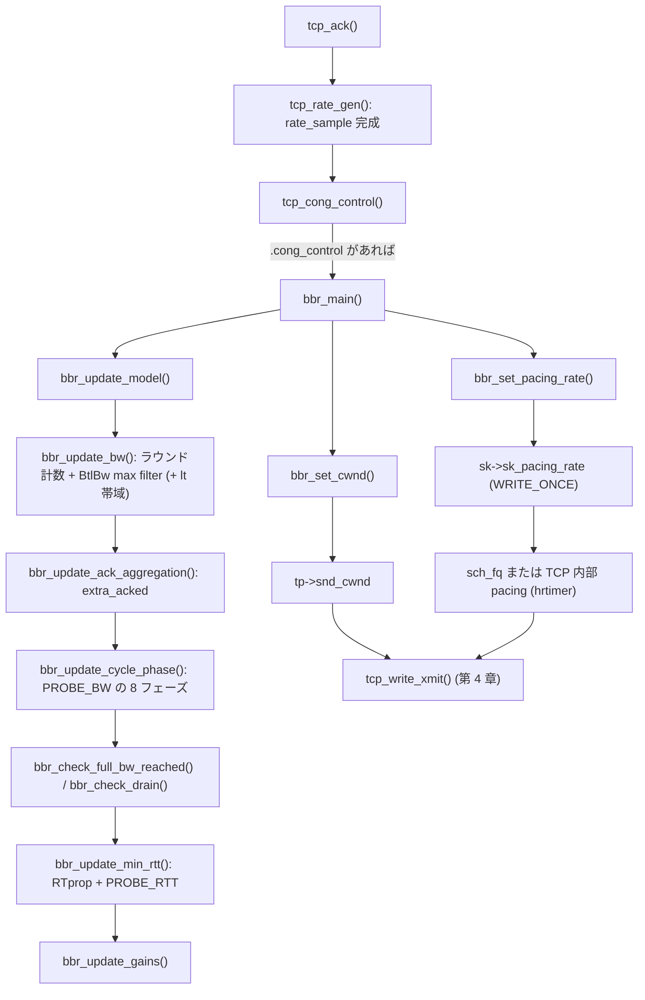

# 13. BBR

## たとえ話で言うと

これまでの Reno や CUBIC は、「道路（ネットワーク）が渋滞して小包が捨てられたら（ロス）、トラックの台数（cwnd）を減らす」という、事故が起きてから反省する運転手でした。道路わきの駐車場（ルータのバッファ）が大きいと、駐車場が満杯になるまでトラックを送り続けるので、小包はなかなか捨てられませんが、その代わりに配達にとても時間がかかるようになります（bufferbloat）。

BBR の運転手はやり方が違います。受領印（ACK）が戻ってくるたびに、

- 「最近、一番速く届いたときは 1 秒あたり何個届いたか」（道路の一番細いところの幅 = **BtlBw**）
- 「最近、一番早く往復できたときは何ミリ秒だったか」（渋滞なしの往復時間 = **RTprop**）

の 2 つを手帳にメモします。この 2 つを掛け算すると「道路にちょうど乗り切る小包の数」（**BDP**）が分かるので、それに合わせて「出発の間隔」（pacing rate）と「道路に出すトラックの台数」（cwnd）を決めます。

ただし、道路の幅を測るには少し多めに送ってみないと分からず、往復時間を測るには道路を空にしないと分からない、というジレンマがあります。そこで BBR は、ときどき 1.25 倍の速さで送ってみたり（帯域を探る）、10 秒に 1 回だけ少しの間トラックを 4 台に減らしたり（往復時間を測り直す）しながら、渋滞を作らずに道路を使い切ろうとします。

## RFC では

### 仕様の位置付け: BBR は RFC ではありません

BBR は IETF の標準（RFC）にはなっていません。参照すべき文書は次の 3 つです。

- **原論文**: N. Cardwell, Y. Cheng, C. S. Gunn, S. Hassas Yeganeh, V. Jacobson, "[BBR: Congestion-Based Congestion Control](https://queue.acm.org/detail.cfm?id=3022184)", ACM Queue, Vol. 14 No. 5, 2016。ロスではなく「ボトルネック帯域と往復伝搬遅延の 2 つを推定し、Kleinrock の最適動作点（帯域を使い切りつつキューを作らない点）を目指す」というモデルを提案した論文です。upstream の `tcp_bbr.c` のヘッダコメントが参照しているのはこの論文です。
- **IETF CCWG ドラフト**: [draft-ietf-ccwg-bbr-06](https://datatracker.ietf.org/doc/html/draft-ietf-ccwg-bbr-06)（Experimental 志向、2026 年 7 月版）。中身は **BBRv3** で、論文の v1 からロス・ECN への反応（`inflight_longterm` / `inflight_shortterm` など）、ProbeBW の 4 フェーズ化（DOWN / CRUISE / REFILL / UP）などが加わっています。
- **配信レート推定ドラフト**: [draft-cheng-iccrg-delivery-rate-estimation-02](https://datatracker.ietf.org/doc/html/draft-cheng-iccrg-delivery-rate-estimation-02)。ACK ごとに「この区間で何パケット届いたか / 何 µs かかったか」というレートサンプルを作るアルゴリズムで、BBR の入力そのものです。現在は BBR ドラフトの [§4.1](https://datatracker.ietf.org/doc/html/draft-ietf-ccwg-bbr-06#section-4.1) にも取り込まれています。Linux では第 7 章で扱う `tcp_rate_gen()`（[net/ipv4/tcp_input.c#L1724](https://git.kernel.org/pub/scm/linux/kernel/git/netdev/net-next.git/tree/net/ipv4/tcp_input.c?id=279d5c8afcd38bd841832a39bfe1aa4f8518d98e#n1724)）などが実装です（かつての `net/ipv4/tcp_rate.c` は現在のツリーには存在せず、`tcp_input.c` / `tcp_output.c` / `tcp.c` に分散しています）。

RFC 9293（TCP 本体）は輻輳制御アルゴリズムを規定しないので、この章には関係しません。

> [!IMPORTANT]
> upstream net-next の `net/ipv4/tcp_bbr.c` は **BBR v1** です。ファイルヘッダは ACM Queue 2016 論文だけを参照しており、実装も v1 の特徴（10 ラウンドの max filter、8 フェーズの pacing_gain サイクル、PROBE_RTT で cwnd = 4 パケット、long-term 帯域による policer 検出、ロス・ECN に対するモデル上の反応なし）をそのまま持っています。ドラフトの BBRv3 の機構（`inflight_longterm`、`BBR.Beta = 0.7`、ProbeBW_DOWN/CRUISE/REFILL/UP など）は upstream には入っていません。

### モデル: BtlBw, RTprop, BDP

BBR v1 のモデルはファイル先頭のコメントにそのまま書かれています。

```c
/* Bottleneck Bandwidth and RTT (BBR) congestion control
 *
 * BBR congestion control computes the sending rate based on the delivery
 * rate (throughput) estimated from ACKs. In a nutshell:
 *
 *   On each ACK, update our model of the network path:
 *      bottleneck_bandwidth = windowed_max(delivered / elapsed, 10 round trips)
 *      min_rtt = windowed_min(rtt, 10 seconds)
 *   pacing_rate = pacing_gain * bottleneck_bandwidth
 *   cwnd = max(cwnd_gain * bottleneck_bandwidth * min_rtt, 4)
 *
 * The core algorithm does not react directly to packet losses or delays,
 * although BBR may adjust the size of next send per ACK when loss is
 * observed, or adjust the sending rate if it estimates there is a
 * traffic policer, in order to keep the drop rate reasonable.
```

数式で書くと次の通りです。

- `delivery_rate = Δdelivered / Δt`（ACK ごとのレートサンプル。Δt は送信区間と ACK 区間の長い方。[delivery-rate-estimation §3.3](https://datatracker.ietf.org/doc/html/draft-cheng-iccrg-delivery-rate-estimation-02#section-3.3)）
- `BtlBw = max(delivery_rate)` を直近 **約 10 ラウンドトリップ** で取る（max filter）
- `RTprop = min(rtt)` を直近 **10 秒** で取る（min filter）
- `BDP = BtlBw × RTprop`
- `pacing_rate = pacing_gain × BtlBw`
- `cwnd = cwnd_gain × BDP`（Linux はさらに ACK 集約分と TSO 量子化分を足し、最低 4 パケット）

なぜ max と min なのかは論文の核心です。配信レートのサンプルはアプリ制限や ACK の遅れによって **小さく** 見えることはあっても、ボトルネック帯域より **大きく** 見えることは（ACK 圧縮を除けば）ありません。逆に RTT はキューイングや遅延 ACK で **大きく** 見えることはあっても、伝搬遅延より **小さく** 見えることはありません。だから「最大値」と「最小値」をそれぞれ取れば、真の値に近づきます。

さらに、帯域を測るにはパイプを満たす（キューが少しできる）必要があり、RTprop を測るにはパイプを空にする必要があります。この 2 つは同時には測れない（論文でいう不確定性）ので、BBR は時間を分けて交互に測ります。これがステートマシンの存在理由です。

### ステートマシン

コードのコメントにある状態遷移図です。

```c
 * Here is a state transition diagram for BBR:
 *
 *             |
 *             V
 *    +---> STARTUP  ----+
 *    |        |         |
 *    |        V         |
 *    |      DRAIN   ----+
 *    |        |         |
 *    |        V         |
 *    +---> PROBE_BW ----+
 *    |      ^    |      |
 *    |      |    |      |
 *    |      +----+      |
 *    |                  |
 *    +---- PROBE_RTT <--+
 *
 * A BBR flow starts in STARTUP, and ramps up its sending rate quickly.
 * When it estimates the pipe is full, it enters DRAIN to drain the queue.
 * In steady state a BBR flow only uses PROBE_BW and PROBE_RTT.
 * A long-lived BBR flow spends the vast majority of its time remaining
 * (repeatedly) in PROBE_BW, fully probing and utilizing the pipe's bandwidth
 * in a fair manner, with a small, bounded queue. *If* a flow has been
 * continuously sending for the entire min_rtt window, and hasn't seen an RTT
 * sample that matches or decreases its min_rtt estimate for 10 seconds, then
 * it briefly enters PROBE_RTT to cut inflight to a minimum value to re-probe
 * the path's two-way propagation delay (min_rtt). When exiting PROBE_RTT, if
 * we estimated that we reached the full bw of the pipe then we enter PROBE_BW;
 * otherwise we enter STARTUP to try to fill the pipe.
```

| 状態 | 目的 | v1 の pacing_gain | v1 の cwnd_gain | ドラフト (v3) の値 |
| --- | --- | --- | --- | --- |
| STARTUP | 指数的に帯域を探す | 2/ln2 ≈ 2.885 | 2.885 | pacing 4·ln2 ≈ 2.77, cwnd 2（[§5.3.1](https://datatracker.ietf.org/doc/html/draft-ietf-ccwg-bbr-06#section-5.3.1)） |
| DRAIN | STARTUP で作ったキューを抜く | 1/2.885 ≈ 0.35 | 2.885 | pacing 0.5, cwnd 2（[§5.3.2](https://datatracker.ietf.org/doc/html/draft-ietf-ccwg-bbr-06#section-5.3.2)） |
| PROBE_BW | 定常状態。帯域を共有しつつ探る | 1.25, 0.75, 1×6 の 8 フェーズ | 2 | DOWN 0.90 / CRUISE 1.0 / REFILL 1.0 / UP 1.25（[§5.3.3](https://datatracker.ietf.org/doc/html/draft-ietf-ccwg-bbr-06#section-5.3.3)） |
| PROBE_RTT | キューを抜いて RTprop を測り直す | 1 | 1（cwnd は 4 パケットに cap） | cwnd = 0.5 × BDP（[§5.3.4](https://datatracker.ietf.org/doc/html/draft-ietf-ccwg-bbr-06#section-5.3.4)） |

各状態の詳細なルール（v1 として Linux が実装しているもの）:

- **STARTUP → DRAIN**: アプリ制限でないラウンドが 3 回続けて、BtlBw が 1.25 倍以上伸びなかったら「パイプが満ちた」（`full_bw_reached`）と判断します。ドラフトでは [§5.3.1.2](https://datatracker.ietf.org/doc/html/draft-ietf-ccwg-bbr-06#section-5.3.1.2) の「bandwidth plateau」に当たります（v3 はこれに加えてロス率による Startup 終了もありますが、v1 にはありません）。
- **DRAIN → PROBE_BW**: 推定 in-flight が 1.0 × BDP 以下になったら移ります。
- **PROBE_BW**: 8 フェーズの gain サイクル `[5/4, 3/4, 1, 1, 1, 1, 1, 1]` を、各フェーズおよそ RTprop 1 つ分ずつ回します。1.25 で帯域を探り、直後の 0.75 で自分が作ったキューを抜き、残り 6 フェーズは 1.0 で巡航します。開始フェーズはランダム化されます（0.75 のフェーズからは始めません）。
- **PROBE_RTT**: RTprop の推定が 10 秒間更新されなかったら入り、cwnd を 4 パケットに絞って `max(200 ms, 1 ラウンド)` 保ちます。コストはおよそ 200 ms / 10 s = 2% です。ドラフト v3 では ProbeRTT の間隔を 5 秒、cwnd を 0.5 × BDP に変えています（[§5.3.4](https://datatracker.ietf.org/doc/html/draft-ietf-ccwg-bbr-06#section-5.3.4)）。
- **long-term 帯域（policer 検出）**: v1 固有の機構です。トークンバケット型の policer に当たると「速く送ると捨てられ、平均レートは一定」という現象が起きます。そこで、ロス率が約 20% 以上で配信レートがほぼ一定な区間が 2 回続いたら policer だと推定し、その平均レート `lt_bw` を 48 ラウンドの間 BtlBw の代わりに使います。ドラフト v3 では policer は付録 [A.17](https://datatracker.ietf.org/doc/html/draft-ietf-ccwg-bbr-06#appendix-A.17) のテストケースとして扱われ、`inflight_longterm` によるロス応答で対処する設計に変わっています。

### 配信レート推定（BBR の入力）

ドラフト [delivery-rate-estimation §3.2](https://datatracker.ietf.org/doc/html/draft-cheng-iccrg-delivery-rate-estimation-02#section-3.2) では、送信時に各パケットへ「その時点の `C.delivered` と `C.delivered_time`」をスナップショットし、[§3.3](https://datatracker.ietf.org/doc/html/draft-cheng-iccrg-delivery-rate-estimation-02#section-3.3) で ACK を受けたときに「最後に（S）ACK されたパケットのスナップショットからの差分」でレートを作ります。[§3.4](https://datatracker.ietf.org/doc/html/draft-cheng-iccrg-delivery-rate-estimation-02#section-3.4) では、アプリがデータを供給できずパイプに「泡」がある間に送ったパケットのサンプルを **app-limited** と印付けします。BBR はこれを使い、「app-limited なサンプルは BtlBw を押し下げてはいけない（ただし押し上げるのは良い）」というルールを実装します（ドラフト v3 の [§5.5.4](https://datatracker.ietf.org/doc/html/draft-ietf-ccwg-bbr-06#section-5.5.4)）。

Linux 側の対応は次の通りです（第 7 章で詳しく扱います）。

- 送信時: `tcp_rate_skb_sent()`（[net/ipv4/tcp_output.c#L1473](https://git.kernel.org/pub/scm/linux/kernel/git/netdev/net-next.git/tree/net/ipv4/tcp_output.c?id=279d5c8afcd38bd841832a39bfe1aa4f8518d98e#n1473)）
- (S)ACK 時: `tcp_rate_skb_delivered()`（[net/ipv4/tcp_input.c#L1808](https://git.kernel.org/pub/scm/linux/kernel/git/netdev/net-next.git/tree/net/ipv4/tcp_input.c?id=279d5c8afcd38bd841832a39bfe1aa4f8518d98e#n1808)）
- ACK 処理の最後: `tcp_rate_gen()`（[net/ipv4/tcp_input.c#L1724](https://git.kernel.org/pub/scm/linux/kernel/git/netdev/net-next.git/tree/net/ipv4/tcp_input.c?id=279d5c8afcd38bd841832a39bfe1aa4f8518d98e#n1724)）が `struct rate_sample` を完成させる
- app-limited の検出: `tcp_rate_check_app_limited()`（[net/ipv4/tcp.c#L1102](https://git.kernel.org/pub/scm/linux/kernel/git/netdev/net-next.git/tree/net/ipv4/tcp.c?id=279d5c8afcd38bd841832a39bfe1aa4f8518d98e#n1102)）

BBR が受け取る `struct rate_sample`（[include/net/tcp.h#L1336](https://git.kernel.org/pub/scm/linux/kernel/git/netdev/net-next.git/tree/include/net/tcp.h?id=279d5c8afcd38bd841832a39bfe1aa4f8518d98e#n1336)）は次の通りです。

```c
struct rate_sample {
	u64  prior_mstamp; /* starting timestamp for interval */
	u32  prior_delivered;	/* tp->delivered at "prior_mstamp" */
	u32  prior_delivered_ce;/* tp->delivered_ce at "prior_mstamp" */
	s32  delivered;		/* number of packets delivered over interval */
	s32  delivered_ce;	/* number of packets delivered w/ CE marks*/
	long interval_us;	/* time for tp->delivered to incr "delivered" */
	u32 snd_interval_us;	/* snd interval for delivered packets */
	u32 rcv_interval_us;	/* rcv interval for delivered packets */
	long rtt_us;		/* RTT of last (S)ACKed packet (or -1) */
	int  losses;		/* number of packets marked lost upon ACK */
	u32  acked_sacked;	/* number of packets newly (S)ACKed upon ACK */
	u32  prior_in_flight;	/* in flight before this ACK */
	u32  last_end_seq;	/* end_seq of most recently ACKed packet */
	bool is_app_limited;	/* is sample from packet with bubble in pipe? */
	bool is_retrans;	/* is sample from retransmission? */
	bool is_ack_delayed;	/* is this (likely) a delayed ACK? */
};
```

BBR が使うのは `prior_delivered`（ラウンド判定）、`delivered` と `interval_us`（帯域サンプル）、`rtt_us` と `is_ack_delayed`（min_rtt）、`is_app_limited`、`acked_sacked`（cwnd 増加量と ACK 集約）、`losses`（回復時の cwnd 削減・lt 帯域）、`prior_in_flight`（gain サイクル）です。`tcp_rate_gen()` は、タイミング情報がない、SACK reneging 中、`interval_us < min_rtt` のようなサンプルでは `delivered` または `interval_us` を `-1` にして「無効」を表します。BBR 側はこれを `rs->delivered < 0 || rs->interval_us <= 0` で弾きます。

## 全体の流れ



BBR の仕事は「ACK のたびにモデルを更新し、2 つの出力（`sk_pacing_rate` と `snd_cwnd`）を決める」ことに尽きます。Reno / CUBIC が `.cong_avoid` で cwnd だけを増やし、ロス時の減少は TCP 本体（PRR、第 8 章）に任せるのに対し、BBR は `.cong_control` を実装することで、cwnd の増減と pacing rate の決定を **すべて自分で** 行います。実際の送信タイミングは pacing 層（`sch_fq` か TCP 内部 pacing）が `sk_pacing_rate` に従って決め、`tcp_write_xmit()` は cwnd と pacing の両方の制約を受けます（第 4 章）。

## コードを追う

### Step 1: 状態とパラメータ（`struct bbr` と定数）

モードは 4 つです。`enum bbr_mode`（[net/ipv4/tcp_bbr.c#L82](https://git.kernel.org/pub/scm/linux/kernel/git/netdev/net-next.git/tree/net/ipv4/tcp_bbr.c?id=279d5c8afcd38bd841832a39bfe1aa4f8518d98e#n82)）:

```c
/* BBR has the following modes for deciding how fast to send: */
enum bbr_mode {
	BBR_STARTUP,	/* ramp up sending rate rapidly to fill pipe */
	BBR_DRAIN,	/* drain any queue created during startup */
	BBR_PROBE_BW,	/* discover, share bw: pace around estimated bw */
	BBR_PROBE_RTT,	/* cut inflight to min to probe min_rtt */
};
```

`struct bbr`（[net/ipv4/tcp_bbr.c#L90](https://git.kernel.org/pub/scm/linux/kernel/git/netdev/net-next.git/tree/net/ipv4/tcp_bbr.c?id=279d5c8afcd38bd841832a39bfe1aa4f8518d98e#n90)）は `inet_csk_ca(sk)`、つまり `inet_connection_sock` の中の `icsk_ca_priv[]`（104 バイト）に置かれます。別途メモリを確保しないので、ビットフィールドで詰め込まれています。

```c
/* BBR congestion control block */
struct bbr {
	u32	min_rtt_us;	        /* min RTT in min_rtt_win_sec window */
	u32	min_rtt_stamp;	        /* timestamp of min_rtt_us */
	u32	probe_rtt_done_stamp;   /* end time for BBR_PROBE_RTT mode */
	struct minmax bw;	/* Max recent delivery rate in pkts/uS << 24 */
	u32	rtt_cnt;	    /* count of packet-timed rounds elapsed */
	u32     next_rtt_delivered; /* scb->tx.delivered at end of round */
	u64	cycle_mstamp;	     /* time of this cycle phase start */
	u32     mode:3,		     /* current bbr_mode in state machine */
		prev_ca_state:3,     /* CA state on previous ACK */
		packet_conservation:1,  /* use packet conservation? */
		round_start:1,	     /* start of packet-timed tx->ack round? */
		idle_restart:1,	     /* restarting after idle? */
		probe_rtt_round_done:1,  /* a BBR_PROBE_RTT round at 4 pkts? */
		unused:13,
		lt_is_sampling:1,    /* taking long-term ("LT") samples now? */
		lt_rtt_cnt:7,	     /* round trips in long-term interval */
		lt_use_bw:1;	     /* use lt_bw as our bw estimate? */
	u32	lt_bw;		     /* LT est delivery rate in pkts/uS << 24 */
	u32	lt_last_delivered;   /* LT intvl start: tp->delivered */
	u32	lt_last_stamp;	     /* LT intvl start: tp->delivered_mstamp */
	u32	lt_last_lost;	     /* LT intvl start: tp->lost */
	u32	pacing_gain:10,	/* current gain for setting pacing rate */
		cwnd_gain:10,	/* current gain for setting cwnd */
		full_bw_reached:1,   /* reached full bw in Startup? */
		full_bw_cnt:2,	/* number of rounds without large bw gains */
		cycle_idx:3,	/* current index in pacing_gain cycle array */
		has_seen_rtt:1, /* have we seen an RTT sample yet? */
		unused_b:5;
	u32	prior_cwnd;	/* prior cwnd upon entering loss recovery */
	u32	full_bw;	/* recent bw, to estimate if pipe is full */

	/* For tracking ACK aggregation: */
	u64	ack_epoch_mstamp;	/* start of ACK sampling epoch */
	u16	extra_acked[2];		/* max excess data ACKed in epoch */
	u32	ack_epoch_acked:20,	/* packets (S)ACKed in sampling epoch */
		extra_acked_win_rtts:5,	/* age of extra_acked, in round trips */
		extra_acked_win_idx:1,	/* current index in extra_acked array */
		unused_c:6;
};
```

フィールドごとの意味と不変条件です。

- `min_rtt_us` / `min_rtt_stamp`: RTprop の min filter です。v1 は「最小値 1 つとそのタイムスタンプ」だけを持つ単純な filter で、`win_minmax` は使いません。`min_rtt_stamp` は `tcp_jiffies32`（jiffies 単位）です。10 秒の窓には jiffies の精度で十分だからです。初期値は `tcp_min_rtt(tp)` で、サンプルがまだなければ `~0U` になります（後述の `bbr_bdp()` がこれを特別扱いします）。
- `probe_rtt_done_stamp`: PROBE_RTT を抜けてよい時刻（jiffies）です。0 は「まだ in-flight が 4 以下になっていない（タイマー未開始）」を意味します。
- `bw`: BtlBw の max filter（`struct minmax`、3 サンプル）です。単位は「パケット / µs を 2^24 倍したもの」です。
- `rtt_cnt` / `next_rtt_delivered`: **パケット時間で数えたラウンド** です。「`tp->delivered` が `next_rtt_delivered` に達した ACK でラウンドが 1 つ進む」という、時間ではなく配達数で測るラウンドです。
- `cycle_mstamp`: PROBE_BW の現フェーズの開始時刻（`delivered_mstamp`、µs）です。
- `mode:3`、`prev_ca_state:3`（`TCP_CA_Loss` = 4 まで入ります）、`packet_conservation:1`、`round_start:1`（この ACK でラウンドが進んだか）、`idle_restart:1`、`probe_rtt_round_done:1`。
- `lt_*`: long-term（policer）推定用です。`lt_rtt_cnt:7` は最大 127 で、使う上限（48 や 16）に足ります。`lt_last_stamp` は **ms 単位** の u32 です（µs の `delivered_mstamp` を 1000 で割って保存）。
- `pacing_gain:10` / `cwnd_gain:10`: `BBR_UNIT`（256）を 1.0 とする固定小数点で、最大 1023（約 4.0）まで入ります。最大値の `bbr_high_gain` = 739 が収まるように 10 ビットです。
- `full_bw_reached:1`、`full_bw_cnt:2`（3 まで数えられれば足ります）、`cycle_idx:3`（`CYCLE_LEN` = 8）、`has_seen_rtt:1`。
- `prior_cwnd`: ロス回復や PROBE_RTT で cwnd を一時的に絞る前の「良かった cwnd」です。
- `ack_epoch_mstamp` / `ack_epoch_acked:20` / `extra_acked[2]` / `extra_acked_win_rtts:5` / `extra_acked_win_idx:1`: ACK 集約の推定用です。`extra_acked[2]` は 2 スロットの「近似スライディング max」です。

手計算すると、`u64` 2 つのアラインメントを含めてちょうど 104 バイトになり、`icsk_ca_priv` を使い切っています。`bbr_register()` の `BUILD_BUG_ON(sizeof(struct bbr) > ICSK_CA_PRIV_SIZE)` がこれを保証しています。フィールドを 1 つ足すだけでビルドが壊れうる、という制約があることを覚えておくと良いです。

固定小数点のスケールと定数です。

```c
/* Scale factor for rate in pkt/uSec unit to avoid truncation in bandwidth
 * estimation. The rate unit ~= (1500 bytes / 1 usec / 2^24) ~= 715 bps.
 * This handles bandwidths from 0.06pps (715bps) to 256Mpps (3Tbps) in a u32.
 * Since the minimum window is >=4 packets, the lower bound isn't
 * an issue. The upper bound isn't an issue with existing technologies.
 */
#define BW_SCALE 24
#define BW_UNIT (1 << BW_SCALE)

#define BBR_SCALE 8	/* scaling factor for fractions in BBR (e.g. gains) */
#define BBR_UNIT (1 << BBR_SCALE)
```

`BW_SCALE` = 24 は、パケット / µs という「1 よりずっと小さい」値を u32 で切り捨てなく扱うためのスケールです。1 単位はおよそ 715 bps で、上限は u32 で約 3 Tbps です。`BBR_SCALE` = 8 は gain 用で、1.0 = 256 です。

```c
#define CYCLE_LEN	8	/* number of phases in a pacing gain cycle */

/* Window length of bw filter (in rounds): */
static const int bbr_bw_rtts = CYCLE_LEN + 2;
/* Window length of min_rtt filter (in sec): */
static const u32 bbr_min_rtt_win_sec = 10;
/* Minimum time (in ms) spent at bbr_cwnd_min_target in BBR_PROBE_RTT mode: */
static const u32 bbr_probe_rtt_mode_ms = 200;
/* Skip TSO below the following bandwidth (bits/sec): */
static const int bbr_min_tso_rate = 1200000;

/* Pace at ~1% below estimated bw, on average, to reduce queue at bottleneck.
 * In order to help drive the network toward lower queues and low latency while
 * maintaining high utilization, the average pacing rate aims to be slightly
 * lower than the estimated bandwidth. This is an important aspect of the
 * design.
 */
static const int bbr_pacing_margin_percent = 1;

/* We use a high_gain value of 2/ln(2) because it's the smallest pacing gain
 * that will allow a smoothly increasing pacing rate that will double each RTT
 * and send the same number of packets per RTT that an un-paced, slow-starting
 * Reno or CUBIC flow would:
 */
static const int bbr_high_gain  = BBR_UNIT * 2885 / 1000 + 1;
/* The pacing gain of 1/high_gain in BBR_DRAIN is calculated to typically drain
 * the queue created in BBR_STARTUP in a single round:
 */
static const int bbr_drain_gain = BBR_UNIT * 1000 / 2885;
/* The gain for deriving steady-state cwnd tolerates delayed/stretched ACKs: */
static const int bbr_cwnd_gain  = BBR_UNIT * 2;
/* The pacing_gain values for the PROBE_BW gain cycle, to discover/share bw: */
static const int bbr_pacing_gain[] = {
	BBR_UNIT * 5 / 4,	/* probe for more available bw */
	BBR_UNIT * 3 / 4,	/* drain queue and/or yield bw to other flows */
	BBR_UNIT, BBR_UNIT, BBR_UNIT,	/* cruise at 1.0*bw to utilize pipe, */
	BBR_UNIT, BBR_UNIT, BBR_UNIT	/* without creating excess queue... */
};
/* Randomize the starting gain cycling phase over N phases: */
static const u32 bbr_cycle_rand = 7;
```

- `bbr_bw_rtts = CYCLE_LEN + 2 = 10`: BtlBw の窓は 10 ラウンドです。gain サイクル 1 周（8 フェーズ ≈ 8 RTprop）より少し長くすることで、窓の中に必ず 1.25 倍で探ったフェーズのサンプルが含まれるようにしています。窓がサイクルより短いと、1.0 / 0.75 のフェーズのサンプルだけが残って BtlBw が徐々に下がってしまいます。
- `bbr_min_rtt_win_sec = 10`、`bbr_probe_rtt_mode_ms = 200`: PROBE_RTT のコストを 2% 程度に抑える組み合わせです。
- `bbr_min_tso_rate = 1200000`（bit/s）: これより遅いときは TSO を 1 セグメントにします（`bbr_min_tso_segs()`）。
- `bbr_pacing_margin_percent = 1`: pacing rate を推定帯域より 1% だけ遅くし、ボトルネックにキューが溜まりにくくします。コメントにある通り「設計上重要」な点です。
- `bbr_high_gain = 256 * 2885 / 1000 + 1 = 739`（≈ 2.887）。2/ln2 ≈ 2.885 を固定小数点で表し、切り捨てで 2/ln2 を下回らないように +1 しています。コメントの説明は「pacing rate を滑らかに増やしながら毎 RTT 2 倍にでき、ペーシングなしの slow start と同じパケット数を 1 RTT に送れる最小の gain」です。
- `bbr_drain_gain = 256 * 1000 / 2885 = 88`（≈ 0.344）。STARTUP で作ったキューを 1 ラウンドで抜くための逆数です。
- `bbr_cwnd_gain = 512`（2.0）: 遅延 ACK や stretch ACK があっても cwnd に縛られないための余裕です。
- `bbr_pacing_gain[]` = {320, 192, 256 × 6}。
- `bbr_cycle_rand = 7`: 開始フェーズを 7 通りからランダムに選びます（Step 8）。

```c
/* Try to keep at least this many packets in flight, if things go smoothly. For
 * smooth functioning, a sliding window protocol ACKing every other packet
 * needs at least 4 packets in flight:
 */
static const u32 bbr_cwnd_min_target = 4;

/* To estimate if BBR_STARTUP mode (i.e. high_gain) has filled pipe... */
/* If bw has increased significantly (1.25x), there may be more bw available: */
static const u32 bbr_full_bw_thresh = BBR_UNIT * 5 / 4;
/* But after 3 rounds w/o significant bw growth, estimate pipe is full: */
static const u32 bbr_full_bw_cnt = 3;

/* "long-term" ("LT") bandwidth estimator parameters... */
/* The minimum number of rounds in an LT bw sampling interval: */
static const u32 bbr_lt_intvl_min_rtts = 4;
/* If lost/delivered ratio > 20%, interval is "lossy" and we may be policed: */
static const u32 bbr_lt_loss_thresh = 50;
/* If 2 intervals have a bw ratio <= 1/8, their bw is "consistent": */
static const u32 bbr_lt_bw_ratio = BBR_UNIT / 8;
/* If 2 intervals have a bw diff <= 4 Kbit/sec their bw is "consistent": */
static const u32 bbr_lt_bw_diff = 4000 / 8;
/* If we estimate we're policed, use lt_bw for this many round trips: */
static const u32 bbr_lt_bw_max_rtts = 48;

/* Gain factor for adding extra_acked to target cwnd: */
static const int bbr_extra_acked_gain = BBR_UNIT;
/* Window length of extra_acked window. */
static const u32 bbr_extra_acked_win_rtts = 5;
/* Max allowed val for ack_epoch_acked, after which sampling epoch is reset */
static const u32 bbr_ack_epoch_acked_reset_thresh = 1U << 20;
/* Time period for clamping cwnd increment due to ack aggregation */
static const u32 bbr_extra_acked_max_us = 100 * 1000;
```

- `bbr_cwnd_min_target = 4`: 1 つおきに ACK する受信側でもパイプを途切れさせない最小値で、PROBE_RTT の cwnd でもあります。
- `bbr_full_bw_thresh = 320`（1.25）と `bbr_full_bw_cnt = 3`: STARTUP 終了判定に使います。
- LT 用: 区間は最短 4 ラウンド、ロス率しきい値 `50/256 ≈ 19.5%`（コメントでは「20%」）、2 区間の帯域差が 1/8 以下または 4 kbit/s（= 500 バイト/秒）以下なら「一定」とみなし、`lt_bw` を 48 ラウンド使います。
- ACK 集約用: gain 1.0、窓 5 ラウンド（2 スロットで 5〜10 ラウンドを近似）、`ack_epoch_acked` のリセットしきい値 2^20（20 ビットのフィールドに収めるため）、上限 100 ms 分の帯域です。

小さなアクセサ群です。

```c
/* Do we estimate that STARTUP filled the pipe? */
static bool bbr_full_bw_reached(const struct sock *sk)
{
	const struct bbr *bbr = inet_csk_ca(sk);

	return bbr->full_bw_reached;
}

/* Return the windowed max recent bandwidth sample, in pkts/uS << BW_SCALE. */
static u32 bbr_max_bw(const struct sock *sk)
{
	struct bbr *bbr = inet_csk_ca(sk);

	return minmax_get(&bbr->bw);
}

/* Return the estimated bandwidth of the path, in pkts/uS << BW_SCALE. */
static u32 bbr_bw(const struct sock *sk)
{
	struct bbr *bbr = inet_csk_ca(sk);

	return bbr->lt_use_bw ? bbr->lt_bw : bbr_max_bw(sk);
}

/* Return maximum extra acked in past k-2k round trips,
 * where k = bbr_extra_acked_win_rtts.
 */
static u16 bbr_extra_acked(const struct sock *sk)
{
	struct bbr *bbr = inet_csk_ca(sk);

	return max(bbr->extra_acked[0], bbr->extra_acked[1]);
}
```

`bbr_bw()`（[net/ipv4/tcp_bbr.c#L224](https://git.kernel.org/pub/scm/linux/kernel/git/netdev/net-next.git/tree/net/ipv4/tcp_bbr.c?id=279d5c8afcd38bd841832a39bfe1aa4f8518d98e#n224)）が「制御に使う帯域」です。policer と推定している間（`lt_use_bw`）は `lt_bw` を、それ以外は max filter の値を返します。`bbr_max_bw()`（[net/ipv4/tcp_bbr.c#L216](https://git.kernel.org/pub/scm/linux/kernel/git/netdev/net-next.git/tree/net/ipv4/tcp_bbr.c?id=279d5c8afcd38bd841832a39bfe1aa4f8518d98e#n216)）は常に max filter の値です。この 2 つは使い分けられているので、Step 6〜8 ではどちらが使われているかに注意してください。

### Step 2: 登録と呼び出され方（`.cong_control`）

`tcp_bbr_cong_ops`（[net/ipv4/tcp_bbr.c#L1151](https://git.kernel.org/pub/scm/linux/kernel/git/netdev/net-next.git/tree/net/ipv4/tcp_bbr.c?id=279d5c8afcd38bd841832a39bfe1aa4f8518d98e#n1151)）:

```c
static struct tcp_congestion_ops tcp_bbr_cong_ops __read_mostly = {
	.flags		= TCP_CONG_NON_RESTRICTED,
	.name		= "bbr",
	.owner		= THIS_MODULE,
	.init		= bbr_init,
	.cong_control	= bbr_main,
	.sndbuf_expand	= bbr_sndbuf_expand,
	.undo_cwnd	= bbr_undo_cwnd,
	.cwnd_event_tx_start	= bbr_cwnd_event_tx_start,
	.ssthresh	= bbr_ssthresh,
	.tso_segs	= bbr_tso_segs,
	.get_info	= bbr_get_info,
	.set_state	= bbr_set_state,
};
```

- `.cong_avoid` がなく `.cong_control` があることが最大の特徴です。`struct tcp_congestion_ops`（[include/net/tcp.h#L1355](https://git.kernel.org/pub/scm/linux/kernel/git/netdev/net-next.git/tree/include/net/tcp.h?id=279d5c8afcd38bd841832a39bfe1aa4f8518d98e#n1355)）は「どちらか一方を必ず提供する」ことを求めています。
- `.ssthresh` / `.undo_cwnd` は TCP 本体のロス回復機構から呼ばれますが、BBR は「ssthresh を下げない」「cwnd を保存・復元する」ための差し込み口として使います（Step 14）。
- `.cwnd_event_tx_start` はアイドルからの再開時だけに呼ばれる専用フックです（Step 10）。
- `.tso_segs` は TSO のバーストサイズを BBR が決めるためのフックです（Step 12）。
- `.flags = TCP_CONG_NON_RESTRICTED` なので、`net.ipv4.tcp_allowed_congestion_control` に入っていなくても非特権ユーザが `setsockopt(TCP_CONGESTION, "bbr")` で選べます。

呼び出し側の `tcp_cong_control()`（[net/ipv4/tcp_input.c#L3858](https://git.kernel.org/pub/scm/linux/kernel/git/netdev/net-next.git/tree/net/ipv4/tcp_input.c?id=279d5c8afcd38bd841832a39bfe1aa4f8518d98e#n3858)）です（第 11 章で詳しく扱います）。

```c
static void tcp_cong_control(struct sock *sk, u32 ack, u32 acked_sacked,
			     int flag, const struct rate_sample *rs)
{
	const struct inet_connection_sock *icsk = inet_csk(sk);

	if (icsk->icsk_ca_ops->cong_control) {
		icsk->icsk_ca_ops->cong_control(sk, ack, flag, rs);
		return;
	}

	if (tcp_in_cwnd_reduction(sk)) {
		/* Reduce cwnd if state mandates */
		tcp_cwnd_reduction(sk, acked_sacked, rs->losses, flag);
	} else if (tcp_may_raise_cwnd(sk, flag)) {
		/* Advance cwnd if state allows */
		tcp_cong_avoid(sk, ack, acked_sacked);
	}
	tcp_update_pacing_rate(sk);
}
```

`.cong_control` があると、PRR による cwnd 削減（`tcp_cwnd_reduction()`）も `tcp_cong_avoid()` も、`tcp_update_pacing_rate()`（[net/ipv4/tcp_input.c#L1138](https://git.kernel.org/pub/scm/linux/kernel/git/netdev/net-next.git/tree/net/ipv4/tcp_input.c?id=279d5c8afcd38bd841832a39bfe1aa4f8518d98e#n1138)）による「cwnd / srtt × 200% or 120%」のペーシングも **すべて飛ばされます**。`tcp_end_cwnd_reduction()`（[net/ipv4/tcp_input.c#L3013](https://git.kernel.org/pub/scm/linux/kernel/git/netdev/net-next.git/tree/net/ipv4/tcp_input.c?id=279d5c8afcd38bd841832a39bfe1aa4f8518d98e#n3013)）も同様で、回復終了時に cwnd を ssthresh に戻す処理をしません。

```c
static inline void tcp_end_cwnd_reduction(struct sock *sk)
{
	struct tcp_sock *tp = tcp_sk(sk);

	if (inet_csk(sk)->icsk_ca_ops->cong_control)
```

`tcp_ack()`（[net/ipv4/tcp_input.c#L4276](https://git.kernel.org/pub/scm/linux/kernel/git/netdev/net-next.git/tree/net/ipv4/tcp_input.c?id=279d5c8afcd38bd841832a39bfe1aa4f8518d98e#n4276)）の最後では、レートサンプルの生成直後に `tcp_cong_control()` が呼ばれます。

```c
	lost = tp->lost - lost;			/* freshly marked lost */
	rs.is_ack_delayed = !!(flag & FLAG_ACK_MAYBE_DELAYED);
	tcp_rate_gen(sk, delivered, lost, is_sack_reneg, sack_state.rate);
	tcp_cong_control(sk, ack, delivered, flag, sack_state.rate);
```

`rs.is_ack_delayed` は `FLAG_ACK_MAYBE_DELAYED` から作られ、BBR の min_rtt filter が遅延 ACK の RTT を無視するために使います（Step 10）。

モジュール登録です。

```c
static int __init bbr_register(void)
{
	int ret;

	BUILD_BUG_ON(sizeof(struct bbr) > ICSK_CA_PRIV_SIZE);

	ret = register_btf_kfunc_id_set(BPF_PROG_TYPE_STRUCT_OPS, &tcp_bbr_kfunc_set);
	if (ret < 0)
		return ret;
	return tcp_register_congestion_control(&tcp_bbr_cong_ops);
}
```

BBR の各関数は `__bpf_kfunc` として BTF に登録されています（1166〜1180 行）。BPF struct_ops で書いた輻輳制御から `bbr_main()` などを呼び出せるようにするためです（selftest の `tools/testing/selftests/bpf/progs/tcp_ca_kfunc.c` が使っています）。

### Step 3: `bbr_init()` と初期 pacing rate

`bbr_init()`（[net/ipv4/tcp_bbr.c#L1047](https://git.kernel.org/pub/scm/linux/kernel/git/netdev/net-next.git/tree/net/ipv4/tcp_bbr.c?id=279d5c8afcd38bd841832a39bfe1aa4f8518d98e#n1047)）は `tcp_init_congestion_control()`（[net/ipv4/tcp_cong.c#L236](https://git.kernel.org/pub/scm/linux/kernel/git/netdev/net-next.git/tree/net/ipv4/tcp_cong.c?id=279d5c8afcd38bd841832a39bfe1aa4f8518d98e#n236)）から、接続が ESTABLISHED になったとき、または `setsockopt(TCP_CONGESTION)` で途中から切り替えたときに、ソケットロックを持った状態で呼ばれます。

```c
__bpf_kfunc static void bbr_init(struct sock *sk)
{
	struct tcp_sock *tp = tcp_sk(sk);
	struct bbr *bbr = inet_csk_ca(sk);

	bbr->prior_cwnd = 0;
	WRITE_ONCE(tp->snd_ssthresh, TCP_INFINITE_SSTHRESH);
	bbr->rtt_cnt = 0;
	bbr->next_rtt_delivered = tp->delivered;
	bbr->prev_ca_state = TCP_CA_Open;
	bbr->packet_conservation = 0;

	bbr->probe_rtt_done_stamp = 0;
	bbr->probe_rtt_round_done = 0;
	bbr->min_rtt_us = tcp_min_rtt(tp);
	bbr->min_rtt_stamp = tcp_jiffies32;

	minmax_reset(&bbr->bw, bbr->rtt_cnt, 0);  /* init max bw to 0 */

	bbr->has_seen_rtt = 0;
	bbr_init_pacing_rate_from_rtt(sk);

	bbr->round_start = 0;
	bbr->idle_restart = 0;
	bbr->full_bw_reached = 0;
	bbr->full_bw = 0;
	bbr->full_bw_cnt = 0;
	bbr->cycle_mstamp = 0;
	bbr->cycle_idx = 0;
	bbr_reset_lt_bw_sampling(sk);
	bbr_reset_startup_mode(sk);

	bbr->ack_epoch_mstamp = tp->tcp_mstamp;
	bbr->ack_epoch_acked = 0;
	bbr->extra_acked_win_rtts = 0;
	bbr->extra_acked_win_idx = 0;
	bbr->extra_acked[0] = 0;
	bbr->extra_acked[1] = 0;

	cmpxchg(&sk->sk_pacing_status, SK_PACING_NONE, SK_PACING_NEEDED);
}
```

- `snd_ssthresh = TCP_INFINITE_SSTHRESH`: BBR は ssthresh を使いませんが、TCP 本体の `tcp_in_slow_start()` などの判定や `tcp_info` 表示に影響するので「無限」にしておきます。`WRITE_ONCE()` なのは、`tcp_get_timestamping_opt_stats()` などがロックなしで読むためです。
- `next_rtt_delivered = tp->delivered`: ラウンド境界を「今」に合わせます。昔は 0 で初期化しており、`tp->delivered` が 2^31〜2^32 の範囲にあるときに `before()` の比較が逆転して、ラウンドが 20 億パケット先まで進まない、というバグがありました（6de035fec045、「設計の背景と歴史」を参照）。途中で BBR に切り替えるソケットで起きる問題です。
- `min_rtt_us = tcp_min_rtt(tp)`: TCP 本体が持っている min RTT（`tp->rtt_min`、第 7 章）を引き継ぎます。SYN/SYN-ACK の RTT があればそれが入り、なければ `~0U` です。
- `minmax_reset(&bbr->bw, bbr->rtt_cnt, 0)`: BtlBw を 0 で初期化します。
- `bbr_init_pacing_rate_from_rtt()`: pacing rate の初期値を決めます（下記）。
- `cycle_mstamp = 0`、`bbr_reset_lt_bw_sampling()`、`bbr_reset_startup_mode()`: STARTUP から始めます。
- `cmpxchg(&sk->sk_pacing_status, SK_PACING_NONE, SK_PACING_NEEDED)`: **pacing が必須** であることを宣言します。`SK_PACING_NONE` のときだけ `NEEDED` に変えます。すでに `sch_fq` が `SK_PACING_FQ` にしていた場合は、そのまま残します（無条件に書くと FQ による pacing を TCP 内部 pacing に格下げしてしまいます）。この値の意味は Step 12 で説明します。

`bbr_init_pacing_rate_from_rtt()`（[net/ipv4/tcp_bbr.c#L267](https://git.kernel.org/pub/scm/linux/kernel/git/netdev/net-next.git/tree/net/ipv4/tcp_bbr.c?id=279d5c8afcd38bd841832a39bfe1aa4f8518d98e#n267)）:

```c
/* Initialize pacing rate to: high_gain * init_cwnd / RTT. */
static void bbr_init_pacing_rate_from_rtt(struct sock *sk)
{
	struct tcp_sock *tp = tcp_sk(sk);
	struct bbr *bbr = inet_csk_ca(sk);
	u64 bw;
	u32 rtt_us;

	if (tp->srtt_us) {		/* any RTT sample yet? */
		rtt_us = max(tp->srtt_us >> 3, 1U);
		bbr->has_seen_rtt = 1;
	} else {			 /* no RTT sample yet */
		rtt_us = USEC_PER_MSEC;	 /* use nominal default RTT */
	}
	bw = (u64)tcp_snd_cwnd(tp) * BW_UNIT;
	do_div(bw, rtt_us);
	WRITE_ONCE(sk->sk_pacing_rate,
		   bbr_bw_to_pacing_rate(sk, bw, bbr_high_gain));
}
```

- RTT のサンプルがあれば `srtt_us >> 3`（`srtt_us` は 8 倍で保持されています）、なければ 1 ms を仮定します。LAN を想定した楽観的な値です。
- `bw = cwnd * BW_UNIT / rtt_us` は「初期 cwnd を 1 RTT で送るレート」で、それに `bbr_high_gain` を掛けた値が初期 pacing rate になります。STARTUP の最初から 2.885 倍で始めるということです。
- `has_seen_rtt` は「本物の RTT に基づいて初期化したか」を示します。1 ms の仮定で初期化した場合、最初の RTT サンプルが得られた時点で `bbr_set_pacing_rate()` がこの関数を呼び直します（32984565574d）。そうしないと、アプリ制限の小さな書き込みしかしない接続が、パイプを満たすことなく 1 ms 仮定の高すぎる pacing rate のまま残ってしまいます。

### Step 4: `bbr_main()` と `bbr_update_model()`

ACK ごとの入口 `bbr_main()`（[net/ipv4/tcp_bbr.c#L1035](https://git.kernel.org/pub/scm/linux/kernel/git/netdev/net-next.git/tree/net/ipv4/tcp_bbr.c?id=279d5c8afcd38bd841832a39bfe1aa4f8518d98e#n1035)）と、モデル更新の順序を決める `bbr_update_model()`（[net/ipv4/tcp_bbr.c#L1024](https://git.kernel.org/pub/scm/linux/kernel/git/netdev/net-next.git/tree/net/ipv4/tcp_bbr.c?id=279d5c8afcd38bd841832a39bfe1aa4f8518d98e#n1024)）です。

```c
static void bbr_update_model(struct sock *sk, const struct rate_sample *rs)
{
	bbr_update_bw(sk, rs);
	bbr_update_ack_aggregation(sk, rs);
	bbr_update_cycle_phase(sk, rs);
	bbr_check_full_bw_reached(sk, rs);
	bbr_check_drain(sk, rs);
	bbr_update_min_rtt(sk, rs);
	bbr_update_gains(sk);
}

__bpf_kfunc static void bbr_main(struct sock *sk, u32 ack, int flag, const struct rate_sample *rs)
{
	struct bbr *bbr = inet_csk_ca(sk);
	u32 bw;

	bbr_update_model(sk, rs);

	bw = bbr_bw(sk);
	bbr_set_pacing_rate(sk, bw, bbr->pacing_gain);
	bbr_set_cwnd(sk, rs, rs->acked_sacked, bw, bbr->cwnd_gain);
}
```

BBR の全体はこの 20 行に集約されています。

1. `bbr_update_bw()`: ラウンドを数え（`round_start` を立て）、LT 帯域のサンプリングを行い、BtlBw の max filter を更新します。**`round_start` はここでしか立たない** ので、後続の関数はすべてこの結果に依存します。順序を入れ替えてはいけません。
2. `bbr_update_ack_aggregation()`: 新しい BtlBw を使って extra_acked を更新します。
3. `bbr_update_cycle_phase()`: PROBE_BW のフェーズを進めます。
4. `bbr_check_full_bw_reached()`: STARTUP でパイプが満ちたかを判定します（`round_start` のときだけ）。
5. `bbr_check_drain()`: STARTUP → DRAIN → PROBE_BW の遷移を行います。
6. `bbr_update_min_rtt()`: RTprop を更新し、PROBE_RTT への出入りを判定します。PROBE_RTT は他のどのモードからも割り込めるので、最後の方で判定します。
7. `bbr_update_gains()`: 最終的なモードから `pacing_gain` / `cwnd_gain` を決めます。モード遷移を行う関数（`bbr_check_drain()`、`bbr_update_min_rtt()`、`bbr_lt_bw_interval_done()` など）は gain を直接いじらず、ここで一括して決めます（cf33e25c0dcf）。

その後、`bbr_bw()`（policer 推定中なら `lt_bw`）と gain を使って pacing rate と cwnd を設定します。cwnd 計算に `rs->acked_sacked`（この ACK で新たに (S)ACK されたパケット数）を渡している点にも注意してください。`tcp_cong_control()` の `acked_sacked` 引数は `.cong_control` には渡されず、`rs` 経由で同じ値を受け取ります。

### Step 5: `bbr_update_bw()` — ラウンド計数と BtlBw の max filter

`bbr_update_bw()`（[net/ipv4/tcp_bbr.c#L769](https://git.kernel.org/pub/scm/linux/kernel/git/netdev/net-next.git/tree/net/ipv4/tcp_bbr.c?id=279d5c8afcd38bd841832a39bfe1aa4f8518d98e#n769)）:

```c
/* Estimate the bandwidth based on how fast packets are delivered */
static void bbr_update_bw(struct sock *sk, const struct rate_sample *rs)
{
	struct tcp_sock *tp = tcp_sk(sk);
	struct bbr *bbr = inet_csk_ca(sk);
	u64 bw;

	bbr->round_start = 0;
	if (rs->delivered < 0 || rs->interval_us <= 0)
		return; /* Not a valid observation */

	/* See if we've reached the next RTT */
	if (!before(rs->prior_delivered, bbr->next_rtt_delivered)) {
		bbr->next_rtt_delivered = tp->delivered;
		bbr->rtt_cnt++;
		bbr->round_start = 1;
		bbr->packet_conservation = 0;
	}

	bbr_lt_bw_sampling(sk, rs);
```

- `round_start = 0` を最初に行うので、`round_start` は「**この ACK で** ラウンドが進んだか」を表す 1 ACK 限りのフラグになります。無効なサンプルの ACK でも必ず 0 に戻ります。
- 無効なサンプル（`tcp_rate_gen()` が -1 を入れたもの）では何もしません。この場合はラウンドも進みません。
- **パケット時間のラウンド**: `rs->prior_delivered` は「今回 ACK された中で最も新しく送られたパケットが、送信された時点の `tp->delivered`」です。それが `next_rtt_delivered`（前のラウンド開始時の `tp->delivered`）以上なら、「前のラウンドの開始後に送ったパケットが ACK された」、つまり 1 往復が終わったことになります。ドラフト [§5.5.1](https://datatracker.ietf.org/doc/html/draft-ietf-ccwg-bbr-06#section-5.5.1) の `BBR.round_count` そのものです。時間（RTT）ではなく配達数で数えるので、RTT の揺らぎやアイドルに影響されません。`before()` を使っているので u32 のラップにも強いです（ただし差が 2^31 未満であることが前提で、6de035fec045 のバグはこれが崩れた例です）。
- ラウンドが進んだら `packet_conservation = 0` にします。回復開始直後の 1 ラウンドだけ packet conservation を行う、という Step 13 の仕組みの終了条件です。
- `bbr_lt_bw_sampling()`（Step 6）は `round_start` が確定した後、BtlBw の更新より前に呼ばれます。

```c
	/* Divide delivered by the interval to find a (lower bound) bottleneck
	 * bandwidth sample. Delivered is in packets and interval_us in uS and
	 * ratio will be <<1 for most connections. So delivered is first scaled.
	 */
	bw = div64_long((u64)rs->delivered * BW_UNIT, rs->interval_us);

	/* If this sample is application-limited, it is likely to have a very
	 * low delivered count that represents application behavior rather than
	 * the available network rate. Such a sample could drag down estimated
	 * bw, causing needless slow-down. Thus, to continue to send at the
	 * last measured network rate, we filter out app-limited samples unless
	 * they describe the path bw at least as well as our bw model.
	 *
	 * So the goal during app-limited phase is to proceed with the best
	 * network rate no matter how long. We automatically leave this
	 * phase when app writes faster than the network can deliver :)
	 */
	if (!rs->is_app_limited || bw >= bbr_max_bw(sk)) {
		/* Incorporate new sample into our max bw filter. */
		minmax_running_max(&bbr->bw, bbr_bw_rtts, bbr->rtt_cnt, bw);
	}
}
```

- `bw = delivered * 2^24 / interval_us`。`interval_us` は `long` なので `div64_long()` を使います（5b2f1f3070b6 で `do_div()` の 32 ビット除数による切り詰めを避けるために変更されました）。ACK ごとに 64 ビット除算が 1 回発生しますが、BBR の per-ACK パスで変数による除算はここが主なものです。
- **app-limited の扱い**: app-limited なサンプルは、現在の max 以上のときだけ filter に入れます。アプリが遅いだけで BtlBw が下がり、アプリが速くなった瞬間に遅すぎる送信になる、という問題を防ぎます。ドラフト [§5.5.4](https://datatracker.ietf.org/doc/html/draft-ietf-ccwg-bbr-06#section-5.5.4) と同じルールです。注意したいのは、窓の期限切れ判定が `minmax_running_max()` を **呼んだときにしか** 行われないことです。app-limited で現在の max 未満のサンプルしか来ない間は filter が一切更新されないので、BtlBw は 10 ラウンドを過ぎても古い最大値のまま保たれます。コメントの「the best network rate no matter how long」はこのことです。アプリが再びネットワークより速く書き始め、app-limited でないサンプルが来た時点で初めて期限切れが評価されます。
- `minmax_running_max(&bbr->bw, bbr_bw_rtts, bbr->rtt_cnt, bw)`: 時刻として `rtt_cnt`（ラウンド数）を渡すので、窓の長さ 10 は「10 ラウンド」を意味します。

`minmax_running_max()`（[lib/win_minmax.c#L67](https://git.kernel.org/pub/scm/linux/kernel/git/netdev/net-next.git/tree/lib/win_minmax.c?id=279d5c8afcd38bd841832a39bfe1aa4f8518d98e#n67)）と `minmax_subwin_update()`（[lib/win_minmax.c#L29](https://git.kernel.org/pub/scm/linux/kernel/git/netdev/net-next.git/tree/lib/win_minmax.c?id=279d5c8afcd38bd841832a39bfe1aa4f8518d98e#n29)）は Kathleen Nichols のアルゴリズムで、最良・2 番目・3 番目の 3 サンプルだけで窓付き max を近似します。

```c
/* Check if new measurement updates the 1st, 2nd or 3rd choice max. */
u32 minmax_running_max(struct minmax *m, u32 win, u32 t, u32 meas)
{
	struct minmax_sample val = { .t = t, .v = meas };

	if (unlikely(val.v >= m->s[0].v) ||	  /* found new max? */
	    unlikely(val.t - m->s[2].t > win))	  /* nothing left in window? */
		return minmax_reset(m, t, meas);  /* forget earlier samples */

	if (unlikely(val.v >= m->s[1].v))
		m->s[2] = m->s[1] = val;
	else if (unlikely(val.v >= m->s[2].v))
		m->s[2] = val;

	return minmax_subwin_update(m, win, &val);
}
EXPORT_SYMBOL(minmax_running_max);
```

- 新しい値が現在の max 以上、または窓全体が期限切れなら、3 つのスロットすべてを新しい値でリセットします（新しい最大値より古いものは二度と最大にならないので、捨ててよいのです）。
- そうでなければ、2 番目・3 番目より大きい値で下位スロットを置き換えます。
- `minmax_subwin_update()` は、最良サンプルが窓（10 ラウンド）より古くなったら 2 番目・3 番目を繰り上げます。また、窓の 1/4・1/2 を過ぎても 2 番目・3 番目が更新されていなければ、新しい値を候補として入れます。こうして 3 つのサンプルが窓の中で時間的に分散するようにし、単調減少する入力に対する誤差を抑えます。

BBR の場合、時刻はラウンド数なので、10 ラウンド経つと最良サンプルが消え、2 番目（窓の後半から取った値）が繰り上がります。帯域が下がったときに BtlBw が追従するのは、この期限切れによってのみです。ドラフト v3 はここを「2 ProbeBW サイクル」の窓（[§5.5.3](https://datatracker.ietf.org/doc/html/draft-ietf-ccwg-bbr-06#section-5.5.3)）に変えています。

### Step 6: long-term 帯域（policer 検出）

`bbr_lt_bw_sampling()`（[net/ipv4/tcp_bbr.c#L696](https://git.kernel.org/pub/scm/linux/kernel/git/netdev/net-next.git/tree/net/ipv4/tcp_bbr.c?id=279d5c8afcd38bd841832a39bfe1aa4f8518d98e#n696)）は v1 独自の機構で、トークンバケット型 policer の「許可レート」を明示的にモデル化します。

```c
/* Token-bucket traffic policers are common (see "An Internet-Wide Analysis of
 * Traffic Policing", SIGCOMM 2016). BBR detects token-bucket policers and
 * explicitly models their policed rate, to reduce unnecessary losses. We
 * estimate that we're policed if we see 2 consecutive sampling intervals with
 * consistent throughput and high packet loss. If we think we're being policed,
 * set lt_bw to the "long-term" average delivery rate from those 2 intervals.
 */
static void bbr_lt_bw_sampling(struct sock *sk, const struct rate_sample *rs)
{
	struct tcp_sock *tp = tcp_sk(sk);
	struct bbr *bbr = inet_csk_ca(sk);
	u32 lost, delivered;
	u64 bw;
	u32 t;

	if (bbr->lt_use_bw) {	/* already using long-term rate, lt_bw? */
		if (bbr->mode == BBR_PROBE_BW && bbr->round_start &&
		    ++bbr->lt_rtt_cnt >= bbr_lt_bw_max_rtts) {
			bbr_reset_lt_bw_sampling(sk);    /* stop using lt_bw */
			bbr_reset_probe_bw_mode(sk);  /* restart gain cycling */
		}
		return;
	}

	/* Wait for the first loss before sampling, to let the policer exhaust
	 * its tokens and estimate the steady-state rate allowed by the policer.
	 * Starting samples earlier includes bursts that over-estimate the bw.
	 */
	if (!bbr->lt_is_sampling) {
		if (!rs->losses)
			return;
		bbr_reset_lt_bw_sampling_interval(sk);
		bbr->lt_is_sampling = true;
	}
```

- **すでに `lt_bw` を使っている場合**: PROBE_BW で 48 ラウンド経過したら `lt_bw` の使用をやめ、`bbr_reset_probe_bw_mode()` で gain サイクルを再開します。policer がなくなったかどうかを確認する唯一の手段は、`lt_bw` の使用をやめて再び探ることなので、定期的にリセットします。`round_start` で数えるので、PROBE_RTT 中などは 48 に数えません。
- **最初のロスまで待つ**: policer はトークンが溜まっている間はバーストを通してしまうので、サンプリング開始を最初のロス（トークンが尽きた合図）まで遅らせます。早く始めると、バーストで帯域を過大評価してしまいます。

```c
	/* To avoid underestimates, reset sampling if we run out of data. */
	if (rs->is_app_limited) {
		bbr_reset_lt_bw_sampling(sk);
		return;
	}

	if (bbr->round_start)
		bbr->lt_rtt_cnt++;	/* count round trips in this interval */
	if (bbr->lt_rtt_cnt < bbr_lt_intvl_min_rtts)
		return;		/* sampling interval needs to be longer */
	if (bbr->lt_rtt_cnt > 4 * bbr_lt_intvl_min_rtts) {
		bbr_reset_lt_bw_sampling(sk);  /* interval is too long */
		return;
	}

	/* End sampling interval when a packet is lost, so we estimate the
	 * policer tokens were exhausted. Stopping the sampling before the
	 * tokens are exhausted under-estimates the policed rate.
	 */
	if (!rs->losses)
		return;

	/* Calculate packets lost and delivered in sampling interval. */
	lost = tp->lost - bbr->lt_last_lost;
	delivered = tp->delivered - bbr->lt_last_delivered;
	/* Is loss rate (lost/delivered) >= lt_loss_thresh? If not, wait. */
	if (!delivered || (lost << BBR_SCALE) < bbr_lt_loss_thresh * delivered)
		return;
```

- **app-limited になったらリセット**: データ不足でレートが下がっただけなのに policer と誤認すると、過小評価になるからです。
- **区間の長さ**: 4 ラウンド以上、16 ラウンド（`4 * bbr_lt_intvl_min_rtts`）以下です。長すぎる区間は、条件が変わっている可能性が高いので捨てます。
- **区間はロスで終わる**: トークンが尽きた時点まで測らないと、許可レートを過小評価します。
- **ロス率 ≥ 50/256**: `lost / delivered >= 50/256` を、割り算なしで `(lost << 8) < 50 * delivered` の否定として判定します。`!delivered` のチェックは、0 除算ではなく「意味のない区間」を除くためです。`tp->lost` / `tp->delivered` は接続全体の累積カウンタ（u32）で、差分を取ればラップしても正しく計算できます。

```c
	/* Find average delivery rate in this sampling interval. */
	t = div_u64(tp->delivered_mstamp, USEC_PER_MSEC) - bbr->lt_last_stamp;
	if ((s32)t < 1)
		return;		/* interval is less than one ms, so wait */
	/* Check if can multiply without overflow */
	if (t >= ~0U / USEC_PER_MSEC) {
		bbr_reset_lt_bw_sampling(sk);  /* interval too long; reset */
		return;
	}
	t *= USEC_PER_MSEC;
	bw = (u64)delivered * BW_UNIT;
	do_div(bw, t);
	bbr_lt_bw_interval_done(sk, bw);
}
```

- 区間の長さを ms 単位で計算します。`lt_last_stamp` が ms の u32 なので、`(s32)t < 1` で「1 ms 未満」と「逆行」の両方を弾きます。
- `t >= ~0U / USEC_PER_MSEC` のチェックは、次の `t *= USEC_PER_MSEC` が u32 でオーバーフローしないことを保証するためです（約 71 分以上の区間はリセットします）。
- `bw = delivered * 2^24 / t_us` で、BtlBw と同じ単位の平均レートを出し、`bbr_lt_bw_interval_done()` に渡します。

`bbr_lt_bw_interval_done()`（[net/ipv4/tcp_bbr.c#L666](https://git.kernel.org/pub/scm/linux/kernel/git/netdev/net-next.git/tree/net/ipv4/tcp_bbr.c?id=279d5c8afcd38bd841832a39bfe1aa4f8518d98e#n666)）:

```c
/* Long-term bw sampling interval is done. Estimate whether we're policed. */
static void bbr_lt_bw_interval_done(struct sock *sk, u32 bw)
{
	struct bbr *bbr = inet_csk_ca(sk);
	u32 diff;

	if (bbr->lt_bw) {  /* do we have bw from a previous interval? */
		/* Is new bw close to the lt_bw from the previous interval? */
		diff = abs(bw - bbr->lt_bw);
		if ((diff * BBR_UNIT <= bbr_lt_bw_ratio * bbr->lt_bw) ||
		    (bbr_rate_bytes_per_sec(sk, diff, BBR_UNIT) <=
		     bbr_lt_bw_diff)) {
			/* All criteria are met; estimate we're policed. */
			bbr->lt_bw = (bw + bbr->lt_bw) >> 1;  /* avg 2 intvls */
			bbr->lt_use_bw = 1;
			bbr->pacing_gain = BBR_UNIT;  /* try to avoid drops */
			bbr->lt_rtt_cnt = 0;
			return;
		}
	}
	bbr->lt_bw = bw;
	bbr_reset_lt_bw_sampling_interval(sk);
}
```

- 前の区間の `lt_bw` があり、今回の `bw` との差が「`lt_bw` の 1/8 以下」または「4 kbit/s 以下」なら、「ロスが多いのにレートは一定」= policer と推定します。後者の条件は、低レートのときに 1/8 の相対差が厳しすぎる問題を補います。差を `bbr_rate_bytes_per_sec(sk, diff, BBR_UNIT)` でバイト/秒に変換して比較しています（1% のペーシングマージンもかかる点は、厳密には少しずれますが実害はありません）。
- policer と判断したら、2 区間の平均を `lt_bw` にし、`lt_use_bw = 1` にします。`pacing_gain = BBR_UNIT` もここで代入していますが、最終的な gain は直後の `bbr_update_gains()` が PROBE_BW の場合に `lt_use_bw ? BBR_UNIT : ...` として決め直します。`lt_rtt_cnt = 0` は 48 ラウンドのカウンタの開始です。
- 一致しなければ、今回の `bw` を次の比較の基準として保存し、新しい区間を始めます。

リセット関数群です。

```c
/* Start a new long-term sampling interval. */
static void bbr_reset_lt_bw_sampling_interval(struct sock *sk)
{
	struct tcp_sock *tp = tcp_sk(sk);
	struct bbr *bbr = inet_csk_ca(sk);

	bbr->lt_last_stamp = div_u64(tp->delivered_mstamp, USEC_PER_MSEC);
	bbr->lt_last_delivered = tp->delivered;
	bbr->lt_last_lost = tp->lost;
	bbr->lt_rtt_cnt = 0;
}

/* Completely reset long-term bandwidth sampling. */
static void bbr_reset_lt_bw_sampling(struct sock *sk)
{
	struct bbr *bbr = inet_csk_ca(sk);

	bbr->lt_bw = 0;
	bbr->lt_use_bw = 0;
	bbr->lt_is_sampling = false;
	bbr_reset_lt_bw_sampling_interval(sk);
}
```

`bbr_reset_lt_bw_sampling_interval()`（[net/ipv4/tcp_bbr.c#L643](https://git.kernel.org/pub/scm/linux/kernel/git/netdev/net-next.git/tree/net/ipv4/tcp_bbr.c?id=279d5c8afcd38bd841832a39bfe1aa4f8518d98e#n643)）は区間の起点だけを取り直し、`bbr_reset_lt_bw_sampling()`（[net/ipv4/tcp_bbr.c#L655](https://git.kernel.org/pub/scm/linux/kernel/git/netdev/net-next.git/tree/net/ipv4/tcp_bbr.c?id=279d5c8afcd38bd841832a39bfe1aa4f8518d98e#n655)）は `lt_bw` の使用もやめる完全リセットです。後者はロス回復の undo（`bbr_undo_cwnd()`）からも呼ばれます。リオーダリングによる偽のロスで policer と誤認しないためです（600647d467c6）。

### Step 7: ACK 集約（`extra_acked`）

Wi-Fi、セルラー、ケーブルモデム、ミドルボックスの ACK 間引き、受信側の GRO/LRO などがあると、ACK はまとまって届きます。cwnd = 2 × BDP のままだと、ACK が途切れている間に cwnd を使い切って送信が止まり、ボトルネックが遊んでしまいます。そこで「期待より多く ACK された量」の最大値を cwnd に上乗せします（78dc70ebaa38）。ドラフト v3 では [§5.5.9](https://datatracker.ietf.org/doc/html/draft-ietf-ccwg-bbr-06#section-5.5.9) の `BBR.extra_acked` に当たります。

`bbr_update_ack_aggregation()`（[net/ipv4/tcp_bbr.c#L825](https://git.kernel.org/pub/scm/linux/kernel/git/netdev/net-next.git/tree/net/ipv4/tcp_bbr.c?id=279d5c8afcd38bd841832a39bfe1aa4f8518d98e#n825)）:

```c
static void bbr_update_ack_aggregation(struct sock *sk,
				       const struct rate_sample *rs)
{
	u32 epoch_us, expected_acked, extra_acked;
	struct bbr *bbr = inet_csk_ca(sk);
	struct tcp_sock *tp = tcp_sk(sk);

	if (!bbr_extra_acked_gain || rs->acked_sacked <= 0 ||
	    rs->delivered < 0 || rs->interval_us <= 0)
		return;

	if (bbr->round_start) {
		bbr->extra_acked_win_rtts = min(0x1F,
						bbr->extra_acked_win_rtts + 1);
		if (bbr->extra_acked_win_rtts >= bbr_extra_acked_win_rtts) {
			bbr->extra_acked_win_rtts = 0;
			bbr->extra_acked_win_idx = bbr->extra_acked_win_idx ?
						   0 : 1;
			bbr->extra_acked[bbr->extra_acked_win_idx] = 0;
		}
	}
```

- 無効なサンプルや、何も (S)ACK されていない ACK は無視します。
- **2 スロットの近似スライディング max**: `round_start` ごとに `extra_acked_win_rtts` を数え（5 ビットで飽和）、5 ラウンドごとにスロットを切り替えて新しいスロットを 0 クリアします。読み出し側の `bbr_extra_acked()` は 2 スロットの max なので、「直近 5〜10 ラウンドの最大値」になります。`minmax` より安く（u16 2 つ）、精度も十分という判断です。

```c
	/* Compute how many packets we expected to be delivered over epoch. */
	epoch_us = tcp_stamp_us_delta(tp->delivered_mstamp,
				      bbr->ack_epoch_mstamp);
	expected_acked = ((u64)bbr_bw(sk) * epoch_us) / BW_UNIT;

	/* Reset the aggregation epoch if ACK rate is below expected rate or
	 * significantly large no. of ack received since epoch (potentially
	 * quite old epoch).
	 */
	if (bbr->ack_epoch_acked <= expected_acked ||
	    (bbr->ack_epoch_acked + rs->acked_sacked >=
	     bbr_ack_epoch_acked_reset_thresh)) {
		bbr->ack_epoch_acked = 0;
		bbr->ack_epoch_mstamp = tp->delivered_mstamp;
		expected_acked = 0;
	}

	/* Compute excess data delivered, beyond what was expected. */
	bbr->ack_epoch_acked = min_t(u32, 0xFFFFF,
				     bbr->ack_epoch_acked + rs->acked_sacked);
	extra_acked = bbr->ack_epoch_acked - expected_acked;
	extra_acked = min(extra_acked, tcp_snd_cwnd(tp));
	if (extra_acked > bbr->extra_acked[bbr->extra_acked_win_idx])
		bbr->extra_acked[bbr->extra_acked_win_idx] = extra_acked;
}
```

- `epoch_us` は現在のエポックの開始からの経過時間、`expected_acked = bw × epoch_us` は「推定帯域どおりなら ACK されているはずの量」です。
- **エポックのリセット**: 実際の ACK 量が期待以下なら（集約が起きていない、または ACK が遅れていない）、ここを新しいエポックの起点にします。つまり、エポックは「ACK が期待より速く届き続けている区間」です。`ack_epoch_acked` が 2^20 に達しそうなときもリセットし、20 ビットのフィールドを溢れさせません。
- `extra_acked = ack_epoch_acked - expected_acked` が「余分に ACK された量」で、**cwnd で上限を切ります**。そのときの cwnd より多くは送れていないはずなので、それ以上の値は測定ノイズとみなします。
- 現スロットの最大値を更新します。

使う側の `bbr_ack_aggregation_cwnd()`（[net/ipv4/tcp_bbr.c#L465](https://git.kernel.org/pub/scm/linux/kernel/git/netdev/net-next.git/tree/net/ipv4/tcp_bbr.c?id=279d5c8afcd38bd841832a39bfe1aa4f8518d98e#n465)）:

```c
/* Find the cwnd increment based on estimate of ack aggregation */
static u32 bbr_ack_aggregation_cwnd(struct sock *sk)
{
	u32 max_aggr_cwnd, aggr_cwnd = 0;

	if (bbr_extra_acked_gain && bbr_full_bw_reached(sk)) {
		max_aggr_cwnd = ((u64)bbr_bw(sk) * bbr_extra_acked_max_us)
				/ BW_UNIT;
		aggr_cwnd = (bbr_extra_acked_gain * bbr_extra_acked(sk))
			     >> BBR_SCALE;
		aggr_cwnd = min(aggr_cwnd, max_aggr_cwnd);
	}

	return aggr_cwnd;
}
```

- `full_bw_reached` になるまで（STARTUP 中）は使いません。STARTUP の cwnd はすでに 2.885 × BDP あり、さらに上乗せすると過剰になるからです。
- 上乗せ量は `extra_acked × gain(1.0)` で、`bw × 100 ms` を上限とします。極端な集約に引きずられて巨大なキューを作るのを防ぐ「正気度チェック」です。

### Step 8: PROBE_BW の gain サイクル

`bbr_update_cycle_phase()`（[net/ipv4/tcp_bbr.c#L609](https://git.kernel.org/pub/scm/linux/kernel/git/netdev/net-next.git/tree/net/ipv4/tcp_bbr.c?id=279d5c8afcd38bd841832a39bfe1aa4f8518d98e#n609)）、`bbr_advance_cycle_phase()`（[net/ipv4/tcp_bbr.c#L599](https://git.kernel.org/pub/scm/linux/kernel/git/netdev/net-next.git/tree/net/ipv4/tcp_bbr.c?id=279d5c8afcd38bd841832a39bfe1aa4f8518d98e#n599)）、モードのリセット関数群です。

```c
static void bbr_advance_cycle_phase(struct sock *sk)
{
	struct tcp_sock *tp = tcp_sk(sk);
	struct bbr *bbr = inet_csk_ca(sk);

	bbr->cycle_idx = (bbr->cycle_idx + 1) & (CYCLE_LEN - 1);
	bbr->cycle_mstamp = tp->delivered_mstamp;
}

/* Gain cycling: cycle pacing gain to converge to fair share of available bw. */
static void bbr_update_cycle_phase(struct sock *sk,
				   const struct rate_sample *rs)
{
	struct bbr *bbr = inet_csk_ca(sk);

	if (bbr->mode == BBR_PROBE_BW && bbr_is_next_cycle_phase(sk, rs))
		bbr_advance_cycle_phase(sk);
}
```

- `cycle_idx` を 1 つ進め（`& 7` でラップ）、フェーズ開始時刻を `delivered_mstamp` で記録します。`tcp_mstamp` ではなく `delivered_mstamp`（最後に配達を記録した時刻）を使うので、「ACK で何かが配達された時刻」という配信レート推定と同じ時間軸で測ることになります。
- 判定は PROBE_BW のときだけ行います。

```c
static void bbr_reset_startup_mode(struct sock *sk)
{
	struct bbr *bbr = inet_csk_ca(sk);

	bbr->mode = BBR_STARTUP;
}

static void bbr_reset_probe_bw_mode(struct sock *sk)
{
	struct bbr *bbr = inet_csk_ca(sk);

	bbr->mode = BBR_PROBE_BW;
	bbr->cycle_idx = CYCLE_LEN - 1 - get_random_u32_below(bbr_cycle_rand);
	bbr_advance_cycle_phase(sk);	/* flip to next phase of gain cycle */
}

static void bbr_reset_mode(struct sock *sk)
{
	if (!bbr_full_bw_reached(sk))
		bbr_reset_startup_mode(sk);
	else
		bbr_reset_probe_bw_mode(sk);
}
```

`bbr_reset_probe_bw_mode()`（[net/ipv4/tcp_bbr.c#L625](https://git.kernel.org/pub/scm/linux/kernel/git/netdev/net-next.git/tree/net/ipv4/tcp_bbr.c?id=279d5c8afcd38bd841832a39bfe1aa4f8518d98e#n625)）は、`cycle_idx = 7 - rand(0..6)` = 1〜7 にしてから 1 つ進めるので、開始フェーズは {2, 3, 4, 5, 6, 7, 0} のいずれかになります。**フェーズ 1（0.75）から始まることはありません**。DRAIN の直後や PROBE_RTT の直後はすでにキューが空なので、さらに 0.75 で減速しても帯域を無駄にするだけだからです。ランダム化するのは、複数の BBR フローが同時に 1.25 のフェーズに入って同期し、公平性が崩れるのを防ぐためです。`bbr_reset_mode()`（[net/ipv4/tcp_bbr.c#L634](https://git.kernel.org/pub/scm/linux/kernel/git/netdev/net-next.git/tree/net/ipv4/tcp_bbr.c?id=279d5c8afcd38bd841832a39bfe1aa4f8518d98e#n634)）は PROBE_RTT を抜けるときに使い、パイプを満たしたことがあれば PROBE_BW へ、なければ STARTUP へ戻します。

フェーズを終えるかの判定、`bbr_is_next_cycle_phase()`（[net/ipv4/tcp_bbr.c#L562](https://git.kernel.org/pub/scm/linux/kernel/git/netdev/net-next.git/tree/net/ipv4/tcp_bbr.c?id=279d5c8afcd38bd841832a39bfe1aa4f8518d98e#n562)）です。

```c
/* End cycle phase if it's time and/or we hit the phase's in-flight target. */
static bool bbr_is_next_cycle_phase(struct sock *sk,
				    const struct rate_sample *rs)
{
	struct tcp_sock *tp = tcp_sk(sk);
	struct bbr *bbr = inet_csk_ca(sk);
	bool is_full_length =
		tcp_stamp_us_delta(tp->delivered_mstamp, bbr->cycle_mstamp) >
		bbr->min_rtt_us;
	u32 inflight, bw;

	/* The pacing_gain of 1.0 paces at the estimated bw to try to fully
	 * use the pipe without increasing the queue.
	 */
	if (bbr->pacing_gain == BBR_UNIT)
		return is_full_length;		/* just use wall clock time */

	inflight = bbr_packets_in_net_at_edt(sk, rs->prior_in_flight);
	bw = bbr_max_bw(sk);

	/* A pacing_gain > 1.0 probes for bw by trying to raise inflight to at
	 * least pacing_gain*BDP; this may take more than min_rtt if min_rtt is
	 * small (e.g. on a LAN). We do not persist if packets are lost, since
	 * a path with small buffers may not hold that much.
	 */
	if (bbr->pacing_gain > BBR_UNIT)
		return is_full_length &&
			(rs->losses ||  /* perhaps pacing_gain*BDP won't fit */
			 inflight >= bbr_inflight(sk, bw, bbr->pacing_gain));

	/* A pacing_gain < 1.0 tries to drain extra queue we added if bw
	 * probing didn't find more bw. If inflight falls to match BDP then we
	 * estimate queue is drained; persisting would underutilize the pipe.
	 */
	return is_full_length ||
		inflight <= bbr_inflight(sk, bw, BBR_UNIT);
}
```

- `is_full_length`: フェーズ開始から `min_rtt_us` 以上経ったかを判定します。各フェーズの基本の長さは RTprop 1 つ分です。
- **gain = 1.0**: 時間だけで判定します。
- **gain > 1.0（1.25 で探る）**: 1 RTprop 経っただけでは終わらず、「in-flight が 1.25 × BDP に達した」か「ロスが起きた」まで続けます。RTprop が小さい LAN では、1 RTprop の間に in-flight を 1.25 倍まで上げきれないことがあるからです。一方、ロスが出たらそれ以上は粘りません。バッファが小さいパスでは 1.25 × BDP が入りきらない可能性があるからです。
- **gain < 1.0（0.75 で抜く）**: 1 RTprop 経つか、in-flight が 1.0 × BDP まで下がったら終えます。キューが抜けたのに減速を続けると、パイプを使い切れなくなるからです。
- `inflight` には `rs->prior_in_flight`（この ACK を処理する前の in-flight）そのものではなく、`bbr_packets_in_net_at_edt()` で補正した「EDT 時点でネットワーク内にありそうな量」を使います（下記）。
- 比較対象の BDP には `bbr_max_bw()` を使います（`bbr_bw()` ではありません）。`lt_use_bw` 中は gain が常に 1.0 なので、この分岐には来ないからです。
- 比較対象の `bbr_inflight()` は `bbr_quantization_budget()` を含むので、フェーズ 0 では +2 パケットされます。小さな BDP でも 1.25 倍の目標が 1.0 倍より必ず大きくなるようにする工夫です（383d470936c0、Step 13）。

`bbr_packets_in_net_at_edt()`（[net/ipv4/tcp_bbr.c#L445](https://git.kernel.org/pub/scm/linux/kernel/git/netdev/net-next.git/tree/net/ipv4/tcp_bbr.c?id=279d5c8afcd38bd841832a39bfe1aa4f8518d98e#n445)）は、EDT（Earliest Departure Time）モデル（第 4 章）に合わせるための補正です。

```c
static u32 bbr_packets_in_net_at_edt(struct sock *sk, u32 inflight_now)
{
	struct tcp_sock *tp = tcp_sk(sk);
	struct bbr *bbr = inet_csk_ca(sk);
	u64 now_ns, edt_ns, interval_us;
	u32 interval_delivered, inflight_at_edt;

	now_ns = tp->tcp_clock_cache;
	edt_ns = max(tp->tcp_wstamp_ns, now_ns);
	interval_us = div_u64(edt_ns - now_ns, NSEC_PER_USEC);
	interval_delivered = (u64)bbr_bw(sk) * interval_us >> BW_SCALE;
	inflight_at_edt = inflight_now;
	if (bbr->pacing_gain > BBR_UNIT)              /* increasing inflight */
		inflight_at_edt += bbr_tso_segs_goal(sk);  /* include EDT skb */
	if (interval_delivered >= inflight_at_edt)
		return 0;
	return inflight_at_edt - interval_delivered;
}
```

- `sch_fq` や TCP 内部 pacing では、すでに qdisc に入った skb の出発時刻（`skb->tstamp`）は確定していて、あとから pacing rate を変えても変わりません。直近の `tcp_wstamp_ns`（次の skb の出発予定時刻）が `now` より未来なら、その差の間にネットワークから `bw × interval` パケットが抜けるはずです。
- 「in-flight（`packets_out` 基準）」から、その分を引いた値を「EDT 時点でネットワーク内にある量」とします。in-flight を増やしているフェーズ（gain > 1）では、EDT で出る skb（`bbr_tso_segs_goal()` 分）も足して、目標を超えるかどうかを見ます。減らしているフェーズでは足さずに、EDT 直前に少なくなりすぎるかどうかを見ます。
- `tcp_clock_cache` / `tcp_wstamp_ns` はいずれも ns 単位で、`tcp_mstamp` と同じく ACK 処理の冒頭で更新されたキャッシュです（`tcp_clock_cache` の更新は第 4 章、第 7 章を参照）。

### Step 9: STARTUP の終了と DRAIN

`bbr_check_full_bw_reached()`（[net/ipv4/tcp_bbr.c#L881](https://git.kernel.org/pub/scm/linux/kernel/git/netdev/net-next.git/tree/net/ipv4/tcp_bbr.c?id=279d5c8afcd38bd841832a39bfe1aa4f8518d98e#n881)）:

```c
/* Estimate when the pipe is full, using the change in delivery rate: BBR
 * estimates that STARTUP filled the pipe if the estimated bw hasn't changed by
 * at least bbr_full_bw_thresh (25%) after bbr_full_bw_cnt (3) non-app-limited
 * rounds. Why 3 rounds: 1: rwin autotuning grows the rwin, 2: we fill the
 * higher rwin, 3: we get higher delivery rate samples. Or transient
 * cross-traffic or radio noise can go away. CUBIC Hystart shares a similar
 * design goal, but uses delay and inter-ACK spacing instead of bandwidth.
 */
static void bbr_check_full_bw_reached(struct sock *sk,
				      const struct rate_sample *rs)
{
	struct bbr *bbr = inet_csk_ca(sk);
	u32 bw_thresh;

	if (bbr_full_bw_reached(sk) || !bbr->round_start || rs->is_app_limited)
		return;

	bw_thresh = (u64)bbr->full_bw * bbr_full_bw_thresh >> BBR_SCALE;
	if (bbr_max_bw(sk) >= bw_thresh) {
		bbr->full_bw = bbr_max_bw(sk);
		bbr->full_bw_cnt = 0;
		return;
	}
	++bbr->full_bw_cnt;
	bbr->full_bw_reached = bbr->full_bw_cnt >= bbr_full_bw_cnt;
}
```

- ラウンドの境目で、かつ app-limited でないサンプルのときだけ評価します。app-limited なラウンドで「伸びなかった」と数えると、アプリが遅いだけで STARTUP を抜けてしまうからです。
- `full_bw` は「最後に 25% 以上伸びたときの BtlBw」です。今の BtlBw が `full_bw × 1.25` 以上なら、まだ伸びているとみなしてカウンタを 0 に戻します。
- 3 ラウンド続けて伸びなければ `full_bw_reached = 1` にします。コメントにある通り、3 ラウンドなのは「受信窓の自動調整で rwin が伸びる → その rwin を埋める → より高いレートのサンプルが返ってくる」までに 3 ラウンドかかるからです。CUBIC の HyStart（第 12 章）も目的は同じですが、遅延と ACK 間隔を見る点が違います。
- `full_bw_reached` は一度立つと二度と下がりません（「接続の生涯で一度でもパイプを満たしたか」）。`full_bw` / `full_bw_cnt` は undo や RTO で 0 に戻されますが、`full_bw_reached` は残ります（c589e69b508d でビットを分けた理由）。

`bbr_check_drain()`（[net/ipv4/tcp_bbr.c#L901](https://git.kernel.org/pub/scm/linux/kernel/git/netdev/net-next.git/tree/net/ipv4/tcp_bbr.c?id=279d5c8afcd38bd841832a39bfe1aa4f8518d98e#n901)）:

```c
/* If pipe is probably full, drain the queue and then enter steady-state. */
static void bbr_check_drain(struct sock *sk, const struct rate_sample *rs)
{
	struct bbr *bbr = inet_csk_ca(sk);

	if (bbr->mode == BBR_STARTUP && bbr_full_bw_reached(sk)) {
		bbr->mode = BBR_DRAIN;	/* drain queue we created */
		WRITE_ONCE(tcp_sk(sk)->snd_ssthresh,
			   bbr_inflight(sk, bbr_max_bw(sk), BBR_UNIT));
	}	/* fall through to check if in-flight is already small: */
	if (bbr->mode == BBR_DRAIN &&
	    bbr_packets_in_net_at_edt(sk, tcp_packets_in_flight(tcp_sk(sk))) <=
	    bbr_inflight(sk, bbr_max_bw(sk), BBR_UNIT))
		bbr_reset_probe_bw_mode(sk);  /* we estimate queue is drained */
}
```

- STARTUP でパイプが満ちたら DRAIN に入ります。このとき `snd_ssthresh` に 1.0 × BDP（量子化込み）を書き込みます。BBR の動作には影響しませんが、`SCM_TIMESTAMPING_OPT_STATS` や `tcp_info.tcpi_snd_ssthresh` から「STARTUP を抜けたか」「そのときの BDP」が見えるようにするためです（53794570049d）。
- `if` が 2 つに分かれていて「fall through」するのは、DRAIN に入ったその ACK で、すでに in-flight が十分小さい（例えば app-limited 気味だった）なら、すぐに PROBE_BW へ進めるためです。
- DRAIN の終了判定にも EDT 補正済みの in-flight を使います。`tcp_packets_in_flight()` は `packets_out - (sacked_out + lost_out) + retrans_out` です（第 8 章）。

### Step 10: RTprop と PROBE_RTT

`bbr_update_min_rtt()`（[net/ipv4/tcp_bbr.c#L949](https://git.kernel.org/pub/scm/linux/kernel/git/netdev/net-next.git/tree/net/ipv4/tcp_bbr.c?id=279d5c8afcd38bd841832a39bfe1aa4f8518d98e#n949)）。コードの前のコメントでは、PROBE_RTT の目的は「複数の BBR フローが協調して定期的にボトルネックのキューを抜き、本当の min_rtt を測ること」で、4 パケットで 200 ms 以上かつ 1 ラウンド以上保つことでコストを約 2% に抑える、と説明されています。また、Web や RPC のように自然な休止がある接続は、10 秒の間に勝手に低い RTT を測れるので、PROBE_RTT に入ることは少ない、とも書かれています。

```c
static void bbr_update_min_rtt(struct sock *sk, const struct rate_sample *rs)
{
	struct tcp_sock *tp = tcp_sk(sk);
	struct bbr *bbr = inet_csk_ca(sk);
	bool filter_expired;

	/* Track min RTT seen in the min_rtt_win_sec filter window: */
	filter_expired = after(tcp_jiffies32,
			       bbr->min_rtt_stamp + bbr_min_rtt_win_sec * HZ);
	if (rs->rtt_us >= 0 &&
	    (rs->rtt_us < bbr->min_rtt_us ||
	     (filter_expired && !rs->is_ack_delayed))) {
		bbr->min_rtt_us = rs->rtt_us;
		bbr->min_rtt_stamp = tcp_jiffies32;
	}

	if (bbr_probe_rtt_mode_ms > 0 && filter_expired &&
	    !bbr->idle_restart && bbr->mode != BBR_PROBE_RTT) {
		bbr->mode = BBR_PROBE_RTT;  /* dip, drain queue */
		bbr_save_cwnd(sk);  /* note cwnd so we can restore it */
		bbr->probe_rtt_done_stamp = 0;
	}
```

- `filter_expired`: 最後に min_rtt を更新してから 10 秒以上経ったかを判定します（`after()` で jiffies のラップに対応）。
- **更新条件**: 有効な RTT サンプルで、(a) 現在の min より **厳密に** 小さい、または (b) filter が期限切れで、かつ遅延 ACK による RTT ではない、のどちらかです。
  - (a) が `<=` ではなく `<` なのは 1b9e2a8c99a5 によります。ロス回復中は再送パケットの RTT が TCP タイムスタンプ（ms 精度）から計算されるため、同じ値に丸められたサンプルが続くと、`<=` では `min_rtt_stamp` が更新され続けて PROBE_RTT に永遠に入れなくなっていました。
  - (b) で遅延 ACK を除外するのは e42866031ff0 によります。ヘルスチェックのような細い接続は遅延 ACK の RTT しか得られず、期限切れのたびに「遅延 ACK 込みの RTT」を min として採用すると RTprop を大幅に過大評価してしまうからです。
- **PROBE_RTT への突入**: filter が期限切れで、アイドルからの再開直後でなく、まだ PROBE_RTT でなければ入ります。直前に (b) で min_rtt が更新されていても、`filter_expired` はローカル変数なので突入判定には影響しません。つまり、期限が切れたらまず PROBE_RTT に入って本当の RTprop を測りに行く、という順序です。`bbr_save_cwnd()` で cwnd を保存し、`probe_rtt_done_stamp = 0`（タイマー未開始）にします。
- アイドルからの再開時（`idle_restart`）に入らないのは、アイドルの間にキューは自然に抜けているはずで、再開後の最初の RTT サンプルがそのまま RTprop の良い測定になるからです。

```c
	if (bbr->mode == BBR_PROBE_RTT) {
		/* Ignore low rate samples during this mode. */
		tp->app_limited =
			(tp->delivered + tcp_packets_in_flight(tp)) ? : 1;
		/* Maintain min packets in flight for max(200 ms, 1 round). */
		if (!bbr->probe_rtt_done_stamp &&
		    tcp_packets_in_flight(tp) <= bbr_cwnd_min_target) {
			bbr->probe_rtt_done_stamp = tcp_jiffies32 +
				msecs_to_jiffies(bbr_probe_rtt_mode_ms);
			bbr->probe_rtt_round_done = 0;
			bbr->next_rtt_delivered = tp->delivered;
		} else if (bbr->probe_rtt_done_stamp) {
			if (bbr->round_start)
				bbr->probe_rtt_round_done = 1;
			if (bbr->probe_rtt_round_done)
				bbr_check_probe_rtt_done(sk);
		}
	}
	/* Restart after idle ends only once we process a new S/ACK for data */
	if (rs->delivered > 0)
		bbr->idle_restart = 0;
}
```

- PROBE_RTT 中は `tp->app_limited` を立て続けます。値は「この時点の `delivered + in-flight`」（0 なら 1）で、`tcp_rate_check_app_limited()` と同じ式です。こうすると、PROBE_RTT 中に送ったパケットのレートサンプルはすべて app-limited として扱われ、4 パケットに絞ったせいで低く出たサンプルが BtlBw を押し下げません（Step 5 のルール）。
- **タイマーの開始**: in-flight が 4 以下になって初めて 200 ms のタイマーを開始し、同時にラウンドの境界も「今」に取り直します（`next_rtt_delivered = tp->delivered`）。cwnd を 4 にしただけではすぐに in-flight は減らないので、実際に減ってから数え始めます。
- **終了条件**: タイマー開始後に 1 ラウンド経過（`probe_rtt_round_done`）し、かつ 200 ms 経過（`bbr_check_probe_rtt_done()` の中で判定）したら抜けます。「4 パケット以下の状態で送ったパケットの RTT を少なくとも 1 つ測る」ことを、1 ラウンドの条件で保証しています。
- `idle_restart` は、データを (S)ACK した ACK（`rs->delivered > 0`）が来て初めて下ろします。データを含まない ACK（受信データへの ACK や窓更新）で下ろしてしまうと、再開直後なのに PROBE_RTT に入ってしまうバグがありました（e6e6a278b1ea）。

`bbr_check_probe_rtt_done()`（[net/ipv4/tcp_bbr.c#L916](https://git.kernel.org/pub/scm/linux/kernel/git/netdev/net-next.git/tree/net/ipv4/tcp_bbr.c?id=279d5c8afcd38bd841832a39bfe1aa4f8518d98e#n916)）:

```c
static void bbr_check_probe_rtt_done(struct sock *sk)
{
	struct tcp_sock *tp = tcp_sk(sk);
	struct bbr *bbr = inet_csk_ca(sk);

	if (!(bbr->probe_rtt_done_stamp &&
	      after(tcp_jiffies32, bbr->probe_rtt_done_stamp)))
		return;

	bbr->min_rtt_stamp = tcp_jiffies32;  /* wait a while until PROBE_RTT */
	tcp_snd_cwnd_set(tp, max(tcp_snd_cwnd(tp), bbr->prior_cwnd));
	bbr_reset_mode(sk);
}
```

- `probe_rtt_done_stamp` が設定済みで、その時刻を過ぎていれば抜けます。
- `min_rtt_stamp = tcp_jiffies32`: PROBE_RTT で新しい min_rtt が得られなかったとしても（例えばキューが他フローで埋まっている場合）、次の PROBE_RTT は 10 秒後にします。そうしないと、PROBE_RTT を抜けた直後にまた入ってしまいます。
- cwnd を保存しておいた `prior_cwnd` まで戻し、`bbr_reset_mode()` で STARTUP か PROBE_BW へ戻ります。

cwnd の保存、`bbr_save_cwnd()`（[net/ipv4/tcp_bbr.c#L329](https://git.kernel.org/pub/scm/linux/kernel/git/netdev/net-next.git/tree/net/ipv4/tcp_bbr.c?id=279d5c8afcd38bd841832a39bfe1aa4f8518d98e#n329)）:

```c
/* Save "last known good" cwnd so we can restore it after losses or PROBE_RTT */
static void bbr_save_cwnd(struct sock *sk)
{
	struct tcp_sock *tp = tcp_sk(sk);
	struct bbr *bbr = inet_csk_ca(sk);

	if (bbr->prev_ca_state < TCP_CA_Recovery && bbr->mode != BBR_PROBE_RTT)
		bbr->prior_cwnd = tcp_snd_cwnd(tp);  /* this cwnd is good enough */
	else  /* loss recovery or BBR_PROBE_RTT have temporarily cut cwnd */
		bbr->prior_cwnd = max(bbr->prior_cwnd, tcp_snd_cwnd(tp));
}
```

ロス回復中または PROBE_RTT 中は、cwnd がすでに一時的に下げられているので、上書きせず大きい方を残します。そうでなければ現在の cwnd を「十分に良い値」として保存します。この関数は PROBE_RTT への突入時と、ロス回復の開始時（`bbr_ssthresh()`）から呼ばれます。

アイドルからの再開、`bbr_cwnd_event_tx_start()`（[net/ipv4/tcp_bbr.c#L340](https://git.kernel.org/pub/scm/linux/kernel/git/netdev/net-next.git/tree/net/ipv4/tcp_bbr.c?id=279d5c8afcd38bd841832a39bfe1aa4f8518d98e#n340)）:

```c
__bpf_kfunc static void bbr_cwnd_event_tx_start(struct sock *sk)
{
	struct tcp_sock *tp = tcp_sk(sk);
	struct bbr *bbr = inet_csk_ca(sk);

	if (tp->app_limited) {
		bbr->idle_restart = 1;
		bbr->ack_epoch_mstamp = tp->tcp_mstamp;
		bbr->ack_epoch_acked = 0;
		/* Avoid pointless buffer overflows: pace at est. bw if we don't
		 * need more speed (we're restarting from idle and app-limited).
		 */
		if (bbr->mode == BBR_PROBE_BW)
			bbr_set_pacing_rate(sk, bbr_bw(sk), BBR_UNIT);
		else if (bbr->mode == BBR_PROBE_RTT)
			bbr_check_probe_rtt_done(sk);
	}
}
```

- 呼び出し元は `tcp_event_data_sent()`（[net/ipv4/tcp_output.c#L179](https://git.kernel.org/pub/scm/linux/kernel/git/netdev/net-next.git/tree/net/ipv4/tcp_output.c?id=279d5c8afcd38bd841832a39bfe1aa4f8518d98e#n179)）で、in-flight が 0 の状態でデータを送るときに `tcp_ca_event(sk, CA_EVENT_TX_START)`（[include/net/tcp.h#L1491](https://git.kernel.org/pub/scm/linux/kernel/git/netdev/net-next.git/tree/include/net/tcp.h?id=279d5c8afcd38bd841832a39bfe1aa4f8518d98e#n1491)）経由で呼ばれます。以前は汎用の `.cwnd_event` で `CA_EVENT_TX_START` を switch していましたが、イベント種別が頻繁に変わって分岐予測に悪いため、専用のポインタに分けられました（d1e59a469737）。
- `tp->app_limited` が立っているとき（= アプリがデータを供給できずにアイドルになった後の再開）だけ処理します。
- `idle_restart = 1` を立て、ACK 集約のエポックをリセットします（アイドル明けの最初の ACK 群を「集約」と誤認しないためです）。
- PROBE_BW なら pacing rate を gain 1.0 の値に戻します。再開直後に 1.25 倍のフェーズだったとしても、アプリ制限で再開するなら速く送る必要はなく、余計なバッファ溢れを避けるためです。PROBE_RTT 中ならすでに 200 ms 経っているかもしれないので、抜けられるか確認します（5490b32dce69）。アイドルの間は ACK が来ないので、`bbr_main()` 経由では判定されないからです。

### Step 11: gain の決定

`bbr_update_gains()`（[net/ipv4/tcp_bbr.c#L995](https://git.kernel.org/pub/scm/linux/kernel/git/netdev/net-next.git/tree/net/ipv4/tcp_bbr.c?id=279d5c8afcd38bd841832a39bfe1aa4f8518d98e#n995)）:

```c
static void bbr_update_gains(struct sock *sk)
{
	struct bbr *bbr = inet_csk_ca(sk);

	switch (bbr->mode) {
	case BBR_STARTUP:
		bbr->pacing_gain = bbr_high_gain;
		bbr->cwnd_gain	 = bbr_high_gain;
		break;
	case BBR_DRAIN:
		bbr->pacing_gain = bbr_drain_gain;	/* slow, to drain */
		bbr->cwnd_gain	 = bbr_high_gain;	/* keep cwnd */
		break;
	case BBR_PROBE_BW:
		bbr->pacing_gain = (bbr->lt_use_bw ?
				    BBR_UNIT :
				    bbr_pacing_gain[bbr->cycle_idx]);
		bbr->cwnd_gain	 = bbr_cwnd_gain;
		break;
	case BBR_PROBE_RTT:
		bbr->pacing_gain = BBR_UNIT;
		bbr->cwnd_gain	 = BBR_UNIT;
		break;
	default:
		WARN_ONCE(1, "BBR bad mode: %u\n", bbr->mode);
		break;
	}
}
```

- STARTUP: pacing も cwnd も 2.885 です。
- DRAIN: pacing は 0.35 に下げますが、cwnd は 2.885 のままにします。cwnd を急に下げると、キューを抜く前に送信が止まってしまうからです（抜く作業は pacing に任せます）。
- PROBE_BW: policer 推定中は 1.0 固定、それ以外はサイクル表の値です。cwnd gain は 2 です。`lt_use_bw` 中に 1.0 を強制するのは、PROBE_RTT から戻るときに `bbr_reset_probe_bw_mode()` がフェーズ 0 を引いて 1.25 倍で送り、policer に大量に捨てられる、というバグを直した結果です（3aff3b4b986e）。
- PROBE_RTT: どちらも 1.0 です（cwnd は別途 4 に cap されます）。

### Step 12: pacing rate の計算

`bbr_rate_bytes_per_sec()`（[net/ipv4/tcp_bbr.c#L245](https://git.kernel.org/pub/scm/linux/kernel/git/netdev/net-next.git/tree/net/ipv4/tcp_bbr.c?id=279d5c8afcd38bd841832a39bfe1aa4f8518d98e#n245)）と `bbr_bw_to_pacing_rate()`（[net/ipv4/tcp_bbr.c#L257](https://git.kernel.org/pub/scm/linux/kernel/git/netdev/net-next.git/tree/net/ipv4/tcp_bbr.c?id=279d5c8afcd38bd841832a39bfe1aa4f8518d98e#n257)）:

```c
/* Return rate in bytes per second, optionally with a gain.
 * The order here is chosen carefully to avoid overflow of u64. This should
 * work for input rates of up to 2.9Tbit/sec and gain of 2.89x.
 */
static u64 bbr_rate_bytes_per_sec(struct sock *sk, u64 rate, int gain)
{
	unsigned int mss = tcp_sk(sk)->mss_cache;

	rate *= mss;
	rate *= gain;
	rate >>= BBR_SCALE;
	rate *= USEC_PER_SEC / 100 * (100 - bbr_pacing_margin_percent);
	return rate >> BW_SCALE;
}

/* Convert a BBR bw and gain factor to a pacing rate in bytes per second. */
static unsigned long bbr_bw_to_pacing_rate(struct sock *sk, u32 bw, int gain)
{
	u64 rate = bw;

	rate = bbr_rate_bytes_per_sec(sk, rate, gain);
	rate = min_t(u64, rate, READ_ONCE(sk->sk_max_pacing_rate));
	return rate;
}
```

- 単位変換は `bw [pkt/µs << 24] × mss [byte/pkt] × gain [<< 8] >> 8 × (10^6 × 0.99) [µs/s] >> 24` です。
- 演算順序はオーバーフローを避けるよう慎重に選ばれています。2.9 Tbit/s・MSS 1500 で `bw` ≈ 2^32、`× mss × gain(739)` で ≈ 2^52、`>> 8` で 2^44、`× 990000`（≈ 2^20）で 2^64 弱となり、ぎりぎり u64 に収まります。コメントの「2.9Tbit/sec と gain 2.89x まで」はこの計算です。
- `mss_cache` は **ペイロード長** の MSS で、ヘッダを含みません。TCP 内部 pacing がペイロード長で間隔を計算するのに合わせています（cadefe5f584a）。
- `USEC_PER_SEC / 100 * (100 - 1)` で 1% のマージンをかけます。
- `sk_max_pacing_rate`（`SO_MAX_PACING_RATE`）で上限を切ります。setsockopt はソケットロックなしで書くようになったので（28b24f90020f）、`READ_ONCE()` で読みます。

`bbr_set_pacing_rate()`（[net/ipv4/tcp_bbr.c#L287](https://git.kernel.org/pub/scm/linux/kernel/git/netdev/net-next.git/tree/net/ipv4/tcp_bbr.c?id=279d5c8afcd38bd841832a39bfe1aa4f8518d98e#n287)）:

```c
/* Pace using current bw estimate and a gain factor. */
static void bbr_set_pacing_rate(struct sock *sk, u32 bw, int gain)
{
	struct tcp_sock *tp = tcp_sk(sk);
	struct bbr *bbr = inet_csk_ca(sk);
	unsigned long rate = bbr_bw_to_pacing_rate(sk, bw, gain);

	if (unlikely(!bbr->has_seen_rtt && tp->srtt_us))
		bbr_init_pacing_rate_from_rtt(sk);
	if (bbr_full_bw_reached(sk) || rate > READ_ONCE(sk->sk_pacing_rate))
		WRITE_ONCE(sk->sk_pacing_rate, rate);
}
```

- まだ本物の RTT で初期化していなかった場合、最初の RTT サンプルを得た時点で初期化し直します（Step 3）。
- **パイプを満たす前は pacing rate を下げません**。STARTUP 中のサンプルは、まだ cwnd が小さかったりアプリ制限だったりして実際の帯域より小さいことが多いので、それで減速すると STARTUP が進みません。`full_bw_reached` を条件にするのは 4aea287e90dd の修正です。それまでは「STARTUP を抜けたか」で判定していたので、STARTUP 中に PROBE_RTT に入ると、小さな app-limited サンプルに基づいて pacing rate を極端に下げてしまっていました。
- `sk_pacing_rate` は `sch_fq` が qdisc のロックだけを持って（ソケットロックなしで）読み、`tcp_update_skb_after_send()` などからも読まれるので、`WRITE_ONCE()` / `READ_ONCE()` を使います。

TSO のサイズ、`bbr_min_tso_segs()`（[net/ipv4/tcp_bbr.c#L300](https://git.kernel.org/pub/scm/linux/kernel/git/netdev/net-next.git/tree/net/ipv4/tcp_bbr.c?id=279d5c8afcd38bd841832a39bfe1aa4f8518d98e#n300)）、`bbr_tso_segs()`（[net/ipv4/tcp_bbr.c#L305](https://git.kernel.org/pub/scm/linux/kernel/git/netdev/net-next.git/tree/net/ipv4/tcp_bbr.c?id=279d5c8afcd38bd841832a39bfe1aa4f8518d98e#n305)）、`bbr_tso_segs_goal()`（[net/ipv4/tcp_bbr.c#L312](https://git.kernel.org/pub/scm/linux/kernel/git/netdev/net-next.git/tree/net/ipv4/tcp_bbr.c?id=279d5c8afcd38bd841832a39bfe1aa4f8518d98e#n312)）です。

```c
/* override sysctl_tcp_min_tso_segs */
static u32 bbr_min_tso_segs(struct sock *sk)
{
	return READ_ONCE(sk->sk_pacing_rate) < (bbr_min_tso_rate >> 3) ? 1 : 2;
}

__bpf_kfunc static u32 bbr_tso_segs(struct sock *sk, u32 mss_now)
{
	if (unlikely(!mss_now))
		return bbr_min_tso_segs(sk);
	return tcp_tso_autosize(sk, mss_now, bbr_min_tso_segs(sk));
}

static u32 bbr_tso_segs_goal(struct sock *sk)
{
	struct tcp_sock *tp = tcp_sk(sk);
	u32 segs, bytes;

	/* Sort of tcp_tso_autosize() but ignoring
	 * driver provided sk_gso_max_size.
	 */
	bytes = min_t(unsigned long,
		      READ_ONCE(sk->sk_pacing_rate) >> READ_ONCE(sk->sk_pacing_shift),
		      GSO_LEGACY_MAX_SIZE - 1 - MAX_TCP_HEADER);
	segs = max_t(u32, bytes / tp->mss_cache, bbr_min_tso_segs(sk));

	return min(segs, 0x7FU);
}
```

- pacing rate が 1.2 Mbit/s（= 150 kB/s）未満なら最小 1 セグメント、それ以上なら 2 セグメントです。低レートで 2 セグメントのバーストを送ると、間隔が長くなりすぎてキューの揺れが大きくなるからです。
- `.tso_segs` は `tcp_tso_segs()`（[net/ipv4/tcp_output.c#L2285](https://git.kernel.org/pub/scm/linux/kernel/git/netdev/net-next.git/tree/net/ipv4/tcp_output.c?id=279d5c8afcd38bd841832a39bfe1aa4f8518d98e#n2285)）から呼ばれ、最近（cb145191e9d3）`min_tso_segs()` を置き換えたコールバックです。BBR は `tcp_tso_autosize()`（[net/ipv4/tcp_output.c#L2260](https://git.kernel.org/pub/scm/linux/kernel/git/netdev/net-next.git/tree/net/ipv4/tcp_output.c?id=279d5c8afcd38bd841832a39bfe1aa4f8518d98e#n2260)）に自分の最小値を渡すだけなので、振る舞いは以前の `min_tso_segs` と同じです。`mss_now == 0` のときは autosize を呼ばず最小値を返します。
- `bbr_tso_segs_goal()` は cwnd の量子化予算の計算専用で、`tcp_tso_autosize()` と似ていますが、デバイスの `gso_max_size` を **無視** します。デバイスが GSO サイズを小さく制限していても、BBR が見積もる cwnd がデバイスに依存しないようにするためです（dcb8c9b4373a、71abf467bb63）。`sk_pacing_rate >> sk_pacing_shift`（既定の shift 10 で約 1 ms 分）を、legacy の 64 KB 上限で切り、最大 127 セグメントにします。

**pacing の実体**: BBR 自身はパケットの送出時刻を決めません。`sk_pacing_status` によって、次のどちらかが行います。

- `SK_PACING_FQ`: `sch_fq` が `fq_classify()`（[net/sched/sch_fq.c#L379](https://git.kernel.org/pub/scm/linux/kernel/git/netdev/net-next.git/tree/net/sched/sch_fq.c?id=279d5c8afcd38bd841832a39bfe1aa4f8518d98e#n379)）などで、このソケットのパケットを見たときに `smp_store_release()` で設定します。以後は fq がフローごとに `sk_pacing_rate` に従って送出時刻を決めます。
- `SK_PACING_NEEDED`: fq がない場合は TCP 内部 pacing が働きます。`tcp_needs_internal_pacing()`（[include/net/tcp.h#L1652](https://git.kernel.org/pub/scm/linux/kernel/git/netdev/net-next.git/tree/include/net/tcp.h?id=279d5c8afcd38bd841832a39bfe1aa4f8518d98e#n1652)）が `smp_load_acquire()` で読み、`tcp_update_skb_after_send()`（[net/ipv4/tcp_output.c#L1446](https://git.kernel.org/pub/scm/linux/kernel/git/netdev/net-next.git/tree/net/ipv4/tcp_output.c?id=279d5c8afcd38bd841832a39bfe1aa4f8518d98e#n1446)）が skb ごとに `tcp_wstamp_ns` を `len / rate` だけ進め、`tcp_pacing_check()`（[net/ipv4/tcp_output.c#L2823](https://git.kernel.org/pub/scm/linux/kernel/git/netdev/net-next.git/tree/net/ipv4/tcp_output.c?id=279d5c8afcd38bd841832a39bfe1aa4f8518d98e#n2823)）が出発時刻が未来なら hrtimer をセットして送信を止めます。

内部 pacing ではソケットごとに hrtimer を使うので、ファイルヘッダの NOTE にある通り、fq と組み合わせるより CPU を多く使います（218af599fa63 以前は fq が事実上必須でした）。

### Step 13: cwnd の計算

`bbr_bdp()`（[net/ipv4/tcp_bbr.c#L368](https://git.kernel.org/pub/scm/linux/kernel/git/netdev/net-next.git/tree/net/ipv4/tcp_bbr.c?id=279d5c8afcd38bd841832a39bfe1aa4f8518d98e#n368)）:

```c
/* Calculate bdp based on min RTT and the estimated bottleneck bandwidth:
 *
 * bdp = ceil(bw * min_rtt * gain)
 *
 * The key factor, gain, controls the amount of queue. While a small gain
 * builds a smaller queue, it becomes more vulnerable to noise in RTT
 * measurements (e.g., delayed ACKs or other ACK compression effects). This
 * noise may cause BBR to under-estimate the rate.
 */
static u32 bbr_bdp(struct sock *sk, u32 bw, int gain)
{
	struct bbr *bbr = inet_csk_ca(sk);
	u32 bdp;
	u64 w;

	/* If we've never had a valid RTT sample, cap cwnd at the initial
	 * default. This should only happen when the connection is not using TCP
	 * timestamps and has retransmitted all of the SYN/SYNACK/data packets
	 * ACKed so far. In this case, an RTO can cut cwnd to 1, in which
	 * case we need to slow-start up toward something safe: TCP_INIT_CWND.
	 */
	if (unlikely(bbr->min_rtt_us == ~0U))	 /* no valid RTT samples yet? */
		return TCP_INIT_CWND;  /* be safe: cap at default initial cwnd*/

	w = (u64)bw * bbr->min_rtt_us;

	/* Apply a gain to the given value, remove the BW_SCALE shift, and
	 * round the value up to avoid a negative feedback loop.
	 */
	bdp = (((w * gain) >> BBR_SCALE) + BW_UNIT - 1) / BW_UNIT;

	return bdp;
}
```

- RTT サンプルが一度もない（`min_rtt_us == ~0U`）なら、`TCP_INIT_CWND`（10）を返します。タイムスタンプなしで、SYN/SYN-ACK/データがすべて再送されて RTT を測れなかった場合に起きます。RTO で cwnd が 1 に落ちても、10 までは slow start で戻れるようにするためです。
- `w = bw × min_rtt_us`（u64）、`bdp = ceil(w × gain >> 8 / 2^24)` です。**切り上げ** なのは、切り捨てると「cwnd が小さい → 配信レートが下がる → BtlBw が下がる → cwnd がさらに小さくなる」という負のフィードバックが起きうるからです（de8e1beb1919 でコメントが明確化されました）。

`bbr_quantization_budget()`（[net/ipv4/tcp_bbr.c#L403](https://git.kernel.org/pub/scm/linux/kernel/git/netdev/net-next.git/tree/net/ipv4/tcp_bbr.c?id=279d5c8afcd38bd841832a39bfe1aa4f8518d98e#n403)）と `bbr_inflight()`（[net/ipv4/tcp_bbr.c#L421](https://git.kernel.org/pub/scm/linux/kernel/git/netdev/net-next.git/tree/net/ipv4/tcp_bbr.c?id=279d5c8afcd38bd841832a39bfe1aa4f8518d98e#n421)）:

```c
/* To achieve full performance in high-speed paths, we budget enough cwnd to
 * fit full-sized skbs in-flight on both end hosts to fully utilize the path:
 *   - one skb in sending host Qdisc,
 *   - one skb in sending host TSO/GSO engine
 *   - one skb being received by receiver host LRO/GRO/delayed-ACK engine
 * Don't worry, at low rates (bbr_min_tso_rate) this won't bloat cwnd because
 * in such cases tso_segs_goal is 1. The minimum cwnd is 4 packets,
 * which allows 2 outstanding 2-packet sequences, to try to keep pipe
 * full even with ACK-every-other-packet delayed ACKs.
 */
static u32 bbr_quantization_budget(struct sock *sk, u32 cwnd)
{
	struct bbr *bbr = inet_csk_ca(sk);

	/* Allow enough full-sized skbs in flight to utilize end systems. */
	cwnd += 3 * bbr_tso_segs_goal(sk);

	/* Reduce delayed ACKs by rounding up cwnd to the next even number. */
	cwnd = (cwnd + 1) & ~1U;

	/* Ensure gain cycling gets inflight above BDP even for small BDPs. */
	if (bbr->mode == BBR_PROBE_BW && bbr->cycle_idx == 0)
		cwnd += 2;

	return cwnd;
}

/* Find inflight based on min RTT and the estimated bottleneck bandwidth. */
static u32 bbr_inflight(struct sock *sk, u32 bw, int gain)
{
	u32 inflight;

	inflight = bbr_bdp(sk, bw, gain);
	inflight = bbr_quantization_budget(sk, inflight);

	return inflight;
}
```

- `+ 3 × tso_segs_goal`: 送信側の qdisc、送信側の TSO/GSO エンジン、受信側の GRO/LRO/遅延 ACK に、それぞれフルサイズの skb が 1 つずつ滞留しても、パイプを使い切れるようにする予算です。高速パスでは BDP 計算だけでは足りない「エンドホスト内の in-flight」を見込みます。低レートでは goal が 1 なので、ほとんど膨らみません。
- 偶数への切り上げ: 1 つおきに ACK する受信側で、端数の 1 パケットが遅延 ACK のタイマーを待つのを減らします。
- PROBE_BW のフェーズ 0（1.25）のときだけ +2: BDP が数パケットしかないと、1.25 倍しても切り上げ後の値が 1.0 倍と同じになり、探ることができません。そこで 2 パケット足して、必ず多めに送れるようにします（383d470936c0）。当初はこの +2 が他のフェーズにもかかっていて、小さい BDP のフローが常に cwnd に縛られて探りも譲りもせず、収束しないバグがありました（6b3656a60f20）。

ロス回復時の cwnd、`bbr_set_cwnd_to_recover_or_restore()`（[net/ipv4/tcp_bbr.c#L488](https://git.kernel.org/pub/scm/linux/kernel/git/netdev/net-next.git/tree/net/ipv4/tcp_bbr.c?id=279d5c8afcd38bd841832a39bfe1aa4f8518d98e#n488)）:

```c
/* An optimization in BBR to reduce losses: On the first round of recovery, we
 * follow the packet conservation principle: send P packets per P packets acked.
 * After that, we slow-start and send at most 2*P packets per P packets acked.
 * After recovery finishes, or upon undo, we restore the cwnd we had when
 * recovery started (capped by the target cwnd based on estimated BDP).
 *
 * TODO(ycheng/ncardwell): implement a rate-based approach.
 */
static bool bbr_set_cwnd_to_recover_or_restore(
	struct sock *sk, const struct rate_sample *rs, u32 acked, u32 *new_cwnd)
{
	struct tcp_sock *tp = tcp_sk(sk);
	struct bbr *bbr = inet_csk_ca(sk);
	u8 prev_state = bbr->prev_ca_state, state = inet_csk(sk)->icsk_ca_state;
	u32 cwnd = tcp_snd_cwnd(tp);

	/* An ACK for P pkts should release at most 2*P packets. We do this
	 * in two steps. First, here we deduct the number of lost packets.
	 * Then, in bbr_set_cwnd() we slow start up toward the target cwnd.
	 */
	if (rs->losses > 0)
		cwnd = max_t(s32, cwnd - rs->losses, 1);

	if (state == TCP_CA_Recovery && prev_state != TCP_CA_Recovery) {
		/* Starting 1st round of Recovery, so do packet conservation. */
		bbr->packet_conservation = 1;
		bbr->next_rtt_delivered = tp->delivered;  /* start round now */
		/* Cut unused cwnd from app behavior, TSQ, or TSO deferral: */
		cwnd = tcp_packets_in_flight(tp) + acked;
	} else if (prev_state >= TCP_CA_Recovery && state < TCP_CA_Recovery) {
		/* Exiting loss recovery; restore cwnd saved before recovery. */
		cwnd = max(cwnd, bbr->prior_cwnd);
		bbr->packet_conservation = 0;
	}
	bbr->prev_ca_state = state;
```

BBR v1 はモデル（BtlBw / RTprop）ではロスに反応しませんが、cwnd にはロス時の「安全策」があります。

- **ロス分を差し引く**: この ACK で新たにロスと判定された分（`rs->losses`）を cwnd から引きます（最低 1）。その後 `bbr_set_cwnd()` で `+acked` するので、「P 個 ACK されたら最大 2P 個送る」という slow start 的な増加に抑えられます。
- **回復の 1 ラウンド目は packet conservation**: Recovery に入った ACK で `packet_conservation = 1` にし、ラウンドの境界を今に取り直します（`next_rtt_delivered = tp->delivered`）。cwnd は `in-flight + acked` に切り詰めます。アプリ制限、TSQ、TSO deferral で使われていなかった cwnd の「余り」を落とし、ACK された分だけ送る（Van Jacobson の packet conservation 原則）ためです。1 ラウンド後には `bbr_update_bw()` が `packet_conservation = 0` に戻します。
- **回復終了（または undo）**: Recovery 以上の状態から抜けたら、保存しておいた `prior_cwnd` まで戻します。その後 `bbr_set_cwnd()` で目標 cwnd に cap されます。
- `prev_ca_state` は ACK ごとに更新され、状態の「辺」（入った瞬間・出た瞬間）を検出するために使われます。

```c
	if (bbr->packet_conservation) {
		*new_cwnd = max(cwnd, tcp_packets_in_flight(tp) + acked);
		return true;	/* yes, using packet conservation */
	}
	*new_cwnd = cwnd;
	return false;
}
```

packet conservation 中は `max(cwnd, in-flight + acked)` を返し、`true` で「目標 cwnd の計算をスキップせよ」と伝えます。

`bbr_set_cwnd()`（[net/ipv4/tcp_bbr.c#L527](https://git.kernel.org/pub/scm/linux/kernel/git/netdev/net-next.git/tree/net/ipv4/tcp_bbr.c?id=279d5c8afcd38bd841832a39bfe1aa4f8518d98e#n527)）:

```c
/* Slow-start up toward target cwnd (if bw estimate is growing, or packet loss
 * has drawn us down below target), or snap down to target if we're above it.
 */
static void bbr_set_cwnd(struct sock *sk, const struct rate_sample *rs,
			 u32 acked, u32 bw, int gain)
{
	struct tcp_sock *tp = tcp_sk(sk);
	struct bbr *bbr = inet_csk_ca(sk);
	u32 cwnd = tcp_snd_cwnd(tp), target_cwnd = 0;

	if (!acked)
		goto done;  /* no packet fully ACKed; just apply caps */

	if (bbr_set_cwnd_to_recover_or_restore(sk, rs, acked, &cwnd))
		goto done;

	target_cwnd = bbr_bdp(sk, bw, gain);

	/* Increment the cwnd to account for excess ACKed data that seems
	 * due to aggregation (of data and/or ACKs) visible in the ACK stream.
	 */
	target_cwnd += bbr_ack_aggregation_cwnd(sk);
	target_cwnd = bbr_quantization_budget(sk, target_cwnd);

	/* If we're below target cwnd, slow start cwnd toward target cwnd. */
	if (bbr_full_bw_reached(sk))  /* only cut cwnd if we filled the pipe */
		cwnd = min(cwnd + acked, target_cwnd);
	else if (cwnd < target_cwnd || tp->delivered < TCP_INIT_CWND)
		cwnd = cwnd + acked;
	cwnd = max(cwnd, bbr_cwnd_min_target);

done:
	tcp_snd_cwnd_set(tp, min(cwnd, tp->snd_cwnd_clamp));	/* apply global cap */
	if (bbr->mode == BBR_PROBE_RTT)  /* drain queue, refresh min_rtt */
		tcp_snd_cwnd_set(tp, min(tcp_snd_cwnd(tp), bbr_cwnd_min_target));
}
```

- `acked == 0`（何も新たに ACK されていない）なら、計算をスキップして cap だけ適用します。以前は `return` していたため、1 MSS 未満しか ACK されないと PROBE_RTT の cwnd = 4 が適用されないバグがありました（8e995bf14fdb）。
- 目標 cwnd = `cwnd_gain × BDP + ACK 集約分 + 量子化予算` です。
- **パイプを満たした後**: `min(cwnd + acked, target)` とします。目標より下なら slow start で近づき、上なら一気に目標まで下げます。
- **パイプを満たす前**: 目標より小さいとき、または最初の 10 パケットが配達されるまでの間は `+acked`（slow start）します。**目標より大きくても下げません**。STARTUP 中の BtlBw は過小評価されがちなので、それに基づいて cwnd を切ると STARTUP が進まないからです（pacing rate を下げない Step 12 と同じ考え方です）。
- 最低 4 パケットを保証します。
- `done:` 以降は必ず通る cap です。`snd_cwnd_clamp`（`TCP_WINDOW_CLAMP` や route metric による上限）を適用し、PROBE_RTT なら 4 に cap します。

ここで、cwnd を変える処理は BBR が一手に担っていることに注意してください。`tcp_cong_control()` は PRR を呼ばないので、ロス回復中の cwnd も上記の packet conservation とロス分の差し引きだけで決まります。ただし RTO（`tcp_enter_loss()`）だけは TCP 本体が cwnd を `in-flight + 1` に下げます（次の Step）。

### Step 14: ロス・回復イベントのフック

`bbr_sndbuf_expand()`（[net/ipv4/tcp_bbr.c#L1089](https://git.kernel.org/pub/scm/linux/kernel/git/netdev/net-next.git/tree/net/ipv4/tcp_bbr.c?id=279d5c8afcd38bd841832a39bfe1aa4f8518d98e#n1089)）、`bbr_undo_cwnd()`（[net/ipv4/tcp_bbr.c#L1098](https://git.kernel.org/pub/scm/linux/kernel/git/netdev/net-next.git/tree/net/ipv4/tcp_bbr.c?id=279d5c8afcd38bd841832a39bfe1aa4f8518d98e#n1098)）、`bbr_ssthresh()`（[net/ipv4/tcp_bbr.c#L1109](https://git.kernel.org/pub/scm/linux/kernel/git/netdev/net-next.git/tree/net/ipv4/tcp_bbr.c?id=279d5c8afcd38bd841832a39bfe1aa4f8518d98e#n1109)）:

```c
__bpf_kfunc static u32 bbr_sndbuf_expand(struct sock *sk)
{
	/* Provision 3 * cwnd since BBR may slow-start even during recovery. */
	return 3;
}

/* In theory BBR does not need to undo the cwnd since it does not
 * always reduce cwnd on losses (see bbr_main()). Keep it for now.
 */
__bpf_kfunc static u32 bbr_undo_cwnd(struct sock *sk)
{
	struct bbr *bbr = inet_csk_ca(sk);

	bbr->full_bw = 0;   /* spurious slow-down; reset full pipe detection */
	bbr->full_bw_cnt = 0;
	bbr_reset_lt_bw_sampling(sk);
	return tcp_snd_cwnd(tcp_sk(sk));
}

/* Entering loss recovery, so save cwnd for when we exit or undo recovery. */
__bpf_kfunc static u32 bbr_ssthresh(struct sock *sk)
{
	bbr_save_cwnd(sk);
	return tcp_sk(sk)->snd_ssthresh;
}
```

- `bbr_sndbuf_expand()`: 送信バッファの自動調整（第 10 章の `tcp_sndbuf_expand()`）で、cwnd の何倍分の sk_sndbuf を確保するかを返します。既定は 2 倍ですが、BBR は回復中も slow start するので 3 倍にします。
- `bbr_undo_cwnd()`: 偽のロス回復だった（DSACK などで判明した）とき、`tcp_undo_cwnd_reduction()`（[net/ipv4/tcp_input.c#L2843](https://git.kernel.org/pub/scm/linux/kernel/git/netdev/net-next.git/tree/net/ipv4/tcp_input.c?id=279d5c8afcd38bd841832a39bfe1aa4f8518d98e#n2843)）から呼ばれます。BBR は回復中も cwnd をほぼ維持しているので、**現在の cwnd をそのまま返します**（他の CC のように `max(cwnd, prior_cwnd)` を返す必要はありません。`prior_cwnd` への復元は `bbr_set_cwnd_to_recover_or_restore()` が回復終了時に行います）。さらに、偽のロスで STARTUP 終了判定や LT サンプリングが歪まないよう、`full_bw` / `full_bw_cnt` と LT 状態をリセットします（2f6c498e4f15、600647d467c6）。リオーダリングの激しいパスで、ロスと誤認したせいで「パイプが満ちた」「policer がいる」と判断するのを防ぎます。
- `bbr_ssthresh()`: Recovery / Loss に入るとき、`tcp_init_cwnd_reduction()`（[net/ipv4/tcp_input.c#L2971](https://git.kernel.org/pub/scm/linux/kernel/git/netdev/net-next.git/tree/net/ipv4/tcp_input.c?id=279d5c8afcd38bd841832a39bfe1aa4f8518d98e#n2971)）や `tcp_enter_loss()`（[net/ipv4/tcp_input.c#L2554](https://git.kernel.org/pub/scm/linux/kernel/git/netdev/net-next.git/tree/net/ipv4/tcp_input.c?id=279d5c8afcd38bd841832a39bfe1aa4f8518d98e#n2554)）から呼ばれます。BBR は **ssthresh を変えず**（現在の値を返すだけ）、cwnd を保存する機会としてだけ使います。

`tcp_enter_loss()` の該当部分です。

```c

	/* Reduce ssthresh if it has not yet been made inside this window. */
	if (icsk->icsk_ca_state <= TCP_CA_Disorder ||
	    !after(tp->high_seq, tp->snd_una) ||
	    (icsk->icsk_ca_state == TCP_CA_Loss && !icsk->icsk_retransmits)) {
		tp->prior_ssthresh = tcp_current_ssthresh(sk);
		tp->prior_cwnd = tcp_snd_cwnd(tp);
		WRITE_ONCE(tp->snd_ssthresh, icsk->icsk_ca_ops->ssthresh(sk));
		tcp_ca_event(sk, CA_EVENT_LOSS);
		tcp_init_undo(tp);
	}
	tcp_snd_cwnd_set(tp, tcp_packets_in_flight(tp) + 1);
	tp->snd_cwnd_cnt   = 0;
```

RTO 時は TCP 本体が cwnd を `in-flight + 1` に下げ、その後 `tcp_set_ca_state(sk, TCP_CA_Loss)` を呼びます。BBR は以後 `bbr_set_cwnd()` で slow start しながら目標まで戻し、Loss 状態を抜けるときに `prior_cwnd` を復元します。

`tcp_set_ca_state()`（[net/ipv4/tcp_cong.c#L38](https://git.kernel.org/pub/scm/linux/kernel/git/netdev/net-next.git/tree/net/ipv4/tcp_cong.c?id=279d5c8afcd38bd841832a39bfe1aa4f8518d98e#n38)）は、状態を書き換える **前に** `.set_state` を呼びます。

```c
void tcp_set_ca_state(struct sock *sk, const u8 ca_state)
{
	struct inet_connection_sock *icsk = inet_csk(sk);

	trace_tcp_cong_state_set(sk, ca_state);

	if (icsk->icsk_ca_ops->set_state)
		icsk->icsk_ca_ops->set_state(sk, ca_state);
	icsk->icsk_ca_state = ca_state;
```

`bbr_set_state()`（[net/ipv4/tcp_bbr.c#L1137](https://git.kernel.org/pub/scm/linux/kernel/git/netdev/net-next.git/tree/net/ipv4/tcp_bbr.c?id=279d5c8afcd38bd841832a39bfe1aa4f8518d98e#n1137)）:

```c
__bpf_kfunc static void bbr_set_state(struct sock *sk, u8 new_state)
{
	struct bbr *bbr = inet_csk_ca(sk);

	if (new_state == TCP_CA_Loss) {
		struct rate_sample rs = { .losses = 1 };

		bbr->prev_ca_state = TCP_CA_Loss;
		bbr->full_bw = 0;
		bbr->round_start = 1;	/* treat RTO like end of a round */
		bbr_lt_bw_sampling(sk, &rs);
	}
}
```

- RTO（`TCP_CA_Loss`）のときだけ処理します。
- `prev_ca_state = TCP_CA_Loss`: 通常 `prev_ca_state` は次の ACK で `bbr_set_cwnd_to_recover_or_restore()` が更新しますが、RTO の時点で先に Loss にしておきます。こうすると、ACK が来る前に RTO が繰り返されて `tcp_enter_loss()` → `bbr_ssthresh()` → `bbr_save_cwnd()` が再び呼ばれても、「回復中」の分岐（`max(prior_cwnd, cwnd)`）に入るので、`in-flight + 1` まで下がった cwnd で `prior_cwnd` を上書きせずに済みます。また、Loss を抜けた ACK で「Recovery 以上 → それ未満」の辺が検出され、`prior_cwnd` が復元されます。
- `full_bw = 0`: RTO 後に STARTUP 終了判定をやり直せるようにします（`full_bw_reached` 自体は残ります）。
- `round_start = 1` とし、`losses = 1` の偽のレートサンプルで `bbr_lt_bw_sampling()` を呼びます。RTO は「ラウンドの終わり」かつ「ロスイベント」なので、policer 検出のサンプリング区間を進め（あるいは開始し）ます。トークンバケット policer ではロスが RTO で表面化することが多いからです。

### Step 15: 観測用 `bbr_get_info()`

`bbr_get_info()`（[net/ipv4/tcp_bbr.c#L1115](https://git.kernel.org/pub/scm/linux/kernel/git/netdev/net-next.git/tree/net/ipv4/tcp_bbr.c?id=279d5c8afcd38bd841832a39bfe1aa4f8518d98e#n1115)）:

```c
static size_t bbr_get_info(struct sock *sk, u32 ext, int *attr,
			   union tcp_cc_info *info)
{
	if (ext & (1 << (INET_DIAG_BBRINFO - 1)) ||
	    ext & (1 << (INET_DIAG_VEGASINFO - 1))) {
		struct tcp_sock *tp = tcp_sk(sk);
		struct bbr *bbr = inet_csk_ca(sk);
		u64 bw = bbr_bw(sk);

		bw = bw * tp->mss_cache * USEC_PER_SEC >> BW_SCALE;
		memset(&info->bbr, 0, sizeof(info->bbr));
		info->bbr.bbr_bw_lo		= (u32)bw;
		info->bbr.bbr_bw_hi		= (u32)(bw >> 32);
		info->bbr.bbr_min_rtt		= bbr->min_rtt_us;
		info->bbr.bbr_pacing_gain	= bbr->pacing_gain;
		info->bbr.bbr_cwnd_gain		= bbr->cwnd_gain;
		*attr = INET_DIAG_BBRINFO;
		return sizeof(info->bbr);
	}
	return 0;
}
```

`INET_DIAG_BBRINFO`（または古いツールとの互換用の `INET_DIAG_VEGASINFO`）が要求されたら、`struct tcp_bbr_info`（[include/uapi/linux/inet_diag.h#L234](https://git.kernel.org/pub/scm/linux/kernel/git/netdev/net-next.git/tree/include/uapi/linux/inet_diag.h?id=279d5c8afcd38bd841832a39bfe1aa4f8518d98e#n234)）を埋めます。`bw` は `bbr_bw()`（policer 推定中なら `lt_bw`）をバイト/秒に変換した値で、**1% のマージンも gain もかかっていません**。`pacing_gain` / `cwnd_gain` は 256 = 1.0 の固定小数点のままです。`ss -ti` の `bbr:(bw:...,mrtt:...,pacing_gain:...,cwnd_gain:...)` はこれを表示しています。

## RFC と実装の違い

BBR には RFC がないので、ここでは「原論文 / ドラフト v3」と「upstream の v1 実装」を比べます。

| 項目 | 論文 / ドラフト (v3) | Linux (`tcp_bbr.c`, v1) | 理由・備考 |
| --- | --- | --- | --- |
| バージョン | ドラフトは BBRv3 | v1（論文準拠 + 2017〜2021 の修正） | v2/v3 は upstream に提出されていません |
| BtlBw filter の窓 | v3: 2 ProbeBW サイクル（`MaxBwFilterLen = 2`） | 10 パケット時間ラウンド（`CYCLE_LEN + 2`） | v1 は 8 フェーズのサイクルを必ず含む長さを選んでいます |
| RTprop filter | 10 秒（v3 では ProbeRTT 間隔 5 秒と分離） | 10 秒、PROBE_RTT の間隔も 10 秒 | v1 は 1 つのタイムスタンプで両方を兼ねます |
| STARTUP gain | v3: pacing 4·ln2 ≈ 2.77, cwnd 2 | pacing / cwnd とも 2/ln2 ≈ 2.885 | v3 は解析を見直して値を変えています |
| STARTUP 終了 | v3: 帯域の頭打ち または 過大なロス率 | 帯域の頭打ち（3 ラウンドで +25% 未満）のみ | v1 はロスでモデルを変えません |
| DRAIN gain | v3: 0.5 | 1/2.885 ≈ 0.35 | — |
| PROBE_BW | v3: DOWN 0.90 / CRUISE / REFILL / UP 1.25、時間ベースで数秒周期 | 8 フェーズ `[1.25, 0.75, 1×6]`、各フェーズ ≈ min_rtt | v1 はサイクルが短く、Reno/CUBIC との共存時に積極的すぎると指摘されました |
| PROBE_RTT | v3: cwnd = 0.5 × BDP、5 秒ごと | cwnd = 4 パケット、10 秒ごと、`max(200 ms, 1 ラウンド)` | v1 は大きな BDP のフローで一時的な落ち込みが大きくなります |
| ロス・ECN への応答 | v3: `inflight_longterm` / `inflight_shortterm`、`Beta = 0.7`、ECN | モデルは反応しない。回復 1 ラウンド目の packet conservation と、ロス分の cwnd 差し引きのみ | v1 の設計（ロスはノイズとして扱う） |
| policer | v3: ロス応答で間接的に対処（付録 A.17） | `lt_bw`: 区間 4〜16 ラウンド、ロス率 ≥ 約 20%、2 区間一致で 48 ラウンド使用 | v1 独自の明示的なモデル |
| ACK 集約 | v3: `extra_acked`、窓 10 ラウンド | `extra_acked[2]` の 2 スロット近似（5〜10 ラウンド）、上限 cwnd と bw×100 ms、STARTUP 中は不使用 | 78dc70ebaa38 で追加 |
| オフロード予算 | v3: `BBR.offload_budget` | `bbr_quantization_budget()`: +3×TSO goal、偶数化、フェーズ 0 で +2 | Linux の TSO/GSO/GRO の実情に合わせたもの |
| pacing margin | 1% | 1%（`bbr_pacing_margin_percent`） | 同じ |
| EDT 補正 | 記述なし | `bbr_packets_in_net_at_edt()` | Linux の EDT モデル（fq / 内部 pacing）に固有 |
| 遅延 ACK の RTT | 実装依存 | 期限切れ時の min_rtt 更新では `is_ack_delayed` を無視 | e42866031ff0 |
| app-limited | 帯域を下げない | 同じ（max 以上のときだけ filter に入れる）。PROBE_RTT 中は `tp->app_limited` を強制 | — |
| ssthresh | 使わない | `TCP_INFINITE_SSTHRESH` で開始し、DRAIN 突入時に BDP を書く（観測用のみ） | 53794570049d |
| pacing | 必須 | `sk_pacing_status = SK_PACING_NEEDED` で fq か内部 pacing を要求 | 218af599fa63 以降は fq なしでも動作 |

## 設計の背景と歴史

`git log -- net/ipv4/tcp_bbr.c` を古い順に追うと、「v1 の設計そのもの」はほぼ最初のコミットで完成しており、その後は (1) 状態機械の境界条件の修正、(2) Linux 側の送信モデル（内部 pacing、EDT）への追従、(3) ACK 集約などの追加、(4) 汎用的な annotate / API 変更、という流れになっています。

- **0f8782ea1497** "tcp_bbr: add BBR congestion control"（Neal Cardwell, 2016）: 初版です。コミットメッセージでは、ロスベースの CC が浅いバッファでは過剰反応し、深いバッファでは bufferbloat を起こすことを指摘し、Kleinrock の最適動作点を目指して BtlBw と RTprop を明示的にモデル化する、と説明しています。同時期に `.cong_control` フックとレートサンプル（`tcp_rate.c`、現在は `tcp_input.c` などに統合）も導入されました。
- **9b9375b5b7fd** "tcp_bbr: add a state transition diagram and accompanying comment"（Neal Cardwell, 2016）: ファイル先頭の状態遷移図とコメントです。
- **218af599fa63** "tcp: internal implementation for pacing"（Eric Dumazet, 2017）: fq がなくても TCP 自身が hrtimer で pacing できるようにしました。BBR が `SK_PACING_NEEDED` を要求する仕組みはここから始まります。
- **4aea287e90dd** "tcp_bbr: cut pacing rate only if filled pipe"（Neal Cardwell, 2017）: pacing rate を下げる条件を「STARTUP を抜けた」から「パイプを満たした」に変更しました。STARTUP から PROBE_RTT に入ると、小さな app-limited サンプルに基づいて pacing rate が極端に下がる問題の修正です。同じシリーズの **79135b89b8af** / **f19fd62dafaf** / **1d3648eb5d1f** / **32984565574d** で、`bbr_init_pacing_rate_from_rtt()` の導入、初期化時に `sk_pacing_rate = 0` となる瞬間の除去、最初の RTT サンプルでの再初期化が行われました。
- **2660bfa84e92** "tcp_bbr: use tcp_jiffies32 instead of tcp_time_stamp"（Eric Dumazet, 2017）: TCP タイムスタンプのクロックを 1 ms に変える準備として、BBR の秒単位のタイマーを `tcp_jiffies32` に切り替えました。
- **c589e69b508d** / **2f6c498e4f15** / **600647d467c6**（Neal Cardwell, 2017）: `full_bw_reached` を独立したビットにし、undo のときに `full_bw` / `full_bw_cnt` と LT サンプリングをリセットするようにしました。リオーダリングを偽のロスと誤認したせいで、パイプが満ちた・policer がいると誤判断する問題への対策です。ビットを分けたことで、「満ちたという判断」を失わずにカウンタだけを安全にリセットできるようになりました。
- **e42866031ff0** "tcp: avoid min RTT bloat by skipping RTT from delayed-ACK in BBR"（Yuchung Cheng, 2018）: `FLAG_ACK_MAYBE_DELAYED` → `rs->is_ack_delayed` を導入し、期限切れの min_rtt 更新では遅延 ACK のサンプルを使わないようにしました。細い永続接続で RTprop を過大評価する問題の修正です。
- **3aff3b4b986e** "tcp_bbr: fix pacing_gain to always be unity when using lt_bw"（Neal Cardwell, 2018）: `lt_bw` 使用中に PROBE_RTT から戻ると、ランダムにフェーズ 0 を引いて 1.25 倍で送ってしまうバグの修正です。
- **350c9f484bde**（`dcb8c9b4373a` の前段）/ **dcb8c9b4373a** "tcp_bbr: better deal with suboptimal GSO (II)" / **71abf467bb63**（Eric Dumazet, 2018）: デバイスの `gso_max_size` / `gso_max_segs` が小さくても BBR の cwnd 見積もりが影響を受けないよう、`tso_segs_goal` コールバックをやめて `min_tso_segs` にし、`bbr_tso_segs_goal()` を BBR 内部の計算に閉じ込めました。
- **53794570049d** "net-tcp_bbr: set tp->snd_ssthresh to BDP upon STARTUP exit"（Yousuk Seung, 2018）: 観測性のためだけに ssthresh を書くようにしました。
- **e6e6a278b1ea** "tcp_bbr: fix to zero idle_restart only upon S/ACKed data"（Neal Cardwell, 2018）: データを ACK しない ACK で `idle_restart` を下ろしてしまい、再開直後に不要な PROBE_RTT に入る問題の修正です。
- **cadefe5f584a** "tcp_bbr: fix bbr pacing rate for internal pacing"（Eric Dumazet, 2018）: pacing rate の計算をペイロード MSS のみにしました（内部 pacing がペイロード長で間隔を計算するため）。
- **383d470936c0** "tcp_bbr: fix bw probing to raise in-flight data for very small BDPs"（Neal Cardwell, 2018）: 小さな BDP で 1.25 倍の目標が切り上げにより 1.0 倍と同じになり、マルチフロー LAN でフローが低い帯域に張り付く問題を、フェーズ 0 の +2 で解決しました。**6b3656a60f20**（Kevin Yang, 2019）は、その +2 が他のフェーズにもかかっていて小 BDP フローが収束しなかったバグの修正です。
- **fb9988622429** / **5490b32dce69** / **8e995bf14fdb**（Kevin Yang, 2018）: `bbr_check_probe_rtt_done()` を切り出し、アイドルからの再開時にも PROBE_RTT の終了を確認するようにし、`acked == 0` のときも PROBE_RTT の cap を適用するようにしました。
- **ab408b6dc744** "tcp: switch tcp and sch_fq to new earliest departure time model"（Eric Dumazet, 2018）と **a87c83d5ee25** "tcp_bbr: adjust TCP BBR for departure time pacing"（Neal Cardwell, 2018）: EDT モデルでは qdisc 内の skb の出発時刻が確定しているので、pacing rate の変更が in-flight に反映されるまでに遅れが出ます。それを無視すると in-flight がオーバーシュートするため、`bbr_packets_in_net_at_edt()` で補正するようにしました。**cf33e25c0dcf** "tcp_bbr: centralize code to set gains" もこのシリーズで、gain の設定を `bbr_update_gains()` に集約しました。
- **76a9ebe811fb** "net: extend sk_pacing_rate to unsigned long"（Eric Dumazet, 2018）: 32 ビットのバイト/秒（約 34 Gbit/s）を超える pacing rate を扱えるようにしました。BBR の `bbr_bw_to_pacing_rate()` が `unsigned long` を返すのはこのためです。
- **232aa8ec3ed9** / **78dc70ebaa38** "tcp_bbr: adapt cwnd based on ack aggregation estimation"（Priyaranjan Jha, 2019）: `bbr_target_cwnd()` を `bbr_bdp()` + `bbr_quantization_budget()` + `bbr_inflight()` に分割し、`extra_acked` による cwnd の上乗せを追加しました。コミットメッセージでは Wi-Fi で 73 Mbit/s → 102 Mbit/s（CUBIC 100 Mbit/s）という効果を報告しています。
- **de8e1beb1919** "tcp_bbr: clarify that bbr_bdp() rounds up in comments"（Luke Hsiao, 2019）: 切り上げの理由（負のフィードバックの回避）をコメントに明記しました。
- **5b2f1f3070b6** "tcp_bbr: improve arithmetic division in bbr_update_bw()"（Wen Yang, 2020）: `do_div()`（32 ビット除数）を `div64_long()` に変えました。
- **1b9e2a8c99a5** "tcp: only postpone PROBE_RTT if RTT is < current min_rtt estimate"（Ryan Sharpelletti, 2020）: `<=` を `<` にしました。ms 精度の RTT が同じ値に丸められると PROBE_RTT が永遠に延期される問題で、Netflix のチームが見つけたものです。
- **6de035fec045** "tcp_bbr: fix u32 wrap bug in round logic if bbr_init() called after 2B packets"（Neal Cardwell, 2021）: `next_rtt_delivered` を 0 ではなく `tp->delivered` で初期化するようにしました。
- **28b24f90020f** "net: implement lockless SO_MAX_PACING_RATE"（Eric Dumazet, 2023）と **7c68fa2bddda**（`sk_pacing_shift` の annotate, 2019）、**fd571afb05eb** "tcp: annotate data-races around tp->snd_ssthresh"（Eric Dumazet, 2026）: ロックなしの読み手・書き手に合わせた `READ_ONCE()` / `WRITE_ONCE()` の追加です。
- **57bfc7605ca5** "tcp: Add new args for cong_control in tcp_congestion_ops"（Miao Xu, 2024）: `.cong_control` に `ack` と `flag` 引数を追加しました（BPF CC 向け）。BBR 自身は使っていません。
- **d1e59a469737** "tcp: add cwnd_event_tx_start to tcp_congestion_ops"（Eric Dumazet, 2026）: `.cwnd_event` の中で `CA_EVENT_TX_START` を switch すると分岐予測に悪いので、専用のフックに分けました。`bbr_cwnd_event()` は `bbr_cwnd_event_tx_start()` になりました。
- **4490516d2109** "tcp_bbr: fix SPDX-License-Identifier to be GPL-2.0 OR BSD-3-Clause"（Neal Cardwell, 2026）: 誤って GPL-2.0 のみにされた SPDX を、当初からの "Dual BSD/GPL" に合わせて修正しました。
- **cb145191e9d3** "tcp: Replace min_tso_segs() with tso_segs() CC callback"（Chia-Yu Chang, 2026）: `.min_tso_segs` を、最終的な TSO セグメント数を返す `.tso_segs` に置き換えました。BBR は内部で `tcp_tso_autosize()` を呼ぶことで、従来と同じ振る舞いを保っています。

## 性能の勘所

### 実行コンテキストとロック

| フック | 呼び出し元 | コンテキスト / ロック |
| --- | --- | --- |
| `bbr_main()` | `tcp_ack()` → `tcp_cong_control()` | 受信 softirq（`bh_lock_sock()` を取り、ユーザがソケットを所有していない場合）、または `release_sock()` → `__release_sock()` による backlog 処理（プロセスコンテキスト、ソケット所有中）。いずれもソケットに対して排他的です |
| `bbr_init()` | `tcp_init_congestion_control()` | ESTABLISHED への遷移時（softirq または `connect()`/`accept()` 経路）や `setsockopt(TCP_CONGESTION)`。ソケットロックを保持しています |
| `bbr_cwnd_event_tx_start()` | `tcp_event_data_sent()` | 送信経路。`sendmsg` のプロセスコンテキスト、ACK 受信 softirq、TSQ の tasklet や pacing hrtimer の softirq（ソケットが所有されていれば `tcp_release_cb()` に延期されます） |
| `bbr_ssthresh()` / `bbr_undo_cwnd()` | ロス回復の入口 / undo | ACK 処理中、または RTO タイマー（`tcp_write_timer()`、所有中なら延期） |
| `bbr_set_state()` | `tcp_set_ca_state()` | 同上。状態を書き換える **前に** 呼ばれます |
| `bbr_get_info()` | inet_diag / `TCP_CC_INFO` | 読み取りのみ。値の一貫性は厳密には保証されません（診断用） |

つまり `struct bbr` を書き換える経路はすべてソケットロック（またはそれと同等の bh_lock_sock + 非所有）の下にあり、BBR 内部の状態にロックや atomics は不要です。ロックなしの読み手・書き手がいるのは次のフィールドだけです。

- `sk->sk_pacing_rate`: `sch_fq` が別 CPU から qdisc のロックだけを持って読みます。BBR は `WRITE_ONCE()` で書き、自分でも比較のために `READ_ONCE()` で読みます。
- `sk->sk_max_pacing_rate`: `SO_MAX_PACING_RATE` がロックなしで書くので `READ_ONCE()` で読みます。
- `sk->sk_pacing_shift`: 一部のドライバ（Wi-Fi など）が `sk_pacing_shift_update()` で変えるので `READ_ONCE()` です。
- `tp->snd_ssthresh`: `tcp_get_timestamping_opt_stats()` などがロックなしで読むので、`WRITE_ONCE()` で書きます。
- `sk->sk_pacing_status`: `cmpxchg()` で `NONE → NEEDED` にだけ遷移させます。`sch_fq` が `smp_store_release()` で `FQ` にし、TCP の送信側は `smp_load_acquire()`（`tcp_needs_internal_pacing()`）で読みます。BBR が無条件に `NEEDED` を書くと、fq が設定した `FQ` を上書きして二重 pacing（fq と内部 hrtimer の両方）になってしまうので、cmpxchg が必要です。

### 固定小数点と除算

- gain は `<< 8`、帯域は `<< 24` の固定小数点で、浮動小数点は使いません（カーネルでは使えません）。
- per-ACK パスの変数除算は、`bbr_update_bw()` の `div64_long()`、`bbr_tso_segs_goal()` の `bytes / mss_cache`（量子化予算の計算で複数回呼ばれます）、`bbr_lt_bw_sampling()` の `do_div()`（区間の終わりだけ）程度です。`/ BW_UNIT` や `>> BBR_SCALE` は 2 のべき乗なのでシフトになり、`div_u64(..., NSEC_PER_USEC)` / `USEC_PER_MSEC` のような定数除算はコンパイラが乗算に変換します。
- `bbr_rate_bytes_per_sec()` は、オーバーフローしない範囲で精度を最大にする順序で乗除算しています（Step 12）。
- 割合の比較（ロス率、帯域の相対差）は `a × 256 <= b × ratio` の形で、除算を避けています。

### メモリ配置とキャッシュ

- `struct bbr` は `icsk_ca_priv`（104 バイト）にちょうど収まるようにビットフィールドで詰められています。`tcp_sock` と同じオブジェクト内にあるので、追加の割り当てやポインタの参照がありません。ビットフィールドの read-modify-write は、ソケットロック下の単一書き手なので安全です。
- `tcp_bbr_cong_ops` は `__read_mostly` で、`.cong_control` は間接呼び出しです。`tcp_cong_control()` には `INDIRECT_CALL_*()` による直接呼び出しの最適化がないので、retpoline などが有効な環境では ACK ごとに間接呼び出しのコストがかかります（これは `.cong_avoid` を使う CC でも同じです）。
- `bbr_main()` が触る `tcp_sock` のフィールド（`delivered`、`delivered_mstamp`、`snd_cwnd`、`mss_cache`、`srtt_us`、`tcp_wstamp_ns`、`tcp_clock_cache` など）は、第 1 章で説明する `tcp_sock` のキャッシュライングループ（`__cacheline_group_begin(tcp_sock_read_tx)` など）に配置されたものが多く、`tcp_ack()` の処理ですでにキャッシュに載っています。

### likely / unlikely

- `bbr_set_pacing_rate()` の `unlikely(!bbr->has_seen_rtt && tp->srtt_us)`: 接続の最初の 1 回だけ真になります。
- `bbr_bdp()` の `unlikely(bbr->min_rtt_us == ~0U)`: RTT が一度も得られていない異常系です。
- `bbr_tso_segs()` の `unlikely(!mss_now)`。
- `minmax_subwin_update()` の `unlikely()`: 窓の期限切れはまれです。

### pacing の CPU コスト

fq を使う場合、pacing はフローごとの rb-tree と qdisc のタイマー 1 つで行われ、多数のソケットで共有されます。内部 pacing ではソケットごとに hrtimer を使い、`tcp_pacing_check()` がタイマーをセットするたびに `sock_hold()` します。高速・多数接続のサーバでは fq を推奨する、というファイルヘッダの NOTE はこのためです。また、BBR は pacing が前提なので、`tcp_tso_autosize()` によって TSO のバーストサイズは pacing rate の約 1 ms 分（`sk_pacing_shift = 10`）に制限されます。

## 観測とデバッグ

### sysctl と設定

- `net.ipv4.tcp_congestion_control = bbr`（既定の CC）、`net.ipv4.tcp_available_congestion_control`、`net.ipv4.tcp_allowed_congestion_control`（BBR は `TCP_CONG_NON_RESTRICTED` なので、これに入っていなくても非特権で選べます）。ソケット単位では `setsockopt(IPPROTO_TCP, TCP_CONGESTION, "bbr")` を使います。
- pacing: `tc qdisc replace dev <dev> root fq` または `net.core.default_qdisc = fq`。fq がなければ内部 pacing になります。`SO_MAX_PACING_RATE` で上限を設定できます。
- `net.ipv4.tcp_pacing_ss_ratio` / `tcp_pacing_ca_ratio` は `tcp_update_pacing_rate()` 用なので、**BBR には効きません**。
- `net.ipv4.tcp_min_tso_segs` も、`.tso_segs` を持つ BBR には効きません。
- BBR 自体の定数（gain、窓など）は `static const` で、sysctl やモジュールパラメータでは変えられません。

### `ss -ti` / `tcp_info`

- `bbr:(bw:…,mrtt:…,pacing_gain:…,cwnd_gain:…)`: `bbr_get_info()` の出力です。`bw` は `bbr_bw()`（policer 推定中は `lt_bw`）、`mrtt` は `min_rtt_us`、gain は 256 = 1.0 の値を ss が小数に直したものです。`pacing_gain` が 2.88 なら STARTUP、0.34 なら DRAIN、1.25 / 0.75 / 1 を巡っていれば PROBE_BW、`cwnd_gain` が 1 なら PROBE_RTT です。
- `pacing_rate`（`tcpi_pacing_rate`）、`max_pacing_rate`、`delivery_rate`（`tcpi_delivery_rate`、直近のレートサンプル）と `app_limited`（`tcpi_delivery_rate_app_limited`）、`minrtt`（`tcpi_min_rtt`、TCP 本体の `rtt_min` で、BBR の `min_rtt_us` とは別物）、`cwnd`、`ssthresh`（STARTUP を抜けると BDP が入ります）、`delivered`、`lost`、`busy` / `rwnd_limited` / `sndbuf_limited`（chrono 統計）。
- `SCM_TIMESTAMPING_OPT_STATS` でも `TCP_NLA_PACING_RATE`、`TCP_NLA_DELIVERY_RATE`、`TCP_NLA_SND_SSTHRESH` などが取れます。

### MIB カウンタ（nstat）

BBR 専用の MIB カウンタはありません。間接的に見るなら、ロス回復系（`TcpExtTCPLossProbes`、`TcpExtTCPSackRecovery`、`TcpExtTCPTimeouts`、`TcpExtTCPSpuriousRTOs`、`TcpExtTCPLossUndo` など、第 8 章）や、`TcpExtTCPDSACKRecv` などのリオーダリング系です。fq 側の統計は `tc -s qdisc show dev <dev>` で見られます（`flows`、`throttled`、`pkts too long` など）。

### tracepoint / BPF

- `tcp:tcp_cong_state_set`: `tcp_set_ca_state()` の先頭で発火し、Recovery / Loss への出入りが見えます。
- `tcp:tcp_probe`: cwnd、ssthresh、srtt、snd_wnd などを受信ごとに出します（`sk_pacing_rate` は含まれません）。
- BBR の内部状態（`mode`、`cycle_idx`、`lt_use_bw` など）を直接見る tracepoint はありません。`bbr_main()` は `__bpf_kfunc` で BTF に登録されているので、fentry/kprobe で `inet_csk_ca(sk)` を読むのが実用的です。
- BPF selftest: `tools/testing/selftests/bpf/progs/tcp_ca_kfunc.c` が BBR の kfunc（`bbr_init()`、`bbr_main()` など）を struct_ops から呼べることを確認しています。

### packetdrill

`tools/testing/selftests/net/packetdrill/` には、BBR を対象にしたテストは **ありません**。pacing と fq の組み合わせを確認するものとしては `tcp_slow_start_slow-start-fq-ack-per-2pkt.pkt`（`tc qdisc replace dev tun0 root fq` を使う slow start のテスト、CC は既定のもの）がある程度です。BBR の振る舞いを packetdrill で確認するなら、`setsockopt(..., TCP_CONGESTION, "bbr", 3)` を加え、`tcpi_pacing_rate` や `tcpi_snd_cwnd` を `%{ assert ... }%` で検証するのが定石です。

## IPv4 と IPv6

`tcp_bbr.c` はアドレスファミリに依存しません。`tcp_v4_rcv()` と `tcp_v6_rcv()` のどちらから来ても、`tcp_rcv_established()` → `tcp_ack()` → `tcp_cong_control()` → `bbr_main()` と同じ経路に合流します。違いが出るのは `mss_cache`（IPv6 はヘッダが 20 バイト大きいので、同じ MTU なら MSS が小さく、同じバイト/秒の pacing rate でもパケット/秒が少し多くなる）くらいで、BBR はパケット単位でモデルを持ち `mss_cache` でバイトに変換するので、自動的に吸収されます。

## 理解度チェック

1. `bbr_set_pacing_rate()` の `bbr_full_bw_reached(sk) || rate > READ_ONCE(sk->sk_pacing_rate)` から `bbr_full_bw_reached(sk) ||` を消すと何が起きますか。逆に条件を `bbr->mode != BBR_STARTUP` にすると何が問題でしたか。

<details><summary>答え</summary>

条件を消すと、パイプを満たした後も pacing rate を一切下げられなくなります。DRAIN の 0.35 倍、PROBE_BW の 0.75 倍、帯域低下への追従がすべて効かなくなり、キューを抜けません。`mode != BBR_STARTUP` にした場合は、STARTUP 中に PROBE_RTT に入った時点で「STARTUP ではない」ので下げてよいことになり、パイプを満たす前の小さな（app-limited な）サンプルで pacing rate が極端に下がります。これは 4aea287e90dd で修正された問題そのものです。STARTUP 中のサンプルは過小評価されがちなので、下げてよいのは「一度でもパイプを満たしたと判断した後」だけです。cwnd についても `bbr_set_cwnd()` が同じ方針（パイプを満たす前は目標より大きくても下げない）を取っています。

</details>

2. `bbr_update_min_rtt()` が PROBE_RTT 中に `tp->app_limited` を立て続けるのはなぜですか。これを消すと、PROBE_RTT を抜けた後に何が起きますか。

<details><summary>答え</summary>

PROBE_RTT 中は cwnd が 4 パケットなので、レートサンプルは本来の帯域よりずっと小さくなります。app-limited として印付けしておけば、`bbr_update_bw()` は「現在の max 以上のとき」しかそれを filter に入れないので、BtlBw は下がりません。消すと、200 ms 以上（数ラウンド〜多数のラウンド）にわたって小さなサンプルが filter に入り、RTT が短いパスでは 10 ラウンドの窓の中で古い最大値が期限切れになって、BtlBw が大きく下がります。PROBE_RTT を抜けた後、pacing rate と cwnd が低い値から始まり、PROBE_BW の 1.25 倍のフェーズで少しずつしか回復できず、スループットが大きく落ち込みます。

</details>

3. `bbr_reset_probe_bw_mode()` で開始フェーズがフェーズ 1（gain 0.75）にならないことを、コードから示してください。また、ランダム化の目的は何ですか。

<details><summary>答え</summary>

`cycle_idx = CYCLE_LEN - 1 - get_random_u32_below(7)` は 7 − {0..6} = {1..7} です。その直後の `bbr_advance_cycle_phase()` が `(idx + 1) & 7` にするので、結果は {2..7, 0} となり、1 は出ません。DRAIN や PROBE_RTT の直後はキューがすでに空なので、0.75 で減速しても帯域を捨てるだけだからです。ランダム化するのは、同時に始まった（あるいは同時に PROBE_RTT を抜けた）複数の BBR フローの 1.25 倍のフェーズが揃って、同時にキューを作ったり、帯域の分配が偏ったりするのを避けるためです。なお `lt_use_bw` 中は、どのフェーズでも `bbr_update_gains()` が gain を 1.0 に固定します（3aff3b4b986e）。

</details>

4. `bbr_set_cwnd()` で `if (!acked) goto done;` が `return` ではなく `goto done` なのはなぜですか。`acked == 0` になるのはどんな ACK ですか。

<details><summary>答え</summary>

`done:` 以降で `snd_cwnd_clamp` と PROBE_RTT の cap（4 パケット）を必ず適用するためです。`acked` は `rs->acked_sacked`、つまりこの ACK で新たに (S)ACK された **パケット数** なので、1 MSS 未満の部分 ACK、純粋な窓更新、重複 ACK（SACK ブロックで新しい区間を含まないもの）、データを運ぶ ACK などでは 0 になります。以前は `return` していたため、PROBE_RTT に入ったのに部分 ACK しか来ないと cwnd が 4 に下がらず、キューを抜けずに RTprop を測り損ねていました（8e995bf14fdb）。

</details>

5. `bbr_init()` で `next_rtt_delivered = tp->delivered` ではなく 0 にすると、どんな条件で壊れますか。どの関数がどう連鎖的に止まりますか。

<details><summary>答え</summary>

`bbr_update_bw()` のラウンド判定 `!before(rs->prior_delivered, bbr->next_rtt_delivered)` は、u32 の差の符号で前後を判定します。`setsockopt(TCP_CONGESTION)` で途中から BBR に切り替えたとき、`tp->delivered` が 2^31〜2^32 の範囲にあると、0 は「未来」と判定されてしまいます。そのため `round_start` が最大で約 20 億パケットの間立たなくなります。`round_start` に依存する `bbr_check_full_bw_reached()`（STARTUP を抜けられない）、`bbr_lt_bw_sampling()`、`bbr_update_ack_aggregation()` の窓、PROBE_RTT の `probe_rtt_round_done`（PROBE_RTT を抜けられない）、`minmax_running_max()` の時刻（`rtt_cnt` が進まないので BtlBw が期限切れにならない）が、すべて止まります（6de035fec045）。

</details>

6. BBR は `.ssthresh` で ssthresh を下げないのに、RTO 後に cwnd が 1 付近まで落ちるのはなぜですか。そこからどうやって元に戻りますか。

<details><summary>答え</summary>

`tcp_enter_loss()` は CC に関係なく `tcp_snd_cwnd_set(tp, tcp_packets_in_flight(tp) + 1)` を実行します。`tcp_timeout_mark_lost()` の後なので in-flight はほぼ 0 で、cwnd は 1 付近になります。BBR は `bbr_ssthresh()` で `bbr_save_cwnd()` を呼び、`prior_cwnd` を保存しておきます。続く `bbr_set_state(TCP_CA_Loss)` で `prev_ca_state = TCP_CA_Loss` とし、`full_bw` をリセットし、RTO をロスイベントとして LT サンプリングに渡します。その後の ACK では `bbr_set_cwnd()` が `cwnd + acked`（2P パケット / P ACK の slow start）で目標 cwnd に向かって増やします。Loss 状態を抜けた ACK で `bbr_set_cwnd_to_recover_or_restore()` が `max(cwnd, prior_cwnd)` に戻し、目標 cwnd で cap します。pacing rate は BtlBw（10 ラウンドの max filter）に基づくので、RTO で直ちには下がりません。

</details>

## まとめ

- upstream の `tcp_bbr.c` は **BBR v1**（ACM Queue 2016 論文）です。IETF の draft-ietf-ccwg-bbr は BBRv3 で、ロス・ECN への応答や ProbeBW の構造が異なります。BBR の入力となる配信レート推定（draft-cheng-iccrg-delivery-rate-estimation）は、`tcp_rate_gen()` などとして第 7 章の範囲で実装されています。
- モデル: BtlBw = 10 パケット時間ラウンドの max filter（`minmax_running_max()`）、RTprop = 10 秒の min filter、BDP = BtlBw × RTprop。出力は `sk_pacing_rate = pacing_gain × BtlBw × 0.99` と `cwnd = cwnd_gain × BDP + extra_acked + 量子化予算`（最低 4）です。
- 状態機械: STARTUP（2.885）→ 3 ラウンドで +25% 未満なら DRAIN（0.35）→ in-flight ≤ BDP で PROBE_BW（`[1.25, 0.75, 1×6]`、0.75 からは始めない）。10 秒間 min_rtt が更新されなければ PROBE_RTT（cwnd 4、`max(200 ms, 1 ラウンド)`）。
- `.cong_control` を実装するので、PRR、`tcp_cong_avoid()`、`tcp_update_pacing_rate()`、`tcp_end_cwnd_reduction()` はすべて飛ばされ、cwnd と pacing rate は BBR が単独で決めます。RTO 時の `in-flight + 1` だけは TCP 本体が行います。
- pacing は必須です。`cmpxchg()` で `SK_PACING_NEEDED` にし、fq があれば fq が、なければ TCP 内部 pacing（hrtimer + EDT）が `sk_pacing_rate` に従って送出します。
- 状態はすべてソケットロックの下で更新されます。ロックなしで触られるのは `sk_pacing_rate`、`sk_max_pacing_rate`、`sk_pacing_shift`、`snd_ssthresh`、`sk_pacing_status` で、それぞれ `READ_ONCE()` / `WRITE_ONCE()` / acquire-release / cmpxchg で守られています。

### よくある誤解

- 「BBR はロスを完全に無視する」: モデル（BtlBw / RTprop）はロスに反応しませんが、cwnd はロス分を差し引き、回復の 1 ラウンド目は packet conservation で動きます。さらに、高いロス率は LT（policer）推定の引き金になります。
- 「`ss -ti` の `minrtt` は BBR の RTprop だ」: `minrtt` は TCP 本体の `rtt_min`（`tcp_min_rtt()`）で、BBR の値は `bbr:(…mrtt:…)` の方です。両者は窓も更新規則も違います（BBR の値は遅延 ACK を除外し、PROBE_RTT と連動します）。
- 「`snd_ssthresh` が BBR の何かを制御している」: 観測用に書いているだけで、BBR の判断には使われません。
- 「fq がないと BBR は動かない」: 2017 年以降は TCP 内部 pacing で動きます。ただし CPU コストは高くなります。
- 「`tcp_pacing_ss_ratio` などで BBR の pacing を調整できる」: できません。BBR は `tcp_update_pacing_rate()` を通りません。

## 次の章

次の第 14 章「ECN と DCTCP」では、ロスの代わりに ECN の CE マークを輻輳シグナルとして使う DCTCP と、`rate_sample` の `delivered_ce` が担う役割を見ていきます。
