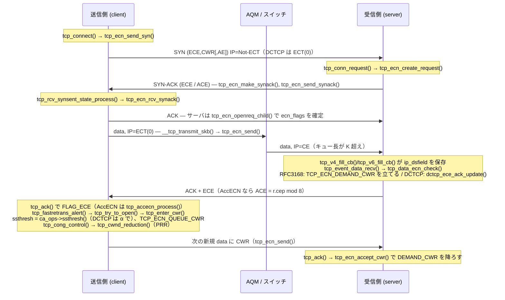

# 14. ECN と DCTCP

> この章のコードはすべて net-next `279d5c8afcd3` に基づきます。
> ロス検出と PRR による cwnd 削減の中身は第 8 章、`tcp_congestion_ops` の枠組みと Reno は第 11 章で扱うので、ここでは「ECN の信号がどこで生まれ、どう運ばれ、誰が cwnd を下げるか」と DCTCP の全行に集中します。

## たとえ話で言うと

高速道路（ネットワーク）の料金所には係員（ルータ / スイッチ）がいます。昔の係員は、道が混んでくるとトラック（パケット）をいきなり路肩に捨てていました（drop）。荷主（送信側）は「受領印（ACK）が来ない」ことで初めて混雑に気づき、慌ててトラックの台数（cwnd）を半分にします。捨てられた小包は再発送しなければならず、時間も燃料も無駄です。

ECN は、係員が小包を捨てる代わりに **伝票（IP ヘッダ）に「混雑」スタンプ（CE）を押して通す** 仕組みです。ただしスタンプを押してよいのは、伝票に「スタンプ対応」（ECT）と書いてある小包だけです。受取人（受信側）はスタンプを見つけると、返す受領印に「混雑ありました」（ECE）と書き添えます。荷主はそれを見てトラックを減らし、次の小包に「減らしました」（CWR）の札を付けます。受取人はその札を見るまで「混雑ありました」を書き続けます。

古典的な ECN（RFC 3168）は「この往復で混雑があったか無かったか」の 1 ビットしか伝えません。DCTCP は、受取人が **スタンプの有無が変わった瞬間ごとに** 正直に受領印を返すことで、荷主が「何割の小包にスタンプが押されたか」（α）を数えられるようにし、混雑の度合いに比例してトラックを減らします。AccECN（RFC 9768）はさらに、受領印そのものに「これまでにスタンプ付きを何個受け取ったか」のカウンタを書き込む方式です。

## RFC では

### RFC 3168: The Addition of Explicit Congestion Notification (ECN) to IP

**ひとことで言うと**: IP ヘッダの 2 ビット（IPv4 の TOS / IPv6 の Traffic Class の下位 2 ビット）を「ECN フィールド」と定義し、AQM がパケットを捨てる代わりに印を付けられるようにする標準です。TCP 側には ECE / CWR の 2 フラグを追加し、SYN / SYN-ACK で使用をネゴシエーションします。ECN の印は「パケットロスと同じ意味の輻輳信号」として扱い、送信側はロスと同じだけ cwnd を下げます（[RFC 3168 §5](https://www.rfc-editor.org/rfc/rfc3168#section-5)、[§6.1](https://www.rfc-editor.org/rfc/rfc3168#section-6.1)）。ECN nonce（RFC 3540）は後に RFC 8311 で Historic になり、ECT(1) は L4S の識別子として再利用されています。

ECN フィールドのコードポイント（[RFC 3168 §5](https://www.rfc-editor.org/rfc/rfc3168#section-5)）:

| ビット | 名前 | 意味 | Linux の定数 |
| --- | --- | --- | --- |
| `00` | Not-ECT | ECN 非対応。輻輳時は drop される | `INET_ECN_NOT_ECT` (0) |
| `01` | ECT(1) | ECN 対応。現在は L4S の識別子（RFC 9331） | `INET_ECN_ECT_1` (1) |
| `10` | ECT(0) | ECN 対応（古典的 ECN の標準値） | `INET_ECN_ECT_0` (2) |
| `11` | CE | Congestion Experienced（途中で印を付けられた） | `INET_ECN_CE` (3) |

TCP 側で実装が守るべき規則のうち、コードに直接現れるもの:

- **ネゴシエーション**（[§6.1.1](https://www.rfc-editor.org/rfc/rfc3168#section-6.1.1)）: クライアントは ECE と CWR を両方立てた "ECN-setup SYN" を送り、サーバは ECE だけを立てた "ECN-setup SYN-ACK" を返します。SYN と SYN-ACK には ECT を付けてはいけません（MUST NOT）。
- **フォールバック**（[§6.1.1.1](https://www.rfc-editor.org/rfc/rfc3168#section-6.1.1.1)）: ECN-setup SYN に応答がない（壊れたミドルボックスが捨てている）場合、ECE/CWR を落とした SYN を再送してよい（MAY）。
- **送信側**（[§6.1.2](https://www.rfc-editor.org/rfc/rfc3168#section-6.1.2)）: ECE 付き ACK を受けたら cwnd を下げる。ただし **1 ウィンドウ（≒ 1 RTT）に 1 回まで**。理由の如何を問わず（RTO、fast retransmit、ECN）cwnd を下げたら、**その後最初に送る新しいデータセグメント** に CWR を立てる。再送には CWR を立てない。
- **受信側**（[§6.1.3](https://www.rfc-editor.org/rfc/rfc3168#section-6.1.3)）: CE 付きデータを受けたら ECE を立てる。ACK ロスに備えて、CWR を受け取るまで **すべての ACK に ECE を立て続ける**（ラッチ動作）。
- **ECT を付けてはいけないパケット**: pure ACK（[§6.1.4](https://www.rfc-editor.org/rfc/rfc3168#section-6.1.4)）、再送（[§6.1.5](https://www.rfc-editor.org/rfc/rfc3168#section-6.1.5)）、ウィンドウプローブ（[§6.1.6](https://www.rfc-editor.org/rfc/rfc3168#section-6.1.6)）。ロスしても輻輳として検出されないパケットに ECT を付けると、CE の印が届かなくても誰も気づかないからです（[§5.2](https://www.rfc-editor.org/rfc/rfc3168#section-5.2)）。

この「ECE は CWR までラッチされる」設計のため、送信側から見ると **ECE 付き ACK の数は CE を受けたパケット数と無関係** です。1 RTT に何個 CE が付いても、送信側にわかるのは「少なくとも 1 個あった」ことだけです。DCTCP と AccECN はこの制限を外すための仕組みです。

### RFC 8311: Relaxing Restrictions on Explicit Congestion Notification (ECN) Experimentation

**ひとことで言うと**: RFC 3168 の「ECN の印はロスと同じに扱え」「SYN や再送に ECT を付けるな」といった制約を、IETF 文書に基づく実験に限って緩める RFC です。ECN nonce（RFC 3540）を Historic にして ECT(1) を解放しました（[RFC 8311 §3](https://www.rfc-editor.org/rfc/rfc8311#section-3)）。

- [§4.1](https://www.rfc-editor.org/rfc/rfc8311#section-4.1) Congestion Response Differences: ECN の印に対してロスより弱い反応（例: ABE, RFC 8511）をしてよい。DCTCP の「α に比例した削減」もこの流れの上にあります。
- [§4.2](https://www.rfc-editor.org/rfc/rfc8311#section-4.2) Congestion Marking Differences: ECT(1) を別の AQM 挙動の識別子に使ってよい（→ L4S）。
- [§4.3](https://www.rfc-editor.org/rfc/rfc8311#section-4.3) TCP Control Packets and Retransmissions: SYN・pure ACK・再送などに ECT を付ける実験を許す。Linux の `tcp_ecn_create_request()` のコメントは「予約ビット（`th->res1`）が立った SYN は将来の拡張（AccECN など）を示す」根拠としてこの節を引いています。

### RFC 8257: Data Center TCP (DCTCP): TCP Congestion Control for Data Centers

**ひとことで言うと**: データセンタ内（単一管理ドメイン）専用の輻輳制御です。スイッチはキュー長がしきい値 K を超えた瞬間に CE を付け（平均キュー長ではなく瞬時値）、受信側は CE を正確に折り返し、送信側は「直近 1 RTT で CE が付いたバイトの割合」の指数移動平均 α を使って `cwnd = cwnd * (1 - α/2)` と比例的に下げます。浅いバッファのスイッチでも、低遅延・高スループット・バースト耐性を同時に狙います。Informational RFC で、インターネットへの展開は想定していません（[RFC 8257 §5](https://www.rfc-editor.org/rfc/rfc8257#section-5)）。

コードが実装している規則:

- [§3.1](https://www.rfc-editor.org/rfc/rfc8257#section-3.1) スイッチは瞬時キュー長がしきい値 K を超えたら CE を付ける（RED の min=max=K、平均化なし）。
- [§3.2](https://www.rfc-editor.org/rfc/rfc8257#section-3.2) 受信側は 1 ビットの状態 `DCTCP.CE` を持ち、届いたパケットの CE 有無が `DCTCP.CE` と **異なれば、まず保留中の delayed ACK を古い状態の ECE で即座に送り**、状態を更新する。こうすると delayed ACK を使っても「どのバイト範囲が CE だったか」がほぼ正確に送信側に伝わります。ECE はラッチせず、`DCTCP.CE` をそのまま映します。
- [§3.3](https://www.rfc-editor.org/rfc/rfc8257#section-3.3) 送信側の推定:

  ```text
  DCTCP.Alpha = DCTCP.Alpha * (1 - g) + g * M
  M = BytesMarked / BytesAcked   （1 観測窓 ≒ 1 RTT ぶん）
  観測窓は WindowEnd = SND.NXT から始まり、SND.UNA が WindowEnd を越えたら終わる
  ECE を受けたら（1 窓に 1 回）cwnd = cwnd * (1 - DCTCP.Alpha / 2)
  ```

  α の初期値は 1（最悪を仮定）。
- [§3.4](https://www.rfc-editor.org/rfc/rfc8257#section-3.4) cwnd の増加は通常の TCP と同じ（slow start / congestion avoidance）。
- [§3.5](https://www.rfc-editor.org/rfc/rfc8257#section-3.5) **ロスに対しては通常の TCP と同じ反応をしなければならない（MUST）**。ECN とロスを合わせて 1 窓に 1 回だけ削減する。
- [§3.6](https://www.rfc-editor.org/rfc/rfc8257#section-3.6) SYN / SYN-ACK / RST にも ECT を付けるべき（SHOULD）。浅いバッファで ECT の無いパケットは drop されやすいからです。受信側はこれらに付いた CE を無視する。
- [§4.2](https://www.rfc-editor.org/rfc/rfc8257#section-4.2) 固定小数点実装: g = 1/16 なら掛け算はシフト 4 回。「α がシフトで消える最小値を下回ったら 0 にできること」「α が 1.0 を超えないようクランプすること（MUST）」を要求しています。

### RFC 9330 / 9331 / 9332: L4S（簡単に）

**ひとことで言うと**: L4S（Low Latency, Low Loss, and Scalable Throughput）は、DCTCP 型の「印の割合に比例して反応する（scalable な）」輻輳制御をインターネットでも使えるようにするアーキテクチャです（[RFC 9330](https://www.rfc-editor.org/rfc/rfc9330)）。ECT(1) を「L4S パケット」の識別子にし（RFC 9331）、ボトルネックでは L4S 用の浅いキューと古典的トラフィック用のキューを結合した DualQ Coupled AQM（[RFC 9332 §2](https://www.rfc-editor.org/rfc/rfc9332#section-2)）で両者の公平性を取ります。L4S の送信側は CE の数を正確に知る必要があるため、TCP では AccECN が前提になります。

Linux upstream には TCP Prague のような L4S 輻輳制御モジュールはまだありません。ただし、そうしたモジュール（BPF struct_ops を含む）のために、`TCP_CONG_ECT_1_NEGOTIATION`（ハンドシェイク中から ECT(1) を使う）、`TCP_CONG_NEEDS_ACCECN`（AccECN を要求する）、`TCP_CONG_NO_FALLBACK_RFC3168`（AccECN が失敗したら古典 ECN に落ちず non-ECN にする）というフラグがすでに用意されています。

### RFC 9768: More Accurate Explicit Congestion Notification (AccECN) Feedback in TCP

**ひとことで言うと**: 長く draft-ietf-tcpm-accurate-ecn だった AccECN は RFC 9768 として発行済みです。RFC 3168 の「ECE ラッチ」をやめ、TCP ヘッダの 3 ビット **ACE フィールド**（旧 NS ビットを改名した AE、CWR、ECE）に「受信した CE パケット数の下位 3 ビット」を載せます。さらに任意の **AccECN オプション** で ECT(0) / ECT(1) / CE 各コードポイントの受信 **バイト数**（24 ビット）を送り返します。これで送信側は 1 RTT 内に何個（何バイト）CE が付いたかを知ることができます。

コードが実装している規則:

- [§3.1.1](https://www.rfc-editor.org/rfc/rfc9768#section-3.1.1) ネゴシエーション: AccECN クライアントは SYN に (AE,CWR,ECE) = (1,1,1) を立てる。AccECN サーバは SYN-ACK の ACE で **SYN が運ばれてきた IP-ECN コードポイント** を折り返す（Table 2: Not-ECT→010, ECT(1)→011, ECT(0)→100, CE→110）。SYN-ACK が 001 なら相手は古典 ECN、000 なら非 ECN。
- [§3.1.2](https://www.rfc-editor.org/rfc/rfc9768#section-3.1.2) 後方互換: サーバは 000 / 011 / 111 以外の組み合わせの SYN を 111 と同様に扱わなければならない。
- [§3.1.4](https://www.rfc-editor.org/rfc/rfc9768#section-3.1.4) SYN / SYN-ACK の再送時の扱い（ACE=0 での再送など）。
- [§3.1.5](https://www.rfc-editor.org/rfc/rfc9768#section-3.1.5) ACE=0 の SYN / SYN-ACK を受け取った・送ったら、以後 ECT を付けてはいけない。
- [§3.2.1](https://www.rfc-editor.org/rfc/rfc9768#section-3.2.1) カウンタの初期値: パケットカウンタ `r.cep` / `s.cep` は 5 から、バイトカウンタは ECT(0)/ECT(1) が 1、CE が 0 から始める。ミドルボックスによるゼロ化を検出するためです。
- [§3.2.2.1](https://www.rfc-editor.org/rfc/rfc9768#section-3.2.2.1) ハンドシェイクの 3 つめの ACK は、ACE で SYN-ACK の IP-ECN を折り返す（Table 4）。
- [§3.2.2.2](https://www.rfc-editor.org/rfc/rfc9768#section-3.2.2.2) ACE のエンコード / デコード: 受信側は `ACE = r.cep mod 8`、送信側は `Δ = (ACE - s.cep) mod 8` で増分を復元する。
- [§3.2.2.5](https://www.rfc-editor.org/rfc/rfc9768#section-3.2.2.5) ACE の曖昧さ（3 ビットのラップ）への安全策: 受信側は ACK を間引きすぎない、送信側は大量に ACK された場合は保守的に推定する。
- [§3.2.3](https://www.rfc-editor.org/rfc/rfc9768#section-3.2.3) AccECN オプション（Kind 172 = Order 0 / 174 = Order 1）とバイトカウンタの 24 ビットエンコード、[§3.2.3.2](https://www.rfc-editor.org/rfc/rfc9768#section-3.2.3.2) 経路上でオプションが消される / ゼロ化されることの検出、[§3.2.3.3](https://www.rfc-editor.org/rfc/rfc9768#section-3.2.3.3) いつオプションを送るか（変化があったとき、1 RTT に最低数回の beacon など）。
- [§5.1](https://www.rfc-editor.org/rfc/rfc9768#section-5.1) SYN cookie との互換: 3 つめの ACK の ACE が 0b010〜0b111 ならサーバは AccECN がネゴシエートされたと判断できる。

> [!NOTE]
> ソース中のコメントには今も "draft-ietf-tcpm-accurate-ecn" という表記が残っていますが、指しているのは RFC 9768 になった仕様です。コミット `100f946b8d44` 以降のメッセージは RFC 9768 を参照しています。

## 全体の流れ



ECN の処理は、送信側と受信側で役割がはっきり分かれています。

- **受信側** は IP ヘッダの ECN フィールドを読みます（AF ごとに読み方が違うのはここだけで、`TCP_SKB_CB(skb)->ip_dsfield` に入れた後は AF 非依存です）。読んだ結果を `tp->ecn_flags`（RFC 3168）または `tp->received_ce` などのカウンタ（AccECN）に記録し、次に送る ACK の ECE / ACE に反映します。
- **送信側** は ACK の ECE / ACE を読み、`FLAG_ECE` と `tp->delivered_ce` に変換します。それを輻輳制御（CWR 状態への遷移、DCTCP の α 更新）に渡します。
- 送信するパケットに ECT を付けるかどうかは **ソケット全体の `inet->tos` / `np->tclass`** をパケットごとに書き換えて決めます。この一見乱暴なやり方が、IPv4 と IPv6 の扱いの違いにつながっています（後述の Step 1 と「IPv4 と IPv6」節）。

DCTCP は「ECN の信号の **受信側の折り返し方**（`tcp_dctcp.h`）」と「**送信側の反応関数**（`tcp_dctcp.c`）」の 2 部品からできています。前者はコア TCP の `tcp_data_ecn_check()` から `CA_EVENT_ECN_IS_CE` / `CA_EVENT_ECN_NO_CE` イベントで呼ばれ、後者は `in_ack_event` と `ssthresh` フックで呼ばれます。

## コードを追う

### Step 1: ECN フィールドの読み書き（`inet_ecn.h` / `dsfield.h`）

まず、コードポイントと述語です。

```c
enum {
	INET_ECN_NOT_ECT = 0,
	INET_ECN_ECT_1 = 1,
	INET_ECN_ECT_0 = 2,
	INET_ECN_CE = 3,
	INET_ECN_MASK = 3,
};

extern int sysctl_tunnel_ecn_log;

static inline int INET_ECN_is_ce(__u8 dsfield)
{
	return (dsfield & INET_ECN_MASK) == INET_ECN_CE;
}

static inline int INET_ECN_is_not_ect(__u8 dsfield)
{
	return (dsfield & INET_ECN_MASK) == INET_ECN_NOT_ECT;
}

static inline int INET_ECN_is_capable(__u8 dsfield)
{
	return dsfield & INET_ECN_ECT_0;
}
```

- `INET_ECN_is_capable()` が `& INET_ECN_ECT_0`（ビット 1）だけを見ているのは、ECT(0)=`10` と CE=`11` を「ECN 対応」とみなすためです。ECT(1)=`01` は false になります。歴史的に ECT(1) は nonce 用で「普通の ECN 対応」とは扱われなかった名残です。SYN-ACK の `tos` に ECT を足すかどうかの判定（Step 4）でしか使われないので、L4S の ECT(1) が普及しても実害は限られます。
- `INET_ECN_is_not_ect()` は ECT(1) / ECT(0) / CE のどれかなら false で、受信側の「ECN が使われているか」判定（`TCP_ECN_SEEN`）はこちらを使います。

送信側で ECT を付ける / 外すヘルパ `__INET_ECN_xmit()`（[include/net/inet_ecn.h#L55](https://git.kernel.org/pub/scm/linux/kernel/git/netdev/net-next.git/tree/include/net/inet_ecn.h?id=279d5c8afcd38bd841832a39bfe1aa4f8518d98e#n55)）、`INET_ECN_xmit()`、`INET_ECN_dontxmit()` です。

```c
/* Apply either ECT(0) or ECT(1) */
static inline void __INET_ECN_xmit(struct sock *sk, bool use_ect_1)
{
	__u8 ect = use_ect_1 ? INET_ECN_ECT_1 : INET_ECN_ECT_0;

	/* Mask the complete byte in case the connection alternates between
	 * ECT(0) and ECT(1).
	 */
	inet_sk(sk)->tos &= ~INET_ECN_MASK;
	inet_sk(sk)->tos |= ect;
	if (inet6_sk(sk)) {
		inet6_sk(sk)->tclass &= ~INET_ECN_MASK;
		inet6_sk(sk)->tclass |= ect;
	}
}

static inline void INET_ECN_xmit(struct sock *sk)
{
	__INET_ECN_xmit(sk, false);
}

static inline void INET_ECN_dontxmit(struct sock *sk)
{
	inet_sk(sk)->tos &= ~INET_ECN_MASK;
	if (inet6_sk(sk) != NULL)
		inet6_sk(sk)->tclass &= ~INET_ECN_MASK;
}
```

ここが TCP の ECN 実装の最大の特徴です。

- ECT を「パケットに」付けるのではなく、**ソケットの `inet_sk(sk)->tos` の下位 2 ビットを書き換え** ます。IPv4 の送信関数 `ip_queue_xmit()`（[net/ipv4/ip_output.c#L545](https://git.kernel.org/pub/scm/linux/kernel/git/netdev/net-next.git/tree/net/ipv4/ip_output.c?id=279d5c8afcd38bd841832a39bfe1aa4f8518d98e#n545)） は `READ_ONCE(inet_sk(sk)->tos)` をそのまま `iph->tos` に入れます。IPv6 の `inet6_csk_xmit()`（[net/ipv6/inet6_connection_sock.c#L97](https://git.kernel.org/pub/scm/linux/kernel/git/netdev/net-next.git/tree/net/ipv6/inet6_connection_sock.c?id=279d5c8afcd38bd841832a39bfe1aa4f8518d98e#n97)） は `np->tclass` を `ip6_xmit()` に渡します。つまり **送信直前に `tos` を書き換えれば、その 1 パケットだけ ECT になる** という仕掛けです。`tcp_transmit_skb()` はソケットロック（またはそれと同等の排他、softirq での ACK 送信なら `bh_lock_sock()`）の下で動くので、書き換えから IP ヘッダ生成までの間に他の送信が割り込むことはありません。
- `inet6_sk(sk)` が非 NULL（AF_INET6 ソケット）のときは `tclass` も同時に書き換えます。AF_INET6 ソケットでも v4-mapped アドレスで通信すれば `ip_queue_xmit()` を通るので `tos` も必要です。両方を書くのはそのためです。
- コメントにある通り、ECT(0) と ECT(1) を切り替える接続（L4S のハンドシェイク中は ECT(1)、その後 ECT(0) など）のために、OR する前に必ず `~INET_ECN_MASK` でクリアしています。

ユーザが `setsockopt(IP_TOS)` / `setsockopt(IPV6_TCLASS)` で DSCP を変えても、TCP ソケットでは ECN ビットは保持されます（`__ip_sock_set_tos()`（[net/ipv4/ip_sockglue.c#L586](https://git.kernel.org/pub/scm/linux/kernel/git/netdev/net-next.git/tree/net/ipv4/ip_sockglue.c?id=279d5c8afcd38bd841832a39bfe1aa4f8518d98e#n586)） と `do_ipv6_setsockopt()`（[net/ipv6/ipv6_sockglue.c#L376](https://git.kernel.org/pub/scm/linux/kernel/git/netdev/net-next.git/tree/net/ipv6/ipv6_sockglue.c?id=279d5c8afcd38bd841832a39bfe1aa4f8518d98e#n376)） の `IPV6_TCLASS` 分岐がどちらも `SOCK_STREAM` なら `val &= ~INET_ECN_MASK; val |= old & INET_ECN_MASK;` とします）。こうしないと、アプリの DSCP 設定で TCP の ECN 状態が壊れてしまいます。

受信側で IP ヘッダから ECN フィールドを取り出すのは `dsfield.h` のヘルパです。

```c
static inline __u8 ipv4_get_dsfield(const struct iphdr *iph)
{
	return iph->tos;
}


static inline __u8 ipv6_get_dsfield(const struct ipv6hdr *ipv6h)
{
	return ntohs(*(__force const __be16 *)ipv6h) >> 4;
}


static inline void ipv4_change_dsfield(struct iphdr *iph,__u8 mask,
    __u8 value)
{
        __u32 check = ntohs((__force __be16)iph->check);
	__u8 dsfield;

	dsfield = (iph->tos & mask) | value;
	check += iph->tos;
	if ((check+1) >> 16) check = (check+1) & 0xffff;
	check -= dsfield;
	check += check >> 16; /* adjust carry */
	iph->check = (__force __sum16)htons(check);
	iph->tos = dsfield;
}


static inline void ipv6_change_dsfield(struct ipv6hdr *ipv6h,__u8 mask,
    __u8 value)
{
	__be16 *p = (__force __be16 *)ipv6h;

	*p = (*p & htons((((u16)mask << 4) | 0xf00f))) | htons((u16)value << 4);
}
```

- IPv4 は `iph->tos` の 1 バイトをそのまま返すだけです。
- IPv6 は Version(4) | Traffic Class(8) | Flow Label(20) の先頭 16 ビットを `ntohs()` して 4 ビット右シフトします。Traffic Class がバイト境界をまたいでいるためです。
- 書き換え側では、IPv4 はヘッダチェックサムがあるので `ipv4_change_dsfield()` が RFC 1624 流の差分更新をします。IPv6 にはヘッダチェックサムがないので 16 ビットのマスク演算だけで済みます。AQM（`sch_*`）が CE を付ける `IP_ECN_set_ce()`（[include/net/inet_ecn.h#L91](https://git.kernel.org/pub/scm/linux/kernel/git/netdev/net-next.git/tree/include/net/inet_ecn.h?id=279d5c8afcd38bd841832a39bfe1aa4f8518d98e#n91)） / `IP6_ECN_set_ce()`（[include/net/inet_ecn.h#L148](https://git.kernel.org/pub/scm/linux/kernel/git/netdev/net-next.git/tree/include/net/inet_ecn.h?id=279d5c8afcd38bd841832a39bfe1aa4f8518d98e#n148)） も同じ非対称性を持ちます。

TCP はこの値を受信の入口で `TCP_SKB_CB` に一度だけコピーし、以降は AF に依存しません。

`tcp_v4_fill_cb()`（[net/ipv4/tcp_ipv4.c#L2048](https://git.kernel.org/pub/scm/linux/kernel/git/netdev/net-next.git/tree/net/ipv4/tcp_ipv4.c?id=279d5c8afcd38bd841832a39bfe1aa4f8518d98e#n2048)）:

```c
	TCP_SKB_CB(skb)->seq = ntohl(th->seq);
	TCP_SKB_CB(skb)->end_seq = (TCP_SKB_CB(skb)->seq + th->syn + th->fin +
				    skb->len - th->doff * 4);
	TCP_SKB_CB(skb)->ack_seq = ntohl(th->ack_seq);
	TCP_SKB_CB(skb)->tcp_flags = tcp_flags_ntohs(th);
	TCP_SKB_CB(skb)->ip_dsfield = ipv4_get_dsfield(iph);
```

`tcp_v6_fill_cb()`（[net/ipv6/tcp_ipv6.c#L1711](https://git.kernel.org/pub/scm/linux/kernel/git/netdev/net-next.git/tree/net/ipv6/tcp_ipv6.c?id=279d5c8afcd38bd841832a39bfe1aa4f8518d98e#n1711)）:

```c
	TCP_SKB_CB(skb)->seq = ntohl(th->seq);
	TCP_SKB_CB(skb)->end_seq = (TCP_SKB_CB(skb)->seq + th->syn + th->fin +
				    skb->len - th->doff*4);
	TCP_SKB_CB(skb)->ack_seq = ntohl(th->ack_seq);
	TCP_SKB_CB(skb)->tcp_flags = tcp_flags_ntohs(th);
	TCP_SKB_CB(skb)->ip_dsfield = ipv6_get_dsfield(hdr);
```

`ip_dsfield` は `tcp_skb_cb` のフィールドで、以降の `tcp_data_ecn_check()` や `tcp_ecn_received_counters()` はすべてこれを読みます。なお `tcp_add_backlog()`（[net/ipv4/tcp_ipv4.c#L1904](https://git.kernel.org/pub/scm/linux/kernel/git/netdev/net-next.git/tree/net/ipv4/tcp_ipv4.c?id=279d5c8afcd38bd841832a39bfe1aa4f8518d98e#n1904)） は backlog 上でセグメントを結合する条件に `ip_dsfield` が等しいことを含めています。ECN フィールドの違うセグメントを結合すると CE が消えたり増えたりするからです。GRO も同様で、TOS / Traffic Class が違えば結合を打ち切ります（IPv4 は `inet_gro_flush()`（[include/net/gro.h#L443](https://git.kernel.org/pub/scm/linux/kernel/git/netdev/net-next.git/tree/include/net/gro.h?id=279d5c8afcd38bd841832a39bfe1aa4f8518d98e#n443)）、IPv6 は `ipv6_gro_flush()`（[include/net/gro.h#L465](https://git.kernel.org/pub/scm/linux/kernel/git/netdev/net-next.git/tree/include/net/gro.h?id=279d5c8afcd38bd841832a39bfe1aa4f8518d98e#n465)））。

### Step 2: `tp->ecn_flags` と ECN モード

ECN の状態はすべて `tcp_sock` の 1 バイト `ecn_flags` に入っています（`tcp_sock_write_tx` キャッシュライングループ内）。

```c
#define	TCP_ECN_MODE_RFC3168	BIT(0)
#define	TCP_ECN_QUEUE_CWR	BIT(1)
#define	TCP_ECN_DEMAND_CWR	BIT(2)
#define	TCP_ECN_SEEN		BIT(3)
#define	TCP_ECN_MODE_ACCECN	BIT(4)

#define	TCP_ECN_DISABLED	0
#define	TCP_ECN_MODE_PENDING	(TCP_ECN_MODE_RFC3168 | TCP_ECN_MODE_ACCECN)
#define	TCP_ECN_MODE_ANY	(TCP_ECN_MODE_RFC3168 | TCP_ECN_MODE_ACCECN)

static inline bool tcp_ecn_mode_any(const struct tcp_sock *tp)
{
	return tp->ecn_flags & TCP_ECN_MODE_ANY;
}

static inline bool tcp_ecn_mode_rfc3168(const struct tcp_sock *tp)
{
	return (tp->ecn_flags & TCP_ECN_MODE_ANY) == TCP_ECN_MODE_RFC3168;
}

static inline bool tcp_ecn_mode_accecn(const struct tcp_sock *tp)
{
	return (tp->ecn_flags & TCP_ECN_MODE_ANY) == TCP_ECN_MODE_ACCECN;
}

static inline bool tcp_ecn_disabled(const struct tcp_sock *tp)
{
	return !tcp_ecn_mode_any(tp);
}

static inline bool tcp_ecn_mode_pending(const struct tcp_sock *tp)
{
	return (tp->ecn_flags & TCP_ECN_MODE_PENDING) == TCP_ECN_MODE_PENDING;
}

static inline void tcp_ecn_mode_set(struct tcp_sock *tp, u8 mode)
{
	tp->ecn_flags &= ~TCP_ECN_MODE_ANY;
	tp->ecn_flags |= mode;
}
```

- `TCP_ECN_MODE_RFC3168`（bit0）と `TCP_ECN_MODE_ACCECN`（bit4）の **2 ビットでモードを表します**。00 = 無効、01 = RFC 3168、10 = AccECN、11 = **PENDING**（AccECN を要求する SYN を送ったが SYN-ACK をまだ見ていない）。PENDING は両方のビットが立っているので、`tcp_ecn_mode_any()` は true になります。一方 `tcp_ecn_mode_rfc3168()` / `tcp_ecn_mode_accecn()` はどちらも false です。「ネゴシエーション中はどちらのフィードバック方式も使わない」ことが、ビット表現だけで自然に実現されています。
- `TCP_ECN_QUEUE_CWR`: **送信側** が「次の新規データに CWR を立てる」予約。
- `TCP_ECN_DEMAND_CWR`: **受信側** が「CWR を受け取るまで ECE を立て続ける」状態（RFC 3168 §6.1.3 のラッチ）。DCTCP ではこのビットを CE 状態そのものとして使います（Step 13）。
- `TCP_ECN_SEEN`: ECT / CE 付きのセグメントを一度でも受けた。`tcpi_options` の `TCPI_OPT_ECN_SEEN` に出ます。
- `tcp_ecn_mode_set()` はモードの 2 ビットだけを差し替え、QUEUE_CWR などの状態ビットは残します。

### Step 3: 能動オープン側 — SYN で ECN を要求する

`tcp_connect()`（[net/ipv4/tcp_output.c#L4309](https://git.kernel.org/pub/scm/linux/kernel/git/netdev/net-next.git/tree/net/ipv4/tcp_output.c?id=279d5c8afcd38bd841832a39bfe1aa4f8518d98e#n4309)） は SYN skb を作った直後に `tcp_ecn_send_syn()` を呼びます。

`tcp_ecn_send_syn()`（[include/net/tcp_ecn.h#L597](https://git.kernel.org/pub/scm/linux/kernel/git/netdev/net-next.git/tree/include/net/tcp_ecn.h?id=279d5c8afcd38bd841832a39bfe1aa4f8518d98e#n597)）:

```c
/* Packet ECN state for a SYN.  */
static inline void tcp_ecn_send_syn(struct sock *sk, struct sk_buff *skb)
{
	struct tcp_sock *tp = tcp_sk(sk);
	bool bpf_needs_ecn = tcp_bpf_ca_needs_ecn(sk);
	bool use_ecn, use_accecn;
	u8 tcp_ecn = READ_ONCE(sock_net(sk)->ipv4.sysctl_tcp_ecn);

	use_accecn = tcp_ecn == TCP_ECN_IN_ACCECN_OUT_ACCECN ||
		     tcp_ca_needs_accecn(sk);
	use_ecn = tcp_ecn == TCP_ECN_IN_ECN_OUT_ECN ||
		  tcp_ecn == TCP_ECN_IN_ACCECN_OUT_ECN ||
		  tcp_ca_needs_ecn(sk) || bpf_needs_ecn || use_accecn;

	if (!use_ecn) {
		const struct dst_entry *dst = __sk_dst_get(sk);

		if (dst && dst_feature(dst, RTAX_FEATURE_ECN))
			use_ecn = true;
	}

	tp->ecn_flags = 0;

	if (use_ecn) {
		if (tcp_ca_needs_ecn(sk) || bpf_needs_ecn)
			INET_ECN_xmit_ect_1_negotiation(sk);

		TCP_SKB_CB(skb)->tcp_flags |= TCPHDR_ECE | TCPHDR_CWR;
		if (use_accecn) {
			TCP_SKB_CB(skb)->tcp_flags |= TCPHDR_AE;
			tcp_ecn_mode_set(tp, TCP_ECN_MODE_PENDING);
			tp->syn_ect_snt = inet_sk(sk)->tos & INET_ECN_MASK;
		} else {
			tcp_ecn_mode_set(tp, TCP_ECN_MODE_RFC3168);
		}
	}
}
```

- `sysctl_tcp_ecn` の値（`enum tcp_ecn_mode`（[include/net/tcp_ecn.h#L18](https://git.kernel.org/pub/scm/linux/kernel/git/netdev/net-next.git/tree/include/net/tcp_ecn.h?id=279d5c8afcd38bd841832a39bfe1aa4f8518d98e#n18)））は「受信した接続で許す最高の方式」と「自分から要求する方式」の組です。デフォルトは 2（`TCP_ECN_IN_ECN_OUT_NOECN`）で、**クライアントとしては ECN を要求しないがサーバとしては応じる** 設定です（`tcp_sk_init()` で `net->ipv4.sysctl_tcp_ecn = TCP_ECN_IN_ECN_OUT_NOECN`）。3 を設定すると AccECN を要求します。
- `use_accecn` は sysctl=3 か、CC が `TCP_CONG_NEEDS_ACCECN` を要求する場合です。`use_ecn` は「何らかの ECN を要求する」で、AccECN を要求するなら当然真です。
- sysctl で無効でも、経路（`ip route ... features ecn`、`RTAX_FEATURE_ECN`）で有効にできます。`__sk_dst_get()` は connect 時点でキャッシュされた経路です。
- `tp->ecn_flags = 0;` は SYN を作るたびにリセットします。`tcp_connect()` は再接続時にも呼ばれるので、前回の状態を持ち越さないためです。
- `tcp_ca_needs_ecn()`（DCTCP）か BPF の `BPF_SOCK_OPS_NEEDS_ECN` のときだけ **SYN 自体に ECT を付けます**（RFC 8257 §3.6）。古典的な ECN では SYN は Not-ECT です（RFC 3168 §6.1.1）。実は DCTCP の場合、`tcp_assign_congestion_control()`（[net/ipv4/tcp_cong.c#L216](https://git.kernel.org/pub/scm/linux/kernel/git/netdev/net-next.git/tree/net/ipv4/tcp_cong.c?id=279d5c8afcd38bd841832a39bfe1aa4f8518d98e#n216)） がソケット作成時にもう ECT を立てているので、ここは「その後 `tos` が変わっていても確実に立てる」意味合いです。
- SYN には `TCPHDR_ECE | TCPHDR_CWR`（RFC 3168 の ECN-setup SYN）を立て、AccECN ならさらに `TCPHDR_AE` を立てて ACE=111 にします。AccECN のときだけ `tp->syn_ect_snt` に SYN の ECT を覚えておきます。サーバが SYN-ACK の ACE で「どの ECT で届いたか」を折り返してくるので、経路上での書き換え（mangling）を検出するのに使います（RFC 9768 §3.2.2.3）。
- モードは AccECN 要求なら PENDING、そうでなければ RFC3168 にします。RFC3168 モードにしても、SYN-ACK が ECE を返さなければ後で無効化されます（Step 5）。

SYN の再送時のフォールバック（RFC 3168 §6.1.1.1）は `__tcp_retransmit_skb()`（[net/ipv4/tcp_output.c#L3558](https://git.kernel.org/pub/scm/linux/kernel/git/netdev/net-next.git/tree/net/ipv4/tcp_output.c?id=279d5c8afcd38bd841832a39bfe1aa4f8518d98e#n3558)） の中にあります。

```c
	if (!tcp_ecn_mode_pending(tp) || icsk->icsk_retransmits > 1) {
		/* RFC3168, section 6.1.1.1. ECN fallback
		 * As AccECN uses the same SYN flags (+ AE), this check
		 * covers both cases.
		 */
		if ((TCP_SKB_CB(skb)->tcp_flags & TCPHDR_SYN_ECN) ==
		    TCPHDR_SYN_ECN)
			tcp_ecn_clear_syn(sk, skb);
	}
```

`tcp_ecn_clear_syn()`（[include/net/tcp_ecn.h#L634](https://git.kernel.org/pub/scm/linux/kernel/git/netdev/net-next.git/tree/include/net/tcp_ecn.h?id=279d5c8afcd38bd841832a39bfe1aa4f8518d98e#n634)）:

```c
static inline void tcp_ecn_clear_syn(struct sock *sk, struct sk_buff *skb)
{
	if (READ_ONCE(sock_net(sk)->ipv4.sysctl_tcp_ecn_fallback)) {
		/* tp->ecn_flags are cleared at a later point in time when
		 * SYN ACK is ultimatively being received.
		 */
		TCP_SKB_CB(skb)->tcp_flags &= ~TCPHDR_ACE;
	}
}
```

- 条件は「PENDING（AccECN 要求中）でない、または 2 回目以上の再送」です。古典 ECN の SYN は **最初の再送から** ECE/CWR を外します。AccECN の SYN は 1 回目の再送までは AccECN のまま送り、2 回目以降で外します（RFC 9768 §3.1.4.1 の「少なくとも 1 回は再送してよい」に対応）。
- `TCPHDR_ACE` には AE も含まれるので、AccECN の SYN もまとめて外れます。
- `tp->ecn_flags` はここでは消しません。コメントにある通り、SYN-ACK を受け取ったときに `tcp_ecn_rcv_synack()` で SYN-ACK の ACE を見て最終的にモードを決めます。ECE なしの SYN-ACK は 000 なので無効化されます。
- `sysctl_tcp_ecn_fallback=0` にするとこのフォールバックを止められます。

### Step 4: 受動オープン側 — SYN を見て `request_sock` に記録し、SYN-ACK を作る

サーバでは、SYN を受けた `tcp_conn_request()` がミニソケットを作った後で `tcp_ecn_create_request()` を呼びます（SYN cookie のときはタイムスタンプが無ければ `ecn_ok` を落とします。cookie の TS 値の下位ビットに ECN 可否を埋め込むためです）。

`tcp_ecn_create_request()`（[net/ipv4/tcp_input.c#L7469](https://git.kernel.org/pub/scm/linux/kernel/git/netdev/net-next.git/tree/net/ipv4/tcp_input.c?id=279d5c8afcd38bd841832a39bfe1aa4f8518d98e#n7469)）:

```c
static void tcp_ecn_create_request(struct request_sock *req,
				   const struct sk_buff *skb,
				   const struct sock *listen_sk,
				   const struct dst_entry *dst)
{
	const struct tcphdr *th = tcp_hdr(skb);
	const struct net *net = sock_net(listen_sk);
	bool th_ecn = th->ece && th->cwr;
	bool ect, ecn_ok;
	u32 ecn_ok_dst;

	if (tcp_accecn_syn_requested(th) &&
	    (READ_ONCE(net->ipv4.sysctl_tcp_ecn) >= 3 ||
	     tcp_ca_needs_accecn(listen_sk))) {
		inet_rsk(req)->ecn_ok = 1;
		tcp_rsk(req)->accecn_ok = 1;
		tcp_rsk(req)->syn_ect_rcv = TCP_SKB_CB(skb)->ip_dsfield &
					    INET_ECN_MASK;
		return;
	}

	if (!th_ecn)
		return;

	ect = !INET_ECN_is_not_ect(TCP_SKB_CB(skb)->ip_dsfield);
	ecn_ok_dst = dst_feature(dst, DST_FEATURE_ECN_MASK);
	ecn_ok = READ_ONCE(net->ipv4.sysctl_tcp_ecn) || ecn_ok_dst;

	if (((!ect || th->res1 || th->ae) && ecn_ok) ||
	    tcp_ca_needs_ecn(listen_sk) ||
	    (ecn_ok_dst & DST_FEATURE_ECN_CA) ||
	    tcp_bpf_ca_needs_ecn((struct sock *)req))
		inet_rsk(req)->ecn_ok = 1;
}
```

- AccECN の判定が先です。`tcp_accecn_syn_requested()`（[include/net/tcp_ecn.h#L375](https://git.kernel.org/pub/scm/linux/kernel/git/netdev/net-next.git/tree/include/net/tcp_ecn.h?id=279d5c8afcd38bd841832a39bfe1aa4f8518d98e#n375)） は ACE が 000 でも 011 でもなければ true を返します（RFC 9768 §3.1.2: 000 / 011 / 111 以外は 111 とみなす。011 は古典 ECN の SYN なので AccECN ではない）。sysctl が 3 以上（受信側で AccECN を許す 3/4/5）、またはリスナーの CC が AccECN を要求していれば、`accecn_ok` を立てます。さらに **SYN が運ばれてきた IP-ECN** を `syn_ect_rcv` に保存して return します。この値は SYN-ACK の ACE で折り返します。
- 古典 ECN は `th->ece && th->cwr` の両方が立っている SYN だけが対象です。
- 判定式 `((!ect || th->res1 || th->ae) && ecn_ok) || ...` の意味:
  - 「SYN が Not-ECT である」こと。RFC 3168 §6.1.1 により SYN は ECT であってはなりません。ECT や CE の付いた SYN は「経路上で TOS を弄るミドルボックスがいる」兆候なので、偽の輻輳信号を避けるため ECN を断ります（関数先頭のコメント）。
  - ただし `res1`（予約ビット）や AE が立っていれば、将来の拡張（RFC 8311 §4.3）として ECT 付き SYN を許します。
  - CC が ECN を必須とする場合（DCTCP）、経路で `DST_FEATURE_ECN_CA`（`ip route ... congctl dctcp`）が指定されている場合、BPF が要求した場合は、ECT 付き SYN でも無条件に許可します。Linux の DCTCP は SYN 自体に ECT を付けるからです（コメント中の「FreeBSD はそうしない」はその対比です）。
- `ecn_ok_dst` は経路の features で、`sysctl_tcp_ecn=0` でも経路単位で ECN を許可できます。

SYN-ACK のヘッダを書くのは `tcp_make_synack()`（[net/ipv4/tcp_output.c#L3942](https://git.kernel.org/pub/scm/linux/kernel/git/netdev/net-next.git/tree/net/ipv4/tcp_output.c?id=279d5c8afcd38bd841832a39bfe1aa4f8518d98e#n3942)） から呼ばれる `tcp_ecn_make_synack()`（[include/net/tcp_ecn.h#L644](https://git.kernel.org/pub/scm/linux/kernel/git/netdev/net-next.git/tree/include/net/tcp_ecn.h?id=279d5c8afcd38bd841832a39bfe1aa4f8518d98e#n644)） です。

```c
static inline void
tcp_ecn_make_synack(const struct request_sock *req, struct tcphdr *th,
		    enum tcp_synack_type synack_type)
{
	/* Accurate ECN shall retransmit SYN/ACK with ACE=0 if the
	 * previously retransmitted SYN/ACK also times out.
	 */
	if (!req->num_timeout || synack_type != TCP_SYNACK_RETRANS) {
		if (tcp_rsk(req)->accecn_ok)
			tcp_accecn_echo_syn_ect(th, tcp_rsk(req)->syn_ect_rcv);
		else if (inet_rsk(req)->ecn_ok)
			th->ece = 1;
	} else if (tcp_rsk(req)->accecn_ok) {
		th->ae  = 0;
		th->cwr = 0;
		th->ece = 0;
	}
}
```

- 初回の SYN-ACK と、SYN の再送に応じた SYN-ACK では、AccECN なら `tcp_accecn_echo_syn_ect()`（[include/net/tcp_ecn.h#L406](https://git.kernel.org/pub/scm/linux/kernel/git/netdev/net-next.git/tree/include/net/tcp_ecn.h?id=279d5c8afcd38bd841832a39bfe1aa4f8518d98e#n406)） で SYN の IP-ECN を ACE に折り返します（Not-ECT→010, ECT(1)→011, ECT(0)→100, CE→110）。古典 ECN なら ECE だけを立てます（RFC 3168 の ECN-setup SYN-ACK）。
- **SYN-ACK 自身がタイムアウトして 2 回目以降の再送** になったら、AccECN は ACE=000 で送ります（RFC 9768 §3.1.4.2）。ACE の付いた SYN-ACK がミドルボックスに捨てられている可能性に備えたフォールバックです。`req->num_timeout` が「タイマーによる再送回数」、`synack_type` が「SYN 再送を受けての再送か」を区別しています。

完全なソケット（`TCP_LISTEN` 以外）が SYN-ACK を送る経路（同時オープンや TFO の後など）は `tcp_send_synack()`（[net/ipv4/tcp_output.c#L3895](https://git.kernel.org/pub/scm/linux/kernel/git/netdev/net-next.git/tree/net/ipv4/tcp_output.c?id=279d5c8afcd38bd841832a39bfe1aa4f8518d98e#n3895)） → `tcp_ecn_send_synack()` です。

`tcp_ecn_send_synack()`（[include/net/tcp_ecn.h#L577](https://git.kernel.org/pub/scm/linux/kernel/git/netdev/net-next.git/tree/include/net/tcp_ecn.h?id=279d5c8afcd38bd841832a39bfe1aa4f8518d98e#n577)）:

```c
/* Packet ECN state for a SYN-ACK */
static inline void tcp_ecn_send_synack(struct sock *sk, struct sk_buff *skb)
{
	struct tcp_sock *tp = tcp_sk(sk);

	TCP_SKB_CB(skb)->tcp_flags &= ~TCPHDR_CWR;
	if (tcp_ecn_disabled(tp))
		TCP_SKB_CB(skb)->tcp_flags &= ~TCPHDR_ECE;
	else if (tcp_ca_needs_ecn(sk) ||
		 tcp_bpf_ca_needs_ecn(sk))
		INET_ECN_xmit_ect_1_negotiation(sk);

	if (tp->ecn_flags & TCP_ECN_MODE_ACCECN) {
		TCP_SKB_CB(skb)->tcp_flags &= ~TCPHDR_ACE;
		TCP_SKB_CB(skb)->tcp_flags |=
			tcp_accecn_reflector_flags(tp->syn_ect_rcv);
		tp->syn_ect_snt = inet_sk(sk)->tos & INET_ECN_MASK;
	}
}
```

- SYN-ACK に CWR は付けません。ECN が無効なら ECE も外します。
- DCTCP などでは SYN-ACK にも ECT を付けます（RFC 8257 §3.6）。
- AccECN モードなら ACE を `tcp_accecn_reflector_flags()`（[include/net/tcp_ecn.h#L354](https://git.kernel.org/pub/scm/linux/kernel/git/netdev/net-next.git/tree/include/net/tcp_ecn.h?id=279d5c8afcd38bd841832a39bfe1aa4f8518d98e#n354)） で作り直し、自分が送る SYN-ACK の ECT を `syn_ect_snt` に記録します（3 つめの ACK での検証用）。

SYN-ACK の IP ヘッダの TOS / Traffic Class は AF ごとの `send_synack` で決まります。ここに IPv4 と IPv6 の差が現れます（後述の「IPv4 と IPv6」節で並べて示します）。

3 つめの ACK でフルソケットが生まれるとき、`tcp_create_openreq_child()` が `tcp_ecn_openreq_child()`（[net/ipv4/tcp_minisocks.c#L470](https://git.kernel.org/pub/scm/linux/kernel/git/netdev/net-next.git/tree/net/ipv4/tcp_minisocks.c?id=279d5c8afcd38bd841832a39bfe1aa4f8518d98e#n470)） を呼んで子ソケットのモードを確定させます。

```c
static void tcp_ecn_openreq_child(struct sock *sk,
				  const struct request_sock *req,
				  const struct sk_buff *skb)
{
	const struct tcp_request_sock *treq = tcp_rsk(req);
	struct tcp_sock *tp = tcp_sk(sk);

	if (treq->accecn_ok) {
		tcp_ecn_mode_set(tp, TCP_ECN_MODE_ACCECN);
		tp->syn_ect_snt = treq->syn_ect_snt;
		tcp_accecn_third_ack(sk, skb, treq->syn_ect_snt);
		tp->saw_accecn_opt = treq->saw_accecn_opt;
		if (treq->accecn_fail_mode & TCP_ACCECN_ACE_FAIL_SEND)
			tcp_accecn_fail_mode_set(tp, TCP_ACCECN_ACE_FAIL_SEND);
		if (treq->accecn_fail_mode & TCP_ACCECN_ACE_FAIL_RECV)
			tcp_accecn_fail_mode_set(tp, TCP_ACCECN_ACE_FAIL_RECV);
		tp->prev_ecnfield = treq->syn_ect_rcv;
		tp->accecn_opt_demand = 1;
		tcp_ecn_received_counters_payload(sk, skb);
	} else {
		if (inet_rsk(req)->ecn_ok && !tcp_ca_no_fallback_rfc3168(sk))
			tcp_ecn_mode_set(tp, TCP_ECN_MODE_RFC3168);
		else
			tcp_ecn_mode_set(tp, TCP_ECN_DISABLED);
	}
}
```

- AccECN なら、3 つめの ACK の ACE を `tcp_accecn_third_ack()` で検証し（Step 11）、`request_sock` 側で記録した失敗モードを引き継ぎます。`accecn_opt_demand = 1` で「次の 1 パケットは AccECN オプションを付けたい」と要求し、3 つめの ACK に載っていたペイロード分の受信カウンタも更新します。
- 古典 ECN の場合、CC が `TCP_CONG_NO_FALLBACK_RFC3168` を持っていれば ECN を使いません（L4S の CC は古典 ECN の AQM と相性が悪いため）。

### Step 5: 能動オープン側 — SYN-ACK の ACE からモードを決める

`tcp_rcv_synsent_state_process()` は SYN-ACK を受けると、モードが何か（PENDING / RFC3168）であれば `tcp_ecn_rcv_synack()` を呼びます。

`tcp_ecn_rcv_synack()`（[include/net/tcp_ecn.h#L490](https://git.kernel.org/pub/scm/linux/kernel/git/netdev/net-next.git/tree/include/net/tcp_ecn.h?id=279d5c8afcd38bd841832a39bfe1aa4f8518d98e#n490)）（前半）:

```c
/* See Table 2 of the AccECN draft */
static inline void tcp_ecn_rcv_synack(struct sock *sk, const struct sk_buff *skb,
				      const struct tcphdr *th, u8 ip_dsfield)
{
	struct tcp_sock *tp = tcp_sk(sk);
	u8 ace = tcp_accecn_ace(th);

	switch (ace) {
	case 0x0:
	case 0x7:
		/* +========+========+============+=============+
		 * | A      | B      |  SYN/ACK   |  Feedback   |
		 * |        |        |    B->A    |  Mode of A  |
		 * |        |        | AE CWR ECE |             |
		 * +========+========+============+=============+
		 * | AccECN | No ECN | 0   0   0  |   Not ECN   |
		 * | AccECN | Broken | 1   1   1  |   Not ECN   |
		 * +========+========+============+=============+
		 */
		tcp_ecn_mode_set(tp, TCP_ECN_DISABLED);
		break;
	case 0x1:
		/* +========+========+============+=============+
		 * | A      | B      |  SYN/ACK   |  Feedback   |
		 * |        |        |    B->A    |  Mode of A  |
		 * |        |        | AE CWR ECE |             |
		 * +========+========+============+=============+
		 * | AccECN | ECN    | 0   0   1  | Classic ECN |
		 * | Nonce  | AccECN | 0   0   1  | Classic ECN |
		 * | ECN    | AccECN | 0   0   1  | Classic ECN |
		 * +========+========+============+=============+
		 */
		if (tcp_ca_no_fallback_rfc3168(sk))
			tcp_ecn_mode_set(tp, TCP_ECN_DISABLED);
		else
			tcp_ecn_mode_set(tp, TCP_ECN_MODE_RFC3168);
		break;
```

- 000 は「相手は ECN 非対応」、111 は「SYN の ACE をそのまま返してくる壊れた実装」です。どちらも ECN 無効にします（RFC 9768 Table 2）。
- 001（ECE だけ）は RFC 3168 の ECN-setup SYN-ACK です。こちらが AccECN を要求していても、相手が古典 ECN なら古典 ECN に落とします。ただし CC が `TCP_CONG_NO_FALLBACK_RFC3168` を持っていれば無効にします。こちらが古典 ECN の SYN（ACE=011）を送っていた場合もこの分岐に来るので、**古典 ECN の正常なネゴシエーションもこの `case 0x1` が担当している** ことに注意してください。
- 古典 ECN の SYN を送ったのに ACE が 001 以外で返ってきたときは、ここではなく `default` 側に流れます。ただしその場合 `tcp_ecn_rcv_synack_accecn()` が AccECN モードに設定してしまうように見えます。実際には、AccECN 対応のサーバは ACE=011 の SYN に AccECN で応答しない（`tcp_accecn_syn_requested()` が false）ので、この組み合わせは非準拠な相手でしか起きません。

`tcp_ecn_rcv_synack()`（後半）:

```c
	case 0x5:
		if (tcp_ecn_mode_pending(tp)) {
			tcp_ecn_rcv_synack_accecn(sk, skb, ip_dsfield);
			if (INET_ECN_is_ce(ip_dsfield)) {
				tp->received_ce++;
				tp->received_ce_pending++;
			}
		}
		break;
	default:
		tcp_ecn_rcv_synack_accecn(sk, skb, ip_dsfield);
		if (INET_ECN_is_ce(ip_dsfield) &&
		    tcp_accecn_validate_syn_feedback(sk, ace,
						     tp->syn_ect_snt)) {
			tp->received_ce++;
			tp->received_ce_pending++;
		}
		break;
	}
}
```

- 101 は Table 2 では「予約」です。こちらが AccECN を要求していた（PENDING）ときだけ AccECN として受け入れ、SYN-ACK の validation は行いません。
- それ以外（010, 011, 100, 110）は AccECN の SYN-ACK です。SYN-ACK 自身が CE で届いていれば `received_ce` を 1 進めます（3 つめの ACK の ACE で 6 = 5+1 を返すことになる）。ただし ACE で折り返された SYN の ECT が、送った `syn_ect_snt` から見て不正な遷移だった場合（Not-ECT が ECT になった、CE が ECT に戻った等。`tcp_ect_transition_valid()`（[include/net/tcp_ecn.h#L119](https://git.kernel.org/pub/scm/linux/kernel/git/netdev/net-next.git/tree/include/net/tcp_ecn.h?id=279d5c8afcd38bd841832a39bfe1aa4f8518d98e#n119)））は、経路が ECN フィールドを書き換えていると判断します。この場合 `TCP_ACCECN_ACE_FAIL_RECV` を立てて CE を数えません。

`tcp_ecn_rcv_synack_accecn()`（[include/net/tcp_ecn.h#L469](https://git.kernel.org/pub/scm/linux/kernel/git/netdev/net-next.git/tree/include/net/tcp_ecn.h?id=279d5c8afcd38bd841832a39bfe1aa4f8518d98e#n469)）:

```c
static inline void tcp_ecn_rcv_synack_accecn(struct sock *sk,
					     const struct sk_buff *skb, u8 dsf)
{
	struct tcp_sock *tp = tcp_sk(sk);

	tcp_ecn_mode_set(tp, TCP_ECN_MODE_ACCECN);
	tp->syn_ect_rcv = dsf & INET_ECN_MASK;
	/* Demand Accurate ECN option in response to the SYN on the SYN/ACK
	 * and the TCP server will try to send one more packet with an AccECN
	 * Option at a later point during the connection.
	 */
	if (tp->rx_opt.accecn &&
	    tp->saw_accecn_opt < TCP_ACCECN_OPT_COUNTER_SEEN) {
		u8 saw_opt = tcp_accecn_option_init(skb, tp->rx_opt.accecn);

		tcp_accecn_saw_opt_fail_recv(tp, saw_opt);
		tp->accecn_opt_demand = 2;
	}
}
```

- `syn_ect_rcv` に SYN-ACK の IP-ECN を保存します。3 つめの ACK の ACE で折り返す値です（RFC 9768 §3.2.2.1）。
- SYN-ACK に AccECN オプションがあれば `tcp_accecn_option_init()`（[include/net/tcp_ecn.h#L443](https://git.kernel.org/pub/scm/linux/kernel/git/netdev/net-next.git/tree/include/net/tcp_ecn.h?id=279d5c8afcd38bd841832a39bfe1aa4f8518d98e#n443)） でゼロ化を検査し、「次の 2 パケットでオプションを送る」よう要求します。

同時オープン（SYN を受けた SYN_SENT ソケット）のときは `tcp_ecn_rcv_syn()`（[include/net/tcp_ecn.h#L547](https://git.kernel.org/pub/scm/linux/kernel/git/netdev/net-next.git/tree/include/net/tcp_ecn.h?id=279d5c8afcd38bd841832a39bfe1aa4f8518d98e#n547)） が使われます。PENDING で相手が AccECN を要求していなければ古典 ECN に格下げし、古典 ECN で相手 SYN に ECE/CWR が揃っていなければ無効にします。

### Step 6: 送信のたびに ECT / CWR / ECE を決める — `tcp_ecn_send()`

確立後の全セグメント（データも pure ACK も）は `__tcp_transmit_skb()`（[net/ipv4/tcp_output.c#L1536](https://git.kernel.org/pub/scm/linux/kernel/git/netdev/net-next.git/tree/net/ipv4/tcp_output.c?id=279d5c8afcd38bd841832a39bfe1aa4f8518d98e#n1536)） を通ります。SYN 以外では TCP ヘッダを組み立てた直後にここが呼ばれます。

```c
	if (likely(!(tcb->tcp_flags & TCPHDR_SYN))) {
		th->window      = htons(tcp_select_window(sk));
		tcp_ecn_send(sk, skb, th, tcp_header_size);
	} else {
```

`skb_shinfo(skb)->gso_type` は直前で `sk->sk_gso_type` に初期化されているので、`tcp_ecn_send()` はそこに `SKB_GSO_TCP_ECN` / `SKB_GSO_TCP_ACCECN` を OR できます。

`tcp_ecn_send()`（[net/ipv4/tcp_output.c#L342](https://git.kernel.org/pub/scm/linux/kernel/git/netdev/net-next.git/tree/net/ipv4/tcp_output.c?id=279d5c8afcd38bd841832a39bfe1aa4f8518d98e#n342)）:

```c
/* Set up ECN state for a packet on a ESTABLISHED socket that is about to
 * be sent.
 */
static void tcp_ecn_send(struct sock *sk, struct sk_buff *skb,
			 struct tcphdr *th, int tcp_header_len)
{
	struct tcp_sock *tp = tcp_sk(sk);

	if (!tcp_ecn_mode_any(tp))
		return;

	if (tcp_ecn_mode_accecn(tp)) {
		if (!tcp_accecn_ace_fail_recv(tp) &&
		    !tcp_accecn_ace_fail_send(tp))
			INET_ECN_xmit(sk);
		else
			INET_ECN_dontxmit(sk);
		tcp_accecn_set_ace(tp, skb, th);
		skb_shinfo(skb)->gso_type |= SKB_GSO_TCP_ACCECN;
	} else {
		/* Not-retransmitted data segment: set ECT and inject CWR. */
		if (skb->len != tcp_header_len &&
		    !before(TCP_SKB_CB(skb)->seq, tp->snd_nxt)) {
			INET_ECN_xmit(sk);
			if (tp->ecn_flags & TCP_ECN_QUEUE_CWR) {
				tp->ecn_flags &= ~TCP_ECN_QUEUE_CWR;
				th->cwr = 1;
				skb_shinfo(skb)->gso_type |= SKB_GSO_TCP_ECN;
			}
		} else if (!tcp_ca_needs_ecn(sk)) {
			/* ACK or retransmitted segment: clear ECT|CE */
			INET_ECN_dontxmit(sk);
		}
		if (tp->ecn_flags & TCP_ECN_DEMAND_CWR)
			th->ece = 1;
	}
}
```

**古典 ECN（`else` 側）** は RFC 3168 の規則をそのまま書き下したものです。

- `skb->len != tcp_header_len`: この時点で `skb->data` は TCP ヘッダを指しているので、「ペイロードがある」という意味です。pure ACK は Not-ECT にします（§6.1.4）。
- `!before(TCP_SKB_CB(skb)->seq, tp->snd_nxt)`: このセグメントの開始が `snd_nxt` 以上、つまり **新規データ** です。`tcp_transmit_skb()` の後で `snd_nxt` が進むので、新規送信のときは `seq == snd_nxt` です。再送では `seq < snd_nxt` なので ECT を外します（§6.1.5）。ゼロウィンドウプローブは `tcp_xmit_probe_skb()` が `snd_una - 1` の pure ACK を送るので、同じく Not-ECT になります（§6.1.6）。
- CWR は「新規データの最初の 1 個」にだけ付け、付けたら予約を消します（§6.1.2）。TSO / GSO の skb に CWR を立てたら `SKB_GSO_TCP_ECN` を立てます。NIC（`NETIF_F_TSO_ECN`）またはソフトウェア GSO は、**CWR を最初のセグメントにだけ残し、後続のセグメントからは外さなければなりません**。それを伝えるための印です。
- `else if (!tcp_ca_needs_ecn(sk))`: DCTCP は pure ACK や再送にも ECT を付けたままにします（ソケットの `tos` を変えない）。データセンタの浅いバッファで Not-ECT のパケットは drop されやすく、ACK が落ちると DCTCP の精度も下がるからです（RFC 8257 §3.6 の精神、および RFC 8311 §4.3 の緩和）。
- `TCP_ECN_DEMAND_CWR` が立っていれば、データでも pure ACK でもすべての送信パケットに ECE を立てます（受信側の役目、§6.1.3）。

**AccECN（`if` 側）** はずっと単純です。

- ECT は「再送か / pure ACK か」に関係なくすべてのパケットに付けます。AccECN は pure ACK の CE も数える（ACE は「全セグメント」のカウンタ）ので、RFC 8311 §4.3 による緩和を使っています。ただしネゴシエーション中に ACE=0 を送った / 受けた（`ACE_FAIL_*`）なら、RFC 9768 §3.1.5 に従って ECT を付けません（コミット `4024081feb87`）。
- `tcp_accecn_set_ace()` が ACE に `r.cep` を書きます（Step 9）。
- `SKB_GSO_TCP_ACCECN` は「CWR ビットは ACE の一部なので、GSO で後続セグメントから消してはいけない」という印です。

GSO 側でその区別をしているのが `tcp_gso_segment()`（[net/ipv4/tcp_offload.c#L133](https://git.kernel.org/pub/scm/linux/kernel/git/netdev/net-next.git/tree/net/ipv4/tcp_offload.c?id=279d5c8afcd38bd841832a39bfe1aa4f8518d98e#n133)） です。

```c
	ecn_cwr_mask = !!(skb_shinfo(gso_skb)->gso_type & SKB_GSO_TCP_ACCECN);

	while (skb->next) {
		th->fin = th->psh = 0;
...
			sum_truesize += skb->truesize;
		}
		skb = skb->next;
		th = tcp_hdr(skb);

		th->seq = htonl(seq);

		th->cwr &= ecn_cwr_mask;
	}
```

- 2 個目以降のセグメントでは `th->cwr &= ecn_cwr_mask` とします。古典 ECN（`SKB_GSO_TCP_ACCECN` なし）なら CWR を消し、AccECN なら残します。
- 受信側の GRO も対称になっています。`tcp_gro_complete()`（[net/ipv4/tcp_offload.c#L370](https://git.kernel.org/pub/scm/linux/kernel/git/netdev/net-next.git/tree/net/ipv4/tcp_offload.c?id=279d5c8afcd38bd841832a39bfe1aa4f8518d98e#n370)） は CWR の立った集約 skb に `SKB_GSO_TCP_ACCECN` を付けます。これで再セグメント化（フォワーディングなど）のときに CWR を全セグメントに残します。古典 ECN の CWR を複製しても受信側の DEMAND_CWR が早めに降りるだけで害はほぼありません。一方、AccECN の ACE を消してしまうとカウンタが壊れます。安全側に倒した設計です。

### Step 7: 受信側 — CE を見つけて ECE をラッチする

データセグメントを受けると、in-order なら `tcp_event_data_recv()` の末尾、out-of-order なら `tcp_data_queue_ofo()` の先頭で `tcp_data_ecn_check()` が呼ばれます（どちらも softirq またはプロセスコンテキストで、ソケットロックを持っています）。

`tcp_data_ecn_check()`（[net/ipv4/tcp_input.c#L344](https://git.kernel.org/pub/scm/linux/kernel/git/netdev/net-next.git/tree/net/ipv4/tcp_input.c?id=279d5c8afcd38bd841832a39bfe1aa4f8518d98e#n344)）:

```c
static void tcp_data_ecn_check(struct sock *sk, const struct sk_buff *skb)
{
	struct tcp_sock *tp = tcp_sk(sk);

	if (tcp_ecn_disabled(tp))
		return;

	switch (TCP_SKB_CB(skb)->ip_dsfield & INET_ECN_MASK) {
	case INET_ECN_NOT_ECT:
		/* Funny extension: if ECT is not set on a segment,
		 * and we already seen ECT on a previous segment,
		 * it is probably a retransmit.
		 */
		if (tp->ecn_flags & TCP_ECN_SEEN)
			tcp_enter_quickack_mode(sk, 2);
		break;
	case INET_ECN_CE:
		if (tcp_ca_needs_ecn(sk))
			tcp_ca_event(sk, CA_EVENT_ECN_IS_CE);

		if (!(tp->ecn_flags & TCP_ECN_DEMAND_CWR) &&
		    tcp_ecn_mode_rfc3168(tp)) {
			/* Better not delay acks, sender can have a very low cwnd */
			tcp_enter_quickack_mode(sk, 2);
			tp->ecn_flags |= TCP_ECN_DEMAND_CWR;
		}
		/* As for RFC3168 ECN, the TCP_ECN_SEEN flag is set by
		 * tcp_data_ecn_check() when the ECN codepoint of
		 * received TCP data contains ECT(0), ECT(1), or CE.
		 */
		if (!tcp_ecn_mode_rfc3168(tp))
			break;
		tp->ecn_flags |= TCP_ECN_SEEN;
		break;
	default:
		if (tcp_ca_needs_ecn(sk))
			tcp_ca_event(sk, CA_EVENT_ECN_NO_CE);
		if (!tcp_ecn_mode_rfc3168(tp))
			break;
		tp->ecn_flags |= TCP_ECN_SEEN;
		break;
	}
}
```

- この関数は **データセグメントに対してだけ** 呼ばれます（pure ACK の ECN は AccECN 用の `tcp_ecn_received_counters()` が別に見ます）。そのため、2025 年に `tcp_ecn_check_ce()` から改名されました（`f0db2bca0cf9`）。
- **Not-ECT**: ECN 接続で、それまで ECT を見ていたのに Not-ECT のデータが来たら、相手の再送（RFC 3168 §6.1.5 により再送は Not-ECT）だとみなします。そして `tcp_enter_quickack_mode(sk, 2)` で直後の ACK を遅延させません。送信側はロス回復中で、早く ACK が欲しいはずだからです。`TCP_ECN_SEEN` が無いときにやらないのは、ECN ブラックホール（経路が ECT を全部消す）で毎回 quickack になるのを防ぐためです（`7a269ffad72f`）。AccECN では再送にも ECT が付くのでこのヒューリスティクスはほぼ発火しません。
- **CE**:
  - まず CC にイベントを渡します。DCTCP は `tcp_ca_needs_ecn()` が true なので、ここで `dctcp_cwnd_event(CA_EVENT_ECN_IS_CE)` が走ります（Step 13）。
  - 古典 ECN で、まだ `DEMAND_CWR` が立っていなければ quickack を 2 個要求し、`DEMAND_CWR` を立てます。以後、`tcp_ecn_send()` がすべての ACK に ECE を付けます。quickack の理由はコメントの通りです。送信側の cwnd が非常に小さいと、delayed ACK（最大 40ms 以上）が ECE の到着を遅らせ、送信が止まってしまいます（`aae06bf5f904`）。quickack を 1 個ではなく 2 個にしているのは、送信側が cwnd を 1 まで下げた場合に、次のパケットも即 ACK しないと再び delayed ACK で詰まるからです（`15ecbe94a45e`）。
  - **DCTCP の場合の微妙な順序**: `tcp_ca_event()` の中で DCTCP が先に `DEMAND_CWR` を立ててしまうので、`!(tp->ecn_flags & TCP_ECN_DEMAND_CWR)` は偽になります。そのため古典 ECN 用の quickack は走りません。DCTCP は代わりに、CE 状態が変わったときだけ `ICSK_ACK_NOW` で即 ACK します（RFC 8257 §3.2）。
  - `TCP_ECN_SEEN` は古典 ECN モードのときだけここで立てます（AccECN では `tcp_ecn_received_counters()` が立てます）。
- **ECT(0) / ECT(1)**: CC に `CA_EVENT_ECN_NO_CE` を渡し（DCTCP の CE 状態を 0 に戻すため）、`TCP_ECN_SEEN` を立てます。古典 ECN では、ここで `DEMAND_CWR` を **降ろしません**。降ろすのは CWR を受けたときだけです（ラッチ）。

`DEMAND_CWR` を降ろすのは `tcp_ack()` から呼ばれる `tcp_ecn_accept_cwr()` です。

`tcp_ecn_queue_cwr()`（[include/net/tcp_ecn.h#L41](https://git.kernel.org/pub/scm/linux/kernel/git/netdev/net-next.git/tree/include/net/tcp_ecn.h?id=279d5c8afcd38bd841832a39bfe1aa4f8518d98e#n41)）、`tcp_ecn_accept_cwr()`（[include/net/tcp_ecn.h#L48](https://git.kernel.org/pub/scm/linux/kernel/git/netdev/net-next.git/tree/include/net/tcp_ecn.h?id=279d5c8afcd38bd841832a39bfe1aa4f8518d98e#n48)）、`tcp_ecn_withdraw_cwr()`（[include/net/tcp_ecn.h#L65](https://git.kernel.org/pub/scm/linux/kernel/git/netdev/net-next.git/tree/include/net/tcp_ecn.h?id=279d5c8afcd38bd841832a39bfe1aa4f8518d98e#n65)）:

```c
static inline void tcp_ecn_queue_cwr(struct tcp_sock *tp)
{
	/* Do not set CWR if in AccECN mode! */
	if (tcp_ecn_mode_rfc3168(tp))
		tp->ecn_flags |= TCP_ECN_QUEUE_CWR;
}

static inline void tcp_ecn_accept_cwr(struct sock *sk,
				      const struct sk_buff *skb)
{
	struct tcp_sock *tp = tcp_sk(sk);

	if (tcp_ecn_mode_rfc3168(tp) && tcp_hdr(skb)->cwr) {
		tp->ecn_flags &= ~TCP_ECN_DEMAND_CWR;

		/* If the sender is telling us it has entered CWR, then its
		 * cwnd may be very low (even just 1 packet), so we should ACK
		 * immediately.
		 */
		if (TCP_SKB_CB(skb)->seq != TCP_SKB_CB(skb)->end_seq)
			inet_csk(sk)->icsk_ack.pending |= ICSK_ACK_NOW;
	}
}

static inline void tcp_ecn_withdraw_cwr(struct tcp_sock *tp)
{
	tp->ecn_flags &= ~TCP_ECN_QUEUE_CWR;
}
```

- `tcp_ecn_queue_cwr()` は送信側の予約です。AccECN では CWR ビットが ACE の一部なので、CWR を「立てる」という概念がありません。そのため古典 ECN モードのときだけ予約します。
- `tcp_ecn_accept_cwr()` は受信側です。CWR を見たら `DEMAND_CWR` を降ろします。さらにそれが **データ付き** なら即 ACK します。CWR を送ってきたということは、送信側は cwnd を下げた直後で、cwnd が 1 かもしれません。delayed ACK すると次の送信が 40ms 止まります（`9aee40006190`）。
- RFC 3168 §6.1.2 は「CWR は最初の新しいデータパケットにだけ立てるべき」としています。しかし `tcp_ack()` のコメントにある通り、Linux は **pure ACK に立った CWR も受け付けます**。そうする実装が広く存在し、無視すると ECE が永遠にラッチされたままになるからです（`2570284060b4`）。
- `tcp_ecn_withdraw_cwr()` は cwnd 削減を undo したとき（`tcp_undo_cwnd_reduction()`）に、まだ送っていない CWR の予約を取り消します。削減自体を取り消したのに CWR を送ると、受信側に嘘をつくことになるからです。

### Step 8: 送信側 — ECE を受けて CWR 状態に入る

#### 8-1. `tcp_ack()` で `FLAG_ECE` を作る

古典 ECN の ECE は **header prediction の fast path を通りません**。`tp->pred_flags` は「ACK フラグだけ（+PSH）」のヘッダにしか一致しないので（第 5 章）、ECE 付きの ACK は必ず slow path になり、`tcp_ack()` は `FLAG_SLOWPATH` 付きで呼ばれます。

`tcp_ack()`（[net/ipv4/tcp_input.c#L4276](https://git.kernel.org/pub/scm/linux/kernel/git/netdev/net-next.git/tree/net/ipv4/tcp_input.c?id=279d5c8afcd38bd841832a39bfe1aa4f8518d98e#n4276)）（抜粋）:

```c
	} else {
		if (ack_seq != TCP_SKB_CB(skb)->end_seq)
			flag |= FLAG_DATA;
		else
			NET_INC_STATS(sock_net(sk), LINUX_MIB_TCPPUREACKS);

		flag |= tcp_ack_update_window(sk, skb, ack, ack_seq);

		if (TCP_SKB_CB(skb)->sacked)
			flag |= tcp_sacktag_write_queue(sk, skb, prior_snd_una,
							&sack_state);

		if (tcp_ecn_rcv_ecn_echo(tp, tcp_hdr(skb)))
			flag |= FLAG_ECE;

		if (sack_state.sack_delivered)
			tcp_count_delivered(tp, sack_state.sack_delivered,
					    flag & FLAG_ECE);
	}

	/* This is a deviation from RFC3168 since it states that:
	 * "When the TCP data sender is ready to set the CWR bit after reducing
	 * the congestion window, it SHOULD set the CWR bit only on the first
	 * new data packet that it transmits."
	 * We accept CWR on pure ACKs to be more robust
	 * with widely-deployed TCP implementations that do this.
	 */
	tcp_ecn_accept_cwr(sk, skb);
```

`tcp_ecn_rcv_ecn_echo()`（[include/net/tcp_ecn.h#L568](https://git.kernel.org/pub/scm/linux/kernel/git/netdev/net-next.git/tree/include/net/tcp_ecn.h?id=279d5c8afcd38bd841832a39bfe1aa4f8518d98e#n568)）:

```c
static inline bool tcp_ecn_rcv_ecn_echo(const struct tcp_sock *tp,
					const struct tcphdr *th)
{
	if (th->ece && !th->syn && tcp_ecn_mode_rfc3168(tp))
		return true;
	return false;
}
```

- `!th->syn` で除外しているのは SYN-ACK の ECE です。これはネゴシエーションの ECE なので、輻輳信号ではありません。
- 古典 ECN モードのときだけです。AccECN では ECE ビットは ACE カウンタの最下位ビットにすぎないので、`tcp_accecn_process()` が増分を計算してから `FLAG_ECE` を立てます（Step 10）。
- `FLAG_ECE` は `FLAG_CA_ALERT`（`FLAG_DATA_SACKED|FLAG_ECE|FLAG_DSACKING_ACK`）の一部です。`tcp_ack_is_dubious()` を真にして `tcp_fastretrans_alert()` に入る理由になります。

`delivered_ce` の計上は `tcp_count_delivered()` で行います。

```c
static void tcp_count_delivered_ce(struct tcp_sock *tp, u32 ecn_count)
{
	WRITE_ONCE(tp->delivered_ce, tp->delivered_ce + ecn_count);
}

/* Updates the delivered and delivered_ce counts */
static void tcp_count_delivered(struct tcp_sock *tp, u32 delivered,
				bool ece_ack)
{
	WRITE_ONCE(tp->delivered, tp->delivered + delivered);
	if (tcp_ecn_mode_rfc3168(tp) && ece_ack)
		tcp_count_delivered_ce(tp, delivered);
}
```

- 古典 ECN では「ECE 付き ACK で新たに配達されたパケット数」をすべて CE 扱いで `delivered_ce` に足します。ECE はラッチされているので、これは実際の CE 数の **過大評価** です（`e21db6f69a95` のコミットメッセージ自身がそう書いています）。一方 DCTCP の受信側は ECE をラッチしないので、ほぼ正確な値になります。DCTCP の α がこの `delivered_ce` を使うのはそのためです（Step 12）。
- `WRITE_ONCE()` は `tcp_get_info()` などのロックレス読み手のためです（`faa886ad3ce5`、2026 年）。
- `tcp_clean_rtx_queue()` の累積 ACK 分、SACK 分（上の抜粋）、Reno の dupack 分（`tcp_add_reno_sack()`）の 3 箇所から、`ece_ack` を渡して呼ばれます。

MIB の `TCPDeliveredCE` は `tcp_newly_delivered()`（[net/ipv4/tcp_input.c#L4213](https://git.kernel.org/pub/scm/linux/kernel/git/netdev/net-next.git/tree/net/ipv4/tcp_input.c?id=279d5c8afcd38bd841832a39bfe1aa4f8518d98e#n4213)） で加算されます。

```c
static u32 tcp_newly_delivered(struct sock *sk, u32 prior_delivered,
			       u32 ecn_count, int flag)
{
	const struct net *net = sock_net(sk);
	struct tcp_sock *tp = tcp_sk(sk);
	u32 delivered;

	delivered = tp->delivered - prior_delivered;
	NET_ADD_STATS(net, LINUX_MIB_TCPDELIVERED, delivered);

	if (flag & FLAG_ECE) {
		if (tcp_ecn_mode_rfc3168(tp))
			ecn_count = delivered;
		NET_ADD_STATS(net, LINUX_MIB_TCPDELIVEREDCE, ecn_count);
	}

	return delivered;
}
```

古典 ECN では「この ACK で配達された数」、AccECN では ACE から復元した CE 増分 `ecn_count` が加算されます。

#### 8-2. `tcp_fastretrans_alert()` → `tcp_try_to_open()` → `tcp_enter_cwr()`

`tcp_fastretrans_alert()`（[net/ipv4/tcp_input.c#L3328](https://git.kernel.org/pub/scm/linux/kernel/git/netdev/net-next.git/tree/net/ipv4/tcp_input.c?id=279d5c8afcd38bd841832a39bfe1aa4f8518d98e#n3328)）（冒頭）:

```c
static void tcp_fastretrans_alert(struct sock *sk, const u32 prior_snd_una,
				  int num_dupack, int *ack_flag, int *rexmit)
{
	struct inet_connection_sock *icsk = inet_csk(sk);
	struct tcp_sock *tp = tcp_sk(sk);
	int flag = *ack_flag;
	bool ece_ack = flag & FLAG_ECE;

	if (!tp->packets_out && tp->sacked_out)
		tp->sacked_out = 0;

	/* Now state machine starts.
	 * A. ECE, hence prohibit cwnd undoing, the reduction is required. */
	if (ece_ack)
		tp->prior_ssthresh = 0;
```

- 「A. ECE なら undo を禁止する」: `prior_ssthresh = 0` にすると、後で DSACK などから「spurious だった」と判断しても cwnd を元に戻せなくなります。ロスは並べ替えや遅延で誤検出されうるので undo できますが、**ECN は輻輳の確かな証拠** だからです。`tcp_enter_recovery()`（[net/ipv4/tcp_input.c#L3177](https://git.kernel.org/pub/scm/linux/kernel/git/netdev/net-next.git/tree/net/ipv4/tcp_input.c?id=279d5c8afcd38bd841832a39bfe1aa4f8518d98e#n3177)） でも `ece_ack` なら `prior_ssthresh` を保存しません。

ロスの兆候がない（`!tcp_time_to_recover()`）ECE 付き ACK は、最終的に `tcp_try_to_open()` に来ます。

`tcp_try_to_open()`（[net/ipv4/tcp_input.c#L3057](https://git.kernel.org/pub/scm/linux/kernel/git/netdev/net-next.git/tree/net/ipv4/tcp_input.c?id=279d5c8afcd38bd841832a39bfe1aa4f8518d98e#n3057)）:

```c
static void tcp_try_to_open(struct sock *sk, int flag)
{
	struct tcp_sock *tp = tcp_sk(sk);

	tcp_verify_left_out(tp);

	if (!tcp_any_retrans_done(sk))
		tp->retrans_stamp = 0;

	if (flag & FLAG_ECE)
		tcp_enter_cwr(sk);

	if (inet_csk(sk)->icsk_ca_state != TCP_CA_CWR) {
		tcp_try_keep_open(sk);
	}
}
```

`tcp_enter_cwr()`（[net/ipv4/tcp_input.c#L3030](https://git.kernel.org/pub/scm/linux/kernel/git/netdev/net-next.git/tree/net/ipv4/tcp_input.c?id=279d5c8afcd38bd841832a39bfe1aa4f8518d98e#n3030)）:

```c
/* Enter CWR state. Disable cwnd undo since congestion is proven with ECN */
void tcp_enter_cwr(struct sock *sk)
{
	struct tcp_sock *tp = tcp_sk(sk);

	tp->prior_ssthresh = 0;
	if (inet_csk(sk)->icsk_ca_state < TCP_CA_CWR) {
		tp->undo_marker = 0;
		tcp_init_cwnd_reduction(sk);
		tcp_set_ca_state(sk, TCP_CA_CWR);
	}
}
```

- `icsk_ca_state < TCP_CA_CWR`、つまり Open か Disorder のときだけ CWR に入ります。すでに CWR / Recovery / Loss なら何もしません。これが **「1 ウィンドウに 1 回だけ」**（RFC 3168 §6.1.2）の実体です。
- `undo_marker = 0` も undo 禁止です。
- `tcp_enter_cwr()` は `EXPORT_SYMBOL` されています。ECN 以外に、ローカルデバイスの輻輳（`tcp_transmit_skb()` が `NET_XMIT_CN` を受けた場合）などからも呼ばれます。

`tcp_init_cwnd_reduction()`（[net/ipv4/tcp_input.c#L2971](https://git.kernel.org/pub/scm/linux/kernel/git/netdev/net-next.git/tree/net/ipv4/tcp_input.c?id=279d5c8afcd38bd841832a39bfe1aa4f8518d98e#n2971)）:

```c
static void tcp_init_cwnd_reduction(struct sock *sk)
{
	struct tcp_sock *tp = tcp_sk(sk);

	tp->high_seq = tp->snd_nxt;
	tp->tlp_high_seq = 0;
	tp->snd_cwnd_cnt = 0;
	tp->prior_cwnd = tcp_snd_cwnd(tp);
	tp->prr_delivered = 0;
	tp->prr_out = 0;
	WRITE_ONCE(tp->snd_ssthresh, inet_csk(sk)->icsk_ca_ops->ssthresh(sk));
	tcp_ecn_queue_cwr(tp);
}
```

- `high_seq = snd_nxt` が CWR 期間の終わりの印です。今飛んでいるデータがすべて ACK されれば 1 RTT 経ったとみなします。
- ssthresh は CC の `ssthresh` フックで決まります。Reno / CUBIC なら半分や 0.7 倍、DCTCP なら `cwnd * (1 - α/2)` です（Step 12）。
- 最後の `tcp_ecn_queue_cwr()` で「次の新規データに CWR」を予約します。この関数は ECN 以外（fast recovery 開始時、TLP によるロス検出時）でも呼ばれるので、**ロスによる削減でも CWR が立ちます**。これは RFC 3168 §6.1.2 の「理由の如何を問わず cwnd を下げたら CWR」の通りです。RTO の `tcp_enter_loss()`（[net/ipv4/tcp_input.c#L2554](https://git.kernel.org/pub/scm/linux/kernel/git/netdev/net-next.git/tree/net/ipv4/tcp_input.c?id=279d5c8afcd38bd841832a39bfe1aa4f8518d98e#n2554)） も同様に `tcp_ecn_queue_cwr()` を呼びます。

この後の実際の cwnd の削減は、`tcp_cong_control()`（[net/ipv4/tcp_input.c#L3858](https://git.kernel.org/pub/scm/linux/kernel/git/netdev/net-next.git/tree/net/ipv4/tcp_input.c?id=279d5c8afcd38bd841832a39bfe1aa4f8518d98e#n3858)） が `tcp_in_cwnd_reduction()`（CWR か Recovery）の間 `tcp_cwnd_reduction()`（[net/ipv4/tcp_input.c#L2985](https://git.kernel.org/pub/scm/linux/kernel/git/netdev/net-next.git/tree/net/ipv4/tcp_input.c?id=279d5c8afcd38bd841832a39bfe1aa4f8518d98e#n2985)） で PRR（RFC 6937）を使って 1 RTT かけて徐々に行います。PRR の詳細は第 8 章を参照してください。

```c
static void tcp_cong_control(struct sock *sk, u32 ack, u32 acked_sacked,
			     int flag, const struct rate_sample *rs)
{
	const struct inet_connection_sock *icsk = inet_csk(sk);

	if (icsk->icsk_ca_ops->cong_control) {
		icsk->icsk_ca_ops->cong_control(sk, ack, flag, rs);
		return;
	}

	if (tcp_in_cwnd_reduction(sk)) {
		/* Reduce cwnd if state mandates */
		tcp_cwnd_reduction(sk, acked_sacked, rs->losses, flag);
	} else if (tcp_may_raise_cwnd(sk, flag)) {
		/* Advance cwnd if state allows */
		tcp_cong_avoid(sk, ack, acked_sacked);
	}
	tcp_update_pacing_rate(sk);
```

CC が `cong_control` を持つ場合（BBR）はこの共通処理を使わず、CC 自身が ECN を解釈します（第 13 章）。

#### 8-3. CWR 状態を抜ける

`tcp_fastretrans_alert()` の D 節:

```c
	/* D. Check state exit conditions. State can be terminated
	 *    when high_seq is ACKed. */
	if (icsk->icsk_ca_state == TCP_CA_Open) {
		WARN_ON(tp->retrans_out != 0 && !tp->syn_data);
		tp->retrans_stamp = 0;
	} else if (!before(tp->snd_una, tp->high_seq)) {
		switch (icsk->icsk_ca_state) {
		case TCP_CA_CWR:
			/* CWR is to be held something *above* high_seq
			 * is ACKed for CWR bit to reach receiver. */
			if (tp->snd_una != tp->high_seq) {
				tcp_end_cwnd_reduction(sk);
				tcp_set_ca_state(sk, TCP_CA_Open);
			}
			break;

```

- `snd_una` が `high_seq` に達しただけでは抜けず、**`high_seq` より先が ACK されたとき** に抜けます。コメントの通り、CWR を立てたパケットは `high_seq` 以降に送られた新規データなので、それが届いたことを確認してから Open に戻るためです。`high_seq` ちょうどで抜けてしまうと、CWR が届く前に来た ECE（受信側はまだラッチ中）で、もう一度 CWR に入ってしまいます。
- `tcp_end_cwnd_reduction()`（[net/ipv4/tcp_input.c#L3013](https://git.kernel.org/pub/scm/linux/kernel/git/netdev/net-next.git/tree/net/ipv4/tcp_input.c?id=279d5c8afcd38bd841832a39bfe1aa4f8518d98e#n3013)） は cwnd を ssthresh にそろえ、`CA_EVENT_COMPLETE_CWR` を CC に通知します。

### Step 9: AccECN 受信側 — `r.cep` とバイトカウンタ

AccECN では、受信側は ECN フィールドの「状態」ではなく「累積カウンタ」を持ちます。`tcp_sock` 上の対応は次の通りです（RFC 9768 §3.2 の変数名との対応）。

| RFC 9768 | Linux | 意味 | キャッシュライングループ |
| --- | --- | --- | --- |
| `r.cep` | `tp->received_ce` | 受信した CE **セグメント** 数（pure ACK も含む） | `tcp_sock_write_txrx` |
| `r.e0b` / `r.e1b` / `r.ceb` | `tp->received_ecn_bytes[3]` | ECT(0)/ECT(1)/CE で受けた **ペイロードバイト** 数 | `tcp_sock_write_txrx` |
| `s.cep` | `tp->delivered_ce` | 送信側が推定した「相手に CE で届いた自分のセグメント数」 | `tcp_sock_write_tx` |
| `s.e0b` / … | `tp->delivered_ecn_bytes[3]` | 送信側の推定バイト数 | `tcp_sock_write_rx` |
| — | `tp->received_ce_pending:4` | まだ ACE で送っていない CE 数（ACE の曖昧さ対策） | `tcp_sock_write_txrx` |

配列の添字は `ecnfield - 1` です。つまり [0]=ECT(1), [1]=ECT(0), [2]=CE です。`__tcp_accecn_init_bytes_counters()` の `BUILD_BUG_ON()` がこの対応を固定しています。カウンタの初期値（RFC の 5 / 1 / 1 / 0）はメモリ上には持たず、ワイヤに載せるときに `TCP_ACCECN_*_INIT_OFFSET` を足します。

`tcp_ecn_received_counters()`（[include/net/tcp_ecn.h#L275](https://git.kernel.org/pub/scm/linux/kernel/git/netdev/net-next.git/tree/include/net/tcp_ecn.h?id=279d5c8afcd38bd841832a39bfe1aa4f8518d98e#n275)）（前半）:

```c
/* Updates Accurate ECN received counters from the received IP ECN field */
static inline void tcp_ecn_received_counters(struct sock *sk,
					     const struct sk_buff *skb, u32 len)
{
	u8 ecnfield = TCP_SKB_CB(skb)->ip_dsfield & INET_ECN_MASK;
	u8 is_ce = INET_ECN_is_ce(ecnfield);
	struct tcp_sock *tp = tcp_sk(sk);
	bool ecn_edge;

	if (!INET_ECN_is_not_ect(ecnfield)) {
		u32 pcount = is_ce * max_t(u16, 1, skb_shinfo(skb)->gso_segs);

		/* As for accurate ECN, the TCP_ECN_SEEN flag is set by
		 * tcp_ecn_received_counters() when the ECN codepoint of
		 * received TCP data or ACK contains ECT(0), ECT(1), or CE.
		 */
		if (!tcp_ecn_mode_rfc3168(tp))
			tp->ecn_flags |= TCP_ECN_SEEN;

		/* ACE counter tracks *all* segments including pure ACKs */
		tp->received_ce += pcount;
		tp->received_ce_pending = min(tp->received_ce_pending + pcount,
					      0xfU);

		if (len > 0) {
			u8 minlen = tcp_ecnfield_to_accecn_optfield(ecnfield);
			u32 oldbytes = tp->received_ecn_bytes[ecnfield - 1];
			u32 bytes_mask = GENMASK_U32(31, 22);

			tp->received_ecn_bytes[ecnfield - 1] += len;
			tp->accecn_minlen = max_t(u8, tp->accecn_minlen,
						  minlen);

			/* Send AccECN option at least once per 2^22-byte
			 * increase in any ECN byte counter.
			 */
			if ((tp->received_ecn_bytes[ecnfield - 1] ^ oldbytes) &
			    bytes_mask) {
				tcp_accecn_opt_demand_min(sk, 1);
			}
		}
	}
```

- 呼び出し元は `tcp_rcv_established()` です。fast path の pure ACK（`len == 0` で呼ぶ）、fast path のデータ（`len - tcp_header_len`）、slow path（`tcp_ecn_received_counters_payload()`）の 3 箇所から呼ばれます。つまり **header prediction の fast path でも毎パケット呼ばれます**。そのため、モードに関係なく分岐の少ない作りになっています。古典 ECN でも呼ばれますが、AccECN 専用のカウンタを更新するだけで、古典 ECN の動作には影響しません。
- `pcount = is_ce * max(1, gso_segs)`: GRO で集約された skb は複数セグメントぶんの CE を表します。GRO は ECN フィールドが同じものだけを集約するので（Step 1）、`gso_segs` 倍して構いません。`is_ce` を掛け算にしているのは分岐を避けるためです。
- `received_ce_pending` は 4 ビットで、15 で飽和させます。ACE は 3 ビットしかないので、送っていない CE が 8 個以上溜まると送信側で区別できなくなります。`__tcp_accecn_process()` は、これが `TCP_ACCECN_ACE_MAX_DELTA`（6）以上になったら即 ACK を要求します（RFC 9768 §3.2.2.5.1 の受信側の安全策）。
- バイトカウンタは **ペイロード長だけ** を数えます（RFC 9768 §3.2: TCP ヘッダ / オプションを含まない）。
- `accecn_minlen` は「AccECN オプションに最低何フィールド必要か」です。オプションのフィールド順は Order 1（ECT(1), CE, ECT(0)）なので、`tcp_ecnfield_to_accecn_optfield()` は ECT(1)=1, CE=2, ECT(0)=3 を返します。CE を受けたなら少なくとも 2 フィールド送らないと情報が伝わりません。
- `(new ^ old) & GENMASK(31, 22)`: ビット 22 以上が変わった、つまり 2^22 バイト（4MiB）の境界を越えたら、オプションを 1 回は送るよう要求します。オプション上のカウンタは 24 ビットなので、2^23 未満の間隔で送らないと送信側で符号付き差分が曖昧になります。その半分の 2^22 ごとに必ず送る、という保守的な設計です（RFC 9768 §3.2.3.3）。

（後半）:

```c
	ecn_edge = tp->prev_ecnfield != ecnfield;
	if (ecn_edge || is_ce) {
		tp->prev_ecnfield = ecnfield;
		/* Demand Accurate ECN change-triggered ACKs. Two ACK are
		 * demanded to indicate unambiguously the ecnfield value
		 * in the latter ACK.
		 */
		if (tcp_ecn_mode_accecn(tp)) {
			if (ecn_edge)
				inet_csk(sk)->icsk_ack.pending |= ICSK_ACK_NOW;
			tp->accecn_opt_demand = 2;
		}
	}
}
```

- ECN フィールドが前のセグメントから変わった（エッジ）か CE を受けたときは、次の 2 個の ACK に AccECN オプションを付けるよう要求します（`accecn_opt_demand = 2`）。さらにエッジなら即 ACK します。コメントの通り、2 個要求するのは「後ろの ACK がどの ECN 値の後で送られたか」を曖昧さなく伝えるためです。DCTCP の受信側（Step 13）と同じ考え方を、より一般化したものです。

ACE を書くのは `tcp_ecn_send()` から呼ばれる `tcp_accecn_set_ace()`（[include/net/tcp_ecn.h#L425](https://git.kernel.org/pub/scm/linux/kernel/git/netdev/net-next.git/tree/include/net/tcp_ecn.h?id=279d5c8afcd38bd841832a39bfe1aa4f8518d98e#n425)） です。

```c
static inline void tcp_accecn_set_ace(struct tcp_sock *tp, struct sk_buff *skb,
				      struct tcphdr *th)
{
	u32 wire_ace;

	/* The final packet of the 3WHS or anything like it must reflect
	 * the SYN/ACK ECT instead of putting CEP into ACE field, such
	 * case show up in tcp_flags.
	 */
	if (likely(!(TCP_SKB_CB(skb)->tcp_flags & TCPHDR_ACE))) {
		wire_ace = tp->received_ce + TCP_ACCECN_CEP_INIT_OFFSET;
		th->ece = !!(wire_ace & 0x1);
		th->cwr = !!(wire_ace & 0x2);
		th->ae = !!(wire_ace & 0x4);
		tp->received_ce_pending = 0;
	}
}
```

- `wire_ace = r.cep + 5` の下位 3 ビットを AE/CWR/ECE に並べます（RFC 9768 §3.2.2.2）。送ったので `received_ce_pending` は 0 に戻します。
- `likely(!(tcp_flags & TCPHDR_ACE))`: 3 つめの ACK のように **ハンドシェイクの折り返し値** を ACE に入れるべきパケットでは、呼び出し元がすでに `tcp_flags` に ACE を設定しています。その場合はカウンタで上書きしません。

AccECN の ACK も header prediction の fast path に乗れるよう、`__tcp_fast_path_on()`（[include/net/tcp.h#L1984](https://git.kernel.org/pub/scm/linux/kernel/git/netdev/net-next.git/tree/include/net/tcp.h?id=279d5c8afcd38bd841832a39bfe1aa4f8518d98e#n1984)） は「期待される ACE の値」を `pred_flags` に埋め込みます。

```c
static inline void __tcp_fast_path_on(struct tcp_sock *tp, u32 snd_wnd)
{
	u32 ace;

	/* mptcp hooks are only on the slow path */
	if (sk_is_mptcp((struct sock *)tp))
		return;

	ace = tcp_ecn_mode_accecn(tp) ?
	      ((tp->delivered_ce + TCP_ACCECN_CEP_INIT_OFFSET) &
	       TCP_ACCECN_CEP_ACE_MASK) : 0;

	tp->pred_flags = htonl((tp->tcp_header_len << 26) |
			       (ace << 22) |
			       ntohl(TCP_FLAG_ACK) |
			       snd_wnd);
}
```

`pred_flags` は TCP ヘッダの 4 番目の 32 ビットワード（doff / フラグ / ウィンドウ）と比較されます。AccECN では ACE が自分の `delivered_ce + 5` と等しい ACK、つまり **新しい CE が無い ACK** なら fast path に入ります。CE が増えた ACK だけが slow path に落ちます。そのため、`tcp_accecn_process()` は `delivered_ce` を更新したら `tcp_fast_path_on()` で予測値を作り直します（Step 10）。古典 ECN では ECE 付き ACK が常に slow path に落ちるのと比べると、うまい工夫です。

### Step 10: AccECN 送信側 — ACE と オプションから `delivered_ce` を復元する

`tcp_ack()` は `tcp_clean_rtx_queue()` の後で、AccECN モードなら `tcp_accecn_process()` を呼びます（Step 8 の抜粋の直後）。

`tcp_accecn_process()`（[net/ipv4/tcp_input.c#L581](https://git.kernel.org/pub/scm/linux/kernel/git/netdev/net-next.git/tree/net/ipv4/tcp_input.c?id=279d5c8afcd38bd841832a39bfe1aa4f8518d98e#n581)）:

```c
static u32 tcp_accecn_process(struct sock *sk, const struct sk_buff *skb,
			      u32 delivered_pkts, u32 delivered_bytes,
			      int *flag)
{
	struct tcp_sock *tp = tcp_sk(sk);
	u32 delta;

	delta = __tcp_accecn_process(sk, skb, delivered_pkts,
				     delivered_bytes, *flag);
	if (delta > 0) {
		tcp_count_delivered_ce(tp, delta);
		*flag |= FLAG_ECE;
		/* Recalculate header predictor */
		if (tp->pred_flags)
			tcp_fast_path_on(tp);
	}
	return delta;
}
```

- 増分 `delta` が正なら `delivered_ce` に足し、`FLAG_ECE` を立てます。以降の CWR 遷移（Step 8-2）は古典 ECN と共通です。つまり **Linux の AccECN は今のところ「フィードバックの精度」を上げるもので、Reno / CUBIC の反応は古典 ECN と同じ「1 RTT に 1 回の削減」** です。精度を活かすのは `delivered_ce` を読む CC（DCTCP、BBR の ECN 対応部など）です。
- `pred_flags` が有効（fast path を使える状態）なら、予測 ACE を更新します。

本体の `__tcp_accecn_process()`（[net/ipv4/tcp_input.c#L496](https://git.kernel.org/pub/scm/linux/kernel/git/netdev/net-next.git/tree/net/ipv4/tcp_input.c?id=279d5c8afcd38bd841832a39bfe1aa4f8518d98e#n496)）（前半）:

```c
#define PKTS_ACKED_WEIGHT	6
#define PKTS_ACKED_PREC		6
#define ACK_COMP_THRESH		4

/* Returns the ECN CE delta */
static u32 __tcp_accecn_process(struct sock *sk, const struct sk_buff *skb,
				u32 delivered_pkts, u32 delivered_bytes,
				int flag)
{
	u32 old_ceb = tcp_sk(sk)->delivered_ecn_bytes[INET_ECN_CE - 1];
	const struct tcphdr *th = tcp_hdr(skb);
	struct tcp_sock *tp = tcp_sk(sk);
	u32 delta, safe_delta, d_ceb;
	bool opt_deltas_valid;
	u32 corrected_ace;
	u32 ewma;

	/* Reordered ACK or uncertain due to lack of data to send and ts */
	if (!(flag & (FLAG_FORWARD_PROGRESS | FLAG_TS_PROGRESS)))
		return 0;

	opt_deltas_valid = tcp_accecn_process_option(tp, skb,
						     delivered_bytes, flag);

	if (delivered_pkts) {
		if (!tp->pkts_acked_ewma) {
			ewma = delivered_pkts << PKTS_ACKED_PREC;
		} else {
			ewma = tp->pkts_acked_ewma;
			ewma = (((ewma << PKTS_ACKED_WEIGHT) - ewma) +
				(delivered_pkts << PKTS_ACKED_PREC)) >>
				PKTS_ACKED_WEIGHT;
		}
		tp->pkts_acked_ewma = min_t(u32, ewma, 0xFFFFU);
	}

	if (!(flag & FLAG_SLOWPATH)) {
		/* AccECN counter might overflow on large ACKs */
		if (delivered_pkts <= TCP_ACCECN_CEP_ACE_MASK)
			return 0;
	}

	/* ACE field is not available during handshake */
	if (flag & FLAG_SYN_ACKED)
		return 0;

	if (tp->received_ce_pending >= TCP_ACCECN_ACE_MAX_DELTA)
		inet_csk(sk)->icsk_ack.pending |= ICSK_ACK_NOW;
```

- 前進のない ACK（順序が入れ替わった古い ACK や、データが無くタイムスタンプも進まない ACK）は無視します。ACE は単調増加のカウンタなので、古い ACK の ACE を使うと逆戻りして見えるからです（packetdrill の `tcp_accecn_noprogress.pkt` / `tcp_accecn_tsprogress.pkt`）。
- 先にオプションを処理します（`tcp_accecn_process_option()`、後述）。
- `pkts_acked_ewma` は「1 ACK あたり何パケット ACK されるか」の EWMA で、精度 6 ビット・重み 1/64 の固定小数点です。ACK 間引き（ACK compression / GRO）が激しい相手かどうかを判断するのに使います。
- **fast path（`!FLAG_SLOWPATH`）では ACE を見ません**。fast path に入ったということは ACE が予測値と一致した、つまり CE 増分 0 ということだからです。例外は ACK されたパケットが 7 を超える場合で、ACE が 8 周して偶然一致した可能性があるので、下へ進みます。
- SYN が ACK された ACK（3WHS の 3 つめ相当）の ACE はハンドシェイクの折り返し値なので、カウンタとしては使いません。

（後半）:

```c
	corrected_ace = tcp_accecn_ace(th) - TCP_ACCECN_CEP_INIT_OFFSET;
	delta = (corrected_ace - tp->delivered_ce) & TCP_ACCECN_CEP_ACE_MASK;
	if (delivered_pkts <= TCP_ACCECN_CEP_ACE_MASK)
		return delta;

	safe_delta = delivered_pkts -
		     ((delivered_pkts - delta) & TCP_ACCECN_CEP_ACE_MASK);

	if (opt_deltas_valid) {
		d_ceb = tp->delivered_ecn_bytes[INET_ECN_CE - 1] - old_ceb;
		if (!d_ceb)
			return delta;

		if ((delivered_pkts >= (TCP_ACCECN_CEP_ACE_MASK + 1) * 2) &&
		    (tcp_is_sack(tp) ||
		     ((1 << inet_csk(sk)->icsk_ca_state) &
		      (TCPF_CA_Open | TCPF_CA_CWR)))) {
			u32 est_d_cep;

			if (delivered_bytes <= d_ceb)
				return safe_delta;

			est_d_cep = DIV_ROUND_UP_ULL((u64)d_ceb *
						     delivered_pkts,
						     delivered_bytes);
			return min(safe_delta,
				   delta +
				   (est_d_cep & ~TCP_ACCECN_CEP_ACE_MASK));
		}

		if (d_ceb > delta * tp->mss_cache)
			return safe_delta;
		if (d_ceb <
		    safe_delta * tp->mss_cache >> TCP_ACCECN_SAFETY_SHIFT)
			return delta;
	} else if (tp->pkts_acked_ewma > (ACK_COMP_THRESH << PKTS_ACKED_PREC))
		return delta;

	return safe_delta;
}
```

- `delta = (ACE - 5 - delivered_ce) mod 8` が基本の増分です（RFC 9768 §3.2.2.2）。ACK されたパケットが 7 個以下なら、ラップは起こりえないのでそのまま返します。
- それ以上の場合、本当の増分は `delta + 8k`（k ≥ 0）のどれかです。`safe_delta` は「ACK されたパケット数を超えない範囲で最大の候補」です。ACK されたパケットすべてが CE だった可能性まで考える、**保守的な（大きめの）推定** です（RFC 9768 §3.2.2.5.2 の送信側安全策）。
- バイトカウンタ（オプション）が有効なら、CE バイトの増分 `d_ceb` で絞り込みます。
  - `d_ceb == 0` なら CE は増えていないはずなので、`delta` をそのまま返します。
  - 大量 ACK（16 パケット以上）で SACK がある、または Open/CWR 状態のときは、`d_ceb * pkts / bytes` から CE パケット数を推定します。その「8 の倍数部分」を `delta` に足しますが、`safe_delta` は超えません。
  - それ以外は RFC 9768 Appendix A.2.2 の `SAFETY_FACTOR = 2` のアルゴリズムそのものです（`TCP_ACCECN_SAFETY_SHIFT` = 1）。`d_ceb` が `delta` 個ぶんの MSS を超えていれば、`delta` では CE バイトを説明できないので `safe_delta` を返します。「`safe_delta` 個に分けると 1 個あたり MSS/2 未満になる」ほど `d_ceb` が小さければ、`delta` で十分安全とみなして `delta` を返します。
- オプションが使えないときは Appendix A.2.1 の助言に従います。`pkts_acked_ewma` が 4 パケット/ACK を超える、つまり **大きな ACK が常態化している**（データセンタの ACK 間引きや GRO）相手では、毎回 `safe_delta` を使うと輻輳を過大評価して性能が落ちます。そのため `delta` を使います。ACK が普段は小さいのに突然大きな ACK が来た場合（ACK ロスが疑われる場合）だけ `safe_delta` を使います。

`tcp_accecn_process_option()`（[net/ipv4/tcp_input.c#L389](https://git.kernel.org/pub/scm/linux/kernel/git/netdev/net-next.git/tree/net/ipv4/tcp_input.c?id=279d5c8afcd38bd841832a39bfe1aa4f8518d98e#n389)） はブロック単位で説明します。

```c
	if (tcp_accecn_opt_fail_recv(tp))
		return false;

	if (!(flag & FLAG_SLOWPATH) || !tp->rx_opt.accecn) {
		if (!tp->saw_accecn_opt) {
			/* Too late to enable after this point due to
			 * potential counter wraps
			 */
			if (tp->bytes_sent >= (1 << 23) - 1) {
				u8 saw_opt = TCP_ACCECN_OPT_FAIL_SEEN;

				tcp_accecn_saw_opt_fail_recv(tp, saw_opt);
			}
			return false;
		}

		if (estimate_ecnfield) {
			u8 ecnfield = estimate_ecnfield - 1;

			tp->delivered_ecn_bytes[ecnfield] += delivered_bytes;
			return true;
		}
		return false;
	}
...
	ptr = skb_transport_header(skb) + tp->rx_opt.accecn;
	optlen = ptr[1] - 2;
	if (WARN_ON_ONCE(ptr[0] != TCPOPT_ACCECN0 && ptr[0] != TCPOPT_ACCECN1))
		return false;
	order1 = (ptr[0] == TCPOPT_ACCECN1);
	ptr += 2;

	if (tp->saw_accecn_opt < TCP_ACCECN_OPT_COUNTER_SEEN) {
		tp->saw_accecn_opt = tcp_accecn_option_init(skb,
							    tp->rx_opt.accecn);
		if (tp->saw_accecn_opt == TCP_ACCECN_OPT_FAIL_SEEN)
			tcp_accecn_fail_mode_set(tp, TCP_ACCECN_OPT_FAIL_RECV);
	}
...
	res = !!estimate_ecnfield;
	for (i = 0; i < 3; i++) {
		u32 init_offset;
		u8 ecnfield;
		s32 delta;
		u32 *cnt;

		if (optlen < TCPOLEN_ACCECN_PERFIELD)
			break;

		ecnfield = tcp_accecn_optfield_to_ecnfield(i, order1);
		init_offset = tcp_accecn_field_init_offset(ecnfield);
		cnt = &tp->delivered_ecn_bytes[ecnfield - 1];
		delta = tcp_update_ecn_bytes(cnt, ptr, init_offset);
		if (delta && delta < 0) {
			res = false;
			ambiguous_ecn_bytes_incr = true;
		}
		if (delta && ecnfield != estimate_ecnfield) {
			if (!first_changed) {
				tp->est_ecnfield = ecnfield;
				first_changed = true;
			} else {
				res = false;
				ambiguous_ecn_bytes_incr = true;
			}
		}

		optlen -= TCPOLEN_ACCECN_PERFIELD;
		ptr += TCPOLEN_ACCECN_PERFIELD;
	}
	if (ambiguous_ecn_bytes_incr)
		tp->est_ecnfield = 0;

	return res;
```

- **オプションが無い ACK**（fast path か `rx_opt.accecn == 0`）: 一度もオプションを見ていない状態で 2^23 - 1 バイト以上送ってしまったら、オプションは経路で消されていると判断し、`OPT_FAIL_SEEN` にします（以後オプションを信用しない。24 ビットカウンタのラップを考えると、これ以降に有効化するのは手遅れだからです）。そうでなければ、前回推定した「今どの ECN 値で届いているか」（`est_ecnfield`）に、ACK されたバイトをまとめて加算します。オプションが毎 ACK に付かなくてもバイトカウンタを進めるための補間です。
- **オプションがある ACK**: Kind で Order 0/1 を判定し、最大 3 フィールドを `tcp_update_ecn_bytes()` で読みます。
- 増えたフィールドが 1 種類だけなら、それを新しい `est_ecnfield` にします。2 種類以上増えた、または減った（負の差分）なら、どれで届いたか曖昧なので推定をやめ（`est_ecnfield = 0`）、`false` を返してバイトカウンタを `__tcp_accecn_process()` の絞り込みに使わせないようにします。

`tcp_update_ecn_bytes()`（[include/net/tcp_ecn.h#L258](https://git.kernel.org/pub/scm/linux/kernel/git/netdev/net-next.git/tree/include/net/tcp_ecn.h?id=279d5c8afcd38bd841832a39bfe1aa4f8518d98e#n258)）:

```c
/* Handles AccECN option ECT and CE 24-bit byte counters update into
 * the u32 value in tcp_sock. As we're processing TCP options, it is
 * safe to access from - 1.
 */
static inline s32 tcp_update_ecn_bytes(u32 *cnt, const char *from,
				       u32 init_offset)
{
	u32 truncated = (get_unaligned_be32(from - 1) - init_offset) &
			0xFFFFFFU;
	u32 delta = (truncated - *cnt) & 0xFFFFFFU;

	/* If delta has the highest bit set (24th bit) indicating
	 * negative, sign extend to correct an estimation using
	 * sign_extend32(delta, 24 - 1)
	 */
	delta = sign_extend32(delta, 23);
	*cnt += delta;
	return (s32)delta;
}
```

- オプションのフィールドは 24 ビット・ビッグエンディアン・非アラインです。`from - 1` から 32 ビット読んで下位 24 ビットを使う、というトリックで `get_unaligned_be24()` 相当の処理をしています（オプション解析中なので 1 バイト前は必ず有効、とコメントが保証しています）。
- 初期オフセットを引いてから、24 ビット空間での差分を `sign_extend32(delta, 23)` で符号付きにします。ACK が入れ替わって古い値が来たら負になります。

オプションを **送る** 側は `tcp_established_options()`（[net/ipv4/tcp_output.c#L1151](https://git.kernel.org/pub/scm/linux/kernel/git/netdev/net-next.git/tree/net/ipv4/tcp_output.c?id=279d5c8afcd38bd841832a39bfe1aa4f8518d98e#n1151)） で判定します。

```c
	if (tcp_ecn_mode_accecn(tp)) {
		int ecn_opt = READ_ONCE(sock_net(sk)->ipv4.sysctl_tcp_ecn_option);

		if (ecn_opt && tp->saw_accecn_opt &&
		    (ecn_opt >= TCP_ACCECN_OPTION_PERSIST ||
		     !tcp_accecn_opt_fail_send(tp)) &&
		    (ecn_opt >= TCP_ACCECN_OPTION_FULL || tp->accecn_opt_demand ||
		     tcp_accecn_option_beacon_check(sk))) {
			opts->use_synack_ecn_bytes = 0;
			size += tcp_options_fit_accecn(opts, tp->accecn_minlen,
						       MAX_TCP_OPTION_SPACE - size);
		}
	}
```

- sysctl `tcp_ecn_option` が 0 なら送りません。相手からオプションを一度も見ていない（`saw_accecn_opt == 0`）場合も送りません（経路が通さないかもしれないので）。
- 送信側の失敗検出（`OPT_FAIL_SEND`: オプション付き ACK が失われ続けた）後は、`TCP_ACCECN_OPTION_PERSIST`（3）でなければ送りません。
- `FULL`（2、デフォルト）なら毎回、`MINIMUM`（1）なら `accecn_opt_demand` がある（ECN 値の変化があった）か、beacon 間隔が来たとき（`tcp_accecn_option_beacon_check()`（[include/net/tcp_ecn.h#L663](https://git.kernel.org/pub/scm/linux/kernel/git/netdev/net-next.git/tree/include/net/tcp_ecn.h?id=279d5c8afcd38bd841832a39bfe1aa4f8518d98e#n663)）: 前回送信から `srtt / tcp_ecn_option_beacon` 経過）に送ります。
- `tcp_options_fit_accecn()`（[net/ipv4/tcp_output.c#L903](https://git.kernel.org/pub/scm/linux/kernel/git/netdev/net-next.git/tree/net/ipv4/tcp_output.c?id=279d5c8afcd38bd841832a39bfe1aa4f8518d98e#n903)） は、SACK ブロックなどで埋まった残りのオプション空間に何フィールド入るかを計算します。アライメント用の NOP を再利用することまでしています。

実際の書き込みは `tcp_options_write()`（[net/ipv4/tcp_output.c#L653](https://git.kernel.org/pub/scm/linux/kernel/git/netdev/net-next.git/tree/net/ipv4/tcp_output.c?id=279d5c8afcd38bd841832a39bfe1aa4f8518d98e#n653)） で、`received_ecn_bytes[]` に初期オフセットを足して 24 ビットずつ詰めます。送ったら `accecn_opt_demand` を 1 減らし、`accecn_opt_tstamp` を更新します。

### Step 11: AccECN ハンドシェイクの検証 — 3 つめの ACK

AccECN では、3 つめの ACK の ACE が「SYN-ACK がどの IP-ECN で届いたか」を折り返します（RFC 9768 §3.2.2.1, Table 4）。サーバはそれを `tcp_ecn_openreq_child()`（Step 4）や `tcp_rcv_state_process()` の SYN_RECV 処理から `tcp_accecn_third_ack()` で検証します。

`tcp_accecn_third_ack()`（[include/net/tcp_ecn.h#L159](https://git.kernel.org/pub/scm/linux/kernel/git/netdev/net-next.git/tree/include/net/tcp_ecn.h?id=279d5c8afcd38bd841832a39bfe1aa4f8518d98e#n159)）:

```c
/* Validate the 3rd ACK based on the ACE field, see Table 4 of AccECN spec */
static inline void tcp_accecn_third_ack(struct sock *sk,
					const struct sk_buff *skb, u8 sent_ect)
{
	u8 ace = tcp_accecn_ace(tcp_hdr(skb));
	struct tcp_sock *tp = tcp_sk(sk);

	switch (ace) {
	case 0x0:
		/* Invalid value */
		if (!TCP_SKB_CB(skb)->sacked)
			tcp_accecn_fail_mode_set(tp, TCP_ACCECN_ACE_FAIL_RECV |
						     TCP_ACCECN_OPT_FAIL_RECV);
		break;
	case 0x7:
	case 0x5:
	case 0x1:
		/* Unused but legal values */
		break;
	default:
		/* Validation only applies to first non-data packet */
		if (TCP_SKB_CB(skb)->seq == TCP_SKB_CB(skb)->end_seq &&
		    !TCP_SKB_CB(skb)->sacked &&
		    tcp_accecn_validate_syn_feedback(sk, ace, sent_ect)) {
			if ((tcp_accecn_extract_syn_ect(ace) == INET_ECN_CE) &&
			    !tp->delivered_ce)
				WRITE_ONCE(tp->delivered_ce, 1);
		}
		break;
	}
}
```

- ACE=000 は不正です。ミドルボックスが ACE を消している（RFC 9768 §3.2.2.4 の zeroing）と判断し、受信側の ACE / オプションとも失敗扱いにします。ただし SACK 付き（`sacked != 0`）の ACK は 3 つめの ACK とは限らないので除外します。
- 001 / 101 / 111 は「使われないが合法」な値なので何もしません。
- それ以外は、**データの無い最初の ACK だけ** を検証対象にします。ACE が示す ECT が、自分が SYN-ACK に付けた `syn_ect_snt` から見て正当な遷移なら受け入れます。それが CE（110）なら、SYN-ACK が CE で届いたので `delivered_ce` を 1 にします。`WRITE_ONCE()` はロックレス読み手（`tcp_get_info()`）のためです。

`tcp_accecn_extract_syn_ect()`（[include/net/tcp_ecn.h#L101](https://git.kernel.org/pub/scm/linux/kernel/git/netdev/net-next.git/tree/include/net/tcp_ecn.h?id=279d5c8afcd38bd841832a39bfe1aa4f8518d98e#n101)） は Table 2 の逆引き表で、`tcp_accecn_validate_syn_feedback()`（[include/net/tcp_ecn.h#L133](https://git.kernel.org/pub/scm/linux/kernel/git/netdev/net-next.git/tree/include/net/tcp_ecn.h?id=279d5c8afcd38bd841832a39bfe1aa4f8518d98e#n133)） は `sysctl_tcp_ecn_fallback=0` なら検証自体を省略します。

### Step 12: DCTCP 送信側 — `net/ipv4/tcp_dctcp.c` を全行読む

#### 12-1. 状態とモジュールパラメータ

```c
#define DCTCP_MAX_ALPHA	1024U

struct dctcp {
	u32 old_delivered;
	u32 old_delivered_ce;
	u32 prior_rcv_nxt;
	u32 dctcp_alpha;
	u32 next_seq;
	u32 ce_state;
	u32 loss_cwnd;
	struct tcp_plb_state plb;
};

static unsigned int dctcp_shift_g __read_mostly = 4; /* g = 1/2^4 */

static int dctcp_shift_g_set(const char *val, const struct kernel_param *kp)
{
	return param_set_uint_minmax(val, kp, 0, 10);
}

static const struct kernel_param_ops dctcp_shift_g_ops = {
	.set = dctcp_shift_g_set,
	.get = param_get_uint,
};

module_param_cb(dctcp_shift_g, &dctcp_shift_g_ops, &dctcp_shift_g, 0644);
MODULE_PARM_DESC(dctcp_shift_g, "parameter g for updating dctcp_alpha");

static unsigned int dctcp_alpha_on_init __read_mostly = DCTCP_MAX_ALPHA;
module_param(dctcp_alpha_on_init, uint, 0644);
MODULE_PARM_DESC(dctcp_alpha_on_init, "parameter for initial alpha value");

```

- `DCTCP_MAX_ALPHA = 1024`: α は 1.0 を 1024 とする 10 ビット固定小数点です（RFC 8257 §4.2 の SCF に相当。RFC の例は 65536）。
- `struct dctcp` は `icsk_ca_priv`（`ICSK_CA_PRIV_SIZE`）に入ります。`dctcp_register()` の `BUILD_BUG_ON()` でサイズを保証しています。
  - `old_delivered` / `old_delivered_ce`: 観測窓の開始時点の `tp->delivered` / `tp->delivered_ce`。RFC の `BytesAcked` / `BytesMarked` を **バイトではなくパケット数の差分** で表します。
  - `next_seq`: RFC の `DCTCP.WindowEnd`。
  - `prior_rcv_nxt` / `ce_state`: 受信側の CE 状態機械用（Step 13）。
  - `loss_cwnd`: undo 用に保存する削減前の cwnd。
  - `plb`: Protective Load Balancing（`tcp_plb.c`）の状態。CE 比率が続けて高いときに flow label / ハッシュを変えて経路を変えます。
- `dctcp_shift_g`: g = 1/2^4 = 1/16 がデフォルトです（RFC 8257 §4.2 の例と同じ）。`param_set_uint_minmax(…, 0, 10)` で 0〜10 に制限しています。これは syzkaller がモジュールパラメータに 100 を書いて `alpha >> 100` / `<< (10 - 100)` の shift-out-of-bounds を起こしたことへの修正です（`3ebc46ca8675`）。上限が 10 なのは、`delivered_ce <<= (10 - dctcp_shift_g)` のシフト量を負にしないためです。
- `dctcp_alpha_on_init`: α の初期値。デフォルトは 1024（= 1.0、RFC 8257 §3.3 の「初期値 1」）です。最初の ECE で cwnd を半分にする、保守的な設定です。

#### 12-2. `dctcp_reset()` と `dctcp_init()`

`dctcp_reset()`（[net/ipv4/tcp_dctcp.c#L81](https://git.kernel.org/pub/scm/linux/kernel/git/netdev/net-next.git/tree/net/ipv4/tcp_dctcp.c?id=279d5c8afcd38bd841832a39bfe1aa4f8518d98e#n81)）、`dctcp_init()`（[net/ipv4/tcp_dctcp.c#L89](https://git.kernel.org/pub/scm/linux/kernel/git/netdev/net-next.git/tree/net/ipv4/tcp_dctcp.c?id=279d5c8afcd38bd841832a39bfe1aa4f8518d98e#n89)）:

```c
static struct tcp_congestion_ops dctcp_reno;

static void dctcp_reset(const struct tcp_sock *tp, struct dctcp *ca)
{
	ca->next_seq = tp->snd_nxt;

	ca->old_delivered = tp->delivered;
	ca->old_delivered_ce = tp->delivered_ce;
}

__bpf_kfunc static void dctcp_init(struct sock *sk)
{
	const struct tcp_sock *tp = tcp_sk(sk);

	if (tcp_ecn_mode_any(tp) ||
	    (sk->sk_state == TCP_LISTEN ||
	     sk->sk_state == TCP_CLOSE)) {
		struct dctcp *ca = inet_csk_ca(sk);

		ca->prior_rcv_nxt = tp->rcv_nxt;

		ca->dctcp_alpha = min(dctcp_alpha_on_init, DCTCP_MAX_ALPHA);

		ca->loss_cwnd = 0;
		ca->ce_state = 0;

		dctcp_reset(tp, ca);
		tcp_plb_init(sk, &ca->plb);

		return;
	}

	/* No ECN support? Fall back to Reno. Also need to clear
	 * ECT from sk since it is set during 3WHS for DCTCP.
	 */
	WRITE_ONCE(inet_csk(sk)->icsk_ca_ops, &dctcp_reno);
	INET_ECN_dontxmit(sk);
}
```

- `dctcp_reset()` は観測窓を新しく始めます。`next_seq = snd_nxt` は RFC の手順 7「`WindowEnd = SND.NXT`」そのもので、今飛んでいるデータがすべて ACK されたら 1 RTT とみなします。
- `dctcp_init()` は `tcp_init_congestion_control()` から呼ばれます。確立時（3WHS 完了時）、または確立後に `setsockopt(TCP_CONGESTION)` で切り替えたときです。
  - ECN がネゴシエートされていれば（古典でも AccECN でも）、通常の初期化をします。
  - `TCP_LISTEN` / `TCP_CLOSE` でも初期化するのは、listen / connect 前に `setsockopt(TCP_CONGESTION, "dctcp")` されたときの `tcp_reinit_congestion_control()` 経由の呼び出しのためです（ここではまだネゴシエーション前なので、判断を保留して初期化だけします）。
- **ECN が使えない接続では Reno に格下げします**。`icsk_ca_ops` を `dctcp_reno` に差し替え、`INET_ECN_dontxmit()` でソケットの ECT を外します（DCTCP は 3WHS 中からソケットの `tos` に ECT を立てていたので、外さないと非 ECN 接続なのに ECT を送り続けてしまいます）。`dctcp_reno` は `.init` を持たないので再帰しません。`.get_info` は DCTCP のものを共有するので、`ss` からは「dctcp だが無効」と見えます。
- `WRITE_ONCE(icsk_ca_ops)` は、`tcp_get_info()` / `inet_diag` / `getsockopt(TCP_CONGESTION)` などのロックレス読み手が `READ_ONCE()` で読むためです。

#### 12-3. `dctcp_ssthresh()` — `cwnd * (1 - α/2)`

`dctcp_ssthresh()`（[net/ipv4/tcp_dctcp.c#L118](https://git.kernel.org/pub/scm/linux/kernel/git/netdev/net-next.git/tree/net/ipv4/tcp_dctcp.c?id=279d5c8afcd38bd841832a39bfe1aa4f8518d98e#n118)）:

```c
__bpf_kfunc static u32 dctcp_ssthresh(struct sock *sk)
{
	struct dctcp *ca = inet_csk_ca(sk);
	struct tcp_sock *tp = tcp_sk(sk);

	ca->loss_cwnd = tcp_snd_cwnd(tp);
	return max(tcp_snd_cwnd(tp) - ((tcp_snd_cwnd(tp) * ca->dctcp_alpha) >> 11U), 2U);
}
```

- `(cwnd * alpha) >> 11` = `cwnd * (alpha / 1024) / 2` = `cwnd * α / 2` です。これを cwnd から引くので、RFC 8257 §3.3 の手順 9 `cwnd = cwnd * (1 - α/2)` になります。下限は 2 です。
- 呼ばれるのは `tcp_init_cwnd_reduction()`（ECE による CWR 開始、fast recovery 開始）と `tcp_enter_loss()`（RTO）です。ECE による削減で使われるのはこの値です。ロスによる削減では、直後に `dctcp_react_to_loss()` が ssthresh を「半分」で上書きします（12-5）。
- 戻り値は ssthresh であって、cwnd を直接書き換えるわけではありません。実際の cwnd 削減はコアの PRR（`tcp_cwnd_reduction()`）が 1 RTT かけて行います。DCTCP 論文の「即座に cwnd を下げる」とは少し違い、パケット保存則を守った滑らかな削減になります。
- `loss_cwnd` に削減前の cwnd を保存するのは undo 用です（12-7）。

#### 12-4. `dctcp_update_alpha()` — α の EWMA

`in_ack_event` フックとして、**すべての ACK**（fast path でも slow path でも）で `tcp_in_ack_event()` から呼ばれます。

`dctcp_update_alpha()`（[net/ipv4/tcp_dctcp.c#L127](https://git.kernel.org/pub/scm/linux/kernel/git/netdev/net-next.git/tree/net/ipv4/tcp_dctcp.c?id=279d5c8afcd38bd841832a39bfe1aa4f8518d98e#n127)）（前半）:

```c
__bpf_kfunc static void dctcp_update_alpha(struct sock *sk, u32 flags)
{
	const struct tcp_sock *tp = tcp_sk(sk);
	struct dctcp *ca = inet_csk_ca(sk);

	/* Expired RTT */
	if (!before(tp->snd_una, ca->next_seq)) {
		u32 delivered = tp->delivered - ca->old_delivered;
		u32 delivered_ce = tp->delivered_ce - ca->old_delivered_ce;
		u32 alpha = ca->dctcp_alpha;
		u32 ce_ratio = 0;

		if (delivered > 0) {
			/* dctcp_alpha keeps EWMA of fraction of ECN marked
			 * packets. Because of EWMA smoothing, PLB reaction can
			 * be slow so we use ce_ratio which is an instantaneous
			 * measure of congestion. ce_ratio is the fraction of
			 * ECN marked packets in the previous RTT.
			 */
			if (delivered_ce > 0)
				ce_ratio = (delivered_ce << TCP_PLB_SCALE) / delivered;
			tcp_plb_update_state(sk, &ca->plb, (int)ce_ratio);
			tcp_plb_check_rehash(sk, &ca->plb);
		}
```

- `!before(snd_una, next_seq)`: RFC の手順 4 の裏返しで、窓の終わり（`WindowEnd`）まで ACK されたら α を更新します。それ以外の ACK ではほぼ何もしないので、毎 ACK 呼ばれても安価です。
- `delivered` / `delivered_ce` は、この窓の間に配達されたパケット数と、そのうち ECE で配達されたもの（古典 ECN）または ACE から復元した CE 数（AccECN）です。RFC は「ACK されたバイト数（SACK は無視）」を数えますが、Linux はコアが管理する `tp->delivered`（SACK・再送も含む配達数）を使います。かつての DCTCP は自前で `acked_bytes_ecn` / `acked_bytes_total` を数えていました。しかし、コアの `delivered_ce`（`e21db6f69a95`）の方がロス・GRO・ACK 集約を正しく扱えるので、それを使うように変わりました（`e30584509659`）。
- `u32` の引き算はラップアラウンドしても正しい差分になります。
- PLB 用には、平滑化しない「直近 1 RTT の CE 比率」`ce_ratio` を `TCP_PLB_SCALE` の固定小数点で計算し、`tcp_plb_update_state()` / `tcp_plb_check_rehash()` に渡します。α は EWMA で反応が遅いので、経路変更の判断には瞬時値を使う、という使い分けです（`c30f8e0b0480`）。

（後半）:

```c

		/* alpha = (1 - g) * alpha + g * F */

		alpha -= min_not_zero(alpha, alpha >> dctcp_shift_g);
		if (delivered_ce) {

			/* If dctcp_shift_g == 1, a 32bit value would overflow
			 * after 8 M packets.
			 */
			delivered_ce <<= (10 - dctcp_shift_g);
			delivered_ce /= max(1U, delivered);

			alpha = min(alpha + delivered_ce, DCTCP_MAX_ALPHA);
		}
		/* dctcp_alpha can be read from dctcp_get_info() without
		 * synchro, so we ask compiler to not use dctcp_alpha
		 * as a temporary variable in prior operations.
		 */
		WRITE_ONCE(ca->dctcp_alpha, alpha);
		dctcp_reset(tp, ca);
	}
}
```

- `alpha -= min_not_zero(alpha, alpha >> dctcp_shift_g)` は `α ← α(1 - g)` です。ポイントは `min_not_zero()` です。
  - 通常は `alpha >> 4` を引くので `α * 15/16` になります。
  - α が 16 未満になると `alpha >> 4` は 0 です。そのままでは α は永遠に 0 に戻りません。`min_not_zero(alpha, 0)` は `alpha` を返すので、α は一気に 0 になります。RFC 8257 §4.2 の「α がシフトで消える最小値を下回ったら 0 にできること（SHOULD）」の実装です（`c80dbe046129`）。この修正の前は、α = 15 が残り続け、混雑の無い長寿命フローが ECE のたびに 0.7% ずつ不必要に cwnd を削られることがありました。
  - α = 0 のときは `min_not_zero(0, 0)` = 0 で何も引きません。
- `g * F` の項は `delivered_ce * 1024 / 2^g / delivered` です。ここでは「先に `<< (10 - g)` してから割る」ことで、割り算を 1 回にし、精度も保っています。
  - コメントの通り、g が小さいと `delivered_ce << (10 - g)` が 32 ビットを溢れる可能性があります。g = 1 なら 2^23 = 8M パケット以上の CE で溢れますが、1 RTT にそれだけ配達されることは現実にはありません。
  - `max(1U, delivered)` は 0 除算を防ぐためです（`delivered_ce > 0` なら `delivered > 0` のはずですが、`delivered_ce` は ACE の保守的推定で `delivered` を超えることもありうるので念のため）。
  - `min(…, DCTCP_MAX_ALPHA)` は RFC 8257 §4.2 の「α を SCF にクランプしなければならない（MUST）」です。
- 割り算はこの 1 回だけで、しかも 1 RTT に 1 回です。かつては毎 ACK で 64 ビット除算をしていました（`e30584509659` で解消）。
- `WRITE_ONCE(ca->dctcp_alpha, alpha)`: `dctcp_get_info()` はソケットロックなしで α を読むことがあります（`inet_diag` のダンプ）。そのため、コンパイラが `ca->dctcp_alpha` を計算途中の一時変数として使わないようにします。ローカル変数 `alpha` で計算して最後に 1 回だけストアするのは、このためです（`f9c2ff22bb2d`）。
- 最後に `dctcp_reset()` で次の窓を始めます。

#### 12-5. ロスへの反応 — `dctcp_react_to_loss()` / `dctcp_state()`

`dctcp_react_to_loss()`（[net/ipv4/tcp_dctcp.c#L174](https://git.kernel.org/pub/scm/linux/kernel/git/netdev/net-next.git/tree/net/ipv4/tcp_dctcp.c?id=279d5c8afcd38bd841832a39bfe1aa4f8518d98e#n174)）、`dctcp_state()`（[net/ipv4/tcp_dctcp.c#L183](https://git.kernel.org/pub/scm/linux/kernel/git/netdev/net-next.git/tree/net/ipv4/tcp_dctcp.c?id=279d5c8afcd38bd841832a39bfe1aa4f8518d98e#n183)）:

```c
static void dctcp_react_to_loss(struct sock *sk)
{
	struct dctcp *ca = inet_csk_ca(sk);
	struct tcp_sock *tp = tcp_sk(sk);

	ca->loss_cwnd = tcp_snd_cwnd(tp);
	WRITE_ONCE(tp->snd_ssthresh, max(tcp_snd_cwnd(tp) >> 1U, 2U));
}

__bpf_kfunc static void dctcp_state(struct sock *sk, u8 new_state)
{
	if (new_state == TCP_CA_Recovery &&
	    new_state != inet_csk(sk)->icsk_ca_state)
		dctcp_react_to_loss(sk);
	/* We handle RTO in dctcp_cwnd_event to ensure that we perform only
	 * one loss-adjustment per RTT.
	 */
}
```

- RFC 8257 §3.5 は「ロスには通常の TCP と同じに反応しなければならない（MUST）」としています。そこで、ロスのときは α を無視して ssthresh を cwnd の半分にします（Reno と同じ β = 0.5）。
- fast recovery の場合: `tcp_enter_recovery()` は先に `tcp_init_cwnd_reduction()` で `dctcp_ssthresh()`（α ベース）を設定し、その後 `tcp_set_ca_state(TCP_CA_Recovery)` を呼びます。`tcp_set_ca_state()`（[net/ipv4/tcp_cong.c#L38](https://git.kernel.org/pub/scm/linux/kernel/git/netdev/net-next.git/tree/net/ipv4/tcp_cong.c?id=279d5c8afcd38bd841832a39bfe1aa4f8518d98e#n38)） は `set_state` フックを **`icsk_ca_state` を書き換える前に** 呼ぶので、`new_state != icsk_ca_state` で「新たに Recovery に入るとき」だけを判定できます。結果として、ssthresh は「cwnd の半分」で上書きされます。
- RTO の場合: `tcp_enter_loss()` は ssthresh フックの直後に `tcp_ca_event(CA_EVENT_LOSS)` を送るので、`dctcp_cwnd_event()` から同じ関数を呼びます。`tcp_enter_loss()` が cwnd を `packets_in_flight + 1` に落とすのはその後なので、`tcp_snd_cwnd(tp)` はまだ削減前の値です。`dctcp_state()` で `TCP_CA_Loss` を扱わないのは、`tcp_enter_loss()` は「ssthresh をこの窓でまだ下げていないとき」だけ `CA_EVENT_LOSS` を送るからです。RTO が連続しても、半減は 1 窓に 1 回で済みます（コメントの意味）。
- `snd_ssthresh` を `WRITE_ONCE()` するのは `tcp_get_info()` のロックレス読み手のためです（`fd571afb05eb`）。
- 歴史: 2019 年まで Linux の DCTCP はロスで cwnd を下げませんでした。オプションで「RTO 時に α を 1.0 に戻す」だけでした。Koen De Schepper（Nokia Bell Labs）がこれを RFC 違反と指摘し、PIE AQM の下で DCTCP の drop 率が 25% に達する実験結果を示して、この形に直しました（`aecfde23108b`）。

> [!NOTE]
> コードを素直に読むと、ECE で CWR 状態に入っている途中でロスが見つかり Recovery に移った場合、`tcp_enter_recovery()` は `tcp_in_cwnd_reduction()` が真なので `tcp_init_cwnd_reduction()` を呼びません。しかし `dctcp_state()` は CWR→Recovery の遷移でも `dctcp_react_to_loss()` を呼びます。そのため、ssthresh は「その時点の（PRR で縮みつつある）cwnd の半分」で上書きされます。RFC 8257 §3.5 の「ECN とロスを合わせて 1 窓に 1 回」から見ると、追加の削減になりえます。これはこの章の筆者がコードから読み取った挙動であり、意図されたものかどうかはコミットメッセージからは読み取れません。

#### 12-6. イベント — `dctcp_cwnd_event()` / `dctcp_cwnd_event_tx_start()`

`dctcp_cwnd_event()`（[net/ipv4/tcp_dctcp.c#L193](https://git.kernel.org/pub/scm/linux/kernel/git/netdev/net-next.git/tree/net/ipv4/tcp_dctcp.c?id=279d5c8afcd38bd841832a39bfe1aa4f8518d98e#n193)）:

```c
__bpf_kfunc static void dctcp_cwnd_event(struct sock *sk, enum tcp_ca_event ev)
{
	struct dctcp *ca = inet_csk_ca(sk);

	switch (ev) {
	case CA_EVENT_ECN_IS_CE:
	case CA_EVENT_ECN_NO_CE:
		dctcp_ece_ack_update(sk, ev, &ca->prior_rcv_nxt, &ca->ce_state);
		break;
	case CA_EVENT_LOSS:
		tcp_plb_update_state_upon_rto(sk, &ca->plb);
		dctcp_react_to_loss(sk);
		break;
	default:
		/* Don't care for the rest. */
		break;
	}
}

__bpf_kfunc static void dctcp_cwnd_event_tx_start(struct sock *sk)
{
	struct dctcp *ca = inet_csk_ca(sk);

	tcp_plb_check_rehash(sk, &ca->plb); /* Maybe rehash when inflight is 0 */
}
```

- `CA_EVENT_ECN_IS_CE` / `CA_EVENT_ECN_NO_CE` は **受信側の処理** です。`tcp_data_ecn_check()` から来ます（Step 7、Step 13）。DCTCP は同じモジュールが送信側と受信側の両方を担当します。
- `CA_EVENT_LOSS` は RTO です。PLB にも RTO を知らせます（RTO が続くのは経路障害の可能性があるので、PLB は経路変更を検討します）。
- `cwnd_event_tx_start` は、送信が途切れていた（in-flight 0）後に再開するとき専用のフックです。以前は `cwnd_event(CA_EVENT_TX_START)` でしたが、2026 年に独立したコールバックになりました（`d1e59a469737`）。PLB は in-flight が 0 のときにハッシュを変えれば並べ替えが起きないので、ここで保留していた rehash を実行します。

#### 12-7. `dctcp_get_info()` と `dctcp_cwnd_undo()`

`dctcp_get_info()`（[net/ipv4/tcp_dctcp.c#L219](https://git.kernel.org/pub/scm/linux/kernel/git/netdev/net-next.git/tree/net/ipv4/tcp_dctcp.c?id=279d5c8afcd38bd841832a39bfe1aa4f8518d98e#n219)）、`dctcp_cwnd_undo()`（[net/ipv4/tcp_dctcp.c#L247](https://git.kernel.org/pub/scm/linux/kernel/git/netdev/net-next.git/tree/net/ipv4/tcp_dctcp.c?id=279d5c8afcd38bd841832a39bfe1aa4f8518d98e#n247)）:

```c
static size_t dctcp_get_info(struct sock *sk, u32 ext, int *attr,
			     union tcp_cc_info *info)
{
	const struct dctcp *ca = inet_csk_ca(sk);
	const struct tcp_sock *tp = tcp_sk(sk);

	/* Fill it also in case of VEGASINFO due to req struct limits.
	 * We can still correctly retrieve it later.
	 */
	if (ext & (1 << (INET_DIAG_DCTCPINFO - 1)) ||
	    ext & (1 << (INET_DIAG_VEGASINFO - 1))) {
		memset(&info->dctcp, 0, sizeof(info->dctcp));
		if (READ_ONCE(inet_csk(sk)->icsk_ca_ops) != &dctcp_reno) {
			info->dctcp.dctcp_enabled = 1;
			info->dctcp.dctcp_ce_state = (u16) ca->ce_state;
			info->dctcp.dctcp_alpha = ca->dctcp_alpha;
			info->dctcp.dctcp_ab_ecn = tp->mss_cache *
						   (tp->delivered_ce - ca->old_delivered_ce);
			info->dctcp.dctcp_ab_tot = tp->mss_cache *
						   (tp->delivered - ca->old_delivered);
		}

		*attr = INET_DIAG_DCTCPINFO;
		return sizeof(info->dctcp);
	}
	return 0;
}

__bpf_kfunc static u32 dctcp_cwnd_undo(struct sock *sk)
{
	const struct dctcp *ca = inet_csk_ca(sk);
	struct tcp_sock *tp = tcp_sk(sk);

	return max(tcp_snd_cwnd(tp), ca->loss_cwnd);
}
```

- `get_info` は `inet_diag`（`ss -i`）と `getsockopt(TCP_CC_INFO)` から呼ばれます。前者はソケットロックなしで呼ばれることがあるので、`icsk_ca_ops` を `READ_ONCE()` で読みます（`dctcp_init()` の `WRITE_ONCE()` と対）。
- `INET_DIAG_VEGASINFO` が要求されたときも DCTCP の情報を返すのは、旧形式の inet_diag 要求の `idiag_ext` が 8 ビットしかなく、9 番目以降の `INET_DIAG_DCTCPINFO` のビットを立てられないためです（UAPI の enum にも "request as INET_DIAG_VEGASINFO" と書かれています。コメントの「req struct limits」はこのことです）。
- `dctcp_ab_ecn` / `dctcp_ab_tot` は「この窓でこれまでに ECE / 全体で ACK されたバイト数」です。現在の実装はパケット数で数えているので、`mss_cache` を掛けたバイト換算の近似値です。UAPI 互換のためにバイト単位のフィールドを維持しています。
- `return sizeof(info->dctcp)` は、以前 0 を返していて `TCP_CC_INFO` が空になっていたバグの修正です（`dcf1158b275f`）。
- `dctcp_cwnd_undo()` は、ロス判定が spurious だったとき（DSACK、F-RTO など）の undo で呼ばれます。削減前の cwnd（`loss_cwnd`）と現在の cwnd の大きい方に戻します。`undo_cwnd` が無いと、コアは Reno 用の既定動作で `max(cwnd, ssthresh << 1)` に戻します。DCTCP の ssthresh は `cwnd * (1 - α/2)` なので、これを 2 倍すると元の cwnd を超えて **cwnd が際限なく増える** バグになっていました（`ce6dd23329b1`）。現在は `undo_cwnd` は必須のフックです（`e97991832a4e`）。なお ECE による削減は Step 8 の通り undo 禁止なので、undo されるのはロスによる削減だけです。

#### 12-8. `tcp_congestion_ops` と登録

```c
static struct tcp_congestion_ops dctcp __read_mostly = {
	.init		= dctcp_init,
	.in_ack_event   = dctcp_update_alpha,
	.cwnd_event	= dctcp_cwnd_event,
	.cwnd_event_tx_start = dctcp_cwnd_event_tx_start,
	.ssthresh	= dctcp_ssthresh,
	.cong_avoid	= tcp_reno_cong_avoid,
	.undo_cwnd	= dctcp_cwnd_undo,
	.set_state	= dctcp_state,
	.get_info	= dctcp_get_info,
	.flags		= TCP_CONG_NEEDS_ECN,
	.owner		= THIS_MODULE,
	.name		= "dctcp",
};

static struct tcp_congestion_ops dctcp_reno __read_mostly = {
	.ssthresh	= tcp_reno_ssthresh,
	.cong_avoid	= tcp_reno_cong_avoid,
	.undo_cwnd	= tcp_reno_undo_cwnd,
	.get_info	= dctcp_get_info,
	.owner		= THIS_MODULE,
	.name		= "dctcp-reno",
};
...
static int __init dctcp_register(void)
{
	int ret;

	BUILD_BUG_ON(sizeof(struct dctcp) > ICSK_CA_PRIV_SIZE);

	ret = register_btf_kfunc_id_set(BPF_PROG_TYPE_STRUCT_OPS, &tcp_dctcp_kfunc_set);
	if (ret < 0)
		return ret;
	return tcp_register_congestion_control(&dctcp);
}
```

- `.in_ack_event = dctcp_update_alpha`: α の更新はすべての ACK で呼ばれるフックに載せます。
- `.cong_avoid = tcp_reno_cong_avoid`: cwnd の増加は Reno と同じです（RFC 8257 §3.4）。DCTCP は「減らし方」だけを変えたアルゴリズムです。
- `.cong_control` を持たないので、CWR / Recovery 中の削減はコアの PRR、それ以外は `tcp_reno_cong_avoid()` という、Step 8 の共通経路に乗ります。
- `.flags = TCP_CONG_NEEDS_ECN`: これがあると、`tcp_assign_congestion_control()` がソケット作成時から ECT を立てます。また `tcp_ecn_send_syn()` が sysctl に関係なく ECN を要求し、`tcp_ecn_create_request()` が ECT 付き SYN を受け入れ、`tcp_ecn_send()` が pure ACK や再送からも ECT を外さなくなります。
- `dctcp_reno` はフォールバック用で、登録はされません（名前で選べない内部用）。
- BTF kfunc の登録は、BPF で書いた CC（`tools/testing/selftests/bpf/progs/bpf_dctcp.c` など）が `dctcp_*` 関数を部品として呼べるようにするためです。
- `ip route add … congctl dctcp` で経路ごとに DCTCP を選ぶと、`DST_FEATURE_ECN_CA` が付きます。そしてサーバ側で `tcp_ecn_create_request()` が無条件に ECN を許可します（`c3a8d9474684`）。

### Step 13: DCTCP 受信側 — `tcp_dctcp.h` の CE 状態機械

`dctcp_ece_ack_cwr()`（[net/ipv4/tcp_dctcp.h#L5](https://git.kernel.org/pub/scm/linux/kernel/git/netdev/net-next.git/tree/net/ipv4/tcp_dctcp.h?id=279d5c8afcd38bd841832a39bfe1aa4f8518d98e#n5)）、`dctcp_ece_ack_update()`（[net/ipv4/tcp_dctcp.h#L20](https://git.kernel.org/pub/scm/linux/kernel/git/netdev/net-next.git/tree/net/ipv4/tcp_dctcp.h?id=279d5c8afcd38bd841832a39bfe1aa4f8518d98e#n20)）:

```c
static inline void dctcp_ece_ack_cwr(struct sock *sk, u32 ce_state)
{
	struct tcp_sock *tp = tcp_sk(sk);

	if (ce_state == 1)
		tp->ecn_flags |= TCP_ECN_DEMAND_CWR;
	else
		tp->ecn_flags &= ~TCP_ECN_DEMAND_CWR;
}

/* Minimal DCTP CE state machine:
 *
 * S:	0 <- last pkt was non-CE
 *	1 <- last pkt was CE
 */
static inline void dctcp_ece_ack_update(struct sock *sk, enum tcp_ca_event evt,
					u32 *prior_rcv_nxt, u32 *ce_state)
{
	u32 new_ce_state = (evt == CA_EVENT_ECN_IS_CE) ? 1 : 0;

	if (*ce_state != new_ce_state) {
		/* CE state has changed, force an immediate ACK to
		 * reflect the new CE state. If an ACK was delayed,
		 * send that first to reflect the prior CE state.
		 */
		if (inet_csk(sk)->icsk_ack.pending & ICSK_ACK_TIMER) {
			dctcp_ece_ack_cwr(sk, *ce_state);
			__tcp_send_ack(sk, *prior_rcv_nxt, 0);
		}
		inet_csk(sk)->icsk_ack.pending |= ICSK_ACK_NOW;
	}
	*prior_rcv_nxt = tcp_sk(sk)->rcv_nxt;
	*ce_state = new_ce_state;
	dctcp_ece_ack_cwr(sk, new_ce_state);
}
```

RFC 8257 §3.2 の受信側規則の実装です。`tcp_data_ecn_check()` からデータセグメントごとに呼ばれます。

- `dctcp_ece_ack_cwr()`: DCTCP は `TCP_ECN_DEMAND_CWR` を「ラッチ」ではなく **CE 状態そのもの** として使います。1 なら立て、0 なら降ろします。`tcp_ecn_send()` はこのビットを見て ECE を付けるので、「ECE = 直前のセグメントが CE だったか」になります。古典 ECN の ECE ラッチが DCTCP では使われないのは、このためです。
- `new_ce_state != *ce_state`（CE 状態が変わった）なら:
  - delayed ACK が保留中（`ICSK_ACK_TIMER`）であれば、**古い状態の ECE で、古い `rcv_nxt`（`prior_rcv_nxt`）までの ACK を即座に送ります**。`__tcp_send_ack(sk, rcv_nxt, flags)` は ACK 番号を指定できる版で、このパケット（状態が変わったセグメント）はまだ ACK に含めません。これで「`prior_rcv_nxt` までは古い CE 状態だった」と送信側に正確に伝わります。
  - その後 `ICSK_ACK_NOW` で、このセグメントについての ACK も即座に送らせます（新しい CE 状態を ECE に載せる）。
- 状態が変わらなければ何もせず、通常の delayed ACK に任せます（m 個のセグメントにつき 1 ACK でも、ECE は全セグメント共通なので情報は失われません）。
- `prior_rcv_nxt` は「最後にこの関数が呼ばれた時点の `rcv_nxt`」、つまり直前のセグメントまでの受信位置です。
- 特別 ACK は古い `rcv_nxt` を運ぶので、`tcp_event_ack_sent()`（[net/ipv4/tcp_output.c#L198](https://git.kernel.org/pub/scm/linux/kernel/git/netdev/net-next.git/tree/net/ipv4/tcp_output.c?id=279d5c8afcd38bd841832a39bfe1aa4f8518d98e#n198)） は `rcv_nxt != tp->rcv_nxt` のとき delayed ACK タイマーを止めず、quickack カウンタも減らしません（"Special ACK sent by DCTCP to reflect ECN"）。止めてしまうと、最新データへの ACK がいつまでも送られず、送信側が RTO するまで固まるバグがありました（`b0c05d0e99d9`, `27cde44a259c`）。

この 2 つの関数は DCTCP 専用ではなく、「DCTCP 型の ECN フィードバック」として他の CC からも使えるように `tcp_dctcp.h` に分離されています（`ffd177dea5c1`。当時 BBRv2 での利用が想定されていました）。

> [!IMPORTANT]
> DCTCP の受信側の挙動は、**受信側のソケットの CC が DCTCP のとき** にだけ有効です（`tcp_ca_needs_ecn()` が真のときだけ `CA_EVENT_ECN_*` が送られる）。送信側だけ DCTCP で、受信側が CUBIC などの場合、ECE は古典 ECN 通りにラッチされます。すると送信側の `delivered_ce` は「CE 後、CWR が届くまでの全 ACK」を数えるので、α は 1.0 に張り付き、DCTCP は常に半減する Reno 相当の挙動になります。AccECN をネゴシエートすれば、受信側の CC に関係なく正確な CE 数が届きます。

## RFC と実装の違い

| 項目 | RFC | Linux | 理由 |
| --- | --- | --- | --- |
| クライアント側 ECN の既定値 | RFC 3168 は有効化の方針を規定しない | `tcp_ecn=2`（サーバとしてのみ応じる）が既定 | 壊れたミドルボックスによる接続失敗を避けつつ、サーバ側の ECN は広く有効にするため（2009 年の `255cac91c3c9` 以来） |
| CWR を pure ACK で受理 | §6.1.2: CWR は新規データにだけ立てる | `tcp_ecn_accept_cwr()` は pure ACK の CWR も受理 | pure ACK に CWR を立てる実装が実在し、無視すると ECE が永遠にラッチされるため（`2570284060b4`） |
| CE 受信時の即 ACK | §6.1.3 は ACK タイミングを規定しない | 古典 ECN は quickack 2 個、CWR 付きデータは即 ACK | 送信側 cwnd が小さいと delayed ACK が ECE / 次の送信を数十 ms 止めるため |
| Not-ECT データ = 再送とみなす | 規定なし | `TCP_ECN_SEEN` 後の Not-ECT データで quickack | 再送ならロス回復中なので早く ACK したい。ECN ブラックホールでは発火しないよう `ECN_SEEN` を条件にする |
| SYN の ECT | §6.1.1: SYN / SYN-ACK に ECT を付けてはならない | DCTCP（`TCP_CONG_NEEDS_ECN`）と BPF は SYN / SYN-ACK にも ECT | RFC 8257 §3.6 / RFC 8311 §4.3 に基づく。データセンタの浅いバッファで SYN が落ちるのを防ぐ |
| ECT 付き SYN の受理 | ECT 付き SYN は異常 | 通常は ECN を断るが、`res1` / AE が立っている、CC / 経路が ECN 必須、なら受理 | TOS を書き換えるミドルボックスへの防御と、将来の拡張・DCTCP との両立 |
| pure ACK / 再送の ECT | §6.1.4 / §6.1.5: Not-ECT | DCTCP と AccECN はすべてのパケットに ECT | RFC 8311 §4.3 の緩和。AccECN は ACK も含めて CE を数える |
| ECE への反応量 | RFC 3168: ロスと同じ（Reno なら半減）| CC の `ssthresh` 次第（CUBIC は 0.7、DCTCP は 1-α/2） | RFC 8311 §4.1 による緩和。ABE（RFC 8511）は upstream では未実装 |
| cwnd 削減の方法 | 即座に cwnd を下げる | PRR で 1 RTT かけて ssthresh まで下げる | パケット保存則を守りバーストを避ける（RFC 6937） |
| ECE 後の undo | 規定なし | ECE を受けたら `prior_ssthresh = 0` / `undo_marker = 0` で undo 禁止 | ECN は輻輳の確証であり、spurious ではありえないため |
| DCTCP の計測単位 | バイト（`BytesAcked` / `BytesMarked`、SACK は無視） | パケット（`tp->delivered` / `tp->delivered_ce`、SACK・再送込み） | コアの配達計数を再利用し、ロス・GRO・ACK 集約・64 ビット除算の問題を解消（`e30584509659`） |
| DCTCP の α 固定小数点 | 例は SCF=65536 | 1024（10 ビット）、g は 2^-0〜2^-10 | 32 ビット演算に収め、`<< (10-g)` で除算 1 回にするため |
| DCTCP の受信側 | 状態変化時に古い状態の ACK を即送信 | `__tcp_send_ack(prior_rcv_nxt)` で古い ACK 番号の特別 ACK を送る | RFC 通り。ただし delayed ACK タイマーは止めない（`tcp_event_ack_sent()`） |
| DCTCP 非対応の相手 | DCTCP はデータセンタ専用 | ECN が無ければ `dctcp_reno` に自動格下げ | インターネット越しの接続でも安全に動くように |
| AccECN の反応 | RFC 9768 はフィードバックのみを規定し、反応は CC に委ねる | Reno / CUBIC は `FLAG_ECE` 経由で古典 ECN と同じ反応、`delivered_ce` を使う CC だけが精度を活かす | 既存 CC の挙動を変えずに AccECN を導入するため |
| AccECN の SYN 再送 | §3.1.4.1: 何回 AccECN SYN を再送するかは実装依存 | 1 回目の再送までは AccECN、2 回目以降は ECN なし SYN | RFC 3168 の古典 ECN（初回再送で落とす）より 1 回粘る |

## 設計の背景と歴史

- **`1da177e4c3f4`（2005, Linus Torvalds）以前から**: ECN は J Hadi Salim によって 2.4 時代に実装されました（`tcp_input.c` 冒頭のクレジット）。`TCP_ECN_*` マクロ群は 2007 年に Ilpo Järvinen が旧 `tcp_ecn.h` から `tcp_input.c` / `tcp_output.c` に移しました（`bdf1ee5d3bd3` "[TCP]: Move code from tcp_ecn.h to tcp*.c and tcp.h & remove it"）。TSO と ECN の両立（`SKB_GSO_TCP_ECN`、CWR を最初のセグメントだけに残す）は Michael Chan の `b0da8537037f` "[NET]: Add ECN support for TSO"（2006）です。
- **`7a269ffad72f` "tcp: ECN blackhole should not force quickack mode"（2011, Eric Dumazet）**: 自宅の ADSL ルータで気づいたとのことです。経路が ECT を消すと、全データが「Not-ECT = 再送」と誤認され、毎パケット即 ACK になっていました。そこで「以前に ECT を見たことがある」場合だけ、再送とみなすようにしました。
- **`aae06bf5f904` "tcp: ecn: dont delay ACKS after CE"（2012, Eric Dumazet）**: CoDel + ECN の実験で、送信側の cwnd が小さいときに受信側の delayed ACK（40ms）がボトルネックになることを発見しました。「CE はロスと同じ信号なのだから、ACK を遅らせる理由はない」という判断です。
- **`e3118e8359bb` "net: tcp: add DCTCP congestion control algorithm"（2014, Daniel Borkmann）**: Daniel Borkmann、Florian Westphal（Red Hat）、Glenn Judd（Morgan Stanley）による初版です。同じ時期に、`30e502a34b8b` "net: tcp: add flag for ca to indicate that ECN is required"（`TCP_CONG_NEEDS_ECN`）と `9890092e46b2` "net: tcp: more detailed ACK events and events for CE marked packets"（`CA_EVENT_ECN_IS_CE` / `in_ack_event`）がコアに入り、**CC がパケット単位の ECN を見られる枠組み** ができました。
- **`f7b3bec6f516` "net: allow setting ecn via routing table"（2014, Florian Westphal）、`c3a8d9474684` "tcp: use dctcp if enabled on the route to the initiator"（2015, Daniel Borkmann）**: データセンタ内の経路だけで ECN / DCTCP を有効にし、インターネット向けは従来通りにする運用を可能にしました。
- **`492135557dc0` "tcp: add rfc3168, section 6.1.1.1. fallback"（2015, Daniel Borkmann）**: ECN-setup SYN が壊れたミドルボックスに捨てられる問題に対し、SYN 再送時に ECE/CWR を落とすようにしました。`sysctl_tcp_ecn_fallback` で制御します。
- **`f9c2ff22bb2d` "net: tcp: dctcp_update_alpha() fixes."（2015, Eric Dumazet）**: `dctcp_get_info()` のロックレス読み手のための `WRITE_ONCE()` と、小さい g での 32 ビット溢れの修正です。
- **`c80dbe046129` "tcp: allow dctcp alpha to drop to zero"（2015, Andrew Shewmaker）**: `min_not_zero()` の導入です。α < 16 で減衰が止まり、混雑のないフローが cwnd≈137 程度に抑えられうることを指摘しました。
- **`ce6dd23329b1` "dctcp: avoid bogus doubling of cwnd after loss"（2016, Florian Westphal）**: `undo_cwnd` が無いため Reno 流の `ssthresh << 1` で cwnd が膨張し、u32 が溢れることもあった問題を `loss_cwnd` で修正しました。直後に `e97991832a4e` で `undo_cwnd` が全 CC で必須になりました。
- **`e21db6f69a95` "tcp: track total bytes delivered with ECN CE marks"（2018, Yuchung Cheng）**: コアに `tp->delivered_ce` が入りました。コミットメッセージは「古典 ECN では大幅な過大評価、DCTCP 型なら ACK ロスが無ければほぼ正確、AccECN ならさらに正確」と、後の進化を見越しています。
- **`522040ea5fdd` / `15ecbe94a45e`（2018, Eric Dumazet）**: ECN 後に最大 16 個 quickack していたのを 1 個に減らし（DCTCP 環境での pure ACK 削減）、さらに Neal Cardwell の指摘で 2 個に戻しました（cwnd=1 の送信側を delayed ACK で詰まらせないため）。
- **`b0c05d0e99d9` / `a69258f7aa26` / `27cde44a259c` / `a0496ef2c23b` / `d2ccd7bc8acd`（2018, Yuchung Cheng）**: DCTCP は以前、`delayed_ack_reserved` という独自の delayed ACK 追跡を持っていました。これがコアと食い違い、受信側が最新データを ACK しなくなる（送信側の RTO 待ちになる）バグを生んでいました。コアの `ICSK_ACK_TIMER` を直接見る現在の形に整理されました。
- **`ffd177dea5c1` "tcp: refactor DCTCP ECN ACK handling"（2018, Yuchung Cheng）**: 受信側の CE 状態機械を `tcp_dctcp.h` に分離しました。BBRv2 などが DCTCP 型 ECN を使えるようにするためです。
- **`9aee40006190` "tcp: ack immediately when a cwr packet arrives"（2018, Lawrence Brakmo）**: CWR 付きデータを即 ACK するようにしました。
- **`aecfde23108b` "tcp: Ensure DCTCP reacts to losses"（2019, Koen De Schepper）**: RFC 8257 §3.5 準拠のため、ロスで ssthresh を半減させるようにしました（それまでは RTO で α を 1.0 に戻すオプションだけでした）。
- **`e30584509659` "dctcp: more accurate tracking of packets delivery"（2019, Eric Dumazet）**: DCTCP 独自のバイト計数をやめ、コアの `delivered` / `delivered_ce` を使うようにしました。ロスや GRO、ACK 集約に強くなり、`icsk_ack.rcv_mss` の誤用と毎 ACK の 64 ビット除算も消えました。
- **`2570284060b4` "tcp: don't ignore ECN CWR on pure ACK"（2020, Denis Kirjanov）**: ECE が永遠にラッチされる問題を packetdrill で示して修正しました。
- **`c30f8e0b0480` "tcp: add support for PLB in DCTCP"（2022, Mubashir Adnan Qureshi）**: CE 比率に基づく経路変更（PLB）を DCTCP に組み込みました。
- **`3ebc46ca8675` "tcp: Fix shift-out-of-bounds in dctcp_update_alpha()."（2024, Kuniyuki Iwashima）**: syzkaller がモジュールパラメータを fuzz して見つけたもので、`dctcp_shift_g` を 0〜10 に制限しました。
- **AccECN シリーズ（2025〜2026, Ilpo Järvinen, Chia-Yu Chang ほか、Nokia Bell Labs）**:
  - `041fb11d518f` "tcp: helpers for ECN mode handling"、`f0db2bca0cf9` "tcp: rework {__,}tcp_ecn_check_ce() -> tcp_data_ecn_check()"（2025-03）: 下準備です。`ecn_flags` を 2 ビットのモードとして扱うヘルパと改名。
  - `30f5ca006243` "tcp: ecn functions in separated include file"（2025-09）: `include/net/tcp_ecn.h` が 18 年ぶりに復活しました。
  - `542a495cbaa6` "tcp: AccECN core": ACE による `r.cep` / `s.cep`。ACE の溢れに対しては保守的な戦略を選んだことがコミットメッセージに書かれています。
  - `3cae34274c79` "tcp: accecn: AccECN negotiation": SYN / SYN-ACK / 3 つめの ACK での IP-ECN 折り返し。「Linux TCP は 3 つめの ACK を信号路として使う準備ができていない」ので複雑になった、とコミットメッセージにあります。
  - `9a0112774455` "tcp: accecn: add AccECN rx byte counters"、`b5e74132dfbe` "tcp: accecn: AccECN option"、`aa55a7dde7ec` "tcp: accecn: AccECN option send control"、`b40671b5ee58` "tcp: accecn: AccECN option failure handling": バイトカウンタとオプション。`9a0112774455` は pahole の出力を貼って、どのキャッシュライングループに置くかを議論しています。
  - `100f946b8d44` "tcp: ECT_1_NEGOTIATION and NEEDS_ACCECN identifiers"、`e68c28f22f46` "tcp: disable RFC3168 fallback identifier for CC modules"（2026-01）: L4S 用 CC のためのフラグ。
  - `4024081feb87` "tcp: accecn: unset ECT if receive or send ACE=0 in AccECN negotiaion"、`f326f1f17f37`、`c5ff6b837159`、`2ed661248e2b`、`1247fb19cafe`、`4fa4ac5e5848`（2026-01）: RFC 9768 の失敗時規則、SYN-ACK 再送、`TCP_ACCECN_OPTION_PERSIST`、`tcpi_ecn_mode` など。
- **`faa886ad3ce5` "tcp: annotate data-races around tp->delivered and tp->delivered_ce"、`fd571afb05eb` "tcp: annotate data-races around tp->snd_ssthresh"（2026, Eric Dumazet）**: `tcp_get_info()` のロックレス化に伴う `WRITE_ONCE()` 注釈です。
- **`385e474086c2` / `5271b79b7ad6`（2026, Cen Zhang）**: `getsockopt(TCP_CC_INFO / TCP_CONGESTION)` の use-after-free 修正です。`icsk_ca_ops` の読み方に関わるので、DCTCP（`dctcp_get_info()` 内の `READ_ONCE()`）にも手が入りました。

## 性能の勘所

- **実行コンテキストとロック**:
  - 受信側の `tcp_data_ecn_check()`、`tcp_ecn_received_counters()`、DCTCP の `dctcp_ece_ack_update()` は、`tcp_v4_rcv()` / `tcp_v6_rcv()` → `tcp_rcv_established()` の中で動きます。softirq でソケットがユーザに所有されていなければその場で、所有されていれば backlog 経由で `release_sock()` 時にプロセスコンテキストで、いずれもソケットロック（`bh_lock_sock()` か `lock_sock()` の所有権）の下で実行されます。
  - 送信側の `tcp_ack()` → `tcp_fastretrans_alert()` → `tcp_enter_cwr()` → `dctcp_ssthresh()`、`dctcp_update_alpha()` も同じロックの下です。
  - `tcp_ecn_send()` は `__tcp_transmit_skb()` の中で、sendmsg（プロセス）、ACK 処理後の送信（softirq）、タイマー（softirq、ソケットロック）のどれからも呼ばれます。どれもソケットロックで直列化されるので、ソケットの `inet->tos` / `np->tclass` を一時的に書き換えるやり方が成り立ちます。
  - ロックなしで読むのは `tcp_get_info()` / `inet_diag` / `dctcp_get_info()` です。そのため `delivered_ce`、`snd_ssthresh`、`dctcp_alpha`、`icsk_ca_ops` は `WRITE_ONCE()` で書かれています。逆に `received_ce` や `ecn_flags` は（tcp_info に出るものでも）注釈されていないものがあります。どこまでが「ロックレスで読まれうる」かはフィールドごとに違うので、パッチを書くときは `tcp_get_info()` を確認してください。
- **キャッシュライングループ**（`struct tcp_sock`（[include/linux/tcp.h#L197](https://git.kernel.org/pub/scm/linux/kernel/git/netdev/net-next.git/tree/include/linux/tcp.h?id=279d5c8afcd38bd841832a39bfe1aa4f8518d98e#n197)））:
  - `ecn_flags` と `delivered` / `delivered_ce` は `tcp_sock_write_tx` にあります。送信路（`tcp_ecn_send()`）と ACK 処理の両方が書きます。
  - `received_ce`、`received_ecn_bytes[]`、`received_ce_pending`、`prev_ecnfield`、`accecn_opt_demand` は `tcp_sock_write_txrx` にあります。受信路で書いて、ACK 送信路（オプション書き込み）で読むからです。
  - `delivered_ecn_bytes[]` と `pkts_acked_ewma` は `tcp_sock_write_rx` にあります。ACK 受信でしか触らないからです。
  - AccECN を入れるとき、この配置は pahole の出力付きで議論されました。
- **fast path を壊さない工夫**:
  - 古典 ECN の ECE は header prediction を外れるので、ECE 付き ACK は全部 slow path に落ちます。ECN が付いている間は fast path 率が下がります（DCTCP のように頻繁に ECE が変わる場合は特に）。
  - AccECN は `pred_flags` に予測 ACE を埋め込むので、CE が増えない ACK は fast path のままです。fast path では `__tcp_accecn_process()` も ACE を読まずに戻ります。
  - `tcp_ecn_received_counters()` は fast path でも呼ばれます。`is_ce * max(1, gso_segs)` のように分岐を掛け算に置き換えています。
- **likely / unlikely**: `tcp_accecn_set_ace()` の `likely(!(tcp_flags & TCPHDR_ACE))` は、3WHS 以外では ACE をカウンタで埋めるのが常、という意味です。`tcp_event_ack_sent()` の `unlikely(rcv_nxt != tp->rcv_nxt)` は DCTCP の特別 ACK だけが該当します。
- **固定小数点と除算**:
  - DCTCP の α は 10 ビット固定小数点です。毎 ACK の処理は比較 1 回で、除算は 1 RTT に 1 回の 32 ビット除算だけです。ssthresh もシフトで計算します。
  - AccECN の `pkts_acked_ewma` は 6 ビット精度・重み 1/64 のシフト演算で、`est_d_cep` の 64 ビット除算は「16 パケット以上の大きな ACK で、ACE がラップした可能性があり、オプションも有効」という稀な場合だけです。
- **バッチング（GRO / GSO）との整合**:
  - 受信の GRO は ECN フィールドが同じものだけを結合するので、`gso_segs` 倍で CE を数えてよいことになります。
  - 送信の GSO は `SKB_GSO_TCP_ECN` / `SKB_GSO_TCP_ACCECN` で CWR の扱いを区別します。古典 ECN の CWR を全セグメントに複製すると、受信側の DEMAND_CWR が早く降りすぎることになります。AccECN の CWR を消すと ACE が壊れます。
  - backlog の結合（`tcp_add_backlog()`）も `ip_dsfield` を比較します。
- **ACK の量**: DCTCP は CE 状態が変わるたびに最大 2 個の即 ACK を出し、AccECN も ECN フィールドのエッジで即 ACK と 2 個のオプション付き ACK を要求します。マーキングが 50% 前後で頻繁に入れ替わる状況では、delayed ACK がほぼ無効になり、pure ACK が増えます。2018 年の quickack 削減（`522040ea5fdd`）は、こうした DCTCP 環境での ACK 負荷を問題視したものでした。

## 観測とデバッグ

- **nstat（MIB）**:
  - `TcpExtTCPDeliveredCE`: 送信側で CE とみなした配達パケット数（`tcp_newly_delivered()`）。古典 ECN では「ECE 付き ACK で ACK された数」なので過大評価になる点に注意してください。
  - `TcpExtTCPDelivered`: 比較対象の全配達数。`TCPDeliveredCE / TCPDelivered` が、ホスト全体の大まかなマーキング率です。
  - ECE や CWR 送受信そのものの専用カウンタはありません。CWR 状態に入った回数も MIB にはないので、`tcp:tcp_cong_state_set` トレースポイントで数えます。
- **`ss -ti` / `tcp_info`**:
  - `ecn`（`TCPI_OPT_ECN`: 何らかの ECN モード）、`ecnseen`（`TCPI_OPT_ECN_SEEN`）。
  - `tcpi_delivered_ce`: 送信側の `tp->delivered_ce`。`ss` の表示有無は iproute2 のバージョンに依存するので、確実なのは `getsockopt(TCP_INFO)` で読むことです。
  - AccECN: `tcpi_ecn_mode`（0=無効、1=RFC3168、2=AccECN、3=PENDING）、`tcpi_accecn_opt_seen`、`tcpi_accecn_fail_mode`、`tcpi_received_ce`、`tcpi_delivered_e0/e1/ce_bytes`、`tcpi_received_e0/e1/ce_bytes`。これらは `tcp_get_info()`（[net/ipv4/tcp.c#L4214](https://git.kernel.org/pub/scm/linux/kernel/git/netdev/net-next.git/tree/net/ipv4/tcp.c?id=279d5c8afcd38bd841832a39bfe1aa4f8518d98e#n4214)） で埋められます。
  - DCTCP: `ss -ti` の `dctcp:(ce_state:…,alpha:…,ab_ecn:…,ab_tot:…)`（`INET_DIAG_DCTCPINFO`、`dctcp_get_info()`）。ECN が無く Reno に落ちた接続では `dctcp:fallback_mode` と表示されます（`dctcp_enabled = 0`）。
  - `SO_TIMESTAMPING` の OPT_STATS（`TCP_NLA_DELIVERED_CE`）でも `delivered_ce` を取れます。
- **トレースポイント**:
  - `tcp:tcp_cong_state_set`（`tcp_set_ca_state()`）で Open→CWR→Open の遷移が見えます。
  - `tcp:tcp_cwnd_reduction_tp`（`tcp_cwnd_reduction()`）で PRR による削減の進行が見えます。
  - パケットの ECN ビットそのものは `tcpdump -v`（IPv4 は `tos 0x2`=ECT(0) / `0x3`=CE、IPv6 は `class 0x..` の下位 2 ビット）と TCP フラグの `E`（ECE）/ `W`（CWR）で確認します。
- **sysctl**:
  - `net.ipv4.tcp_ecn`（0〜5、既定 2）。IPv6 にも同じ `net.ipv4.*` が効きます（netns の `ipv4` 構造体にあるが AF 共通）。
  - `net.ipv4.tcp_ecn_fallback`（既定 1）: RFC 3168 §6.1.1.1 のフォールバックと、AccECN のミドルボックス検出。
  - `net.ipv4.tcp_ecn_option`（0〜3、既定 2）、`net.ipv4.tcp_ecn_option_beacon`（既定 3）。
  - 経路単位: `ip route change … features ecn`、`ip route … congctl dctcp`。
  - DCTCP のモジュールパラメータ: `/sys/module/tcp_dctcp/parameters/dctcp_shift_g`（0〜10）、`dctcp_alpha_on_init`。
  - スイッチ側の K 相当は qdisc（`tc qdisc add … red … ecn` や `fq_codel ce_threshold`、`fq ce_threshold`）で作れるので、単体で DCTCP を試すことができます。
- **packetdrill**（`tools/testing/selftests/net/packetdrill/`）:
  - 古典 ECN: `tcp_ecn_ecn-uses-ect0.pkt`（`tcp_ecn=1` の SYN が `SEW`、データが `[ect0]` であることの確認）。
  - AccECN のネゴシエーション: `tcp_accecn_negotiation_connect.pkt` / `_listen.pkt` / `_bleach.pkt`、`tcp_accecn_accecn_to_rfc3168.pkt`、`tcp_accecn_rfc3168_to_fallback.pkt`、`tcp_accecn_serverside_broken.pkt`（ACE=111 の SYN-ACK）。
  - SYN / SYN-ACK の IP-ECN 折り返し: `tcp_accecn_syn_ect0.pkt` / `_ect1.pkt` / `_ce.pkt`、`tcp_accecn_synack_ect0.pkt` / `_ect1.pkt` / `_ce.pkt`、`tcp_accecn_synack_ce_updates_delivered_ce.pkt`、`tcp_accecn_3rd_ack_ce_updates_received_ce.pkt`。
  - 再送とフォールバック: `tcp_accecn_multiple_syn_drop.pkt`、`tcp_accecn_multiple_syn_ack_drop.pkt`、`tcp_accecn_synack_rexmit.pkt`、`tcp_accecn_syn_ace_flags_drop.pkt`。
  - ACE の復元と安全策: `tcp_accecn_delivered_updates.pkt`（CEP の 8 周ラップ）、`tcp_accecn_delivered_largeack.pkt` / `_largeack2.pkt` / `_maxack.pkt` / `_2ndlargeack.pkt` / `_falseoverflow_detect.pkt`（`safe_delta` の挙動）、`tcp_accecn_noprogress.pkt` / `tcp_accecn_tsprogress.pkt` / `tcp_accecn_tsnoprogress.pkt`（前進の無い ACK の無視）。
  - オプション: `tcp_accecn_ecn_field_updates_opt.pkt`、`tcp_accecn_client_accecn_options_drop.pkt` / `_lost.pkt`、`tcp_accecn_sack_space_grab.pkt` / `_with_ts.pkt`（SACK とのオプション空間の取り合い）。
  - DCTCP 専用の packetdrill はこのディレクトリにはありません。`b0c05d0e99d9` のコミットメッセージに、DCTCP の特別 ACK を確かめるスクリプトが載っています。BPF 版 DCTCP のテストは `tools/testing/selftests/bpf/prog_tests/bpf_tcp_ca.c` にあります。

## IPv4 と IPv6

TCP の ECN ロジック自体は AF 非依存です。違いは「IP ヘッダのどこに ECN ビットがあり、送信時にどのソケットフィールドから載せるか」の層に集中しています。

| 処理 | IPv4 | IPv6 | 合流点 |
| --- | --- | --- | --- |
| 受信: ECN フィールドの取得 | `tcp_v4_fill_cb()` で `ipv4_get_dsfield(iph)` = `iph->tos` | `tcp_v6_fill_cb()` で `ipv6_get_dsfield(hdr)` = 先頭 16 ビットを `>> 4` | `TCP_SKB_CB(skb)->ip_dsfield` |
| 送信: データ / ACK の ECT | `INET_ECN_xmit()` が `inet->tos` を書き換え、`ip_queue_xmit()` が `iph->tos` に載せる | 同じ `INET_ECN_xmit()` が `np->tclass` も書き換え、`inet6_csk_xmit()` → `ip6_xmit()` → `ip6_flow_hdr()` に載せる | `__INET_ECN_xmit()` が両方を同時に更新 |
| SYN-ACK の TOS | `tcp_v4_send_synack()`（[net/ipv4/tcp_ipv4.c#L1165](https://git.kernel.org/pub/scm/linux/kernel/git/netdev/net-next.git/tree/net/ipv4/tcp_ipv4.c?id=279d5c8afcd38bd841832a39bfe1aa4f8518d98e#n1165)）: リスナーの `inet->tos`。`tcp_reflect_tos` なら SYN の DSCP + 自分の ECN | `tcp_v6_send_synack()`（[net/ipv6/tcp_ipv6.c#L553](https://git.kernel.org/pub/scm/linux/kernel/git/netdev/net-next.git/tree/net/ipv6/tcp_ipv6.c?id=279d5c8afcd38bd841832a39bfe1aa4f8518d98e#n553)）: リスナーの `np->tclass`。`tcp_reflect_tos` なら同様 | どちらも `syn_ect_snt` に SYN-ACK の ECT を記録し、BPF が要求すれば ECT(0) を足す |
| 子ソケットの TOS 継承（`tcp_reflect_tos`） | `newinet->tos = syn_tos & ~INET_ECN_MASK` | `newnp->tclass = syn_tos & ~INET_ECN_MASK` | SYN の ECN ビットは継承しない |
| TIME_WAIT の ACK | `tcp_v4_timewait_ack()`（[net/ipv4/tcp_ipv4.c#L1018](https://git.kernel.org/pub/scm/linux/kernel/git/netdev/net-next.git/tree/net/ipv4/tcp_ipv4.c?id=279d5c8afcd38bd841832a39bfe1aa4f8518d98e#n1018)）: `tw_tos`。窓外 / PAWS 拒否の ACK だけ ECN を消す | `tcp_v6_timewait_ack()`（[net/ipv6/tcp_ipv6.c#L1154](https://git.kernel.org/pub/scm/linux/kernel/git/netdev/net-next.git/tree/net/ipv6/tcp_ipv6.c?id=279d5c8afcd38bd841832a39bfe1aa4f8518d98e#n1154)）: `tw_tclass`。同様 | L4S のキュー分類を変えないよう、通常の TW ACK は ECN ビットを保持 |
| RST | `tcp_v4_send_reset()`: 受信 skb の `tos & ~INET_ECN_MASK` | `tcp_v6_send_reset()`: `ipv6_get_dsfield() & ~INET_ECN_MASK` | RST は Not-ECT |
| ヘッダ書き換え（AQM の CE 付与） | `IP_ECN_set_ce()`: チェックサムの差分更新が必要 | `IP6_ECN_set_ce()`: チェックサム無し。ただし `CHECKSUM_COMPLETE` の skb->csum を補正 | `INET_ECN_set_ce()` が `skb->protocol` で振り分け |
| `setsockopt` で DSCP 変更 | `IP_TOS`: `SOCK_STREAM` なら ECN ビットを保持（`__ip_sock_set_tos()`） | `IPV6_TCLASS`: 同様 | — |
| GRO の結合条件 | `inet_gro_flush()`: `tos` が違えば flush | `ipv6_gro_flush()`: Traffic Class が違えば flush | 同一 ECN のものだけ集約 |
| v4-mapped（AF_INET6 ソケットで IPv4 通信） | `ip_queue_xmit()` を使うので `inet->tos` が効く | — | `__INET_ECN_xmit()` が `tos` も書くのはこのため |

注意点:

- `sysctl_tcp_ecn` 系は `net->ipv4` に置かれていますが、IPv6 の TCP にも同じ値が使われます（`tcp_ecn_send_syn()` などが `sock_net(sk)->ipv4.sysctl_tcp_ecn` を読む）。IPv6 専用の ECN sysctl はありません。
- IPv6 のフローラベルと Traffic Class は同じ 32 ビットワードにあります。`ipv6_change_dsfield()` は 16 ビット単位で Traffic Class だけを書き換え、フローラベルの上位 4 ビットを壊さないようマスク `0xf00f`（とシフトした mask）を使っています。
- SYN-ACK を送る `tcp_v4_send_synack()` と `tcp_v6_send_synack()` は、どちらも **リスナーソケット** の `tos` / `tclass` を使います。DCTCP のリスナーは `tcp_assign_congestion_control()` で ECT を立てているので SYN-ACK も ECT になります。古典 ECN のリスナーは Not-ECT のままなので、RFC 3168 §6.1.1 の「SYN-ACK に ECT を付けない」が自然に守られます。

## 理解度チェック

1. `tcp_ecn_send()` の古典 ECN 分岐から `!before(TCP_SKB_CB(skb)->seq, tp->snd_nxt)` の条件を消すと、何が起きますか。

<details><summary>答え</summary>

再送セグメントにも ECT が付き、`TCP_ECN_QUEUE_CWR` が立っていれば再送に CWR が付くようになります。RFC 3168 §6.1.5 / §6.1.2 違反です。再送が CE で印付けされても、受信側にとってはすでに受け取ったデータの重複か、ロス回復中のセグメントです。CE を折り返しても、送信側はすでに Recovery / Loss 状態で `tcp_enter_cwr()` は何もしません。つまり印が失われるのと同じです。さらに、受信側の「`TCP_ECN_SEEN` 後の Not-ECT データ = 再送」というヒューリスティクス（`tcp_data_ecn_check()`）が働かなくなり、再送に対する quickack も失われます。CWR を再送に載せると、CWR が「新しいデータの後に cwnd を下げた」という意味を失い、受信側が早すぎるタイミングで ECE のラッチを解いてしまいます。

</details>

2. DCTCP の受信側で、CE 状態が 0→1 に変わったとき、delayed ACK が保留されていれば `__tcp_send_ack(sk, *prior_rcv_nxt, 0)` で古い `rcv_nxt` の ACK を送ります。この特別 ACK を送った後に `tcp_event_ack_sent()` が通常通り delayed ACK タイマーを止めると、どうなりますか。

<details><summary>答え</summary>

特別 ACK は「状態が変わる直前のセグメント」までしか ACK していません。状態を変えたセグメント自体は、続く `ICSK_ACK_NOW` で即 ACK される予定です。しかし、その即 ACK が何らかの理由（例えば `tcp_ack_snd_check()` の経路で `inet_csk_ack_scheduled()` が偽になる）で送られず、タイマーも止められていると、最新データに対する ACK が誰からも送られません。送信側は RTO まで待たされます。実際に 2018 年にこのバグがあり、`tcp_event_ack_sent()` で `rcv_nxt != tp->rcv_nxt` の場合はタイマーを止めず quickack カウンタも減らさないように修正されました（`b0c05d0e99d9`, `27cde44a259c`）。

</details>

3. ECE を受けて CWR 状態に入った接続で、`snd_una == high_seq` になる ACK が来ました。なぜ Linux はここで Open に戻らないのでしょうか。

<details><summary>答え</summary>

`high_seq` は CWR に入った時点の `snd_nxt` です。CWR フラグは「CWR に入った後に送った最初の新規データ」、つまり `high_seq` 以降のシーケンスに載っています。`snd_una == high_seq` は CWR 以前に送ったデータがすべて ACK されたことしか意味しません。CWR を載せたセグメントはまだ受信側に届いていない（あるいは ACK されていない）可能性があります。受信側はまだ ECE をラッチしているので、ここで Open に戻ると、次に来る ECE 付き ACK（CWR 以前の CE に由来する）で再び `tcp_enter_cwr()` が走ります。1 回の輻輳イベントで 2 回 cwnd を下げることになります。そのため `tcp_fastretrans_alert()` は `snd_una != high_seq`（`high_seq` より先が ACK された）を条件にしています。

</details>

4. AccECN の送信側で、ACK が 20 パケットぶんを ACK し、ACE からの増分 `delta` が 2 でした。AccECN オプションは届いていません。`pkts_acked_ewma` が 1.5 パケット/ACK と 6 パケット/ACK の場合で、`__tcp_accecn_process()` が返す値はそれぞれいくつですか。

<details><summary>答え</summary>

まず `safe_delta = 20 - ((20 - 2) & 7) = 20 - 2 = 18` です（ACE は 8 で一周するので、CE は 2, 10, 18 のどれかの可能性があります。ACK されたパケット数を超えない最大値が 18）。

- ewma が 1.5（`1.5 << 6` = 96 ≤ `4 << 6` = 256）のときは、普段は小さい ACK なのに突然 20 パケットの ACK が来たことになります。間の ACK が失われて ACE が周回した可能性を否定できないので、`safe_delta` = 18 を返します。
- ewma が 6（384 > 256）のときは、大きな ACK が常態化している相手です。毎回保守的に推定すると輻輳を過大評価し続けるので、`delta` = 2 を返します（RFC 9768 Appendix A.2.1 の助言）。

`tcp_accecn_delivered_largeack*.pkt` / `tcp_accecn_delivered_falseoverflow_detect.pkt` がこの辺りを試験しています。

</details>

5. `dctcp_update_alpha()` で `WRITE_ONCE(ca->dctcp_alpha, alpha)` を普通の代入 `ca->dctcp_alpha = alpha` にし、さらに `alpha` というローカル変数をやめて `ca->dctcp_alpha` を直接 `-=` / `+=` で更新するように書き換えると、どんな問題が起こりえますか。

<details><summary>答え</summary>

`dctcp_get_info()` は `inet_diag` のダンプからソケットロックなしで呼ばれることがあります。`ca->dctcp_alpha` を直接段階的に更新すると、`alpha - (alpha >> g)` だけ適用されて `+ g*F` 前の中間値や、クランプ前の 1024 を超える値が、`ss` などのツールから見えます。`WRITE_ONCE()` が無いと、コンパイラはストアを分割したり、中間値をメモリに書いたり（`ca->dctcp_alpha` を一時変数として使う）できます。KCSAN もデータ競合として報告します。CC の動作自体は（同じロック下の読み手しか使わないので）壊れませんが、観測値が信用できなくなります。これは `f9c2ff22bb2d` で直された問題そのものです。

</details>

6. 送信側だけを DCTCP にし、受信側は CUBIC のまま、古典 ECN でネゴシエートしました。スイッチは K しきい値で CE を付けます。DCTCP の α と cwnd はどう振る舞いますか。AccECN ならどう変わりますか。

<details><summary>答え</summary>

受信側の CC が DCTCP ではないので、`tcp_data_ecn_check()` は `CA_EVENT_ECN_*` を CC に送りません。古典 ECN の処理だけが動き、CE を 1 個受けると CWR を受け取るまですべての ACK に ECE を立てます。送信側の `tcp_count_delivered()` は ECE 付き ACK で配達されたパケットをすべて `delivered_ce` に数えるので、CE 後の約 1 RTT 分がまるごと「CE」になります。M ≈ 1 となり、α は 1.0 付近に張り付きます。`dctcp_ssthresh()` はほぼ `cwnd/2` を返し、挙動は ECN 付き Reno とほとんど同じになります（DCTCP の利点が消えます）。

AccECN がネゴシエートされていれば、受信側の CC に関係なく `tcp_ecn_received_counters()` が CE を正確に数えて ACE / オプションで返します。送信側の `delivered_ce` は実際の CE 数に近くなり、α も正しく推定されます。DCTCP の受信側の状態機械（`tcp_dctcp.h`）は、AccECN が無い時代に「ラッチしない ECE」を実現するための仕組みだった、と見ることができます。

</details>

## まとめ

- ECN の信号は **IP の ECN フィールド（2 ビット）→ `TCP_SKB_CB(skb)->ip_dsfield` → `ecn_flags` / AccECN カウンタ → ACK の ECE / ACE → `FLAG_ECE` と `delivered_ce` → CC** と流れます。AF に依存するのは最初の取り出しと、送信時に `inet->tos` / `np->tclass` から IP ヘッダに載せる部分だけです。
- ECT の付与は「ソケットの `tos` / `tclass` をパケットごとに書き換える」方式で、ソケットロックによる直列化に依存しています。
- 古典 ECN は、受信側の ECE ラッチ（`TCP_ECN_DEMAND_CWR`）、送信側の CWR 予約（`TCP_ECN_QUEUE_CWR`）、`tcp_enter_cwr()` の `ca_state < CWR` 判定による「1 RTT に 1 回」でできています。cwnd の実際の削減はコアの PRR が担い、ECE 後は undo が禁止されます。
- DCTCP は、受信側が CE 状態の変化ごとに正確に ACK し（`tcp_dctcp.h`）、送信側が `delivered_ce / delivered` の EWMA α で `ssthresh = cwnd(1 - α/2)` を返す CC です。cwnd の増加と PRR はコアと Reno の部品をそのまま使います。ロスには半減で反応し（RFC 8257 §3.5）、ECN が無ければ Reno に落ちます。
- AccECN（RFC 9768）は、ACE の 3 ビットカウンタとオプションのバイトカウンタで CE 数を正確に返します。Linux は 3WHS での IP-ECN 折り返し、ミドルボックス検出、ACE ラップへの保守的推定、`pred_flags` への予測 ACE 埋め込みまで実装しています。Reno / CUBIC の反応は古典 ECN と同じで、精度を活かすのは `delivered_ce` を読む CC です。

### よくある誤解

- 「ECE 付き ACK の数 = CE の数」ではありません。古典 ECN の ECE はラッチされるので、`TCPDeliveredCE` は過大評価です。
- 「DCTCP は送信側だけ入れればよい」わけではありません。古典 ECN では受信側も DCTCP でないと α が 1 に張り付きます。
- 「`tcp_ecn=1` にしないと ECN は使われない」わけではありません。既定の 2 でも、サーバとしては ECN に応じます。経路や CC（DCTCP）単位でも有効になります。
- 「`dctcp_ssthresh()` が cwnd を下げる」わけではありません。返すのは ssthresh で、cwnd は PRR が 1 RTT かけて下げます。

## 次の章

これで本書の本編は終わりです。全体の地図に戻るには [目次](SUMMARY.md) を、輻輳制御の共通の枠組みをもう一度確認するには第 11 章「[輻輳制御フレームワークと Reno](11-cc-framework-reno.md)」を参照してください。
