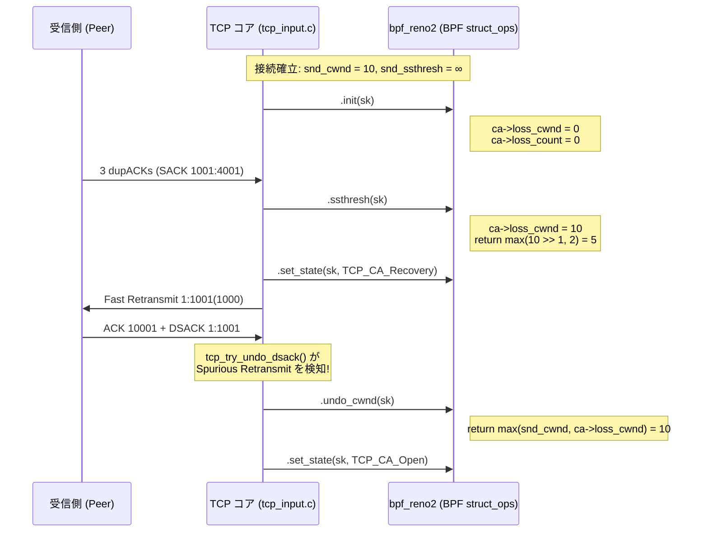

# 15. ハンズオン: BPF CC と packetdrill で作る CUBIC

リポジトリの `labs/cubic/` ディレクトリにある全 6 ステップのハンズオン教材です。各ステップの設計チェックポイントを考えたうえで `starter.bpf.c` の `TODO` を埋め、`./labs/run_test.sh cubic/<step>` で `vng` + `bpftool` + `packetdrill` による実機テストを回せます。


## Step 1: 最小の BPF CC 骨格と Slow Start + Reno AI

### 学習ゴール

このステップでは、Linux カーネルの `struct tcp_congestion_ops` を BPF の `struct_ops` 機能で実装し、すべての輻輳制御アルゴリズムの基礎となる **TCP Reno（Slow Start と Additive Increase）** をゼロから組み立てます。

カーネル内の `tcp_slow_start()` や `tcp_cong_avoid_ai()` といった `extern __ksym` 関数には頼らず、純粋な BPF コードとして 1 行ずつ記述することで、`tp->snd_cwnd`・`tp->snd_ssthresh`・`tp->snd_cwnd_cnt` が ACK 到着ごとにどのように更新されるかを完全に可視化します。

---

### 設計チェックポイント（VibeWise 方式 — コードを見る前に考えよう）

`starter.bpf.c` や `solution.bpf.c` を開く前に、以下の 4 つの問いを自分の頭で考えてみましょう。

#### Q1. 状態管理の設計：Reno には独自の private 構造体（`icsk_ca_priv`）が必要でしょうか？

CUBIC や BBR ではソケットごとの独自状態（`inet_csk_ca(sk)`）を使いますが、Reno の Slow Start と Additive Increase（1 RTT あたり `+1 cwnd`）を実装するために必要な変数は、`struct tcp_sock` の中にすでに用意されているでしょうか？

<details>
<summary>ヒントと答え</summary>

- **ヒント**: `struct tcp_sock` には現在の輻輳ウィンドウ `snd_cwnd`、スロースタート閾値 `snd_ssthresh` に加えて、1 パケット未満の端数クレジットを蓄積するカウンタが存在します。
- **答え**: 独自の `icsk_ca_priv` 構造体は不要です。`struct tcp_sock` が持つ以下のフィールドだけで完結します。
  - `tp->snd_cwnd`: 現在の輻輳ウィンドウ（セグメント単位）
  - `tp->snd_ssthresh`: Slow Start から Congestion Avoidance へ移行する閾値
  - `tp->snd_cwnd_cnt`: Congestion Avoidance 中に ACK されたセグメント数を数える線形増加カウンタ
  - `tp->prior_cwnd`: ロス検知前の `snd_cwnd` の退避値（Undo 用）

</details>

#### Q2. フックの選択とガード条件：アプリがデータを少ししか送っていないときでも `snd_cwnd` を増やしてよいでしょうか？

ACK が届くたびに呼ばれる `.cong_avoid(sk, ack, acked)` フックで、無条件に `tp->snd_cwnd` を増やすと何が起きるでしょうか？たとえば `snd_cwnd = 10` なのにアプリが毎 RTT 1 セグメントしか送信しない場合を考えてみてください。

<details>
<summary>ヒントと答え</summary>

- **ヒント**: ネットワークの空き容量を実際に試していないのに `snd_cwnd` だけが増え続けると、突然バースト送信が発生した際に大崩壊を起こします（RFC 7661 / Cwnd Validation）。
- **答え**: 送信が本当に `snd_cwnd` によって律速されている（パイプを `snd_cwnd` いっぱいまで使い切っている）ときだけウィンドウを増やす必要があります。そのため、`.cong_avoid()` の先頭で必ず `!tcp_is_cwnd_limited(sk)` をチェックし、律速されていなければ即座に `return` します。

</details>

#### Q3. 境界条件の設計：Slow Start 中に `snd_ssthresh` をまたぐ Stretch ACK が届いたら？

現在 `tp->snd_cwnd = 20`、`tp->snd_ssthresh = 22` だとします。ここで 20 セグメント分を一括で ACK する Stretch ACK（`acked = 20`）が届いたとき、`snd_cwnd` と `snd_cwnd_cnt` はそれぞれいくつになるべきでしょうか？

<details>
<summary>ヒントと答え</summary>

- **ヒント**: `snd_ssthresh`（22）までは Slow Start で 1 ACK あたり +1 増えますが、`snd_ssthresh` に達した瞬間に残りの `acked` はどこへ行くべきでしょうか？
- **答え**:
  - まず Slow Start として `22 - 20 = 2` セグメント分の `acked` を使い、`tp->snd_cwnd` を `22`（`snd_ssthresh`）まで引き上げます。
  - まだ使われていない残りの `acked = 20 - 2 = 18` セグメント分は捨てずに、そのまま Congestion Avoidance（Additive Increase）の処理へフォールスルーさせ、`tp->snd_cwnd_cnt += 18` として蓄積します。
  - もし `snd_ssthresh` に達していない（`acked` をすべて Slow Start で使い切った）場合は、`if (!acked) return;` で早期リターンします。

</details>

#### Q4. 浮動小数点なしの Additive Increase：BPF で `cwnd += acked / cwnd` をどう表現する？

BPF プログラム内では浮動小数点演算（`float` / `double`）が使えません。1 セグメント ACK されるごとに `snd_cwnd` を `1 / snd_cwnd` ずつ増やす（＝1 RTT で `snd_cwnd` 個の ACK が届いたら `+1` する）には、整数演算だけでどう実装すればよいでしょうか？

<details>
<summary>ヒントと答え</summary>

- **ヒント**: 分母が `tp->snd_cwnd` である分数 `tp->snd_cwnd_cnt / tp->snd_cwnd` の分子だけを整数変数 `tp->snd_cwnd_cnt` に貯めていきます。
- **答え**:
  - ACK のたびに `tp->snd_cwnd_cnt += acked` と分子を加算します。
  - `tp->snd_cwnd_cnt >= tp->snd_cwnd`（分子が分母以上に達した＝1 RTT 分の ACK が集まった）タイミングで、`tp->snd_cwnd_cnt -= tp->snd_cwnd` と引き算し、`tp->snd_cwnd` を `+1`（上限 `tp->snd_cwnd_clamp` でクランプ）します。

</details>

---

### 実装ステップと解説

[`solution.bpf.c`](file:///usr/local/google/home/kuniyu/tcp-eli5/labs/cubic/step01-reno/solution.bpf.c) の各関数を順に見ていきます。

#### 1. `bpf_reno1_init()` — ソケットの初期化

```c
SEC("struct_ops")
void BPF_PROG(bpf_reno1_init, struct sock *sk)
{
	struct tcp_sock *tp = tcp_sk(sk);

	tp->snd_cwnd_cnt = 0;
	tp->snd_ssthresh = 22;
}
```

- TCP コネクション確立時（または `setsockopt(TCP_CONGESTION)` 時）に呼ばれます。
- 線形増加用の端数カウンタ `tp->snd_cwnd_cnt` を `0` にリセットします。
- 本ハンズオンの `test.pkt` では、パケットロスを発生させずに「純粋な Slow Start（`10 -> 20`）」「`snd_ssthresh` 境界でのクランプと余剰 `acked` の引き継ぎ（`20 -> 22`）」「Reno Additive Increase（`22 -> 23`）」の 3 段階を連続して観察できるよう、初期 `tp->snd_ssthresh` を `22` に設定しています。

#### 2. `bpf_reno1_ssthresh()` — ロス検知時の閾値計算

```c
SEC("struct_ops")
__u32 BPF_PROG(bpf_reno1_ssthresh, struct sock *sk)
{
	const struct tcp_sock *tp = tcp_sk(sk);

	return max(tp->snd_cwnd >> 1U, 2U);
}
```

- パケットロスを検知して Fast Recovery や RTO に入る際、新しい `snd_ssthresh` を決定するために呼ばれます。
- Reno の Multiplicative Decrease（乗算的減少）に従い、現在の `tp->snd_cwnd` を半分（`>> 1U`）にします。ただし RFC 5681 の規定により最小値 `2U` を下回らないよう `max(..., 2U)` で保護します。

#### 3. `bpf_reno1_cong_avoid()` — Slow Start と Reno Additive Increase

```c
SEC("struct_ops")
void BPF_PROG(bpf_reno1_cong_avoid, struct sock *sk, __u32 ack, __u32 acked)
{
	struct tcp_sock *tp = tcp_sk(sk);

	if (!tcp_is_cwnd_limited(sk))
		return;

	if (tcp_in_slow_start(tp)) {
		__u32 cwnd = min(tp->snd_cwnd + acked, tp->snd_ssthresh);

		acked -= cwnd - tp->snd_cwnd;
		tp->snd_cwnd = min(cwnd, tp->snd_cwnd_clamp);
		if (!acked)
			return;
	}

	tp->snd_cwnd_cnt += acked;
	if (tp->snd_cwnd_cnt >= tp->snd_cwnd) {
		tp->snd_cwnd_cnt -= tp->snd_cwnd;
		tp->snd_cwnd = min(tp->snd_cwnd + 1, tp->snd_cwnd_clamp);
	}
}
```

- **Cwnd-limited チェック**: `tcp_is_cwnd_limited(sk)` が偽（アプリが `snd_cwnd` を使い切っていない）なら何もしません。
- **Slow Start フェーズ**: `tcp_in_slow_start(tp)`（すなわち `tp->snd_cwnd < tp->snd_ssthresh`）の間は、`tp->snd_cwnd + acked` を `tp->snd_ssthresh` でクランプした新しい `cwnd` を求めます。Slow Start で消費した分（`cwnd - tp->snd_cwnd`）を `acked` から差し引き、`acked` が `0` になればここで終了します。
- **Congestion Avoidance（Reno AI）フェーズ**: 残った `acked` を `tp->snd_cwnd_cnt` に加算し、`tp->snd_cwnd` 以上に達したら `tp->snd_cwnd` を引いてウィンドウサイズを `+1` します。
- **BPF Verifier のポイント**: ループを使わずに 1 回の条件分岐で更新しているため、BPF verifier の命令数・ループ解析に引っかかることなく安全に検証を通過します。

#### 4. `bpf_reno1_undo_cwnd()` — 誤検知時のウィンドウ復元

```c
SEC("struct_ops")
__u32 BPF_PROG(bpf_reno1_undo_cwnd, struct sock *sk)
{
	const struct tcp_sock *tp = tcp_sk(sk);

	return max(tp->snd_cwnd, tp->prior_cwnd);
}
```

- DSACK や Eifel 検知によって「先ほどのロス検知はパケット並べ替え等による誤検知（Spurious Retransmission）だった」と判明した際に呼ばれ、縮小前の `tp->prior_cwnd` へ `snd_cwnd` を戻します（Step 2 で詳しくテストします）。

---

### packetdrill テストの解説

[`test.pkt`](file:///usr/local/google/home/kuniyu/tcp-eli5/labs/cubic/step01-reno/test.pkt) では、以下のシナリオを実行して `bpf_reno1` の動作を検証しています。

1. **MSS = 1000 バイトのコネクション確立**:
   - クライアントからの SYN パケットで `<mss 1012,sackOK,TS val 100 ecr 0,nop,wscale 7>` を指定します。
   - TCP Timestamps オプション（`nop,nop,TS` で 12 バイト）が有効なため、実効ペイロード長 `tp->mss_cache` は `1012 - 12 = 1000` バイトちょうどになり、`1000` バイト単位でセグメント数を直感的に計算できます。
   - 3-way ハンドシェイク直後、初期ウィンドウ `tcpi_snd_cwnd == 10` と `tcpi_snd_ssthresh == 22` をアサートします。
2. **フェーズ 1：純粋な Slow Start（`cwnd: 10 -> 20`）**:
   - `write(4, ..., 10000)` で 10 セグメント（10,000 バイト）を送信します。`snd_cwnd == 10` を使い切るため、`tp->is_cwnd_limited` が `true` になります。
   - `ack 10001`（`acked = 10`）を受信すると、Slow Start により `tcpi_snd_cwnd` が `10 + 10 = 20` に倍増することを確認します。
3. **フェーズ 2：`snd_ssthresh` 境界クランプと余剰クレジットの引き継ぎ（`cwnd: 20 -> 22`）**:
   - `write(4, ..., 20000)` で 20 セグメント（20,000 バイト）を送信して再び `snd_cwnd == 20` を使い切ります。
   - `ack 30001`（`acked = 20`）を受信すると、`snd_ssthresh == 22` でクランプされるため Slow Start で `2` セグメント分だけ消費されて `tcpi_snd_cwnd == 22` になり、残りの `18` セグメント分が `tp->snd_cwnd_cnt = 18` に蓄えられます。
4. **フェーズ 3：Reno Additive Increase（`cwnd: 22 -> 23`）**:
   - `write(4, ..., 22000)` で 22 セグメント（22,000 バイト）を送信し、`ack 52001`（`acked = 22`）を受信します。
   - Congestion Avoidance により `tp->snd_cwnd_cnt` が `18 + 22 = 40 >= 22` となり、`tcpi_snd_cwnd` が `+1` されて `23` になることを確認します。

---

### 実行方法

`/usr/local/google/home/kuniyu/tcp-eli5/labs/cubic/step01-reno` ディレクトリ（または `labs/` ルート）から以下のコマンドを実行します。

```sh
## 1. starter.bpf.c がアサートで失敗することを確認
../../run_test.sh cubic/step01-reno starter
## 2. starter.bpf.c の TODO を実装して再実行（または模範解答 solution を実行）
../../run_test.sh cubic/step01-reno solution
```


### `labs/cubic/step01-reno/starter.bpf.c`（穴埋めスケルトン）

```c
// SPDX-License-Identifier: GPL-2.0
/*
 * Step 1 (Starter): Minimal BPF Congestion Control Skeleton + Slow Start & Reno AI
 *
 * Fill in the TODOs below to implement TCP Reno in pure BPF.
 */
#include "bpf_cc_helpers.h"

char _license[] SEC("license") = "GPL";

SEC("struct_ops")
void BPF_PROG(bpf_reno1_init, struct sock *sk)
{
	struct tcp_sock *tp = tcp_sk(sk);

	tp->snd_cwnd_cnt = 0;
	/* Pre-configured to 22 segments for test.pkt so we can observe
	 * both Slow Start (10 -> 20 -> 22) and Reno AI (22 -> 23).
	 */
	tp->snd_ssthresh = 22;
}

SEC("struct_ops")
__u32 BPF_PROG(bpf_reno1_ssthresh, struct sock *sk)
{
	const struct tcp_sock *tp = tcp_sk(sk);

	/* TODO 1: Return half of tp->snd_cwnd, but at least 2U. */
	(void)tp;
	return 2U;
}

SEC("struct_ops")
void BPF_PROG(bpf_reno1_cong_avoid, struct sock *sk, __u32 ack, __u32 acked)
{
	struct tcp_sock *tp = tcp_sk(sk);

	/* TODO 2: Return early if the socket is not cwnd-limited
	 *         (!tcp_is_cwnd_limited(sk)).
	 */

	/* TODO 3: Slow Start (if tcp_in_slow_start(tp)):
	 *   - Grow tp->snd_cwnd by acked, clamped at tp->snd_ssthresh
	 *     (and tp->snd_cwnd_clamp).
	 *   - Subtract the used growth from acked.
	 *   - If acked == 0, return early; otherwise fall through to
	 *     Congestion Avoidance with the remaining acked segments.
	 */

	/* TODO 4: Congestion Avoidance (Reno Additive Increase):
	 *   - Add acked to tp->snd_cwnd_cnt.
	 *   - When tp->snd_cwnd_cnt >= tp->snd_cwnd, subtract tp->snd_cwnd
	 *     from tp->snd_cwnd_cnt and increment tp->snd_cwnd by 1
	 *     (clamped at tp->snd_cwnd_clamp).
	 */
	(void)tp;
	(void)ack;
	(void)acked;
}

SEC("struct_ops")
__u32 BPF_PROG(bpf_reno1_undo_cwnd, struct sock *sk)
{
	const struct tcp_sock *tp = tcp_sk(sk);

	/* TODO 5: Return the maximum of tp->snd_cwnd and tp->prior_cwnd. */
	return tp->snd_cwnd;
}

SEC(".struct_ops")
struct tcp_congestion_ops bpf_reno1 = {
	.init		= (void *)bpf_reno1_init,
	.ssthresh	= (void *)bpf_reno1_ssthresh,
	.cong_avoid	= (void *)bpf_reno1_cong_avoid,
	.undo_cwnd	= (void *)bpf_reno1_undo_cwnd,
	.flags		= TCP_CONG_NON_RESTRICTED,
	.name		= "bpf_reno1",
};
```


### `labs/cubic/step01-reno/test.pkt`（packetdrill テスト）

```python
// SPDX-License-Identifier: GPL-2.0
// Step 1: Test BPF Reno Slow Start, ssthresh boundary clamping, and Reno AI

0.00 `sysctl -q net.ipv4.tcp_congestion_control=bpf_reno1`

// Establish a passive TCP connection.
// MSS = 1012 with 12-byte TCP Timestamps option -> tp->mss_cache == 1000 bytes.
+0.00 socket(..., SOCK_STREAM, IPPROTO_TCP) = 3
+0.00 setsockopt(3, SOL_SOCKET, SO_REUSEADDR, [1], 4) = 0
+0.00 bind(3, ..., ...) = 0
+0.00 listen(3, 1) = 0

+0.00 < S 0:0(0) win 32792 <mss 1012,sackOK,TS val 100 ecr 0,nop,wscale 7>
+0.00 > S. 0:0(0) ack 1 <mss 1460,sackOK,TS val 100 ecr 100,nop,wscale 7>
+0.01 < . 1:1(0) ack 1 win 257 <nop,nop,TS val 110 ecr 100>
+0.00 accept(3, ..., ...) = 4

// Verify initial cwnd == 10 and ssthresh == 22 (from bpf_reno1_init).
+0.00 %{
assert tcpi_snd_cwnd == 10, f"expected initial cwnd 10, got {tcpi_snd_cwnd}"
assert tcpi_snd_ssthresh == 22, f"expected initial ssthresh 22, got {tcpi_snd_ssthresh}"
}%

// 1. Pure Slow Start: send 10,000 bytes (10 segments == full cwnd, so
//    tp->is_cwnd_limited becomes true) and ACK them. cwnd grows 10 -> 20.
+0.00 write(4, ..., 10000) = 10000
+0.00 > P. 1:10001(10000) ack 1 <nop,nop,TS val 110 ecr 110>
+0.01 < . 1:1(0) ack 10001 win 257 <nop,nop,TS val 120 ecr 110>
+0.00 %{
assert tcpi_snd_cwnd == 20, f"expected cwnd 20 after Slow Start, got {tcpi_snd_cwnd}"
}%

// 2. Slow Start -> Congestion Avoidance transition:
//    Send 20,000 bytes (20 segments == full cwnd 20) and ACK all 20 segments.
//    - Slow Start uses 2 segments to reach ssthresh (20 -> 22).
//    - The remaining 18 ACKed segments fall through to Congestion Avoidance,
//      setting tp->snd_cwnd_cnt = 18 (< 22, so cwnd stays 22).
+0.00 write(4, ..., 20000) = 20000
+0.00 > P. 10001:30001(20000) ack 1 <nop,nop,TS val 120 ecr 120>
+0.01 < . 1:1(0) ack 30001 win 257 <nop,nop,TS val 130 ecr 120>
+0.00 %{
assert tcpi_snd_cwnd == 22, f"expected cwnd 22 at ssthresh boundary, got {tcpi_snd_cwnd}"
}%

// 3. Reno Additive Increase:
//    Send 22,000 bytes (22 segments == full cwnd 22) and ACK them.
//    tp->snd_cwnd_cnt (18 + 22 = 40 >= 22) triggers +1 cwnd (22 -> 23).
+0.00 write(4, ..., 22000) = 22000
+0.00 > P. 30001:52001(22000) ack 1 <nop,nop,TS val 130 ecr 130>
+0.01 < . 1:1(0) ack 52001 win 257 <nop,nop,TS val 140 ecr 130>
+0.00 %{
assert tcpi_snd_cwnd == 23, f"expected cwnd 23 after Reno AI, got {tcpi_snd_cwnd}"
}%
```


<details>
<summary>模範解答: <code>labs/cubic/step01-reno/solution.bpf.c</code></summary>

```c
// SPDX-License-Identifier: GPL-2.0
/*
 * Step 1: Minimal BPF Congestion Control Skeleton + Slow Start & Reno AI
 *
 * Implements TCP Reno from scratch in pure BPF (without calling kernel
 * extern __ksym helpers) so every line of Slow Start and Additive Increase
 * is visible and testable with packetdrill.
 */
#include "bpf_cc_helpers.h"

char _license[] SEC("license") = "GPL";

SEC("struct_ops")
void BPF_PROG(bpf_reno1_init, struct sock *sk)
{
	struct tcp_sock *tp = tcp_sk(sk);

	tp->snd_cwnd_cnt = 0;
	/* Set initial ssthresh to 22 segments so we can observe:
	 * 1) Pure Slow Start (cwnd: 10 -> 20)
	 * 2) Slow Start -> Congestion Avoidance boundary (cwnd: 20 -> 22,
	 *    with 18 leftover ACKed segments carried into snd_cwnd_cnt)
	 * 3) Reno Additive Increase (cwnd: 22 -> 23)
	 */
	tp->snd_ssthresh = 22;
}

SEC("struct_ops")
__u32 BPF_PROG(bpf_reno1_ssthresh, struct sock *sk)
{
	const struct tcp_sock *tp = tcp_sk(sk);

	return max(tp->snd_cwnd >> 1U, 2U);
}

SEC("struct_ops")
void BPF_PROG(bpf_reno1_cong_avoid, struct sock *sk, __u32 ack, __u32 acked)
{
	struct tcp_sock *tp = tcp_sk(sk);

	if (!tcp_is_cwnd_limited(sk))
		return;

	/* 1. Slow Start: exponential growth (+1 cwnd per ACKed segment)
	 *    clamped at tp->snd_ssthresh. Any leftover acked segments
	 *    fall through to Congestion Avoidance.
	 */
	if (tcp_in_slow_start(tp)) {
		__u32 cwnd = min(tp->snd_cwnd + acked, tp->snd_ssthresh);

		acked -= cwnd - tp->snd_cwnd;
		tp->snd_cwnd = min(cwnd, tp->snd_cwnd_clamp);
		if (!acked)
			return;
	}

	/* 2. Congestion Avoidance (Reno Additive Increase):
	 *    accumulate ACKed segments in tp->snd_cwnd_cnt and increase
	 *    tp->snd_cwnd by 1 once a full cwnd worth of ACKs arrives.
	 */
	tp->snd_cwnd_cnt += acked;
	if (tp->snd_cwnd_cnt >= tp->snd_cwnd) {
		tp->snd_cwnd_cnt -= tp->snd_cwnd;
		tp->snd_cwnd = min(tp->snd_cwnd + 1, tp->snd_cwnd_clamp);
	}
}

SEC("struct_ops")
__u32 BPF_PROG(bpf_reno1_undo_cwnd, struct sock *sk)
{
	const struct tcp_sock *tp = tcp_sk(sk);

	return max(tp->snd_cwnd, tp->prior_cwnd);
}

SEC(".struct_ops")
struct tcp_congestion_ops bpf_reno1 = {
	.init		= (void *)bpf_reno1_init,
	.ssthresh	= (void *)bpf_reno1_ssthresh,
	.cong_avoid	= (void *)bpf_reno1_cong_avoid,
	.undo_cwnd	= (void *)bpf_reno1_undo_cwnd,
	.flags		= TCP_CONG_NON_RESTRICTED,
	.name		= "bpf_reno1",
};
```

</details>

---

## Step 2: Loss / Fast Recovery と DSACK Undo

### 学習ゴール

Step 1 では、パケットロスが起きない理想的な環境で Slow Start と Congestion Avoidance を実装しました。しかし現実のネットワークでは、ルータのバッファ溢れによる**パケットロス**や、経路の揺らぎによる**パケットの並べ替え（Reordering）**が日常的に発生します。

このステップでは、TCP の輻輳制御アルゴリズム（CC）がパケットロスに直面したとき、およびそのロス判定が「実は並べ替えによる誤検出（Spurious Retransmission）だった」と判明したときに、TCP コアとどのように連携するかを学びます。

具体的には、以下の 4 つの仕組みを `bpf_reno2` として実装・検証します。

- ソケットごとの CC 私有領域 `inet_csk_ca(sk)`（`icsk_ca_priv`）を使ったカスタム状態構造体 `struct bpf_reno2_ca` の管理
- `.ssthresh` フックによるロス前の `snd_cwnd` の退避と、しきい値の半減（$\max(\text{cwnd} / 2, 2)$）
- `.set_state` フックによる `TCP_CA_Loss`（RTO タイムアウト）遷移時の端数カウンタリセットと統計記録
- `.undo_cwnd` フックによる DSACK（Duplicate SACK）受信時のウィンドウ復元（Undo）

---

### 設計チェックポイント（VibeWise 方式 — コードを見る前に考えよう）

`starter.bpf.c` を開く前に、以下の 4 つの問いを自分の頭で考えてみましょう。

#### Q1. ソケットごとの独自状態はどこに保存するか？

ロス判定が誤り（Spurious）だったときに元の `snd_cwnd` へ戻すには、「ロスに入る直前の `snd_cwnd`」や「RTO が何回起きたか」をソケットごとに記憶しておく必要があります。BPF グローバル変数に置くと全ソケットで上書きし合ってしまいます。カーネルの `struct sock` のどこに、何バイトまで独自の構造体を置けるでしょうか？

<details>
<summary>ヒントと答え</summary>

`struct inet_connection_sock` の末尾付近にある `icsk_ca_priv` 配列（104 バイト）を使います。`bpf_cc_helpers.h` の `inet_csk_ca(sk)` ヘルパーを使うと、`icsk->icsk_ca_priv` の先頭ポインタを `void *` として取得できます。

今回は以下の 8 バイトの構造体を定義してキャストして使います。

```c
struct bpf_reno2_ca {
	u32 loss_cwnd;
	u32 loss_count;
};
```

なお、BPF ベリファイア（`bpf_tcp_ca_btf_struct_access()`）は `icsk_ca_priv` の範囲内への書き込みを許可しています。

</details>

#### Q2. Fast Recovery に入るとき、CC が実際に書き換えるのは `snd_cwnd` か `snd_ssthresh` か？

3 回の重複 ACK（SACK）で Fast Recovery（`TCP_CA_Recovery`）に入るとき、TCP コアの `tcp_init_cwnd_reduction()` が呼ばれます。このとき CC モジュールのどのフックが呼ばれ、CC は何を返すべきでしょうか？また、`snd_cwnd` 自体を半分に減らす処理は誰が担当するでしょうか？

<details>
<summary>ヒントと答え</summary>

呼ばれるフックは `.ssthresh(sk)` です。CC モジュールはここで `tp->snd_cwnd` を直接書き換えるのではなく、**新しい `snd_ssthresh` の値（Reno なら `max(tp->snd_cwnd >> 1U, 2U)`）を計算して返すだけ**です。

実際の `tp->snd_cwnd` の削減は、TCP コア側が Recovery 中に **PRR（Proportional Rate Reduction, RFC 6937）**（`tcp_cwnd_reduction()`）を使って `snd_ssthresh` に向けて滑らかに減らし、Recovery を抜ける際の `tcp_end_cwnd_reduction()` で `tp->snd_cwnd = tp->snd_ssthresh` に揃えます。

したがって、`.ssthresh(sk)` が呼ばれた時点では `tp->snd_cwnd` はまだ**削減前の値**を保っています。このタイミングで `ca->loss_cwnd = tp->snd_cwnd` を保存しておくのが正解です。

</details>

#### Q3. RTO（`TCP_CA_Loss`）に遷移したとき、なぜ `tp->snd_cwnd_cnt` を 0 にリセットするのか？

パケットロスが Fast Recovery で回復できず RTO（Retransmission Timeout）が発火すると、TCP コアは `tcp_set_ca_state(sk, TCP_CA_Loss)` を呼びます。このとき `.set_state(sk, new_state)` フックで `new_state == TCP_CA_Loss` を検知したら、なぜ `tp->snd_cwnd_cnt = 0` にリセットすべきなのでしょうか？

<details>
<summary>ヒントと答え</summary>

`tp->snd_cwnd_cnt` は Congestion Avoidance 中に「1 RTT で `snd_cwnd` を +1 するための ACK パケット数クレジット（端数）」を貯めているカウンタです。ロスが発生してウィンドウサイズがリセットされた後に、ロス前の大きなウィンドウ時代に貯めた端数クレジットが残っていると、再び Congestion Avoidance に入った直後に意図せず早く `snd_cwnd` が +1 されてしまいます。

そのため、`new_state == TCP_CA_Loss` への遷移時には `tp->snd_cwnd_cnt = 0` にクリアし、あわせてロスカウンタ `ca->loss_count++` を記録します（後続のステップで作る CUBIC でも、`.set_state` で `TCP_CA_Loss` を見て内部状態をリセットします）。

</details>

#### Q4. DSACK で Undo するとき、なぜ単純に `return ca->loss_cwnd;` ではなく `max(tp->snd_cwnd, ca->loss_cwnd)` を返すのか？

再送したパケットが DSACK（Duplicate SACK）によって「元のパケットも届いていた（＝再送は不要だった）」と判明すると、TCP コアの `tcp_try_undo_dsack()` → `tcp_undo_cwnd_reduction()` から `.undo_cwnd(sk)` が呼ばれます。このとき `return ca->loss_cwnd;` ではなく `return max(tp->snd_cwnd, ca->loss_cwnd);` とするのはどのようなエッジケースを防ぐためでしょうか？

<details>
<summary>ヒントと答え</summary>

誤検出された Recovery や Loss の最中に多くの ACK が到着してウィンドウが成長し、Undo が発動した時点での現在の `tp->snd_cwnd` が、すでにロス開始時の `ca->loss_cwnd` を上回っているケースがあり得ます。

もし無条件に `ca->loss_cwnd` で上書きしてしまうと、「Undo した結果かえって `snd_cwnd` が減ってしまう」という逆転現象が起きます。`max(tp->snd_cwnd, ca->loss_cwnd)` を取ることで、現在のウィンドウを決して縮小させずにロス前の水準以上へ復元できます。

</details>

---

### 実装ステップと解説



#### 1. 私有データ構造体 `struct bpf_reno2_ca` と `.init`

```c
struct bpf_reno2_ca {
	u32 loss_cwnd;
	u32 loss_count;
};

SEC("struct_ops")
void BPF_PROG(bpf_reno2_init, struct sock *sk)
{
	struct bpf_reno2_ca *ca = inet_csk_ca(sk);

	ca->loss_cwnd = 0;
	ca->loss_count = 0;
}
```

- `inet_csk_ca(sk)` は `(void *)inet_csk(sk)->icsk_ca_priv` を返します。
- ソケット確立時（または `setsockopt(TCP_CONGESTION)` による切り替え時）に呼ばれる `bpf_reno2_init()` で `loss_cwnd` と `loss_count` を `0` に初期化します。

#### 2. しきい値の計算と cwnd の退避: `.ssthresh`

```c
SEC("struct_ops")
u32 BPF_PROG(bpf_reno2_ssthresh, struct sock *sk)
{
	const struct tcp_sock *tp = tcp_sk(sk);
	struct bpf_reno2_ca *ca = inet_csk_ca(sk);

	ca->loss_cwnd = tp->snd_cwnd;
	return max(tp->snd_cwnd >> 1U, 2U);
}
```

- [RFC 5681 §3.1](https://www.rfc-editor.org/rfc/rfc5681#section-3.1) に従い、輻輳発生時の新しい `snd_ssthresh` として現在の `snd_cwnd` の半分（右シフト `>> 1U`）と下限 `2U` の大きい方を返します。
- 同時に、後で DSACK Undo が起きたときに戻せるよう、削減前の `tp->snd_cwnd` を `ca->loss_cwnd` に退避します。

#### 3. Loss 状態への遷移処理: `.set_state`

```c
SEC("struct_ops")
void BPF_PROG(bpf_reno2_set_state, struct sock *sk, u8 new_state)
{
	struct tcp_sock *tp = tcp_sk(sk);
	struct bpf_reno2_ca *ca = inet_csk_ca(sk);

	if (new_state == TCP_CA_Loss) {
		tp->snd_cwnd_cnt = 0;
		ca->loss_count++;
	}
}
```

- TCP コアの `tcp_set_ca_state()` が `icsk_ca_state` を書き換える直前に呼ばれます。
- `new_state == TCP_CA_Loss`（RTO による Loss 状態突入）のとき、`tp->snd_cwnd_cnt = 0` にリセットして `ca->loss_count` をインクリメントします。
- BPF ベリファイアの制約として、`struct tcp_sock` の全フィールドが書き込み可能なわけではありませんが、`snd_cwnd`、`snd_cwnd_cnt`、`snd_ssthresh`、および `icsk_ca_priv` は `bpf_tcp_ca_btf_struct_access()` で明示的に書き込みが許可されています。

#### 4. Spurious Retransmission からの復元: `.undo_cwnd`

```c
SEC("struct_ops")
u32 BPF_PROG(bpf_reno2_undo_cwnd, struct sock *sk)
{
	const struct tcp_sock *tp = tcp_sk(sk);
	const struct bpf_reno2_ca *ca = inet_csk_ca(sk);

	return max(tp->snd_cwnd, ca->loss_cwnd);
}
```

- DSACK（[RFC 2883](https://www.rfc-editor.org/rfc/rfc2883) / [RFC 3708](https://www.rfc-editor.org/rfc/rfc3708)）や TCP タイムスタンプ（Eifel Detection, [RFC 3522](https://www.rfc-editor.org/rfc/rfc3522)）によって「さきほどの再送は並べ替えによる誤検出だった」と判明した際、`tcp_undo_cwnd_reduction()` から呼ばれます。
- `max(tp->snd_cwnd, ca->loss_cwnd)` を返すことで、半減されたウィンドウをロス前の `loss_cwnd` へ即座に戻します（なお、`snd_ssthresh` 自体は TCP コア側が `tp->prior_ssthresh` を使って復元します）。

---

### packetdrill テストの解説 (`test.pkt`)

`test.pkt` は、**パケットの到着順序逆転（Reordering）によって誤って Fast Recovery に入った後、DSACK によってウィンドウが元の 10 に復元される一連の流れ**を再現しています。

1. **接続確立と IW10 の送信**:
   - `<mss 1012,sackOK,TS val 100 ecr 0,nop,wscale 7>` で接続を確立します。TCP Timestamp オプションが 12 バイトを占めるため、1 セグメントあたりのデータペイロードはちょうど `1000` バイトになります。
   - `write(4, ..., 10000)` で 10 セグメント（`1:10001(10000)`）を一気に送信します。この時点で `tcpi_snd_cwnd == 10`、`tcpi_ca_state == TCP_CA_Open` です。
2. **3 回の重複 ACK（SACK）による Fast Recovery 突入**:
   - 先頭セグメント `1:1001` がネットワーク内で遅延し、後続の `1001:2001`、`2001:3001`、`3001:4001` が先に受信側へ届いた状況を模擬します。
   - 受信側が `ack 1` に SACK ブロック `<nop,nop,TS ...,nop,nop,sack 1001:2001>`、`<...,sack 1001:3001>`、`<...,sack 1001:4001>` を付けて 3 回返すと、3 つ目の dupACK で `sacked_out == 3`（`>= tp->reordering`）となり、Fast Recovery が発動します。
   - カーネルは `1:1001(1000)` を Fast Retransmit し、`.ssthresh` フックが呼ばれて `tcpi_snd_ssthresh == 5`、`tcpi_ca_state == TCP_CA_Recovery` になります。
3. **DSACK 付きの累積 ACK による Undo**:
   - 直後に、遅延していた本来の `1:1001` も残りのセグメントもすべて受信側に届き、さらに再送した `1:1001` が重複して届いたため、受信側は累積 ACK `ack 10001` に **DSACK ブロック `<nop,nop,TS ...,nop,nop,sack 1:1001>`**（すでに `ack 10001` 以下の範囲を SACK しているので重複受信の報告）を添えて返します。
   - カーネルは `undo_retrans == 0` となったことで `tcp_try_undo_dsack()` を呼び、`.undo_cwnd` フックによって `tcpi_snd_cwnd` が半減した `5` から元の `10` 以上（`tcpi_snd_cwnd >= 10`）に復元されたことをアサートします。

---

### 実行方法

```sh
## 1. starter.bpf.c がアサートで失敗することを確認
../../run_test.sh cubic/step02-loss-undo starter
## 2. starter.bpf.c の TODO を実装して再実行（または模範解答 solution を実行）
../../run_test.sh cubic/step02-loss-undo solution
```


### `labs/cubic/step02-loss-undo/starter.bpf.c`（穴埋めスケルトン）

```c
/* SPDX-License-Identifier: GPL-2.0 */
#include "bpf_cc_helpers.h"

char _license[] SEC("license") = "GPL";

struct bpf_reno2_ca {
	u32 loss_cwnd;
	u32 loss_count;
};

SEC("struct_ops")
void BPF_PROG(bpf_reno2_init, struct sock *sk)
{
	struct bpf_reno2_ca *ca = inet_csk_ca(sk);

	ca->loss_cwnd = 0;
	ca->loss_count = 0;
}

SEC("struct_ops")
u32 BPF_PROG(bpf_reno2_ssthresh, struct sock *sk)
{
	const struct tcp_sock *tp = tcp_sk(sk);
	struct bpf_reno2_ca *ca = inet_csk_ca(sk);

	/*
	 * TODO 1:
	 * 1. ロス検出直前のウィンドウサイズ tp->snd_cwnd を ca->loss_cwnd に保存する
	 * 2. 半減させたしきい値 max(tp->snd_cwnd >> 1U, 2U) を返す
	 */
	(void)ca;
	return tp->snd_cwnd;
}

SEC("struct_ops")
void BPF_PROG(bpf_reno2_set_state, struct sock *sk, u8 new_state)
{
	struct tcp_sock *tp = tcp_sk(sk);
	struct bpf_reno2_ca *ca = inet_csk_ca(sk);

	/*
	 * TODO 2:
	 * new_state == TCP_CA_Loss のとき、端数カウンタ tp->snd_cwnd_cnt を 0 にリセットし、
	 * ca->loss_count をインクリメントする
	 */
	(void)tp;
	(void)ca;
	(void)new_state;
}

SEC("struct_ops")
u32 BPF_PROG(bpf_reno2_undo_cwnd, struct sock *sk)
{
	const struct tcp_sock *tp = tcp_sk(sk);
	const struct bpf_reno2_ca *ca = inet_csk_ca(sk);

	/*
	 * TODO 3:
	 * DSACK 等でロス検出が誤り（spurious）と判明した際、
	 * 現在の tp->snd_cwnd と退避しておいた ca->loss_cwnd の大きい方を返す
	 */
	(void)ca;
	return tp->snd_cwnd;
}

SEC("struct_ops")
void BPF_PROG(bpf_reno2_cong_avoid, struct sock *sk, u32 ack, u32 acked)
{
	struct tcp_sock *tp = tcp_sk(sk);

	if (!tcp_is_cwnd_limited(sk))
		return;

	if (tcp_in_slow_start(tp)) {
		u32 cwnd = min(tp->snd_cwnd + acked, tp->snd_ssthresh);

		acked -= cwnd - tp->snd_cwnd;
		tp->snd_cwnd = min(cwnd, tp->snd_cwnd_clamp);
		if (!acked)
			return;
	}

	tp->snd_cwnd_cnt += acked;
	if (tp->snd_cwnd_cnt >= tp->snd_cwnd) {
		u32 w = max(tp->snd_cwnd, 1U);
		u32 delta = tp->snd_cwnd_cnt / w;

		tp->snd_cwnd_cnt -= delta * w;
		tp->snd_cwnd = min(tp->snd_cwnd + delta, tp->snd_cwnd_clamp);
	}
}

SEC(".struct_ops")
struct tcp_congestion_ops bpf_reno2 = {
	.init		= (void *)bpf_reno2_init,
	.ssthresh	= (void *)bpf_reno2_ssthresh,
	.set_state	= (void *)bpf_reno2_set_state,
	.undo_cwnd	= (void *)bpf_reno2_undo_cwnd,
	.cong_avoid	= (void *)bpf_reno2_cong_avoid,
	.flags		= TCP_CONG_NON_RESTRICTED,
	.name		= "bpf_reno2",
};
```


### `labs/cubic/step02-loss-undo/test.pkt`（packetdrill テスト）

```python
// SPDX-License-Identifier: GPL-2.0
// Step 2: Loss / Fast Recovery and DSACK Undo test for bpf_reno2

0.00 `sysctl -q net.ipv4.tcp_congestion_control=bpf_reno2`

+0.00 socket(..., SOCK_STREAM, IPPROTO_TCP) = 3
+0.00 setsockopt(3, SOL_SOCKET, SO_REUSEADDR, [1], 4) = 0
+0.00 bind(3, ..., ...) = 0
+0.00 listen(3, 1) = 0

// Establish connection with MSS 1012 (1000-byte payload + 12-byte TS option)
+0.00 < S 0:0(0) win 32792 <mss 1012,sackOK,TS val 100 ecr 0,nop,wscale 7>
+0.00 > S. 0:0(0) ack 1 <mss 1460,sackOK,TS val 100 ecr 100,nop,wscale 7>
+0.01 < . 1:1(0) ack 1 win 257 <nop,nop,TS val 110 ecr 100>
+0.00 accept(3, ..., ...) = 4

// Send 10 segments (IW10 = 10,000 bytes)
+0.00 write(4, ..., 10000) = 10000
+0.00 > P. 1:10001(10000) ack 1 <nop,nop,TS val 110 ecr 110>
+0.00 %{
assert tcpi_snd_cwnd == 10, tcpi_snd_cwnd
assert tcpi_ca_state == TCP_CA_Open, tcpi_ca_state
}%

// 3 duplicate ACKs with SACK blocks trigger Fast Recovery and fast retransmit of 1:1001
+0.01 < . 1:1(0) ack 1 win 257 <nop,nop,TS val 120 ecr 110,nop,nop,sack 1001:2001>
+0.00 < . 1:1(0) ack 1 win 257 <nop,nop,TS val 120 ecr 110,nop,nop,sack 1001:3001>
+0.00 < . 1:1(0) ack 1 win 257 <nop,nop,TS val 120 ecr 110,nop,nop,sack 1001:4001>
+0.00 > . 1:1001(1000) ack 1 <nop,nop,TS val 120 ecr 120>
+0.00 %{
assert tcpi_ca_state == TCP_CA_Recovery, tcpi_ca_state
assert tcpi_snd_ssthresh == 5, tcpi_snd_ssthresh
}%

// Cumulative ACK for all 10,000 bytes with DSACK 1:1001 (spurious retransmit)
// triggers tcp_try_undo_dsack() -> bpf_reno2_undo_cwnd()
+0.01 < . 1:1(0) ack 10001 win 257 <nop,nop,TS val 130 ecr 120,nop,nop,sack 1:1001>
+0.00 %{
assert tcpi_ca_state == TCP_CA_Open, tcpi_ca_state
assert tcpi_snd_cwnd >= 10, tcpi_snd_cwnd
}%
```


<details>
<summary>模範解答: <code>labs/cubic/step02-loss-undo/solution.bpf.c</code></summary>

```c
/* SPDX-License-Identifier: GPL-2.0 */
#include "bpf_cc_helpers.h"

char _license[] SEC("license") = "GPL";

struct bpf_reno2_ca {
	u32 loss_cwnd;
	u32 loss_count;
};

SEC("struct_ops")
void BPF_PROG(bpf_reno2_init, struct sock *sk)
{
	struct bpf_reno2_ca *ca = inet_csk_ca(sk);

	ca->loss_cwnd = 0;
	ca->loss_count = 0;
}

SEC("struct_ops")
u32 BPF_PROG(bpf_reno2_ssthresh, struct sock *sk)
{
	const struct tcp_sock *tp = tcp_sk(sk);
	struct bpf_reno2_ca *ca = inet_csk_ca(sk);

	/* ロス検出時点の cwnd を私有領域に退避し、半減した ssthresh（下限 2）を返す */
	ca->loss_cwnd = tp->snd_cwnd;
	return max(tp->snd_cwnd >> 1U, 2U);
}

SEC("struct_ops")
void BPF_PROG(bpf_reno2_set_state, struct sock *sk, u8 new_state)
{
	struct tcp_sock *tp = tcp_sk(sk);
	struct bpf_reno2_ca *ca = inet_csk_ca(sk);

	if (new_state == TCP_CA_Loss) {
		tp->snd_cwnd_cnt = 0;
		ca->loss_count++;
	}
}

SEC("struct_ops")
u32 BPF_PROG(bpf_reno2_undo_cwnd, struct sock *sk)
{
	const struct tcp_sock *tp = tcp_sk(sk);
	const struct bpf_reno2_ca *ca = inet_csk_ca(sk);

	/* Spurious retransmit と判明した際、ロス前の loss_cwnd まで cwnd を復元する */
	return max(tp->snd_cwnd, ca->loss_cwnd);
}

SEC("struct_ops")
void BPF_PROG(bpf_reno2_cong_avoid, struct sock *sk, u32 ack, u32 acked)
{
	struct tcp_sock *tp = tcp_sk(sk);

	if (!tcp_is_cwnd_limited(sk))
		return;

	if (tcp_in_slow_start(tp)) {
		u32 cwnd = min(tp->snd_cwnd + acked, tp->snd_ssthresh);

		acked -= cwnd - tp->snd_cwnd;
		tp->snd_cwnd = min(cwnd, tp->snd_cwnd_clamp);
		if (!acked)
			return;
	}

	tp->snd_cwnd_cnt += acked;
	if (tp->snd_cwnd_cnt >= tp->snd_cwnd) {
		u32 w = max(tp->snd_cwnd, 1U);
		u32 delta = tp->snd_cwnd_cnt / w;

		tp->snd_cwnd_cnt -= delta * w;
		tp->snd_cwnd = min(tp->snd_cwnd + delta, tp->snd_cwnd_clamp);
	}
}

SEC(".struct_ops")
struct tcp_congestion_ops bpf_reno2 = {
	.init		= (void *)bpf_reno2_init,
	.ssthresh	= (void *)bpf_reno2_ssthresh,
	.set_state	= (void *)bpf_reno2_set_state,
	.undo_cwnd	= (void *)bpf_reno2_undo_cwnd,
	.cong_avoid	= (void *)bpf_reno2_cong_avoid,
	.flags		= TCP_CONG_NON_RESTRICTED,
	.name		= "bpf_reno2",
};
```

</details>

---

## Step 3: 固定小数点の立方根と W_cubic(t) 曲線（凹領域・凸領域）

### 学習ゴール

このステップでは、Linux カーネルのデフォルト輻輳制御アルゴリズムである **CUBIC**（[net/ipv4/tcp_cubic.c](file:///usr/local/google/home/kuniyu/kernel/tcp-eli5-src/net/ipv4/tcp_cubic.c)）の中核となる 3 次関数ウィンドウ成長曲線 $W_{\text{cubic}}(t)$ を BPF `struct_ops`（`bpf_cubic3`）で実装します。

具体的には以下の 3 点を習得します。

- **乗法的減少（$\beta = 0.7$）**: パケットロス発生時に `snd_cwnd` を Reno の半分（$0.5 \times \text{cwnd}$）ではなく約 $0.7$ 倍（`717 / 1024`）に減速させ、ロス直前のウィンドウサイズを $W_{\max}$（`last_max_cwnd`）として記憶する方法
- **固定小数点の立方根 `cubic_root()`**: 浮動小数点演算が使えないカーネル / BPF 環境において、`fls64()`・64 エントリのルックアップテーブル `v[]`・1 回のニュートン＝ラフソン法反復を組み合わせて 64 ビット整数の立方根を誤差約 $0.195\%$ で高速に近似するアルゴリズムと、BPF 検証器（verifier）の配列境界チェックを通すためのガード
- **3 次関数曲線 $W_{\text{cubic}}(t) = C(t - K)^3 + W_{\max}$**:
  - **凹領域（Concave region, $t < K$）**: $W_{\max}$ に向かって急速に回復し、変曲点に近づくにつれて増加ペースを緩める
  - **プラトー（Plateau, $t \approx K$）**: $W_{\max}$ 付近でウィンドウ成長をほぼ停止（`ca->cnt = 100 * cwnd`）してネットワークを安定させる
  - **凸領域（Convex region, $t > K$）**: 再び慎重に増加を始め、時間とともに加速しながら未知の帯域を探索（Probing）する

---

### 設計チェックポイント（VibeWise 方式 — コードを見る前に考えよう）

[starter.bpf.c](file:///usr/local/google/home/kuniyu/tcp-eli5/labs/cubic/step03-cubic-curve/starter.bpf.c) や [solution.bpf.c](file:///usr/local/google/home/kuniyu/tcp-eli5/labs/cubic/step03-cubic-curve/solution.bpf.c) を開く前に、以下の 4 つの設計上の問いを自分の頭で考えてみましょう。

#### Q1. 曲線の計算に必要な状態（State Struct）は何か？

$W_{\text{cubic}}(t) = C(t - K)^3 + W_{\max}$ を ACK ごとに評価し、`tcp_cong_avoid_ai()` に渡す `cnt`（何パケット ACK されたら `snd_cwnd` を $+1$ するか）を求めるには、ソケットごとのプライベート領域 `inet_csk_ca(sk)` にどのようなフィールドを保持する必要があるでしょうか？また、毎回 `cubic_root()` を再計算しないためには何をキャッシュすべきでしょうか？

<details>
<summary>ヒントと答え</summary>

- ロス発生時の最大ウィンドウ $W_{\max}$ を記録する `last_max_cwnd` と、現在のエポックにおける曲線の原点 `bic_origin_point` が必要です。
- 輻輳回避エポックの開始時刻 `epoch_start` と、エポック開始時に 1 回だけ `cubic_root()` で計算した変曲点までの時間 `bic_K` をキャッシュしておけば、以降の ACK では立方根を再計算せずに $t - K$ の 3 乗だけで目標ウィンドウを計算できます。
- さらに、経過時間 $t$ に加算する最小 RTT `delay_min`、計算結果の増加インターバル `cnt`、および同一 `cwnd`・短時間での無駄な再計算を省くための `last_cwnd` と `last_time` を `struct bpf_cubic3_ca` に保持します。

</details>

#### Q2. なぜ経過時間 `t` に `delay_min`（最小 RTT）を足すのか？

エポック開始時刻 `epoch_start` は「Fast Recovery を抜けて輻輳回避の最初の ACK を受け取った時刻」に記録されます。しかし実際のウィンドウ削減は 1 RTT 前のロス検知時に起きています。もし $t = \text{now} - \text{epoch\_start}$ のまま計算すると何が起きるでしょうか？

<details>
<summary>ヒントと答え</summary>

- `epoch_start` が記録される最初の輻輳回避 ACK の時点では、`now - epoch_start == 0` です。もし `delay_min` を足さないと、最初の RTT の目標ウィンドウが $W_{\text{cubic}}(0) = \text{cwnd}$ のままになり、`bic_target == cwnd` となって最初の 1 RTT の成長が止まってしまいます。
- $t = (\text{now} - \text{epoch\_start}) + \text{delay\_min}$ とすることで、「1 RTT 後（次のウィンドウ分が到着する時点）の目標ウィンドウサイズ」を先読みして `bic_target` を算出し、そこから逆算して現在の RTT で必要な増加ペース `cnt = cwnd / (bic_target - cwnd)` を正しく決定できます。

</details>

#### Q3. 符号なし整数（`__u64`）だけで凹領域（$t < K$）と凸領域（$t > K$）を計算するには？

$(t - K)^3$ は $t < K$ のとき負、$t > K$ のとき正になります。カーネルや BPF でオーバーフローや符号拡張のバグを避けつつ、64 ビット符号なし整数 `__u64` で安全に計算するにはどう書けばよいでしょうか？

<details>
<summary>ヒントと答え</summary>

- まず絶対値 $\text{offs} = |t - K|$ を分岐で求めます（`t < ca->bic_K ? ca->bic_K - t : t - ca->bic_K`）。
- 次に非負の差分 $\Delta = C \cdot \text{offs}^3$（`delta = (cube_rtt_scale * offs * offs * offs) >> (10 + 3 * BICTCP_HZ)`）を計算します。
- 最後に、`t < ca->bic_K`（凹領域）なら `bic_target = ca->bic_origin_point - delta`、`t >= ca->bic_K`（凸領域）なら `bic_target = ca->bic_origin_point + delta` とすることで、すべて符号なし整数演算で綺麗に表現できます。

</details>

#### Q4. BPF 検証器（Verifier）が `v[shift]` のテーブル参照を拒否するのはなぜか？

`cubic_root(__u64 a)` では、`b = fls64(a); b = ((b * 84) >> 8) - 1; shift = a >> (b * 3);` によって $a$ の上位 6 ビットを取り出し、64 要素の配列 `v[shift]` を参照します。数学的には `0 <= shift < 64` が保証されていますが、そのまま `v[shift]` と書くと BPF 検証器にロードを拒否されます。なぜでしょうか？どう修正すべきでしょうか？

<details>
<summary>ヒントと答え</summary>

- BPF 検証器は `fls64(a)` と変数シフト `a >> (b * 3)` の組み合わせから「`shift` が必ず 64 未満になる」という数学的不変条件を自動証明できません。そのため、64 バイトの `.rodata` マップ `v[]` に対する境界外アクセス（Out-of-Bounds access）の可能性があると判断してプログラムを拒否します。
- `v[shift]` にアクセスする直前に明示的な境界チェック `if (shift >= 64) return 0;` を入れることで、検証器に `shift` の上限（`[0, 63]`）を教え、安全性を証明させることができます。

</details>

---

### 実装ステップと解説

#### 1. 固定小数点定数と単位系（`BICTCP_HZ`）

CUBIC のウィンドウ曲線は次の式で定義されます（$C = 0.4, \beta = 0.7$）。

$$W_{\text{cubic}}(t) = C(t - K)^3 + W_{\max}, \quad K = \sqrt[3]{\frac{W_{\max} - \text{cwnd}}{C}}$$

[solution.bpf.c](file:///usr/local/google/home/kuniyu/tcp-eli5/labs/cubic/step03-cubic-curve/solution.bpf.c) では、カーネルの [tcp_cubic.c](file:///usr/local/google/home/kuniyu/kernel/tcp-eli5-src/net/ipv4/tcp_cubic.c) と同じ固定小数点スケールを使用します。

- `BICTCP_BETA_SCALE = 1024`、`beta = 717`: $\beta = 717 / 1024 \approx 0.7002$
- `BICTCP_HZ = 10`: 時間の単位を $1\text{ 秒} = 2^{10} = 1024$ 単位（約 $0.976\text{ ms}$ 刻み）で表します。
- `bic_scale = 41`、`cube_rtt_scale = bic_scale * 10 = 410`: $C = 410 / 1024 \approx 0.4004$。
- `cube_factor = (1ULL << (10 + 3 * BICTCP_HZ)) / (bic_scale * 10)`:
  $K$ を `BICTCP_HZ`（$2^{10}$）単位で求めるには、根号の中身に $(2^{10})^3 = 2^{30}$ を掛ける必要があります。さらに $C = 410 / 2^{10}$ で割るため、全体として $2^{40} / 410 = 2,681,735,677$ が `cube_factor` となります。

#### 2. `fls64()` と `cubic_root()`

1. **ビット幅の特定**: `fls64(a)` で最上位の `1` ビット位置（$1 \sim 64$）を求め、`b = ((b * 84) >> 8) - 1` により $\lfloor (\text{fls64}(a) - 1) / 3 \rfloor$（3 ビットずつのブロック数、なぜなら $84 / 256 \approx 1/3$）を算出します。
2. **テーブル参照による初期推定値**: `shift = a >> (b * 3)` で上位 6 ビット（$0 \sim 63$）を取り出し、事前計算されたテーブル `v[shift]` から初期近似値 `x = (((v[shift] + 10) << b) >> 6)` を得ます。このとき BPF 検証器を通すため `if (shift >= 64) return 0;` を必ず挟みます。
3. **ニュートン＝ラフソン法の 1 回反復**:
   $f(x) = x^3 - a = 0$ に対する反復式 $x_{k+1} = \frac{1}{3}\left(2x_k + \frac{a}{x_k^2}\right)$ を整数演算 `x = (2 * x + div64_u64(a, x * (x - 1)))` と `* 341 >> 10`（$341 / 1024 \approx 1/3$）で計算します。

#### 3. `bpf_cubic3_ssthresh()` — 乗法的減少（$\beta \approx 0.7$）

パケットロス検知時に呼ばれる `.ssthresh` フック `bpf_cubic3_ssthresh()` では、以下を行います。

- `ca->epoch_start = 0;` にリセットし、Recovery 終了後の最初の輻輳回避 ACK で新しい CUBIC エポックが開始されるようにします。
- ロス発生時の `tp->snd_cwnd` を `ca->last_max_cwnd`（$W_{\max}$）に保存します（Fast Convergence は Step 4 で実装します）。
- 新しい `snd_ssthresh` として `max((tp->snd_cwnd * beta) / BICTCP_BETA_SCALE, 2U)` を返します。たとえば `cwnd = 20` のとき、`20 * 717 / 1024 = 14` となります（Reno の `10` より緩やかな減少）。

#### 4. `bictcp_update()` — 凹領域・プラトー・凸領域の目標計算

輻輳回避フェーズで呼ばれる `bictcp_update()` の流れは以下の通りです。

1. **エポック初期化（`ca->epoch_start == 0`）**:
   - `ca->epoch_start = now_us;` を記録します。
   - `ca->last_max_cwnd <= cwnd` なら既に過去の最大ウィンドウを超えているため `ca->bic_K = 0`、`ca->bic_origin_point = cwnd` とします。
   - `ca->last_max_cwnd > cwnd` なら、`ca->bic_K = cubic_root(cube_factor * (ca->last_max_cwnd - cwnd))` で $W_{\max}$ に到達するまでの時間 $K$ を計算し、`ca->bic_origin_point = ca->last_max_cwnd` とします。
2. **経過時間 $t$ と三次項 $\Delta$ の計算**:
   - マイクロ秒単位の経過時間 `(now_us - ca->epoch_start) + ca->delay_min` を `<< BICTCP_HZ` して `USEC_PER_SEC` で割り、`BICTCP_HZ` 単位の `t` に変換します。
   - `offs = |t - ca->bic_K|` から `delta = (cube_rtt_scale * offs * offs * offs) >> (10 + 3 * BICTCP_HZ)` を求めます。
   - `t < ca->bic_K`（**凹領域**）なら `bic_target = ca->bic_origin_point - delta`、`t >= ca->bic_K`（**凸領域**）なら `bic_target = ca->bic_origin_point + delta` とします。
3. **`ca->cnt` への変換**:
   - `bic_target > cwnd` のときは、1 RTT（`cwnd` 個の ACK）あたり `bic_target - cwnd` だけ増やすため、`ca->cnt = cwnd / (bic_target - cwnd)` とします。
   - `bic_target <= cwnd`（$W_{\max}$ のプラトー到達時）は、`ca->cnt = 100 * cwnd` として成長をほぼ止めます。
   - 最後に `ca->cnt = max(ca->cnt, 2U)` で上限成長率をクランプし、`bpf_cubic3_cong_avoid_ai()` に渡します。

---

### packetdrill テストの解説

[test.pkt](file:///usr/local/google/home/kuniyu/tcp-eli5/labs/cubic/step03-cubic-curve/test.pkt) では、RTT = 100ms（`delay_min = 100,000` usec）のコネクション上で、CUBIC の 3 つの領域すべてを順番に検証します。

1. **Slow Start（`cwnd: 10 -> 20`）**:
   初期ウィンドウ 10 セグメント（10,000 バイト）を送信し、ACK により `tcpi_snd_cwnd == 20` に到達するとともに、`bpf_cubic3_acked()` で `delay_min = 100ms` が記録されます。
2. **パケットロスと $\beta = 0.7$ の検証**:
   `cwnd = 20` で 4 セグメント送信し、先頭セグメントのロスと 3 個の SACK により Fast Recovery に遷移します。このとき `bpf_cubic3_ssthresh()` が呼ばれ、`tcpi_snd_ssthresh == 14`（`20 * 717 / 1024 = 14`）および `last_max_cwnd = 20` になることをアサートします（[starter.bpf.c](file:///usr/local/google/home/kuniyu/tcp-eli5/labs/cubic/step03-cubic-curve/starter.bpf.c) は Reno の `10` を返すためここで失敗します）。
3. **Flight 1（エポック開始・凹領域の立ち上がり, $t_{\text{elapsed}} = 0.0\text{ s}$）**:
   Recovery 完了後、`cwnd = 14` から開始します。`bic_K = cubic_root(cube_factor * 6) = 2523`（約 $2.46\text{ s}$）、`t = 102`、`delta = 5` より `bic_target = 20 - 5 = 15`、`ca->cnt = 14 / (15 - 14) = 14` となり、14 パケットの ACK で `tcpi_snd_cwnd == 15` に増えます。
4. **Flight 2（凹領域の急成長, $t_{\text{elapsed}} = 0.6\text{ s}$）**:
   `delta = 2`、`bic_target = 20 - 2 = 18` となり、`ca->cnt = 15 / (18 - 15) = 5` に短縮されます。15 パケットの ACK により、1 RTT で一気に `15 / 5 = +3` 増加し、`tcpi_snd_cwnd == 18` になります。
5. **Flight 3（原点 $W_{\max} = 20$ への到達, $t_{\text{elapsed}} = 1.8\text{ s}$）**:
   変曲点 $K \approx 2.46\text{ s}$ に近づき `delta = 0`、`bic_target = 20` となります。`ca->cnt = 18 / (20 - 18) = 9` により、18 パケットの ACK で `tcpi_snd_cwnd == 20`（$W_{\max}$）に到達します。
6. **Flight 4（変曲点 $t \approx K$ のプラトー検証, $t_{\text{elapsed}} = 2.1\text{ s}$）**:
   `cwnd = 20` かつ `bic_target = 20` となるため、`bic_target <= cwnd` の分岐に入り `ca->cnt = 100 * cwnd = 2000` が設定されます。20 パケットすべてが ACK されても `tcpi_snd_cwnd == 20` のまま水平に保たれることを確認します。
7. **Flight 5（凸領域 $t > K$ での帯域探索, $t_{\text{elapsed}} = 4.0\text{ s}$）**:
   時間が $K$ を大きく超えて `t > bic_K` かつ `delta = 1` となり、凸領域の `bic_target = 20 + 1 = 21 > cwnd` に入ります。20 パケットの ACK によって `tcpi_snd_cwnd > 20` へ再び増加し始めることを確認します。

---

### 実行方法

```sh
## 1. starter.bpf.c がアサートで失敗することを確認
../../run_test.sh cubic/step03-cubic-curve starter
## 2. starter.bpf.c の TODO を実装して再実行（または模範解答 solution を実行）
../../run_test.sh cubic/step03-cubic-curve solution
```


### `labs/cubic/step03-cubic-curve/starter.bpf.c`（穴埋めスケルトン）

```c
// SPDX-License-Identifier: GPL-2.0
/*
 * Step 3 (Starter): Fixed-Point Cubic Root and the W_cubic(t) Curve
 *
 * Complete the three TODO sections below:
 *   1. cubic_root(__u64 a): fixed-point cubic root using fls64(a), v[] table,
 *      and one Newton-Raphson iteration.
 *   2. bictcp_update(): compute K, t, offs = |t - K|, delta = C * |t - K|^3,
 *      bic_target = W_max +/- delta, and ca->cnt.
 *   3. bpf_cubic3_ssthresh(): save W_max, reset epoch_start = 0, and apply
 *      multiplicative decrease beta = 717 / 1024.
 */

#include "bpf_cc_helpers.h"

char _license[] SEC("license") = "GPL";

#define BICTCP_BETA_SCALE	1024	/* Scale factor for beta calculation */
#define BICTCP_HZ		10	/* BIC HZ: 2^10 = 1024 units per sec */

static const __u32 beta = 717;			/* 717 / 1024 ~= 0.7 */
static const __u32 bic_scale = 41;		/* C = 41 / 1024 ~= 0.04 (0.4 / 10) */
static const __u32 cube_rtt_scale = (bic_scale * 10);	/* 1024 * C / srtt(0.1s) = 410 */

/* 1 / C * 2^(3 * BICTCP_HZ) = 2^(10 + 30) / 410 */
static const __u64 cube_factor = (1ULL << (10 + 3 * BICTCP_HZ)) / (bic_scale * 10);

struct bpf_cubic3_ca {
	__u32	cnt;			/* Increase cwnd by 1 after cnt ACKs */
	__u32	last_max_cwnd;		/* Last maximum snd_cwnd (W_max) */
	__u32	last_cwnd;		/* The last snd_cwnd */
	__u32	last_time;		/* Time when updated last_cwnd (usec) */
	__u32	bic_origin_point;	/* Origin point of bic function (W_max) */
	__u32	bic_K;			/* Time to origin point from epoch start */
	__u32	delay_min;		/* Minimum RTT (usec) */
	__u32	epoch_start;		/* Beginning of an epoch (usec) */
};

static __always_inline void bictcp_reset(struct bpf_cubic3_ca *ca)
{
	ca->cnt = 0;
	ca->last_max_cwnd = 0;
	ca->last_cwnd = 0;
	ca->last_time = 0;
	ca->bic_origin_point = 0;
	ca->bic_K = 0;
	ca->delay_min = 0;
	ca->epoch_start = 0;
}

static __always_inline __u32 bictcp_clock_us(const struct sock *sk)
{
	return tcp_sk(sk)->tcp_mstamp;
}

/* Find Last Set bit in a 64-bit integer (1..64, or 0 if x == 0). */
static __always_inline __u32 fls64(__u64 x)
{
	__u32 num = 63;

	if (x == 0)
		return 0;

	if (!(x & (~0ULL << 32))) {
		num -= 32;
		x <<= 32;
	}
	if (!(x & (~0ULL << 48))) {
		num -= 16;
		x <<= 16;
	}
	if (!(x & (~0ULL << 56))) {
		num -= 8;
		x <<= 8;
	}
	if (!(x & (~0ULL << 60))) {
		num -= 4;
		x <<= 4;
	}
	if (!(x & (~0ULL << 62))) {
		num -= 2;
		x <<= 2;
	}
	if (!(x & (~0ULL << 63)))
		num -= 1;

	return num + 1;
}

/*
 * cbrt(x) MSB values for x MSB values in [0..63].
 * Precomputed then refined by hand - Willy Tarreau
 */
static const __u8 v[] = {
	/* 0x00 */    0,   54,   54,   54,  118,  118,  118,  118,
	/* 0x08 */  123,  129,  134,  138,  143,  147,  151,  156,
	/* 0x10 */  157,  161,  164,  168,  170,  173,  176,  179,
	/* 0x18 */  181,  185,  187,  190,  192,  194,  197,  199,
	/* 0x20 */  200,  202,  204,  206,  209,  211,  213,  215,
	/* 0x28 */  217,  219,  221,  222,  224,  225,  227,  229,
	/* 0x30 */  231,  232,  234,  236,  237,  239,  240,  242,
	/* 0x38 */  244,  245,  246,  248,  250,  251,  252,  254,
};

static __always_inline __u32 cubic_root(__u64 a)
{
	/*
	 * TODO 1: Implement fixed-point cubic_root(a):
	 *   1. If a < 64, return ((__u32)v[(__u32)a] + 35) >> 6;
	 *   2. Compute b = fls64(a); b = ((b * 84) >> 8) - 1;
	 *   3. Compute shift = (a >> (b * 3)); and guard if (shift >= 64) return 0;
	 *   4. Initial estimate: x = ((__u32)(((__u32)v[shift] + 10) << b)) >> 6;
	 *   5. One Newton-Raphson iteration:
	 *        x = (2 * x + (__u32)div64_u64(a, (__u64)x * (__u64)(x - 1)));
	 *        x = ((x * 341) >> 10);
	 */
	(void)a;
	(void)v;
	(void)fls64;
	return 0;
}

static __always_inline void bictcp_update(struct sock *sk, __u32 cwnd, __u32 acked)
{
	struct bpf_cubic3_ca *ca = inet_csk_ca(sk);

	/*
	 * TODO 2: Replace this Reno fallback (ca->cnt = cwnd) with the CUBIC
	 * window curve W_cubic(t):
	 *   - Initialize epoch_start, bic_origin_point = last_max_cwnd, and
	 *     bic_K = cubic_root(cube_factor * (last_max_cwnd - cwnd))
	 *   - Compute t = ((now_us - epoch_start + delay_min) << BICTCP_HZ) / USEC_PER_SEC
	 *   - Compute offs = |t - bic_K| and
	 *     delta = (cube_rtt_scale * offs * offs * offs) >> (10 + 3 * BICTCP_HZ)
	 *   - Concave (t < bic_K): bic_target = bic_origin_point - delta
	 *     Convex  (t >= bic_K): bic_target = bic_origin_point + delta
	 *   - Set ca->cnt = cwnd / (bic_target - cwnd) if bic_target > cwnd,
	 *     else 100 * cwnd, and clamp ca->cnt = max(ca->cnt, 2U).
	 */
	(void)acked;
	(void)cube_rtt_scale;
	(void)cube_factor;
	(void)cubic_root;
	ca->cnt = max(cwnd, 2U);
}

static __always_inline __u32 bpf_cubic3_slow_start(struct tcp_sock *tp, __u32 acked)
{
	__u32 cwnd = min(tp->snd_cwnd + acked, tp->snd_ssthresh);

	acked -= cwnd - tp->snd_cwnd;
	tp->snd_cwnd = min(cwnd, tp->snd_cwnd_clamp);
	return acked;
}

static __always_inline void bpf_cubic3_cong_avoid_ai(struct tcp_sock *tp, __u32 w, __u32 acked)
{
	if (tp->snd_cwnd_cnt >= w) {
		tp->snd_cwnd_cnt = 0;
		tp->snd_cwnd++;
	}

	tp->snd_cwnd_cnt += acked;
	if (tp->snd_cwnd_cnt >= w) {
		__u32 delta = tp->snd_cwnd_cnt / w;

		tp->snd_cwnd_cnt -= delta * w;
		tp->snd_cwnd += delta;
	}
	tp->snd_cwnd = min(tp->snd_cwnd, tp->snd_cwnd_clamp);
}

SEC("struct_ops")
void BPF_PROG(bpf_cubic3_init, struct sock *sk)
{
	struct bpf_cubic3_ca *ca = inet_csk_ca(sk);

	bictcp_reset(ca);
}

SEC("struct_ops")
__u32 BPF_PROG(bpf_cubic3_ssthresh, struct sock *sk)
{
	const struct tcp_sock *tp = tcp_sk(sk);

	/*
	 * TODO 3:
	 *   - Set ca->epoch_start = 0
	 *   - Save ca->last_max_cwnd = tp->snd_cwnd
	 *   - Return max((tp->snd_cwnd * beta) / BICTCP_BETA_SCALE, 2U)
	 *     instead of Reno's 0.5x reduction below.
	 */
	(void)beta;
	return max(tp->snd_cwnd >> 1U, 2U);
}

SEC("struct_ops")
void BPF_PROG(bpf_cubic3_cong_avoid, struct sock *sk, __u32 ack, __u32 acked)
{
	struct tcp_sock *tp = tcp_sk(sk);
	struct bpf_cubic3_ca *ca = inet_csk_ca(sk);

	if (!tcp_is_cwnd_limited(sk))
		return;

	if (tcp_in_slow_start(tp)) {
		acked = bpf_cubic3_slow_start(tp, acked);
		if (!acked)
			return;
	}
	bictcp_update(sk, tp->snd_cwnd, acked);
	bpf_cubic3_cong_avoid_ai(tp, ca->cnt, acked);
}

SEC("struct_ops")
void BPF_PROG(bpf_cubic3_set_state, struct sock *sk, __u8 new_state)
{
	if (new_state == TCP_CA_Loss)
		bictcp_reset(inet_csk_ca(sk));
}

SEC("struct_ops")
void BPF_PROG(bpf_cubic3_acked, struct sock *sk, const struct ack_sample *sample)
{
	struct bpf_cubic3_ca *ca = inet_csk_ca(sk);
	__u32 now_us = bictcp_clock_us(sk);
	__u32 delay;

	if (sample->rtt_us < 0)
		return;

	if (ca->epoch_start && (__s32)(now_us - ca->epoch_start) < USEC_PER_SEC)
		return;

	delay = sample->rtt_us;
	if (delay == 0)
		delay = 1;

	if (ca->delay_min == 0 || ca->delay_min > delay)
		ca->delay_min = delay;
}

SEC("struct_ops")
__u32 BPF_PROG(bpf_cubic3_undo_cwnd, struct sock *sk)
{
	const struct tcp_sock *tp = tcp_sk(sk);

	return max(tp->snd_cwnd, tp->prior_cwnd);
}

SEC(".struct_ops")
struct tcp_congestion_ops bpf_cubic3 = {
	.init		= (void *)bpf_cubic3_init,
	.ssthresh	= (void *)bpf_cubic3_ssthresh,
	.cong_avoid	= (void *)bpf_cubic3_cong_avoid,
	.set_state	= (void *)bpf_cubic3_set_state,
	.undo_cwnd	= (void *)bpf_cubic3_undo_cwnd,
	.pkts_acked	= (void *)bpf_cubic3_acked,
	.flags		= TCP_CONG_NON_RESTRICTED,
	.name		= "bpf_cubic3",
};
```


### `labs/cubic/step03-cubic-curve/test.pkt`（packetdrill テスト）

```python
// Step 3: Fixed-Point Cubic Root and W_cubic(t) Curve (Concave & Convex)
// Verifies:
//   1. Multiplicative decrease beta = 717/1024: on loss from cwnd = 20,
//      ssthresh becomes 14 (20 * 717 / 1024 = 14, unlike Reno's 10).
//   2. Concave growth (t < K): rapid cwnd growth toward W_max = 20
//      (14 -> 15 -> 18 -> 20).
//   3. Plateau at inflection point (t ~= K): bic_target == W_max == 20,
//      so ca->cnt = 100 * cwnd and cwnd stays at 20 across a full RTT.
//   4. Convex growth (t > K): bic_target = W_max + delta > 20,
//      so cwnd grows beyond W_max = 20.

0.000 `sysctl -q net.ipv4.tcp_congestion_control=bpf_cubic3`

+0.000 socket(..., SOCK_STREAM, IPPROTO_TCP) = 3
+0.000 setsockopt(3, SOL_SOCKET, SO_REUSEADDR, [1], 4) = 0
+0.000 bind(3, ..., ...) = 0
+0.000 listen(3, 1) = 0

// 3-way handshake with MSS = 1012 (1000-byte payload + 12-byte TS) and RTT = 100ms
+0.000 < S 0:0(0) win 65535 <mss 1012,sackOK,TS val 100 ecr 0,nop,wscale 7>
+0.000 > S. 0:0(0) ack 1 <mss 1460,sackOK,TS val 100 ecr 100,nop,wscale 7>
+0.100 < . 1:1(0) ack 1 win 512 <nop,nop,TS val 200 ecr 100>
+0.000 accept(3, ..., ...) = 4

// Slow Start: send 10 segments -> ACK grows cwnd from 10 to 20 and records delay_min = 100ms
+0.000 write(4, ..., 10000) = 10000
+0.000 > P. 1:10001(10000) ack 1 <nop,nop,TS val 200 ecr 200>
+0.100 < . 1:1(0) ack 10001 win 512 <nop,nop,TS val 300 ecr 200>
+0.000 %{
assert tcpi_snd_cwnd == 20, f"expected cwnd 20 after slow start, got {tcpi_snd_cwnd}"
}%

// Trigger packet loss at cwnd = 20: send 4 segments, first segment (10001:11001) is lost
+0.000 write(4, ..., 4000) = 4000
+0.000 > P. 10001:14001(4000) ack 1 <nop,nop,TS val 300 ecr 300>
+0.100 < . 1:1(0) ack 10001 win 512 <nop,nop,TS val 400 ecr 300,nop,nop,sack 11001:12001>
+0.000 < . 1:1(0) ack 10001 win 512 <nop,nop,TS val 400 ecr 300,nop,nop,sack 11001:13001>
+0.000 < . 1:1(0) ack 10001 win 512 <nop,nop,TS val 400 ecr 300,nop,nop,sack 11001:14001>
+0.000 > . 10001:11001(1000) ack 1 <nop,nop,TS val 400 ecr 400>
+0.000 %{
assert tcpi_ca_state == TCP_CA_Recovery, f"expected Recovery, got {tcpi_ca_state}"
assert tcpi_snd_ssthresh == 14, f"expected CUBIC ssthresh 14 (20 * 717 / 1024), got {tcpi_snd_ssthresh}"
}%

// Recovery ACK completes Fast Recovery: cwnd = ssthresh = 14, W_max = 20
+0.100 < . 1:1(0) ack 14001 win 512 <nop,nop,TS val 500 ecr 400>
+0.000 %{
assert tcpi_ca_state == TCP_CA_Open, f"expected Open, got {tcpi_ca_state}"
assert tcpi_snd_cwnd == 14, f"expected cwnd 14 after recovery, got {tcpi_snd_cwnd}"
}%

// Flight 1 (Epoch start, t_elapsed = 0.0s, Concave region):
// bic_K = cubic_root(cube_factor * (20 - 14)) = 2523 (~2.46s)
// delta = 5 -> bic_target = 20 - 5 = 15 -> ca->cnt = 14 / (15 - 14) = 14
// 14 ACKed packets increase cwnd from 14 to 15.
+0.000 write(4, ..., 14000) = 14000
+0.000 > P. 14001:28001(14000) ack 1 <nop,nop,TS val 500 ecr 500>
+0.100 < . 1:1(0) ack 28001 win 512 <nop,nop,TS val 600 ecr 500>
+0.000 %{
assert tcpi_snd_cwnd == 15, f"expected cwnd 15 after Flight 1 (concave start), got {tcpi_snd_cwnd}"
}%

// Flight 2 (t_elapsed = 0.6s, Concave steep region):
// delta = 2 -> bic_target = 20 - 2 = 18 -> ca->cnt = 15 / (18 - 15) = 5
// 15 ACKed packets increase cwnd by 15 / 5 = 3 (from 15 to 18 in one RTT!).
+0.500 write(4, ..., 15000) = 15000
+0.000 > P. 28001:43001(15000) ack 1 <nop,nop,TS val 1100 ecr 600>
+0.100 < . 1:1(0) ack 43001 win 512 <nop,nop,TS val 1200 ecr 1100>
+0.000 %{
assert tcpi_snd_cwnd == 18, f"expected cwnd 18 after Flight 2 (concave jump), got {tcpi_snd_cwnd}"
}%

// Flight 3 (t_elapsed = 1.8s, Approaching origin W_max = 20):
// delta = 0 -> bic_target = 20 -> ca->cnt = 18 / (20 - 18) = 9
// 18 ACKed packets increase cwnd by 18 / 9 = 2 (reaching W_max = 20).
+1.100 write(4, ..., 18000) = 18000
+0.000 > P. 43001:61001(18000) ack 1 <nop,nop,TS val 2300 ecr 1200>
+0.100 < . 1:1(0) ack 61001 win 512 <nop,nop,TS val 2400 ecr 2300>
+0.000 %{
assert tcpi_snd_cwnd == 20, f"expected cwnd 20 at W_max origin, got {tcpi_snd_cwnd}"
}%

// Flight 4 (t_elapsed = 2.1s, Plateau at W_max = 20 near t ~= K):
// bic_target == 20 <= cwnd, so ca->cnt = 100 * cwnd = 2000.
// Even after 20 ACKed packets, cwnd stays flat at 20!
+0.200 write(4, ..., 20000) = 20000
+0.000 > P. 61001:81001(20000) ack 1 <nop,nop,TS val 2600 ecr 2400>
+0.100 < . 1:1(0) ack 81001 win 512 <nop,nop,TS val 2700 ecr 2600>
+0.000 %{
assert tcpi_snd_cwnd == 20, f"expected cwnd to plateau at 20 near K, got {tcpi_snd_cwnd}"
}%

// Flight 5 (t_elapsed = 4.0s > K, Convex probing region):
// t > bic_K and delta = 1 -> bic_target = 20 + 1 = 21 > cwnd (20)
// ca->cnt = 20 / (21 - 20) = 20 -> cwnd grows beyond W_max (20)!
+1.800 write(4, ..., 20000) = 20000
+0.000 > P. 81001:101001(20000) ack 1 <nop,nop,TS val 4500 ecr 2700>
+0.100 < . 1:1(0) ack 101001 win 512 <nop,nop,TS val 4600 ecr 4500>
+0.000 %{
assert tcpi_snd_cwnd > 20, f"expected cwnd > 20 in convex region, got {tcpi_snd_cwnd}"
}%
```


<details>
<summary>模範解答: <code>labs/cubic/step03-cubic-curve/solution.bpf.c</code></summary>

```c
// SPDX-License-Identifier: GPL-2.0
/*
 * Step 3: Fixed-Point Cubic Root and the W_cubic(t) Curve (Concave & Convex)
 *
 * Implements the core CUBIC congestion window growth function in BPF:
 *   - Multiplicative decrease with beta = 717 / 1024 (~0.7x)
 *   - Fixed-point cubic_root(u64 a) using fls64(), a 64-entry lookup table,
 *     and one Newton-Raphson iteration
 *   - W_cubic(t) = C * (t - K)^3 + W_max across the concave (t < K),
 *     plateau (t == K), and convex (t > K) regions
 *
 * Note: Fast Convergence and TCP-Friendly mode are disabled in Step 3
 *       and will be added in Step 4.
 */

#include "bpf_cc_helpers.h"

char _license[] SEC("license") = "GPL";

#define BICTCP_BETA_SCALE	1024	/* Scale factor for beta calculation */
#define BICTCP_HZ		10	/* BIC HZ: 2^10 = 1024 units per sec */

static const __u32 beta = 717;			/* 717 / 1024 ~= 0.7 */
static const __u32 bic_scale = 41;		/* C = 41 / 1024 ~= 0.04 (0.4 / 10) */
static const __u32 cube_rtt_scale = (bic_scale * 10);	/* 1024 * C / srtt(0.1s) = 410 */

/* 1 / C * 2^(3 * BICTCP_HZ) = 2^(10 + 30) / 410 */
static const __u64 cube_factor = (1ULL << (10 + 3 * BICTCP_HZ)) / (bic_scale * 10);

struct bpf_cubic3_ca {
	__u32	cnt;			/* Increase cwnd by 1 after cnt ACKs */
	__u32	last_max_cwnd;		/* Last maximum snd_cwnd (W_max) */
	__u32	last_cwnd;		/* The last snd_cwnd */
	__u32	last_time;		/* Time when updated last_cwnd (usec) */
	__u32	bic_origin_point;	/* Origin point of bic function (W_max) */
	__u32	bic_K;			/* Time to origin point from epoch start */
	__u32	delay_min;		/* Minimum RTT (usec) */
	__u32	epoch_start;		/* Beginning of an epoch (usec) */
};

static __always_inline void bictcp_reset(struct bpf_cubic3_ca *ca)
{
	ca->cnt = 0;
	ca->last_max_cwnd = 0;
	ca->last_cwnd = 0;
	ca->last_time = 0;
	ca->bic_origin_point = 0;
	ca->bic_K = 0;
	ca->delay_min = 0;
	ca->epoch_start = 0;
}

static __always_inline __u32 bictcp_clock_us(const struct sock *sk)
{
	return tcp_sk(sk)->tcp_mstamp;
}

/* Find Last Set bit in a 64-bit integer (1..64, or 0 if x == 0). */
static __always_inline __u32 fls64(__u64 x)
{
	__u32 num = 63;

	if (x == 0)
		return 0;

	if (!(x & (~0ULL << 32))) {
		num -= 32;
		x <<= 32;
	}
	if (!(x & (~0ULL << 48))) {
		num -= 16;
		x <<= 16;
	}
	if (!(x & (~0ULL << 56))) {
		num -= 8;
		x <<= 8;
	}
	if (!(x & (~0ULL << 60))) {
		num -= 4;
		x <<= 4;
	}
	if (!(x & (~0ULL << 62))) {
		num -= 2;
		x <<= 2;
	}
	if (!(x & (~0ULL << 63)))
		num -= 1;

	return num + 1;
}

/*
 * cbrt(x) MSB values for x MSB values in [0..63].
 * Precomputed then refined by hand - Willy Tarreau
 *
 * For x in [0..63],
 *   v = cbrt(x << 18) - 1
 *   cbrt(x) = (v[x] + 10) >> 6
 */
static const __u8 v[] = {
	/* 0x00 */    0,   54,   54,   54,  118,  118,  118,  118,
	/* 0x08 */  123,  129,  134,  138,  143,  147,  151,  156,
	/* 0x10 */  157,  161,  164,  168,  170,  173,  176,  179,
	/* 0x18 */  181,  185,  187,  190,  192,  194,  197,  199,
	/* 0x20 */  200,  202,  204,  206,  209,  211,  213,  215,
	/* 0x28 */  217,  219,  221,  222,  224,  225,  227,  229,
	/* 0x30 */  231,  232,  234,  236,  237,  239,  240,  242,
	/* 0x38 */  244,  245,  246,  248,  250,  251,  252,  254,
};

/*
 * Calculate the cubic root of "a" using a table lookup followed by one
 * Newton-Raphson iteration (average error ~= 0.195%).
 */
static __always_inline __u32 cubic_root(__u64 a)
{
	__u32 x, b, shift;

	if (a < 64)
		return ((__u32)v[(__u32)a] + 35) >> 6;

	b = fls64(a);
	b = ((b * 84) >> 8) - 1;
	shift = (a >> (b * 3));

	/* Bounds check required by the BPF verifier for v[shift] */
	if (shift >= 64)
		return 0;

	x = ((__u32)(((__u32)v[shift] + 10) << b)) >> 6;

	/*
	 * Newton-Raphson iteration:
	 *   x_{k+1} = (2 * x_k + a / x_k^2) / 3
	 * Note: 341 / 1024 ~= 1 / 3.
	 */
	x = (2 * x + (__u32)div64_u64(a, (__u64)x * (__u64)(x - 1)));
	x = ((x * 341) >> 10);
	return x;
}

static __always_inline void bictcp_update(struct sock *sk, __u32 cwnd, __u32 acked)
{
	struct bpf_cubic3_ca *ca = inet_csk_ca(sk);
	__u32 now_us = bictcp_clock_us(sk);
	__u32 delta, bic_target;
	__u64 offs, t;

	if (ca->last_cwnd == cwnd &&
	    (__s32)(now_us - ca->last_time) <= (USEC_PER_SEC / 32))
		return;

	if (ca->epoch_start && now_us == ca->last_time)
		goto out;

	ca->last_cwnd = cwnd;
	ca->last_time = now_us;

	if (ca->epoch_start == 0) {
		ca->epoch_start = now_us;

		if (ca->last_max_cwnd <= cwnd) {
			ca->bic_K = 0;
			ca->bic_origin_point = cwnd;
		} else {
			/*
			 * K = cubic_root(cube_factor * (W_max - cwnd))
			 * in units of BICTCP_HZ (1 / 1024 sec).
			 */
			ca->bic_K = cubic_root(cube_factor *
					       (ca->last_max_cwnd - cwnd));
			ca->bic_origin_point = ca->last_max_cwnd;
		}
	}

	/*
	 * Compute elapsed time t = (now - epoch_start + delay_min)
	 * converted from microseconds to BICTCP_HZ (2^10 = 1024 units/sec).
	 */
	t = (__u64)((__s32)(now_us - ca->epoch_start) + ca->delay_min);
	t <<= BICTCP_HZ;
	t /= USEC_PER_SEC;

	if (t < ca->bic_K)
		offs = ca->bic_K - t;
	else
		offs = t - ca->bic_K;

	/* delta = C * |t - K|^3 */
	delta = (cube_rtt_scale * offs * offs * offs) >> (10 + 3 * BICTCP_HZ);
	if (t < ca->bic_K)	/* Concave region: below origin W_max */
		bic_target = ca->bic_origin_point - delta;
	else			/* Convex region: above origin W_max */
		bic_target = ca->bic_origin_point + delta;

	/* Convert target window into ACK count interval ca->cnt */
	if (bic_target > cwnd)
		ca->cnt = cwnd / (bic_target - cwnd);
	else
		ca->cnt = 100 * cwnd;	/* Very small increment at plateau */

	if (ca->last_max_cwnd == 0 && ca->cnt > 20)
		ca->cnt = 20;

out:
	ca->cnt = max(ca->cnt, 2U);
}

static __always_inline __u32 bpf_cubic3_slow_start(struct tcp_sock *tp, __u32 acked)
{
	__u32 cwnd = min(tp->snd_cwnd + acked, tp->snd_ssthresh);

	acked -= cwnd - tp->snd_cwnd;
	tp->snd_cwnd = min(cwnd, tp->snd_cwnd_clamp);
	return acked;
}

static __always_inline void bpf_cubic3_cong_avoid_ai(struct tcp_sock *tp, __u32 w, __u32 acked)
{
	if (tp->snd_cwnd_cnt >= w) {
		tp->snd_cwnd_cnt = 0;
		tp->snd_cwnd++;
	}

	tp->snd_cwnd_cnt += acked;
	if (tp->snd_cwnd_cnt >= w) {
		__u32 delta = tp->snd_cwnd_cnt / w;

		tp->snd_cwnd_cnt -= delta * w;
		tp->snd_cwnd += delta;
	}
	tp->snd_cwnd = min(tp->snd_cwnd, tp->snd_cwnd_clamp);
}

SEC("struct_ops")
void BPF_PROG(bpf_cubic3_init, struct sock *sk)
{
	struct bpf_cubic3_ca *ca = inet_csk_ca(sk);

	bictcp_reset(ca);
}

SEC("struct_ops")
__u32 BPF_PROG(bpf_cubic3_ssthresh, struct sock *sk)
{
	const struct tcp_sock *tp = tcp_sk(sk);
	struct bpf_cubic3_ca *ca = inet_csk_ca(sk);

	ca->epoch_start = 0;
	ca->last_max_cwnd = tp->snd_cwnd;

	return max((tp->snd_cwnd * beta) / BICTCP_BETA_SCALE, 2U);
}

SEC("struct_ops")
void BPF_PROG(bpf_cubic3_cong_avoid, struct sock *sk, __u32 ack, __u32 acked)
{
	struct tcp_sock *tp = tcp_sk(sk);
	struct bpf_cubic3_ca *ca = inet_csk_ca(sk);

	if (!tcp_is_cwnd_limited(sk))
		return;

	if (tcp_in_slow_start(tp)) {
		acked = bpf_cubic3_slow_start(tp, acked);
		if (!acked)
			return;
	}
	bictcp_update(sk, tp->snd_cwnd, acked);
	bpf_cubic3_cong_avoid_ai(tp, ca->cnt, acked);
}

SEC("struct_ops")
void BPF_PROG(bpf_cubic3_set_state, struct sock *sk, __u8 new_state)
{
	if (new_state == TCP_CA_Loss)
		bictcp_reset(inet_csk_ca(sk));
}

SEC("struct_ops")
void BPF_PROG(bpf_cubic3_acked, struct sock *sk, const struct ack_sample *sample)
{
	struct bpf_cubic3_ca *ca = inet_csk_ca(sk);
	__u32 now_us = bictcp_clock_us(sk);
	__u32 delay;

	if (sample->rtt_us < 0)
		return;

	/* Discard delay samples right after fast recovery (for 1 sec) */
	if (ca->epoch_start && (__s32)(now_us - ca->epoch_start) < USEC_PER_SEC)
		return;

	delay = sample->rtt_us;
	if (delay == 0)
		delay = 1;

	if (ca->delay_min == 0 || ca->delay_min > delay)
		ca->delay_min = delay;
}

SEC("struct_ops")
__u32 BPF_PROG(bpf_cubic3_undo_cwnd, struct sock *sk)
{
	const struct tcp_sock *tp = tcp_sk(sk);

	return max(tp->snd_cwnd, tp->prior_cwnd);
}

SEC(".struct_ops")
struct tcp_congestion_ops bpf_cubic3 = {
	.init		= (void *)bpf_cubic3_init,
	.ssthresh	= (void *)bpf_cubic3_ssthresh,
	.cong_avoid	= (void *)bpf_cubic3_cong_avoid,
	.set_state	= (void *)bpf_cubic3_set_state,
	.undo_cwnd	= (void *)bpf_cubic3_undo_cwnd,
	.pkts_acked	= (void *)bpf_cubic3_acked,
	.flags		= TCP_CONG_NON_RESTRICTED,
	.name		= "bpf_cubic3",
};
```

</details>

---

## Step 4: Reno-friendly 領域 ($W_{\text{est}}$) と Fast Convergence

### 学習ゴール

Step 3 で実装した純粋な CUBIC の三次関数曲線（$W_{\text{cubic}}(t) = C(t - K)^3 + W_{\max}$）には、実ネットワークでそのまま使うと 2 つの課題があります。

- **課題 1（新しいフローが参入したときの収束の遅さ）**: 既存の CUBIC フローが大きな $W_{\max}$ を維持しているところに新しいフローが参入すると、ボトルネックの公平なシェアが下がります。しかし三次関数は前回の $W_{\max}$ 付近でプラトー（平坦）になるため、既存のフローがなかなか帯域を譲らず、収束に時間がかかります。
- **課題 2（短 RTT・小 BDP 環境での TCP Reno に対する劣後）**: CUBIC の三次関数は実時間 $t$ に依存するため、RTT が短い環境や $W_{\max}$ が小さい環境では、1 RTT ごとに `cwnd` を 1 ずつ増やす従来の TCP Reno（AIMD）よりも増加ペースが遅くなる領域が存在します。

このステップでは、上記 2 つの課題を解決する **Fast Convergence（高速収束）** と **Reno-friendly 領域（$W_{\text{est}}$ / `tcp_cwnd`）** を実装し、`bpf_cubic4` として完成させます。

---

### 設計チェックポイント（VibeWise 方式 — コードを見る前に考えよう）

`starter.bpf.c` や `solution.bpf.c` を開く前に、以下の 4 つの問いを自分の頭で考えてみましょう。

#### Q1. 新しいフローが参入したことを、送信側はどのフック・どの条件で検知できるでしょうか？

パケットロスが発生したとき、現在の `cwnd` と前回のロス時の最大ウィンドウ `ca->last_max_cwnd`（$W_{\max}$）を比較すると、ネットワークの状況について何が言えるでしょうか？

<details>
<summary>ヒントと答え</summary>

- **着目するフック**: パケットロス検知時に呼ばれる `.ssthresh`（`bpf_cubic4_ssthresh()`）です。
- **判定条件**: 前回のロス後に $W_{\max}$ まで回復しきれないうちに再びロスが起きた場合、すなわち **`cwnd < ca->last_max_cwnd`** のとき、「新しい競合フローが参入して自分が使える帯域の上限が下がった」と推測できます。
- **Fast Convergence のアクション**: 通常なら `ca->last_max_cwnd = cwnd` とするところを、あえてさらに低い値に引き下げることで、次のエポックのプラトー（目標点 $W_{\max}$）を低くし、素早く帯域を譲ります。

</details>

#### Q2. Fast Convergence では `last_max_cwnd` をどの値に引き下げるべきでしょうか？

ロス発生時のウィンドウを $W$、乗法的減少係数を $\beta \approx 0.7$（固定小数点では `beta = 717`、`BICTCP_BETA_SCALE = 1024`）とします。減速前の $W$ と減速後の $\beta W$ の「中間値」に $W_{\max}$ を設定するには、整数演算でどのような式になりますか？

<details>
<summary>ヒントと答え</summary>

- 減速前のウィンドウ $W$（$= 1.0 W$）と減速後のウィンドウ $\beta W$ の平均（中点）は以下の通りです。
  $$W_{\max} = W \times \frac{1 + \beta}{2} \approx 0.85 W$$
- `BICTCP_BETA_SCALE = 1024`、`beta = 717` を用いた整数演算では、以下のように計算します。
  ```c
  if (cwnd < ca->last_max_cwnd)
          ca->last_max_cwnd = (cwnd * (BICTCP_BETA_SCALE + beta))
                              / (2 * BICTCP_BETA_SCALE);
  else
          ca->last_max_cwnd = cwnd;
  ```
- たとえば 1 回目のロスが `cwnd = 20` で起きて `last_max_cwnd = 20`、`ssthresh = 14` となり、20 に戻る前の `cwnd = 14` で 2 回目のロスが起きた場合、`14 < 20` なので Fast Convergence が発動し、`last_max_cwnd = (14 * 1741) / 2048 = 11` に引き下げられます。

</details>

#### Q3. なぜ CUBIC が模倣する「Reno 相当ウィンドウ `ca->tcp_cwnd`」は、1 RTT あたり +1 ではなく約 1.875 RTT あたり +1 のペースで増やすのでしょうか？

標準の TCP Reno はロス時に `cwnd` を $0.5$ 倍に減らし、1 RTT ごとに $+1$ 増やします。一方、CUBIC はロス時に `cwnd` を $\beta \approx 0.7$ 倍にしか減らしません。もし CUBIC がロス後に $0.7 W_{\max}$ からスタートして 1 RTT ごとに $+1$ 増やしたら、TCP Reno と比べて平均スループットはどうなってしまうでしょうか？

<details>
<summary>ヒントと答え</summary>

- もし $\beta = 0.7$ のまま 1 RTT ごとに $+1$（傾き $\alpha = 1$）で増やすと、TCP Reno（$\beta_{\text{reno}} = 0.5, \alpha_{\text{reno}} = 1$）よりも常にウィンドウが大きくなり、Reno フローから帯域を奪ってしまいます（Reno に対して不公平になります）。
- AIMD($\alpha, \beta$) が TCP Reno と同じ平均ウィンドウを持つための条件は、以下の式で与えられます。
  $$\alpha = \frac{3(1 - \beta)}{1 + \beta}$$
- $\beta = 717 / 1024 \approx 0.7$ を代入すると $\alpha \approx 0.529$（1 RTT あたり約 $0.53$ パケット増加）、つまり **1 パケット増やすのに必要な RTT 数（$\frac{1}{\alpha}$）** は以下のようになります。
  $$\frac{1}{\alpha} = \frac{1 + \beta}{3(1 - \beta)} \approx 1.889\text{ RTT}$$
- カーネル実装では、これを 8 倍した固定小数点定数 `beta_scale` として事前計算しています。
  ```c
  beta_scale = 8 * (BICTCP_BETA_SCALE + beta) / 3 / (BICTCP_BETA_SCALE - beta); /* = 15 */
  ```
  そして `delta = (cwnd * beta_scale) >> 3`（約 $1.875 \times \text{cwnd}$ 個の ACK）ごとに `ca->tcp_cwnd` を 1 増やします。

</details>

#### Q4. カーネルの `tcp_cubic.c` にある `while (ca->ack_cnt > delta)` ループを BPF でそのまま書くと何が起きるでしょうか？

Linux カーネル本体の `tcp_cubic.c` では、`ca->tcp_cwnd` の更新に `while (ca->ack_cnt > delta) { ca->ack_cnt -= delta; ca->tcp_cwnd++; }` というループを使っています。BPF プログラムではこれをどう書き換えるべきでしょうか？

<details>
<summary>ヒントと答え</summary>

- **BPF 検証器（Verifier）の制約**: 実行時の変数 `ca->ack_cnt` と `delta` に依存する上限不明の `while` ループは、BPF 検証器が停止性を証明できずリジェクトする原因になります。
- **割り算と剰余への置き換え**: `delta > 0` を確認した上で、整数の除算と剰余を使って $O(1)$ で計算します。
  ```c
  delta = (cwnd * beta_scale) >> 3;
  if (delta) {
          ca->tcp_cwnd += ca->ack_cnt / delta;
          ca->ack_cnt %= delta;
  }
  ```
- そして `ca->tcp_cwnd > cwnd`（三次関数よりも Reno 推定ウィンドウの方が先行している）なら、`max_cnt = cwnd / (ca->tcp_cwnd - cwnd)` を計算し、`ca->cnt > max_cnt` のとき `ca->cnt = max_cnt` にクランプして増加ペースを引き上げます。

</details>

---

### 実装ステップと解説

`solution.bpf.c` では、Step 3 の実装に以下の 2 箇所を追加しています。

#### 1. `bpf_cubic4_ssthresh()` における Fast Convergence

```c
SEC("struct_ops")
__u32 BPF_PROG(bpf_cubic4_ssthresh, struct sock *sk)
{
	const struct tcp_sock *tp = tcp_sk(sk);
	struct bpf_cubic4_ca *ca = inet_csk_ca(sk);
	__u32 cwnd = tp->snd_cwnd;

	ca->epoch_start = 0;

	/* W_max and Fast Convergence */
	if (cwnd < ca->last_max_cwnd)
		ca->last_max_cwnd = (cwnd * (BICTCP_BETA_SCALE + beta))
				    / (2 * BICTCP_BETA_SCALE);
	else
		ca->last_max_cwnd = cwnd;

	return max((cwnd * beta) / BICTCP_BETA_SCALE, 2U);
}
```

- ロス発生時に `ca->epoch_start = 0` として現在の CUBIC エポックを終了します。
- `cwnd < ca->last_max_cwnd` が成り立つ場合、前回の最大ウィンドウ $W_{\max}$ に到達する前に再びロスが起きたことを意味します。このとき `ca->last_max_cwnd` を `cwnd * (1024 + 717) / 2048`（約 $0.85 \times \text{cwnd}$）に引き下げます。
- これにより、回復後の新しいエポックで設定される `ca->bic_origin_point`（$= W_{\max}$）と `ca->bic_K` が小さくなり、低いウィンドウ領域で早めにプラトーへ入って新規参入フローに帯域を譲ることができます。

#### 2. `bictcp_update()` における Reno-friendly 領域（`tcp_friendliness`）

```c
tcp_friendliness:
	delta = (cwnd * beta_scale) >> 3;
	if (delta) {
		ca->tcp_cwnd += ca->ack_cnt / delta;
		ca->ack_cnt %= delta;
	}

	if (ca->tcp_cwnd > cwnd) {
		max_cnt = cwnd / (ca->tcp_cwnd - cwnd);
		if (ca->cnt > max_cnt)
			ca->cnt = max_cnt;
	}

	ca->cnt = max(ca->cnt, 2U);
```

- `bictcp_update()` の冒頭で `ca->ack_cnt += acked` により ACK されたセグメント数を累積します（新エポック開始時は `ca->ack_cnt = acked`、`ca->tcp_cwnd = cwnd` で初期化されます）。
- 同一 jiffy 内に複数の ACK が到着した場合は、三次関数の再計算をスキップして `goto tcp_friendliness;` にジャンプし、ACK カウンタによる `ca->tcp_cwnd` の更新のみを行います。
- `delta = (cwnd * beta_scale) >> 3` ごとに `ca->tcp_cwnd` を進めます。
- もし `ca->tcp_cwnd > cwnd` であれば、CUBIC の三次関数が算出する `ca->cnt`（特にプラトー付近では `100 * cwnd` という非常に大きな値になります）を `max_cnt = cwnd / (ca->tcp_cwnd - cwnd)` で上から抑え（`ca->cnt = min(ca->cnt, max_cnt)`）、Reno 相当の成長速度を保証します。

---

### packetdrill テストの解説 (`test.pkt`)

`test.pkt` は、**Fast Convergence** と **Reno-friendly 領域** の両方が正しく機能しているかを段階的に検証します。

1. **Slow Start（`cwnd: 10 -> 20`）**:
   - 初期ウィンドウ 10 セグメント（10,000 バイト）を送信し、ACK を受けて `cwnd == 20` に到達します。
2. **1 回目のロス（`cwnd = 20`）**:
   - 20 セグメント送信中に 3 個の SACK を受け取って Recovery に入ります。
   - この時点では初回のロス（`ca->last_max_cwnd == 0`）なので、`ca->last_max_cwnd = 20`、`ssthresh = (20 * 717) / 1024 = 14` となり、Recovery 完了後に `cwnd == 14` になります。
3. **2 回目のロス（`cwnd = 14 < last_max_cwnd = 20`）— Fast Convergence の発動**:
   - `cwnd` が 20 に戻る前の `cwnd = 14` で再び 3 個の SACK を受け取ります。
   - `ssthresh` は `(14 * 717) / 1024 = 9` になります。
   - **Fast Convergence あり（`solution`）**: `14 < 20` なので `ca->last_max_cwnd = (14 * 1741) / 2048 = 11` に引き下げられます。
   - **Fast Convergence なし（`starter`）**: `ca->last_max_cwnd = 14` になります。
4. **2 回目の回復後の Congestion Avoidance（`cwnd = 9`）— Fast Convergence の検証**:
   - **Flight 1（エポック開始、`t_elapsed = 0.0s`）**: `cwnd = 9` で 9 セグメント送信・ACK され、`bic_target = 10`（`cnt = 9`）により `cwnd` が `9 -> 10` に増加します。
   - **Flight 2（`t_elapsed = 0.8s`）**: 10 セグメント送信・ACK されます。
     - `solution`（`last_max_cwnd = 11`）では、目標値 `bic_target` がすでにプラトーの `11` に達しているため、`cnt = 10 / (11 - 10) = 10` となり、10 セグメントの ACK で `cwnd` はちょうど `11` になります。
     - 一方 `starter`（`last_max_cwnd = 14`）では、0.8 秒時点の `bic_target` が `13` と高いため、`cnt = 10 / (13 - 10) = 3` となってしまい、10 セグメントの ACK で `cwnd` が `13`（`!= 11`）へ飛び出してアサートに失敗します。
5. **プラトー（`cwnd = 11 == last_max_cwnd`）での Reno-friendly 領域の検証**:
   - `cwnd = 11` に達すると、`t < bic_K`（約 1.71 秒）の間は `bic_target == 11 == cwnd` となるため、純粋な三次関数だけでは `ca->cnt = 100 * 11 = 1100` となり、`cwnd` の成長がほぼ止まります。
   - しかし Reno-friendly 領域を実装していると、`delta = (11 * 15) >> 3 = 20` ACK ごとに `ca->tcp_cwnd` が `9 -> 10 -> 11 -> 12` と増加します。`ca->tcp_cwnd == 12 > cwnd (11)` になった瞬間に `max_cnt = 11 / (12 - 11) = 11` で `ca->cnt` がクランプされ、`cwnd > 11` へと成長します。

---

### 実行方法

```sh
## 1. starter.bpf.c がアサートで失敗することを確認
../../run_test.sh cubic/step04-reno-friendly-fast-conv starter
## 2. starter.bpf.c の TODO を実装して再実行（または模範解答 solution を実行）
../../run_test.sh cubic/step04-reno-friendly-fast-conv solution
```


### `labs/cubic/step04-reno-friendly-fast-conv/starter.bpf.c`（穴埋めスケルトン）

```c
// SPDX-License-Identifier: GPL-2.0
/*
 * Step 4 (Starter): Reno-friendly Region (W_est) and Fast Convergence
 *
 * Fill in the two TODOs below:
 *   1. Fast Convergence in bpf_cubic4_ssthresh()
 *   2. Reno-friendly region (tcp_friendliness) in bictcp_update()
 */

#include "bpf_cc_helpers.h"

char _license[] SEC("license") = "GPL";

#define BICTCP_BETA_SCALE	1024	/* Scale factor for beta calculation */
#define BICTCP_HZ		10	/* BIC HZ: 2^10 = 1024 units per sec */

static const __u32 beta = 717;			/* 717 / 1024 ~= 0.7 */
static const __u32 bic_scale = 41;		/* C = 41 / 1024 ~= 0.04 (0.4 / 10) */
static const __u32 cube_rtt_scale = (bic_scale * 10);	/* 1024 * C / srtt(0.1s) = 410 */
static const __u32 beta_scale = 8 * (BICTCP_BETA_SCALE + beta) / 3
				/ (BICTCP_BETA_SCALE - beta);

/* 1 / C * 2^(3 * BICTCP_HZ) = 2^(10 + 30) / 410 */
static const __u64 cube_factor = (1ULL << (10 + 3 * BICTCP_HZ)) / (bic_scale * 10);

struct bpf_cubic4_ca {
	__u32	cnt;			/* Increase cwnd by 1 after cnt ACKs */
	__u32	last_max_cwnd;		/* Last maximum snd_cwnd (W_max) */
	__u32	last_cwnd;		/* The last snd_cwnd */
	__u32	last_time;		/* Time when updated last_cwnd (usec) */
	__u32	bic_origin_point;	/* Origin point of bic function (W_max) */
	__u32	bic_K;			/* Time to origin point from epoch start */
	__u32	delay_min;		/* Minimum RTT (usec) */
	__u32	epoch_start;		/* Beginning of an epoch (usec) */
	__u32	ack_cnt;		/* Number of ACKed segments */
	__u32	tcp_cwnd;		/* Estimated Reno tcp cwnd (W_est) */
};

static __always_inline void bictcp_reset(struct bpf_cubic4_ca *ca)
{
	ca->cnt = 0;
	ca->last_max_cwnd = 0;
	ca->last_cwnd = 0;
	ca->last_time = 0;
	ca->bic_origin_point = 0;
	ca->bic_K = 0;
	ca->delay_min = 0;
	ca->epoch_start = 0;
	ca->ack_cnt = 0;
	ca->tcp_cwnd = 0;
}

static __always_inline __u32 bictcp_clock_us(const struct sock *sk)
{
	return tcp_sk(sk)->tcp_mstamp;
}

/* Find Last Set bit in a 64-bit integer (1..64, or 0 if x == 0). */
static __always_inline __u32 fls64(__u64 x)
{
	__u32 num = 63;

	if (x == 0)
		return 0;

	if (!(x & (~0ULL << 32))) {
		num -= 32;
		x <<= 32;
	}
	if (!(x & (~0ULL << 48))) {
		num -= 16;
		x <<= 16;
	}
	if (!(x & (~0ULL << 56))) {
		num -= 8;
		x <<= 8;
	}
	if (!(x & (~0ULL << 60))) {
		num -= 4;
		x <<= 4;
	}
	if (!(x & (~0ULL << 62))) {
		num -= 2;
		x <<= 2;
	}
	if (!(x & (~0ULL << 63)))
		num -= 1;

	return num + 1;
}

static const __u8 v[] = {
	/* 0x00 */    0,   54,   54,   54,  118,  118,  118,  118,
	/* 0x08 */  123,  129,  134,  138,  143,  147,  151,  156,
	/* 0x10 */  157,  161,  164,  168,  170,  173,  176,  179,
	/* 0x18 */  181,  185,  187,  190,  192,  194,  197,  199,
	/* 0x20 */  200,  202,  204,  206,  209,  211,  213,  215,
	/* 0x28 */  217,  219,  221,  222,  224,  225,  227,  229,
	/* 0x30 */  231,  232,  234,  236,  237,  239,  240,  242,
	/* 0x38 */  244,  245,  246,  248,  250,  251,  252,  254,
};

static __always_inline __u32 cubic_root(__u64 a)
{
	__u32 x, b, shift;

	if (a < 64)
		return ((__u32)v[(__u32)a] + 35) >> 6;

	b = fls64(a);
	b = ((b * 84) >> 8) - 1;
	shift = (a >> (b * 3));

	if (shift >= 64)
		return 0;

	x = ((__u32)(((__u32)v[shift] + 10) << b)) >> 6;

	x = (2 * x + (__u32)div64_u64(a, (__u64)x * (__u64)(x - 1)));
	x = ((x * 341) >> 10);
	return x;
}

static __always_inline void bictcp_update(struct sock *sk, __u32 cwnd, __u32 acked)
{
	struct bpf_cubic4_ca *ca = inet_csk_ca(sk);
	__u32 now_us = bictcp_clock_us(sk);
	__u32 delta, bic_target, max_cnt;
	__u64 offs, t;

	/* TODO (Step 4 - Reno-friendly region):
	 * 1. Count ACKed segments: ca->ack_cnt += acked;
	 */

	if (ca->last_cwnd == cwnd &&
	    (__s32)(now_us - ca->last_time) <= (USEC_PER_SEC / 32))
		return;

	if (ca->epoch_start && now_us == ca->last_time)
		goto tcp_friendliness;

	ca->last_cwnd = cwnd;
	ca->last_time = now_us;

	if (ca->epoch_start == 0) {
		ca->epoch_start = now_us;
		ca->ack_cnt = acked;
		ca->tcp_cwnd = cwnd;

		if (ca->last_max_cwnd <= cwnd) {
			ca->bic_K = 0;
			ca->bic_origin_point = cwnd;
		} else {
			ca->bic_K = cubic_root(cube_factor *
					       (ca->last_max_cwnd - cwnd));
			ca->bic_origin_point = ca->last_max_cwnd;
		}
	}

	t = (__u64)((__s32)(now_us - ca->epoch_start) + ca->delay_min);
	t <<= BICTCP_HZ;
	t /= USEC_PER_SEC;

	if (t < ca->bic_K)
		offs = ca->bic_K - t;
	else
		offs = t - ca->bic_K;

	delta = (cube_rtt_scale * offs * offs * offs) >> (10 + 3 * BICTCP_HZ);
	if (t < ca->bic_K)
		bic_target = ca->bic_origin_point - delta;
	else
		bic_target = ca->bic_origin_point + delta;

	if (bic_target > cwnd)
		ca->cnt = cwnd / (bic_target - cwnd);
	else
		ca->cnt = 100 * cwnd;

	if (ca->last_max_cwnd == 0 && ca->cnt > 20)
		ca->cnt = 20;

tcp_friendliness:
	/* TODO (Step 4 - Reno-friendly region):
	 * 2. Compute delta = (cwnd * beta_scale) >> 3.
	 * 3. If delta > 0, advance ca->tcp_cwnd += ca->ack_cnt / delta
	 *    and keep the remainder ca->ack_cnt %= delta.
	 * 4. If ca->tcp_cwnd > cwnd, compute max_cnt = cwnd / (ca->tcp_cwnd - cwnd)
	 *    and clamp: if (ca->cnt > max_cnt) ca->cnt = max_cnt;
	 */
	(void)max_cnt;

	ca->cnt = max(ca->cnt, 2U);
}

static __always_inline __u32 bpf_cubic4_slow_start(struct tcp_sock *tp, __u32 acked)
{
	__u32 cwnd = min(tp->snd_cwnd + acked, tp->snd_ssthresh);

	acked -= cwnd - tp->snd_cwnd;
	tp->snd_cwnd = min(cwnd, tp->snd_cwnd_clamp);
	return acked;
}

static __always_inline void bpf_cubic4_cong_avoid_ai(struct tcp_sock *tp, __u32 w, __u32 acked)
{
	if (tp->snd_cwnd_cnt >= w) {
		tp->snd_cwnd_cnt = 0;
		tp->snd_cwnd++;
	}

	tp->snd_cwnd_cnt += acked;
	if (tp->snd_cwnd_cnt >= w) {
		__u32 delta = tp->snd_cwnd_cnt / w;

		tp->snd_cwnd_cnt -= delta * w;
		tp->snd_cwnd += delta;
	}
	tp->snd_cwnd = min(tp->snd_cwnd, tp->snd_cwnd_clamp);
}

SEC("struct_ops")
void BPF_PROG(bpf_cubic4_init, struct sock *sk)
{
	struct bpf_cubic4_ca *ca = inet_csk_ca(sk);

	bictcp_reset(ca);
}

SEC("struct_ops")
__u32 BPF_PROG(bpf_cubic4_ssthresh, struct sock *sk)
{
	const struct tcp_sock *tp = tcp_sk(sk);
	struct bpf_cubic4_ca *ca = inet_csk_ca(sk);
	__u32 cwnd = tp->snd_cwnd;

	ca->epoch_start = 0;

	/* TODO (Step 4 - Fast Convergence):
	 * If cwnd < ca->last_max_cwnd, set:
	 *   ca->last_max_cwnd = (cwnd * (BICTCP_BETA_SCALE + beta)) / (2 * BICTCP_BETA_SCALE);
	 * Otherwise set:
	 *   ca->last_max_cwnd = cwnd;
	 */
	ca->last_max_cwnd = cwnd;

	return max((cwnd * beta) / BICTCP_BETA_SCALE, 2U);
}

SEC("struct_ops")
void BPF_PROG(bpf_cubic4_cong_avoid, struct sock *sk, __u32 ack, __u32 acked)
{
	struct tcp_sock *tp = tcp_sk(sk);
	struct bpf_cubic4_ca *ca = inet_csk_ca(sk);

	if (!tcp_is_cwnd_limited(sk))
		return;

	if (tcp_in_slow_start(tp)) {
		acked = bpf_cubic4_slow_start(tp, acked);
		if (!acked)
			return;
	}
	bictcp_update(sk, tp->snd_cwnd, acked);
	bpf_cubic4_cong_avoid_ai(tp, ca->cnt, acked);
}

SEC("struct_ops")
void BPF_PROG(bpf_cubic4_set_state, struct sock *sk, __u8 new_state)
{
	if (new_state == TCP_CA_Loss)
		bictcp_reset(inet_csk_ca(sk));
}

SEC("struct_ops")
void BPF_PROG(bpf_cubic4_acked, struct sock *sk, const struct ack_sample *sample)
{
	struct bpf_cubic4_ca *ca = inet_csk_ca(sk);
	__u32 now_us = bictcp_clock_us(sk);
	__u32 delay;

	if (sample->rtt_us < 0)
		return;

	/* Discard delay samples right after fast recovery (for 1 sec) */
	if (ca->epoch_start && (__s32)(now_us - ca->epoch_start) < USEC_PER_SEC)
		return;

	delay = sample->rtt_us;
	if (delay == 0)
		delay = 1;

	if (ca->delay_min == 0 || ca->delay_min > delay)
		ca->delay_min = delay;
}

SEC("struct_ops")
__u32 BPF_PROG(bpf_cubic4_undo_cwnd, struct sock *sk)
{
	const struct tcp_sock *tp = tcp_sk(sk);
	const struct bpf_cubic4_ca *ca = inet_csk_ca(sk);

	return max(tp->snd_cwnd, ca->last_max_cwnd);
}

SEC(".struct_ops")
struct tcp_congestion_ops bpf_cubic4 = {
	.init		= (void *)bpf_cubic4_init,
	.ssthresh	= (void *)bpf_cubic4_ssthresh,
	.cong_avoid	= (void *)bpf_cubic4_cong_avoid,
	.set_state	= (void *)bpf_cubic4_set_state,
	.undo_cwnd	= (void *)bpf_cubic4_undo_cwnd,
	.pkts_acked	= (void *)bpf_cubic4_acked,
	.flags		= TCP_CONG_NON_RESTRICTED,
	.name		= "bpf_cubic4",
};
```


### `labs/cubic/step04-reno-friendly-fast-conv/test.pkt`（packetdrill テスト）

```python
// SPDX-License-Identifier: GPL-2.0
// Step 4: CUBIC Reno-friendly Region (W_est) & Fast Convergence
//
// Verifies:
//   1. Slow start from cwnd = 10 to cwnd = 20 (recording delay_min = 100ms).
//   2. Loss #1 at cwnd = 20 -> last_max_cwnd = 20, ssthresh = 14, cwnd = 14.
//   3. Loss #2 at cwnd = 14 (< last_max_cwnd = 20):
//      Fast Convergence lowers last_max_cwnd to (14 * 1741) / 2048 = 11
//      (instead of 14 without Fast Convergence), and sets ssthresh = 9, cwnd = 9.
//   4. Congestion Avoidance from cwnd = 9:
//      - Flight 1 (t_elapsed = 0.0s): cnt = 9 -> 9 ACKs grow cwnd from 9 to 10.
//      - Flight 2 (t_elapsed = 0.8s): with Fast Convergence (last_max_cwnd = 11),
//        bic_target plateaus at 11 -> cnt = 10/(11-10) = 10 -> 10 ACKs grow cwnd
//        from 10 to 11 (without Fast Convergence, last_max_cwnd = 14 -> bic_target = 13
//        -> cnt = 3 -> cwnd jumps to 13!).
//   5. Reno-friendly region (W_est) at the plateau (cwnd = 11):
//      While t < bic_K (~1.71s), pure CUBIC stays flat at bic_target = 11 (cnt = 1100).
//      Reno-friendly mode advances ca->tcp_cwnd every delta = (11 * 15) >> 3 = 20 ACKs;
//      once ca->tcp_cwnd reaches 12 (> cwnd = 11), it clamps ca->cnt to 11 so cwnd grows
//      beyond the plateau!

0.000 `sysctl -q net.ipv4.tcp_congestion_control=bpf_cubic4`

+0.000 socket(..., SOCK_STREAM, IPPROTO_TCP) = 3
+0.000 setsockopt(3, SOL_SOCKET, SO_REUSEADDR, [1], 4) = 0
+0.000 bind(3, ..., ...) = 0
+0.000 listen(3, 1) = 0

// 3-way handshake with MSS = 1012 (1000-byte payload + 12-byte TS) and RTT = 100ms
+0.000 < S 0:0(0) win 65535 <mss 1012,sackOK,TS val 100 ecr 0,nop,wscale 7>
+0.000 > S. 0:0(0) ack 1 <mss 1460,sackOK,TS val 100 ecr 100,nop,wscale 7>
+0.100 < . 1:1(0) ack 1 win 512 <nop,nop,TS val 200 ecr 100>
+0.000 accept(3, ..., ...) = 4

// 1. Slow Start: send 10 segments -> ACK grows cwnd from 10 to 20 and records delay_min = 100ms
+0.000 write(4, ..., 10000) = 10000
+0.000 > P. 1:10001(10000) ack 1 <nop,nop,TS val 200 ecr 200>
+0.100 < . 1:1(0) ack 10001 win 512 <nop,nop,TS val 300 ecr 200>
+0.000 %{
assert tcpi_snd_cwnd == 20, f"expected cwnd 20 after slow start, got {tcpi_snd_cwnd}"
}%

// 2. Loss Episode #1 at cwnd = 20 -> last_max_cwnd = 20, ssthresh = 14, cwnd = 14
+0.000 write(4, ..., 4000) = 4000
+0.000 > P. 10001:14001(4000) ack 1 <nop,nop,TS val 300 ecr 300>
+0.100 < . 1:1(0) ack 10001 win 512 <nop,nop,TS val 400 ecr 300,nop,nop,sack 11001:12001>
+0.000 < . 1:1(0) ack 10001 win 512 <nop,nop,TS val 400 ecr 300,nop,nop,sack 11001:13001>
+0.000 < . 1:1(0) ack 10001 win 512 <nop,nop,TS val 400 ecr 300,nop,nop,sack 11001:14001>
+0.000 > . 10001:11001(1000) ack 1 <nop,nop,TS val 400 ecr 400>
+0.000 %{
assert tcpi_ca_state == TCP_CA_Recovery, f"expected Recovery, got {tcpi_ca_state}"
assert tcpi_snd_ssthresh == 14, f"expected ssthresh 14, got {tcpi_snd_ssthresh}"
}%
+0.100 < . 1:1(0) ack 14001 win 512 <nop,nop,TS val 500 ecr 400>
+0.000 %{
assert tcpi_ca_state == TCP_CA_Open, f"expected Open, got {tcpi_ca_state}"
assert tcpi_snd_cwnd == 14, f"expected cwnd 14, got {tcpi_snd_cwnd}"
assert tcpi_snd_ssthresh == 14, f"expected ssthresh 14, got {tcpi_snd_ssthresh}"
}%

// 3. Loss Episode #2 at cwnd = 14 (< last_max_cwnd = 20)
//    Fast Convergence sets last_max_cwnd = (14 * 1741) / 2048 = 11, ssthresh = 9
+0.000 write(4, ..., 4000) = 4000
+0.000 > P. 14001:18001(4000) ack 1 <nop,nop,TS val 500 ecr 500>
+0.100 < . 1:1(0) ack 14001 win 512 <nop,nop,TS val 600 ecr 500,nop,nop,sack 15001:16001>
+0.000 < . 1:1(0) ack 14001 win 512 <nop,nop,TS val 600 ecr 500,nop,nop,sack 15001:17001>
+0.000 < . 1:1(0) ack 14001 win 512 <nop,nop,TS val 600 ecr 500,nop,nop,sack 15001:18001>
+0.000 > . 14001:15001(1000) ack 1 <nop,nop,TS val 600 ecr 600>
+0.000 %{
assert tcpi_ca_state == TCP_CA_Recovery, f"expected Recovery, got {tcpi_ca_state}"
assert tcpi_snd_ssthresh == 9, f"expected ssthresh 9, got {tcpi_snd_ssthresh}"
}%
+0.100 < . 1:1(0) ack 18001 win 512 <nop,nop,TS val 700 ecr 600>
+0.000 %{
assert tcpi_ca_state == TCP_CA_Open, f"expected Open, got {tcpi_ca_state}"
assert tcpi_snd_cwnd == 9, f"expected cwnd 9, got {tcpi_snd_cwnd}"
assert tcpi_snd_ssthresh == 9, f"expected ssthresh 9, got {tcpi_snd_ssthresh}"
}%

// 4. Flight 1 in Congestion Avoidance (epoch start, t_elapsed = 0.0s):
//    bic_target = 10 -> ca->cnt = 9 / (10 - 9) = 9.
//    9 ACKed packets increase cwnd from 9 to 10.
+0.000 write(4, ..., 9000) = 9000
+0.000 > P. 18001:27001(9000) ack 1 <nop,nop,TS val 700 ecr 700>
+0.100 < . 1:1(0) ack 27001 win 512 <nop,nop,TS val 800 ecr 700>
+0.000 %{
assert tcpi_snd_cwnd == 10, f"expected cwnd 10 after Flight 1, got {tcpi_snd_cwnd}"
}%

// 5. Flight 2 (t_elapsed = 0.8s, verifying Fast Convergence W_max = 11):
//    With Fast Convergence (last_max_cwnd = 11, bic_K = 1750), delta = 0 -> bic_target = 11,
//    so ca->cnt = 10 / (11 - 10) = 10 -> 10 ACKed packets grow cwnd from 10 to 11.
//    (Without Fast Convergence, last_max_cwnd = 14 -> bic_target = 13 -> ca->cnt = 3,
//     so cwnd would jump to 13!)
+0.700 write(4, ..., 10000) = 10000
+0.000 > P. 27001:37001(10000) ack 1 <nop,nop,TS val 1500 ecr 800>
+0.100 < . 1:1(0) ack 37001 win 512 <nop,nop,TS val 1600 ecr 1500>
+0.000 %{
assert tcpi_snd_cwnd == 11, f"expected cwnd 11 (Fast Convergence W_max=11), got {tcpi_snd_cwnd}"
}%

// 6. Flights 3-6 at the Fast Convergence plateau (cwnd = 11 == last_max_cwnd):
//    While t < bic_K (~1.71s), pure CUBIC is flat at bic_target = 11 (ca->cnt = 1100).
//    Across 4 flights of 11 packets, Reno-friendly mode advances ca->tcp_cwnd to 12
//    (every delta = (11 * 15) >> 3 = 20 ACKs) and clamps ca->cnt to 11, growing cwnd > 11!
+0.000 write(4, ..., 11000) = 11000
+0.000 > P. 37001:48001(11000) ack 1 <nop,nop,TS val 1600 ecr 1600>
+0.100 < . 1:1(0) ack 48001 win 512 <nop,nop,TS val 1700 ecr 1600>
+0.000 %{
assert tcpi_snd_cwnd == 11, f"expected cwnd 11 at plateau, got {tcpi_snd_cwnd}"
}%

+0.000 write(4, ..., 11000) = 11000
+0.000 > P. 48001:59001(11000) ack 1 <nop,nop,TS val 1700 ecr 1700>
+0.100 < . 1:1(0) ack 59001 win 512 <nop,nop,TS val 1800 ecr 1700>

+0.000 write(4, ..., 11000) = 11000
+0.000 > P. 59001:70001(11000) ack 1 <nop,nop,TS val 1800 ecr 1800>
+0.100 < . 1:1(0) ack 70001 win 512 <nop,nop,TS val 1900 ecr 1800>

+0.000 write(4, ..., 11000) = 11000
+0.000 > P. 70001:81001(11000) ack 1 <nop,nop,TS val 1900 ecr 1900>
+0.100 < . 1:1(0) ack 81001 win 512 <nop,nop,TS val 2000 ecr 1900>
+0.000 %{
assert tcpi_snd_cwnd > 11, f"expected Reno-friendly region to grow cwnd > 11 at plateau, got {tcpi_snd_cwnd}"
}%
```


<details>
<summary>模範解答: <code>labs/cubic/step04-reno-friendly-fast-conv/solution.bpf.c</code></summary>

```c
// SPDX-License-Identifier: GPL-2.0
/*
 * Step 4: Reno-friendly Region (W_est) and Fast Convergence
 *
 * Builds upon Step 3 (pure CUBIC curve) by adding:
 *   1. Fast Convergence in .ssthresh:
 *      When a loss occurs at cwnd < last_max_cwnd, lower last_max_cwnd to
 *      cwnd * (BICTCP_BETA_SCALE + beta) / (2 * BICTCP_BETA_SCALE) (~0.85 * cwnd)
 *      so existing flows release bandwidth faster when new flows join.
 *   2. Reno-friendly region (tcp_friendliness) in bictcp_update():
 *      Estimate the equivalent AIMD window (ca->tcp_cwnd) by counting ACKed
 *      packets (ca->ack_cnt) with step delta = (cwnd * beta_scale) >> 3, and
 *      clamp ca->cnt so CUBIC never grows slower than TCP Reno in short-RTT /
 *      low-BDP networks.
 */

#include "bpf_cc_helpers.h"

char _license[] SEC("license") = "GPL";

#define BICTCP_BETA_SCALE	1024	/* Scale factor for beta calculation */
#define BICTCP_HZ		10	/* BIC HZ: 2^10 = 1024 units per sec */

static const __u32 beta = 717;			/* 717 / 1024 ~= 0.7 */
static const __u32 bic_scale = 41;		/* C = 41 / 1024 ~= 0.04 (0.4 / 10) */
static const __u32 cube_rtt_scale = (bic_scale * 10);	/* 1024 * C / srtt(0.1s) = 410 */
static const __u32 beta_scale = 8 * (BICTCP_BETA_SCALE + beta) / 3
				/ (BICTCP_BETA_SCALE - beta);

/* 1 / C * 2^(3 * BICTCP_HZ) = 2^(10 + 30) / 410 */
static const __u64 cube_factor = (1ULL << (10 + 3 * BICTCP_HZ)) / (bic_scale * 10);

struct bpf_cubic4_ca {
	__u32	cnt;			/* Increase cwnd by 1 after cnt ACKs */
	__u32	last_max_cwnd;		/* Last maximum snd_cwnd (W_max) */
	__u32	last_cwnd;		/* The last snd_cwnd */
	__u32	last_time;		/* Time when updated last_cwnd (usec) */
	__u32	bic_origin_point;	/* Origin point of bic function (W_max) */
	__u32	bic_K;			/* Time to origin point from epoch start */
	__u32	delay_min;		/* Minimum RTT (usec) */
	__u32	epoch_start;		/* Beginning of an epoch (usec) */
	__u32	ack_cnt;		/* Number of ACKed segments */
	__u32	tcp_cwnd;		/* Estimated Reno tcp cwnd (W_est) */
};

static __always_inline void bictcp_reset(struct bpf_cubic4_ca *ca)
{
	ca->cnt = 0;
	ca->last_max_cwnd = 0;
	ca->last_cwnd = 0;
	ca->last_time = 0;
	ca->bic_origin_point = 0;
	ca->bic_K = 0;
	ca->delay_min = 0;
	ca->epoch_start = 0;
	ca->ack_cnt = 0;
	ca->tcp_cwnd = 0;
}

static __always_inline __u32 bictcp_clock_us(const struct sock *sk)
{
	return tcp_sk(sk)->tcp_mstamp;
}

/* Find Last Set bit in a 64-bit integer (1..64, or 0 if x == 0). */
static __always_inline __u32 fls64(__u64 x)
{
	__u32 num = 63;

	if (x == 0)
		return 0;

	if (!(x & (~0ULL << 32))) {
		num -= 32;
		x <<= 32;
	}
	if (!(x & (~0ULL << 48))) {
		num -= 16;
		x <<= 16;
	}
	if (!(x & (~0ULL << 56))) {
		num -= 8;
		x <<= 8;
	}
	if (!(x & (~0ULL << 60))) {
		num -= 4;
		x <<= 4;
	}
	if (!(x & (~0ULL << 62))) {
		num -= 2;
		x <<= 2;
	}
	if (!(x & (~0ULL << 63)))
		num -= 1;

	return num + 1;
}

/*
 * cbrt(x) MSB values for x MSB values in [0..63].
 * Precomputed then refined by hand - Willy Tarreau
 *
 * For x in [0..63],
 *   v = cbrt(x << 18) - 1
 *   cbrt(x) = (v[x] + 10) >> 6
 */
static const __u8 v[] = {
	/* 0x00 */    0,   54,   54,   54,  118,  118,  118,  118,
	/* 0x08 */  123,  129,  134,  138,  143,  147,  151,  156,
	/* 0x10 */  157,  161,  164,  168,  170,  173,  176,  179,
	/* 0x18 */  181,  185,  187,  190,  192,  194,  197,  199,
	/* 0x20 */  200,  202,  204,  206,  209,  211,  213,  215,
	/* 0x28 */  217,  219,  221,  222,  224,  225,  227,  229,
	/* 0x30 */  231,  232,  234,  236,  237,  239,  240,  242,
	/* 0x38 */  244,  245,  246,  248,  250,  251,  252,  254,
};

/*
 * Calculate the cubic root of "a" using a table lookup followed by one
 * Newton-Raphson iteration (average error ~= 0.195%).
 */
static __always_inline __u32 cubic_root(__u64 a)
{
	__u32 x, b, shift;

	if (a < 64)
		return ((__u32)v[(__u32)a] + 35) >> 6;

	b = fls64(a);
	b = ((b * 84) >> 8) - 1;
	shift = (a >> (b * 3));

	/* Bounds check required by the BPF verifier for v[shift] */
	if (shift >= 64)
		return 0;

	x = ((__u32)(((__u32)v[shift] + 10) << b)) >> 6;

	/*
	 * Newton-Raphson iteration:
	 *   x_{k+1} = (2 * x_k + a / x_k^2) / 3
	 * Note: 341 / 1024 ~= 1 / 3.
	 */
	x = (2 * x + (__u32)div64_u64(a, (__u64)x * (__u64)(x - 1)));
	x = ((x * 341) >> 10);
	return x;
}

static __always_inline void bictcp_update(struct sock *sk, __u32 cwnd, __u32 acked)
{
	struct bpf_cubic4_ca *ca = inet_csk_ca(sk);
	__u32 now_us = bictcp_clock_us(sk);
	__u32 delta, bic_target, max_cnt;
	__u64 offs, t;

	ca->ack_cnt += acked;	/* Count the number of ACKed segments */

	if (ca->last_cwnd == cwnd &&
	    (__s32)(now_us - ca->last_time) <= (USEC_PER_SEC / 32))
		return;

	if (ca->epoch_start && now_us == ca->last_time)
		goto tcp_friendliness;

	ca->last_cwnd = cwnd;
	ca->last_time = now_us;

	if (ca->epoch_start == 0) {
		ca->epoch_start = now_us;
		ca->ack_cnt = acked;
		ca->tcp_cwnd = cwnd;

		if (ca->last_max_cwnd <= cwnd) {
			ca->bic_K = 0;
			ca->bic_origin_point = cwnd;
		} else {
			/*
			 * K = cubic_root(cube_factor * (W_max - cwnd))
			 * in units of BICTCP_HZ (1 / 1024 sec).
			 */
			ca->bic_K = cubic_root(cube_factor *
					       (ca->last_max_cwnd - cwnd));
			ca->bic_origin_point = ca->last_max_cwnd;
		}
	}

	/*
	 * Compute elapsed time t = (now - epoch_start + delay_min)
	 * converted from microseconds to BICTCP_HZ (2^10 = 1024 units/sec).
	 */
	t = (__u64)((__s32)(now_us - ca->epoch_start) + ca->delay_min);
	t <<= BICTCP_HZ;
	t /= USEC_PER_SEC;

	if (t < ca->bic_K)
		offs = ca->bic_K - t;
	else
		offs = t - ca->bic_K;

	/* delta = C * |t - K|^3 */
	delta = (cube_rtt_scale * offs * offs * offs) >> (10 + 3 * BICTCP_HZ);
	if (t < ca->bic_K)	/* Concave region: below origin W_max */
		bic_target = ca->bic_origin_point - delta;
	else			/* Convex region: above origin W_max */
		bic_target = ca->bic_origin_point + delta;

	/* Convert target window into ACK count interval ca->cnt */
	if (bic_target > cwnd)
		ca->cnt = cwnd / (bic_target - cwnd);
	else
		ca->cnt = 100 * cwnd;	/* Very small increment at plateau */

	if (ca->last_max_cwnd == 0 && ca->cnt > 20)
		ca->cnt = 20;

tcp_friendliness:
	/*
	 * Reno-friendly region (W_est):
	 * Advance ca->tcp_cwnd by 1 every delta = (cwnd * beta_scale) >> 3 ACKs.
	 * If ca->tcp_cwnd > cwnd, clamp ca->cnt to cwnd / (ca->tcp_cwnd - cwnd).
	 */
	delta = (cwnd * beta_scale) >> 3;
	if (delta) {
		ca->tcp_cwnd += ca->ack_cnt / delta;
		ca->ack_cnt %= delta;
	}

	if (ca->tcp_cwnd > cwnd) {
		max_cnt = cwnd / (ca->tcp_cwnd - cwnd);
		if (ca->cnt > max_cnt)
			ca->cnt = max_cnt;
	}

	ca->cnt = max(ca->cnt, 2U);
}

static __always_inline __u32 bpf_cubic4_slow_start(struct tcp_sock *tp, __u32 acked)
{
	__u32 cwnd = min(tp->snd_cwnd + acked, tp->snd_ssthresh);

	acked -= cwnd - tp->snd_cwnd;
	tp->snd_cwnd = min(cwnd, tp->snd_cwnd_clamp);
	return acked;
}

static __always_inline void bpf_cubic4_cong_avoid_ai(struct tcp_sock *tp, __u32 w, __u32 acked)
{
	if (tp->snd_cwnd_cnt >= w) {
		tp->snd_cwnd_cnt = 0;
		tp->snd_cwnd++;
	}

	tp->snd_cwnd_cnt += acked;
	if (tp->snd_cwnd_cnt >= w) {
		__u32 delta = tp->snd_cwnd_cnt / w;

		tp->snd_cwnd_cnt -= delta * w;
		tp->snd_cwnd += delta;
	}
	tp->snd_cwnd = min(tp->snd_cwnd, tp->snd_cwnd_clamp);
}

SEC("struct_ops")
void BPF_PROG(bpf_cubic4_init, struct sock *sk)
{
	struct bpf_cubic4_ca *ca = inet_csk_ca(sk);

	bictcp_reset(ca);
}

SEC("struct_ops")
__u32 BPF_PROG(bpf_cubic4_ssthresh, struct sock *sk)
{
	const struct tcp_sock *tp = tcp_sk(sk);
	struct bpf_cubic4_ca *ca = inet_csk_ca(sk);
	__u32 cwnd = tp->snd_cwnd;

	ca->epoch_start = 0;

	/* W_max and Fast Convergence */
	if (cwnd < ca->last_max_cwnd)
		ca->last_max_cwnd = (cwnd * (BICTCP_BETA_SCALE + beta))
				    / (2 * BICTCP_BETA_SCALE);
	else
		ca->last_max_cwnd = cwnd;

	return max((cwnd * beta) / BICTCP_BETA_SCALE, 2U);
}

SEC("struct_ops")
void BPF_PROG(bpf_cubic4_cong_avoid, struct sock *sk, __u32 ack, __u32 acked)
{
	struct tcp_sock *tp = tcp_sk(sk);
	struct bpf_cubic4_ca *ca = inet_csk_ca(sk);

	if (!tcp_is_cwnd_limited(sk))
		return;

	if (tcp_in_slow_start(tp)) {
		acked = bpf_cubic4_slow_start(tp, acked);
		if (!acked)
			return;
	}
	bictcp_update(sk, tp->snd_cwnd, acked);
	bpf_cubic4_cong_avoid_ai(tp, ca->cnt, acked);
}

SEC("struct_ops")
void BPF_PROG(bpf_cubic4_set_state, struct sock *sk, __u8 new_state)
{
	if (new_state == TCP_CA_Loss)
		bictcp_reset(inet_csk_ca(sk));
}

SEC("struct_ops")
void BPF_PROG(bpf_cubic4_acked, struct sock *sk, const struct ack_sample *sample)
{
	struct bpf_cubic4_ca *ca = inet_csk_ca(sk);
	__u32 now_us = bictcp_clock_us(sk);
	__u32 delay;

	if (sample->rtt_us < 0)
		return;

	/* Discard delay samples right after fast recovery (for 1 sec) */
	if (ca->epoch_start && (__s32)(now_us - ca->epoch_start) < USEC_PER_SEC)
		return;

	delay = sample->rtt_us;
	if (delay == 0)
		delay = 1;

	if (ca->delay_min == 0 || ca->delay_min > delay)
		ca->delay_min = delay;
}

SEC("struct_ops")
__u32 BPF_PROG(bpf_cubic4_undo_cwnd, struct sock *sk)
{
	const struct tcp_sock *tp = tcp_sk(sk);
	const struct bpf_cubic4_ca *ca = inet_csk_ca(sk);

	return max(tp->snd_cwnd, ca->last_max_cwnd);
}

SEC(".struct_ops")
struct tcp_congestion_ops bpf_cubic4 = {
	.init		= (void *)bpf_cubic4_init,
	.ssthresh	= (void *)bpf_cubic4_ssthresh,
	.cong_avoid	= (void *)bpf_cubic4_cong_avoid,
	.set_state	= (void *)bpf_cubic4_set_state,
	.undo_cwnd	= (void *)bpf_cubic4_undo_cwnd,
	.pkts_acked	= (void *)bpf_cubic4_acked,
	.flags		= TCP_CONG_NON_RESTRICTED,
	.name		= "bpf_cubic4",
};
```

</details>

---

## Step 5: アイドル後の Epoch シフト (`CA_EVENT_TX_START`)

### 学習ゴール

Step 4 までで、CUBIC の 3 次関数曲線・Fast Convergence・Reno-friendly 領域をすべて備えた輻輳回避（Congestion Avoidance）が完成しました。しかし、ここまでの実装には **実ネットワークで深刻なバーストを引き起こす落とし穴** が 1 つ残っています。

Reno は「到着した ACK の数」だけで `snd_cwnd` を進めるため、アプリケーションが送信を一時停止（アイドル）している間は `snd_cwnd` の時計も自然に止まります。一方、CUBIC は **最後の輻輳イベントからの経過時間 `t = tcp_jiffies32 - ca->epoch_start`** の 3 次関数で `bic_target` を計算します。

もし Congestion Avoidance 中にアプリケーションが 2〜5 秒間データを送らずにアイドル状態になり、その後送信を再開したらどうなるでしょうか？
`ca->epoch_start` が昔の時刻のまま放置されていると、再開後の最初の ACK で経過時間 `t` が一気に数秒分進み、`t - K` の 3 乗が爆発して `bic_target` が跳ね上がります。その結果、アイドル明けのたった 1 RTT で `snd_cwnd` が最大 1.5 倍（`ca->cnt = 2`）まで急膨張してしまいます（[RFC 9438 §5.8](https://www.rfc-editor.org/rfc/rfc9438#section-5.8) が「経過時間 $t$ にアプリケーション制限期間を含めてはならない（MUST NOT）」と規定している理由です）。

このステップでは、`struct tcp_congestion_ops` の `.cwnd_event_tx_start` フック（`CA_EVENT_TX_START` イベント）を実装し、`in_flight == 0` のアイドル状態から送信を再開した瞬間に `ca->epoch_start` をアイドル時間分だけ未来へ平行移動（シフト）させる方法を学びます。

---

### 設計チェックポイント（VibeWise 方式 — コードを見る前に考えよう）

`starter.bpf.c` を開く前に、以下の 4 つの問いを自分の頭で考えてみてください。

#### Q1. どのフックで「アイドルからの送信再開」を検知すべきか？

TCP コアが「現在ネットワーク上に未確認データがない状態（`tcp_packets_in_flight(tp) == 0`）から新しくデータパケットを送信する瞬間」に輻輳制御モジュールへ通知する仕組みは何でしょうか？`struct tcp_congestion_ops` のどのメンバ関数を使えばよいでしょうか？

<details>
<summary>ヒントと答え</summary>

送信パスの `tcp_event_data_sent()`（[net/ipv4/tcp_output.c#L179](https://git.kernel.org/pub/scm/linux/kernel/git/netdev/net-next.git/tree/net/ipv4/tcp_output.c?id=279d5c8afcd38bd841832a39bfe1aa4f8518d98e#n179)）は、パケット送信時に `tcp_packets_in_flight(tp) == 0` であれば `tcp_ca_event(sk, CA_EVENT_TX_START)` を呼び出します。

`include/net/tcp.h` の `tcp_ca_event()`（[include/net/tcp.h#L1491](https://git.kernel.org/pub/scm/linux/kernel/git/netdev/net-next.git/tree/include/net/tcp.h?id=279d5c8afcd38bd841832a39bfe1aa4f8518d98e#n1491)）は、`CA_EVENT_TX_START` イベントを専用の `.cwnd_event_tx_start(sk)` フックへディスパッチします（コミット `d1e59a469737` で間接分岐予測の最適化のため `.cwnd_event(sk, ev)` から分離されました）。したがって、`struct tcp_congestion_ops` の `.cwnd_event_tx_start` にハンドラを登録します。

</details>

#### Q2. アイドルしていた期間 `delta` をどのフィールドから計算するか？

`struct bpf_bictcp` に新しいタイムスタンプ変数を追加しなくても、`struct tcp_sock` がすでに記録している「最後にデータパケットを送信した時刻」を使ってアイドル期間 `delta`（jiffies 単位）を計算できます。どのフィールドを使い、なぜ `.cwnd_event_tx_start` が呼ばれた時点でまだ古い値が残っているのでしょうか？

<details>
<summary>ヒントと答え</summary>

`tcp_sk(sk)->lsndtime` を使います。`tcp_event_data_sent()` の実装は次の順序になっています。

```c
if (tcp_packets_in_flight(tp) == 0)
	tcp_ca_event(sk, CA_EVENT_TX_START);

tp->lsndtime = now;
```

`tp->lsndtime = now` で現在時刻に上書きする **直前** に `CA_EVENT_TX_START` が発火するため、`.cwnd_event_tx_start(sk)` の中では `tp->lsndtime` は「アイドルに入る直前に最後のデータを送信した時刻（jiffies）」を保持しています。
よって、`__s32 delta = (__s32)(now - tcp_sk(sk)->lsndtime);` でアイドル期間（jiffies）を正確に求められます。

</details>

#### Q3. なぜ `ca->epoch_start = 0` にリセットせず、`ca->epoch_start += delta` でシフトするのか？

アイドル明けに経過時間 `t` が爆発するのを防ぐだけなら、`ca->epoch_start = 0` にリセットして新しい Epoch を始め直すという手も思いつきます。なぜリセットではなく `ca->epoch_start += delta` で曲線を時間方向に平行移動させるのでしょうか？

<details>
<summary>ヒントと答え</summary>

もし `ca->epoch_start = 0` にリセットしてしまうと、アイドル明けの最初の ACK で `bictcp_update()` が `ca->bic_K` を再計算して新しい Epoch を最初からやり直します。
CUBIC の凹（concave）領域は「Epoch 開始直後が最も傾きが急で、`W_max` に近づくほど緩やかになる」形をしています。`W_max` 手前の平坦部まで達していたフローがアイドルに入るたびに `epoch_start = 0` にリセットされると、毎回ロス直後のような急勾配の立ち上がりを繰り返してしまいます。
`ca->epoch_start += delta` でアイドル時間分だけ開始時刻を後ろにずらせば、**3 次関数の形と現在位置を保ったままアイドル期間だけを時計から除外** できます（コミット `30927520dbae`）。

</details>

#### Q4. なぜ `ca->epoch_start` が現在時刻 `now` より未来になるエッジケースが起きるのか？

`ca->epoch_start += delta` の直後に、`if (after(ca->epoch_start, now)) ca->epoch_start = now;` というクランプ処理が必要です。`delta = now - tp->lsndtime` を足しているだけなのに、なぜ `ca->epoch_start + delta > now`（未来の時刻）になることがあるのでしょうか？また、未来になると何が壊れるでしょうか？

<details>
<summary>ヒントと答え</summary>

`tp->lsndtime` は **送信時** に記録されるのに対し、`ca->epoch_start` は **ACK 受信時**（`bictcp_update()`）に記録されるからです。
たとえば次の順序を考えてみます。

1. 時刻 `T0` に Recovery 終了前の最後のデータを送信する（`tp->lsndtime = T0`）。
2. 時刻 `T1`（`T1 > T0`）に ACK が届いて Recovery を抜け、Congestion Avoidance の最初の ACK で `ca->epoch_start = T1` が記録される（このとき追加の送信データはなく `lsndtime` は `T0` のまま）。
3. そのままアイドルになり、時刻 `T2` に送信を再開する。

このとき `delta = T2 - T0` なので、`ca->epoch_start + delta = T1 + (T2 - T0) = T2 + (T1 - T0) > T2 (now)` となり、`ca->epoch_start` が現在時刻 `now` より `T1 - T0` だけ未来になってしまいます。
もし未来の `ca->epoch_start` のまま同じ jiffy（時刻 `T2`）に ACK が届くと、`bictcp_update()` の `(__s32)(tcp_jiffies32 - ca->epoch_start)` が **負の値** になり、`__u64 t` への代入時に符号拡張されて約 $2^{64}$ という巨大な値に化け、3 次関数が完全に暴走します（コミット `c2e7204d180f`）。これを防ぐために `after(ca->epoch_start, now)` なら `now` にクランプします。

</details>

---

### 実装ステップと解説 (`solution.bpf.c`)

Step 4 までのコード（`bictcp_update()`、`bpf_cubic5_cong_avoid()`、`bpf_cubic5_recalc_ssthresh()`、`bpf_cubic5_state()`、`bpf_cubic5_acked()`、`bpf_cubic5_undo_cwnd()`）はそのまま引き継ぎ、新たに `bpf_cubic5_cwnd_event_tx_start()` を実装して `struct tcp_congestion_ops bpf_cubic5` に登録します。

#### 1. `bpf_cubic5_cwnd_event_tx_start()`

```c
SEC("struct_ops")
void BPF_PROG(bpf_cubic5_cwnd_event_tx_start, struct sock *sk)
{
	struct bpf_bictcp *ca = inet_csk_ca(sk);
	__u32 now = tcp_jiffies32;
	__s32 delta;

	delta = now - tcp_sk(sk)->lsndtime;

	/* We were application limited (idle) for a while.
	 * Shift epoch_start to keep cwnd growth to cubic curve.
	 */
	if (ca->epoch_start && delta > 0) {
		ca->epoch_start += delta;
		if (after(ca->epoch_start, now))
			ca->epoch_start = now;
	}
}
```

- `now = tcp_jiffies32`: `bpf_jiffies64()` の下位 32 ビットを取得します。
- `delta = now - tcp_sk(sk)->lsndtime`: 最後のデータ送信からの経過 jiffies を符号付き 32 ビット整数 `__s32` として計算します。
- `if (ca->epoch_start && delta > 0)`:
  - `ca->epoch_start != 0` のチェックにより、Slow Start 中やロス直後でまだ Epoch が始まっていない場合は何もしません（もし `epoch_start == 0` に `delta` を足してしまうと、番兵である `0` が壊れて意図しない時刻から Epoch が始まったことになってしまいます）。
  - `delta > 0` のときだけ `ca->epoch_start += delta;` で Epoch 開始時刻をアイドル期間分だけ後ろへシフトします。
- `if (after(ca->epoch_start, now)) ca->epoch_start = now;`: `bpf_cc_helpers.h` の `after(seq2, seq1)`（`(__s32)(seq1 - seq2) < 0`）を使い、`ca->epoch_start` が `now` を追い越して未来の時刻になった場合は `now` に丸めます。

#### 2. `struct tcp_congestion_ops bpf_cubic5` への登録

```c
SEC(".struct_ops")
struct tcp_congestion_ops bpf_cubic5 = {
	.init			= (void *)bpf_cubic5_init,
	.ssthresh		= (void *)bpf_cubic5_recalc_ssthresh,
	.cong_avoid		= (void *)bpf_cubic5_cong_avoid,
	.set_state		= (void *)bpf_cubic5_state,
	.undo_cwnd		= (void *)bpf_cubic5_undo_cwnd,
	.cwnd_event_tx_start	= (void *)bpf_cubic5_cwnd_event_tx_start,
	.pkts_acked		= (void *)bpf_cubic5_acked,
	.flags			= TCP_CONG_NON_RESTRICTED,
	.name			= "bpf_cubic5",
};
```

---

### `packetdrill` テストの解説 (`test.pkt`)

`test.pkt` は以下の 5 フェーズでアイドル後の Epoch シフトの有無を検証します（RTT = 20 ms）。

1. **接続確立と sysctl 設定**:
   - `net.ipv4.tcp_congestion_control=bpf_cubic5` と `net.ipv4.tcp_slow_start_after_idle=0` を設定し、3-way ハンドシェイクで接続を確立します（初期 `cwnd = 10`、`delay_min = 20 ms`）。
2. **Slow Start で `cwnd = 20` まで成長**:
   - 10 セグメント（10,000 バイト）を送信して ACK を受け取り、`tcpi_snd_cwnd == 20` にします。
3. **パケットロスと Fast Recovery で Congestion Avoidance へ遷移**:
   - 20 セグメントを送信し、先頭セグメントのロスと 3 つの SACK で Fast Recovery に入ります。
   - `bpf_cubic5_recalc_ssthresh()` により `last_max_cwnd = 20`、`snd_ssthresh = (20 * 717) / 1024 = 14`、`epoch_start = 0` が設定されます。
   - 累積 ACK（`ack 30001`）で Recovery を抜けると、`tcp_complete_cwr()` が `snd_cwnd = ssthresh = 14` に設定して `TCP_CA_Open` に遷移し、同じ ACK の後半で `bpf_cubic5_cong_avoid()` が呼ばれます。ここで `bictcp_update()` が `ca->epoch_start = tcp_jiffies32` と `ca->bic_K = 2524`（約 2.46 秒）を初期化し、`bic_target = 15`（`ca->cnt = 14`）により `tcpi_snd_cwnd` は `14` から `15` に成長します。
4. **Congestion Avoidance で 1 RTT 分（15 セグメント）を送信・ACK**:
   - アイドルに入る前に 15 セグメント（15,000 バイト）を送信して ACK を受け取り、`tcpi_snd_cwnd == 15` であることを確認します。
5. **2.0 秒間のアイドル後に 15 セグメントを送信・ACK**:
   - `+2.000` 秒間何も送らずに待機した後（`in_flight == 0`）、`write(4, ..., 15000)` で 15 セグメントを送信します。
   - **模範解答（`solution.bpf.c`）の場合**: 最初のセグメント送信時に `bpf_cubic5_cwnd_event_tx_start()` が呼ばれ、`ca->epoch_start` が 2 秒分シフトされます。20 ms 後の ACK 時点でも経過時間 `t` は約 60 ms にとどまり、`bic_target = 15 <= cwnd (15)` のため `ca->cnt = 100 * 15 = 1500`（Reno-friendly 側でも `ca->tcp_cwnd == 15`）となり、`tcpi_snd_cwnd` は **`15` のまま**（`<= 15`）で PASS します。
   - **未実装スケルトン（`starter.bpf.c`）の場合**: `ca->epoch_start` がシフトされないため、2 秒後の ACK 時点で `t` が一気に約 2.06 秒まで進みます。すると `bic_target` が `W_max = 20` に跳ね上がり、`ca->cnt = 15 / (20 - 15) = 3` となって 15 セグメントの ACK 一発で `tcpi_snd_cwnd` が **`20` 以上**へ急騰し、`assert tcpi_snd_cwnd <= 15` で FAIL します。

---

### 実行方法

```sh
## 1. starter.bpf.c がアサートで失敗することを確認
../../run_test.sh cubic/step05-idle-epoch-shift starter

## 2. starter.bpf.c の TODO を実装して再実行（または模範解答 solution を実行）
../../run_test.sh cubic/step05-idle-epoch-shift solution
```


### `labs/cubic/step05-idle-epoch-shift/starter.bpf.c`（穴埋めスケルトン）

```c
// SPDX-License-Identifier: GPL-2.0
/*
 * Step 5: CUBIC Idle Epoch Shift (CA_EVENT_TX_START) — Starter Skeleton
 *
 * Complete the TODO in bpf_cubic5_cwnd_event_tx_start() to shift
 * ca->epoch_start forward by the idle duration when transmission resumes
 * from an idle state (in_flight == 0).
 */

#include "bpf_cc_helpers.h"

char _license[] SEC("license") = "GPL";

extern __u32 tcp_slow_start(struct tcp_sock *tp, __u32 acked) __ksym;
extern void tcp_cong_avoid_ai(struct tcp_sock *tp, __u32 w, __u32 acked) __ksym;
extern __u32 tcp_reno_undo_cwnd(struct sock *sk) __ksym;

extern unsigned long CONFIG_HZ __kconfig;
#define HZ		CONFIG_HZ
#define USEC_PER_JIFFY	(USEC_PER_SEC / HZ)
#define tcp_jiffies32	((__u32)bpf_jiffies64())

#define BICTCP_BETA_SCALE	1024
#define BICTCP_HZ		10	/* BIC HZ 2^10 = 1024 */

static const int fast_convergence = 1;
static const int beta = 717;		/* 717 / 1024 ~= 0.7 */
static const int bic_scale = 41;
static const int tcp_friendliness = 1;

static const __u32 cube_rtt_scale = (bic_scale * 10);	/* 410: C = 410 / 1024 ~= 0.4 */
static const __u32 beta_scale = 8 * (BICTCP_BETA_SCALE + beta) / 3
				/ (BICTCP_BETA_SCALE - beta);	/* 15 */
static const __u64 cube_factor = (__u64)(1ull << (10 + 3 * BICTCP_HZ))
				 / (bic_scale * 10);		/* 2^40 / 410 */

struct bpf_bictcp {
	__u32	cnt;		/* increase cwnd by 1 after ACKs */
	__u32	last_max_cwnd;	/* last maximum snd_cwnd (W_max) */
	__u32	last_cwnd;	/* the last snd_cwnd */
	__u32	last_time;	/* time when updated last_cwnd */
	__u32	bic_origin_point;/* origin point of bic function */
	__u32	bic_K;		/* time to origin point from epoch start (1/1024 s) */
	__u32	delay_min;	/* min delay (usec) */
	__u32	epoch_start;	/* beginning of an epoch (jiffies) */
	__u32	ack_cnt;	/* number of acks for Reno-friendly W_est */
	__u32	tcp_cwnd;	/* estimated Reno tcp cwnd (W_est) */
};

static __always_inline void bictcp_reset(struct bpf_bictcp *ca)
{
	ca->cnt = 0;
	ca->last_max_cwnd = 0;
	ca->last_cwnd = 0;
	ca->last_time = 0;
	ca->bic_origin_point = 0;
	ca->bic_K = 0;
	ca->delay_min = 0;
	ca->epoch_start = 0;
	ca->ack_cnt = 0;
	ca->tcp_cwnd = 0;
}

#define BITS_PER_U64	(sizeof(__u64) * 8)

static __always_inline int fls64(__u64 x)
{
	int num = BITS_PER_U64 - 1;

	if (x == 0)
		return 0;

	if (!(x & (~0ull << (BITS_PER_U64 - 32)))) {
		num -= 32;
		x <<= 32;
	}
	if (!(x & (~0ull << (BITS_PER_U64 - 16)))) {
		num -= 16;
		x <<= 16;
	}
	if (!(x & (~0ull << (BITS_PER_U64 - 8)))) {
		num -= 8;
		x <<= 8;
	}
	if (!(x & (~0ull << (BITS_PER_U64 - 4)))) {
		num -= 4;
		x <<= 4;
	}
	if (!(x & (~0ull << (BITS_PER_U64 - 2)))) {
		num -= 2;
		x <<= 2;
	}
	if (!(x & (~0ull << (BITS_PER_U64 - 1))))
		num -= 1;

	return num + 1;
}

static const __u8 v[] = {
	/* 0x00 */    0,   54,   54,   54,  118,  118,  118,  118,
	/* 0x08 */  123,  129,  134,  138,  143,  147,  151,  156,
	/* 0x10 */  157,  161,  164,  168,  170,  173,  176,  179,
	/* 0x18 */  181,  185,  187,  190,  192,  194,  197,  199,
	/* 0x20 */  200,  202,  204,  206,  209,  211,  213,  215,
	/* 0x28 */  217,  219,  221,  222,  224,  225,  227,  229,
	/* 0x30 */  231,  232,  234,  236,  237,  239,  240,  242,
	/* 0x38 */  244,  245,  246,  248,  250,  251,  252,  254,
};

static __always_inline __u32 cubic_root(__u64 a)
{
	__u32 x, b, shift;

	if (a < 64)
		return ((__u32)v[(__u32)a] + 35) >> 6;

	b = fls64(a);
	b = ((b * 84) >> 8) - 1;
	shift = (a >> (b * 3));

	if (shift >= 64)
		return 0;

	x = ((__u32)(((__u32)v[shift] + 10) << b)) >> 6;

	x = (2 * x + (__u32)div64_u64(a, (__u64)x * (__u64)(x - 1)));
	x = ((x * 341) >> 10);
	return x;
}

static __always_inline void bictcp_update(struct bpf_bictcp *ca, __u32 cwnd,
					  __u32 acked)
{
	__u32 delta, bic_target, max_cnt;
	__u64 offs, t;

	ca->ack_cnt += acked;

	if (ca->last_cwnd == cwnd &&
	    (__s32)(tcp_jiffies32 - ca->last_time) <= HZ / 32)
		return;

	if (ca->epoch_start && tcp_jiffies32 == ca->last_time)
		goto tcp_friendliness;

	ca->last_cwnd = cwnd;
	ca->last_time = tcp_jiffies32;

	if (ca->epoch_start == 0) {
		ca->epoch_start = tcp_jiffies32;
		ca->ack_cnt = acked;
		ca->tcp_cwnd = cwnd;

		if (ca->last_max_cwnd <= cwnd) {
			ca->bic_K = 0;
			ca->bic_origin_point = cwnd;
		} else {
			ca->bic_K = cubic_root(cube_factor *
					       (ca->last_max_cwnd - cwnd));
			ca->bic_origin_point = ca->last_max_cwnd;
		}
	}

	t = (__s32)(tcp_jiffies32 - ca->epoch_start) * USEC_PER_JIFFY;
	t += ca->delay_min;
	t <<= BICTCP_HZ;
	t /= USEC_PER_SEC;

	if (t < ca->bic_K)
		offs = ca->bic_K - t;
	else
		offs = t - ca->bic_K;

	delta = (cube_rtt_scale * offs * offs * offs) >> (10 + 3 * BICTCP_HZ);
	if (t < ca->bic_K)
		bic_target = ca->bic_origin_point - delta;
	else
		bic_target = ca->bic_origin_point + delta;

	if (bic_target > cwnd)
		ca->cnt = cwnd / (bic_target - cwnd);
	else
		ca->cnt = 100 * cwnd;

	if (ca->last_max_cwnd == 0 && ca->cnt > 20)
		ca->cnt = 20;

tcp_friendliness:
	if (tcp_friendliness) {
		__u32 scale = beta_scale;
		__u32 n;

		delta = (cwnd * scale) >> 3;
		if (ca->ack_cnt > delta && delta) {
			n = ca->ack_cnt / delta;
			ca->ack_cnt -= n * delta;
			ca->tcp_cwnd += n;
		}

		if (ca->tcp_cwnd > cwnd) {
			delta = ca->tcp_cwnd - cwnd;
			max_cnt = cwnd / delta;
			if (ca->cnt > max_cnt)
				ca->cnt = max_cnt;
		}
	}

	ca->cnt = max(ca->cnt, 2U);
}

SEC("struct_ops")
void BPF_PROG(bpf_cubic5_init, struct sock *sk)
{
	struct bpf_bictcp *ca = inet_csk_ca(sk);

	bictcp_reset(ca);
}

SEC("struct_ops")
void BPF_PROG(bpf_cubic5_cwnd_event_tx_start, struct sock *sk)
{
	struct bpf_bictcp *ca = inet_csk_ca(sk);
	__u32 now = tcp_jiffies32;
	__s32 delta;

	/* TODO: Shift ca->epoch_start when resuming transmission after idle:
	 * 1. Compute idle duration: delta = now - tcp_sk(sk)->lsndtime;
	 * 2. If ca->epoch_start != 0 and delta > 0:
	 *    - Add delta to ca->epoch_start.
	 *    - If after(ca->epoch_start, now), clamp ca->epoch_start = now
	 *      so epoch_start is never in the future.
	 */
	(void)ca;
	(void)now;
	(void)delta;
}

SEC("struct_ops")
void BPF_PROG(bpf_cubic5_cong_avoid, struct sock *sk, __u32 ack, __u32 acked)
{
	struct tcp_sock *tp = tcp_sk(sk);
	struct bpf_bictcp *ca = inet_csk_ca(sk);

	if (!tcp_is_cwnd_limited(sk))
		return;

	if (tcp_in_slow_start(tp)) {
		acked = tcp_slow_start(tp, acked);
		if (!acked)
			return;
	}
	bictcp_update(ca, tp->snd_cwnd, acked);
	tcp_cong_avoid_ai(tp, ca->cnt, acked);
}

SEC("struct_ops")
__u32 BPF_PROG(bpf_cubic5_recalc_ssthresh, struct sock *sk)
{
	const struct tcp_sock *tp = tcp_sk(sk);
	struct bpf_bictcp *ca = inet_csk_ca(sk);

	ca->epoch_start = 0;

	if (tp->snd_cwnd < ca->last_max_cwnd && fast_convergence)
		ca->last_max_cwnd = (tp->snd_cwnd * (BICTCP_BETA_SCALE + beta))
				    / (2 * BICTCP_BETA_SCALE);
	else
		ca->last_max_cwnd = tp->snd_cwnd;

	return max((tp->snd_cwnd * beta) / BICTCP_BETA_SCALE, 2U);
}

SEC("struct_ops")
void BPF_PROG(bpf_cubic5_state, struct sock *sk, __u8 new_state)
{
	if (new_state == TCP_CA_Loss)
		bictcp_reset(inet_csk_ca(sk));
}

SEC("struct_ops")
void BPF_PROG(bpf_cubic5_acked, struct sock *sk, const struct ack_sample *sample)
{
	struct bpf_bictcp *ca = inet_csk_ca(sk);
	__u32 delay;

	if (sample->rtt_us < 0)
		return;

	if (ca->epoch_start && (__s32)(tcp_jiffies32 - ca->epoch_start) < HZ)
		return;

	delay = sample->rtt_us;
	if (delay == 0)
		delay = 1;

	if (ca->delay_min == 0 || ca->delay_min > delay)
		ca->delay_min = delay;
}

SEC("struct_ops")
__u32 BPF_PROG(bpf_cubic5_undo_cwnd, struct sock *sk)
{
	return tcp_reno_undo_cwnd(sk);
}

SEC(".struct_ops")
struct tcp_congestion_ops bpf_cubic5 = {
	.init			= (void *)bpf_cubic5_init,
	.ssthresh		= (void *)bpf_cubic5_recalc_ssthresh,
	.cong_avoid		= (void *)bpf_cubic5_cong_avoid,
	.set_state		= (void *)bpf_cubic5_state,
	.undo_cwnd		= (void *)bpf_cubic5_undo_cwnd,
	.cwnd_event_tx_start	= (void *)bpf_cubic5_cwnd_event_tx_start,
	.pkts_acked		= (void *)bpf_cubic5_acked,
	.flags			= TCP_CONG_NON_RESTRICTED,
	.name			= "bpf_cubic5",
};
```


### `labs/cubic/step05-idle-epoch-shift/test.pkt`（packetdrill テスト）

```python
// SPDX-License-Identifier: GPL-2.0
// Step 5: CUBIC Idle Epoch Shift (CA_EVENT_TX_START)
//
// Verify that bpf_cubic5 shifts ca->epoch_start forward on CA_EVENT_TX_START
// when resuming transmission after an idle period in Congestion Avoidance,
// preventing elapsed idle time from exploding t on the CUBIC curve.

0.000 `sysctl -q net.ipv4.tcp_congestion_control=bpf_cubic5`
+0 `sysctl -q net.ipv4.tcp_slow_start_after_idle=0`

// 1. Establish connection (RTT = 20ms, peer MSS = 1000)
+0 socket(..., SOCK_STREAM, IPPROTO_TCP) = 3
+0 setsockopt(3, SOL_SOCKET, SO_REUSEADDR, [1], 4) = 0
+0 bind(3, ..., ...) = 0
+0 listen(3, 1) = 0

+0 < S 0:0(0) win 32792 <mss 1000,sackOK,nop,nop,nop,wscale 7>
+0 > S. 0:0(0) ack 1 <mss 1460,nop,nop,sackOK,nop,wscale 7>
+0.020 < . 1:1(0) ack 1 win 257
+0 accept(3, ..., ...) = 4

// 2. Slow Start: send 10 segments -> ACK -> cwnd grows from 10 to 20
+0 write(4, ..., 10000) = 10000
+0 > P. 1:10001(10000) ack 1
+0.020 < . 1:1(0) ack 10001 win 257
+0 %{
assert tcpi_snd_cwnd == 20, tcpi_snd_cwnd
}%

// 3. Trigger loss at cwnd = 20 -> W_max = 20, ssthresh = (20 * 717) / 1024 = 14
+0 write(4, ..., 20000) = 20000
+0 > P. 10001:30001(20000) ack 1
+0.020 < . 1:1(0) ack 10001 win 257 <sack 11001:12001,nop,nop>
+0 < . 1:1(0) ack 10001 win 257 <sack 11001:13001,nop,nop>
+0 < . 1:1(0) ack 10001 win 257 <sack 11001:14001,nop,nop>
+0 > . 10001:11001(1000) ack 1

// Complete recovery -> tcp_complete_cwr() sets cwnd = ssthresh = 14 and
// transitions to TCP_CA_Open; cong_avoid runs on this ACK, initializing
// ca->epoch_start and growing cwnd from 14 to 15 (since bic_target = 15).
+0.020 < . 1:1(0) ack 30001 win 257
+0 %{
assert tcpi_ca_state == TCP_CA_Open, tcpi_ca_state
assert tcpi_snd_ssthresh == 14, tcpi_snd_ssthresh
assert tcpi_snd_cwnd == 15, tcpi_snd_cwnd
}%

// 4. Send 1 RTT (15 segments) in Congestion Avoidance before going idle.
+0 write(4, ..., 15000) = 15000
+0 > P. 30001:45001(15000) ack 1
+0.020 < . 1:1(0) ack 45001 win 257
+0 %{
assert tcpi_snd_cwnd == 15, tcpi_snd_cwnd
}%

// 5. Sit idle for 2.0 seconds with in_flight == 0, then send 1 full cwnd (15 segments).
// When the first segment is sent, CA_EVENT_TX_START fires:
// - solution.bpf.c shifts ca->epoch_start by the 2-second idle delta, keeping t small
//   so bic_target == 15 and tcpi_snd_cwnd stays 15 (<= 15).
// - starter.bpf.c does NOT shift ca->epoch_start, so t jumps by 2 seconds and
//   tcpi_snd_cwnd spikes to >= 20, failing the assertion below.
+2.000 write(4, ..., 15000) = 15000
+0 > P. 45001:60001(15000) ack 1
+0.020 < . 1:1(0) ack 60001 win 257
+0 %{
assert tcpi_snd_cwnd <= 15, tcpi_snd_cwnd
}%
```


<details>
<summary>模範解答: <code>labs/cubic/step05-idle-epoch-shift/solution.bpf.c</code></summary>

```c
// SPDX-License-Identifier: GPL-2.0
/*
 * Step 5: CUBIC Idle Epoch Shift (CA_EVENT_TX_START)
 *
 * Builds upon Step 4 (CUBIC curve + Fast Convergence + Reno-friendly region)
 * by implementing .cwnd_event_tx_start to shift ca->epoch_start forward when
 * transmission resumes from an idle period (in_flight == 0).
 *
 * Without shifting epoch_start on CA_EVENT_TX_START, any idle period while in
 * Congestion Avoidance counts toward elapsed time t = tcp_jiffies32 - epoch_start
 * on the CUBIC curve, causing bic_target and snd_cwnd to spike immediately
 * upon resuming transmission (RFC 9438 Section 5.8).
 */

#include "bpf_cc_helpers.h"

char _license[] SEC("license") = "GPL";

extern __u32 tcp_slow_start(struct tcp_sock *tp, __u32 acked) __ksym;
extern void tcp_cong_avoid_ai(struct tcp_sock *tp, __u32 w, __u32 acked) __ksym;
extern __u32 tcp_reno_undo_cwnd(struct sock *sk) __ksym;

extern unsigned long CONFIG_HZ __kconfig;
#define HZ		CONFIG_HZ
#define USEC_PER_JIFFY	(USEC_PER_SEC / HZ)
#define tcp_jiffies32	((__u32)bpf_jiffies64())

#define BICTCP_BETA_SCALE	1024
#define BICTCP_HZ		10	/* BIC HZ 2^10 = 1024 */

static const int fast_convergence = 1;
static const int beta = 717;		/* 717 / 1024 ~= 0.7 */
static const int bic_scale = 41;
static const int tcp_friendliness = 1;

static const __u32 cube_rtt_scale = (bic_scale * 10);	/* 410: C = 410 / 1024 ~= 0.4 */
static const __u32 beta_scale = 8 * (BICTCP_BETA_SCALE + beta) / 3
				/ (BICTCP_BETA_SCALE - beta);	/* 15 */
static const __u64 cube_factor = (__u64)(1ull << (10 + 3 * BICTCP_HZ))
				 / (bic_scale * 10);		/* 2^40 / 410 */

struct bpf_bictcp {
	__u32	cnt;		/* increase cwnd by 1 after ACKs */
	__u32	last_max_cwnd;	/* last maximum snd_cwnd (W_max) */
	__u32	last_cwnd;	/* the last snd_cwnd */
	__u32	last_time;	/* time when updated last_cwnd */
	__u32	bic_origin_point;/* origin point of bic function */
	__u32	bic_K;		/* time to origin point from epoch start (1/1024 s) */
	__u32	delay_min;	/* min delay (usec) */
	__u32	epoch_start;	/* beginning of an epoch (jiffies) */
	__u32	ack_cnt;	/* number of acks for Reno-friendly W_est */
	__u32	tcp_cwnd;	/* estimated Reno tcp cwnd (W_est) */
};

static __always_inline void bictcp_reset(struct bpf_bictcp *ca)
{
	ca->cnt = 0;
	ca->last_max_cwnd = 0;
	ca->last_cwnd = 0;
	ca->last_time = 0;
	ca->bic_origin_point = 0;
	ca->bic_K = 0;
	ca->delay_min = 0;
	ca->epoch_start = 0;
	ca->ack_cnt = 0;
	ca->tcp_cwnd = 0;
}

#define BITS_PER_U64	(sizeof(__u64) * 8)

static __always_inline int fls64(__u64 x)
{
	int num = BITS_PER_U64 - 1;

	if (x == 0)
		return 0;

	if (!(x & (~0ull << (BITS_PER_U64 - 32)))) {
		num -= 32;
		x <<= 32;
	}
	if (!(x & (~0ull << (BITS_PER_U64 - 16)))) {
		num -= 16;
		x <<= 16;
	}
	if (!(x & (~0ull << (BITS_PER_U64 - 8)))) {
		num -= 8;
		x <<= 8;
	}
	if (!(x & (~0ull << (BITS_PER_U64 - 4)))) {
		num -= 4;
		x <<= 4;
	}
	if (!(x & (~0ull << (BITS_PER_U64 - 2)))) {
		num -= 2;
		x <<= 2;
	}
	if (!(x & (~0ull << (BITS_PER_U64 - 1))))
		num -= 1;

	return num + 1;
}

static const __u8 v[] = {
	/* 0x00 */    0,   54,   54,   54,  118,  118,  118,  118,
	/* 0x08 */  123,  129,  134,  138,  143,  147,  151,  156,
	/* 0x10 */  157,  161,  164,  168,  170,  173,  176,  179,
	/* 0x18 */  181,  185,  187,  190,  192,  194,  197,  199,
	/* 0x20 */  200,  202,  204,  206,  209,  211,  213,  215,
	/* 0x28 */  217,  219,  221,  222,  224,  225,  227,  229,
	/* 0x30 */  231,  232,  234,  236,  237,  239,  240,  242,
	/* 0x38 */  244,  245,  246,  248,  250,  251,  252,  254,
};

/* Calculate the cubic root of a using a table lookup followed by one
 * Newton-Raphson iteration.
 */
static __always_inline __u32 cubic_root(__u64 a)
{
	__u32 x, b, shift;

	if (a < 64)
		return ((__u32)v[(__u32)a] + 35) >> 6;

	b = fls64(a);
	b = ((b * 84) >> 8) - 1;
	shift = (a >> (b * 3));

	/* Verifier bound check on v[] */
	if (shift >= 64)
		return 0;

	x = ((__u32)(((__u32)v[shift] + 10) << b)) >> 6;

	/* Newton-Raphson iteration: x_{k+1} = (2 * x_k + a / x_k^2) / 3 */
	x = (2 * x + (__u32)div64_u64(a, (__u64)x * (__u64)(x - 1)));
	x = ((x * 341) >> 10);
	return x;
}

static __always_inline void bictcp_update(struct bpf_bictcp *ca, __u32 cwnd,
					  __u32 acked)
{
	__u32 delta, bic_target, max_cnt;
	__u64 offs, t;

	ca->ack_cnt += acked;

	if (ca->last_cwnd == cwnd &&
	    (__s32)(tcp_jiffies32 - ca->last_time) <= HZ / 32)
		return;

	if (ca->epoch_start && tcp_jiffies32 == ca->last_time)
		goto tcp_friendliness;

	ca->last_cwnd = cwnd;
	ca->last_time = tcp_jiffies32;

	if (ca->epoch_start == 0) {
		ca->epoch_start = tcp_jiffies32;
		ca->ack_cnt = acked;
		ca->tcp_cwnd = cwnd;

		if (ca->last_max_cwnd <= cwnd) {
			ca->bic_K = 0;
			ca->bic_origin_point = cwnd;
		} else {
			ca->bic_K = cubic_root(cube_factor *
					       (ca->last_max_cwnd - cwnd));
			ca->bic_origin_point = ca->last_max_cwnd;
		}
	}

	t = (__s32)(tcp_jiffies32 - ca->epoch_start) * USEC_PER_JIFFY;
	t += ca->delay_min;
	t <<= BICTCP_HZ;
	t /= USEC_PER_SEC;

	if (t < ca->bic_K)
		offs = ca->bic_K - t;
	else
		offs = t - ca->bic_K;

	delta = (cube_rtt_scale * offs * offs * offs) >> (10 + 3 * BICTCP_HZ);
	if (t < ca->bic_K)
		bic_target = ca->bic_origin_point - delta;
	else
		bic_target = ca->bic_origin_point + delta;

	if (bic_target > cwnd)
		ca->cnt = cwnd / (bic_target - cwnd);
	else
		ca->cnt = 100 * cwnd;

	if (ca->last_max_cwnd == 0 && ca->cnt > 20)
		ca->cnt = 20;

tcp_friendliness:
	if (tcp_friendliness) {
		__u32 scale = beta_scale;
		__u32 n;

		delta = (cwnd * scale) >> 3;
		if (ca->ack_cnt > delta && delta) {
			n = ca->ack_cnt / delta;
			ca->ack_cnt -= n * delta;
			ca->tcp_cwnd += n;
		}

		if (ca->tcp_cwnd > cwnd) {
			delta = ca->tcp_cwnd - cwnd;
			max_cnt = cwnd / delta;
			if (ca->cnt > max_cnt)
				ca->cnt = max_cnt;
		}
	}

	ca->cnt = max(ca->cnt, 2U);
}

SEC("struct_ops")
void BPF_PROG(bpf_cubic5_init, struct sock *sk)
{
	struct bpf_bictcp *ca = inet_csk_ca(sk);

	bictcp_reset(ca);
}

SEC("struct_ops")
void BPF_PROG(bpf_cubic5_cwnd_event_tx_start, struct sock *sk)
{
	struct bpf_bictcp *ca = inet_csk_ca(sk);
	__u32 now = tcp_jiffies32;
	__s32 delta;

	delta = now - tcp_sk(sk)->lsndtime;

	/* We were application limited (idle) for a while.
	 * Shift epoch_start to keep cwnd growth to cubic curve.
	 */
	if (ca->epoch_start && delta > 0) {
		ca->epoch_start += delta;
		if (after(ca->epoch_start, now))
			ca->epoch_start = now;
	}
}

SEC("struct_ops")
void BPF_PROG(bpf_cubic5_cong_avoid, struct sock *sk, __u32 ack, __u32 acked)
{
	struct tcp_sock *tp = tcp_sk(sk);
	struct bpf_bictcp *ca = inet_csk_ca(sk);

	if (!tcp_is_cwnd_limited(sk))
		return;

	if (tcp_in_slow_start(tp)) {
		acked = tcp_slow_start(tp, acked);
		if (!acked)
			return;
	}
	bictcp_update(ca, tp->snd_cwnd, acked);
	tcp_cong_avoid_ai(tp, ca->cnt, acked);
}

SEC("struct_ops")
__u32 BPF_PROG(bpf_cubic5_recalc_ssthresh, struct sock *sk)
{
	const struct tcp_sock *tp = tcp_sk(sk);
	struct bpf_bictcp *ca = inet_csk_ca(sk);

	ca->epoch_start = 0;

	if (tp->snd_cwnd < ca->last_max_cwnd && fast_convergence)
		ca->last_max_cwnd = (tp->snd_cwnd * (BICTCP_BETA_SCALE + beta))
				    / (2 * BICTCP_BETA_SCALE);
	else
		ca->last_max_cwnd = tp->snd_cwnd;

	return max((tp->snd_cwnd * beta) / BICTCP_BETA_SCALE, 2U);
}

SEC("struct_ops")
void BPF_PROG(bpf_cubic5_state, struct sock *sk, __u8 new_state)
{
	if (new_state == TCP_CA_Loss)
		bictcp_reset(inet_csk_ca(sk));
}

SEC("struct_ops")
void BPF_PROG(bpf_cubic5_acked, struct sock *sk, const struct ack_sample *sample)
{
	struct bpf_bictcp *ca = inet_csk_ca(sk);
	__u32 delay;

	if (sample->rtt_us < 0)
		return;

	if (ca->epoch_start && (__s32)(tcp_jiffies32 - ca->epoch_start) < HZ)
		return;

	delay = sample->rtt_us;
	if (delay == 0)
		delay = 1;

	if (ca->delay_min == 0 || ca->delay_min > delay)
		ca->delay_min = delay;
}

SEC("struct_ops")
__u32 BPF_PROG(bpf_cubic5_undo_cwnd, struct sock *sk)
{
	return tcp_reno_undo_cwnd(sk);
}

SEC(".struct_ops")
struct tcp_congestion_ops bpf_cubic5 = {
	.init			= (void *)bpf_cubic5_init,
	.ssthresh		= (void *)bpf_cubic5_recalc_ssthresh,
	.cong_avoid		= (void *)bpf_cubic5_cong_avoid,
	.set_state		= (void *)bpf_cubic5_state,
	.undo_cwnd		= (void *)bpf_cubic5_undo_cwnd,
	.cwnd_event_tx_start	= (void *)bpf_cubic5_cwnd_event_tx_start,
	.pkts_acked		= (void *)bpf_cubic5_acked,
	.flags			= TCP_CONG_NON_RESTRICTED,
	.name			= "bpf_cubic5",
};
```

</details>

---

## Step 6: HyStart (ACK Train と Delay 増加による Slow Start 早期脱出)

### 学習ゴール

Step 5 までで、3 次関数（CUBIC 曲線）・Fast Convergence・Reno-friendly 領域・アイドル明けの Epoch シフトを備えた完全な輻輳回避（Congestion Avoidance）を実装しました。
しかし、ここまでの CUBIC には **最初の Slow Start でネットワークのバッファをパンクさせてしまう** という深刻な課題があります。

従来の Reno や標準 TCP の Slow Start は、1 RTT ごとに `snd_cwnd` を倍々に増やします（指数関数的増加）。この倍々ゲームは、ネットワークの帯域遅延積（BDP）を超えても止まらず、スイッチやルータのボトルネックバッファが溢れて **パケット破棄（ロス）が起きるまで加速を続けます**。
特に高 BDP（広帯域・長遅延）回線やバッファが浅いスイッチでは、Slow Start の末期に in-flight パケット数が BDP の最大 2 倍に達し、大量のパケットが一度にドロップして過酷なロス回復（複数タイムアウトや長い PRR）に陥ってしまいます。

**HyStart（Hybrid Slow Start）** は、パケットロスが起きる **前** にネットワーク飽和の兆候を検知し、安全に Slow Start を終了して Congestion Avoidance にソフトランディングさせるアルゴリズムです。
本ステップでは、HyStart の 2 つの中核検出器である **ACK Train 検出** と **Delay 増加（Delay Increase）検出** を `struct tcp_congestion_ops` の `.pkts_acked` フックに BPF で実装します。

---

### 設計チェックポイント（VibeWise 方式 — コードを見る前に考えよう）

`starter.bpf.c` を開く前に、以下の 4 つの問いを自分の頭で考えてみてください。

#### Q1. なぜ最初の Slow Start をパケットロスまで続けさせてはいけないのか？（Slow Start オーバーシュート問題）

Slow Start は 1 RTT で窓が 2 倍になります。なぜ「ロスが起きたら半減（または 0.7 倍）にして CA に入る」という従来のやり方ではダメなのでしょうか？

<details>
<summary>ヒントと答え</summary>

Slow Start 中、送信側は ACK 1 個を受信するたびに 2 個の新しいパケットを送信します。
ボトルネックのパイプ（BDP）が満杯になった瞬間の窓サイズを $W$ とすると、次の 1 RTT で送信側は $2W$ 個のパケットを送り込もうとします。
もしルータのバッファ容量が $W$ より小さければ、溢れた $W$ 個近くのパケットが一斉に破棄されます（テールドロップ）。

これほどの大量バーストロスが起きると、SACK による Fast Recovery でも修復しきれず、RTO（再送タイムアウト）が発生して `cwnd = 1` まで叩き落とされます。結果として、接続開始直後に長い通信断とスループット低下を招きます。
HyStart は「バッファが溢れる前（キューが溜まり始めた段階）」で `ssthresh = cwnd` に設定して Slow Start を止めることで、**ロス 0 で Congestion Avoidance に移行する** ことを目指します。

</details>

#### Q2. なぜ 2 つの独立した検出器（ACK Train と Delay Increase）を組み合わせるのか？

HyStart には「ACK Train」と「Delay 増加」の 2 つの検出器があります。どちらか一方だけでは不十分なのはなぜでしょうか？

<details>
<summary>ヒントと答え</summary>

2 つの検出器は互いの弱点を補い合っています。

- **ACK Train 検出**: ボトルネック帯域が飽和すると、ボトルネックルータはパケットを回線速度（ボトルネック帯域幅）の間隔で順次送出します。その結果、受信側から戻ってくる ACK 列もボトルネック間隔でぎっしり詰まった「トレイン（列車）」になります。この密な ACK 列がラウンド開始から $\text{delay\_min} / 2$ 以上続けば、送信したデータが BDP に達したと判定できます。しかし、低帯域回線や ACK 間引き・統合（LRO/GRO、ACK フィルタリング）がある環境では、ACK の間隔が乱れてトレインが途切れることがあります。
- **Delay 増加検出**: ボトルネックバッファにパケットが並び始めると、往復時間（RTT）が伸長します。ラウンド内の最小 RTT が接続の最小 RTT（`delay_min`）より閾値以上大きくなれば、キューイング遅延の発生を確実に検知できます。しかし、無線リンク（Wi-Fi/セルラー）の伝搬ジッタや一時的なスケジューリング遅延による誤検知のリスクがあります。

このように、帯域飽和の「流量シグナル（ACK 間隔）」とバッファ蓄積の「遅延シグナル（RTT 伸長）」を両面から監視することで、多様なネットワーク環境で高精度な判定を実現しています。

</details>

#### Q3. なぜラウンド境界の判定（`after(tp->snd_una, ca->end_seq)`）を `cwnd < 16` のチェックより前に置くのか？

`hystart_update()` では、`after(tp->snd_una, ca->end_seq)` によるラウンドのリセットを、`tp->snd_cwnd < HYSTART_LOW_WINDOW`（16）のチェックより **前** に実行します。かつての Linux カーネルでこの順序が逆だった際、どのようなバグが発生していたでしょうか？

<details>
<summary>ヒントと答え</summary>

Linux カーネルのコミット `25c1a9ca53db` で修正された有名なバグです。
もし `cwnd < 16` のチェックをラウンドリセットより前に置くと、接続開始時の `cwnd`（初期窓 10 など）が 16 未満の間は `hystart_update()` が即座にリターンしてしまい、ラウンド境界 `end_seq` が一切更新されません。

その結果、`cwnd` が 16 に達した最初のラウンドにおいて、`end_seq` が接続開始直後の古いシーケンス番号のまま残ってしまいます。これによってラウンドが異常に引き伸ばされ、古いタイムスタンプや RTT サンプルが混入して、意図しないタイミングで誤検出が起きる原因となっていました。
`cwnd` の大きさにかかわらず毎回の ACK で正しくラウンドを進め、`cwnd >= 16` に達したラウンドからクリーンな状態で検出器を走らせるために、ラウンド更新を先頭に配置する必要があります。

</details>

#### Q4. Delay 増加検出で、なぜ「8 サンプル」を集め、閾値に `clamp(delay_min >> 3, 4ms, 16ms)` を使うのか？

Delay 増加検出では、1 サンプルでも RTT が伸びたら即座に判定するのではなく、最低 8 サンプル（`HYSTART_MIN_SAMPLES = 8`）の最小値 `curr_rtt` を監視し、基準値 `delay_min` に動的なクッションを加えます。なぜ固定値ではなくこのような設計になっているのでしょうか？

<details>
<summary>ヒントと答え</summary>

- **最低 8 サンプルの最小値（`curr_rtt`）**: 単一の ACK パケットは OS のタスクスイッチや NIC の割り込み統合（Interrupt Moderation）による瞬間的なジッタを含みます。8 個以上のサンプルのうちの「最小値」を取ることで、一過性の外れ値ノイズを除去し、真のルータキュー遅延を抽出します。
- **`delay_min >> 3`（12.5% の動的閾値）**: RTT が 100 ms の長距離回線では、12.5% は 12.5 ms です。高遅延回線ではキューイング遅延の絶対値も大きくなりやすいため、比率で閾値を広げることで早すぎる脱出（アンダーシュート）を防ぎます。
- **`clamp(..., 4000U, 16000U)`（4 ms〜16 ms クランプ）**:
  - **下限 4 ms**: データセンターや LAN などの超低 RTT（1 ms 以下）では、`1 ms >> 3 = 125 us` となり、GRO/TSO のパケット集約遅延だけで簡単に閾値を超えて誤検出してしまいます。そのため最低でも 4 ms のマージンを保証します。
  - **上限 16 ms**: 衛星通信など超高 RTT（600 ms）では、`600 ms >> 3 = 75 ms` にもなり、75 ms もバッファにキューが溜まるのを待っていてはバッファブロートやパケットロスを防げません。そのため上限を 16 ms に抑えています。
  （この 4 ms / 16 ms / 8 サンプルの定数は、のちに標準化された RFC 9406 HyStart++ にもそのまま取り入れられました）。

</details>

---

### 実装ステップと解説 (`solution.bpf.c`)

#### 1. 定数とデータ構造

```c
##define HYSTART_ACK_TRAIN	0x1
##define HYSTART_DELAY		0x2
##define HYSTART_MIN_SAMPLES	8
##define HYSTART_DELAY_MIN	4000U	/* 4 ms */
##define HYSTART_DELAY_MAX	16000U	/* 16 ms */
##define HYSTART_LOW_WINDOW	16
##define HYSTART_ACK_DELTA_US	2000U	/* 2 ms: トレインとみなす ACK 間隔の上限 */
```

`struct bictcp` の HyStart 関連フィールド（`vmlinux.h` 既定）：
- `round_start`: 現在のラウンドが開始された時刻（マイクロ秒）
- `end_seq`: 現在のラウンドの終端シーケンス番号（`tp->snd_nxt`）
- `last_ack`: 直近のトレインに属する ACK を受信した時刻（マイクロ秒）
- `curr_rtt`: 現在のラウンドで観測された最小 RTT（マイクロ秒、初期値 `~0U`）
- `sample_cnt`: 現在のラウンドで収集した有効 RTT サンプル数
- `found`: HyStart の脱出条件が満たされたかを示すフラグ（1: 検出済み）

#### 2. `hystart_reset()`: ラウンドの初期化

```c
static __always_inline void hystart_reset(struct sock *sk)
{
	struct tcp_sock *tp = tcp_sk(sk);
	struct bictcp *ca = inet_csk_ca(sk);
	__u32 now_us = tp->tcp_mstamp;

	ca->round_start = ca->last_ack = now_us;
	ca->end_seq = tp->snd_nxt;
	ca->curr_rtt = ~0U;
	ca->sample_cnt = 0;
}
```

- `now_us`: カーネルの TCP タイムスタンプ `tp->tcp_mstamp`（マイクロ秒単位）。
- `end_seq = tp->snd_nxt`: 現在送信済みの最後尾パケットが ACK されたら、送信側が送った 1 RTT 分のデータがすべて相手に届いたことになります。
- `curr_rtt = ~0U`: 無限大（`0xFFFFFFFF`）で初期化することで、最初のサンプルとの比較で「未設定なら」の条件分岐を省略できます。

#### 3. `hystart_update()`: 2 つの検出器

```c
static __always_inline void hystart_update(struct sock *sk, __u32 delay)
{
	struct tcp_sock *tp = tcp_sk(sk);
	struct bictcp *ca = inet_csk_ca(sk);
	__u32 now_us = tp->tcp_mstamp;

	if (after(tp->snd_una, ca->end_seq))
		hystart_reset(sk);

	if (tp->snd_cwnd < HYSTART_LOW_WINDOW)
		return;

	/* Detector 1: HYSTART_ACK_TRAIN */
	if ((__s32)(now_us - ca->last_ack) <= HYSTART_ACK_DELTA_US) {
		ca->last_ack = now_us;
		if ((__s32)(now_us - ca->round_start) >= (ca->delay_min >> 1)) {
			ca->found = 1;
			tp->snd_ssthresh = tp->snd_cwnd;
		}
	}

	/* Detector 2: HYSTART_DELAY */
	if (ca->curr_rtt > delay)
		ca->curr_rtt = delay;

	if (ca->sample_cnt < HYSTART_MIN_SAMPLES)
		ca->sample_cnt++;

	if (ca->sample_cnt >= HYSTART_MIN_SAMPLES) {
		if (ca->curr_rtt >= ca->delay_min + clamp(ca->delay_min >> 3, HYSTART_DELAY_MIN, HYSTART_DELAY_MAX)) {
			ca->found = 1;
			tp->snd_ssthresh = tp->snd_cwnd;
		}
	}
}
```

- **ラウンド境界チェック**: `after(tp->snd_una, ca->end_seq)` が真（前ラウンドの `end_seq` を超える新しい ACK が届いた）なら、`hystart_reset(sk)` を呼び出して新ラウンドを開始します。
- **下限チェック**: `tp->snd_cwnd < HYSTART_LOW_WINDOW`（16）なら早期リターンします。
- **Detector 1（ACK Train）**:
  - 前回の ACK から 2 ms 以内（`now_us - ca->last_ack <= 2000`）であればトレインの継続とみなして `last_ack = now_us` に更新します。2 ms を超えて隙間が空いた場合、そのラウンドでは `last_ack` が更新されなくなり、トレイン検出は失効します。
  - トレインの継続時間（`now_us - ca->round_start`）が `ca->delay_min >> 1`（min RTT の半分）に達したら、`ca->found = 1; tp->snd_ssthresh = tp->snd_cwnd;` で Slow Start を即座に終了します。
- **Detector 2（Delay Increase）**:
  - 届いた RTT サンプル `delay` で `ca->curr_rtt` を更新します。
  - サンプル数が 8 個に達したら、`ca->curr_rtt >= ca->delay_min + clamp(ca->delay_min >> 3, 4000U, 16000U)` を判定します。
  - キューイング遅延の閾値を超えていれば `ca->found = 1; tp->snd_ssthresh = tp->snd_cwnd;` で Slow Start を終了します。

#### 4. `bpf_cubic6_acked()`: フックからの呼び出し

```c
SEC("struct_ops")
void BPF_PROG(bpf_cubic6_acked, struct sock *sk, const struct ack_sample *sample)
{
	const struct tcp_sock *tp = tcp_sk(sk);
	struct bictcp *ca = inet_csk_ca(sk);
	__u32 delay;

	if (sample->rtt_us < 0)
		return;

	delay = sample->rtt_us ? (__u32)sample->rtt_us : 1U;

	if (ca->delay_min == 0 || ca->delay_min > delay)
		ca->delay_min = delay;

	if (tp->snd_ssthresh == TCP_INFINITE_SSTHRESH &&
	    tcp_in_slow_start(tp) && !ca->found)
		hystart_update(sk, delay);
}
```

- 初期 Slow Start 中（`tp->snd_ssthresh == TCP_INFINITE_SSTHRESH` かつ `tcp_in_slow_start(tp)` かつ `!ca->found`）のときのみ `hystart_update(sk, delay)` を呼び出します。
- HyStart が一度 `ca->found = 1` にセットして `snd_ssthresh = snd_cwnd` に下げると、`tcp_in_slow_start(tp)` が偽になり、以降の ACK では `hystart_update()` が呼ばれなくなります。

---

### packetdrill テストの解説 (`test.pkt`)

`test.pkt` では、Delay 増加検出器が Slow Start をロスなしで早期終了させる振る舞いを精密に検証します。

```text
0.00 `sysctl -q net.ipv4.tcp_congestion_control=bpf_cubic6`
```

1. **3 ウェイハンドシェイク**:
   - MSS 1012、受信ウィンドウ 65535 で接続を確立します。
2. **Round 1 (基準 delay_min の確立と窓成長)**:
   - 送信側が 30 セグメント（30360 バイト）を `write()` します。
   - 初期窓 `cwnd = 10` のため、最初の 10 セグメント（1:10121）が送信されます。
   - 20 ms 後（`+.020`）に ACK 10121 が返ります。これにより `delay_min = 20000`（20 ms）が記録されます。
   - Slow Start により `cwnd` は 10 から 20（`>= 16`）に倍増し、残りの 20 セグメント（10121:30361）が一気に送信されます。
   - `assert tcpi_snd_cwnd == 20`、`assert tcpi_snd_ssthresh == 0x7fffffff`。
3. **Round 2 (遅延増加による HyStart 発動)**:
   - 35 ms 後（`+.035`、ネットワークキューによる遅延インフレーション）に Round 2 の最初の ACK（ack 11133）が到着します。
   - `after(11133, 10121)` により新ラウンドが開始され、`sample_cnt = 0`、`round_start` が更新されます。
   - 続く 8 個の ACK（ack 12145〜19229）がバーストで到着（`+0.000`）します。
   - 9 個目の ACK（ack 19229）が届いた時点で `sample_cnt >= 8` となり、ラウンドの最小 RTT（35 ms）が閾値 `delay_min + 4ms`（20 ms + 4 ms = 24 ms）を上回っているため、Delay 増加検出器が発火します！
   - `tp->snd_ssthresh = tp->snd_cwnd`（28）が実行され、`tcpi_snd_ssthresh == tcpi_snd_cwnd` および `tcpi_snd_ssthresh < 0x7fffffff` が成立します。
   - パケットロスは 1 つも発生していません！

---

### 実行方法

#### 1. starter（スケルトン）がアサートで失敗することを確認

```sh
../../run_test.sh cubic/step06-hystart starter
```

`starter.bpf.c` では `hystart_update()` が空のスタブであるため、`ssthresh` は初期値 `0x7fffffff` のまま下がりません。`test.pkt` のアサートで失敗します。

#### 2. 模範解答（solution）を実行して PASS することを確認

```sh
../../run_test.sh cubic/step06-hystart solution
```

HyStart が正しく発動し、`=== [PASS] cubic/step06-hystart (solution) ===` と表示されます。


### `labs/cubic/step06-hystart/starter.bpf.c`（穴埋めスケルトン）

```c
// SPDX-License-Identifier: GPL-2.0
/*
 * CUBIC with HyStart in BPF struct_ops (Starter skeleton)
 */

#include "bpf_cc_helpers.h"

char _license[] SEC("license") = "GPL";

#define BICTCP_BETA_SCALE	1024
#define BICTCP_HZ		10
#define BIC_SCALE		41
#define BETA			717
#define CUBE_RTT_SCALE		(BIC_SCALE * 10)
#define BETA_SCALE		(8 * (BICTCP_BETA_SCALE + BETA) / 3 / (BICTCP_BETA_SCALE - BETA))
#define CUBE_FACTOR		((1ULL << (10 + 3 * BICTCP_HZ)) / CUBE_RTT_SCALE)

#define HYSTART_ACK_TRAIN	0x1
#define HYSTART_DELAY		0x2
#define HYSTART_MIN_SAMPLES	8
#define HYSTART_DELAY_MIN	4000U
#define HYSTART_DELAY_MAX	16000U
#define HYSTART_LOW_WINDOW	16
#define HYSTART_ACK_DELTA_US	2000U

extern __u32 tcp_slow_start(struct tcp_sock *tp, __u32 acked) __ksym;
extern void tcp_cong_avoid_ai(struct tcp_sock *tp, __u32 w, __u32 acked) __ksym;
extern __u32 tcp_reno_undo_cwnd(struct sock *sk) __ksym;

#define BITS_PER_U64 (sizeof(__u64) * 8)
static __always_inline int fls64(__u64 x)
{
	int num = BITS_PER_U64 - 1;

	if (x == 0)
		return 0;

	if (!(x & (~0ull << (BITS_PER_U64 - 32)))) {
		num -= 32;
		x <<= 32;
	}
	if (!(x & (~0ull << (BITS_PER_U64 - 16)))) {
		num -= 16;
		x <<= 16;
	}
	if (!(x & (~0ull << (BITS_PER_U64 - 8)))) {
		num -= 8;
		x <<= 8;
	}
	if (!(x & (~0ull << (BITS_PER_U64 - 4)))) {
		num -= 4;
		x <<= 4;
	}
	if (!(x & (~0ull << (BITS_PER_U64 - 2)))) {
		num -= 2;
		x <<= 2;
	}
	if (!(x & (~0ull << (BITS_PER_U64 - 1))))
		num -= 1;

	return num + 1;
}

static const __u8 cubic_root_v[] = {
	/* 0x00 */    0,   54,   54,   54,  118,  118,  118,  118,
	/* 0x08 */  123,  129,  134,  138,  143,  147,  151,  156,
	/* 0x10 */  157,  161,  164,  168,  170,  173,  176,  179,
	/* 0x18 */  181,  185,  187,  190,  192,  194,  197,  199,
	/* 0x20 */  200,  202,  204,  206,  209,  211,  213,  215,
	/* 0x28 */  217,  219,  221,  222,  224,  225,  227,  229,
	/* 0x30 */  231,  232,  234,  236,  237,  239,  240,  242,
	/* 0x38 */  244,  245,  246,  248,  250,  251,  252,  254,
};

static __always_inline __u32 cubic_root(__u64 a)
{
	__u32 x, b, shift;

	if (a < 64) {
		__u32 idx = a;
		asm volatile ("%0 &= 63" : "+r"(idx));
		return ((__u32)cubic_root_v[idx] + 35) >> 6;
	}

	b = fls64(a);
	b = ((b * 84) >> 8) - 1;
	shift = (a >> (b * 3));

	if (shift >= 64)
		return 0;

	asm volatile ("%0 &= 63" : "+r"(shift));
	x = ((__u32)(((__u32)cubic_root_v[shift] + 10) << b)) >> 6;

	x = (2 * x + (__u32)div64_u64(a, (__u64)x * (__u64)(x - 1)));
	x = ((x * 341) >> 10);
	return x;
}

#define tcp_jiffies32 ((__u32)bpf_jiffies64())
extern unsigned long CONFIG_HZ __kconfig __weak;
#define HZ (CONFIG_HZ ? CONFIG_HZ : 250)
#define USEC_PER_JIFFY (USEC_PER_SEC / HZ)

static __always_inline void bictcp_reset(struct bictcp *ca)
{
	ca->cnt = 0;
	ca->last_max_cwnd = 0;
	ca->last_cwnd = 0;
	ca->last_time = 0;
	ca->bic_origin_point = 0;
	ca->bic_K = 0;
	ca->delay_min = 0;
	ca->epoch_start = 0;
	ca->ack_cnt = 0;
	ca->tcp_cwnd = 0;
	ca->found = 0;
}

static __always_inline void hystart_reset(struct sock *sk)
{
	struct tcp_sock *tp = tcp_sk(sk);
	struct bictcp *ca = inet_csk_ca(sk);
	__u32 now_us = tp->tcp_mstamp;

	ca->round_start = ca->last_ack = now_us;
	ca->end_seq = tp->snd_nxt;
	ca->curr_rtt = ~0U;
	ca->sample_cnt = 0;
}

static __always_inline void bictcp_update(struct bictcp *ca, __u32 cwnd, __u32 acked)
{
	__u32 delta, bic_target, max_cnt;
	__u64 offs, t;

	ca->ack_cnt += acked;

	if (ca->last_cwnd == cwnd &&
	    (__s32)(tcp_jiffies32 - ca->last_time) <= HZ / 32)
		return;

	if (ca->epoch_start && tcp_jiffies32 == ca->last_time)
		goto tcp_friendliness;

	ca->last_cwnd = cwnd;
	ca->last_time = tcp_jiffies32;

	if (ca->epoch_start == 0) {
		ca->epoch_start = tcp_jiffies32;
		ca->ack_cnt = acked;
		ca->tcp_cwnd = cwnd;

		if (ca->last_max_cwnd <= cwnd) {
			ca->bic_K = 0;
			ca->bic_origin_point = cwnd;
		} else {
			ca->bic_K = cubic_root(CUBE_FACTOR * (ca->last_max_cwnd - cwnd));
			ca->bic_origin_point = ca->last_max_cwnd;
		}
	}

	t = (__s32)(tcp_jiffies32 - ca->epoch_start) * USEC_PER_JIFFY;
	t += ca->delay_min;
	t <<= BICTCP_HZ;
	t /= USEC_PER_SEC;

	if (t < ca->bic_K)
		offs = ca->bic_K - t;
	else
		offs = t - ca->bic_K;

	delta = (CUBE_RTT_SCALE * offs * offs * offs) >> (10 + 3 * BICTCP_HZ);
	if (t < ca->bic_K)
		bic_target = ca->bic_origin_point - delta;
	else
		bic_target = ca->bic_origin_point + delta;

	if (bic_target > cwnd) {
		ca->cnt = cwnd / (bic_target - cwnd);
	} else {
		ca->cnt = 100 * cwnd;
	}

	if (ca->last_max_cwnd == 0 && ca->cnt > 20)
		ca->cnt = 20;

tcp_friendliness:
	{
		__u32 scale = BETA_SCALE;
		__u32 n;

		delta = (cwnd * scale) >> 3;
		if (ca->ack_cnt > delta && delta) {
			n = ca->ack_cnt / delta;
			ca->ack_cnt -= n * delta;
			ca->tcp_cwnd += n;
		}

		if (ca->tcp_cwnd > cwnd) {
			delta = ca->tcp_cwnd - cwnd;
			max_cnt = cwnd / delta;
			if (ca->cnt > max_cnt)
				ca->cnt = max_cnt;
		}
	}

	ca->cnt = max(ca->cnt, 2U);
}

static __always_inline void hystart_update(struct sock *sk, __u32 delay)
{
	/* TODO: Implement HyStart round management, ACK train detection,
	 * and delay increase detection.
	 *
	 * 1. At the start of each round (after(tp->snd_una, ca->end_seq)),
	 *    reset round tracking using hystart_reset(sk).
	 * 2. Only run detectors if tp->snd_cwnd >= HYSTART_LOW_WINDOW (16).
	 * 3. Detector 1 (HYSTART_ACK_TRAIN):
	 *    If spacing between ACKs is close:
	 *      (s32)(now_us - ca->last_ack) <= HYSTART_ACK_DELTA_US
	 *    update ca->last_ack = now_us.
	 *    If train length reaches half of delay_min:
	 *      (s32)(now_us - ca->round_start) >= (ca->delay_min >> 1)
	 *    set ca->found = 1 and tp->snd_ssthresh = tp->snd_cwnd.
	 * 4. Detector 2 (HYSTART_DELAY):
	 *    Track minimum RTT in round:
	 *      if (ca->curr_rtt > delay) ca->curr_rtt = delay;
	 *    Count samples up to HYSTART_MIN_SAMPLES (8):
	 *      if (ca->sample_cnt < HYSTART_MIN_SAMPLES) ca->sample_cnt++;
	 *    Once sample_cnt >= HYSTART_MIN_SAMPLES, check if delay increased:
	 *      if (ca->curr_rtt >= ca->delay_min + clamp(ca->delay_min >> 3, HYSTART_DELAY_MIN, HYSTART_DELAY_MAX))
	 *        set ca->found = 1 and tp->snd_ssthresh = tp->snd_cwnd.
	 */
}

SEC("struct_ops")
void BPF_PROG(bpf_cubic6_init, struct sock *sk)
{
	struct bictcp *ca = inet_csk_ca(sk);

	bictcp_reset(ca);
	hystart_reset(sk);
}

SEC("struct_ops")
void BPF_PROG(bpf_cubic6_cong_avoid, struct sock *sk, __u32 ack, __u32 acked)
{
	struct tcp_sock *tp = tcp_sk(sk);
	struct bictcp *ca = inet_csk_ca(sk);

	if (!tcp_is_cwnd_limited(sk))
		return;

	if (tcp_in_slow_start(tp)) {
		acked = tcp_slow_start(tp, acked);
		if (!acked)
			return;
	}
	bictcp_update(ca, tp->snd_cwnd, acked);
	tcp_cong_avoid_ai(tp, ca->cnt, acked);
}

SEC("struct_ops")
__u32 BPF_PROG(bpf_cubic6_recalc_ssthresh, struct sock *sk)
{
	const struct tcp_sock *tp = tcp_sk(sk);
	struct bictcp *ca = inet_csk_ca(sk);

	ca->epoch_start = 0;

	if (tp->snd_cwnd < ca->last_max_cwnd)
		ca->last_max_cwnd = (tp->snd_cwnd * (BICTCP_BETA_SCALE + BETA))
			/ (2 * BICTCP_BETA_SCALE);
	else
		ca->last_max_cwnd = tp->snd_cwnd;

	return max((tp->snd_cwnd * BETA) / BICTCP_BETA_SCALE, 2U);
}

SEC("struct_ops")
void BPF_PROG(bpf_cubic6_state, struct sock *sk, __u8 new_state)
{
	if (new_state == TCP_CA_Loss) {
		bictcp_reset(inet_csk_ca(sk));
		hystart_reset(sk);
	}
}

SEC("struct_ops")
__u32 BPF_PROG(bpf_cubic6_undo_cwnd, struct sock *sk)
{
	return tcp_reno_undo_cwnd(sk);
}

SEC("struct_ops")
void BPF_PROG(bpf_cubic6_acked, struct sock *sk, const struct ack_sample *sample)
{
	const struct tcp_sock *tp = tcp_sk(sk);
	struct bictcp *ca = inet_csk_ca(sk);
	__u32 delay;

	if (sample->rtt_us < 0)
		return;

	delay = sample->rtt_us ? (__u32)sample->rtt_us : 1U;

	if (ca->delay_min == 0 || ca->delay_min > delay)
		ca->delay_min = delay;

	if (tp->snd_ssthresh == TCP_INFINITE_SSTHRESH &&
	    tcp_in_slow_start(tp) && !ca->found)
		hystart_update(sk, delay);
}

SEC(".struct_ops")
struct tcp_congestion_ops bpf_cubic6 = {
	.init		= (void *)bpf_cubic6_init,
	.ssthresh	= (void *)bpf_cubic6_recalc_ssthresh,
	.cong_avoid	= (void *)bpf_cubic6_cong_avoid,
	.set_state	= (void *)bpf_cubic6_state,
	.undo_cwnd	= (void *)bpf_cubic6_undo_cwnd,
	.pkts_acked	= (void *)bpf_cubic6_acked,
	.flags		= TCP_CONG_NON_RESTRICTED,
	.name		= "bpf_cubic6",
};
```


### `labs/cubic/step06-hystart/test.pkt`（packetdrill テスト）

```python
// Test HyStart delay detection in bpf_cubic6
// Verify that slow start exits early when RTT increases beyond threshold.

0.00 `sysctl -q net.ipv4.tcp_congestion_control=bpf_cubic6`

0.000 socket(..., SOCK_STREAM, IPPROTO_TCP) = 3
   +0 setsockopt(3, SOL_SOCKET, SO_REUSEADDR, [1], 4) = 0
   +0 bind(3, ..., ...) = 0
   +0 listen(3, 1) = 0

   +0 < S 0:0(0) win 65535 <mss 1012,sackOK,nop,nop,nop,wscale 7>
   +0 > S. 0:0(0) ack 1 <mss 1460,nop,nop,sackOK,nop,wscale 7>
+.020 < . 1:1(0) ack 1 win 1024
   +0 accept(3, ..., ...) = 4
   +0 setsockopt(4, SOL_SOCKET, SO_SNDBUF, [300000], 4) = 0

// Round 1: write 30360 bytes (30 segments of 1012 bytes).
// Initial cwnd is 10, so first 10 segments are sent immediately.
   +0 write(4, ..., 30360) = 30360
   +0 > P. 1:10121(10120) ack 1
   +0 %{ assert tcpi_snd_cwnd == 10, tcpi_snd_cwnd }%

// Round 1 ACK: 20 ms RTT baseline.
// 10 segments are acknowledged, so cwnd doubles from 10 to 20.
// Kernel transmits the remaining 20 segments (20240 bytes).
+.020 < . 1:1(0) ack 10121 win 1024
   +0 > P. 10121:30361(20240) ack 1
   +0 %{ assert tcpi_snd_cwnd == 20, tcpi_snd_cwnd }%
   +0 %{ assert tcpi_snd_ssthresh == 0x7fffffff, tcpi_snd_ssthresh }%

// Round 2 at cwnd = 20:
// Send 9 individual 1-MSS ACKs with inflated RTT (35 ms > delay_min 20ms + 4ms).
// ACK 1 arrives at +0.035, starting Round 2 and resetting sample_cnt to 0.
+.035 < . 1:1(0) ack 11133 win 1024
   +0 %{ assert tcpi_snd_ssthresh == 0x7fffffff, tcpi_snd_ssthresh }%

// Next 7 ACKs arrive in burst (+0.000). sample_cnt increments to 8.
+0.000 < . 1:1(0) ack 12145 win 1024
+0.000 < . 1:1(0) ack 13157 win 1024
+0.000 < . 1:1(0) ack 14169 win 1024
+0.000 < . 1:1(0) ack 15181 win 1024
+0.000 < . 1:1(0) ack 16193 win 1024
+0.000 < . 1:1(0) ack 17205 win 1024
+0.000 < . 1:1(0) ack 18217 win 1024

// 9th ACK: sample_cnt >= 8 and curr_rtt (35ms) >= delay_min (20ms) + 4ms.
// HyStart delay detection fires and sets ssthresh = cwnd!
+0.000 < . 1:1(0) ack 19229 win 1024
   +0 %{ assert tcpi_snd_ssthresh == tcpi_snd_cwnd, (tcpi_snd_ssthresh, tcpi_snd_cwnd) }%
   +0 %{ assert tcpi_snd_ssthresh < 0x7fffffff, tcpi_snd_ssthresh }%

// ACK remaining 11 segments
+0.000 < . 1:1(0) ack 30361 win 1024
   +0 %{ assert tcpi_snd_ssthresh < 0x7fffffff, tcpi_snd_ssthresh }%
```


<details>
<summary>模範解答: <code>labs/cubic/step06-hystart/solution.bpf.c</code></summary>

```c
// SPDX-License-Identifier: GPL-2.0
/*
 * CUBIC with HyStart in BPF struct_ops
 */

#include "bpf_cc_helpers.h"

char _license[] SEC("license") = "GPL";

#define BICTCP_BETA_SCALE	1024
#define BICTCP_HZ		10
#define BIC_SCALE		41
#define BETA			717
#define CUBE_RTT_SCALE		(BIC_SCALE * 10)
#define BETA_SCALE		(8 * (BICTCP_BETA_SCALE + BETA) / 3 / (BICTCP_BETA_SCALE - BETA))
#define CUBE_FACTOR		((1ULL << (10 + 3 * BICTCP_HZ)) / CUBE_RTT_SCALE)

#define HYSTART_ACK_TRAIN	0x1
#define HYSTART_DELAY		0x2
#define HYSTART_MIN_SAMPLES	8
#define HYSTART_DELAY_MIN	4000U
#define HYSTART_DELAY_MAX	16000U
#define HYSTART_LOW_WINDOW	16
#define HYSTART_ACK_DELTA_US	2000U

extern __u32 tcp_slow_start(struct tcp_sock *tp, __u32 acked) __ksym;
extern void tcp_cong_avoid_ai(struct tcp_sock *tp, __u32 w, __u32 acked) __ksym;
extern __u32 tcp_reno_undo_cwnd(struct sock *sk) __ksym;

#define BITS_PER_U64 (sizeof(__u64) * 8)
static __always_inline int fls64(__u64 x)
{
	int num = BITS_PER_U64 - 1;

	if (x == 0)
		return 0;

	if (!(x & (~0ull << (BITS_PER_U64 - 32)))) {
		num -= 32;
		x <<= 32;
	}
	if (!(x & (~0ull << (BITS_PER_U64 - 16)))) {
		num -= 16;
		x <<= 16;
	}
	if (!(x & (~0ull << (BITS_PER_U64 - 8)))) {
		num -= 8;
		x <<= 8;
	}
	if (!(x & (~0ull << (BITS_PER_U64 - 4)))) {
		num -= 4;
		x <<= 4;
	}
	if (!(x & (~0ull << (BITS_PER_U64 - 2)))) {
		num -= 2;
		x <<= 2;
	}
	if (!(x & (~0ull << (BITS_PER_U64 - 1))))
		num -= 1;

	return num + 1;
}

static const __u8 cubic_root_v[] = {
	/* 0x00 */    0,   54,   54,   54,  118,  118,  118,  118,
	/* 0x08 */  123,  129,  134,  138,  143,  147,  151,  156,
	/* 0x10 */  157,  161,  164,  168,  170,  173,  176,  179,
	/* 0x18 */  181,  185,  187,  190,  192,  194,  197,  199,
	/* 0x20 */  200,  202,  204,  206,  209,  211,  213,  215,
	/* 0x28 */  217,  219,  221,  222,  224,  225,  227,  229,
	/* 0x30 */  231,  232,  234,  236,  237,  239,  240,  242,
	/* 0x38 */  244,  245,  246,  248,  250,  251,  252,  254,
};

static __always_inline __u32 cubic_root(__u64 a)
{
	__u32 x, b, shift;

	if (a < 64) {
		__u32 idx = a;
		asm volatile ("%0 &= 63" : "+r"(idx));
		return ((__u32)cubic_root_v[idx] + 35) >> 6;
	}

	b = fls64(a);
	b = ((b * 84) >> 8) - 1;
	shift = (a >> (b * 3));

	if (shift >= 64)
		return 0;

	asm volatile ("%0 &= 63" : "+r"(shift));
	x = ((__u32)(((__u32)cubic_root_v[shift] + 10) << b)) >> 6;

	x = (2 * x + (__u32)div64_u64(a, (__u64)x * (__u64)(x - 1)));
	x = ((x * 341) >> 10);
	return x;
}

#define tcp_jiffies32 ((__u32)bpf_jiffies64())
extern unsigned long CONFIG_HZ __kconfig __weak;
#define HZ (CONFIG_HZ ? CONFIG_HZ : 250)
#define USEC_PER_JIFFY (USEC_PER_SEC / HZ)

static __always_inline void bictcp_reset(struct bictcp *ca)
{
	ca->cnt = 0;
	ca->last_max_cwnd = 0;
	ca->last_cwnd = 0;
	ca->last_time = 0;
	ca->bic_origin_point = 0;
	ca->bic_K = 0;
	ca->delay_min = 0;
	ca->epoch_start = 0;
	ca->ack_cnt = 0;
	ca->tcp_cwnd = 0;
	ca->found = 0;
}

static __always_inline void hystart_reset(struct sock *sk)
{
	struct tcp_sock *tp = tcp_sk(sk);
	struct bictcp *ca = inet_csk_ca(sk);
	__u32 now_us = tp->tcp_mstamp;

	ca->round_start = ca->last_ack = now_us;
	ca->end_seq = tp->snd_nxt;
	ca->curr_rtt = ~0U;
	ca->sample_cnt = 0;
}

static __always_inline void bictcp_update(struct bictcp *ca, __u32 cwnd, __u32 acked)
{
	__u32 delta, bic_target, max_cnt;
	__u64 offs, t;

	ca->ack_cnt += acked;

	if (ca->last_cwnd == cwnd &&
	    (__s32)(tcp_jiffies32 - ca->last_time) <= HZ / 32)
		return;

	if (ca->epoch_start && tcp_jiffies32 == ca->last_time)
		goto tcp_friendliness;

	ca->last_cwnd = cwnd;
	ca->last_time = tcp_jiffies32;

	if (ca->epoch_start == 0) {
		ca->epoch_start = tcp_jiffies32;
		ca->ack_cnt = acked;
		ca->tcp_cwnd = cwnd;

		if (ca->last_max_cwnd <= cwnd) {
			ca->bic_K = 0;
			ca->bic_origin_point = cwnd;
		} else {
			ca->bic_K = cubic_root(CUBE_FACTOR * (ca->last_max_cwnd - cwnd));
			ca->bic_origin_point = ca->last_max_cwnd;
		}
	}

	t = (__s32)(tcp_jiffies32 - ca->epoch_start) * USEC_PER_JIFFY;
	t += ca->delay_min;
	t <<= BICTCP_HZ;
	t /= USEC_PER_SEC;

	if (t < ca->bic_K)
		offs = ca->bic_K - t;
	else
		offs = t - ca->bic_K;

	delta = (CUBE_RTT_SCALE * offs * offs * offs) >> (10 + 3 * BICTCP_HZ);
	if (t < ca->bic_K)
		bic_target = ca->bic_origin_point - delta;
	else
		bic_target = ca->bic_origin_point + delta;

	if (bic_target > cwnd) {
		ca->cnt = cwnd / (bic_target - cwnd);
	} else {
		ca->cnt = 100 * cwnd;
	}

	if (ca->last_max_cwnd == 0 && ca->cnt > 20)
		ca->cnt = 20;

tcp_friendliness:
	{
		__u32 scale = BETA_SCALE;
		__u32 n;

		delta = (cwnd * scale) >> 3;
		if (ca->ack_cnt > delta && delta) {
			n = ca->ack_cnt / delta;
			ca->ack_cnt -= n * delta;
			ca->tcp_cwnd += n;
		}

		if (ca->tcp_cwnd > cwnd) {
			delta = ca->tcp_cwnd - cwnd;
			max_cnt = cwnd / delta;
			if (ca->cnt > max_cnt)
				ca->cnt = max_cnt;
		}
	}

	ca->cnt = max(ca->cnt, 2U);
}

static __always_inline void hystart_update(struct sock *sk, __u32 delay)
{
	struct tcp_sock *tp = tcp_sk(sk);
	struct bictcp *ca = inet_csk_ca(sk);
	__u32 now_us = tp->tcp_mstamp;

	if (after(tp->snd_una, ca->end_seq))
		hystart_reset(sk);

	if (tp->snd_cwnd < HYSTART_LOW_WINDOW)
		return;

	/* Detector 1: HYSTART_ACK_TRAIN */
	if ((__s32)(now_us - ca->last_ack) <= HYSTART_ACK_DELTA_US) {
		ca->last_ack = now_us;
		if ((__s32)(now_us - ca->round_start) >= (ca->delay_min >> 1)) {
			ca->found = 1;
			tp->snd_ssthresh = tp->snd_cwnd;
		}
	}

	/* Detector 2: HYSTART_DELAY */
	if (ca->curr_rtt > delay)
		ca->curr_rtt = delay;

	if (ca->sample_cnt < HYSTART_MIN_SAMPLES)
		ca->sample_cnt++;

	if (ca->sample_cnt >= HYSTART_MIN_SAMPLES) {
		if (ca->curr_rtt >= ca->delay_min + clamp(ca->delay_min >> 3, HYSTART_DELAY_MIN, HYSTART_DELAY_MAX)) {
			ca->found = 1;
			tp->snd_ssthresh = tp->snd_cwnd;
		}
	}
}

SEC("struct_ops")
void BPF_PROG(bpf_cubic6_init, struct sock *sk)
{
	struct bictcp *ca = inet_csk_ca(sk);

	bictcp_reset(ca);
	hystart_reset(sk);
}

SEC("struct_ops")
void BPF_PROG(bpf_cubic6_cong_avoid, struct sock *sk, __u32 ack, __u32 acked)
{
	struct tcp_sock *tp = tcp_sk(sk);
	struct bictcp *ca = inet_csk_ca(sk);

	if (!tcp_is_cwnd_limited(sk))
		return;

	if (tcp_in_slow_start(tp)) {
		acked = tcp_slow_start(tp, acked);
		if (!acked)
			return;
	}
	bictcp_update(ca, tp->snd_cwnd, acked);
	tcp_cong_avoid_ai(tp, ca->cnt, acked);
}

SEC("struct_ops")
__u32 BPF_PROG(bpf_cubic6_recalc_ssthresh, struct sock *sk)
{
	const struct tcp_sock *tp = tcp_sk(sk);
	struct bictcp *ca = inet_csk_ca(sk);

	ca->epoch_start = 0;

	if (tp->snd_cwnd < ca->last_max_cwnd)
		ca->last_max_cwnd = (tp->snd_cwnd * (BICTCP_BETA_SCALE + BETA))
			/ (2 * BICTCP_BETA_SCALE);
	else
		ca->last_max_cwnd = tp->snd_cwnd;

	return max((tp->snd_cwnd * BETA) / BICTCP_BETA_SCALE, 2U);
}

SEC("struct_ops")
void BPF_PROG(bpf_cubic6_state, struct sock *sk, __u8 new_state)
{
	if (new_state == TCP_CA_Loss) {
		bictcp_reset(inet_csk_ca(sk));
		hystart_reset(sk);
	}
}

SEC("struct_ops")
__u32 BPF_PROG(bpf_cubic6_undo_cwnd, struct sock *sk)
{
	return tcp_reno_undo_cwnd(sk);
}

SEC("struct_ops")
void BPF_PROG(bpf_cubic6_acked, struct sock *sk, const struct ack_sample *sample)
{
	const struct tcp_sock *tp = tcp_sk(sk);
	struct bictcp *ca = inet_csk_ca(sk);
	__u32 delay;

	if (sample->rtt_us < 0)
		return;

	delay = sample->rtt_us ? (__u32)sample->rtt_us : 1U;

	if (ca->delay_min == 0 || ca->delay_min > delay)
		ca->delay_min = delay;

	if (tp->snd_ssthresh == TCP_INFINITE_SSTHRESH &&
	    tcp_in_slow_start(tp) && !ca->found)
		hystart_update(sk, delay);
}

SEC(".struct_ops")
struct tcp_congestion_ops bpf_cubic6 = {
	.init		= (void *)bpf_cubic6_init,
	.ssthresh	= (void *)bpf_cubic6_recalc_ssthresh,
	.cong_avoid	= (void *)bpf_cubic6_cong_avoid,
	.set_state	= (void *)bpf_cubic6_state,
	.undo_cwnd	= (void *)bpf_cubic6_undo_cwnd,
	.pkts_acked	= (void *)bpf_cubic6_acked,
	.flags		= TCP_CONG_NON_RESTRICTED,
	.name		= "bpf_cubic6",
};
```

</details>

---
