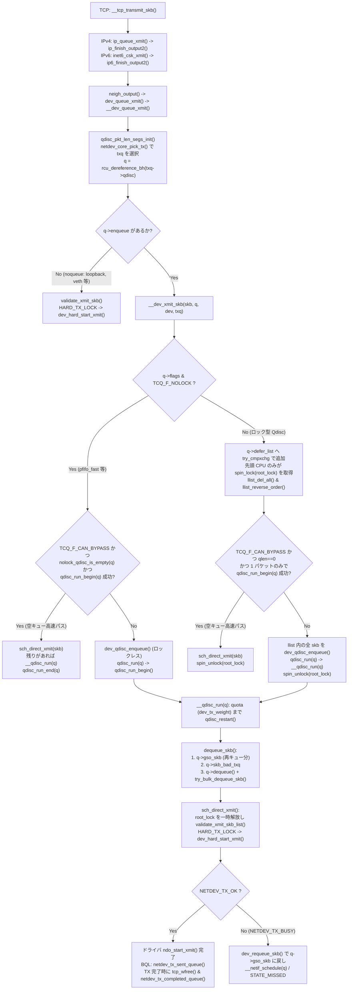

# 15. Qdisc フレームワークと FIFO / PFIFO_FAST / MQ / BPF Qdisc

この章では、IP 層（L3）の出口と NIC ドライバ（L2）の間に位置する Linux のパケットスケジューラ（**Qdisc: Queueing Discipline**）のフレームワーク全体と、最も基本的な Qdisc 実装である `pfifo` / `bfifo`、既定の 3 バンドロックレス Qdisc である `pfifo_fast`、マルチキュー NIC 向けの `mq`、そして BPF `struct_ops` で任意のスケジューラを実装できる `bpf_qdisc` を一行ずつ読みます。

第 4 章で見た TCP の送信路（`__tcp_transmit_skb()`、TSQ の `tcp_wfree()`、EDT ペーシング）や、第 11 章で見たローカル輻輳時の `tcp_enter_cwr()` が、カーネルの下位層でどのように支えられているかをここで完全に解き明かします。

---

## たとえ話で言うと

建物の各部屋（ソケット）にある**発送待ちの棚（TCP 送信キュー）**から出された**伝票付きの小包（`sk_buff`）**は、建物の 1 階にある配送センターのトラック乗り場へと運ばれてきます。外には道路へ出ていく**配送トラック（NIC のハードウェア TX リング）**が停まっています。

もし各部屋の発送係が、自分の小包をトラックの荷台へ直接どんどん放り込めたとしたらどうなるでしょうか。

- **荷台がすぐ満杯になり、後から来た緊急の小包が追い越せない**: 巨大な荷物を大量に送る部屋がトラックの荷台（NIC の FIFO リング）を何百個もの小包で埋め尽くしてしまうと、別の部屋から出た「至急」の伝票（高優先度 TOS や ACK、DNS クエリ）が付いた小包も、その長い列の後ろに並ぶしかありません。これが **Bufferbloat（バッファ肥大化）** です。
- **一度トラックの荷台に積んだ小包は、順番を変えたり間引いたりできない**: トラックの荷台（NIC の DMA リング）はただの単純なベルトコンベアです。積んでしまった後では、「やはりこちらの小包を先に出す」「混んできたので古い小包を諦める（AQM）」「出発時刻（EDT）まで待つ」といった賢い判断はできません。

そこで Linux は、トラックの荷台のすぐ手前に**仕分けゲート（Qdisc）**を置きます。そして 3 つのルールで荷物の流れを管理します。

1. **トラックの荷台には「今すぐ出発できる最小限の量」しか積まない（BQL: Byte Queue Limits）**: 荷台に一定バイト数以上の小包が載ったら、すぐに「荷台ストップ」の札（`QUEUE_STATE_STACK_XOFF`）を立てます。残りの小包はすべて手前の仕分けゲート（Qdisc）で待機させます。これにより、賢い仕分け係（Qdisc）が常に主導権を握ることができます。
2. **1 つの部屋が仕分けゲートに置ける小包の数を制限する（TSQ: TCP Small Queues）**: ある部屋の小包がまだ仕分けゲートやトラックの荷台に一定量残っていたら、その部屋の発送係には「トラックから発送完了の連絡（`tcp_wfree()`）が来るまで、次の小包を下ろしてこないで」と伝えます。これで 1 つの部屋が仕分けゲートを独占するのを防ぎます。
3. **仕分けゲートが混雑したら、発送係に「トラックの台数を減らせ」と直接伝える（`NET_XMIT_CN`）**: 仕分けゲートで小包が溢れそうになったり、古い小包を押し出して捨てたりしたときは、発送係へ即座に「構内が混んでいる」という黄色信号（`NET_XMIT_CN`）を返します。発送係（TCP）はそれを見て、道路へ出すトラックの台数（`snd_cwnd`）を自ら減らします（`tcp_enter_cwr()`）。

この仕分けゲート（`struct Qdisc`）の仕組みは、TCP の輻輳制御と同じく**差し替え可能（プラガブル）**です。来た順に並べるだけの単純な係（`pfifo` / `bfifo`）、伝票の優先度で 3 列に分ける高速な係（`pfifo_fast`）、複数のトラック乗り場（マルチキュー NIC の各 TX キュー）ごとに独立した仕分け係を配置する元締め（`mq`）、さらには利用者が BPF プログラムで自由に仕分けルールを書ける仕組み（`bpf_qdisc`）まで、すべて同じ `struct Qdisc_ops` の契約の上で動いています。

---

## 背景・RFC・論文では

Qdisc フレームワークそのものは Linux カーネル固有のアーキテクチャですが、その設計はインターネット標準の優先度制御（TOS / DiffServ）、パケットスケジューリング理論、そして Bufferbloat 対策の研究成果を直接反映しています。

### なぜ L3 と NIC ドライバの間に Qdisc があるのか

IP 層（`ip_finish_output2()` / `ip6_finish_output2()`）が隣接ノード（ARP / ND）を解決して L2 ヘッダを付けた後、パケットは `dev_queue_xmit()` に渡されます。もしここで NIC ドライバの `ndo_start_xmit()` を直接呼ぶと、パケットは即座に NIC の TX DMA リング（FIFO）へ書き込まれます。

NIC のハードウェアリングは以下の理由から「スケジューリングの場」としては不向きです。

- **Work-conserving な単純 FIFO である**: ハードウェアリングに入ったパケットは、原則として並べ替え（優先度制御や Fair Queueing）も、途中破棄（Head drop や CoDel）も、出発時刻制御（EDT ペーシング）もできません。
- **リングサイズが大きすぎる**: 高速リンクでの TX スタールを防ぐため、NIC ドライバの TX リングはしばしば 512〜4096 ディスクリプタを持ちます。1500 B パケットが 2048 個並ぶと約 3 MB、さらに GSO/TSO の 64 KB スーパーパケットが並べば数十 MB ものデータが NIC リング内に滞留し、数百ミリ秒のキューイング遅延（Bufferbloat）を引き起こします。

したがって、「NIC の TX リングには DMA 転送が途切れない最小限のバイト数だけを置き、それ以上の滞留はすべてソフトウェアの Qdisc 層で受け止める」という役割分担が必要になります。

### BQL（Byte Queue Limits）と TSQ（TCP Small Queues）の連携

この役割分担を成立させているのが、2011 年に Tom Herbert が導入した **BQL（Byte Queue Limits）** と、2012 年に Eric Dumazet が導入した **TSQ（TCP Small Queues）** の 2 段構えのバックプレッシャです。

1. **BQL（Qdisc ⇄ NIC ドライバ間）**
   各ハードウェア TX キュー（`struct netdev_queue`）は DQL（Dynamic Queue Limits、`struct dql`）状態を持ちます。ドライバは `ndo_start_xmit()` でハードウェアリングにパケットを積むたびに `netdev_tx_sent_queue()` でバイト数を加算し、TX 完了割り込み（NAPI poll）で `netdev_tx_completed_queue()` を呼んで完了バイト数を減算します。
   現在ハードウェアリング上に滞留している未完了バイト数を $B_{\text{inflight}} = \text{num}_{\text{queued}} - \text{num}_{\text{completed}}$、DQL が動的に調整する上限を $L_{\text{BQL}}$ とすると、利用可能残量は次の式で表されます。

   $$\text{avail} = L_{\text{BQL}} - B_{\text{inflight}}$$

   $\text{avail} < 0$ になった瞬間、BQL はその TX キューに `QUEUE_STATE_STACK_XOFF` ビットを立ててキューを停止します。すると Qdisc はそれ以上ドライバへパケットを流し込めなくなり、後続のパケットは Qdisc 内部のキューに留まります。TX 完了によって $\text{avail} \ge 0$ に戻ると、`QUEUE_STATE_STACK_XOFF` がクリアされ、`netif_schedule_queue()` によって `NET_TX_SOFTIRQ`（`net_tx_action()`）がスケジュールされて Qdisc の dequeue が再開します。

2. **TSQ（TCP ソケット ⇄ Qdisc・NIC 間）**
   BQL が NIC リングの膨張を防いでも、ソケットが無限に Qdisc へパケットを投げ込めば、今度は Qdisc のキューが特定フローのパケットで溢れます。そこで TCP は `__tcp_transmit_skb()` で `skb->destructor = tcp_wfree` を設定し、`sk->sk_wmem_alloc` に `skb->truesize` を加算します。
   ソケットごとの未解放メモリ量 `sk_wmem_alloc` が約 1 ms 分（または 2 TSO パケット分）の上限に達すると、`tcp_small_queue_check()`（第 4 章）が送信を止め、`TSQ_THROTTLED` フラグを立てます。パケットが NIC から送信完了して解放（または Qdisc で破棄）されるときに `tcp_wfree()` が呼ばれ、BH workqueue 経由で `tcp_write_xmit()` が再開します。

### ローカル輻輳通知（`NET_XMIT_CN`）と `tcp_enter_cwr()`

Qdisc の `enqueue()` メソッドは、結果を以下のリターンコードで返します。

| 定数 | 値 | 意味 | `net_xmit_eval()` の評価値 |
| --- | --- | --- | --- |
| `NET_XMIT_SUCCESS` | `0x00` | 正常にキューイング（または直接送信）された | `0` |
| `NET_XMIT_DROP` | `0x01` | このパケット自身が破棄された | `NET_XMIT_DROP` (`1`) |
| `NET_XMIT_CN` | `0x02` | このパケットは入った（または同優先度の別パケットを捨てた）が、キューが輻輳している | `0` |

`NET_XMIT_CN`（Congestion Notification）は、「今回のパケット自体は受け入れたが、代わりにキュー先頭の古いパケットを捨てた（`pfifo_head_drop` など）」あるいは「AQM しきい値を超えた」ことを送信元ソケットへ知らせる仕組みです。
`__tcp_transmit_skb()` は `queue_xmit()` の戻り値 `err` に対して以下のように反応します。

- `err > 0`（`NET_XMIT_DROP` または `NET_XMIT_CN`）ならば、**自ホスト内の Qdisc で輻輳が起きた**と判断し、即座に `tcp_enter_cwr(sk)` を呼んで `TCP_CA_CWR` 状態へ遷移し、`snd_cwnd` を削減します（第 11 章 Step 13）。
- その後 `err = net_xmit_eval(err)` を通すことで、`NET_XMIT_CN` は `0`（送信成功）に変換され、TCP の送信シーケンス番号（`snd_nxt`）や RTT サンプルは通常どおり前進します。一方 `NET_XMIT_DROP` は非 0 のまま返るため、TCP はそのパケットを送れなかったものとして送信ループを中断します。

### IP TOS フィールドと `pfifo_fast` の 3 バンド優先度マッピング

Linux の歴史的な既定 Qdisc である `pfifo_fast` は、パケットの `skb->priority`（下位 4 ビット、`0`〜`15`）を `sch_default_prio2band` テーブルによって Band 0（最高優先度）、Band 1（標準）、Band 2（最低優先度）の 3 つの FIFO キューに振り分けます。

- **[RFC 791 §3.1](https://www.rfc-editor.org/rfc/rfc791#section-3.1) — Internet Protocol (1981)** と **[RFC 1349 §4](https://www.rfc-editor.org/rfc/rfc1349#section-4) — Type of Service in the Internet Protocol Suite (1992)**
  IPv4 ヘッダの TOS バイトのうち、ビット 3〜6 の 4 ビットを Type of Service として定義しました（後に [RFC 2474](https://www.rfc-editor.org/rfc/rfc2474) で DiffServ Code Point (DSCP) に置き換えられました）。RFC 1349 の 4 ビット TOS 値の意味は以下のとおりです。
  - `1000` (8): Minimize Delay（最小遅延 — SSH や対話型通信）
  - `0100` (4): Maximize Throughput（最大スループット — バルク転送）
  - `0010` (2): Maximize Reliability（最大信頼性）
  - `0001` (1): Minimize Monetary Cost（最小コスト）
  - `0000` (0): Normal Service（通常サービス）

IP 層は TOS バイトから `rt_tos2priority()` で `TC_PRIO_*`（`0`〜`15`）を算出して `skb->priority` に設定します（ソケットオプション `SO_PRIORITY` で直接上書きすることも可能です）。`pfifo_fast` はこれを受け取り、以下のように 3 つのバンドへマッピングします。

| `skb->priority` | 代表的な `TC_PRIO_*` 名 | 対応する RFC 1349 TOS の意味 | `pfifo_fast` の Band |
| --- | --- | --- | --- |
| `0` | `TC_PRIO_BESTEFFORT` | Normal Service | **Band 1**（中間） |
| `1`, `2`, `3`, `5` | `TC_PRIO_FILLER`, `TC_PRIO_BULK` | Maximize Throughput / Cost | **Band 2**（最低優先度） |
| `4` | `TC_PRIO_INTERACTIVE_BULK` | — | **Band 1**（中間） |
| `6`, `7` | `TC_PRIO_INTERACTIVE`, `TC_PRIO_CONTROL` | Minimize Delay / 制御パケット | **Band 0**（最高優先度） |
| `8`〜`15` | — | 未割り当て | **Band 1**（中間） |

Band 0 にパケットが 1 つでもある限り Band 1 や Band 2 は一切 dequeue されない**厳密優先度（Strict Priority）スケジューリング**です。

### Work-Conserving と Non-Work-Conserving、および Qdisc バイパス

パケットスケジューリング理論において、スケジューラは以下の 2 種類に分類されます。

- **Work-conserving（仕事保存型）**: キュー内に送信可能なパケットが存在し、かつ出力リンク（NIC TX キュー）が空いている限り、決してリンクを遊ばせずに即座にパケットを送り出すスケジューラです（`pfifo`, `bfifo`, `pfifo_fast`, `fq_codel` など）。
- **Non-work-conserving（非仕事保存型）**: キュー内にパケットがあっても、トークンバケットのレート制限や EDT（Earliest Departure Time）の出発時刻に達していない場合は、リンクが空いていても意図的に送信を遅らせるスケジューラです（`tbf`, ペーシング有効時の `fq`, `htb` など）。このとき、指定時刻に再度 dequeue を駆動するために高精度タイマである `struct qdisc_watchdog`（内部は `hrtimer`）が使われます。

Work-conserving な単純 Qdisc（`pfifo`, `bfifo`, `pfifo_fast`）において、**現在キューが空であり、かつ他の CPU がその Qdisc を実行していない**場合、わざわざ `q->enqueue()` でリングやリストに skb を格納して直後に `q->dequeue()` で取り出すのは無駄です。Linux はこの性質を利用し、`TCQ_F_CAN_BYPASS` フラグを持つ Qdisc が空のときは `enqueue()` / `dequeue()` を完全にスキップして直接 `sch_direct_xmit()` を呼ぶ**空キュー高速パス（Qdisc bypass）**を備えています。

---

## 全体の流れ

L3 の出口から Qdisc、そして NIC ドライバの `ndo_start_xmit()` に至るまでの TX パス全体の制御フローを示します。



この図から分かるとおり、Linux の Qdisc 層は単に「`enqueue()` して `dequeue()` する」だけではありません。

- **ロック型 Qdisc（`!TCQ_F_NOLOCK`）**では、複数 CPU が同時に送信したとき `qdisc_lock(q)`（`root_lock`）の奪い合いを避けるため、まずロックレス単方向リスト `q->defer_list` に `try_cmpxchg()` でパケットを積み、リストの先頭を入れた 1 つの CPU だけがロックを取って他 CPU の分までまとめて処理します。
- **ロックレス Qdisc（`TCQ_F_NOLOCK`、`pfifo_fast` など）**では、`enqueue()` は `skb_array`（内部は `ptr_ring` の producer spinlock）だけで並行に動き、dequeue 側だけを `q->seqlock` の `spin_trylock()` で単一実行主体に絞ります。
- **GSO 分割やソフトウェアチェックサム計算（`validate_xmit_skb_list()`）**は、Qdisc の `root_lock` を一旦外し、かつドライバの `HARD_TX_LOCK` を取る**前**のロックなし区間で行われます。重い分割処理中に他の CPU の `enqueue()` をブロックしないための工夫です。

---

## コードを追う

### Step 1: L3 から Qdisc への接続と TCP との相互作用

まず、TCP が送り出したパケットが IPv4 / IPv6 の出口を通って `dev_queue_xmit()` に到達し、その戻り値が再び TCP に返るまでの上下の接点を確認します。

#### L3 の出口: `ip_finish_output2()` と `ip6_finish_output2()`

IPv4 では `ip_queue_xmit()` → `__ip_queue_xmit()` → `ip_local_out()` → `ip_output()` → `ip_finish_output()` を経て `ip_finish_output2()`（[net/ipv4/ip_output.c#L199](https://git.kernel.org/pub/scm/linux/kernel/git/netdev/net-next.git/tree/net/ipv4/ip_output.c?id=279d5c8afcd38bd841832a39bfe1aa4f8518d98e#n199)）に到達します。後半の neighbour 解決部分を見ます。

```c
	rcu_read_lock();
	neigh = ip_neigh_for_gw(rt, skb, &is_v6gw);
	if (!IS_ERR(neigh)) {
		int res;

		sock_confirm_neigh(skb, neigh);
		/* if crossing protocols, can not use the cached header */
		res = neigh_output(neigh, skb, is_v6gw);
		rcu_read_unlock();
		return res;
	}
	rcu_read_unlock();
```

IPv6 でも同様に `inet6_csk_xmit()` → `ip6_xmit()` → `ip6_output()` → `ip6_finish_output()` を経て `ip6_finish_output2()`（[net/ipv6/ip6_output.c#L60](https://git.kernel.org/pub/scm/linux/kernel/git/netdev/net-next.git/tree/net/ipv6/ip6_output.c?id=279d5c8afcd38bd841832a39bfe1aa4f8518d98e#n60)）の末尾で `neigh_output()` を呼びます。

```c
	nexthop = rt6_nexthop(dst_rt6_info(dst), daddr);
	neigh = __ipv6_neigh_lookup_noref(dev, nexthop);

	if (IS_ERR_OR_NULL(neigh)) {
		if (unlikely(!neigh))
			neigh = ipv6_neigh_create_noref(dev, nexthop);
		if (IS_ERR(neigh)) {
			IP6_INC_STATS(net, idev, IPSTATS_MIB_OUTNOROUTES);
			kfree_skb_reason(skb, SKB_DROP_REASON_NEIGH_CREATEFAIL);
			return -EINVAL;
		}
	}
	sock_confirm_neigh(skb, neigh);
	ret = neigh_output(neigh, skb, false);
	return ret;
```

`neigh_output()`（[include/net/neighbour.h#L541](https://git.kernel.org/pub/scm/linux/kernel/git/netdev/net-next.git/tree/include/net/neighbour.h?id=279d5c8afcd38bd841832a39bfe1aa4f8518d98e#n541)）は、ARP / ND が解決済み（`NUD_CONNECTED`）で L2 ヘッダキャッシュ（`hh->hh_len`）があれば、`neigh_hh_output()`（[include/net/neighbour.h#L501](https://git.kernel.org/pub/scm/linux/kernel/git/netdev/net-next.git/tree/include/net/neighbour.h?id=279d5c8afcd38bd841832a39bfe1aa4f8518d98e#n501)）で Ethernet ヘッダを `memcpy()` して `dev_queue_xmit(skb)` を呼びます。

```c
static inline int neigh_output(struct neighbour *n, struct sk_buff *skb,
			       bool skip_cache)
{
	const struct hh_cache *hh = &n->hh;

	/* n->nud_state and hh->hh_len could be changed under us.
	 * neigh_hh_output() is taking care of the race later.
	 */
	if (!skip_cache &&
	    (READ_ONCE(n->nud_state) & NUD_CONNECTED) &&
	    READ_ONCE(hh->hh_len))
		return neigh_hh_output(hh, skb);

	return READ_ONCE(n->output)(n, skb);
}
```

- ここで呼ばれた `dev_queue_xmit(skb)`（実体は `__dev_queue_xmit(skb, NULL)`）の戻り値が、`neigh_output()` → `ip_finish_output2()` / `ip6_finish_output2()` → `__ip_queue_xmit()` / `ip6_xmit()` をそのまま素通りして、TCP の `__tcp_transmit_skb()` まで返ってきます。
- なお、`__ip_queue_xmit()`（[net/ipv4/ip_output.c#L462](https://git.kernel.org/pub/scm/linux/kernel/git/netdev/net-next.git/tree/net/ipv4/ip_output.c?id=279d5c8afcd38bd841832a39bfe1aa4f8518d98e#n462)）の 525〜526 行目と `ip6_xmit()`（[net/ipv6/ip6_output.c#L291](https://git.kernel.org/pub/scm/linux/kernel/git/netdev/net-next.git/tree/net/ipv6/ip6_output.c?id=279d5c8afcd38bd841832a39bfe1aa4f8518d98e#n291)）の 364〜365 行目で、ソケットの `sk->sk_priority` と `sk->sk_mark` が `skb->priority` と `skb->mark` にコピーされています。これが後で Qdisc（`pfifo_fast` など）や TC フィルタが参照するメタデータになります。

#### `NET_XMIT_*` と `__tcp_transmit_skb()` の `tcp_enter_cwr()`

Qdisc のリターンコードは `include/linux/netdevice.h`（[include/linux/netdevice.h#L118](https://git.kernel.org/pub/scm/linux/kernel/git/netdev/net-next.git/tree/include/linux/netdevice.h?id=279d5c8afcd38bd841832a39bfe1aa4f8518d98e#n118)）で定義されています。

```c
/* qdisc ->enqueue() return codes. */
#define NET_XMIT_SUCCESS	0x00
#define NET_XMIT_DROP		0x01	/* skb dropped			*/
#define NET_XMIT_CN		0x02	/* congestion notification	*/
#define NET_XMIT_MASK		0x0f	/* qdisc flags in net/sch_generic.h */

/* NET_XMIT_CN is special. It does not guarantee that this packet is lost. It
 * indicates that the device will soon be dropping packets, or already drops
 * some packets of the same priority; prompting us to send less aggressively. */
#define net_xmit_eval(e)	((e) == NET_XMIT_CN ? 0 : (e))
#define net_xmit_errno(e)	((e) != NET_XMIT_CN ? -ENOBUFS : 0)
```

そして `__tcp_transmit_skb()`（[net/ipv4/tcp_output.c#L1536](https://git.kernel.org/pub/scm/linux/kernel/git/netdev/net-next.git/tree/net/ipv4/tcp_output.c?id=279d5c8afcd38bd841832a39bfe1aa4f8518d98e#n1536)）の末尾（1718〜1728 行目）で、このリターンコードを評価します。

```c
	err = INDIRECT_CALL_INET(icsk->icsk_af_ops->queue_xmit,
				 inet6_csk_xmit, ip_queue_xmit,
				 sk, skb, &inet->cork.fl);

	if (unlikely(err > 0)) {
		tcp_enter_cwr(sk);
		err = net_xmit_eval(err);
	}
	if (!err && oskb) {
		tcp_update_skb_after_send(sk, oskb, prior_wstamp);
		tcp_rate_skb_sent(sk, oskb);
	}
	return err;
```

- L3 経路エラー時は `-EHOSTUNREACH` や `-ENOMEM` のような**負のエラー値**が返ります。一方、Qdisc の `enqueue()` が返した `NET_XMIT_DROP` (`1`) や `NET_XMIT_CN` (`2`) は**正の整数**です。
- したがって `unlikely(err > 0)` は「Qdisc 層でドロップまたは輻輳通知が発生した」ことを正確に意味します。このとき TCP は `tcp_enter_cwr(sk)`（[net/ipv4/tcp_input.c#L3030](https://git.kernel.org/pub/scm/linux/kernel/git/netdev/net-next.git/tree/net/ipv4/tcp_input.c?id=279d5c8afcd38bd841832a39bfe1aa4f8518d98e#n3030)）を呼び、ECN の ECE を受け取ったときと同様に `TCP_CA_CWR` 状態へ入って `snd_cwnd` を減らします。
- 直後の `err = net_xmit_eval(err)` により、`NET_XMIT_CN` だった場合は `err` が `0` になります。すると下の `if (!err && oskb)` に進み、`tcp_update_skb_after_send()` と `tcp_rate_skb_sent()` が呼ばれて、呼び出し元の `tcp_write_xmit()` でも `snd_nxt` が進められます。後で見る `pfifo_tail_enqueue()`（`pfifo_head_drop`）が古い先頭パケットを捨てて今回の新パケットを入れたときに `NET_XMIT_CN` を返すのは、「今回のパケット自体はキューに入ったので未送信扱いにせず、しかし cwnd は下げさせる」ためです。

#### TSQ（`tcp_wfree()`）と BQL（`netdev_tx_sent_queue()` / `netdev_tx_completed_queue()`）

`__tcp_transmit_skb()` の 1622〜1625 行目では、送信するクローン skb にデストラクタを設定しています。

```c
	skb_orphan(skb);
	skb->sk = sk;
	skb->destructor = skb_is_tcp_pure_ack(skb) ? __sock_wfree : tcp_wfree;
	refcount_add(skb->truesize, &sk->sk_wmem_alloc);
```

この skb が Qdisc を通過し、NIC ドライバでの DMA 送信が完了して解放される（あるいは Qdisc でドロップされて解放される）とき、`kfree_skb()` / `napi_consume_skb()` から `skb_release_head_state()` 経由で `tcp_wfree()`（[net/ipv4/tcp_output.c#L1387](https://git.kernel.org/pub/scm/linux/kernel/git/netdev/net-next.git/tree/net/ipv4/tcp_output.c?id=279d5c8afcd38bd841832a39bfe1aa4f8518d98e#n1387)）が呼ばれます（詳細は第 4 章 Step 10）。

- ここで特に重要な不変条件は、`tcp_wfree()` 先頭のコメントにある **「We can't xmit new skbs from this context, as we might already hold qdisc lock.」** です。もし Qdisc が `qdisc_lock(q)` を保持したままパケットをドロップして即座に `kfree_skb()` を呼ぶと、同じ CPU 上で `tcp_wfree()` が走ります。もし `tcp_wfree()` がその場で `tcp_write_xmit()` → `__dev_queue_xmit()` を呼べば、同じ `qdisc_lock(q)` を再取得しようとしてデッドロックします。
- そのため（1）`tcp_wfree()` 側は直接送信せず per-CPU の `tsq_work`（BH workqueue）へ遅延させ、（2）さらに Qdisc 側も `qdisc_lock(q)` を保持している最中は直接 `kfree_skb()` を呼ばず、`to_free` リストに繋いでロック解放後にまとめて解放する（`__qdisc_drop()` と `tcf_kfree_skb_list()`）という二重の安全策を採っています。

一方、NIC ドライバと Qdisc の間のバックプレッシャを担う BQL の関数群は `include/linux/netdevice.h` にあります。`netdev_tx_sent_queue()`（[include/linux/netdevice.h#L3924](https://git.kernel.org/pub/scm/linux/kernel/git/netdev/net-next.git/tree/include/linux/netdevice.h?id=279d5c8afcd38bd841832a39bfe1aa4f8518d98e#n3924)）と `__netdev_tx_sent_queue()`（[include/linux/netdevice.h#L3960](https://git.kernel.org/pub/scm/linux/kernel/git/netdev/net-next.git/tree/include/linux/netdevice.h?id=279d5c8afcd38bd841832a39bfe1aa4f8518d98e#n3960)）を見ます。

```c
static inline void netdev_tx_sent_queue(struct netdev_queue *dev_queue,
					unsigned int bytes)
{
#ifdef CONFIG_BQL
	dql_queued(&dev_queue->dql, bytes);

	if (likely(dql_avail(&dev_queue->dql) >= 0))
		return;

	/* Paired with READ_ONCE() from dev_watchdog() */
	WRITE_ONCE(dev_queue->trans_start, jiffies);

	/* This barrier is paired with smp_mb() from dev_watchdog() */
	smp_mb__before_atomic();

	set_bit(__QUEUE_STATE_STACK_XOFF, &dev_queue->state);

	/*
	 * The XOFF flag must be set before checking the dql_avail below,
	 * because in netdev_tx_completed_queue we update the dql_completed
	 * before checking the XOFF flag.
	 */
	smp_mb__after_atomic();

	/* check again in case another CPU has just made room avail */
	if (unlikely(dql_avail(&dev_queue->dql) >= 0))
		clear_bit(__QUEUE_STATE_STACK_XOFF, &dev_queue->state);
#endif
}
```

```c
static inline bool __netdev_tx_sent_queue(struct netdev_queue *dev_queue,
					  unsigned int bytes,
					  bool xmit_more)
{
	if (xmit_more) {
#ifdef CONFIG_BQL
		dql_queued(&dev_queue->dql, bytes);
#endif
		return netif_tx_queue_stopped(dev_queue);
	}
	netdev_tx_sent_queue(dev_queue, bytes);
	return true;
}
```

- ドライバの `ndo_start_xmit()` が呼ぶ関数です。`dql_queued()` で `dql->num_queued` を増やし、残量 `dql_avail()` が負になったら `set_bit(__QUEUE_STATE_STACK_XOFF, &dev_queue->state)` で TX キューを停止させます。
- 直後に `smp_mb__after_atomic()` を挟んで `dql_avail() >= 0` を再チェックしているのは、別 CPU で走る TX 完了処理 `netdev_tx_completed_queue()`（[include/linux/netdevice.h#L4006](https://git.kernel.org/pub/scm/linux/kernel/git/netdev/net-next.git/tree/include/linux/netdevice.h?id=279d5c8afcd38bd841832a39bfe1aa4f8518d98e#n4006)）とのロックレスな Dekker 型同期のためです。

```c
static inline void netdev_tx_completed_queue(struct netdev_queue *dev_queue,
					     unsigned int pkts, unsigned int bytes)
{
#ifdef CONFIG_BQL
	if (unlikely(!bytes))
		return;

	dql_completed(&dev_queue->dql, bytes);

	/*
	 * Without the memory barrier there is a small possibility that
	 * netdev_tx_sent_queue will miss the update and cause the queue to
	 * be stopped forever
	 */
	smp_mb(); /* NOTE: netdev_txq_completed_mb() assumes this exists */

	if (unlikely(dql_avail(&dev_queue->dql) < 0))
		return;

	if (test_and_clear_bit(__QUEUE_STATE_STACK_XOFF, &dev_queue->state))
		netif_schedule_queue(dev_queue);
#endif
}
```

- 送信側（`netdev_tx_sent_queue()`）は **「`STACK_XOFF` をセット → `smp_mb` → `dql_avail()` を読む」**、完了側（`netdev_tx_completed_queue()`）は **「`dql_completed()` を更新 → `smp_mb` → `STACK_XOFF` をテスト＆クリア」** の順で実行します。このメモリバリアの対により、完了側が `STACK_XOFF` を見逃し、かつ送信側が `dql_completed` の更新を見逃してキューが永久に停止したままになる競合を防いでいます。
- また `__netdev_tx_sent_queue()` で `xmit_more` が真（Bulk dequeue でまだ後続のパケットが続く）のときは、`dql_queued()` の加算だけを行い、`STACK_XOFF` のセットをバッチの最後のパケットまで遅延させます。バッチの途中でキューを止めて残りのパケットを `dev_requeue_skb()` させる無駄を省くためです。

---

### Step 2: Qdisc の中核データ構造

次に、`include/net/sch_generic.h`、`include/net/pkt_sched.h`、`include/linux/netdevice.h` に定義されている Qdisc フレームワークの 6 つの主要構造体を読みます。

#### `struct qdisc_skb_head` — 単方向リストによる軽量 skb キュー

`struct qdisc_skb_head`（[include/net/sch_generic.h#L62](https://git.kernel.org/pub/scm/linux/kernel/git/netdev/net-next.git/tree/include/net/sch_generic.h?id=279d5c8afcd38bd841832a39bfe1aa4f8518d98e#n62)）は、Qdisc 専用の軽量なパケットキューヘッダです。

```c
/* similar to sk_buff_head, but skb->prev pointer is undefined. */
struct qdisc_skb_head {
	struct sk_buff	*head;
	struct sk_buff	*tail;
	__u32		qlen;
	spinlock_t	lock;
};
```

- 汎用の `struct sk_buff_head` は双方向循環リスト（`skb->next` と `skb->prev` の両方を更新）ですが、FIFO のように末尾に追加して先頭から取り出すだけの用途では `skb->prev` の更新は不要なメモリアクセスになります。そこで `qdisc_skb_head` は **`skb->next` だけを使う単方向リスト**（末尾要素の `skb->next == NULL`）とし、`head` と `tail` を持つことで先頭・末尾への $O(1)$ アクセスをより少ないポインタ書き換えで実現しています（`__qdisc_enqueue_tail()`、[include/net/sch_generic.h#L1102](https://git.kernel.org/pub/scm/linux/kernel/git/netdev/net-next.git/tree/include/net/sch_generic.h?id=279d5c8afcd38bd841832a39bfe1aa4f8518d98e#n1102) および `__qdisc_dequeue_head()`、[include/net/sch_generic.h#L1136](https://git.kernel.org/pub/scm/linux/kernel/git/netdev/net-next.git/tree/include/net/sch_generic.h?id=279d5c8afcd38bd841832a39bfe1aa4f8518d98e#n1136)）。
- `lock` は `qdisc_lock(q)`（[include/net/sch_generic.h#L581](https://git.kernel.org/pub/scm/linux/kernel/git/netdev/net-next.git/tree/include/net/sch_generic.h?id=279d5c8afcd38bd841832a39bfe1aa4f8518d98e#n581)）が返す `&qdisc->q.lock` そのもので、Qdisc 階層全体の排他制御（`root_lock`）に使われます。

#### `struct Qdisc` と `TCQ_F_*` フラグ

`struct Qdisc`（[include/net/sch_generic.h#L69](https://git.kernel.org/pub/scm/linux/kernel/git/netdev/net-next.git/tree/include/net/sch_generic.h?id=279d5c8afcd38bd841832a39bfe1aa4f8518d98e#n69)）は、各キューにアタッチされる Qdisc インスタンスの本体です。

```c
struct Qdisc {
	int 			(*enqueue)(struct sk_buff *skb,
					   struct Qdisc *sch,
					   struct sk_buff **to_free);
	struct sk_buff *	(*dequeue)(struct Qdisc *sch);
	unsigned int		flags;
#define TCQ_F_BUILTIN		1
#define TCQ_F_INGRESS		2
#define TCQ_F_CAN_BYPASS	4
#define TCQ_F_MQROOT		8
#define TCQ_F_ONETXQUEUE	0x10 /* dequeue_skb() can assume all skbs are for
				      * q->dev_queue : It can test
				      * netif_xmit_frozen_or_stopped() before
				      * dequeueing next packet.
				      * Its true for MQ/MQPRIO slaves, or non
				      * multiqueue device.
				      */
#define TCQ_F_WARN_NONWC	(1 << 16)
#define TCQ_F_CPUSTATS		0x20 /* run using percpu statistics */
#define TCQ_F_NOPARENT		0x40 /* root of its hierarchy :
				      * qdisc_tree_reduce_backlog() should stop.
				      */
#define TCQ_F_INVISIBLE		0x80 /* invisible by default in dump */
#define TCQ_F_NOLOCK		0x100 /* qdisc does not require locking */
#define TCQ_F_OFFLOADED		0x200 /* qdisc is offloaded to HW */
#define TCQ_F_DEQUEUE_DROPS	0x400 /* ->dequeue() can drop packets in q->to_free */

	u32			limit;
	const struct Qdisc_ops	*ops;
	struct qdisc_size_table	__rcu *stab;
	struct hlist_node       hash;
	u32			handle;
	u32			parent;
	int			depth;

	struct netdev_queue	*dev_queue;

	struct net_rate_estimator __rcu *rate_est;
	struct gnet_stats_basic_sync __percpu *cpu_bstats;
	struct gnet_stats_queue	__percpu *cpu_qstats;
	int			pad;
	refcount_t		refcnt;
```

- **先頭の `enqueue` と `dequeue` ポインタ**: `ops->enqueue` / `ops->dequeue` と同じ関数ポインタが `struct Qdisc` の先頭にも直接コピーされています（`qdisc_alloc()` で設定）。データパスで毎回 `q->ops->enqueue` と 2 段間接参照するのを避け、`q->enqueue(skb, q, to_free)` と 1 回の参照で呼ぶためのキャッシュライン最適化です。
- **主要な `TCQ_F_*` フラグ**:
  - `TCQ_F_BUILTIN`: `noop_qdisc` のように静的に定義された Qdisc で、参照カウントやメモリ解放を行いません。
  - `TCQ_F_CAN_BYPASS`: Work-conserving で、キューが空のときに `enqueue()` / `dequeue()` をバイパスして `sch_direct_xmit()` で直接送信してよいことを示します。
  - `TCQ_F_MQROOT`: `mq` や `mqprio` のようにマルチキューデバイスの root に置かれるダミー親 Qdisc です。
  - `TCQ_F_ONETXQUEUE`: この Qdisc から出てくるパケットがすべて単一の `q->dev_queue` 宛てであることを保証します。単一キュー NIC の root Qdisc、または `mq` の子として各 TX キューに 1 対 1 でぶら下がる Qdisc に立ちます。これが立っていると、`dequeue_skb()` は **パケットを `q->dequeue()` で取り出す前に** `netif_xmit_frozen_or_stopped(txq)` をチェックでき、また高速な `try_bulk_dequeue_skb()` を使えます。
  - `TCQ_F_CPUSTATS`: 統計カウンタに per-CPU の `cpu_bstats` / `cpu_qstats` を使います。
  - `TCQ_F_NOPARENT`: Qdisc 木の根（または `mq` 直下の独立した子）であり、`qdisc_tree_reduce_backlog()` が親へ遡るのをここで止めます。
  - `TCQ_F_NOLOCK`: Qdisc が外部の `qdisc_lock(q)` による直列化を必要としない（ロックレス対応である）ことを示します（`pfifo_fast` など）。
  - `TCQ_F_DEQUEUE_DROPS`: `dequeue()` の最中にパケットをドロップする可能性がある Qdisc（CoDel 等）が、`q->to_free` にドロップした skb を積んで `qdisc_run_end()` でロック解放後に一括解放できるようにするフラグです。
- `limit`: キュー長の上限（`pfifo` ならパケット数、`bfifo` ならバイト数）です。

続けて `struct Qdisc` の後半（76〜143 行目）を見ます。

```c
	/* Cache line potentially dirtied in dequeue() or __netif_reschedule(). */
	__cacheline_group_begin(Qdisc_read_mostly) ____cacheline_aligned;
		struct sk_buff_head	gso_skb;
		struct Qdisc		*next_sched;
		struct sk_buff_head	skb_bad_txq;
	__cacheline_group_end(Qdisc_read_mostly);

	/* Fields dirtied in dequeue() fast path. */
	__cacheline_group_begin(Qdisc_write) ____cacheline_aligned;
		struct qdisc_skb_head	q;
		unsigned long		state;
		struct gnet_stats_basic_sync bstats;
		bool			running; /* must be written under qdisc spinlock */

		/* Note : we only change qstats.backlog in fast path. */
		struct gnet_stats_queue	qstats;

		struct sk_buff		*to_free;
	__cacheline_group_end(Qdisc_write);


	atomic_long_t		defer_count ____cacheline_aligned_in_smp;
	struct llist_head	defer_list;

	spinlock_t		seqlock;

	struct rcu_head		rcu;
	netdevice_tracker	dev_tracker;
	struct lock_class_key	root_lock_key;
	/* private data */
	long privdata[] ____cacheline_aligned;
};
```

- **`Qdisc_read_mostly` キャッシュライングループ**:
  - `gso_skb`: ドライバが `NETDEV_TX_BUSY` を返したときや TX キューが停止していたときに、一度 dequeue したパケットを戻しておく「再キュー用スロット」（双方向リスト `sk_buff_head`）です。名前が `gso_skb` なのは、かつてここでソフトウェア GSO 分割後の残りセグメントを保持していた歴史的経緯によります。
  - `next_sched`: `__netif_schedule()` で per-CPU の `softnet_data.output_queue` にこの Qdisc を繋ぐための単方向リストポインタです。
  - `skb_bad_txq`: 単一の Qdisc が複数の TX キューを束ねている場合（`!TCQ_F_ONETXQUEUE`）に、`try_bulk_dequeue_skb_slow()` が「1 個目と異なる TX キュー宛ての skb」を引いてしまった際の一時退避キューです。
- **`Qdisc_write` キャッシュライングループ**:
  - `q`: 標準の内部パケットキュー（`struct qdisc_skb_head`）と `q.lock` です。
  - `state`: `enum qdisc_state_t`（[include/net/sch_generic.h#L40](https://git.kernel.org/pub/scm/linux/kernel/git/netdev/net-next.git/tree/include/net/sch_generic.h?id=279d5c8afcd38bd841832a39bfe1aa4f8518d98e#n40)）のビットマップです。
    - `__QDISC_STATE_SCHED`: `NET_TX_SOFTIRQ` の `output_queue` に登録済み。
    - `__QDISC_STATE_DEACTIVATED`: デバイス停止中（`dev_deactivate()`）。
    - `__QDISC_STATE_MISSED`: `TCQ_F_NOLOCK` な Qdisc で、他の CPU が `seqlock` を保持中に enqueue が起きた（取りこぼし防止のやり直しが必要）。
    - `__QDISC_STATE_DRAINING`: `MISSED` 状態で TX キュー停止により dequeue が中断されていることを示します（`QDISC_STATE_NON_EMPTY = QDISC_STATE_MISSED | QDISC_STATE_DRAINING`）。
  - `bstats` / `qstats`: 送信バイト・パケット数の基本統計（`bstats`）と、キュー長・バックログ・ドロップ数・再キュー数のキュー統計（`qstats`）です。
  - `running`: `!TCQ_F_NOLOCK` の Qdisc で、現在いずれかの CPU が `__qdisc_run()` を実行中かどうかを示すフラグです（`q.lock` 下で読み書きされます）。
- **`defer_count` と `defer_list`**: 2025 年に導入されたロック型 Qdisc 向けのマルチプロデューサ集約リストです（Step 3 で詳述）。他フィールドとの false sharing を避けるため独立したキャッシュラインに配置されています。
- **`seqlock`**: `TCQ_F_NOLOCK` な Qdisc で「同時に 1 つの CPU だけが dequeue ループ（`__qdisc_run()`）を実行する」ことを保証するための `spinlock_t` です（かつて `seqlock_t` が使われていた名残で変数名が `seqlock` になっています）。
- **`privdata[]`**: キャッシュライン境界にアラインされた可変長配列で、`qdisc_priv(q)` がここを返します。各 Qdisc 実装の固有構造体（`struct pfifo_fast_priv`, `struct mq_sched`, `struct bpf_sched_data` など）がここに配置されます。

#### `struct Qdisc_ops` — Qdisc 実装のインターフェース定義

`struct Qdisc_ops`（[include/net/sch_generic.h#L308](https://git.kernel.org/pub/scm/linux/kernel/git/netdev/net-next.git/tree/include/net/sch_generic.h?id=279d5c8afcd38bd841832a39bfe1aa4f8518d98e#n308)）は、各 Qdisc アルゴリズムをカーネルに登録する際のオペレーションテーブルです。

```c
struct Qdisc_ops {
	struct Qdisc_ops	*next;
	const struct Qdisc_class_ops	*cl_ops;
	char			id[IFNAMSIZ];
	int			priv_size;
	unsigned int		static_flags;

	int 			(*enqueue)(struct sk_buff *skb,
					   struct Qdisc *sch,
					   struct sk_buff **to_free);
	struct sk_buff *	(*dequeue)(struct Qdisc *);
	struct sk_buff *	(*peek)(struct Qdisc *);

	int			(*init)(struct Qdisc *sch, struct nlattr *arg,
					struct netlink_ext_ack *extack);
	void			(*reset)(struct Qdisc *);
	void			(*destroy)(struct Qdisc *);
	int			(*change)(struct Qdisc *sch,
					  struct nlattr *arg,
					  struct netlink_ext_ack *extack);
	void			(*attach)(struct Qdisc *sch);
	int			(*change_tx_queue_len)(struct Qdisc *, unsigned int);
	void			(*change_real_num_tx)(struct Qdisc *sch,
						      unsigned int new_real_tx);

	int			(*dump)(struct Qdisc *, struct sk_buff *);
	int			(*dump_stats)(struct Qdisc *, struct gnet_dump *);

	void			(*ingress_block_set)(struct Qdisc *sch,
						     u32 block_index);
	void			(*egress_block_set)(struct Qdisc *sch,
						    u32 block_index);
	u32			(*ingress_block_get)(struct Qdisc *sch);
	u32			(*egress_block_get)(struct Qdisc *sch);

	struct module		*owner;
};
```

- `cl_ops`: クラスフル Qdisc（`htb`, `mq`, `fq_codel` など）が子クラスや子 Qdisc を操作するための `struct Qdisc_class_ops`（[include/net/sch_generic.h#L267](https://git.kernel.org/pub/scm/linux/kernel/git/netdev/net-next.git/tree/include/net/sch_generic.h?id=279d5c8afcd38bd841832a39bfe1aa4f8518d98e#n267)）へのポインタです。`pfifo` や `pfifo_fast` のようなクラスレス Qdisc では `NULL` です。
- `static_flags`: インスタンス生成時に自動的に `sch->flags` へ論理和されるフラグ（例: `pfifo_fast` の `TCQ_F_NOLOCK | TCQ_F_CPUSTATS`）です。
- `enqueue` / `dequeue` / `peek`: パケットの出し入れと先頭参照を行う必須メソッドです（`register_qdisc()`（[net/sched/sch_api.c#L134](https://git.kernel.org/pub/scm/linux/kernel/git/netdev/net-next.git/tree/net/sched/sch_api.c?id=279d5c8afcd38bd841832a39bfe1aa4f8518d98e#n134)）では、`dequeue` があるのに `peek` が `NULL` だと `-EINVAL` で登録が拒否されます）。
- `init` / `reset` / `destroy` / `change`: ライフサイクル管理用です。`reset` はキュー内の滞留パケットをすべて破棄して初期状態に戻し、`destroy` は確保したメモリやタイマを解放します。
- `attach`: `mq` のように、親 Qdisc 自身ではなく各ハードウェア TX キュー（`dev_queue`）に子 Qdisc を直接アタッチする特殊な Qdisc が実装します（Step 7）。

#### `struct qdisc_skb_cb` — Qdisc 層での `skb->cb` オーバーレイ

TCP 層では `skb->cb`（48 バイト）を `struct tcp_skb_cb` として使い、IP 層では `struct inet_skb_parm` / `struct inet6_skb_parm` として使っていました。パケットが `__dev_queue_xmit()` に到達すると、`skb->cb` は `struct qdisc_skb_cb`（[include/net/sch_generic.h#L455](https://git.kernel.org/pub/scm/linux/kernel/git/netdev/net-next.git/tree/include/net/sch_generic.h?id=279d5c8afcd38bd841832a39bfe1aa4f8518d98e#n455)）およびそれを包む `struct tc_skb_cb`（[include/net/sch_generic.h#L1183](https://git.kernel.org/pub/scm/linux/kernel/git/netdev/net-next.git/tree/include/net/sch_generic.h?id=279d5c8afcd38bd841832a39bfe1aa4f8518d98e#n1183)）として使われます。

```c
struct qdisc_skb_cb {
	unsigned int		pkt_len;
	u16			pkt_segs;
	u16			tc_classid;
#define QDISC_CB_PRIV_LEN 20
	unsigned char		data[QDISC_CB_PRIV_LEN];
	bool			post_ct:1;
	bool			decrypted:1;
};
```

- `pkt_len` と `pkt_segs`: ワイヤ上に実際に出るバイト数とセグメント数です。GSO パケットの場合、`skb->len` には L2/L3/L4 ヘッダが 1 回分しか含まれていませんが、`qdisc_pkt_len_segs_init()`（Step 3）が `(gso_segs - 1) * hdr_len` を加算して、分割後にワイヤへ出る正確な総バイト数を `pkt_len` に格納します。`bfifo` やシェーパが帯域・バックログを計算するときは、`skb->len` ではなく必ず `qdisc_pkt_len(skb)`（`qdisc_skb_cb(skb)->pkt_len`）を使います。
- `data[20]`: 各 Qdisc が自由に使える 20 バイトのスクラッチ領域です（BPF Qdisc でもここへの読み書きが検証器によって許可されます）。

#### `struct qdisc_watchdog` — Non-work-conserving Qdisc を駆動する高精度タイマ

ペーシングや帯域制限を行う Qdisc が「今はまだ送れないが、時刻 `expires` になったら再び `__qdisc_run()` を走らせたい」ときに使うのが `struct qdisc_watchdog`（[include/net/pkt_sched.h#L61](https://git.kernel.org/pub/scm/linux/kernel/git/netdev/net-next.git/tree/include/net/pkt_sched.h?id=279d5c8afcd38bd841832a39bfe1aa4f8518d98e#n61)）です。

```c
struct qdisc_watchdog {
	struct hrtimer	timer;
	struct Qdisc	*qdisc;
};
```

その操作関数は `net/sched/sch_api.c` に定義されています。`qdisc_watchdog_init()`（[net/sched/sch_api.c#L642](https://git.kernel.org/pub/scm/linux/kernel/git/netdev/net-next.git/tree/net/sched/sch_api.c?id=279d5c8afcd38bd841832a39bfe1aa4f8518d98e#n642)）、`qdisc_watchdog_schedule_range_ns()`（[net/sched/sch_api.c#L648](https://git.kernel.org/pub/scm/linux/kernel/git/netdev/net-next.git/tree/net/sched/sch_api.c?id=279d5c8afcd38bd841832a39bfe1aa4f8518d98e#n648)）、`qdisc_watchdog_cancel()`（[net/sched/sch_api.c#L678](https://git.kernel.org/pub/scm/linux/kernel/git/netdev/net-next.git/tree/net/sched/sch_api.c?id=279d5c8afcd38bd841832a39bfe1aa4f8518d98e#n678)）を見ます。

```c
void qdisc_watchdog_init(struct qdisc_watchdog *wd, struct Qdisc *qdisc)
{
	qdisc_watchdog_init_clockid(wd, qdisc, CLOCK_MONOTONIC);
}
EXPORT_SYMBOL(qdisc_watchdog_init);

void qdisc_watchdog_schedule_range_ns(struct qdisc_watchdog *wd, u64 expires,
				      u64 delta_ns)
{
	bool deactivated;

	rcu_read_lock();
	deactivated = test_bit(__QDISC_STATE_DEACTIVATED,
			       &qdisc_root_sleeping(wd->qdisc)->state);
	rcu_read_unlock();
	if (deactivated)
		return;

	if (hrtimer_is_queued(&wd->timer)) {
		u64 softexpires;

		softexpires = ktime_to_ns(hrtimer_get_softexpires(&wd->timer));
		/* If timer is already set in [expires, expires + delta_ns],
		 * do not reprogram it.
		 */
		if (softexpires - expires <= delta_ns)
			return;
	}

	hrtimer_start_range_ns(&wd->timer,
			       ns_to_ktime(expires),
			       delta_ns,
			       HRTIMER_MODE_ABS_PINNED);
}
EXPORT_SYMBOL(qdisc_watchdog_schedule_range_ns);

void qdisc_watchdog_cancel(struct qdisc_watchdog *wd)
{
	hrtimer_cancel(&wd->timer);
}
EXPORT_SYMBOL(qdisc_watchdog_cancel);
```

- `qdisc_watchdog_init()` は `CLOCK_MONOTONIC` の hrtimer を初期化し、コールバック関数 `qdisc_watchdog()`（満了時に `__netif_schedule(qdisc_root_bh(wd->qdisc))` を呼ぶ）を登録します。
- `qdisc_watchdog_schedule_range_ns()` は、まず root Qdisc が `__QDISC_STATE_DEACTIVATED` でないことを確認します（デバイス停止中にタイマが再スケジュールされ続けるのを防ぐため）。また、すでにタイマが `[expires, expires + delta_ns]` の範囲内にセットされていれば、高コストな `hrtimer_start_range_ns()` の再プログラミングをスキップします。
- Step 8 で見る `bpf_qdisc` は、すべての BPF Qdisc インスタンスの `privdata` にこの `struct qdisc_watchdog` を自動的に埋め込み、prologue / epilogue と kfunc で安全に管理します。

#### `struct netdev_queue` — ハードウェア TX キューと Qdisc の結合点

`struct netdev_queue`（[include/linux/netdevice.h#L686](https://git.kernel.org/pub/scm/linux/kernel/git/netdev/net-next.git/tree/include/linux/netdevice.h?id=279d5c8afcd38bd841832a39bfe1aa4f8518d98e#n686)）は、NIC の各送信キューを表す構造体です。

```c
struct netdev_queue {
/*
 * read-mostly part
 */
	struct net_device	*dev;
	netdevice_tracker	dev_tracker;

	struct Qdisc __rcu	*qdisc;
	struct Qdisc __rcu	*qdisc_sleeping;
#ifdef CONFIG_SYSFS
	struct kobject		kobj;
	const struct attribute_group	**groups;
#endif
	unsigned long		tx_maxrate;
	/*
	 * Number of TX timeouts for this queue
	 * (/sys/class/net/DEV/Q/trans_timeout)
	 */
	atomic_long_t		trans_timeout;

	/* Subordinate device that the queue has been assigned to */
	struct net_device	*sb_dev;
#ifdef CONFIG_XDP_SOCKETS
	/* "ops protected", see comment about net_device::lock */
	struct xsk_buff_pool    *pool;
#endif

/*
 * write-mostly part
 */
#ifdef CONFIG_BQL
	struct dql		dql;
#endif
	spinlock_t		_xmit_lock ____cacheline_aligned_in_smp;
	int			xmit_lock_owner;
	/*
	 * Time (in jiffies) of last Tx
	 */
	unsigned long		trans_start;

	unsigned long		state;
...
} ____cacheline_aligned_in_smp;
```

- **なぜ `qdisc` と `qdisc_sleeping` の 2 つのポインタがあるのか**:
  - `qdisc` は**データパス（`__dev_queue_xmit()`）が参照する現在有効な Qdisc** です。デバイスが `IFF_UP` でリンクアップ（carrier ok）している間だけ実体の Qdisc を指し、デバイスがダウンしている間や Qdisc 切り替え中（`dev_deactivate()` 中）は、すべてのパケットを即座に破棄する組み込みの `&noop_qdisc` を指します。
  - `qdisc_sleeping` は**コントロールプレーン（`tc` コマンドによる設定や統計ダンプ）が参照する保持用のポインタ**です。インターフェースが `ip link set dev eth0 down` の状態でも `tc qdisc add` で Qdisc を設定・保持できるよう、作られた Qdisc はまず `qdisc_sleeping` に保存され、`dev_activate()`（リンクアップ時）の `transition_one_qdisc()` で初めて `dev_queue->qdisc = dev_queue->qdisc_sleeping` とアクティブ化されます。
- **`write-mostly part` の分離**: `dql`（BQL 状態）、`_xmit_lock`（ドライバの `ndo_start_xmit()` を守る `HARD_TX_LOCK`）、`trans_start`（TX タイムアウト監視用の最終送信時刻）、`state`（`QUEUE_STATE_DRV_XOFF` / `QUEUE_STATE_STACK_XOFF` / `QUEUE_STATE_FROZEN`）はパケット送信ごとに書き換えられるため、上部の `read-mostly part`（`dev` や `qdisc` ポインタ）とは別キャッシュラインに分離されています。

---

### Step 3: TX fast path の入口とロック・バイパス制御 — `__dev_queue_xmit()` と `__dev_xmit_skb()`

ここから `net/core/dev.c` の送信コアに入ります。`dev_queue_xmit(skb)` は `dev_queue_xmit_accel(skb, NULL)` を経て `__dev_queue_xmit()`（[net/core/dev.c#L4955](https://git.kernel.org/pub/scm/linux/kernel/git/netdev/net-next.git/tree/net/core/dev.c?id=279d5c8afcd38bd841832a39bfe1aa4f8518d98e#n4955)）を呼びます。前半（4955〜5030 行目）から読みます。

```c
int __dev_queue_xmit(struct sk_buff *skb, struct net_device *sb_dev)
{
	struct net_device *dev = skb->dev;
	struct netdev_queue *txq = NULL;
	enum skb_drop_reason reason;
	int cpu, rc = -ENOMEM;
	bool again = false;
	struct Qdisc *q;

	skb_reset_mac_header(skb);
	skb_assert_len(skb);

	if (unlikely(skb_shinfo(skb)->tx_flags &
		     (SKBTX_SCHED_TSTAMP | SKBTX_BPF)))
		__skb_tstamp_tx(skb, NULL, NULL, skb->sk, SCM_TSTAMP_SCHED);

	reason = qdisc_pkt_len_segs_init(skb);
	if (unlikely(reason)) {
		dev_core_stats_tx_dropped_inc(dev);
		kfree_skb_reason(skb, reason);
		return -EINVAL;
	}
	/* Disable soft irqs for various locks below. Also
	 * stops preemption for RCU.
	 */
	rcu_read_lock_bh();

	skb_update_prio(skb);

	tcx_set_ingress(skb, false);
#ifdef CONFIG_NET_EGRESS
	if (static_branch_unlikely(&egress_needed_key)) {
		bool skip_txq;

		if (nf_hook_egress_active()) {
			skb = nf_hook_egress(skb, &rc, dev);
			if (!skb)
				goto out;
		}

		skip_txq = netdev_xmit_skip_txqueue(false);

		nf_skip_egress(skb, true);
		skb = sch_handle_egress(skb, &rc, dev);
		if (!skb) {
			netdev_xmit_skip_txqueue(skip_txq);
			goto out;
		}
		nf_skip_egress(skb, false);

		if (netdev_xmit_skip_txqueue(skip_txq))
			txq = netdev_tx_queue_mapping(dev, skb);
	}
#endif
	/* If device/qdisc don't need skb->dst, release it right now while
	 * its hot in this cpu cache.
	 */
	if (dev->priv_flags & IFF_XMIT_DST_RELEASE)
		skb_dst_drop(skb);
	else
		skb_dst_force(skb);

	if (!txq)
		txq = netdev_core_pick_tx(dev, skb, sb_dev);

	q = rcu_dereference_bh(txq->qdisc);

	trace_net_dev_queue(skb);
	if (q->enqueue) {
		rc = __dev_xmit_skb(skb, q, dev, txq);
		goto out;
	}
```

- `skb_reset_mac_header(skb)`: `neigh_hh_output()` 等ですでに L2 ヘッダが先頭に push されているため、現在の `skb->data` を MAC ヘッダ開始位置として記録します。
- `SKBTX_SCHED_TSTAMP`: アプリが `SOF_TIMESTAMPING_TX_SCHED` を要求していた場合、**Qdisc に入る直前**のタイムスタンプをここで採取します。ドライバ送信直前の `SCM_TSTAMP_SND` との差を見ることで、Qdisc 内部での滞在時間をユーザ空間から正確に測定できます。
- `qdisc_pkt_len_segs_init(skb)`（[net/core/dev.c#L4282](https://git.kernel.org/pub/scm/linux/kernel/git/netdev/net-next.git/tree/net/core/dev.c?id=279d5c8afcd38bd841832a39bfe1aa4f8518d98e#n4282)）: GSO パケットの場合に分割後の総ヘッダサイズ `(gso_segs - 1) * hdr_len` を計算して `qdisc_skb_cb(skb)->pkt_len` と `pkt_segs` を初期化します。悪意ある（`SKB_GSO_DODGY`）パケットでヘッダが壊れていればここで `SKB_DROP_REASON_SKB_BAD_GSO` として弾きます。
- **`rcu_read_lock_bh()`**: ここが Qdisc 層の重要な実行コンテキストの境界です。移行後のすべての処理（`txq->qdisc` の RCU 参照、`qdisc_lock(q)` の取得、`HARD_TX_LOCK` の取得）は **BH（softirq）無効化かつ RCU 読み出し区間内**で走ります。そのため下位では `spin_lock_bh()` ではなく素の `spin_lock()` が使われ、`smp_processor_id()` もプリエンプションを気にせず安全に呼べます。
- `skb_update_prio(skb)`: netprio cgroup が有効なら、ソケットの cgroup に応じて `skb->priority` を更新します。
- `CONFIG_NET_EGRESS`: `tc filter ... egress`（`clsact` や `tcx`）や `nf_hook_egress` が使われている場合だけ、Static Key（`egress_needed_key`）が開いてここで実行されます。未使用時は NOP 命令 1 つでコストゼロです。BPF プログラムが `skb->queue_mapping` を指定して `netdev_xmit_skip_txqueue` を立てた場合は、`netdev_core_pick_tx()` をスキップしてその TX キューを使います。
- `IFF_XMIT_DST_RELEASE`: 通常の NIC ドライバや Qdisc はもう `skb_dst(skb)`（ルーティングキャッシュ）を必要としません。そのため、この CPU のキャッシュに乗っていて温かいうちに `skb_dst_drop(skb)` で解放します。もし参照カウント付きの dst ではなく `__ip_queue_xmit()` が付けた `noref` な dst だった場合、`IFF_XMIT_DST_RELEASE` が無いデバイスでは Qdisc キューに滞留して RCU 区間を跨ぐ可能性があるため、`skb_dst_force(skb)` で本当に参照カウントを取ります。
- `txq = netdev_core_pick_tx(dev, skb, sb_dev)`: XPS（Transmit Packet Steering）や `sk->sk_txhash`、あるいはドライバの `ndo_select_queue()` を使って送信先のハードウェア TX キュー `struct netdev_queue` を選び、`skb_set_queue_mapping()` で `skb->queue_mapping` に記録します。
- `q = rcu_dereference_bh(txq->qdisc)`: 選んだ TX キューのアクティブな Qdisc を取得します。
- **`if (q->enqueue)`**: 物理 NIC など通常の Qdisc が付いている場合は `q->enqueue` が非 NULL なので、`__dev_xmit_skb(skb, q, dev, txq)` へ進みます。

一方、`q->enqueue == NULL` なのは `noqueue` Qdisc（`IFF_NO_QUEUE` を持つ loopback、veth、ブリッジ、トンネル等の仮想デバイス）です。後半（5032〜5103 行目）はその `noqueue` 用のパスです。

```c
	if (unlikely(!(dev->flags & IFF_UP))) {
		reason = SKB_DROP_REASON_DEV_READY;
		goto drop;
	}

	cpu = smp_processor_id(); /* ok because BHs are off */

	if (likely(!netif_tx_owned(txq, cpu))) {
		bool is_list = false;

		if (dev_xmit_recursion())
			goto recursion_alert;

		skb = validate_xmit_skb(skb, dev, &again);
		if (IS_ERR_OR_NULL(skb)) {
			if (PTR_ERR(skb) == -EINPROGRESS)
				rc = NET_XMIT_SUCCESS;
			goto out;
		}

		HARD_TX_LOCK(dev, txq, cpu);

		if (!netif_xmit_stopped(txq)) {
			is_list = !!skb->next;

			dev_xmit_recursion_inc();
			skb = dev_hard_start_xmit(skb, dev, txq, &rc);
			dev_xmit_recursion_dec();

			/* GSO segments a single SKB into a list of frames.
			 * TCP expects error to mean none of the data was sent.
			 */
			if (is_list)
				rc = NETDEV_TX_OK;
		}
		HARD_TX_UNLOCK(dev, txq);
		if (!skb) /* xmit completed */
			goto out;
...
```

- `noqueue` デバイスではキューイングを行わず、`validate_xmit_skb()` で GSO 分割やチェックサム計算を済ませた後、`HARD_TX_LOCK(dev, txq, cpu)`（ほとんどの仮想デバイスは `NETIF_F_LLTX` を持つため実質 NOP）を取って直接 `dev_hard_start_xmit()` を呼びます。トンネルが幾重にもネストしてスタックが溢れるのを防ぐため、`dev_xmit_recursion()` で再帰深度（上限 `XMIT_RECURSION_LIMIT = 8`）を監視しています。

#### `qdisc_run_begin()` と `qdisc_run_end()` — 単一 Dequeue 実行権の獲得

`__dev_xmit_skb()` を読む前に、Qdisc の dequeue 実行権を制御する `qdisc_run_begin()`（[include/net/sch_generic.h#L203](https://git.kernel.org/pub/scm/linux/kernel/git/netdev/net-next.git/tree/include/net/sch_generic.h?id=279d5c8afcd38bd841832a39bfe1aa4f8518d98e#n203)）と `qdisc_run_end()`（[include/net/sch_generic.h#L229](https://git.kernel.org/pub/scm/linux/kernel/git/netdev/net-next.git/tree/include/net/sch_generic.h?id=279d5c8afcd38bd841832a39bfe1aa4f8518d98e#n229)）を確認します。

```c
/* For !TCQ_F_NOLOCK qdisc, qdisc_run_begin/end() must be invoked with
 * the qdisc root lock acquired.
 */
static inline bool qdisc_run_begin(struct Qdisc *qdisc)
{
	if (qdisc->flags & TCQ_F_NOLOCK) {
		if (spin_trylock(&qdisc->seqlock))
			return true;

		/* No need to insist if the MISSED flag was already set.
		 * Note that test_and_set_bit() also gives us memory ordering
		 * guarantees wrt potential earlier enqueue() and below
		 * spin_trylock(), both of which are necessary to prevent races
		 */
		if (test_and_set_bit(__QDISC_STATE_MISSED, &qdisc->state))
			return false;

		/* Try to take the lock again to make sure that we will either
		 * grab it or the CPU that still has it will see MISSED set
		 * when testing it in qdisc_run_end()
		 */
		return spin_trylock(&qdisc->seqlock);
	}
	if (READ_ONCE(qdisc->running))
		return false;
	WRITE_ONCE(qdisc->running, true);
	return true;
}
```

```c
static inline struct sk_buff *qdisc_run_end(struct Qdisc *qdisc)
{
	struct sk_buff *to_free = NULL;

	if (qdisc->flags & TCQ_F_NOLOCK) {
		spin_unlock(&qdisc->seqlock);

		/* spin_unlock() only has store-release semantic. The unlock
		 * and test_bit() ordering is a store-load ordering, so a full
		 * memory barrier is needed here.
		 */
		smp_mb();

		if (unlikely(test_bit(__QDISC_STATE_MISSED,
				      &qdisc->state)))
			__netif_schedule(qdisc);
		return NULL;
	}

	if (qdisc->flags & TCQ_F_DEQUEUE_DROPS) {
		to_free = qdisc->to_free;
		if (to_free)
			qdisc->to_free = NULL;
	}
	WRITE_ONCE(qdisc->running, false);
	return to_free;
}
```

なぜ dequeue 実行権の制御が 2 通りに分かれているのでしょうか。

1. **ロック型 Qdisc（`!TCQ_F_NOLOCK`）の場合**:
   呼び出し元はすでに `qdisc_lock(q)`（`root_lock`）を保持しています。しかし、後で見る `sch_direct_xmit()` は、重い GSO 分割やドライバ呼び出しの最中に**一度 `root_lock` を手放します**。その隙に別 CPU が `root_lock` を取って `enqueue()` を終え、もしそのまま 2 つ目の CPU も `__qdisc_run()` に入ってしまうと、2 つの CPU が同時に dequeue してパケット順序が逆転します。
   そこで `qdisc->running`（`bool`）を使い、すでに別 CPU が実行中なら `qdisc_run_begin()` は `false` を返して抜けます。先に走っていた CPU は `sch_direct_xmit()` から戻って再び `root_lock` を取った後、`__qdisc_run()` の `while` ループで後続のパケットもまとめて dequeue するため、後から来た CPU は安心して帰ることができます。
2. **ロックレス Qdisc（`TCQ_F_NOLOCK`）の場合**:
   `enqueue()` は `root_lock` を取りません。したがって dequeue ループを 1 つの CPU に制限するために `spin_trylock(&qdisc->seqlock)` を使います。
   ここで最も微妙な競合は、**「CPU A が dequeue ループでキューが空になったのを確認して終了しようとしたまさにその瞬間、CPU B がパケットを `enqueue()` して `spin_trylock(&q->seqlock)` に失敗し、どちらの CPU もそのパケットを送信しないまま帰ってしまう（パケットスタック）」** という問題です。
   これを防ぐプロトコルが以下の手順です。
   - CPU B（後から来た側）は 1 回目の `spin_trylock(&qdisc->seqlock)` に失敗したら、`test_and_set_bit(__QDISC_STATE_MISSED, &qdisc->state)` で `MISSED` ビットをアトミックに立て（フルメモリバリアを伴う）、**もう一度 `spin_trylock(&qdisc->seqlock)` を試みます**。
   - CPU A（実行を終える側）は `qdisc_run_end()` で `spin_unlock(&qdisc->seqlock)` した直後に **`smp_mb()`（Store-Load バリア）** を実行してから `test_bit(__QDISC_STATE_MISSED, &qdisc->state)` を確認します。
   - これにより、「CPU B の 2 回目の `spin_trylock()` が成功して CPU B 自身が走る」か、「CPU A が `qdisc_run_end()` で確実に `MISSED` を見て `__netif_schedule(qdisc)` で softirq を起こす」かのどちらかが 100% 成立し、パケットがキューに取り残されることがありません。

#### `__dev_xmit_skb()` — ロックレス Qdisc と `defer_list` バッチング、空キューバイパス

いよいよ Qdisc 送信の中心関数である `__dev_xmit_skb()`（[net/core/dev.c#L4356](https://git.kernel.org/pub/scm/linux/kernel/git/netdev/net-next.git/tree/net/core/dev.c?id=279d5c8afcd38bd841832a39bfe1aa4f8518d98e#n4356)）を前半（`TCQ_F_NOLOCK` パス、4356〜4400 行目）から一行ずつ読みます。

```c
static inline int __dev_xmit_skb(struct sk_buff *skb, struct Qdisc *q,
				 struct net_device *dev,
				 struct netdev_queue *txq)
{
	struct sk_buff *next, *to_free = NULL, *to_free2 = NULL;
	spinlock_t *root_lock = qdisc_lock(q);
	struct llist_node *ll_list, *first_n;
	unsigned long defer_count = 0;
	int rc;

	qdisc_calculate_pkt_len(skb, q);

	tcf_set_qdisc_drop_reason(skb, QDISC_DROP_GENERIC);

	if (q->flags & TCQ_F_NOLOCK) {
		if (q->flags & TCQ_F_CAN_BYPASS && nolock_qdisc_is_empty(q) &&
		    qdisc_run_begin(q)) {
			/* Retest nolock_qdisc_is_empty() within the protection
			 * of q->seqlock to protect from racing with requeuing.
			 */
			if (unlikely(!nolock_qdisc_is_empty(q))) {
				rc = dev_qdisc_enqueue(skb, q, &to_free, txq);
				__qdisc_run(q);
				to_free2 = qdisc_run_end(q);

				goto free_skbs;
			}

			qdisc_bstats_cpu_update(q, skb);
			if (sch_direct_xmit(skb, q, dev, txq, NULL, true) &&
			    !nolock_qdisc_is_empty(q))
				__qdisc_run(q);

			to_free2 = qdisc_run_end(q);
			rc = NET_XMIT_SUCCESS;
			goto free_skbs;
		}

		rc = dev_qdisc_enqueue(skb, q, &to_free, txq);
		to_free2 = qdisc_run(q);
		goto free_skbs;
	}
```

- `qdisc_calculate_pkt_len(skb, q)`: `tc qdisc add ... stab ...` でサイズテーブル（ATM セル分割や L1 オーバーヘッド補正）が設定されていれば `pkt_len` を補正します。通常は設定されていないので何もしません。
- **`if (q->flags & TCQ_F_NOLOCK)`**: `pfifo_fast` などのロックレス Qdisc の経路です。
  - まず `TCQ_F_CAN_BYPASS` が立っており、`nolock_qdisc_is_empty(q)`（[include/net/sch_generic.h#L183](https://git.kernel.org/pub/scm/linux/kernel/git/netdev/net-next.git/tree/include/net/sch_generic.h?id=279d5c8afcd38bd841832a39bfe1aa4f8518d98e#n183)、`!(READ_ONCE(q->state) & QDISC_STATE_NON_EMPTY)`）が真で、かつ `qdisc_run_begin(q)` で `seqlock` が取れたら、**空キュー高速パス（bypass）**に入ります。
  - `seqlock` を取った直後に `if (unlikely(!nolock_qdisc_is_empty(q)))` を再チェックしているのは、1 回目のチェックと `seqlock` 取得の一瞬の隙間に、直前まで走っていた別 CPU が `dev_requeue_skb()` 等で `STATE_MISSED` や `STATE_DRAINING` を立てた競合を捕まえるためです。もし空でなくなっていたら、追い越しを防ぐため素直に `dev_qdisc_enqueue()` でキューに入れて `__qdisc_run(q)` を回します。
  - 本当に空だった場合は、`enqueue()` も `dequeue()` も呼ばず、`qdisc_bstats_cpu_update(q, skb)` で per-CPU の送信統計だけを更新して **`sch_direct_xmit(skb, q, dev, txq, NULL, true)` で直接ドライバへ送ります**。
  - `sch_direct_xmit()` が実行されている間に別 CPU がパケットを enqueue して `STATE_MISSED` を立てた場合（`!nolock_qdisc_is_empty(q)`）かつ TX キューがまだ動ける（`sch_direct_xmit()` が `true` を返した）なら、引き続いて `__qdisc_run(q)` でそれらも吐き出します。
  - もし最初からキューが空でなかったか、別 CPU が `seqlock` を持っていた場合は、4398〜4399 行目の通常経路へ落ち、`dev_qdisc_enqueue()`（[net/core/dev.c#L4344](https://git.kernel.org/pub/scm/linux/kernel/git/netdev/net-next.git/tree/net/core/dev.c?id=279d5c8afcd38bd841832a39bfe1aa4f8518d98e#n4344)）で enqueue した後に `qdisc_run(q)` を呼びます。

続いて、`__dev_xmit_skb()` の後半（ロック型 Qdisc のパス、4403〜4479 行目）を読みます。

```c
	/* Open code llist_add(&skb->ll_node, &q->defer_list) + queue limit.
	 * In the try_cmpxchg() loop, we want to increment q->defer_count
	 * at most once to limit the number of skbs in defer_list.
	 * We perform the defer_count increment only if the list is not empty,
	 * because some arches have slow atomic_long_inc_return().
	 */
	first_n = READ_ONCE(q->defer_list.first);
	do {
		if (first_n && !defer_count) {
			defer_count = atomic_long_inc_return(&q->defer_count);
			if (unlikely(defer_count > READ_ONCE(net_hotdata.qdisc_max_burst))) {
				kfree_skb_reason(skb, SKB_DROP_REASON_QDISC_BURST_DROP);
				return NET_XMIT_DROP;
			}
		}
		skb->ll_node.next = first_n;
	} while (!try_cmpxchg(&q->defer_list.first, &first_n, &skb->ll_node));

	/* If defer_list was not empty, we know the cpu which queued
	 * the first skb will process the whole list for us.
	 */
	if (first_n)
		return NET_XMIT_SUCCESS;

	spin_lock(root_lock);

	ll_list = llist_del_all(&q->defer_list);
	/* There is a small race because we clear defer_count not atomically
	 * with the prior llist_del_all(). This means defer_list could grow
	 * over qdisc_max_burst.
	 */
	atomic_long_set(&q->defer_count, 0);

	ll_list = llist_reverse_order(ll_list);

	if (unlikely(test_bit(__QDISC_STATE_DEACTIVATED, &q->state))) {
		llist_for_each_entry_safe(skb, next, ll_list, ll_node)
			__qdisc_drop(skb, &to_free);
		rc = NET_XMIT_DROP;
		goto unlock;
	}
	if ((q->flags & TCQ_F_CAN_BYPASS) && !qdisc_qlen(q) &&
	    !llist_next(ll_list) && qdisc_run_begin(q)) {
		/*
		 * This is a work-conserving queue; there are no old skbs
		 * waiting to be sent out; and the qdisc is not running -
		 * xmit the skb directly.
		 */

		DEBUG_NET_WARN_ON_ONCE(skb != llist_entry(ll_list,
							  struct sk_buff,
							  ll_node));
		qdisc_bstats_update(q, skb);
		if (sch_direct_xmit(skb, q, dev, txq, root_lock, true))
			__qdisc_run(q);
		to_free2 = qdisc_run_end(q);
		rc = NET_XMIT_SUCCESS;
	} else {
		int count = 0;

		llist_for_each_entry_safe(skb, next, ll_list, ll_node) {
			if (next) {
				prefetch(next);
				prefetch(&next->priority);
				skb_mark_not_on_list(skb);
			}
			rc = dev_qdisc_enqueue(skb, q, &to_free, txq);
			count++;
		}
		to_free2 = qdisc_run(q);
		if (count != 1)
			rc = NET_XMIT_SUCCESS;
	}
unlock:
	spin_unlock(root_lock);

free_skbs:
	tcf_kfree_skb_list(to_free, q, txq, dev);
	tcf_kfree_skb_list(to_free2, q, txq, dev);
	return rc;
}
```

この 4403〜4460 行目は、2025 年に Eric Dumazet が導入した **`q->defer_list` によるロックレス投函・一括処理（Flat Combining パターン）** です。

- **従来の課題**: `fq` や `fq_codel`、`pfifo` などのロック型 Qdisc では、すべての CPU が `spin_lock(root_lock)` を取り合って自分の skb を 1 個ずつ `enqueue()` していました。多数のコアが同じ TX キューへ同時に送信すると、スピンロックのキャッシュラインバウンスで CPU の大半が浪費されていました。
- **`defer_list` の仕組み**:
  1. 各 CPU は `root_lock` を取る前に、まず自分の `skb->ll_node` を `q->defer_list` の先頭へ `try_cmpxchg()` でプッシュします。
  2. もしプッシュする前の先頭 `first_n` が **`NULL` でなかった**（＝すでに別 CPU が先にリストを開始していた）なら、`q->defer_count` をインクリメントしてバースト上限（`net_hotdata.qdisc_max_burst`、既定 1000 パケット）を超えていないかだけ確認し、**`if (first_n) return NET_XMIT_SUCCESS;` でロックを一切取らずに即座に帰ります**。自分のパケットの `enqueue()` と送信は、最初にリストを作ったリーダー CPU が責任を持って代行してくれます。また、`first_n == NULL`（競合なし）の通常時は `atomic_long_inc_return(&q->defer_count)` すら実行しないため、単一 CPU 時のオーバーヘッドも最小です。
  3. `first_n == NULL` だった（空の `defer_list` に最初の要素を入れた）**1 つのリーダー CPU だけ**が `spin_lock(root_lock)` に進みます。
  4. `root_lock` を取ったら `llist_del_all(&q->defer_list)` で、自分がロック待ちしている間に他 CPU が積んでいった全 skb を 1 回の `xchg` で丸ごと回収します。`llist` は LIFO（後入れ先出し）スタックなので、到着順序を守るために `llist_reverse_order(ll_list)` で FIFO 順に反転させます。
- **ロック型 Qdisc の空キューバイパス（4444〜4459 行目）**:
  - `TCQ_F_CAN_BYPASS` があり、Qdisc のキュー長が 0（`!qdisc_qlen(q)`）で、今回回収したリストが 1 パケットだけ（`!llist_next(ll_list)`）であり、かつ `qdisc_run_begin(q)` が真（他の CPU が `sch_direct_xmit()` のロック解放区間にいない）なら、`enqueue()` / `dequeue()` をバイパスして `sch_direct_xmit()` で直接送信します。
- **通常の一括 Enqueue と `qdisc_run()`（4460〜4474 行目）**:
  - バイパスできない場合は、`llist` 内の全パケットを `next` をプリフェッチしながら次々に `dev_qdisc_enqueue()` で Qdisc に投入し、最後に 1 回だけ `qdisc_run(q)` を呼びます。
  - なお、複数 CPU のパケットをまとめて処理したとき（`count != 1`）は、最後のパケットの `rc` がたまたま他 CPU のパケットのドロップであっても、リーダー自身の呼び出し元に誤ったエラーを返さないよう `rc = NET_XMIT_SUCCESS` に正規化しています。
- **ロック外での遅延解放（`free_skbs:`、4476〜4478 行目）**:
  - `spin_unlock(root_lock)` を抜けた**後**で、`to_free`（`enqueue()` でドロップされた skb リスト）と `to_free2`（`TCQ_F_DEQUEUE_DROPS` な Qdisc が `dequeue()` でドロップした skb リスト）を `tcf_kfree_skb_list()` で解放します。これで Step 1 で見た `tcp_wfree()` のデッドロックが完全に防がれます。

---

### Step 4: Dequeue ループ、Bulk Dequeue、ドライバ送信 — `__qdisc_run()` から `dev_hard_start_xmit()` まで

次に、`net/sched/sch_generic.c` で Qdisc からパケットを取り出して NIC ドライバへ引き渡す後半のパイプラインを追います。

#### `__qdisc_run()` と `qdisc_restart()`

`__qdisc_run()`（[net/sched/sch_generic.c#L440](https://git.kernel.org/pub/scm/linux/kernel/git/netdev/net-next.git/tree/net/sched/sch_generic.c?id=279d5c8afcd38bd841832a39bfe1aa4f8518d98e#n440)）と `qdisc_restart()`（[net/sched/sch_generic.c#L418](https://git.kernel.org/pub/scm/linux/kernel/git/netdev/net-next.git/tree/net/sched/sch_generic.c?id=279d5c8afcd38bd841832a39bfe1aa4f8518d98e#n418)）です。

```c
static inline bool qdisc_restart(struct Qdisc *q, int *packets, int budget)
{
	spinlock_t *root_lock = NULL;
	struct netdev_queue *txq;
	struct net_device *dev;
	struct sk_buff *skb;
	bool validate;

	/* Dequeue packet */
	skb = dequeue_skb(q, &validate, packets, budget);
	if (unlikely(!skb))
		return false;

	if (!(q->flags & TCQ_F_NOLOCK))
		root_lock = qdisc_lock(q);

	dev = qdisc_dev(q);
	txq = skb_get_tx_queue(dev, skb);

	return sch_direct_xmit(skb, q, dev, txq, root_lock, validate);
}

void __qdisc_run(struct Qdisc *q)
{
	int quota = READ_ONCE(net_hotdata.dev_tx_weight);
	int packets;

	while (qdisc_restart(q, &packets, quota)) {
		quota -= packets;
		if (quota <= 0) {
			if (q->flags & TCQ_F_NOLOCK)
				set_bit(__QDISC_STATE_MISSED, &q->state);
			else
				__netif_schedule(q);

			break;
		}
	}
}
```

- `__qdisc_run()` は、1 回の実行あたり最大 `quota = net_hotdata.dev_tx_weight`（既定値 64、`sysctl net.core.dev_weight * net.core.dev_weight_tx_bias`）パケットまで `qdisc_restart()` を繰り返します。
- 1 回のループが CPU を独占し続けないよう、`quota <= 0` になったらループを中断します。このとき：
  - ロック型 Qdisc なら直接 `__netif_schedule(q)` を呼んで `NET_TX_SOFTIRQ` に残りの処理を委ねます。
  - `TCQ_F_NOLOCK` な Qdisc なら `set_bit(__QDISC_STATE_MISSED, &q->state)` を立てて抜けます。すると直後の `qdisc_run_end(q)` が `seqlock` を解放した後にその `MISSED` ビットを見て `__netif_schedule(q)` を呼びます（`seqlock` を保持したまま `__netif_schedule()` すると、別 CPU で即座に起動した softirq が `seqlock` 取得に失敗するため、アンロック後にスケジュールする設計です）。

#### `dequeue_skb()` と Bulk Dequeue（`try_bulk_dequeue_skb()`）

`dequeue_skb()`（[net/sched/sch_generic.c#L258](https://git.kernel.org/pub/scm/linux/kernel/git/netdev/net-next.git/tree/net/sched/sch_generic.c?id=279d5c8afcd38bd841832a39bfe1aa4f8518d98e#n258)）は、単に `q->dequeue(q)` を呼ぶだけでなく、3 つの優先順位でパケットを取り出し、可能なら複数パケットを `skb->next` で連結して返します。

```c
static struct sk_buff *dequeue_skb(struct Qdisc *q, bool *validate,
				   int *packets, int budget)
{
	const struct netdev_queue *txq = q->dev_queue;
	struct sk_buff *skb = NULL;

	*packets = 1;
	if (unlikely(!skb_queue_empty(&q->gso_skb))) {
		spinlock_t *lock = NULL;

		if (q->flags & TCQ_F_NOLOCK) {
			lock = qdisc_lock(q);
			spin_lock(lock);
		}

		skb = skb_peek(&q->gso_skb);

		/* skb may be null if another cpu pulls gso_skb off in between
		 * empty check and lock.
		 */
		if (!skb) {
			if (lock)
				spin_unlock(lock);
			goto validate;
		}

		/* skb in gso_skb were already validated */
		*validate = false;
		if (xfrm_offload(skb))
			*validate = true;
		/* check the reason of requeuing without tx lock first */
		txq = skb_get_tx_queue(txq->dev, skb);
		if (!netif_xmit_frozen_or_stopped(txq)) {
			skb = __skb_dequeue(&q->gso_skb);
			if (qdisc_is_percpu_stats(q)) {
				qdisc_qstats_cpu_backlog_dec(q, skb);
				qdisc_qstats_cpu_qlen_dec(q);
			} else {
				qdisc_qstats_backlog_dec(q, skb);
				qdisc_qlen_dec(q);
			}
		} else {
			skb = NULL;
			qdisc_maybe_clear_missed(q, txq);
		}
		if (lock)
			spin_unlock(lock);
		goto trace;
	}
validate:
	*validate = true;

	if ((q->flags & TCQ_F_ONETXQUEUE) &&
	    netif_xmit_frozen_or_stopped(txq)) {
		qdisc_maybe_clear_missed(q, txq);
		return skb;
	}

	skb = qdisc_dequeue_skb_bad_txq(q);
	if (unlikely(skb)) {
		if (skb == SKB_XOFF_MAGIC)
			return NULL;
		goto bulk;
	}
	skb = q->dequeue(q);
	if (skb) {
bulk:
		if (qdisc_may_bulk(q))
			try_bulk_dequeue_skb(q, skb, txq, packets, budget);
		else
			try_bulk_dequeue_skb_slow(q, skb, packets);
	}
trace:
	trace_qdisc_dequeue(q, txq, *packets, skb);
	return skb;
}
```

1. **最優先: `q->gso_skb`（再キューされたパケット、265〜306 行目）**
   - 前回の送信時にドライバが `NETDEV_TX_BUSY` を返した、あるいは TX キューが停止していたために `dev_requeue_skb()` で戻されたパケットです。順序を守るため、何よりも先にここから取り出します。
   - `gso_skb` に入っているパケットは、前回の `sch_direct_xmit()` で**すでに `validate_xmit_skb_list()`（GSO 分割・チェックサム計算）を通過済み**なので、`*validate = false` にして二重検証をスキップします（IPsec XFRM オフロード時のみ例外）。
   - まだ `netif_xmit_frozen_or_stopped(txq)` が真（ドライバリングや BQL が詰まったまま）なら、取り出さずに `skb = NULL` で帰ります。このとき `qdisc_maybe_clear_missed(q, txq)`（[net/sched/sch_generic.c#L65](https://git.kernel.org/pub/scm/linux/kernel/git/netdev/net-next.git/tree/net/sched/sch_generic.c?id=279d5c8afcd38bd841832a39bfe1aa4f8518d98e#n65)）が `__QDISC_STATE_MISSED` を落として代わりに `__QDISC_STATE_DRAINING` を立てます（キューが止まっている間に `MISSED` が残っていると、`qdisc_run_end()` が無限に `__netif_schedule()` を繰り返して softirq ループに陥るのを防ぐためです）。
2. **`TCQ_F_ONETXQUEUE` の事前停止チェック（310〜314 行目）**
   - この Qdisc の全パケットが単一の `txq` 宛てだと分かっている場合は、`q->dequeue(q)` を呼ぶ**前**に `netif_xmit_frozen_or_stopped(txq)` を確認します。もし BQL（`QUEUE_STATE_STACK_XOFF`）やドライバ（`QUEUE_STATE_DRV_XOFF`）で TX キューが止まっていれば、そもそも `q->dequeue(q)` を呼ばずに `NULL` を返します。取り出してから `gso_skb` に積む無駄を避け、ギリギリまで Qdisc の本来のキュー内にパケットを置いておく（その間に高優先度パケットの追い越しや CoDel のドロップ判定を効かせる）ためです。
3. **第 2 優先: `q->skb_bad_txq`（316〜321 行目）**
   - `!TCQ_F_ONETXQUEUE` な Qdisc で、前回の `try_bulk_dequeue_skb_slow()` が引いた別 TX キュー宛ての退避パケットを取り出します。
4. **第 3 優先: `q->dequeue(q)` と Bulk Dequeue（322〜329 行目）**
   - Qdisc 本体の `dequeue` コールバックで 1 個目の `skb` を取り出します。成功したら、続けて `try_bulk_dequeue_skb()`（[net/sched/sch_generic.c#L205](https://git.kernel.org/pub/scm/linux/kernel/git/netdev/net-next.git/tree/net/sched/sch_generic.c?id=279d5c8afcd38bd841832a39bfe1aa4f8518d98e#n205)）または `try_bulk_dequeue_skb_slow()`（[net/sched/sch_generic.c#L232](https://git.kernel.org/pub/scm/linux/kernel/git/netdev/net-next.git/tree/net/sched/sch_generic.c?id=279d5c8afcd38bd841832a39bfe1aa4f8518d98e#n232)）で後続パケットのまとめ取りを試みます。

```c
static void try_bulk_dequeue_skb(struct Qdisc *q,
				 struct sk_buff *skb,
				 const struct netdev_queue *txq,
				 int *packets, int budget)
{
	int bytelimit = qdisc_avail_bulklimit(txq) - skb->len;
	int cnt = 0;

	while (bytelimit > 0) {
		struct sk_buff *nskb = q->dequeue(q);

		if (!nskb)
			break;

		bytelimit -= nskb->len; /* covers GSO len */
		skb->next = nskb;
		skb = nskb;
		if (++cnt >= budget)
			break;
	}
	(*packets) += cnt;
	skb_mark_not_on_list(skb);
}
```

- **BQL と 연동した Bulk Dequeue**: `qdisc_avail_bulklimit(txq)`（[include/net/sch_generic.h#L262](https://git.kernel.org/pub/scm/linux/kernel/git/netdev/net-next.git/tree/include/net/sch_generic.h?id=279d5c8afcd38bd841832a39bfe1aa4f8518d98e#n262)）は `netdev_queue_dql_avail(txq)`、すなわち **現在 BQL がこの TX キューへの追加送信を許している残りバイト数** を返します。
- 1 個目の `skb->len` を引いた上でまだ BQL の余裕（`bytelimit > 0`）があり、かつ `budget`（`__qdisc_run()` の残り `quota`）に達しない限り、`q->dequeue(q)` を連続で呼んで `skb->next = nskb` で単方向リストに繋ぎます。
- これにより、1 回のロック取得・1 回の `HARD_TX_LOCK` 区間で、BQL が許すぴったりの量だけをまとめて引き抜くことができます。もし BQL が無効または未対応のドライバでは `dql_avail()` が負または 0 になるため、不要なバッチ取り出しは行われません。
- 一方、`!TCQ_F_ONETXQUEUE` な Qdisc 向けの `try_bulk_dequeue_skb_slow()` は、最大 8 パケットまで `q->dequeue(q)` を呼びつつ、途中で `skb_get_queue_mapping(nskb) != mapping`（1 個目と違う TX キュー宛て）のパケットが出たら、`qdisc_enqueue_skb_bad_txq(q, nskb)` に退避させてバッチを打ち切ります。

#### `sch_direct_xmit()` と `dev_requeue_skb()`

取り出された `skb`（または `skb->next` で繋がったバッチ）は、`sch_direct_xmit()`（[net/sched/sch_generic.c#L344](https://git.kernel.org/pub/scm/linux/kernel/git/netdev/net-next.git/tree/net/sched/sch_generic.c?id=279d5c8afcd38bd841832a39bfe1aa4f8518d98e#n344)）に渡されます。

```c
bool sch_direct_xmit(struct sk_buff *skb, struct Qdisc *q,
		     struct net_device *dev, struct netdev_queue *txq,
		     spinlock_t *root_lock, bool validate)
{
	int ret = NETDEV_TX_BUSY;
	bool again = false;

	/* And release qdisc */
	if (root_lock)
		spin_unlock(root_lock);

	/* Note that we validate skb (GSO, checksum, ...) outside of locks */
	if (validate)
		skb = validate_xmit_skb_list(skb, dev, &again);

#ifdef CONFIG_XFRM_OFFLOAD
	if (unlikely(again)) {
		if (root_lock)
			spin_lock(root_lock);

		dev_requeue_skb(skb, q);
		return false;
	}
#endif

	if (likely(skb)) {
		HARD_TX_LOCK(dev, txq, smp_processor_id());
		if (!netif_xmit_frozen_or_stopped(txq))
			skb = dev_hard_start_xmit(skb, dev, txq, &ret);
		else
			qdisc_maybe_clear_missed(q, txq);

		HARD_TX_UNLOCK(dev, txq);
	} else {
		if (root_lock)
			spin_lock(root_lock);
		return true;
	}

	if (root_lock)
		spin_lock(root_lock);

	if (!dev_xmit_complete(ret)) {
		/* Driver returned NETDEV_TX_BUSY - requeue skb */
		if (unlikely(ret != NETDEV_TX_BUSY))
			net_warn_ratelimited("BUG %s code %d qlen %d\n",
					     dev->name, ret, q->q.qlen);

		dev_requeue_skb(skb, q);
		return false;
	}

	return true;
}
```

この関数のロックの扱いは絶妙です。

1. **`if (root_lock) spin_unlock(root_lock);`（351〜352 行目）**:
   まず Qdisc の `root_lock` を解放します。これによって、この CPU が GSO 分割や NIC ドライバ呼び出しを行っている間も、他の CPU はブロックされずに `q->defer_list` や `root_lock` 経由でパケットを enqueue できます。前述のとおり `q->running = true` が立っているため、他 CPU が勝手に dequeue を始めて順序を乱すことはありません。
2. **`if (validate) skb = validate_xmit_skb_list(skb, dev, &again);`（355〜356 行目）**:
   `root_lock` も `HARD_TX_LOCK` も持っていない**完全なロックなし状態**で、`validate_xmit_skb_list()`（[net/core/dev.c#L4254](https://git.kernel.org/pub/scm/linux/kernel/git/netdev/net-next.git/tree/net/core/dev.c?id=279d5c8afcd38bd841832a39bfe1aa4f8518d98e#n4254)）を呼びます。ここではリスト内の各 skb に対して、NIC がオフロードできない機能（ソフトウェア GSO 分割 `skb_gso_segment()`、VLAN タグ挿入、ソフトウェアチェックサム `skb_checksum_help()`）を解決します。1 つの GSO パケットが複数のセグメントに分割された場合も、`validate_xmit_skb_list()` がそれらをすべて `skb->next` で 1 本の鎖に繋ぎ直して返します。
3. **`HARD_TX_LOCK` と `dev_hard_start_xmit()`（368〜376 行目）**:
   TX キューのドライバロック `txq->_xmit_lock` を取り、キューが止まっていなければ `dev_hard_start_xmit()` を呼びます。すべて送り切れれば戻り値の `skb` は `NULL`、`ret` は `NETDEV_TX_OK` になります。途中でキューが止まったか `NETDEV_TX_BUSY` が返った場合は、**まだ送れていない残りのサブリストの先頭**が `skb` に返ってきます。
4. **`if (root_lock) spin_lock(root_lock);` と `dev_requeue_skb()`（382〜393 行目）**:
   再び `root_lock` を取り直します。もし未送信のパケットが残っていたら（`!dev_xmit_complete(ret)`）、`dev_requeue_skb(skb, q)`（[net/sched/sch_generic.c#L169](https://git.kernel.org/pub/scm/linux/kernel/git/netdev/net-next.git/tree/net/sched/sch_generic.c?id=279d5c8afcd38bd841832a39bfe1aa4f8518d98e#n169)）を呼び、`false` を返して `__qdisc_run()` のループを止めます。

```c
static inline void dev_requeue_skb(struct sk_buff *skb, struct Qdisc *q)
{
	spinlock_t *lock = NULL;

	if (q->flags & TCQ_F_NOLOCK) {
		lock = qdisc_lock(q);
		spin_lock(lock);
	}

	while (skb) {
		struct sk_buff *next = skb->next;

		__skb_queue_tail(&q->gso_skb, skb);

		/* it's still part of the queue */
		if (qdisc_is_percpu_stats(q)) {
			qdisc_qstats_cpu_requeues_inc(q);
			qdisc_qstats_cpu_backlog_inc(q, skb);
			qdisc_qstats_cpu_qlen_inc(q);
		} else {
			q->qstats.requeues++;
			qdisc_qstats_backlog_inc(q, skb);
			qdisc_qlen_inc(q);
		}

		skb = next;
	}

	if (lock) {
		spin_unlock(lock);
		set_bit(__QDISC_STATE_MISSED, &q->state);
	} else {
		__netif_schedule(q);
	}
}
```

- `dev_requeue_skb()` は、未送信のまま残った `skb` リストを `q->gso_skb` に積み直し、一度 dequeue 時に減算した `backlog` と `qlen` を元に戻し、`requeues` カウンタを増やします。そして次回送信可能になったときに `dequeue_skb()` の先頭から最優先で再送されるよう、`__netif_schedule(q)`（または `TCQ_F_NOLOCK` なら `STATE_MISSED`）をセットします。

#### `dev_hard_start_xmit()` と `xmit_one()` — `xmit_more` による Doorbell 削減

ドライバの直前にある `dev_hard_start_xmit()`（[net/core/dev.c#L4063](https://git.kernel.org/pub/scm/linux/kernel/git/netdev/net-next.git/tree/net/core/dev.c?id=279d5c8afcd38bd841832a39bfe1aa4f8518d98e#n4063)）と `xmit_one()`（[net/core/dev.c#L4046](https://git.kernel.org/pub/scm/linux/kernel/git/netdev/net-next.git/tree/net/core/dev.c?id=279d5c8afcd38bd841832a39bfe1aa4f8518d98e#n4046)）です。

```c
static int xmit_one(struct sk_buff *skb, struct net_device *dev,
		    struct netdev_queue *txq, bool more)
{
	unsigned int len;
	int rc;

	if (dev_nit_active_rcu(dev))
		dev_queue_xmit_nit(skb, dev);

	len = skb->len;
	trace_net_dev_start_xmit(skb, dev);
	rc = netdev_start_xmit(skb, dev, txq, more);
	trace_net_dev_xmit(skb, rc, dev, len);

	return rc;
}

struct sk_buff *dev_hard_start_xmit(struct sk_buff *first, struct net_device *dev,
				    struct netdev_queue *txq, int *ret)
{
	struct sk_buff *skb = first;
	int rc = NETDEV_TX_OK;

	while (skb) {
		struct sk_buff *next = skb->next;

		skb_mark_not_on_list(skb);
		rc = xmit_one(skb, dev, txq, next != NULL);
		if (unlikely(!dev_xmit_complete(rc))) {
			skb->next = next;
			goto out;
		}

		skb = next;
		if (netif_tx_queue_stopped(txq) && skb) {
			rc = NETDEV_TX_BUSY;
			break;
		}
	}

out:
	*ret = rc;
	return skb;
}
```

- `dev_hard_start_xmit()` は、`try_bulk_dequeue_skb()` またはソフトウェア GSO 分割によって作られた `skb->next` の単方向リストを 1 つずつ `xmit_one()` に渡します。
- **第 4 引数 `more = (next != NULL)`**: `netdev_start_xmit()` → `__netdev_start_xmit()` は、後続のパケットがまだリストにある（`more == true`）かつ TX キューが停止していないとき、per-CPU 変数 `softnet_data.xmit.more` をセットします。ドライバは `netdev_xmit_more()` でこれを見て、`true` の間は TX ディスクリプタをメモリに書くだけで高コストな PCIe MMIO 書き込み（Tail pointer / Doorbell の更新）を省略し、バッチの最後の 1 個（`more == false`）で初めて 1 回だけ Doorbell を鳴らします。
- `dev_nit_active_rcu(dev)`: `tcpdump` などの `AF_PACKET` ソケットが有効なときだけ `dev_queue_xmit_nit()` でパケットのクローンを渡します。**Qdisc を出た後（かつ GSO 分割後）**にフックされているため、`tcpdump` で見える送信タイムスタンプやパケット順序は、Qdisc による並べ替えやペーシングを経た後の実際のワイヤ送出順と一致します。

#### `net_tx_action()` — `NET_TX_SOFTIRQ` による非同期ドレインと解放

BQL の完了通知（`netdev_tx_completed_queue()`）、`qdisc_watchdog` タイマの満了、あるいは `__qdisc_run()` の `quota` 超過で `__netif_schedule(q)` が呼ばれると、Qdisc は per-CPU の `softnet_data.output_queue` に繋がれ、`NET_TX_SOFTIRQ` がスケジュールされます。そのハンドラが `net_tx_action()`（[net/core/dev.c#L5983](https://git.kernel.org/pub/scm/linux/kernel/git/netdev/net-next.git/tree/net/core/dev.c?id=279d5c8afcd38bd841832a39bfe1aa4f8518d98e#n5983)）です。

```c
	if (sd->output_queue) {
		struct Qdisc *head;

		local_irq_disable();
		head = sd->output_queue;
		sd->output_queue = NULL;
		sd->output_queue_tailp = &sd->output_queue;
		local_irq_enable();

		rcu_read_lock();

		while (head) {
			spinlock_t *root_lock = NULL;
			struct sk_buff *to_free;
			struct Qdisc *q = head;

			head = head->next_sched;

			/* We need to make sure head->next_sched is read
			 * before clearing __QDISC_STATE_SCHED
			 */
			smp_mb__before_atomic();

			if (!(q->flags & TCQ_F_NOLOCK)) {
				root_lock = qdisc_lock(q);
				spin_lock(root_lock);
			} else if (unlikely(test_bit(__QDISC_STATE_DEACTIVATED,
						     &q->state))) {
				clear_bit(__QDISC_STATE_SCHED, &q->state);
				continue;
			}

			clear_bit(__QDISC_STATE_SCHED, &q->state);
			to_free = qdisc_run(q);
			if (root_lock)
				spin_unlock(root_lock);
			tcf_kfree_skb_list(to_free, q, NULL, qdisc_dev(q));
		}

		rcu_read_unlock();
	}
```

- 前半（5987〜6013 行目）では `dev_kfree_skb_irq()` 等で積まれた `sd->completion_queue` の TX 完了済み skb を一括解放します（ここで `tcp_wfree()` が走ることもあります）。
- 後半（6015〜6063 行目）では `sd->output_queue` に繋がれた各 Qdisc について、`__QDISC_STATE_SCHED` ビットをクリアしてから `qdisc_run(q)` を呼び、キューに溜まっていたパケットを送り出します。`head = head->next_sched` を読んでから `smp_mb__before_atomic()` の後に `__QDISC_STATE_SCHED` をクリアしているのは、クリアした瞬間に別 CPU が同じ `q` に対して `__netif_schedule(q)` を呼んで `q->next_sched` を書き換えても、現在のリスト走査が壊れないようにするためです。

---

### Step 5: 最小の FIFO Qdisc — `pfifo`、`bfifo`、`pfifo_head_drop` (`net/sched/sch_fifo.c`)

ここからは具体的な Qdisc 実装を読みます。まず、すべての Qdisc の手本となる最も単純な 1 バンド FIFO スケジューラ `net/sched/sch_fifo.c` を全行追います。

#### Enqueue の 3 方式: `bfifo_enqueue()`、`pfifo_enqueue()`、`pfifo_tail_enqueue()`

`bfifo_enqueue()`（[net/sched/sch_fifo.c#L19](https://git.kernel.org/pub/scm/linux/kernel/git/netdev/net-next.git/tree/net/sched/sch_fifo.c?id=279d5c8afcd38bd841832a39bfe1aa4f8518d98e#n19)）、`pfifo_enqueue()`（[net/sched/sch_fifo.c#L29](https://git.kernel.org/pub/scm/linux/kernel/git/netdev/net-next.git/tree/net/sched/sch_fifo.c?id=279d5c8afcd38bd841832a39bfe1aa4f8518d98e#n29)）、`pfifo_tail_enqueue()`（[net/sched/sch_fifo.c#L38](https://git.kernel.org/pub/scm/linux/kernel/git/netdev/net-next.git/tree/net/sched/sch_fifo.c?id=279d5c8afcd38bd841832a39bfe1aa4f8518d98e#n38)）です。

```c
static int bfifo_enqueue(struct sk_buff *skb, struct Qdisc *sch,
			 struct sk_buff **to_free)
{
	if (likely((u64)sch->qstats.backlog + qdisc_pkt_len(skb) <=
		   READ_ONCE(sch->limit)))
		return qdisc_enqueue_tail(skb, sch);

	return qdisc_drop(skb, sch, to_free);
}

static int pfifo_enqueue(struct sk_buff *skb, struct Qdisc *sch,
			 struct sk_buff **to_free)
{
	if (likely(sch->q.qlen < READ_ONCE(sch->limit)))
		return qdisc_enqueue_tail(skb, sch);

	return qdisc_drop(skb, sch, to_free);
}

static int pfifo_tail_enqueue(struct sk_buff *skb, struct Qdisc *sch,
			      struct sk_buff **to_free)
{
	unsigned int prev_backlog;

	if (unlikely(READ_ONCE(sch->limit) == 0))
		return qdisc_drop(skb, sch, to_free);

	if (likely(sch->q.qlen < READ_ONCE(sch->limit)))
		return qdisc_enqueue_tail(skb, sch);

	prev_backlog = sch->qstats.backlog;
	/* queue full, remove one skb to fulfill the limit */
	__qdisc_queue_drop_head(sch, &sch->q, to_free);
	qdisc_qstats_drop(sch);
	qdisc_enqueue_tail(skb, sch);

	qdisc_tree_reduce_backlog(sch, 0, prev_backlog - sch->qstats.backlog);
	return NET_XMIT_CN;
}
```

- **`bfifo_enqueue()`（バイト単位 Tail-drop FIFO）**:
  - 現在キューに溜まっている総バイト数 `sch->qstats.backlog` に今回のパケットのワイヤ長 `qdisc_pkt_len(skb)` を足した値が `sch->limit` 以下なら、`qdisc_enqueue_tail(skb, sch)`（[include/net/sch_generic.h#L1118](https://git.kernel.org/pub/scm/linux/kernel/git/netdev/net-next.git/tree/include/net/sch_generic.h?id=279d5c8afcd38bd841832a39bfe1aa4f8518d98e#n1118)）を呼びます。`qdisc_enqueue_tail()` は `sch->q` の末尾に `skb` を繋ぎ、`sch->q.qlen` を +1 し、`sch->qstats.backlog` に `qdisc_pkt_len(skb)` を足して `NET_XMIT_SUCCESS` を返します。
  - `(u64)` でキャストしているのは、`backlog`（`u32`）が `U32_MAX` 近くまで設定されているときに `+ qdisc_pkt_len(skb)` が 32 ビットオーバーフローして上限チェックをすり抜けるのを防ぐためです。
  - 上限を超える場合は `qdisc_drop(skb, sch, to_free)`（[include/net/sch_generic.h#L1418](https://git.kernel.org/pub/scm/linux/kernel/git/netdev/net-next.git/tree/include/net/sch_generic.h?id=279d5c8afcd38bd841832a39bfe1aa4f8518d98e#n1418)）で `to_free` リストに繋ぎ、`sch->qstats.drops` を +1 して `NET_XMIT_DROP` を返します。
- **`pfifo_enqueue()`（パケット数単位 Tail-drop FIFO）**:
  - 判定が `sch->q.qlen < READ_ONCE(sch->limit)`（パケット数）になる以外は `bfifo_enqueue()` と同じです。なお GSO スーパーパケットも `sch->q` 上では 1 つの `sk_buff` なので `qlen` は 1 として数えられます。
- **`pfifo_tail_enqueue()`（パケット数単位 Head-drop FIFO: `pfifo_head_drop`）**:
  - 名前は `pfifo_tail_enqueue`（末尾に入れる）ですが、満杯時に捨てるのは**先頭（Head）**です。
  - `sch->q.qlen` が `limit` に達していたら、`__qdisc_queue_drop_head(sch, &sch->q, to_free)`（[include/net/sch_generic.h#L1276](https://git.kernel.org/pub/scm/linux/kernel/git/netdev/net-next.git/tree/include/net/sch_generic.h?id=279d5c8afcd38bd841832a39bfe1aa4f8518d98e#n1276)）で最も古い先頭パケットを取り出して `to_free` に積み、新しい `skb` を末尾に追加します。
  - なぜ Tail drop より Head drop が有利かというと、（1）受信側へ届くパケットがより新しいものになり、（2）捨てられた先頭パケットの直後のシーケンス番号がすぐ送信されるため、受信側がいち早く重複 ACK（または SACK）を返して TCP の Fast Recovery を 1 キューイング遅延分早く発動できるからです。
  - さらに、もしこの FIFO が HTB などの親クラスの下にぶら下がっていた場合、古いパケットと新しいパケットのサイズ差 `prev_backlog - sch->qstats.backlog` だけ親のバックログを `qdisc_tree_reduce_backlog()` で調整し、最後に **`NET_XMIT_CN`** を返します（Step 1 で見たとおり、送信元がこのホスト自身の TCP ソケットなら即座に `tcp_enter_cwr()` が走ります）。

#### 初期化と `TCQ_F_CAN_BYPASS` の設定: `__fifo_init()` と `fifo_init()`

続いて初期化関数 `__fifo_init()`（[net/sched/sch_fifo.c#L100](https://git.kernel.org/pub/scm/linux/kernel/git/netdev/net-next.git/tree/net/sched/sch_fifo.c?id=279d5c8afcd38bd841832a39bfe1aa4f8518d98e#n100)）と `fifo_init()`（[net/sched/sch_fifo.c#L135](https://git.kernel.org/pub/scm/linux/kernel/git/netdev/net-next.git/tree/net/sched/sch_fifo.c?id=279d5c8afcd38bd841832a39bfe1aa4f8518d98e#n135)）、およびオペレーション構造体（[net/sched/sch_fifo.c#L187](https://git.kernel.org/pub/scm/linux/kernel/git/netdev/net-next.git/tree/net/sched/sch_fifo.c?id=279d5c8afcd38bd841832a39bfe1aa4f8518d98e#n187)）を見ます。

```c
static int __fifo_init(struct Qdisc *sch, struct nlattr *opt,
		       struct netlink_ext_ack *extack)
{
	bool bypass;
	bool is_bfifo = sch->ops == &bfifo_qdisc_ops;

	if (opt == NULL) {
		u32 limit = qdisc_dev(sch)->tx_queue_len;

		if (is_bfifo)
			limit *= psched_mtu(qdisc_dev(sch));

		WRITE_ONCE(sch->limit, limit);
	} else {
		struct tc_fifo_qopt *ctl = nla_data(opt);

		if (nla_len(opt) < sizeof(*ctl))
			return -EINVAL;

		WRITE_ONCE(sch->limit, ctl->limit);
	}

	if (is_bfifo)
		bypass = sch->limit >= psched_mtu(qdisc_dev(sch));
	else
		bypass = sch->limit >= 1;

	if (bypass)
		sch->flags |= TCQ_F_CAN_BYPASS;
	else
		sch->flags &= ~TCQ_F_CAN_BYPASS;

	return 0;
}

static int fifo_init(struct Qdisc *sch, struct nlattr *opt,
		     struct netlink_ext_ack *extack)
{
	int err;

	err = __fifo_init(sch, opt, extack);
	if (err)
		return err;

	fifo_offload_init(sch);
	return 0;
}
```

```c
struct Qdisc_ops pfifo_qdisc_ops __read_mostly = {
	.id		=	"pfifo",
	.priv_size	=	0,
	.enqueue	=	pfifo_enqueue,
	.dequeue	=	qdisc_dequeue_head,
	.peek		=	qdisc_peek_head,
	.init		=	fifo_init,
	.destroy	=	fifo_destroy,
	.reset		=	qdisc_reset_queue,
	.change		=	fifo_init,
	.dump		=	fifo_dump,
	.owner		=	THIS_MODULE,
};
EXPORT_SYMBOL(pfifo_qdisc_ops);
```

- **既定の `limit`**: Netlink オプション `opt` が省略された場合、`pfifo` はデバイスの `tx_queue_len`（通常の Ethernet では 1000 パケット）、`bfifo` は `tx_queue_len * psched_mtu(dev)`（MTU × 1000 バイト）を `sch->limit` に設定します。
- **なぜ `bypass` の条件を `sch->limit` で判定するのか（122〜131 行目）**:
  もしユーザが `tc qdisc add dev tun0 root pfifo limit 0`（まさに packetdrill の `tcp_user_timeout_user-timeout-probe.pkt` が全パケット破棄テストで使う設定です！）を指定したとき、無条件に `TCQ_F_CAN_BYPASS` を立ててしまうと、キューが空（`qlen == 0`）なので `__dev_xmit_skb()` が `pfifo_enqueue()` をバイパスしてパケットを送信してしまい、`limit 0` が効かなくなります。そのため、`pfifo` では `limit >= 1`、`bfifo` では `limit >= MTU` のときだけ `TCQ_F_CAN_BYPASS` を許可します。
- **`dequeue` / `peek` / `reset`**: 3 つの Qdisc（`pfifo`, `bfifo`, `pfifo_head_drop`）すべてが、共通のインラインヘルパである `qdisc_dequeue_head()`（[include/net/sch_generic.h#L1171](https://git.kernel.org/pub/scm/linux/kernel/git/netdev/net-next.git/tree/include/net/sch_generic.h?id=279d5c8afcd38bd841832a39bfe1aa4f8518d98e#n1171)）、`qdisc_peek_head()`（[include/net/sch_generic.h#L1293](https://git.kernel.org/pub/scm/linux/kernel/git/netdev/net-next.git/tree/include/net/sch_generic.h?id=279d5c8afcd38bd841832a39bfe1aa4f8518d98e#n1293)）、`qdisc_reset_queue()`（[include/net/sch_generic.h#L1383](https://git.kernel.org/pub/scm/linux/kernel/git/netdev/net-next.git/tree/include/net/sch_generic.h?id=279d5c8afcd38bd841832a39bfe1aa4f8518d98e#n1383)）をそのまま使います。また、`struct Qdisc` 自身が `sch->q` と `sch->limit` を持っているため、私有データサイズ `priv_size` は `0` です。
- ファイル末尾の `fifo_set_limit()`（[net/sched/sch_fifo.c#L231](https://git.kernel.org/pub/scm/linux/kernel/git/netdev/net-next.git/tree/net/sched/sch_fifo.c?id=279d5c8afcd38bd841832a39bfe1aa4f8518d98e#n231)）と `fifo_create_dflt()`（[net/sched/sch_fifo.c#L256](https://git.kernel.org/pub/scm/linux/kernel/git/netdev/net-next.git/tree/net/sched/sch_fifo.c?id=279d5c8afcd38bd841832a39bfe1aa4f8518d98e#n256)）は、TBF や HTB などの親 Qdisc が内部のデフォルト子キューとして `bfifo` や `pfifo` を埋め込む際に使われるヘルパです。

---

### Step 6: 既定の 3 バンド ロックレス Qdisc — `pfifo_fast` (`net/sched/sch_generic.c`)

次に、カーネル組み込みの既定 Qdisc（`default_qdisc_ops = &pfifo_fast_ops`、[net/sched/sch_generic.c#L37](https://git.kernel.org/pub/scm/linux/kernel/git/netdev/net-next.git/tree/net/sched/sch_generic.c?id=279d5c8afcd38bd841832a39bfe1aa4f8518d98e#n37)）である `pfifo_fast` を読みます。

#### `sch_default_prio2band` と `struct pfifo_fast_priv`

`net/sched/sch_generic.c` の 754〜778 行目です。

```c
const u8 sch_default_prio2band[TC_PRIO_MAX + 1] = {
	1, 2, 2, 2, 1, 2, 0, 0, 1, 1, 1, 1, 1, 1, 1, 1
};
EXPORT_SYMBOL(sch_default_prio2band);

/* 3-band FIFO queue: old style, but should be a bit faster than
   generic prio+fifo combination.
 */

#define PFIFO_FAST_BANDS 3

/*
 * Private data for a pfifo_fast scheduler containing:
 *	- rings for priority bands
 */
struct pfifo_fast_priv {
	struct skb_array q[PFIFO_FAST_BANDS];
};

static inline struct skb_array *band2list(struct pfifo_fast_priv *priv,
					  int band)
{
	return &priv->q[band];
}
```

- `sch_default_prio2band`:「背景・RFC・論文では」で見たとおり、`skb->priority & TC_PRIO_MAX`（`0`〜`15`）を `0`, `1`, `2` の 3 バンドに変換するルックアップテーブルです。
- `struct pfifo_fast_priv`（[net/sched/sch_generic.c#L769](https://git.kernel.org/pub/scm/linux/kernel/git/netdev/net-next.git/tree/net/sched/sch_generic.c?id=279d5c8afcd38bd841832a39bfe1aa4f8518d98e#n769)）: バンドごとに `struct skb_array`（[include/linux/skb_array.h#L25](https://git.kernel.org/pub/scm/linux/kernel/git/netdev/net-next.git/tree/include/linux/skb_array.h?id=279d5c8afcd38bd841832a39bfe1aa4f8518d98e#n25)）を 3 本持っています。
  - `skb_array` の実体は固定長配列リングバッファ `struct ptr_ring` です。連結リスト（`qdisc_skb_head`）と違い、**producer 側のデータ（`producer` インデックスと `producer_lock`）と consumer 側のデータ（`consumer_head` / `consumer_tail` インデックスと `consumer_lock`）、そしてポインタ配列 `queue` がすべて別々のキャッシュラインにアライン**されています。これにより、enqueue する CPU と dequeue する CPU が互いのキャッシュラインを無効化し合わずに並行動作できます。

#### `pfifo_fast_enqueue()` と `pfifo_fast_dequeue()`

`pfifo_fast_enqueue()`（[net/sched/sch_generic.c#L779](https://git.kernel.org/pub/scm/linux/kernel/git/netdev/net-next.git/tree/net/sched/sch_generic.c?id=279d5c8afcd38bd841832a39bfe1aa4f8518d98e#n779)）と `pfifo_fast_dequeue()`（[net/sched/sch_generic.c#L803](https://git.kernel.org/pub/scm/linux/kernel/git/netdev/net-next.git/tree/net/sched/sch_generic.c?id=279d5c8afcd38bd841832a39bfe1aa4f8518d98e#n803)）です。

```c
static int pfifo_fast_enqueue(struct sk_buff *skb, struct Qdisc *qdisc,
			      struct sk_buff **to_free)
{
	int band = sch_default_prio2band[skb->priority & TC_PRIO_MAX];
	struct pfifo_fast_priv *priv = qdisc_priv(qdisc);
	struct skb_array *q = band2list(priv, band);
	unsigned int pkt_len = qdisc_pkt_len(skb);
	int err;

	err = skb_array_produce(q, skb);

	if (unlikely(err)) {
		tcf_set_qdisc_drop_reason(skb, QDISC_DROP_OVERLIMIT);

		if (qdisc_is_percpu_stats(qdisc))
			return qdisc_drop_cpu(skb, qdisc, to_free);
		else
			return qdisc_drop(skb, qdisc, to_free);
	}

	qdisc_update_stats_at_enqueue(qdisc, pkt_len);
	return NET_XMIT_SUCCESS;
}
```

- `pfifo_fast` は `TCQ_F_NOLOCK | TCQ_F_CPUSTATS` を持つため、`pfifo_fast_enqueue()` は **`qdisc_lock(qdisc)` を取らずに複数 CPU から同時に呼ばれます**。
- `skb_array_produce(q, skb)`（実体は `ptr_ring_produce(&q->ring, skb)`）は、そのバンドの `q->ring.producer_lock` だけを一瞬取得してリングの `producer` 位置に `skb` ポインタを書き込みます。3 つのバンドはそれぞれ独立した `skb_array` なので、異なるバンドへの enqueue 同士はロックすら競合しません。
- リングが満杯（`-ENOSPC`）のときは `QDISC_DROP_OVERLIMIT` をセットし、`qdisc_drop_cpu()` で per-CPU の `cpu_qstats->drops` をインクリメントして `to_free` に繋ぎます。
- 成功したら `qdisc_update_stats_at_enqueue(qdisc, pkt_len)`（[include/net/sch_generic.h#L1334](https://git.kernel.org/pub/scm/linux/kernel/git/netdev/net-next.git/tree/include/net/sch_generic.h?id=279d5c8afcd38bd841832a39bfe1aa4f8518d98e#n1334)）で per-CPU の `cpu_qstats->qlen` を +1、`cpu_qstats->backlog` を `+pkt_len` します。**注意すべき点として、`skb_array_produce()` で `skb` をリングに入れた瞬間に別 CPU の `pfifo_fast_dequeue()` がその `skb` を消費して解放してしまう可能性があるため、`qdisc_pkt_len(skb)` は必ず `skb_array_produce()` の前（785 行目）にローカル変数 `pkt_len` へ読み出しておかなければなりません**（解放後の `skb` からの UAF 読み出しを防ぐ重要な順序です）。

次に `pfifo_fast_dequeue()` を見ます。

```c
static struct sk_buff *pfifo_fast_dequeue(struct Qdisc *qdisc)
{
	struct pfifo_fast_priv *priv = qdisc_priv(qdisc);
	struct sk_buff *skb = NULL;
	bool need_retry = true;
	int band;

retry:
	for (band = 0; band < PFIFO_FAST_BANDS && !skb; band++) {
		struct skb_array *q = band2list(priv, band);

		if (__skb_array_empty(q))
			continue;

		skb = __skb_array_consume(q);
	}
	if (likely(skb)) {
		qdisc_update_stats_at_dequeue(qdisc, skb);
	} else if (need_retry &&
		   READ_ONCE(qdisc->state) & QDISC_STATE_NON_EMPTY) {
		/* Delay clearing the STATE_MISSED here to reduce
		 * the overhead of the second spin_trylock() in
		 * qdisc_run_begin() and __netif_schedule() calling
		 * in qdisc_run_end().
		 */
		clear_bit(__QDISC_STATE_MISSED, &qdisc->state);
		clear_bit(__QDISC_STATE_DRAINING, &qdisc->state);

		/* Make sure dequeuing happens after clearing
		 * STATE_MISSED.
		 */
		smp_mb__after_atomic();

		need_retry = false;

		goto retry;
	}

	return skb;
}
```

- `band = 0` から `2` まで順に走査します。`!skb` がループ条件に入っているため、Band 0 で 1 個でもパケットが取れたら即座にループを抜け、Band 1 や Band 2 は見ません（Strict Priority）。
- `pfifo_fast_dequeue()` は `qdisc_run_begin()` の `qdisc->seqlock` で守られた単一 consumer の文脈でしか呼ばれないため、`consumer_lock` を取らない `__skb_array_empty(q)` と `__skb_array_consume(q)` を使えます。
- **821〜839 行目の `need_retry` と `QDISC_STATE_NON_EMPTY` の処理**:
  - 3 バンドとも空（`!skb`）だったとき、もし `qdisc->state` に `QDISC_STATE_MISSED` または `QDISC_STATE_DRAINING` が立っていたら（自分が Band 0→1→2 を見ている最中に別 CPU が Band 0 にパケットを入れて `STATE_MISSED` を立てたかもしれない）、ここで `STATE_MISSED` と `STATE_DRAINING` をクリアし、`smp_mb__after_atomic()` を挟んでから **`goto retry;` で全バンドをもう 1 周だけ見直します**。
  - これにより、`qdisc_run_end()` まで抜けてから `__netif_schedule()` で softirq を起こし直すコストを省き、その場のループ内で取りこぼしなく空になるまで吸い尽くすことができます。また、本当に空になったときだけ `STATE_MISSED` / `STATE_DRAINING` がクリアされるため、次回の送信で `nolock_qdisc_is_empty(q)` が再び `true` になり、Step 3 の空キュー高速パス（bypass）が復活します。

#### 初期化・リセット・リングサイズ変更と `pfifo_fast_ops`

844〜978 行目の残りの関数です。

```c
static int pfifo_fast_init(struct Qdisc *qdisc, struct nlattr *opt,
			   struct netlink_ext_ack *extack)
{
	unsigned int qlen = qdisc_dev(qdisc)->tx_queue_len;
	struct pfifo_fast_priv *priv = qdisc_priv(qdisc);
	int prio;

	/* guard against zero length rings */
	if (!qlen)
		return -EINVAL;

	for (prio = 0; prio < PFIFO_FAST_BANDS; prio++) {
		struct skb_array *q = band2list(priv, prio);
		int err;

		err = skb_array_init(q, qlen, GFP_KERNEL);
		if (err)
			return -ENOMEM;
	}

	/* Can by-pass the queue discipline */
	qdisc->flags |= TCQ_F_CAN_BYPASS;
	return 0;
}
```

```c
struct Qdisc_ops pfifo_fast_ops __read_mostly = {
	.id		=	"pfifo_fast",
	.priv_size	=	sizeof(struct pfifo_fast_priv),
	.enqueue	=	pfifo_fast_enqueue,
	.dequeue	=	pfifo_fast_dequeue,
	.peek		=	pfifo_fast_peek,
	.init		=	pfifo_fast_init,
	.destroy	=	pfifo_fast_destroy,
	.reset		=	pfifo_fast_reset,
	.dump		=	pfifo_fast_dump,
	.change_tx_queue_len =  pfifo_fast_change_tx_queue_len,
	.owner		=	THIS_MODULE,
	.static_flags	=	TCQ_F_NOLOCK | TCQ_F_CPUSTATS,
};
EXPORT_SYMBOL(pfifo_fast_ops);
```

- `pfifo_fast_init()`（[net/sched/sch_generic.c#L902](https://git.kernel.org/pub/scm/linux/kernel/git/netdev/net-next.git/tree/net/sched/sch_generic.c?id=279d5c8afcd38bd841832a39bfe1aa4f8518d98e#n902)）: 各バンドの `skb_array` を `qlen = dev->tx_queue_len` のサイズで初期化し、`TCQ_F_CAN_BYPASS` を立てます。なお、もしユーザが `ip link set dev eth0 txqueuelen 0` に設定していた場合は `if (!qlen) return -EINVAL;` で失敗しますが、Step 7 で見る `attach_default_qdiscs()` がその失敗を検知して自動的に `noqueue` Qdisc へフォールバックします。
- `pfifo_fast_change_tx_queue_len()`（[net/sched/sch_generic.c#L947](https://git.kernel.org/pub/scm/linux/kernel/git/netdev/net-next.git/tree/net/sched/sch_generic.c?id=279d5c8afcd38bd841832a39bfe1aa4f8518d98e#n947)）: 固定長リングである `skb_array` を使っているため、後から `ip link set txqueuelen N` で長さが変えられたときは、`skb_array_resize_multiple_bh()` で 3 本のリングの配列を再確保して既存パケットを移し替えます。

---

### Step 7: マルチキュー NIC と `mq` Qdisc — `dev_activate()` と `net/sched/sch_mq.c`

現代の NIC はほぼすべて複数のハードウェア TX キュー（`dev->num_tx_queues > 1`）を持っています。もし 64 個の TX キューを持つ NIC に対して `dev->qdisc` を 1 つだけ置き、全 TX キューがそれを共有したら、せっかくハードウェアをマルチキューにしたのにソフトウェアの Qdisc 層で単一キューのボトルネックに戻ってしまいます。

これを解決するのが、インターフェース起動時の `dev_activate()`（[net/sched/sch_generic.c#L1286](https://git.kernel.org/pub/scm/linux/kernel/git/netdev/net-next.git/tree/net/sched/sch_generic.c?id=279d5c8afcd38bd841832a39bfe1aa4f8518d98e#n1286)）→ `attach_default_qdiscs()`（[net/sched/sch_generic.c#L1228](https://git.kernel.org/pub/scm/linux/kernel/git/netdev/net-next.git/tree/net/sched/sch_generic.c?id=279d5c8afcd38bd841832a39bfe1aa4f8518d98e#n1228)）と、`net/sched/sch_mq.c` の `mq` Qdisc です。

#### `attach_default_qdiscs()` と `dev_activate()`

まず `net/sched/sch_generic.c` の 1207〜1312 行目を見ます。

```c
static void attach_one_default_qdisc(struct net_device *dev,
				     struct netdev_queue *dev_queue,
				     void *_unused)
{
	struct Qdisc *qdisc;
	const struct Qdisc_ops *ops = default_qdisc_ops;

	if (dev->priv_flags & IFF_NO_QUEUE)
		ops = &noqueue_qdisc_ops;
	else if(dev->type == ARPHRD_CAN)
		ops = &pfifo_fast_ops;

	qdisc = qdisc_create_dflt(dev_queue, ops, TC_H_ROOT, NULL);
	if (!qdisc)
		return;

	if (!netif_is_multiqueue(dev))
		qdisc->flags |= TCQ_F_ONETXQUEUE | TCQ_F_NOPARENT;
	rcu_assign_pointer(dev_queue->qdisc_sleeping, qdisc);
}

static void attach_default_qdiscs(struct net_device *dev)
{
	struct netdev_queue *txq;
	struct Qdisc *qdisc;

	txq = netdev_get_tx_queue(dev, 0);

	if (!netif_is_multiqueue(dev) ||
	    dev->priv_flags & IFF_NO_QUEUE) {
		netdev_for_each_tx_queue(dev, attach_one_default_qdisc, NULL);
		qdisc = rtnl_dereference(txq->qdisc_sleeping);
		rcu_assign_pointer(dev->qdisc, qdisc);
		qdisc_refcount_inc(qdisc);
	} else {
		qdisc = qdisc_create_dflt(txq, &mq_qdisc_ops, TC_H_ROOT, NULL);
		if (qdisc) {
			rcu_assign_pointer(dev->qdisc, qdisc);
			qdisc->ops->attach(qdisc);
		}
	}
...
```

- 単一キューデバイス（`!netif_is_multiqueue(dev)`）または `IFF_NO_QUEUE` デバイスでは、`attach_one_default_qdisc()` が `default_qdisc_ops`（`sysctl net.core.default_qdisc` で指定された Qdisc、既定は `pfifo_fast` や `fq_codel`）を直接生成して `txq->qdisc_sleeping` と `dev->qdisc` にセットします。
- **マルチキューデバイス（`netif_is_multiqueue(dev)` すなわち `dev->num_tx_queues > 1`）**では、1242 行目の `else` 分岐に入り、まず `dev->qdisc`（デバイスの root）として **`mq_qdisc_ops`（`mq`）**を生成し、直後に `qdisc->ops->attach(qdisc)`（`mq_attach()`）を呼びます。

そして `dev_activate()`（1286〜1312 行目）が、リンクアップ（`netif_carrier_ok(dev)`）を確認した上で、各 TX キューの `transition_one_qdisc()`（[net/sched/sch_generic.c#L1269](https://git.kernel.org/pub/scm/linux/kernel/git/netdev/net-next.git/tree/net/sched/sch_generic.c?id=279d5c8afcd38bd841832a39bfe1aa4f8518d98e#n1269)）を呼んで `dev_queue->qdisc = dev_queue->qdisc_sleeping` へと切り替えます。

#### `mq_init_common()` と `mq_attach()` — TX キューごとに独立した子 Qdisc を直結する仕組み

`net/sched/sch_mq.c` の `mq_init_common()`（[net/sched/sch_mq.c#L68](https://git.kernel.org/pub/scm/linux/kernel/git/netdev/net-next.git/tree/net/sched/sch_mq.c?id=279d5c8afcd38bd841832a39bfe1aa4f8518d98e#n68)）と `mq_attach()`（[net/sched/sch_mq.c#L120](https://git.kernel.org/pub/scm/linux/kernel/git/netdev/net-next.git/tree/net/sched/sch_mq.c?id=279d5c8afcd38bd841832a39bfe1aa4f8518d98e#n120)）を読みます。

```c
int mq_init_common(struct Qdisc *sch, struct nlattr *opt,
		   struct netlink_ext_ack *extack,
		   const struct Qdisc_ops *qdisc_ops)
{
	struct net_device *dev = qdisc_dev(sch);
	struct mq_sched *priv = qdisc_priv(sch);
	struct netdev_queue *dev_queue;
	struct Qdisc *qdisc;
	unsigned int ntx;

	if (sch->parent != TC_H_ROOT)
		return -EOPNOTSUPP;

	if (!netif_is_multiqueue(dev))
		return -EOPNOTSUPP;

	/* pre-allocate qdiscs, attachment can't fail */
	priv->qdiscs = kzalloc_objs(priv->qdiscs[0], dev->num_tx_queues);
	if (!priv->qdiscs)
		return -ENOMEM;

	for (ntx = 0; ntx < dev->num_tx_queues; ntx++) {
		dev_queue = netdev_get_tx_queue(dev, ntx);
		qdisc = qdisc_create_dflt(dev_queue,
					  qdisc_ops ?: get_default_qdisc_ops(dev, ntx),
					  TC_H_MAKE(TC_H_MAJ(sch->handle),
						    TC_H_MIN(ntx + 1)),
					  extack);
		if (!qdisc)
			return -ENOMEM;
		priv->qdiscs[ntx] = qdisc;
		qdisc->flags |= TCQ_F_ONETXQUEUE | TCQ_F_NOPARENT;
	}

	sch->flags |= TCQ_F_MQROOT;
	return 0;
}
```

```c
void mq_attach(struct Qdisc *sch)
{
	struct net_device *dev = qdisc_dev(sch);
	struct mq_sched *priv = qdisc_priv(sch);
	struct Qdisc *qdisc, *old;
	unsigned int ntx;

	for (ntx = 0; ntx < dev->num_tx_queues; ntx++) {
		qdisc = priv->qdiscs[ntx];
		old = dev_graft_qdisc(qdisc->dev_queue, qdisc);
		if (old)
			qdisc_put(old);
#ifdef CONFIG_NET_SCHED
		if (ntx < dev->real_num_tx_queues)
			qdisc_hash_add(qdisc, false);
#endif

	}
	kfree(priv->qdiscs);
	priv->qdiscs = NULL;
}
```

ここに `mq` の核心があります。

- **`mq` 自身は `enqueue` も `dequeue` も持たない**: `mq_qdisc_ops`（[net/sched/sch_mq.c#L304](https://git.kernel.org/pub/scm/linux/kernel/git/netdev/net-next.git/tree/net/sched/sch_mq.c?id=279d5c8afcd38bd841832a39bfe1aa4f8518d98e#n304)）には `.enqueue` も `.dequeue` も定義されていません。なぜなら、データパスの `__dev_queue_xmit()` は `dev->qdisc`（＝ `mq`）を見ず、`txq = netdev_core_pick_tx()` で選んだ **各 TX キューの `txq->qdisc` を直接引く** からです。
- **`mq_init_common()`**: `0` から `dev->num_tx_queues - 1` までの各ハードウェア TX キュー `dev_queue` に対して、`get_default_qdisc_ops(dev, ntx)`（`ntx < dev->real_num_tx_queues` なら `default_qdisc_ops`、非アクティブな余剰キューなら `&pfifo_fast_ops`）で独立した子 Qdisc を 1 つずつ生成します。親クラス ID は `:1`, `:2`, ..., `:N`（`TC_H_MIN(ntx + 1)`）となり、それぞれの子の `flags` に **`TCQ_F_ONETXQUEUE | TCQ_F_NOPARENT`** を立てます。
- **`mq_attach()`**: 生成しておいた `priv->qdiscs[ntx]` を `dev_graft_qdisc(qdisc->dev_queue, qdisc)`（[net/sched/sch_generic.c#L1171](https://git.kernel.org/pub/scm/linux/kernel/git/netdev/net-next.git/tree/net/sched/sch_generic.c?id=279d5c8afcd38bd841832a39bfe1aa4f8518d98e#n1171)）で各 `dev_queue->qdisc_sleeping` に直接継ぎ木（graft）し、終わったら一時配列 `priv->qdiscs` を解放してしまいます（以後は各 `dev_queue->qdisc_sleeping` が所有者になります）。
- その結果、TX キュー 0 で送信する CPU は `txq[0]->qdisc`（と `txq[0]->_xmit_lock`）だけに触り、TX キュー 1 で送信する CPU は `txq[1]->qdisc`（と `txq[1]->_xmit_lock`）だけに触ります。**`default_qdisc` が `fq` や `fq_codel` のようなロック型 Qdisc であっても、ロック（`qdisc_lock(q)`）と `defer_list` は TX キューごとに完全に分離され、キュー間のロック競合はゼロになります。**

#### `mq_graft()` と `mq_dump_common()` — クラス操作と統計集約

ユーザが `tc qdisc replace dev eth0 parent 8001:3 fq maxrate 1gbit` のように特定の TX キュー（クラス `:3` ＝ `ntx = 2`）だけを別の Qdisc に差し替えたいときや、`tc -s qdisc show dev eth0` で `mq` 全体の統計を見るときに使われるのが `mq_graft()`（[net/sched/sch_mq.c#L209](https://git.kernel.org/pub/scm/linux/kernel/git/netdev/net-next.git/tree/net/sched/sch_mq.c?id=279d5c8afcd38bd841832a39bfe1aa4f8518d98e#n209)）と `mq_dump_common()`（[net/sched/sch_mq.c#L143](https://git.kernel.org/pub/scm/linux/kernel/git/netdev/net-next.git/tree/net/sched/sch_mq.c?id=279d5c8afcd38bd841832a39bfe1aa4f8518d98e#n143)）です。

```c
void mq_dump_common(struct Qdisc *sch, struct sk_buff *skb)
{
	struct net_device *dev = qdisc_dev(sch);
	struct gnet_stats_queue qstats = { 0 };
	struct gnet_stats_basic_sync bstats;
	const struct Qdisc *qdisc;
	unsigned int qlen = 0;
	unsigned int ntx;

	gnet_stats_basic_sync_init(&bstats);

	/* MQ supports lockless qdiscs. However, statistics accounting needs
	 * to account for all, none, or a mix of locked and unlocked child
	 * qdiscs. Percpu stats are added to counters in-band and locking
	 * qdisc totals are added at end.
	 */
	rcu_read_lock();
	for (ntx = 0; ntx < dev->num_tx_queues; ntx++) {
		qdisc = rcu_dereference(netdev_get_tx_queue(dev, ntx)->qdisc_sleeping);

		gnet_stats_add_basic(&bstats, qdisc->cpu_bstats,
				     &qdisc->bstats, true);
		gnet_stats_add_queue(&qstats, qdisc->cpu_qstats,
				     &qdisc->qstats);
		qlen += qdisc_qlen_lockless(qdisc);
	}
	rcu_read_unlock();

	spin_lock_bh(qdisc_lock(sch));
	_bstats_set(&sch->bstats, u64_stats_read(&bstats.bytes),
		    u64_stats_read(&bstats.packets));
	spin_unlock_bh(qdisc_lock(sch));

	WRITE_ONCE(sch->qstats.qlen, qstats.qlen);
	WRITE_ONCE(sch->qstats.backlog, qstats.backlog);
	WRITE_ONCE(sch->qstats.drops, qstats.drops);
	WRITE_ONCE(sch->qstats.requeues, qstats.requeues);
	WRITE_ONCE(sch->qstats.overlimits, qstats.overlimits);

	WRITE_ONCE(sch->q.qlen, qlen);
}
```

- データパスは `mq` の `sch->bstats` / `sch->qstats` を一切更新しません。代わりに `tc -s qdisc show` で `mq_dump()` が呼ばれた瞬間に、`mq_dump_common()` が全 TX キューの `qdisc_sleeping` を走査して（ロックレス子 Qdisc の per-CPU 統計もロック型子 Qdisc の通常統計も両方対応して）合算し、`sch->bstats` と `sch->qstats` に書き戻します。これにより、データパスでの親カウンタ更新を完全にゼロにしつつ、`tc -s qdisc show` ではデバイス全体の合計値を見ることができます。

---

### Step 8: BPF struct_ops による Qdisc — `net/sched/bpf_qdisc.c`

最後に、2025 年に導入された `CONFIG_NET_SCH_BPF`（`net/sched/bpf_qdisc.c`）を全行読みます。第 11 章 Step 14 で見た `bpf_tcp_ca.c` が `struct tcp_congestion_ops` を BPF `struct_ops` として公開したのと同じように、`bpf_qdisc.c` は **`struct Qdisc_ops` を BPF `struct_ops`（`bpf_Qdisc_ops`）として公開**し、カーネルモジュールを書かずに BPF プログラムだけで独自のパケットスケジューラ（FIFO、FQ、EDT ペーシング、優先度キューなど）を実装・アタッチできるようにします。

#### 私有データ構造と引数アクセス検証: `bpf_qdisc_is_valid_access()`

`net/sched/bpf_qdisc.c` の冒頭（1〜52 行目）です。

```c
#define QDISC_OP_IDX(op)	(offsetof(struct Qdisc_ops, op) / sizeof(void (*)(void)))
#define QDISC_MOFF_IDX(moff)	(moff / sizeof(void (*)(void)))

static struct bpf_struct_ops bpf_Qdisc_ops;

struct bpf_sched_data {
	struct qdisc_watchdog watchdog;
};

struct bpf_sk_buff_ptr {
	struct sk_buff *skb;
};

static int bpf_qdisc_init(struct btf *btf)
{
	return 0;
}

BTF_ID_LIST_SINGLE(bpf_qdisc_ids, struct, Qdisc)
BTF_ID_LIST_SINGLE(bpf_sk_buff_ids, struct, sk_buff)
BTF_ID_LIST_SINGLE(bpf_sk_buff_ptr_ids, struct, bpf_sk_buff_ptr)

static bool bpf_qdisc_is_valid_access(int off, int size,
				      enum bpf_access_type type,
				      const struct bpf_prog *prog,
				      struct bpf_insn_access_aux *info)
{
	struct btf *btf = prog->aux->attach_btf;
	u32 arg;

	arg = btf_ctx_arg_idx(btf, prog->aux->attach_func_proto, off);
	if (prog->aux->attach_st_ops_member_off == offsetof(struct Qdisc_ops, enqueue)) {
		if (arg == 2 && type == BPF_READ) {
			info->reg_type = PTR_TO_BTF_ID | PTR_TRUSTED;
			info->btf = btf;
			info->btf_id = bpf_sk_buff_ptr_ids[0];
			return true;
		}
	}

	return bpf_tracing_btf_ctx_access(off, size, type, prog, info);
}
```

- `struct bpf_sched_data`（[net/sched/bpf_qdisc.c#L16](https://git.kernel.org/pub/scm/linux/kernel/git/netdev/net-next.git/tree/net/sched/bpf_qdisc.c?id=279d5c8afcd38bd841832a39bfe1aa4f8518d98e#n16)）: すべての BPF Qdisc インスタンスの `qdisc_priv(sch)` に置かれる構造体で、`struct qdisc_watchdog watchdog` を保持します。BPF プログラム自身の独自データ構造（赤黒木 `bpf_rb_root` やリスト `bpf_list_head`、ハッシュテーブルなど）は `qdisc_priv` ではなく BPF map（グローバル変数や array / hash map）に置きます。
- **`struct bpf_sk_buff_ptr` と `bpf_qdisc_is_valid_access()`（[net/sched/bpf_qdisc.c#L33](https://git.kernel.org/pub/scm/linux/kernel/git/netdev/net-next.git/tree/net/sched/bpf_qdisc.c?id=279d5c8afcd38bd841832a39bfe1aa4f8518d98e#n33)）**:
  - `Qdisc_ops->enqueue(struct sk_buff *skb, struct Qdisc *sch, struct sk_buff **to_free)` の第 3 引数（0 始まりで `arg == 2`）は、C の型としては二重ポインタ `struct sk_buff **` です。
  - しかし BPF 検証器はそのままでは二重ポインタ `struct sk_buff **` を `PTR_TRUSTED` な BTF オブジェクトとして扱えません。そこで 1 メンバだけのラッパ構造体 `struct bpf_sk_buff_ptr { struct sk_buff *skb; }` を定義し、`enqueue` の `arg == 2` を読んだときは「信頼された `struct bpf_sk_buff_ptr *`（`PTR_TO_BTF_ID | PTR_TRUSTED`）」に型付けし直します。これにより、後で見るドロップ用 kfunc `bpf_qdisc_skb_drop(skb, to_free)` に安全に渡せるようになります。

#### 構造体フィールドへの書き込み検証: `bpf_qdisc_qdisc_access()` と `bpf_qdisc_sk_buff_access()`

続いて 54〜131 行目の `bpf_qdisc_qdisc_access()`（[net/sched/bpf_qdisc.c#L54](https://git.kernel.org/pub/scm/linux/kernel/git/netdev/net-next.git/tree/net/sched/bpf_qdisc.c?id=279d5c8afcd38bd841832a39bfe1aa4f8518d98e#n54)）、`bpf_qdisc_sk_buff_access()`（[net/sched/bpf_qdisc.c#L75](https://git.kernel.org/pub/scm/linux/kernel/git/netdev/net-next.git/tree/net/sched/bpf_qdisc.c?id=279d5c8afcd38bd841832a39bfe1aa4f8518d98e#n75)）、`bpf_qdisc_btf_struct_access()`（[net/sched/bpf_qdisc.c#L96](https://git.kernel.org/pub/scm/linux/kernel/git/netdev/net-next.git/tree/net/sched/bpf_qdisc.c?id=279d5c8afcd38bd841832a39bfe1aa4f8518d98e#n96)）です。

```c
static int bpf_qdisc_qdisc_access(struct bpf_verifier_log *log,
				  const struct bpf_reg_state *reg,
				  int off, size_t *end)
{
	switch (off) {
	case offsetof(struct Qdisc, limit):
		*end = offsetofend(struct Qdisc, limit);
		break;
	case offsetof(struct Qdisc, q) + offsetof(struct qdisc_skb_head, qlen):
		*end = offsetof(struct Qdisc, q) + offsetofend(struct qdisc_skb_head, qlen);
		break;
	case offsetof(struct Qdisc, qstats) ... offsetofend(struct Qdisc, qstats) - 1:
		*end = offsetofend(struct Qdisc, qstats);
		break;
	default:
		return -EACCES;
	}

	return 0;
}

static int bpf_qdisc_sk_buff_access(struct bpf_verifier_log *log,
				    const struct bpf_reg_state *reg,
				    int off, size_t *end)
{
	switch (off) {
	case offsetof(struct sk_buff, tstamp):
		*end = offsetofend(struct sk_buff, tstamp);
		break;
	case offsetof(struct sk_buff, cb) + offsetof(struct qdisc_skb_cb, data[0]) ...
	     offsetof(struct sk_buff, cb) + offsetof(struct qdisc_skb_cb,
						     data[QDISC_CB_PRIV_LEN - 1]):
		*end = offsetof(struct sk_buff, cb) +
		       offsetofend(struct qdisc_skb_cb, data[QDISC_CB_PRIV_LEN - 1]);
		break;
	default:
		return -EACCES;
	}

	return 0;
}
```

- BPF `struct_ops` プログラムは、BTF を通じてカーネル構造体の任意のフィールドを**読み出す**ことができます（`skb->len`, `skb->priority`, `qdisc_skb_cb(skb)->pkt_len`, `sch->limit` など）。
- 一方、**書き込み（変更）**が許されるフィールドは `.btf_struct_access`（`bpf_qdisc_btf_struct_access()`）で厳密にホワイトリスト制限されています。
  1. **`struct Qdisc` で書き込み可能なフィールド（`bpf_qdisc_qdisc_access()`）**:
     - `sch->limit`: `.init` でキュー上限を設定するため。
     - `sch->q.qlen`: パケットを BPF 側のキュー（`bpf_list_head` や `bpf_rb_root`）に出し入れした際に、カーネルの空キュー判定（`!qdisc_qlen(q)`）や統計ダンプが正しく動くよう、BPF プログラムが `sch->q.qlen++` / `sch->q.qlen--` を更新するため。
     - `sch->qstats`: `backlog`, `drops`, `requeues`, `overlimits` を更新するため。
  2. **`struct sk_buff` で書き込み可能なフィールド（`bpf_qdisc_sk_buff_access()`）**:
     - `skb->tstamp`: ペーシング Qdisc（`bpf_fq` など）が出発予定時刻（EDT）を計算・更新するため。
     - `qdisc_skb_cb(skb)->data[0..19]`: `qdisc_skb_cb` のプライベート領域 20 バイトです（`pkt_len` や `pkt_segs` のような先頭フィールドは壊せないよう保護されています）。

#### 自動生成される Prologue / Epilogue と Watchdog の保護

もし BPF プログラムが `.init` で `qdisc_watchdog` の初期化を忘れたり、`.reset` や `.destroy` でタイマのキャンセル（`qdisc_watchdog_cancel()`）を忘れたまま Qdisc が解放されたりすると、解放後に満了した hrtimer が UAF（Use-After-Free）を引き起こします。
そこで `bpf_qdisc` は、BPF プログラム作成者にタイマの初期化・破棄を任せず、**検証器が `.init` の先頭（Prologue）と `.reset` / `.destroy` の末尾（Epilogue）に隠し kfunc 呼び出しの BPF バイトコードを自動挿入する**設計を採っています。

133〜185 行目の `bpf_qdisc_gen_prologue()`（[net/sched/bpf_qdisc.c#L135](https://git.kernel.org/pub/scm/linux/kernel/git/netdev/net-next.git/tree/net/sched/bpf_qdisc.c?id=279d5c8afcd38bd841832a39bfe1aa4f8518d98e#n135)）と `bpf_qdisc_gen_epilogue()`（[net/sched/bpf_qdisc.c#L165](https://git.kernel.org/pub/scm/linux/kernel/git/netdev/net-next.git/tree/net/sched/bpf_qdisc.c?id=279d5c8afcd38bd841832a39bfe1aa4f8518d98e#n165)）、および呼ばれる隠し kfunc である `bpf_qdisc_init_prologue()`（[net/sched/bpf_qdisc.c#L234](https://git.kernel.org/pub/scm/linux/kernel/git/netdev/net-next.git/tree/net/sched/bpf_qdisc.c?id=279d5c8afcd38bd841832a39bfe1aa4f8518d98e#n234)）と `bpf_qdisc_reset_destroy_epilogue()`（[net/sched/bpf_qdisc.c#L261](https://git.kernel.org/pub/scm/linux/kernel/git/netdev/net-next.git/tree/net/sched/bpf_qdisc.c?id=279d5c8afcd38bd841832a39bfe1aa4f8518d98e#n261)）を見ます。

```c
static int bpf_qdisc_gen_prologue(struct bpf_insn *insn_buf, bool direct_write,
				  const struct bpf_prog *prog)
{
	struct bpf_insn *insn = insn_buf;

	if (prog->aux->attach_st_ops_member_off != offsetof(struct Qdisc_ops, init))
		return 0;

	/* r6 = r1; // r6 will be "u64 *ctx". r1 is "u64 *ctx".
	 * r2 = r1[16]; // r2 will be "struct netlink_ext_ack *extack"
	 * r1 = r1[0]; // r1 will be "struct Qdisc *sch"
	 * r0 = bpf_qdisc_init_prologue(r1, r2);
	 * if r0 == 0 goto pc+1;
	 * BPF_EXIT;
	 * r1 = r6; // r1 will be "u64 *ctx".
	 */
	*insn++ = BPF_MOV64_REG(BPF_REG_6, BPF_REG_1);
	*insn++ = BPF_LDX_MEM(BPF_DW, BPF_REG_2, BPF_REG_1, 16);
	*insn++ = BPF_LDX_MEM(BPF_DW, BPF_REG_1, BPF_REG_1, 0);
	*insn++ = BPF_CALL_KFUNC(0, bpf_qdisc_init_prologue_ids[0]);
	*insn++ = BPF_JMP_IMM(BPF_JEQ, BPF_REG_0, 0, 1);
	*insn++ = BPF_EXIT_INSN();
	*insn++ = BPF_MOV64_REG(BPF_REG_1, BPF_REG_6);
	*insn++ = prog->insnsi[0];

	return insn - insn_buf;
}
```

```c
static int bpf_qdisc_gen_epilogue(struct bpf_insn *insn_buf, const struct bpf_prog *prog,
				  s16 ctx_stack_off)
{
	struct bpf_insn *insn = insn_buf;

	if (prog->aux->attach_st_ops_member_off != offsetof(struct Qdisc_ops, reset) &&
	    prog->aux->attach_st_ops_member_off != offsetof(struct Qdisc_ops, destroy))
		return 0;

	/* r1 = stack[ctx_stack_off]; // r1 will be "u64 *ctx"
	 * r1 = r1[0]; // r1 will be "struct Qdisc *sch"
	 * r0 = bpf_qdisc_reset_destroy_epilogue(r1);
	 * BPF_EXIT;
	 */
	*insn++ = BPF_LDX_MEM(BPF_DW, BPF_REG_1, BPF_REG_FP, ctx_stack_off);
	*insn++ = BPF_LDX_MEM(BPF_DW, BPF_REG_1, BPF_REG_1, 0);
	*insn++ = BPF_CALL_KFUNC(0, bpf_qdisc_reset_destroy_epilogue_ids[0]);
	*insn++ = BPF_EXIT_INSN();

	return insn - insn_buf;
}
```

```c
/* bpf_qdisc_init_prologue - Hidden kfunc called in prologue of .init. */
__bpf_kfunc int bpf_qdisc_init_prologue(struct Qdisc *sch,
					struct netlink_ext_ack *extack)
{
	struct bpf_sched_data *q = qdisc_priv(sch);
	struct net_device *dev = qdisc_dev(sch);
	struct Qdisc *p;

	qdisc_watchdog_init(&q->watchdog, sch);

	if (sch->parent != TC_H_ROOT) {
		/* If qdisc_lookup() returns NULL, it means .init is called by
		 * qdisc_create_dflt() in mq/mqprio_init and the parent qdisc
		 * has not been added to qdisc_hash yet.
		 */
		p = qdisc_lookup(dev, TC_H_MAJ(sch->parent));
		if (p && !(p->flags & TCQ_F_MQROOT)) {
			NL_SET_ERR_MSG(extack, "BPF qdisc only supported on root or mq");
			return -EINVAL;
		}
	}

	return 0;
}

/* bpf_qdisc_reset_destroy_epilogue - Hidden kfunc called in epilogue of .reset
 * and .destroy
 */
__bpf_kfunc void bpf_qdisc_reset_destroy_epilogue(struct Qdisc *sch)
{
	struct bpf_sched_data *q = qdisc_priv(sch);

	qdisc_watchdog_cancel(&q->watchdog);
}
```

- **`.init` の Prologue**:
  - `init(struct Qdisc *sch, struct nlattr *arg, struct netlink_ext_ack *extack)` のコンテキスト配列 `ctx` から `ctx[0]`（`sch`）と `ctx[2]`（バイトオフセット 16 の `extack`）を取り出して `bpf_qdisc_init_prologue(sch, extack)` を呼び、非 0 なら BPF プログラム本体を実行せずにそのままエラー終了します。
  - `bpf_qdisc_init_prologue()` はまず `qdisc_watchdog_init(&q->watchdog, sch)` でタイマを初期化します（万一この直後にエラーで `.destroy` が呼ばれても、`qdisc_watchdog_cancel()` が未初期化タイマを踏まないよう最初に初期化します）。
  - 次にアタッチ位置を検査します。**BPF Qdisc はデバイスの `root`（`TC_H_ROOT`）、または `mq` / `mqprio`（`TCQ_F_MQROOT`）の直下の子としてのみアタッチ可能**です。HTB などのクラスフル Qdisc の葉にアタッチすることは `-EINVAL`（`"BPF qdisc only supported on root or mq"`）で拒否されます。なお、`net.core.default_qdisc` に BPF Qdisc を設定して `mq_init()` の中から `qdisc_create_dflt()` が呼ばれたときは、親の `mq` がまだ `qdisc_hash` に登録される前なので `qdisc_lookup()` が `NULL` を返します。そのケースを正しく許可するため `if (p && !(p->flags & TCQ_F_MQROOT))` という条件になっています。
- **`.reset` と `.destroy` の Epilogue**:
  - BPF プログラムの `.reset` または `.destroy` 本体が走り終えた直後に `bpf_qdisc_reset_destroy_epilogue(sch)` が呼ばれ、必ず `qdisc_watchdog_cancel(&q->watchdog)` でタイマが停止されます。

#### BPF Qdisc 向けの kfunc 群とコンテキストフィルタ

187〜351 行目では、BPF プログラムから呼び出せる kfunc 群と、どのフックからどの kfunc を呼んでよいかのフィルタが定義されています。

```c
/* bpf_skb_get_hash - Get the flow hash of an skb.
 * @skb: The skb to get the flow hash from.
 */
__bpf_kfunc u32 bpf_skb_get_hash(struct sk_buff *skb)
{
	return skb_get_hash(skb);
}

/* bpf_kfree_skb - Release an skb's reference and drop it immediately.
 * @skb: The skb whose reference to be released and dropped.
 */
__bpf_kfunc void bpf_kfree_skb(struct sk_buff *skb)
{
	kfree_skb(skb);
}

__bpf_kfunc void bpf_kfree_skb_dtor(void *skb)
{
	bpf_kfree_skb(skb);
}
CFI_NOSEAL(bpf_kfree_skb_dtor);

/* bpf_qdisc_skb_drop - Drop an skb by adding it to a deferred free list.
 * @skb: The skb whose reference to be released and dropped.
 * @to_free_list: The list of skbs to be dropped.
 */
__bpf_kfunc void bpf_qdisc_skb_drop(struct sk_buff *skb,
				    struct bpf_sk_buff_ptr *to_free_list)
{
	__qdisc_drop(skb, (struct sk_buff **)to_free_list);
}

/* bpf_qdisc_watchdog_schedule - Schedule a qdisc to a later time using a timer.
 * @sch: The qdisc to be scheduled.
 * @expire: The expiry time of the timer.
 * @delta_ns: The slack range of the timer.
 */
__bpf_kfunc void bpf_qdisc_watchdog_schedule(struct Qdisc *sch, u64 expire, u64 delta_ns)
{
	struct bpf_sched_data *q = qdisc_priv(sch);

	qdisc_watchdog_schedule_range_ns(&q->watchdog, expire, delta_ns);
}
```

```c
/* bpf_qdisc_bstats_update - Update Qdisc basic statistics
 * @sch: The qdisc from which an skb is dequeued.
 * @skb: The skb to be dequeued.
 */
__bpf_kfunc void bpf_qdisc_bstats_update(struct Qdisc *sch, const struct sk_buff *skb)
{
	bstats_update(&sch->bstats, skb);
}
```

各 kfunc の役割と呼び出し可能なフック（`bpf_qdisc_kfunc_filter()`、[net/sched/bpf_qdisc.c#L320](https://git.kernel.org/pub/scm/linux/kernel/git/netdev/net-next.git/tree/net/sched/bpf_qdisc.c?id=279d5c8afcd38bd841832a39bfe1aa4f8518d98e#n320)）を整理します。

| kfunc | フラグ | 呼べるフック | 役割 |
| --- | --- | --- | --- |
| `bpf_skb_get_hash(skb)` | — | 全フック（common） | 4 タプルのフローハッシュ `skb_get_hash(skb)` を取得（FQ でのフロー分類用） |
| `bpf_dynptr_from_skb(skb, ...)` | — | 全フック（common） | パケットヘッダ・ペイロードを安全に読み取るための dynptr を作成 |
| `bpf_kfree_skb(skb)` | `KF_RELEASE` | 全フック（common） | 保持していた `skb` の所有権（参照）を解放し即座に `kfree_skb()` する（主に `.reset` / `.destroy` でキューを空にするとき） |
| `bpf_qdisc_skb_drop(skb, to_free)` | `KF_RELEASE` | `.enqueue` のみ | `skb` の所有権を解放し、`__qdisc_drop()` で遅延解放リスト `to_free` に追加する |
| `bpf_qdisc_watchdog_schedule(sch, expire, delta_ns)` | — | `.enqueue`, `.dequeue` | `q->watchdog` タイマを時刻 `expire`（許容幅 `delta_ns`）にセットする |
| `bpf_qdisc_bstats_update(sch, skb)` | — | `.dequeue` のみ | `sch->bstats` の送信バイト・パケット数を更新する |

- **所有権（Reference tracking）の追跡**:
  `.enqueue` の第 1 引数 `struct sk_buff *skb__ref`（[net/sched/bpf_qdisc.c#L413](https://git.kernel.org/pub/scm/linux/kernel/git/netdev/net-next.git/tree/net/sched/bpf_qdisc.c?id=279d5c8afcd38bd841832a39bfe1aa4f8518d98e#n413)）には `__ref` アノテーションが付いています。そのため BPF 検証器は、`.enqueue` に渡された `skb` を**「必ず何らかの形で消費（release）しなければならない参照」**として追跡します。
  BPF プログラムは、（a）`bpf_list_push_back()` や `bpf_rbtree_add()` で BPF データ構造へ格納する、（b）`bpf_qdisc_skb_drop(skb, to_free)` で遅延ドロップリストへ渡す、（c）`bpf_kfree_skb(skb)` で解放する、のいずれかを行わなければならず、`skb` を放置したまま `return` するとロード時に検証器エラー（Unreleased reference）になります。逆に、マップ内に入ったまま残った `skb` は、マップ解放時に登録されたデストラクタ `bpf_kfree_skb_dtor()`（463〜468 行目の `register_btf_id_dtor_kfuncs()`）によって自動的に解放されるため、メモリリークが起きません。

#### メンバー初期化、必須フック検証、登録: `bpf_qdisc_init_member()` と `bpf_qdisc_validate()`

末尾の 361〜478 行目です。

```c
static int bpf_qdisc_init_member(const struct btf_type *t,
				 const struct btf_member *member,
				 void *kdata, const void *udata)
{
	const struct Qdisc_ops *uqdisc_ops;
	struct Qdisc_ops *qdisc_ops;
	u32 moff;

	uqdisc_ops = (const struct Qdisc_ops *)udata;
	qdisc_ops = (struct Qdisc_ops *)kdata;

	moff = __btf_member_bit_offset(t, member) / 8;
	switch (moff) {
	case offsetof(struct Qdisc_ops, priv_size):
		if (uqdisc_ops->priv_size)
			return -EINVAL;
		qdisc_ops->priv_size = sizeof(struct bpf_sched_data);
		return 1;
	case offsetof(struct Qdisc_ops, peek):
		qdisc_ops->peek = qdisc_peek_dequeued;
		return 0;
	case offsetof(struct Qdisc_ops, id):
		if (bpf_obj_name_cpy(qdisc_ops->id, uqdisc_ops->id,
				     sizeof(qdisc_ops->id)) <= 0)
			return -EINVAL;
		return 1;
	}

	return 0;
}

static int bpf_qdisc_reg(void *kdata, struct bpf_link *link)
{
	return register_qdisc(kdata);
}

static void bpf_qdisc_unreg(void *kdata, struct bpf_link *link)
{
	return unregister_qdisc(kdata);
}

static int bpf_qdisc_validate(void *kdata)
{
	struct Qdisc_ops *ops = (struct Qdisc_ops *)kdata;

	if (!ops->enqueue || !ops->dequeue || !ops->init ||
	    !ops->reset || !ops->destroy)
		return -EINVAL;

	return 0;
}
```

- `bpf_qdisc_init_member()`（[net/sched/bpf_qdisc.c#L361](https://git.kernel.org/pub/scm/linux/kernel/git/netdev/net-next.git/tree/net/sched/bpf_qdisc.c?id=279d5c8afcd38bd841832a39bfe1aa4f8518d98e#n361)）:
  - `priv_size`: ユーザ側が勝手に指定することは禁止し（`if (uqdisc_ops->priv_size) return -EINVAL;`）、カーネルが強制的に `sizeof(struct bpf_sched_data)`（`qdisc_watchdog` 分）を設定します。
  - **`qdisc_ops->peek = qdisc_peek_dequeued;`**: `register_qdisc()` は `.peek` が `NULL` の Qdisc を拒否します。しかし BPF で任意のグラフ構造を持つキューに対して非破壊的な `.peek` を書かせるのは負担が大きく、かつ root / `mq` 直下の Qdisc では通常 `.peek` は呼ばれません。そこでカーネルは自動的に汎用ヘルパ `qdisc_peek_dequeued`（[include/net/sch_generic.h#L1301](https://git.kernel.org/pub/scm/linux/kernel/git/netdev/net-next.git/tree/include/net/sch_generic.h?id=279d5c8afcd38bd841832a39bfe1aa4f8518d98e#n1301)、一度 `sch->dequeue(sch)` を呼んで `sch->gso_skb` の先頭に退避させる擬似 peek）をセットします。
- `bpf_qdisc_validate()`（[net/sched/bpf_qdisc.c#L402](https://git.kernel.org/pub/scm/linux/kernel/git/netdev/net-next.git/tree/net/sched/bpf_qdisc.c?id=279d5c8afcd38bd841832a39bfe1aa4f8518d98e#n402)）:
  - **`enqueue`, `dequeue`, `init`, `reset`, `destroy` の 5 つのコールバックすべてが必須**です。なぜ `.init`、`.reset`、`.destroy` まで必須なのかというと、先ほど見た `bpf_qdisc_gen_prologue()` と `bpf_qdisc_gen_epilogue()` は **BPF プログラムの命令列の先頭・末尾に挿入される**ため、そもそも BPF プログラムが提供されていなければ `qdisc_watchdog` の初期化やキャンセルが実行されないからです。
- `bpf_qdisc_reg()` / `bpf_qdisc_unreg()`: 標準の `register_qdisc()` / `unregister_qdisc()` をそのまま呼びます。登録された後は、`tc qdisc add dev eth0 root <id>` でも `sysctl net.core.default_qdisc=<id>` でも、C で書かれた組み込み Qdisc とまったく同じように扱われます。


---

## 理論・RFC と Linux 実装の違い

教科書や RFC で語られる抽象的なパケットスケジューラ／キュー管理モデルと、Linux カーネルの Qdisc フレームワーク実装の違いを整理します。

| 項目 | 理論・RFC（教科書モデル、RFC 1349 / RFC 2474 / RFC 7567） | Linux の実装（`sch_generic.c`, `sch_fifo.c`, `sch_mq.c`, `bpf_qdisc.c`） | なぜそうしているか |
| --- | --- | --- | --- |
| **空キュー時の動作** | すべてのパケットは必ず一度キューへ `enqueue` され、スケジューラによって `dequeue` されてリンクへ出る | `TCQ_F_CAN_BYPASS` を持つ Work-conserving Qdisc が空のときは、`enqueue()` / `dequeue()` を呼ばずに `sch_direct_xmit()` で NIC へ直結送信する | 輻輳していない通常時のメモリ書き込み・間接関数呼び出し（Retpoline 含む）・統計更新のオーバーヘッドを省くため |
| **GSO スーパーパケットの扱い** | スケジューラはワイヤ上の個別 MTU パケット単位で長さと数を扱う | Qdisc 内は分割前の 1 個の GSO `sk_buff` のまま保持し、`qdisc_skb_cb(skb)->pkt_len` と `pkt_segs` に「分割後の総ワイヤ長・セグメント数」を事前計算して格納する | 64 KB の TSO パケットを Qdisc の前で 45 個に分割すると、キュー操作コストが 45 倍になりハードウェア TSO も使えなくなるため |
| **ソフトウェア GSO 分割のタイミング** | スケジューラに入る前、または出た後に単一パケットずつ処理 | `dequeue_skb()` の直後、`sch_direct_xmit()` が `root_lock` を外した状態で `validate_xmit_skb_list()` を呼び、分割後のリストを `dev_hard_start_xmit()` に一括で渡す（送り切れなかった残りは `q->gso_skb` に退避） | 重いソフトウェア分割・チェックサム計算を Qdisc ロックの外に出し、他 CPU の `enqueue` をブロックしないようにするため |
| **ロック競合時の Enqueue** | 複数スレッドがキューのミューテックス／スピンロックを直接取り合う | ロック型 Qdisc では `q->defer_list`（ロックレス単方向リスト `llist`）に `try_cmpxchg` で積み、ロック保持者 1 人が `llist_del_all()` でまとめて処理する（Flat Combining） | メニーコア環境で `root_lock` のスピン待ちによるキャッシュラインバウンスを防ぐため |
| **Dequeue と NIC Doorbell** | 1 パケットずつ `dequeue` して NIC ドライバへ渡す | `try_bulk_dequeue_skb()` が BQL の空き容量内で最大 8 パケットを連結リストにまとめ、`xmit_more`（`netdev_xmit_more()`）を立てて最後の 1 個でだけ PCIe Doorbell（MMIO）を鳴らす | 高速 NIC（40G/100G/200G+）で最も高コストな PCIe MMIO 書き込みとロック取得回数を最大 1/8 に償却するため |
| **ローカル輻輳通知** | キュー満杯時は Tail drop または ECN マーキングで受信側経由のフィードバックを行う | `q->enqueue()` が `NET_XMIT_DROP` や `NET_XMIT_CN`（`pfifo_head_drop` や `fq_codel` 等）を同期的に返し、ローカル TCP ソケットなら RTT を待たずにその場で `tcp_enter_cwr()` を呼ぶ | 自ホスト発のトラフィックに対しては、ワイヤ上の ECN 往復（1 RTT）を待たずにマイクロ秒単位で送出レートを抑えられるため |
| **優先度キュー（RFC 1349 TOS）** | IPv4 TOS ビットに応じてルーティングやキュー優先度を決定 | `rt_tos2priority()` で `skb->priority`（`0`〜`15`）へ写像し、`pfifo_fast` が `sch_default_prio2band` で 3 本のロックレス `skb_array`（Band 0〜2）に振り分ける | ソケットオプション `SO_PRIORITY` や BPF・`tc` フィルタによる優先度上書きと、レガシーな IP TOS の両方を単一の `skb->priority` で統一的に扱うため |
| **マルチキュー NIC のスケジューリング** | インターフェースに 1 つのスケジューラが存在する | `mq` Qdisc が各ハードウェア TX キュー（`netdev_queue`）に独立した子 Qdisc を `dev_graft_qdisc()` で直結し、データパスは `dev->qdisc` を完全にバイパスして `txq->qdisc` のみを触る | マルチキュー NIC でソフトウェア Qdisc が単一ロックのボトルネックになるのを防ぎ、TX キュー単位の完全な並列性を保つため |

---

## 設計の背景と歴史

Linux の Qdisc フレームワークは、100 Mbps の単一キュー NIC 時代から 100 Gbps 超のメニーコア時代へと進化する中で、何度も大きなアーキテクチャ刷新を経てきました。`/usr/local/google/home/kuniyu/kernel/tcp-eli5-src` の `git log` から、その重要な転換点となったコミットを辿ります。

### 1. ローカル輻輳通知 `NET_XMIT_CN` と `net_xmit_eval()`（2006 年）

- **Commit `b9df3cb8cf9a`**（`[TCP/DCCP]: Introduce net_xmit_eval`、Gerrit Renker、2006 年 11 月）:
  Qdisc がパケットを破棄せずに「キューが混み始めている」ことだけを上位層へ伝える戻り値 `NET_XMIT_CN`（Congestion Notification）の扱いを整理し、`net_xmit_eval()` マクロを導入しました。これにより、`tcp_transmit_skb()` は `err > 0`（`NET_XMIT_DROP` または `NET_XMIT_CN`）を受け取った瞬間に `tcp_enter_cwr(sk)` で輻輳ウィンドウを絞りつつ、`NET_XMIT_CN` の場合は `err = 0` に評価し直して「パケット自体は送信成功した」ものとして扱えるようになりました。

### 2. マルチキュー化：`struct netdev_queue` と `sch_mq` の誕生（2008〜2009 年）

2008 年以前、Linux の送信パスは `struct net_device` 直下に単一の `dev->qdisc` と `dev->xmit_lock` を持っており、複数の TX リングを持つマルチキュー NIC が登場してもソフトウェア側が 1 つのロックで直列化されていました。David S. Miller と Patrick McHardy による一連のコミットがこの構造を根本から作り変えました。

- **Commit `bb949fbd1878`**（`netdev: Create netdev_queue abstraction.`、David S. Miller、2008 年 7 月）および **Commit `b0e1e6462df3`**（`netdev: Move rest of qdisc state into struct netdev_queue`）:
  `struct net_device` から Qdisc ポインタ（`qdisc`, `qdisc_sleeping`）を新しい `struct netdev_queue` へと移動し、`net_device` → `netdev_queue` → `Qdisc` の階層を確立しました。
- **Commit `e8a0464cc950`**（`netdev: Allocate multiple queues for TX.`、David S. Miller、2008 年 7 月）、**Commit `7698b4fcabcd`**（`pkt_sched: Add and use qdisc_root() and qdisc_root_lock().`）、**Commit `83874000929e`**（`pkt_sched: Kill netdev_queue lock.`）:
  TX キューの配列を確保し、ドライバ送信ロック `txq->_xmit_lock` と Qdisc ツリーを守る `qdisc_root_lock(q)`（`q->q.lock`）を TX キュー単位に分離しました。
- **Commit `6ec1c69a8f64`**（`net_sched: add classful multiqueue dummy scheduler`、Patrick McHardy、2009 年 6 月）:
  マルチキュー NIC に対して、TX キューごとの独立したデフォルト Qdisc を管理しつつ、ユーザ空間の `tc` コマンドからは 1 つのルート Qdisc のクラス（`:1`, `:2`, ...）として操作・統計ダンプできるようにするダミースケジューラ `sch_mq`（`net/sched/sch_mq.c`）を導入しました。

### 3. 空キュー高速パス `TCQ_F_CAN_BYPASS`（2009〜2011 年）

- **Commit `bbd8a0d3a3b6`**（`net: Avoid enqueuing skb for default qdiscs`、Krishna Kumar、2009 年 8 月）:
  キューが空のときにわざわざ `enqueue` して直後に `dequeue` する無駄を省く `TCQ_F_CAN_BYPASS` を `pfifo_fast` に導入しました。
- **Commit `23624935e0c4`**（`net_sched: TCQ_F_CAN_BYPASS generalization`、Eric Dumazet、2011 年 1 月）:
  `TCQ_F_CAN_BYPASS` を `pfifo`、`bfifo`、`pfifo_head_drop`、およびフィルタを持たない `sfq` 等へ一般化しました。

### 4. Bulk Dequeue、`xmit_more`、ロック外 GSO 分割（2014〜2016 年）

40GbE 時代に入り、PCIe Doorbell（MMIO 書き込み）と `root_lock` のオーバーヘッドが最大の課題となりました。

- **Commit `0b725a2ca61b`**（`net: Remove ndo_xmit_flush netdev operation, use signalling instead.`、David S. Miller、2014 年 8 月）:
  後続パケットがまだ続くことをドライバへ知らせて MMIO Doorbell を遅延させる `xmit_more` 機構を導入しました。
- **Commit `5772e9a3463b`**（`qdisc: bulk dequeue support for qdiscs with TCQ_F_ONETXQUEUE`、Jesper Dangaard Brouer、2014 年 9 月）および **Commit `4d202a0d31b9`**（`net_sched: generalize bulk dequeue`、Eric Dumazet、2016 年 6 月）:
  BQL（Byte Queue Limits）の空き容量の範囲内で最大 8 パケットを一度に `dequeue` して `skb->next` で繋ぎ、`xmit_more` と組み合わせてドライバへ一括送信する `try_bulk_dequeue_skb()` を実装・一般化しました。
- **Commit `55a93b3ea780`**（`qdisc: validate skb without holding lock`、Eric Dumazet、2014 年 9 月）:
  `sch_direct_xmit()` 内で `validate_xmit_skb_list()`（ソフトウェア GSO 分割やチェックサム計算）を呼ぶ前に `root_lock` を一旦解放するように変更し、重い GSO 分割中に他 CPU の `enqueue` が待たされる問題を解消しました。

### 5. ロックレス Qdisc（`TCQ_F_NOLOCK`）と `pfifo_fast` の `skb_array` 化（2017〜2021 年）

- **Commit `6b3ba9146fe6`**（`net: sched: allow qdiscs to handle locking`、John Fastabend、2017 年 12 月）および **Commit `c5ad119fb6c0`**（`net: sched: pfifo_fast use skb_array`）:
  `TCQ_F_NOLOCK` フラグを導入し、既定の `pfifo_fast` を連結リストから 3 本の `struct skb_array`（`ptr_ring` ベースのキャッシュライン分離リングバッファ）へ書き換えました。これにより、複数 CPU が外側の `qdisc_lock(q)` を取らずに並行して `pfifo_fast_enqueue()` を呼べるようになりました。
- **Commit `96009c7d500e`**（`sched: replace __QDISC_STATE_RUNNING bit with a spin lock`、Paolo Abeni、2018 年 7 月）および **Commit `9c01c9f1f2a3`**（`net: sched: always do stats accounting according to TCQ_F_CPUSTATS`、2019 年 4 月）:
  Dequeue 側の排他制御を `q->seqlock` に置き換え、ロックレス Qdisc の統計更新を per-CPU カウンタ（`TCQ_F_CPUSTATS`）に統一しました。
- **Commit `a90c57f2cedd`**（`net: sched: fix packet stuck problem for lockless qdisc`、Yunsheng Lin、2021 年 5 月）および **Commit `c4fef01ba479`**（`net: sched: implement TCQ_F_CAN_BYPASS for lockless qdisc`、2021 年 7 月）:
  ロックレス Qdisc で enqueue と dequeue がすれ違った際にパケットがキューに取り残されるレースを `__QDISC_STATE_MISSED` と `__QDISC_STATE_DRAINING` の 2 フェーズ同期で解決し、その上でロックレス Qdisc にも安全な空キュー高速パス（`TCQ_F_CAN_BYPASS`）を復活させました。

### 6. `dev_queue_xmit()` における `llist`（`q->defer_list`）の採用（2025 年）

- **Commit `100dfa74cad9`**（`net: dev_queue_xmit() llist adoption`、Eric Dumazet、2025 年 2 月）:
  ロック型 Qdisc（`fq` や `fq_codel` など）において、従来は複数 CPU が同時に同じ TX キューへ送信すると `q->busylock` と `root_lock` の 2 段階スピンロックで待機していました。このコミットは `q->busylock` を廃止し、代わりにロックレス単方向リスト **`struct llist_head defer_list`** を `struct Qdisc` に導入しました。ロックを取れなかった CPU は `llist_add()`（単一の `try_cmpxchg`）で自分のパケットを `defer_list` に置いて即座にリターンし、`root_lock` を保持している 1 つの CPU が `llist_del_all()` で全員分のパケットを引き取ってバッチ処理します。メニーコア環境でのロック競合時に最大 300% のスループット向上と 50% の CPU サイクル削減を達成しました。

### 7. BPF `struct_ops` Qdisc（`CONFIG_NET_SCH_BPF`）の誕生（2025〜2026 年）

- **Commit `c8240344956e`**（`bpf: net_sched: Support implementation of Qdisc_ops in bpf`、Amery Hung、2025 年 4 月）および同時の一連のパッチセット（**`870c28588afa`** kfunc 群、**`7a2dafda950b`** `qdisc_watchdog` タイマ、**`544e0a1f1e56`** `bstats` 更新、**`e582778f023b`** root / `mq` アタッチ制限、**`659b3b2c4885`** default_qdisc 対応、**`64d6e3b9df1b`** 必須コールバック検証）:
  `net/sched/bpf_qdisc.c` を新設し、`struct Qdisc_ops` を BPF `struct_ops` として公開しました。BPF の `bpf_list_head` や `bpf_rb_root`（赤黒木）と `qdisc_watchdog` を組み合わせることで、FIFO から Fair Queueing / EDT ペーシングまでを安全に BPF で記述できるようになりました。

---

## 性能の勘所

Qdisc フレームワークは、1 秒間に数百万〜数千万パケットが通過する送信データパスの最前線にあるため、ロック・キャッシュライン・メモリ操作のすべてが極限までチューニングされています。

### 1. 実行コンテキストとロック階層の整理

Qdisc の各関数がどのコンテキスト・どのロックの下で動くかをまとめます。

| 操作 / 関数 | 実行コンテキスト | ロック型 Qdisc（`!(flags & TCQ_F_NOLOCK)`） | ロックレス Qdisc（`flags & TCQ_F_NOLOCK`、`pfifo_fast` 等） |
| --- | --- | --- | --- |
| **パケット投入（`__dev_xmit_skb()`）** | BH 無効（`rcu_read_lock_bh()`） | `q->defer_list` が空なら `spin_lock(root_lock)`。競合時は `llist_add(&skb->ll_node, &q->defer_list)` のみでロック取得なし | 外側のロックなし。直接 `q->enqueue()`（`skb_array` の `producer_lock`）または空キュー時 `qdisc_run_begin()` |
| **Dequeue ループ（`__qdisc_run()` → `dequeue_skb()`）** | BH 無効（直接送信パスまたは `NET_TX_SOFTIRQ`） | `root_lock`（`q->q.lock`）保持 + `q->running = true` | `qdisc_run_begin()` による `spin_trylock(&q->seqlock)` 保持（単一 consumer 保証） |
| **GSO 分割・チェックサム（`validate_xmit_skb_list()`）** | BH 無効 | **`root_lock` も `HARD_TX_LOCK` も解放した完全ロックレス状態**（`q->running` のみ保持） | `q->seqlock` 保持（他 CPU の `enqueue` はブロックしない） |
| **NIC ドライバ送信（`dev_hard_start_xmit()`）** | BH 無効 | `HARD_TX_LOCK(dev, txq, cpu)`（`txq->_xmit_lock`）保持（`root_lock` は解放中） | `q->seqlock` + `HARD_TX_LOCK(dev, txq, cpu)` 保持 |
| **TX Busy 再キュー（`dev_requeue_skb()`）** | BH 無効 | 再取得した `root_lock` 保持下で `q->gso_skb` へ追加 | 明示的に `spin_lock(qdisc_lock(q))` を取って `q->gso_skb` へ追加 + `STATE_MISSED` セット |
| **Netlink 設定変更・ダンプ（`tc`）** | プロセスコンテキスト | `rtnl_lock()` + 必要に応じ `spin_lock_bh(root_lock)` | `rtnl_lock()` + per-CPU 統計のロックレス集計 |

### 2. キャッシュライン分離（Cacheline Alignment）

Step 2 で見たとおり、`struct Qdisc` と `struct netdev_queue` はどちらもフィールドのアクセスパターンに応じて厳密にキャッシュラインが分けられています。

- **`struct Qdisc`（`include/net/sch_generic.h`）**:
  - **Read-mostly グループ**: `enqueue`, `dequeue`, `flags`, `ops`, `dev_queue`, `cpu_bstats`, `cpu_qstats` など、構築後に変化しないポインタ群が先頭に集められており、全 CPU から共有リードキャッシュ（Shared 状態）のまま読まれます。
  - **`read_write` キャッシュライングループ（`__cacheline_group_begin_aligned(read_write)`）**: パケットごとに書き換わる `gso_skb`, `q`, `bstats`, `qstats`, `state`, `defer_list`, `seqlock`, `running`, `rcu` が専用キャッシュラインに隔離されています。これにより、カウンタやロックの更新が先頭の関数ポインタ群（`q->enqueue` 等）のキャッシュラインを無効化（False sharing）しないようになっています。
  - **プライベート領域のアライン**: `QDISC_ALIGN(sizeof(struct Qdisc))` によって、`qdisc_priv(q)` の先頭も必ず 64 バイト境界から始まります。
- **`struct netdev_queue`（`include/linux/netdevice.h`）**:
  - 先頭に Read-mostly の `dev` と `qdisc` ポインタがあり、その直後に `____cacheline_aligned_in_smp` が置かれて `_xmit_lock` や `state`、さらに後方の BQL（`dql`）構造体が別キャッシュラインに分離されています。
- **`struct skb_array` / `struct ptr_ring`（`pfifo_fast`）**:
  - Producer 側の `producer` インデックス＋`producer_lock` と、Consumer 側の `consumer_head` / `consumer_tail`＋`consumer_lock`、さらにリング配列本体が別キャッシュラインに配置されているため、Enqueue する CPU と Dequeue する CPU が互いのキャッシュラインを奪い合いません。

### 3. `q->defer_list` による Flat Combining の威力

ロック型 Qdisc（第 16〜18 章で扱う `tbf`, `htb`, `red`, `codel`, `fq_codel`, `cake`, `fq` など）は、内部の赤黒木や優先度ヒープ、AQM 状態変数を守るために `root_lock` を必要とします。
もし 16 個の CPU が同時に同じ TX キューの `fq` へパケットを送ろうとしたとき、全員が `spin_lock(root_lock)` でスピンすると、ロック解放のたびに 16 コア間でキャッシュラインが飛び交い、ロック受け渡し時間だけで数マイクロ秒が失われます。

`__dev_xmit_skb()` の `q->defer_list` は、いわゆる **Flat Combining** アルゴリズムを実装しています。

1. 最初の CPU A が `root_lock` を取って処理している最中に CPU B, C, D が到着すると、CPU B, C, D は `llist_add(&skb->ll_node, &q->defer_list)`（アトミックなポインタ差し替え 1 回）だけを行って**ロックを待たずに即座に自分のスレッドへ戻ります**。
2. CPU A は自分のパケットを処理した後、`llist_del_all(&q->defer_list)` で CPU B, C, D が置いていったパケットのリストを 1 回の `xchg` でごっそり受け取り、`llist_reverse_order()` で FIFO 順に戻して、**すでに温まっている自分の L1 キャッシュ上で**まとめて `q->enqueue()` を実行します。
3. 結果として、キューのデータ構造や統計カウンタを保持するキャッシュラインは常に CPU A の L1 キャッシュに留まり続け、コア間のキャッシュコヒーレンシ通信が劇的に減ります。

### 4. BQL と `xmit_more` によるバッチ送信

`dequeue_skb()` の `try_bulk_dequeue_skb()` は、BQL の `dql_avail(&txq->dql)` が正である限り最大 8 パケットを連続で `q->dequeue(q)` して繋ぎます。
この仕組みには 2 つの相乗効果があります。

- **PCIe MMIO の削減**: `dev_hard_start_xmit()` が先頭 7 パケットを `more = true` でドライバに渡し、8 個目で初めて `more = false` にするため、高価な PCIe Tail Pointer 書き込み（Doorbell）が 8 回から 1 回に減ります。
- **Bufferbloat を起こさないバッチ化**: 無制限にバッチ化すると NIC のハードウェア TX リングが溢れて遅延が増えますが、`limit = dql_avail(&txq->dql)` を上限にしているため、「NIC が DMA 転送し切れる最小限のインフライト量（BQL 上限）」を決して超えない範囲でだけバッチ化が行われます。

### 5. 固定小数点演算とレート・時間変換 (`psched_l2t_ns()`)

カーネル内では浮動小数点演算（FPU/SSE）が使えないため、シェーパ系 Qdisc（次章の TBF や HTB など）が「バイト長 $L$ のパケットをレート $R$ で送るのにかかるナノ秒数」を計算する際は、`include/net/sch_generic.h` の `struct psched_ratecfg`（[include/net/sch_generic.h#L1217](https://git.kernel.org/pub/scm/linux/kernel/git/netdev/net-next.git/tree/include/net/sch_generic.h?id=279d5c8afcd38bd841832a39bfe1aa4f8518d98e#n1217)）と `psched_l2t_ns()`（[include/net/sch_generic.h#L1238](https://git.kernel.org/pub/scm/linux/kernel/git/netdev/net-next.git/tree/include/net/sch_generic.h?id=279d5c8afcd38bd841832a39bfe1aa4f8518d98e#n1238)）という固定小数点乗算＋右シフトを使います。

```c
struct psched_ratecfg {
	u64	rate_bytes_ps; /* bytes per second */
	u32	mult;
	u16	overhead;
	u16	 mpu;
	u8	linklayer;
	u8	shift;
};

static inline u64 psched_l2t_ns(const struct psched_ratecfg *r,
				unsigned int len)
{
	len += r->overhead;

	if (len < r->mpu)
		len = r->mpu;

	if (unlikely(r->linklayer == TC_LINKLAYER_ATM))
		return ((u64)(DIV_ROUND_UP(len,48)*53) * r->mult) >> r->shift;

	return ((u64)len * r->mult) >> r->shift;
}
```

設定時（`psched_ratecfg_precompute()`）に、1 秒（$10^9\text{ ns}$）あたりのバイト数 `rate_bytes_ps` から $\frac{10^9}{\text{rate}_{\text{bytes/s}}} \approx \frac{\text{mult}}{2^{\text{shift}}}$ となる整数 `mult` と `shift` を事前計算しておくことで、パケットごとのホットパスでは**高コストな 64 ビット除算（`div64_u64`）を一切使わず、乗算 1 回とビットシフト 1 回（`((u64)len * r->mult) >> r->shift`）だけ**でナノ秒への変換を完了させています。

---

## 観測とデバッグ

Qdisc 層の挙動・統計・ドロップ原因をユーザ空間から観測し、テストする方法をまとめます。

### 1. `tc -s qdisc show` / `tc -s class show` と Netlink ダンプの裏側

普段よく使う `tc -s qdisc show dev eth0` の出力の各フィールドが、カーネル内のどの構造体・関数から作られているかを対応づけます。

```text
$ tc -s qdisc show dev eth0
qdisc mq 0: root
 Sent 142589120 bytes 98210 pkt (dropped 0, overlimits 0 requeues 3)
 backlog 0b 0p requeues 3
qdisc pfifo_fast 0: parent :1 bands 3 priomap 1 2 2 2 1 2 0 0 1 1 1 1 1 1 1 1
 Sent 18421000 bytes 12400 pkt (dropped 12, overlimits 0 requeues 1)
 backlog 4542b 3p requeues 1
```

`tc` コマンドが `RTM_GETQDISC`（または `tc -s class show` で `RTM_GETTCLASS`）を送ると、`net/sched/sch_api.c` の `tc_dump_qdisc()` → `tc_fill_qdisc()`（[net/sched/sch_api.c#L969](https://git.kernel.org/pub/scm/linux/kernel/git/netdev/net-next.git/tree/net/sched/sch_api.c?id=279d5c8afcd38bd841832a39bfe1aa4f8518d98e#n969)）が呼ばれ、`net/core/gen_stats.c` の統計コピー関数群を通じて以下の値が詰められます。

| `tc -s qdisc show` の表示 | カーネル内のソース（`struct Qdisc`） | 集計関数（`net/core/gen_stats.c`） | 意味と注意点 |
| --- | --- | --- | --- |
| `Sent <X> bytes <Y> pkt` | `q->bstats` または per-CPU `q->cpu_bstats`（`struct gnet_stats_basic_sync`） | `gnet_stats_copy_basic()` | **`dequeue_skb()` で Qdisc から取り出された**累計ワイヤバイト数とセグメント数（GSO パケットは `pkt_segs` 個として加算） |
| `dropped <D>` | `q->qstats.drops` または per-CPU `q->cpu_qstats->drops` | `gnet_stats_copy_queue()` | `qdisc_drop()` 等で Qdisc が破棄したパケット数 |
| `overlimits <O>` | `q->qstats.overlimits`（または `cpu_qstats`） | `gnet_stats_copy_queue()` | トークン不足や帯域上限により送信を遅延・制限した回数（シェーパや AQM で使用） |
| `requeues <R>` | `q->qstats.requeues`（または `cpu_qstats`） | `gnet_stats_copy_queue()` | ドライバが `NETDEV_TX_BUSY` を返した、または TX キューが停止したために `dev_requeue_skb()` で `q->gso_skb` に戻された回数 |
| `backlog <B>b <P>p` | `q->qstats.backlog`（バイト）と `qdisc_qlen_sum(q)`（パケット数） | `gnet_stats_copy_queue()` | **今この瞬間に Qdisc 内に滞留している**バイト数と `sk_buff` 数 |

また、`mq` の下で TX キューごとの統計を見たい場合は、`tc -s class show dev eth0` を実行すると、`mq_dump_class_stats()`（[net/sched/sch_mq.c#L266](https://git.kernel.org/pub/scm/linux/kernel/git/netdev/net-next.git/tree/net/sched/sch_mq.c?id=279d5c8afcd38bd841832a39bfe1aa4f8518d98e#n266)）が各ハードウェア TX キュー（`class mq :1`, `:2`, ...）の `dev_queue->qdisc_sleeping` の統計を個別に返してくれます。

### 2. 主要な sysctl と sysfs（BQL）

`net/core/sysctl_net_core.c` で定義されている Qdisc 関連の sysctl と、BQL の sysfs です。

- **`net.core.default_qdisc`**（`set_default_qdisc()`、[net/core/sysctl_net_core.c#L298](https://git.kernel.org/pub/scm/linux/kernel/git/netdev/net-next.git/tree/net/core/sysctl_net_core.c?id=279d5c8afcd38bd841832a39bfe1aa4f8518d98e#n298)）:
  新しく起動するネットワークインターフェースに割り当てる既定の Qdisc 名（既定は `CONFIG_DEFAULT_NET_SCH`、多くのディストリビューションでは `fq_codel` または `pfifo_fast`）。書き換えると `qdisc_set_default()` が呼ばれ、未ロードなら `request_module("sch_%s", name)` でモジュールを自動ロードして `default_qdisc_ops` を更新します（既存のインターフェースに反映するには `tc qdisc replace` するかリンクを再起動します）。
- **`net.core.dev_weight`**（既定値 `64`）と **`net.core.dev_weight_tx_bias`**（既定値 `1`）（`proc_do_dev_weight()`、[net/core/sysctl_net_core.c#L317](https://git.kernel.org/pub/scm/linux/kernel/git/netdev/net-next.git/tree/net/core/sysctl_net_core.c?id=279d5c8afcd38bd841832a39bfe1aa4f8518d98e#n317)）:
  この 2 つの積 `dev_weight * dev_weight_tx_bias` が `net_hotdata.dev_tx_weight` となり、`__qdisc_run()` が 1 回の呼び出しで dequeue できる最大パケット数（`quota`）を決めます。
- **BQL（Byte Queue Limits）の sysfs**:
  `/sys/class/net/<dev>/queues/tx-<n>/byte_queue_limits/` 配下で、TX キューごとの BQL の状態をリアルタイムに確認・調整できます。
  - `inflight`: 現在 NIC の TX リングに投入済みで TX 完了割り込み待ちのバイト数。
  - `limit`: DQL アルゴリズムが自動調整した現在のインフライト上限バイト数。
  - `limit_min` / `limit_max`: 自動調整の下限・上限（手動で書き込むと上限を固定できます）。
  - `hold_time`: 上限を増減させる評価周期（ミリ秒）。

### 3. Tracepoints によるパケット追跡

`include/trace/events/qdisc.h` と `include/trace/events/net.h` には、Qdisc の入り口からドライバの出口までを正確に追える tracepoint が用意されています。

| Tracepoint | 発火箇所 | 主な記録フィールド | 用途 |
| --- | --- | --- | --- |
| `qdisc:qdisc_enqueue` | `__dev_xmit_skb()` 内の `qdisc_enqueue()` | `qdisc`, `txq`, `skbaddr`, `ifindex`, `handle`, `parent` | パケットが Qdisc キューに入った瞬間（空キュー bypass 時は発火しない点に注意） |
| `qdisc:qdisc_dequeue` | `dequeue_skb()` の出口 | `qdisc`, `txq`, `packets`, `skbaddr`, `ifindex`, `handle`, `parent`, `txq_state` | Qdisc から何個まとめ取り（`packets`）されたかと TX キュー状態 |
| `qdisc:qdisc_drop` | `qdisc_drop()` / `qdisc_drop_cpu()` | `qdisc`, `txq`, `skbaddr`, `ifindex`, `handle`, `parent`, `reason`, `kind` | **どの Qdisc（`kind`, `handle`）がどの理由（`QDISC_DROP_OVERLIMIT` 等）で捨てたか** |
| `qdisc:qdisc_reset` / `qdisc_destroy` / `qdisc_create` | `qdisc_reset()` / `qdisc_destroy()` / `qdisc_create()` | `dev`, `kind`, `parent`, `handle` | Qdisc の生成・リセット・破棄イベントの監査 |
| `net:net_dev_start_xmit` | `xmit_one()` でドライバ `ndo_start_xmit` を呼ぶ直前 | `name`, `queue_mapping`, `skbaddr`, `len`, `data_len`, `gso_size`, `gso_segs`, `gso_type` | Qdisc を出た後の実際の送信時刻と GSO 状態 |
| `net:net_dev_xmit` | `xmit_one()` でドライバから戻った直後 | `skbaddr`, `len`, `rc`, `name` | ドライバの戻り値 `rc`（`NETDEV_TX_OK == 0` か `NETDEV_TX_BUSY == 16` か） |

たとえば、`perf` や `bpftrace` で `qdisc:qdisc_enqueue` と `qdisc:qdisc_dequeue` の時刻差を同じ `skbaddr` で測れば、**特定の Qdisc の内部で何マイクロ秒滞留したか（Sojourn time）**をナノ秒精度でヒストグラム化できます。

```bash
# Qdisc でドロップされたパケットの Qdisc 種別と理由を表示する例
perf trace -e qdisc:qdisc_drop
```

### 4. `packetdrill` と BPF Selftests による検証

カーネルツリー内のテストスイートでも、本章で学んだ Qdisc の仕組みがそのまま使われています。

- **`tools/testing/selftests/net/packetdrill/`**:
  - `defaults.sh`（[tools/testing/selftests/net/packetdrill/defaults.sh#L60](https://git.kernel.org/pub/scm/linux/kernel/git/netdev/net-next.git/tree/tools/testing/selftests/net/packetdrill/defaults.sh?id=279d5c8afcd38bd841832a39bfe1aa4f8518d98e#n60)）では、テスト用の仮想インターフェース `tun0` に対して `tc qdisc add dev tun0 root pfifo` を設定し、Qdisc による並べ替えやペーシングが介入しない純粋な FIFO 状態で TCP の単体テストを行っています。
  - 一方、`tcp_user_timeout_user-timeout-probe.pkt`（[tools/testing/selftests/net/packetdrill/tcp_user_timeout_user-timeout-probe.pkt#L24](https://git.kernel.org/pub/scm/linux/kernel/git/netdev/net-next.git/tree/tools/testing/selftests/net/packetdrill/tcp_user_timeout_user-timeout-probe.pkt?id=279d5c8afcd38bd841832a39bfe1aa4f8518d98e#n24)）では、Step 5 で見た `tc qdisc add dev tun0 root pfifo limit 0` を使うことで、送信しようとしたパケットをローカル Qdisc で 100% ドロップ（`NET_XMIT_DROP`）させ、その状態での `TCP_USER_TIMEOUT` タイマの満了動作を検証しています。
- **`tools/testing/selftests/bpf/prog_tests/bpf_qdisc.c` と `progs/bpf_qdisc_fifo.c`, `progs/bpf_qdisc_fq.c`**:
  - Step 8 で見た BPF Qdisc のリファレンス実装です。`bpf_qdisc_fifo.c`（[tools/testing/selftests/bpf/progs/bpf_qdisc_fifo.c#L1](https://git.kernel.org/pub/scm/linux/kernel/git/netdev/net-next.git/tree/tools/testing/selftests/bpf/progs/bpf_qdisc_fifo.c?id=279d5c8afcd38bd841832a39bfe1aa4f8518d98e#n1)）はわずか 100 行ほどの BPF プログラムで `bpf_list_head` を使った完全な FIFO Qdisc を実装しており、`bpf_qdisc_fq.c`（[tools/testing/selftests/bpf/progs/bpf_qdisc_fq.c#L1](https://git.kernel.org/pub/scm/linux/kernel/git/netdev/net-next.git/tree/tools/testing/selftests/bpf/progs/bpf_qdisc_fq.c?id=279d5c8afcd38bd841832a39bfe1aa4f8518d98e#n1)）は赤黒木（`bpf_rb_root`）と `bpf_qdisc_watchdog_schedule()` を使った EDT ペーシング付き Fair Queueing を実装しています。

---

## IPv4 と IPv6

`dev_queue_xmit()` に入った瞬間から下（Qdisc フレームワーク、`pfifo`, `pfifo_fast`, `mq`, `bpf_qdisc`、および NIC ドライバ）は、**L3 プロトコル（IPv4 か IPv6 か）に依存しない共通コード**として動作します。ただし、`dev_queue_xmit()` に到達する直前の L3 出力パスと、`skb` にセットされるメタデータには以下の違いがあります。

| 項目 | IPv4 | IPv6 |
| --- | --- | --- |
| **TCP からの送信関数（`icsk_af_ops->queue_xmit`）** | `__ip_queue_xmit()`（[net/ipv4/ip_output.c#L510](https://git.kernel.org/pub/scm/linux/kernel/git/netdev/net-next.git/tree/net/ipv4/ip_output.c?id=279d5c8afcd38bd841832a39bfe1aa4f8518d98e#n510)） | `inet6_csk_xmit()`（[net/ipv6/inet6_connection_sock.c#L112](https://git.kernel.org/pub/scm/linux/kernel/git/netdev/net-next.git/tree/net/ipv6/inet6_connection_sock.c?id=279d5c8afcd38bd841832a39bfe1aa4f8518d98e#n112)）→ `ip6_xmit()`（[net/ipv6/ip6_output.c#L266](https://git.kernel.org/pub/scm/linux/kernel/git/netdev/net-next.git/tree/net/ipv6/ip6_output.c?id=279d5c8afcd38bd841832a39bfe1aa4f8518d98e#n266)） |
| **`dev_queue_xmit()` の呼び出し元** | `ip_finish_output2()`（[net/ipv4/ip_output.c#L204](https://git.kernel.org/pub/scm/linux/kernel/git/netdev/net-next.git/tree/net/ipv4/ip_output.c?id=279d5c8afcd38bd841832a39bfe1aa4f8518d98e#n204)）→ `neigh_output()` → `neigh_hh_output()` → `dev_queue_xmit()` | `ip6_finish_output2()`（[net/ipv6/ip6_output.c#L76](https://git.kernel.org/pub/scm/linux/kernel/git/netdev/net-next.git/tree/net/ipv6/ip6_output.c?id=279d5c8afcd38bd841832a39bfe1aa4f8518d98e#n76)）→ `neigh_output()` → `neigh_hh_output()` → `dev_queue_xmit()` |
| **`skb->priority` の自動設定（`pfifo_fast` のバンド決定）** | `__ip_queue_xmit()` 等が `skb->priority = READ_ONCE(sk->sk_priority)` をコピーし、フォワーディングや未設定時は IPv4 TOS から `rt_tos2priority(iph->tos)` で算出 | `ip6_xmit()` が `skb->priority = READ_ONCE(sk->sk_priority)` をコピー。IPv6 フォワーディング（`ip6_forward()`）では Traffic Class（` ipv6_get_dsfield(ipv6_hdr(skb))`）から `rt_tos2priority()` 相当で設定 |
| **`qdisc_pkt_len_init()` における GSO ヘッダ計算** | `shinfo->gso_type` に `SKB_GSO_TCPV4` が立ち、IPv4 ヘッダ長（通常 20B）＋TCP ヘッダ長を `hdr_len` として `pkt_len` を算出 | `shinfo->gso_type` に `SKB_GSO_TCPV6` が立ち、IPv6 ヘッダ長（40B＋拡張ヘッダ）＋TCP ヘッダ長を `hdr_len` として `pkt_len` を算出 |
| **`NET_XMIT_CN` / `NET_XMIT_DROP` の伝播** | `__ip_queue_xmit()` → `ip_local_out()` → `dst_output()` → ... → `dev_queue_xmit()` の戻り値がそのまま `tcp_transmit_skb()` まで返り、`err > 0` なら `tcp_enter_cwr()` | `inet6_csk_xmit()` → `ip6_xmit()` → `ip6_local_out()` → `dst_output()` → ... → `dev_queue_xmit()` の戻り値がそのまま `tcp_transmit_skb()` まで返り、`err > 0` なら `tcp_enter_cwr()` |

---

## 理解度チェック

最後に、メンテナ視点で Qdisc フレームワークの仕組みを深く理解できているかを確認する 5 問です。

### Q1. 空キュー高速パス（`TCQ_F_CAN_BYPASS`）と `pfifo limit 0`

`net/sched/sch_fifo.c` の `__fifo_init()` は、なぜ無条件に `sch->flags |= TCQ_F_CAN_BYPASS;` を立てず、`pfifo` では `sch->limit >= 1`、`bfifo` では `sch->limit >= psched_mtu(qdisc_dev(sch))` のときだけ `TCQ_F_CAN_BYPASS` を立てているのでしょうか？

<details>
<summary>答え</summary>

`__dev_xmit_skb()` の空キュー高速パスは、`(q->flags & TCQ_F_CAN_BYPASS) && !qdisc_qlen(q) && qdisc_run_begin(q)` が成り立つときに **`q->enqueue()` を一切呼ばずに**直接 `sch_direct_xmit()` でパケットを送信してしまいます。

もし `limit == 0`（あるいは `bfifo` で 1 MTU パケットすら入らない `limit < MTU`）のときに `TCQ_F_CAN_BYPASS` を立ててしまうと、キューが常に空（`qlen == 0`）であるため、すべてのパケットが `pfifo_enqueue()` / `bfifo_enqueue()` の上限チェックをバイパスして NIC から出て行ってしまいます。`limit 0` で全パケットをドロップさせる設定（`packetdrill` のテスト等でも使用）を正しく機能させるために、最低 1 パケットがキューに入り得る `limit` のときだけ `TCQ_F_CAN_BYPASS` を有効化しています。

</details>

### Q2. `sch_direct_xmit()` が GSO 分割の前に `root_lock` を外す理由と順序保証

`sch_direct_xmit()` は、`validate_xmit_skb_list()`（ソフトウェア GSO 分割やチェックサム計算）および `dev_hard_start_xmit()` を呼ぶ前に `spin_unlock(root_lock)` で Qdisc のロックを解放し、終わった後に `spin_lock(root_lock)` で取り直します。`root_lock` を外している間に別 CPU が同じ Qdisc にパケットを送信してきた場合、なぜパケットの追い越し（Out-of-Order）が起きないのでしょうか？

<details>
<summary>答え</summary>

`sch_direct_xmit()` は必ず **`qdisc_run_begin(q)` が成功した状態**（ロック型 Qdisc では `q->running = true` が立っている状態）で呼ばれます。

CPU A が `sch_direct_xmit()` の中で `root_lock` を解放している間に別 CPU B が `__dev_xmit_skb()` に入ってきた場合、CPU B は（`q->defer_list` 経由または `root_lock` を取得して）自分のパケットを `qdisc_enqueue()` でキューの末尾に入れることまではできますが、その直後の `__qdisc_run(q)` 内の `qdisc_run_begin(q)` が `qdisc_is_running(q) == true` を見て必ず `false` を返します。そのため CPU B は勝手に `dequeue` や `sch_direct_xmit()` を始めることができず、CPU A が現在のパケットを送出し終えてループの次の周回で CPU B のパケットを `dequeue` するまで待たされます。こうして、重い GSO 分割やドライバ呼び出しを `root_lock` の外に出して `enqueue` の並列性を高めつつ、`q->running` によって `dequeue`〜送信の順序（単一 Consumer）を厳密に守っています。

</details>

### Q3. `pfifo_fast_enqueue()` における `qdisc_pkt_len(skb)` の読み出し位置

`pfifo_fast_enqueue()` では、`skb_array_produce(q, skb)` を呼ぶ**前**に `unsigned int pkt_len = qdisc_pkt_len(skb);` をローカル変数に保存し、`skb_array_produce()` の**後**に `qdisc_update_stats_at_enqueue(qdisc, pkt_len)` を呼んでいます。もし `qdisc_update_stats_at_enqueue(qdisc, qdisc_pkt_len(skb))` のように `skb_array_produce()` の後で `skb` から長さを読むと書いたら、何が起きますか？

<details>
<summary>答え</summary>

**Use-After-Free（解放済みメモリ読み出し）**が起きます。

`pfifo_fast` は `TCQ_F_NOLOCK` Qdisc であり、Enqueue 側と Dequeue 側は共通のスピンロックを持っていません。CPU A が `skb_array_produce(q, skb)` でリングバッファに `skb` ポインタを書き込んだその瞬間に、別 CPU B で走っている `pfifo_fast_dequeue()` がその `skb` をリングから取り出し、NIC ドライバで送信完了して `kfree_skb()` で解放してしまう可能性があります。したがって、`skb_array_produce()` が成功した後は `skb` ポインタに一切触れてはならず、統計更新に必要な `pkt_len` は必ずリングへ入れる前にローカル変数へ退避しておく必要があります。

</details>

### Q4. `enqueue()` の `struct sk_buff **to_free` と `tcf_kfree_skb_list()`

なぜ Qdisc の `.enqueue(skb, q, &to_free)` は、パケットをドロップするときにその場で `kfree_skb(skb)` を呼ばず、`to_free` 単方向リストに繋いで返し、`__dev_xmit_skb()` が `spin_unlock(root_lock)` の後で `tcf_kfree_skb_list()` を呼ぶ設計になっているのでしょうか？

<details>
<summary>答え</summary>

理由は 2 つあります。

1. **クリティカルセクションの短縮とデッドロック回避**: `kfree_skb()` は単なるメモリ解放だけでなく、`skb->destructor`（TCP なら `tcp_wfree()`、あるいはソケットエラー通知など）を実行します。これを Qdisc の `root_lock` を保持したまま実行すると、ロック保持時間が長くなって他 CPU の送信をブロックするだけでなく、デストラクタ内から別のロックを取る際のロック順序逆転（デッドロック）の温床になります。
2. **`kfree_skb_list_reason()` によるバッチ解放とトレース**: `q->defer_list` で複数パケットをまとめて処理した際や、`pfifo_head_drop` / `fq_codel` が複数パケットをドロップした際に、それらを `to_free` リストに繋いでおけば、ロック解放後にまとめて解放処理（スラブアロケータへの返却や `trace_qdisc_drop()` の発火）を行えるためです。

</details>

### Q5. BPF Qdisc で `.init`、`.reset`、`.destroy` がすべて必須な理由

C で書かれたカーネル内の Qdisc（たとえば `sch_fifo.c` の `pfifo`）では、必要なければ `.destroy` を省略することも可能です。しかし `net/sched/bpf_qdisc.c` の `bpf_qdisc_validate()` は、BPF プログラムがタイマを使っていなくても `.enqueue`, `.dequeue`, `.init`, `.reset`, `.destroy` の 5 つすべての実装を必須としています。なぜ `.init`, `.reset`, `.destroy` を省略できないのでしょうか？

<details>
<summary>答え</summary>

`bpf_qdisc` は、BPF プログラムが `bpf_qdisc_watchdog_schedule()` を使った際に未初期化タイマ操作やタイマキャンセル忘れによる UAF が起きないよう、`bpf_qdisc_gen_prologue()` と `bpf_qdisc_gen_epilogue()` によって **`.init` BPF プログラムの先頭に `bpf_qdisc_init_prologue()`（`qdisc_watchdog_init` と root/`mq` 検査）を、`.reset` および `.destroy` BPF プログラムの末尾に `bpf_qdisc_reset_destroy_epilogue()`（`qdisc_watchdog_cancel`）をバイトコードとして自動注入**しています。

もし BPF 側で `.init`、`.reset`、`.destroy` のいずれかが未定義（`NULL`）だと、そもそもプロローグやエピローグを注入する対象の BPF プログラムが存在しないため、親 Qdisc のチェックや `qdisc_watchdog` の初期化・キャンセルが実行されなくなってしまいます。そのため、BPF 側が空の関数であっても 5 つすべてのコールバック定義を必須としています。

</details>

---

## まとめ

- **Qdisc の位置づけと TCP との 3 つのフィードバックループ**:
  - Qdisc は L3 の下（`dev_queue_xmit()`）と NIC ドライバ（`ndo_start_xmit()`）の間に位置します。
  - **BQL（Byte Queue Limits）**が NIC ハードウェア TX リングのインフライト量を最小限に抑えてパケットを Qdisc に押し戻し、**TSQ（TCP Small Queues）**がソケットごとに Qdisc へ積める量を制限し、さらにローカル Qdisc からの **`NET_XMIT_CN` / `NET_XMIT_DROP`** が `tcp_transmit_skb()` で即座に `tcp_enter_cwr()` を起動します。
- **送信高速パス（`__dev_xmit_skb()` と `__qdisc_run()`）**:
  - ロック型 Qdisc は `q->defer_list`（`llist`）による Flat Combining でメニーコア間のスピンロック競合を排除し、ロックレス Qdisc（`TCQ_F_NOLOCK`）は `q->seqlock` と `STATE_MISSED` / `STATE_DRAINING` で単一 Dequeue を保証します。
  - キューが空の Work-conserving Qdisc（`TCQ_F_CAN_BYPASS`）は `sch_direct_xmit()` で NIC へ直結送信し、キューに溜まったときは `try_bulk_dequeue_skb()` と `xmit_more` で最大 8 パケットをバッチ化して PCIe Doorbell を削減します。
- **基本 Qdisc（`pfifo` / `bfifo` / `pfifo_fast` / `mq`）**:
  - `pfifo` / `bfifo` / `pfifo_head_drop`（`net/sched/sch_fifo.c`）は 1 バンドの最小 FIFO であり、`pfifo_head_drop` は満杯時に先頭を捨てて `NET_XMIT_CN` を返します。
  - `pfifo_fast`（`net/sched/sch_generic.c`）は `skb->priority` を `sch_default_prio2band` で 3 バンドに分け、各バンドにロックレスリング `skb_array` を持つ `TCQ_F_NOLOCK | TCQ_F_CPUSTATS` Qdisc です。
  - `mq`（`net/sched/sch_mq.c`）はマルチキュー NIC の各 `netdev_queue` に独立した子 Qdisc を `dev_graft_qdisc()` で直結し、キュー間のロック競合をゼロにします。
- **BPF Qdisc（`net/sched/bpf_qdisc.c`）**:
  - `struct Qdisc_ops` を BPF `struct_ops` として公開し、参照追跡（`skb__ref`）、フィールド書き込み制限、Prologue/Epilogue の自動注入による `qdisc_watchdog` の保護、および専用 kfunc 群によって、カーネルモジュールなしでカスタムスケジューラを安全に実装できます。

### よくある誤解

- **誤解 1: 「すべての送信パケットは必ず一度 Qdisc のキューに入ってから出ていく」**
  - **実際**: `pfifo_fast`、`pfifo`、`bfifo`、`fq_codel` など `TCQ_F_CAN_BYPASS` を持つ Work-conserving Qdisc では、キューが空で競合していない限り、`q->enqueue()` も `q->dequeue()` も呼ばれずに `sch_direct_xmit()` でそのまま NIC ドライバへ渡されます。そのため、`qdisc:qdisc_enqueue` トレースポイントは輻輳してキューイングが発生したときにしか発火しません。
- **誤解 2: 「GSO（TSO）が有効なとき、Qdisc の `qlen` はワイヤ上のパケット数を表す」**
  - **実際**: GSO パケットは Qdisc の中では分割前の 1 個の `struct sk_buff` として保持されるため、`q->q.qlen` は **1** しか増えません。一方、バイト統計 `q->qstats.backlog` には `qdisc_pkt_len_init()` が計算した「分割後の全セグメントの総ワイヤ長（`pkt_len`）」が加算され、送信完了統計 `bstats.packets` にはセグメント数 `pkt_segs` が加算されます。
- **誤解 3: 「マルチキュー NIC で `tc qdisc show` に `qdisc mq 0: root` と出ているとき、パケットは `mq` の `enqueue` / `dequeue` を通っている」**
  - **実際**: `mq` には `enqueue` も `dequeue` も存在しません。データパス（`__dev_queue_xmit()`）は `dev->qdisc`（`mq`）を一切見ず、選択されたハードウェア TX キューの `txq->qdisc`（`mq_attach()` が継ぎ木した子 Qdisc）を直接呼び出します。`mq` は Netlink（`tc`）向けに全 TX キューの設定と統計を束ねるコントロールプレーン上の仮想ルートに過ぎません。

---

## 次の章

ここまでは、到着したパケットを「待たせずにそのまま送り出す（Work-conserving）」基本的な FIFO・優先度キューと Qdisc フレームワークの土台を見ました。
次の [**第 16 章: トラフィックシェーピングとクラスフル Qdisc — TBF と HTB**](16-tbf-htb.md) では、`qdisc_watchdog` タイマとトークンバケットを使って「指定した帯域レートに送信速度を制限する（Non-work-conserving）」シェーパである **TBF（Token Bucket Filter）** と、階層的なクラスツリーで最低保証帯域（`rate`）と最大借用帯域（`ceil`）を配分する **HTB（Hierarchical Token Bucket）** のアルゴリズムと実装を詳しく追います。
