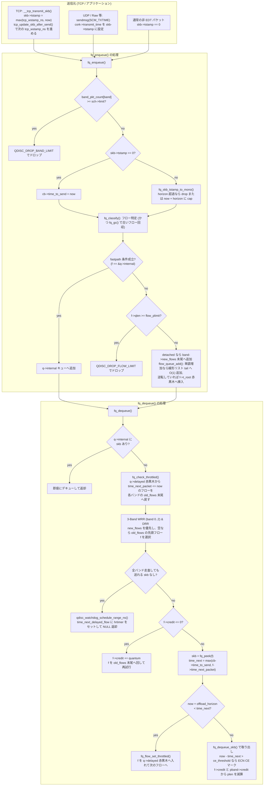
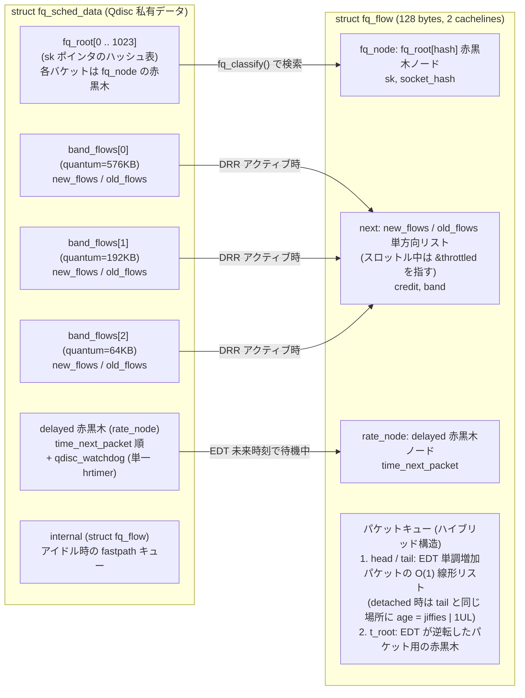

# 16. Fair Queueing (sch_fq) と EDT (Earliest Departure Time) Pacing

この章では、Linux のパケットスケジューラ（Qdisc）の要である `sch_fq`（[net/sched/sch_fq.c](https://git.kernel.org/pub/scm/linux/kernel/git/netdev/net-next.git/tree/net/sched/sch_fq.c?id=279d5c8afcd38bd841832a39bfe1aa4f8518d98e)）と、TCP スタックおよびアプリケーション（`SO_TXTIME`）と連携して百万フロー規模のペーシングを実現する **EDT (Earliest Departure Time)** アーキテクチャを一行ずつ読みます。第 11 章の `tcp_update_pacing_rate()` や第 13 章の BBR が設定した `sk->sk_pacing_rate` が、どのように各パケットの出発予定時刻 `skb->tstamp` に変換され、NIC ドライバへ渡る直前の `sch_fq` でどのように公平制御・時間制御されるのかをここで完全に繋ぎます。

---

## たとえ話で言うと

建物の 1 階には、各部屋の郵便受け（`struct sock`）から降りてきた伝票付きの小包（`sk_buff`）をトラック（NIC の送信リング）へ積み込む **集荷場（Qdisc）** があります。

もし集荷場に **1 列だけのベルトコンベア（単一 FIFO キュー）** しかなかったらどうなるでしょうか。

- ある部屋の住人（バルク転送フロー）が、大型の引越し荷物 100 個を一気にベルトコンベアへ載せたとします。
- その直後に、別の部屋から「鍵を開けて」（SSH の 1 文字）、「住所を教えて」（DNS クエリ）、あるいは「さっきの荷物は届いたよ」（純粋な ACK）という小さな急ぎの封筒が届いても、前の引越し荷物 100 個がすべてトラックに積まれるまで待たされてしまいます（**Head-of-Line (HoL) blocking**）。
- さらに、各部屋の配車係（BBR などの輻輳制御）が「道路が混まないように 1 ミリ秒に 1 個ずつ等間隔で出してね（pacing）」と決めたとします。ところが建物に 100 万室の部屋があるとき、集荷場に **100 万個の砂時計と門番（トークンバケットやソケットごとのハードウェアタイマー）** を並べたら、係員は砂時計をひっくり返す作業だけでパンクしてしまいます。

そこで Eric Dumazet と Van Jacobson が作った集荷場が **Fair Queueing (`sch_fq`)** と **EDT (Earliest Departure Time)** です。

- **部屋ごとの仕分けカゴと「久しぶりの部屋」優先**: 集荷場には部屋の郵便受け（`skb->sk`）ごとに専用の仕分けカゴ（`struct fq_flow`）を置き、係員がカゴを順番に回って少しずつ小包を取り出します（Deficit Round Robin）。しかも「久しぶりに 1 通だけ封筒を出した部屋」の列（`new_flows`）は、「さっきから何十箱も出し続けている部屋」の列（`old_flows`）よりも **先に** 回るため、SSH や DNS や受領印（ACK）は引越し荷物の後ろに並ばず、すぐに出発できます。
- **砂時計の代わりに「伝票の出発予定時刻 (EDT)」**: 等間隔で出すために砂時計を並べるのはやめます。代わりに、各部屋の発送係（TCP や `SO_TXTIME` アプリ）が小包を発送待ちの棚から出すときに、伝票（`skb->tstamp`）へ **「この小包は 10 時 00 分 00.005 秒以降に出発させること」という最早出発時刻 (EDT)** を書き込んでから集荷場へ降ろします。
- **時計順の待機棚とたった 1 つのキッチンタイマー**: 集荷場の係員は、カゴの先頭にある小包の伝票を見て、現在時刻がすでにその時刻を過ぎていればすぐトラックへ積みます。まだ未来の時刻なら、そのカゴを「出発時刻順の待機棚」（`delayed` 赤黒木）へ移し、集荷場に **たった 1 つだけあるキッチンタイマー（`qdisc_watchdog`）** を「待機棚の中で一番早い小包の時刻」にセットします。

この仕組みのおかげで、部屋が 100 万室に増えてもキッチンタイマーは集荷場に 1 つだけで済み、小さな封筒は待たされず、引越し荷物も指定通りの間隔で滑らかに道路へ出ていきます。

---

## 背景・RFC・論文では

### 参照すべき論文と RFC

`sch_fq` と EDT は単一の RFC ではなく、以下の論文・RFC・設計文書の組み合わせから生まれた仕組みです。

- **M. Shreedhar, G. Varghese, "Efficient Fair Queueing Using Deficit Round-Robin", ACM SIGCOMM 1995 (IEEE/ACM Transactions on Networking, Vol. 4, No. 3, 1996)**
  理想的なビット単位の公平キューイング（PGPS / WFQ）は、パケット到着・出発のたびに仮想完了時刻を $O(\log N)$ でソートする必要があります。一方、単純なパケット単位のラウンドロビンでは、大きなパケットを送るフローが小さなパケットを送るフローより多くの帯域を奪ってしまいます。**Deficit Round Robin (DRR)** は、各フローにバイト単位の持ち점（`credit` / deficit counter）を与え、1 ラウンドごとに `quantum` バイトを加算し、送信時にパケット長 `plen` を引くことで、パケットあたり $O(1)$ の処理量でバイト単位の公平性を実現しました。
- **[RFC 8290](https://www.rfc-editor.org/rfc/rfc8290) — The FlowQueue-CoDel Packet Scheduler and Active Queue Management Algorithm (2018)**
  DRR のアクティブフローリストを **`new_flows`（新しく到着したフロー）と `old_flows`（バックログを持つ継続フロー）の 2 本に分ける** 手法（[RFC 8290 §4.2](https://www.rfc-editor.org/rfc/rfc8290#section-4.2)）を標準化した文書です。元のアイデアは SQF (Shortest Queue First) および Linux 3.5 の `sch_fq_codel` に遡り、Linux 3.12（2013 年）の `sch_fq` にも同じ `new_flows` / `old_flows` 構造が採用されました。1 ラウンドの初期クレジット（`initial_quantum`）を使い切る前にキューが空になる疎なフロー（DNS、SSH、VoIP、TCP ハンドシェイク、純粋な ACK）は、常にバルク転送フロー（`old_flows`）より先にデキューされます。
- **A. Saeed, N. Dukkipati, V. Valancius, V. The Lam, C. Contavalli, A. Vahdat, "Carousel: Scalable Traffic Shaping at End Hosts", ACM SIGCOMM 2017** および **V. Jacobson, E. Dumazet et al., "TCP Pacing and Earliest Departure Time (EDT)", Netdev 0x12 / IETF 2018**
  従来の「レート（トークンバケット）によるシェーピング」を廃止し、すべてのパケットにナノ秒単位の **最早出発時刻 (Earliest Departure Time, EDT)** を刻印してエンドツーエンドでスケジューリングするアーキテクチャを提案した論文・発表です。2018 年 9 月の Linux 4.20（コミット `ab408b6dc744`）で TCP と `sch_fq` がこの EDT モデルへ全面移行しました。

### なぜ単一 FIFO やトークンバケットではだめなのか

#### 1. 単一 FIFO の Head-of-Line (HoL) ブロッキングとバースト

単一 FIFO キュー（`pfifo_fast` など）に、リンク速度 $C$ でバルクフローが $B$ バイトの TSO/GSO バーストまたはウィンドウ分のパケットを流し込むと、直後に到着した対話型フロー（または別コネクションの ACK）は最大で

$$d_{\text{FIFO}} = \frac{B}{C}$$

のキューイング遅延を受けます。さらに TCP は ACK クロッキングで動くため、ACK が凝集（ACK compression）して戻ると送信側もまた塊（バースト）でパケットを送り出し、下流スイッチの浅いバッファを溢れさせてマイクロバーストによるパケットロスを引き起こします。

#### 2. ハードウェア／Qdisc のトークンバケットが数百万フローにスケールしない理由

バーストを消すにはペーシング（パケット間の時間間隔の制御）が必要ですが、従来のトークンバケット（HTB、TBF、あるいは NIC のハードウェアレートリミッタ）には 3 つの根本的な壁がありました。

- **ハードウェアキュー数の限界とレート更新頻度**: NIC が持つハードウェア送信キューやレートリミッタは数十〜数千本しかなく、1 ホストで数十万〜数百万本の TCP コネクションを扱うサーバでは到底足りません。また TCP（特に BBR）は ACK のたびに `sk_pacing_rate` を書き換えるため、ハードウェアレジスタを毎 RTT 更新するのも非現実的です。
- **ソケットごとの hrtimer のオーバヘッド**: 各 TCP ソケットが自前の高精度タイマー（`tp->pacing_timer`）を回すと、数万本のフローが同時に通信したときに CPU がタイマー割り込みと赤黒木操作だけで飽和します。
- **Qdisc 内部での事後ペーシングの弊害（2013〜2018 年の旧 `sch_fq`）**: 初期の `sch_fq` は、TCP から受け取ったパケットをデキューした **後** に `sk->sk_pacing_rate` を見て次パケットの遅延を計算していました。しかしこの方式では、パケットが `sch_fq` の中でペーシング待ちしている時間を TCP コアが「ネットワーク内の滞留時間」と区別できず、RTT 推定値（`srtt_us`）や最小 RTT が人工的に膨らんでしまう（RTT inflation）ほか、どこまで GSO/TSO でまとめてよいかを TCP 側で判断できませんでした。

### 設計原理と数式

#### 1. 3 バンド WRR (Weighted Round Robin) とフロー単位 DRR

`sch_fq` は 2 階層のスケジューリングを行います。

1. **上位階層: 3 バンド WRR (`fq_perband_flows`)**
   パケットの `skb->priority`（`SO_PRIORITY` や IP TOS から決まる 0〜15 の値）を 2 ビットのテーブル `prio2band` でバンド $b \in \{0, 1, 2\}$ に写像します。各バンド $b$ は重み `quantum` $Q_b$ （既定値はバンド 0 が $9 \times 2^{16} = 589{,}824$ バイト、バンド 1 が $3 \times 2^{16} = 196{,}608$ バイト、バンド 2 が $1 \times 2^{16} = 65{,}536$ バイトで **$9 : 3 : 1$**）と、現在の持ち点 `credit` $C_b$ を持ちます。
   バンド $b$ から長さ $L$ バイトのパケットを送信するたびに

   $$C_b \leftarrow C_b - L$$

   と減算し、そのバンドに送信可能なフローがなくなるか $C_b \le 0$ になると次のバンドへ進み、クレジットを

   $$C_b \leftarrow \min(C_b + Q_b,\ Q_b)$$

   で補充します。厳密な優先度制御（strict priority）ではなく WRR にすることで、高優先度トラフィック（AF4 など）が暴走してもベストエフォート（BE1）が完全に飢餓（starvation）しないよう保証しています。

2. **下位階層: バンド内の `new_flows` / `old_flows` による DRR (`fq_flow`)**
   各バンドは `new_flows` と `old_flows` の 2 つの単方向リストを持ちます。
   - まだリストに繋がっていない（`detached` 状態の）フローにパケットが到着すると、`new_flows` の末尾に繋がれます。新規フローの初期クレジットは $c_f = Q_{\text{init}}$ （`initial_quantum`、既定値 $10 \times \text{MTU}$ ）です。また、過去に空になってから `flow_refill_delay`（既定値 40 ms）以上経過していたフローは、 $c_f \leftarrow \max(c_f, Q_{\text{flow}})$ に回復します。
   - `fq_dequeue()` は常に **`new_flows` を先に** 走査し、`new_flows` が空のときだけ `old_flows` を見ます。
   - フロー $f$ から長さ $L$ のパケットを送信すると

     $$c_f \leftarrow c_f - L$$

     と減算します。次巡で $c_f \le 0$ になっていたら

     $$c_f \leftarrow c_f + Q_{\text{flow}} \quad (\text{既定値 } Q_{\text{flow}} = 2 \times \text{MTU})$$

     を加算した上で、フロー $f$ を **`old_flows` の末尾** へ移動します。
   - もし `new_flows` 上のフローが $c_f > 0$ のままキューが空になった場合も、即座に `detached` にはせず、一度空のまま **`old_flows` の末尾** へ移し、`old_flows` の順番が回ってきたときにまだ空であれば初めて `detached` にします。これにより、短い間隔で 1 パケットずつ送り続けるフローが毎回 `new_flows` に割り込んで `old_flows` を飢餓させるのを防ぎます。

#### 2. EDT (Earliest Departure Time) とジッタ補正の数式

TCP ソケットは、次に送るパケットの最早出発時刻をナノ秒単位の `tp->tcp_wstamp_ns`（以下 $T_w$ ）に保持します。

1. **送信時の EDT 刻印（`__tcp_transmit_skb()`）**
   現在時刻のキャッシュ `tp->tcp_clock_cache` を $T_{\text{now}}$ とすると、送信直前に

   $$T_{\text{prior}} = T_w, \qquad T_w \leftarrow \max(T_w,\ T_{\text{now}}), \qquad \text{skb}\to\text{tstamp} \leftarrow T_w$$

   としてパケットに最早出発時刻を刻みます。

2. **送信後の次パケット時刻更新とジッタ補償（`tcp_update_skb_after_send()`）**
   ソケットのペーシングレートを $R$ [bytes/sec]（`sk->sk_pacing_rate`）、送信した skb の長さを $L$ [bytes]（`skb->len`）とすると、接続開始から 10 セグメント以上送った後（`tp->data_segs_out >= 10`）の理想的なパケット間隔は

   $$\Delta t_{\text{ideal}} = \frac{L \times 10^9}{R}\ \text{[ns]}$$

   です。しかし OS のスケジューリング遅延やソフト割り込み遅延により、実際に送信処理が走った時刻 $T_{\text{now}}$ が前回の予定時刻 $T_{\text{prior}}$ より遅れていた場合、その遅れ $T_w - T_{\text{prior}}$ をそのままにして毎回 $\Delta t_{\text{ideal}}$ を足すと、遅れが永久に積み重なって目標レート $R$ を達成できません。そこで Linux は、遅れた分 $\Delta t_{\text{credit}} = T_w - T_{\text{prior}}$ を「時間クレジット」として扱い、最大で $\Delta t_{\text{ideal}} / 2$ まで今回の間隔から差し引きます。

   $$\Delta t = \Delta t_{\text{ideal}} - \min\!\left(\frac{\Delta t_{\text{ideal}}}{2},\ T_w - T_{\text{prior}}\right), \qquad T_w \leftarrow T_w + \Delta t$$

3. **`sch_fq` での出発判定・スロットリング・ECN CE マーキング（`fq_dequeue()`）**
   `sch_fq` は、エンキュー時に `skb->tstamp` を `CLOCK_MONOTONIC` のナノ秒値 $T_{\text{pkt}}$ （`fq_skb_cb(skb)->time_to_send`）へ正規化します。デキュー時にフロー $f$ の先頭パケットを取り出す際、そのパケットの実効出発時刻 $T_{\text{next}}$ はフロー側の次回送信可能時刻 $T_{\text{flow}}$ （`f->time_next_packet`、Qdisc 側の `maxrate` 制限や非 EDT ソケットのペーシングによる次パケット時刻）との最大値

   $$T_{\text{next}} = \max(T_{\text{pkt}},\ T_{\text{flow}})$$

   で求まります。NIC のハードウェアペーシングオフロード幅を $H_{\text{offload}}$ （通常は 0）、タイマーの許容スラック幅を $\delta_{\text{slack}}$ （`timer_slack`）とすると、

   - $T_{\text{now}} + H_{\text{offload}} < T_{\text{next}}$ ならば、まだ出発時刻に達していないため、フロー $f$ を DRR リストから外して `q->delayed` 赤黒木へキー $T_{\text{next}}$ で挿入（スロットル）し、Qdisc 全体の最短遅延時刻 $T_{\min} = \min_{g \in \text{delayed}} T_{\text{flow}}(g)$ に向けて 1 つの `qdisc_watchdog` タイマーを $[T_{\min},\ T_{\min} + \delta_{\text{slack}}]$ の範囲でスケジュールします。
   - $T_{\text{now}} + H_{\text{offload}} \ge T_{\text{next}}$ ならば、そのパケットをデキューして送信します。このとき、予定時刻 $T_{\text{next}}$ からの実際の遅延 $T_{\text{now}} - T_{\text{next}}$ が `ce_threshold`（ $\theta_{\text{CE}}$ ）を超えていれば、

     $$T_{\text{now}} - T_{\text{next}} - \theta_{\text{CE}} > 0$$

     を条件として `INET_ECN_set_ce(skb)` を呼び、IP ヘッダに ECN CE マークを打ちます。

---

## 全体の流れ

### 1. パケットの送信から `fq_enqueue()` / `fq_dequeue()` までの全体図

TCP または `SO_TXTIME` アプリケーションが `skb->tstamp` を設定し、`sch_fq` がそれを分類・キューイング・ペーシングして NIC へ渡すまでの流れは次のとおりです。



### 2. `sch_fq` の主要データ構造の関係図

`struct fq_sched_data` が管理する 3 つの木・リスト群（① フロー検索用のハッシュ＋赤黒木 `fq_root[]`、② 3 バンド WRR と DRR リスト `band_flows[0..2]`、③ ペーシング待機用の赤黒木 `delayed`）と、各 `struct fq_flow` 内部のハイブリッドキュー（線形 FIFO `head`/`tail` ＋ 赤黒木 `t_root`）の関係は次のようになっています。



---

## コードを追う

### Step 1: コアデータ構造 — `fq_skb_cb`, `fq_flow`, `fq_perband_flows`, `fq_sched_data`

まず `net/sched/sch_fq.c` の冒頭で定義されている構造体と状態管理ヘルパを順番に読みます。

#### `struct fq_skb_cb` と `struct fq_flow`

`struct fq_skb_cb`（[net/sched/sch_fq.c#L53](https://git.kernel.org/pub/scm/linux/kernel/git/netdev/net-next.git/tree/net/sched/sch_fq.c?id=279d5c8afcd38bd841832a39bfe1aa4f8518d98e#n53)）と `struct fq_flow`（[net/sched/sch_fq.c#L69](https://git.kernel.org/pub/scm/linux/kernel/git/netdev/net-next.git/tree/net/sched/sch_fq.c?id=279d5c8afcd38bd841832a39bfe1aa4f8518d98e#n69)）です。

```c
struct fq_skb_cb {
	u64	time_to_send;
	u8	band;
};

static inline struct fq_skb_cb *fq_skb_cb(struct sk_buff *skb)
{
	qdisc_cb_private_validate(skb, sizeof(struct fq_skb_cb));
	return (struct fq_skb_cb *)qdisc_skb_cb(skb)->data;
}

/*
 * Per flow structure, dynamically allocated.
 * If packets have monotically increasing time_to_send, they are placed in O(1)
 * in linear list (head,tail), otherwise are placed in a rbtree (t_root).
 */
struct fq_flow {
/* First cache line : used in fq_gc(), fq_enqueue(), fq_dequeue() */
	struct rb_root	t_root;
	struct sk_buff	*head;		/* list of skbs for this flow : first skb */
	union {
		struct sk_buff *tail;	/* last skb in the list */
		unsigned long  age;	/* (jiffies | 1UL) when flow was emptied, for gc */
	};
	union {
		struct rb_node	fq_node;	/* anchor in fq_root[] trees */
		/* Following field is only used for q->internal,
		 * because q->internal is not hashed in fq_root[]
		 */
		u64		stat_fastpath_packets;
	};
	struct sock	*sk;
	u32		socket_hash;	/* sk_hash */
	int		qlen;		/* number of packets in flow queue */

/* Second cache line */
	int		credit;
	int		band;
	struct fq_flow *next;		/* next pointer in RR lists */

	struct rb_node  rate_node;	/* anchor in q->delayed tree */
	u64		time_next_packet;
};
```

- `fq_skb_cb`: Qdisc 層が自由に使える `qdisc_skb_cb(skb)->data`（20 バイト）の中に置かれる `sch_fq` 専用の制御ブロックです。`time_to_send` は `CLOCK_MONOTONIC` ナノ秒に正規化された出発予定時刻、`band` はエンキュー時に決まったバンド番号（0〜2）です。なぜ `f->band` だけでなく skb ごとに `band` を記録するかというと、後続パケットでソケットの優先度が変わり `f->band` が書き換わっても、`q->band_pkt_count[]` をデキュー時に同じバンドから減算できるようにするためです。
- `struct fq_flow` は専用 slab キャッシュ `fq_flow_cachep`（`SLAB_HWCACHE_ALIGN` 付き）から確保されるちょうど 128 バイト（64 バイト × 2 キャッシュライン）の構造体です。
- **第 1 キャッシュライン（64 バイト）**: `fq_gc()`、`fq_enqueue()`、`fq_dequeue()` のすべてで触るフィールドがここに集められています。
  - `t_root` と `head` / `tail`: 1 つのフロー内のパケットキューは **ハイブリッド構造** になっています。TCP の EDT パケットは原則として単調増加する `time_to_send` を持つため、`head` と `tail` の単方向リスト（`skb->next`）へ $O(1)$ で末尾追加されます。一方、`SO_TXTIME` を使う UDP/QUIC アプリケーションが順不同の EDT でパケットを投げた場合や、過去の時刻を持つパケットが後から来た場合だけ、`t_root` 赤黒木（`skb->rbnode`）へ挿入されます。
  - `union { struct sk_buff *tail; unsigned long age; }`: フローが DRR リストから外れている（`detached` 状態の）間はキューが空なので `tail` は使われません。そこで同じ 8 バイトを `age`（空になった時刻の `jiffies | 1UL`）として再利用しています。`struct sk_buff` は少なくとも 2 バイト以上にアラインされているため、有効な `tail` ポインタの最下位ビット（bit 0）は必ず `0` です。したがって `age` の bit 0 を強制的に `1` にしておけば、追加のフラグ変数なしで「このフローは現在 `detached` かどうか」を `f->age & 1UL` だけで判定できます。
  - `union { struct rb_node fq_node; u64 stat_fastpath_packets; }`: 通常のフローでは `q->fq_root[]` ハッシュバケットの赤黒木ノード `fq_node`（24 バイト）として使われます。一方、`q->internal`（fastpath 用に `fq_sched_data` に埋め込まれた特別な `fq_flow`）は `fq_root[]` に登録されないため、この領域を `stat_fastpath_packets` カウンタとして再利用しています。
  - `sk` と `socket_hash`: このフローに対応する `struct sock *` ポインタ（オーファンや非接続 UDP の場合は `(hash << 1) | 1UL` という疑似ポインタ）と、ソケットの `sk->sk_hash` です。`sch_fq` はフローが空になってもすぐには `fq_flow` を解放しないため、元のソケットが閉じられ、slab キャッシュで同じアドレスに別の新しい `struct sock` が割り当てられることがあります。その際 `f->sk == sk` だけでは同一ソケットか見分けられないため、`f->socket_hash != sk->sk_hash` で「ソケットの生まれ変わり」を検出します（Step 2）。
- **第 2 キャッシュライン（64 バイト）**: DRR のラウンドロビン操作とペーシングのスロットリング操作で使うフィールドです。
  - `credit`: フロー単位の DRR クレジット（バイト数）。
  - `band`: このフローが現在属しているバンド番号（0, 1, 2）。
  - `next`: `new_flows` または `old_flows` 単方向リストの次ポインタ。フローが `q->delayed` 赤黒木に入ってスロットルされている間は、ダミーの静的変数 `&throttled` を指すことで「現在スロットル中」を表します。
  - `rate_node` と `time_next_packet`: `q->delayed` 赤黒木のノードと、そのキーとなる次回送信可能時刻（ナノ秒）です。

#### `struct fq_perband_flows` と `struct fq_sched_data`

続いて `struct fq_flow_head`、`struct fq_perband_flows`、`struct fq_sched_data`（[net/sched/sch_fq.c#L97](https://git.kernel.org/pub/scm/linux/kernel/git/netdev/net-next.git/tree/net/sched/sch_fq.c?id=279d5c8afcd38bd841832a39bfe1aa4f8518d98e#n97)）を読みます。

```c
struct fq_flow_head {
	struct fq_flow *first;
	struct fq_flow *last;
};

struct fq_perband_flows {
	struct fq_flow_head new_flows;
	struct fq_flow_head old_flows;
	int		    credit;
	int		    quantum; /* based on band nr : 576KB, 192KB, 64KB */
};

#define FQ_PRIO2BAND_CRUMB_SIZE ((TC_PRIO_MAX + 1) >> 2)

struct fq_sched_data {
/* Read mostly cache line */

	u64		offload_horizon;
	u32		quantum;
	u32		initial_quantum;
	u32		flow_refill_delay;
	u32		flow_plimit;	/* max packets per flow */
	unsigned long	flow_max_rate;	/* optional max rate per flow */
	u64		ce_threshold;
	u64		horizon;	/* horizon in ns */
	u32		orphan_mask;	/* mask for orphaned skb */
	u32		low_rate_threshold;
	struct rb_root	*fq_root;
	u8		rate_enable;
	u8		fq_trees_log;
	u8		horizon_drop;
	u8		prio2band[FQ_PRIO2BAND_CRUMB_SIZE];
	u32		timer_slack; /* hrtimer slack in ns */

/* Read/Write fields. */

	unsigned int band_nr; /* band being serviced in fq_dequeue() */

	struct fq_perband_flows band_flows[FQ_BANDS];

	struct fq_flow	internal;	/* fastpath queue. */
	struct rb_root	delayed;	/* for rate limited flows */
	u64		time_next_delayed_flow;
	unsigned long	unthrottle_latency_ns;

	u32		band_pkt_count[FQ_BANDS];
	u32		flows;
	u32		inactive_flows; /* Flows with no packet to send. */
	u32		throttled_flows;

	u64		stat_throttled;
	struct qdisc_watchdog watchdog;
	u64		stat_gc_flows;

/* Seldom used fields. */

	u64		stat_band_drops[FQ_BANDS];
	u64		stat_ce_mark;
	u64		stat_horizon_drops;
	u64		stat_horizon_caps;
	u64		stat_flows_plimit;
	u64		stat_pkts_too_long;
	u64		stat_allocation_errors;
};
```

- `struct fq_perband_flows`: バンドごとの WRR 状態です。`new_flows` と `old_flows` の 2 本のリストヘッドと、バンドの残り `credit` および 1 ラウンドあたりの重み `quantum` を持ちます。
- `FQ_PRIO2BAND_CRUMB_SIZE`: `TC_PRIO_MAX + 1`（16 個）の優先度（0〜15）を 0〜2 の 3 バンドに写像する際、1 要素あたり 2 ビット（crumb）に圧縮して `u8 prio2band[4]` のわずか **4 バイト** に収めています。これにより、先頭の Read-mostly 領域が綺麗にキャッシュライン内に収まります。
- `struct fq_sched_data` はアクセスパターンによって 3 つの領域に分かれています。
  1. **Read mostly cache line**: `tc qdisc change`（`fq_change()`）のときしか書き換わらない設定パラメータ群と、ハッシュテーブル配列へのポインタ `fq_root`（既定で $2^{10} = 1024$ 個の `struct rb_root`）です。
  2. **Read/Write fields**: パケットのエンキュー・デキューのたびに更新されるフィールド群です。現在サービス中のバンド番号 `band_nr`、3 バンド分の `band_flows[FQ_BANDS]`、fastpath キュー `internal`、スロットルされたフローの赤黒木 `delayed` とその最小時刻キャッシュ `time_next_delayed_flow`、タイマー起動遅延の指数移動平均 `unthrottle_latency_ns`、バンド別パケット数 `band_pkt_count`、総フロー数 `flows`、空のフロー数 `inactive_flows`、スロットル中フロー数 `throttled_flows`、そして単一の hrtimer を包む `watchdog`（`struct qdisc_watchdog`）が並びます。
  3. **Seldom used fields**: ドロップや CE マークなど、異常系・輻輳時にしかインクリメントされない統計カウンタを末尾に隔離し、正常系のキャッシュラインを汚さないようにしています。

#### フロー状態遷移と優先度変換のヘルパ関数群

続いて、フローの状態（`detached` / `throttled` / `new_flows` / `old_flows`）を操作するヘルパ関数群（[net/sched/sch_fq.c#L162](https://git.kernel.org/pub/scm/linux/kernel/git/netdev/net-next.git/tree/net/sched/sch_fq.c?id=279d5c8afcd38bd841832a39bfe1aa4f8518d98e#n162)）を読みます。

```c
/* EDT timestamps to clear beyond now. */
static const int fq_offload_slack_ns = 400;

/* return the i-th 2-bit value ("crumb") */
static u8 fq_prio2band(const u8 *prio2band, unsigned int prio)
{
	return (READ_ONCE(prio2band[prio / 4]) >> (2 * (prio & 0x3))) & 0x3;
}

/*
 * f->tail and f->age share the same location.
 * We can use the low order bit to differentiate if this location points
 * to a sk_buff or contains a jiffies value, if we force this value to be odd.
 * This assumes f->tail low order bit must be 0 since alignof(struct sk_buff) >= 2
 */
static void fq_flow_set_detached(struct fq_flow *f)
{
	f->age = jiffies | 1UL;
}

static bool fq_flow_is_detached(const struct fq_flow *f)
{
	return !!(f->age & 1UL);
}

/* special value to mark a throttled flow (not on old/new list) */
static struct fq_flow throttled;

static bool fq_flow_is_throttled(const struct fq_flow *f)
{
	return f->next == &throttled;
}

enum new_flow {
	NEW_FLOW,
	OLD_FLOW
};

static void fq_flow_add_tail(struct fq_sched_data *q, struct fq_flow *flow,
			     enum new_flow list_sel)
{
	struct fq_perband_flows *pband = &q->band_flows[flow->band];
	struct fq_flow_head *head = (list_sel == NEW_FLOW) ?
					&pband->new_flows :
					&pband->old_flows;

	if (head->first)
		head->last->next = flow;
	else
		head->first = flow;
	head->last = flow;
	flow->next = NULL;
}

static void fq_flow_unset_throttled(struct fq_sched_data *q, struct fq_flow *f)
{
	rb_erase(&f->rate_node, &q->delayed);
	q->throttled_flows--;
	fq_flow_add_tail(q, f, OLD_FLOW);
}

static void fq_flow_rb_insert(struct fq_sched_data *q, struct fq_flow *f)
{
	struct rb_node **p = &q->delayed.rb_node, *parent = NULL;

	while (*p) {
		struct fq_flow *aux;

		parent = *p;
		aux = rb_entry(parent, struct fq_flow, rate_node);
		if (f->time_next_packet >= aux->time_next_packet)
			p = &parent->rb_right;
		else
			p = &parent->rb_left;
	}
	rb_link_node(&f->rate_node, parent, p);
	rb_insert_color(&f->rate_node, &q->delayed);

	if (q->time_next_delayed_flow > f->time_next_packet)
		q->time_next_delayed_flow = f->time_next_packet;
}

static void fq_flow_set_throttled(struct fq_sched_data *q, struct fq_flow *f)
{
	fq_flow_rb_insert(q, f);
	q->throttled_flows++;
	q->stat_throttled++;
	f->next = &throttled;
}
```

- `fq_prio2band()`（[net/sched/sch_fq.c#L166](https://git.kernel.org/pub/scm/linux/kernel/git/netdev/net-next.git/tree/net/sched/sch_fq.c?id=279d5c8afcd38bd841832a39bfe1aa4f8518d98e#n166)）: `prio / 4` で該当バイトを `READ_ONCE()` で読み、`2 * (prio & 0x3)` ビット右シフトして下位 2 ビットを取り出します。`fq_dump()` がロックレスで呼ばれるため、`prio2band` の読み書きには `READ_ONCE()` / `WRITE_ONCE()` が使われています。
- `fq_flow_set_detached()`（[net/sched/sch_fq.c#L177](https://git.kernel.org/pub/scm/linux/kernel/git/netdev/net-next.git/tree/net/sched/sch_fq.c?id=279d5c8afcd38bd841832a39bfe1aa4f8518d98e#n177)）/ `fq_flow_is_detached()`（[net/sched/sch_fq.c#L182](https://git.kernel.org/pub/scm/linux/kernel/git/netdev/net-next.git/tree/net/sched/sch_fq.c?id=279d5c8afcd38bd841832a39bfe1aa4f8518d98e#n182)）: 前述のとおり、`f->age`（`f->tail` と共用）に `jiffies | 1UL` を書き込むことで、「どのリストにも属していない空フロー」であることと「空になった時刻（最大 1 jiffy の誤差）」を同時に記録します。後に `flow_queue_add()` が最初のパケットを `f->tail = skb` として書き込んだ瞬間に bit 0 が `0` に戻るため、明示的な `unset_detached` 関数すら不要です。
- `fq_flow_is_throttled()`（[net/sched/sch_fq.c#L190](https://git.kernel.org/pub/scm/linux/kernel/git/netdev/net-next.git/tree/net/sched/sch_fq.c?id=279d5c8afcd38bd841832a39bfe1aa4f8518d98e#n190)）: ファイルスコープのダミー変数 `static struct fq_flow throttled;` のアドレスをセンチネルとして使い、`f->next == &throttled` ならスロットル中と判定します。
- `fq_flow_set_throttled()`（[net/sched/sch_fq.c#L244](https://git.kernel.org/pub/scm/linux/kernel/git/netdev/net-next.git/tree/net/sched/sch_fq.c?id=279d5c8afcd38bd841832a39bfe1aa4f8518d98e#n244)）と `fq_flow_rb_insert()`（[net/sched/sch_fq.c#L223](https://git.kernel.org/pub/scm/linux/kernel/git/netdev/net-next.git/tree/net/sched/sch_fq.c?id=279d5c8afcd38bd841832a39bfe1aa4f8518d98e#n223)）: `f->time_next_packet` をキーとして `q->delayed` 赤黒木へ挿入します。同じ時刻のフローが既にあれば右部分木（`>=`）へ入れるため、同一時刻内では FIFO 順が保たれます。また、毎回 `rb_first(&q->delayed)` を引かずに済むよう、最小時刻を `q->time_next_delayed_flow` にキャッシュして更新します。
- `fq_flow_unset_throttled()`（[net/sched/sch_fq.c#L216](https://git.kernel.org/pub/scm/linux/kernel/git/netdev/net-next.git/tree/net/sched/sch_fq.c?id=279d5c8afcd38bd841832a39bfe1aa4f8518d98e#n216)）: 出発予定時刻に達したフローを `q->delayed` 赤黒木から外し、必ず **`OLD_FLOW`（`old_flows` の末尾）** へ戻します。ペーシングで待機していたフローは継続的な送信フローなので、`new_flows`（疎な対話型フロー専用）には戻さないのが重要な設計です。

---

### Step 2: フロー分類とガベージコレクション — `fq_gc()`, `fq_fastpath_check()`, `fq_classify()`

#### `fq_gc_candidate()` と `fq_gc()`

`fq_gc_candidate()`（[net/sched/sch_fq.c#L257](https://git.kernel.org/pub/scm/linux/kernel/git/netdev/net-next.git/tree/net/sched/sch_fq.c?id=279d5c8afcd38bd841832a39bfe1aa4f8518d98e#n257)）と `fq_gc()`（[net/sched/sch_fq.c#L263](https://git.kernel.org/pub/scm/linux/kernel/git/netdev/net-next.git/tree/net/sched/sch_fq.c?id=279d5c8afcd38bd841832a39bfe1aa4f8518d98e#n263)）を読みます。

```c
#define FQ_GC_AGE (3*HZ)

static bool fq_gc_candidate(const struct fq_flow *f)
{
	return fq_flow_is_detached(f) &&
	       time_after(jiffies, f->age + FQ_GC_AGE);
}

static void fq_gc(struct fq_sched_data *q,
		  struct rb_root *root,
		  struct sock *sk)
{
	struct fq_flow *f, *tofree = NULL;
	struct rb_node **p, *parent;
	int fcnt;

	p = &root->rb_node;
	parent = NULL;
	while (*p) {
		parent = *p;

		f = rb_entry(parent, struct fq_flow, fq_node);
		if (f->sk == sk)
			break;

		if (fq_gc_candidate(f)) {
			f->next = tofree;
			tofree = f;
		}

		if (f->sk > sk)
			p = &parent->rb_right;
		else
			p = &parent->rb_left;
	}

	if (!tofree)
		return;

	fcnt = 0;
	while (tofree) {
		f = tofree;
		tofree = f->next;
		rb_erase(&f->fq_node, root);
		kmem_cache_free(fq_flow_cachep, f);
		fcnt++;
	}
	q->flows -= fcnt;
	q->inactive_flows -= fcnt;
	q->stat_gc_flows += fcnt;
}
```

- `sch_fq` は、フローのパケット数が 0 になってもすぐには `fq_flow` を解放しません。なぜなら、1 RTT 後に次のデータが来る可能性が高く、また `flow_refill_delay`（40 ms）以内に再送・追送が来たときに以前の状態（クレジットや `old_flows` 履歴）を覚えておく必要があるからです。さらに TCP ソケット破棄パス（`sk_destruct()`）から Qdisc へコールバックを入れるとロック競合が生じるため、ソケットと `fq_flow` のライフサイクルは完全に疎結合になっています。
- その代わり、`fq_classify()` がハッシュバケット `root` の赤黒木を `sk` に向かって探索するついでに、通り道にあるノードが `detached` かつ `FQ_GC_AGE`（3 秒）以上放置されていれば `tofree` 単方向リスト（`f->next` は `detached` フローでは未使用なので安全に使えます）に繋ぎ、探索終了後にまとめて `rb_erase()` + `kmem_cache_free()` します。タイマーも全バケット走査も使わず、エンキュー時の探索経路上のノードだけを $O(\log N)$ で掃除する巧みな遅延 GC です。

#### `fq_offload_horizon()` と `fq_fastpath_check()`

次に、アイドルまたは低負荷時のバイパス判定を行う `fq_offload_horizon()`（[net/sched/sch_fq.c#L307](https://git.kernel.org/pub/scm/linux/kernel/git/netdev/net-next.git/tree/net/sched/sch_fq.c?id=279d5c8afcd38bd841832a39bfe1aa4f8518d98e#n307)）と `fq_fastpath_check()`（[net/sched/sch_fq.c#L337](https://git.kernel.org/pub/scm/linux/kernel/git/netdev/net-next.git/tree/net/sched/sch_fq.c?id=279d5c8afcd38bd841832a39bfe1aa4f8518d98e#n337)）を読みます。

```c
static u64 fq_offload_horizon(const struct Qdisc *sch,
			      const struct fq_sched_data *q)
{
	const struct net_device *dev;
	u64 offload_horizon;

	offload_horizon = READ_ONCE(q->offload_horizon);
	if (!offload_horizon)
		return 0;

	dev = qdisc_dev(sch);
	if (!dev->pacing_offload)
		return 0;

	if (offload_horizon > READ_ONCE(dev->max_pacing_offload_horizon))
		return 0;

	return offload_horizon;
}

/* Fast path can be used if :
 * 1) Packet tstamp is in the past, or within the pacing offload horizon.
 * 2) FQ qlen == 0   OR
 *   (no flow is currently eligible for transmit,
 *    AND fast path queue has less than 8 packets)
 * 3) No SO_MAX_PACING_RATE on the socket (if any).
 * 4) No @maxrate attribute on this qdisc,
 *
 * FQ can not use generic TCQ_F_CAN_BYPASS infrastructure.
 */
static bool fq_fastpath_check(const struct Qdisc *sch, struct sk_buff *skb,
			      u64 now, u64 offload_horizon)
{
	const struct fq_sched_data *q = qdisc_priv(sch);
	const struct sock *sk;

	if (fq_skb_cb(skb)->time_to_send > now + offload_horizon)
		return false;

	if (sch->q.qlen != 0) {
		/* Even if some packets are stored in this qdisc,
		 * we can still enable fast path if all of them are
		 * scheduled in the future (ie no flows are eligible)
		 * or in the fast path queue.
		 */
		if (q->flows != q->inactive_flows + q->throttled_flows)
			return false;

		/* Do not allow fast path queue to explode, we want Fair Queue mode
		 * under pressure.
		 */
		if (q->internal.qlen >= 8)
			return false;

		/* Ordering invariants fall apart if some delayed flows
		 * are ready but we haven't serviced them, yet.
		 */
		if (q->time_next_delayed_flow <= now + offload_horizon)
			return false;
	}

	sk = skb->sk;
	if (sk && sk_fullsock(sk) && !sk_is_tcp(sk) &&
	    sk->sk_max_pacing_rate != ~0UL)
		return false;

	if (q->flow_max_rate != ~0UL)
		return false;

	return true;
}
```

- `fq_offload_horizon()`: NIC がハードウェアでの EDT ペーシングオフロード（`dev->pacing_offload`）に対応しており、かつ `tc qdisc ... fq offload_horizon` が設定されている場合、現在時刻 `now` から `offload_horizon` ナノ秒以内の未来時刻を持つパケットは、`sch_fq` でスロットルせずにそのまま NIC ドライバへ引き渡せます。ハードウェアオフロードを使わない通常の環境では `0` を返します。
- `fq_fastpath_check()`: リンクが空いていてパケットを今すぐ送れるときに、128 バイトの `fq_flow` の検索・確保や赤黒木操作をすべて省略して `q->internal` キューへ直行させる最適化（コミット `076433bd78d7`）です。以下の 4 条件がすべて成り立つときだけ真になります。
  1. `time_to_send <= now + offload_horizon`: このパケット自身がペーシング待機を必要としないこと。
  2. Qdisc が完全に空（`sch->q.qlen == 0`）であるか、または「現在すべての通常フローが `inactive` か `throttled` であり（`q->flows == q->inactive_flows + q->throttled_flows`）、かつ `q->internal.qlen < 8`、かつ `delayed` 木の中にすでに出発時刻を過ぎたフローがいない（`q->time_next_delayed_flow > now + offload_horizon`）」こと。最後の条件（コミット `122aba8c8061`）がないと、`delayed` 木の中で既に出発時刻を迎えている先行パケットを追い越して後続パケットが `q->internal` から出てしまい、同一フロー内でパケット逆転（reordering）が起きてしまいます。
  3. 非 TCP ソケットに `SO_MAX_PACING_RATE` が設定されていないこと（TCP ソケットなら `SO_MAX_PACING_RATE` は既に TCP 側で `skb->tstamp` に反映済みなので条件 1 で検査されていますが、非 TCP ソケットは `fq_dequeue()` でのレート計算が必要なため）。
  4. Qdisc 全体に `maxrate`（`q->flow_max_rate != ~0UL`）が設定されていないこと。

#### `fq_classify()`

続いて `fq_classify()`（[net/sched/sch_fq.c#L379](https://git.kernel.org/pub/scm/linux/kernel/git/netdev/net-next.git/tree/net/sched/sch_fq.c?id=279d5c8afcd38bd841832a39bfe1aa4f8518d98e#n379)）の全体を読みます。

```c
static struct fq_flow *fq_classify(struct Qdisc *sch, struct sk_buff *skb,
				   u64 now)
{
	struct fq_sched_data *q = qdisc_priv(sch);
	u64 offload_horizon = fq_offload_horizon(sch, q);
	struct rb_node **p, *parent;
	struct sock *sk = skb->sk;
	struct rb_root *root;
	struct fq_flow *f;

	/* SYNACK messages are attached to a TCP_NEW_SYN_RECV request socket
	 * or a listener (SYNCOOKIE mode)
	 * 1) request sockets are not full blown,
	 *    they do not contain sk_pacing_rate
	 * 2) They are not part of a 'flow' yet
	 * 3) We do not want to rate limit them (eg SYNFLOOD attack),
	 *    especially if the listener set SO_MAX_PACING_RATE
	 * 4) We pretend they are orphaned
	 * TCP can also associate TIME_WAIT sockets with RST or ACK packets.
	 */
	if (!sk || sk_listener_or_tw(sk)) {
		unsigned long hash = skb_get_hash(skb) & q->orphan_mask;

		/* By forcing low order bit to 1, we make sure to not
		 * collide with a local flow (socket pointers are word aligned)
		 */
		sk = (struct sock *)((hash << 1) | 1UL);
		skb_orphan(skb);
	} else if (sk->sk_state == TCP_CLOSE) {
		unsigned long hash = skb_get_hash(skb) & q->orphan_mask;
		/*
		 * Sockets in TCP_CLOSE are non connected.
		 * Typical use case is UDP sockets, they can send packets
		 * with sendto() to many different destinations.
		 * We probably could use a generic bit advertising
		 * non connected sockets, instead of sk_state == TCP_CLOSE,
		 * if we care enough.
		 */
		sk = (struct sock *)((hash << 1) | 1UL);
	}
```

- **分類キー `sk` の決定（399〜418 行目）**:
  - ローカルで確立された通常の TCP / 接続済み UDP ソケットのパケットは、`skb->sk`（カーネル内の `struct sock *` ポインタ値そのもの）をそのままフロー識別子として使います。5 タプルのハッシュ計算すら不要です。
  - しかし以下の 3 パターンは `skb->sk` をそのまま使うと問題が起きます。
    1. **フォワードされたパケット（`!sk`）**: ソケットを持たないため、4 タプルハッシュ `skb_get_hash(skb)` を使います。ただし DDoS 攻撃でランダムな IP/ポートのパケットが何百万個も来たときに `fq_flow` を無制限に確保してメモリを食い潰さないよう、`q->orphan_mask`（既定値 `1023`）でマスクして最大 1024 本の共有フローに閉じ込めます。
    2. **SYN-ACK や TIME_WAIT の ACK/RST（`sk_listener_or_tw(sk)`）**: SYN-ACK は `TCP_NEW_SYN_RECV`（`request_sock`）または SYN cookie 時は `TCP_LISTEN` ソケットに紐づいています。もしリスナーソケット 1 本の `fq_flow` に全クライアント宛の SYN-ACK をまとめると、リスナーに `SO_MAX_PACING_RATE`（子ソケットへ継承させる目的で設定することが多い）が付いていた場合に SYN flood 下で全 SYN-ACK がレート制限されてしまいます。また `request_sock` や `inet_timewait_sock` は `sk_pacing_rate` や `sk_pacing_status` フィールドを持ちません（フルソケットではないため、そこに書き込むとメモリ破壊になります！）。そこで `skb_orphan(skb)` でソケットから切り離した上、`(hash << 1) | 1UL` という疑似ポインタに変換します。最下位ビット（bit 0）を `1` にすることで、ワードアラインされた本物の `struct sock *` ポインタ（bit 0 は常に `0`）と絶対に衝突しません。
    3. **非接続の UDP ソケット（`sk->sk_state == TCP_CLOSE`）**: `connect()` していない UDP ソケット（DNS サーバや QUIC サーバなど）は 1 つのソケットから `sendto()` で多数の異なる宛先へパケットを送ります。これらを 1 つの `fq_flow` にまとめると別々の宛先間で HoL ブロッキングが起きるため、`skb_get_hash(skb) & q->orphan_mask` で宛先ごとに分散させます。なお、ここでは `skb_orphan(skb)` を **呼ばない** 点に注意してください。UDP の送信バッファ会計（`sk_wmem_alloc`）を維持し、かつ直後の `skb->sk == sk` チェックが偽（`skb->sk` は偶数アドレス、`sk` は奇数アドレス）になることで `sk->sk_pacing_status` 等への書き込みも自然にスキップされます。

```c
	if (fq_fastpath_check(sch, skb, now, offload_horizon)) {
		q->internal.stat_fastpath_packets++;
		if (skb->sk == sk && q->rate_enable &&
		    READ_ONCE(sk->sk_pacing_status) != SK_PACING_FQ)
			smp_store_release(&sk->sk_pacing_status,
					  SK_PACING_FQ);

		if (offload_horizon &&
		    fq_skb_cb(skb)->time_to_send <= now + fq_offload_slack_ns)
			skb_set_delivery_time(skb, 0, SKB_CLOCK_REALTIME);

		return &q->internal;
	}

	root = &q->fq_root[hash_ptr(sk, q->fq_trees_log)];

	fq_gc(q, root, sk);

	p = &root->rb_node;
	parent = NULL;
	while (*p) {
		parent = *p;

		f = rb_entry(parent, struct fq_flow, fq_node);
		if (f->sk == sk) {
			/* socket might have been reallocated, so check
			 * if its sk_hash is the same.
			 * It not, we need to refill credit with
			 * initial quantum
			 */
			if (unlikely(skb->sk == sk &&
				     f->socket_hash != sk->sk_hash)) {
				f->credit = q->initial_quantum;
				f->socket_hash = sk->sk_hash;
				if (q->rate_enable)
					smp_store_release(&sk->sk_pacing_status,
							  SK_PACING_FQ);
				if (fq_flow_is_throttled(f))
					fq_flow_unset_throttled(q, f);
				f->time_next_packet = 0ULL;
			}
			return f;
		}
		if (f->sk > sk)
			p = &parent->rb_right;
		else
			p = &parent->rb_left;
	}

	f = kmem_cache_zalloc(fq_flow_cachep, GFP_ATOMIC | __GFP_NOWARN);
	if (unlikely(!f)) {
		q->stat_allocation_errors++;
		return &q->internal;
	}
	/* f->t_root is already zeroed after kmem_cache_zalloc() */

	fq_flow_set_detached(f);
	f->sk = sk;
	if (skb->sk == sk) {
		f->socket_hash = sk->sk_hash;
		if (q->rate_enable)
			smp_store_release(&sk->sk_pacing_status,
					  SK_PACING_FQ);
	}
	f->credit = q->initial_quantum;

	rb_link_node(&f->fq_node, parent, p);
	rb_insert_color(&f->fq_node, root);

	q->flows++;
	q->inactive_flows++;
	return f;
}
```

- **Fastpath 判定（420〜432 行目）**: `fq_fastpath_check()` が真なら `&q->internal` を返します。このときも本物のソケット（`skb->sk == sk`）であれば `sk->sk_pacing_status` を `SK_PACING_FQ` に設定するのを忘れません（コミット `81a416985698`）。もしこれを忘れると、アイドル状態の Qdisc を通った最初のパケットで TCP ソケットが「この NIC には `sch_fq` が付いている」と気づけず、TCP 内部の `pacing_timer`（hrtimer）を無駄に回し続けてしまいます。
- **ハッシュ検索とソケット再利用検出（434〜467 行目）**: `hash_ptr(sk, q->fq_trees_log)` で 1024 個（既定値）のバケットの 1 つを選び、`fq_gc()` で古い `detached` フローを回収してから、赤黒木を `f->sk` で二分探索します。
  - `f->sk == sk` で見つかったとき、`skb->sk == sk && f->socket_hash != sk->sk_hash` ならば、前のソケットが close されて slab で同じアドレスに別のソケットが作られたということです。この場合は前のソケットの残りクレジットやスロットル状態を引き継いではいけないため、`f->credit = q->initial_quantum` に戻し、`SK_PACING_FQ` を設定し、もし旧ソケットがスロットル中（`fq_flow_is_throttled(f)`）だったら `fq_flow_unset_throttled(q, f)` で `q->delayed` 木から外し、`f->time_next_packet = 0ULL` にクリアします（コミット `7df40c2673a1`）。
- **新規 `fq_flow` の割り当て（469〜491 行目）**: 赤黒木に存在しなければ `fq_flow_cachep` から `GFP_ATOMIC | __GFP_NOWARN` で確保します。メモリ枯渇時はパケットを捨てずに `&q->internal` へフォールバックします。新規フローは `fq_flow_set_detached(f)` でまず `detached` とマークし、`f->credit = q->initial_quantum`（既定 $10 \times \text{MTU}$ ）を与え、赤黒木に挿入して `q->flows++`、`q->inactive_flows++`（まだ `f->qlen == 0` のため一旦 inactive として数え、直後の `fq_enqueue()` で `inactive_flows--` します）として返します。

---

### Step 3: パケットのエンキューと Horizon 保護 — `fq_enqueue()` と周辺関数

#### `flow_queue_add()`, `fq_packet_beyond_horizon()`, `fq_flow_adjust_timer()`, クロック変換

`fq_enqueue()` から呼ばれるヘルパ群（[net/sched/sch_fq.c#L537](https://git.kernel.org/pub/scm/linux/kernel/git/netdev/net-next.git/tree/net/sched/sch_fq.c?id=279d5c8afcd38bd841832a39bfe1aa4f8518d98e#n537)）を読みます。

```c
static void flow_queue_add(struct fq_flow *flow, struct sk_buff *skb)
{
	struct rb_node **p, *parent;
	struct sk_buff *head, *aux;

	head = flow->head;
	if (!head ||
	    fq_skb_cb(skb)->time_to_send >= fq_skb_cb(flow->tail)->time_to_send) {
		if (!head)
			flow->head = skb;
		else
			flow->tail->next = skb;
		flow->tail = skb;
		skb->next = NULL;
		return;
	}

	p = &flow->t_root.rb_node;
	parent = NULL;

	while (*p) {
		parent = *p;
		aux = rb_to_skb(parent);
		if (fq_skb_cb(skb)->time_to_send >= fq_skb_cb(aux)->time_to_send)
			p = &parent->rb_right;
		else
			p = &parent->rb_left;
	}
	rb_link_node(&skb->rbnode, parent, p);
	rb_insert_color(&skb->rbnode, &flow->t_root);
}

static bool fq_packet_beyond_horizon(ktime_t time_to_send,
				     const struct fq_sched_data *q, u64 now)
{
	return unlikely((s64)time_to_send > (s64)(now + q->horizon));
}

static void fq_flow_adjust_timer(struct fq_sched_data *q, struct fq_flow *flow,
				 u64 time_to_send, u64 now)
{
	if (time_to_send <= now) {
		fq_flow_unset_throttled(q, flow);
		if (q->time_next_delayed_flow == flow->time_next_packet) {
			struct rb_node *p = rb_first(&q->delayed);

			q->time_next_delayed_flow = p ? rb_entry(p, struct fq_flow, rate_node)->time_next_packet : ~0ULL;
		}
		flow->time_next_packet = time_to_send;
	} else {
		rb_erase(&flow->rate_node, &q->delayed);
		flow->time_next_packet = time_to_send;
		fq_flow_rb_insert(q, flow);
	}
}

static ktime_t fq_skb_tstamp_to_mono(struct sk_buff *skb)
{
	const ktime_t mono_max = NSEC_PER_SEC * TIME_UPTIME_SEC_MAX;

	if (likely(skb->tstamp_type == SKB_CLOCK_MONOTONIC))
		return max(skb->tstamp, 1);

	if (skb->tstamp_type == SKB_CLOCK_TAI)
		return max(ktime_sub(skb->tstamp, ktime_mono_to_any(0, TK_OFFS_TAI)), 1);

	if (likely(skb->tstamp > mono_max))
		return max(ktime_sub(skb->tstamp, ktime_mono_to_real(0)), 1);

	/* Handle BPF programs setting skb->stamp but not tstamp_type */
	net_warn_ratelimited("fq: likely mono tstamp with tstamp_type 0\n");

	skb->tstamp_type = SKB_CLOCK_MONOTONIC;
	return max(skb->tstamp, 1);
}

static void fq_mono_to_skb_tstamp(struct sk_buff *skb, ktime_t time_to_send)
{
	if (skb->tstamp_type == SKB_CLOCK_MONOTONIC)
		skb->tstamp = time_to_send;
	else if (skb->tstamp_type == SKB_CLOCK_REALTIME)
		skb->tstamp = ktime_mono_to_real(time_to_send);
	else
		skb->tstamp = ktime_mono_to_any(time_to_send, TK_OFFS_TAI);
}
```

- `flow_queue_add()`（[net/sched/sch_fq.c#L537](https://git.kernel.org/pub/scm/linux/kernel/git/netdev/net-next.git/tree/net/sched/sch_fq.c?id=279d5c8afcd38bd841832a39bfe1aa4f8518d98e#n537)）:
  - 線形リスト `flow->head` が空であるか、あるいは新しいパケットの `time_to_send` が線形リスト末尾 `flow->tail` の `time_to_send` 以上（単調非減少）であれば、単純に `flow->tail` の後ろへ $O(1)$ で繋ぎます。TCP コネクションが生成するパケットはすべて `tp->tcp_wstamp_ns` が単調非減少で進むため、**TCP では 100% この $O(1)$ パスを通ります**。また `flow->head` が空のときに `flow->tail = skb` を代入することで、共用体になっていた `flow->age`（bit 0 = 1）がポインタ（bit 0 = 0）で上書きされ、`detached` 状態が自動的に解除されます。
  - `SO_TXTIME` などで前のパケットより早い `time_to_send` を持つパケットが到着した場合だけ、`flow->t_root` 赤黒木へ `skb->rbnode` を使って挿入します。
- `fq_packet_beyond_horizon()`（[net/sched/sch_fq.c#L569](https://git.kernel.org/pub/scm/linux/kernel/git/netdev/net-next.git/tree/net/sched/sch_fq.c?id=279d5c8afcd38bd841832a39bfe1aa4f8518d98e#n569)）: パケットの `time_to_send` が `now + q->horizon`（既定 10 秒）を超えているか検査します。バグのあるユーザ空間プログラム（たとえば `CLOCK_REALTIME` と `CLOCK_MONOTONIC` を取り違えて 50 年後のタイムスタンプを `SCM_TXTIME` に渡すなど）がソケットバッファと Qdisc メモリを何時間も占有し続けるのを防ぐための防護壁です。
- `fq_flow_adjust_timer()`（[net/sched/sch_fq.c#L575](https://git.kernel.org/pub/scm/linux/kernel/git/netdev/net-next.git/tree/net/sched/sch_fq.c?id=279d5c8afcd38bd841832a39bfe1aa4f8518d98e#n575)）: すでに `q->delayed` 赤黒木でスロットルされているフローに対して、現在設定されている `flow->time_next_packet` よりも **早い** `time_to_send` を持つパケットが後からエンキューされた場合（`SO_TXTIME` で順不同にパケットを投げた場合など）に呼ばれます（コミット `fabcf8cad67b`）。もし新しい時刻が `now` 以下なら即座に `fq_flow_unset_throttled()` で `old_flows` に戻し、まだ未来なら `q->delayed` 木から一度削除して新しい `time_next_packet` で再挿入します。
- `fq_skb_tstamp_to_mono()`（[net/sched/sch_fq.c#L593](https://git.kernel.org/pub/scm/linux/kernel/git/netdev/net-next.git/tree/net/sched/sch_fq.c?id=279d5c8afcd38bd841832a39bfe1aa4f8518d98e#n593)）: `sch_fq` の内部時計はすべて `CLOCK_MONOTONIC` です。TCP は最初から `SKB_CLOCK_MONOTONIC` で刻印しますが、`SO_TXTIME` や BPF プログラムは `SKB_CLOCK_TAI` や `SKB_CLOCK_REALTIME`（値は `0`）で刻印することがあるため、それぞれのオフセットを引いて `CLOCK_MONOTONIC` に変換します。また BPF プログラムが `skb->tstamp` だけ書いて `tstamp_type` を `0`（`SKB_CLOCK_REALTIME` と同値）のままにした古いケースも、`mono_max`（最大稼働時間 `TIME_UPTIME_SEC_MAX` = 30 年）以下なら `CLOCK_MONOTONIC` とみなして救済します。

#### `fq_enqueue()`

`fq_enqueue()`（[net/sched/sch_fq.c#L623](https://git.kernel.org/pub/scm/linux/kernel/git/netdev/net-next.git/tree/net/sched/sch_fq.c?id=279d5c8afcd38bd841832a39bfe1aa4f8518d98e#n623)）を一行ずつ読みます。

```c
static int fq_enqueue(struct sk_buff *skb, struct Qdisc *sch,
		      struct sk_buff **to_free)
{
	struct fq_sched_data *q = qdisc_priv(sch);
	struct fq_flow *f;
	u64 now;
	u8 band;

	band = fq_prio2band(q->prio2band, skb->priority & TC_PRIO_MAX);
	if (unlikely(q->band_pkt_count[band] >= sch->limit)) {
		q->stat_band_drops[band]++;
		return qdisc_drop_reason(skb, sch, to_free, QDISC_DROP_BAND_LIMIT);
	}

	now = ktime_get_ns();
	if (!skb->tstamp) {
		fq_skb_cb(skb)->time_to_send = now;
	} else {
		ktime_t time_to_send = fq_skb_tstamp_to_mono(skb);

		/* Check if packet timestamp is too far in the future. */
		if (fq_packet_beyond_horizon(time_to_send, q, now)) {
			if (q->horizon_drop) {
				q->stat_horizon_drops++;
				return qdisc_drop_reason(skb, sch, to_free,
							 QDISC_DROP_HORIZON_LIMIT);
			}
			q->stat_horizon_caps++;
			time_to_send = now + q->horizon;
			fq_mono_to_skb_tstamp(skb, time_to_send);
		}
		fq_skb_cb(skb)->time_to_send = (u64)time_to_send;
	}

	f = fq_classify(sch, skb, now);

	if (f != &q->internal) {
		if (unlikely(f->qlen >= q->flow_plimit)) {
			q->stat_flows_plimit++;
			return qdisc_drop_reason(skb, sch, to_free,
						 QDISC_DROP_FLOW_LIMIT);
		}

		if (fq_flow_is_detached(f)) {
			fq_flow_add_tail(q, f, NEW_FLOW);
			if (time_after(jiffies, f->age + q->flow_refill_delay))
				f->credit = max_t(u32, f->credit, q->quantum);
		}

		f->band = band;
		q->band_pkt_count[band]++;
		fq_skb_cb(skb)->band = band;
		if (f->qlen == 0)
			q->inactive_flows--;
	}

	f->qlen++;
	/* Note: this overwrites f->age */
	flow_queue_add(f, skb);

	if (fq_skb_cb(skb)->time_to_send < f->time_next_packet && skb->tstamp &&
	    fq_flow_is_throttled(f) && q->flow_max_rate == ~0UL)
		fq_flow_adjust_timer(q, f, fq_skb_cb(skb)->time_to_send, now);

	qdisc_qstats_backlog_inc(sch, skb);
	qdisc_qlen_inc(sch);

	return NET_XMIT_SUCCESS;
}
```

- **631〜635 行目（バンド上限検査）**: `skb->priority` からバンド番号 `band`（0〜2）を求め、`q->band_pkt_count[band] >= sch->limit`（既定 10000 パケット）なら `QDISC_DROP_BAND_LIMIT` でドロップします。ここで `sch->q.qlen >= sch->limit` ではなく **バンドごとに** `sch->limit` まで許容している点がポイントです（コミット `29f834aa326e`）。ベストエフォート（band 1 や 2）が大量のパケットで 10000 パケットに達しても、高優先度（band 0）のパケットは別の `band_pkt_count[0]` 枠を持つため、巻き添えでドロップされません。またドロップ時は Qdisc ロックを保持したまま `kfree_skb()` せず、`to_free` リストに繋いでロック解放後に解放します（`qdisc_drop_reason()`）。
- **637〜655 行目（EDT `time_to_send` と Horizon 検査）**:
  - `skb->tstamp == 0`（UDP の通常送信や ICMP など、EDT を持たないパケット）なら、`cb->time_to_send = now` とします。
  - `skb->tstamp != 0`（TCP または `SO_TXTIME`）なら `fq_skb_tstamp_to_mono(skb)` で `CLOCK_MONOTONIC` に揃え、`fq_packet_beyond_horizon()` で `now + q->horizon`（既定 10 秒）を超えていないか確認します。超えていた場合、`q->horizon_drop` が 1（既定値、`horizon_drop` ポリシー）なら `stat_horizon_drops++` して `QDISC_DROP_HORIZON_LIMIT` でドロップします（TCP の場合は `__tcp_transmit_skb()` がエラーを受け取らず、再送タイマー等で回復します）。0（`horizon_cap` ポリシー）なら `stat_horizon_caps++` し、時刻を `now + q->horizon` に丸めて `skb->tstamp` にも書き戻します。
- **657〜677 行目（フローごとの上限と `new_flows` への追加）**:
  - `fq_classify()` でフロー `f` を得ます。fastpath（`&q->internal`）以外では、まず単一フローのキュー長 `f->qlen >= q->flow_plimit`（既定 100 パケット）を検査し、超えていれば `QDISC_DROP_FLOW_LIMIT` でドロップします。
  - 次に `if (fq_flow_is_detached(f))` が **Sparse Flow 優先の核心** です。現在どの DRR リストにも載っておらずスロットルもされていない（`detached` 状態の）フローは、`fq_flow_add_tail(q, f, NEW_FLOW)` によってそのバンドの **`new_flows` の末尾** へ追加されます。さらに、前回空になった時刻 `f->age` から `q->flow_refill_delay`（既定 40 ms）以上経過していれば、`f->credit` を少なくとも `q->quantum`（ $2 \times \text{MTU}$ ）まで回復させます。逆に 40 ms 未満で再びパケットが来た場合は前回の残りクレジットをそのまま使うため、短い休止を挟んでクレジットを不正に稼ぐことはできません。
  - なお、ここで `f->age` を読んだ **後** に、681 行目の `flow_queue_add(f, skb)` が `f->tail = skb` を書き込んで `f->age` を上書きするため、680 行目に `/* Note: this overwrites f->age */` という注意書きがあります。
- **683〜685 行目（スロットル中フローの起床時刻前倒し）**: スロットル中のフローに `f->time_next_packet` より早い EDT パケットが到着した場合（かつ Qdisc の `maxrate` 制限がない場合）、`fq_flow_adjust_timer()` で `q->delayed` 赤黒木の位置を調整します。

---

### Step 4: デキュー、3-Band WRR、DRR、EDT スロットリング — `fq_dequeue()` と周辺関数

#### `fq_peek()`, `fq_erase_head()`, `fq_dequeue_skb()`

まずフローの先頭パケットを覗き見・取り出しする 3 関数（[net/sched/sch_fq.c#L494](https://git.kernel.org/pub/scm/linux/kernel/git/netdev/net-next.git/tree/net/sched/sch_fq.c?id=279d5c8afcd38bd841832a39bfe1aa4f8518d98e#n494)）を読みます。

```c
static struct sk_buff *fq_peek(struct fq_flow *flow)
{
	struct sk_buff *skb = skb_rb_first(&flow->t_root);
	struct sk_buff *head = flow->head;

	if (!skb)
		return head;

	if (!head)
		return skb;

	if (fq_skb_cb(skb)->time_to_send < fq_skb_cb(head)->time_to_send)
		return skb;
	return head;
}

static void fq_erase_head(struct Qdisc *sch, struct fq_flow *flow,
			  struct sk_buff *skb)
{
	if (skb == flow->head) {
		struct sk_buff *next = skb->next;

		prefetch(next);
		flow->head = next;
	} else {
		rb_erase(&skb->rbnode, &flow->t_root);
		skb->dev = qdisc_dev(sch);
	}
}

/* Remove one skb from flow queue.
 * This skb must be the return value of prior fq_peek().
 */
static void fq_dequeue_skb(struct Qdisc *sch, struct fq_flow *flow,
			   struct sk_buff *skb)
{
	fq_erase_head(sch, flow, skb);
	skb_mark_not_on_list(skb);
	qdisc_qstats_backlog_dec(sch, skb);
	qdisc_qlen_dec(sch);
	qdisc_bstats_update(sch, skb);
}
```

- `fq_peek()`（[net/sched/sch_fq.c#L494](https://git.kernel.org/pub/scm/linux/kernel/git/netdev/net-next.git/tree/net/sched/sch_fq.c?id=279d5c8afcd38bd841832a39bfe1aa4f8518d98e#n494)）: 順不同パケット用の赤黒木 `flow->t_root` の最小ノード `skb_rb_first(&flow->t_root)` と、単調増加パケット用の線形リストの先頭 `flow->head` を比べ、`time_to_send` が早い方を返します。TCP では `flow->t_root` は常に空（`!skb`）なので、499 行目の `if (!skb) return head;` で即座に `flow->head` が返ります。
- `fq_erase_head()`（[net/sched/sch_fq.c#L510](https://git.kernel.org/pub/scm/linux/kernel/git/netdev/net-next.git/tree/net/sched/sch_fq.c?id=279d5c8afcd38bd841832a39bfe1aa4f8518d98e#n510)）:
  - `skb == flow->head` の場合は `flow->head = next` と進める前に `prefetch(next)`（コミット `2f9babc04d74`）を発行し、次回のデキューで読む次の skb の第 1 キャッシュラインを CPU キャッシュへ先読みしておきます。なお `flow->head` が `NULL` になっても `flow->tail` は書き換えません（`flow->head` が `NULL` の間は `flow_queue_add()` が `flow->tail` を参照しないため）。
  - 赤黒木 `flow->t_root` から削除した場合（519〜520 行目）に **`skb->dev = qdisc_dev(sch);` を書き戻している** のは非常に重要な罠対策です。`struct sk_buff`（[include/linux/skbuff.h#L875](https://git.kernel.org/pub/scm/linux/kernel/git/netdev/net-next.git/tree/include/linux/skbuff.h?id=279d5c8afcd38bd841832a39bfe1aa4f8518d98e#n875)）では、メモリ節約のために双方向リストポインタ（`next` / `prev` + `dev` または `sk`）と `struct rb_node rbnode`（24 バイト: `__rb_parent_color`, `rb_right`, `rb_left`）が同じ `union` に入っています。そのため skb を赤黒木に入れている間に `skb->dev` の場所が赤黒木のポインタで上書きされており、赤黒木から外した直後に `skb->dev` を復元しないと、下位の送信パス（`sch_direct_xmit()` など）が壊れた `skb->dev` を参照してクラッシュしてしまいます。

#### `fq_check_throttled()` と `fq_pband_head_select()`

次に、スロットル解除とバンド内のリスト選択を行う `fq_check_throttled()`（[net/sched/sch_fq.c#L693](https://git.kernel.org/pub/scm/linux/kernel/git/netdev/net-next.git/tree/net/sched/sch_fq.c?id=279d5c8afcd38bd841832a39bfe1aa4f8518d98e#n693)）と `fq_pband_head_select()`（[net/sched/sch_fq.c#L724](https://git.kernel.org/pub/scm/linux/kernel/git/netdev/net-next.git/tree/net/sched/sch_fq.c?id=279d5c8afcd38bd841832a39bfe1aa4f8518d98e#n724)）を読みます。

```c
static void fq_check_throttled(struct fq_sched_data *q, u64 now,
			       u64 offload_horizon)
{
	unsigned long sample;
	struct rb_node *p;

	if (q->time_next_delayed_flow > now + offload_horizon)
		return;

	/* Update unthrottle latency EWMA.
	 * This is cheap and can help diagnosing timer/latency problems.
	 */
	sample = (unsigned long)(now - q->time_next_delayed_flow);
	if ((long)sample > 0) {
		q->unthrottle_latency_ns -= q->unthrottle_latency_ns >> 3;
		q->unthrottle_latency_ns += sample >> 3;
	}
	now += offload_horizon;

	q->time_next_delayed_flow = ~0ULL;
	while ((p = rb_first(&q->delayed)) != NULL) {
		struct fq_flow *f = rb_entry(p, struct fq_flow, rate_node);

		if (f->time_next_packet > now) {
			q->time_next_delayed_flow = f->time_next_packet;
			break;
		}
		fq_flow_unset_throttled(q, f);
	}
}

static struct fq_flow_head *fq_pband_head_select(struct fq_perband_flows *pband)
{
	if (pband->credit <= 0)
		return NULL;

	if (pband->new_flows.first)
		return &pband->new_flows;

	return pband->old_flows.first ? &pband->old_flows : NULL;
}
```

- `fq_check_throttled()`:
  - まずキャッシュされている最小時刻 `q->time_next_delayed_flow` と `now + offload_horizon` を比較します。まだ 1 つも期限が来ていなければ（あるいは `delayed` 木が空で `~0ULL` なら）赤黒木に一切触れずに $O(1)$ でリターンします。
  - 期限が来ていれば、`now - q->time_next_delayed_flow`（「本来起きたかった時刻」から「実際に `fq_dequeue()` が呼ばれた時刻」までの遅延）を計算し、重み $1/8$ （`>> 3`）の指数移動平均（EWMA）で `q->unthrottle_latency_ns` を更新します。これは `tc -s qdisc show` に `unthrottle_latency` として表示され、カーネルのタイマー遅延や softirq 遅延の診断に絶大な威力を発揮します。
  - そして `rb_first(&q->delayed)` から順に、`f->time_next_packet <= now`（`offload_horizon` 加算済み）となったフローをすべて `fq_flow_unset_throttled(q, f)` で赤黒木から外し、各フローが属するバンドの **`old_flows` の末尾** へ繋ぎ直します。最初に見つかったまだ未来のフローの `time_next_packet` を新しい `q->time_next_delayed_flow` に記録してループを終えます。
- `fq_pband_head_select()`:
  - バンドの残りクレジット `pband->credit` が 0 以下なら `NULL` を返します（次のバンドへ移行させる合図）。
  - クレジットが正なら、**必ず `pband->new_flows` を先にチェックし**、1 つでもフローがあれば `&pband->new_flows` を返します。`new_flows` が空のときだけ `&pband->old_flows` を返します。

#### `fq_dequeue()`

いよいよ `sch_fq` の心臓部である `fq_dequeue()`（[net/sched/sch_fq.c#L735](https://git.kernel.org/pub/scm/linux/kernel/git/netdev/net-next.git/tree/net/sched/sch_fq.c?id=279d5c8afcd38bd841832a39bfe1aa4f8518d98e#n735)）を前半・後半に分けて一行ずつ読みます。

```c
static struct sk_buff *fq_dequeue(struct Qdisc *sch)
{
	struct fq_sched_data *q = qdisc_priv(sch);
	u64 offload_horizon = fq_offload_horizon(sch, q);
	struct fq_perband_flows *pband;
	struct fq_flow_head *head;
	u64 time_next_packet = 0;
	struct sk_buff *skb;
	struct fq_flow *f;
	unsigned long rate;
	int retry;
	u32 plen;
	u64 now;

	if (!sch->q.qlen)
		return NULL;

	skb = fq_peek(&q->internal);
	if (skb) {
		q->internal.qlen--;
		fq_dequeue_skb(sch, &q->internal, skb);
		return skb;
	}

	now = ktime_get_ns();
	fq_check_throttled(q, now, offload_horizon);
	retry = 0;
	pband = &q->band_flows[q->band_nr];
begin:
	head = fq_pband_head_select(pband);
	if (!head) {
		while (++retry <= FQ_BANDS) {
			if (++q->band_nr == FQ_BANDS)
				q->band_nr = 0;
			pband = &q->band_flows[q->band_nr];
			pband->credit = min(pband->credit + pband->quantum,
					    pband->quantum);
			if (pband->credit > 0)
				goto begin;
			retry = 0;
		}
		if (q->time_next_delayed_flow != ~0ULL)
			qdisc_watchdog_schedule_range_ns(&q->watchdog,
							q->time_next_delayed_flow,
							q->timer_slack);
		return NULL;
	}
```

- **749〜757 行目（空チェックと fastpath デキュー）**: Qdisc 全体の `qlen` が 0 なら即 `NULL` です。次に `q->internal` にパケットがあれば、`ktime_get_ns()` すら呼ばずに即座にデキューして返します。
- **759〜762 行目**: `now = ktime_get_ns()` を 1 回だけ取得し、`fq_check_throttled()` で期限が来たスロットルフローを `old_flows` に戻します。
- **763〜781 行目（3 バンド WRR ループ）**:
  - 現在サービス中のバンド `q->band_nr`（前回の `fq_dequeue()` から継続）に対して `fq_pband_head_select(pband)` を呼びます。
  - `head == NULL`（このバンドにアクティブなフローがないか、またはバンドの `credit <= 0` になった）なら、`while (++retry <= FQ_BANDS)` で次のバンドへ進みます。バンド番号 `q->band_nr` を $0 \to 1 \to 2 \to 0$ と進め、新しいバンドのクレジットを `min(pband->credit + pband->quantum, pband->quantum)` で補充します。
  - なぜ単に `pband->credit += pband->quantum` ではなく `min(..., pband->quantum)` なのかというと、空のバンドが何周もスキップされる間にクレジットが無限に積み上がるのを防ぐためです。また、もしバンドの `quantum`（重み）が最小値 `FQ_MIN_WEIGHT`（16 KB）に設定されていて、直前に 64 KB の TSO/GSO パケットを送って `credit` が大きくマイナス（例: `-48 KB`）になっていた場合、1 回の `+ quantum` ではまだ `pband->credit <= 0` のままのことがあります。その場合は 774 行目の `retry = 0;` でリトライ回数をリセットしてもう 1 周回し、マイナス分を解消できるようにしています（コミット `bc21000e99f9`）。
  - 3 バンドすべてを調べても（`++retry > FQ_BANDS`）送信可能なフローが 1 つも見つからなければ、現在キュー内にあるパケットはすべて `q->delayed` 赤黒木の中で未来の出発時刻を待っています。そこで `qdisc_watchdog_schedule_range_ns()` を呼んで最短時刻 `q->time_next_delayed_flow`（許容幅 `q->timer_slack`、既定 10 µs）に hrtimer をセットし、`NULL` を返します。

続いて `fq_dequeue()` の後半（782〜878 行目）を読みます。

```c
	f = head->first;
	retry = 0;
	if (f->credit <= 0) {
		f->credit += q->quantum;
		head->first = f->next;
		fq_flow_add_tail(q, f, OLD_FLOW);
		goto begin;
	}

	skb = fq_peek(f);
	if (skb) {
		time_next_packet = max_t(u64, fq_skb_cb(skb)->time_to_send,
					 f->time_next_packet);

		if (now + offload_horizon < time_next_packet) {
			head->first = f->next;
			f->time_next_packet = time_next_packet;
			fq_flow_set_throttled(q, f);
			goto begin;
		}
		prefetch(&skb->end);
		fq_dequeue_skb(sch, f, skb);
		if (unlikely((s64)(now - time_next_packet - q->ce_threshold) > 0)) {
			INET_ECN_set_ce(skb);
			q->stat_ce_mark++;
		}
		if (--f->qlen == 0)
			q->inactive_flows++;
		q->band_pkt_count[fq_skb_cb(skb)->band]--;
	} else {
		head->first = f->next;
		/* force a pass through old_flows to prevent starvation */
		if (head == &pband->new_flows) {
			fq_flow_add_tail(q, f, OLD_FLOW);
		} else {
			fq_flow_set_detached(f);
		}
		goto begin;
	}
	plen = qdisc_pkt_len(skb);
	f->credit -= plen;
	pband->credit -= plen;

	if (!q->rate_enable)
		goto out;

	rate = q->flow_max_rate;

	/* If EDT time was provided for this skb, we need to
	 * update f->time_next_packet only if this qdisc enforces
	 * a flow max rate.
	 */
	if (!skb->tstamp) {
		if (skb->sk)
			rate = min(READ_ONCE(skb->sk->sk_pacing_rate), rate);

		if (rate <= q->low_rate_threshold) {
			f->credit = 0;
		} else {
			plen = max(plen, q->quantum);
			if (f->credit > 0)
				goto out;
		}
	}
	if (rate != ~0UL) {
		u64 len = (u64)plen * NSEC_PER_SEC;

		if (likely(rate))
			len = div64_ul(len, rate);
		/* Since socket rate can change later,
		 * clamp the delay to 1 second.
		 * Really, providers of too big packets should be fixed !
		 */
		if (unlikely(len > NSEC_PER_SEC)) {
			len = NSEC_PER_SEC;
			q->stat_pkts_too_long++;
		}
		/* Account for schedule/timers drifts.
		 * f->time_next_packet was set when prior packet was sent,
		 * and current time (@now) can be too late by tens of us.
		 */
		if (f->time_next_packet) {
			s64 drift = now - f->time_next_packet;

			if (drift > 0)
				len -= min_t(u64, len / 2, drift);
		}
		f->time_next_packet = now + len;
	}

out:
	if (offload_horizon &&
	    time_next_packet && time_next_packet <= now + fq_offload_slack_ns)
		skb_set_delivery_time(skb, 0, SKB_CLOCK_REALTIME);

	return skb;
}
```

- **784〜789 行目（フロー単位 DRR クレジット補充）**: リスト先頭のフロー `f` の `f->credit <= 0` なら、`q->quantum`（既定 $2 \times \text{MTU}$ ）を足し、現在のリスト（`new_flows` または `old_flows`）の先頭から外して **`old_flows` の末尾** へ繋ぎ直し、`goto begin` で次のフローを見ます。
- **791〜801 行目（EDT 出発時刻判定とスロットル移行）**:
  - `fq_peek(f)` でフローの先頭 skb を覗き見ます。
  - パケットがあるとき、そのパケット自身の EDT（`fq_skb_cb(skb)->time_to_send`）と、フローの次回送信可能時刻（`f->time_next_packet`）の大きい方を `time_next_packet` とします。
  - もし `now + offload_horizon < time_next_packet` であれば、まだ出発時刻に達していません。そこでこのフローを現在のリストから外し、`f->time_next_packet = time_next_packet` を設定して `fq_flow_set_throttled(q, f)` で `q->delayed` 赤黒木へ移し、`goto begin` で別のフローを探します。**1 つのフローがペーシング待ちになっても、同じバンドや別バンドの他フローは一切ブロックされずに次々と送信される**（HoL ブロッキングが起きない）理由がここです。
- **802〜810 行目（デキューと `ce_threshold` による ECN CE マーキング）**:
  - 出発時刻に達していれば、`prefetch(&skb->end)` で `skb_shared_info`（GSO セグメント数などが入っており、直後のドライバ送信パスで必ずアクセスされる領域）をプリフェッチし（コミット `348e289b0f23`）、`fq_dequeue_skb()` でキューから取り出します。
  - このとき `now - time_next_packet > q->ce_threshold` であれば、このパケットは予定されていた出発時刻よりも `ce_threshold` 以上遅れてデキューされた（＝自ホストの Qdisc または NIC キューが混んでいる）ことを意味します。そこで `INET_ECN_set_ce(skb)` を呼んで IP ヘッダ（IPv4 なら TOS、IPv6 なら Traffic Class）が ECT(0) または ECT(1) であれば CE (Congestion Experienced) に書き換え、`q->stat_ce_mark++` を増やします（コミット `48872c11b772`）。
- **811〜820 行目（空になったフローの扱いと `old_flows` 経由の義務付け）**:
  - `fq_peek(f)` が `NULL`（このフローのパケットをすべて送り切って空になった）のとき、リスト先頭から `f` を外します。
  - ここで **`if (head == &pband->new_flows)` なら即座に `detached` にせず、空のまま `old_flows` の末尾へ追加し、`head == &pband->old_flows` のときだけ `fq_flow_set_detached(f)` を呼ぶ** という非常に重要なロジックがあります。
  - なぜ空のフローをわざわざ `old_flows` へ入れるのでしょうか？もし `new_flows` で空になった瞬間に `detached` にしてしまうと、あるフローが「1 パケット送る → 即デキューされて空になり `detached` になる → 直後にまた 1 パケット送る → `detached` なのでまた `new_flows` に入る」を繰り返すことで、永遠に `new_flows` の優先権を悪用して `old_flows` のバルクフローを完全に飢餓（starvation）させられてしまいます。一度 `old_flows` の末尾を通過させることで、「次にまた `new_flows` に入る資格を得るには、少なくとも `old_flows` の全フローが 1 巡する間は静かにしていなければならない」という不変条件を強制しているのです。
- **821〜823 行目（クレジット減算）**: 送信するパケットのワイヤ上のバイト長 `plen = qdisc_pkt_len(skb)`（GSO の場合は全セグメントのヘッダ込み合計長）を、フローの `f->credit` とバンドの `pband->credit` の両方から引きます。
- **825〜870 行目（Qdisc 側の `maxrate` と非 EDT ソケット用のフォールバックペーシング）**:
  - **TCP などの EDT パケット（`skb->tstamp != 0`）の場合**: 834 行目の `if (!skb->tstamp)` は偽になるため、`sk->sk_pacing_rate` は見ません（すでに TCP の `tcp_update_skb_after_send()` が `skb->tstamp` に計算済みだからです）。ただし管理者が `tc qdisc ... fq maxrate <RATE>` で Qdisc レベルの上限 `q->flow_max_rate` を設定していた場合（`rate != ~0UL`）に限り、846 行目以降で `f->time_next_packet` を更新して Qdisc 側の `maxrate` を強制します（コミット `08e14fe429a0`）。
  - **非 EDT パケット（`skb->tstamp == 0`）の場合**: `skb->sk->sk_pacing_rate` と `q->flow_max_rate` の小さい方を `rate` とします。もし `rate <= q->low_rate_threshold`（既定 550 kbps = 68,750 bytes/s）なら 1 パケットごとにペーシングするため `f->credit = 0` にし、それより高速ならバーストを少し許してタイマー割り込みを減らすため `f->credit <= 0` になったときだけ `plen = max(plen, q->quantum)` 分のインターバル `len = plen * NSEC_PER_SEC / rate` を計算します。さらにタイマー遅延 `drift = now - f->time_next_packet` があれば最大 `len / 2` まで差し引いて `f->time_next_packet = now + len` を設定します。
- **873〜875 行目（NIC オフロード時の過去タイムスタンプ消去）**: ハードウェアペーシングオフロード有効時に、すでに現在時刻（＋ 400 ns のスラック `fq_offload_slack_ns`）以前の `time_next_packet` を持つパケットは、NIC のタイミングホイールが過去の時刻を未来へのラップアラウンドと誤認しないよう `skb->tstamp` を 0 にクリアしてから返します（コミット `e628a85c69ab`）。

#### `qdisc_watchdog_schedule_range_ns()`

777 行目で呼ばれていた `qdisc_watchdog_schedule_range_ns()`（[net/sched/sch_api.c#L648](https://git.kernel.org/pub/scm/linux/kernel/git/netdev/net-next.git/tree/net/sched/sch_api.c?id=279d5c8afcd38bd841832a39bfe1aa4f8518d98e#n648)）も確認しておきます。

```c
void qdisc_watchdog_schedule_range_ns(struct qdisc_watchdog *wd, u64 expires,
				      u64 delta_ns)
{
	bool deactivated;

	rcu_read_lock();
	deactivated = test_bit(__QDISC_STATE_DEACTIVATED,
			       &qdisc_root_sleeping(wd->qdisc)->state);
	rcu_read_unlock();
	if (deactivated)
		return;

	if (hrtimer_is_queued(&wd->timer)) {
		u64 softexpires;

		softexpires = ktime_to_ns(hrtimer_get_softexpires(&wd->timer));
		/* If timer is already set in [expires, expires + delta_ns],
		 * do not reprogram it.
		 */
		if (softexpires - expires <= delta_ns)
			return;
	}

	hrtimer_start_range_ns(&wd->timer,
			       ns_to_ktime(expires),
			       delta_ns,
			       HRTIMER_MODE_ABS_PINNED);
}
```

- すでに `wd->timer` がキューに入っているとき、現在のソフト期限 `softexpires` が `[expires, expires + delta_ns]`（符号なし減算 `softexpires - expires <= delta_ns`）の範囲に収まっていれば、**高価な `hrtimer_start_range_ns()`（赤黒木の再挿入と CPU タイマーハードウェアの再プログラム）をスキップ** します。
- `sch_fq` は `delta_ns` に `q->timer_slack`（既定 10 µs）を渡します。これにより、10 µs 以内に複数のフローの出発予定時刻が並んでいる場合、一番早いフローの直後に到着した別フローや、わずかに早い時刻のフローのために毎回 hrtimer を掛け直すことがなくなり、1 回のタイマー割り込みで複数フローのパケットをまとめてバッチ送信（`xmit_more` も効く）できるようになります。

---

### Step 5: TCP とアプリケーションが `skb->tstamp` を供給する仕組み

ここからは、送信元である TCP（`net/ipv4/tcp_output.c`, `net/ipv4/tcp_input.c`, `net/ipv4/tcp_bbr.c`）およびソケット層（`net/core/sock.c`）が、どのようにして `sch_fq` に `skb->tstamp` を渡しているのかを追います。

#### `enum sk_pacing` と `tcp_needs_internal_pacing()`

まず `include/net/sock.h` の `enum sk_pacing`（[include/net/sock.h#L612](https://git.kernel.org/pub/scm/linux/kernel/git/netdev/net-next.git/tree/include/net/sock.h?id=279d5c8afcd38bd841832a39bfe1aa4f8518d98e#n612)）と、`include/net/tcp.h` の `tcp_needs_internal_pacing()`（[include/net/tcp.h#L1652](https://git.kernel.org/pub/scm/linux/kernel/git/netdev/net-next.git/tree/include/net/tcp.h?id=279d5c8afcd38bd841832a39bfe1aa4f8518d98e#n1652)）を見ます。

```c
enum sk_pacing {
	SK_PACING_NONE		= 0,
	SK_PACING_NEEDED	= 1,
	SK_PACING_FQ		= 2,
};
```

```c
/* BBR congestion control needs pacing.
 * Same remark for SO_MAX_PACING_RATE.
 * sch_fq packet scheduler is efficiently handling pacing,
 * but is not always installed/used.
 * Return true if TCP stack should pace packets itself.
 */
static inline bool tcp_needs_internal_pacing(const struct sock *sk)
{
	return smp_load_acquire(&sk->sk_pacing_status) == SK_PACING_NEEDED;
}
```

- `sk->sk_pacing_status` は 3 つの状態をとります。
  - `SK_PACING_NONE (0)`: 初期状態。ペーシングを行いません。
  - `SK_PACING_NEEDED (1)`: BBR の初期化時（`bbr_init()`）や `setsockopt(SO_MAX_PACING_RATE)` 時に、`cmpxchg(&sk->sk_pacing_status, SK_PACING_NONE, SK_PACING_NEEDED)` で設定されます。「このソケットはペーシングが必須だが、まだ下位に `sch_fq` がいるかどうか分からないので、とりあえず TCP 自身の内部タイマー（`tp->pacing_timer`）でペーシングする」という状態です。
  - `SK_PACING_FQ (2)`: パケットが `sch_fq` の `fq_classify()` を通過した瞬間に `smp_store_release(&sk->sk_pacing_status, SK_PACING_FQ)` で書き込まれます。一度 `SK_PACING_FQ` になると、`tcp_needs_internal_pacing(sk)` は `false` を返すようになり、**TCP は自前の `tp->pacing_timer` を使わなくなり、ペーシングの実行（待機とタイマー管理）をすべて `sch_fq` に委譲します**。また Reno や CUBIC など `SK_PACING_NEEDED` を要求しない CC でも、NIC に `sch_fq` が付いていれば最初のパケットで自動的に `SK_PACING_FQ` に遷移し、TCP の EDT ペーシングが有効になります。

#### `__tcp_transmit_skb()` と `tcp_update_skb_after_send()`

第 4 章で読んだ `__tcp_transmit_skb()`（[net/ipv4/tcp_output.c#L1536](https://git.kernel.org/pub/scm/linux/kernel/git/netdev/net-next.git/tree/net/ipv4/tcp_output.c?id=279d5c8afcd38bd841832a39bfe1aa4f8518d98e#n1536)）の EDT 関連部分（1551〜1556 行目、1708〜1728 行目）と、`tcp_update_skb_after_send()`（[net/ipv4/tcp_output.c#L1446](https://git.kernel.org/pub/scm/linux/kernel/git/netdev/net-next.git/tree/net/ipv4/tcp_output.c?id=279d5c8afcd38bd841832a39bfe1aa4f8518d98e#n1446)）を読みます。

```c
	BUG_ON(!skb || !tcp_skb_pcount(skb));
	tp = tcp_sk(sk);
	prior_wstamp = tp->tcp_wstamp_ns;
	tp->tcp_wstamp_ns = max(tp->tcp_wstamp_ns, tp->tcp_clock_cache);
	skb_set_delivery_time(skb, tp->tcp_wstamp_ns, SKB_CLOCK_MONOTONIC);
...
	/* Leave earliest departure time in skb->tstamp (skb->skb_mstamp_ns) */

	/* Cleanup our debris for IP stacks */
	memset(skb->cb, 0, max(sizeof(struct inet_skb_parm),
			       sizeof(struct inet6_skb_parm)));

	tcp_add_tx_delay(skb, tp);

	err = INDIRECT_CALL_INET(icsk->icsk_af_ops->queue_xmit,
				 inet6_csk_xmit, ip_queue_xmit,
				 sk, skb, &inet->cork.fl);

	if (unlikely(err > 0)) {
		tcp_enter_cwr(sk);
		err = net_xmit_eval(err);
	}
	if (!err && oskb) {
		tcp_update_skb_after_send(sk, oskb, prior_wstamp);
		tcp_rate_skb_sent(sk, oskb);
	}
	return err;
```

```c
static void tcp_update_skb_after_send(struct sock *sk, struct sk_buff *skb,
				      u64 prior_wstamp)
{
	struct tcp_sock *tp = tcp_sk(sk);

	if (sk->sk_pacing_status != SK_PACING_NONE) {
		unsigned long rate = READ_ONCE(sk->sk_pacing_rate);

		/* Original sch_fq does not pace first 10 MSS
		 * Note that tp->data_segs_out overflows after 2^32 packets,
		 * this is a minor annoyance.
		 */
		if (rate != ~0UL && rate && tp->data_segs_out >= 10) {
			u64 len_ns = div64_ul((u64)skb->len * NSEC_PER_SEC, rate);
			u64 credit = tp->tcp_wstamp_ns - prior_wstamp;

			/* take into account OS jitter */
			len_ns -= min_t(u64, len_ns / 2, credit);
			tp->tcp_wstamp_ns += len_ns;
		}
	}
	list_move_tail(&skb->tcp_tsorted_anchor, &tp->tsorted_sent_queue);
}
```

- **送信前の刻印（`__tcp_transmit_skb()` 1553〜1555 行目）**:
  - まず更新前の `tp->tcp_wstamp_ns` を `prior_wstamp` に退避します。
  - `tp->tcp_wstamp_ns = max(tp->tcp_wstamp_ns, tp->tcp_clock_cache)` で、過去の時刻になっていれば現在時刻 `tcp_clock_cache` まで引き上げます。
  - `skb_set_delivery_time(skb, tp->tcp_wstamp_ns, SKB_CLOCK_MONOTONIC)` によって、再送キューに残る元の skb（`oskb`）と、これからクローンされて IP 層・`sch_fq` へ降りていく `skb` の両方に、`skb->tstamp = tp->tcp_wstamp_ns`（および `skb->tstamp_type = SKB_CLOCK_MONOTONIC`）がセットされます。
  - 1708 行目のコメント `/* Leave earliest departure time in skb->tstamp (skb->skb_mstamp_ns) */` にあるとおり、2018 年の EDT 移行前は TCP が RTT 計測用に `skb->skb_mstamp` を使った後、IP 層へ渡す前にクリアしていましたが、現在はクリアせずにそのまま `skb->tstamp` として下位の `sch_fq` や NIC ドライバまで届けます。また RTT 計測や RACK の送信時刻順序リスト（`tp->tsorted_sent_queue`）も、「TCP が関数を呼んだ時刻」ではなく「実際にワイヤへ出る予定の EDT（`tp->tcp_wstamp_ns`）」を基準に動くため、ペーシング待機時間が RTT を水増しする問題が根絶されました。
- **送信後の次回 EDT 計算（`tcp_update_skb_after_send()`）**:
  - データパケット（`oskb != NULL`、すなわち `clone_it == 1` のペイロードまたは SYN/FIN パケット。純粋な ACK は `oskb == NULL` なのでここを通らず、純粋な ACK がペーシングで遅らされることはありません）の送信が成功すると呼ばれます。
  - `sk->sk_pacing_status != SK_PACING_NONE`（`SK_PACING_NEEDED` または `SK_PACING_FQ`）であり、有効な `rate = READ_ONCE(sk->sk_pacing_rate)` があり、かつ **`tp->data_segs_out >= 10`** のときに次の出発予定時刻を進めます。
  - なぜ最初の 10 セグメント（`tp->data_segs_out < 10`）はペーシングしないのでしょうか？接続開始直後（SYN-ACK 受信直後）の初期ウィンドウ IW10 を送る時点では、まだ 1 回目の RTT サンプルしかなく、帯域推定値も不正確です。ここで最初の 10 パケットを不正確なレートで間延びさせるより、IW10 をバーストで送り出して正確な配信レートと RTT を測る方が立ち上がりが速いため、旧 `sch_fq` の `initial_quantum = 10 * MTU` の挙動を引き継いで最初の 10 セグメントは `tcp_wstamp_ns` を進めません。
  - `len_ns = div64_ul((u64)skb->len * NSEC_PER_SEC, rate)` でこの skb（TSO/GSO パケットならその合計バイト長 `skb->len`）の送信間隔を計算します。
  - 次に `credit = tp->tcp_wstamp_ns - prior_wstamp` を計算します。直前のパケットの後に空白時間（または OS のタイマー遅延・softirq 遅延）があり、`__tcp_transmit_skb()` の `max(tp->tcp_wstamp_ns, tp->tcp_clock_cache)` によって `tp->tcp_wstamp_ns` がジャンプしていた場合だけ `credit > 0` になります。その場合、`len_ns -= min_t(u64, len_ns / 2, credit)` で今回のインターバルを最大半分まで短縮し、OS ジッタによるスループット低下を補償します（コミット `a7a2563064e9`）。
  - 最後に `tp->tcp_wstamp_ns += len_ns` で **次のパケットが使うべき EDT** を進め、再送キューの `oskb` を `tp->tsorted_sent_queue` の末尾へ繋ぎ直します。

#### `tcp_pacing_check()` と TSQ (`tcp_small_queue_check()`) の連携

では、TCP が未来の `tp->tcp_wstamp_ns` を次々に進めるとき、送信ループ `tcp_write_xmit()`（[net/ipv4/tcp_output.c#L3014](https://git.kernel.org/pub/scm/linux/kernel/git/netdev/net-next.git/tree/net/ipv4/tcp_output.c?id=279d5c8afcd38bd841832a39bfe1aa4f8518d98e#n3014)）はどこで止まるのでしょうか。`tcp_pacing_check()`（[net/ipv4/tcp_output.c#L2823](https://git.kernel.org/pub/scm/linux/kernel/git/netdev/net-next.git/tree/net/ipv4/tcp_output.c?id=279d5c8afcd38bd841832a39bfe1aa4f8518d98e#n2823)）と `tcp_pace_kick()`（[net/ipv4/tcp_output.c#L1435](https://git.kernel.org/pub/scm/linux/kernel/git/netdev/net-next.git/tree/net/ipv4/tcp_output.c?id=279d5c8afcd38bd841832a39bfe1aa4f8518d98e#n1435)）を見ます。

```c
static bool tcp_pacing_check(struct sock *sk)
{
	struct tcp_sock *tp = tcp_sk(sk);

	if (!tcp_needs_internal_pacing(sk))
		return false;

	if (tp->tcp_wstamp_ns <= tp->tcp_clock_cache)
		return false;

	if (!hrtimer_is_queued(&tp->pacing_timer)) {
		hrtimer_start(&tp->pacing_timer,
			      ns_to_ktime(tp->tcp_wstamp_ns),
			      HRTIMER_MODE_ABS_PINNED_SOFT);
		sock_hold(sk);
	}
	return true;
}
```

```c
enum hrtimer_restart tcp_pace_kick(struct hrtimer *timer)
{
	struct tcp_sock *tp = container_of(timer, struct tcp_sock, pacing_timer);
	struct sock *sk = (struct sock *)tp;

	tcp_tsq_handler(sk);
	sock_put(sk);

	return HRTIMER_NORESTART;
}
```

- **`sch_fq` が使われていない場合（`sk_pacing_status == SK_PACING_NEEDED`）**: `tcp_needs_internal_pacing(sk)` が真なので、1 パケット送って `tp->tcp_wstamp_ns` が現在時刻 `tp->tcp_clock_cache` より未来になった瞬間、`tcp_pacing_check(sk)` が真を返して `tcp_write_xmit()` のループを止め、ソケット固有の `tp->pacing_timer` を `tp->tcp_wstamp_ns` にセットします。タイマーが発火すると softirq で `tcp_pace_kick()` → `tcp_tsq_handler(sk)` が呼ばれ、次のパケットを送信します。
- **`sch_fq` が使われている場合（`sk_pacing_status == SK_PACING_FQ`）**: `tcp_needs_internal_pacing(sk)` が **偽** になるため、`tcp_pacing_check(sk)` は常に `false` を返します！つまり `tcp_write_xmit()` は未来の時刻 `tp->tcp_wstamp_ns` になっても止まらず、未来の EDT を刻印したパケットを先行して `sch_fq` へ預け入れることができます。
- ただし、無制限に何百個も `sch_fq` へ預けてしまうと Qdisc 内のキューが長くなり（RTT 変化やロスへの反応が遅れる）、メモリも消費します。それをちょうどよい量（原則として約 1 ms 分＝ `sk_pacing_rate >> sk_pacing_shift`、既定シフト値 10、または最低 2 skb 分）に抑えているのが、第 4 章で読んだ **TSQ (TCP Small Queues)** の `tcp_small_queue_check()`（[net/ipv4/tcp_output.c#L2865](https://git.kernel.org/pub/scm/linux/kernel/git/netdev/net-next.git/tree/net/ipv4/tcp_output.c?id=279d5c8afcd38bd841832a39bfe1aa4f8518d98e#n2865)）と `tcp_wfree()`（[net/ipv4/tcp_output.c#L1387](https://git.kernel.org/pub/scm/linux/kernel/git/netdev/net-next.git/tree/net/ipv4/tcp_output.c?id=279d5c8afcd38bd841832a39bfe1aa4f8518d98e#n1387)）です。
  1. `tcp_write_xmit()` は TSQ 上限（約 1 ms 分のデータ、最大 `sysctl_tcp_limit_output_bytes` = 1 MB）に達するまで未来の EDT 付き skb を `sch_fq` にエンキューし、`TSQ_THROTTLED` フラグを立てて止まります。
  2. `sch_fq` の `qdisc_watchdog` タイマーが発火してパケットをデキューし、NIC ドライバが送信を完了して `kfree_skb()` を呼ぶと、`skb->destructor` である `tcp_wfree()` が走り、`TSQF_THROTTLED` をクリアして `system_bh_wq`（`tcp_tsq_workfn()` → `tcp_tsq_handler()`）を起動し、次の ~1 ms 分のパケットが補充されます。

#### `sk_pacing_rate` の設定元: Reno/CUBIC, BBR, `SO_MAX_PACING_RATE`

`tcp_update_skb_after_send()` が参照する `sk->sk_pacing_rate` は、次の 3 箇所から設定されます。

1. **Reno / CUBIC 等の古典的 CC — `tcp_update_pacing_rate()`（[net/ipv4/tcp_input.c#L1138](https://git.kernel.org/pub/scm/linux/kernel/git/netdev/net-next.git/tree/net/ipv4/tcp_input.c?id=279d5c8afcd38bd841832a39bfe1aa4f8518d98e#n1138)）**:

```c
void tcp_update_pacing_rate(struct sock *sk)
{
	const struct tcp_sock *tp = tcp_sk(sk);
	u64 rate;

	/* set sk_pacing_rate to 200 % of current rate (mss * cwnd / srtt) */
	rate = (u64)tp->mss_cache * ((USEC_PER_SEC / 100) << 3);

	/* current rate is (cwnd * mss) / srtt
	 * In Slow Start [1], set sk_pacing_rate to 200 % the current rate.
	 * In Congestion Avoidance phase, set it to 120 % the current rate.
	 *
	 * [1] : Normal Slow Start condition is (tp->snd_cwnd < tp->snd_ssthresh)
	 *	 If snd_cwnd >= (tp->snd_ssthresh / 2), we are approaching
	 *	 end of slow start and should slow down.
	 */
	if (tcp_snd_cwnd(tp) < tp->snd_ssthresh / 2)
		rate *= READ_ONCE(sock_net(sk)->ipv4.sysctl_tcp_pacing_ss_ratio);
	else
		rate *= READ_ONCE(sock_net(sk)->ipv4.sysctl_tcp_pacing_ca_ratio);

	rate *= max(tcp_snd_cwnd(tp), tp->packets_out);

	if (likely(tp->srtt_us))
		do_div(rate, tp->srtt_us);

	/* WRITE_ONCE() is needed because sch_fq fetches sk_pacing_rate
	 * without any lock. We want to make sure compiler wont store
	 * intermediate values in this location.
	 */
	WRITE_ONCE(sk->sk_pacing_rate,
		   min_t(u64, rate, READ_ONCE(sk->sk_max_pacing_rate)));
}
```

- `srtt_us` は $1/8$ マイクロ秒単位（実 RTT [µs] $\times 8$ ）で格納されているため、分子に `<< 3`（ $\times 8$ ）を掛けています。
- `cwnd < ssthresh / 2`（slow start の前半）では 1 RTT で cwnd が 2 倍に成長するため、現在の $\text{cwnd} \times \text{MSS} / \text{RTT}$ の **200%**（`sysctl_tcp_pacing_ss_ratio`）に設定します。`cwnd >= ssthresh / 2`（slow start の後半および congestion avoidance）では **120%**（`sysctl_tcp_pacing_ca_ratio`）に落とし、slow start 終盤のオーバーシュートを和らげます。

2. **BBR — `bbr_set_pacing_rate()`（[net/ipv4/tcp_bbr.c#L287](https://git.kernel.org/pub/scm/linux/kernel/git/netdev/net-next.git/tree/net/ipv4/tcp_bbr.c?id=279d5c8afcd38bd841832a39bfe1aa4f8518d98e#n287)）**:
   第 13 章で詳しく読んだとおり、BBR は `cong_control()` フックを持つため `tcp_update_pacing_rate()` をスキップし、最大フィルタで推定したボトルネック帯域 `bw` に `pacing_gain` を掛け（1% のマージン `bbr_pacing_margin_percent` を引き）、`min(rate, sk->sk_max_pacing_rate)` でクランプした値を `WRITE_ONCE(sk->sk_pacing_rate, rate)` で書き込みます。

3. **アプリケーションからの上限設定 — `SO_MAX_PACING_RATE`（[net/core/sock.c#L1254](https://git.kernel.org/pub/scm/linux/kernel/git/netdev/net-next.git/tree/net/core/sock.c?id=279d5c8afcd38bd841832a39bfe1aa4f8518d98e#n1254)）**:

```c
	case SO_MAX_PACING_RATE:
		{
		unsigned long ulval = (val == ~0U) ? ~0UL : (unsigned int)val;
		unsigned long pacing_rate;

		if (sizeof(ulval) != sizeof(val) &&
		    optlen >= sizeof(ulval) &&
		    copy_from_sockptr(&ulval, optval, sizeof(ulval))) {
			return -EFAULT;
		}
		if (ulval != ~0UL)
			cmpxchg(&sk->sk_pacing_status,
				SK_PACING_NONE,
				SK_PACING_NEEDED);
		/* Pairs with READ_ONCE() from sk_getsockopt() */
		WRITE_ONCE(sk->sk_max_pacing_rate, ulval);
		pacing_rate = READ_ONCE(sk->sk_pacing_rate);
		if (ulval < pacing_rate)
			WRITE_ONCE(sk->sk_pacing_rate, ulval);
		return 0;
		}
```

- 動画配信サーバなどが 1 ストリームあたりの最大送信レート（バイト／秒）を制限したいときに使います。`ulval != ~0UL` なら `cmpxchg()` で `SK_PACING_NONE` を `SK_PACING_NEEDED` に変え、`sk_max_pacing_rate` と現在の `sk_pacing_rate` をソケットロックすら取らずに（コミット `28b24f90020f` でロックレス化）即座に更新します。

#### アプリケーションからの直接 EDT 指定: `SO_TXTIME` と `SCM_TXTIME`

UDP（QUIC サーバや RTP メディア配信、TSN 産業用ネットワークなど）や Raw ソケットから、パケットごとに直接 EDT を指定する仕組みが `SO_TXTIME`（[net/core/sock.c#L1614](https://git.kernel.org/pub/scm/linux/kernel/git/netdev/net-next.git/tree/net/core/sock.c?id=279d5c8afcd38bd841832a39bfe1aa4f8518d98e#n1614)）と `sendmsg()` の補助データ `SCM_TXTIME`（[net/core/sock.c#L3106](https://git.kernel.org/pub/scm/linux/kernel/git/netdev/net-next.git/tree/net/core/sock.c?id=279d5c8afcd38bd841832a39bfe1aa4f8518d98e#n3106)）です。

```c
	case SO_TXTIME:
		if (optlen != sizeof(struct sock_txtime)) {
			ret = -EINVAL;
			break;
		} else if (copy_from_sockptr(&sk_txtime, optval,
			   sizeof(struct sock_txtime))) {
			ret = -EFAULT;
			break;
		} else if (sk_txtime.flags & ~SOF_TXTIME_FLAGS_MASK) {
			ret = -EINVAL;
			break;
		}
		/* CLOCK_MONOTONIC is only used by sch_fq, and this packet
		 * scheduler has enough safe guards.
		 */
		if (sk_txtime.clockid != CLOCK_MONOTONIC &&
		    !sockopt_ns_capable(sock_net(sk)->user_ns, CAP_NET_ADMIN)) {
			ret = -EPERM;
			break;
		}

		ret = sockopt_validate_clockid(sk_txtime.clockid);
		if (ret)
			break;

		sock_valbool_flag(sk, SOCK_TXTIME, true);
		sk->sk_clockid = sk_txtime.clockid;
		sk->sk_txtime_deadline_mode =
			!!(sk_txtime.flags & SOF_TXTIME_DEADLINE_MODE);
		sk->sk_txtime_report_errors =
			!!(sk_txtime.flags & SOF_TXTIME_REPORT_ERRORS);
		break;
```

- `SO_TXTIME` の注目点は 1623〜1629 行目の権限チェックです。`sch_etf`（TSN 用の厳密時間スケジューラ）などが使う `CLOCK_TAI` は `CAP_NET_ADMIN` を要求しますが、**`CLOCK_MONOTONIC` は `sch_fq` 専用であり、`sch_fq` には `horizon` や `flow_plimit` といった十分な安全装置があるため、一般ユーザ（非特権プロセス）でも `CAP_NET_ADMIN` なしで `SO_TXTIME` を使える** ようになっています！これにより、非特権で動く QUIC サーバ（Chromium / Envoy / NGINX 等）が `SO_TXTIME` + `SCM_TXTIME` で 1 パケットずつ正確な EDT を `sch_fq` に渡せます。
- `sendmsg()` で渡された `SCM_TXTIME` の `u64 txtime` は `__sock_cmsg_send()` で `sockc->transmit_time` に入り、`ip_setup_cork()` → `__ip_make_skb()`（[net/ipv4/ip_output.c#L1493](https://git.kernel.org/pub/scm/linux/kernel/git/netdev/net-next.git/tree/net/ipv4/ip_output.c?id=279d5c8afcd38bd841832a39bfe1aa4f8518d98e#n1493)）および `ip6_setup_cork()` → `__ip6_make_skb()`（[net/ipv6/ip6_output.c#L1986](https://git.kernel.org/pub/scm/linux/kernel/git/netdev/net-next.git/tree/net/ipv6/ip6_output.c?id=279d5c8afcd38bd841832a39bfe1aa4f8518d98e#n1986)）で `skb_set_delivery_type_by_clockid(skb, cork->transmit_time, sk->sk_clockid)` によって `skb->tstamp` に設定され、`fq_enqueue()` へ届きます。

---

### Step 6: 初期化と Netlink 設定変更 — `fq_init()`, `fq_change()`, `fq_resize()`

最後に、`sch_fq` の既定値を決める `fq_init()`（[net/sched/sch_fq.c#L1262](https://git.kernel.org/pub/scm/linux/kernel/git/netdev/net-next.git/tree/net/sched/sch_fq.c?id=279d5c8afcd38bd841832a39bfe1aa4f8518d98e#n1262)）を確認します。

```c
static int fq_init(struct Qdisc *sch, struct nlattr *opt,
		   struct netlink_ext_ack *extack)
{
	struct fq_sched_data *q = qdisc_priv(sch);
	u32 mtu;
	int i, err;

	sch->limit		= 10000;
	q->flow_plimit		= 100;
	mtu = clamp_t(u32, psched_mtu(qdisc_dev(sch)), 1, 1 << 20);
	q->quantum		= clamp_t(u32, 2 * mtu, 256, 1 << 20);
	q->initial_quantum	= min_t(u32, 10 * mtu, 1 << 20);
	q->flow_refill_delay	= msecs_to_jiffies(40);
	q->flow_max_rate	= ~0UL;
	q->time_next_delayed_flow = ~0ULL;
	q->rate_enable		= 1;
	for (i = 0; i < FQ_BANDS; i++) {
		q->band_flows[i].new_flows.first = NULL;
		q->band_flows[i].old_flows.first = NULL;
	}
	q->band_flows[0].quantum = 9 << 16;
	q->band_flows[1].quantum = 3 << 16;
	q->band_flows[2].quantum = 1 << 16;
	q->delayed		= RB_ROOT;
	q->fq_root		= NULL;
	q->fq_trees_log		= ilog2(1024);
	q->orphan_mask		= 1024 - 1;
	q->low_rate_threshold	= 550000 / 8;

	q->timer_slack = 10 * NSEC_PER_USEC; /* 10 usec of hrtimer slack */

	q->horizon = 10ULL * NSEC_PER_SEC; /* 10 seconds */
	q->horizon_drop = 1; /* by default, drop packets beyond horizon */

	/* Default ce_threshold of 4294 seconds */
	q->ce_threshold		= (u64)NSEC_PER_USEC * ~0U;

	fq_prio2band_compress_crumb(sch_default_prio2band, q->prio2band);
	qdisc_watchdog_init_clockid(&q->watchdog, sch, CLOCK_MONOTONIC);

	if (opt)
		err = fq_change(sch, opt, extack);
	else
		err = fq_resize(sch, q->fq_trees_log);

	return err;
}
```

- 各既定値の意味が明確に読み取れます。
  - `sch->limit = 10000`: バンドごとの最大パケット数。
  - `q->flow_plimit = 100`: 1 フローあたりの最大パケット数。
  - `q->quantum = 2 * mtu`（MTU 1500 なら 3028 バイト、`psched_mtu()` は Ethernet ヘッダ 14 バイトを含むため $1514 \times 2 = 3028$ ）: `old_flows` での 1 ラウンドあたりの DRR クレジット加算量。
  - `q->initial_quantum = 10 * mtu`（MTU 1500 なら 15140 バイト）: 新規フロー（IW10 相当）に与えられる初期クレジット。
  - `q->flow_refill_delay = 40 ms`: `detached` フローが `new_flows` に戻ったときにクレジットを `quantum` まで回復させる最小休止時間。
  - `q->band_flows[0..2].quantum`: $9 \times 65536 = 589824$, $3 \times 65536 = 196608$, $1 \times 65536 = 65536$ （重み比 $9 : 3 : 1$ ）。
  - `q->fq_trees_log = 10`（ $2^{10} = 1024$ バケット）、`q->orphan_mask = 1023`。
  - `q->low_rate_threshold = 550000 / 8`（68,750 bytes/sec = 550 kbps）。
  - `q->timer_slack = 10 us`、`q->horizon = 10 s`、`q->horizon_drop = 1`。
  - `q->ce_threshold = 1000 * ~0U`（約 4294 秒＝既定では実質無効）。
  - `sch_default_prio2band`（[net/sched/sch_generic.c#L754](https://git.kernel.org/pub/scm/linux/kernel/git/netdev/net-next.git/tree/net/sched/sch_generic.c?id=279d5c8afcd38bd841832a39bfe1aa4f8518d98e#n754)）を 2 ビットずつ `q->prio2band` に圧縮して格納し、`qdisc_watchdog` を `CLOCK_MONOTONIC` で初期化します。
- また `fq_resize()`（[net/sched/sch_fq.c#L984](https://git.kernel.org/pub/scm/linux/kernel/git/netdev/net-next.git/tree/net/sched/sch_fq.c?id=279d5c8afcd38bd841832a39bfe1aa4f8518d98e#n984)）は、Qdisc のスピンロック（`sch_tree_lock(sch)`）を **取る前** に `kvmalloc_node(..., netdev_queue_numa_node_read(sch->dev_queue))` で送信キューの属する NUMA ノード上に新しい `fq_root` 配列を確保し、ロック下で `fq_rehash()` を行ってから、ロック解放後に古い配列を `kvfree()` します（コミット `2d8d40afd187`）。

---

## 理論・RFC と Linux 実装の違い

| 項目 | 理論・論文・RFC（DRR / RFC 8290 / Carousel） | Linux（`sch_fq` + TCP EDT） | 理由 |
| --- | --- | --- | --- |
| フロー識別（Classification） | 5 タプルハッシュによる Stochastic バケット（[RFC 8290 §4.1](https://www.rfc-editor.org/rfc/rfc8290#section-4.1)） | ローカル通信は `skb->sk` ポインタで完全分離（ハッシュ衝突してもバケット内の赤黒木で厳密に区別）。フォワード・SYN-ACK・非接続 UDP のみ `skb_get_hash(skb) & orphan_mask` | ローカル送信では `skb->sk` が既に分かっており、5 タプルハッシュ計算を省きつつハッシュ衝突による異フロー混在をゼロにできるため |
| 1 フロー内のパケットキュー | 単一の FIFO キュー | 単調増加用の線形 FIFO（`head`/`tail`）と、順不同パケット用の赤黒木（`t_root`）のハイブリッド | TCP は $O(1)$ の線形リストで高速に処理しつつ、`SO_TXTIME` による順不同な EDT 指定にも対応するため（`eeb84aa0d0af`） |
| 遅延パケットのスケジューラ構造 | Carousel 論文は階層型タイミングホイール（Timing Wheel）を使用 | フロー単位の赤黒木 `q->delayed` ＋ 単一の `qdisc_watchdog`（hrtimer）＋ `timer_slack`（既定 10 µs） | タイミングホイールは最大水平時間（Horizon）や粒度に制約があり空スロット走査も要るが、フロー単位の赤黒木なら任意のナノ秒時刻を扱え、`timer_slack` で割り込みもバッチ化できるため |
| 優先度バンド | 原論文や初期の `sch_fq` は単一バンド（＋再送・優先用の `internal` キュー） | 3 バンド WRR（`band_flows[0..2]`、重み既定 $9:3:1$ ）＋ アイドル時の fastpath 専用となった `q->internal` | 高優先度クラス（AF4 等）を優先しつつベストエフォートの飢餓を防ぎ、また TCP 再送を別キューにすると逆にリオーダを起こすため `internal` の用途を変更（`90caf67b01fa`, `29f834aa326e`, `076433bd78d7`） |
| 新規フローと継続フローの境界 | [RFC 8290 §4.2](https://www.rfc-editor.org/rfc/rfc8290#section-4.2): 新規フローに `quantum` を与え、`new_flows` で空になったら `old_flows` を経由して離脱 | 新規フローには `initial_quantum`（ $10 \times \text{MTU}$ ）を与え、一度 `detached` になってから再開するときは `flow_refill_delay`（40 ms）経過後のみ `quantum`（ $2 \times \text{MTU}$ ）まで回復 | TCP の IW10 を最初の 1 ラウンドで出し切れるようにしつつ、40 ms 未満の短い休止でクレジットを不正に回復する攻撃を防ぐため |
| EDT のジッタ補正 | 理想的には `wstamp += len / rate` | `credit = tcp_wstamp_ns - prior_wstamp` を計算し、`len_ns -= min(len_ns / 2, credit)` で最大半分まで短縮 | OS のスケジューリング遅延やソフト割り込み遅延が起きたときに、遅れがそのまま積み重なって目標レートを下回るのを防ぐため（`a7a2563064e9`） |
| ECN マーキングの基準 | 瞬間キュー長または滞留時間（CoDel / RED / DCTCP のパケット数閾値） | デキュー時の EDT 遅延 `now - time_next_packet > ce_threshold` | ペーシングのために意図的に待っている時間（`time_next_packet - enqueue_time`）を輻輳と誤認せず、「予定時刻よりどれだけ遅れたか」だけを純粋な輻輳遅延として測れるため（`48872c11b772`） |

---

## 設計の背景と歴史

`net/sched/sch_fq.c` と `net/ipv4/tcp_output.c` のコミット履歴から、現在のアーキテクチャに至るまでの主要な転換点を辿ります。

### 1. `sch_fq` と `SO_MAX_PACING_RATE` の誕生（2013）

- `afe4fd062416` "pkt_sched: fq: Fair Queue packet scheduler"（Eric Dumazet, 2013-08）: ローカル生成トラフィックの公平キューイングと TCP ペーシングを目的に `sch_fq` が導入されました。`skb->sk` ポインタをハッシュ＋赤黒木で直接分類し、空になったフローを 3 秒間（`FQ_GC_AGE`）赤黒木に残して遅延 GC する基本設計、および `q->delayed` 赤黒木と単一の `qdisc_watchdog` タイマーによる遅延管理はこの最初のコミットで完成しています。
- `62748f32d501` "net: introduce SO_MAX_PACING_RATE"（Eric Dumazet, 2013-08）: ソケットごとに最大ペーシングレートを指定する `SO_MAX_PACING_RATE` と `sk->sk_pacing_rate` が同時に導入されました。

### 2. DDoS 防御（`orphan_mask`）と TCP 内部ペーシングフォールバック（2015〜2017）

- `987819657828` "tcp: do not pace pure ack packets" と `06eb395fa985` "pkt_sched: fq: better control of DDOS traffic"（Eric Dumazet, 2015-02）: フォワードパケットや SYN flood 攻撃のパケットが何百万個もの `fq_flow` を作ってメモリを枯渇させる問題と、リスナーソケットに `SO_MAX_PACING_RATE` を設定したときに SYN-ACK までペーシングされてしまう問題を解決しました。オーファンパケットと SYN-ACK を `skb_get_hash(skb) & q->orphan_mask`（既定 1023）に閉じ込め、`(hash << 1) | 1UL` で通常のソケットポインタと区別する仕組みがここで入りました。
- `fefa569a9d4b` "net_sched: sch_fq: account for schedule/timers drifts"（Eric Dumazet, 2016-09）: タイマー遅延（`drift = now - f->time_next_packet`）が起きたときに次のパケットの遅延を最大半分まで短縮するジッタ補正が、まず `sch_fq` 側に入りました。
- `218af599fa63` "tcp: internal implementation for pacing"（Eric Dumazet, 2017-05）: BBR（2016 年導入）はペーシングが不可欠ですが、すべてのユーザが `tc qdisc add ... fq` を設定しているとは限りません。そこで `enum sk_pacing`（`SK_PACING_NONE` / `SK_PACING_NEEDED` / `SK_PACING_FQ`）を導入し、`sch_fq` がない環境では TCP ソケット自身の `tp->pacing_timer`（hrtimer）にフォールバックし、`sch_fq` を通ったソケットは `SK_PACING_FQ` に切り替わって `sch_fq` にオフロードする二段構えが作られました。

### 3. EDT (Earliest Departure Time) への大転換（2018〜2020）

- `80b14dee2bea` "net: Add a new socket option for a future transmit time."（Jesus Sanchez-Palencia, 2018-07）: アプリケーションが `SCM_TXTIME` でパケットごとの送信時刻を指定する `SO_TXTIME` が導入されました。
- `9799ccb0e984` "tcp: add tcp_wstamp_ns socket field"、`d3edd06ea8ea` "tcp: provide earliest departure time in skb->tstamp"、`ab408b6dc744` "tcp: switch tcp and sch_fq to new earliest departure time model"（すべて Eric Dumazet, 2018-09）: **本章で最も重要な転換点** です。それまで `fq_dequeue()` の中で事後的に計算していたペーシング遅延を、TCP 送信時の `tp->tcp_wstamp_ns` と `tcp_update_skb_after_send()` へ移し、`skb->tstamp` に最早出発時刻（EDT）を入れて `sch_fq` へ渡すモデルに刷新しました。これにより、
  1. TCP が自分自身のペーシング遅延を正確に把握できるようになり、ペーシング待ちによる RTT の人工的な膨張（RTT inflation）が消滅しました。
  2. 直後の `90caf67b01fa` "net_sched: sch_fq: remove dead code dealing with retransmits" で、再送パケットを別キューに入れて優先送信する古いハックも撤去されました（それをすると逆に受信側で不要なリオーダを引き起こすため）。
- `fb420d5d91c1` "tcp/fq: move back to CLOCK_MONOTONIC"（Eric Dumazet, 2018-09）: 当初は NIC オフロードを見据えて `CLOCK_TAI` を使いましたが、時刻同期デーモンの設定不備で TAI オフセットが 50 年ジャンプした環境で通信が止まる問題が判明し、カーネル内部は `CLOCK_MONOTONIC` に戻されました。
- `a7a2563064e9` "tcp: mitigate scheduling jitter in EDT pacing model"（Eric Dumazet, 2018-10）: `sch_fq` にあったタイマードリフト補正と同じ考え方を TCP 側の `tcp_update_skb_after_send()`（`credit = tp->tcp_wstamp_ns - prior_wstamp`）にも導入しました。
- `48872c11b772` "net_sched: sch_fq: add dctcp-like marking"（Eric Dumazet, 2018-11）: デキュー時の `now - time_next_packet > q->ce_threshold` で ECN CE マークを打つ機能を追加しました。
- `eeb84aa0d0af` "net_sched: sch_fq: do not assume EDT packets are ordered" と `37c0aead7902` "net_sched: sch_fq: handle non connected flows"（Eric Dumazet, 2019-05）: UDP/QUIC で `SO_TXTIME` を使うために、順不同の EDT パケットを受け入れる `flow->t_root` 赤黒木と、非接続 UDP ソケット（`TCP_CLOSE`）を `orphan_mask` で宛先ごとに分散する仕組みを追加しました。
- `583396f4ca4d` "net_sched: sch_fq: enable use of hrtimer slack" と `39d010504e6b` "net_sched: sch_fq: add horizon attribute"、`7ba0537c2b53` "net_sched: sch_fq: change fq_flow size/layout"（Eric Dumazet, 2020-03〜05）: `timer_slack`（10 µs）によるタイマー割り込みのバッチ化、異常な未来時刻を弾く `horizon`（10 秒）、および `struct fq_flow` をちょうど 2 キャッシュライン（128 バイト）に収める再配置が行われました。

### 4. Fastpath、3-Band WRR、ハードウェアオフロード、マルチクロック対応（2023〜2026）

- `54ff8ad69c6e` "net_sched: sch_fq: struct sched_data reorg"、`8f6c4ff9e052` "net_sched: sch_fq: always garbage collect"、`076433bd78d7` "net_sched: sch_fq: add fast path for mostly idle qdisc"（Eric Dumazet, 2023-09）: `fq_sched_data` のキャッシュライン分離、毎回 `fq_gc()` を走らせて平均フローメモリを半減させる改善、そして低負荷時に `q->internal` を使って `fq_flow` 確保をバイパスする fastpath（`tcp_rr` で +5%、UDP `netperf` で +13%、`pktgen` で +30%）が導入されました。
- `29f834aa326e` "net_sched: sch_fq: add 3 bands and WRR scheduling" と `49e7265fd098` "net_sched: sch_fq: add TCA_FQ_WEIGHTS attribute"（Eric Dumazet, 2023-10）: 3 バンドの WRR（既定重み $9:3:1$ ）と 2 ビット crumb 圧縮（`prio2band`）、バンドごとのパケット上限（`band_pkt_count`）が導入されました。
- `24bcc3076790` "net_sched: sch_fq: implement lockless fq_dump()"（Eric Dumazet, 2024-04）: 設定読み出し（`tc qdisc show`）で Qdisc ロックを取らないよう `READ_ONCE()` / `WRITE_ONCE()` 化されました。
- `f26080d47007` "net_sched: sch_fq: add the ability to offload pacing"（Jeffrey Ji, 2024-10）と `8036cbf026b5` / `e628a85c69ab`（Willem de Bruijn, 2026-09）: NIC ハードウェアにタイミングホイールがある場合に、`offload_horizon` 以内のパケットをホスト側でスロットルせずに直接 NIC へ渡すオフロード機能が追加されました。
- `fabcf8cad67b` "net: sch_fq: update flow delivery time on earlier EDT packet" と `c4f796c4f16b` "net_sched: sch_fq: convert skb->tstamp if not monotonic"（Willem de Bruijn, 2026-05〜06）: スロットル中フローに早い EDT パケットが来たときの `fq_flow_adjust_timer()` と、`CLOCK_REALTIME` / `CLOCK_TAI` の透過的な `CLOCK_MONOTONIC` 変換が追加されました。

---

## 性能の勘所

### 1. ロックと実行コンテキスト

| 処理 | 実行コンテキスト | 保護するロック |
| --- | --- | --- |
| `__tcp_transmit_skb()` / `tcp_update_skb_after_send()` | プロセス（`sendmsg`）または softirq（ACK 受信、TSQ、hrtimer） | ソケットロック（`bh_lock_sock` / `lock_sock`） |
| `fq_enqueue()` | 同上（`__dev_queue_xmit()` 経由） | root Qdisc ロック（`qdisc_lock(qdisc)` = `sch->busylock` / `_xmit_lock`） |
| `fq_dequeue()` | softirq（`__qdisc_run()` / `net_tx_action`）またはプロセス | root Qdisc ロック |
| `qdisc_watchdog` タイマー発火（`qdisc_watchdog_ expiry`） | hardirq / softirq（hrtimer コールバック） | `__netif_schedule()` で `NET_TX_SOFTIRQ` を起こし、softirq が Qdisc ロックを取って `fq_dequeue()` を呼ぶ |
| `fq_change()` / `fq_reset()` / `fq_dump_stats()` | プロセス（`tc` コマンド等の Netlink） | RTNL ロック ＋ `sch_tree_lock(sch)`（Qdisc ロック） |
| `fq_dump()` | プロセス（Netlink 読み出し） | RTNL ロックのみ（Qdisc ロックは取らず `READ_ONCE()` で読む） |

- **マルチキュー NIC（`mq` / `mqprio`）との組み合わせ**: 現代のサーバ NIC は CPU コア数と同じだけの送信キュー（TX queue）を持ちます。root Qdisc に `mq` を置くと、**TX キューごとに独立した `sch_fq` インスタンス（と独立した Qdisc ロック、`qdisc_watchdog` タイマー）** が作られます。XPS (Transmit Packet Steering) によって各 CPU コアが自分専用の TX キューを使うため、`fq_enqueue()` と `fq_dequeue()` の Qdisc ロックは CPU 間で競合しません。さらに `fq_resize()` の `kvmalloc_node(..., netdev_queue_numa_node_read(sch->dev_queue))` により、`fq_root` ハッシュ表もその TX キューを担当する NUMA ノードのローカルメモリに配置されます。
- **ソケットと Qdisc 間のロックレス連携**: TCP ソケットと `sch_fq` は互いに相手のロックを取りません。両者の間で共有されるフィールドは `sk->sk_pacing_rate`、`sk->sk_max_pacing_rate`、`sk->sk_pacing_status`、そして各パケットの `skb->tstamp` だけです。`sk_pacing_status` は `smp_store_release()` / `smp_load_acquire()`（および `cmpxchg()`）で、`sk_pacing_rate` は `WRITE_ONCE()` / `READ_ONCE()` でロックレスにやり取りされます。
- **Qdisc ロック外での skb 解放**: `fq_enqueue()` でパケットをドロップするとき、`kfree_skb()` を直接呼ぶと `tcp_wfree()` などのデストラクタが走り、キャッシュミスやアトミック演算で Qdisc ロックの保持時間が伸びてしまいます。そのため `qdisc_drop_reason(skb, sch, to_free, reason)` を使ってドロップ対象 skb を `to_free` リストに繋ぐだけにし、`__dev_queue_xmit()` が Qdisc ロックを解放した **後** にまとめて解放します（コミット `520ac30f4551`）。

### 2. キャッシュライン設計とビットパッキング

- **`struct fq_flow` の 2 キャッシュライン設計（128 バイト）**:
  - `fq_flow_cachep` は `SLAB_HWCACHE_ALIGN` で作成されるため、すべての `struct fq_flow` は必ず 64 バイト境界から始まります。
  - エンキュー時（`fq_classify()` + `fq_gc()` + `flow_queue_add()`）は、既存フローがすでにアクティブ（`!detached` かつ `!throttled`）であれば **第 1 キャッシュライン（0〜63 バイト目）だけ** に触れて完結し、第 2 キャッシュライン（`credit`, `next`, `rate_node`, `time_next_packet`）を汚しません。
  - `tail` ポインタと `age`（`jiffies | 1UL`）の共用体、および `fq_node` と `stat_fastpath_packets` の共用体により、128 バイトから 1 バイトもはみ出さないよう厳密に詰め込まれています。
- **`struct fq_sched_data` の分離と 2 ビット crumb 圧縮**:
  - 設定値（`quantum`, `horizon`, `ce_threshold`, `prio2band[4]` など）を先頭の Read-mostly キャッシュラインにまとめ、16 バイトあった `prio2band` を 2 ビット × 16 = 4 バイトに圧縮したことで、毎パケット書き換わる `band_nr` や `band_flows[]` との false sharing を防いでいます。
- **2 段の `prefetch()`**:
  - `fq_erase_head()` の `prefetch(next)` は、同じフローから次のパケットをデキューするときのために次の `struct sk_buff` の先頭キャッシュラインを先読みします。
  - `fq_dequeue()` の `prefetch(&skb->end)` は、今回デキューした `skb` が直後に NIC ドライバで送信されるときに必ず読まれる `skb_shared_info`（`skb->end` の先にある GSO 情報やフラグメント配列）を先読みします。

### 3. タイマー割り込みの削減と $O(1)$ の維持

- **単一 hrtimer + `timer_slack`**: 何万本ものフローがペーシングされていても、カーネル内で動く hrtimer は `sch_fq` インスタンスあたり `q->watchdog` の **1 個だけ** です。さらに `q->timer_slack`（既定 10 µs）と `qdisc_watchdog_schedule_range_ns()` の `softexpires - expires <= delta_ns` チェックにより、10 µs 以内の複数フローの起床が 1 回のタイマー割り込みに統合されます。
- **`q->time_next_delayed_flow` キャッシュ**: `q->delayed` 赤黒木が空でないときも、最小値 `q->time_next_delayed_flow` をスカラ変数にキャッシュしているため、`fq_check_throttled()` や `fq_fastpath_check()` は `now` がその時刻に達するまで赤黒木のポインタを一切辿りません。
- **Fastpath (`q->internal`)**: アイドル状態のリンクで単発の RPC（`tcp_rr` や DNS など）をやり取りする場合、`fq_fastpath_check()` によって slab 確保もハッシュ表検索も赤黒木操作も `ktime_get_ns()`（デキュー時）もすべてスキップされ、`pfifo_fast` 並みの最小オーバヘッドで通過します。

---

## 観測とデバッグ

### 1. `tc qdisc add / change` の主要オプションと既定値

`tc qdisc add dev eth0 root fq ...` で指定できる主なパラメータと、`struct fq_sched_data` の対応一覧です。

| `tc` オプション | Netlink 属性 | 既定値 | 意味 |
| --- | --- | --- | --- |
| `limit PACKETS` | `TCA_FQ_PLIMIT` | `10000` | **バンドごと** の最大パケット数（超過時は `band_drops` / `QDISC_DROP_BAND_LIMIT`） |
| `flow_limit PACKETS` | `TCA_FQ_FLOW_PLIMIT` | `100` | 1 フローあたりの最大パケット数（超過時は `flows_plimit` / `QDISC_DROP_FLOW_LIMIT`） |
| `quantum BYTES` | `TCA_FQ_QUANTUM` | `2 * MTU` | `old_flows` での 1 ラウンドあたりの DRR クレジット加算量（範囲 256〜1 MB） |
| `initial_quantum BYTES` | `TCA_FQ_INITIAL_QUANTUM` | `10 * MTU` | 新規フロー（およびソケット再利用時）の初期クレジット（上限 1 MB） |
| `refill_delay TIME` | `TCA_FQ_FLOW_REFILL_DELAY` | `40ms` | `detached` フローが再開時にクレジットを `quantum` まで回復する最小経過時間 |
| `pacing` / `nopacing` | `TCA_FQ_RATE_ENABLE` | `pacing` (1) | ペーシング機能の有効／無効 |
| `maxrate RATE` | `TCA_FQ_FLOW_MAX_RATE` | 無制限 (`~0UL`) | Qdisc が強制する 1 フローあたりの上限レート |
| `low_rate_threshold RATE` | `TCA_FQ_LOW_RATE_THRESHOLD` | `550Kbit` | 非 EDT パケットで `quantum` 単位ではなく 1 パケットごとにペーシングする閾値 |
| `buckets NUMBER` | `TCA_FQ_BUCKETS_LOG` | `1024` ($2^{10}$) | `fq_root` ハッシュ表のバケット数（最大 $256\text{ K} = 2^{18}$ ） |
| `orphan_mask MASK` | `TCA_FQ_ORPHAN_MASK` | `1023` | オーファン・SYN-ACK・非接続 UDP をハッシュするマスク値 |
| `timer_slack TIME` | `TCA_FQ_TIMER_SLACK` | `10us` | `qdisc_watchdog` hrtimer のバッチ許容幅（スラック） |
| `horizon TIME` | `TCA_FQ_HORIZON` | `10s` | 許容する EDT の最大未来幅（`now + horizon`） |
| `horizon_drop` / `horizon_cap` | `TCA_FQ_HORIZON_DROP` | `horizon_drop` (1) | `horizon` を超えた EDT パケットをドロップするか、`now + horizon` に丸めるか |
| `ce_threshold TIME` | `TCA_FQ_CE_THRESHOLD` | 無効（約 4294s） | デキュー時の遅延 `now - time_next_packet` がこの値を超えたら ECN CE マークを付与 |
| `priomap P0 P1 ... P15` | `TCA_FQ_PRIOMAP` | `sch_default_prio2band` | `skb->priority`（0〜15）からバンド（0〜2）へのマッピング |
| `weights W0 W1 W2` | `TCA_FQ_WEIGHTS` | `589824 196608 65536` | バンド 0, 1, 2 の WRR 重み（最小 `FQ_MIN_WEIGHT` = 16384） |
| `offload_horizon TIME` | `TCA_FQ_OFFLOAD_HORIZON` | `0`（無効） | ハードウェアペーシング対応 NIC へ直接引き渡す未来時刻幅 |

実用例:

```bash
# DCTCP / L4S 向けに ce_threshold を 1ms、1 フロー上限を 500 パケットに設定
tc qdisc replace dev eth0 root fq ce_threshold 1ms flow_limit 500 horizon 5s horizon_cap
```

### 2. `tc -s qdisc show` の読み方

`tc -s qdisc show dev eth0` を実行すると、`fq_dump()`（[net/sched/sch_fq.c#L1310](https://git.kernel.org/pub/scm/linux/kernel/git/netdev/net-next.git/tree/net/sched/sch_fq.c?id=279d5c8afcd38bd841832a39bfe1aa4f8518d98e#n1310)）と `fq_dump_stats()`（[net/sched/sch_fq.c#L1383](https://git.kernel.org/pub/scm/linux/kernel/git/netdev/net-next.git/tree/net/sched/sch_fq.c?id=279d5c8afcd38bd841832a39bfe1aa4f8518d98e#n1383)）が出力する統計（`struct tc_fq_qd_stats`、[include/uapi/linux/pkt_sched.h#L859](https://git.kernel.org/pub/scm/linux/kernel/git/netdev/net-next.git/tree/include/uapi/linux/pkt_sched.h?id=279d5c8afcd38bd841832a39bfe1aa4f8518d98e#n859)）が表示されます。

```text
qdisc fq 8001: root refcnt 2 limit 10000p flow_limit 100p buckets 1024 orphan_mask 1023 quantum 3028b initial_quantum 15140b low_rate_threshold 550Kbit refill_delay 40ms timer_slack 10us horizon 10s horizon_drop
 priomap 1 2 2 2 1 2 0 0 1 1 1 1 1 1 1 1
 weights 589824 196608 65536
 Sent 1482910420 bytes 980120 pkt (dropped 12, overlimits 0 requeues 0)
 backlog 45420b 30p
  flows 142 (inactive 110, throttled 28)
  gc 8920 highprio 0 throttled 410230 latency 14200ns
  plimit 12 pkts_too_long 0 alloc_errors 0
  ce_mark 0 horizon_drops 0 horizon_caps 0
  fastpath_packets 120450
  band_drops 0 0 0
  band_pkt_count 0 30 0
```

各カウンタの正確な意味は次のとおりです。

| 表示項目 | `tc_fq_qd_stats` フィールド | 意味と診断のポイント |
| --- | --- | --- |
| `flows N (inactive I, throttled T)` | `flows`, `inactive_flows`, `throttled_flows` | 現在 `fq_root[]` にある総フロー数 `N`、そのうちパケット数 0 のフロー数 `I`、`q->delayed` 木で EDT 待機中のフロー数 `T`。今すぐ送信可能なアクティブフロー数は `N - I - T` です |
| `gc` | `gc_flows` | `fq_gc()` または `fq_rehash()` で解放された古い `fq_flow` の累計数 |
| `throttled` | `throttled` | `fq_flow_set_throttled()` でフローが `q->delayed` 木へ入れられた累計回数 |
| `latency` | `unthrottle_latency_ns` | `q->time_next_delayed_flow`（予定起床時刻）から実際に `fq_check_throttled()` が走るまでの遅延の EWMA。通常は `timer_slack`（10 µs = 10000 ns）前後ですが、数百 µs〜数 ms になっている場合は CPU の割り込み禁止区間や softirq 詰まりが起きています |
| `plimit` | `flows_plimit` | 1 フローのキュー長が `flow_plimit`（既定 100）に達してドロップされた累計パケット数。TSQ が効いていればローカル TCP ではめったに増えませんが、フォワードトラフィックや UDP バーストでは増えます |
| `pkts_too_long` | `pkts_too_long` | 非 EDT または `maxrate` 計算で 1 パケットの送信間隔が 1 秒を超え、1 秒にクランプされた回数 |
| `alloc_errors` | `allocation_errors` | `kmem_cache_zalloc()` が失敗して `q->internal` にフォールバックした回数 |
| `ce_mark` | `ce_mark` | デキュー時に `now - time_next_packet > ce_threshold` となり ECN CE マークを付けたパケット数 |
| `horizon_drops` / `horizon_caps` | `horizon_drops`, `horizon_caps` | `skb->tstamp` が `now + horizon` を超えてドロップまたは丸められたパケット数 |
| `fastpath_packets` | `fastpath_packets` | `fq_fastpath_check()` を通過して `q->internal` から送信された累計パケット数 |
| `band_drops B0 B1 B2` | `band_drops[3]` | 各バンドで `band_pkt_count[band] >= limit` によりドロップされたパケット数 |
| `band_pkt_count B0 B1 B2` | `band_pkt_count[3]` | 現在各バンドにキューイングされているパケット数（`fastpath` 分を除く） |

なお、マルチキュー NIC で `mq` の下に `sch_fq` がぶら下がっている場合は、`tc -s class show dev eth0` で TX キューごとのトラフィック偏りを確認することもできます。

### 3. Tracepoints と Drop Reason

`include/trace/events/qdisc.h`（[include/trace/events/qdisc.h#L14](https://git.kernel.org/pub/scm/linux/kernel/git/netdev/net-next.git/tree/include/trace/events/qdisc.h?id=279d5c8afcd38bd841832a39bfe1aa4f8518d98e#n14)）には Qdisc 共通のトレースポイントが用意されています。

- `qdisc:qdisc_enqueue`: `fq_enqueue()` が呼ばれたときに発火します。
- `qdisc:qdisc_dequeue`: `fq_dequeue()` が skb（または NULL）を返したときに発火します。
- `qdisc:qdisc_drop`: `qdisc_drop_reason()` でパケットが捨てられたときに発火し、`reason` フィールドに `sch_fq` 固有の 3 つのドロップ理由（コミット `5765c7f6e317`, `f30d9073ec19`）が出力されます。
  - `QDISC_DROP_BAND_LIMIT`（バンドのパケット数が `sch->limit` に到達）
  - `QDISC_DROP_HORIZON_LIMIT`（パケットの EDT が `now + q->horizon` を超過し `horizon_drop=1`）
  - `QDISC_DROP_FLOW_LIMIT`（フローのパケット数が `q->flow_plimit` に到達）

```bash
# sch_fq でのドロップ理由をリアルタイムに追跡
perf trace -e qdisc:qdisc_drop
```

### 4. packetdrill テスト

`tools/testing/selftests/net/packetdrill/` には、`sch_fq` と TCP ペーシングの連携を検証するテストが含まれています。

- `tcp_slow_start_slow-start-fq-ack-per-2pkt.pkt`（[tools/testing/selftests/net/packetdrill/tcp_slow_start_slow-start-fq-ack-per-2pkt.pkt](https://git.kernel.org/pub/scm/linux/kernel/git/netdev/net-next.git/tree/tools/testing/selftests/net/packetdrill/tcp_slow_start_slow-start-fq-ack-per-2pkt.pkt?id=279d5c8afcd38bd841832a39bfe1aa4f8518d98e)）:
  `tun0` に `tc qdisc replace dev tun0 root fq` を設定し、`net.ipv4.tcp_pacing_ss_ratio=200` の下で slow start 中のパケット送出時刻と、タイマードリフト時のクレジット補償（最大 1/2 短縮）が意図通りに働くかをミリ秒精度でテストしています。

---

## IPv4 と IPv6

`sch_fq` 自体は L2/L3 の境界（`__dev_queue_xmit()`）で動くため、IPv4 と IPv6 の違いはほぼありません。関連する差分は以下の 3 点だけです。

| 箇所 | IPv4 | IPv6 | 合流点・備考 |
| --- | --- | --- | --- |
| TCP からの送信と EDT 刻印 | `__tcp_transmit_skb()` → `ip_queue_xmit()` | `__tcp_transmit_skb()` → `inet6_csk_xmit()` | `__tcp_transmit_skb()` の冒頭で共通に `skb_set_delivery_time(skb, tp->tcp_wstamp_ns, SKB_CLOCK_MONOTONIC)` を呼び、送信後に `tcp_update_skb_after_send()` を呼ぶ |
| `SO_TXTIME` / `SCM_TXTIME` の刻印 | `__ip_make_skb()`（[net/ipv4/ip_output.c#L1493](https://git.kernel.org/pub/scm/linux/kernel/git/netdev/net-next.git/tree/net/ipv4/ip_output.c?id=279d5c8afcd38bd841832a39bfe1aa4f8518d98e#n1493)） | `__ip6_make_skb()`（[net/ipv6/ip6_output.c#L1986](https://git.kernel.org/pub/scm/linux/kernel/git/netdev/net-next.git/tree/net/ipv6/ip6_output.c?id=279d5c8afcd38bd841832a39bfe1aa4f8518d98e#n1986)） | どちらも `skb_set_delivery_type_by_clockid(skb, transmit_time, sk->sk_clockid)` で `skb->tstamp` を設定 |
| `ce_threshold` 超過時の ECN CE マーク | `INET_ECN_set_ce(skb)` → `IP_ECN_set_ce(ip_hdr(skb))`（IPv4 ヘッダ `tos` の下位 2 ビットとヘッダチェックサムを更新） | `INET_ECN_set_ce(skb)` → `IP6_ECN_set_ce(skb, ipv6_hdr(skb))`（IPv6 ヘッダ先頭 32 ビットの Traffic Class 下位 2 ビットを更新） | `fq_dequeue()` の `INET_ECN_set_ce(skb)`（[include/net/inet_ecn.h#L202](https://git.kernel.org/pub/scm/linux/kernel/git/netdev/net-next.git/tree/include/net/inet_ecn.h?id=279d5c8afcd38bd841832a39bfe1aa4f8518d98e#n202)）が `skb->protocol`（`ETH_P_IP` / `ETH_P_IPV6`）を見て自動で分岐 |

---

## 理解度チェック

**Q1.** `fq_dequeue()` で `new_flows` 上のフロー `f` に対して `fq_peek(f)` が `NULL`（キューが空）を返したとき、直接 `fq_flow_set_detached(f)` を呼ぶのではなく、一度 `fq_flow_add_tail(q, f, OLD_FLOW)` で空のまま `old_flows` の末尾に移しています。もしここで直接 `fq_flow_set_detached(f)` を呼ぶように書き換えると、どのような問題が起きますか。

<details><summary>答え</summary>

あるフローが「1 パケット（`initial_quantum` 未満）をエンキューする → `new_flows` の先頭から即座にデキューされる → 次のステップで `fq_peek(f)` が `NULL` になり `detached` に戻る → 直後にまた 1 パケットをエンキューする」という動作を繰り返すと、毎回 `fq_flow_is_detached(f)` が真になって永遠に `new_flows` に入り続けることができます。`fq_pband_head_select()` は `new_flows` が空でない限り `old_flows` を見ないため、このようなフローが 1 本〜数本あるだけで、`old_flows` にいるバルク転送フローを完全に飢餓（starvation）させることができてしまいます。一度空のまま `old_flows` の末尾を通過させることで、`old_flows` の既存フローが最低 1 ラウンド処理されるまでは `detached` に戻れない（＝再び `new_flows` に割り込めない）ように防いでいます。

</details>

**Q2.** `struct fq_flow` では `struct sk_buff *tail` と `unsigned long age` が同じ `union` を共有しており、`fq_flow_set_detached()` は `f->age = jiffies | 1UL;` を書き込みます。なぜ `| 1UL` が必要なのか、また `fq_enqueue()` でこのフローに再びパケットが追加されたとき、なぜ明示的な `fq_flow_unset_detached()` を呼ばなくても `fq_flow_is_detached(f)` が偽に戻るのかを説明してください。

<details><summary>答え</summary>

`jiffies` は偶数になることがあるため、そのまま `f->age` に格納すると、有効な `struct sk_buff *` ポインタ（構造体のアライメントにより最下位ビット bit 0 は必ず `0`）と見分けがつきません。`| 1UL` で最下位ビットを強制的に `1` にすることで、`fq_flow_is_detached(f)` は `!!(f->age & 1UL)` だけで確実に `detached` 状態を判定できます。そして `fq_enqueue()` で再びパケットが到着すると、681 行目の `flow_queue_add(f, skb)` が（`f->head == NULL` なので）`f->tail = skb;` を実行します。`f->tail` と `f->age` は同じメモリ位置にあるため、偶数アドレスである `skb` ポインタで上書きされた瞬間に bit 0 が `0` に戻り、自動的に `detached` 状態が解除されます。

</details>

**Q3.** `fq_classify()` は、① リスナーや `request_sock` / `TIME_WAIT` ソケットに紐づくパケット（`sk_listener_or_tw(sk)`）と、② 非接続の UDP ソケット（`sk->sk_state == TCP_CLOSE`）の両方に対して `sk = (struct sock *)((hash << 1) | 1UL);` を計算しますが、① でだけ `skb_orphan(skb)` を呼び、② では `skb_orphan(skb)` を呼びません。
1. なぜ `(hash << 1) | 1UL` のように最下位ビットを `1` にするのですか。
2. なぜ ① では `skb_orphan(skb)` を呼び、② では呼ばないのですか。また ② で `skb_orphan(skb)` を呼ばなくても、`fq_classify()` 後半の `sk->sk_pacing_status` 更新などが誤動作しないのはなぜですか。

<details><summary>答え</summary>

1. ローカルソケットのフローは本物の `struct sock *` ポインタをそのまま `f->sk` キーとして `fq_root[]` 赤黒木に登録します。カーネルの `struct sock` はワード境界以上にアラインされており bit 0 は常に `0` なので、ハッシュ値から作った疑似ポインタの bit 0 を `1` にしておけば、本物のソケットポインタと絶対に衝突しません。
2. ① の `request_sock`（`TCP_NEW_SYN_RECV`）や `inet_timewait_sock` はフルソケット（`struct sock`）ではなく、`sk_pacing_rate` などのフィールドを持たないほか、SYN flood 時にリスナーソケットと関連付けたままだと不要な参照保持になります。そのため `skb_orphan(skb)` で切り離します。一方、② の非接続 UDP ソケットは本物のフルソケットであり、`SO_SNDBUF`（`sk_wmem_alloc`）の送信バッファ会計を送信完了まで維持する必要があるため `skb_orphan(skb)` を呼んではいけません。② では `skb->sk` は元の偶数ポインタのまま残り、ローカル変数 `sk` だけが奇数の疑似ポインタになるため、後半の `if (skb->sk == sk)` という条件が偽になり、`f->socket_hash = sk->sk_hash` や `sk->sk_pacing_status` への書き込みは安全にスキップされます。

</details>

**Q4.** `fq_erase_head()` で、パケットを線形リスト `flow->head` からではなく赤黒木 `flow->t_root` から削除したとき（`else` 節）、直後に `skb->dev = qdisc_dev(sch);` を実行しています。もしこの 1 行を削除すると、どのような条件で何が壊れますか。

<details><summary>答え</summary>

`struct sk_buff` では、リストポインタ（`next`, `prev`, `dev`）と赤黒木ノード `struct rb_node rbnode`（24 バイト）が同じ `union` 領域を共有しています。パケットが `flow_queue_add()` で `flow->t_root` 赤黒木に挿入されるのは、`SO_TXTIME` などで直前のパケットより早い `time_to_send`（順不同の EDT）を持つパケットが到着したときです。赤黒木に入っている間、`skb->dev` があったメモリ位置は `skb->rbnode.rb_left` ポインタ（または `NULL`）で上書きされています。そのため `rb_erase()` の直後に `skb->dev = qdisc_dev(sch);` で送信先 `net_device` ポインタを復元しないと、デキュー後の送信パス（`sch_direct_xmit()` やドライバの `ndo_start_xmit()`）が `NULL` または別 skb へのポインタを `skb->dev` として参照し、NULL ポインタ参照やメモリ破壊でカーネルがクラッシュします。

</details>

**Q5.** BBR を使う TCP ソケットが、NIC に `sch_fq` が設定されている環境で通信するときと、`pfifo_fast`（または `fq_codel`）が設定されている環境で通信するときで、`tcp_write_xmit()` 内の `tcp_pacing_check(sk)` の振る舞いと、実際に使われる hrtimer の数はどう変わりますか。

<details><summary>答え</summary>

BBR は初期化時（`bbr_init()`）に `cmpxchg(&sk->sk_pacing_status, SK_PACING_NONE, SK_PACING_NEEDED)` を実行します。
- **`pfifo_fast` / `fq_codel` の場合**: `sk->sk_pacing_status` は `SK_PACING_NEEDED` のまま変わらないため、`tcp_needs_internal_pacing(sk)` は `true` を返します。その結果、1 パケット送って `tp->tcp_wstamp_ns > tp->tcp_clock_cache` になるたびに `tcp_pacing_check(sk)` が `true` を返して `tcp_write_xmit()` を中断し、**各ソケット固有の `tp->pacing_timer`（N 個の接続があれば N 個の hrtimer）** を起動してペーシングします。
- **`sch_fq` の場合**: 最初のパケットが `fq_classify()` を通過した時点で `smp_store_release(&sk->sk_pacing_status, SK_PACING_FQ)` が書き込まれます。すると `tcp_needs_internal_pacing(sk)` が `false` になり、`tcp_pacing_check(sk)` は常に `false` を返します。`tcp_write_xmit()` は `tp->pacing_timer` を一切使わず、TSQ（`tcp_small_queue_check()`）が許す範囲（約 1 ms 分）の未来の EDT 付きパケットをまとめて `sch_fq` にエンキューします。ペーシングの待機と起床は TX キュー（`sch_fq` インスタンス）あたり **たった 1 個の `q->watchdog` hrtimer** によって一括処理されます。

</details>

---

## まとめ

- 単一 FIFO キューはバルクフローと対話型フローの間で Head-of-Line (HoL) ブロッキングを起こし、また従来のトークンバケットやソケットごとのタイマーは百万フロー規模のペーシングにスケールしません。
- `sch_fq` と **EDT (Earliest Departure Time)** は、「レート」ではなく **パケットごとの最早出発時刻 `skb->tstamp`** をインターフェースにすることで、公平キューイングとスケーラブルなペーシングを統合しました。
- `sch_fq` のスケジューリングは 2 階層です。上位は **3 バンド WRR**（`band_flows[0..2]`、既定重み $9:3:1$ ）で優先度間の飢餓を防ぎ、下位は各バンド内の **`new_flows` / `old_flows` による Deficit Round Robin (DRR)** です。疎なフロー（SSH、DNS、ACK 等）は `new_flows` に入って `initial_quantum`（ $10 \times \text{MTU}$ ）で優先的に処理され、継続するバルクフローは `old_flows` で `quantum`（ $2 \times \text{MTU}$ ）ずつ公平に処理されます。
- ローカルソケットのパケットは `skb->sk` ポインタで $O(\log N)$ （ハッシュバケット内の赤黒木）で厳密にフロー分類され、フォワードパケット・SYN-ACK・非接続 UDP は `skb_get_hash(skb) & orphan_mask` と最下位ビット `1` の疑似ポインタで安全に分離されます。
- 各 `struct fq_flow`（128 バイト＝2 キャッシュライン）は、単調増加する EDT パケット用の $O(1)$ 線形リスト（`head`/`tail`）と、順不同な EDT パケット用の赤黒木（`t_root`）のハイブリッドキューを持ちます。
- デキュー時に `now + offload_horizon < time_next_packet` であれば、そのフローは `q->delayed` 赤黒木に移され、Qdisc 全体で 1 つの `qdisc_watchdog` hrtimer（`timer_slack` 既定 10 µs）が最短時刻に向けてセットされます。またデキュー時の遅延 `now - time_next_packet` が `ce_threshold` を超えていれば ECN CE マークが付与されます。
- TCP は `__tcp_transmit_skb()` で `tp->tcp_wstamp_ns` を `skb->tstamp` に刻印し、`tcp_update_skb_after_send()` で `sk->sk_pacing_rate` と OS ジッタ補償クレジットに基づいて次の `tp->tcp_wstamp_ns` を進めます。UDP 等のアプリケーションは `SO_TXTIME` + `SCM_TXTIME`（`CLOCK_MONOTONIC` なら非特権で利用可能）によって直接 EDT を指定できます。

### よくある誤解

- 「TCP のペーシングは BBR のときしか動かない」→ Reno や CUBIC でも、`sch_fq` が使われていれば最初のパケットで `sk_pacing_status` が `SK_PACING_FQ` になり、`tcp_update_pacing_rate()` が設定したレート（slow start 前半は 200%、それ以降は 120%）で EDT ペーシングが自動的に働きます。
- 「`sch_fq` は 5 タプルのハッシュ衝突が起きると別々の TCP コネクションが同じキューに混ざる」→ それは `sch_fq_codel`（Stochastic Fair Queueing）の挙動です。`sch_fq` はローカルソケットについてはハッシュバケットの中を `f->sk` ポインタをキーとする赤黒木で管理しているため、ハッシュが同じバケットに落ちても別々の `struct fq_flow` として完全に分離されます（`orphan_mask` で共有されるのはソケットを持たないフォワードパケット、SYN-ACK、非接続 UDP だけです）。
- 「`tc qdisc add dev eth0 root fq limit 10000` とすると、Qdisc 全体の合計パケット数が 10000 に制限される」→ 3 バンド WRR 導入（コミット `29f834aa326e`）以降、`sch->limit` は **各バンドごと** のパケット数上限（`q->band_pkt_count[band] >= sch->limit`）として判定されます（ただし `fq_change()` で後から `limit` を減らしたときの縮小ループだけは `sch->q.qlen > sch->limit` を見ます）。
- 「`SO_TXTIME` を使うには常に `CAP_NET_ADMIN` が必要」→ `CLOCK_TAI` や `CLOCK_REALTIME` を使うには `CAP_NET_ADMIN` が必要ですが、`CLOCK_MONOTONIC` は `sch_fq` の `horizon` 等で保護されているため、非特権ユーザでもそのまま使えます。

---

## 次の章

次は [17. ハンズオン: BPF CC と packetdrill](18-lab-reno.md)（または目次の次の章）へ進み、実際にカーネルを動かして挙動を確かめます。
