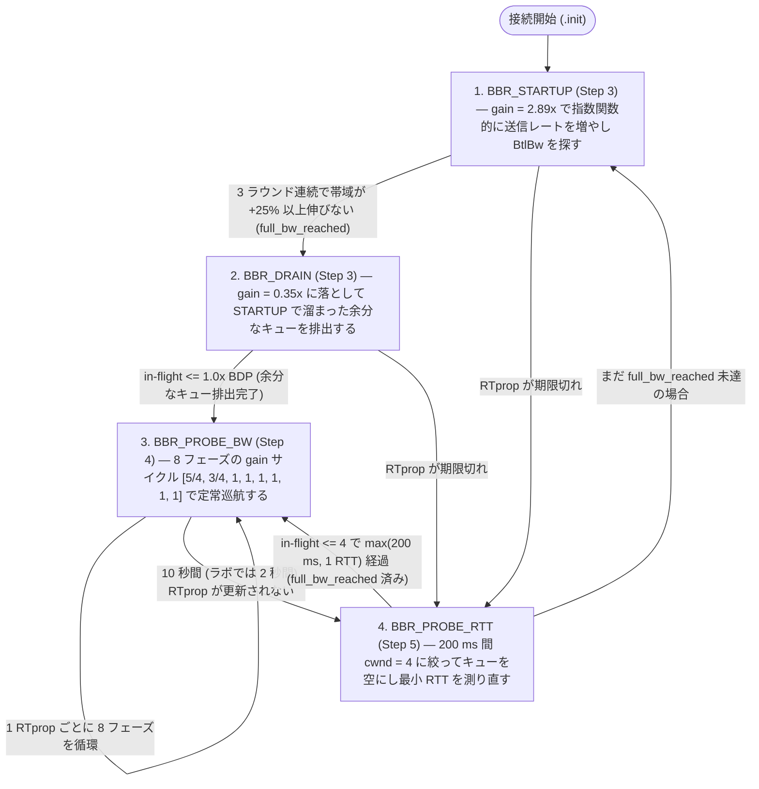
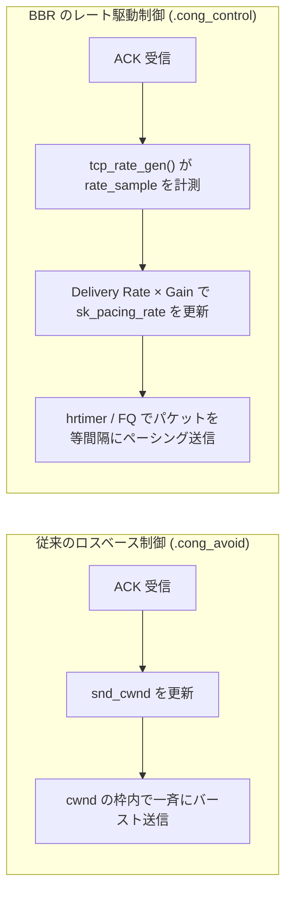
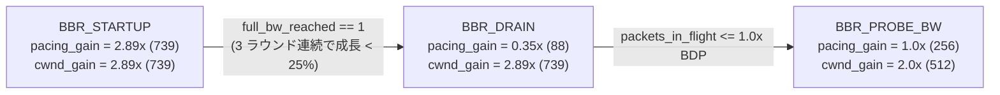
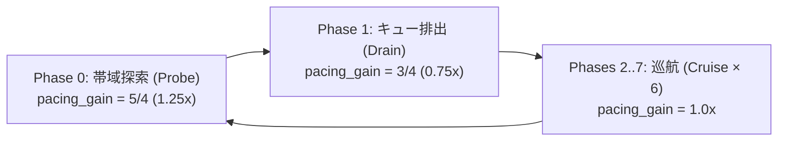

# 17. ハンズオン (3): BPF CC と packetdrill で作る TCP BBR

トラック 1（Reno）とトラック 2（CUBIC）では、「パケットロスが起きるまで `cwnd` を増やし続け、ロスが起きたら `cwnd` を減らす」という **ロスベース（Loss-Based）輻輳制御** を実装しました。1980 年代の Van Jacobson による設計以来、約 30 年間にわたりインターネットを支えてきたアプローチです。

しかし 2016 年、Google の Neal Cardwell、Yuchung Cheng、Van Jacobson らは、ロスベースの前提そのものを覆す新しい輻輳制御アルゴリズム **BBR（Bottleneck Bandwidth and Round-trip propagation time）** を発表しました。

このトラックでは、BBR の予備知識を一切仮定せず、「なぜ Reno や CUBIC では現代のネットワークで問題が起きるのか」という根本的な問いから出発し、BPF `struct_ops` と `packetdrill` を使って **BBRv1 のコアエンジンを 6 つのステップでゼロから実装・検証** します。

---

## 1. なぜ Reno / CUBIC（ロスベース輻輳制御）ではダメだったのか

Reno も CUBIC も、増加曲線の形（直線か 3 次関数か）が違うだけで、基本ルールはまったく同じです。

- **「ルータのバッファが溢れてパケットが落ちる（Loss）まで `cwnd` を増やし続け、パケットが落ちたらパイプが満杯になったとみなして `cwnd` を削る」**

この「パケットロス ＝ 輻輳（パイプが満杯）」という仮定は、1980〜1990 年代のネットワークではうまく機能していましたが、現代のインターネットでは **2 つの正反対の深刻な問題** を引き起こします。

### 問題① Bufferbloat（深いバッファでの深刻な遅延悪化）

家庭用ルータ、ケーブルモデム、携帯基地局などの現代のネットワーク機器には、安価になったメモリが数 MB 単位で搭載されていることが珍しくありません（**深いバッファ / Deep Buffer**）。

たとえば、ボトルネック帯域が 10 Mbps、往復伝搬遅延が 20 ms の回線を考えてみましょう。この回線（パイプ）を隙間なく満たすのに必要なデータ量（BDP: 帯域遅延積）は、わずか **25 KB（約 18 パケット）** です。つまり、ネットワーク上に 18 パケット出ていれば、回線の 10 Mbps はすでに **100% 使い切られています**。

ところが、ルータに 1 MB（約 700 パケット分）の巨大なバッファがあると、Reno や CUBIC はどう振る舞うでしょうか？

- 18 パケットを超えてもルータのバッファが溢れない（パケットロスが起きない）ため、Reno や CUBIC は「まだ回線に余裕がある！」と勘違いして `cwnd` を 100、300、700 パケットへと増やし続けます。
- 18 パケットを超えた分はすべてルータの待ち行列（キュー）に積み上がるだけなので、**スループットは 10 Mbps のまま 1 ビットも速くなりません**。
- その代わり、後から来たパケットはルータの長い行列の最後尾に並ぶことになり、本来 20 ms だった RTT が **常時数百ミリ秒〜1 秒以上** に膨れ上がります。

これが **Bufferbloat（バッファ肥大化による遅延悪化）** です。大容量ダウンロードを裏で走らせた途端にビデオ会議やオンラインゲーム、SSH のレスポンスが固まってしまう現象の正体は、ロスベース輻輳制御がルータのバッファを満杯になるまで詰め込み続けることにあります。

### 問題② 浅いバッファやランダムロスでのスループット崩壊

逆に、データセンター内の高速スイッチ（**浅いバッファ / Shallow Buffer**）や、Wi-Fi・モバイル回線・長距離光回線のように **輻輳とは無関係なランダムロス** がわずかに発生する環境では、正反対の悲劇が起きます。

- まだパイプがガラガラで帯域にたっぷりと空きがあるにもかかわらず、マイクロバーストや無線ノイズで **たった 1 パケットでもロスが起きると**、Reno は `cwnd` を **0.5 倍** に、CUBIC は **0.7 倍** に機械的に減らしてしまいます。
- たとえば、帯域 10 Gbps・RTT 100 ms の長距離高速回線（BDP $\approx$ 86,000 パケット）を CUBIC で 100% 使い切るには、パケットロス率が 1 億分の 1 以下でなければなりません。ほんの少しでもランダムロスがあると、`cwnd` が何度も切り詰められてスループットが壊滅的に落ち込みます。

### 根本原因

これら 2 つの問題の根本原因はただ 1 つです。

> [!IMPORTANT]
> **「パケットロス ＝ 輻輳（パイプが満杯）」という仮定そのものが間違っている！**
> - **深いバッファの経路** では、パケットロスが起きる **はるか手前** でパイプはすでに満杯になり、深刻な遅延（Bufferbloat）が発生しています。
> - **浅いバッファや無線の経路** では、パイプが満杯になる **ずっと手前** でもパケットロスが発生します。

したがって、本当に低遅延かつ高スループットな通信を実現するには、「パケットが落ちたかどうか」を見るのをやめ、**「パイプが実際にどれだけの太さと長さを持っているか」** を直接測る必要があります。

---

## 2. BBR (Bottleneck Bandwidth and Round-trip propagation time) の発想

BBR は、送信元から受信先までのネットワーク経路を **1 本の「水道管（パイプ）」** として物理的にモデル化します。

パイプの性質を決める物理量は、たったの 2 つだけです。

1. **パイプの「太さ」 ＝ ボトルネック帯域 `BtlBw` (Bottleneck Bandwidth)**
   - 経路上で最も細いリンク（ボトルネック）を、単位時間あたりに通過できる最大データ量です。
   - 送信側がいくら速くパケットを流し込んでも、受信側に届く速度（**Delivery Rate: 配送レート** ＝ $\Delta \text{delivered} / \Delta t$）は決してボトルネックの太さを超えられません。逆に、アプリケーションがデータを少ししか送っていないとき（App-limited）には配送レートは小さくなります。
   - そのため、BBR は ACK ごとに観測される配送レートの **最大値（max-filter）** を追跡することで、パイプの太さ `BtlBw` を推定します。
2. **パイプの「長さ」 ＝ 往復伝搬遅延 `RTprop` (Round-trip propagation time)**
   - ルータの待ち行列（キュー）が **完全に空（0 パケット）** のときに、パケットが送信元から受信先へ届き、ACK が戻ってくるまでにかかる純粋な物理的往復時間です。
   - ルータに少しでもキューが溜まると、観測される RTT は「物理的な往復時間 `RTprop` ＋ キューでの待ち時間」へと必ず長くなります（短くなることは絶対にありません）。
   - そのため、BBR は ACK ごとに観測される RTT の **最小値（min-filter）** を追跡することで、パイプの長さ `RTprop` を推定します。

### 理想の動作点（Kleinrock の最適動作点）

パイプの「太さ（`BtlBw`）」と「長さ（`RTprop`）」が分かれば、**パイプの端から端までを隙間なくデータで満たし、かつルータに余計な待ち行列を一切作らない理想の in-flight 量（未確認データ量）** が一意に求まります。これが **BDP（Bandwidth-Delay Product: 帯域遅延積）** です。

$$\text{BDP} = \text{BtlBw} \times \text{RTprop}$$

```text
[ パイプがスカスカ (in-flight < BDP) ]
  送信側 ──> [  pkt  ][       空き       ] ──> ボトルネック ──> 受信側
  ・キュー遅延 = 0 (RTT = RTprop で最小)
  ・しかし帯域を使い切れていない (スループット < BtlBw)

[ 理想の状態: Kleinrock の最適動作点 (in-flight == BDP) ]
  送信側 ──> [ pkt ][ pkt ][ pkt ][ pkt ] ──> ボトルネック ──> 受信側
  ・パイプが隙間なく満杯で、帯域を 100% 使い切る (スループット == BtlBw)
  ・しかもルータの待ち行列は 0 (RTT == RTprop で最小)！

[ 詰め込みすぎ: Bufferbloat (in-flight > BDP) ]
  送信側 ──> [pkt][pkt][pkt][pkt] ＋ [ルータの長い待ち行列...] ──> ボトルネック
  ・帯域は BtlBw で頭打ちのまま、これ以上スループットは上がらない
  ・余分なパケットがすべてルータのキューに溜まり、RTT だけが悪化する
```

### Pacing（等間隔送信）：ドカンと送らず、`BtlBw` と同じ速度で送り出す

もう 1 つ、BBR には極めて重要な仕組みがあります。それが **Pacing（ペーシング）** です。

たとえ `cwnd`（一度にパイプへ出せる総量）をちょうど 1 BDP に制限していたとしても、ACK が返ってきた瞬間に 1 BDP 分のパケットをまとめて「ドカン！」とバースト送信してしまうと、ボトルネックのルータに一時的な行列ができて遅延が跳ね上がったり、浅いバッファから溢れてロスしたりします。

そこで BBR は、`cwnd` でパイプ内の総量に上限をかけるだけでなく、ソケットのペーシングレート（`sk->sk_pacing_rate`）を使って **ボトルネック帯域 `BtlBw` とまったく同じ速度で、パケットを等間隔に滑らかに送り出します**。

- **主役は `sk_pacing_rate`**（パケットを送り出すスピード ＝ $\text{pacing\_gain} \times \text{BtlBw}$）
- **安全弁としての `snd_cwnd`**（パイプ内に出せる最大量 ＝ $\text{cwnd\_gain} \times \text{BDP}$）

この 2 つを両輪として回すことで、BBR はルータに無駄な行列を作ることなく、回線を 100% 使い切ります。

---

## 3. なぜ BBR には 4 つのモード（状態機械）が必要なのか

ここまでの話を読むと、「なんだ、最初からずっと `pacing_rate = BtlBw`、`cwnd = BDP` に固定して送ればいいじゃないか！」と思うかもしれません。

しかし、ここに **物理的なジレンマ（不確定性原理）** があります。

- **本当の最大帯域 `BtlBw` を知るには**：
  - パイプがまだ空いているのか、それとももう満杯なのかを確かめるため、**一度パイプを満杯以上にして（少しだけ余分なキューを作って）、「これ以上送信レートを上げても、相手に届く速度（Delivery Rate）が上がらない上限」を確かめる** 必要があります。
- **本当の最小遅延 `RTprop` を知るには**：
  - 逆に、ルータに溜まっているパケットをすべて吐き出させ、**パイプの待ち行列を完全に空にして「キューイング遅延が 0 の状態」を作る** 必要があります。

> [!WARNING]
> **物理的なジレンマ：`BtlBw`（満杯以上で測定）と `RTprop`（空にして測定）は、同じ瞬間には絶対に同時測定できません！**

さらに、通信の途中で他のフローが割り込んできたり、他のフローが終了して空き帯域が増えたり、ルーティングが変わって物理的な RTT が変化したりします。そのため、BBR は **「帯域を探る時期」「作ったキューを抜く時期」「最適点で巡航する時期」「キューを空にして最小 RTT を測り直す時期」** を時間的に切り替える **4 つのモード（状態機械）** を持っています。



それぞれのモードの役割を順番に見ていきましょう。

### 1. `BBR_STARTUP` (Step 3 で実装)

- **目的**: 接続開始時、まだ未知であるボトルネック帯域 `BtlBw` を最短時間で見つけ出します。
- **動作**: `pacing_gain` と `cwnd_gain` をともに $\frac{2}{\ln 2} \approx 2.89$ 倍に設定し、1 RTT ごとに送信レートを約 2 倍へ指数関数的に引き上げます。
- **終了条件**: パケットロスを待つのではなく、**「アプリ制限でないラウンドにおいて、測定された最大帯域 `max_bw` が 25% 以上伸びないラウンドが 3 回連続した」** 時点で「パイプが満杯に達した（`full_bw_reached`）」と判断し、`BBR_DRAIN` へ移ります。

### 2. `BBR_DRAIN` (Step 3 で実装)

- **目的**: `BBR_STARTUP` でパイプが満杯になったことを確認するまでの 3 ラウンドの間に、ルータに溜まってしまった余分なキュー（約 $1.89 \times \text{BDP}$）を素早く抜きます。
- **動作**: `pacing_gain` を `STARTUP` の逆数である $\frac{\ln 2}{2} \approx 0.35$ 倍に一気に落とします（送信レートが `BtlBw` の 35% になるため、残りの 65% 分の速度でルータのキューが急速に減っていきます）。
- **終了条件**: パイプ内の未確認パケット数（`tcp_packets_in_flight()`）がちょうど **1 BDP 以下** まで減った瞬間に、キューが空になったと判断して定常状態の `BBR_PROBE_BW` へ移ります。

### 3. `BBR_PROBE_BW` (Step 4 で実装)

- **目的**: 通信時間の約 98% を過ごす定常状態です。キューを作らずに `BtlBw` ぴったりの速度で巡航しつつ、定期的に「空き帯域が増えていないか」を探ります。
- **動作**: 8 つのフェーズからなる `pacing_gain` サイクル **`[5/4, 3/4, 1, 1, 1, 1, 1, 1]`** を、原則として 1 `RTprop`（`min_rtt_us`）ごとに順番に回します。
  - **Phase 0（`5/4 = 1.25` 倍：帯域探査）**: 1 `RTprop` の間だけ、推定 `BtlBw` より 25% 速く送ってみます。もし他のフローが終了して空き帯域が増えていれば、帰ってくる ACK の配送レートが上がり、`max_bw`（`BtlBw`）が上方に更新されます。
  - **Phase 1（`3/4 = 0.75` 倍：キュー排出）**: もし空き帯域が増えていなかった場合、Phase 0 で 25% 多く送った分（$0.25 \times \text{BDP}$）がルータに小さなキューとして溜まっています。そこで次の 1 `RTprop`（または in-flight が 1 BDP 以下に戻るまで）は `0.75` 倍に落として、今自分が作った小さなキューをきれいに消し去ります。
  - **Phase 2〜7（`1.0` 倍 $\times$ 6：巡航）**: 残りの 6 フェーズはぴったり `1.0` 倍（＝ `BtlBw`）で送信し、キューイング遅延ゼロ・帯域利用率 100% の最適点で巡航します。なお、`cwnd_gain` は遅延 ACK や一時的なジッタで送信が詰まらないよう `2.0` 倍に設定されます。

### 4. `BBR_PROBE_RTT` (Step 5 で実装)

- **目的**: 定常状態で走り続けている間に、経路変更で本当の `RTprop` が変わった場合や、複数フローが同時に走っていて常時少しずつキューが残っている（Standing Queue）場合に、古くなった `RTprop`（`min_rtt_us`）を測り直します。
- **動作**: **10 秒間**（本ラボでは `packetdrill` のテストを約 2.5 秒で高速に完了させるため **2 秒間** に設定）、一度も `min_rtt_us` を下回る RTT サンプルが観測されなかったら `BBR_PROBE_RTT` に入ります。
  - 直前の健全な `cwnd` を `ca->prior_cwnd` に保存したうえで、**`snd_cwnd` を強制的に `4` パケット（`BBR_MIN_PIPE_CWND`）に絞り込みます**。
  - in-flight が 4 パケット以下に落ちてから **最低 200 ms かつ最低 1 ラウンド（1 RTT）** 維持することで、パイプのキューを完全に空にして真の最小 RTT を測定します。
  - 測定が終わったら `snd_cwnd` を元の `prior_cwnd` に即座に復元し、`BBR_PROBE_BW` に戻ります（10 秒のうち 200 ms だけなので、帯域のロスはわずか $200\text{ ms} / 10\text{ s} = 2\%$ に抑えられます）。

| モード | `pacing_gain` | `cwnd_gain` | 主な役割 | 次のモードへの遷移条件 | 実装ステップ |
| --- | --- | --- | --- | --- | --- |
| `BBR_STARTUP` | $2/\ln 2 \approx 2.89\times$ | $2/\ln 2 \approx 2.89\times$ | 指数関数的にレートを上げて `BtlBw` を素早く探す | 非 App-limited な 3 ラウンド連続で `max_bw` の伸びが $+25\%$ 未満 | Step 3 |
| `BBR_DRAIN` | $\ln 2 / 2 \approx 0.35\times$ | $2/\ln 2 \approx 2.89\times$ | `STARTUP` で溜まった過剰キューを排出する | `tcp_packets_in_flight(tp) <= 1.0x BDP` | Step 3 |
| `BBR_PROBE_BW` | `[5/4, 3/4, 1, 1, 1, 1, 1, 1]` | $2.0\times$ | 定常状態（1.25x で探り、0.75x で抜き、1.0x で 6 相巡航） | 各フェーズ約 1 `RTprop` ごとに循環（10 秒間 `min_rtt_us` 未更新で `PROBE_RTT` へ） | Step 4 |
| `BBR_PROBE_RTT` | $1.0\times$ | `cwnd = 4` にクランプ | パイプを空にして真の `RTprop`（最小 RTT）を再測定する | `in-flight <= 4` の状態で $\max(200\text{ ms}, 1\text{ RTT})$ 経過後、`prior_cwnd` を復元して復帰 | Step 5 |

---

## 4. BPF での実装の違い（なぜ `.cong_avoid` ではなく `.cong_control` なのか）

BPF `struct_ops`（`struct tcp_congestion_ops`）で BBR を実装する際、Reno（トラック 1）や CUBIC（トラック 2）とは **使うコールバックフック自体が異なります**。

### Reno / CUBIC が使う `.cong_avoid` の限界

Reno や CUBIC は `.cong_avoid(sk, ack, acked)` と `.ssthresh(sk)` を実装していました。しかし、カーネルの ACK 処理（`tcp_ack()` $\rightarrow$ `tcp_cong_control()`）において、`.cong_avoid` には BBR にとって致命的な 2 つの制約があります。

1. **Recovery や CWR の最中には呼ばれない**:
   - `.cong_avoid` は、ソケットの輻輳状態（`icsk_ca_state`）が正常（`TCP_CA_Open` / `TCP_CA_Disorder`）のときにしか呼ばれません。パケットロスが起きて `TCP_CA_Recovery` や `TCP_CA_CWR` に入ると、カーネル標準の `tcp_cwnd_reduction()`（PRR: Proportional Rate Reduction）が勝手に動いて `cwnd` を減らしてしまい、`.cong_avoid` は完全にスキップされます。
2. **配送レート（Delivery Rate）の情報を受け取れない**:
   - `.cong_avoid(sk, ack, acked)` の引数は「何パケット ACK されたか（`acked`）」だけであり、「それが何マイクロ秒の間に届いたのか」「App-limited だったのか」というレート計算に必要な情報が渡されません。

### BBR のメインエンジン：`.cong_control(sk, ack, flag, rs)`

そこで Linux カーネルは、BBR のようなモデルベース輻輳制御のために **`.cong_control(struct sock *sk, u32 ack, int flag, const struct rate_sample *rs)`** フックを用意しています。

カーネルの `tcp_cong_control()` の実装を見てみましょう。

```c
static void tcp_cong_control(struct sock *sk, u32 ack, u32 acked_sacked,
			     int flag, const struct rate_sample *rs)
{
	const struct inet_connection_sock *icsk = inet_csk(sk);

	if (icsk->icsk_ca_ops->cong_control) {
		icsk->icsk_ca_ops->cong_control(sk, ack, flag, rs);
		return;
	}

	if (tcp_in_cwnd_reduction(sk)) {
		/* Reduce cwnd if state mandates */
		tcp_cwnd_reduction(sk, acked_sacked, flag);
	} else if (tcp_may_raise_cwnd(sk, flag)) {
		/* Advance cwnd if state allows */
		tcp_cong_avoid(sk, ack, acked_sacked);
	}
	tcp_update_pacing_rate(sk);
}
```

`icsk_ca_ops->cong_control` が定義されていると、カーネルはそれを呼び出して **即座に `return`** します。つまり：

- カーネル標準の `tcp_cwnd_reduction()`、`tcp_cong_avoid()`、`tcp_update_pacing_rate()` は **すべてバイパス** されます。
- 通常時（`TCP_CA_Open`）であろうとロス回復中（`TCP_CA_Recovery`）であろうと、**すべての ACK ごとに毎回必ず `.cong_control` が呼ばれます**。
- 第 4 引数として、カーネルの `tcp_rate_gen()` が計測した配送レート情報 **`const struct rate_sample *rs`** が直接渡されます。

| `struct rate_sample` の主要フィールド | 型 | 意味と BBR での使い道 |
| --- | --- | --- |
| `rs->delivered` | `__s32` | この測定区間で新たに相手に届いたパケット数（`< 0` の場合は無効サンプル） |
| `rs->interval_us` | `long` | この測定区間の経過時間（マイクロ秒、`<= 0` の場合は無効サンプル） |
| `rs->rtt_us` | `long` | この ACK で計測された RTT（マイクロ秒、未計測時は `-1`）。`RTprop`（`min_rtt_us`）の更新に使用 |
| `rs->is_app_limited` | `bool` | アプリの送信データ不足（パイプに泡がある状態）で計測されたサンプルか。`true` のとき `max_bw` を引き下げないために使用 |
| `rs->is_ack_delayed` | `bool` | 受信側の遅延 ACK タイマーによって遅れた ACK か |
| `rs->acked_sacked` | `__u32` | 今回の ACK で新たに確認（ACK または SACK）されたパケット数 |
| `rs->losses` | `__u32` | 今回の ACK で新たにロスと判定されたパケット数 |
| `rs->prior_delivered` | `__u32` | 今回 ACK されたパケットを送信した時点での累積配送パケット数 `tp->delivered`。パケット単位のラウンド（1 RTT）境界判定に使用 |
| `rs->prior_in_flight` | `__u32` | 今回の ACK が届く直前の in-flight パケット数。`PROBE_BW` のフェーズ遷移判定に使用 |

BBR の `.cong_control` プログラムは、この `rs` を入力として受け取り、内部のモデル（`min_rtt_us`, `max_bw`, `mode`, `cycle_idx` など）を更新したうえで、**`sk->sk_pacing_rate` と `tp->snd_cwnd` の両方を直接書き換えます**。

---

## 5. 全 6 ステップのロードマップと実行方法

本トラックは `step01` から `step06` までの 6 つのステップで構成されています。各ステップで 1 つずつ部品を組み立て、最終的に Linux カーネルの `net/ipv4/tcp_bbr.c` と同等のコア状態機械を完成させます。

| ステップ | ディレクトリ | 実装するテーマ | 主な学習ポイント |
| --- | --- | --- | --- |
| **Step 1** | [step01-pacing-rate](step01-pacing-rate/) | `.cong_control` フックと Pacing Rate 計算 | `.init` での `SK_PACING_NEEDED` 有効化と初期レート計算、`rs->delivered` / `rs->interval_us` からの瞬間配送レート計算と `sk->sk_pacing_rate` の更新 |
| **Step 2** | [step02-btlbw-rtprop](step02-btlbw-rtprop/) | `BtlBw`（最大帯域）と `RTprop`（最小 RTT）による BDP 計算 | `min_rtt_us` の最小値フィルタ、`is_app_limited` を考慮した `max_bw` の最大値フィルタ、`bbr_bdp()` による $\text{BDP} = \lceil \text{BtlBw} \times \text{RTprop} \rceil$ 計算 |
| **Step 3** | [step03-startup-drain](step03-startup-drain/) | `STARTUP` から `DRAIN` への遷移（満杯パイプ検出） | パケット単位のラウンド計数、`bbr_check_full_bw_reached()`（3 ラウンド連続で $+25\%$ 未満の成長で満杯判定）、`bbr_check_drain()` による過剰キュー排出と `PROBE_BW` 突入 |
| **Step 4** | [step04-probe-bw](step04-probe-bw/) | `PROBE_BW` の 8 相ゲインサイクル | `bbr_pacing_gain[] = {5/4, 3/4, 1, 1, 1, 1, 1, 1}`、`bbr_is_next_cycle_phase()` による探査（1.25x）・排出（0.75x）・巡航（1.0x）の各終了条件の実装 |
| **Step 5** | [step05-probe-rtt](step05-probe-rtt/) | `PROBE_RTT` への遷移とキューの排出（`cwnd = 4`） | `min_rtt_stamp` による `RTprop` の有効期限管理、`prior_cwnd` の退避、`snd_cwnd = 4` クランプと「200 ms かつ 1 ラウンド完了」後のウィンドウ復元 |
| **Step 6** | [step06-loss-ack-aggregation](step06-loss-ack-aggregation/) | Loss 時の `cwnd` 保存・復元と ACK 集約（`extra_acked`）補償 | Recovery 第 1 ラウンドのパケット保存則（Packet Conservation）、Recovery 脱出時の `prior_cwnd` 復元、Wi-Fi / GRO 環境のバースト ACK を補償する `extra_acked` の算出 |

### 各ステップのファイル構成

各ステップのディレクトリ（`step01-pacing-rate/` 〜 `step06-loss-ack-aggregation/`）には、以下のファイルが用意されています。

- `README.md` / `README.en.md`: そのステップの学習ゴール、**設計チェックポイント（コードを見る前に考える 4 つの問い）**、実装ロジックと数式の解説、`test.pkt` の検証シナリオ解説
- `starter.bpf.c`: 自分で実装するための `TODO` 付きスケルトンコード（そのまま実行すると `packetdrill` のアサートで FAIL します）
- `solution.bpf.c`: 模範解答の BPF プログラム（`test.pkt` のすべての検証を PASS します）
- `test.pkt`: `vng`（virtme-ng）内で実行される `packetdrill` 自動検証スクリプト

### 実行コマンド

`labs/` ディレクトリ（または `labs/bbr/` から `../run_test.sh`）を使って、カーネルの再ビルドなしで即座にコンパイルとテストを実行できます。

```sh
# labs/ ディレクトリへ移動
cd /usr/local/google/home/kuniyu/tcp-eli5/labs

# 1. まず Step 1 の starter（未実装スケルトン）を実行し、アサートが失敗することを確認する
./run_test.sh bbr/step01-pacing-rate starter

# 2. bbr/step01-pacing-rate/starter.bpf.c の TODO を実装して再実行する
./run_test.sh bbr/step01-pacing-rate starter

# 3. 模範解答（solution.bpf.c）で PASS することを確認する
./run_test.sh bbr/step01-pacing-rate solution
```

全ステップの模範解答をまとめてテストする場合は、任意のステップ名を指定するか `make check` を実行してください。

```sh
# Step 1 〜 Step 6 を順番に実行する場合
for step in bbr/step0*; do ./run_test.sh "$step" solution; done
```

それでは、[Step 1: .cong_control フックと Delivery Rate からの Pacing Rate 計算](step01-pacing-rate/README.md) から始めましょう！


---

## Step 1: `.cong_control` フックと Delivery Rate からの Pacing Rate 計算

### 1. 学習ゴール

このステップでは、BPF `struct_ops`（`struct tcp_congestion_ops`）を用いて、BBR（Bottleneck Bandwidth and Round-trip propagation time）の最も基本的な仕組みである **配送レート（Delivery Rate）に基づくペーシングレート（Pacing Rate）制御** を実装します。従来のロスベース輻輳制御（Reno / CUBIC）が用いる `.cong_avoid` フックと BBR が用いる `.cong_control` フックの違いを理解し、カーネルが計測した `struct rate_sample` から送信レート `sk->sk_pacing_rate` を動的に更新できるようになることがゴールです（BBR トラック全体の構成は [../README.md](../README.md) を参照してください）。

---

### 2. アルゴリズムと背景の解説（まずここを読む）

コードを書いたり設計の問いを考えたりする前に、まず「なぜ BBR はペーシングレートを制御するのか」「どのように配送レートから送信レートを計算するのか」「カーネルはどの構造体フィールドを提供してくれるのか」を基礎から整理しましょう。

#### なぜ `cwnd` だけでは不十分なのか？（ペーシングの直感）

Reno や CUBIC のような従来のロスベース輻輳制御は、「ネットワーク内に同時に存在できる未確認パケット数の上限」である **輻輳ウィンドウ（`snd_cwnd`）** だけを制御します。しかし、`snd_cwnd` による制御には 2 つの構造的な弱点があります。

1. **バースト送信によるキューの溢れ**: ACK が返ってウィンドウが空いた瞬間、送信側は許可された `snd_cwnd` 分のパケットを一気に（ワイヤ速度のバーストとして）ネットワークへ送出します。ボトルネックルータのバッファが浅い場合、平均レートは回線容量以下であっても、この瞬間的なバーストによってバッファが溢れ、パケットロスが発生します。
2. **ロスが起きるまで減速できない（Bufferbloat）**: ルータのバッファが深い場合、ロスベース制御はバッファが満杯になってパケットがドロップするまで `snd_cwnd` を増やし続けるため、大量のキューイング遅延（Bufferbloat）を引き起こします。

BBR はこの問題を根本から解決するため、**「ACK が返ってきた結果から、ボトルネック回線が実際に 1 秒あたり何バイトのペースでパケットを配送できているか（Delivery Rate）を計測し、そのレートに合わせてパケットを一定間隔で滑らかに送出（Pacing）する」** というアプローチを採ります。



#### 配送レート（Delivery Rate）と STARTUP ゲインの計算式

ACK が到着するたびに、Linux カーネルは「直近の観測区間 `interval_us`（マイクロ秒）の間に、何個のセグメント `delivered` が相手に届いたか」を計測します。1 セグメントあたりのペイロードサイズを `mss_cache`（バイト）、1 秒を `USEC_PER_SEC = 1,000,000` マイクロ秒とすると、瞬間配送レート $\text{bw}$（bytes/sec）は次の式で求まります。

$$\text{bw (bytes/sec)} = \frac{\text{delivered} \times \text{mss\_cache} \times 1,000,000}{\text{interval\_us}}$$

##### なぜ整数演算では「先に掛けてから割る」のか？

C 言語（および BPF）の整数除算では小数点以下が切り捨てられます。もし先に `delivered / interval_us` を計算すると、たとえば `delivered = 10`、`interval_us = 10000` のとき `10 / 10000 = 0` に潰れてしまいます。そのため、必ず **分子（`delivered * mss_cache * USEC_PER_SEC`）を 64 ビット符号なし整数（`__u64`）で先に掛け算してから、`div64_u64()` で `interval_us` で割る** 必要があります。

##### 固定小数点によるゲイン（`BBR_HIGH_GAIN`）の適用

コネクション開始直後の **STARTUP フェーズ**（Reno のスロースタートに相当）では、回線の最大帯域を素早く探索するため、計測された配送レートよりも高いレートで送信します。BBR の理論値は、1 RTT ごとに送信レートを 2 倍にするゲイン $2 / \ln(2) \approx 2.885$ です。

カーネルおよび BPF プログラム内では浮動小数点数（`float` / `double`）を使用できないため、BBR は `BBR_SCALE = 10`（すなわち基準単位 `BBR_UNIT = 1 << 10 = 1024` が `1.0x`）の **固定小数点表現** を用います。このラボでは STARTUP ゲインを `BBR_HIGH_GAIN = 2885`（$2885 / 1024 \approx 2.817\text{x}$）と定義し、次のように掛け算と右シフトでペーシングレートを求めます。

$$\text{pacing\_rate} = \frac{\text{bw} \times \text{BBR\_HIGH\_GAIN}}{2^{\text{BBR\_SCALE}}} = (\text{bw} \times 2885) \gg 10$$

##### コネクション確立時（`.init`）の初期ペーシングレート

3-way ハンドシェイクが完了した直後（`.init` フックが呼ばれた時点）では、まだデータパケットに対する ACK が一度も返ってきていないため、`rate_sample` が存在しません。最初のウィンドウ分（`snd_cwnd = 10` セグメント）がバースト送信されるのを防ぐため、`.init` では初期 `snd_cwnd` とハンドシェイクの RTT（`rtt_us`）から初期帯域を推定し、`BBR_HIGH_GAIN` を掛けて初期 `sk_pacing_rate` を設定します。

$$\text{init\_bw} = \frac{\text{snd\_cwnd} \times \text{mss\_cache} \times 1,000,000}{\text{rtt\_us}}$$

$$\text{init\_pacing\_rate} = (\text{init\_bw} \times \text{BBR\_HIGH\_GAIN}) \gg \text{BBR\_SCALE}$$

#### 具体的な数値例（`test.pkt` のシナリオ）

具体的な数値で計算の流れを確認しましょう（`mss_cache = 1000` バイトとします）。

1. **ハンドシェイク直後（`.init`）**:
   - 初期 `snd_cwnd = 10` セグメント、SYN/SYN-ACK で計測された初期 RTT が `100 ms`（`rtt_us = 100,000` us）のとき：
   - $\text{init\_bw} = (10 \times 1000 \times 1,000,000) / 100,000 = 100,000\text{ B/s}$（100 KB/s）
   - $\text{init\_pacing\_rate} = (100,000 \times 2885) \gg 10 = 281,738\text{ B/s}$（約 281.7 KB/s）
2. **データ 10 セグメント送信後の ACK 到着時（`.cong_control`）**:
   - `10` セグメント（10,000 バイト）が `10 ms`（`interval_us = 10,000` us）で配送されたことを示す ACK が到着したとき（`rs->delivered = 10`, `rs->interval_us = 10000`）：
   - $\text{bw} = (10 \times 1000 \times 1,000,000) / 10,000 = 1,000,000\text{ B/s}$（1.0 MB/s）
   - $\text{pacing\_rate} = (1,000,000 \times 2885) \gg 10 = 2,817,382\text{ B/s}$（約 2.82 MB/s）

#### カーネルが提供する構造体とフィールド（BPF から使える部品）

このステップを実装するにあたり、Linux カーネルおよび `bpf_cc_helpers.h` が最初から用意しているフックと構造体フィールドは以下の通りです。

1. **`struct tcp_congestion_ops` のフックとカーネルの呼び出し規約**:
   - `.init(struct sock *sk)`: コネクション確立時に初期化のため 1 回呼ばれます。
   - `.cong_control(struct sock *sk, __u32 ack, int flag, const struct rate_sample *rs)`: ACK 処理のたびにカーネルの `tcp_cong_control()` から呼ばれます。**`.cong_control` が定義されている場合、カーネルの `tcp_cong_control()` はそれを呼び出した直後に `return` し、標準の `.cong_avoid` や `tcp_cwnd_reduction()`、`tcp_update_pacing_rate()` をすべてバイパスします。** つまり、`.cong_control` を実装するアルゴリズムは自分で `sk->sk_pacing_rate`（および後のステップでは `tp->snd_cwnd`）を更新する全責任を持ちます。
   - `.ssthresh(struct sock *sk)` と `.undo_cwnd(struct sock *sk)`: カーネルの登録検証関数 `tcp_validate_congestion_control()` は、この 2 つのコールバックが必須（非 NULL）であることを要求します。
2. **`struct sock *sk` のペーシング関連フィールド**:
   - `sk->sk_pacing_rate`（`unsigned long`）: 1 秒あたりの送信バイト数（bytes/sec）を格納します。BPF の `tcp_congestion_ops` から直接書き込み可能です。
   - `sk->sk_pacing_status`（`__u32`）: `SK_PACING_NEEDED` を書き込むことで、NIC や `sch_fq` qdisc に頼らず TCP スタック自身の高分解能タイマー（`hrtimer`）による内部ペーシングを有効化します。これも BPF から直接書き込み可能です。
3. **`struct tcp_sock *tp`（`tcp_sk(sk)` で取得）のフィールド**:
   - `tp->snd_cwnd`（`__u32`）: 現在の輻輳ウィンドウ（セグメント単位、初期値は 10）。
   - `tp->snd_ssthresh`（`__u32`）: スロースタート閾値（セグメント単位）。
   - `tp->mss_cache`（`__u32`）: 現在の有効ペイロード MSS（バイト単位、TCP/IP ヘッダや TCP タイムスタンプ等のオプションを除いた純粋なデータサイズ）。
   - `tp->srtt_us`（`__u32`）: 平滑化 RTT（Smoothed RTT）。カーネル内部では小数部の精度を保つため **実際のマイクロ秒値の 8 倍（3 ビット左シフトされた固定小数点）** で格納されています。したがって、マイクロ秒単位の RTT を取り出すには **`tp->srtt_us >> 3`** とします。まだ RTT が一度も計測されていない場合は `0` になります。
4. **`const struct rate_sample *rs`（`.cong_control` の第 4 引数）**:
   - カーネルの `tcp_rate_gen()` が ACK ごとに自動計算して渡してくれる配送レート計測結果です。
   - `rs->delivered`（`__s32`）: この計測区間で配送が確認されたセグメント数。**`rs->delivered < 0` の場合は有効な計測ができなかった（無効サンプル）** ことを意味します。
   - `rs->interval_us`（`long`）: 上記セグメントが配送されるのに要した時間（マイクロ秒）。**`rs->interval_us <= 0` の場合も無効サンプル** であり、そのまま割るとゼロ除算や不正な値になります。
5. **`inet_csk(sk)->icsk_ca_priv`（`inet_csk_ca(sk)`）について**:
   - 各ソケットには輻輳制御アルゴリズム専用のプライベートメモリ領域 `icsk_ca_priv` が用意されています。
   - ただし **この Step 1 では、ACK ごとに届いた `rs` から即座に `sk->sk_pacing_rate` を計算して書き込むだけであり、過去の履歴をソケットごとに保持する必要がないため、`icsk_ca_priv`（プライベート構造体）は使用しません**（Step 2 で最大帯域を記憶する際に導入します）。

---

### 3. 設計チェックポイント（理解した仕組みをコードに落とし込む）

セクション 2 の解説を踏まえて、`starter.bpf.c` の TODO を埋めるための 4 つの設計クエスチョンを考えてみましょう。

#### Q1. BBR ではどのフックを使い、ソケットごとのプライベート構造体（`icsk_ca_priv`）は必要でしょうか？

Reno や CUBIC では `.cong_avoid` を使いましたが、今回の `bpf_bbr1` ではどのフックを実装すべきでしょうか？また、Step 1 の仕様（直近の `rate_sample` から瞬間レートを計算して `sk->sk_pacing_rate` に書き込む）において、`icsk_ca_priv` に独自の構造体を定義する必要はあるでしょうか？

<details>
<summary>ヒントと答え</summary>

- **使うべきフック**: `.cong_control(struct sock *sk, __u32 ack, int flag, const struct rate_sample *rs)` です。これにより、カーネルが計測した `rs` を直接受け取り、カーネル標準の `tcp_update_pacing_rate()` 等をバイパスして自分で `sk->sk_pacing_rate` を制御できます（あわせて登録チェックを通すための `.init`、`.ssthresh`、`.undo_cwnd` も定義します）。
- **プライベート構造体の要否**: Step 1 では不要です。入力となる `rs->delivered`、`rs->interval_us`、`tp->mss_cache`、および出力先の `sk->sk_pacing_rate` はすべてカーネル既存の構造体フィールドにあり、ACK 間で持ち越す独自状態がまだないためです。

</details>

#### Q2. `.init(sk)` で内部ペーシングを有効化し、ゼロ除算を避けて初期レートを設定するにはどう書きますか？

コネクション確立時に呼ばれる `bpf_bbr1_init()` では、(1) TCP スタックの内部ペーシングを有効化し、(2) `tp->srtt_us` からマイクロ秒単位の初期 RTT を取り出して初期 `sk->sk_pacing_rate` を設定します。`tp->srtt_us` が `0` の場合や非常に小さい場合、どう扱うべきでしょうか？

<details>
<summary>ヒントと答え</summary>

- `sk->sk_pacing_status = SK_PACING_NEEDED;` を設定することで、TCP の内部ペーシングタイマーを有効化します。
- `tp->srtt_us` は 8 倍された値なので、非ゼロなら `tp->srtt_us >> 3` でマイクロ秒に変換し、`0`（未計測）ならフォールバックとして 1 ミリ秒（`USEC_PER_MSEC = 1000` us）を使います。さらに `tp->srtt_us` が 1〜7 の極端な値で `tp->srtt_us >> 3` が `0` になった場合にもゼロ除算を防ぐため、`if (!rtt_us) rtt_us = 1;` でガードします。

</details>

#### Q3. `bpf_bbr1_cong_control()` で無効な `rate_sample` を弾く条件式はどうなりますか？

すべての ACK で有効な配送レートが計測できるわけではありません（たとえば新しいデータを ACK していないパケットなど）。`const struct rate_sample *rs` のどのフィールドをチェックして早期 `return` すべきでしょうか？

<details>
<summary>ヒントと答え</summary>

- セクション 2 で確認した通り、`rs->delivered < 0` または `rs->interval_us <= 0` のサンプルは無効です。
- したがって、関数の先頭で以下のガードを入れます。
  ```c
  if (rs->delivered < 0 || rs->interval_us <= 0)
      return;
  ```
- これにより、直後の除算で `rs->interval_us` が正の値（`>= 1`）であることが保証され、ゼロ除算も確実に防止できます。

</details>

#### Q4. `rs` から瞬間配送レート（bytes/sec）を求め、`BBR_HIGH_GAIN` を掛けて `sk->sk_pacing_rate` を更新する C コードはどう書きますか？

有効な `rs` が得られた後、`rs->delivered`、`tp->mss_cache`、`USEC_PER_SEC`、`rs->interval_us`、`BBR_HIGH_GAIN`、`BBR_SCALE` を使って `sk->sk_pacing_rate` を計算する手順を組み立ててみましょう。

<details>
<summary>ヒントと答え</summary>

- 桁落ち（truncation）と 32 ビットオーバーフローを防ぐため、`__u64` にキャストして分子を先に掛け算し、`div64_u64()` で `rs->interval_us` で割ります。
  ```c
  rate = (__u64)rs->delivered * tp->mss_cache * USEC_PER_SEC;
  rate = div64_u64(rate, (__u64)rs->interval_us);
  ```
- 次に、固定小数点の STARTUP ゲイン `BBR_HIGH_GAIN`（`2885`）を掛けて `BBR_SCALE`（`10`）ビット右シフトし、`sk->sk_pacing_rate` に書き込みます。
  ```c
  rate = (rate * BBR_HIGH_GAIN) >> BBR_SCALE;
  sk->sk_pacing_rate = rate;
  ```

</details>

---

### 4. 実装ステップと解説 (`solution.bpf.c`)

[solution.bpf.c](file:///usr/local/google/home/kuniyu/tcp-eli5/labs/bbr/step01-pacing-rate/solution.bpf.c) の各パートを順番に解説します。

#### 1. 固定小数点マクロの定義

```c
#define BBR_SCALE	10
#define BBR_UNIT	(1 << BBR_SCALE)	/* 1024 */
#define BBR_HIGH_GAIN	2885			/* ~2.885x (2/ln(2)) STARTUP gain */
```

- `BBR_SCALE = 10`（`BBR_UNIT = 1024`）を固定小数点の基準（`1.0x`）とします。
- `BBR_HIGH_GAIN = 2885` は STARTUP フェーズのペーシングゲインを表します。任意のレート `rate` に対して `(rate * BBR_HIGH_GAIN) >> BBR_SCALE` を計算することで、浮動小数点を使わずに約 `2.817` 倍（`2885 / 1024`）のレート乗算を行います。

#### 2. `bpf_bbr1_init()` — ペーシングの有効化と初期レート設定

```c
SEC("struct_ops")
void BPF_PROG(bpf_bbr1_init, struct sock *sk)
{
	struct tcp_sock *tp = tcp_sk(sk);
	__u32 rtt_us = tp->srtt_us ? (tp->srtt_us >> 3) : USEC_PER_MSEC;
	__u64 rate;

	if (!rtt_us)
		rtt_us = 1;

	/* Initialize pacing rate: high_gain * init_cwnd * mss / initial_rtt */
	rate = (__u64)tp->snd_cwnd * tp->mss_cache * USEC_PER_SEC;
	rate = div64_u64(rate, rtt_us);
	rate = (rate * BBR_HIGH_GAIN) >> BBR_SCALE;

	sk->sk_pacing_rate = rate;
	sk->sk_pacing_status = SK_PACING_NEEDED;
}
```

- `tp->srtt_us` が非ゼロであれば `tp->srtt_us >> 3` でマイクロ秒単位の初期 RTT を取得し、`0` の場合は `USEC_PER_MSEC`（`1000` us = 1 ms）を使用します。
- `tp->snd_cwnd * tp->mss_cache * USEC_PER_SEC` を `rtt_us` で割って初期帯域幅（bytes/sec）を求め、`BBR_HIGH_GAIN` を掛けて `sk->sk_pacing_rate` に設定します。
- `sk->sk_pacing_status = SK_PACING_NEEDED` により、ソケットの内部ペーシングを有効化します。

#### 3. `bpf_bbr1_cong_control()` — `rate_sample` からのペーシングレート更新

```c
SEC("struct_ops")
void BPF_PROG(bpf_bbr1_cong_control, struct sock *sk, __u32 ack, int flag,
	      const struct rate_sample *rs)
{
	struct tcp_sock *tp = tcp_sk(sk);
	__u64 rate;

	/* Ignore invalid delivery rate samples */
	if (rs->delivered < 0 || rs->interval_us <= 0)
		return;

	/* Instantaneous delivery rate (bytes/sec):
	 *   bw = delivered * mss * USEC_PER_SEC / interval_us
	 */
	rate = (__u64)rs->delivered * tp->mss_cache * USEC_PER_SEC;
	rate = div64_u64(rate, (__u64)rs->interval_us);

	/* Apply STARTUP pacing gain (~2.885x) */
	rate = (rate * BBR_HIGH_GAIN) >> BBR_SCALE;

	sk->sk_pacing_rate = rate;
}
```

- `rs->delivered < 0 || rs->interval_us <= 0` の無効サンプルをフィルタリングします。
- 配送されたバイト数 `(__u64)rs->delivered * tp->mss_cache` に `USEC_PER_SEC` を掛け、`div64_u64()` で `rs->interval_us` で割ることで瞬間配送レート（bytes/sec）を算出します。
- `(rate * BBR_HIGH_GAIN) >> BBR_SCALE` で STARTUP ゲインを適用し、`sk->sk_pacing_rate` を更新します。

#### 4. `bpf_bbr1_ssthresh()` と `bpf_bbr1_undo_cwnd()`

```c
SEC("struct_ops")
__u32 BPF_PROG(bpf_bbr1_ssthresh, struct sock *sk)
{
	return tcp_sk(sk)->snd_ssthresh;
}

SEC("struct_ops")
__u32 BPF_PROG(bpf_bbr1_undo_cwnd, struct sock *sk)
{
	return tcp_sk(sk)->snd_cwnd;
}
```

- `tcp_validate_congestion_control()` の必須コールバック要件を満たすため、現在の `snd_ssthresh` と `snd_cwnd` をそのまま返します。

---

### 5. `packetdrill` テストの解説 (`test.pkt`) と実行方法

[test.pkt](file:///usr/local/google/home/kuniyu/tcp-eli5/labs/bbr/step01-pacing-rate/test.pkt) は以下のパケットシーケンスで `bpf_bbr1` の動作を検証します。

1. **3-way ハンドシェイクと初期レートの検証（13〜22 行目）**:
   ```
   +0.00 < S 0:0(0) win 32792 <mss 1012,sackOK,TS val 100 ecr 0,nop,wscale 7>
   +0.00 > S. 0:0(0) ack 1 <mss 1460,sackOK,TS val 100 ecr 100,nop,wscale 7>
   +0.10 < . 1:1(0) ack 1 win 257 <nop,nop,TS val 200 ecr 100>
   ```
   - クライアントが `mss 1012` と 12 バイトの TCP タイムスタンプオプション付きで SYN を送るため、ペイロード MSS は `tp->mss_cache = 1000` バイトになります。
   - SYN-ACK から `+0.10`（100 ms）後に ACK が到着するため、初期 RTT は `100,000` us（100 ms）と計測されます。
   - `bpf_bbr1_init()` により、初期ペーシングレートは `10 * 1000 * 1,000,000 / 100,000 * 2885 >> 10 = 281,738 B/s` に設定され、`assert 200000 < tcpi_pacing_rate < 400000` をパスします。
2. **データ 10 セグメントの送信と ACK によるレート更新の検証（27〜34 行目）**:
   ```
   +0.00 write(4, ..., 10000) = 10000
   +0.00 > P. 1:10001(10000) ack 1 <nop,nop,TS val 200 ecr 200>
   +0.01 < . 1:1(0) ack 10001 win 257 <nop,nop,TS val 210 ecr 200>
   ```
   - サーバーが `10,000` バイト（10 セグメント）を送信し、`+0.01`（10 ms）後にクライアントが `ack 10001` を返します。
   - この ACK によって `rs->delivered = 10`、`rs->interval_us = 10,000` us の `rate_sample` が生成され、瞬間配送レートは `1,000,000 B/s`（1 MB/s）となります。
   - [starter.bpf.c](file:///usr/local/google/home/kuniyu/tcp-eli5/labs/bbr/step01-pacing-rate/starter.bpf.c) では `bpf_bbr1_cong_control()` が未実装（空）であるため、`tcpi_pacing_rate` が初期値 `281,738 B/s` のまま変化せず、32 行目の `assert tcpi_pacing_rate > 500000` で失敗します。
   - [solution.bpf.c](file:///usr/local/google/home/kuniyu/tcp-eli5/labs/bbr/step01-pacing-rate/solution.bpf.c) では `1,000,000 * 2885 >> 10 = 2,817,382 B/s`（約 2.82 MB/s）に更新されるため、32〜33 行目のアサート（`2000000 < tcpi_pacing_rate < 3500000`）をすべてパスします。

#### テストの実行コマンド

以下のコマンドで `starter`（失敗を確認）と `solution`（テスト通過を確認）を実行できます。

```sh
../../run_test.sh bbr/step01-pacing-rate starter
../../run_test.sh bbr/step01-pacing-rate solution
```


### `labs/bbr/step01-pacing-rate/starter.bpf.c`（穴埋めスケルトン）

```c
// SPDX-License-Identifier: GPL-2.0
/*
 * Step 1 (Starter): .cong_control hook and Pacing Rate calculation
 */
#include "bpf_cc_helpers.h"

char _license[] SEC("license") = "GPL";

#define BBR_SCALE	10
#define BBR_UNIT	(1 << BBR_SCALE)	/* 1024 */
#define BBR_HIGH_GAIN	2885			/* ~2.885x (2/ln(2)) STARTUP gain */

SEC("struct_ops")
void BPF_PROG(bpf_bbr1_init, struct sock *sk)
{
	struct tcp_sock *tp = tcp_sk(sk);
	__u32 rtt_us = tp->srtt_us ? (tp->srtt_us >> 3) : USEC_PER_MSEC;
	__u64 rate;

	if (!rtt_us)
		rtt_us = 1;

	/* Initialize pacing rate: high_gain * init_cwnd * mss / initial_rtt */
	rate = (__u64)tp->snd_cwnd * tp->mss_cache * USEC_PER_SEC;
	rate = div64_u64(rate, rtt_us);
	rate = (rate * BBR_HIGH_GAIN) >> BBR_SCALE;

	sk->sk_pacing_rate = rate;
	sk->sk_pacing_status = SK_PACING_NEEDED;
}

SEC("struct_ops")
void BPF_PROG(bpf_bbr1_cong_control, struct sock *sk, __u32 ack, int flag,
	      const struct rate_sample *rs)
{
	struct tcp_sock *tp = tcp_sk(sk);

	(void)tp;
	/*
	 * TODO:
	 * 1. Check if the rate sample is valid:
	 *    if (rs->delivered < 0 || rs->interval_us <= 0) return;
	 * 2. Calculate instantaneous delivery rate in bytes/sec:
	 *    rate = (u64)rs->delivered * tp->mss_cache * USEC_PER_SEC / rs->interval_us
	 *    (Hint: use div64_u64(rate, (__u64)rs->interval_us))
	 * 3. Multiply by BBR_HIGH_GAIN and shift right by BBR_SCALE:
	 *    rate = (rate * BBR_HIGH_GAIN) >> BBR_SCALE;
	 * 4. Write the result to sk->sk_pacing_rate.
	 */
}

SEC("struct_ops")
__u32 BPF_PROG(bpf_bbr1_ssthresh, struct sock *sk)
{
	return tcp_sk(sk)->snd_ssthresh;
}

SEC("struct_ops")
__u32 BPF_PROG(bpf_bbr1_undo_cwnd, struct sock *sk)
{
	return tcp_sk(sk)->snd_cwnd;
}

SEC(".struct_ops")
struct tcp_congestion_ops bpf_bbr1 = {
	.name		= "bpf_bbr1",
	.flags		= TCP_CONG_NON_RESTRICTED,
	.init		= (void *)bpf_bbr1_init,
	.cong_control	= (void *)bpf_bbr1_cong_control,
	.ssthresh	= (void *)bpf_bbr1_ssthresh,
	.undo_cwnd	= (void *)bpf_bbr1_undo_cwnd,
};
```


### `labs/bbr/step01-pacing-rate/test.pkt`（packetdrill テスト）

```python
// SPDX-License-Identifier: GPL-2.0
// Step 1: Verify .cong_control hook and pacing rate calculation from rate_sample
0.00 `sysctl -q net.ipv4.tcp_congestion_control=bpf_bbr1`

// Server socket setup
+0.00 socket(..., SOCK_STREAM, IPPROTO_TCP) = 3
+0.00 setsockopt(3, SOL_SOCKET, SO_REUSEADDR, [1], 4) = 0
+0.00 bind(3, ..., ...) = 0
+0.00 listen(3, 1) = 0

// 3-way handshake with initial RTT = 100 ms (so initial pacing rate is ~281 KB/s)
// MSS = 1012 -> payload MSS = 1000 bytes (with 12-byte TCP timestamps)
+0.00 < S 0:0(0) win 32792 <mss 1012,sackOK,TS val 100 ecr 0,nop,wscale 7>
+0.00 > S. 0:0(0) ack 1 <mss 1460,sackOK,TS val 100 ecr 100,nop,wscale 7>
+0.10 < . 1:1(0) ack 1 win 257 <nop,nop,TS val 200 ecr 100>
+0.00 accept(3, ..., ...) = 4

// Verify initial cwnd=10 and initial pacing rate (~281,738 B/s from 100 ms SYN RTT)
+0.00 %{
assert tcpi_snd_cwnd == 10, f"expected cwnd 10, got {tcpi_snd_cwnd}"
assert 200000 < tcpi_pacing_rate < 400000, f"expected initial pacing_rate ~281KB/s, got {tcpi_pacing_rate}"
}%

// Send 10 segments (10,000 bytes) and ACK after 10 ms (+0.010):
// Delivery rate = 10 * 1000 B / 0.010 s = 1,000,000 B/s
// Pacing rate = 1,000,000 * 2885 / 1024 = ~2,817,382 B/s
+0.00 write(4, ..., 10000) = 10000
+0.00 > P. 1:10001(10000) ack 1 <nop,nop,TS val 200 ecr 200>
+0.01 < . 1:1(0) ack 10001 win 257 <nop,nop,TS val 210 ecr 200>

+0.00 %{
assert tcpi_pacing_rate > 500000, f"expected pacing_rate > 500000, got {tcpi_pacing_rate}"
assert 2000000 < tcpi_pacing_rate < 3500000, f"expected pacing_rate ~2.82MB/s, got {tcpi_pacing_rate}"
}%
```


<details>
<summary>模範解答: <code>labs/bbr/step01-pacing-rate/solution.bpf.c</code></summary>

```c
// SPDX-License-Identifier: GPL-2.0
/*
 * Step 1: .cong_control hook and Pacing Rate calculation from Delivery Rate
 *
 * Unlike loss-based congestion control (Reno/CUBIC) which uses .cong_avoid,
 * BBR uses .cong_control(sk, ack, flag, rs) to receive a struct rate_sample
 * on every ACK and directly drive sk->sk_pacing_rate.
 */
#include "bpf_cc_helpers.h"

char _license[] SEC("license") = "GPL";

#define BBR_SCALE	10
#define BBR_UNIT	(1 << BBR_SCALE)	/* 1024 */
#define BBR_HIGH_GAIN	2885			/* ~2.885x (2/ln(2)) STARTUP gain */

SEC("struct_ops")
void BPF_PROG(bpf_bbr1_init, struct sock *sk)
{
	struct tcp_sock *tp = tcp_sk(sk);
	__u32 rtt_us = tp->srtt_us ? (tp->srtt_us >> 3) : USEC_PER_MSEC;
	__u64 rate;

	if (!rtt_us)
		rtt_us = 1;

	/* Initialize pacing rate: high_gain * init_cwnd * mss / initial_rtt */
	rate = (__u64)tp->snd_cwnd * tp->mss_cache * USEC_PER_SEC;
	rate = div64_u64(rate, rtt_us);
	rate = (rate * BBR_HIGH_GAIN) >> BBR_SCALE;

	sk->sk_pacing_rate = rate;
	sk->sk_pacing_status = SK_PACING_NEEDED;
}

SEC("struct_ops")
void BPF_PROG(bpf_bbr1_cong_control, struct sock *sk, __u32 ack, int flag,
	      const struct rate_sample *rs)
{
	struct tcp_sock *tp = tcp_sk(sk);
	__u64 rate;

	/* Ignore invalid delivery rate samples */
	if (rs->delivered < 0 || rs->interval_us <= 0)
		return;

	/* Instantaneous delivery rate (bytes/sec):
	 *   bw = delivered * mss * USEC_PER_SEC / interval_us
	 */
	rate = (__u64)rs->delivered * tp->mss_cache * USEC_PER_SEC;
	rate = div64_u64(rate, (__u64)rs->interval_us);

	/* Apply STARTUP pacing gain (~2.885x) */
	rate = (rate * BBR_HIGH_GAIN) >> BBR_SCALE;

	sk->sk_pacing_rate = rate;
}

SEC("struct_ops")
__u32 BPF_PROG(bpf_bbr1_ssthresh, struct sock *sk)
{
	return tcp_sk(sk)->snd_ssthresh;
}

SEC("struct_ops")
__u32 BPF_PROG(bpf_bbr1_undo_cwnd, struct sock *sk)
{
	return tcp_sk(sk)->snd_cwnd;
}

SEC(".struct_ops")
struct tcp_congestion_ops bpf_bbr1 = {
	.name		= "bpf_bbr1",
	.flags		= TCP_CONG_NON_RESTRICTED,
	.init		= (void *)bpf_bbr1_init,
	.cong_control	= (void *)bpf_bbr1_cong_control,
	.ssthresh	= (void *)bpf_bbr1_ssthresh,
	.undo_cwnd	= (void *)bpf_bbr1_undo_cwnd,
};
```

</details>

---

## Step 2: BtlBw (最大帯域フィルタ) と RTprop (最小 RTT フィルタ) による BDP 計算

### 1. 学習ゴール

Step 1 では、直近の ACK から得られた配送レート（`rs->delivered / rs->interval_us`）を使って毎回 `sk_pacing_rate` を上書きしました。しかし実際のネットワークでは、ルータのキューにパケットが溜まれば RTT は一時的に膨らみ、アプリケーションの送信が一時停止すれば配送レートは本来の回線容量よりはるかに低い値になります。このステップでは、BBR のネットワーク経路モデルの 2 本柱である **RTprop（往復伝播遅延: 最小 RTT フィルタ）** と **BtlBw（ボトルネック帯域幅: 最大帯域フィルタ）** をソケットのプライベート領域（`icsk_ca_priv`）で追跡し、両者の積である **BDP（帯域遅延積: Bandwidth-Delay Product）** から `snd_cwnd` と `sk_pacing_rate` を決定する仕組みを実装します（トラック全体の概要は [../README.md](file:///usr/local/google/home/kuniyu/tcp-eli5/labs/bbr/README.md) を参照してください）。

---

### 2. アルゴリズムと背景の解説（まずここを読む）

コードの設計に入る前に、BBR がどのようにして「ノイズの混じった毎回の ACK サンプル」から「経路の真の物理特性（伝播遅延とボトルネック帯域）」を抽出するのか、そしてカーネルがどのデータ構造を提供しているのかを整理しましょう。

#### なぜ「最新のサンプルで毎回上書き」してはいけないのか？

TCP 送信側が ACK を受け取るたびに観測できるのは、その時点の **瞬間的な RTT（`rs->rtt_us`）** と **瞬間的な配送レート（`rs->delivered / rs->interval_us`）** です。しかし、これらをそのまま経路の特性として上書きすると 2 つの深刻な問題が起きます。

1. **キューイング遅延による RTT の膨張**:
   観測される RTT は、光ファイバやルータの物理的な往復伝播遅延（$\text{RTprop}$）と、途中のボトルネックルータのバッファでの待ち時間（$\text{QueueDelay}_t \ge 0$）の和です。
   $$\text{RTT}_t = \text{RTprop} + \text{QueueDelay}_t$$
   待ち時間 $\text{QueueDelay}_t$ は決して負にならないため、バッファが空のときにだけ $\text{RTT}_t = \text{RTprop}$ となり、バッファにパケットが溜まると $\text{RTT}_t$ は必ず $\text{RTprop}$ より大きくなります。したがって、経路の真の伝播遅延 $\text{RTprop}$ を知るには、観測された有効な RTT サンプル（`rs->rtt_us > 0`）の **最小値（min-filter）** を記録し続けなければなりません。

2. **送信データ不足（App-Limited）による配送レートの低下**:
   逆に、ある区間で観測される配送レート $\text{bw}_t = \text{delivered} / \Delta t$ は、物理的なボトルネックリンク容量（$\text{BtlBw}$）を絶対に超えることはできません（$\text{bw}_t \le \text{BtlBw}$）。パケットはボトルネックリンクが送り出せる速度以上では受信側に届かないからです。
   一方で、送信側がパイプ（経路）を満たすほど十分なデータを送っていないとき、配送レートは簡単に $\text{BtlBw}$ を下回ります。したがって、ボトルネック帯域 $\text{BtlBw}$ を推定するには、観測された配送レートの **最大値（max-filter）** を取る必要があります。

#### App-Limited（アプリケーション制限）サンプルの不変条件

特に注意が必要なのが、Web サーバのレスポンス間や対話型通信のように、アプリケーションが一時的に少ししかデータを書き込まない **App-Limited（アプリケーション制限）** 状態です。

たとえば $1000\text{ pkts/s}$ の回線で、最初に 10 パケットをバースト送信して $\text{max\_bw} = 1000\text{ pkts/s}$ を計測したあと、アプリケーションが $30\text{ ms}$ 休止してから 2 パケットだけを送ったとします。このとき配送区間は $\Delta t = 50\text{ ms}$ に引き伸ばされ、見かけの配送レートは $2 / 50\text{ ms} = 40\text{ pkts/s}$ まで落ち込みます。これはネットワークが遅くなったのではなく、**アプリケーションがデータを送らなかっただけ** です。

Linux カーネルの配送レート計測器（`tcp_rate.c`）は、送信ウィンドウやパイプを使い切っていない状態で計測されたサンプルに自動的に `rs->is_app_limited = 1` フラグを立てます。BBR はこのフラグに対して次の不変条件（ルール）を設けています。

- **App-Limited でない通常のサンプル（`!rs->is_app_limited`）**: ボトルネックを試せていたサンプルなので、最大値フィルタに入力します（`bw > ca->max_bw` なら更新）。
- **App-Limited なサンプル（`rs->is_app_limited != 0`）**: 原則として無視します。**ただし、App-Limited でありながら現在の `ca->max_bw` 以上のレートが出た場合（`bw >= ca->max_bw`）は例外として更新を許可します。** パイプを満たしていなくても過去の最大値を超えたのであれば、物理回線が少なくともそれ以上の速度を持つ確かな証拠だからです。

これを 1 つの条件式にまとめると、以下のようになります。

```c
if (!rs->is_app_limited || bw >= ca->max_bw) {
	if (bw > ca->max_bw)
		ca->max_bw = bw;
}
```

```
  配送レート (bw)                             RTT (rtt_us)
      ^                                           ^
1000  |   [Phase 1: 10 pkts / 10 ms]        20 ms |                 [Phase 2: キュー遅延込み]
pkts/s|   *========================> max_bw       |                 * (min-filter で無視)
      |   |                                 10 ms |   [Phase 1]     |
  40  |   |             [Phase 2: App-Limited]    |   *=============+==========> min_rtt_us
pkts/s|   |             * (無視して保持!)         |   |
      +---+-------------+----------> 時間         +---+-------------+----------> 時間
```

#### BDP（帯域遅延積）の固定小数点計算と `snd_cwnd`

最小 RTT（`ca->min_rtt_us`）と最大帯域（`ca->max_bw`）が求まれば、パイプをちょうど 100% 満たすのに必要なインフライトパケット数である **BDP（Bandwidth-Delay Product: 帯域遅延積）** が計算できます。

$$\text{BDP (packets)} = \text{BtlBw (packets / }\mu\text{s)} \times \text{RTprop (}\mu\text{s)}$$

BPF / カーネル内では浮動小数点数が使えないため、Linux カーネルの `tcp_bbr.c` と同じ 2 つの固定小数点スケール定数を使います。

- **`BW_SCALE = 24`（`BW_UNIT = 1U << 24 = 16,777,216`）**:
  1 マイクロ秒あたりに届くパケット数（`rs->delivered / rs->interval_us`）は通常 `1` 未満の小さな小数になるため、割り算の前に `BW_UNIT` を掛けて整数化します。
  $$\text{bw} = \left\lfloor \frac{\text{rs->delivered} \times \text{BW\_UNIT}}{\text{rs->interval\_us}} \right\rfloor$$
- **`BBR_SCALE = 8`（`BBR_UNIT = 1U << 8 = 256`）**:
  ゲイン（倍率）を表す固定小数点単位です。等倍（$1.0\times$）は `BBR_UNIT`（`256`）で表されます。

この `bw`（単位: $\text{packets}/\mu\text{s} \times 2^{24}$）と `ca->min_rtt_us`（単位: $\mu\text{s}$）、および `gain`（単位: $2^8$）から BDP パケット数を求める式は次の通りです（`bbr_bdp()`）：

1. まず 64 ビット整数で `w = (__u64)bw * ca->min_rtt_us` を計算します（単位は $\text{packets} \times \text{BW\_UNIT}$）。
2. 次に `gain` を掛けて `BBR_SCALE`（`8` ビット）右シフトし、最後に `BW_UNIT` で **切り上げ除算（ceil）** を行います。
   ```c
   return (((w * gain) >> BBR_SCALE) + BW_UNIT - 1) / BW_UNIT;
   ```
   ここで単なる切り捨て（`/ BW_UNIT`）ではなく `+ BW_UNIT - 1` を足して **切り上げ（ceil）** にするのには重要な理由があります。もし端数を切り捨てて `snd_cwnd` が真の BDP より 1 パケットでも小さくなると、送信側はパイプを 100% 満たせなくなり、結果としてそれ以上の帯域を計測できなくなる「負のフィードバックループ」に陥るためです。
3. 未計測時（`ca->min_rtt_us == 0` または `bw == 0`）は、ゼロ除算や極端な縮小を防ぐため安全な初期ウィンドウ `10U` パケットを返します。
4. 算出された `bdp` に対し、受信側の遅延 ACK（Delayed ACK）や TSO/GSO 送信の量子化誤差を吸収するためのマージンとして `4` パケットを加え、最小ターゲット `BBR_CWND_MIN_TARGET`（`4U`）との最大値を `tp->snd_cwnd` に設定します。
   $$\text{snd\_cwnd} = \max(\text{bdp} + 4, 4)$$

#### パケットタイムド・ラウンド（`round_cnt`）の数え方

後のステップ（Step 3 の Startup 終了判定や Step 4 の ProbeBW ゲインサイクル）では、「何ラウンドトリップ（RTT）経過したか」を時計の秒数ではなく **パケットの往復回数（Packet-timed Round Trip）** で数えます。このステップでその土台も一緒に実装します。

1. ラウンド開始時点の累積配送パケット数を `ca->next_rtt_delivered = tp->delivered` に記録しておきます。
2. カーネルは各パケットを送信するとき、その時点の `tp->delivered` をパケットのメタデータに記録しています。そのパケットに対する ACK が返ってくると、送信時点での `tp->delivered` の値が `rs->prior_delivered` に入っています。
3. したがって、到着した ACK の `rs->prior_delivered` が `ca->next_rtt_delivered` 以上になった瞬間（32 ビット符号なし整数のラップアラウンドを考慮して `!before(rs->prior_delivered, ca->next_rtt_delivered)` が真になった瞬間）、「このラウンドが始まった後に送信されたパケットが 1 往復して ACK された＝**1 ラウンドが完了した**」と判定できます。
4. 1 ラウンド完了したら `ca->round_cnt++` でカウンタを 1 増やし、次のラウンドの終了境界を現在の `ca->next_rtt_delivered = tp->delivered` に更新します。

#### 具体例（`test.pkt` の数値で計算してみよう）

MSS = $1000\text{ Bytes}$ の経路で、以下の 2 つのフェーズが順に起きたときの計算を追ってみましょう。

- **Phase 1（フルスピードの 10 パケット送信）**:
  - 10 パケット（$10,000\text{ Bytes}$）を送信し、$10\text{ ms}$（$10,000\ \mu\text{s}$）後に ACK が到着。
  - `rs->rtt_us = 10000`, `rs->delivered = 10`, `rs->interval_us = 10000`, `rs->is_app_limited = 0`。
  - `ca->min_rtt_us` は初回（`0`）なので `10000` に更新。
  - $\text{bw} = \lfloor 10 \times 16,777,216 / 10000 \rfloor = 16,777$（約 $0.001\text{ pkts/}\mu\text{s} = 1000\text{ pkts/s}$）。
  - `!rs->is_app_limited` かつ `bw > ca->max_bw` なので、`ca->max_bw = 16777` に更新。
  - `bbr_bdp()` では $w = 16,777 \times 10000 = 167,770,000$。等倍ゲイン（`gain = BBR_UNIT`）で切り上げ除算すると $\lceil 167,770,000 / 16,777,216 \rceil = 10\text{ パケット}$。
  - よって `tp->snd_cwnd = max(10 + 4, 4) = 14`、`sk_pacing_rate` は約 $990,000\text{ Bytes/sec}$（$1\text{ MB/s}$ から 1% マージンを引いた値）になります。
- **Phase 2（$30\text{ ms}$ 休止後の App-Limited な 2 パケット送信＋キュー遅延）**:
  - アプリが $30\text{ ms}$ 休止したあと 2 パケットだけを送信し、別トラフィックのキュー遅延により $20\text{ ms}$ かかって ACK が到着。
  - `rs->rtt_us = 20000`, `rs->delivered = 2`, `rs->interval_us = 50000`, `rs->is_app_limited = 1`。
  - **RTprop フィルタ**: `rs->rtt_us`（`20000`）は `ca->min_rtt_us`（`10000`）より大きいため無視され、`ca->min_rtt_us = 10000` が維持されます。
  - **BtlBw フィルタ**: 今回の $\text{bw} = \lfloor 2 \times 16,777,216 / 50000 \rfloor = 671$（$40\text{ pkts/s}$）ですが、`rs->is_app_limited == 1` かつ `bw < ca->max_bw` なので無視され、`ca->max_bw = 16777` が維持されます。
  - その結果、Phase 2 の後も `tp->snd_cwnd == 14` と `sk_pacing_rate`（約 $990\text{ KB/s}$）が崩れずに保たれます。

#### カーネルが提供するフィールドとヘルパー（このステップで使うもの）

コードを書く前に、カーネル（および [bpf_cc_helpers.h](file:///usr/local/google/home/kuniyu/tcp-eli5/labs/include/bpf_cc_helpers.h)）がすでに用意している構造体フィールドとヘルパー関数を確認しておきましょう。

- **`inet_csk(sk)->icsk_ca_priv` と `inet_csk_ca(sk)`**:
  - 各 TCP ソケット（`struct inet_connection_sock`）には、輻輳制御アルゴリズムがソケットごとの独自変数を保存できるバイト配列 `icsk_ca_priv` が組み込まれています。
  - `inet_csk_ca(sk)` を呼ぶと `icsk_ca_priv` の先頭ポインタ（`void *`）が返るため、`struct bpf_bbr2_ca *ca = inet_csk_ca(sk);` のように自分の構造体ポインタへキャストして読み書きできます。
- **`struct rate_sample *rs`（`cong_control` コールバックの第 4 引数）**:
  - `rs->rtt_us`（`__s32`）: 今回の ACK で計測された RTT（マイクロ秒）。RTT が計測できなかった ACK では `-1`（負の値）または `0` になります。
  - `rs->delivered`（`__s32`）: 測定区間内に受信側へ届けられたパケット数。
  - `rs->interval_us`（`__s32`）: そのパケット群が配送されるのに要した時間（マイクロ秒）。
  - `rs->prior_delivered`（`__u32`）: 今回 ACK されたパケットが送信された時点での `tp->delivered` のスナップショット値。
  - `rs->is_app_limited`（`bool`）: 測定区間中に送信側がアプリケーション制限（データ不足）を経験していた場合に真（`true` / `1`）となります。
- **`struct tcp_sock *tp`（`tcp_sk(sk)` で取得）**:
  - `tp->delivered`（`__u32`）: コネクション開始以降に受信側へ届けられた累積パケット数。
  - `tp->snd_cwnd`（`__u32`）: 送信輻輳ウィンドウ（パケット単位）。
  - `tp->snd_ssthresh`（`__u32`）: スロースタート閾値（BBR では従来のスロースタートを使わないため `TCP_INFINITE_SSTHRESH` に固定します）。
  - `tp->srtt_us`（`__u32`）: 8 倍にスケールされた平滑化 RTT（`tp->srtt_us >> 3` がマイクロ秒単位の SRTT）。
  - `tp->mss_cache`（`__u32`）: 現在の MSS（バイト単位）。
- **`struct sock *sk`**:
  - `sk->sk_pacing_status`: `SK_PACING_NEEDED` を設定することでカーネルの TCP ペーシングを有効化します。
  - `sk->sk_pacing_rate`（`unsigned long`）: 送信ペーシングレート（Bytes/sec）。
  - `sk->sk_max_pacing_rate`（`unsigned long`）: アプリケーションが `SO_MAX_PACING_RATE` で設定した上限レート。
- **ヘルパー関数（[bpf_cc_helpers.h](file:///usr/local/google/home/kuniyu/tcp-eli5/labs/include/bpf_cc_helpers.h)）**:
  - `before(seq1, seq2)`: 32 ビット符号なし整数のラップアラウンドを考慮して `seq1 < seq2` を判定します。したがって `!before(a, b)` は `a >= b` を意味します。
  - `div64_u64(dividend, divisor)`: 64 ビット符号なし整数同士の安全な除算（`divisor == 0` のときは `0` を返す）を行います。

---

### 3. 設計チェックポイント（理解した仕組みをコードに落とし込む）

セクション 2 の仕組みを踏まえて、[starter.bpf.c](file:///usr/local/google/home/kuniyu/tcp-eli5/labs/bbr/step02-btlbw-rtprop/starter.bpf.c) の TODO を埋めるための設計を 4 つの問いで確認しましょう。すべての答えはセクション 2 の内容から導き出せます。

#### Q1. 初回サンプル（`ca->min_rtt_us == 0`）も考慮した `RTprop` 最小値フィルタの条件式はどう書くべきでしょうか？

`bpf_bbr2_init()` では `ca->min_rtt_us = 0;` に初期化されています。もし `bpf_bbr2_cong_control()` で単純に `if (rs->rtt_us > 0 && rs->rtt_us < ca->min_rtt_us)` とだけ書いてしまうと、何が起きるでしょうか？また、型比較（`rs->rtt_us` は符号付き `__s32`、`ca->min_rtt_us` は符号なし `__u32`）も含めて正しい条件式はどうなりますか？

<details>
<summary>ヒントと答え</summary>

- `ca->min_rtt_us` の初期値は `0` なので、単に `rs->rtt_us < ca->min_rtt_us` と書くと、正の `rs->rtt_us` は絶対に `0` より小さくならず、`ca->min_rtt_us` が永遠に `0` のまま更新されなくなってしまいます。
- したがって、有効な RTT サンプル（`rs->rtt_us > 0`）が得られたら、「まだ未計測（`ca->min_rtt_us == 0`）であるか、または現在の `ca->min_rtt_us` より小さい場合」に更新する必要があります。
  ```c
  if (rs->rtt_us > 0 && (rs->rtt_us < (__s32)ca->min_rtt_us || ca->min_rtt_us == 0))
  	ca->min_rtt_us = rs->rtt_us;
  ```

</details>

#### Q2. `starter.bpf.c` の TODO 2 で `ca->max_bw` を更新する C コードはどう書くべきでしょうか？

[starter.bpf.c](file:///usr/local/google/home/kuniyu/tcp-eli5/labs/bbr/step02-btlbw-rtprop/starter.bpf.c) では `ca->max_bw = bw;` と無条件に上書きしています。セクション 2 で学んだ「App-Limited サンプルの不変条件」と「最大値フィルタ」の両方を満たすには、この部分をどのような `if` 文に書き換えればよいでしょうか？

<details>
<summary>ヒントと答え</summary>

- セクション 2 の通り、サンプルが App-Limited でない（`!rs->is_app_limited`）か、あるいは App-Limited であっても現在の最大帯域以上（`bw >= ca->max_bw`）である場合にのみ最大値フィルタを通し、`bw > ca->max_bw` であれば `ca->max_bw` を更新します。
  ```c
  if (!rs->is_app_limited || bw >= ca->max_bw) {
  	if (bw > ca->max_bw)
  		ca->max_bw = bw;
  }
  ```
- なお、論理的には `if (bw > ca->max_bw)` の 1 行だけでも「`bw <= ca->max_bw` のサンプル（App-Limited かどうかを問わず）は `max_bw` を引き下げない」という同じ結果になりますが、Linux カーネルの `bbr_update_bw()`（将来のステップでウィンドウ付き max-filter に拡張される箇所）の構造に合わせて、まず `if (!rs->is_app_limited || bw >= ca->max_bw)` で App-Limited サンプルをフィルタする形を明示しています。

</details>

#### Q3. パケットタイムド・ラウンド（`ca->round_cnt`）はいつ、どのように進めますか？

`bpf_bbr2_init()` で `ca->next_rtt_delivered = tp->delivered;` と初期化したあと、`bpf_bbr2_cong_control()` で有効な配送サンプル（`rs->delivered > 0 && rs->interval_us > 0`）が届いたときに 1 ラウンドの完了を判定して次のラウンドを開始するコードはどうなりますか？

<details>
<summary>ヒントと答え</summary>

- `rs->prior_delivered`（ACK されたパケットの送信時点の `tp->delivered`）が `ca->next_rtt_delivered` に追いついたかどうかを `!before(rs->prior_delivered, ca->next_rtt_delivered)` で判定します。
- 条件を満たしたら `ca->round_cnt++` でラウンド数を増やし、次のラウンドの終了境界を現在の `tp->delivered` に設定します。
  ```c
  if (!before(rs->prior_delivered, ca->next_rtt_delivered)) {
  	ca->round_cnt++;
  	ca->next_rtt_delivered = tp->delivered;
  }
  ```

</details>

#### Q4. `bbr_bdp()` が未初期化時のガードと切り上げ除算（ceil）を行っているのはなぜですか？

`bbr_bdp()` の実装を見ると、先頭で `if (!ca->min_rtt_us || !bw) return 10U;` をチェックし、後半で `(((w * gain) >> BBR_SCALE) + BW_UNIT - 1) / BW_UNIT` を計算しています。この 2 つの処理がそれぞれ防いでいるエッジケースは何でしょうか？

<details>
<summary>ヒントと答え</summary>

- **未初期化ガード（`!ca->min_rtt_us || !bw`）**: コネクション直後や最初の有効な配送サンプルが届く前は `min_rtt_us` または `max_bw` が `0` です。そのまま掛け算すると `bdp = 0` となり、`snd_cwnd` が最小値 `4` パケットに張り付いて初期バーストが送れなくなるため、標準の初期ウィンドウ相当である `10U` パケットを返します。
- **切り上げ除算（`+ BW_UNIT - 1`）**: 整数除算の切り捨てによって `snd_cwnd` が真の BDP を下回ると、パイプを 100% 満たすだけのパケットを送り出せなくなり、それ以上の帯域サンプルも得られなくなるデッドロック（負のフィードバックループ）を防ぐためです。

</details>

---

### 4. 実装ステップと解説 (`solution.bpf.c`)

[solution.bpf.c](file:///usr/local/google/home/kuniyu/tcp-eli5/labs/bbr/step02-btlbw-rtprop/solution.bpf.c) の各関数と固定小数点演算の流れを順に解説します。

#### 1. スケール定数とソケット状態構造体 `struct bpf_bbr2_ca`

```c
#define BW_SCALE 24
#define BW_UNIT (1U << BW_SCALE)
#define BBR_SCALE 8
#define BBR_UNIT (1U << BBR_SCALE)
#define BBR_CWND_MIN_TARGET 4U
#define BBR_PACING_MARGIN_PCT 1U

struct bpf_bbr2_ca {
	__u32 min_rtt_us;
	__u32 max_bw;
	__u32 round_cnt;
	__u32 next_rtt_delivered;
};
```

- `BW_UNIT`（`1 << 24`）は帯域（$\text{packets}/\mu\text{s}$）のスケール、`BBR_UNIT`（`1 << 8`）はゲインのスケールです。
- `struct bpf_bbr2_ca` は `inet_csk_ca(sk)` を通じて各ソケットの `icsk_ca_priv` 内に配置されます。

#### 2. ペーシングレート変換ヘルパー `bbr_rate_bytes_per_sec()` と `bbr_set_pacing_rate()`

```c
static __always_inline __u64 bbr_rate_bytes_per_sec(struct sock *sk, __u64 rate, int gain)
{
	unsigned int mss = tcp_sk(sk)->mss_cache ? : 1460;

	rate *= mss;
	rate *= gain;
	rate >>= BBR_SCALE;
	rate *= USEC_PER_SEC / 100 * (100 - BBR_PACING_MARGIN_PCT);
	return rate >> BW_SCALE;
}
```

- 引数 `rate` には `BW_UNIT` スケールの帯域（$\text{packets}/\mu\text{s} \times 2^{24}$）が渡されます。
- これに `mss`（Bytes/packet）と `gain`（`>> BBR_SCALE`）、さらに 1 秒あたりのマイクロ秒数 `USEC_PER_SEC` から 1% のペーシングマージン（`BBR_PACING_MARGIN_PCT = 1U`）を差し引いた係数（$990,000$）を掛け、最後に `>> BW_SCALE` でスケールを戻すことで、1 秒あたりのバイト数（`Bytes/sec`）に変換します。
- `bbr_set_pacing_rate()` はこの値を `sk->sk_max_pacing_rate` でクランプした上で `sk->sk_pacing_rate` に書き込みます。

#### 3. BDP 計算ヘルパー `bbr_bdp()`

```c
static __always_inline __u32 bbr_bdp(struct sock *sk, __u32 bw, int gain)
{
	struct bpf_bbr2_ca *ca = inet_csk_ca(sk);
	__u64 w;

	if (!ca->min_rtt_us || !bw)
		return 10U;

	w = (__u64)bw * ca->min_rtt_us;
	return (((w * gain) >> BBR_SCALE) + BW_UNIT - 1) / BW_UNIT;
}
```

- `ca->min_rtt_us` または `bw` が未計測（`0`）の間は `10U` を返し、両方揃っている場合は `w = (__u64)bw * ca->min_rtt_us` に `gain` を適用して `BW_UNIT` で切り上げ除算した BDP パケット数を返します。

#### 4. 初期化 `bpf_bbr2_init()` と ACK ごとの更新 `bpf_bbr2_cong_control()`

```c
SEC("struct_ops")
void BPF_PROG(bpf_bbr2_init, struct sock *sk)
{
	struct tcp_sock *tp = tcp_sk(sk);
	struct bpf_bbr2_ca *ca = inet_csk_ca(sk);

	ca->min_rtt_us = 0;
	ca->max_bw = 0;
	ca->round_cnt = 0;
	ca->next_rtt_delivered = tp->delivered;

	tp->snd_ssthresh = TCP_INFINITE_SSTHRESH;
	sk->sk_pacing_status = SK_PACING_NEEDED;

	bbr_init_pacing_rate_from_rtt(sk);
}
```

- コネクション初期化時に `ca` の各フィールドをゼロ初期化し、`ca->next_rtt_delivered = tp->delivered` で最初のラウンドの基準点を記録します。また、`bbr_init_pacing_rate_from_rtt()` で初期 `snd_cwnd` と `srtt_us` から最初のペーシングレートを設定します。

続いて、`bpf_bbr2_cong_control()` で ACK ごとにモデルと制御値を更新します。

```c
SEC("struct_ops")
void BPF_PROG(bpf_bbr2_cong_control, struct sock *sk, __u32 ack, int flag,
	      const struct rate_sample *rs)
{
	struct tcp_sock *tp = tcp_sk(sk);
	struct bpf_bbr2_ca *ca = inet_csk_ca(sk);
	__u32 bw, bdp;

	if (rs->rtt_us > 0 && (rs->rtt_us < (__s32)ca->min_rtt_us || ca->min_rtt_us == 0))
		ca->min_rtt_us = rs->rtt_us;

	if (rs->delivered > 0 && rs->interval_us > 0) {
		if (!before(rs->prior_delivered, ca->next_rtt_delivered)) {
			ca->round_cnt++;
			ca->next_rtt_delivered = tp->delivered;
		}

		bw = (__u32)div64_u64((__u64)rs->delivered * BW_UNIT, (__u64)rs->interval_us);

		if (!rs->is_app_limited || bw >= ca->max_bw) {
			if (bw > ca->max_bw)
				ca->max_bw = bw;
		}
	}

	bbr_set_pacing_rate(sk, ca->max_bw, BBR_UNIT);

	bdp = bbr_bdp(sk, ca->max_bw, BBR_UNIT);
	tp->snd_cwnd = max(bdp + 4U, BBR_CWND_MIN_TARGET);
}
```

- **TODO 1 対応箇所**: `rs->rtt_us > 0` のとき、初回または最小値更新時のみ `ca->min_rtt_us` を更新します。
- **TODO 2 対応箇所**: `rs->delivered > 0 && rs->interval_us > 0` のとき、ラウンド進行判定を行った上で固定小数点帯域 `bw` を算出し、`!rs->is_app_limited || bw >= ca->max_bw` のガードを通して `ca->max_bw` の最大値を保持します。
- 最後に `ca->max_bw` と `BBR_UNIT`（等倍ゲイン）から `sk_pacing_rate` と `bdp` を計算し、`tp->snd_cwnd = max(bdp + 4U, BBR_CWND_MIN_TARGET)` を設定します。

---

### 5. `packetdrill` テストの解説 (`test.pkt`) と実行方法

[test.pkt](file:///usr/local/google/home/kuniyu/tcp-eli5/labs/bbr/step02-btlbw-rtprop/test.pkt) は、高帯域バーストのあとに「App-Limited かつ RTT が膨張した低レートサンプル」を入力し、フィルタの有無による挙動の差を検証します。

#### `test.pkt` のパケットトレース解説

1. **3-way ハンドシェイク（14〜17 行目、RTT = $10\text{ ms}$, ペイロード MSS = $1000\text{ Bytes}$）**:
   - 時刻 `0.00` に SYN / SYN-ACK を交換し、`+0.01`（$10\text{ ms}$ 後）に ACK が到着してコネクションが確立されます。TCP タイムスタンプオプション（12 バイト）込みで `mss 1012` が指定されているため、ペイロード 1 セグメントあたりちょうど $1000\text{ Bytes}$ になります。
2. **Phase 1: 高帯域バーストと 1 回目のアサート（26〜33 行目）**:
   - `write(4, ..., 10000)` で 10 セグメント（`1:10001(10000)`）を送信し、`+0.01`（$10\text{ ms}$ 後）にまとめて ACK（`ack 10001`）を受け取ります。
   - このサンプルは `rs->rtt_us = 10000`（$10\text{ ms}$）、`rs->delivered = 10`、`rs->interval_us = 10000`（$10\text{ ms}$）です。
   - `min_rtt_us = 10000`、`max_bw` は $1000\text{ pkts/s}$（$1,000,000\text{ Bytes/s}$）となり、$\text{BDP} = 10$ パケット、`tcpi_snd_cwnd == 14`（$10 + 4$）、`tcpi_pacing_rate` が約 $990\text{ KB/s}$（`950000 < tcpi_pacing_rate < 1050000`）になることを検証します。
3. **Phase 2: App-Limited な小バースト＋膨張した RTT と 2 回目のアサート（39〜46 行目）**:
   - $30\text{ ms}$ のアイドル時間（`+0.03`）を空けたあと、`write(4, ..., 2000)` で 2 セグメント（$2000\text{ Bytes}$）だけを送信し、`+0.02`（$20\text{ ms}$ 後）に ACK（`ack 12001`）を受け取ります。
   - このサンプルでは `rs->rtt_us = 20000`（$20\text{ ms}$ に倍増）、`rs->delivered = 2`、`rs->interval_us = 50000`（$40\text{ pkts/s}$ に激減）、`rs->is_app_limited = true` となります。
   - **なぜ `starter.bpf.c` は失敗するのか**: [starter.bpf.c](file:///usr/local/google/home/kuniyu/tcp-eli5/labs/bbr/step02-btlbw-rtprop/starter.bpf.c) は毎回 `ca->min_rtt_us = rs->rtt_us` と `ca->max_bw = bw` をそのまま上書きしてしまうため、Phase 2 の ACK で `max_bw` が $1/25$（$40\text{ pkts/s}$）に崩壊し、`tcpi_snd_cwnd` が `5`（$\text{BDP } 1 + 4$）、`tcpi_pacing_rate` が約 $39.6\text{ KB/s}$ に落ちて 44〜45 行目のアサートに失敗します。
   - **なぜ `solution.bpf.c` はパスするのか**: [solution.bpf.c](file:///usr/local/google/home/kuniyu/tcp-eli5/labs/bbr/step02-btlbw-rtprop/solution.bpf.c) では最小値フィルタが `min_rtt_us = 10000` を守り、App-Limited ガード付き最大値フィルタが `max_bw = 1000 pkts/s` を守るため、Phase 2 の後も `tcpi_snd_cwnd == 14` と `tcpi_pacing_rate`（約 $990\text{ KB/s}$）が維持されてテストをパスします。

#### テストの実行コマンド

以下のコマンドで、`starter` の失敗と `solution` の成功を確認できます。

```sh
../../run_test.sh bbr/step02-btlbw-rtprop starter
../../run_test.sh bbr/step02-btlbw-rtprop solution
```


### `labs/bbr/step02-btlbw-rtprop/starter.bpf.c`（穴埋めスケルトン）

```c
// SPDX-License-Identifier: GPL-2.0
/*
 * BBRv1 Step 2: Bottleneck Bandwidth (BtlBw) and Round-Trip Propagation Time (RtProp) Tracking (Starter Skeleton)
 *
 * TODO 1: Implement min-filter for RtProp (min_rtt_us) instead of blindly overwriting
 * TODO 2: Implement max-filter for BtlBw (max_bw) and respect app-limited rate samples
 */
#include "bpf_cc_helpers.h"

char _license[] SEC("license") = "GPL";

#define BW_SCALE 24
#define BW_UNIT (1U << BW_SCALE)
#define BBR_SCALE 8
#define BBR_UNIT (1U << BBR_SCALE)
#define BBR_CWND_MIN_TARGET 4U
#define BBR_PACING_MARGIN_PCT 1U

struct bpf_bbr2_ca {
	__u32 min_rtt_us;
	__u32 max_bw;
	__u32 round_cnt;
	__u32 next_rtt_delivered;
};

static __always_inline __u64 bbr_rate_bytes_per_sec(struct sock *sk, __u64 rate, int gain)
{
	unsigned int mss = tcp_sk(sk)->mss_cache ? : 1460;

	rate *= mss;
	rate *= gain;
	rate >>= BBR_SCALE;
	rate *= USEC_PER_SEC / 100 * (100 - BBR_PACING_MARGIN_PCT);
	return rate >> BW_SCALE;
}

static __always_inline void bbr_set_pacing_rate(struct sock *sk, __u32 bw, int gain)
{
	__u64 rate = bbr_rate_bytes_per_sec(sk, bw, gain);

	if (sk->sk_max_pacing_rate && rate > sk->sk_max_pacing_rate)
		rate = sk->sk_max_pacing_rate;
	if (rate > 0)
		sk->sk_pacing_rate = rate;
}

static __always_inline void bbr_init_pacing_rate_from_rtt(struct sock *sk)
{
	struct tcp_sock *tp = tcp_sk(sk);
	__u32 rtt_us = tp->srtt_us ? (tp->srtt_us >> 3) : USEC_PER_MSEC;
	__u64 bw;

	if (!rtt_us)
		rtt_us = 1;

	bw = div64_u64((__u64)tp->snd_cwnd * BW_UNIT, rtt_us);
	bbr_set_pacing_rate(sk, bw, BBR_UNIT);
}

static __always_inline __u32 bbr_bdp(struct sock *sk, __u32 bw, int gain)
{
	struct bpf_bbr2_ca *ca = inet_csk_ca(sk);
	__u64 w;

	if (!ca->min_rtt_us || !bw)
		return 10U;

	w = (__u64)bw * ca->min_rtt_us;
	return (((w * gain) >> BBR_SCALE) + BW_UNIT - 1) / BW_UNIT;
}

SEC("struct_ops")
void BPF_PROG(bpf_bbr2_init, struct sock *sk)
{
	struct tcp_sock *tp = tcp_sk(sk);
	struct bpf_bbr2_ca *ca = inet_csk_ca(sk);

	ca->min_rtt_us = 0;
	ca->max_bw = 0;
	ca->round_cnt = 0;
	ca->next_rtt_delivered = tp->delivered;

	tp->snd_ssthresh = TCP_INFINITE_SSTHRESH;
	sk->sk_pacing_status = SK_PACING_NEEDED;

	bbr_init_pacing_rate_from_rtt(sk);
}

SEC("struct_ops")
void BPF_PROG(bpf_bbr2_cong_control, struct sock *sk, __u32 ack, int flag,
	      const struct rate_sample *rs)
{
	struct tcp_sock *tp = tcp_sk(sk);
	struct bpf_bbr2_ca *ca = inet_csk_ca(sk);
	__u32 bw, bdp;

	/*
	 * TODO 1: Track path propagation delay (RtProp).
	 * Do not overwrite min_rtt_us with every sample. Instead, track the minimum
	 * observed RTT across non-zero RTT samples.
	 */
	if (rs->rtt_us > 0)
		ca->min_rtt_us = rs->rtt_us;

	if (rs->delivered > 0 && rs->interval_us > 0) {
		if (!before(rs->prior_delivered, ca->next_rtt_delivered)) {
			ca->round_cnt++;
			ca->next_rtt_delivered = tp->delivered;
		}

		bw = (__u32)div64_u64((__u64)rs->delivered * BW_UNIT, (__u64)rs->interval_us);

		/*
		 * TODO 2: Track bottleneck bandwidth (BtlBw).
		 * A flow cannot accurately measure bandwidth when application-limited,
		 * because it doesn't send fast enough to saturate the pipe.
		 * Ignore app-limited samples unless they exceed the current max_bw estimate,
		 * and track the maximum bandwidth across samples.
		 */
		ca->max_bw = bw;
	}

	bbr_set_pacing_rate(sk, ca->max_bw, BBR_UNIT);

	bdp = bbr_bdp(sk, ca->max_bw, BBR_UNIT);
	tp->snd_cwnd = max(bdp + 4U, BBR_CWND_MIN_TARGET);
}

SEC("struct_ops")
__u32 BPF_PROG(bpf_bbr2_ssthresh, struct sock *sk)
{
	return TCP_INFINITE_SSTHRESH;
}

SEC("struct_ops")
__u32 BPF_PROG(bpf_bbr2_undo_cwnd, struct sock *sk)
{
	return tcp_sk(sk)->snd_cwnd;
}

SEC(".struct_ops")
struct tcp_congestion_ops bpf_bbr2 = {
	.name		= "bpf_bbr2",
	.flags		= TCP_CONG_NON_RESTRICTED,
	.init		= (void *)bpf_bbr2_init,
	.cong_control	= (void *)bpf_bbr2_cong_control,
	.ssthresh	= (void *)bpf_bbr2_ssthresh,
	.undo_cwnd	= (void *)bpf_bbr2_undo_cwnd,
};
```


### `labs/bbr/step02-btlbw-rtprop/test.pkt`（packetdrill テスト）

```python
// SPDX-License-Identifier: GPL-2.0
// Step 2: Track BtlBw and RtProp with app-limited rate sample filtering

0.00 `sysctl -q net.ipv4.tcp_congestion_control=bpf_bbr2`

// Server socket setup
+0.00 socket(..., SOCK_STREAM, IPPROTO_TCP) = 3
+0.00 setsockopt(3, SOL_SOCKET, SO_REUSEADDR, [1], 4) = 0
+0.00 bind(3, ..., ...) = 0
+0.00 listen(3, 1) = 0

// 3-way handshake with 10 ms RTT (0.000 SYN, 0.000 SYN-ACK, 0.010 ACK)
// MSS = 1012 with 12-byte TCP timestamps -> payload MSS = 1000 bytes
+0.00 < S 0:0(0) win 32792 <mss 1012,sackOK,TS val 100 ecr 0,nop,wscale 7>
+0.00 > S. 0:0(0) ack 1 <mss 1460,sackOK,TS val 100 ecr 100,nop,wscale 7>
+0.01 < . 1:1(0) ack 1 win 257 <nop,nop,TS val 110 ecr 100>
+0.00 accept(3, ..., ...) = 4

// Phase 1: High-bandwidth burst
// write(4, ..., 10000) sends 10 segments (1:10001) at 0.010, ACKed at 0.020.
// rtt_us = 10000, delivered = 10, interval_us = 10000
// bw = 10 pkts / 10 ms = 1000 pkts/s (1,000,000 B/s)
// bdp = 10 pkts
// cwnd = bdp + 4 = 14
// pacing_rate = 99% of 1 MB/s = ~990,000 B/s
+0.00 write(4, ..., 10000) = 10000
+0.00 > P. 1:10001(10000) ack 1 <nop,nop,TS val 110 ecr 110>
+0.01 < . 1:1(0) ack 10001 win 257 <nop,nop,TS val 120 ecr 110>

+0.00 %{
assert tcpi_snd_cwnd == 14, f"expected cwnd 14, got {tcpi_snd_cwnd}"
assert 950000 < tcpi_pacing_rate < 1050000, f"expected pacing_rate ~990KB/s, got {tcpi_pacing_rate}"
}%

// Phase 2: App-limited smaller burst with longer interval and higher RTT
// Send 2 segments (2,000 bytes) at 0.050 (+0.030), ACKed at 0.070 (+0.020).
// rtt_us = 20000, interval_us = 50000, is_app_limited = true.
// BtlBw and RtProp tracking should preserve max_bw = 1000 pkts/s and min_rtt = 10000 us!
+0.03 write(4, ..., 2000) = 2000
+0.00 > P. 10001:12001(2000) ack 1 <nop,nop,TS val 150 ecr 120>
+0.02 < . 1:1(0) ack 12001 win 257 <nop,nop,TS val 170 ecr 150>

+0.00 %{
assert tcpi_snd_cwnd == 14, f"expected cwnd 14 to be preserved, got {tcpi_snd_cwnd}"
assert 950000 < tcpi_pacing_rate < 1050000, f"expected pacing_rate ~990KB/s to be preserved, got {tcpi_pacing_rate}"
}%
```


<details>
<summary>模範解答: <code>labs/bbr/step02-btlbw-rtprop/solution.bpf.c</code></summary>

```c
// SPDX-License-Identifier: GPL-2.0
/*
 * BBRv1 Step 2: Bottleneck Bandwidth (BtlBw) and Round-Trip Propagation Time (RtProp) Tracking
 *
 * In BBR, the network path model consists of:
 * - RtProp (min_rtt_us): the two-way propagation delay of the path without queuing.
 *   Tracked via a windowed min-filter over RTT samples.
 * - BtlBw (max_bw): the bottleneck bandwidth available to the flow.
 *   Tracked via a windowed max-filter over rate samples from ACKs.
 *
 * Important BBR invariant:
 * Application-limited (app-limited) rate samples must NEVER decrease max_bw
 * unless the sample is larger than the current max_bw estimate.
 */
#include "bpf_cc_helpers.h"

char _license[] SEC("license") = "GPL";

#define BW_SCALE 24
#define BW_UNIT (1U << BW_SCALE)
#define BBR_SCALE 8
#define BBR_UNIT (1U << BBR_SCALE)
#define BBR_CWND_MIN_TARGET 4U
#define BBR_PACING_MARGIN_PCT 1U

struct bpf_bbr2_ca {
	__u32 min_rtt_us;
	__u32 max_bw;
	__u32 round_cnt;
	__u32 next_rtt_delivered;
};

static __always_inline __u64 bbr_rate_bytes_per_sec(struct sock *sk, __u64 rate, int gain)
{
	unsigned int mss = tcp_sk(sk)->mss_cache ? : 1460;

	rate *= mss;
	rate *= gain;
	rate >>= BBR_SCALE;
	rate *= USEC_PER_SEC / 100 * (100 - BBR_PACING_MARGIN_PCT);
	return rate >> BW_SCALE;
}

static __always_inline void bbr_set_pacing_rate(struct sock *sk, __u32 bw, int gain)
{
	__u64 rate = bbr_rate_bytes_per_sec(sk, bw, gain);

	if (sk->sk_max_pacing_rate && rate > sk->sk_max_pacing_rate)
		rate = sk->sk_max_pacing_rate;
	if (rate > 0)
		sk->sk_pacing_rate = rate;
}

static __always_inline void bbr_init_pacing_rate_from_rtt(struct sock *sk)
{
	struct tcp_sock *tp = tcp_sk(sk);
	__u32 rtt_us = tp->srtt_us ? (tp->srtt_us >> 3) : USEC_PER_MSEC;
	__u64 bw;

	if (!rtt_us)
		rtt_us = 1;

	bw = div64_u64((__u64)tp->snd_cwnd * BW_UNIT, rtt_us);
	bbr_set_pacing_rate(sk, bw, BBR_UNIT);
}

static __always_inline __u32 bbr_bdp(struct sock *sk, __u32 bw, int gain)
{
	struct bpf_bbr2_ca *ca = inet_csk_ca(sk);
	__u64 w;

	if (!ca->min_rtt_us || !bw)
		return 10U;

	w = (__u64)bw * ca->min_rtt_us;
	return (((w * gain) >> BBR_SCALE) + BW_UNIT - 1) / BW_UNIT;
}

SEC("struct_ops")
void BPF_PROG(bpf_bbr2_init, struct sock *sk)
{
	struct tcp_sock *tp = tcp_sk(sk);
	struct bpf_bbr2_ca *ca = inet_csk_ca(sk);

	ca->min_rtt_us = 0;
	ca->max_bw = 0;
	ca->round_cnt = 0;
	ca->next_rtt_delivered = tp->delivered;

	tp->snd_ssthresh = TCP_INFINITE_SSTHRESH;
	sk->sk_pacing_status = SK_PACING_NEEDED;

	bbr_init_pacing_rate_from_rtt(sk);
}

SEC("struct_ops")
void BPF_PROG(bpf_bbr2_cong_control, struct sock *sk, __u32 ack, int flag,
	      const struct rate_sample *rs)
{
	struct tcp_sock *tp = tcp_sk(sk);
	struct bpf_bbr2_ca *ca = inet_csk_ca(sk);
	__u32 bw, bdp;

	if (rs->rtt_us > 0 && (rs->rtt_us < (__s32)ca->min_rtt_us || ca->min_rtt_us == 0))
		ca->min_rtt_us = rs->rtt_us;

	if (rs->delivered > 0 && rs->interval_us > 0) {
		if (!before(rs->prior_delivered, ca->next_rtt_delivered)) {
			ca->round_cnt++;
			ca->next_rtt_delivered = tp->delivered;
		}

		bw = (__u32)div64_u64((__u64)rs->delivered * BW_UNIT, (__u64)rs->interval_us);

		if (!rs->is_app_limited || bw >= ca->max_bw) {
			if (bw > ca->max_bw)
				ca->max_bw = bw;
		}
	}

	bbr_set_pacing_rate(sk, ca->max_bw, BBR_UNIT);

	bdp = bbr_bdp(sk, ca->max_bw, BBR_UNIT);
	tp->snd_cwnd = max(bdp + 4U, BBR_CWND_MIN_TARGET);
}

SEC("struct_ops")
__u32 BPF_PROG(bpf_bbr2_ssthresh, struct sock *sk)
{
	return TCP_INFINITE_SSTHRESH;
}

SEC("struct_ops")
__u32 BPF_PROG(bpf_bbr2_undo_cwnd, struct sock *sk)
{
	return tcp_sk(sk)->snd_cwnd;
}

SEC(".struct_ops")
struct tcp_congestion_ops bpf_bbr2 = {
	.name		= "bpf_bbr2",
	.flags		= TCP_CONG_NON_RESTRICTED,
	.init		= (void *)bpf_bbr2_init,
	.cong_control	= (void *)bpf_bbr2_cong_control,
	.ssthresh	= (void *)bpf_bbr2_ssthresh,
	.undo_cwnd	= (void *)bpf_bbr2_undo_cwnd,
};
```

</details>

---

## Step 3: STARTUP から DRAIN・PROBE_BW への状態遷移（満杯パイプ検出）

### 1. 学習ゴール

このステップでは、BBR のステートマシンにおける初期状態 **`BBR_STARTUP`（指数的な帯域探索）** から **`BBR_DRAIN`（STARTUP で溜まった過剰キューの排出）**、そして定常状態である **`BBR_PROBE_BW`（推定ボトルネック帯域での巡航）** への状態遷移を実装します。パケットロスに頼らずに「ボトルネックのパイプが満杯になった（Full Pipe）」ことを検出する `bbr_check_full_bw_reached()`、キューを排出して巡航モードへ移る `bbr_check_drain()`、および各モードのゲインを切り替える `bbr_update_gains()` を完成させましょう（BBR トラック全体の構成は [../README.md](../README.md) を参照してください）。

---

### 2. アルゴリズムと背景の解説（まずここを読む）

#### なぜロスを待たずに「パイプ満杯」を検出できるのか？

TCP コネクションが開始された直後、送信側はボトルネックリンクの帯域（`BtlBw`）が 1 Mbps なのか 10 Gbps なのか全く分かりません。そのため、最初は送信レートを毎ラウンド（1 RTT ごと）倍増させて、利用可能な帯域を素早く探索する必要があります。

Reno や CUBIC のような**ロスベース（Loss-based）**の輻輳制御では、スロースタート中に `cwnd` を毎 RTT 2 倍に増やし続け、**ボトルネックルータのバッファが溢れてパケットロスが発生するまで**加速を止めません。しかし、これではコネクション開始のたびにルータのキューを満杯にして大量のパケットロスと遅延（Bufferbloat）を引き起こしてしまいます。

一方、BBR の初期状態である **`BBR_STARTUP`** は、送信レートと `cwnd` のゲインを $2 / \ln(2) \approx 2.885\text{x}$（`bbr_high_gain`）に設定して毎ラウンド送信レートを約 2 倍に引き上げつつ、**配送レート（`max_bw`）の成長が頭打ち（Plateau）になったかどうか**を監視します。

- **パイプが空いている間（送信レート $< \text{BtlBw}$）**: 送信側が毎ラウンド 2 倍のペースでパケットを送り出すと、受信側に届くペース（ACK から計測される配送レート `max_bw`）も毎ラウンド約 2 倍（+100%）のペースで成長します。
- **パイプが満杯になった後（送信レート $\ge \text{BtlBw}$）**: ボトルネックリンクはすでに 100% 稼働しているため、送信側がさらに速く送っても、受信側に届く配送レート `max_bw` は **`BtlBw` で頭打ちになり、それ以上伸びなくなります**（余分に送ったパケットはボトルネックルータのキューに溜まり、RTT が伸びるだけです）。

この性質を利用し、BBR は以下のルールで「パイプが満杯になった（`full_bw_reached = 1`）」と判定します。

> **満杯パイプ検出（Full Pipe Detection）のルール**:
> アプリケーション制限でない（`rs->is_app_limited == 0`）ラウンドの区切り（`round_start == 1`）ごとに、その時点の最大帯域 `max_bw` を基準値 `full_bw` と比較する。
> - もし `max_bw` が `full_bw` から **25% 以上（`1.25x`）成長していれば**（$\text{max\_bw} \ge 1.25 \times \text{full\_bw}$）、パイプはまだ空いていると判断し、`full_bw = max_bw` に更新してカウンタ `full_bw_cnt = 0` にリセットする。
> - もし成長率が **25% 未満**であれば、`full_bw_cnt` を 1 増やす。これが **3 ラウンド連続（`full_bw_cnt >= 3`）** に達したら、ボトルネック帯域に達したと判断して `full_bw_reached = 1` をセットする。

固定小数点（`BBR_SCALE = 8`、`BBR_UNIT = 256` が `1.0x`）では、しきい値 `1.25x` は `bbr_full_bw_thresh = BBR_UNIT * 5 / 4 = 320` と表され、判定式は以下のようになります。

$$\text{bw\_thresh} = \frac{\text{full\_bw} \times \text{bbr\_full\_bw\_thresh}}{2^{\text{BBR\_SCALE}}} = \left(\text{full\_bw} \times 320\right) \gg 8$$

#### 時計を使わずに「パケット数」で 1 ラウンド（1 RTT）を数える仕組み

「3 ラウンド連続で帯域が 25% 伸びなかった」と判定するには、1 ラウンド（1 往復）の区切りを正確に知る必要があります。BBR はタイマーや時刻ではなく、**累積配送パケット数（`tp->delivered`）** を使った「パケット時間（Packet-timed round trip）」でラウンドを数えます。

1. 新しいラウンドが始まる時点で、現在の `tp->delivered` の値を「次のラウンド境界」として `ca->next_rtt_delivered = tp->delivered` に記録します。
2. カーネルはパケットを送信する際、その時点の `tp->delivered` をパケット（`skb`）のメタデータにスナップショットとして保存します。
3. 1 RTT 後、そのパケットに対する ACK が届くと、カーネルは保存されていたスナップショット値を `rs->prior_delivered` に入れて `.cong_control()` に渡します。
4. したがって、`rs->prior_delivered >= ca->next_rtt_delivered`（32 ビット整数のラップアラウンドを考慮して `!before(rs->prior_delivered, ca->next_rtt_delivered)`）が成り立った瞬間、「このラウンド開始以降に送信されたパケットが 1 往復して ACK された＝**1 ラウンドが完了した**」と分かります。その時点で `ca->next_rtt_delivered = tp->delivered` に進め、`ca->round_cnt++`、`ca->round_start = 1` をセットします。

#### なぜ `BBR_STARTUP` の直後に `BBR_DRAIN` を挟むのか？

`BBR_STARTUP` では `pacing_gain` と `cwnd_gain` を `bbr_high_gain`（約 `2.89x`）に設定し、さらに帯域の頭打ちを確認するまで 3 ラウンド様子を見ます。そのため、`full_bw_reached = 1` と判定された時点では、ネットワーク内のインフライトデータ量は最大で約 `2.89x BDP` まで膨らんでいます。パイプ自体の容量は `1.0x BDP` なので、残りの**約 `1.89x BDP` はボトルネックルータのキューに滞留している過剰パケット**です。

もし `BBR_STARTUP` から直接、定常状態の `BBR_PROBE_BW`（`pacing_gain = 1.0x`＝ボトルネック帯域と同じ速度）に移ってしまうと、ルータの入力レートと出力レートが釣り合うため、**溜まった `1.89x BDP` のキューがいつまでも抜けず、RTT が高止まり**してしまいます。

そこで BBR は、`BBR_STARTUP` でパイプ満杯を検出したら、まず **`BBR_DRAIN`** モードへ遷移します。



3 つのモードのゲイン設定と遷移条件をまとめると以下の通りです（`BBR_SCALE = 8`、`BBR_UNIT = 256`）。

| モード | `pacing_gain` | `cwnd_gain` | 役割と遷移条件 |
| :--- | :--- | :--- | :--- |
| **`BBR_STARTUP`** | `bbr_high_gain = 739` ($\approx 2.89\text{x}$) | `bbr_high_gain = 739` ($\approx 2.89\text{x}$) | 毎ラウンド送信レートを倍増させて `BtlBw` を探索する。`full_bw_reached == 1` になったら `BBR_DRAIN` へ遷移し、`tp->snd_ssthresh = BDP` を記録する。 |
| **`BBR_DRAIN`** | `bbr_drain_gain = 88` ($\approx 0.35\text{x}$) | `bbr_high_gain = 739` ($\approx 2.89\text{x}$) | `bbr_high_gain` の逆数（$1 / 2.885 \approx 0.35\text{x}$）にペーシングレートを落とし、STARTUP で作った過剰キューを排出する。`cwnd_gain` は `2.89x` のまま維持し、`cwnd` による急ブレーキではなくペーシングで滑らかに減速する。`tcp_packets_in_flight(tp) <= 1.0x BDP` になったら `BBR_PROBE_BW` へ遷移する（※遷移直後の同じ ACK で条件を満たせば即座に `BBR_PROBE_BW` まで進む）。 |
| **`BBR_PROBE_BW`** | `BBR_UNIT = 256` ($1.0\text{x}$) | `bbr_cwnd_gain = 512` ($2.0\text{x}$) | 推定ボトルネック帯域の `1.0x` でペーシング巡航しつつ、遅延 ACK 等による詰まりを防ぐため `cwnd` には `2.0x BDP` の余裕を持たせる。 |

また、`full_bw_reached` が `0` から `1` に変わると、ペーシングレートと `cwnd` の更新ルールも切り替わります。
- **`bbr_set_pacing_rate()`**: パイプが満杯になる前（`!ca->full_bw_reached`）は、一時的に小さなレートサンプルが出ても加速が止まらないよう `rate > sk->sk_pacing_rate` のときだけ `sk->sk_pacing_rate` を更新（単調増加）します。`ca->full_bw_reached == 1` になった後は、`BBR_DRAIN`（`0.35x`）や `BBR_PROBE_BW`（`1.0x`）の低いレートへ引き下げられるよう、無条件で `sk->sk_pacing_rate = rate` を設定します。
- **`bbr_set_cwnd()`**: `ca->full_bw_reached == 1` になった後は、`cwnd = min(cwnd + acked, target_cwnd)` によって `target_cwnd`（`BBR_PROBE_BW` では `2.0x BDP`、最小値 `BBR_CWND_MIN_TARGET = 4`）へ収束させます。

#### 具体例で追う数値トレース（`BtlBw = 100 KB/s` 固定の経路）

ボトルネック帯域が常に `100 KB/s`（`MSS = 1000` バイト、`RTT = 10 ms`、1 ラウンドあたり 1 パケット＝`bw = 1677`）である経路を考えます。

1. **Round 1（最初の非アプリ制限ラウンド）**:
   - `ca->full_bw` は初期値 `0` なので、`bw_thresh = (0 * 320) >> 8 = 0`。
   - 計測された `ca->max_bw = 1677` は `bw_thresh (0)` 以上なので、`ca->full_bw = 1677` に更新され、`ca->full_bw_cnt = 0` となります。
   - モードは `BBR_STARTUP` のまま、ペーシングレートは約 `2.89x * 0.99 * 100 KB/s ≈ 286 KB/s` です。
2. **Round 2**:
   - `bw_thresh = (1677 * 320) >> 8 = 2096`（`1677` の 1.25 倍）。
   - しかしボトルネック帯域は `100 KB/s` で頭打ちのため、`ca->max_bw` は `1677` のまま（`< 2096`）です。
   - 25% 成長に達しなかったため、`ca->full_bw_cnt` が `1` になります（まだ `< 3` なので `BBR_STARTUP` 継続）。
3. **Round 3**:
   - 再び `ca->max_bw (1677) < bw_thresh (2096)` となり、`ca->full_bw_cnt` が `2` になります（`BBR_STARTUP` 継続）。
4. **Round 4**:
   - 3 回連続で `ca->max_bw (1677) < bw_thresh (2096)` となったため、`++ca->full_bw_cnt` が `3` に達し、**`ca->full_bw_reached = 1`** がセットされます！
   - `bbr_check_drain()` が `BBR_STARTUP` から `BBR_DRAIN` へ遷移させ、`tp->snd_ssthresh` に `1.0x BDP` を設定します。さらにその時点で `tcp_packets_in_flight(tp) <= BDP` であれば、同じ ACK 処理の中で即座に `BBR_PROBE_BW`（`pacing_gain = 1.0x`、`cwnd_gain = 2.0x`）へ遷移し、ペーシングレートは約 `99 KB/s`（`100 KB/s` から 1% マージンを引いた値）へ引き下げられます。

#### カーネルが提供する構造体フィールドと `icsk_ca_priv`

BPF 輻輳制御プログラムを書くにあたり、カーネルが管理しているフィールドと、BPF 側で独自に保持するプライベート構造体（`icsk_ca_priv`）の役割を整理しておきましょう。

1. **`struct sock *sk`（ソケット共通構造体）**:
   - `sk->sk_pacing_status`: `SK_PACING_NEEDED` を設定するとカーネルのパケットペーシング機構を有効化します。
   - `sk->sk_pacing_rate`: パケットの送信間隔を決めるペーシングレート（単位: bytes/sec）。
   - `sk->sk_max_pacing_rate`: アプリケーションが `SO_MAX_PACING_RATE` で指定した上限レート（未指定なら `0`）。
2. **`struct tcp_sock *tp`（`tcp_sk(sk)` で取得する TCP ソケット構造体）**:
   - `tp->snd_cwnd`: 現在の輻輳ウィンドウ（単位: パケット／セグメント数）。
   - `tp->snd_ssthresh`: スロースタートしきい値（`BBR_STARTUP` 終了時に `1.0x BDP` を記録するために使用）。
   - `tp->snd_cwnd_clamp`: `snd_cwnd` の上限値。
   - `tp->mss_cache`: 現在の最大セグメントサイズ（MSS、単位: bytes）。
   - `tp->srtt_us`: 平滑化 RTT（単位: $\mu\text{s} \times 8$。`tp->srtt_us >> 3` で $\mu\text{s}$ 単位になります）。
   - `tp->delivered`: コネクション開始以降に受信側へ届けられた累積パケット数。
   - `tcp_packets_in_flight(tp)`: 現在ネットワーク上に飛んでいる未確認（in-flight）パケット数を返すヘルパー関数です。
3. **`struct rate_sample *rs`（ACK ごとにカーネルが計算して `.cong_control()` に渡す計測サンプル）**:
   - `rs->rtt_us`: 今回の ACK から計測された RTT（単位: $\mu\text{s}$。計測不能な場合は `<= 0`）。
   - `rs->delivered`: 測定区間内に配送されたパケット数。
   - `rs->interval_us`: 上記パケット数が配送されるのに要した時間（単位: $\mu\text{s}$）。
   - `rs->prior_delivered`: 今回 ACK されたパケットが**送信された時点**での `tp->delivered` のスナップショット値。
   - `rs->acked_sacked`: 今回の ACK で新たに確認応答（ACK / SACK）されたパケット数。
   - `rs->is_app_limited`: 測定区間中に送信データ枯渇や受信ウィンドウ制限があった場合は `1`、ネットワーク帯域を使い切っていた場合は `0`。
4. **`icsk_ca_priv` と `struct bpf_bbr3_ca`（`inet_csk_ca(sk)` で取得する輻輳制御プライベート領域）**:
   - カーネルの `struct inet_connection_sock` には、各輻輳制御アルゴリズムが自由使える固定サイズのプライベートメモリ領域 `icsk_ca_priv` が用意されています。
   - `inet_csk_ca(sk)` ヘルパーを使うと、この `icsk_ca_priv` の先頭ポインタを自前の `struct bpf_bbr3_ca *` として取得できます。
   - このステップの `struct bpf_bbr3_ca` には以下のフィールドが定義されています。
     - `min_rtt_us`: 観測された最小 RTT（$\mu\text{s}$）
     - `max_bw`: 観測された最大配送レート（固定小数点: `packets / us << 24`）
     - `round_cnt`: パケット時間で数えたラウンド数
     - `next_rtt_delivered`: 現在のラウンドが終了する `tp->delivered` の境界値
     - `full_bw`: 満杯パイプ判定の基準となる帯域ベースライン
     - `full_bw_cnt`: 25% 以上の帯域成長が見られなかった連続ラウンド数（`0`〜`3`）
     - `mode`: 現在のモード（`BBR_STARTUP` / `BBR_DRAIN` / `BBR_PROBE_BW`）
     - `pacing_gain`, `cwnd_gain`: 現在のモードに対応するゲイン（固定小数点: `1.0x = 256`）
     - `round_start`: 今回の ACK で新しいラウンドが始まったかを表すフラグ（`0` または `1`）
     - `full_bw_reached`: パイプが満杯に達したかを表すフラグ（`0` または `1`）

---

### 3. 設計チェックポイント（理解した仕組みをコードに落とし込む）

セクション 2 の仕組みを踏まえて、[starter.bpf.c](file:///usr/local/google/home/kuniyu/tcp-eli5/labs/bbr/step03-startup-drain/starter.bpf.c) の 3 つの TODO を実装する前に、以下の設計上の問いを考えてみましょう。

#### Q1. `bbr_check_full_bw_reached()` はどのような条件のときに早期リターン（スキップ）すべきでしょうか？

`bbr_check_full_bw_reached()` は ACK ごとに `.cong_control()` から毎回呼び出されます。しかし、すべての ACK で `ca->full_bw_cnt` を進めてしまうと、1 RTT の間に何十回もカウンタが増えて一瞬で `BBR_STARTUP` が終わってしまいます。`ca->full_bw_reached`、`ca->round_start`、`rs->is_app_limited` の 3 つのフラグを使って、どのようなときに何もせず `return` すべきでしょうか？また、判定を行う場合はどのように `bw_thresh` を計算して `ca->full_bw` と `ca->full_bw_cnt` を更新すべきでしょうか？

<details>
<summary>ヒントと答え</summary>

- **早期リターン条件**:
  1. すでに満杯パイプに達している場合（`ca->full_bw_reached`）は再判定不要です。
  2. ラウンドの区切りではない途中の ACK の場合（`!ca->round_start`）は、1 ラウンドに 1 回だけ判定するためにスキップします。
  3. 今回のサンプルがアプリケーション制限だった場合（`rs->is_app_limited`）は、送信側がデータを出し切っておらずパイプが満杯か判断できないためスキップします。
  - すなわち `if (ca->full_bw_reached || !ca->round_start || rs->is_app_limited) return;` とします。
- **しきい値判定と更新**:
  - 64 ビット乗算でオーバーフローを防ぎつつ `bw_thresh = ((__u64)ca->full_bw * bbr_full_bw_thresh) >> BBR_SCALE;` を計算します。
  - `ca->max_bw >= bw_thresh` なら 25% 以上成長しているので、`ca->full_bw = ca->max_bw;` と `ca->full_bw_cnt = 0;` に更新して `return` します。
  - そうでなければ `if (++ca->full_bw_cnt >= bbr_full_bw_cnt)` をチェックし、`3` に達したら `ca->full_bw_reached = 1;` をセットします。

</details>

#### Q2. `bbr_check_drain()` で `BBR_STARTUP -> BBR_DRAIN` と `BBR_DRAIN -> BBR_PROBE_BW` の 2 つの判定を `else if` ではなく独立した 2 つの `if` 文で書くのはなぜでしょうか？

`bbr_check_drain()` では、(1) `BBR_STARTUP` から `BBR_DRAIN` への遷移と、(2) `BBR_DRAIN` から `BBR_PROBE_BW` への遷移の 2 つを実装します。もしこれを `if (...) { ... } else if (...) { ... }` で書いてしまうと、受信ウィンドウ制限などでインフライトパケット数が最初から `1.0x BDP` 以下だった場合に何が起きるでしょうか？

<details>
<summary>ヒントと答え</summary>

- もし `else if` にしてしまうと、`ca->full_bw_reached == 1` になった ACK の時点でネットワーク上の過剰キューがすでにゼロ（`tcp_packets_in_flight(tp) <= bbr_bdp(sk, ca->max_bw, BBR_UNIT)`）であっても、その ACK では `BBR_DRAIN` に止まり、`pacing_gain` が `0.35x` に落ちてしまいます。
- 2 つの独立した `if` 文として並べて書けば：
  1. 最初の `if (ca->mode == BBR_STARTUP && ca->full_bw_reached)` で `ca->mode = BBR_DRAIN` に変更し、`tp->snd_ssthresh = bbr_bdp(sk, ca->max_bw, BBR_UNIT)` を記録します。
  2. 直後の `if (ca->mode == BBR_DRAIN && tcp_packets_in_flight(tp) <= bbr_bdp(sk, ca->max_bw, BBR_UNIT))` にそのままフォールスルー（Fall-through）して評価されるため、インフライト数がすでに `1.0x BDP` 以下なら**同じ ACK の中で即座に `ca->mode = BBR_PROBE_BW` まで遷移**できます（[test.pkt](file:///usr/local/google/home/kuniyu/tcp-eli5/labs/bbr/step03-startup-drain/test.pkt) の Round 4 がまさにこのケースです）。

</details>

#### Q3. `bbr_update_gains()` では、3 つのモードそれぞれに対して `pacing_gain` と `cwnd_gain` にどの定数を設定すべきでしょうか？

`BBR_STARTUP`、`BBR_DRAIN`、`BBR_PROBE_BW` の 3 モードにおいて、[starter.bpf.c](file:///usr/local/google/home/kuniyu/tcp-eli5/labs/bbr/step03-startup-drain/starter.bpf.c) の先頭で定義されている定数（`bbr_high_gain`、`bbr_drain_gain`、`BBR_UNIT`、`bbr_cwnd_gain`）をどのように割り当てればよいでしょうか？特に `BBR_DRAIN` の `cwnd_gain` と `BBR_PROBE_BW` の `cwnd_gain` に注意して整理してみましょう。

<details>
<summary>ヒントと答え</summary>

- **`BBR_STARTUP`**:
  - `ca->pacing_gain = bbr_high_gain;`（`739` $\approx 2.89\text{x}$）
  - `ca->cwnd_gain = bbr_high_gain;`（`739` $\approx 2.89\text{x}$）
- **`BBR_DRAIN`**:
  - `ca->pacing_gain = bbr_drain_gain;`（`88` $\approx 0.35\text{x}$、キュー排出のため逆数ゲインへ減速）
  - `ca->cwnd_gain = bbr_high_gain;`（`739` $\approx 2.89\text{x}$、`cwnd` 制限で送信を止めずペーシング主導で滑らかに排出するため維持）
- **`BBR_PROBE_BW`（および `default`）**:
  - `ca->pacing_gain = BBR_UNIT;`（`256` $= 1.0\text{x}$、推定ボトルネック帯域で巡航）
  - `ca->cwnd_gain = bbr_cwnd_gain;`（`512` $= 2.0\text{x}$、遅延 ACK 等を吸収するため `2.0x BDP` を確保）

</details>

---

### 4. 実装ステップと解説 (`solution.bpf.c`)

[solution.bpf.c](file:///usr/local/google/home/kuniyu/tcp-eli5/labs/bbr/step03-startup-drain/solution.bpf.c) の各関数と固定小数点演算の流れを解説します。

#### 1. スケール定数と各モードのゲイン定義

- `BW_SCALE = 24`（`BW_UNIT = 1 << 24`）: 配送レート `bw`（packets / $\mu\text{s}$）を整数で保持するためのスケールです。
- `BBR_SCALE = 8`（`BBR_UNIT = 1 << 8 = 256`）: ゲインやしきい値の `1.0x` を表す固定小数点スケールです。
  - `bbr_high_gain = BBR_UNIT * 2885 / 1000 + 1 = 739`（$\approx 2.89\text{x}$）
  - `bbr_drain_gain = BBR_UNIT * 1000 / 2885 = 88`（$\approx 0.35\text{x}$）
  - `bbr_cwnd_gain = BBR_UNIT * 2 = 512`（$2.0\text{x}$）
  - `bbr_full_bw_thresh = BBR_UNIT * 5 / 4 = 320`（$1.25\text{x}$）
  - `bbr_full_bw_cnt = 3U`

#### 2. ラウンド計数と最大帯域の更新: `bbr_update_bw()`

`bbr_update_bw()` は ACK ごとに呼ばれ、まず `ca->round_start = 0` にクリアした上で、有効なレートサンプル（`rs->delivered > 0 && rs->interval_us > 0`）に対して以下の処理を行います。

1. **パケット時間によるラウンド境界の検出**:
   `!before(rs->prior_delivered, ca->next_rtt_delivered)` が真であれば、現在のラウンド開始時点以降に送信されたパケットの ACK が戻ってきたことを意味するため、`ca->next_rtt_delivered = tp->delivered` に更新し、`ca->round_cnt++` と `ca->round_start = 1` をセットします。
2. **配送レートの計算と `ca->max_bw` の更新**:
   `bw = div64_u64((__u64)rs->delivered * BW_UNIT, (__u64)rs->interval_us)` を計算し、アプリケーション制限でない（`!rs->is_app_limited`）か、あるいは既存の `ca->max_bw` 以上であれば `ca->max_bw` を更新します。

#### 3. 満杯パイプ検出: `bbr_check_full_bw_reached()`

```c
static __always_inline void bbr_check_full_bw_reached(struct sock *sk,
						      const struct rate_sample *rs)
{
	struct bpf_bbr3_ca *ca = inet_csk_ca(sk);
	__u32 bw_thresh;

	if (ca->full_bw_reached || !ca->round_start || rs->is_app_limited)
		return;

	bw_thresh = ((__u64)ca->full_bw * bbr_full_bw_thresh) >> BBR_SCALE;
	if (ca->max_bw >= bw_thresh) {
		ca->full_bw = ca->max_bw;
		ca->full_bw_cnt = 0;
		return;
	}

	if (++ca->full_bw_cnt >= bbr_full_bw_cnt)
		ca->full_bw_reached = 1;
}
```

- ラウンドが完了した瞬間（`ca->round_start == 1`）かつ非アプリ制限（`!rs->is_app_limited`）のときだけ評価します。
- `ca->full_bw` の 1.25 倍である `bw_thresh` と `ca->max_bw` を比較し、25% 以上の成長が見られなくなったラウンドが 3 回連続したら `ca->full_bw_reached = 1` を立てます。

#### 4. `BBR_DRAIN` と `BBR_PROBE_BW` への状態遷移: `bbr_check_drain()` と `bbr_update_gains()`

```c
static __always_inline void bbr_check_drain(struct sock *sk)
{
	struct tcp_sock *tp = tcp_sk(sk);
	struct bpf_bbr3_ca *ca = inet_csk_ca(sk);

	if (ca->mode == BBR_STARTUP && ca->full_bw_reached) {
		ca->mode = BBR_DRAIN;
		tp->snd_ssthresh = bbr_bdp(sk, ca->max_bw, BBR_UNIT);
	}

	if (ca->mode == BBR_DRAIN &&
	    tcp_packets_in_flight(tp) <= bbr_bdp(sk, ca->max_bw, BBR_UNIT))
		ca->mode = BBR_PROBE_BW;
}
```

- `BBR_STARTUP` 中に `ca->full_bw_reached` が立ったら `BBR_DRAIN` へ移行し、`tp->snd_ssthresh` に `1.0x BDP` を保存します。
- `BBR_DRAIN` 中に `tcp_packets_in_flight(tp)` が `1.0x BDP` 以下になれば `BBR_PROBE_BW` へ移行します。
- 直後に呼ばれる `bbr_update_gains()` が新しい `ca->mode` に応じて `ca->pacing_gain` と `ca->cwnd_gain` を設定し、`bbr_set_pacing_rate()` と `bbr_set_cwnd()` が `sk->sk_pacing_rate` と `tp->snd_cwnd` に反映します。

---

### 5. `packetdrill` テストの解説 (`test.pkt`) と実行方法

[test.pkt](file:///usr/local/google/home/kuniyu/tcp-eli5/labs/bbr/step03-startup-drain/test.pkt) は、一定帯域（1 セグメント / 10 ms = `100 KB/s`）の経路でパケットを送り、3 ラウンド連続で帯域成長が頭打ちになった後に `BBR_STARTUP` を抜ける様子を検証します。

1. **3-way ハンドシェイクと 5,000 バイトの一括 `write()`**:
   - `MSS = 1000` バイト、受信ウィンドウ `win 1000`（1 セグメント）、`RTT = 10 ms`（ハンドシェイク時のみ 100 ms）で接続を確立します。
   - `write(4, ..., 5000)` で 5 セグメント分をまとめて送信キューに積むことで、途中のラウンドで送信キューが空になるのを防ぎ、ウォームアップ後の全ラウンドを非アプリ制限（`rs->is_app_limited == 0`）にします。
2. **Warmup ラウンド（`1:1001`）と Round 1（`1001:2001`）**:
   - 最初の `1:1001` の ACK で初期のアプリ制限状態が解消されます。
   - 続く Round 1（`1001:2001`、10 ms 後に ACK）で非アプリ制限の最大帯域 `ca->max_bw`（`100 KB/s` 相当）が `ca->full_bw` に記録され、`ca->full_bw_cnt = 0` となります。
   - この時点では `BBR_STARTUP`（`pacing_gain = 739 / 256 ≈ 2.89x`）のため、`tcpi_pacing_rate` は約 `286 KB/s`（`250000 < tcpi_pacing_rate < 320000`）、`tcpi_snd_ssthresh` は初期値 `0x7fffffff`（`TCP_INFINITE_SSTHRESH`）です。
3. **Round 2（`2001:3001`）と Round 3（`3001:4001`）**:
   - 10 ms ごとに 1 セグメントずつ ACK されるため、計測帯域は `100 KB/s` のまま横ばい（成長率 0% $< 25\%$）です。
   - `ca->full_bw_cnt` が Round 2 で `1`、Round 3 で `2` に増えますが、まだ `3` 未満なので `BBR_STARTUP`（約 `286 KB/s`）に留まります。
4. **Round 4（`4001:5001`）での状態遷移とアサーション**:
   - 3 ラウンド連続で +25% 未満の成長となったため、`ca->full_bw_cnt` が `3` に達し `ca->full_bw_reached = 1` になります。
   - `bbr_check_drain()` により `BBR_STARTUP -> BBR_DRAIN`（`tp->snd_ssthresh = BDP = 1`）へ遷移し、さらにこの ACK 時点で全 5,000 バイトの配送が完了して `tcp_packets_in_flight(tp) == 0 <= BDP` となっているため、そのまま `BBR_PROBE_BW`（`pacing_gain = 1.0x`、`cwnd_gain = 2.0x`）へ遷移します。
   - **なぜ `starter.bpf.c` は失敗し、`solution.bpf.c` は成功するのか**:
     - `starter.bpf.c` では TODO 部分が空欄のため、Round 4 でも `ca->full_bw_reached` が `0` のまま `BBR_STARTUP` に留まり、`tcpi_pacing_rate` が約 `286 KB/s` のまま下がらず 56 行目の `assert 90000 < tcpi_pacing_rate < 110000` で失敗します。
     - `solution.bpf.c`（または TODO 実装後の `starter.bpf.c`）では、Round 4 で `BBR_PROBE_BW` に遷移するため、`tcpi_pacing_rate` が約 `99 KB/s`（`90000 < tcpi_pacing_rate < 110000`）に下がり、`1 <= tcpi_snd_ssthresh <= 4`、そして `tcpi_snd_cwnd == 4`（`BBR_CWND_MIN_TARGET = 4`）となってすべてのアサーションにパスします。

#### テストの実行コマンド

以下のコマンドで、`starter` が失敗することと `solution` がパスすることを確認できます。

```sh
../../run_test.sh bbr/step03-startup-drain starter
../../run_test.sh bbr/step03-startup-drain solution
```


### `labs/bbr/step03-startup-drain/starter.bpf.c`（穴埋めスケルトン）

```c
// SPDX-License-Identifier: GPL-2.0
/*
 * BBRv1 Step 3: STARTUP to DRAIN and PROBE_BW Transition (Starter Skeleton)
 *
 * TODO 1: Implement bbr_check_full_bw_reached() to detect 3 consecutive
 *         non-app-limited rounds without >= 25% bandwidth growth.
 * TODO 2: Implement bbr_check_drain() to transition from BBR_STARTUP to
 *         BBR_DRAIN, and from BBR_DRAIN to BBR_PROBE_BW once in-flight <= BDP.
 * TODO 3: Implement bbr_update_gains() to set pacing_gain and cwnd_gain
 *         for BBR_STARTUP, BBR_DRAIN, and BBR_PROBE_BW.
 */
#include "bpf_cc_helpers.h"

char _license[] SEC("license") = "GPL";

#define BW_SCALE		24
#define BW_UNIT			(1U << BW_SCALE)
#define BBR_SCALE		8
#define BBR_UNIT		(1U << BBR_SCALE)
#define BBR_CWND_MIN_TARGET	4U
#define BBR_PACING_MARGIN_PCT	1U

enum bbr_mode {
	BBR_STARTUP,	/* ramp up sending rate rapidly to fill pipe */
	BBR_DRAIN,	/* drain any queue created during startup */
	BBR_PROBE_BW,	/* steady-state: pace around estimated bw */
};

static const __u32 bbr_high_gain      = BBR_UNIT * 2885 / 1000 + 1; /* 739 (~2.89x) */
static const __u32 bbr_drain_gain     = BBR_UNIT * 1000 / 2885;     /* 88 (~0.35x) */
static const __u32 bbr_cwnd_gain      = BBR_UNIT * 2;               /* 512 (2.0x) */
static const __u32 bbr_full_bw_thresh = BBR_UNIT * 5 / 4;           /* 320 (1.25x) */
static const __u32 bbr_full_bw_cnt    = 3U;

struct bpf_bbr3_ca {
	__u32 min_rtt_us;
	__u32 max_bw;
	__u32 round_cnt;
	__u32 next_rtt_delivered;
	__u32 full_bw;
	__u32 full_bw_cnt;
	__u32 mode;
	__u32 pacing_gain;
	__u32 cwnd_gain;
	__u8  round_start;
	__u8  full_bw_reached;
};

static __always_inline __u64 bbr_rate_bytes_per_sec(struct sock *sk, __u64 rate, int gain)
{
	unsigned int mss = tcp_sk(sk)->mss_cache ? : 1460;

	rate *= mss;
	rate *= gain;
	rate >>= BBR_SCALE;
	rate *= USEC_PER_SEC / 100 * (100 - BBR_PACING_MARGIN_PCT);
	return rate >> BW_SCALE;
}

static __always_inline void bbr_set_pacing_rate(struct sock *sk, __u32 bw, int gain)
{
	struct bpf_bbr3_ca *ca = inet_csk_ca(sk);
	__u64 rate = bbr_rate_bytes_per_sec(sk, bw, gain);

	if (sk->sk_max_pacing_rate && rate > sk->sk_max_pacing_rate)
		rate = sk->sk_max_pacing_rate;
	if (ca->full_bw_reached || rate > sk->sk_pacing_rate)
		sk->sk_pacing_rate = rate;
}

static __always_inline void bbr_init_pacing_rate_from_rtt(struct sock *sk)
{
	struct tcp_sock *tp = tcp_sk(sk);
	__u32 rtt_us = tp->srtt_us ? (tp->srtt_us >> 3) : USEC_PER_MSEC;
	__u64 bw;

	if (!rtt_us)
		rtt_us = 1;

	bw = div64_u64((__u64)tp->snd_cwnd * BW_UNIT, rtt_us);
	sk->sk_pacing_rate = bbr_rate_bytes_per_sec(sk, bw, bbr_high_gain);
}

static __always_inline __u32 bbr_bdp(struct sock *sk, __u32 bw, int gain)
{
	struct bpf_bbr3_ca *ca = inet_csk_ca(sk);
	__u64 w;

	if (!ca->min_rtt_us || !bw)
		return 10U;

	w = (__u64)bw * ca->min_rtt_us;
	return (((w * gain) >> BBR_SCALE) + BW_UNIT - 1) / BW_UNIT;
}

static __always_inline void bbr_update_bw(struct sock *sk, const struct rate_sample *rs)
{
	struct tcp_sock *tp = tcp_sk(sk);
	struct bpf_bbr3_ca *ca = inet_csk_ca(sk);
	__u32 bw;

	ca->round_start = 0;
	if (rs->delivered <= 0 || rs->interval_us <= 0)
		return;

	if (!before(rs->prior_delivered, ca->next_rtt_delivered)) {
		ca->next_rtt_delivered = tp->delivered;
		ca->round_cnt++;
		ca->round_start = 1;
	}

	bw = (__u32)div64_u64((__u64)rs->delivered * BW_UNIT, (__u64)rs->interval_us);
	if (!rs->is_app_limited || bw >= ca->max_bw) {
		if (bw > ca->max_bw)
			ca->max_bw = bw;
	}
}

static __always_inline void bbr_check_full_bw_reached(struct sock *sk,
						      const struct rate_sample *rs)
{
	/*
	 * TODO 1: Detect when STARTUP has filled the pipe.
	 * - Return early if ca->full_bw_reached, !ca->round_start, or rs->is_app_limited.
	 * - Compute bw_thresh = ((__u64)ca->full_bw * bbr_full_bw_thresh) >> BBR_SCALE.
	 * - If ca->max_bw >= bw_thresh:
	 *     update ca->full_bw = ca->max_bw, reset ca->full_bw_cnt = 0, and return.
	 * - Otherwise increment ca->full_bw_cnt, and when it reaches bbr_full_bw_cnt (3),
	 *     set ca->full_bw_reached = 1.
	 */
	(void)sk;
	(void)rs;
	(void)bbr_full_bw_thresh;
	(void)bbr_full_bw_cnt;
}

static __always_inline void bbr_check_drain(struct sock *sk)
{
	/*
	 * TODO 2: Transition through BBR_DRAIN to BBR_PROBE_BW.
	 * - If ca->mode == BBR_STARTUP and ca->full_bw_reached:
	 *     set ca->mode = BBR_DRAIN and tp->snd_ssthresh = bbr_bdp(sk, ca->max_bw, BBR_UNIT).
	 * - If ca->mode == BBR_DRAIN and tcp_packets_in_flight(tp) <= bbr_bdp(sk, ca->max_bw, BBR_UNIT):
	 *     set ca->mode = BBR_PROBE_BW.
	 */
	(void)sk;
}

static __always_inline void bbr_update_gains(struct sock *sk)
{
	struct bpf_bbr3_ca *ca = inet_csk_ca(sk);

	/*
	 * TODO 3: Set ca->pacing_gain and ca->cwnd_gain based on ca->mode:
	 * - BBR_STARTUP:  pacing_gain = bbr_high_gain,  cwnd_gain = bbr_high_gain
	 * - BBR_DRAIN:    pacing_gain = bbr_drain_gain, cwnd_gain = bbr_high_gain
	 * - BBR_PROBE_BW: pacing_gain = BBR_UNIT,       cwnd_gain = bbr_cwnd_gain
	 */
	(void)bbr_drain_gain;
	(void)bbr_cwnd_gain;
	ca->pacing_gain = bbr_high_gain;
	ca->cwnd_gain = bbr_high_gain;
}

static __always_inline void bbr_set_cwnd(struct sock *sk, __u32 acked,
					 __u32 bw, int gain)
{
	struct tcp_sock *tp = tcp_sk(sk);
	struct bpf_bbr3_ca *ca = inet_csk_ca(sk);
	__u32 cwnd = tp->snd_cwnd, target_cwnd;

	if (!acked)
		return;

	target_cwnd = bbr_bdp(sk, bw, gain);
	if (ca->full_bw_reached)
		cwnd = min(cwnd + acked, target_cwnd);
	else if (cwnd < target_cwnd || tp->delivered < 10U)
		cwnd = cwnd + acked;

	cwnd = max(cwnd, BBR_CWND_MIN_TARGET);
	tp->snd_cwnd = min(cwnd, tp->snd_cwnd_clamp);
}

SEC("struct_ops")
void BPF_PROG(bpf_bbr3_init, struct sock *sk)
{
	struct tcp_sock *tp = tcp_sk(sk);
	struct bpf_bbr3_ca *ca = inet_csk_ca(sk);

	ca->min_rtt_us = 0;
	ca->max_bw = 0;
	ca->round_cnt = 0;
	ca->next_rtt_delivered = tp->delivered;
	ca->full_bw = 0;
	ca->full_bw_cnt = 0;
	ca->mode = BBR_STARTUP;
	ca->pacing_gain = bbr_high_gain;
	ca->cwnd_gain = bbr_high_gain;
	ca->round_start = 0;
	ca->full_bw_reached = 0;

	tp->snd_ssthresh = TCP_INFINITE_SSTHRESH;
	sk->sk_pacing_status = SK_PACING_NEEDED;

	bbr_init_pacing_rate_from_rtt(sk);
}

SEC("struct_ops")
void BPF_PROG(bpf_bbr3_cong_control, struct sock *sk, __u32 ack, int flag,
	      const struct rate_sample *rs)
{
	struct bpf_bbr3_ca *ca = inet_csk_ca(sk);

	if (rs->rtt_us > 0 &&
	    (rs->rtt_us < (__s32)ca->min_rtt_us || ca->min_rtt_us == 0))
		ca->min_rtt_us = rs->rtt_us;

	bbr_update_bw(sk, rs);
	bbr_check_full_bw_reached(sk, rs);
	bbr_check_drain(sk);
	bbr_update_gains(sk);

	bbr_set_pacing_rate(sk, ca->max_bw, ca->pacing_gain);
	bbr_set_cwnd(sk, rs->acked_sacked, ca->max_bw, ca->cwnd_gain);
}

SEC("struct_ops")
__u32 BPF_PROG(bpf_bbr3_ssthresh, struct sock *sk)
{
	return tcp_sk(sk)->snd_ssthresh;
}

SEC("struct_ops")
__u32 BPF_PROG(bpf_bbr3_undo_cwnd, struct sock *sk)
{
	struct bpf_bbr3_ca *ca = inet_csk_ca(sk);

	ca->full_bw = 0;
	ca->full_bw_cnt = 0;
	return tcp_sk(sk)->snd_cwnd;
}

SEC(".struct_ops")
struct tcp_congestion_ops bpf_bbr3 = {
	.name		= "bpf_bbr3",
	.flags		= TCP_CONG_NON_RESTRICTED,
	.init		= (void *)bpf_bbr3_init,
	.cong_control	= (void *)bpf_bbr3_cong_control,
	.ssthresh	= (void *)bpf_bbr3_ssthresh,
	.undo_cwnd	= (void *)bpf_bbr3_undo_cwnd,
};
```


### `labs/bbr/step03-startup-drain/test.pkt`（packetdrill テスト）

```python
// SPDX-License-Identifier: GPL-2.0
// Step 3: BBR_STARTUP to BBR_DRAIN / BBR_PROBE_BW transition after 3 plateau rounds

0.00 `sysctl -q net.ipv4.tcp_congestion_control=bpf_bbr3`

// Server socket setup
+0.00 socket(..., SOCK_STREAM, IPPROTO_TCP) = 3
+0.00 setsockopt(3, SOL_SOCKET, SO_REUSEADDR, [1], 4) = 0
+0.00 bind(3, ..., ...) = 0
+0.00 listen(3, 1) = 0

// 3-way handshake with initial 100 ms RTT so initial pacing rate is ~141 KB/s
// MSS = 1000 bytes, receive window = 1,000 bytes (1 segment per RTT -> BtlBw = 100 KB/s at 10 ms RTT)
+0.00 < S 0:0(0) win 1000 <mss 1000,sackOK,nop,nop>
+0.00 > S. 0:0(0) ack 1 <...>
+0.10 < . 1:1(0) ack 1 win 1000
+0.00 accept(3, ..., ...) = 4

// Queue 5,000 bytes (5 segments) in one write() so the write queue stays
// non-empty across rounds (avoiding app-limited rate samples after warmup).
+0.00 write(4, ..., 5000) = 5000

// Warmup round (1:1001): clears initial app_limited state upon ACK at +0.01
+0.00 > P. 1:1001(1000) ack 1
+0.01 < . 1:1(0) ack 1001 win 1000

// Round 1 (1001:2001): non-app-limited, sets full_bw = BtlBw (~100 KB/s), full_bw_cnt = 0
// In BBR_STARTUP, pacing_gain = bbr_high_gain (~2.89x) -> tcpi_pacing_rate ~= 286 KB/s
+0.00 > P. 1001:2001(1000) ack 1
+0.01 < . 1:1(0) ack 2001 win 1000
+0.00 %{
assert 250000 < tcpi_pacing_rate < 320000, f"Round 1 STARTUP: expected ~286KB/s, got {tcpi_pacing_rate}"
assert tcpi_snd_ssthresh == 0x7fffffff, f"Round 1 STARTUP: expected infinite ssthresh, got {tcpi_snd_ssthresh}"
}%

// Round 2 (2001:3001): 0% bw growth (< 25%) -> full_bw_cnt = 1 (still in BBR_STARTUP)
+0.00 > P. 2001:3001(1000) ack 1
+0.01 < . 1:1(0) ack 3001 win 1000
+0.00 %{
assert 250000 < tcpi_pacing_rate < 320000, f"Round 2 STARTUP: expected ~286KB/s, got {tcpi_pacing_rate}"
}%

// Round 3 (3001:4001): 0% bw growth (< 25%) -> full_bw_cnt = 2 (still in BBR_STARTUP)
+0.00 > P. 3001:4001(1000) ack 1
+0.01 < . 1:1(0) ack 4001 win 1000
+0.00 %{
assert 250000 < tcpi_pacing_rate < 320000, f"Round 3 STARTUP: expected ~286KB/s, got {tcpi_pacing_rate}"
}%

// Round 4 (4001:5001): 0% bw growth (< 25%) -> full_bw_cnt = 3 -> full_bw_reached = 1!
// Transitions BBR_STARTUP -> BBR_DRAIN -> BBR_PROBE_BW (since in_flight == 0 <= BDP).
// Pacing rate drops from ~2.89x BtlBw (~286 KB/s) to ~1.0x BtlBw (~99 KB/s)!
+0.00 > P. 4001:5001(1000) ack 1
+0.01 < . 1:1(0) ack 5001 win 1000
+0.00 %{
assert 90000 < tcpi_pacing_rate < 110000, f"Round 4 exited STARTUP: expected ~99KB/s, got {tcpi_pacing_rate}"
assert 1 <= tcpi_snd_ssthresh <= 4, f"Round 4 exited STARTUP: expected ssthresh in [1, 4], got {tcpi_snd_ssthresh}"
assert tcpi_snd_cwnd == 4, f"Round 4 PROBE_BW: expected cwnd == 4, got {tcpi_snd_cwnd}"
}%
```


<details>
<summary>模範解答: <code>labs/bbr/step03-startup-drain/solution.bpf.c</code></summary>

```c
// SPDX-License-Identifier: GPL-2.0
/*
 * BBRv1 Step 3: STARTUP to DRAIN and PROBE_BW Transition (Full Pipe Detection)
 *
 * BBR starts in BBR_STARTUP with a high pacing/cwnd gain (2/ln(2) ~= 2.89x) to
 * double its sending rate each round and quickly discover bottleneck bandwidth.
 *
 * When estimated bottleneck bandwidth (max_bw) stops growing by at least 25%
 * (bbr_full_bw_thresh = 1.25x) for 3 consecutive non-app-limited rounds
 * (bbr_full_bw_cnt = 3), BBR estimates that the pipe is full:
 * 1. Transition from BBR_STARTUP to BBR_DRAIN (pacing_gain = 1/high_gain ~= 0.35x,
 *    cwnd_gain = high_gain ~= 2.89x) to drain the queue created during STARTUP.
 * 2. Once packets in flight fall to <= 1.0x BDP, transition from BBR_DRAIN to
 *    BBR_PROBE_BW (pacing_gain = 1.0x, cwnd_gain = 2.0x).
 */
#include "bpf_cc_helpers.h"

char _license[] SEC("license") = "GPL";

#define BW_SCALE		24
#define BW_UNIT			(1U << BW_SCALE)
#define BBR_SCALE		8
#define BBR_UNIT		(1U << BBR_SCALE)
#define BBR_CWND_MIN_TARGET	4U
#define BBR_PACING_MARGIN_PCT	1U

enum bbr_mode {
	BBR_STARTUP,	/* ramp up sending rate rapidly to fill pipe */
	BBR_DRAIN,	/* drain any queue created during startup */
	BBR_PROBE_BW,	/* steady-state: pace around estimated bw */
};

static const __u32 bbr_high_gain      = BBR_UNIT * 2885 / 1000 + 1; /* 739 (~2.89x) */
static const __u32 bbr_drain_gain     = BBR_UNIT * 1000 / 2885;     /* 88 (~0.35x) */
static const __u32 bbr_cwnd_gain      = BBR_UNIT * 2;               /* 512 (2.0x) */
static const __u32 bbr_full_bw_thresh = BBR_UNIT * 5 / 4;           /* 320 (1.25x) */
static const __u32 bbr_full_bw_cnt    = 3U;

struct bpf_bbr3_ca {
	__u32 min_rtt_us;
	__u32 max_bw;
	__u32 round_cnt;
	__u32 next_rtt_delivered;
	__u32 full_bw;
	__u32 full_bw_cnt;
	__u32 mode;
	__u32 pacing_gain;
	__u32 cwnd_gain;
	__u8  round_start;
	__u8  full_bw_reached;
};

static __always_inline __u64 bbr_rate_bytes_per_sec(struct sock *sk, __u64 rate, int gain)
{
	unsigned int mss = tcp_sk(sk)->mss_cache ? : 1460;

	rate *= mss;
	rate *= gain;
	rate >>= BBR_SCALE;
	rate *= USEC_PER_SEC / 100 * (100 - BBR_PACING_MARGIN_PCT);
	return rate >> BW_SCALE;
}

static __always_inline void bbr_set_pacing_rate(struct sock *sk, __u32 bw, int gain)
{
	struct bpf_bbr3_ca *ca = inet_csk_ca(sk);
	__u64 rate = bbr_rate_bytes_per_sec(sk, bw, gain);

	if (sk->sk_max_pacing_rate && rate > sk->sk_max_pacing_rate)
		rate = sk->sk_max_pacing_rate;
	if (ca->full_bw_reached || rate > sk->sk_pacing_rate)
		sk->sk_pacing_rate = rate;
}

static __always_inline void bbr_init_pacing_rate_from_rtt(struct sock *sk)
{
	struct tcp_sock *tp = tcp_sk(sk);
	__u32 rtt_us = tp->srtt_us ? (tp->srtt_us >> 3) : USEC_PER_MSEC;
	__u64 bw;

	if (!rtt_us)
		rtt_us = 1;

	bw = div64_u64((__u64)tp->snd_cwnd * BW_UNIT, rtt_us);
	sk->sk_pacing_rate = bbr_rate_bytes_per_sec(sk, bw, bbr_high_gain);
}

static __always_inline __u32 bbr_bdp(struct sock *sk, __u32 bw, int gain)
{
	struct bpf_bbr3_ca *ca = inet_csk_ca(sk);
	__u64 w;

	if (!ca->min_rtt_us || !bw)
		return 10U;

	w = (__u64)bw * ca->min_rtt_us;
	return (((w * gain) >> BBR_SCALE) + BW_UNIT - 1) / BW_UNIT;
}

static __always_inline void bbr_update_bw(struct sock *sk, const struct rate_sample *rs)
{
	struct tcp_sock *tp = tcp_sk(sk);
	struct bpf_bbr3_ca *ca = inet_csk_ca(sk);
	__u32 bw;

	ca->round_start = 0;
	if (rs->delivered <= 0 || rs->interval_us <= 0)
		return;

	if (!before(rs->prior_delivered, ca->next_rtt_delivered)) {
		ca->next_rtt_delivered = tp->delivered;
		ca->round_cnt++;
		ca->round_start = 1;
	}

	bw = (__u32)div64_u64((__u64)rs->delivered * BW_UNIT, (__u64)rs->interval_us);
	if (!rs->is_app_limited || bw >= ca->max_bw) {
		if (bw > ca->max_bw)
			ca->max_bw = bw;
	}
}

static __always_inline void bbr_check_full_bw_reached(struct sock *sk,
						      const struct rate_sample *rs)
{
	struct bpf_bbr3_ca *ca = inet_csk_ca(sk);
	__u32 bw_thresh;

	if (ca->full_bw_reached || !ca->round_start || rs->is_app_limited)
		return;

	bw_thresh = ((__u64)ca->full_bw * bbr_full_bw_thresh) >> BBR_SCALE;
	if (ca->max_bw >= bw_thresh) {
		ca->full_bw = ca->max_bw;
		ca->full_bw_cnt = 0;
		return;
	}

	if (++ca->full_bw_cnt >= bbr_full_bw_cnt)
		ca->full_bw_reached = 1;
}

static __always_inline void bbr_check_drain(struct sock *sk)
{
	struct tcp_sock *tp = tcp_sk(sk);
	struct bpf_bbr3_ca *ca = inet_csk_ca(sk);

	if (ca->mode == BBR_STARTUP && ca->full_bw_reached) {
		ca->mode = BBR_DRAIN;
		tp->snd_ssthresh = bbr_bdp(sk, ca->max_bw, BBR_UNIT);
	}

	if (ca->mode == BBR_DRAIN &&
	    tcp_packets_in_flight(tp) <= bbr_bdp(sk, ca->max_bw, BBR_UNIT))
		ca->mode = BBR_PROBE_BW;
}

static __always_inline void bbr_update_gains(struct sock *sk)
{
	struct bpf_bbr3_ca *ca = inet_csk_ca(sk);

	switch (ca->mode) {
	case BBR_STARTUP:
		ca->pacing_gain = bbr_high_gain;
		ca->cwnd_gain = bbr_high_gain;
		break;
	case BBR_DRAIN:
		ca->pacing_gain = bbr_drain_gain;
		ca->cwnd_gain = bbr_high_gain;
		break;
	case BBR_PROBE_BW:
	default:
		ca->pacing_gain = BBR_UNIT;
		ca->cwnd_gain = bbr_cwnd_gain;
		break;
	}
}

static __always_inline void bbr_set_cwnd(struct sock *sk, __u32 acked,
					 __u32 bw, int gain)
{
	struct tcp_sock *tp = tcp_sk(sk);
	struct bpf_bbr3_ca *ca = inet_csk_ca(sk);
	__u32 cwnd = tp->snd_cwnd, target_cwnd;

	if (!acked)
		return;

	target_cwnd = bbr_bdp(sk, bw, gain);
	if (ca->full_bw_reached)
		cwnd = min(cwnd + acked, target_cwnd);
	else if (cwnd < target_cwnd || tp->delivered < 10U)
		cwnd = cwnd + acked;

	cwnd = max(cwnd, BBR_CWND_MIN_TARGET);
	tp->snd_cwnd = min(cwnd, tp->snd_cwnd_clamp);
}

SEC("struct_ops")
void BPF_PROG(bpf_bbr3_init, struct sock *sk)
{
	struct tcp_sock *tp = tcp_sk(sk);
	struct bpf_bbr3_ca *ca = inet_csk_ca(sk);

	ca->min_rtt_us = 0;
	ca->max_bw = 0;
	ca->round_cnt = 0;
	ca->next_rtt_delivered = tp->delivered;
	ca->full_bw = 0;
	ca->full_bw_cnt = 0;
	ca->mode = BBR_STARTUP;
	ca->pacing_gain = bbr_high_gain;
	ca->cwnd_gain = bbr_high_gain;
	ca->round_start = 0;
	ca->full_bw_reached = 0;

	tp->snd_ssthresh = TCP_INFINITE_SSTHRESH;
	sk->sk_pacing_status = SK_PACING_NEEDED;

	bbr_init_pacing_rate_from_rtt(sk);
}

SEC("struct_ops")
void BPF_PROG(bpf_bbr3_cong_control, struct sock *sk, __u32 ack, int flag,
	      const struct rate_sample *rs)
{
	struct bpf_bbr3_ca *ca = inet_csk_ca(sk);

	if (rs->rtt_us > 0 &&
	    (rs->rtt_us < (__s32)ca->min_rtt_us || ca->min_rtt_us == 0))
		ca->min_rtt_us = rs->rtt_us;

	bbr_update_bw(sk, rs);
	bbr_check_full_bw_reached(sk, rs);
	bbr_check_drain(sk);
	bbr_update_gains(sk);

	bbr_set_pacing_rate(sk, ca->max_bw, ca->pacing_gain);
	bbr_set_cwnd(sk, rs->acked_sacked, ca->max_bw, ca->cwnd_gain);
}

SEC("struct_ops")
__u32 BPF_PROG(bpf_bbr3_ssthresh, struct sock *sk)
{
	return tcp_sk(sk)->snd_ssthresh;
}

SEC("struct_ops")
__u32 BPF_PROG(bpf_bbr3_undo_cwnd, struct sock *sk)
{
	struct bpf_bbr3_ca *ca = inet_csk_ca(sk);

	ca->full_bw = 0;
	ca->full_bw_cnt = 0;
	return tcp_sk(sk)->snd_cwnd;
}

SEC(".struct_ops")
struct tcp_congestion_ops bpf_bbr3 = {
	.name		= "bpf_bbr3",
	.flags		= TCP_CONG_NON_RESTRICTED,
	.init		= (void *)bpf_bbr3_init,
	.cong_control	= (void *)bpf_bbr3_cong_control,
	.ssthresh	= (void *)bpf_bbr3_ssthresh,
	.undo_cwnd	= (void *)bpf_bbr3_undo_cwnd,
};
```

</details>

---

## Step 4: PROBE_BW の 8 相ゲインサイクル（帯域探索とキュー排出）

### 1. 学習ゴール

[Step 3](../step03-startup-drain/README.md) では、接続開始時に `2.89x` の高ゲインでボトルネック帯域を素早く見つける `BBR_STARTUP` と、その過程で膨らんだ過剰キューを排出する `BBR_DRAIN` を実装しました。このステップでは、キュー排出後に移行する定常状態モード **`BBR_PROBE_BW`** の核心である **8 相ペーシングゲインサイクル（`bbr_pacing_gain[]`）** と、各フェーズの遷移判定ロジック（`bbr_is_next_cycle_phase()`、`bbr_advance_cycle_phase()`、`bbr_update_cycle_phase()`、`bbr_update_gains()`）を実装します。BBR トラック全体の構成については [BBR トラック概要 (`../README.md`)](../README.md) を参照してください。

---

### 2. アルゴリズムと背景の解説（まずここを読む）

#### なぜ定常状態でずっと `1.0x` のレートで送り続けてはいけないのか？

`BBR_STARTUP` と `BBR_DRAIN` を経て `BBR_PROBE_BW` に入った時点では、その時点の最大ボトルネック帯域 `ca->max_bw`（BtlBw）と最小 RTT `ca->min_rtt_us`（RTprop）が求まっており、インフライトパケット数もちょうどのパイプ容量（`1.0x BDP`）に落ち着いています。

ここで、「以降は永遠に `pacing_gain = 1.0x`（推定帯域ぴったり）で送り続ければ、キューも溜まらず理想的なのではないか？」と思うかもしれません。しかし、実際のネットワークでは以下の **2 つの問題** が生じます。

1. **帯域の増加に気づけない（ブラインド問題）**:
   同じボトルネックリンクを共有していた他の通信が終了したり、経路が切り替わったりして、利用可能な帯域が 100 KB/s から 200 KB/s に増えたとします。もし送信側が過去の推定値 `ca->max_bw`（100 KB/s）の `1.0x` でペーシングし続けると、1 秒間に 100 KB しかネットワークに送り出さないため、ACK から計測される配送レート（`rs->delivered / rs->interval_us`）も絶対に 100 KB/s を超えません。つまり、**一度でも `1.0x` を超えるレートでパケットを送り込んでみない限り、帯域が増えたかどうかを原理的に観測できない** のです。
2. **帯域が増えていなかった場合に発生する過剰キュー**:
   逆に、空いている帯域があるか確かめるために `1.25x`（+25%）のレートで 1 RTT の間送信したとします。もしボトルネック帯域が実際には増えていなかった場合、余分に送り込んだ `0.25x BDP` 分のパケットはボトルネックルータのバッファにキューとして溜まります。これをそのまま放置して `1.0x` の送信に戻ると、溜まった `0.25x BDP` のキューはいつまでも消えず、RTT が膨らんだままになり、次の探索のたびにキューが積み重なって最終的にパケットロス（バッファブロート）を引き起こします。

#### BBRv1 の解決策：8 相ペーシングゲインサイクル（`CYCLE_LEN = 8`）

このジレンマを解決するため、BBRv1 の `BBR_PROBE_BW` は **8 つのフェーズ（Phase 0 〜 Phase 7）** を 1 サイクルとして循環します。各フェーズの基本期間は約 1 最小 RTT（`ca->min_rtt_us`）です。



固定小数点スケール `BBR_SCALE = 8`（`1.0x` = `BBR_UNIT = 256`）で表されたゲイン配列 `bbr_pacing_gain[]` は以下のとおりです。

| フェーズ (`cycle_idx`) | 役割 | 固定小数点式 (`BBR_UNIT = 256`) | 倍率 | 動作と目的 |
| :--- | :--- | :--- | :--- | :--- |
| **Phase 0** (`0`) | **探索 (Probe)** | `BBR_UNIT * 5 / 4` (`320`) | `1.25x` | 推定帯域より 25% 速く送信し、より高いボトルネック帯域が利用可能かテストする。 |
| **Phase 1** (`1`) | **排出 (Drain)** | `BBR_UNIT * 3 / 4` (`192`) | `0.75x` | 推定帯域より 25% 遅く送信し、Phase 0 で帯域が増えていなかった場合に作られた `0.25x BDP` の過剰キューを排出する（`+0.25 - 0.25 = 0`）。 |
| **Phases 2..7** (`2..7`) | **巡航 (Cruise)** | `BBR_UNIT` (`256`) | `1.0x` | 6 ラウンドの間、推定帯域 `ca->max_bw` ちょうどで巡航し、低遅延かつ 100% のリンク利用率を維持する。 |

なお、`BBR_PROBE_BW` 中の輻輳ウィンドウゲイン `ca->cwnd_gain` は全フェーズを通して **`bbr_cwnd_gain = BBR_UNIT * 2`（`2.0x`）** に固定されます。これは、ペーシングレートが送信間隔を直接制御する一方で、`snd_cwnd` に `2.0x BDP` の余裕を持たせることで、Phase 0 の `1.25x` 探索や遅延 ACK（Delayed ACK）・ACK 圧縮によって送信が頭打ちになるのを防ぐためです。

> [!NOTE]
> **複数フロー間の脱同期化（ランダム開始インデックス）と本演習の初期値**
> 実際の Linux カーネルの BBRv1 では、`BBR_DRAIN` から `BBR_PROBE_BW` へ入る際に `cycle_idx` を Phase 2〜7（巡航フェーズ）の中からランダムに選択します。これは、同じボトルネックを共有する複数の BBR フローが同時に Phase 0（`1.25x`）に入って一斉にバッファを溢れさせる現象（同期問題）を防ぐためです。一方、本演習の `starter.bpf.c` / `solution.bpf.c` では、`test.pkt` で `BBR_DRAIN` 直後から Phase 0 → Phase 1 → Phase 2 の遷移を決定論的に検証できるよう、`bbr_check_drain()` にて `ca->cycle_idx = 0` から開始しています。

#### 各フェーズの終了条件（`bbr_is_next_cycle_phase()` の 3 分岐）

「いつ現在のフェーズを終了して次の `cycle_idx` へ進むか」は、フェーズの役割によって異なります。まず、フェーズ開始時刻 `ca->cycle_mstamp` からの経過時間が最小 RTT（`ca->min_rtt_us`）を超えたかどうかを表す基本フラグ `is_full_length` を定義します。

```c
bool is_full_length = (tp->tcp_mstamp - ca->cycle_mstamp) > ca->min_rtt_us;
```

その上で、現在の `ca->pacing_gain` の値に応じて以下の 3 通りで判定します。

1. **巡航フェーズ（`ca->pacing_gain == BBR_UNIT`、Phases 2..7）**:
   - **終了条件**: `is_full_length`
   - 最小 RTT（`ca->min_rtt_us`）を超える時間が経過したら、無条件で次のフェーズへ進みます。

2. **探索フェーズ（`ca->pacing_gain > BBR_UNIT`、Phase 0: `1.25x`）**:
   - **終了条件**:
     ```c
     is_full_length &&
     (rs->losses ||
      rs->prior_in_flight >= bbr_inflight(sk, ca->max_bw, ca->pacing_gain))
     ```
   - **なぜ `&&`（AND 条件）なのか？**:
     単に時間が 1 RTT 経過した（`is_full_length`）だけでは、アプリケーションの送信データが一時的に少なかった場合やペーシングのタイミングによって、ネットワーク内にまだ `1.25x BDP` 分のパケットが送り込まれていない可能性があります。パイプに `1.25x BDP` を実際に満たしてみないことには、帯域の余力をテストしたとは言えません。
   - そのため、「`is_full_length`（1 RTT 超経過）**かつ**、この ACK 処理直前のインフライト量 `rs->prior_in_flight` が目標値 `bbr_inflight(sk, ca->max_bw, ca->pacing_gain)`（`1.25x BDP`）以上に達したか、またはパケットロス `rs->losses` が発生した（＝すでにバッファが溢れた）」ときに限り Phase 0 を終了します。

3. **排出フェーズ（`ca->pacing_gain < BBR_UNIT`、Phase 1: `0.75x`）**:
   - **終了条件**:
     ```c
     is_full_length ||
     rs->prior_in_flight <= bbr_inflight(sk, ca->max_bw, BBR_UNIT)
     ```
   - **なぜ `||`（OR 条件）で早期終了を許すのか？**:
     Phase 1 の目的は「Phase 0 で溜まった過剰キューを抜き、インフライト量を `1.0x BDP` に戻すこと」だけです。もし Phase 0 で実際に帯域が増えていてキューが全く溜まっていなかった場合や、1 RTT 経つ前に素早くキューが抜けて `rs->prior_in_flight <= bbr_inflight(sk, ca->max_bw, BBR_UNIT)`（`1.0x BDP` 以下）になった場合、それ以上 `0.75x` の低速ペーシングを続けるとパイプが空になり、帯域を無駄にしてしまいます。
   - したがって、1 RTT が経過する前であっても、インフライト量が `1.0x BDP` 以下まで下がった瞬間に即座に Phase 1 を切り上げて Phase 2（`1.0x` 巡航）へ移行します。

#### フェーズの進行処理（`bbr_advance_cycle_phase()`）

フェーズ終了条件が満たされたら、インデックス `ca->cycle_idx` を 1 つ進め、長さ `CYCLE_LEN`（`8`）でラップアラウンドさせるとともに、新しいフェーズの開始時刻として現在の `tp->tcp_mstamp` を記録します。`CYCLE_LEN` は 2 のべき乗（`8`）なので、剰余 `% 8` はビット論理積 `& (CYCLE_LEN - 1)`（`& 7`）で高速に計算できます。

```c
ca->cycle_idx = (ca->cycle_idx + 1) & (CYCLE_LEN - 1);
ca->cycle_mstamp = tp->tcp_mstamp;
```

#### 具体的な数値例（`test.pkt` のシナリオ）

`test.pkt` の設定値を用いて、具体的な数値で計算してみましょう。
- `MSS = 1000` バイト
- 最小 RTT: `ca->min_rtt_us = 10,000` us（10 ms）
- ボトルネック帯域: 10 ms あたり 1 セグメント（1,000 バイト）＝ **100,000 B/s（100 KB/s）**
  - パケット単位レート: `1 pkt / 10,000 us = 0.0001 pkts/us`
  - 固定小数点 `ca->max_bw`: `1 * (1 << 24) / 10000 = 1677`（`BW_SCALE = 24`）
- **目標インフライトパケット数 `bbr_inflight(sk, ca->max_bw, gain)`**:
  - `1.0x`（`gain = 256`）のとき: `BDP = 0.0001 pkts/us * 10,000 us = 1.0` パケット → 切り上げで **`1` パケット**
  - `1.25x`（`gain = 320`）のとき: `1.0 * 1.25 = 1.25` パケット → `bbr_bdp()` の切り上げ除算 `(((w * gain) >> 8) + BW_UNIT - 1) / BW_UNIT` により **`2` パケット**
- **各フェーズのペーシングレート `sk->sk_pacing_rate`**（1% のマージン `bbr_pacing_margin_percent = 1` を差し引いた値）:
  - **Phase 0（`5/4 = 1.25x`）**: `100,000 * 1.25 * 0.99` ≒ **`123,750 B/s`（約 123 KB/s）**
  - **Phase 1（`3/4 = 0.75x`）**: `100,000 * 0.75 * 0.99` ≒ **`74,250 B/s`（約 74 KB/s）**
  - **Phase 2..7（`1.0x`）**: `100,000 * 1.00 * 0.99` ≒ **`99,000 B/s`（約 99 KB/s）**

#### カーネルと `starter.bpf.c` が提供する構造体フィールドとヘルパ関数

セクション 3 の設計チェックポイントに進む前に、このステップで使用する構造体フィールドと既存のヘルパ関数を整理しておきます。

##### 1. `struct tcp_sock *tp = tcp_sk(sk)`（カーネルが管理する TCP ソケット状態）
- `tp->tcp_mstamp` (`__u64`): カーネルがパケット送受信のたびに更新する現在時刻（マイクロ秒単位）。現在のフェーズの経過時間 `tp->tcp_mstamp - ca->cycle_mstamp` の計算と、次フェーズ開始時刻 `ca->cycle_mstamp` の記録に使用します。
- `tp->snd_cwnd` (`__u32`): 現在の輻輳ウィンドウ（パケット数）。

##### 2. `const struct rate_sample *rs`（ACK ごとにカーネルから `.cong_control` に渡される計測サンプル）
- `rs->prior_in_flight` (`__u32`): この ACK が処理される直前にネットワーク上にあったインフライトパケット数。Phase 0 で `1.25x BDP` に到達したか、および Phase 1 で `1.0x BDP` 以下まで抜けたかを判定するために使用します。
- `rs->losses` (`__u32`): この ACK によって新たにロスと判定されたパケット数。Phase 0 でロス発生時に探索を終了するために参照します。

##### 3. `struct bbr_ca *ca = inet_csk_ca(sk)`（`icsk_ca_priv` 内の BBR 固有状態）
各 TCP ソケット（`struct inet_connection_sock`）には、輻輳制御アルゴリズムが自由に使えるプライベートメモリ領域 `icsk_ca_priv` が用意されており、`inet_csk_ca(sk)` で `struct bbr_ca *` としてアクセスします。`starter.bpf.c` では以下のフィールドが定義・初期化済みです。
- `ca->mode` (`__u32`): 現在のモード（`BBR_STARTUP`、`BBR_DRAIN`、`BBR_PROBE_BW`）。`bbr_check_drain()` でキュー排出が完了すると `ca->mode = BBR_PROBE_BW` に遷移し、同時に `ca->cycle_idx = 0`、`ca->cycle_mstamp = tp->tcp_mstamp` に初期化されます。
- `ca->cycle_idx` (`__u32`): 現在の `BBR_PROBE_BW` フェーズ番号（`0` 〜 `7`）。
- `ca->cycle_mstamp` (`__u64`): 現在のフェーズが開始した時点の `tp->tcp_mstamp`（マイクロ秒）。
- `ca->min_rtt_us` (`__u32`): これまでに観測された最小 RTT（マイクロ秒）。
- `ca->max_bw` (`__u32`): 推定ボトルネック帯域（`BW_SCALE = 24` の固定小数点、`pkts/us << 24`）。
- `ca->pacing_gain` / `ca->cwnd_gain` (`__u32`): 現在のペーシングゲインと cwnd ゲイン（`BBR_SCALE = 8`、`BBR_UNIT = 256` が `1.0x`）。

##### 4. `starter.bpf.c` に実装済みのヘルパ関数・定数
- `CYCLE_LEN` (`8`)、`BBR_UNIT` (`256`)、`bbr_cwnd_gain` (`BBR_UNIT * 2`)
- `bbr_pacing_gain[8]`: `{ BBR_UNIT * 5 / 4, BBR_UNIT * 3 / 4, BBR_UNIT, ... }` の 8 要素配列。
- `bbr_inflight(sk, bw, gain)`: 指定された帯域 `bw` とゲイン `gain` に対する目標インフライトパケット数（`gain * BDP` の切り上げ値）を返します。

---

### 3. 設計チェックポイント（理解した仕組みをコードに落とし込む）

セクション 2 の仕組みを踏まえて、`starter.bpf.c` の 4 つの TODO をどのように実装すべきか考えてみましょう。

#### Q1. 巡航フェーズ（Phases 2..7）の終了条件はどう書くべきでしょうか？（TODO 1 前半）

`bbr_is_next_cycle_phase(struct sock *sk, const struct rate_sample *rs)` において、まずフェーズ開始からの経過時間が最小 RTT を超えたかを表すブール値 `is_full_length` を定義し、巡航フェーズ（`ca->pacing_gain == BBR_UNIT`）の終了判定を行うには、どのフィールドをどう比較すればよいでしょうか？

<details>
<summary>ヒントと答え</summary>

- 現在時刻は `tp->tcp_mstamp`、現在のフェーズの開始時刻は `ca->cycle_mstamp`、最小 RTT は `ca->min_rtt_us` に格納されています。
- したがって、`is_full_length` は次のように計算できます。
  ```c
  bool is_full_length = (tp->tcp_mstamp - ca->cycle_mstamp) > ca->min_rtt_us;
  ```
- 巡航フェーズ（`ca->pacing_gain == BBR_UNIT`）ではインフライト量の増減を待つ必要はなく、1 最小 RTT を超える時間が経過したかどうかだけで判定するため、`if (ca->pacing_gain == BBR_UNIT) return is_full_length;` と記述します。

</details>

#### Q2. 探索フェーズ（Phase 0: `1.25x`）と排出フェーズ（Phase 1: `0.75x`）では、なぜ論理演算子（`&&` と `||`）や `bbr_inflight()` に渡すゲイン引数が異なるのでしょうか？（TODO 1 後半）

`ca->pacing_gain > BBR_UNIT`（Phase 0）と `ca->pacing_gain < BBR_UNIT`（Phase 1）それぞれの `return` 文を組み立てる際、`is_full_length` と `rs->prior_in_flight` の比較をどのように組み合わせ、また `bbr_inflight(sk, ca->max_bw, ...)` の第 3 引数には何を渡すべきでしょうか？

<details>
<summary>ヒントと答え</summary>

- **探索フェーズ（`ca->pacing_gain > BBR_UNIT`）**:
  - 1 RTT 超の時間が経過し（`is_full_length`）、**かつ（`&&`）** 実際に `1.25x BDP` のパケットをネットワークに送り込めたか（またはロス `rs->losses` が発生したか）を確認する必要があります。
  - 目標インフライト量は現在の探索ゲイン `ca->pacing_gain`（`5/4`）に対する BDP なので、`bbr_inflight(sk, ca->max_bw, ca->pacing_gain)` を使います。
  ```c
  if (ca->pacing_gain > BBR_UNIT)
          return is_full_length &&
                  (rs->losses ||
                   rs->prior_in_flight >= bbr_inflight(sk, ca->max_bw, ca->pacing_gain));
  ```
- **排出フェーズ（`ca->pacing_gain < BBR_UNIT`）**:
  - Phase 0 で溜まった過剰キューが抜けて `1.0x BDP` 以下に戻れば、1 RTT の経過を待たずに即座に巡航フェーズへ戻ってよいため、**または（`||`）** で結びます。
  - 排出完了の基準は「ちょうどのパイプ容量（`1.0x BDP`）」なので、`bbr_inflight()` の第 3 引数には `ca->pacing_gain`（`3/4`）ではなく **`BBR_UNIT`（`1.0x`）** を渡す点に注意してください。
  ```c
  return is_full_length ||
          rs->prior_in_flight <= bbr_inflight(sk, ca->max_bw, BBR_UNIT);
  ```

</details>

#### Q3. フェーズを進める `bbr_advance_cycle_phase()` と `bbr_update_cycle_phase()` では何を更新する必要がありますか？（TODO 2・TODO 3）

`bbr_is_next_cycle_phase(sk, rs)` が `true` を返したとき、`struct bbr_ca` のどのフィールドを更新しなければ、次の ACK でも同じフェーズにとどまったり、次のフェーズが即座に終了してしまったりするでしょうか？

<details>
<summary>ヒントと答え</summary>

- `bbr_update_cycle_phase()` では、まず現在が `ca->mode == BBR_PROBE_BW` であることを確認した上で `bbr_is_next_cycle_phase(sk, rs)` を呼びます（`BBR_STARTUP` や `BBR_DRAIN` 中にフェーズを進めてはいけません）。
- `bbr_advance_cycle_phase()` では以下の **2 つ** を必ずセットで更新します。
  1. `ca->cycle_idx = (ca->cycle_idx + 1) & (CYCLE_LEN - 1);` でフェーズ番号を `0..7` の範囲で 1 つ進めます。
  2. `ca->cycle_mstamp = tp->tcp_mstamp;` で新フェーズの開始時刻を現在時刻にリセットします。もし `ca->cycle_mstamp` の更新を忘れると、次の ACK でも `(tp->tcp_mstamp - ca->cycle_mstamp) > ca->min_rtt_us` が `true` のままになり、ACK のたびにフェーズが 1 つずつ一気にスキップされてしまいます。

</details>

#### Q4. `bbr_update_gains()` と `bpf_bbr4_main()` の呼び出し順序はどう連携していますか？（TODO 4）

`bbr_update_gains()` の `case BBR_PROBE_BW:` で `bbr_pacing_gain[]` を参照する際、BPF ベリファイアが配列の境界外アクセスと判定しないようにするにはインデックスをどうマスクすべきでしょうか？また、`bpf_bbr4_main()` の中で `bbr_update_cycle_phase()`、`bbr_check_drain()`、`bbr_update_gains()` がこの順序で並んでいることにはどんな意味があるでしょうか？

<details>
<summary>ヒントと答え</summary>

- **BPF ベリファイア対策のマスク**:
  `ca->cycle_idx` は `__u32` 型であるため、`bbr_pacing_gain[ca->cycle_idx & 7]`（または `& (CYCLE_LEN - 1)`）のようにビットマスクを添字に直接付けることで、BPF ベリファイアに対して添字が常に `0..7` の範囲内であることを静的に証明できます。
- **`bpf_bbr4_main()` での呼び出し順序**:
  1. すでに `BBR_PROBE_BW` にいる場合は、`bbr_update_cycle_phase()` が現在の `ca->pacing_gain` を使ってフェーズ終了を判定し、`ca->cycle_idx` を進めます。
  2. まだ `BBR_STARTUP` / `BBR_DRAIN` にいた場合は、`bbr_check_drain()` が排出完了を検知して `ca->mode = BBR_PROBE_BW`、`ca->cycle_idx = 0` に遷移させます（もし `bbr_check_drain()` の後に `bbr_update_cycle_phase()` を呼ぶと、遷移したその同じ ACK で Phase 0 の終了判定まで走ってしまいます）。
  3. 最後に `bbr_update_gains()` が最新の `ca->mode` と `ca->cycle_idx` に基づいて `ca->pacing_gain` を更新し、直後の `bbr_set_pacing_rate()` が新しいレートを `sk->sk_pacing_rate` に反映します。

</details>

---

### 4. 実装ステップと解説 (`solution.bpf.c`)

`solution.bpf.c` における各関数の実装を順番に確認します。

#### 1. `bbr_pacing_gain[]` 配列の定義

定常状態（`BBR_PROBE_BW`）で循環する 8 相のゲインテーブルです。

```c
#define CYCLE_LEN			8

static const int bbr_pacing_gain[] = {
	BBR_UNIT * 5 / 4,
	BBR_UNIT * 3 / 4,
	BBR_UNIT,
	BBR_UNIT,
	BBR_UNIT,
	BBR_UNIT,
	BBR_UNIT,
	BBR_UNIT,
};
```

- インデックス `0` が `BBR_UNIT * 5 / 4`（`320` = `1.25x`、探索フェーズ）
- インデックス `1` が `BBR_UNIT * 3 / 4`（`192` = `0.75x`、排出フェーズ）
- インデックス `2..7` が `BBR_UNIT`（`256` = `1.0x`、巡航フェーズ × 6）

#### 2. `bbr_is_next_cycle_phase()` — フェーズ終了条件の判定（TODO 1）

```c
static __always_inline bool bbr_is_next_cycle_phase(struct sock *sk,
						    const struct rate_sample *rs)
{
	struct tcp_sock *tp = tcp_sk(sk);
	struct bbr_ca *ca = inet_csk_ca(sk);
	bool is_full_length = (tp->tcp_mstamp - ca->cycle_mstamp) > ca->min_rtt_us;

	if (ca->pacing_gain == BBR_UNIT)
		return is_full_length;

	if (ca->pacing_gain > BBR_UNIT)
		return is_full_length &&
			(rs->losses ||
			 rs->prior_in_flight >= bbr_inflight(sk, ca->max_bw, ca->pacing_gain));

	return is_full_length ||
		rs->prior_in_flight <= bbr_inflight(sk, ca->max_bw, BBR_UNIT);
}
```

- `is_full_length`: `tp->tcp_mstamp - ca->cycle_mstamp` が `ca->min_rtt_us` を超えているかを判定します。
- `ca->pacing_gain == BBR_UNIT`: 巡航フェーズでは `is_full_length` のみで次フェーズへ進みます。
- `ca->pacing_gain > BBR_UNIT`: 探索フェーズ（Phase 0）では、`is_full_length` に加えて、`rs->losses` が非ゼロであるか、または `rs->prior_in_flight` が `bbr_inflight(sk, ca->max_bw, ca->pacing_gain)`（`1.25x BDP`）以上に達していることを要求します。
- `ca->pacing_gain < BBR_UNIT`: 排出フェーズ（Phase 1）では、`is_full_length` に達したか、あるいは `rs->prior_in_flight` が `bbr_inflight(sk, ca->max_bw, BBR_UNIT)`（`1.0x BDP`）以下に下がった時点で次フェーズへ進みます。

#### 3. `bbr_advance_cycle_phase()` と `bbr_update_cycle_phase()` — フェーズの進行（TODO 2・TODO 3）

```c
static __always_inline void bbr_advance_cycle_phase(struct sock *sk)
{
	struct tcp_sock *tp = tcp_sk(sk);
	struct bbr_ca *ca = inet_csk_ca(sk);

	ca->cycle_idx = (ca->cycle_idx + 1) & (CYCLE_LEN - 1);
	ca->cycle_mstamp = tp->tcp_mstamp;
}

static __always_inline void bbr_update_cycle_phase(struct sock *sk,
						   const struct rate_sample *rs)
{
	struct bbr_ca *ca = inet_csk_ca(sk);

	if (ca->mode == BBR_PROBE_BW && bbr_is_next_cycle_phase(sk, rs))
		bbr_advance_cycle_phase(sk);
}
```

- `bbr_advance_cycle_phase()` は `ca->cycle_idx` をインクリメントして `& (CYCLE_LEN - 1)` で `0..7` に丸め、`ca->cycle_mstamp` を現在の `tp->tcp_mstamp` に更新します。
- `bbr_update_cycle_phase()` は `ca->mode == BBR_PROBE_BW` のときにのみ `bbr_is_next_cycle_phase(sk, rs)` を評価し、`true` ならフェーズを進めます。

#### 4. `bbr_update_gains()` — 現在のフェーズに応じたゲイン設定（TODO 4）

```c
static __always_inline void bbr_update_gains(struct sock *sk)
{
	struct bbr_ca *ca = inet_csk_ca(sk);

	switch (ca->mode) {
	case BBR_STARTUP:
		ca->pacing_gain = bbr_high_gain;
		ca->cwnd_gain = bbr_high_gain;
		break;
	case BBR_DRAIN:
		ca->pacing_gain = bbr_drain_gain;
		ca->cwnd_gain = bbr_high_gain;
		break;
	case BBR_PROBE_BW:
	default:
		ca->pacing_gain = bbr_pacing_gain[ca->cycle_idx & 7];
		ca->cwnd_gain = bbr_cwnd_gain;
		break;
	}
}
```

- `BBR_PROBE_BW` では `bbr_pacing_gain[ca->cycle_idx & 7]` から現在のフェーズのペーシングゲインを取得し、`ca->cwnd_gain` には `bbr_cwnd_gain`（`2.0x`）を設定します。
- `bpf_bbr4_main()` で `bbr_update_gains(sk)` の直後に呼ばれる `bbr_set_pacing_rate(sk, ca->max_bw, ca->pacing_gain)` によって、更新された `ca->pacing_gain` が即座に `sk->sk_pacing_rate` に反映されます。

---

### 5. `packetdrill` テストの解説 (`test.pkt`) と実行方法

#### `test.pkt` のパケットトレースとアサーションの解説

`test.pkt` は、ボトルネック帯域 100 KB/s（`MSS = 1000` バイト、`min_rtt_us = 10 ms`、`1.0x BDP = 1` パケット）の経路において、`BBR_STARTUP` を抜けて `BBR_PROBE_BW` に入った後の **Phase 0（`1.25x`）→ Phase 1（`0.75x`）→ Phase 2（`1.0x`）** の遷移を順番に検証します。

1. **ハンドシェイクと STARTUP ラウンド（14〜53 行目）**:
   - 最初のデータセグメント（`1:1001`）が 10 ms で ACK され、`ca->min_rtt_us = 10,000` us、`ca->max_bw` ≒ 100 KB/s（`1.0x BDP = 1` セグメント）が計測されます。受信ウィンドウ `win 1000` によってインフライトが 1 セグメントに制限されるため、Round 1 で `full_bw` が記録された後、Round 2・Round 3・Round 4 と 3 ラウンド連続で帯域成長が 25% 未満（0%）になります。
2. **Round 4 での `BBR_PROBE_BW` Phase 0 突入（48〜57 行目）**:
   - 53 行目の ACK（`ack 6001 win 2000`）で `full_bw_cnt == 3` に達し、`ca->full_bw_reached = 1` となります。
   - `bbr_check_drain()` において `BBR_STARTUP` → `BBR_DRAIN` へ遷移し、さらにその時点の `tcp_packets_in_flight(tp)` が `0`（`<= 1.0x BDP = 1`）であるため、同じ ACK 内でただちに `BBR_PROBE_BW`（`ca->cycle_idx = 0`、`ca->cycle_mstamp = tp->tcp_mstamp`）へ突入します。
   - Phase 0 のゲインは `5/4`（`1.25x`）なので、`tcpi_pacing_rate` は `100,000 * 1.25 * 0.99` ≒ **`123,750 B/s`** となり、55〜56 行目のアサーションを通過します（`snd_cwnd` は `target_cwnd = 2` と最小ターゲット `bbr_cwnd_min_target = 4` の比較により `4` になります）。
   ```python
   assert 115000 < tcpi_pacing_rate < 135000, f"PROBE_BW Phase 0 (5/4 gain): expected ~123KB/s, got {tcpi_pacing_rate}"
   assert tcpi_snd_cwnd == 4, f"PROBE_BW Phase 0: expected cwnd == 4, got {tcpi_snd_cwnd}"
   ```
   - また、この ACK で受信ウィンドウが `win 2000`（2 セグメント分）に広げられ、次の Phase 0 で 2 パケットをインフライトに送り込めるようになります。
3. **Phase 0 → Phase 1（`0.75x`）への遷移（59〜70 行目）**:
   - 10 ms 間隔で 2 セグメント（`6001:7001` と `7001:8001`）を送信し、さらに 10 ms 後にまとめて `ack 8001` を受け取ります。
   - この ACK 時点では、Phase 0 開始からの経過時間が `30 ms > min_rtt_us (10 ms)` なので `is_full_length == true` であり、かつ直前のインフライト量 `rs->prior_in_flight == 2` が `bbr_inflight(sk, ca->max_bw, 5/4) == 2` 以上に達しています。また、2 セグメントが 20 ms かかって配送されたため計測帯域は `2000 B / 20 ms = 100 KB/s` のままで変化しません。
   - よって `bbr_is_next_cycle_phase()` が `true` を返し、`ca->cycle_idx` が `1`（Phase 1: `3/4 = 0.75x`）に進みます。69 行目でペーシングレートが約 **`74,250 B/s`** に低下したことを検証します。
   ```python
   assert 65000 < tcpi_pacing_rate < 85000, f"PROBE_BW Phase 1 (3/4 gain): expected ~74KB/s, got {tcpi_pacing_rate}"
   ```
4. **Phase 1 → Phase 2（`1.0x`）への遷移（72〜80 行目）**:
   - 1 セグメント（`8001:9001`）を送信し、15 ms 後に `ack 9001` を受け取ります。
   - 経過時間が `25 ms > 10 ms`（`is_full_length == true`）かつ `rs->prior_in_flight == 1 <= bbr_inflight(1.0x) == 1` を満たすため、`ca->cycle_idx` が `2`（Phase 2: `1.0x` 巡航）に進みます。79 行目でペーシングレートが約 **`99,000 B/s`** に戻ったことを検証します。
   ```python
   assert 90000 < tcpi_pacing_rate < 110000, f"PROBE_BW Phase 2 (1.0 gain): expected ~99KB/s, got {tcpi_pacing_rate}"
   ```

#### なぜ `starter.bpf.c` は失敗し、`solution.bpf.c` はパスするのか？

- **`starter.bpf.c` が失敗する理由**:
  `starter.bpf.c` では `bbr_update_gains()` の `BBR_PROBE_BW` ケースで `ca->pacing_gain = BBR_UNIT`（`1.0x`）がハードコードされており、さらに `bbr_is_next_cycle_phase()` が常に `false` を返します。そのため、53 行目で `BBR_PROBE_BW` に入った直後の `tcpi_pacing_rate` が Phase 0 の `~123,750 B/s`（`1.25x`）にならず `~99,000 B/s`（`1.0x`）のままとなり、55 行目の `assert 115000 < tcpi_pacing_rate < 135000` で即座に失敗します。
- **`solution.bpf.c` がパスする理由**:
  `bbr_update_gains()` が `bbr_pacing_gain[ca->cycle_idx & 7]` を参照し、`bbr_is_next_cycle_phase()`・`bbr_advance_cycle_phase()`・`bbr_update_cycle_phase()` が各フェーズの終了条件を正しく判定して `cycle_idx` を `0` → `1` → `2` と進めるため、すべてのアサーションをパスします。

#### テストの実行コマンド

リポジトリの `labs/bbr/step04-probe-bw` ディレクトリから、以下のコマンドで `starter`（失敗の確認）と `solution`（成功の確認）を実行できます。

```sh
../../run_test.sh bbr/step04-probe-bw starter
../../run_test.sh bbr/step04-probe-bw solution
```


### `labs/bbr/step04-probe-bw/starter.bpf.c`（穴埋めスケルトン）

```c
// SPDX-License-Identifier: GPL-2.0
/*
 * BBRv1 Step 4: PROBE_BW phase cycling (8-phase gain cycle)
 *
 * Steady-state bandwidth probing using an 8-phase gain cycle:
 *   Phase 0: 1.25x (probe for more available bandwidth)
 *   Phase 1: 0.75x (drain excess queue created in phase 0)
 *   Phases 2..7: 1.0x (cruise at estimated bandwidth)
 */
#include "bpf_cc_helpers.h"

char _license[] SEC("license") = "GPL";

#define BW_SCALE			24
#define BW_UNIT				(1ULL << BW_SCALE)

#define BBR_SCALE			8
#define BBR_UNIT			(1 << BBR_SCALE)

#define CYCLE_LEN			8
#define TCP_INIT_CWND			10

static const int bbr_pacing_margin_percent = 1;
static const int bbr_high_gain = BBR_UNIT * 2885 / 1000 + 1;
static const int bbr_drain_gain = BBR_UNIT * 1000 / 2885;
static const int bbr_cwnd_gain = BBR_UNIT * 2;
static const int bbr_full_bw_thresh = BBR_UNIT * 5 / 4;
static const int bbr_full_bw_cnt = 3;
static const int bbr_cwnd_min_target = 4;

static const int bbr_pacing_gain[] = {
	BBR_UNIT * 5 / 4,
	BBR_UNIT * 3 / 4,
	BBR_UNIT,
	BBR_UNIT,
	BBR_UNIT,
	BBR_UNIT,
	BBR_UNIT,
	BBR_UNIT,
};

enum bbr_mode {
	BBR_STARTUP,
	BBR_DRAIN,
	BBR_PROBE_BW,
};

struct bbr_ca {
	__u64 cycle_mstamp;		/* start timestamp of current PROBE_BW phase */
	__u32 min_rtt_us;		/* min RTT seen */
	__u32 max_bw;			/* estimated bottleneck bw (pkts/us << 24) */
	__u32 rtt_cnt;			/* packet-timed rounds elapsed */
	__u32 next_rtt_delivered;	/* tp->delivered at end of current round */
	__u32 full_bw;			/* baseline bw for STARTUP full-pipe check */
	__u32 full_bw_cnt;		/* rounds without 25% bw growth */
	__u32 mode;			/* enum bbr_mode */
	__u32 pacing_gain;		/* current pacing gain */
	__u32 cwnd_gain;		/* current cwnd gain */
	__u32 cycle_idx;		/* index in bbr_pacing_gain[] (0..7) */
	__u8  round_start;		/* start of a new packet-timed round? */
	__u8  full_bw_reached;		/* reached full pipe bandwidth in STARTUP? */
	__u8  has_seen_rtt;		/* seen at least one RTT sample? */
};

static __always_inline __u32 bbr_bdp(const struct sock *sk, __u32 bw, __u32 gain)
{
	const struct bbr_ca *ca = inet_csk_ca(sk);
	__u64 w;

	if (ca->min_rtt_us == ~0U || !bw)
		return TCP_INIT_CWND;

	w = (__u64)bw * ca->min_rtt_us;
	return (((w * gain) >> BBR_SCALE) + BW_UNIT - 1) / BW_UNIT;
}

static __always_inline __u32 bbr_inflight(const struct sock *sk, __u32 bw, __u32 gain)
{
	return bbr_bdp(sk, bw, gain);
}

static __always_inline __u64 bbr_rate_bytes_per_sec(struct sock *sk, __u64 rate, __u32 gain)
{
	unsigned int mss = tcp_sk(sk)->mss_cache ? : 1460;

	rate *= mss;
	rate *= gain;
	rate >>= BBR_SCALE;
	rate *= USEC_PER_SEC / 100 * (100 - bbr_pacing_margin_percent);
	return rate >> BW_SCALE;
}

static __always_inline void bbr_init_pacing_rate_from_rtt(struct sock *sk)
{
	struct tcp_sock *tp = tcp_sk(sk);
	struct bbr_ca *ca = inet_csk_ca(sk);
	__u32 rtt_us;
	__u64 bw;

	if (tp->srtt_us) {
		rtt_us = max(tp->srtt_us >> 3, 1U);
		ca->has_seen_rtt = 1;
	} else {
		rtt_us = USEC_PER_MSEC;
	}

	bw = div64_u64((__u64)tp->snd_cwnd * BW_UNIT, rtt_us);
	sk->sk_pacing_rate = bbr_rate_bytes_per_sec(sk, bw, bbr_high_gain);
}

static __always_inline void bbr_set_pacing_rate(struct sock *sk, __u32 bw, __u32 gain)
{
	struct tcp_sock *tp = tcp_sk(sk);
	struct bbr_ca *ca = inet_csk_ca(sk);
	__u64 rate = bbr_rate_bytes_per_sec(sk, bw, gain);

	if (!ca->has_seen_rtt && tp->srtt_us)
		bbr_init_pacing_rate_from_rtt(sk);

	if (ca->full_bw_reached || rate > sk->sk_pacing_rate)
		sk->sk_pacing_rate = rate;
}

static __always_inline void bbr_update_bw(struct sock *sk, const struct rate_sample *rs)
{
	struct tcp_sock *tp = tcp_sk(sk);
	struct bbr_ca *ca = inet_csk_ca(sk);
	__u64 bw;

	ca->round_start = 0;
	if (rs->delivered <= 0 || rs->interval_us <= 0)
		return;

	if (!before(rs->prior_delivered, ca->next_rtt_delivered)) {
		ca->next_rtt_delivered = tp->delivered;
		ca->rtt_cnt++;
		ca->round_start = 1;
	}

	bw = div64_u64((__u64)rs->delivered * BW_UNIT, rs->interval_us);
	if (!rs->is_app_limited || bw >= ca->max_bw)
		ca->max_bw = bw;
}

static __always_inline bool bbr_is_next_cycle_phase(struct sock *sk,
						    const struct rate_sample *rs)
{
	/*
	 * TODO 1: PROBE_BW のフェーズ終了条件を判定する
	 *
	 * 1. フェーズ開始からの経過時間 (tp->tcp_mstamp - ca->cycle_mstamp) が
	 *    ca->min_rtt_us を超えているか (is_full_length) を判定する。
	 * 2. ca->pacing_gain == BBR_UNIT (巡航フェーズ 2..7) の場合:
	 *    is_full_length を返す (経過時間のみで判定)。
	 * 3. ca->pacing_gain > BBR_UNIT (探索フェーズ 0, 1.25x) の場合:
	 *    is_full_length かつ、ロス発生 (rs->losses) または
	 *    rs->prior_in_flight >= bbr_inflight(sk, ca->max_bw, ca->pacing_gain)
	 *    に達していれば true を返す。
	 * 4. ca->pacing_gain < BBR_UNIT (排出フェーズ 1, 0.75x) の場合:
	 *    is_full_length または、キューが抜けて
	 *    rs->prior_in_flight <= bbr_inflight(sk, ca->max_bw, BBR_UNIT)
	 *    に下がっていれば true を返す。
	 */
	(void)sk;
	(void)rs;
	return false;
}

static __always_inline void bbr_advance_cycle_phase(struct sock *sk)
{
	/*
	 * TODO 2: 次のフェーズへ進める
	 *
	 * 1. ca->cycle_idx を 1 つ進め、CYCLE_LEN (8) でラップさせる (& (CYCLE_LEN - 1))。
	 * 2. ca->cycle_mstamp に現在のタイムスタンプ tp->tcp_mstamp を記録する。
	 */
	(void)sk;
}

static __always_inline void bbr_update_cycle_phase(struct sock *sk,
						   const struct rate_sample *rs)
{
	/*
	 * TODO 3: PROBE_BW モードにおけるフェーズ更新
	 *
	 * ca->mode == BBR_PROBE_BW かつ bbr_is_next_cycle_phase(sk, rs) が真なら
	 * bbr_advance_cycle_phase(sk) を呼び出す。
	 */
	(void)sk;
	(void)rs;
}

static __always_inline void bbr_check_full_bw_reached(struct sock *sk,
						      const struct rate_sample *rs)
{
	struct bbr_ca *ca = inet_csk_ca(sk);
	__u32 bw_thresh;

	if (ca->full_bw_reached || !ca->round_start || rs->is_app_limited)
		return;

	bw_thresh = ((__u64)ca->full_bw * bbr_full_bw_thresh) >> BBR_SCALE;
	if (ca->max_bw >= bw_thresh) {
		ca->full_bw = ca->max_bw;
		ca->full_bw_cnt = 0;
		return;
	}

	if (++ca->full_bw_cnt >= bbr_full_bw_cnt)
		ca->full_bw_reached = 1;
}

static __always_inline void bbr_check_drain(struct sock *sk)
{
	struct tcp_sock *tp = tcp_sk(sk);
	struct bbr_ca *ca = inet_csk_ca(sk);

	if (ca->mode == BBR_STARTUP && ca->full_bw_reached) {
		ca->mode = BBR_DRAIN;
		tp->snd_ssthresh = bbr_inflight(sk, ca->max_bw, BBR_UNIT);
	}

	if (ca->mode == BBR_DRAIN &&
	    tcp_packets_in_flight(tp) <= bbr_inflight(sk, ca->max_bw, BBR_UNIT)) {
		ca->mode = BBR_PROBE_BW;
		ca->cycle_idx = 0;
		ca->cycle_mstamp = tp->tcp_mstamp;
	}
}

static __always_inline void bbr_update_min_rtt(struct sock *sk,
					       const struct rate_sample *rs)
{
	struct bbr_ca *ca = inet_csk_ca(sk);

	if (rs->rtt_us >= 0 && (__u32)rs->rtt_us < ca->min_rtt_us)
		ca->min_rtt_us = rs->rtt_us;
}

static __always_inline void bbr_update_gains(struct sock *sk)
{
	struct bbr_ca *ca = inet_csk_ca(sk);

	switch (ca->mode) {
	case BBR_STARTUP:
		ca->pacing_gain = bbr_high_gain;
		ca->cwnd_gain = bbr_high_gain;
		break;
	case BBR_DRAIN:
		ca->pacing_gain = bbr_drain_gain;
		ca->cwnd_gain = bbr_high_gain;
		break;
	case BBR_PROBE_BW:
	default:
		/*
		 * TODO 4: PROBE_BW での pacing_gain を bbr_pacing_gain[] から設定する
		 *
		 * ca->cycle_idx (0..7) に応じて bbr_pacing_gain[ca->cycle_idx & 7] を設定する。
		 * starter では暫定的にフラットな BBR_UNIT (1.0x) を設定している。
		 */
		ca->pacing_gain = BBR_UNIT;
		ca->cwnd_gain = bbr_cwnd_gain;
		break;
	}
}

static __always_inline void bbr_set_cwnd(struct sock *sk, const struct rate_sample *rs,
					 __u32 acked, __u32 bw, __u32 gain)
{
	struct tcp_sock *tp = tcp_sk(sk);
	struct bbr_ca *ca = inet_csk_ca(sk);
	__u32 cwnd = tp->snd_cwnd, target_cwnd;

	if (!acked)
		goto done;

	target_cwnd = bbr_inflight(sk, bw, gain);
	if (ca->full_bw_reached)
		cwnd = min(cwnd + acked, target_cwnd);
	else if (cwnd < target_cwnd || tp->delivered < TCP_INIT_CWND)
		cwnd = cwnd + acked;
	cwnd = max(cwnd, (__u32)bbr_cwnd_min_target);

done:
	tp->snd_cwnd = min(cwnd, tp->snd_cwnd_clamp);
}

SEC("struct_ops")
void BPF_PROG(bpf_bbr4_init, struct sock *sk)
{
	struct tcp_sock *tp = tcp_sk(sk);
	struct bbr_ca *ca = inet_csk_ca(sk);

	tp->snd_ssthresh = TCP_INFINITE_SSTHRESH;
	ca->rtt_cnt = 0;
	ca->next_rtt_delivered = tp->delivered;

	ca->min_rtt_us = tp->rtt_min.s[0].v ? : ~0U;

	ca->max_bw = 0;
	ca->has_seen_rtt = 0;
	bbr_init_pacing_rate_from_rtt(sk);

	ca->round_start = 0;
	ca->full_bw_reached = 0;
	ca->full_bw = 0;
	ca->full_bw_cnt = 0;
	ca->cycle_mstamp = 0;
	ca->cycle_idx = 0;
	ca->mode = BBR_STARTUP;
	ca->pacing_gain = bbr_high_gain;
	ca->cwnd_gain = bbr_high_gain;

	sk->sk_pacing_status = SK_PACING_NEEDED;
}

SEC("struct_ops")
void BPF_PROG(bpf_bbr4_main, struct sock *sk, __u32 ack, int flag,
	      const struct rate_sample *rs)
{
	struct bbr_ca *ca = inet_csk_ca(sk);

	bbr_update_bw(sk, rs);
	bbr_update_cycle_phase(sk, rs);
	bbr_check_full_bw_reached(sk, rs);
	bbr_check_drain(sk);
	bbr_update_min_rtt(sk, rs);
	bbr_update_gains(sk);

	bbr_set_pacing_rate(sk, ca->max_bw, ca->pacing_gain);
	bbr_set_cwnd(sk, rs, rs->acked_sacked, ca->max_bw, ca->cwnd_gain);
}

SEC("struct_ops")
__u32 BPF_PROG(bpf_bbr4_sndbuf_expand, struct sock *sk)
{
	return 3;
}

SEC("struct_ops")
__u32 BPF_PROG(bpf_bbr4_undo_cwnd, struct sock *sk)
{
	struct bbr_ca *ca = inet_csk_ca(sk);

	ca->full_bw = 0;
	ca->full_bw_cnt = 0;
	return tcp_sk(sk)->snd_cwnd;
}

SEC("struct_ops")
__u32 BPF_PROG(bpf_bbr4_ssthresh, struct sock *sk)
{
	return tcp_sk(sk)->snd_ssthresh;
}

SEC(".struct_ops")
struct tcp_congestion_ops bpf_bbr4 = {
	.init		= (void *)bpf_bbr4_init,
	.cong_control	= (void *)bpf_bbr4_main,
	.sndbuf_expand	= (void *)bpf_bbr4_sndbuf_expand,
	.undo_cwnd	= (void *)bpf_bbr4_undo_cwnd,
	.ssthresh	= (void *)bpf_bbr4_ssthresh,
	.flags		= TCP_CONG_NON_RESTRICTED,
	.name		= "bpf_bbr4",
};
```


### `labs/bbr/step04-probe-bw/test.pkt`（packetdrill テスト）

```python
// SPDX-License-Identifier: GPL-2.0
// Step 4: PROBE_BW 8-phase gain cycle (5/4 -> 3/4 -> 1.0)

0.00 `sysctl -q net.ipv4.tcp_congestion_control=bpf_bbr4`

// Server socket setup
+0.00 socket(..., SOCK_STREAM, IPPROTO_TCP) = 3
+0.00 setsockopt(3, SOL_SOCKET, SO_REUSEADDR, [1], 4) = 0
+0.00 bind(3, ..., ...) = 0
+0.00 listen(3, 1) = 0

// 3-way handshake with initial 100 ms RTT and win 2000 on the ACK so
// tp->max_window = 2000 and tp->mss_cache = 1000 from the start.
+0.00 < S 0:0(0) win 2000 <mss 1000,sackOK,nop,nop>
+0.00 > S. 0:0(0) ack 1 <...>
+0.10 < . 1:1(0) ack 1 win 2000
+0.00 accept(3, ..., ...) = 4

// Send 1 segment (1:1001) and ACK with win 1000 to set snd_wnd = 1000
// (1 segment per 10 ms RTT -> BtlBw = 100 KB/s) while keeping max_window = 2000.
+0.00 write(4, ..., 1000) = 1000
+0.00 > P. 1:1001(1000) ack 1
+0.01 < . 1:1(0) ack 1001 win 1000

// Queue 5,000 bytes (5 segments) in one write() so the write queue stays
// non-empty across STARTUP rounds (avoiding app-limited rate samples after warmup).
+0.01 write(4, ..., 5000) = 5000

// Warmup round (1001:2001): clears app_limited state
+0.00 > . 1001:2001(1000) ack 1
+0.01 < . 1:1(0) ack 2001 win 1000

// Round 1 (2001:3001): non-app-limited, sets full_bw = BtlBw (~100 KB/s), full_bw_cnt = 0
+0.00 > . 2001:3001(1000) ack 1
+0.01 < . 1:1(0) ack 3001 win 1000
+0.00 %{
assert 250000 < tcpi_pacing_rate < 320000, f"Round 1 STARTUP: expected ~286KB/s, got {tcpi_pacing_rate}"
}%

// Round 2 (3001:4001): 0% bw growth (< 25%) -> full_bw_cnt = 1
+0.00 > . 3001:4001(1000) ack 1
+0.01 < . 1:1(0) ack 4001 win 1000

// Round 3 (4001:5001): 0% bw growth (< 25%) -> full_bw_cnt = 2
+0.00 > . 4001:5001(1000) ack 1
+0.01 < . 1:1(0) ack 5001 win 1000

// Round 4 (5001:6001): 0% bw growth (< 25%) -> full_bw_cnt = 3 -> full_bw_reached = 1!
// Transitions BBR_STARTUP -> BBR_DRAIN -> BBR_PROBE_BW (cycle_idx = 0, pacing_gain = 5/4).
// Pacing rate is 1.25x BtlBw (* 0.99 margin) ~= 123 KB/s!
// Open receive window back to 2000 bytes (2 segments) for Phase 0 probing.
+0.00 > P. 5001:6001(1000) ack 1
+0.01 < . 1:1(0) ack 6001 win 2000
+0.00 %{
assert 115000 < tcpi_pacing_rate < 135000, f"PROBE_BW Phase 0 (5/4 gain): expected ~123KB/s, got {tcpi_pacing_rate}"
assert tcpi_snd_cwnd == 4, f"PROBE_BW Phase 0: expected cwnd == 4, got {tcpi_snd_cwnd}"
}%

// Phase 0 -> Phase 1 transition:
// Send 2 segments spaced by 10 ms so prior_in_flight == 2 >= bbr_inflight(5/4) == 2,
// and ACK after 10 ms (total 2 segments over 20 ms = 100 KB/s, elapsed > min_rtt_us).
// Transitions to Phase 1 (cycle_idx = 1, pacing_gain = 3/4 -> ~74 KB/s)!
+0.01 write(4, ..., 1000) = 1000
+0.00 > P. 6001:7001(1000) ack 1
+0.01 write(4, ..., 1000) = 1000
+0.00 > P. 7001:8001(1000) ack 1
+0.01 < . 1:1(0) ack 8001 win 2000
+0.00 %{
assert 65000 < tcpi_pacing_rate < 85000, f"PROBE_BW Phase 1 (3/4 gain): expected ~74KB/s, got {tcpi_pacing_rate}"
}%

// Phase 1 -> Phase 2 transition:
// Send 1 segment and ACK after 15 ms (> min_rtt_us = 10 ms, prior_in_flight == 1 <= BDP).
// Transitions to Phase 2 (cycle_idx = 2, pacing_gain = 1.0 -> ~99 KB/s)!
+0.01 write(4, ..., 1000) = 1000
+0.00 > P. 8001:9001(1000) ack 1
+0.015 < . 1:1(0) ack 9001 win 2000
+0.00 %{
assert 90000 < tcpi_pacing_rate < 110000, f"PROBE_BW Phase 2 (1.0 gain): expected ~99KB/s, got {tcpi_pacing_rate}"
}%
```


<details>
<summary>模範解答: <code>labs/bbr/step04-probe-bw/solution.bpf.c</code></summary>

```c
// SPDX-License-Identifier: GPL-2.0
/*
 * BBRv1 Step 4: PROBE_BW phase cycling (8-phase gain cycle)
 *
 * Steady-state bandwidth probing using an 8-phase gain cycle:
 *   Phase 0: 1.25x (probe for more available bandwidth)
 *   Phase 1: 0.75x (drain excess queue created in phase 0)
 *   Phases 2..7: 1.0x (cruise at estimated bandwidth)
 */
#include "bpf_cc_helpers.h"

char _license[] SEC("license") = "GPL";

#define BW_SCALE			24
#define BW_UNIT				(1ULL << BW_SCALE)

#define BBR_SCALE			8
#define BBR_UNIT			(1 << BBR_SCALE)

#define CYCLE_LEN			8
#define TCP_INIT_CWND			10

static const int bbr_pacing_margin_percent = 1;
static const int bbr_high_gain = BBR_UNIT * 2885 / 1000 + 1;
static const int bbr_drain_gain = BBR_UNIT * 1000 / 2885;
static const int bbr_cwnd_gain = BBR_UNIT * 2;
static const int bbr_full_bw_thresh = BBR_UNIT * 5 / 4;
static const int bbr_full_bw_cnt = 3;
static const int bbr_cwnd_min_target = 4;

static const int bbr_pacing_gain[] = {
	BBR_UNIT * 5 / 4,
	BBR_UNIT * 3 / 4,
	BBR_UNIT,
	BBR_UNIT,
	BBR_UNIT,
	BBR_UNIT,
	BBR_UNIT,
	BBR_UNIT,
};

enum bbr_mode {
	BBR_STARTUP,
	BBR_DRAIN,
	BBR_PROBE_BW,
};

struct bbr_ca {
	__u64 cycle_mstamp;		/* start timestamp of current PROBE_BW phase */
	__u32 min_rtt_us;		/* min RTT seen */
	__u32 max_bw;			/* estimated bottleneck bw (pkts/us << 24) */
	__u32 rtt_cnt;			/* packet-timed rounds elapsed */
	__u32 next_rtt_delivered;	/* tp->delivered at end of current round */
	__u32 full_bw;			/* baseline bw for STARTUP full-pipe check */
	__u32 full_bw_cnt;		/* rounds without 25% bw growth */
	__u32 mode;			/* enum bbr_mode */
	__u32 pacing_gain;		/* current pacing gain */
	__u32 cwnd_gain;		/* current cwnd gain */
	__u32 cycle_idx;		/* index in bbr_pacing_gain[] (0..7) */
	__u8  round_start;		/* start of a new packet-timed round? */
	__u8  full_bw_reached;		/* reached full pipe bandwidth in STARTUP? */
	__u8  has_seen_rtt;		/* seen at least one RTT sample? */
};

static __always_inline __u32 bbr_bdp(const struct sock *sk, __u32 bw, __u32 gain)
{
	const struct bbr_ca *ca = inet_csk_ca(sk);
	__u64 w;

	if (ca->min_rtt_us == ~0U || !bw)
		return TCP_INIT_CWND;

	w = (__u64)bw * ca->min_rtt_us;
	return (((w * gain) >> BBR_SCALE) + BW_UNIT - 1) / BW_UNIT;
}

static __always_inline __u32 bbr_inflight(const struct sock *sk, __u32 bw, __u32 gain)
{
	return bbr_bdp(sk, bw, gain);
}

static __always_inline __u64 bbr_rate_bytes_per_sec(struct sock *sk, __u64 rate, __u32 gain)
{
	unsigned int mss = tcp_sk(sk)->mss_cache ? : 1460;

	rate *= mss;
	rate *= gain;
	rate >>= BBR_SCALE;
	rate *= USEC_PER_SEC / 100 * (100 - bbr_pacing_margin_percent);
	return rate >> BW_SCALE;
}

static __always_inline void bbr_init_pacing_rate_from_rtt(struct sock *sk)
{
	struct tcp_sock *tp = tcp_sk(sk);
	struct bbr_ca *ca = inet_csk_ca(sk);
	__u32 rtt_us;
	__u64 bw;

	if (tp->srtt_us) {
		rtt_us = max(tp->srtt_us >> 3, 1U);
		ca->has_seen_rtt = 1;
	} else {
		rtt_us = USEC_PER_MSEC;
	}

	bw = div64_u64((__u64)tp->snd_cwnd * BW_UNIT, rtt_us);
	sk->sk_pacing_rate = bbr_rate_bytes_per_sec(sk, bw, bbr_high_gain);
}

static __always_inline void bbr_set_pacing_rate(struct sock *sk, __u32 bw, __u32 gain)
{
	struct tcp_sock *tp = tcp_sk(sk);
	struct bbr_ca *ca = inet_csk_ca(sk);
	__u64 rate = bbr_rate_bytes_per_sec(sk, bw, gain);

	if (!ca->has_seen_rtt && tp->srtt_us)
		bbr_init_pacing_rate_from_rtt(sk);

	if (ca->full_bw_reached || rate > sk->sk_pacing_rate)
		sk->sk_pacing_rate = rate;
}

static __always_inline void bbr_update_bw(struct sock *sk, const struct rate_sample *rs)
{
	struct tcp_sock *tp = tcp_sk(sk);
	struct bbr_ca *ca = inet_csk_ca(sk);
	__u64 bw;

	ca->round_start = 0;
	if (rs->delivered <= 0 || rs->interval_us <= 0)
		return;

	if (!before(rs->prior_delivered, ca->next_rtt_delivered)) {
		ca->next_rtt_delivered = tp->delivered;
		ca->rtt_cnt++;
		ca->round_start = 1;
	}

	bw = div64_u64((__u64)rs->delivered * BW_UNIT, rs->interval_us);
	if (!rs->is_app_limited || bw >= ca->max_bw)
		ca->max_bw = bw;
}

static __always_inline bool bbr_is_next_cycle_phase(struct sock *sk,
						    const struct rate_sample *rs)
{
	struct tcp_sock *tp = tcp_sk(sk);
	struct bbr_ca *ca = inet_csk_ca(sk);
	bool is_full_length = (tp->tcp_mstamp - ca->cycle_mstamp) > ca->min_rtt_us;

	if (ca->pacing_gain == BBR_UNIT)
		return is_full_length;

	if (ca->pacing_gain > BBR_UNIT)
		return is_full_length &&
			(rs->losses ||
			 rs->prior_in_flight >= bbr_inflight(sk, ca->max_bw, ca->pacing_gain));

	return is_full_length ||
		rs->prior_in_flight <= bbr_inflight(sk, ca->max_bw, BBR_UNIT);
}

static __always_inline void bbr_advance_cycle_phase(struct sock *sk)
{
	struct tcp_sock *tp = tcp_sk(sk);
	struct bbr_ca *ca = inet_csk_ca(sk);

	ca->cycle_idx = (ca->cycle_idx + 1) & (CYCLE_LEN - 1);
	ca->cycle_mstamp = tp->tcp_mstamp;
}

static __always_inline void bbr_update_cycle_phase(struct sock *sk,
						   const struct rate_sample *rs)
{
	struct bbr_ca *ca = inet_csk_ca(sk);

	if (ca->mode == BBR_PROBE_BW && bbr_is_next_cycle_phase(sk, rs))
		bbr_advance_cycle_phase(sk);
}

static __always_inline void bbr_check_full_bw_reached(struct sock *sk,
						      const struct rate_sample *rs)
{
	struct bbr_ca *ca = inet_csk_ca(sk);
	__u32 bw_thresh;

	if (ca->full_bw_reached || !ca->round_start || rs->is_app_limited)
		return;

	bw_thresh = ((__u64)ca->full_bw * bbr_full_bw_thresh) >> BBR_SCALE;
	if (ca->max_bw >= bw_thresh) {
		ca->full_bw = ca->max_bw;
		ca->full_bw_cnt = 0;
		return;
	}

	if (++ca->full_bw_cnt >= bbr_full_bw_cnt)
		ca->full_bw_reached = 1;
}

static __always_inline void bbr_check_drain(struct sock *sk)
{
	struct tcp_sock *tp = tcp_sk(sk);
	struct bbr_ca *ca = inet_csk_ca(sk);

	if (ca->mode == BBR_STARTUP && ca->full_bw_reached) {
		ca->mode = BBR_DRAIN;
		tp->snd_ssthresh = bbr_inflight(sk, ca->max_bw, BBR_UNIT);
	}

	if (ca->mode == BBR_DRAIN &&
	    tcp_packets_in_flight(tp) <= bbr_inflight(sk, ca->max_bw, BBR_UNIT)) {
		ca->mode = BBR_PROBE_BW;
		ca->cycle_idx = 0;
		ca->cycle_mstamp = tp->tcp_mstamp;
	}
}

static __always_inline void bbr_update_min_rtt(struct sock *sk,
					       const struct rate_sample *rs)
{
	struct bbr_ca *ca = inet_csk_ca(sk);

	if (rs->rtt_us >= 0 && (__u32)rs->rtt_us < ca->min_rtt_us)
		ca->min_rtt_us = rs->rtt_us;
}

static __always_inline void bbr_update_gains(struct sock *sk)
{
	struct bbr_ca *ca = inet_csk_ca(sk);

	switch (ca->mode) {
	case BBR_STARTUP:
		ca->pacing_gain = bbr_high_gain;
		ca->cwnd_gain = bbr_high_gain;
		break;
	case BBR_DRAIN:
		ca->pacing_gain = bbr_drain_gain;
		ca->cwnd_gain = bbr_high_gain;
		break;
	case BBR_PROBE_BW:
	default:
		ca->pacing_gain = bbr_pacing_gain[ca->cycle_idx & 7];
		ca->cwnd_gain = bbr_cwnd_gain;
		break;
	}
}

static __always_inline void bbr_set_cwnd(struct sock *sk, const struct rate_sample *rs,
					 __u32 acked, __u32 bw, __u32 gain)
{
	struct tcp_sock *tp = tcp_sk(sk);
	struct bbr_ca *ca = inet_csk_ca(sk);
	__u32 cwnd = tp->snd_cwnd, target_cwnd;

	if (!acked)
		goto done;

	target_cwnd = bbr_inflight(sk, bw, gain);
	if (ca->full_bw_reached)
		cwnd = min(cwnd + acked, target_cwnd);
	else if (cwnd < target_cwnd || tp->delivered < TCP_INIT_CWND)
		cwnd = cwnd + acked;
	cwnd = max(cwnd, (__u32)bbr_cwnd_min_target);

done:
	tp->snd_cwnd = min(cwnd, tp->snd_cwnd_clamp);
}

SEC("struct_ops")
void BPF_PROG(bpf_bbr4_init, struct sock *sk)
{
	struct tcp_sock *tp = tcp_sk(sk);
	struct bbr_ca *ca = inet_csk_ca(sk);

	tp->snd_ssthresh = TCP_INFINITE_SSTHRESH;
	ca->rtt_cnt = 0;
	ca->next_rtt_delivered = tp->delivered;

	ca->min_rtt_us = tp->rtt_min.s[0].v ? : ~0U;

	ca->max_bw = 0;
	ca->has_seen_rtt = 0;
	bbr_init_pacing_rate_from_rtt(sk);

	ca->round_start = 0;
	ca->full_bw_reached = 0;
	ca->full_bw = 0;
	ca->full_bw_cnt = 0;
	ca->cycle_mstamp = 0;
	ca->cycle_idx = 0;
	ca->mode = BBR_STARTUP;
	ca->pacing_gain = bbr_high_gain;
	ca->cwnd_gain = bbr_high_gain;

	sk->sk_pacing_status = SK_PACING_NEEDED;
}

SEC("struct_ops")
void BPF_PROG(bpf_bbr4_main, struct sock *sk, __u32 ack, int flag,
	      const struct rate_sample *rs)
{
	struct bbr_ca *ca = inet_csk_ca(sk);

	bbr_update_bw(sk, rs);
	bbr_update_cycle_phase(sk, rs);
	bbr_check_full_bw_reached(sk, rs);
	bbr_check_drain(sk);
	bbr_update_min_rtt(sk, rs);
	bbr_update_gains(sk);

	bbr_set_pacing_rate(sk, ca->max_bw, ca->pacing_gain);
	bbr_set_cwnd(sk, rs, rs->acked_sacked, ca->max_bw, ca->cwnd_gain);


}

SEC("struct_ops")
__u32 BPF_PROG(bpf_bbr4_sndbuf_expand, struct sock *sk)
{
	return 3;
}

SEC("struct_ops")
__u32 BPF_PROG(bpf_bbr4_undo_cwnd, struct sock *sk)
{
	struct bbr_ca *ca = inet_csk_ca(sk);

	ca->full_bw = 0;
	ca->full_bw_cnt = 0;
	return tcp_sk(sk)->snd_cwnd;
}

SEC("struct_ops")
__u32 BPF_PROG(bpf_bbr4_ssthresh, struct sock *sk)
{
	return tcp_sk(sk)->snd_ssthresh;
}

SEC(".struct_ops")
struct tcp_congestion_ops bpf_bbr4 = {
	.init		= (void *)bpf_bbr4_init,
	.cong_control	= (void *)bpf_bbr4_main,
	.sndbuf_expand	= (void *)bpf_bbr4_sndbuf_expand,
	.undo_cwnd	= (void *)bpf_bbr4_undo_cwnd,
	.ssthresh	= (void *)bpf_bbr4_ssthresh,
	.flags		= TCP_CONG_NON_RESTRICTED,
	.name		= "bpf_bbr4",
};
```

</details>

---

## BBRv1 Step 5: PROBE_RTT への遷移と最小パイプサイズへのクランプ（cwnd = 4）

### 1. 学習ゴール

本ステップでは、BBRv1 の 4 つ目の状態である `BBR_PROBE_RTT` を BPF で実装し、ボトルネックに常時滞留するキュー（standing queue）や経路変化によって陳腐化した最小 RTT（`min_rtt_us`）を定期的に再計測する仕組みを完成させます。具体的には、最小 RTT フィルタの有効期限（`BBR_MIN_RTT_WIN_US`）の満了判定、突入前の輻輳ウィンドウを `ca->prior_cwnd` に退避して `snd_cwnd` を最小パイプサイズ（`BBR_MIN_PIPE_CWND = 4`）へクランプする処理、そして「インフライト数が 4 パケット以下に落ちてから 200 ms 以上、かつ 1 ラウンド往復完了」を待って元のモードとウィンドウサイズへ復帰する一連のステートマシンを実装します（トラック全体の概要は [../README.md](../README.md) を参照してください）。

---

### 2. アルゴリズムと背景の解説（まずここを読む）

#### なぜ `BBR_PROBE_BW` だけでは真の最小 RTT（RTprop）を見失うのか？

BBR はネットワーク経路の帯域遅延積（$\text{BDP} = \text{BtlBw} \times \text{RTprop}$）を推定するために、直近の最大配送レート `max_bw`（$\approx \text{BtlBw}$）と直近の最小 RTT `min_rtt_us`（$\approx \text{RTprop}$）という 2 つの独立した推定量を維持しています。しかし、物理的な往復伝播遅延（$\text{RTprop}$）は「ボトルネックのバッファが完全に空（キュー遅延 $= 0$）の瞬間」にしか観測できません。

定常状態の `BBR_PROBE_BW` では、8 フェーズのゲインサイクル（`[1.25, 0.75, 1, 1, 1, 1, 1, 1]`）を回します。フェーズ 0（ゲイン `1.25`）で自ら余分に積み上げたキュー（$0.25 \times \text{BDP}$）はフェーズ 1（ゲイン `0.75`）で排出されますが、その後の 6 フェーズは常にインフライト数を $1.0 \times \text{BDP}$ に保ち続けます。このため、以下の 2 つの問題が発生します。

1. **複数フロー競合による常時滞留キュー（Standing Queue）**:
   ボトルネックにすでにキューが存在している状態で別フローが合流すると、各フローが $1.0 \times \text{BDP}$ を維持し続ける限り、ボトルネックのキューは一度も 0 パケットになりません。結果として、観測されるすべての RTT サンプルが `真の RTprop + 常時滞留キュー遅延` となり、`min_rtt_us` が過大評価されたまま固定化してしまいます。
2. **経路変更による真の RTprop の増大**:
   ルーティングの切り替えなどで物理的な経路が長くなり、実際の最小 RTT が例えば `10 ms` から `15 ms` に増えたとします。もし `min_rtt_us` を「接続開始からの単純な最小値」として保持し続けると、過去の古い `10 ms` が永遠に残り続け、新しい `15 ms` に更新されません。

#### `BBR_PROBE_RTT` の基本アイデアと数理モデル

この問題を解決するため、BBR は最小 RTT フィルタに **有効期限ウィンドウ `BBR_MIN_RTT_WIN_US`**（Linux カーネル `net/ipv4/tcp_bbr.c` では 10 秒、本ラボでは `packetdrill` の実行時間を短縮するため **2 秒**）を設けます。

- **ウィンドウ期間内の更新条件（厳密な不等号 `<`）**:
  新しい ACK から得られた RTT サンプル `rs->rtt_us` が現在の `ca->min_rtt_us` より**厳密に小さい**（`rs->rtt_us < ca->min_rtt_us`）場合、`ca->min_rtt_us = rs->rtt_us` に更新し、更新時刻 `ca->min_rtt_stamp = tp->tcp_mstamp` を記録します。ここで `<=` ではなく厳密な `<` を使う理由は、同じ RTT 値が連続したときにタイムスタンプが延々と更新され、フィルタが永久に失効しなくなるのを防ぐためです。
- **ウィンドウ失効（`filter_expired`）の判定**:
  最後に `ca->min_rtt_us` を更新してから `BBR_MIN_RTT_WIN_US` を超えて時間が経過した場合、フィルタが失効したと判定します。
  $$\text{filter\_expired} \iff \text{tp->tcp\_mstamp} > \text{ca->min\_rtt\_stamp} + \text{BBR\_MIN\_RTT\_WIN\_US}$$
  フィルタ失効時、受信側の遅延 ACK タイマーによる水増しサンプルでない限り（`!rs->is_ack_delayed`）、現在の `rs->rtt_us`（たとえ以前の `min_rtt_us` より大きくても）で `ca->min_rtt_us` と `ca->min_rtt_stamp` を上書きし、`BBR_PROBE_RTT` モードへ遷移します。

#### なぜ `cwnd = 4` に絞り、「200 ms かつ 1 ラウンド」待つのか？

`BBR_PROBE_RTT` に入ると、BBR は現在の輻輳ウィンドウを `ca->prior_cwnd` に退避した上で、`pacing_gain = 1.0`（`BBR_UNIT`）、`cwnd_gain = 1.0`（`BBR_UNIT`）に設定し、輻輳ウィンドウ `tp->snd_cwnd` を最小パイプサイズ **`BBR_MIN_PIPE_CWND = 4` パケット**に強制クランプします。

- **なぜ 1 パケットではなく 4 パケットなのか？**:
  標準的な TCP 受信側は遅延 ACK（Delayed ACK：2 パケットごとに 1 回 ACK を返す仕組み）を使用します。もし `snd_cwnd` を 1〜2 パケットまで絞ってしまうと、受信側で最大 40〜200 ms の Delayed ACK タイマー待ちが発生して ACK クロックが止まってしまいます。`BBR_MIN_PIPE_CWND = 4` パケットを確保すれば、少なくとも 2 回の即時 ACK トリガーが発生し、パイプを失速させずにキューを排出できます。
- **なぜ `tp->app_limited` をセットするのか？**:
  `snd_cwnd = 4` に絞っている間は、ネットワークの帯域上限ではなくウィンドウ制限によって送信レートが極端に低くなります。この期間の低い配送レートサンプルで最大帯域 `ca->max_bw` が汚染されないよう、ソケットをアプリケーション制限状態（`tp->app_limited = (tp->delivered + tcp_packets_in_flight(tp)) ? : 1`）としてマークします（`0` は「制限なし」を意味するため、万一和が `0` になる場合は `1` にフォールバックします）。
- **滞在期間の開始条件と 2 つの完了条件**:
  `tp->snd_cwnd = 4` に設定した直後は、それ以前に送信した数十〜数百個のパケットがまだネットワーク内を飛行中です（`tcp_packets_in_flight(tp) > 4`）。それらが受信側に届いてパイプから抜け、**実際にインフライト数が 4 パケット以下（`tcp_packets_in_flight(tp) <= BBR_MIN_PIPE_CWND`）に減少した瞬間**に初めて、200 ms の滞在タイマーとパケット往復ラウンドの計測を開始します。
  - **条件 A（時間条件：200 ms 経過）**: `ca->probe_rtt_done_stamp = tp->tcp_mstamp + BBR_PROBE_RTT_MODE_US`（`200 ms`）を設定し、`tp->tcp_mstamp > ca->probe_rtt_done_stamp` となるまで待ちます。複数の競合フローが少しずつ異なるタイミングで `BBR_PROBE_RTT` に入っても、200 ms 維持することで互いの排出期間が重なりやすくなります。なお、カーネル標準の 10 秒周期で 200 ms 滞在する場合、帯域利用のオーバーヘッドは $\frac{200\text{ ms}}{10\text{ s}} = 2\%$ に抑えられます。
  - **条件 B（ラウンド条件：1 ラウンド完了）**: インフライトが 4 以下になった時点の `tp->delivered` を `ca->next_rtt_delivered` に記録し、`ca->probe_rtt_round_done = 0` とします。その後、1 往復分のパケットが配送されて `ca->round_start` が立った時点で `ca->probe_rtt_round_done = 1` とします。これは RTT が 200 ms を超える長遅延経路（衛星回線など）において、「キューが空になった状態で送ったパケットの ACK」が確実に返ってくるまで待つためです。
- **モード脱出と `prior_cwnd` の復元**:
  条件 A と条件 B の**両方**が満たされると（`bbr_check_probe_rtt_done()`）、`ca->min_rtt_stamp = tp->tcp_mstamp` に更新して直後の再突入を防ぎ、`tp->snd_cwnd = max(tp->snd_cwnd, ca->prior_cwnd)` で突入前のウィンドウサイズを一気に復元した上で、`bbr_reset_mode()` により元のモード（`full_bw_reached` が真なら `BBR_PROBE_BW`、偽なら `BBR_STARTUP`）へ復帰します。

```
[BBR_STARTUP / BBR_PROBE_BW] (cwnd = 20, min_rtt_us = 10 ms)
       │
       │  2.0 秒経過 (tp->tcp_mstamp > min_rtt_stamp + BBR_MIN_RTT_WIN_US)
       ▼
  filter_expired == true
  ・bbr_save_cwnd() で prior_cwnd = 20 を退避
  ・ca->mode = BBR_PROBE_RTT, ca->probe_rtt_done_stamp = 0
  ・bbr_set_cwnd() の末尾で tp->snd_cwnd = min(cwnd, 4) にクランプ
       │
       ▼
[BBR_PROBE_RTT: パイプ排出待ち]
  ・tp->app_limited を設定し max_bw の低下を防止
  ・tcp_packets_in_flight(tp) <= 4 になった瞬間にタイマーとラウンド計測を開始:
      probe_rtt_done_stamp = tp->tcp_mstamp + 200 ms
      probe_rtt_round_done = 0
      next_rtt_delivered   = tp->delivered
       │
       │  (1) round_start == 1 により probe_rtt_round_done = 1 (1 ラウンド完了)
       │  (2) tp->tcp_mstamp > probe_rtt_done_stamp (200 ms 経過)
       ▼
[bbr_check_probe_rtt_done()]
  ・ca->min_rtt_stamp = tp->tcp_mstamp
  ・tp->snd_cwnd = max(tp->snd_cwnd, ca->prior_cwnd)  (cwnd = 20 に即座に復元)
  ・bbr_reset_mode() で BBR_STARTUP または BBR_PROBE_BW へ復帰
```

#### 具体例（`test.pkt` の数値で追うタイムライン）

1. **`t = 0.010 s`（接続確立）**: 初期 RTT サンプル `10 ms`（`10,000 us`）を観測し、`ca->min_rtt_us = 10000`、`ca->min_rtt_stamp = t_0` に記録されます。初期 `snd_cwnd` は `10` です。
2. **`t = 0.020 s`（データ 10 パケット送信・ACK 受信）**: `BBR_STARTUP` 中に 10 パケットが ACK され、`snd_cwnd` は `10 + 10 = 20` に成長します。RTT は `10 ms`（`< 10 ms` ではない）なので `min_rtt_stamp` は `t_0` のままです。
3. **`t = 2.135 s`（`+2.1 s` 経過後に RTT = 15 ms の ACK 到着）**: `tp->tcp_mstamp - ca->min_rtt_stamp` が約 `2.125 s` となり、`BBR_MIN_RTT_WIN_US`（`2.0 s`）を超過するため `filter_expired = true` になります。
   - `!rs->is_ack_delayed` なので `ca->min_rtt_us = 15000`（15 ms）、`ca->min_rtt_stamp = tp->tcp_mstamp` に更新されます。
   - `bbr_save_cwnd()` が `ca->prior_cwnd = 20` を保存し、`ca->mode = BBR_PROBE_RTT` に遷移します。
   - インフライト数は `0 <= 4` なので即座に `ca->probe_rtt_done_stamp = tp->tcp_mstamp + 200 ms` がセットされます。
   - `bbr_set_cwnd()` の末尾で `tp->snd_cwnd` が `4`（`BBR_MIN_PIPE_CWND`）にクランプされます。
4. **`t = 2.395 s`（さらに `+0.25 s` 経過後に 1 パケット送信・RTT = 10 ms で ACK 到着）**:
   - `rs->rtt_us = 10000 < ca->min_rtt_us (15000)` のため、`ca->min_rtt_us` が真の最小 RTT である `10000`（10 ms）に再更新されます。
   - 新たな 1 パケットの往復により `ca->round_start = 1` となり、`ca->probe_rtt_round_done = 1` になります。
   - `tp->tcp_mstamp > ca->probe_rtt_done_stamp`（250 ms > 200 ms）も満たされているため `bbr_check_probe_rtt_done()` が実行され、`tp->snd_cwnd` は `max(4, 20) = 20` に復元され、元のモードへ戻ります。

#### カーネルがすでに提供している構造体フィールドとヘルパー

BPF プログラムで Step 5 を実装するにあたり、カーネル側（`struct tcp_sock`、`struct rate_sample`、`struct inet_connection_sock`）および `bpf_cc_helpers.h` が提供する要素は以下の通りです。

- **`icsk_ca_priv` と `inet_csk_ca(sk)`**:
  `struct inet_connection_sock` 内の `icsk_ca_priv` は、各輻輳制御アルゴリズムが自由に使えるソケットごとのプライベートメモリ領域です。本ラボでは `inet_csk_ca(sk)` ヘルパーを使って `struct bbr_ca *ca` としてアクセスし、`min_rtt_us`、`min_rtt_stamp`、`probe_rtt_done_stamp`、`prior_cwnd`、`probe_rtt_round_done` などの BBR 独自状態を保持します。
- **`struct tcp_sock`（`tp = tcp_sk(sk)` で取得）**:
  - `tp->tcp_mstamp`: パケット送受信時に更新されるマイクロ秒単位の現在時刻タイムスタンプ。`min_rtt_stamp` や `probe_rtt_done_stamp` との比較に使います。
  - `tp->delivered`: これまでに受信側へ届けられた総パケット数。パケット単位のラウンド判定（`next_rtt_delivered`）や `tp->app_limited` の算出に使います。
  - `tp->delivered_mstamp`: 直近の配送タイムスタンプ（`BBR_PROBE_BW` 復帰時の `cycle_mstamp` 初期化に使用）。
  - `tp->snd_cwnd` / `tp->snd_cwnd_clamp`: 現在の輻輳ウィンドウ（パケット数）とその上限値。
  - `tp->app_limited`: 0 以外の値がセットされている間、カーネルのレート計測器に「現在はアプリケーション制限（または意図的なウィンドウ制限）中である」と伝えるインデックス値。
- **ヘルパー関数 `tcp_packets_in_flight(tp)`**:
  `tp->packets_out - tp->left_out + tp->retrans_out` を計算し、現在ネットワーク内に飛行中（未確認）のパケット数を返します。
- **`struct rate_sample`（`.cong_control` コールバックの引数 `rs`）**:
  - `rs->rtt_us`: この ACK で計測された RTT（マイクロ秒、符号付き 32 ビット整数。無効な場合は負値 `< 0`）。
  - `rs->is_ack_delayed`: 受信側の Delayed ACK によって遅延した ACK である場合に真となるフラグ。
  - `rs->is_app_limited`: サンプル計測区間が `tp->app_limited` 中であった場合に真となるフラグ。
  - `rs->acked_sacked`: この ACK で新たに確認応答されたパケット数。

---

### 3. 設計チェックポイント（理解した仕組みをコードに落とし込む）

セクション 2 の仕組みを踏まえて、`starter.bpf.c` の TODO を実装する前に以下の 4 つの設計ポイントを確認しましょう。

#### Q1. `bbr_update_min_rtt()` で `min_rtt_us` を更新する 2 つの条件は何か？
`rs->rtt_us >= 0`（有効な RTT サンプル）であるとき、`ca->min_rtt_us` と `ca->min_rtt_stamp` を更新すべき条件式はどう書くべきでしょうか？ また、なぜ `<=` ではなく `<` を使い、フィルタ失効時には `!rs->is_ack_delayed` をチェックするのでしょうか？

<details>
<summary>ヒントと答え</summary>

**ヒント**:
ウィンドウ期間内に「これまでの最小値を下回るサンプルが来たとき」と、ウィンドウが期限切れ（`filter_expired`）になって「古い最小値を捨てて現在の RTT を採用するとき」の 2 パターンがあります。

**答え**:
条件式は以下のように記述します。
```c
filter_expired = tp->tcp_mstamp > ca->min_rtt_stamp + BBR_MIN_RTT_WIN_US;
if (rs->rtt_us >= 0 &&
    ((__u32)rs->rtt_us < ca->min_rtt_us ||
     (filter_expired && !rs->is_ack_delayed))) {
	ca->min_rtt_us = rs->rtt_us;
	ca->min_rtt_stamp = tp->tcp_mstamp;
}
```
- `(__u32)rs->rtt_us < ca->min_rtt_us` で厳密な不等号 `<` を使うのは、同一の RTT サンプルが連続した際に `ca->min_rtt_stamp` がリセットされ続け、`filter_expired` が永遠に真にならなくなるのを防ぐためです。
- `filter_expired && !rs->is_ack_delayed` では、ウィンドウ失効時に新しい基準 RTT を取り込む際、受信側の Delayed ACK タイマーによる遅延が含まれたサンプル（`rs->is_ack_delayed`）を除外することで、`min_rtt_us` の過大評価を防ぎます。
</details>

---

#### Q2. `filter_expired` 時に `BBR_PROBE_RTT` へ遷移する際、なぜ `probe_rtt_done_stamp` をすぐには設定せず `0` にリセットするのか？
`filter_expired && ca->mode != BBR_PROBE_RTT` が成立した瞬間、すぐに `ca->probe_rtt_done_stamp = tp->tcp_mstamp + BBR_PROBE_RTT_MODE_US` としないのはなぜでしょうか？

<details>
<summary>ヒントと答え</summary>

**ヒント**:
モードを切り替えた瞬間には、まだネットワークのパイプ内に大量の飛行中パケット（`tcp_packets_in_flight(tp) > 4`）が残っている可能性があります。

**答え**:
`BBR_PROBE_RTT` に入った時点では `bbr_save_cwnd(sk)` で現在の `snd_cwnd` を `ca->prior_cwnd` に退避し、`ca->mode = BBR_PROBE_RTT`、`ca->probe_rtt_done_stamp = 0`（タイマー未開始）に初期化します。
その後、飛行中パケットが実際に抜けて `tcp_packets_in_flight(tp) <= BBR_MIN_PIPE_CWND`（4 パケット以下）になったことを検知してから初めて、`ca->probe_rtt_done_stamp = tp->tcp_mstamp + BBR_PROBE_RTT_MODE_US` をセットします。もし突入と同時に 200 ms タイマーを開始してしまうと、パイプ内の既存パケットが抜け切る前にタイマーが満了し、キューが空にならないまま `BBR_PROBE_RTT` を終了してしまう恐れがあるためです。
</details>

---

#### Q3. `BBR_PROBE_RTT` 滞在中に `tp->app_limited` を設定し、`probe_rtt_round_done` と `probe_rtt_done_stamp` の両方を待つにはどう実装するか？
`ca->mode == BBR_PROBE_RTT` のブロック内で、毎回の ACK ごとに行うべき処理と、`bbr_check_probe_rtt_done()` を呼ぶタイミングを整理してみましょう。

<details>
<summary>ヒントと答え</summary>

**ヒント**:
1. まず `tp->app_limited` を非ゼロに更新して帯域推定値 `max_bw` を保護します。
2. `ca->probe_rtt_done_stamp == 0`（タイマー未開始）なら、`tcp_packets_in_flight(tp) <= BBR_MIN_PIPE_CWND` かどうかを調べます。
3. すでに `ca->probe_rtt_done_stamp != 0`（タイマー開始済み）なら、`ca->round_start` でラウンド完了フラグを立て、フラグが立っていれば時間満了をチェックします。

**答え**:
1. 帯域フィルタ保護のため、毎回 `tp->app_limited = (tp->delivered + tcp_packets_in_flight(tp)) ? : 1;` をセットします。
2. `!ca->probe_rtt_done_stamp && tcp_packets_in_flight(tp) <= BBR_MIN_PIPE_CWND` のとき、タイマーと新ラウンドを開始します：
   - `ca->probe_rtt_done_stamp = tp->tcp_mstamp + BBR_PROBE_RTT_MODE_US;`
   - `ca->probe_rtt_round_done = 0;`
   - `ca->next_rtt_delivered = tp->delivered;`
3. `else if (ca->probe_rtt_done_stamp)` のとき：
   - `if (ca->round_start)` ならば `ca->probe_rtt_round_done = 1;` とします。
   - `if (ca->probe_rtt_round_done)` ならば `bbr_check_probe_rtt_done(sk);` を呼び出し、`tp->tcp_mstamp > ca->probe_rtt_done_stamp` であれば `ca->min_rtt_stamp = tp->tcp_mstamp` の更新、`tp->snd_cwnd = max(tp->snd_cwnd, ca->prior_cwnd)` の復元、および `bbr_reset_mode(sk)` によるモード復帰を行います。
</details>

---

#### Q4. `bbr_set_cwnd()` のどこで `BBR_MIN_PIPE_CWND` へのクランプを行うべきか？
`bbr_set_cwnd()` には `if (!acked) goto done;` という分岐や、`target_cwnd` に向かって `cwnd` を増減させる処理があります。`BBR_PROBE_RTT` のウィンドウ制限（4 パケット）は関数のどの位置に書くべきでしょうか？

<details>
<summary>ヒントと答え</summary>

**ヒント**:
`acked == 0` で `goto done;` にジャンプした場合でも、`BBR_PROBE_RTT` に遷移した直後のパケット送信前には必ず `tp->snd_cwnd` が 4 以下に制限されている必要があります。

**答え**:
関数の末尾にある `done:` ラベルの後、`tp->snd_cwnd = min(cwnd, tp->snd_cwnd_clamp);` の直後に配置します。
```c
done:
	tp->snd_cwnd = min(cwnd, tp->snd_cwnd_clamp);
	if (ca->mode == BBR_PROBE_RTT)
		tp->snd_cwnd = min(tp->snd_cwnd, BBR_MIN_PIPE_CWND);
```
これにより、通常の `cwnd` 計算ロジックや `acked == 0` の早期リターン経路にかかわらず、`ca->mode == BBR_PROBE_RTT` である限り最終的な `tp->snd_cwnd` は確実に `BBR_MIN_PIPE_CWND`（4）以下にクランプされます。
</details>

---

### 4. 実装ステップと解説 (`solution.bpf.c`)

`solution.bpf.c` における各関数と固定小数点演算・状態遷移の実装を詳しく見ていきます。

#### 1. 定数定義と固定小数点スケール

```c
#define BW_SCALE		24
#define BW_UNIT			(1ULL << BW_SCALE)

#define BBR_SCALE		8
#define BBR_UNIT		(1U << BBR_SCALE)

#define BBR_MIN_PIPE_CWND	4U
#define BBR_MIN_RTT_WIN_US	(2ULL * USEC_PER_SEC)
#define BBR_PROBE_RTT_MODE_US	(200ULL * USEC_PER_MSEC)
```

- 帯域 `max_bw` は `BW_SCALE = 24`（`1 << 24` スケールのパケット/マイクロ秒）、各種ゲインは `BBR_SCALE = 8`（`BBR_UNIT = 256` が `1.0` 倍に対応）の固定小数点数で表現されます。
- `bbr_bdp()` では `w = (__u64)bw * ca->min_rtt_us` に `gain` を掛けて `BBR_SCALE` と `BW_SCALE` で右シフト（切り上げ補正 `+ BW_UNIT - 1` 付き）することで BDP パケット数を算出します。
- `BBR_MIN_RTT_WIN_US` は `2ULL * USEC_PER_SEC`（2,000,000 マイクロ秒 = 2 秒）、`BBR_PROBE_RTT_MODE_US` は `200ULL * USEC_PER_MSEC`（200,000 マイクロ秒 = 200 ミリ秒）です。

#### 2. `bbr_save_cwnd()` と `bbr_reset_mode()`

```c
static __always_inline void bbr_save_cwnd(struct sock *sk)
{
	struct tcp_sock *tp = tcp_sk(sk);
	struct bbr_ca *ca = inet_csk_ca(sk);

	if (ca->mode != BBR_PROBE_RTT)
		ca->prior_cwnd = tp->snd_cwnd;
	else
		ca->prior_cwnd = max(ca->prior_cwnd, tp->snd_cwnd);
}

static __always_inline void bbr_reset_mode(struct sock *sk)
{
	struct tcp_sock *tp = tcp_sk(sk);
	struct bbr_ca *ca = inet_csk_ca(sk);

	if (!ca->full_bw_reached) {
		ca->mode = BBR_STARTUP;
	} else {
		ca->mode = BBR_PROBE_BW;
		ca->cycle_idx = 0;
		ca->cycle_mstamp = tp->delivered_mstamp;
	}
}
```

- `bbr_save_cwnd()` は `BBR_PROBE_RTT` 突入時（およびロス検知時の `bpf_bbr5_ssthresh()`）に呼ばれ、`BBR_PROBE_RTT` 以外のモードであれば現在の `tp->snd_cwnd` をそのまま `ca->prior_cwnd` に保存し、すでに `BBR_PROBE_RTT` 中であれば `max(ca->prior_cwnd, tp->snd_cwnd)` で小さい値 (4) による上書きを防ぎます。
- `bbr_reset_mode()` は `BBR_PROBE_RTT` 完了時に呼ばれ、`ca->full_bw_reached` に応じて `BBR_STARTUP` または `BBR_PROBE_BW` に復帰させます。

#### 3. `bbr_check_probe_rtt_done()` と `bbr_update_min_rtt()`

```c
static __always_inline void bbr_check_probe_rtt_done(struct sock *sk)
{
	struct tcp_sock *tp = tcp_sk(sk);
	struct bbr_ca *ca = inet_csk_ca(sk);

	if (!(ca->probe_rtt_done_stamp &&
	      tp->tcp_mstamp > ca->probe_rtt_done_stamp))
		return;

	ca->min_rtt_stamp = tp->tcp_mstamp;
	tp->snd_cwnd = max(tp->snd_cwnd, ca->prior_cwnd);
	bbr_reset_mode(sk);
}

static __always_inline void bbr_update_min_rtt(struct sock *sk, const struct rate_sample *rs)
{
	struct tcp_sock *tp = tcp_sk(sk);
	struct bbr_ca *ca = inet_csk_ca(sk);
	bool filter_expired;

	filter_expired = tp->tcp_mstamp > ca->min_rtt_stamp + BBR_MIN_RTT_WIN_US;
	if (rs->rtt_us >= 0 &&
	    ((__u32)rs->rtt_us < ca->min_rtt_us ||
	     (filter_expired && !rs->is_ack_delayed))) {
		ca->min_rtt_us = rs->rtt_us;
		ca->min_rtt_stamp = tp->tcp_mstamp;
	}

	if (filter_expired && ca->mode != BBR_PROBE_RTT) {
		bbr_save_cwnd(sk);
		ca->mode = BBR_PROBE_RTT;
		ca->probe_rtt_done_stamp = 0;
	}

	if (ca->mode == BBR_PROBE_RTT) {
		tp->app_limited = (tp->delivered + tcp_packets_in_flight(tp)) ? : 1;
		if (!ca->probe_rtt_done_stamp &&
		    tcp_packets_in_flight(tp) <= BBR_MIN_PIPE_CWND) {
			ca->probe_rtt_done_stamp = tp->tcp_mstamp + BBR_PROBE_RTT_MODE_US;
			ca->probe_rtt_round_done = 0;
			ca->next_rtt_delivered = tp->delivered;
		} else if (ca->probe_rtt_done_stamp) {
			if (ca->round_start)
				ca->probe_rtt_round_done = 1;
			if (ca->probe_rtt_round_done)
				bbr_check_probe_rtt_done(sk);
		}
	}
}
```

- `bpf_bbr5_cong_control()` では最初に `bbr_update_bw()` が呼ばれて `ca->round_start` が更新された後、`bbr_update_min_rtt()` が呼ばれます。
- `ca->probe_rtt_done_stamp` をセットしたまさにその ACK では `if (!ca->probe_rtt_done_stamp && ...)` の分岐に入り、次の ACK 以降で `else if (ca->probe_rtt_done_stamp)` の分岐に入って `ca->round_start` による 1 ラウンド完了と `bbr_check_probe_rtt_done()` が判定されます。
- `bbr_check_probe_rtt_done()` で `tp->snd_cwnd` を `ca->prior_cwnd` に復元し `bbr_reset_mode()` で `ca->mode` を戻すため、直後に呼ばれる `bbr_update_gains()` と `bbr_set_cwnd()` でもクランプは解除され、復元された `snd_cwnd` が維持されます。

#### 4. `bbr_update_gains()` と `bbr_set_cwnd()`

```c
static __always_inline void bbr_update_gains(struct sock *sk)
{
	struct bbr_ca *ca = inet_csk_ca(sk);

	switch (ca->mode) {
	// ...
	case BBR_PROBE_RTT:
	default:
		ca->pacing_gain = BBR_UNIT;
		ca->cwnd_gain = BBR_UNIT;
		break;
	}
}

static __always_inline void bbr_set_cwnd(struct sock *sk, __u32 acked, __u32 bw, __u32 gain)
{
	struct tcp_sock *tp = tcp_sk(sk);
	struct bbr_ca *ca = inet_csk_ca(sk);
	__u32 cwnd = tp->snd_cwnd, target_cwnd;

	if (!acked)
		goto done;

	target_cwnd = bbr_inflight(sk, bw, gain);
	if (ca->full_bw_reached)
		cwnd = min(cwnd + acked, target_cwnd);
	else if (cwnd < target_cwnd || tp->delivered < TCP_INIT_CWND)
		cwnd = cwnd + acked;
	cwnd = max(cwnd, BBR_MIN_PIPE_CWND);

done:
	tp->snd_cwnd = min(cwnd, tp->snd_cwnd_clamp);
	if (ca->mode == BBR_PROBE_RTT)
		tp->snd_cwnd = min(tp->snd_cwnd, BBR_MIN_PIPE_CWND);
}
```

- `BBR_PROBE_RTT` 中は `pacing_gain = BBR_UNIT`（1.0 倍）、`cwnd_gain = BBR_UNIT`（1.0 倍）となります。
- `bbr_set_cwnd()` の最終行で `if (ca->mode == BBR_PROBE_RTT)` をチェックし、`tp->snd_cwnd` を `BBR_MIN_PIPE_CWND`（4）以下にクランプします。

---

### 5. `packetdrill` テストの解説 (`test.pkt`) と実行方法

#### `test.pkt` のパケットトレースと検証内容

`test.pkt` は以下の 3 段階で `BBR_PROBE_RTT` の突入・クランプ・脱出を検証します。

1. **接続確立と初期ウィンドウ成長（12〜23 行目）**:
   ```
   +0.000 < S 0:0(0) win 65535 <mss 1000,sackOK,nop,nop,nop,wscale 7>
   +0.000 > S. 0:0(0) ack 1 <mss 1460,nop,nop,sackOK,nop,wscale 7>
   +0.010 < . 1:1(0) ack 1 win 512
   ...
   +0.000 write(4, ..., 10000) = 10000
   +0.000 > P. 1:10001(10000) ack 1
   +0.010 < . 1:1(0) ack 10001 win 512
   +0.000 %{
   assert tcpi_snd_cwnd == 20, f"expected cwnd == 20, got {tcpi_snd_cwnd}"
   }%
   ```
   - 3-way ハンドシェイクで `RTT = 10 ms` が計測され、`min_rtt_us = 10000` が記録されます。
   - 10 セグメント（10,000 バイト、`mss = 1000`）を送信して 10 ms 後に ACK を受け取ると、`BBR_STARTUP` において `snd_cwnd` は `10 + 10 = 20` に増加します。

2. **`+2.100 s` 経過によるフィルタ失効と `cwnd = 4` クランプの検証（27〜34 行目）**:
   ```
   +2.100 write(4, ..., 1000) = 1000
   +0.000 > P. 10001:11001(1000) ack 1
   +0.015 < . 1:1(0) ack 11001 win 512

   +0.000 %{
   assert tcpi_snd_cwnd == 4, f"expected cwnd == 4 in PROBE_RTT, got {tcpi_snd_cwnd}"
   }%
   ```
   - `+2.100` 秒待機してから 1 セグメント送信し、意図的に元の `10 ms` より大きい `15 ms`（`+0.015`）で ACK を返します。
   - `BBR_MIN_RTT_WIN_US`（2 秒）を超過しているため `filter_expired` が真となり、`prior_cwnd = 20` を保存して `BBR_PROBE_RTT` に突入し、`tcpi_snd_cwnd == 4` にクランプされることをアサートします。

3. **`+0.250 s` 経過と 1 ラウンド完了による `prior_cwnd` 復元の検証（38〜45 行目）**:
   ```
   +0.250 write(4, ..., 1000) = 1000
   +0.000 > P. 11001:12001(1000) ack 1
   +0.010 < . 1:1(0) ack 12001 win 512

   +0.000 %{
   assert tcpi_snd_cwnd >= 20, f"expected restored cwnd >= 20, got {tcpi_snd_cwnd}"
   }%
   ```
   - `BBR_PROBE_RTT_MODE_US`（200 ms）を超える `+0.250` 秒待機後に 1 セグメントを送信し、`RTT = 10 ms` で ACK を受け取ります。
   - これにより「200 ms 経過」と「インフライト $\le 4$ での 1 ラウンド完了」の両方が満たされて `BBR_PROBE_RTT` を脱出し、`prior_cwnd`（20）が復元された上でこの ACK の 1 セグメント分が加算され、`tcpi_snd_cwnd >= 20` となることをアサートします。

#### なぜ `starter.bpf.c` は失敗し、`solution.bpf.c` はパスするのか？

- `starter.bpf.c` では `bbr_update_min_rtt()` 内の `filter_expired` 判定と `BBR_PROBE_RTT` への状態遷移、および `bbr_set_cwnd()` 末尾の `BBR_MIN_PIPE_CWND` クランプが未実装（TODO）となっています。そのため、`+2.100 s` 経過後も `BBR_STARTUP` のまま `snd_cwnd` が `21` に増えてしまい、33 行目の `assert tcpi_snd_cwnd == 4` で失敗します。
- `solution.bpf.c`（または TODO をすべて実装した `starter.bpf.c`）では、2.1 秒後のフィルタ失効で `snd_cwnd` が `4` にクランプされ、さらに 0.25 秒後の ACK で `prior_cwnd`（20）以上に復元されるため、すべてのアサートをパスします。

#### テストの実行コマンド

以下のコマンドで `starter`（失敗の確認）と `solution`（パスの確認）を実行できます。

```sh
../../run_test.sh bbr/step05-probe-rtt starter
../../run_test.sh bbr/step05-probe-rtt solution
```


### `labs/bbr/step05-probe-rtt/starter.bpf.c`（穴埋めスケルトン）

```c
// SPDX-License-Identifier: GPL-2.0
/*
 * BBRv1 Step 5: Transition to PROBE_RTT & BBR_MIN_PIPE_CWND (cwnd = 4)
 *
 * Periodically drains the bottleneck queue when min_rtt_us has not been
 * refreshed within BBR_MIN_RTT_WIN_US.
 *
 * Note: Linux kernel tcp_bbr.c uses bbr_min_rtt_win_sec = 10 seconds.
 * In this lab we set BBR_MIN_RTT_WIN_US = 2 * USEC_PER_SEC (2 seconds)
 * so packetdrill tests complete in ~2.5 seconds instead of waiting 10s.
 */
#include "bpf_cc_helpers.h"

char _license[] SEC("license") = "GPL";

#define BW_SCALE		24
#define BW_UNIT			(1ULL << BW_SCALE)

#define BBR_SCALE		8
#define BBR_UNIT		(1U << BBR_SCALE)

#define BBR_HIGH_GAIN		(BBR_UNIT * 2885 / 1000 + 1)
#define BBR_DRAIN_GAIN		(BBR_UNIT * 1000 / 2885)
#define BBR_CWND_GAIN		(BBR_UNIT * 2)

#define BBR_FULL_BW_THRESH	(BBR_UNIT * 5 / 4)
#define BBR_FULL_BW_CNT		3U

#define BBR_MIN_PIPE_CWND	4U
#define TCP_INIT_CWND		10U
#define CYCLE_LEN		8U

/*
 * Kernel tcp_bbr.c uses 10 seconds (bbr_min_rtt_win_sec = 10).
 * We use 2 seconds in this lab so packetdrill runs quickly.
 */
#define BBR_MIN_RTT_WIN_US	(2ULL * USEC_PER_SEC)
#define BBR_PROBE_RTT_MODE_US	(200ULL * USEC_PER_MSEC)

enum bbr_mode {
	BBR_STARTUP,
	BBR_DRAIN,
	BBR_PROBE_BW,
	BBR_PROBE_RTT,
};

static const __u32 bbr_pacing_gain[CYCLE_LEN] = {
	BBR_UNIT * 5 / 4,
	BBR_UNIT * 3 / 4,
	BBR_UNIT, BBR_UNIT, BBR_UNIT,
	BBR_UNIT, BBR_UNIT, BBR_UNIT,
};

struct bbr_ca {
	__u64 min_rtt_stamp;		/* tcp_mstamp when min_rtt_us was updated */
	__u64 probe_rtt_done_stamp;	/* end timestamp (usec) for BBR_PROBE_RTT */
	__u64 cycle_mstamp;		/* start timestamp of current PROBE_BW phase */
	__u32 min_rtt_us;		/* min RTT in BBR_MIN_RTT_WIN_US window */
	__u32 max_bw;			/* estimated bottleneck bw (pkts/us << 24) */
	__u32 rtt_cnt;			/* packet-timed rounds elapsed */
	__u32 next_rtt_delivered;	/* tp->delivered at end of current round */
	__u32 prior_cwnd;		/* cwnd saved before PROBE_RTT */
	__u32 full_bw;			/* baseline bw for STARTUP full-pipe check */
	__u32 full_bw_cnt;		/* rounds without 25% bw growth */
	__u32 mode;			/* enum bbr_mode */
	__u32 pacing_gain;		/* current pacing gain */
	__u32 cwnd_gain;		/* current cwnd gain */
	__u32 cycle_idx;		/* index in bbr_pacing_gain[] (0..7) */
	__u8  round_start;		/* start of a new packet-timed round? */
	__u8  full_bw_reached;		/* reached full pipe bandwidth in STARTUP? */
	__u8  probe_rtt_round_done;	/* completed 1 round in BBR_PROBE_RTT? */
	__u8  has_seen_rtt;		/* seen at least one RTT sample? */
};

static __always_inline void bbr_save_cwnd(struct sock *sk)
{
	struct tcp_sock *tp = tcp_sk(sk);
	struct bbr_ca *ca = inet_csk_ca(sk);

	if (ca->mode != BBR_PROBE_RTT)
		ca->prior_cwnd = tp->snd_cwnd;
	else
		ca->prior_cwnd = max(ca->prior_cwnd, tp->snd_cwnd);
}

static __always_inline void bbr_reset_mode(struct sock *sk)
{
	struct tcp_sock *tp = tcp_sk(sk);
	struct bbr_ca *ca = inet_csk_ca(sk);

	if (!ca->full_bw_reached) {
		ca->mode = BBR_STARTUP;
	} else {
		ca->mode = BBR_PROBE_BW;
		ca->cycle_idx = 0;
		ca->cycle_mstamp = tp->delivered_mstamp;
	}
}

static __always_inline __u32 bbr_bdp(const struct sock *sk, __u32 bw, __u32 gain)
{
	const struct bbr_ca *ca = inet_csk_ca(sk);
	__u64 w;

	if (ca->min_rtt_us == ~0U || !bw)
		return TCP_INIT_CWND;

	w = (__u64)bw * ca->min_rtt_us;
	return (((w * gain) >> BBR_SCALE) + BW_UNIT - 1) >> BW_SCALE;
}

static __always_inline __u32 bbr_inflight(const struct sock *sk, __u32 bw, __u32 gain)
{
	__u32 inflight = bbr_bdp(sk, bw, gain);

	return max(inflight, BBR_MIN_PIPE_CWND);
}

static __always_inline __u64 bbr_rate_bytes_per_sec(struct sock *sk, __u64 rate, __u32 gain)
{
	unsigned int mss = tcp_sk(sk)->mss_cache ? : 1460;

	rate *= mss;
	rate *= gain;
	rate >>= BBR_SCALE;
	rate *= USEC_PER_SEC / 100 * 99;
	return rate >> BW_SCALE;
}

static __always_inline void bbr_init_pacing_rate_from_rtt(struct sock *sk)
{
	struct tcp_sock *tp = tcp_sk(sk);
	struct bbr_ca *ca = inet_csk_ca(sk);
	__u32 rtt_us;
	__u64 bw;

	if (tp->srtt_us) {
		rtt_us = max(tp->srtt_us >> 3, 1U);
		ca->has_seen_rtt = 1;
	} else {
		rtt_us = USEC_PER_MSEC;
	}

	bw = div64_u64((__u64)tp->snd_cwnd * BW_UNIT, rtt_us);
	sk->sk_pacing_rate = bbr_rate_bytes_per_sec(sk, bw, BBR_HIGH_GAIN);
}

static __always_inline void bbr_set_pacing_rate(struct sock *sk, __u32 bw, __u32 gain)
{
	struct tcp_sock *tp = tcp_sk(sk);
	struct bbr_ca *ca = inet_csk_ca(sk);
	__u64 rate = bbr_rate_bytes_per_sec(sk, bw, gain);

	if (!ca->has_seen_rtt && tp->srtt_us)
		bbr_init_pacing_rate_from_rtt(sk);

	if (ca->full_bw_reached || rate > sk->sk_pacing_rate)
		sk->sk_pacing_rate = rate;
}

static __always_inline void bbr_update_bw(struct sock *sk, const struct rate_sample *rs)
{
	struct tcp_sock *tp = tcp_sk(sk);
	struct bbr_ca *ca = inet_csk_ca(sk);
	__u64 bw;

	ca->round_start = 0;
	if (rs->delivered <= 0 || rs->interval_us <= 0)
		return;

	if (!before(rs->prior_delivered, ca->next_rtt_delivered)) {
		ca->next_rtt_delivered = tp->delivered;
		ca->rtt_cnt++;
		ca->round_start = 1;
	}

	bw = div64_u64((__u64)rs->delivered * BW_UNIT, rs->interval_us);
	if (!rs->is_app_limited || bw >= ca->max_bw)
		ca->max_bw = bw;
}

static __always_inline void bbr_update_cycle_phase(struct sock *sk, const struct rate_sample *rs)
{
	struct tcp_sock *tp = tcp_sk(sk);
	struct bbr_ca *ca = inet_csk_ca(sk);
	bool is_full_length;
	__u32 inflight;

	if (ca->mode != BBR_PROBE_BW)
		return;

	is_full_length = (tp->delivered_mstamp - ca->cycle_mstamp) > ca->min_rtt_us;
	inflight = rs->prior_in_flight;

	if (ca->pacing_gain == BBR_UNIT) {
		if (!is_full_length)
			return;
	} else if (ca->pacing_gain > BBR_UNIT) {
		if (!is_full_length ||
		    (!rs->losses && inflight < bbr_inflight(sk, ca->max_bw, ca->pacing_gain)))
			return;
	} else {
		if (!is_full_length &&
		    inflight > bbr_inflight(sk, ca->max_bw, BBR_UNIT))
			return;
	}

	ca->cycle_idx = (ca->cycle_idx + 1) & (CYCLE_LEN - 1);
	ca->cycle_mstamp = tp->delivered_mstamp;
}

static __always_inline void bbr_check_full_bw_reached(struct sock *sk, const struct rate_sample *rs)
{
	struct bbr_ca *ca = inet_csk_ca(sk);
	__u32 bw_thresh;

	if (ca->full_bw_reached || !ca->round_start || rs->is_app_limited)
		return;

	bw_thresh = ((__u64)ca->full_bw * BBR_FULL_BW_THRESH) >> BBR_SCALE;
	if (ca->max_bw >= bw_thresh) {
		ca->full_bw = ca->max_bw;
		ca->full_bw_cnt = 0;
		return;
	}

	if (++ca->full_bw_cnt >= BBR_FULL_BW_CNT)
		ca->full_bw_reached = 1;
}

static __always_inline void bbr_check_drain(struct sock *sk)
{
	struct tcp_sock *tp = tcp_sk(sk);
	struct bbr_ca *ca = inet_csk_ca(sk);

	if (ca->mode == BBR_STARTUP && ca->full_bw_reached) {
		ca->mode = BBR_DRAIN;
		tp->snd_ssthresh = bbr_inflight(sk, ca->max_bw, BBR_UNIT);
	}

	if (ca->mode == BBR_DRAIN &&
	    tcp_packets_in_flight(tp) <= bbr_inflight(sk, ca->max_bw, BBR_UNIT)) {
		ca->mode = BBR_PROBE_BW;
		ca->cycle_idx = 0;
		ca->cycle_mstamp = tp->delivered_mstamp;
	}
}

static __always_inline void bbr_update_min_rtt(struct sock *sk, const struct rate_sample *rs)
{
	struct tcp_sock *tp = tcp_sk(sk);
	struct bbr_ca *ca = inet_csk_ca(sk);

	if (rs->rtt_us >= 0 && (__u32)rs->rtt_us < ca->min_rtt_us) {
		ca->min_rtt_us = rs->rtt_us;
		ca->min_rtt_stamp = tp->tcp_mstamp;
	}

	/*
	 * TODO: Implement BBR_PROBE_RTT logic and min_rtt window expiration:
	 * 1. Compute filter_expired = tp->tcp_mstamp > ca->min_rtt_stamp + BBR_MIN_RTT_WIN_US.
	 * 2. Update ca->min_rtt_us and ca->min_rtt_stamp when rs->rtt_us >= 0 and
	 *    either ((__u32)rs->rtt_us < ca->min_rtt_us) or (filter_expired && !rs->is_ack_delayed).
	 * 3. When filter_expired && ca->mode != BBR_PROBE_RTT, save cwnd (bbr_save_cwnd(sk)),
	 *    set ca->mode = BBR_PROBE_RTT, and reset ca->probe_rtt_done_stamp = 0.
	 * 4. While ca->mode == BBR_PROBE_RTT, maintain the probe phase:
	 *    - Set tp->app_limited = (tp->delivered + tcp_packets_in_flight(tp)) ? : 1;
	 *    - If !ca->probe_rtt_done_stamp && tcp_packets_in_flight(tp) <= BBR_MIN_PIPE_CWND:
	 *        ca->probe_rtt_done_stamp = tp->tcp_mstamp + BBR_PROBE_RTT_MODE_US;
	 *        ca->probe_rtt_round_done = 0;
	 *        ca->next_rtt_delivered = tp->delivered;
	 *    - Else if ca->probe_rtt_done_stamp:
	 *        if ca->round_start: ca->probe_rtt_round_done = 1;
	 *        if ca->probe_rtt_round_done && tp->tcp_mstamp > ca->probe_rtt_done_stamp:
	 *            ca->min_rtt_stamp = tp->tcp_mstamp;
	 *            tp->snd_cwnd = max(tp->snd_cwnd, ca->prior_cwnd);
	 *            bbr_reset_mode(sk);
	 */
}

static __always_inline void bbr_update_gains(struct sock *sk)
{
	struct bbr_ca *ca = inet_csk_ca(sk);

	switch (ca->mode) {
	case BBR_STARTUP:
		ca->pacing_gain = BBR_HIGH_GAIN;
		ca->cwnd_gain = BBR_HIGH_GAIN;
		break;
	case BBR_DRAIN:
		ca->pacing_gain = BBR_DRAIN_GAIN;
		ca->cwnd_gain = BBR_HIGH_GAIN;
		break;
	case BBR_PROBE_BW:
		ca->pacing_gain = bbr_pacing_gain[ca->cycle_idx & (CYCLE_LEN - 1)];
		ca->cwnd_gain = BBR_CWND_GAIN;
		break;
	case BBR_PROBE_RTT:
	default:
		ca->pacing_gain = BBR_UNIT;
		ca->cwnd_gain = BBR_UNIT;
		break;
	}
}

static __always_inline void bbr_set_cwnd(struct sock *sk, __u32 acked, __u32 bw, __u32 gain)
{
	struct tcp_sock *tp = tcp_sk(sk);
	struct bbr_ca *ca = inet_csk_ca(sk);
	__u32 cwnd = tp->snd_cwnd, target_cwnd;

	if (!acked)
		goto done;

	target_cwnd = bbr_inflight(sk, bw, gain);
	if (ca->full_bw_reached)
		cwnd = min(cwnd + acked, target_cwnd);
	else if (cwnd < target_cwnd || tp->delivered < TCP_INIT_CWND)
		cwnd = cwnd + acked;
	cwnd = max(cwnd, BBR_MIN_PIPE_CWND);

done:
	tp->snd_cwnd = min(cwnd, tp->snd_cwnd_clamp);
	/* TODO: If ca->mode == BBR_PROBE_RTT, clamp tp->snd_cwnd to BBR_MIN_PIPE_CWND (4). */
}

SEC("struct_ops")
void BPF_PROG(bpf_bbr5_init, struct sock *sk)
{
	struct tcp_sock *tp = tcp_sk(sk);
	struct bbr_ca *ca = inet_csk_ca(sk);

	ca->prior_cwnd = 0;
	tp->snd_ssthresh = TCP_INFINITE_SSTHRESH;
	ca->rtt_cnt = 0;
	ca->next_rtt_delivered = tp->delivered;

	ca->probe_rtt_done_stamp = 0;
	ca->probe_rtt_round_done = 0;
	ca->min_rtt_us = tp->rtt_min.s[0].v ? : ~0U;
	ca->min_rtt_stamp = tp->tcp_mstamp;

	ca->max_bw = 0;
	ca->has_seen_rtt = 0;
	bbr_init_pacing_rate_from_rtt(sk);

	ca->round_start = 0;
	ca->full_bw_reached = 0;
	ca->full_bw = 0;
	ca->full_bw_cnt = 0;
	ca->cycle_mstamp = 0;
	ca->cycle_idx = 0;
	ca->mode = BBR_STARTUP;
	ca->pacing_gain = BBR_HIGH_GAIN;
	ca->cwnd_gain = BBR_HIGH_GAIN;

	sk->sk_pacing_status = SK_PACING_NEEDED;
}

SEC("struct_ops")
void BPF_PROG(bpf_bbr5_cong_control, struct sock *sk, __u32 ack, int flag,
	      const struct rate_sample *rs)
{
	struct bbr_ca *ca = inet_csk_ca(sk);

	bbr_update_bw(sk, rs);
	bbr_update_cycle_phase(sk, rs);
	bbr_check_full_bw_reached(sk, rs);
	bbr_check_drain(sk);
	bbr_update_min_rtt(sk, rs);
	bbr_update_gains(sk);

	bbr_set_pacing_rate(sk, ca->max_bw, ca->pacing_gain);
	bbr_set_cwnd(sk, rs->acked_sacked, ca->max_bw, ca->cwnd_gain);
}

SEC("struct_ops")
__u32 BPF_PROG(bpf_bbr5_ssthresh, struct sock *sk)
{
	bbr_save_cwnd(sk);
	return tcp_sk(sk)->snd_ssthresh;
}

SEC("struct_ops")
__u32 BPF_PROG(bpf_bbr5_undo_cwnd, struct sock *sk)
{
	struct bbr_ca *ca = inet_csk_ca(sk);

	ca->full_bw = 0;
	ca->full_bw_cnt = 0;
	return tcp_sk(sk)->snd_cwnd;
}

SEC(".struct_ops")
struct tcp_congestion_ops bpf_bbr5 = {
	.init		= (void *)bpf_bbr5_init,
	.cong_control	= (void *)bpf_bbr5_cong_control,
	.ssthresh	= (void *)bpf_bbr5_ssthresh,
	.undo_cwnd	= (void *)bpf_bbr5_undo_cwnd,
	.flags		= TCP_CONG_NON_RESTRICTED,
	.name		= "bpf_bbr5",
};
```


### `labs/bbr/step05-probe-rtt/test.pkt`（packetdrill テスト）

```python
// SPDX-License-Identifier: GPL-2.0
// Step 5: BBR_PROBE_RTT transition, clamping cwnd to 4, and restoring prior_cwnd

0.00 `sysctl -q net.ipv4.tcp_congestion_control=bpf_bbr5`

// Establish a connection with base RTT = 10 ms
+0.000 socket(..., SOCK_STREAM, IPPROTO_TCP) = 3
+0.000 setsockopt(3, SOL_SOCKET, SO_REUSEADDR, [1], 4) = 0
+0.000 bind(3, ..., ...) = 0
+0.000 listen(3, 1) = 0

+0.000 < S 0:0(0) win 65535 <mss 1000,sackOK,nop,nop,nop,wscale 7>
+0.000 > S. 0:0(0) ack 1 <mss 1460,nop,nop,sackOK,nop,wscale 7>
+0.010 < . 1:1(0) ack 1 win 512
+0.000 accept(3, ..., ...) = 4

// Send 10 segments at RTT = 10 ms to grow cwnd from 10 to 20
+0.000 write(4, ..., 10000) = 10000
+0.000 > P. 1:10001(10000) ack 1
+0.010 < . 1:1(0) ack 10001 win 512
+0.000 %{
assert tcpi_snd_cwnd == 20, f"expected cwnd == 20, got {tcpi_snd_cwnd}"
}%

// Advance +2.1s (> BBR_MIN_RTT_WIN_US = 2s) and ACK with RTT = 15 ms (> 10 ms)
// so min_rtt_us is not refreshed early and the filter window expires.
+2.100 write(4, ..., 1000) = 1000
+0.000 > P. 10001:11001(1000) ack 1
+0.015 < . 1:1(0) ack 11001 win 512

// BBR must enter BBR_PROBE_RTT and clamp cwnd to BBR_MIN_PIPE_CWND (4)!
+0.000 %{
assert tcpi_snd_cwnd == 4, f"expected cwnd == 4 in PROBE_RTT, got {tcpi_snd_cwnd}"
}%

// Wait +0.25s (> BBR_PROBE_RTT_MODE_US = 200 ms) with in_flight <= 4
// and complete 1 packet-timed round trip at RTT = 10 ms.
+0.250 write(4, ..., 1000) = 1000
+0.000 > P. 11001:12001(1000) ack 1
+0.010 < . 1:1(0) ack 12001 win 512

// BBR exits BBR_PROBE_RTT and restores cwnd >= prior_cwnd (20)!
+0.000 %{
assert tcpi_snd_cwnd >= 20, f"expected restored cwnd >= 20, got {tcpi_snd_cwnd}"
}%
```


<details>
<summary>模範解答: <code>labs/bbr/step05-probe-rtt/solution.bpf.c</code></summary>

```c
// SPDX-License-Identifier: GPL-2.0
/*
 * BBRv1 Step 5: Transition to PROBE_RTT & BBR_MIN_PIPE_CWND (cwnd = 4)
 *
 * Periodically drains the bottleneck queue when min_rtt_us has not been
 * refreshed within BBR_MIN_RTT_WIN_US.
 *
 * Note: Linux kernel tcp_bbr.c uses bbr_min_rtt_win_sec = 10 seconds.
 * In this lab we set BBR_MIN_RTT_WIN_US = 2 * USEC_PER_SEC (2 seconds)
 * so packetdrill tests complete in ~2.5 seconds instead of waiting 10s.
 */
#include "bpf_cc_helpers.h"

char _license[] SEC("license") = "GPL";

#define BW_SCALE		24
#define BW_UNIT			(1ULL << BW_SCALE)

#define BBR_SCALE		8
#define BBR_UNIT		(1U << BBR_SCALE)

#define BBR_HIGH_GAIN		(BBR_UNIT * 2885 / 1000 + 1)
#define BBR_DRAIN_GAIN		(BBR_UNIT * 1000 / 2885)
#define BBR_CWND_GAIN		(BBR_UNIT * 2)

#define BBR_FULL_BW_THRESH	(BBR_UNIT * 5 / 4)
#define BBR_FULL_BW_CNT		3U

#define BBR_MIN_PIPE_CWND	4U
#define TCP_INIT_CWND		10U
#define CYCLE_LEN		8U

/*
 * Kernel tcp_bbr.c uses 10 seconds (bbr_min_rtt_win_sec = 10).
 * We use 2 seconds in this lab so packetdrill runs quickly.
 */
#define BBR_MIN_RTT_WIN_US	(2ULL * USEC_PER_SEC)
#define BBR_PROBE_RTT_MODE_US	(200ULL * USEC_PER_MSEC)

enum bbr_mode {
	BBR_STARTUP,
	BBR_DRAIN,
	BBR_PROBE_BW,
	BBR_PROBE_RTT,
};

static const __u32 bbr_pacing_gain[CYCLE_LEN] = {
	BBR_UNIT * 5 / 4,
	BBR_UNIT * 3 / 4,
	BBR_UNIT, BBR_UNIT, BBR_UNIT,
	BBR_UNIT, BBR_UNIT, BBR_UNIT,
};

struct bbr_ca {
	__u64 min_rtt_stamp;		/* tcp_mstamp when min_rtt_us was updated */
	__u64 probe_rtt_done_stamp;	/* end timestamp (usec) for BBR_PROBE_RTT */
	__u64 cycle_mstamp;		/* start timestamp of current PROBE_BW phase */
	__u32 min_rtt_us;		/* min RTT in BBR_MIN_RTT_WIN_US window */
	__u32 max_bw;			/* estimated bottleneck bw (pkts/us << 24) */
	__u32 rtt_cnt;			/* packet-timed rounds elapsed */
	__u32 next_rtt_delivered;	/* tp->delivered at end of current round */
	__u32 prior_cwnd;		/* cwnd saved before PROBE_RTT */
	__u32 full_bw;			/* baseline bw for STARTUP full-pipe check */
	__u32 full_bw_cnt;		/* rounds without 25% bw growth */
	__u32 mode;			/* enum bbr_mode */
	__u32 pacing_gain;		/* current pacing gain */
	__u32 cwnd_gain;		/* current cwnd gain */
	__u32 cycle_idx;		/* index in bbr_pacing_gain[] (0..7) */
	__u8  round_start;		/* start of a new packet-timed round? */
	__u8  full_bw_reached;		/* reached full pipe bandwidth in STARTUP? */
	__u8  probe_rtt_round_done;	/* completed 1 round in BBR_PROBE_RTT? */
	__u8  has_seen_rtt;		/* seen at least one RTT sample? */
};

static __always_inline void bbr_save_cwnd(struct sock *sk)
{
	struct tcp_sock *tp = tcp_sk(sk);
	struct bbr_ca *ca = inet_csk_ca(sk);

	if (ca->mode != BBR_PROBE_RTT)
		ca->prior_cwnd = tp->snd_cwnd;
	else
		ca->prior_cwnd = max(ca->prior_cwnd, tp->snd_cwnd);
}

static __always_inline void bbr_reset_mode(struct sock *sk)
{
	struct tcp_sock *tp = tcp_sk(sk);
	struct bbr_ca *ca = inet_csk_ca(sk);

	if (!ca->full_bw_reached) {
		ca->mode = BBR_STARTUP;
	} else {
		ca->mode = BBR_PROBE_BW;
		ca->cycle_idx = 0;
		ca->cycle_mstamp = tp->delivered_mstamp;
	}
}

static __always_inline __u32 bbr_bdp(const struct sock *sk, __u32 bw, __u32 gain)
{
	const struct bbr_ca *ca = inet_csk_ca(sk);
	__u64 w;

	if (ca->min_rtt_us == ~0U || !bw)
		return TCP_INIT_CWND;

	w = (__u64)bw * ca->min_rtt_us;
	return (((w * gain) >> BBR_SCALE) + BW_UNIT - 1) >> BW_SCALE;
}

static __always_inline __u32 bbr_inflight(const struct sock *sk, __u32 bw, __u32 gain)
{
	__u32 inflight = bbr_bdp(sk, bw, gain);

	return max(inflight, BBR_MIN_PIPE_CWND);
}

static __always_inline __u64 bbr_rate_bytes_per_sec(struct sock *sk, __u64 rate, __u32 gain)
{
	unsigned int mss = tcp_sk(sk)->mss_cache ? : 1460;

	rate *= mss;
	rate *= gain;
	rate >>= BBR_SCALE;
	rate *= USEC_PER_SEC / 100 * 99;
	return rate >> BW_SCALE;
}

static __always_inline void bbr_init_pacing_rate_from_rtt(struct sock *sk)
{
	struct tcp_sock *tp = tcp_sk(sk);
	struct bbr_ca *ca = inet_csk_ca(sk);
	__u32 rtt_us;
	__u64 bw;

	if (tp->srtt_us) {
		rtt_us = max(tp->srtt_us >> 3, 1U);
		ca->has_seen_rtt = 1;
	} else {
		rtt_us = USEC_PER_MSEC;
	}

	bw = div64_u64((__u64)tp->snd_cwnd * BW_UNIT, rtt_us);
	sk->sk_pacing_rate = bbr_rate_bytes_per_sec(sk, bw, BBR_HIGH_GAIN);
}

static __always_inline void bbr_set_pacing_rate(struct sock *sk, __u32 bw, __u32 gain)
{
	struct tcp_sock *tp = tcp_sk(sk);
	struct bbr_ca *ca = inet_csk_ca(sk);
	__u64 rate = bbr_rate_bytes_per_sec(sk, bw, gain);

	if (!ca->has_seen_rtt && tp->srtt_us)
		bbr_init_pacing_rate_from_rtt(sk);

	if (ca->full_bw_reached || rate > sk->sk_pacing_rate)
		sk->sk_pacing_rate = rate;
}

static __always_inline void bbr_update_bw(struct sock *sk, const struct rate_sample *rs)
{
	struct tcp_sock *tp = tcp_sk(sk);
	struct bbr_ca *ca = inet_csk_ca(sk);
	__u64 bw;

	ca->round_start = 0;
	if (rs->delivered <= 0 || rs->interval_us <= 0)
		return;

	if (!before(rs->prior_delivered, ca->next_rtt_delivered)) {
		ca->next_rtt_delivered = tp->delivered;
		ca->rtt_cnt++;
		ca->round_start = 1;
	}

	bw = div64_u64((__u64)rs->delivered * BW_UNIT, rs->interval_us);
	if (!rs->is_app_limited || bw >= ca->max_bw)
		ca->max_bw = bw;
}

static __always_inline void bbr_update_cycle_phase(struct sock *sk, const struct rate_sample *rs)
{
	struct tcp_sock *tp = tcp_sk(sk);
	struct bbr_ca *ca = inet_csk_ca(sk);
	bool is_full_length;
	__u32 inflight;

	if (ca->mode != BBR_PROBE_BW)
		return;

	is_full_length = (tp->delivered_mstamp - ca->cycle_mstamp) > ca->min_rtt_us;
	inflight = rs->prior_in_flight;

	if (ca->pacing_gain == BBR_UNIT) {
		if (!is_full_length)
			return;
	} else if (ca->pacing_gain > BBR_UNIT) {
		if (!is_full_length ||
		    (!rs->losses && inflight < bbr_inflight(sk, ca->max_bw, ca->pacing_gain)))
			return;
	} else {
		if (!is_full_length &&
		    inflight > bbr_inflight(sk, ca->max_bw, BBR_UNIT))
			return;
	}

	ca->cycle_idx = (ca->cycle_idx + 1) & (CYCLE_LEN - 1);
	ca->cycle_mstamp = tp->delivered_mstamp;
}

static __always_inline void bbr_check_full_bw_reached(struct sock *sk, const struct rate_sample *rs)
{
	struct bbr_ca *ca = inet_csk_ca(sk);
	__u32 bw_thresh;

	if (ca->full_bw_reached || !ca->round_start || rs->is_app_limited)
		return;

	bw_thresh = ((__u64)ca->full_bw * BBR_FULL_BW_THRESH) >> BBR_SCALE;
	if (ca->max_bw >= bw_thresh) {
		ca->full_bw = ca->max_bw;
		ca->full_bw_cnt = 0;
		return;
	}

	if (++ca->full_bw_cnt >= BBR_FULL_BW_CNT)
		ca->full_bw_reached = 1;
}

static __always_inline void bbr_check_drain(struct sock *sk)
{
	struct tcp_sock *tp = tcp_sk(sk);
	struct bbr_ca *ca = inet_csk_ca(sk);

	if (ca->mode == BBR_STARTUP && ca->full_bw_reached) {
		ca->mode = BBR_DRAIN;
		tp->snd_ssthresh = bbr_inflight(sk, ca->max_bw, BBR_UNIT);
	}

	if (ca->mode == BBR_DRAIN &&
	    tcp_packets_in_flight(tp) <= bbr_inflight(sk, ca->max_bw, BBR_UNIT)) {
		ca->mode = BBR_PROBE_BW;
		ca->cycle_idx = 0;
		ca->cycle_mstamp = tp->delivered_mstamp;
	}
}

static __always_inline void bbr_check_probe_rtt_done(struct sock *sk)
{
	struct tcp_sock *tp = tcp_sk(sk);
	struct bbr_ca *ca = inet_csk_ca(sk);

	if (!(ca->probe_rtt_done_stamp &&
	      tp->tcp_mstamp > ca->probe_rtt_done_stamp))
		return;

	ca->min_rtt_stamp = tp->tcp_mstamp;
	tp->snd_cwnd = max(tp->snd_cwnd, ca->prior_cwnd);
	bbr_reset_mode(sk);
}

static __always_inline void bbr_update_min_rtt(struct sock *sk, const struct rate_sample *rs)
{
	struct tcp_sock *tp = tcp_sk(sk);
	struct bbr_ca *ca = inet_csk_ca(sk);
	bool filter_expired;

	filter_expired = tp->tcp_mstamp > ca->min_rtt_stamp + BBR_MIN_RTT_WIN_US;
	if (rs->rtt_us >= 0 &&
	    ((__u32)rs->rtt_us < ca->min_rtt_us ||
	     (filter_expired && !rs->is_ack_delayed))) {
		ca->min_rtt_us = rs->rtt_us;
		ca->min_rtt_stamp = tp->tcp_mstamp;
	}

	if (filter_expired && ca->mode != BBR_PROBE_RTT) {
		bbr_save_cwnd(sk);
		ca->mode = BBR_PROBE_RTT;
		ca->probe_rtt_done_stamp = 0;
	}

	if (ca->mode == BBR_PROBE_RTT) {
		tp->app_limited = (tp->delivered + tcp_packets_in_flight(tp)) ? : 1;
		if (!ca->probe_rtt_done_stamp &&
		    tcp_packets_in_flight(tp) <= BBR_MIN_PIPE_CWND) {
			ca->probe_rtt_done_stamp = tp->tcp_mstamp + BBR_PROBE_RTT_MODE_US;
			ca->probe_rtt_round_done = 0;
			ca->next_rtt_delivered = tp->delivered;
		} else if (ca->probe_rtt_done_stamp) {
			if (ca->round_start)
				ca->probe_rtt_round_done = 1;
			if (ca->probe_rtt_round_done)
				bbr_check_probe_rtt_done(sk);
		}
	}
}

static __always_inline void bbr_update_gains(struct sock *sk)
{
	struct bbr_ca *ca = inet_csk_ca(sk);

	switch (ca->mode) {
	case BBR_STARTUP:
		ca->pacing_gain = BBR_HIGH_GAIN;
		ca->cwnd_gain = BBR_HIGH_GAIN;
		break;
	case BBR_DRAIN:
		ca->pacing_gain = BBR_DRAIN_GAIN;
		ca->cwnd_gain = BBR_HIGH_GAIN;
		break;
	case BBR_PROBE_BW:
		ca->pacing_gain = bbr_pacing_gain[ca->cycle_idx & (CYCLE_LEN - 1)];
		ca->cwnd_gain = BBR_CWND_GAIN;
		break;
	case BBR_PROBE_RTT:
	default:
		ca->pacing_gain = BBR_UNIT;
		ca->cwnd_gain = BBR_UNIT;
		break;
	}
}

static __always_inline void bbr_set_cwnd(struct sock *sk, __u32 acked, __u32 bw, __u32 gain)
{
	struct tcp_sock *tp = tcp_sk(sk);
	struct bbr_ca *ca = inet_csk_ca(sk);
	__u32 cwnd = tp->snd_cwnd, target_cwnd;

	if (!acked)
		goto done;

	target_cwnd = bbr_inflight(sk, bw, gain);
	if (ca->full_bw_reached)
		cwnd = min(cwnd + acked, target_cwnd);
	else if (cwnd < target_cwnd || tp->delivered < TCP_INIT_CWND)
		cwnd = cwnd + acked;
	cwnd = max(cwnd, BBR_MIN_PIPE_CWND);

done:
	tp->snd_cwnd = min(cwnd, tp->snd_cwnd_clamp);
	if (ca->mode == BBR_PROBE_RTT)
		tp->snd_cwnd = min(tp->snd_cwnd, BBR_MIN_PIPE_CWND);
}

SEC("struct_ops")
void BPF_PROG(bpf_bbr5_init, struct sock *sk)
{
	struct tcp_sock *tp = tcp_sk(sk);
	struct bbr_ca *ca = inet_csk_ca(sk);

	ca->prior_cwnd = 0;
	tp->snd_ssthresh = TCP_INFINITE_SSTHRESH;
	ca->rtt_cnt = 0;
	ca->next_rtt_delivered = tp->delivered;

	ca->probe_rtt_done_stamp = 0;
	ca->probe_rtt_round_done = 0;
	ca->min_rtt_us = tp->rtt_min.s[0].v ? : ~0U;
	ca->min_rtt_stamp = tp->tcp_mstamp;

	ca->max_bw = 0;
	ca->has_seen_rtt = 0;
	bbr_init_pacing_rate_from_rtt(sk);

	ca->round_start = 0;
	ca->full_bw_reached = 0;
	ca->full_bw = 0;
	ca->full_bw_cnt = 0;
	ca->cycle_mstamp = 0;
	ca->cycle_idx = 0;
	ca->mode = BBR_STARTUP;
	ca->pacing_gain = BBR_HIGH_GAIN;
	ca->cwnd_gain = BBR_HIGH_GAIN;

	sk->sk_pacing_status = SK_PACING_NEEDED;
}

SEC("struct_ops")
void BPF_PROG(bpf_bbr5_cong_control, struct sock *sk, __u32 ack, int flag,
	      const struct rate_sample *rs)
{
	struct bbr_ca *ca = inet_csk_ca(sk);

	bbr_update_bw(sk, rs);
	bbr_update_cycle_phase(sk, rs);
	bbr_check_full_bw_reached(sk, rs);
	bbr_check_drain(sk);
	bbr_update_min_rtt(sk, rs);
	bbr_update_gains(sk);

	bbr_set_pacing_rate(sk, ca->max_bw, ca->pacing_gain);
	bbr_set_cwnd(sk, rs->acked_sacked, ca->max_bw, ca->cwnd_gain);
}

SEC("struct_ops")
__u32 BPF_PROG(bpf_bbr5_ssthresh, struct sock *sk)
{
	bbr_save_cwnd(sk);
	return tcp_sk(sk)->snd_ssthresh;
}

SEC("struct_ops")
__u32 BPF_PROG(bpf_bbr5_undo_cwnd, struct sock *sk)
{
	struct bbr_ca *ca = inet_csk_ca(sk);

	ca->full_bw = 0;
	ca->full_bw_cnt = 0;
	return tcp_sk(sk)->snd_cwnd;
}

SEC(".struct_ops")
struct tcp_congestion_ops bpf_bbr5 = {
	.init		= (void *)bpf_bbr5_init,
	.cong_control	= (void *)bpf_bbr5_cong_control,
	.ssthresh	= (void *)bpf_bbr5_ssthresh,
	.undo_cwnd	= (void *)bpf_bbr5_undo_cwnd,
	.flags		= TCP_CONG_NON_RESTRICTED,
	.name		= "bpf_bbr5",
};
```

</details>

---

## BBRv1 Step 6: Loss 時の cwnd 保存・復元と ACK 集約 (`extra_acked`) 補償

### 1. 学習ゴール

この最終ステップでは、BBRv1 の **パケットロス発生時の応答（Packet Conservation と `prior_cwnd` の保存・復元）** と、Wi-Fi や LRO/GRO 環境で頻発する **ACK 集約（ACK Aggregation）への適応（`extra_acked`）** を実装し、全 6 ステップの BPF BBRv1 を完成させます。Reno や CUBIC のようなロスベース輻輳制御とは異なり、BBR がなぜロス時に `snd_cwnd` を半減させないのか、またバースト状に返ってくる ACK に対してどのようにウィンドウを下支えするのかを数式とコードの両面から学びます。

- トラック全体の構成と各ステップの一覧については、[../README.md](../README.md) を参照してください。

---

### 2. アルゴリズムと背景の解説（まずここを読む）

コードの設計に入る前に、BBRv1 が扱う 2 つの重要な仕組みと、Linux カーネルが提供するデータ構造・コールバックの仕様を基礎から整理します。

#### 2.1 なぜ BBR はロスで `cwnd` を半減させず、どう振る舞うのか？

Reno や CUBIC などの従来アルゴリズムは、「パケットロス＝ボトルネックのバッファ溢れ（輻輳）」とみなして、ロス検出のたびに `snd_cwnd` を 50% や 30% 削減します。しかし現代のネットワーク（浅いバッファのスイッチや無線リンクなど）では、回線帯域を使い切っていなくても一時的なバーストやランダムロスでパケットが欠損することがあります。

BBR はネットワークの物理容量を **最大帯域（`max_bw` = BtlBw）** と **最小伝播遅延（`min_rtt_us` = RTprop）** の積（BDP）として直接モデル化しています。パケットが 1 個ロスしたからといって、物理的な回線帯域や光の伝播遅延が縮むわけではありません。そのため BBR はロスが発生しても `max_bw` やペーシングレートを引き下げず、以下の **3 段階のロス制御** を行います。

1. **ロス直前の健全な `cwnd` の退避（`bbr_save_cwnd()`）**:
   カーネルがロスを検知して Fast Recovery（`TCP_CA_Recovery`）や RTO タイムアウト（`TCP_CA_Loss`）に入る直前、あるいは `BBR_PROBE_RTT` に入る直前に、その時点の正常な `tp->snd_cwnd` を `ca->prior_cwnd` に保存します。
   - すでに Recovery / Loss 中（`ca->prev_ca_state >= TCP_CA_Recovery`）または `BBR_PROBE_RTT` 中（`ca->mode == BBR_PROBE_RTT`）である場合は、`tp->snd_cwnd` がすでに小さく絞られている可能性があるため、単純代入で上書きせず $\text{prior\_cwnd} = \max(\text{prior\_cwnd}, \text{snd\_cwnd})$ で大きい方の値を保持します。
2. **Recovery 第 1 ラウンドのパケット保存則（Packet Conservation）**:
   パケットロスが起きた直後は、ネットワーク内に欠損パケットが存在し不安定な状態です。そのため、今回の ACK で新たに検知されたロスパケット数 `rs->losses` だけ一旦 `cwnd` を減算します（下限 1）：
   $$\text{cwnd} = \max(\text{cwnd} - \text{rs->losses}, 1)$$
   さらに、`TCP_CA_Recovery` に突入した最初の **1 ラウンドトリップ（1 RTT）** の間だけ、`ca->packet_conservation = 1` を有効化し、「ネットワークから抜けた（ACK/SACK された）パケット数 `acked` と同じ数だけ新規送信を許可する」**パケット保存則（Packet Conservation）** を適用します：
   $$\text{cwnd} = \text{tcp\_packets\_in\_flight}(\text{tp}) + \max(\text{acked}, 1)$$
   この 1 ラウンドの終わりを測るため、Recovery 突入時に `ca->next_rtt_delivered = tp->delivered` を記録し、`bbr_update_bw()` で次のラウンド開始（`!before(rs->prior_delivered, ca->next_rtt_delivered)`）が検知された時点で `ca->packet_conservation = 0` に解除します。
3. **Recovery / Loss 脱出時の `prior_cwnd` 復元**:
   欠損パケットの再送が完了し、状態が `TCP_CA_Recovery` 以上から `TCP_CA_Open` などの通常状態（`< TCP_CA_Recovery`）に戻った瞬間（または誤検知による `.undo_cwnd` 呼び出し時）、BBR は退避しておいた `ca->prior_cwnd` を使って即座に元のウィンドウ規模へ復元します：
   $$\text{cwnd} = \max(\text{cwnd}, \text{ca->prior\_cwnd})$$

##### 具体例（数値トレース）

- 通常状態（`TCP_CA_Open`）で `snd_cwnd = 20` のときに 4 パケット送信し、先頭 1 パケットがドロップ、後続 3 パケットが SACK されて Fast Recovery（`TCP_CA_Recovery`）に突入したとします。
- Recovery 突入直前に呼ばれる `.ssthresh` フックで `bbr_save_cwnd()` が走り、`ca->prior_cwnd = 20` が退避されます（`snd_ssthresh` 自体は変更しません）。
- Fast Retransmit 直後の ACK 処理において、ネットワーク内の未確認フライト数 `tcp_packets_in_flight(tp)` が `0`、今回の `acked` が `1` であれば、パケット保存則により `snd_cwnd = 0 + max(1, 1) = 1` に制限されます。
- その後、再送パケットを含む全データの累積 ACK が届いて `TCP_CA_Open` に復帰すると、`snd_cwnd = max(cwnd, prior_cwnd) = 20` へと即座に復元されます（Reno のように `10` に半減されません）。

---

#### 2.2 ACK 集約（ACK Aggregation）と `extra_acked` の仕組み

##### なぜ問題が起きるのか（直感）

Wi-Fi のフレームアグリゲーション、モバイル回線、あるいは受信側 NIC の GRO/LRO（Generic/Large Receive Offload）環境では、本来なら一定間隔で滑らかに返ってくるはずの ACK がネットワーク途中でまとめられ、**「しばらく ACK が全く来ない無音期間のあと、数十パケット分の ACK が一気にドッと届く」** という現象（ACK 集約）が頻繁に発生します。

もし `target_cwnd` を純粋な $\text{BDP} \times \text{cwnd\_gain}$ だけに制限していると、ACK が途絶えている無音期間中にインフライト数が `snd_cwnd` の上限に達してしまい、ペーシングタイマーが送信可能であっても **cwnd 制限によって送信がストップ（パイプが枯渇）** してしまいます。

##### アルゴリズムのアイデアと数式

そこで BBR は、「もし `max_bw` の速度で滑らかに ACK が返ってきていたとしたら、エポック開始からの経過時間 `epoch_us` の間に本来届いているはずの期待 ACK 数（`expected_acked`）」を計算し、**実際に届いた累積 ACK 数（`ack_epoch_acked`）がそれをどれだけ上回ってバースト到着したか（`extra_acked`）** を計測します。

```text
累積 ACK 数 (パケット)
  ^
  |                     +--- 実際の累積 ACK (ack_epoch_acked)
  |                     |    ↑
  |                     |    | extra_acked = ack_epoch_acked - expected_acked
  |              +------+    ↓
  |              |     /
  |       +------+    /  <-- 期待される滑らかな ACK 直線 (expected_acked = max_bw * epoch_us)
  |      /           /
  +-----+-----------+---------> 時間 (delivered_mstamp)
  epoch_mstamp
```

各 ACK 到着時（`rs->acked_sacked > 0 && rs->delivered > 0 && rs->interval_us > 0`）の計算手順は以下の通りです。

1. **エポック経過時間と期待 ACK 数の計算**:
   エポック開始時刻 `ca->epoch_mstamp` から現在の配送タイムスタンプ `tp->delivered_mstamp` までの経過時間（マイクロ秒）を求め、`ca->max_bw`（`BW_SCALE = 24` の固定小数点、単位は `pkts/us << 24`）を掛けて期待 ACK 数を算出します：
   $$\text{epoch\_us} = \text{tp->delivered\_mstamp} - \text{ca->epoch\_mstamp}$$
   $$\text{expected\_acked} = (\text{ca->max\_bw} \times \text{epoch\_us}) \gg 24$$
2. **エポックのリセット判定**:
   もしこれまでの累積 ACK 数 `ca->ack_epoch_acked` が期待値 `expected_acked` 以下に落ち着いた場合（`ca->ack_epoch_acked <= expected_acked`）、またはカウンタがオーバーフロー防止閾値 `BBR_ACK_EPOCH_ACKED_RESET_THRESH`（$2^{20}$ パケット）に達する場合は、過去の集約バーストが解消されたとみなして新しいエポックをゼロから開始します：
   - `ca->ack_epoch_acked = 0`
   - `ca->epoch_mstamp = tp->delivered_mstamp`
   - `expected_acked = 0`
3. **超過 ACK 数 `extra_acked` の算出と最大値更新**:
   今回の ACK/SACK 数 `rs->acked_sacked` を加算し、期待値との差分を計算します（ただし現在の `tp->snd_cwnd` を上限とします）：
   $$\text{ack\_epoch\_acked} \mathrel{+}= \text{rs->acked\_sacked}$$
   $$\text{extra\_acked} = \min(\text{ack\_epoch\_acked} - \text{expected\_acked}, \text{tp->snd\_cwnd})$$
   この値が保持中の `ca->extra_acked` より大きければ `ca->extra_acked` を更新します。
4. **5 RTT ウィンドウによる減衰（Windowed Decay）**:
   大昔の単発バーストによって `ca->extra_acked` が永遠に高く維持されるのを防ぐため、`ca->round_start`（1 RTT ラウンドの開始）ごとに世代カウンタ `ca->extra_acked_win_rtts`（上限 `0x1F`）を 1 増やし、`BBR_EXTRA_ACKED_WIN_RTTS`（`5` ラウンド）に達したら `ca->extra_acked_win_rtts = 0` および `ca->extra_acked = 0` にリセットします。
5. **`target_cwnd` への補償加算**:
   `bbr_set_cwnd()` で目標ウィンドウを計算する際、`ca->extra_acked`（ただし暴走を防ぐため $\text{BDP} = \text{bbr\_bdp}(\text{sk}, \text{bw}, \text{gain})$ を上限とする）を上乗せします：
   $$\text{target\_cwnd} = \text{bbr\_inflight}(\text{sk}, \text{bw}, \text{gain}) + \min(\text{ca->extra\_acked}, \text{bbr\_bdp}(\text{sk}, \text{bw}, \text{gain}))$$

---

#### 2.3 カーネルが提供する構造体フィールドとコールバック

このステップを実装するにあたり、カーネル側からすでに提供されているフィールドとヘルパーは以下の通りです。

- **`struct inet_connection_sock`（`inet_csk(sk)` で取得）**:
  - `icsk_ca_state` (`__u8`): カーネルの TCP 輻輳状態を表す列挙値です。数値の大小関係が意味を持ちます：
    - `TCP_CA_Open (0)`, `TCP_CA_Disorder (1)`, `TCP_CA_CWR (2)`: ロス復旧中ではない状態（`< TCP_CA_Recovery`）
    - `TCP_CA_Recovery (3)`: SACK / 重複 ACK による Fast Recovery 状態
    - `TCP_CA_Loss (4)`: RTO（再送タイムアウト）による Loss 復旧状態
    したがって、`state >= TCP_CA_Recovery` は「Fast Recovery または RTO Loss の最中」を意味し、`state < TCP_CA_Recovery` は「それらから抜けた状態」を意味します。
  - `icsk_ca_priv`（`inet_csk_ca(sk)` でポインタ取得）: 各ソケット固有の輻輳制御プライベート領域です。ここに独自の `struct bbr_ca` を配置して、`prior_cwnd` や `prev_ca_state`、`packet_conservation`、`extra_acked` などを保持します。
- **`struct tcp_sock`（`tcp_sk(sk)` で取得）**:
  - `tp->snd_cwnd` (`__u32`): 現在の輻輳ウィンドウ（パケット単位）。
  - `tp->snd_cwnd_clamp` (`__u32`): `snd_cwnd` の上限値。
  - `tp->snd_ssthresh` (`__u32`): スロースタート閾値。
  - `tp->delivered` (`__u32`): これまでに受信側へ届けられた累積パケット数。
  - `tp->delivered_mstamp` (`__u64`): 直近の配送が確認された時刻（マイクロ秒）。ACK 集約エポックの時刻計算に使用します。
  - `tp->tcp_mstamp` (`__u64`): ソケットの現在時刻タイムスタンプ（マイクロ秒）。
  - `tcp_packets_in_flight(tp)` (`bpf_cc_helpers.h` のヘルパー関数): 現在ネットワーク内を飛行中の未確認パケット数（`packets_out - (sacked_out + lost_out) + retrans_out`）を返します。
- **`struct rate_sample`（`.cong_control` の引数 `const struct rate_sample *rs`）**:
  - `rs->acked_sacked` (`__u32`): 今回の ACK で新たに ACK または SACK されたパケット数。
  - `rs->losses` (`__s32`): 今回の ACK で新たにロスと判定されたパケット数。
  - `rs->delivered` (`__s32`), `rs->interval_us` (`long`): サンプル区間の配送パケット数と経過時間（マイクロ秒）。これらが `<= 0` の場合は無効サンプルです。
  - `rs->prior_delivered` (`__u32`): 今回 ACK されたパケットが送信された時点の `tp->delivered`（1 RTT ラウンドの完了判定に使用）。
- **`struct tcp_congestion_ops` のフック群**:
  - `.ssthresh(sk)`: カーネルが `TCP_CA_Recovery` や `TCP_CA_Loss` に入る直前に呼び出されます。
  - `.set_state(sk, new_state)`: `icsk_ca_state` が `new_state` に遷移するたびに呼び出されます（特に ACK が届かないタイマー発火時の `TCP_CA_Loss` 遷移を捕捉するのに使われます）。
  - `.undo_cwnd(sk)`: ロス検知が誤り（Spurious Retransmission）だったと判明して巻き戻す際に呼び出されます。

---

### 3. 設計チェックポイント（理解した仕組みをコードに落とし込む）

セクション 2 の仕組みを踏まえて、[starter.bpf.c](file:///usr/local/google/home/kuniyu/tcp-eli5/labs/bbr/step06-loss-ack-aggregation/starter.bpf.c) の `TODO` を埋めるための設計を 4 つの問いで確認しましょう。

#### Q1. `bbr_save_cwnd()` と `bpf_bbr6_ssthresh()` では、いつ・どのように `ca->prior_cwnd` を保存すべきでしょうか？

カーネルが Fast Recovery に入る直前に `bpf_bbr6_ssthresh()` が呼ばれ、また `BBR_PROBE_RTT` に入る直前にも `bbr_save_cwnd()` が呼ばれます。もし `BBR_PROBE_RTT` 中（`snd_cwnd == 4`）にパケットロスが発生して `bbr_save_cwnd()` が再び呼ばれた場合、単純に `ca->prior_cwnd = tp->snd_cwnd` と代入すると何が起きてしまうでしょうか？どのような条件分岐にすべきか考えてみましょう。

<details>
<summary>ヒントと答え</summary>

- **ヒント**: セクション 2.1 のステップ 1 とセクション 2.3 の `icsk_ca_state` の大小関係を思い出しましょう。`tp->snd_cwnd` が本来の健全なウィンドウサイズを表しているのは、`ca->prev_ca_state` と `ca->mode` がどの状態のときだけでしょうか？
- **答え**:
  - もし `BBR_PROBE_RTT` 中（`snd_cwnd = 4`）や `TCP_CA_Recovery` 中（パケット保存則で `snd_cwnd` が絞られている最中）に単純代入 `ca->prior_cwnd = tp->snd_cwnd` を行うと、せっかく退避していた大きな `prior_cwnd`（たとえば `20`）が `4` や `1` で上書きされて失われてしまいます。
  - そのため、`ca->prev_ca_state < TCP_CA_Recovery && ca->mode != BBR_PROBE_RTT` のときだけ `ca->prior_cwnd = tp->snd_cwnd;` と保存し、それ以外の状態では `ca->prior_cwnd = max(ca->prior_cwnd, tp->snd_cwnd);` で既存の退避値を守ります。
  - そして `bpf_bbr6_ssthresh(sk)` では、`bbr_save_cwnd(sk)` を呼び出したうえで、ウィンドウを半減させずに `tp->snd_ssthresh` をそのまま返します。

</details>

---

#### Q2. `bbr_set_cwnd_to_recover_or_restore()` で Recovery 突入・維持・脱出をどう実装しますか？

ACK ごとに呼ばれる `bbr_set_cwnd_to_recover_or_restore(sk, rs, acked, &cwnd)` では、現在の状態 `state = inet_csk(sk)->icsk_ca_state` と前回の状態 `prev_state = ca->prev_ca_state` を比較します。
1. `rs->losses > 0` のとき
2. `TCP_CA_Recovery` に突入した瞬間（`state == TCP_CA_Recovery && prev_state != TCP_CA_Recovery`）
3. Recovery / Loss から通常状態へ抜けた瞬間（`prev_state >= TCP_CA_Recovery && state < TCP_CA_Recovery`）
4. `ca->packet_conservation` が有効な間

それぞれで `cwnd` や状態変数をどう更新し、関数の戻り値（`bool`）はどう返すべきでしょうか？

<details>
<summary>ヒントと答え</summary>

- **ヒント**: セクション 2.1 のステップ 2・3 をそのまま C の条件分岐に対応させます。符号なしアンダーフローを防ぐため、`cwnd - rs->losses` の減算時は `(__s32)cwnd - rs->losses` とキャストして `1` との `max()` を取ります。
- **答え**:
  1. **ロス減算**: `if (rs->losses > 0) cwnd = max((__s32)cwnd - rs->losses, 1);`
  2. **Recovery 突入時**:
     - `ca->packet_conservation = 1;`
     - 1 ラウンド計測の起点として `ca->next_rtt_delivered = tp->delivered;` をセット
     - `cwnd = tcp_packets_in_flight(tp) + max(acked, 1U);`
  3. **Recovery / Loss 脱出時**:
     - `cwnd = max(cwnd, ca->prior_cwnd);` で元のウィンドウを復元
     - `ca->packet_conservation = 0;` をクリア
  4. **状態更新と戻り値**:
     - `ca->prev_ca_state = state;` を保存します。
     - `if (ca->packet_conservation)` が真なら、`*new_cwnd = max(cwnd, tcp_packets_in_flight(tp) + max(acked, 1U));` を設定して `return true;` を返します（これにより呼び出し元の `bbr_set_cwnd()` は通常の BDP 計算をスキップして `done:` ラベルへジャンプします）。偽なら `*new_cwnd = cwnd; return false;` を返します。

</details>

---

#### Q3. なぜ RTO 発生時は `bpf_bbr6_set_state()` で `TCP_CA_Loss` を記録する必要があるのでしょうか？

Fast Recovery（`TCP_CA_Recovery`）は `.cong_control` 内の `bbr_set_cwnd_to_recover_or_restore()` だけで遷移を検出できますが、RTO タイムアウト（`TCP_CA_Loss`）は `bpf_bbr6_set_state()` でも処理を行います。もし `bpf_bbr6_set_state()` が空のままだったら、RTO から回復したときにどのような不具合が起きるでしょうか？

<details>
<summary>ヒントと答え</summary>

- **ヒント**: RTO タイマーが発火した瞬間には ACK が届いていないため `.cong_control` は呼ばれず、カーネルが `tp->snd_cwnd = 1` に落としたうえで `.set_state(sk, TCP_CA_Loss)` を呼び出します。その後、再送に対する ACK が届いて一気に `TCP_CA_Open` に戻ったら、`ca->prev_ca_state` は何になっているでしょうか？
- **答え**:
  - もし `.set_state` で `ca->prev_ca_state = TCP_CA_Loss` を記録していないと、RTO 発生前に `TCP_CA_Open` だった場合、再送 ACK で一気に `TCP_CA_Open` に復帰した際にも `prev_state` が `TCP_CA_Open` のままになってしまいます。
  - すると `bbr_set_cwnd_to_recover_or_restore()` の脱出条件 `prev_state >= TCP_CA_Recovery && state < TCP_CA_Recovery` が成立せず、`tp->snd_cwnd = 1` に落とされたウィンドウが `ca->prior_cwnd` に復元されなくなってしまいます。
  - そのため `bpf_bbr6_set_state()` で `if (new_state == TCP_CA_Loss)` を捕捉し、`ca->prev_ca_state = TCP_CA_Loss;`、`ca->full_bw = 0;`、`ca->round_start = 1;` を設定しておく必要があります。

</details>

---

#### Q4. `bbr_update_ack_aggregation()` と `bbr_set_cwnd()` で `extra_acked` を計算・適用する際のガード条件と上限は何ですか？

セクション 2.2 の数式を `bbr_update_ack_aggregation(sk, rs)` と `bbr_set_cwnd()` に実装するとき、
1. どのような `rate_sample` のときは計算をスキップすべきですか？
2. エポックをリセットする 2 つの条件は何ですか？
3. `extra_acked` 自身と、`target_cwnd` に加算するときのクランプ（上限）はそれぞれ何に設定しますか？

<details>
<summary>ヒントと答え</summary>

- **ヒント**: セクション 2.2 のステップ 1〜5 を確認しましょう。固定小数点のスケールシフトは `BW_SCALE`（24 ビット）です。
- **答え**:
  1. **無効サンプルのガード**: `if (rs->acked_sacked <= 0 || rs->delivered <= 0 || rs->interval_us <= 0) return;` で早期リターンします。
  2. **エポックのリセット条件**: `expected_acked = ((__u64)ca->max_bw * epoch_us) >> BW_SCALE;` を計算した後、`ca->ack_epoch_acked <= expected_acked`（集約が解消しベースライン以下になった）または `ca->ack_epoch_acked + rs->acked_sacked >= BBR_ACK_EPOCH_ACKED_RESET_THRESH`（オーバーフロー防止）のときに `ack_epoch_acked = 0`、`epoch_mstamp = tp->delivered_mstamp`、`expected_acked = 0` にリセットします。
  3. **上限クランプ**:
     - エポック内の `extra_acked = ca->ack_epoch_acked - expected_acked` は、`min(extra_acked, tp->snd_cwnd)` で現在の `snd_cwnd` 以下に制限してから `ca->extra_acked` の最大値を更新します。
     - `bbr_set_cwnd()` で `target_cwnd` に加える際は、`target_cwnd += min(ca->extra_acked, bbr_bdp(sk, bw, gain));` として 1 BDP（× gain）分までに制限します。

</details>

---

### 4. 実装ステップと解説 (`solution.bpf.c`)

[solution.bpf.c](file:///usr/local/google/home/kuniyu/tcp-eli5/labs/bbr/step06-loss-ack-aggregation/solution.bpf.c) の各関数と固定小数点演算の詳細を解説します。

#### 4.1 `bbr_save_cwnd()` と `bpf_bbr6_ssthresh()` / `bpf_bbr6_undo_cwnd()` / `bpf_bbr6_set_state()`

```c
static __always_inline void bbr_save_cwnd(struct sock *sk)
{
	struct tcp_sock *tp = tcp_sk(sk);
	struct bbr_ca *ca = inet_csk_ca(sk);

	if (ca->prev_ca_state < TCP_CA_Recovery && ca->mode != BBR_PROBE_RTT)
		ca->prior_cwnd = tp->snd_cwnd;
	else
		ca->prior_cwnd = max(ca->prior_cwnd, tp->snd_cwnd);
}
```

- `bpf_bbr6_ssthresh()` は `bbr_save_cwnd(sk)` を呼んでロス突入前の `snd_cwnd` を `ca->prior_cwnd` に退避し、`tp->snd_ssthresh` をそのまま返します。
- `bpf_bbr6_undo_cwnd()` は `ca->full_bw = 0; ca->full_bw_cnt = 0;` をリセットしたうえで `max(tp->snd_cwnd, ca->prior_cwnd)` を返します。
- `bpf_bbr6_set_state()` は `new_state == TCP_CA_Loss` のときに `ca->prev_ca_state = TCP_CA_Loss`、`ca->full_bw = 0`、`ca->round_start = 1` を設定します。

#### 4.2 `bbr_set_cwnd_to_recover_or_restore()` — パケット保存則と `prior_cwnd` 復元

```c
static __always_inline bool bbr_set_cwnd_to_recover_or_restore(
	struct sock *sk, const struct rate_sample *rs, __u32 acked, __u32 *new_cwnd)
{
	struct tcp_sock *tp = tcp_sk(sk);
	struct bbr_ca *ca = inet_csk_ca(sk);
	__u8 prev_state = ca->prev_ca_state;
	__u8 state = inet_csk(sk)->icsk_ca_state;
	__u32 cwnd = tp->snd_cwnd;

	if (rs->losses > 0)
		cwnd = max((__s32)cwnd - rs->losses, 1);

	if (state == TCP_CA_Recovery && prev_state != TCP_CA_Recovery) {
		ca->packet_conservation = 1;
		ca->next_rtt_delivered = tp->delivered;
		cwnd = tcp_packets_in_flight(tp) + max(acked, 1U);
	} else if (prev_state >= TCP_CA_Recovery && state < TCP_CA_Recovery) {
		cwnd = max(cwnd, ca->prior_cwnd);
		ca->packet_conservation = 0;
	}
	ca->prev_ca_state = state;

	if (ca->packet_conservation) {
		*new_cwnd = max(cwnd, tcp_packets_in_flight(tp) + max(acked, 1U));
		return true;
	}
	*new_cwnd = cwnd;
	return false;
}
```

- `TCP_CA_Recovery` に入った最初の 1 ラウンドは `ca->packet_conservation = 1` となり、`return true` によって `bbr_set_cwnd()` の通常計算をバイパスして `tcp_packets_in_flight(tp) + max(acked, 1U)` を強制します。
- 1 ラウンドが経過すると `bbr_update_bw()` 内の `!before(rs->prior_delivered, ca->next_rtt_delivered)` ブロックで `ca->packet_conservation = 0` にクリアされ、Recovery の第 2 ラウンド以降は通常の BDP ベース制御に戻ります。
- Recovery が完了して `state < TCP_CA_Recovery` に戻ると、`cwnd = max(cwnd, ca->prior_cwnd)` で退避ウィンドウが復元されます。

#### 4.3 `bbr_update_ack_aggregation()` と `bbr_set_cwnd()` — ACK 集約の推定と補償

```c
static __always_inline void bbr_update_ack_aggregation(struct sock *sk,
						       const struct rate_sample *rs)
{
	struct tcp_sock *tp = tcp_sk(sk);
	struct bbr_ca *ca = inet_csk_ca(sk);
	__u32 epoch_us, expected_acked, extra_acked;

	if (rs->acked_sacked <= 0 || rs->delivered <= 0 || rs->interval_us <= 0)
		return;

	if (ca->round_start) {
		ca->extra_acked_win_rtts = min(0x1FU, ca->extra_acked_win_rtts + 1U);
		if (ca->extra_acked_win_rtts >= BBR_EXTRA_ACKED_WIN_RTTS) {
			ca->extra_acked_win_rtts = 0;
			ca->extra_acked = 0;
		}
	}

	epoch_us = tp->delivered_mstamp - ca->epoch_mstamp;
	expected_acked = ((__u64)ca->max_bw * epoch_us) >> BW_SCALE;

	if (ca->ack_epoch_acked <= expected_acked ||
	    ca->ack_epoch_acked + rs->acked_sacked >= BBR_ACK_EPOCH_ACKED_RESET_THRESH) {
		ca->ack_epoch_acked = 0;
		ca->epoch_mstamp = tp->delivered_mstamp;
		expected_acked = 0;
	}

	ca->ack_epoch_acked += rs->acked_sacked;
	extra_acked = ca->ack_epoch_acked - expected_acked;
	extra_acked = min(extra_acked, tp->snd_cwnd);
	if (extra_acked > ca->extra_acked)
		ca->extra_acked = extra_acked;
}
```

- `ca->max_bw` は `pkts/us << BW_SCALE`（`BW_SCALE = 24`）の固定小数点値であるため、`epoch_us`（マイクロ秒）を掛けて `>> BW_SCALE` することで、エポック期間中に期待される ACK パケット数 `expected_acked` が整数で求まります。
- そして `bbr_set_cwnd()` では、`bbr_inflight(sk, bw, gain)` で求めた基本 `target_cwnd` に対して `target_cwnd += min(ca->extra_acked, bbr_bdp(sk, bw, gain));` を加算し、ACK 集約によるパイプ枯渇を防ぎます。

---

### 5. `packetdrill` テストの解説 (`test.pkt`) と実行方法

#### `test.pkt` のパケットトレースと検証内容

[test.pkt](file:///usr/local/google/home/kuniyu/tcp-eli5/labs/bbr/step06-loss-ack-aggregation/test.pkt) は、ロス発生時のパケット保存則と Recovery 脱出後の `prior_cwnd` 復元を以下の順序で検証します。

1. **初期スロースタートによるウィンドウ成長（行 17〜24）**:
   - 10 ms RTT で 3-way ハンドシェイク後、10 セグメント（`1:10001`、計 10,000 B）を送信し、10 ms 後に `ack 10001` を受信します。
   - `STARTUP` モードにより `tcpi_snd_cwnd` が初期値 `10` から `20` 以上に成長していること（`assert tcpi_snd_cwnd >= 20`）と `tcpi_ca_state == TCP_CA_Open` を確認します。
2. **パケットロスと 3 回の SACK による Fast Recovery 突入（行 26〜36）**:
   - 続けて 4 セグメント（`10001:14001`）を送信します。先頭セグメント（`10001:11001`）が失われ、後続 3 セグメントに対する SACK 重複 ACK（`<sack 11001:12001>`、`<sack 11001:13001>`、`<sack 11001:14001>`）が到着します。
   - 3 つ目の SACK でカーネルは `bpf_bbr6_ssthresh()` を呼んで `prior_cwnd`（20）を保存したあと、`TCP_CA_Recovery` に遷移して欠損セグメント `10001:11001` を高速再送（Fast Retransmit）します。
3. **パケット保存則のアサート（行 38〜43）**:
   - 3 つ目の SACK が処理された時点（高速再送の直前）では、送信済み 4 パケットのうち 1 パケットが lost、3 パケットが SACK 済みであるため `tcp_packets_in_flight(tp)` は `0` であり、この ACK で SACK された `acked` は `1` です。
   - したがってパケット保存則 `cwnd = in_flight + max(acked, 1)` により、`tcpi_snd_cwnd == 1` になっていることを検証します。
4. **Recovery 脱出と `prior_cwnd` 復元のアサート（行 45〜52）**:
   - `+0.010` 秒後に全 14,000 B を確認する累積 ACK（`ack 14001`）が到着し、`TCP_CA_Recovery` から `TCP_CA_Open` に復帰します。
   - `bbr_set_cwnd_to_recover_or_restore()` が `ca->prior_cwnd`（20）を復元するため、`tcpi_snd_cwnd >= 20` であることを検証します。

#### なぜ `starter.bpf.c` は失敗し、`solution.bpf.c` はパスするのか？

- [starter.bpf.c](file:///usr/local/google/home/kuniyu/tcp-eli5/labs/bbr/step06-loss-ack-aggregation/starter.bpf.c) では、`bbr_set_cwnd_to_recover_or_restore()` がプレースホルダとして Reno 風のウィンドウ半減（`cwnd = max(cwnd >> 1U, 2U)`）を行うようになっており、パケット保存則も `prior_cwnd` の復元も未実装です。そのため行 42 の `assert tcpi_snd_cwnd == 1`（および Recovery 脱出後の `assert tcpi_snd_cwnd >= 20`）で失敗します。
- [solution.bpf.c](file:///usr/local/google/home/kuniyu/tcp-eli5/labs/bbr/step06-loss-ack-aggregation/solution.bpf.c) では、Recovery 第 1 ラウンドのパケット保存則（`cwnd == 1`）と脱出時の `prior_cwnd` 復元（`cwnd >= 20`）が正しく動作するため、すべてのアサートをパスします。

#### 実行コマンド

```sh
../../run_test.sh bbr/step06-loss-ack-aggregation starter
../../run_test.sh bbr/step06-loss-ack-aggregation solution
```


### `labs/bbr/step06-loss-ack-aggregation/starter.bpf.c`（穴埋めスケルトン）

```c
// SPDX-License-Identifier: GPL-2.0
/*
 * BBRv1 Step 6 (Starter): Loss Recovery, Packet Conservation, & ACK Aggregation
 */
#include "bpf_cc_helpers.h"

char _license[] SEC("license") = "GPL";

#define BW_SCALE		24
#define BW_UNIT			(1ULL << BW_SCALE)

#define BBR_SCALE		8
#define BBR_UNIT		(1U << BBR_SCALE)

#define BBR_HIGH_GAIN		(BBR_UNIT * 2885 / 1000 + 1)
#define BBR_DRAIN_GAIN		(BBR_UNIT * 1000 / 2885)
#define BBR_CWND_GAIN		(BBR_UNIT * 2)

#define BBR_FULL_BW_THRESH	(BBR_UNIT * 5 / 4)
#define BBR_FULL_BW_CNT		3U

#define BBR_MIN_PIPE_CWND	4U
#define TCP_INIT_CWND		10U
#define CYCLE_LEN		8U

#define BBR_MIN_RTT_WIN_US	(2ULL * USEC_PER_SEC)
#define BBR_PROBE_RTT_MODE_US	(200ULL * USEC_PER_MSEC)

#define BBR_EXTRA_ACKED_WIN_RTTS	5U
#define BBR_ACK_EPOCH_ACKED_RESET_THRESH (1U << 20)

enum bbr_mode {
	BBR_STARTUP,
	BBR_DRAIN,
	BBR_PROBE_BW,
	BBR_PROBE_RTT,
};

static const __u32 bbr_pacing_gain[CYCLE_LEN] = {
	BBR_UNIT * 5 / 4,
	BBR_UNIT * 3 / 4,
	BBR_UNIT, BBR_UNIT, BBR_UNIT,
	BBR_UNIT, BBR_UNIT, BBR_UNIT,
};

struct bbr_ca {
	__u64 min_rtt_stamp;		/* tcp_mstamp when min_rtt_us was updated */
	__u64 probe_rtt_done_stamp;	/* end timestamp (usec) for BBR_PROBE_RTT */
	__u64 cycle_mstamp;		/* start timestamp of current PROBE_BW phase */
	__u64 epoch_mstamp;		/* start of ACK aggregation sampling epoch */
	__u32 min_rtt_us;		/* min RTT in BBR_MIN_RTT_WIN_US window */
	__u32 max_bw;			/* estimated bottleneck bw (pkts/us << 24) */
	__u32 rtt_cnt;			/* packet-timed rounds elapsed */
	__u32 next_rtt_delivered;	/* tp->delivered at end of current round */
	__u32 prior_cwnd;		/* cwnd saved before PROBE_RTT or Recovery */
	__u32 full_bw;			/* baseline bw for STARTUP full-pipe check */
	__u32 full_bw_cnt;		/* rounds without 25% bw growth */
	__u32 ack_epoch_acked;		/* packets (S)ACKed in sampling epoch */
	__u32 extra_acked;		/* max excess packets ACKed in epoch */
	__u32 mode;			/* enum bbr_mode */
	__u32 pacing_gain;		/* current pacing gain */
	__u32 cwnd_gain;		/* current cwnd gain */
	__u32 cycle_idx;		/* index in bbr_pacing_gain[] (0..7) */
	__u8  round_start;		/* start of a new packet-timed round? */
	__u8  full_bw_reached;		/* reached full pipe bandwidth in STARTUP? */
	__u8  probe_rtt_round_done;	/* completed 1 round in BBR_PROBE_RTT? */
	__u8  has_seen_rtt;		/* seen at least one RTT sample? */
	__u8  extra_acked_win_rtts;	/* age of extra_acked in round trips */
	__u8  prev_ca_state;		/* CA state on previous ACK */
	__u8  packet_conservation;	/* use packet conservation in 1st round of Recovery? */
};

static __always_inline void bbr_save_cwnd(struct sock *sk)
{
	struct tcp_sock *tp = tcp_sk(sk);
	struct bbr_ca *ca = inet_csk_ca(sk);

	/*
	 * TODO: Save cwnd before Recovery and PROBE_RTT:
	 * If ca->prev_ca_state < TCP_CA_Recovery && ca->mode != BBR_PROBE_RTT,
	 * save ca->prior_cwnd = tp->snd_cwnd.
	 * Otherwise keep ca->prior_cwnd = max(ca->prior_cwnd, tp->snd_cwnd).
	 */
	if (ca->mode != BBR_PROBE_RTT)
		ca->prior_cwnd = tp->snd_cwnd;
	else
		ca->prior_cwnd = max(ca->prior_cwnd, tp->snd_cwnd);
}

static __always_inline void bbr_reset_mode(struct sock *sk)
{
	struct tcp_sock *tp = tcp_sk(sk);
	struct bbr_ca *ca = inet_csk_ca(sk);

	if (!ca->full_bw_reached) {
		ca->mode = BBR_STARTUP;
	} else {
		ca->mode = BBR_PROBE_BW;
		ca->cycle_idx = 0;
		ca->cycle_mstamp = tp->delivered_mstamp;
	}
}

static __always_inline __u32 bbr_bdp(const struct sock *sk, __u32 bw, __u32 gain)
{
	const struct bbr_ca *ca = inet_csk_ca(sk);
	__u64 w;

	if (ca->min_rtt_us == ~0U || !bw)
		return TCP_INIT_CWND;

	w = (__u64)bw * ca->min_rtt_us;
	return (((w * gain) >> BBR_SCALE) + BW_UNIT - 1) >> BW_SCALE;
}

static __always_inline __u32 bbr_inflight(const struct sock *sk, __u32 bw, __u32 gain)
{
	__u32 inflight = bbr_bdp(sk, bw, gain);

	return max(inflight, BBR_MIN_PIPE_CWND);
}

static __always_inline __u64 bbr_rate_bytes_per_sec(struct sock *sk, __u64 rate, __u32 gain)
{
	unsigned int mss = tcp_sk(sk)->mss_cache ? : 1460;

	rate *= mss;
	rate *= gain;
	rate >>= BBR_SCALE;
	rate *= USEC_PER_SEC / 100 * 99;
	return rate >> BW_SCALE;
}

static __always_inline void bbr_init_pacing_rate_from_rtt(struct sock *sk)
{
	struct tcp_sock *tp = tcp_sk(sk);
	struct bbr_ca *ca = inet_csk_ca(sk);
	__u32 rtt_us;
	__u64 bw;

	if (tp->srtt_us) {
		rtt_us = max(tp->srtt_us >> 3, 1U);
		ca->has_seen_rtt = 1;
	} else {
		rtt_us = USEC_PER_MSEC;
	}

	bw = div64_u64((__u64)tp->snd_cwnd * BW_UNIT, rtt_us);
	sk->sk_pacing_rate = bbr_rate_bytes_per_sec(sk, bw, BBR_HIGH_GAIN);
}

static __always_inline void bbr_set_pacing_rate(struct sock *sk, __u32 bw, __u32 gain)
{
	struct tcp_sock *tp = tcp_sk(sk);
	struct bbr_ca *ca = inet_csk_ca(sk);
	__u64 rate = bbr_rate_bytes_per_sec(sk, bw, gain);

	if (!ca->has_seen_rtt && tp->srtt_us)
		bbr_init_pacing_rate_from_rtt(sk);

	if (ca->full_bw_reached || rate > sk->sk_pacing_rate)
		sk->sk_pacing_rate = rate;
}

static __always_inline void bbr_update_bw(struct sock *sk, const struct rate_sample *rs)
{
	struct tcp_sock *tp = tcp_sk(sk);
	struct bbr_ca *ca = inet_csk_ca(sk);
	__u64 bw;

	ca->round_start = 0;
	if (rs->delivered <= 0 || rs->interval_us <= 0)
		return;

	if (!before(rs->prior_delivered, ca->next_rtt_delivered)) {
		ca->next_rtt_delivered = tp->delivered;
		ca->rtt_cnt++;
		ca->round_start = 1;
		ca->packet_conservation = 0;
	}

	bw = div64_u64((__u64)rs->delivered * BW_UNIT, rs->interval_us);
	if (!rs->is_app_limited || bw >= ca->max_bw)
		ca->max_bw = bw;
}

static __always_inline void bbr_update_ack_aggregation(struct sock *sk,
						       const struct rate_sample *rs)
{
	(void)sk;
	(void)rs;
	/*
	 * TODO: ACK aggregation estimation:
	 * 1. If rs->acked_sacked <= 0 || rs->delivered <= 0 || rs->interval_us <= 0, return.
	 * 2. On round_start: increment ca->extra_acked_win_rtts.
	 *    If ca->extra_acked_win_rtts >= BBR_EXTRA_ACKED_WIN_RTTS, reset both
	 *    extra_acked_win_rtts = 0 and extra_acked = 0.
	 * 3. Compute epoch_us = tp->delivered_mstamp - ca->epoch_mstamp.
	 *    expected_acked = ((u64)ca->max_bw * epoch_us) >> BW_SCALE.
	 * 4. If ca->ack_epoch_acked <= expected_acked or
	 *    ca->ack_epoch_acked + rs->acked_sacked >= BBR_ACK_EPOCH_ACKED_RESET_THRESH:
	 *    Reset ca->ack_epoch_acked = 0, ca->epoch_mstamp = tp->delivered_mstamp, expected_acked = 0.
	 * 5. ca->ack_epoch_acked += rs->acked_sacked.
	 *    extra_acked = min(ca->ack_epoch_acked - expected_acked, tp->snd_cwnd).
	 *    If extra_acked > ca->extra_acked: ca->extra_acked = extra_acked.
	 */
}

static __always_inline void bbr_update_cycle_phase(struct sock *sk, const struct rate_sample *rs)
{
	struct tcp_sock *tp = tcp_sk(sk);
	struct bbr_ca *ca = inet_csk_ca(sk);
	bool is_full_length;
	__u32 inflight;

	if (ca->mode != BBR_PROBE_BW)
		return;

	is_full_length = (tp->delivered_mstamp - ca->cycle_mstamp) > ca->min_rtt_us;
	inflight = rs->prior_in_flight;

	if (ca->pacing_gain == BBR_UNIT) {
		if (!is_full_length)
			return;
	} else if (ca->pacing_gain > BBR_UNIT) {
		if (!is_full_length ||
		    (!rs->losses && inflight < bbr_inflight(sk, ca->max_bw, ca->pacing_gain)))
			return;
	} else {
		if (!is_full_length &&
		    inflight > bbr_inflight(sk, ca->max_bw, BBR_UNIT))
			return;
	}

	ca->cycle_idx = (ca->cycle_idx + 1) & (CYCLE_LEN - 1);
	ca->cycle_mstamp = tp->delivered_mstamp;
}

static __always_inline void bbr_check_full_bw_reached(struct sock *sk, const struct rate_sample *rs)
{
	struct bbr_ca *ca = inet_csk_ca(sk);
	__u32 bw_thresh;

	if (ca->full_bw_reached || !ca->round_start || rs->is_app_limited)
		return;

	bw_thresh = ((__u64)ca->full_bw * BBR_FULL_BW_THRESH) >> BBR_SCALE;
	if (ca->max_bw >= bw_thresh) {
		ca->full_bw = ca->max_bw;
		ca->full_bw_cnt = 0;
		return;
	}

	if (++ca->full_bw_cnt >= BBR_FULL_BW_CNT)
		ca->full_bw_reached = 1;
}

static __always_inline void bbr_check_drain(struct sock *sk)
{
	struct tcp_sock *tp = tcp_sk(sk);
	struct bbr_ca *ca = inet_csk_ca(sk);

	if (ca->mode == BBR_STARTUP && ca->full_bw_reached) {
		ca->mode = BBR_DRAIN;
		tp->snd_ssthresh = bbr_inflight(sk, ca->max_bw, BBR_UNIT);
	}

	if (ca->mode == BBR_DRAIN &&
	    tcp_packets_in_flight(tp) <= bbr_inflight(sk, ca->max_bw, BBR_UNIT)) {
		ca->mode = BBR_PROBE_BW;
		ca->cycle_idx = 0;
		ca->cycle_mstamp = tp->delivered_mstamp;
	}
}

static __always_inline void bbr_check_probe_rtt_done(struct sock *sk)
{
	struct tcp_sock *tp = tcp_sk(sk);
	struct bbr_ca *ca = inet_csk_ca(sk);

	if (!(ca->probe_rtt_done_stamp &&
	      tp->tcp_mstamp > ca->probe_rtt_done_stamp))
		return;

	ca->min_rtt_stamp = tp->tcp_mstamp;
	tp->snd_cwnd = max(tp->snd_cwnd, ca->prior_cwnd);
	bbr_reset_mode(sk);
}

static __always_inline void bbr_update_min_rtt(struct sock *sk, const struct rate_sample *rs)
{
	struct tcp_sock *tp = tcp_sk(sk);
	struct bbr_ca *ca = inet_csk_ca(sk);
	bool filter_expired;

	filter_expired = tp->tcp_mstamp > ca->min_rtt_stamp + BBR_MIN_RTT_WIN_US;
	if (rs->rtt_us >= 0 &&
	    ((__u32)rs->rtt_us < ca->min_rtt_us ||
	     (filter_expired && !rs->is_ack_delayed))) {
		ca->min_rtt_us = rs->rtt_us;
		ca->min_rtt_stamp = tp->tcp_mstamp;
	}

	if (filter_expired && ca->mode != BBR_PROBE_RTT) {
		bbr_save_cwnd(sk);
		ca->mode = BBR_PROBE_RTT;
		ca->probe_rtt_done_stamp = 0;
	}

	if (ca->mode == BBR_PROBE_RTT) {
		tp->app_limited = (tp->delivered + tcp_packets_in_flight(tp)) ? : 1;
		if (!ca->probe_rtt_done_stamp &&
		    tcp_packets_in_flight(tp) <= BBR_MIN_PIPE_CWND) {
			ca->probe_rtt_done_stamp = tp->tcp_mstamp + BBR_PROBE_RTT_MODE_US;
			ca->probe_rtt_round_done = 0;
			ca->next_rtt_delivered = tp->delivered;
		} else if (ca->probe_rtt_done_stamp) {
			if (ca->round_start)
				ca->probe_rtt_round_done = 1;
			if (ca->probe_rtt_round_done)
				bbr_check_probe_rtt_done(sk);
		}
	}
}

static __always_inline void bbr_update_gains(struct sock *sk)
{
	struct bbr_ca *ca = inet_csk_ca(sk);

	switch (ca->mode) {
	case BBR_STARTUP:
		ca->pacing_gain = BBR_HIGH_GAIN;
		ca->cwnd_gain = BBR_HIGH_GAIN;
		break;
	case BBR_DRAIN:
		ca->pacing_gain = BBR_DRAIN_GAIN;
		ca->cwnd_gain = BBR_HIGH_GAIN;
		break;
	case BBR_PROBE_BW:
		ca->pacing_gain = bbr_pacing_gain[ca->cycle_idx & (CYCLE_LEN - 1)];
		ca->cwnd_gain = BBR_CWND_GAIN;
		break;
	case BBR_PROBE_RTT:
	default:
		ca->pacing_gain = BBR_UNIT;
		ca->cwnd_gain = BBR_UNIT;
		break;
	}
}

static __always_inline bool bbr_set_cwnd_to_recover_or_restore(
	struct sock *sk, const struct rate_sample *rs, __u32 acked, __u32 *new_cwnd)
{
	struct tcp_sock *tp = tcp_sk(sk);
	struct bbr_ca *ca = inet_csk_ca(sk);
	__u32 cwnd = tp->snd_cwnd;

	(void)ca;
	(void)acked;
	/*
	 * TODO: Implement BBR Loss Recovery and cwnd restoration:
	 * 1. Subtract rs->losses from cwnd (floor 1).
	 * 2. On entry to TCP_CA_Recovery (state == Recovery && prev_state != Recovery):
	 *    enable packet_conservation = 1, set next_rtt_delivered = tp->delivered,
	 *    and cwnd = packets_in_flight + max(acked, 1).
	 * 3. On exit from Recovery (prev_state >= Recovery && state < Recovery):
	 *    restore cwnd = max(cwnd, ca->prior_cwnd), clear packet_conservation = 0.
	 * 4. Update ca->prev_ca_state = state.
	 * 5. If ca->packet_conservation is active, set *new_cwnd = max(cwnd, packets_in_flight + max(acked, 1))
	 *    and return true (packet conservation mode).
	 *
	 * Placeholder before TODO is completed: halve cwnd on loss like Reno/CUBIC.
	 */
	if (rs->losses > 0)
		cwnd = max(cwnd >> 1U, 2U);

	*new_cwnd = cwnd;
	return false;
}

static __always_inline void bbr_set_cwnd(struct sock *sk, const struct rate_sample *rs,
					 __u32 acked, __u32 bw, __u32 gain)
{
	struct tcp_sock *tp = tcp_sk(sk);
	struct bbr_ca *ca = inet_csk_ca(sk);
	__u32 cwnd = tp->snd_cwnd, target_cwnd;

	if (bbr_set_cwnd_to_recover_or_restore(sk, rs, acked, &cwnd))
		goto done;

	if (!acked)
		goto done;

	target_cwnd = bbr_inflight(sk, bw, gain);
	/*
	 * TODO: Add extra_acked compensation for ACK aggregation:
	 * target_cwnd += min(ca->extra_acked, bbr_bdp(sk, bw, gain));
	 */

	if (ca->full_bw_reached)
		cwnd = min(cwnd + acked, target_cwnd);
	else if (cwnd < target_cwnd || tp->delivered < TCP_INIT_CWND)
		cwnd = cwnd + acked;
	cwnd = max(cwnd, BBR_MIN_PIPE_CWND);

done:
	tp->snd_cwnd = min(cwnd, tp->snd_cwnd_clamp);
	if (ca->mode == BBR_PROBE_RTT)
		tp->snd_cwnd = min(tp->snd_cwnd, BBR_MIN_PIPE_CWND);
}

SEC("struct_ops")
void BPF_PROG(bpf_bbr6_init, struct sock *sk)
{
	struct tcp_sock *tp = tcp_sk(sk);
	struct bbr_ca *ca = inet_csk_ca(sk);

	ca->prior_cwnd = 0;
	tp->snd_ssthresh = TCP_INFINITE_SSTHRESH;
	ca->rtt_cnt = 0;
	ca->next_rtt_delivered = tp->delivered;

	ca->prev_ca_state = TCP_CA_Open;
	ca->packet_conservation = 0;
	ca->epoch_mstamp = tp->tcp_mstamp;
	ca->ack_epoch_acked = 0;
	ca->extra_acked = 0;
	ca->extra_acked_win_rtts = 0;

	ca->probe_rtt_done_stamp = 0;
	ca->probe_rtt_round_done = 0;
	ca->min_rtt_us = tp->rtt_min.s[0].v ? : ~0U;
	ca->min_rtt_stamp = tp->tcp_mstamp;

	ca->max_bw = 0;
	ca->has_seen_rtt = 0;
	bbr_init_pacing_rate_from_rtt(sk);

	ca->round_start = 0;
	ca->full_bw_reached = 0;
	ca->full_bw = 0;
	ca->full_bw_cnt = 0;
	ca->cycle_mstamp = 0;
	ca->cycle_idx = 0;
	ca->mode = BBR_STARTUP;
	ca->pacing_gain = BBR_HIGH_GAIN;
	ca->cwnd_gain = BBR_HIGH_GAIN;

	sk->sk_pacing_status = SK_PACING_NEEDED;
}

SEC("struct_ops")
void BPF_PROG(bpf_bbr6_cong_control, struct sock *sk, __u32 ack, int flag,
	      const struct rate_sample *rs)
{
	struct bbr_ca *ca = inet_csk_ca(sk);

	bbr_update_bw(sk, rs);
	bbr_update_ack_aggregation(sk, rs);
	bbr_update_cycle_phase(sk, rs);
	bbr_check_full_bw_reached(sk, rs);
	bbr_check_drain(sk);
	bbr_update_min_rtt(sk, rs);
	bbr_update_gains(sk);

	bbr_set_pacing_rate(sk, ca->max_bw, ca->pacing_gain);
	bbr_set_cwnd(sk, rs, rs->acked_sacked, ca->max_bw, ca->cwnd_gain);
}

SEC("struct_ops")
__u32 BPF_PROG(bpf_bbr6_ssthresh, struct sock *sk)
{
	/*
	 * TODO: Save cwnd via bbr_save_cwnd(sk) before entering loss recovery,
	 * and return tcp_sk(sk)->snd_ssthresh without halving cwnd.
	 */
	return tcp_sk(sk)->snd_ssthresh;
}

SEC("struct_ops")
__u32 BPF_PROG(bpf_bbr6_undo_cwnd, struct sock *sk)
{
	struct tcp_sock *tp = tcp_sk(sk);
	struct bbr_ca *ca = inet_csk_ca(sk);

	ca->full_bw = 0;
	ca->full_bw_cnt = 0;
	/*
	 * TODO: Restore snd_cwnd to max(tp->snd_cwnd, ca->prior_cwnd).
	 */
	return tp->snd_cwnd;
}

SEC("struct_ops")
void BPF_PROG(bpf_bbr6_set_state, struct sock *sk, __u8 new_state)
{
	struct bbr_ca *ca = inet_csk_ca(sk);

	(void)ca;
	(void)new_state;
	/*
	 * TODO: On new_state == TCP_CA_Loss:
	 *   ca->prev_ca_state = TCP_CA_Loss;
	 *   ca->full_bw = 0;
	 *   ca->round_start = 1;
	 */
}

SEC(".struct_ops")
struct tcp_congestion_ops bpf_bbr6 = {
	.init		= (void *)bpf_bbr6_init,
	.cong_control	= (void *)bpf_bbr6_cong_control,
	.ssthresh	= (void *)bpf_bbr6_ssthresh,
	.undo_cwnd	= (void *)bpf_bbr6_undo_cwnd,
	.set_state	= (void *)bpf_bbr6_set_state,
	.flags		= TCP_CONG_NON_RESTRICTED,
	.name		= "bpf_bbr6",
};
```


### `labs/bbr/step06-loss-ack-aggregation/test.pkt`（packetdrill テスト）

```python
// SPDX-License-Identifier: GPL-2.0
// Step 6: Loss Recovery, Packet Conservation (cwnd = 1), & Prior cwnd Restoration

0.00 `sysctl -q net.ipv4.tcp_congestion_control=bpf_bbr6`

// Establish a connection with base RTT = 10 ms
+0.000 socket(..., SOCK_STREAM, IPPROTO_TCP) = 3
+0.000 setsockopt(3, SOL_SOCKET, SO_REUSEADDR, [1], 4) = 0
+0.000 bind(3, ..., ...) = 0
+0.000 listen(3, 1) = 0

+0.000 < S 0:0(0) win 65535 <mss 1000,sackOK,nop,nop,nop,wscale 7>
+0.000 > S. 0:0(0) ack 1 <mss 1460,nop,nop,sackOK,nop,wscale 7>
+0.010 < . 1:1(0) ack 1 win 512
+0.000 accept(3, ..., ...) = 4

// Send 10 segments at RTT = 10 ms to grow cwnd from 10 to 20
+0.000 write(4, ..., 10000) = 10000
+0.000 > P. 1:10001(10000) ack 1
+0.010 < . 1:1(0) ack 10001 win 512
+0.000 %{
assert tcpi_snd_cwnd >= 20, f"expected cwnd >= 20, got {tcpi_snd_cwnd}"
assert tcpi_ca_state == TCP_CA_Open, f"expected CA_Open, got {tcpi_ca_state}"
}%

// Send 4 segments (10001:14001)
+0.000 write(4, ..., 4000) = 4000
+0.000 > P. 10001:14001(4000) ack 1

// Receive 3 SACK duplicate ACKs to trigger Fast Recovery
+0.010 < . 1:1(0) ack 10001 win 512 <sack 11001:12001,nop,nop>
+0.000 < . 1:1(0) ack 10001 win 512 <sack 11001:13001,nop,nop>
+0.000 < . 1:1(0) ack 10001 win 512 <sack 11001:14001,nop,nop>

// Fast retransmit of the lost segment (10001:11001)
+0.000 > . 10001:11001(1000) ack 1

// Verify packet conservation in the 1st round of Recovery:
// in_flight was 0, max(acked, 1) = 1, so cwnd = 1!
+0.000 %{
assert tcpi_ca_state == TCP_CA_Recovery, f"expected CA_Recovery, got {tcpi_ca_state}"
assert tcpi_snd_cwnd == 1, f"expected cwnd == 1 under packet conservation, got {tcpi_snd_cwnd}"
}%

// Cumulative ACK acknowledging all 14,000 bytes exits Recovery
+0.010 < . 1:1(0) ack 14001 win 512

// BBR exits Recovery back to TCP_CA_Open and restores cwnd to pre-recovery prior_cwnd (>= 20)
+0.000 %{
assert tcpi_ca_state == TCP_CA_Open, f"expected CA_Open, got {tcpi_ca_state}"
assert tcpi_snd_cwnd >= 20, f"expected restored cwnd >= 20, got {tcpi_snd_cwnd}"
}%
```


<details>
<summary>模範解答: <code>labs/bbr/step06-loss-ack-aggregation/solution.bpf.c</code></summary>

```c
// SPDX-License-Identifier: GPL-2.0
/*
 * BBRv1 Step 6: Loss Recovery, Packet Conservation, & ACK Aggregation
 *
 * Implements:
 * 1. Packet conservation during the 1st round trip of TCP_CA_Recovery.
 * 2. Saving and restoring prior_cwnd across Loss Recovery without halving cwnd.
 * 3. ACK aggregation estimation (extra_acked) with windowed decay over
 *    BBR_EXTRA_ACKED_WIN_RTTS round trips.
 */
#include "bpf_cc_helpers.h"

char _license[] SEC("license") = "GPL";

#define BW_SCALE		24
#define BW_UNIT			(1ULL << BW_SCALE)

#define BBR_SCALE		8
#define BBR_UNIT		(1U << BBR_SCALE)

#define BBR_HIGH_GAIN		(BBR_UNIT * 2885 / 1000 + 1)
#define BBR_DRAIN_GAIN		(BBR_UNIT * 1000 / 2885)
#define BBR_CWND_GAIN		(BBR_UNIT * 2)

#define BBR_FULL_BW_THRESH	(BBR_UNIT * 5 / 4)
#define BBR_FULL_BW_CNT		3U

#define BBR_MIN_PIPE_CWND	4U
#define TCP_INIT_CWND		10U
#define CYCLE_LEN		8U

#define BBR_MIN_RTT_WIN_US	(2ULL * USEC_PER_SEC)
#define BBR_PROBE_RTT_MODE_US	(200ULL * USEC_PER_MSEC)

#define BBR_EXTRA_ACKED_WIN_RTTS	5U
#define BBR_ACK_EPOCH_ACKED_RESET_THRESH (1U << 20)

enum bbr_mode {
	BBR_STARTUP,
	BBR_DRAIN,
	BBR_PROBE_BW,
	BBR_PROBE_RTT,
};

static const __u32 bbr_pacing_gain[CYCLE_LEN] = {
	BBR_UNIT * 5 / 4,
	BBR_UNIT * 3 / 4,
	BBR_UNIT, BBR_UNIT, BBR_UNIT,
	BBR_UNIT, BBR_UNIT, BBR_UNIT,
};

struct bbr_ca {
	__u64 min_rtt_stamp;		/* tcp_mstamp when min_rtt_us was updated */
	__u64 probe_rtt_done_stamp;	/* end timestamp (usec) for BBR_PROBE_RTT */
	__u64 cycle_mstamp;		/* start timestamp of current PROBE_BW phase */
	__u64 epoch_mstamp;		/* start of ACK aggregation sampling epoch */
	__u32 min_rtt_us;		/* min RTT in BBR_MIN_RTT_WIN_US window */
	__u32 max_bw;			/* estimated bottleneck bw (pkts/us << 24) */
	__u32 rtt_cnt;			/* packet-timed rounds elapsed */
	__u32 next_rtt_delivered;	/* tp->delivered at end of current round */
	__u32 prior_cwnd;		/* cwnd saved before PROBE_RTT or Recovery */
	__u32 full_bw;			/* baseline bw for STARTUP full-pipe check */
	__u32 full_bw_cnt;		/* rounds without 25% bw growth */
	__u32 ack_epoch_acked;		/* packets (S)ACKed in sampling epoch */
	__u32 extra_acked;		/* max excess packets ACKed in epoch */
	__u32 mode;			/* enum bbr_mode */
	__u32 pacing_gain;		/* current pacing gain */
	__u32 cwnd_gain;		/* current cwnd gain */
	__u32 cycle_idx;		/* index in bbr_pacing_gain[] (0..7) */
	__u8  round_start;		/* start of a new packet-timed round? */
	__u8  full_bw_reached;		/* reached full pipe bandwidth in STARTUP? */
	__u8  probe_rtt_round_done;	/* completed 1 round in BBR_PROBE_RTT? */
	__u8  has_seen_rtt;		/* seen at least one RTT sample? */
	__u8  extra_acked_win_rtts;	/* age of extra_acked in round trips */
	__u8  prev_ca_state;		/* CA state on previous ACK */
	__u8  packet_conservation;	/* use packet conservation in 1st round of Recovery? */
};

static __always_inline void bbr_save_cwnd(struct sock *sk)
{
	struct tcp_sock *tp = tcp_sk(sk);
	struct bbr_ca *ca = inet_csk_ca(sk);

	if (ca->prev_ca_state < TCP_CA_Recovery && ca->mode != BBR_PROBE_RTT)
		ca->prior_cwnd = tp->snd_cwnd;
	else
		ca->prior_cwnd = max(ca->prior_cwnd, tp->snd_cwnd);
}

static __always_inline void bbr_reset_mode(struct sock *sk)
{
	struct tcp_sock *tp = tcp_sk(sk);
	struct bbr_ca *ca = inet_csk_ca(sk);

	if (!ca->full_bw_reached) {
		ca->mode = BBR_STARTUP;
	} else {
		ca->mode = BBR_PROBE_BW;
		ca->cycle_idx = 0;
		ca->cycle_mstamp = tp->delivered_mstamp;
	}
}

static __always_inline __u32 bbr_bdp(const struct sock *sk, __u32 bw, __u32 gain)
{
	const struct bbr_ca *ca = inet_csk_ca(sk);
	__u64 w;

	if (ca->min_rtt_us == ~0U || !bw)
		return TCP_INIT_CWND;

	w = (__u64)bw * ca->min_rtt_us;
	return (((w * gain) >> BBR_SCALE) + BW_UNIT - 1) >> BW_SCALE;
}

static __always_inline __u32 bbr_inflight(const struct sock *sk, __u32 bw, __u32 gain)
{
	__u32 inflight = bbr_bdp(sk, bw, gain);

	return max(inflight, BBR_MIN_PIPE_CWND);
}

static __always_inline __u64 bbr_rate_bytes_per_sec(struct sock *sk, __u64 rate, __u32 gain)
{
	unsigned int mss = tcp_sk(sk)->mss_cache ? : 1460;

	rate *= mss;
	rate *= gain;
	rate >>= BBR_SCALE;
	rate *= USEC_PER_SEC / 100 * 99;
	return rate >> BW_SCALE;
}

static __always_inline void bbr_init_pacing_rate_from_rtt(struct sock *sk)
{
	struct tcp_sock *tp = tcp_sk(sk);
	struct bbr_ca *ca = inet_csk_ca(sk);
	__u32 rtt_us;
	__u64 bw;

	if (tp->srtt_us) {
		rtt_us = max(tp->srtt_us >> 3, 1U);
		ca->has_seen_rtt = 1;
	} else {
		rtt_us = USEC_PER_MSEC;
	}

	bw = div64_u64((__u64)tp->snd_cwnd * BW_UNIT, rtt_us);
	sk->sk_pacing_rate = bbr_rate_bytes_per_sec(sk, bw, BBR_HIGH_GAIN);
}

static __always_inline void bbr_set_pacing_rate(struct sock *sk, __u32 bw, __u32 gain)
{
	struct tcp_sock *tp = tcp_sk(sk);
	struct bbr_ca *ca = inet_csk_ca(sk);
	__u64 rate = bbr_rate_bytes_per_sec(sk, bw, gain);

	if (!ca->has_seen_rtt && tp->srtt_us)
		bbr_init_pacing_rate_from_rtt(sk);

	if (ca->full_bw_reached || rate > sk->sk_pacing_rate)
		sk->sk_pacing_rate = rate;
}

static __always_inline void bbr_update_bw(struct sock *sk, const struct rate_sample *rs)
{
	struct tcp_sock *tp = tcp_sk(sk);
	struct bbr_ca *ca = inet_csk_ca(sk);
	__u64 bw;

	ca->round_start = 0;
	if (rs->delivered <= 0 || rs->interval_us <= 0)
		return;

	if (!before(rs->prior_delivered, ca->next_rtt_delivered)) {
		ca->next_rtt_delivered = tp->delivered;
		ca->rtt_cnt++;
		ca->round_start = 1;
		ca->packet_conservation = 0;
	}

	bw = div64_u64((__u64)rs->delivered * BW_UNIT, rs->interval_us);
	if (!rs->is_app_limited || bw >= ca->max_bw)
		ca->max_bw = bw;
}

static __always_inline void bbr_update_ack_aggregation(struct sock *sk,
						       const struct rate_sample *rs)
{
	struct tcp_sock *tp = tcp_sk(sk);
	struct bbr_ca *ca = inet_csk_ca(sk);
	__u32 epoch_us, expected_acked, extra_acked;

	if (rs->acked_sacked <= 0 || rs->delivered <= 0 || rs->interval_us <= 0)
		return;

	if (ca->round_start) {
		ca->extra_acked_win_rtts = min(0x1FU, ca->extra_acked_win_rtts + 1U);
		if (ca->extra_acked_win_rtts >= BBR_EXTRA_ACKED_WIN_RTTS) {
			ca->extra_acked_win_rtts = 0;
			ca->extra_acked = 0;
		}
	}

	epoch_us = tp->delivered_mstamp - ca->epoch_mstamp;
	expected_acked = ((__u64)ca->max_bw * epoch_us) >> BW_SCALE;

	if (ca->ack_epoch_acked <= expected_acked ||
	    ca->ack_epoch_acked + rs->acked_sacked >= BBR_ACK_EPOCH_ACKED_RESET_THRESH) {
		ca->ack_epoch_acked = 0;
		ca->epoch_mstamp = tp->delivered_mstamp;
		expected_acked = 0;
	}

	ca->ack_epoch_acked += rs->acked_sacked;
	extra_acked = ca->ack_epoch_acked - expected_acked;
	extra_acked = min(extra_acked, tp->snd_cwnd);
	if (extra_acked > ca->extra_acked)
		ca->extra_acked = extra_acked;
}

static __always_inline void bbr_update_cycle_phase(struct sock *sk, const struct rate_sample *rs)
{
	struct tcp_sock *tp = tcp_sk(sk);
	struct bbr_ca *ca = inet_csk_ca(sk);
	bool is_full_length;
	__u32 inflight;

	if (ca->mode != BBR_PROBE_BW)
		return;

	is_full_length = (tp->delivered_mstamp - ca->cycle_mstamp) > ca->min_rtt_us;
	inflight = rs->prior_in_flight;

	if (ca->pacing_gain == BBR_UNIT) {
		if (!is_full_length)
			return;
	} else if (ca->pacing_gain > BBR_UNIT) {
		if (!is_full_length ||
		    (!rs->losses && inflight < bbr_inflight(sk, ca->max_bw, ca->pacing_gain)))
			return;
	} else {
		if (!is_full_length &&
		    inflight > bbr_inflight(sk, ca->max_bw, BBR_UNIT))
			return;
	}

	ca->cycle_idx = (ca->cycle_idx + 1) & (CYCLE_LEN - 1);
	ca->cycle_mstamp = tp->delivered_mstamp;
}

static __always_inline void bbr_check_full_bw_reached(struct sock *sk, const struct rate_sample *rs)
{
	struct bbr_ca *ca = inet_csk_ca(sk);
	__u32 bw_thresh;

	if (ca->full_bw_reached || !ca->round_start || rs->is_app_limited)
		return;

	bw_thresh = ((__u64)ca->full_bw * BBR_FULL_BW_THRESH) >> BBR_SCALE;
	if (ca->max_bw >= bw_thresh) {
		ca->full_bw = ca->max_bw;
		ca->full_bw_cnt = 0;
		return;
	}

	if (++ca->full_bw_cnt >= BBR_FULL_BW_CNT)
		ca->full_bw_reached = 1;
}

static __always_inline void bbr_check_drain(struct sock *sk)
{
	struct tcp_sock *tp = tcp_sk(sk);
	struct bbr_ca *ca = inet_csk_ca(sk);

	if (ca->mode == BBR_STARTUP && ca->full_bw_reached) {
		ca->mode = BBR_DRAIN;
		tp->snd_ssthresh = bbr_inflight(sk, ca->max_bw, BBR_UNIT);
	}

	if (ca->mode == BBR_DRAIN &&
	    tcp_packets_in_flight(tp) <= bbr_inflight(sk, ca->max_bw, BBR_UNIT)) {
		ca->mode = BBR_PROBE_BW;
		ca->cycle_idx = 0;
		ca->cycle_mstamp = tp->delivered_mstamp;
	}
}

static __always_inline void bbr_check_probe_rtt_done(struct sock *sk)
{
	struct tcp_sock *tp = tcp_sk(sk);
	struct bbr_ca *ca = inet_csk_ca(sk);

	if (!(ca->probe_rtt_done_stamp &&
	      tp->tcp_mstamp > ca->probe_rtt_done_stamp))
		return;

	ca->min_rtt_stamp = tp->tcp_mstamp;
	tp->snd_cwnd = max(tp->snd_cwnd, ca->prior_cwnd);
	bbr_reset_mode(sk);
}

static __always_inline void bbr_update_min_rtt(struct sock *sk, const struct rate_sample *rs)
{
	struct tcp_sock *tp = tcp_sk(sk);
	struct bbr_ca *ca = inet_csk_ca(sk);
	bool filter_expired;

	filter_expired = tp->tcp_mstamp > ca->min_rtt_stamp + BBR_MIN_RTT_WIN_US;
	if (rs->rtt_us >= 0 &&
	    ((__u32)rs->rtt_us < ca->min_rtt_us ||
	     (filter_expired && !rs->is_ack_delayed))) {
		ca->min_rtt_us = rs->rtt_us;
		ca->min_rtt_stamp = tp->tcp_mstamp;
	}

	if (filter_expired && ca->mode != BBR_PROBE_RTT) {
		bbr_save_cwnd(sk);
		ca->mode = BBR_PROBE_RTT;
		ca->probe_rtt_done_stamp = 0;
	}

	if (ca->mode == BBR_PROBE_RTT) {
		tp->app_limited = (tp->delivered + tcp_packets_in_flight(tp)) ? : 1;
		if (!ca->probe_rtt_done_stamp &&
		    tcp_packets_in_flight(tp) <= BBR_MIN_PIPE_CWND) {
			ca->probe_rtt_done_stamp = tp->tcp_mstamp + BBR_PROBE_RTT_MODE_US;
			ca->probe_rtt_round_done = 0;
			ca->next_rtt_delivered = tp->delivered;
		} else if (ca->probe_rtt_done_stamp) {
			if (ca->round_start)
				ca->probe_rtt_round_done = 1;
			if (ca->probe_rtt_round_done)
				bbr_check_probe_rtt_done(sk);
		}
	}
}

static __always_inline void bbr_update_gains(struct sock *sk)
{
	struct bbr_ca *ca = inet_csk_ca(sk);

	switch (ca->mode) {
	case BBR_STARTUP:
		ca->pacing_gain = BBR_HIGH_GAIN;
		ca->cwnd_gain = BBR_HIGH_GAIN;
		break;
	case BBR_DRAIN:
		ca->pacing_gain = BBR_DRAIN_GAIN;
		ca->cwnd_gain = BBR_HIGH_GAIN;
		break;
	case BBR_PROBE_BW:
		ca->pacing_gain = bbr_pacing_gain[ca->cycle_idx & (CYCLE_LEN - 1)];
		ca->cwnd_gain = BBR_CWND_GAIN;
		break;
	case BBR_PROBE_RTT:
	default:
		ca->pacing_gain = BBR_UNIT;
		ca->cwnd_gain = BBR_UNIT;
		break;
	}
}

static __always_inline bool bbr_set_cwnd_to_recover_or_restore(
	struct sock *sk, const struct rate_sample *rs, __u32 acked, __u32 *new_cwnd)
{
	struct tcp_sock *tp = tcp_sk(sk);
	struct bbr_ca *ca = inet_csk_ca(sk);
	__u8 prev_state = ca->prev_ca_state;
	__u8 state = inet_csk(sk)->icsk_ca_state;
	__u32 cwnd = tp->snd_cwnd;

	if (rs->losses > 0)
		cwnd = max((__s32)cwnd - rs->losses, 1);

	if (state == TCP_CA_Recovery && prev_state != TCP_CA_Recovery) {
		ca->packet_conservation = 1;
		ca->next_rtt_delivered = tp->delivered;
		cwnd = tcp_packets_in_flight(tp) + max(acked, 1U);
	} else if (prev_state >= TCP_CA_Recovery && state < TCP_CA_Recovery) {
		cwnd = max(cwnd, ca->prior_cwnd);
		ca->packet_conservation = 0;
	}
	ca->prev_ca_state = state;

	if (ca->packet_conservation) {
		*new_cwnd = max(cwnd, tcp_packets_in_flight(tp) + max(acked, 1U));
		return true;
	}
	*new_cwnd = cwnd;
	return false;
}

static __always_inline void bbr_set_cwnd(struct sock *sk, const struct rate_sample *rs,
					 __u32 acked, __u32 bw, __u32 gain)
{
	struct tcp_sock *tp = tcp_sk(sk);
	struct bbr_ca *ca = inet_csk_ca(sk);
	__u32 cwnd = tp->snd_cwnd, target_cwnd;

	if (bbr_set_cwnd_to_recover_or_restore(sk, rs, acked, &cwnd))
		goto done;

	if (!acked)
		goto done;

	target_cwnd = bbr_inflight(sk, bw, gain);
	target_cwnd += min(ca->extra_acked, bbr_bdp(sk, bw, gain));

	if (ca->full_bw_reached)
		cwnd = min(cwnd + acked, target_cwnd);
	else if (cwnd < target_cwnd || tp->delivered < TCP_INIT_CWND)
		cwnd = cwnd + acked;
	cwnd = max(cwnd, BBR_MIN_PIPE_CWND);

done:
	tp->snd_cwnd = min(cwnd, tp->snd_cwnd_clamp);
	if (ca->mode == BBR_PROBE_RTT)
		tp->snd_cwnd = min(tp->snd_cwnd, BBR_MIN_PIPE_CWND);
}

SEC("struct_ops")
void BPF_PROG(bpf_bbr6_init, struct sock *sk)
{
	struct tcp_sock *tp = tcp_sk(sk);
	struct bbr_ca *ca = inet_csk_ca(sk);

	ca->prior_cwnd = 0;
	tp->snd_ssthresh = TCP_INFINITE_SSTHRESH;
	ca->rtt_cnt = 0;
	ca->next_rtt_delivered = tp->delivered;

	ca->prev_ca_state = TCP_CA_Open;
	ca->packet_conservation = 0;
	ca->epoch_mstamp = tp->tcp_mstamp;
	ca->ack_epoch_acked = 0;
	ca->extra_acked = 0;
	ca->extra_acked_win_rtts = 0;

	ca->probe_rtt_done_stamp = 0;
	ca->probe_rtt_round_done = 0;
	ca->min_rtt_us = tp->rtt_min.s[0].v ? : ~0U;
	ca->min_rtt_stamp = tp->tcp_mstamp;

	ca->max_bw = 0;
	ca->has_seen_rtt = 0;
	bbr_init_pacing_rate_from_rtt(sk);

	ca->round_start = 0;
	ca->full_bw_reached = 0;
	ca->full_bw = 0;
	ca->full_bw_cnt = 0;
	ca->cycle_mstamp = 0;
	ca->cycle_idx = 0;
	ca->mode = BBR_STARTUP;
	ca->pacing_gain = BBR_HIGH_GAIN;
	ca->cwnd_gain = BBR_HIGH_GAIN;

	sk->sk_pacing_status = SK_PACING_NEEDED;
}

SEC("struct_ops")
void BPF_PROG(bpf_bbr6_cong_control, struct sock *sk, __u32 ack, int flag,
	      const struct rate_sample *rs)
{
	struct bbr_ca *ca = inet_csk_ca(sk);

	bbr_update_bw(sk, rs);
	bbr_update_ack_aggregation(sk, rs);
	bbr_update_cycle_phase(sk, rs);
	bbr_check_full_bw_reached(sk, rs);
	bbr_check_drain(sk);
	bbr_update_min_rtt(sk, rs);
	bbr_update_gains(sk);

	bbr_set_pacing_rate(sk, ca->max_bw, ca->pacing_gain);
	bbr_set_cwnd(sk, rs, rs->acked_sacked, ca->max_bw, ca->cwnd_gain);
}

SEC("struct_ops")
__u32 BPF_PROG(bpf_bbr6_ssthresh, struct sock *sk)
{
	bbr_save_cwnd(sk);
	return tcp_sk(sk)->snd_ssthresh;
}

SEC("struct_ops")
__u32 BPF_PROG(bpf_bbr6_undo_cwnd, struct sock *sk)
{
	struct tcp_sock *tp = tcp_sk(sk);
	struct bbr_ca *ca = inet_csk_ca(sk);

	ca->full_bw = 0;
	ca->full_bw_cnt = 0;
	return max(tp->snd_cwnd, ca->prior_cwnd);
}

SEC("struct_ops")
void BPF_PROG(bpf_bbr6_set_state, struct sock *sk, __u8 new_state)
{
	struct bbr_ca *ca = inet_csk_ca(sk);

	if (new_state == TCP_CA_Loss) {
		ca->prev_ca_state = TCP_CA_Loss;
		ca->full_bw = 0;
		ca->round_start = 1;
	}
}

SEC(".struct_ops")
struct tcp_congestion_ops bpf_bbr6 = {
	.init		= (void *)bpf_bbr6_init,
	.cong_control	= (void *)bpf_bbr6_cong_control,
	.ssthresh	= (void *)bpf_bbr6_ssthresh,
	.undo_cwnd	= (void *)bpf_bbr6_undo_cwnd,
	.set_state	= (void *)bpf_bbr6_set_state,
	.flags		= TCP_CONG_NON_RESTRICTED,
	.name		= "bpf_bbr6",
};
```

</details>

---
