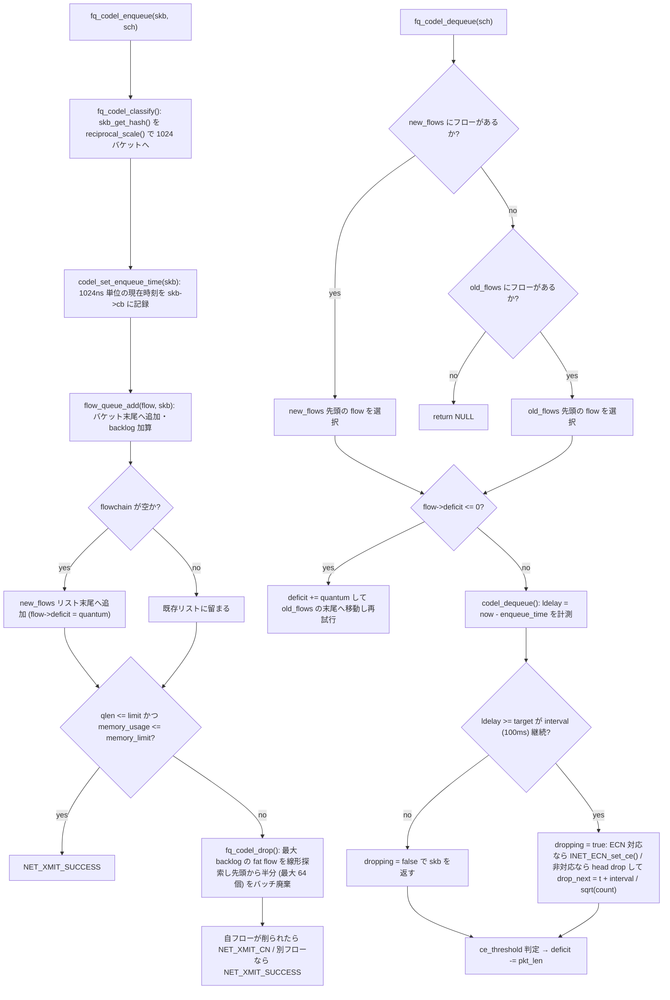
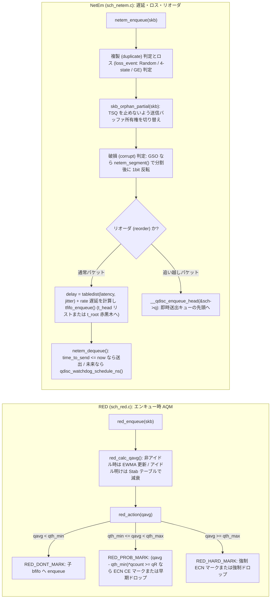

# 17. AQM とネットワークエミュレーション：CoDel・FQ-CoDel・RED・NetEm

第 15 章と第 16 章では、パケットを「どの順序・どの速度で送り出すか」を決める FIFO・TBF・HTB・FQ（`sch_fq`）を読みました。この章では、Qdisc のもう 2 つの重要な役割である **AQM（Active Queue Management：能動的キュー管理）** と **ネットワークエミュレーション（NetEm）** を一行ずつ読みます。

前半（Part 1・Part 2）では、Tail-drop キューが引き起こす **Bufferbloat** と **TCP グローバル同期** の仕組みを整理したうえで、現代の多くの Linux ディストリビューションで既定 Qdisc となっている **CoDel（RFC 8289）** / **FQ-CoDel（RFC 8290）**、および AQM の原点である **RED（Random Early Detection）** を対比しながら追います。後半（Part 3）では、作成した TCP や Qdisc のコードを任意の遅延・ジッタ・パケットロス・リオーダ下で検証するための必須ツール **NetEm（`sch_netem.c`）** の内部実装と実践レシピを解説します。

---

## 1. たとえ話で言うと

建物の配送センター（Qdisc）からトラック（パケット）を道路（回線）へ送り出す場面を想像してください。

### Tail-drop と Bufferbloat（満杯になるまで黙っている巨大倉庫）

昔の配送センターは、「倉庫（キュー）が満杯になるまでは小包（`sk_buff`）をすべて黙って受け入れ、倉庫の扉が閉まらなくなった瞬間にだけ、後から来た小包を突き返す（**Tail-drop**）」という単純なルールで動いていました。しかも「小包をなるべく捨てたくない」という善意から、倉庫をどんどん巨大にしました。

ところが、第 11 章・第 12 章で見たとおり、Reno や CUBIC のようなロスベース輻輳制御の発送係は **「小包が 1 つ捨てられた（または ECN マークが付いた）と知るまで、一度に道路へ出すトラックの台数（cwnd）を増やし続ける」** という性格を持っています。

倉庫を巨大にすると何が起きるでしょうか。道路の入り口はすでに 100% 詰まっているのに、倉庫にまだ空きがあるせいで発送係には「混んでいる」という連絡が一切届きません。発送係はトラックをさらに増やし、倉庫には何千個もの小包が積み上がります。小包が倉庫に入ってから道路へ出るまでに何百ミリ秒もかかるようになり（**Bufferbloat**）、そこへ急ぎの手紙（SSH のキー入力や DNS クエリ、ゲームの通信）が 1 通だけ届いても、前に並ぶ何千個もの大荷物の後ろに並ばされてしまいます。そしてついに倉庫が満杯になった瞬間、その場に居合わせたすべての発送係の小包が一斉に突き返され、全員が同時にトラックを半減させて道路が一瞬ガラ空きになる（**グローバル同期**）という悪循環が起きます。

### RED（倉庫の荷物の高さを見てくじ引きで間引く係員）

そこで 1993 年に登場した **RED（Random Early Detection）** 係員は、「倉庫が満杯になる前に、早め（Early）にランダム（Random）で小包を間引いて、一部の発送係にだけブレーキを踏んでもらおう」と考えました。一時的な荷物の塊（バースト）で誤って捨てないよう、倉庫の「現在の荷物の高さ（バイト数）」を指数移動平均（$q_{\text{avg}}$）でならし、それがある目印（$q_{\min}$）を超えたら少しずつくじ引きの当選率を上げていきます。

しかし RED 係員には弱点がありました。「倉庫に何キログラムの荷物があるか」だけを見ていたため、外の道路の速度（リンク帯域）が 10 Mbps から 100 Mbps、あるいは Wi-Fi のように刻々と変わると、同じ荷物の量でも「すぐ捌けるのか、何秒も滞留するのか」がまったく変わってしまい、目印（$q_{\min}, q_{\max}, w_q$）の調整が極めて難しかったのです。

### CoDel と FQ-CoDel（小包に受付時刻スタンプを押し、大荷物と小荷物のレーンを分ける係員）

2012 年に登場した **CoDel（Controlled Delay）** 係員は、荷物の重さや個数を見るのをやめ、すべての小包に **「倉庫に入った時刻」のスタンプ** を押すことにしました。そして小包を道路へ送り出す出口（dequeue）で「いま何ミリ秒待たされたか（**滞在時間：sojourn time**）」を測ります。

- 一時的なバースト（「良いキュー」）なら、100 ms（`interval`）以内にすぐ捌けて待ち時間は 5 ms（`target`）未満に戻るので、何もしません。
- 100 ms のあいだ一度も待ち時間が 5 ms を下回らなければ、「ずっと捌けないまま居座っている（**Standing Queue / 悪いキュー**）」と判断し、先頭の小包を 1 つ捨てて（または ECN マークを付けて）発送係に知らせます。それでも待ち時間が下がらなければ、$\text{interval}/\sqrt{\text{count}}$ のペースで通知の間隔を詰めていきます。

さらに **FQ-CoDel（Fair Queue CoDel）** 係員は、倉庫の中に 1024 本のレーン（フローごとのキュー）を用意し、**「新しく届いたばかりの小口レーン（`new_flows`）を、大荷物を送り続けている常連レーン（`old_flows`）より先に通す」** という整理券方式（DRR）を組み合わせました。これで、大きなファイル転送の裏でも SSH や音声通話の小包は待ち時間ほぼゼロで先頭から飛び出せるようになり、大荷物レーンにはそのレーン専用の CoDel 係員が的確にブレーキをかけてくれます。

### NetEm（屋内の実験場に「地球の裏側までの悪路」を再現するシミュレータ）

最後に **NetEm（Network Emulator）** は、実際の配送センターではなく **「配送テスト用の実験施設」** です。手元の建物の廊下（ローカル環境や仮想ネットワーク）は本来なら一瞬で小包が届く平坦な道ですが、NetEm を設置すると「小包をわざと 50 ms 預かってから出す（遅延）」「ときどき順番を入れ替える（リオーダ）」「サイコロやマルコフ連鎖でバースト的に小包を落とす（ロス）」「伝票の 1 ビットを書き換える（破損）」といった世界中のあらゆる悪路をカーネル内で正確に再現できます。

---

## 2. 背景・RFC・論文では

### なぜ AQM（Active Queue Management）が必要なのか

ルータやホストの送信キュー（Qdisc）における **Tail-drop（末尾廃棄）** には、大きく 3 つの構造的な問題があります。

1. **Good Queue（良いキュー）と Bad Queue（悪いキュー）の区別がつかない**
   パケット交換網におけるバッファの本来の目的は、複数の送信元から同時に到着した短時間のバーストや、TCP の slow start・ACK 圧縮による一時的な到着レートの山を吸収し、ボトルネックリンクを 100% 稼働させることです。このような「1 RTT 程度で速やかに捌けて空に戻るキュー」は **Good Queue** です。一方、ロスベースの TCP（Reno や CUBIC）がボトルネック帯域を超えて `cwnd` を増やし続けた結果、常時一定の深さで居座り続けるキューは **Standing Queue（Bad Queue）** と呼ばれます。Standing Queue はスループットを 1 ビットも増やさず、すべてのパケットに一定のキューイング遅延（$\Delta \text{RTT} = Q / C$）を上乗せするだけです。Tail-drop はバッファ上限（`limit`）に達するまで一切の輻輳シグナルを出さないため、バッファ容量のほぼすべてが Standing Queue として埋め尽くされます（**Bufferbloat**）。
2. **TCP グローバル同期（Global Synchronization）と Lock-out**
   Tail-drop キューが満杯になると、その瞬間に到着した複数フローのパケットが連続してドロップします。すると全フローが同時に `cwnd` を削減（Reno なら半減、CUBIC なら $\times 0.7$）し、リンク利用率が急落したあと、再び全フローが同時にウィンドウを広げて同時にドロップする波（同期現象）を繰り返します。また、少数のバースト的なフローがバッファを占有し、後から到着した別フローのパケットが入り口で弾かれ続ける **Lock-out（締め出し）** も発生します。
3. **Head-of-Line（HoL）ブロッキングによるインタラクティブ通信の悪化**
   単一の FIFO キューをバルク転送フロー（大容量ダウンロードなど）とスパースなフロー（DNS、SSH、VoIP、Web API、TCP ハンドシェイクの SYN 等）が共有すると、スパースなフローの 1 パケットがバルクフローの数百〜数千パケットの後ろに並ばされ、数百ミリ秒〜数秒のジッタとレイテンシ悪化を被ります。

これらを解決するため、キューが物理上限に達するより前に確率的または遅延ベースでパケットのドロップ（または ECN の CE マーキング）を行う仕組みが **AQM（Active Queue Management）** です。

### 各 RFC・論文のあらまし

- **Sally Floyd and Van Jacobson, "Random Early Detection Gateways for Congestion Avoidance" (IEEE/ACM Transactions on Networking, 1993)**
  AQM という分野を切り拓いた記念碑的論文です。瞬間的なキュー長ではなく指数移動平均（EWMA）のキュー長 $q_{\text{avg}}$ を計算し、2 つの閾値 $q_{\min}$ と $q_{\max}$ のあいだでドロップ（またはマーキング）確率を線形に増加させる **RED** アルゴリズムを提案しました。
- **Sally Floyd, Ramakrishna Gummadi, and Scott Shenker, "Adaptive RED: An Algorithm for Increasing the Robustness of RED's AQM" (2001)**
  RED の最大の弱点であった「フロー数やリンク条件によって平均キュー長が $q_{\min}$ 付近や $q_{\max}$ 付近に張り付いてしまう」問題に対し、$q_{\text{avg}}$ が目標範囲 $[q_{\min} + 0.4(q_{\max} - q_{\min}),\, q_{\min} + 0.6(q_{\max} - q_{\min})]$ に収まるよう、0.5 秒ごとに最大ドロップ確率 $\max_p$ を AIMD で自動調整する **Adaptive RED（ARED）** を提案しました。また $q_{\text{avg}}$ が $q_{\max}$ から $2 q_{\max}$ に向かう領域で確率を $\max_p$ から $1.0$ へ滑らかに引き上げる **gentle モード** も導入されました。
- **[RFC 7567](https://www.rfc-editor.org/rfc/rfc7567) — IETF Recommendations Regarding Active Queue Management (2015, BCP 197)**
  旧 RFC 2309（1998 年、RED の導入を推奨した文書）を置き換えた現行の Best Current Practice です。RED のパラメータ調整の難しさを総括したうえで、特定のアルゴリズム 1 つを義務付けるのではなく「設定不要または最小限のパラメータで自己適応する AQM（CoDel、PIE など）と、フロー分離（FQ-CoDel など）および ECN の活用」を推奨しています。
- **[RFC 8289](https://www.rfc-editor.org/rfc/rfc8289) — Controlled Delay Active Queue Management (CoDel) (2018)**
  Kathleen Nichols と Van Jacobson が 2012 年（ACM Queue 論文 *"Controlling Queue Delay"*）に発表し、2018 年に RFC 化されたアルゴリズムです。「バイト数（キュー長）」ではなく **「パケットがキューに滞在した時間（sojourn time）」** を直接計測し、直近のウィンドウ `interval`（既定 100 ms）における滞在時間の最小値が `target`（既定 5 ms）を超え続けたときにのみ先頭ドロップ（head drop）を行います。
- **[RFC 8290](https://www.rfc-editor.org/rfc/rfc8290) — The FlowQueue-CoDel Packet Scheduler and Active Queue Management Algorithm (2018)**
  Toke Høiland-Jørgensen、Paul McKenney、Dave Täht、Jim Gettys、Eric Dumazet による RFC で、Linux の `sch_fq_codel`（2012 年に Eric Dumazet が実装）そのものを標準化した文書です。Stochastic Fairness Queuing（SFQ）のハッシュバケット、新規/スパースフローを優先する修正版 Deficit Round Robin（DRR）、そしてバケットごとの CoDel AQM を 1 つの軽量なスケジューラに統合しています。

---

### CoDel の数式と状態機械（RFC 8289 §3, §4）

[RFC 8289 §3](https://www.rfc-editor.org/rfc/rfc8289#section-3) の設計原理は次の 3 点に集約されます。

1. **キュー長ではなく滞在時間（sojourn time）を測る**: パケット $p$ がエンキューされた時刻を $t_{\text{enq}}(p)$、デキューされた時刻を $t_{\text{deq}}(p)$ とすると、滞在時間は
   $$d(p) = t_{\text{deq}}(p) - t_{\text{enq}}(p)$$
   です。デキュー時に計測することで、リンク速度が可変（Wi-Fi、セルラー、動的シェーパ、HTB の帯域借用など）であっても、設定変更なしに「実際にパケットがどれだけ待たされたか」が正確にわかります。また、キューの先頭（最も長く待ったパケット）をドロップまたは ECN マークする **Head Drop** を行うため、末尾ドロップ（Tail Drop）よりも現在のキュー遅延分だけ早く送信側の TCP に輻輳シグナルが届きます。
2. **スライディングウィンドウ内の最小滞在時間を見る**: 一時的なバースト（Good Queue）は、およそ 1 RTT（公衆インターネットの典型的な最大 RTT として `interval` = 100 ms）以内に解消されて滞在時間が 0 付近まで下がります。一方、Standing Queue（Bad Queue）は 100 ms のあいだ一度も滞在時間が下がりません。そこで CoDel は、明示的なリングバッファを持たず、`first_above_time` というタイムスタンプ 1 つだけで「$d(p) \ge \text{target}$ の状態が `interval`（100 ms）以上継続したか」を追跡します。ただし、キュー全体のバックログが 1 MTU（`params->mtu`）以下のときは、最後の 1 パケットを捨ててリンクをアイドルにしないようドロップを禁止します。
3. **逆平方根の制御則（Control Law）**: TCP Reno / CUBIC が 1 RTT ごとにウィンドウを線形に増やし、ドロップに対してウィンドウを定数倍で減らすとき、定常状態のドロップ頻度 $f$ は活動フロー数やドロップ回数 `count` に対して平方根でスケーリングする必要があります。そのため `dropping` 状態に入った後の $n$ 回目（$\text{count} = n$）の次期ドロップ予定時刻 $t_{\text{next}}$ は、[RFC 8289 §3.2](https://www.rfc-editor.org/rfc/rfc8289#section-3.2) の制御則により次のように定まります。

$$t_{\text{next}} = t + \frac{\text{interval}}{\sqrt{\text{count}}}$$

カーネル内で浮動小数点演算や `sqrt()`、整数除算を毎ドロップごとに実行するのは高コストなため、Linux（および RFC 8289 §4.1）は $1/\sqrt{\text{count}}$ の固定小数点近似値 `rec_inv_sqrt` を保持し、`count` が 1 増えるたびに **ニュートン・ラフソン法（Newton-Raphson step）** を 1 ステップ回して更新します。

関数 $f(x) = \frac{1}{x^2} - c = 0$（ここで $c = \text{count}$、解は $x = 1/\sqrt{c}$）に対するニュートン法の漸化式は

$$x_{k+1} = x_k - \frac{f(x_k)}{f'(x_k)} = x_k - \frac{x_k^{-2} - c}{-2 x_k^{-3}} = \frac{x_k}{2}\left(3 - c \cdot x_k^2\right)$$

です。`count` が $1 \to 2 \to 3 \dots$ と 1 ずつ増えるとき、前回の値 $x_k \approx 1/\sqrt{c-1}$ を初期値として上式を 1 回計算するだけで、実用上十分な精度の $1/\sqrt{c}$ が乗算とビットシフトだけで得られます。

また、一度 `dropping` 状態を抜けた直後（`now - drop_next < 16 * interval`）に再び `dropping` 状態へ入った場合は、前回のドロップレートがまだ妥当であったとみなし、`count` を 1 に戻さず $\text{delta} = \text{count} - \text{lastcount}$ から再開します（[RFC 8289 §4.3](https://www.rfc-editor.org/rfc/rfc8289#section-4.3)）。

| パラメータ / 変数 | 既定値 | 役割 |
| --- | --- | --- |
| `target` | 5 ms | 許容する定常最小キュー滞在時間（バンド幅の約 5% のバッファに相当） |
| `interval` | 100 ms | Standing Queue と判定するまでの継続観測時間（典型的な公衆網 RTT） |
| `ce_threshold` | 無効（`INT_MAX`） | DCTCP / L4S 向けに、`ldelay > ce_threshold` なら CoDel 状態機械と無関係に即時 CE マークする閾値 |
| `first_above_time` | 0 | $d(p) \ge \text{target}$ が最初に成立した時刻 $+$ `interval` |
| `dropping` | `false` | 現在ドロップ（または ECN マーク）周期中かどうか |
| `count` / `lastcount` | 0 | `dropping` 状態に入ってからの累計ドロップ回数と、突入時の初期値 |
| `rec_inv_sqrt` | 0 | $1/\sqrt{\text{count}}$ の上位 16 ビット固定小数点表現（`REC_INV_SQRT_SHIFT` = 16 で Q0.32 化） |
| `drop_next` | 0 | 次のドロップ予定時刻（非 `dropping` 時は直近のドロップ時刻） |

---

### FQ-CoDel の DRR とスパースフロー優先（RFC 8290 §3, §4）

単一キューの CoDel でも全体の遅延は抑えられますが、全フローが 1 つの FIFO を共有すると「バルクフローが作った 5 ms のキューの後ろにインタラクティブ通信が並ぶ」「ハッシュなしではどのフローがキューを膨らませているか分からない」という課題が残ります。

[RFC 8290](https://www.rfc-editor.org/rfc/rfc8290) の **FQ-CoDel** は次の 4 つの仕組みを組み合わせます。

1. **Stochastic フロー分類（既定 1024 バケット）**: パケットの 5 タプルハッシュ（`skb_get_hash(skb)`、Linux カーネルが netns ごとのランダムシードで計算する Jenkins / SipHash）を `flows_cnt`（既定 1024）個のバケット `q->flows[idx]` にマッピングします。各バケットが独自の FIFO キューと独自の `struct codel_vars cvars` を持ちます。
2. **2 本の DRR リスト（`new_flows` と `old_flows`）**: アクティブなフローバケットを単一のラウンドロビンリストではなく、**`new_flows`** と **`old_flows`** の 2 本の双方向リストで管理します。
   - 空だったバケットにパケットが到着すると、`deficit = quantum`（既定 1 MTU、例: 1514 バイト）を与えられて **`new_flows` の末尾** に繋がれます。
   - デキュー時は、**`new_flows` が空でない限り常に `new_flows` から優先して** パケットを取り出します。
   - パケットを送り出すたびに `deficit -= pkt_len` し、`deficit <= 0` になったフローは `deficit += quantum` されて **`old_flows` の末尾** に降格します。
   - フローのキューが空になったとき、そのフローがまだ `new_flows` に居て、かつ `old_flows` が空でなければ、いったん `old_flows` の末尾へ移してから次の周回で空を確認してリストから外します（`new_flows` への再入を 1 ラウンド遅らせて、`old_flows` が完全に飢餓状態になるのを防ぐ工夫です）。
   - この結果、1 ラウンドあたり `quantum` 以下のデータしか送らないスパースなフロー（ACK、DNS、SSH、VoIP、ゲーム、ペースされた短命フロー）は常に `new_flows` で優先処理され、バルクフローの後ろに一切並びません。
3. **フローごとの独立した CoDel**: 各バケットが `flow->cvars` を持つため、バルク転送フローのバケットだけで滞在時間が `target` を超え、そのバケットのパケットだけがドロップ（または ECN マーク）されます。
4. **上限超過時の Fat Flow バッチドロップ（`fq_codel_drop()`）**: 万一 Qdisc 全体のパケット数（`limit`、既定 10240 パケット）またはメモリ使用量（`memory_limit`、既定 32 MiB）を超えた場合、到着したパケットを捨てる（Tail-drop）のではなく、1024 バケットの `q->backlogs[]` を走査して **最もバックログ（バイト数）が大きいフロー（Fat Flow）** を見つけ、そのフローの **先頭からバックログが半分になるまで（最大 `drop_batch_size` = 64 パケット）まとめてドロップ** します。

---

### RED の数式とアルゴリズム（Floyd & Jacobson 1993, Adaptive RED 2001）

RED は CoDel とは対照的に **エンキュー時（`red_enqueue()`）** に動作し、物理的な子 Qdisc（既定はバイト単位の FIFO である `bfifo`）の現在のバックログ $q$（バイト）から指数移動平均 $q_{\text{avg}}$ を更新します。

1. **平均キュー長 $q_{\text{avg}}$ の計算（EWMA とアイドル減衰）**
   - キューが空でない（非アイドル）状態でパケットが到着したとき:
     $$q_{\text{avg}} \leftarrow (1 - w_q)\, q_{\text{avg}} + w_q\, q$$
     ここで重み $w_q = 2^{-\text{Wlog}}$ です。Linux カーネルは浮動小数点を避け、かつシフト時の下位ビット切り捨て誤差を防ぐため、内部変数 `v->qavg` を **$q_{\text{avg}} \cdot 2^{\text{Wlog}}$（固定小数点位置が `Wlog` ビット目）** として保持します。すると更新式は
     $$\text{v->qavg} \leftarrow \text{v->qavg} + \left(q - (\text{v->qavg} \gg \text{Wlog})\right)$$
     という加減算と右シフト 1 回だけで正確に計算できます。
   - キューが空（アイドル）だった期間 $\Delta t_{\text{idle}}$ の後に最初のパケットが到着したとき:
     もしリンク速度 $C$ で平均サイズ $S$ のダミーパケットがアイドル期間中に $m = \Delta t_{\text{idle}} / (S / C)$ 個通過したとみなせば、平均キュー長は
     $$q_{\text{avg}} \leftarrow q_{\text{avg}} \cdot (1 - w_q)^m$$
     だけ減衰するはずです。カーネル内でべき乗 $(1 - w_q)^m$ を計算するのは重いため、`iproute2`（`tc` コマンド）が設定時に 256 エントリのシフト量ルックアップテーブル `Stab[256]` を事前計算して Netlink でカーネルに渡し、カーネルは `us_idle >> Scell_log` で `Stab` を引いて右シフトします。
2. **ドロップ確率 $p_b$ と一様化確率 $p_a$**
   - $q_{\text{avg}} < q_{\min}$: ドロップしない（`RED_BELOW_MIN_THRESH`、`qcount = -1`）。
   - $q_{\min} \le q_{\text{avg}} < q_{\max}$: 基本確率 $p_b$ を線形に計算します。
     $$p_b = \max_p \cdot \frac{q_{\text{avg}} - q_{\min}}{q_{\max} - q_{\min}}$$
     さらに、ドロップとドロップの間隔が幾何分布になって塊（クラスタ）でドロップするのを防ぎ、ドロップ間隔を一様分布に近づけるため、前回のドロップからの経過パケット数 $\text{count}$（`v->qcount`）を使って最終確率 $p_a$ を
     $$p_a = \frac{p_b}{1 - \text{count} \cdot p_b}$$
     とします。Linux の実装（`red_mark_probability()`）は、この $p_a$ をさらに高速化し、ドロップ時に 1 回だけ区間 $[0, (q_{\max} - q_{\min}) / \max_p)$ の乱数 `qR` を引いてキャッシュしておき、以降のパケットでは乱数を引かずに
     $$(q_{\text{avg}} - q_{\min}) \cdot \text{qcount} \ge \text{qR}$$
     が成立した瞬間にドロップ（または ECN マーク）するという巧みな変形を使っています。
   - $q_{\text{avg}} \ge q_{\max}$: 強制ドロップまたはマーク（`RED_ABOVE_MAX_TRESH` → `RED_HARD_MARK`）。
3. **Adaptive RED（ARED）**: `adaptive` フラグが有効な場合、500 ms（`HZ / 2`）周期のタイマー `red_adaptative_timer()` が走り、$q_{\text{avg}}$ が目標帯域 $[q_{\min} + 0.4 \Delta,\, q_{\min} + 0.6 \Delta]$（ただし $\Delta = q_{\max} - q_{\min}$）を上回っていれば $\max_p \leftarrow \max_p + \alpha$（$\alpha = \min(0.01, \max_p / 4)$、上限 $0.50$）、下回っていれば $\max_p \leftarrow 0.9 \max_p$（下限 $0.01$）と更新します。

### なぜ現在 RED は本番環境でほとんど使われなくなったのか

RED は AQM の基礎を作った歴史的に極めて重要なアルゴリズムですが、現在の Linux では以下の理由から `fq_codel`（または `cake` / `sch_fq`）に取って代わられています。

- **パラメータ調整がリンク帯域に強く依存する**: `tc qdisc add ... red` では `min`、`max`、`avpkt`、`burst`、`bandwidth` をすべて管理者が指定しなければならず、`Stab`（アイドル減衰テーブル）も指定した `bandwidth` と `avpkt` から計算されます。実際のリンク速度が変動したり設定値と乖離したりすると、バーストを誤って大量ドロップするか、逆に Standing Queue を放置してしまいます。
- **キュー長（バイト）は遅延の悪い代理変数である**: 同じ 64 KB のキューでも、10 Gbps リンクなら $51\ \mu\text{s}$ で捌けますが、1 Mbps リンクなら $512\ \text{ms}$ かかります。CoDel は滞在時間を直接測るため、帯域の事前知識が一切不要です。
- **エンキュー時判定と Tail / Random Drop の限界**: RED はエンキュー時に判定するため、リンク速度が急落した瞬間にすでにキューに入っているパケットの遅延増大を検知できません。

それでも、データセンタースイッチのハードウェアオフロード（`TC_SETUP_QDISC_RED`、スイッチ ASIC 上の WRED / DCQCN バッファ設定）や、カーネルの selftests（`tools/testing/selftests/tc-testing/` およびスイッチドライバの qevent テスト）では今も現役で使われています。

---

## 3. 全体の流れ

この章で扱う 3 つの Qdisc（**FQ-CoDel**、**RED**、**NetEm**）のエンキュー・デキューの全体像を並べます。どこで時刻を測り、どこでドロップや遅延が発生するかに注目してください。

### FQ-CoDel のパケット処理フロー



### RED と NetEm の対比フロー



---

## 4. コードを追う

### Part 1: CoDel（RFC 8289）と FQ-CoDel（RFC 8290）

#### Step 1: CoDel の 1024 ns クロックとデータ構造（`include/net/codel.h`, `include/net/codel_qdisc.h`）

まず `include/net/codel.h`（[include/net/codel.h#L60](https://git.kernel.org/pub/scm/linux/kernel/git/netdev/net-next.git/tree/include/net/codel.h?id=279d5c8afcd38bd841832a39bfe1aa4f8518d98e#n60)）の時刻表現と構造体定義を読みます。

```c
/* CoDel uses a 1024 nsec clock, encoded in u32
 * This gives a range of 2199 seconds, because of signed compares
 */
typedef u32 codel_time_t;
typedef s32 codel_tdiff_t;
#define CODEL_SHIFT 10
#define MS2TIME(a) ((a * NSEC_PER_MSEC) >> CODEL_SHIFT)

static inline codel_time_t codel_get_time(void)
{
	u64 ns = ktime_get_ns();

	return ns >> CODEL_SHIFT;
}
```

- `codel_get_time()`（[include/net/codel.h#L65](https://git.kernel.org/pub/scm/linux/kernel/git/netdev/net-next.git/tree/include/net/codel.h?id=279d5c8afcd38bd841832a39bfe1aa4f8518d98e#n65)）は、64 ビットナノ秒クロック `ktime_get_ns()` を `CODEL_SHIFT`（10 ビット）右シフトして 32 ビットの `codel_time_t` に収めます。
- なぜ 64 ビットの `ktime_t` をそのまま使わないのでしょうか。理由は 2 つあります。
  1. `sk_buff` の制御ブロック `qdisc_skb_cb(skb)->data`（最大 20 バイト）と、1024 個並ぶ `struct fq_codel_flow`（1 バケットあたり 64 バイト = 1 キャッシュライン以内）のメモリフットプリントを最小限に抑えるためです。32 ビットにすれば、`first_above_time`、`drop_next`、`ldelay` の 3 つの時刻フィールドが合計 12 バイトで済みます。
  2. 1000（マイクロ秒への除算）ではなく $2^{10} = 1024\ \text{ns} \approx 1.024\ \mu\text{s}$ を 1 ティックに選ぶことで、ナノ秒からの変換が 1 命令のシフト（`>> 10`）で完結します。符号付き 32 ビット差分比較（`codel_time_after(a, b)` = `((s32)((a) - (b)) > 0)`）がラップアラウンドせずに比較できる最大時間幅は $2^{31} \times 1024\ \text{ns} \approx 2199\ \text{秒}$（約 36.6 分）であり、パケットのキュー滞在時間としては十分すぎる長さです。

続いて `struct codel_params`（[include/net/codel.h#L107](https://git.kernel.org/pub/scm/linux/kernel/git/netdev/net-next.git/tree/include/net/codel.h?id=279d5c8afcd38bd841832a39bfe1aa4f8518d98e#n107)）、`struct codel_vars`（[include/net/codel.h#L129](https://git.kernel.org/pub/scm/linux/kernel/git/netdev/net-next.git/tree/include/net/codel.h?id=279d5c8afcd38bd841832a39bfe1aa4f8518d98e#n129)）、`struct codel_stats`（[include/net/codel.h#L156](https://git.kernel.org/pub/scm/linux/kernel/git/netdev/net-next.git/tree/include/net/codel.h?id=279d5c8afcd38bd841832a39bfe1aa4f8518d98e#n156)）です。

```c
struct codel_params {
	codel_time_t	target;
	codel_time_t	ce_threshold;
	codel_time_t	interval;
	u32		mtu;
	bool		ecn;
	u8		ce_threshold_selector;
	u8		ce_threshold_mask;
};

struct codel_vars {
	u32		count;
	u32		lastcount;
	bool		dropping;
	u16		rec_inv_sqrt;
	codel_time_t	first_above_time;
	codel_time_t	drop_next;
	codel_time_t	ldelay;
};

#define REC_INV_SQRT_BITS (8 * sizeof(u16)) /* or sizeof_in_bits(rec_inv_sqrt) */
/* needed shift to get a Q0.32 number from rec_inv_sqrt */
#define REC_INV_SQRT_SHIFT (32 - REC_INV_SQRT_BITS)

/* Cap on drops per codel_dequeue() call: the loop's work depends on the
 * idle gap and backlog, both outside our control; resync when exceeded.
 */
#define CODEL_MAX_DROPS_PER_DEQUEUE 256

struct codel_stats {
	u32		maxpacket;
	u32		drop_count;
	u32		drop_len;
	u32		ecn_mark;
	u32		ce_mark;
};
```

- `struct codel_params` は Qdisc 全体で共有される設定値です。`FQ-CoDel` では 1024 フローすべてが 1 つの `q->cparams` を共有します。
- `struct codel_vars` はフロー（またはキュー）ごとの状態変数で、サイズがちょうど 24 バイトに収まっています。`dropping`（1 バイト）の直後に 16 ビットの `rec_inv_sqrt` を置くことで、パディングを無駄にせず `struct codel_vars` を 24 バイトに詰めています。
- そして `include/net/codel_qdisc.h`（[include/net/codel_qdisc.h#L56](https://git.kernel.org/pub/scm/linux/kernel/git/netdev/net-next.git/tree/include/net/codel_qdisc.h?id=279d5c8afcd38bd841832a39bfe1aa4f8518d98e#n56)）では、各 `sk_buff` の `cb` 領域にエンキュー時刻とメモリ会計量を保存するヘルパーが定義されています。

```c
/* Qdiscs using codel plugin must use codel_skb_cb in their own cb[] */
struct codel_skb_cb {
	codel_time_t enqueue_time;
	unsigned int mem_usage;
};

static struct codel_skb_cb *get_codel_cb(const struct sk_buff *skb)
{
	qdisc_cb_private_validate(skb, sizeof(struct codel_skb_cb));
	return (struct codel_skb_cb *)qdisc_skb_cb(skb)->data;
}

static codel_time_t codel_get_enqueue_time(const struct sk_buff *skb)
{
	return get_codel_cb(skb)->enqueue_time;
}

static void codel_set_enqueue_time(struct sk_buff *skb)
{
	get_codel_cb(skb)->enqueue_time = codel_get_time();
}
```

- CoDel の本体（`include/net/codel_impl.h`）は Qdisc 専用ではなく、Wi-Fi の mac80211 TXQ（`net/mac80211/tx.c`）からも同じヘッダがインクルードされて使われています。そのため `skb` からエンキュー時刻やパケット長を取り出す処理はコールバック（`skb_time_func`、`skb_len_func`）として抽象化されており、Qdisc 側ではこの `codel_get_enqueue_time()`（[include/net/codel_qdisc.h#L67](https://git.kernel.org/pub/scm/linux/kernel/git/netdev/net-next.git/tree/include/net/codel_qdisc.h?id=279d5c8afcd38bd841832a39bfe1aa4f8518d98e#n67)）を渡します。

---

#### Step 2: 固定小数点ニュートン・ラフソン法と制御則 — `codel_Newton_step()` と `codel_control_law()`

`include/net/codel_impl.h` の `codel_Newton_step()`（[include/net/codel_impl.h#L80](https://git.kernel.org/pub/scm/linux/kernel/git/netdev/net-next.git/tree/include/net/codel_impl.h?id=279d5c8afcd38bd841832a39bfe1aa4f8518d98e#n80)）と `codel_control_law()`（[include/net/codel_impl.h#L100](https://git.kernel.org/pub/scm/linux/kernel/git/netdev/net-next.git/tree/include/net/codel_impl.h?id=279d5c8afcd38bd841832a39bfe1aa4f8518d98e#n100)）を 1 行ずつ追います。

```c
/*
 * http://en.wikipedia.org/wiki/Methods_of_computing_square_roots#Iterative_methods_for_reciprocal_square_roots
 * new_invsqrt = (invsqrt / 2) * (3 - count * invsqrt^2)
 *
 * Here, invsqrt is a fixed point number (< 1.0), 32bit mantissa, aka Q0.32
 */
static void codel_Newton_step(struct codel_vars *vars)
{
	u32 invsqrt = ((u32)vars->rec_inv_sqrt) << REC_INV_SQRT_SHIFT;
	u32 invsqrt2 = ((u64)invsqrt * invsqrt) >> 32;
	u64 val = (3LL << 32) - ((u64)vars->count * invsqrt2);

	val >>= 2; /* avoid overflow in following multiply */
	val = (val * invsqrt) >> (32 - 2 + 1);

	vars->rec_inv_sqrt = val >> REC_INV_SQRT_SHIFT;
}

/*
 * CoDel control_law is t + interval/sqrt(count)
 * We maintain in rec_inv_sqrt the reciprocal value of sqrt(count) to avoid
 * both sqrt() and divide operation.
 *
 * Clamp the increment to at least 1 tick: a very small interval (or a
 * large count) can truncate it to zero, stalling the dropping loop.
 */
static codel_time_t codel_control_law(codel_time_t t,
				      codel_time_t interval,
				      u32 rec_inv_sqrt)
{
	return t + max_t(u32, 1,
			 reciprocal_scale(interval,
					  rec_inv_sqrt << REC_INV_SQRT_SHIFT));
}
```

ビットの位置（固定小数点の小数点位置）を正確に追いかけましょう。

- **初期状態（`count = 1` のとき）**: `codel_dequeue()` が `vars->count = 1` にするとき、`vars->rec_inv_sqrt = ~0U >> REC_INV_SQRT_SHIFT`（つまり `0xffff`）を代入します。
- **`u32 invsqrt = ((u32)vars->rec_inv_sqrt) << REC_INV_SQRT_SHIFT;`**: 16 ビットの `rec_inv_sqrt` を 16 ビット左シフトし、**Q0.32 形式**（$2^{32}$ を $1.0$ とする 32 ビット固定小数点、すなわち $\text{invsqrt} \approx \frac{1}{\sqrt{\text{count}}} \cdot 2^{32}$）に拡張します。
- **`u32 invsqrt2 = ((u64)invsqrt * invsqrt) >> 32;`**: Q0.32 同士を 64 ビット乗算すると Q0.64 になるので、32 ビット右シフトして再び Q0.32 の $x_k^2$（`invsqrt2`）を得ます。
- **`u64 val = (3LL << 32) - ((u64)vars->count * invsqrt2);`**: `3LL << 32` は Q2.32 形式の $3.0$ です。そこから `count * invsqrt2`（Q0.32）を引くことで、$3 - \text{count} \cdot x_k^2$ を Q2.32 形式で得ます。`count` が 1 増えた直後なので $\text{count} \cdot x_k^2 \approx \frac{c}{c-1} > 1$ となり、`val` はおおよそ $1.0 \sim 2.0$（$\times 2^{32}$）の範囲にあります。
- **`val >>= 2; /* avoid overflow in following multiply */`**: ここが重要な工夫です。もし Q2.32 の `val`（最大約 $2 \times 2^{32}$）にそのまま Q0.32 の `invsqrt`（最大約 $2^{32}$）を掛けると、64 ビット符号なし整数 `u64`（上限 $2^{64}-1$）をわずかにオーバーフローする危険があります。そこで先に `val` を 2 ビット右シフトして Q2.30 にしておきます。
- **`val = (val * invsqrt) >> (32 - 2 + 1);`**: Q2.30 の `val` と Q0.32 の `invsqrt` を掛けると小数部は $30 + 32 = 62$ ビットになります。さらにニュートン法の式の $\frac{1}{2}$ を掛ける分（$+1$ ビット右シフト）を合わせ、合計 $32 - 2 + 1 = 31$ ビット右シフトすることで、結果の `val` は再び **Q0.32 形式** の $x_{k+1} = \frac{x_k}{2}(3 - c x_k^2)$ になります。
- **`vars->rec_inv_sqrt = val >> REC_INV_SQRT_SHIFT;`**: 上位 16 ビットを取り出して `rec_inv_sqrt` に保存します。
- 具体例で確かめてみましょう。`count` が $1 \to 2$ になった瞬間、`invsqrt = 0xffff0000`（$\approx 1.0$）から 1 ステップ回すと、$\frac{1}{2}(3 - 2 \times 1^2) = 0.5$、次の `count = 3` の前に、もし `count = 2` でもう一度回れば $0.5 \times (3 - 2 \times 0.25) / 2 = 0.625$ と $\frac{1}{\sqrt{2}} \approx 0.7071$ に 2 次収束していきます。実際の CoDel では `count` が 1 増えるごとに 1 ステップ進むため、`count = 1, 2, 3, 4...` に対して非常に滑らかな減衰曲線を描きます。
- **`codel_control_law()`**: `reciprocal_scale(interval, rec_inv_sqrt << 16)`（[include/linux/math.h#L194](https://git.kernel.org/pub/scm/linux/kernel/git/netdev/net-next.git/tree/include/linux/math.h?id=279d5c8afcd38bd841832a39bfe1aa4f8518d98e#n194)）は `(u32)(((u64)interval * (rec_inv_sqrt << 16)) >> 32)` を計算します。つまり除算命令（`div`）を一切使わず、64 ビット乗算と右シフトだけで $\lfloor \text{interval} \times \text{invsqrt} \rfloor = \lfloor \text{interval} / \sqrt{\text{count}} \rfloor$ を求めています。
- **`max_t(u32, 1, ...)`**: 2026 年 9 月のコミット `7f4a5ec6258f` で追加されたガードです。もしユーザーが極端に小さな `interval`（例: `2us`）を設定したり、`count` が巨大になったりして `reciprocal_scale()` が `0` に切り捨てられると、`drop_next` が 1 ティックも進まなくなり、`codel_dequeue()` の `while (codel_time_after_eq(now, vars->drop_next))` ループがスピンロックを握ったまま全バックログを捨てるまで回ってソフトロックアップを起こしてしまいます。最小でも `1` ティック（1024 ns）進めることで、前進性を保証しています。

---

#### Step 3: 滞在時間の検査 — `codel_should_drop()`

次に `codel_should_drop()`（[include/net/codel_impl.h#L109](https://git.kernel.org/pub/scm/linux/kernel/git/netdev/net-next.git/tree/include/net/codel_impl.h?id=279d5c8afcd38bd841832a39bfe1aa4f8518d98e#n109)）を読みます。

```c
static bool codel_should_drop(const struct sk_buff *skb,
			      void *ctx,
			      struct codel_vars *vars,
			      struct codel_params *params,
			      struct codel_stats *stats,
			      codel_skb_len_t skb_len_func,
			      codel_skb_time_t skb_time_func,
			      u32 *backlog,
			      codel_time_t now)
{
	bool ok_to_drop;
	u32 skb_len;

	if (!skb) {
		vars->first_above_time = 0;
		return false;
	}

	skb_len = skb_len_func(skb);
	WRITE_ONCE(vars->ldelay, now - skb_time_func(skb));

	if (unlikely(skb_len > stats->maxpacket))
		WRITE_ONCE(stats->maxpacket, skb_len);

	if (codel_time_before(vars->ldelay, params->target) ||
	    *backlog <= params->mtu) {
		/* went below - stay below for at least interval */
		vars->first_above_time = 0;
		return false;
	}
	ok_to_drop = false;
	if (vars->first_above_time == 0) {
		/* just went above from below. If we stay above
		 * for at least interval we'll say it's ok to drop
		 */
		vars->first_above_time = now + params->interval;
	} else if (codel_time_after(now, vars->first_above_time)) {
		ok_to_drop = true;
	}
	return ok_to_drop;
}
```

- **`if (!skb)`**: ドロップ後に次のパケットを `dequeue_func()` で取り出した結果、キューが空になっていた場合の処理です。`vars->first_above_time = 0` にリセットして `false` を返します。
- **`WRITE_ONCE(vars->ldelay, now - skb_time_func(skb));`**: パケットがキューに入ってから出るまでの滞在時間（sojourn time）を計算し、`vars->ldelay` に記録します。`WRITE_ONCE()` を使っているのは、`tc -s qdisc show` や `tc -s class show`（`codel_dump_stats()` / `fq_codel_dump_class_stats()`）が Qdisc のスピンロックを取らずに `READ_ONCE(vars->ldelay)` で読むためです。
- **`if (codel_time_before(vars->ldelay, params->target) || *backlog <= params->mtu)`**:
  - 滞在時間 `ldelay` が `target`（既定 5 ms）未満であるか、あるいは **Qdisc 全体の残りバックログ `*backlog` が 1 MTU（`params->mtu`）以下** であれば、`first_above_time = 0` にリセットして `false`（ドロップ不可）を返します。
  - ここで注目すべき点が 2 つあります。
    1. `dequeue_func()` はすでにこの `skb` の長さを `*backlog` から引いた状態で返ってきています（`sch_codel.c` の `dequeue_func()` も `sch_fq_codel.c` の `dequeue_func()` も先頭で減算します）。つまり `*backlog <= params->mtu` は「このパケットを取り出した後の残りのバックログが 1 MTU 以下なら捨てない」という意味になります。
    2. `sch_fq_codel.c` では、`codel_dequeue()` に渡す `backlog` ポインタは個別フローのバックログ `&q->backlogs[idx]` ではなく、**Qdisc 全体のバックログ `&sch->qstats.backlog`** です（後述のコミット `865ec5523dad`）。個別フローの残りが少なくても、Qdisc 全体が混んでいて滞在時間が `target` を超え続けているならドロップ対象になります。
- **`if (vars->first_above_time == 0)`**: `ldelay >= target` かつ `*backlog > mtu` になった最初のパケットでは、まだドロップせず、`vars->first_above_time = now + params->interval`（現在時刻の 100 ms 先）をセットして `false` を返します。
- **`else if (codel_time_after(now, vars->first_above_time))`**: 一度も `target` を下回ることなく（すなわち `first_above_time` が 0 にリセットされることなく）、時計 `now` が `first_above_time` を超えたら、「直近 `interval`（100 ms）間の最小滞在時間が `target`（5 ms）を超えた」ことが確定し、`ok_to_drop = true` を返します。リングバッファやヒープを一切使わず、変数 1 つでスライディングウィンドウの最小値判定を実現しているのが CoDel の美しさです。

---

#### Step 4: CoDel の状態遷移と ECN マーキング — `codel_dequeue()`

`codel_dequeue()`（[include/net/codel_impl.h#L151](https://git.kernel.org/pub/scm/linux/kernel/git/netdev/net-next.git/tree/include/net/codel_impl.h?id=279d5c8afcd38bd841832a39bfe1aa4f8518d98e#n151)）を 3 つのチャンクに分けて全文読みます。まずは前半（すでに `vars->dropping == true` の状態）です。

```c
static struct sk_buff *codel_dequeue(void *ctx,
				     u32 *backlog,
				     struct codel_params *params,
				     struct codel_vars *vars,
				     struct codel_stats *stats,
				     codel_skb_len_t skb_len_func,
				     codel_skb_time_t skb_time_func,
				     codel_skb_drop_t drop_func,
				     codel_skb_dequeue_t dequeue_func)
{
	struct sk_buff *skb = dequeue_func(vars, ctx);
	unsigned int drops = 0;
	codel_time_t now;
	bool drop;

	if (!skb) {
		vars->first_above_time = 0;
		WRITE_ONCE(vars->dropping, false);
		return skb;
	}
	now = codel_get_time();
	drop = codel_should_drop(skb, ctx, vars, params, stats,
				 skb_len_func, skb_time_func, backlog, now);
	if (vars->dropping) {
		if (!drop) {
			/* sojourn time below target - leave dropping state */
			WRITE_ONCE(vars->dropping, false);
		} else if (codel_time_after_eq(now, vars->drop_next)) {
			/* It's time for the next drop. Drop the current
			 * packet and dequeue the next. The dequeue might
			 * take us out of dropping state.
			 * If not, schedule the next drop.
			 * A large backlog might result in drop rates so high
			 * that the next drop should happen now,
			 * hence the while loop.
			 */
			while (vars->dropping &&
			       codel_time_after_eq(now, vars->drop_next)) {
				if (++drops > CODEL_MAX_DROPS_PER_DEQUEUE) {
					/* fell far behind the schedule */
					WRITE_ONCE(vars->drop_next,
						   codel_control_law(now,
								     params->interval,
								     vars->rec_inv_sqrt));
					break;
				}
				/* dont care of possible wrap
				 * since there is no more divide.
				 */
				WRITE_ONCE(vars->count, vars->count + 1);
				codel_Newton_step(vars);
				if (params->ecn && INET_ECN_set_ce(skb)) {
					WRITE_ONCE(stats->ecn_mark,
						   stats->ecn_mark + 1);
					WRITE_ONCE(vars->drop_next,
						codel_control_law(vars->drop_next,
								  params->interval,
								  vars->rec_inv_sqrt));
					goto end;
				}
				stats->drop_len += skb_len_func(skb);
				drop_func(skb, ctx);
				stats->drop_count++;
				skb = dequeue_func(vars, ctx);
				if (!codel_should_drop(skb, ctx,
						       vars, params, stats,
						       skb_len_func,
						       skb_time_func,
						       backlog, now)) {
					/* leave dropping state */
					WRITE_ONCE(vars->dropping, false);
				} else {
					/* and schedule the next drop */
					WRITE_ONCE(vars->drop_next,
						codel_control_law(vars->drop_next,
								  params->interval,
								  vars->rec_inv_sqrt));
				}
			}
		}
```

- **L166-170（空キュー時の早期リターン）**: `if (!skb)` のとき、`WRITE_ONCE(vars->dropping, false)` だけでなく **`vars->first_above_time = 0`** もリセットしています。この 1 行は 2026 年 3 月のコミット `815980fe6dbb` で修正された重要なバグ修正です。もしここで `first_above_time` を 0 に戻さないと、NAPI 遅延などで 1 パケットだけ `ldelay >= target` になったスパースなフロー（ICMP ping など）が一旦空になったあと、100 ms 以上経って届いた 2 個目のパケットで `now > first_above_time` がいきなり成立し、輻輳していない ping パケットが周期的にドロップしてしまいます。
- **L174-177（`dropping` 状態からの脱出）**: すでに `dropping` 状態にあるとき、今回のパケットで `codel_should_drop()` が `false`（滞在時間が `target` 未満に下がった）を返したら、即座に `vars->dropping = false` にしてそのパケットを送り出します。
- **L178-229（`dropping` 状態での周期的ドロップ・ECN マークの `while` ループ）**: `drop` が真で、かつ現在時刻 `now` が予定時刻 `vars->drop_next` に達していればループに入ります。
  - なぜ `if` ではなく `while` なのでしょうか。下位リンクがしばらく詰まってデキューが遅延したり、`count` が大きくなってドロップ間隔 $\text{interval}/\sqrt{\text{count}}$ が非常に短くなったりすると、1 回の `codel_dequeue()` 呼び出し時点で複数のドロップ予定時刻を過ぎていることがあるからです。また、1 個ドロップして次のパケットを `dequeue_func()` で取り出したとき、その新しい先頭パケットで `codel_should_drop()` を再評価する必要があります。
  - **L189-196（`CODEL_MAX_DROPS_PER_DEQUEUE`）**: ただし無制限にループすると、長いアイドルギャップの後などに 1 回のデキューで何万パケットも捨て続けてソフトロックアップを起こすため、最大 256 個（`CODEL_MAX_DROPS_PER_DEQUEUE`）に達したら `drop_next` を `vars->drop_next` ではなく **現在時刻 `now` 基準** に再同期してループを抜けます。
  - **L200-201**: `vars->count` を 1 増やし、`codel_Newton_step(vars)` で `rec_inv_sqrt` を更新します。
  - **L202-210（ECN CE マーキング）**: `params->ecn` が有効（`sch_fq_codel` では既定で `true`、`sch_codel` では既定で `false`）で、かつパケットの IP ヘッダが ECT(0) または ECT(1) であれば、`INET_ECN_set_ce(skb)`（[include/net/inet_ecn.h#L186](https://git.kernel.org/pub/scm/linux/kernel/git/netdev/net-next.git/tree/include/net/inet_ecn.h?id=279d5c8afcd38bd841832a39bfe1aa4f8518d98e#n186)）が CE ビット（`0x03`）を立てて `1` を返します。この場合パケットは **捨てずにそのまま送出する必要がある** ため、次の `drop_next` をスケジュールして `goto end;` でループを抜け、CE マーク済みの `skb` を呼び出し元へ返します。
  - **L211-228（非 ECN 時の Head Drop）**: ECN が無効またはパケットが Non-ECT（`0x00`）なら、`drop_func(skb, ctx)` で先頭パケットを破棄し、`stats->drop_count` と `stats->drop_len` に加算します（後で `fq_codel_dequeue_drop()` がまとめて親 Qdisc ツリーのバックログを減算するためです）。そして次の先頭パケットを `dequeue_func()` で取り出し、再び `codel_should_drop()` を判定します。

続いて後半（非 `dropping` 状態から `dropping` 状態への突入と、`ce_threshold` 判定）を読みます。

```c
	} else if (drop) {
		u32 delta;

		if (params->ecn && INET_ECN_set_ce(skb)) {
			WRITE_ONCE(stats->ecn_mark, stats->ecn_mark + 1);
		} else {
			stats->drop_len += skb_len_func(skb);
			drop_func(skb, ctx);
			stats->drop_count++;

			skb = dequeue_func(vars, ctx);
			drop = codel_should_drop(skb, ctx, vars, params,
						 stats, skb_len_func,
						 skb_time_func, backlog, now);
		}
		WRITE_ONCE(vars->dropping, true);
		/* if min went above target close to when we last went below it
		 * assume that the drop rate that controlled the queue on the
		 * last cycle is a good starting point to control it now.
		 */
		delta = vars->count - vars->lastcount;
		if (delta > 1 &&
		    codel_time_before(now - vars->drop_next,
				      16 * params->interval)) {
			WRITE_ONCE(vars->count, delta);
			/* we dont care if rec_inv_sqrt approximation
			 * is not very precise :
			 * Next Newton steps will correct it quadratically.
			 */
			codel_Newton_step(vars);
		} else {
			WRITE_ONCE(vars->count, 1);
			vars->rec_inv_sqrt = ~0U >> REC_INV_SQRT_SHIFT;
		}
		WRITE_ONCE(vars->lastcount, vars->count);
		WRITE_ONCE(vars->drop_next,
			   codel_control_law(now, params->interval,
					     vars->rec_inv_sqrt));
	}
end:
	if (skb && codel_time_after(vars->ldelay, params->ce_threshold)) {
		bool set_ce = true;

		if (params->ce_threshold_mask) {
			int dsfield = skb_get_dsfield(skb);

			set_ce = (dsfield >= 0 &&
				  (((u8)dsfield & params->ce_threshold_mask) ==
				   params->ce_threshold_selector));
		}
		if (set_ce && INET_ECN_set_ce(skb))
			WRITE_ONCE(stats->ce_mark, stats->ce_mark + 1);
	}
	return skb;
}
```

- **L231-246（`dropping` 状態への新規突入）**: 非 `dropping` 状態で `drop` が `true`（`target` 超過が `interval` 継続した瞬間）になったら、まず現在の先頭パケットに対して ECN CE マークまたはドロップを 1 回実行し、`vars->dropping = true` に遷移します。
- **L251-265（`count` の引き継ぎ判定）**: 前回 `dropping` 状態にいたときの最終ドロップ時刻（`vars->drop_next` に残っている値）から現在時刻 `now` までの経過時間が `16 * params->interval`（既定 1.6 秒）未満で、かつ前回のサイクルで 2 回以上ドロップしていた（`delta = vars->count - vars->lastcount > 1`）なら、キューは一度しかかりで抜けたものの同じ輻輳がまだ続いていると判断し、`vars->count = delta` として `codel_Newton_step(vars)` を 1 回呼びます。それ以外（十分時間が経った後や初回）なら `vars->count = 1`、`vars->rec_inv_sqrt = 0xffff`（$1/\sqrt{1} = 1.0$）に初期化します。
- **L271-283（`ce_threshold`：DCTCP / L4S 向けの浅い閾値マーキング）**: 第 14 章で扱った DCTCP や L4S（TCP Prague 等）は、100 ms の `interval` を待たずに **滞在時間がごく浅い閾値（例: 1 ms）を超えたら即座に CE マークを付ける（ステップ関数型 AQM）** ことを必要とします。`ce_threshold` が設定されていれば、CoDel 本体の `interval` や `dropping` 状態とは独立に、`vars->ldelay > params->ce_threshold` であるすべてのパケットに CE マークを付与し、`stats->ce_mark` をインクリメントします。さらに `ce_threshold_mask` と `ce_threshold_selector` を使えば、「IP ヘッダの ECN フィールドが `ECT(1)`（`0x01`）のパケット（L4S トラフィック）にだけ浅い `ce_threshold` を適用し、古典的 `ECT(0)` トラフィックには通常の CoDel（5 ms / 100 ms）を適用する」というデュアル挙動も同じキュー上で実現できます（コミット `e72aeb9ee0e3`、`dfcb63ce1de6`）。

---

#### Step 5: FQ-CoDel のデータ構造とフロー分類（`net/sched/sch_fq_codel.c`）

ここからは `net/sched/sch_fq_codel.c` を読みます。まず `struct fq_codel_flow`（[net/sched/sch_fq_codel.c#L42](https://git.kernel.org/pub/scm/linux/kernel/git/netdev/net-next.git/tree/net/sched/sch_fq_codel.c?id=279d5c8afcd38bd841832a39bfe1aa4f8518d98e#n42)）と `struct fq_codel_sched_data`（[net/sched/sch_fq_codel.c#L50](https://git.kernel.org/pub/scm/linux/kernel/git/netdev/net-next.git/tree/net/sched/sch_fq_codel.c?id=279d5c8afcd38bd841832a39bfe1aa4f8518d98e#n50)）です。

```c
struct fq_codel_flow {
	struct sk_buff	  *head;
	struct sk_buff	  *tail;
	struct list_head  flowchain;
	int		  deficit;
	struct codel_vars cvars;
}; /* please try to keep this structure <= 64 bytes */

struct fq_codel_sched_data {
	struct tcf_proto __rcu *filter_list; /* optional external classifier */
	struct tcf_block *block;
	struct fq_codel_flow *flows;	/* Flows table [flows_cnt] */
	u32		*backlogs;	/* backlog table [flows_cnt] */
	u32		flows_cnt;	/* number of flows */
	u32		quantum;	/* psched_mtu(qdisc_dev(sch)); */
	u32		drop_batch_size;
	u32		memory_limit;
	struct codel_params cparams;
	struct codel_stats cstats;
	u32		memory_usage;
	u32		drop_overmemory;
	u32		drop_overlimit;
	u32		new_flow_count;

	struct list_head new_flows;	/* list of new flows */
	struct list_head old_flows;	/* list of old flows */
};
```

- **なぜ `backlogs` 配列が `struct fq_codel_flow` の中ではなく、別配列 `u32 *backlogs` に切り出されているのか？**
  - 第 1 に、`struct fq_codel_flow` は `head`（8B）+ `tail`（8B）+ `flowchain`（16B）+ `deficit`（4B）+ `cvars`（24B）= **60 バイト** であり、コメントにある `<= 64 bytes`（1 キャッシュライン）にちょうど収まっています。1024 フロー分の配列 `q->flows` でも 64 KB で済みます。
  - 第 2 に、さらに重要な理由が `fq_codel_drop()` のキャッシュ効率です。メモリ上限やパケット数上限に達したとき、`fq_codel_drop()` は全 1024 フローの中から最大のバックログを持つフローを線形探索します。もし `backlog` が 64 バイトの `struct fq_codel_flow` の中に埋め込まれていると、1024 フローの走査で **1024 キャッシュライン（64 KB）** を読むことになります。4 バイトの `u32 backlogs[1024]` として別配列に切り出しておけば、1 キャッシュライン（64 バイト）に 16 フロー分のバックログが詰まるため、1024 フローすべての走査がわずか **64 キャッシュライン（4 KB = 1 ページ）** のシーケンシャルリードで完了します。

---

#### Step 6: エンキューとスパースフロー優先登録 — `fq_codel_enqueue()`

`fq_codel_enqueue()`（[net/sched/sch_fq_codel.c#L185](https://git.kernel.org/pub/scm/linux/kernel/git/netdev/net-next.git/tree/net/sched/sch_fq_codel.c?id=279d5c8afcd38bd841832a39bfe1aa4f8518d98e#n185)）を全文読みます。

```c
static int fq_codel_enqueue(struct sk_buff *skb, struct Qdisc *sch,
			    struct sk_buff **to_free)
{
	struct fq_codel_sched_data *q = qdisc_priv(sch);
	unsigned int idx, prev_backlog, prev_qlen;
	struct fq_codel_flow *flow;
	int ret;
	unsigned int pkt_len;
	bool memory_limited;

	idx = fq_codel_classify(skb, sch, &ret);
	if (idx == 0) {
		if (ret & __NET_XMIT_BYPASS)
			qdisc_qstats_drop(sch);
		__qdisc_drop(skb, to_free);
		return ret;
	}
	idx--;

	codel_set_enqueue_time(skb);
	flow = &q->flows[idx];
	flow_queue_add(flow, skb);
	WRITE_ONCE(q->backlogs[idx], q->backlogs[idx] + qdisc_pkt_len(skb));
	qdisc_qstats_backlog_inc(sch, skb);

	if (list_empty(&flow->flowchain)) {
		list_add_tail(&flow->flowchain, &q->new_flows);
		q->new_flow_count++;
		WRITE_ONCE(flow->deficit, q->quantum);
	}
	get_codel_cb(skb)->mem_usage = is_skb_wmem(skb) ? 0 : skb->truesize;
	q->memory_usage += get_codel_cb(skb)->mem_usage;
	memory_limited = q->memory_usage > q->memory_limit;
	qdisc_qlen_inc(sch);
	if (sch->q.qlen <= sch->limit && !memory_limited)
		return NET_XMIT_SUCCESS;

	prev_backlog = sch->qstats.backlog;
	prev_qlen = sch->q.qlen;

	/* save this packet length as it might be dropped by fq_codel_drop() */
	pkt_len = qdisc_pkt_len(skb);
	/* fq_codel_drop() is quite expensive, as it performs a linear search
	 * in q->backlogs[] to find a fat flow.
	 * So instead of dropping a single packet, drop half of its backlog
	 * with a 64 packets limit to not add a too big cpu spike here.
	 */
	ret = fq_codel_drop(sch, q->drop_batch_size, to_free);

	prev_qlen -= sch->q.qlen;
	prev_backlog -= sch->qstats.backlog;
	q->drop_overlimit += prev_qlen;
	if (memory_limited)
		q->drop_overmemory += prev_qlen;

	/* As we dropped packet(s), better let upper stack know this.
	 * If we dropped a packet for this flow, return NET_XMIT_CN,
	 * but in this case, our parents wont increase their backlogs.
	 */
	if (ret == idx) {
		qdisc_tree_reduce_backlog(sch, prev_qlen - 1,
					  prev_backlog - pkt_len);
		return NET_XMIT_CN;
	}
	qdisc_tree_reduce_backlog(sch, prev_qlen, prev_backlog);
	return NET_XMIT_SUCCESS;
}
```

- **L195-202（フロー分類）**: `fq_codel_classify()`（[net/sched/sch_fq_codel.c#L76](https://git.kernel.org/pub/scm/linux/kernel/git/netdev/net-next.git/tree/net/sched/sch_fq_codel.c?id=279d5c8afcd38bd841832a39bfe1aa4f8518d98e#n76)）は、外部 TC フィルタ（`q->filter_list`）がアタッチされていなければ `fq_codel_hash(q, skb) + 1`（`reciprocal_scale(skb_get_hash(skb), q->flows_cnt) + 1`）を返します。戻り値 `0` を「フィルタによるドロップ（`TC_ACT_SHOT` 等）」に予約しているため、バケット番号は $1 \dots \text{flows}_{\text{cnt}}$ で返り、`idx--` で $0 \dots \text{flows}_{\text{cnt}}-1$ に戻します。
- **L204-208（タイムスタンプ付与とキュー追加）**: `codel_set_enqueue_time(skb)` で `skb->cb` に現在時刻を書き込み、`flow_queue_add(flow, skb)` でバケットの単方向リスト（`flow->head` / `flow->tail`）の末尾に繋ぎ、`q->backlogs[idx]` と Qdisc 全体の `sch->qstats.backlog` を加算します。
- **L210-214（新規フローの `new_flows` 登録）**: `list_empty(&flow->flowchain)` が真（現在そのバケットが `new_flows` にも `old_flows` にも繋がっていないアイドル状態）なら、`q->new_flows` の末尾に追加し、統計カウンタ `q->new_flow_count` を増やし、初期クレジット `flow->deficit = q->quantum` を与えます。注意してほしいのは、**ここでは `flow->cvars`（CoDel の状態変数）を初期化しない** ことです（コミット `b379135c4016`）。もしバケットが空になるたびに `cvars` をゼロクリアしてしまうと、1 パケットずつ入ってすぐ抜けるような状況で `first_above_time` や前回の `count` 履歴が毎回消えてしまい、CoDel が一切働かなくなるからです。
- **L215-220（メモリ上限チェックと `is_skb_wmem()`）**:
  - `get_codel_cb(skb)->mem_usage = is_skb_wmem(skb) ? 0 : skb->truesize;` は 2026 年 5 月のコミット `150061a20651` で導入された重要な変更です。
  - `is_skb_wmem(skb)`（[include/net/sock.h#L1859](https://git.kernel.org/pub/scm/linux/kernel/git/netdev/net-next.git/tree/include/net/sock.h?id=279d5c8afcd38bd841832a39bfe1aa4f8518d98e#n1859)）は、`skb->destructor` が `sock_wfree` または `tcp_wfree`（ローカルホストのソケット送信バッファにチャージされているパケット）であるかを判定します。ローカルソケットが送信したパケットはすでにソケット自身の `sk_sndbuf` と TCP Small Queues（TSQ）によって厳格にメモリ上限が管理されているため、`fq_codel` の 32 MiB `memory_limit` に二重カウントすると、多数のローカル接続がある大メモリサーバで不必要な `drop_overmemory` が発生していました。そこでローカル送信パケットは `mem_usage = 0` とし、フォワーディングパケットや `skb_orphan()` 済みパケットだけを `q->memory_usage` に算入します。
  - 通常時（`sch->q.qlen <= sch->limit && !memory_limited`）はここで即座に `NET_XMIT_SUCCESS` を返します。エンキュー処理には CoDel の計算すら一切含まれず、極めて高速です。
- **L222-250（上限超過時の `fq_codel_drop()` と `NET_XMIT_CN` の返し方）**:
  - パケット数上限（10240）またはメモリ上限（32 MiB）を超えた場合、まず今のパケットを一度キューに入れたうえで `fq_codel_drop(sch, q->drop_batch_size, to_free)` を呼び出し、最も太いフロー（`ret` 番のバケット）から最大 64 パケットをまとめて落とします。
  - もし削られた最も太いフローが、今エンキューしたパケット自身のフローだった場合（`ret == idx`）、呼び出し元（たとえばローカルの `tcp_transmit_skb()` → `__dev_xmit_skb()`）に **`NET_XMIT_CN`（Congestion Notification）** を返して即座に `tcp_enter_cwr()` で減速させます。
  - ここで `qdisc_tree_reduce_backlog()`（[net/sched/sch_api.c#L847](https://git.kernel.org/pub/scm/linux/kernel/git/netdev/net-next.git/tree/net/sched/sch_api.c?id=279d5c8afcd38bd841832a39bfe1aa4f8518d98e#n847)）に渡す引数に注意してください。HTB や TBF のような親 Qdisc は、子 Qdisc の `enqueue()` が `NET_XMIT_SUCCESS` を返したときだけ自分の `qlen` を `+1`、`backlog` を `+pkt_len` し、**`NET_XMIT_CN` が返ったときは「今回の 1 パケット分は最初から増えなかった」ものとして自分の `qlen` / `backlog` を増やしません**。そのため、`ret == idx` で `NET_XMIT_CN` を返すときは、実際に捨てた `prev_qlen` 個・`prev_backlog` バイトから今回の 1 パケット分を引いた `(prev_qlen - 1, prev_backlog - pkt_len)` だけを親ツリーから減算します。別フローから捨てた場合（`ret != idx`）は `NET_XMIT_SUCCESS` を返す（親が今回の 1 パケット分を加算する）ので、捨てた `(prev_qlen, prev_backlog)` 全量を親ツリーから減算します（コミット `80e509db54c8`）。

---

#### Step 7: Fat Flow のバッチ廃棄 — `fq_codel_drop()`

続いて `fq_codel_drop()`（[net/sched/sch_fq_codel.c#L137](https://git.kernel.org/pub/scm/linux/kernel/git/netdev/net-next.git/tree/net/sched/sch_fq_codel.c?id=279d5c8afcd38bd841832a39bfe1aa4f8518d98e#n137)）を読みます。

```c
static unsigned int fq_codel_drop(struct Qdisc *sch, unsigned int max_packets,
				  struct sk_buff **to_free)
{
	struct fq_codel_sched_data *q = qdisc_priv(sch);
	struct sk_buff *skb;
	unsigned int maxbacklog = 0, idx = 0, i, len;
	struct fq_codel_flow *flow;
	unsigned int threshold;
	unsigned int mem = 0;

	/* Queue is full! Find the fat flow and drop packet(s) from it.
	 * This might sound expensive, but with 1024 flows, we scan
	 * 4KB of memory, and we dont need to handle a complex tree
	 * in fast path (packet queue/enqueue) with many cache misses.
	 * In stress mode, we'll try to drop 64 packets from the flow,
	 * amortizing this linear lookup to one cache line per drop.
	 */
	for (i = 0; i < q->flows_cnt; i++) {
		if (q->backlogs[i] > maxbacklog) {
			maxbacklog = q->backlogs[i];
			idx = i;
		}
	}

	/* Our goal is to drop half of this fat flow backlog */
	threshold = maxbacklog >> 1;

	flow = &q->flows[idx];
	len = 0;
	i = 0;
	do {
		skb = dequeue_head(flow);
		len += qdisc_pkt_len(skb);
		mem += get_codel_cb(skb)->mem_usage;
		tcf_set_qdisc_drop_reason(skb, QDISC_DROP_OVERLIMIT);
		__qdisc_drop(skb, to_free);
	} while (++i < max_packets && len < threshold);

	/* Tell codel to increase its signal strength also */
	WRITE_ONCE(flow->cvars.count, flow->cvars.count + i);
	WRITE_ONCE(q->backlogs[idx], q->backlogs[idx] - len);
	q->memory_usage -= mem;
	__qdisc_qstats_drop(sch, i);
	qstats_backlog_sub(sch, len);
	WRITE_ONCE(sch->q.qlen, sch->q.qlen - i);
	return idx;
}
```

- **L154-159**: `q->backlogs[0 .. flows_cnt-1]` を線形探索し、最もバックログ（バイト数）が大きいバケット `idx` を見つけます。コメントにあるとおり、普段のエンキュー・デキューごとにヒープや赤黒木を更新して最大バックログフローを追跡すると、毎パケットでポインタチェイスによるキャッシュミスが発生します。上限超過という異常時だけ 4 KB の連続配列をスキャンし、かつ 1 回のスキャンで最大 64 パケット（バックログの半分 `maxbacklog >> 1` まで）をまとめて捨てることで、64 キャッシュラインの探索コストを 1 ドロップあたり 1 キャッシュライン以下に償却しています（コミット `9d18562a2278`）。
- **L167-173**: `dequeue_head(flow)` で **そのフローの先頭（最も古いパケット）から** 順に剥がし、ドロップ理由に `QDISC_DROP_OVERLIMIT` をセットして遅延解放リスト `to_free` に繋ぎます。
- **L176**: `WRITE_ONCE(flow->cvars.count, flow->cvars.count + i);` によって、そのフローの CoDel の `count` も捨てた個数 `i` だけ加算し、次回デキュー時の CoDel のドロップ頻度も強めます。

---

#### Step 8: DRR と CoDel を統合するデキュー — `__fq_codel_dequeue()` と `fq_codel_dequeue()`

`__fq_codel_dequeue()`（[net/sched/sch_fq_codel.c#L284](https://git.kernel.org/pub/scm/linux/kernel/git/netdev/net-next.git/tree/net/sched/sch_fq_codel.c?id=279d5c8afcd38bd841832a39bfe1aa4f8518d98e#n284)）と `fq_codel_dequeue()`（[net/sched/sch_fq_codel.c#L336](https://git.kernel.org/pub/scm/linux/kernel/git/netdev/net-next.git/tree/net/sched/sch_fq_codel.c?id=279d5c8afcd38bd841832a39bfe1aa4f8518d98e#n336)）を読みます。

```c
static struct sk_buff *__fq_codel_dequeue(struct Qdisc *sch)
{
	struct fq_codel_sched_data *q = qdisc_priv(sch);
	struct sk_buff *skb;
	struct fq_codel_flow *flow;
	struct list_head *head;

begin:
	head = &q->new_flows;
	if (list_empty(head)) {
		head = &q->old_flows;
		if (list_empty(head))
			return NULL;
	}
	flow = list_first_entry(head, struct fq_codel_flow, flowchain);

	if (flow->deficit <= 0) {
		WRITE_ONCE(flow->deficit, flow->deficit + q->quantum);
		list_move_tail(&flow->flowchain, &q->old_flows);
		goto begin;
	}

	skb = codel_dequeue(sch, &sch->qstats.backlog, &q->cparams,
			    &flow->cvars, &q->cstats, qdisc_pkt_len,
			    codel_get_enqueue_time, drop_func, dequeue_func);

	if (!skb) {
		/* force a pass through old_flows to prevent starvation */
		if ((head == &q->new_flows) && !list_empty(&q->old_flows))
			list_move_tail(&flow->flowchain, &q->old_flows);
		else
			list_del_init(&flow->flowchain);
		goto begin;
	}
	qdisc_bstats_update(sch, skb);
	WRITE_ONCE(flow->deficit, flow->deficit - qdisc_pkt_len(skb));

	return skb;
}

static void fq_codel_dequeue_drop(struct Qdisc *sch)
{
	struct fq_codel_sched_data *q = qdisc_priv(sch);

	if (q->cstats.drop_count) {
		qdisc_tree_reduce_backlog(sch, q->cstats.drop_count,
					  q->cstats.drop_len);
		q->cstats.drop_count = 0;
		q->cstats.drop_len = 0;
	}
}

static struct sk_buff *fq_codel_dequeue(struct Qdisc *sch)
{
	struct sk_buff *skb;

	skb =  __fq_codel_dequeue(sch);

	fq_codel_dequeue_drop(sch);

	return skb;
}
```

- **L292-298（`new_flows` 優先）**: まず `q->new_flows` を見ます。`new_flows` に 1 つでもフローがあればそちらの先頭を取り、`new_flows` が空のときだけ `q->old_flows` の先頭を取ります。両方空なら `NULL` を返します。
- **L300-304（クレジット枯渇時の `old_flows` 降格）**: 選んだフローの `flow->deficit <= 0` なら、`deficit += q->quantum` して **`q->old_flows` の末尾** に移し（もともと `new_flows` にいたフローもここで `old_flows` に降格します）、`goto begin;` で次のフローを選びます。
- **L306-308**: 選んだフローに対して Step 4 で読んだ `codel_dequeue()` を呼びます。
- **L310-317（空になったフローの扱いと飢餓防止）**: `codel_dequeue()` が `NULL` を返した（もともと空だったか、CoDel がそのフローの残りパケットをすべてドロップして空になった）場合です。
  - もしこのフローが `old_flows` にいた（または `old_flows` が空だった）なら、`list_del_init(&flow->flowchain)` でリストから完全に外します。次にこのバケットにパケットが到着したときは `list_empty(&flow->flowchain)` が真になるので、再び `new_flows` として優先権を得られます。
  - しかし、もしこのフローが **`new_flows` にいて、かつ `old_flows` に他のフローが待っている** ときに即座に `list_del_init()` してしまうとどうなるでしょうか。このフローが「1 パケット送って空になり、直後にまた 1 パケット到着して `new_flows` に入る」という動作を繰り返すだけで、`deficit` が一度も 0 以下にならず、永遠に `new_flows` に居座り続けて `old_flows` のバルクフローを完全に飢餓（starvation）させることができてしまいます。
  - そこで L312-313 は、空のままであってもいったん `list_move_tail(&flow->flowchain, &q->old_flows)` で **`old_flows` の末尾** に繋ぎ直します。すると、このフローに次のパケットが到着しても `list_empty(&flow->flowchain)` が偽なので `new_flows` には入れず、`old_flows` の既存フローが一通り処理されて順番が回ってきたときに初めて（もしまだ空なら `head == &q->old_flows` の分岐で）`list_del_init()` されます。たった 4 行でスパースフローの低遅延優先とバルクフローの飢餓防止を両立させています。
- **L318-321**: パケットが取得できたら統計を更新し、`flow->deficit -= qdisc_pkt_len(skb)` して返します。
- **L324-345（`fq_codel_dequeue_drop()` の分離）**: `codel_dequeue()` の中でドロップされたパケット数・バイト数は `q->cstats.drop_count` / `drop_len` に溜められ、`fq_codel_dequeue()` の最後で `fq_codel_dequeue_drop()` がまとめて `qdisc_tree_reduce_backlog()` を呼びます。なお `fq_codel_peek()`（L347-365）でも `__fq_codel_dequeue()` を呼んで `sch->gso_skb` に積みますが、その際 **`__skb_queue_head(&sch->gso_skb, skb)` と `sch->q.qlen++` で `qlen` を復元した後に** `fq_codel_dequeue_drop()` を呼ぶ順序になっています（2026 年 6 月のコミット `097f6fc7b1ae`：復元前に `qdisc_tree_reduce_backlog()` を呼ぶと、最後の 1 パケットが peek された瞬間に `sch->q.qlen == 0` に見えて親のクラスが早まって非アクティブ化されてしまうバグの修正です）。

---

#### Step 9: `fq_codel` の実践的な `tc` 操作と統計の読み方

実機やテスト環境での `fq_codel` の設定と、`tc -s` の各フィールドがコードのどの変数に対応しているかを整理します。

```bash
# 1. 標準設定で eth0 の root に fq_codel をアタッチ（多くの Linux 環境では既定）
tc qdisc replace dev eth0 root handle 1: fq_codel

# 2. 高速回線やデータセンター向けに target / interval / ce_threshold (L4S/DCTCP用) を調整する例
tc qdisc replace dev eth0 root handle 1: fq_codel \
    limit 10240 flows 1024 quantum 1514 \
    target 5ms interval 100ms memory_limit 32Mb \
    ecn ce_threshold 1ms

# 3. Qdisc 全体の統計を確認（fq_codel_dump_stats() の出力）
tc -s qdisc show dev eth0
```

`tc -s qdisc show` の出力例と、`fq_codel_dump_stats()`（[net/sched/sch_fq_codel.c#L621](https://git.kernel.org/pub/scm/linux/kernel/git/netdev/net-next.git/tree/net/sched/sch_fq_codel.c?id=279d5c8afcd38bd841832a39bfe1aa4f8518d98e#n621)）の対応は次のとおりです。

```text
qdisc fq_codel 1: root refcnt 2 limit 10240p flows 1024 quantum 1514 target 5ms interval 100ms memory_limit 32Mb ecn drop_batch 64
 Sent 148291042 bytes 98120 pkt (dropped 142, overlimits 0 requeues 0)
 backlog 45420b 30p requeues 0
  maxpacket 1514 drop_overlimit 0 new_flow_count 4812 ecn_mark 85
  new_flows_len 1 old_flows_len 3 memory_used 65536
```

| `tc -s qdisc` の表示 | カーネル内の変数 | 意味 |
| --- | --- | --- |
| `dropped` | `sch->qstats.drops` | CoDel による head drop と `fq_codel_drop()` による overlimit drop の合計 |
| `maxpacket` | `q->cstats.maxpacket` | これまでに `codel_should_drop()` が観測した最大パケット長（TSO/GSO が効いていると最大 65535 付近になる） |
| `drop_overlimit` | `q->drop_overlimit` | `limit` または `memory_limit` 超過により `fq_codel_drop()` でバッチ廃棄されたパケット数 |
| `drop_overmemory` | `q->drop_overmemory` | 上記のうち `memory_limit` 超過が原因だったパケット数（0 でないとき表示） |
| `new_flow_count` | `q->new_flow_count` | 空のバケットが `new_flows` リストに登録された累計回数 |
| `ecn_mark` | `q->cstats.ecn_mark` | CoDel の `dropping` 状態でドロップの代わりに CE マークされたパケット数 |
| `ce_mark` | `q->cstats.ce_mark` | `ce_threshold` 超過によって CE マークされたパケット数（0 でないとき表示） |
| `new_flows_len` / `old_flows_len` | `q->new_flows` / `q->old_flows` の要素数 | 現在の瞬間における `new_flows` と `old_flows` 上のアクティブバケット数 |
| `memory_used` | `q->memory_usage` | 非ローカルパケットが消費している現在の `truesize` 合計（バイト） |

さらに `tc -s class show dev eth0` を実行すると、`fq_codel_walk()` → `fq_codel_dump_class_stats()`（[net/sched/sch_fq_codel.c#L686](https://git.kernel.org/pub/scm/linux/kernel/git/netdev/net-next.git/tree/net/sched/sch_fq_codel.c?id=279d5c8afcd38bd841832a39bfe1aa4f8518d98e#n686)）によって、**現在アクティブな各ハッシュバケット（クラス ID `1:1` 〜 `1:400`）ごとの `deficit`、`ldelay`、`count`、`dropping`、`drop_next`** を個別に観察できます。

---

### Part 2: RED（Random Early Detection）— AQM の原点（`include/net/red.h`, `net/sched/sch_red.c`）

#### Step 10: RED の固定小数点パラメータと EWMA 平均キュー長計算 — `red_set_parms()` と `red_calc_qavg()`

`include/net/red.h`（[include/net/red.h#L127](https://git.kernel.org/pub/scm/linux/kernel/git/netdev/net-next.git/tree/include/net/red.h?id=279d5c8afcd38bd841832a39bfe1aa4f8518d98e#n127)）は、`sch_red` だけでなく `sch_gred`（Generalized RED）、`sch_choke`（CHOose and Keep for responsive flows）、`sch_sfq`（SFQ のオプション RED）からも共通で使われる汎用 RED ライブラリです。

まずデータ構造 `struct red_parms`（[include/net/red.h#L127](https://git.kernel.org/pub/scm/linux/kernel/git/netdev/net-next.git/tree/include/net/red.h?id=279d5c8afcd38bd841832a39bfe1aa4f8518d98e#n127)）と `struct red_vars`（[include/net/red.h#L144](https://git.kernel.org/pub/scm/linux/kernel/git/netdev/net-next.git/tree/include/net/red.h?id=279d5c8afcd38bd841832a39bfe1aa4f8518d98e#n144)）、および初期化関数 `red_set_parms()`（[include/net/red.h#L229](https://git.kernel.org/pub/scm/linux/kernel/git/netdev/net-next.git/tree/include/net/red.h?id=279d5c8afcd38bd841832a39bfe1aa4f8518d98e#n229)）を読みます。

```c
struct red_parms {
	/* Parameters */
	u32		qth_min;	/* Min avg length threshold: Wlog scaled */
	u32		qth_max;	/* Max avg length threshold: Wlog scaled */
	u32		Scell_max;
	u32		max_P;		/* probability, [0 .. 1.0] 32 scaled */
	/* reciprocal_value(max_P / qth_delta) */
	struct reciprocal_value	max_P_reciprocal;
	u32		qth_delta;	/* max_th - min_th */
	u32		target_min;	/* min_th + 0.4*(max_th - min_th) */
	u32		target_max;	/* min_th + 0.6*(max_th - min_th) */
	u8		Scell_log;
	u8		Wlog;		/* log(W)		*/
	u8		Plog;		/* random number bits	*/
	u8		Stab[RED_STAB_SIZE];
};

struct red_vars {
	/* Variables */
	int		qcount;		/* Number of packets since last random
					   number generation */
	u32		qR;		/* Cached random number */

	unsigned long	qavg;		/* Average queue length: Wlog scaled */
	ktime_t		qidlestart;	/* Start of current idle period */
};
```

```c
static inline void red_set_parms(struct red_parms *p,
				 u32 qth_min, u32 qth_max, u8 Wlog, u8 Plog,
				 u8 Scell_log, u8 *stab, u32 max_P)
{
	int delta = qth_max - qth_min;
	u32 max_p_delta;

	WRITE_ONCE(p->qth_min, qth_min << Wlog);
	WRITE_ONCE(p->qth_max, qth_max << Wlog);
	WRITE_ONCE(p->Wlog, Wlog);
	WRITE_ONCE(p->Plog, Plog);
	if (delta <= 0)
		delta = 1;
	p->qth_delta	= delta;
	if (!max_P) {
		max_P = red_maxp(Plog);
		max_P *= delta; /* max_P = (qth_max - qth_min)/2^Plog */
	}
	WRITE_ONCE(p->max_P, max_P);
	max_p_delta = max_P / delta;
	max_p_delta = max(max_p_delta, 1U);
	p->max_P_reciprocal  = reciprocal_value(max_p_delta);

	/* RED Adaptative target :
	 * [min_th + 0.4*(min_th - max_th),
	 *  min_th + 0.6*(min_th - max_th)].
	 */
	delta /= 5;
	p->target_min = qth_min + 2*delta;
	p->target_max = qth_min + 3*delta;

	WRITE_ONCE(p->Scell_log, Scell_log);
	p->Scell_max	= (255 << Scell_log);

	if (stab)
		memcpy(p->Stab, stab, sizeof(p->Stab));
}
```

- **`qth_min << Wlog` と `qth_max << Wlog`**: 平均キュー長 `v->qavg` は重み $w_q = 2^{-\text{Wlog}}$ の固定小数点数（小数点位置が下から `Wlog` ビット目）として保持されます。そのため、毎パケットの閾値比較（`red_cmp_thresh()`）で `qavg >> Wlog` を計算せずに済むよう、初期化時に閾値 `p->qth_min` と `p->qth_max` の側をあらかじめ `Wlog` ビット左シフトして格納しています。なお `qth_min << Wlog` が 32 ビット符号なし整数をオーバーフローしないことは、直前の `red_check_params()`（[include/net/red.h#L170](https://git.kernel.org/pub/scm/linux/kernel/git/netdev/net-next.git/tree/include/net/red.h?id=279d5c8afcd38bd841832a39bfe1aa4f8518d98e#n170)）にある `fls(qth_min) + Wlog >= 32` チェックで保証されています（コミット `3a87571f0ffc`）。
- **`max_P` と `max_P_reciprocal`**: `max_P` は $[0, 1.0)$ を $2^{32}$ スケール（Q0.32）で表した最大ドロップ確率です。後述する乱数生成 `red_random()` は、32 ビット一様乱数 `get_random_u32()` を `max_P / (qth_max - qth_min)` で割ることで、区間 $[0, (q_{\max} - q_{\min}) / \max_p)$ の乱数 `qR` を作ります。パケット到着パスでの除算を避けるため、`max_p_delta = max_P / delta` の逆数構造体 `reciprocal_value` を事前計算して `p->max_P_reciprocal` に保存します。
- **`target_min` と `target_max`**: Adaptive RED（ARED）が目標とする平均キュー長レンジ $[q_{\min} + \frac{2}{5}\Delta,\, q_{\min} + \frac{3}{5}\Delta]$（バイト単位、シフトなし）です。

次に、パケット到着時に平均キュー長を計算する `red_calc_qavg_from_idle_time()`（[include/net/red.h#L289](https://git.kernel.org/pub/scm/linux/kernel/git/netdev/net-next.git/tree/include/net/red.h?id=279d5c8afcd38bd841832a39bfe1aa4f8518d98e#n289)）、`red_calc_qavg_no_idle_time()`（[include/net/red.h#L337](https://git.kernel.org/pub/scm/linux/kernel/git/netdev/net-next.git/tree/include/net/red.h?id=279d5c8afcd38bd841832a39bfe1aa4f8518d98e#n337)）、`red_calc_qavg()`（[include/net/red.h#L353](https://git.kernel.org/pub/scm/linux/kernel/git/netdev/net-next.git/tree/include/net/red.h?id=279d5c8afcd38bd841832a39bfe1aa4f8518d98e#n353)）を読みます。

```c
static inline unsigned long red_calc_qavg_from_idle_time(const struct red_parms *p,
							 const struct red_vars *v)
{
	s64 delta = ktime_us_delta(ktime_get(), v->qidlestart);
	long us_idle = min_t(s64, delta, p->Scell_max);
	int  shift;

	shift = p->Stab[(us_idle >> p->Scell_log) & RED_STAB_MASK];

	if (shift)
		return v->qavg >> shift;
	else {
		/* Approximate initial part of exponent with linear function:
		 *
		 * 	(1-W)^m ~= 1-mW + ...
		 *
		 * Seems, it is the best solution to
		 * problem of too coarse exponent tabulation.
		 */
		us_idle = (v->qavg * (u64)us_idle) >> p->Scell_log;

		if (us_idle < (v->qavg >> 1))
			return v->qavg - us_idle;
		else
			return v->qavg >> 1;
	}
}

static inline unsigned long red_calc_qavg_no_idle_time(const struct red_parms *p,
						       const struct red_vars *v,
						       unsigned int backlog)
{
	/*
	 * NOTE: v->qavg is fixed point number with point at Wlog.
	 * The formula below is equivalent to floating point
	 * version:
	 *
	 * 	qavg = qavg*(1-W) + backlog*W;
	 *
	 * --ANK (980924)
	 */
	return v->qavg + (backlog - (v->qavg >> p->Wlog));
}

static inline unsigned long red_calc_qavg(const struct red_parms *p,
					  const struct red_vars *v,
					  unsigned int backlog)
{
	if (!red_is_idling(v))
		return red_calc_qavg_no_idle_time(p, v, backlog);
	else
		return red_calc_qavg_from_idle_time(p, v);
}
```

- **非アイドル時（`red_calc_qavg_no_idle_time()`）**: Alexey Kuznetsov の 1998 年のコメント（`--ANK (980924)`）がそのまま残っています。`v->qavg` は実数値 $q_{\text{avg}}$ の $2^{\text{Wlog}}$ 倍なので、
  $$\text{v->qavg}_{\text{new}} = \text{v->qavg} - \frac{\text{v->qavg}}{2^{\text{Wlog}}} + \text{backlog}$$
  の両辺を $2^{\text{Wlog}}$ で割れば、まさに $q_{\text{avg, new}} = (1 - 2^{-\text{Wlog}}) q_{\text{avg}} + 2^{-\text{Wlog}} \cdot \text{backlog}$ となります。
- **アイドル明け（`red_calc_qavg_from_idle_time()`）**: 前回のデキューでキューが空になった時刻 `v->qidlestart` からの経過マイクロ秒 `delta` を求め、`p->Scell_max`（`255 << Scell_log`）でクランプします。
  - `us_idle >> p->Scell_log` をインデックスとして 256 要素のテーブル `p->Stab[]` を引きます。`shift` が 1 以上なら、単に `v->qavg >> shift` で指数減衰を近似します。
  - `shift == 0`（アイドル時間がまだ短く、半減するほどのビットシフトに達していない領域）では、$(1 - W)^m \approx 1 - mW$ という 1 次テイラー展開（線形近似）を使って `v->qavg - ((v->qavg * (u64)us_idle) >> p->Scell_log)` を返します（下限は `v->qavg >> 1`）。

---

#### Step 11: 除算なしの確率判定と Adaptive RED — `red_action()` と `red_adaptative_algo()`

続いて `red_random()`（[include/net/red.h#L364](https://git.kernel.org/pub/scm/linux/kernel/git/netdev/net-next.git/tree/include/net/red.h?id=279d5c8afcd38bd841832a39bfe1aa4f8518d98e#n364)）から `red_action()`（[include/net/red.h#L414](https://git.kernel.org/pub/scm/linux/kernel/git/netdev/net-next.git/tree/include/net/red.h?id=279d5c8afcd38bd841832a39bfe1aa4f8518d98e#n414)）、`red_adaptative_algo()`（[include/net/red.h#L444](https://git.kernel.org/pub/scm/linux/kernel/git/netdev/net-next.git/tree/include/net/red.h?id=279d5c8afcd38bd841832a39bfe1aa4f8518d98e#n444)）までを読みます。

```c
static inline u32 red_random(const struct red_parms *p)
{
	return reciprocal_divide(get_random_u32(), p->max_P_reciprocal);
}

static inline int red_mark_probability(const struct red_parms *p,
				       const struct red_vars *v,
				       unsigned long qavg)
{
	return !(((qavg - p->qth_min) >> p->Wlog) * v->qcount < v->qR);
}

static inline int red_cmp_thresh(const struct red_parms *p, unsigned long qavg)
{
	if (qavg < p->qth_min)
		return RED_BELOW_MIN_THRESH;
	else if (qavg >= p->qth_max)
		return RED_ABOVE_MAX_TRESH;
	else
		return RED_BETWEEN_TRESH;
}

static inline int red_action(const struct red_parms *p,
			     struct red_vars *v,
			     unsigned long qavg)
{
	switch (red_cmp_thresh(p, qavg)) {
		case RED_BELOW_MIN_THRESH:
			v->qcount = -1;
			return RED_DONT_MARK;

		case RED_BETWEEN_TRESH:
			if (++v->qcount) {
				if (red_mark_probability(p, v, qavg)) {
					v->qcount = 0;
					v->qR = red_random(p);
					return RED_PROB_MARK;
				}
			} else
				v->qR = red_random(p);

			return RED_DONT_MARK;

		case RED_ABOVE_MAX_TRESH:
			v->qcount = -1;
			return RED_HARD_MARK;
	}

	BUG();
	return RED_DONT_MARK;
}
```

- **Floyd & Jacobson 論文の Fig. 17（「除算なしアルゴリズム」）の実装**:
  - $q_{\text{avg}} < q_{\min}$ の間は `v->qcount = -1` に保たれます。
  - $q_{\text{avg}}$ が初めて $[q_{\min}, q_{\max})$ に入った最初のパケットでは、`++v->qcount` が `0`（偽）になるため、`else` 節で乱数 `v->qR = red_random(p)` だけをキャッシュして `RED_DONT_MARK` を返します。
  - 2 個目以降のパケットでは `++v->qcount` が $1, 2, 3 \dots$（真）になり、`red_mark_probability()` を評価します。
  - `v->qR` は $\left[0,\, \frac{q_{\max} - q_{\min}}{\max_p}\right)$ の一様乱数なので、`((qavg - p->qth_min) >> p->Wlog) * v->qcount >= v->qR` が成り立つ確率は
    $$\Pr\left[\text{qR} \le (q_{\text{avg}} - q_{\min}) \cdot \text{qcount}\right] = \text{qcount} \cdot \max_p \frac{q_{\text{avg}} - q_{\min}}{q_{\max} - q_{\min}} = \text{qcount} \cdot p_b$$
    となり、条件が成立したら `v->qcount = 0` に戻して次の `v->qR = red_random(p)` を引き直し、`RED_PROB_MARK` を返します。パケットごとに乱数を生成したり除算したりする必要が一切ありません。

```c
static inline void red_adaptative_algo(struct red_parms *p, struct red_vars *v)
{
	unsigned long qavg;
	u32 max_p_delta;

	qavg = v->qavg;
	if (red_is_idling(v))
		qavg = red_calc_qavg_from_idle_time(p, v);

	/* v->qavg is fixed point number with point at Wlog */
	qavg >>= p->Wlog;

	if (qavg > p->target_max && p->max_P <= MAX_P_MAX)
		p->max_P += MAX_P_ALPHA(p->max_P); /* maxp = maxp + alpha */
	else if (qavg < p->target_min && p->max_P >= MAX_P_MIN)
		p->max_P = (p->max_P/10)*9; /* maxp = maxp * Beta */

	max_p_delta = DIV_ROUND_CLOSEST(p->max_P, p->qth_delta);
	max_p_delta = max(max_p_delta, 1U);
	p->max_P_reciprocal = reciprocal_value(max_p_delta);
}
```

- `red_adaptative_algo()`（[include/net/red.h#L444](https://git.kernel.org/pub/scm/linux/kernel/git/netdev/net-next.git/tree/include/net/red.h?id=279d5c8afcd38bd841832a39bfe1aa4f8518d98e#n444)）は、`adaptive` モード時に 500 ms ごとのタイマー `red_adaptative_timer()`（[net/sched/sch_red.c#L329](https://git.kernel.org/pub/scm/linux/kernel/git/netdev/net-next.git/tree/net/sched/sch_red.c?id=279d5c8afcd38bd841832a39bfe1aa4f8518d98e#n329)）から呼ばれます。
- 500 ms に 1 回のスローパスなので、ここで `DIV_ROUND_CLOSEST()` と `reciprocal_value()` を呼んで `p->max_P_reciprocal` を更新しておけば、データパスの `red_random()` は常に高速な逆数乗算のまま動きます。

---

#### Step 12: RED Qdisc のエンキューと ECN / harddrop / nodrop / qevent — `red_enqueue()`

`net/sched/sch_red.c` の `red_enqueue()`（[net/sched/sch_red.c#L70](https://git.kernel.org/pub/scm/linux/kernel/git/netdev/net-next.git/tree/net/sched/sch_red.c?id=279d5c8afcd38bd841832a39bfe1aa4f8518d98e#n70)）と `red_dequeue()`（[net/sched/sch_red.c#L159](https://git.kernel.org/pub/scm/linux/kernel/git/netdev/net-next.git/tree/net/sched/sch_red.c?id=279d5c8afcd38bd841832a39bfe1aa4f8518d98e#n159)）を読みます。

```c
static int red_enqueue(struct sk_buff *skb, struct Qdisc *sch,
		       struct sk_buff **to_free)
{
	enum qdisc_drop_reason reason = QDISC_DROP_CONGESTED;
	struct red_sched_data *q = qdisc_priv(sch);
	struct Qdisc *child = q->qdisc;
	unsigned int len;
	int ret;

	q->vars.qavg = red_calc_qavg(&q->parms,
				     &q->vars,
				     child->qstats.backlog);

	if (red_is_idling(&q->vars))
		red_end_of_idle_period(&q->vars);

	switch (red_action(&q->parms, &q->vars, q->vars.qavg)) {
	case RED_DONT_MARK:
		break;

	case RED_PROB_MARK:
		qdisc_qstats_overlimit(sch);
		if (!red_use_ecn(q)) {
			WRITE_ONCE(q->stats.prob_drop,
				   q->stats.prob_drop + 1);
			goto congestion_drop;
		}

		if (INET_ECN_set_ce(skb)) {
			WRITE_ONCE(q->stats.prob_mark,
				   q->stats.prob_mark + 1);
			skb = tcf_qevent_handle(&q->qe_mark, sch, skb, to_free, &ret);
			if (!skb)
				return NET_XMIT_CN | ret;
		} else if (!red_use_nodrop(q)) {
			WRITE_ONCE(q->stats.prob_drop,
				   q->stats.prob_drop + 1);
			goto congestion_drop;
		}

		/* Non-ECT packet in ECN nodrop mode: queue it. */
		break;

	case RED_HARD_MARK:
		reason = QDISC_DROP_OVERLIMIT;
		qdisc_qstats_overlimit(sch);
		if (red_use_harddrop(q) || !red_use_ecn(q)) {
			WRITE_ONCE(q->stats.forced_drop,
				   q->stats.forced_drop + 1);
			goto congestion_drop;
		}

		if (INET_ECN_set_ce(skb)) {
			WRITE_ONCE(q->stats.forced_mark,
				   q->stats.forced_mark + 1);
			skb = tcf_qevent_handle(&q->qe_mark, sch, skb, to_free, &ret);
			if (!skb)
				return NET_XMIT_CN | ret;
		} else if (!red_use_nodrop(q)) {
			WRITE_ONCE(q->stats.forced_drop,
				   q->stats.forced_drop + 1);
			goto congestion_drop;
		}

		/* Non-ECT packet in ECN nodrop mode: queue it. */
		break;
	}

	len = qdisc_pkt_len(skb);
	ret = qdisc_enqueue(skb, child, to_free);
	if (likely(ret == NET_XMIT_SUCCESS)) {
		qstats_backlog_add(sch, len);
		qdisc_qlen_inc(sch);
	} else if (net_xmit_drop_count(ret)) {
		WRITE_ONCE(q->stats.pdrop,
			   q->stats.pdrop + 1);
		qdisc_qstats_drop(sch);
	}
	return ret;

congestion_drop:
	skb = tcf_qevent_handle(&q->qe_early_drop, sch, skb, to_free, &ret);
	if (!skb)
		return NET_XMIT_CN | ret;

	qdisc_drop_reason(skb, sch, to_free, reason);
	return NET_XMIT_CN;
}
```

- **L79-85**: 子 Qdisc（既定は `bfifo`）の現在のバイトバックログ `child->qstats.backlog` を渡して `q->vars.qavg` を更新し、アイドル状態を解除します。
- **3 つのフラグ（`ecn`、`harddrop`、`nodrop`）の組み合わせ**:
  - `RED_PROB_MARK`（$q_{\min} \le q_{\text{avg}} < q_{\max}$ での確率的ヒット）:
    - `ecn` 無効なら `prob_drop` を増やして `goto congestion_drop;`（早期ドロップ、理由は `QDISC_DROP_CONGESTED`）。
    - `ecn` 有効なら `INET_ECN_set_ce(skb)` を試みます。パケットが ECT(0)/ECT(1) であれば `prob_mark` を増やしてそのまま子 Qdisc へエンキューします。もしパケットが Non-ECT（ECN 非対応）だった場合、通常は `prob_drop` としてドロップしますが、`nodrop` フラグ（`TC_RED_NODROP`）が付いていればドロップせずにそのまま通過させます。
  - `RED_HARD_MARK`（$q_{\text{avg}} \ge q_{\max}$ での強制ヒット）:
    - ここで `harddrop` フラグ（`TC_RED_HARDDROP`）が効きます。`harddrop` が指定されていれば、たとえ ECN 対応パケットであっても CE マークではなく強制ドロップ（`forced_drop`、理由は `QDISC_DROP_OVERLIMIT`）します。`harddrop` がなければ、$q_{\text{avg}} \ge q_{\max}$ でも ECN 対応パケットには CE マーク（`forced_mark`）を付けて通します。
- **`tcf_qevent_handle()`（`qe_mark` / `qe_early_drop`）**: スイッチ ASIC オフロード環境などで「早期ドロップされたパケットや ECN マークされたパケットを `tc action mirred` で監視ポートへミラーリング・サンプリングする」ためのフック（qevent）です（コミット `aee9caa03fc3`）。なお `len = qdisc_pkt_len(skb)` を `tcf_qevent_handle()` の **後**（L138）で読んでいるのは、`tcf_qevent_handle()` がパケットを drop / redirect して `skb` を解放した後に触ってしまう UAF を防ぐためです（コミット `8bdc2acd420c`）。
- **L139-148**: 子 Qdisc（`bfifo`）にエンキューします。もし `qavg` がまだ立ち上がる前の急激な大バーストで子 `bfifo` の物理上限 `limit` にぶつかってドロップした場合は、早期ドロップ（`prob_drop` / `forced_drop`）とは区別して `q->stats.pdrop`（physical drop）にカウントされます。
- そして `red_dequeue()`（[net/sched/sch_red.c#L159](https://git.kernel.org/pub/scm/linux/kernel/git/netdev/net-next.git/tree/net/sched/sch_red.c?id=279d5c8afcd38bd841832a39bfe1aa4f8518d98e#n159)）では、子 Qdisc から `qdisc_dequeue_peeked(child)` でパケットを取り出し、空になったら `red_start_of_idle_period(&q->vars)` で `qidlestart = ktime_get()` を記録します。

#### Step 13: RED の実践的な `tc` 設定例

```bash
# 100Mbit リンク向けに RED (ECN + Adaptive RED) を設定する例
tc qdisc add dev eth0 root handle 1: red \
    limit 400000 min 30000 max 90000 avpkt 1000 \
    burst 55 bandwidth 100Mbit probability 0.02 \
    ecn adaptive

# 統計の確認 (early = prob_drop + forced_drop, pdrop = 物理limit超過, marked = prob_mark + forced_mark)
tc -s qdisc show dev eth0
```

---

### Part 3: NetEm（Network Emulator）— カーネル・プロトコル検証の必須ツール（`net/sched/sch_netem.c`）

#### Step 14: NetEm のデータ構造とハイブリッド時間順キュー `tfifo`（`net/sched/sch_netem.c`）

ここからは、TCP のロス回復（RACK-TLP、SACK、DSACK、ER、F-RTO）や輻輳制御のテストに欠かせない `net/sched/sch_netem.c` を読みます。まず `struct netem_sched_data`（[net/sched/sch_netem.c#L93](https://git.kernel.org/pub/scm/linux/kernel/git/netdev/net-next.git/tree/net/sched/sch_netem.c?id=279d5c8afcd38bd841832a39bfe1aa4f8518d98e#n93)）と `struct netem_skb_cb`（[net/sched/sch_netem.c#L176](https://git.kernel.org/pub/scm/linux/kernel/git/netdev/net-next.git/tree/net/sched/sch_netem.c?id=279d5c8afcd38bd841832a39bfe1aa4f8518d98e#n176)）を見ます。

```c
struct netem_sched_data {
	/* Cacheline 0: tfifo state and per-packet enqueue/dequeue scalars. */
	struct rb_root		t_root;
	struct sk_buff		*t_head;
	struct sk_buff		*t_tail;
	u32			t_len;
	u32			counter;
	s64			latency;
	s64			jitter;
	u64			rate;
	u32			gap;
	u32			loss;

	/* Cacheline 1: zero-check scalars and correlation states. */
	u32			duplicate;
	u32			reorder;
	u32			corrupt;
	u32			ecn;
	struct crndstate {
		u32 last;
		u32 rho;
	} delay_cor, loss_cor, dup_cor, reorder_cor, corrupt_cor;
	u8			loss_model;

	/* Cacheline 2: PRNG, distribution tables, slot dequeue state etc. */
	struct prng {
		u64 seed;
		struct rnd_state prng_state;
	} prng;
	struct disttable	*delay_dist;
	struct slotstate {
		u64 slot_next;
		s32 packets_left;
		s32 bytes_left;
	} slot;
	struct disttable	*slot_dist;
	struct Qdisc		*qdisc;
...
	/* Impairment counters */
	u64			delayed;
	u64			dropped;
	u64			corrupted;
	u64			duplicated;
	u64			ecn_marked;
	u64			reordered;
	u64			allocation_errors;

	/* Cold tail: slot reschedule config and the watchdog timer. */
	struct tc_netem_slot	slot_config;
	struct qdisc_watchdog	watchdog;
};

struct netem_skb_cb {
	u64	        time_to_send;
};
```

- **3 つの内部キューの役割分担**: NetEm はパケットの性質に応じて 3 つの場所を使い分けます。
  1. **線形リスト `t_head` / `t_tail`（`tfifo` の高速パス）**: ジッタ（`jitter`）が 0 のときや、ジッタがあっても今回のパケットの送出予定時刻 `time_to_send` が直前の末尾パケット `t_tail` の `time_to_send` 以上である（順序が逆転しない）ときは、赤黒木を使わず単方向リスト `t_head` $\to \dots \to$ `t_tail` に $O(1)$ で追加します。
  2. **赤黒木 `t_root`（`tfifo` のジッタ・順序逆転パス）**: 大きなジッタ等によって、後から到着したパケットの `time_to_send` が `t_tail` の `time_to_send` より前になったときだけ、赤黒木 `t_root` に $O(\log N)$ で挿入します（コミット `d66280b12bd7`）。なお `struct sk_buff` の中で `skb->rbnode` は `skb->next` / `skb->prev` / `skb->tstamp`（および `skb->dev`）と union を共有しているため、赤黒木に入れている間は送出予定時刻を `skb->tstamp` ではなく `qdisc_skb_cb(skb)->data`（`netem_skb_cb(skb)->time_to_send`）に退避し、デキュー時に `skb->dev = qdisc_dev(sch)` を復元します。
  3. **即時送出キュー `sch->q`**: `gap` と `reorder` による明示的なリオーダで「遅延させずに先頭へ割り込ませる」パケットは、`tfifo` ではなく標準キュー `&sch->q` の先頭（`__qdisc_enqueue_head()`）に入れられ、デキュー時に最優先で取り出されます。

`tfifo_enqueue()`（[net/sched/sch_netem.c#L401](https://git.kernel.org/pub/scm/linux/kernel/git/netdev/net-next.git/tree/net/sched/sch_netem.c?id=279d5c8afcd38bd841832a39bfe1aa4f8518d98e#n401)）を一行ずつ確認しましょう。

```c
static void tfifo_enqueue(struct sk_buff *nskb, struct Qdisc *sch)
{
	struct netem_sched_data *q = qdisc_priv(sch);
	u64 tnext = netem_skb_cb(nskb)->time_to_send;

	if (!q->t_tail || tnext >= netem_skb_cb(q->t_tail)->time_to_send) {
		if (q->t_tail)
			q->t_tail->next = nskb;
		else
			q->t_head = nskb;
		q->t_tail = nskb;
	} else {
		struct rb_node **p = &q->t_root.rb_node, *parent = NULL;

		while (*p) {
			struct sk_buff *skb;

			parent = *p;
			skb = rb_to_skb(parent);
			if (tnext >= netem_skb_cb(skb)->time_to_send)
				p = &parent->rb_right;
			else
				p = &parent->rb_left;
		}
		rb_link_node(&nskb->rbnode, parent, p);
		rb_insert_color(&nskb->rbnode, &q->t_root);
	}
	q->t_len++;
	qdisc_qlen_inc(sch);
}
```

- 固定遅延（例: `tc qdisc add ... netem delay 50ms`）やレート制限（`rate`）のみのテストでは、100% のパケットが `if (!q->t_tail || tnext >= netem_skb_cb(q->t_tail)->time_to_send)` の分岐を通るため、何万パケット溜まっても赤黒木の回転やリバランスは一度も起きず、単純な FIFO と同じ $O(1)$ で動作します。
- 逆にジッタで追い越しが発生したパケットは `else` 節の赤黒木 `q->t_root` に入り、デキュー時の `netem_peek()`（[net/sched/sch_netem.c#L701](https://git.kernel.org/pub/scm/linux/kernel/git/netdev/net-next.git/tree/net/sched/sch_netem.c?id=279d5c8afcd38bd841832a39bfe1aa4f8518d98e#n701)）が `skb_rb_first(&q->t_root)` と `q->t_head` の `time_to_send` を比べて小さい方を先に取り出します。つまり **ジッタ自体が自然なパケットリオーダを引き起こす** 仕組みになっています。

---

#### Step 15: 遅延分布テーブル `tabledist()` と 3 つのロスモデル `loss_event()`

ジッタの分布計算を行う `tabledist()`（[net/sched/sch_netem.c#L339](https://git.kernel.org/pub/scm/linux/kernel/git/netdev/net-next.git/tree/net/sched/sch_netem.c?id=279d5c8afcd38bd841832a39bfe1aa4f8518d98e#n339)）と、ロス判定を行う `loss_event()`（[net/sched/sch_netem.c#L307](https://git.kernel.org/pub/scm/linux/kernel/git/netdev/net-next.git/tree/net/sched/sch_netem.c?id=279d5c8afcd38bd841832a39bfe1aa4f8518d98e#n307)）を読みます。

```c
static s64 tabledist(s64 mu, s32 sigma,
		     struct crndstate *state,
		     struct prng *prng,
		     const struct disttable *dist)
{
	s64 x;
	long t;
	u32 rnd;

	if (sigma == 0)
		return mu;

	rnd = get_crandom(state, prng);

	/* default uniform distribution */
	if (dist == NULL)
		return ((rnd % (2 * (u32)sigma)) + mu) - sigma;

	t = dist->table[rnd % dist->size];
	x = (sigma % NETEM_DIST_SCALE) * t;
	if (x >= 0)
		x += NETEM_DIST_SCALE/2;
	else
		x -= NETEM_DIST_SCALE/2;

	return  x / NETEM_DIST_SCALE + (sigma / NETEM_DIST_SCALE) * t + mu;
}
```

- `sigma`（`jitter`）が 0 なら常に平均 `mu`（`latency`）を返します。
- `get_crandom(state, prng)`（[net/sched/sch_netem.c#L200](https://git.kernel.org/pub/scm/linux/kernel/git/netdev/net-next.git/tree/net/sched/sch_netem.c?id=279d5c8afcd38bd841832a39bfe1aa4f8518d98e#n200)）は、相関係数 $\rho$（`state->rho`）が指定されていれば前回の乱数値 `state->last` との一次結合 $\text{ans} = ((2^{32} - \rho)\cdot\text{rnd} + \rho\cdot\text{last}) \gg 32$ を返し、指定されていなければ Qdisc 固有のシード付き擬似乱数生成器 `prandom_u32_state(&prng->prng_state)` を返します。なお `prng.seed` は `tc qdisc add ... netem ... seed 12345` で明示指定できるため、**テスト環境で全く同じ乱数系列（同じロス・同じジッタ）を決定論的に再現** できます（コミット `4072d97ddc44`、`986afaf80994`）。
- 分布テーブル `dist` が指定されていない場合（`tc ... netem delay 100ms 10ms`）は、区間 $[\mu - \sigma,\, \mu + \sigma)$ の **一様分布** になります。
- `distribution normal` や `distribution pareto` が指定されている場合は、`iproute2` が `/usr/lib/tc/*.dist` から読み込んで渡した `s16` 配列 `dist->table[]`（平均 0・標準偏差 `NETEM_DIST_SCALE` = 8192 に正規化された逆累積分布テーブル）を `rnd % dist->size` で引き、$\mu + \frac{\sigma \cdot t}{8192}$ をオーバーフローしないよう商と余りに分けて計算します。

次に、3 種類のパケットロス生成器を切り替える `loss_event()`（[net/sched/sch_netem.c#L307](https://git.kernel.org/pub/scm/linux/kernel/git/netdev/net-next.git/tree/net/sched/sch_netem.c?id=279d5c8afcd38bd841832a39bfe1aa4f8518d98e#n307)）です。

```c
static bool loss_event(struct netem_sched_data *q)
{
	switch (q->loss_model) {
	case CLG_RANDOM:
		/* Random packet drop 0 => none, ~0 => all */
		return q->loss && q->loss >= get_crandom(&q->loss_cor, &q->prng);

	case CLG_4_STATES:
		return loss_4state(q);

	case CLG_GILB_ELL:
		return loss_gilb_ell(q);
	}

	return false;	/* not reached */
}
```

- **`CLG_RANDOM`（`loss random <percent> [<corr>]`）**: $0 \sim 2^{32}-1$ にスケーリングされた `q->loss` と `get_crandom()` を比較する最も基本的な独立（または簡易相関付き）ランダムロスです。
- **`CLG_4_STATES`（`loss state p13 [p31 [p32 [p23 [p14]]]]`、`loss_4state()`（[net/sched/sch_netem.c#L220](https://git.kernel.org/pub/scm/linux/kernel/git/netdev/net-next.git/tree/net/sched/sch_netem.c?id=279d5c8afcd38bd841832a39bfe1aa4f8518d98e#n220)））**:
  - 疎なロス期間（Gap Period）と密なバーストロス期間（Burst Period）をモデル化する 4 状態マルコフ連鎖です。状態 1（`TX_IN_GAP_PERIOD`：通常送信）、状態 2（`TX_IN_BURST_PERIOD`：バースト中の送信成功）、状態 3（`LOST_IN_BURST_PERIOD`：バーストロス）、状態 4（`LOST_IN_GAP_PERIOD`：孤立単発ロス）の 4 状態間を遷移確率 `p13`, `p31`, `p32`, `p23`, `p14` で移動します。
- **`CLG_GILB_ELL`（`loss gemodel p [r [1-h [1-k]]]`、`loss_gilb_ell()`（[net/sched/sch_netem.c#L285](https://git.kernel.org/pub/scm/linux/kernel/git/netdev/net-next.git/tree/net/sched/sch_netem.c?id=279d5c8afcd38bd841832a39bfe1aa4f8518d98e#n285)））**:
  - 無線回線やフェージング環境でよく使われる **Gilbert-Elliott（ギルバート・エリオット）2 状態モデル** です。`GOOD_STATE`（低ロス状態、ロス率 $1-k = a_4$）と `BAD_STATE`（バースト悪化状態、ロス率 $1-h = 1 - a_3$）の間を遷移確率 $p = a_1$（Good $\to$ Bad）と $r = a_2$（Bad $\to$ Good）で往復します。TCP の SACK ロス回復や RACK-TLP が「1 ウィンドウ内の連続バーストロス」に耐えられるかをテストするときに非常に重宝します。

---

#### Step 16: 複製・ロス・TSQ 回避・破損・レート計算・リオーダ — `netem_enqueue()`

`netem_enqueue()`（[net/sched/sch_netem.c#L459](https://git.kernel.org/pub/scm/linux/kernel/git/netdev/net-next.git/tree/net/sched/sch_netem.c?id=279d5c8afcd38bd841832a39bfe1aa4f8518d98e#n459)）を前半と後半に分けて 1 行ずつ読みます。まず前半（複製・ロス・`skb_orphan_partial()`・ビット破損・キュー上限チェック）です。

```c
static int netem_enqueue(struct sk_buff *skb, struct Qdisc *sch,
			 struct sk_buff **to_free)
{
	struct netem_sched_data *q = qdisc_priv(sch);
	/* We don't fill cb now as skb_unclone_full() may invalidate it */
	struct netem_skb_cb *cb;
	struct sk_buff *skb2 = NULL;
	struct sk_buff *segs = NULL;
	unsigned int prev_len = qdisc_pkt_len(skb);
	int count = 1;

	/* Do not fool qdisc_drop_all() */
	skb->prev = NULL;

	/* Random duplication */
	if (q->duplicate && skb->tc_depth == 0 &&
	    q->duplicate >= get_crandom(&q->dup_cor, &q->prng)) {
		++count;
		WRITE_ONCE(q->duplicated, q->duplicated + 1);
	}

	/* Drop packet? */
	if (loss_event(q)) {
		if (q->ecn && INET_ECN_set_ce(skb)) {
			WRITE_ONCE(q->ecn_marked, q->ecn_marked + 1);
		} else {
			WRITE_ONCE(q->dropped, q->dropped + 1);
			--count;
		}
	}

	if (count == 0) {
		qdisc_qstats_drop(sch);
		__qdisc_drop(skb, to_free);
		return NET_XMIT_SUCCESS | __NET_XMIT_BYPASS;
	}

	/* If a delay is expected, orphan the skb. (orphaning usually takes
	 * place at TX completion time, so _before_ the link transit delay)
	 */
	if (q->latency || q->jitter || q->rate)
		skb_orphan_partial(skb);

	/*
	 * If we need to duplicate packet, then clone it before
	 * original is modified.
	 */
	if (count > 1) {
		skb2 = skb_clone(skb, GFP_ATOMIC);
		if (!skb2)
			WRITE_ONCE(q->allocation_errors, q->allocation_errors + 1);
	}

	/*
	 * Randomized packet corruption.
	 * Make copy if needed since we are modifying
	 * If packet is going to be hardware checksummed, then
	 * do it now in software before we mangle it.
	 */
	if (q->corrupt && q->corrupt >= get_crandom(&q->corrupt_cor, &q->prng)) {
		if (skb_is_gso(skb)) {
			skb = netem_segment(skb, sch, to_free);
			if (!skb) {
				WRITE_ONCE(q->allocation_errors, q->allocation_errors + 1);
				goto finish_segs;
			}

			segs = skb->next;
			skb_mark_not_on_list(skb);
			qdisc_skb_cb(skb)->pkt_len = skb->len;
		}

		skb = skb_unclone_full(skb, GFP_ATOMIC);
		if (unlikely(!skb)) {
			WRITE_ONCE(q->allocation_errors, q->allocation_errors + 1);
			qdisc_qstats_drop(sch);
			goto finish_segs;
		}
		if (skb_linearize(skb) ||
		    (skb->ip_summed == CHECKSUM_PARTIAL && skb_checksum_help(skb))) {
			WRITE_ONCE(q->allocation_errors, q->allocation_errors + 1);
			qdisc_drop(skb, sch, to_free);
			skb = NULL;
			goto finish_segs;
		}

		if (skb->len) {
			u32 offset = get_random_u32_below(skb->len);
			skb->data[offset] ^= 1 << get_random_u32_below(8);
			WRITE_ONCE(q->corrupted, q->corrupted + 1);
		}
	}

	if (unlikely(sch->q.qlen >= sch->limit)) {
		/* re-link segs, so that qdisc_drop_all() frees them all */
		skb->next = segs;
		qdisc_drop_all(skb, sch, to_free);
		if (skb2)
			__qdisc_drop(skb2, to_free);
		return NET_XMIT_DROP;
	}
```

ここには Linux カーネルのネットワークスタックならではの深い仕組みが詰まっています。

- **L474-494（複製 `duplicate` とロス `loss_event()`、および `__NET_XMIT_BYPASS`）**:
  - `q->duplicate` が当たると `count` が `1` から `2` になり、`loss_event(q)` が当たると（`q->ecn` で CE マークできない限り）`count` が `1` 減ります。
  - `count == 0`（ドロップ確定）のとき、戻り値として `NET_XMIT_DROP` ではなく **`NET_XMIT_SUCCESS | __NET_XMIT_BYPASS`** を返している点に注意してください！もしここで `NET_XMIT_DROP` や `NET_XMIT_CN` を返してしまうと、ローカルホストの `tcp_transmit_skb()` は「NIC の送信キューが溢れた」と勘違いし、**ネットワーク上でパケットが失われて RACK や dupACK で検出される前に、送信関数の中で即座に `tcp_enter_cwr()` を呼んで減速** してしまいます。NetEm の目的は「回線上でパケットが消えたこと」をエミュレートすることなので、送信元ソケットには「無事送信された（`NET_XMIT_SUCCESS`）」と信じ込ませつつ、親 Qdisc が `qlen` を増やさないよう `__NET_XMIT_BYPASS` フラグを添えて返します。
- **L499-500（`skb_orphan_partial(skb)` — TSQ との相互作用）**:
  - 通常の物理ネットワークでは、パケットは NIC からワイヤへ出た直後に TX 完了割り込みで `tcp_wfree()` が呼ばれ、`sk->sk_wmem_alloc` から解放されたあとで WAN 上を何十ミリ秒も飛んでいきます。
  - しかし送信ホスト自身の出力インターフェースに NetEm を付けて 100 ms 遅延させると、パケットが 100 ms 間 NetEm のキューに留まり続けます。そのままでは TCP Small Queues（TSQ：`tcp_limit_output_bytes`、第 4 章）が「まだ NIC に未送信データが溜まっている」と判定して次の送信を止めてしまい、1 ソケットあたり約 1 MB / RTT しか速度が出なくなります。
  - そこで `skb_orphan_partial(skb)`（[net/core/sock.c#L2790](https://git.kernel.org/pub/scm/linux/kernel/git/netdev/net-next.git/tree/net/core/sock.c?id=279d5c8afcd38bd841832a39bfe1aa4f8518d98e#n2790)）を呼びます。これは `skb->destructor` の `tcp_wfree()` をその場で実行して TSQ の制限（`sk_wmem_alloc`）を解放しつつ、子 Qdisc の `sch_fq` などが参照する `skb->sk` ポインタだけは `sock_edemux`（参照カウントのみ保持）に切り替えて残すという絶妙なヘルパーです（コミット `f2f872f9272a`）。
- **L518-550（ビット破損 `corrupt`）**:
  - もし `skb` が GSO（TSO）の巨大スーパーパケットだった場合、そのままでは 1 セグメントだけを壊すことができないため、`netem_segment()`（[net/sched/sch_netem.c#L436](https://git.kernel.org/pub/scm/linux/kernel/git/netdev/net-next.git/tree/net/sched/sch_netem.c?id=279d5c8afcd38bd841832a39bfe1aa4f8518d98e#n436)）で個別セグメントにソフトウェア分割し、先頭セグメントを `skb`、残りのセグメント群を `segs` に退避します（`segs` は関数の最後 L649-673 で再エンキューされます）。
  - さらに TCP 再送キューにある元データを書き換えてしまわないよう `skb_unclone_full()` で完全なプライベートコピーを作り、`skb_linearize()` で非線形フラグメント（`skb_shinfo(skb)->frags`）もすべて線形バッファに統合します（2026 年 3 月・5 月のコミット `d64cb81dcbd5`、`e8be7cdedc41`）。
  - そして **最も重要な 1 行が `skb->ip_summed == CHECKSUM_PARTIAL && skb_checksum_help(skb)`** です。ローカルから送信されたパケットはまだ TCP チェックサムが計算されておらず、「最後に NIC ハードウェアが計算して埋める（`CHECKSUM_PARTIAL`）」状態になっています。もし先に 1 ビット反転させてから NIC にチェックサムを計算させると、**「壊れたデータに対して正しいチェックサムが計算されてしまい、受信側で破損が検出されない」** ことになります！そのため、必ず先にソフトウェアで正しいチェックサムを確定（`skb_checksum_help()`）させてから、`skb->data[offset] ^= 1 << bit` でランダムな 1 ビットを反転させます。

続いて `netem_enqueue()` の後半（複製の再挿入・レートシェーピング・遅延計算・リオーダ）を読みます。

```c
	/*
	 * If doing duplication then re-insert at top of the
	 * qdisc tree, since parent queuer expects that only one
	 * skb will be queued.
	 */
	if (skb2) {
		struct Qdisc *rootq = qdisc_root_bh(sch);

		skb2->tc_depth++; /* prevent duplicating a dup... */
		rootq->enqueue(skb2, rootq, to_free);
		skb2 = NULL;
	}

	qdisc_qstats_backlog_inc(sch, skb);

	cb = netem_skb_cb(skb);
	if (q->gap == 0 ||		/* not doing reordering */
	    q->counter < q->gap - 1 ||	/* inside last reordering gap */
	    q->reorder < get_crandom(&q->reorder_cor, &q->prng)) {
		u64 now;
		s64 delay;

		delay = tabledist(q->latency, q->jitter,
				  &q->delay_cor, &q->prng, q->delay_dist);

		now = ktime_get_ns();

		if (q->rate) {
			struct netem_skb_cb *last = NULL;

			if (sch->q.tail)
				last = netem_skb_cb(sch->q.tail);
			if (q->t_root.rb_node) {
				struct sk_buff *t_skb;
				struct netem_skb_cb *t_last;

				t_skb = skb_rb_last(&q->t_root);
				t_last = netem_skb_cb(t_skb);
				if (!last ||
				    t_last->time_to_send > last->time_to_send)
					last = t_last;
			}
			if (q->t_tail) {
				struct netem_skb_cb *t_last =
					netem_skb_cb(q->t_tail);

				if (!last ||
				    t_last->time_to_send > last->time_to_send)
					last = t_last;
			}

			if (last) {
				/*
				 * Last packet in queue is reference point (now),
				 * calculate this time bonus and subtract
				 * from delay.
				 */
				delay -= last->time_to_send - now;
				delay = max_t(s64, 0, delay);
				now = last->time_to_send;
			}

			delay += packet_time_ns(qdisc_pkt_len(skb), q);
		}

		cb->time_to_send = now + delay;
		++q->counter;
		if (delay)
			WRITE_ONCE(q->delayed, q->delayed + 1);

		tfifo_enqueue(skb, sch);
	} else {
		/*
		 * Do re-ordering by putting one out of N packets at the front
		 * of the queue.
		 */
		WRITE_ONCE(q->reordered, q->reordered + 1);
		cb->time_to_send = ktime_get_ns();
		q->counter = 0;

		__qdisc_enqueue_head(skb, &sch->q);
		sch->qstats.requeues++;
	}
```

- **L565-571（複製パケット `skb2` のルート再エンキューと `skb->tc_depth`）**:
  - 親 Qdisc は 1 回の `enqueue()` 呼び出しで「高々 1 パケットしかキューが増えない」ことを前提としています。そのため複製したクローン `skb2` は、自分のキューに直接足すのではなく、Qdisc ツリーのルート `rootq = qdisc_root_bh(sch)` から `rootq->enqueue(skb2, ...)` で正規に再エンキューします。
  - その際、ツリー内に複数の NetEm があっても無限に複製ループしないよう、`skb2->tc_depth++` をインクリメントし、L474 の `skb->tc_depth == 0` チェックで 2 回目の複製を禁止しています（2026 年 5 月のコミット `9552b11e3eda`）。また、再エンキューされた `skb2` は独立に `tabledist()` を通るため、ジッタがあれば元パケットとは異なる時刻に届きます。
- **L588-624（レート制限 `q->rate` とシリアライズ遅延の計算）**:
  - `q->rate`（バイト/秒）が設定されている場合、先行するすべてのキュー（`sch->q.tail`、`q->t_root` の最大ノード `skb_rb_last()`、`q->t_tail`）の中で最も遅い送出予定時刻 `last->time_to_send` を探します。
  - 先行パケットがまだ送出待ち（`last->time_to_send > now`）であれば、リンクが空く時刻 `last->time_to_send` を新たな基準点 `now` とし、その待ち時間分だけ伝播遅延 `delay` を差し引いたうえで、今回のパケット自身のシリアライズ時間 `packet_time_ns(qdisc_pkt_len(skb), q)`（$\text{len} / \text{rate}$、パケットオーバーヘッドや ATM 等のセル分割オーバーヘッドも考慮）を加算します。これにより、伝播遅延（`latency`）とボトルネック回線の直列化遅延（`rate`）が物理法則どおりに合成されます。
- **L632-643（明示的リオーダ `else` 節）**:
  - `q->gap` 個以上の間隔が空いた（`q->counter >= q->gap - 1`）状態で `q->reorder` の確率に当選すると、`cb->time_to_send = ktime_get_ns()`（遅延ゼロ）として `q->counter = 0` にリセットし、`__qdisc_enqueue_head(skb, &sch->q)` で即時送出キューの先頭にねじ込みます。先行パケットが `tfifo` の中で `latency` 分だけ待っている間に、このパケットだけが即座にデキューされて追い越していくため、確実なパケットリオーダが発生します。

---

#### Step 17: 時刻判定と Watchdog タイマーによる送出 — `netem_dequeue()`

最後に `netem_dequeue()`（[net/sched/sch_netem.c#L729](https://git.kernel.org/pub/scm/linux/kernel/git/netdev/net-next.git/tree/net/sched/sch_netem.c?id=279d5c8afcd38bd841832a39bfe1aa4f8518d98e#n729)）を読みます。

```c
static struct sk_buff *netem_dequeue(struct Qdisc *sch)
{
	struct netem_sched_data *q = qdisc_priv(sch);
	struct sk_buff *skb;

tfifo_dequeue:
	skb = __qdisc_dequeue_head(&sch->q);
	if (skb) {
deliver:
		qdisc_qstats_backlog_dec(sch, skb);
		qdisc_bstats_update(sch, skb);
		return skb;
	}
	skb = netem_peek(q);
	if (skb) {
		u64 time_to_send;
		u64 now = ktime_get_ns();

		/* if more time remaining? */
		time_to_send = netem_skb_cb(skb)->time_to_send;
		if (q->slot.slot_next && q->slot.slot_next < time_to_send)
			get_slot_next(q, now);

		if (time_to_send <= now && q->slot.slot_next <= now) {
			netem_erase_head(q, skb);
			q->t_len--;
			skb->next = NULL;
			skb->prev = NULL;
			/* skb->dev shares skb->rbnode area,
			 * we need to restore its value.
			 */
			skb->dev = qdisc_dev(sch);

			if (q->slot.slot_next) {
				q->slot.packets_left--;
				q->slot.bytes_left -= qdisc_pkt_len(skb);
				if (q->slot.packets_left <= 0 ||
				    q->slot.bytes_left <= 0)
					get_slot_next(q, now);
			}

			if (q->qdisc) {
				unsigned int pkt_len = qdisc_pkt_len(skb);
				struct sk_buff *to_free = NULL;
				int err;

				err = qdisc_enqueue(skb, q->qdisc, &to_free);
				kfree_skb_list(to_free);
				if (err != NET_XMIT_SUCCESS) {
					if (net_xmit_drop_count(err))
						qdisc_qstats_drop(sch);
					qstats_backlog_sub(sch, pkt_len);
					qdisc_qlen_dec(sch);
					qdisc_tree_reduce_backlog(sch, 1, pkt_len);
				}
				goto tfifo_dequeue;
			}
			qdisc_qlen_dec(sch);
			goto deliver;
		}

		if (q->qdisc) {
			skb = q->qdisc->ops->dequeue(q->qdisc);
			if (skb) {
				qdisc_qlen_dec(sch);
				goto deliver;
			}
		}

		qdisc_watchdog_schedule_ns(&q->watchdog,
					   max(time_to_send,
					       q->slot.slot_next));
	}

	if (q->qdisc) {
		skb = q->qdisc->ops->dequeue(q->qdisc);
		if (skb) {
			qdisc_qlen_dec(sch);
			goto deliver;
		}
	}
	return NULL;
}
```

- **L735-741**: まずリオーダ用の即時送出キュー `sch->q` を確認し、あれば即座に送出します。
- **L742-768**: `netem_peek(q)` で `t_root`（赤黒木）と `t_head`（リスト）のうち最も `time_to_send` が早いパケットを見ます。
  - 現在時刻 `now` が `time_to_send`（および Wi-Fi アグリゲーション等を模倣する `slot` 機能の `slot_next`）に達していれば、`netem_erase_head(q, skb)` で取り出し、`skb->rbnode` に上書きされていた `skb->dev = qdisc_dev(sch)` を復元します。
  - もし NetEm の下に子 Qdisc（`q->qdisc`、たとえば `fq_codel` や `pfifo`）がアタッチされていれば、時刻が到来したパケットを一旦 `q->qdisc` にエンキューしてから `goto tfifo_dequeue;` で回ることで、期限が来た全パケットを子 Qdisc に流し込んでから L790 / L803 で子 Qdisc の `.dequeue()` を呼びます。
- **L798-800（`qdisc_watchdog_schedule_ns()`）**: 先頭パケットの `time_to_send` がまだ未来であれば、高精度タイマー（`hrtimer`）ベースの `qdisc_watchdog_schedule_ns(&q->watchdog, max(time_to_send, q->slot.slot_next))` をセットして `NULL` を返します。指定ナノ秒になると `qdisc_watchdog` のコールバックが `__netif_schedule()` を呼び、NET_TX_SOFTIRQ で再び `netem_dequeue()` が駆動されます。

---

#### Step 18: NetEm 実践クックブックと TSQ の重要な落とし穴

TCP や Qdisc のテストでそのまま使える `tc netem` レシピ集です。

```bash
# 1. 基本の WAN 遅延 (片道 50ms = 往復 RTT 100ms) と パレート分布ジッタ (±10ms, 相関 25%)
tc qdisc replace dev veth0 root netem delay 50ms 10ms 25% distribution pareto limit 10000

# 2. ランダムロス (1%) vs ギルバート・エリオット (GE) バーストロスモデル
#    - ランダムロス:
tc qdisc replace dev veth0 root netem delay 20ms loss random 1%
#    - GE モデル (Good->Bad 遷移 1%, Bad->Good 復帰 20%, Bad 状態でのロス率 1-h = 50%):
tc qdisc replace dev veth0 root netem delay 20ms loss gemodel 1% 20% 50% 0.01%

# 3. パケットリオーダ (TCP RACK-TLP, DSACK, Reordering Window のテスト用!)
#    - 方法 A (gap + reorder): 5 パケットごとに 1 パケットを 100% の確率で遅延ゼロにして先頭へ追い越させる
tc qdisc replace dev veth0 root netem delay 20ms reorder 100% gap 5
#    - 方法 B (ジッタによる自然なリオーダ): 25% のパケットは遅れず、残りは 10ms 遅れる
tc qdisc replace dev veth0 root netem delay 10ms reorder 25% 50%

# 4. ビット破損 (0.1%)・パケット複製 (0.5% -> DSACK 生成テスト)・ボトルネック帯域 (100Mbit)
tc qdisc replace dev veth0 root netem delay 25ms corrupt 0.1% duplicate 0.5% rate 100Mbit

# 5. 決定論的テスト (PRNG シードを固定して毎回同じロス・ジッタ系列を再現)
tc qdisc replace dev veth0 root netem delay 20ms 5ms loss random 0.5% seed 42

# 6. Impairment ごとの詳細カウンタ (delayed / dropped / reordered / corrupted / duplicated) を確認
tc -s qdisc show dev veth0
```

> [!WARNING]
> **NetEm を送信ホストに直接置くときの TSQ / バッファ上限の落とし穴**
>
> 1. **`limit` の既定値は 1000 パケットしかない**: 1 Gbps・片道 50 ms（BDP $\approx 4166$ パケット）の実験で `limit` を指定し忘れると、1000 パケットで Tail-drop が起きてしまい、1 Gbps の帯域を決して使い切れません。高 BDP をエミュレートするときは必ず `limit 100000` のように BDP の 2 倍以上の `limit` を指定してください。
> 2. **送信元ホスト直付け vs 中継 Namespace（veth / ルータ）**: Step 16 で見たように、単体の `netem` は `skb_orphan_partial()` を呼ぶため TSQ（`net.ipv4.tcp_limit_output_bytes`）をブロックしません。しかし、**`htb` や `tbf` の子として `netem` をぶら下げたり、GSO 分割やトンネルデバイスを組み合わせたりすると**、親 Qdisc に入る段階や `sch_fq` と併用する構成で TSQ やソケット送信バッファが効き、想定よりスループットが頭打ちになることがあります。また `skb_orphan_partial()` が走ることで、本番の NIC ドライバとは `sk_wmem_alloc` の解放タイミングが変わります。したがって、TCP 輻輳制御や TSQ 自身の正確なベンチマークを行う際は、**送信元 `netns` と受信先 `netns` の間に中継用の第 3 の `netns`（または `veth` ペアの受信側・ブリッジ）を挟み、フォワーディング経路上に `netem` を配置する** のが鉄則です。

---

## 5. 理論・RFC と Linux 実装の違い

CoDel（RFC 8289）、FQ-CoDel（RFC 8290）、RED（Floyd & Jacobson 1993 / Adaptive RED 2001）の理論・仕様と、Linux カーネル実装の主な違いをまとめます。

| 項目 | 論文 / RFC の記述 | Linux の実装 | 理由・背景 |
| --- | --- | --- | --- |
| CoDel の時計の単位 | [RFC 8289 §4](https://www.rfc-editor.org/rfc/rfc8289#section-4) は時刻表現を実装依存とする | `u32 codel_time_t`（1 ティック = $2^{10}\ \text{ns} = 1024\ \text{ns}$） | `ktime_get_ns() >> 10` の 1 命令で変換でき、`skb->cb` と `struct fq_codel_flow` を 64 バイト以内に収めるため |
| CoDel の $1/\sqrt{\text{count}}$ 計算 | $\text{interval} / \sqrt{\text{count}}$（または事前計算テーブル） | 16 ビット固定小数点 `rec_inv_sqrt` と `codel_Newton_step()` + `reciprocal_scale()` | テーブル参照のキャッシュミスと除算命令（`div`）の両方を排除するため |
| CoDel の 1 デキューあたり最大ドロップ数 | RFC 8289 では `now >= drop_next` の限り無制限に `while` ループ | `CODEL_MAX_DROPS_PER_DEQUEUE`（256 個）で打ち切り、`drop_next` を `now` 基準に再同期、かつ制御則の増分を最小 1 ティックにクランプ | 極小 `interval` や長いアイドルギャップの後に 1 回のデキューで数万パケットを捨ててソフトロックアップするのを防ぐため（`7f4a5ec6258f`） |
| CoDel の浅い ECN 閾値 | RFC 8289 には存在しない | `ce_threshold` + `ce_threshold_selector` / `ce_threshold_mask` | DCTCP や L4S（ECT(1)）のように `interval`（100 ms）を待たず数ミリ秒で即時 CE マークするトラフィックを混在させるため |
| FQ-CoDel の `memory_limit` 会計 | [RFC 8290 §4.1](https://www.rfc-editor.org/rfc/rfc8290#section-4.1) は全パケットのメモリを追跡 | `is_skb_wmem(skb)` が真（ローカルソケット送信）なら `mem_usage = 0` | ローカル TCP/UDP ソケットは `sk_wmem_alloc` と TSQ で既に制限されており、32 MiB 上限で二重に落とすのを防ぐため（`150061a20651`） |
| FQ-CoDel の CoDel 最小バックログ判定 | フローまたはキューのバックログが 1 MTU 以下ならドロップしない | 個別フローの `q->backlogs[idx]` ではなく Qdisc 全体の `sch->qstats.backlog <= params->mtu` で判定 | 多数のフローが少しずつ溜まって全体で大きな遅延を作っているときに、個別フローが 1 MTU 以下だからといって免除すると遅延を抑えられないため（`865ec5523dad`） |
| RED の確率関数と gentle モード | ARED 論文は $q_{\max} \sim 2 q_{\max}$ で $\max_p \to 1.0$ に増やす gentle モードを推奨 | カーネル（`include/net/red.h`）は $q_{\text{avg}} \ge q_{\max}$ で即 `RED_HARD_MARK`（ただし `iproute2` 側が gentle 指定時に `qth_max` を 2 倍に広げて設定する） | カーネル内のデータパス分岐を最小化し、`qR` キャッシュ方式の「除算なし」判定を維持するため |
| RED の乱数と確率評価 | パケットごとに一様乱数を引き $p_a = p_b / (1 - \text{count}\cdot p_b)$ と比較 | ドロップ時に 1 回だけ `qR = red_random(p)` を引き、`((qavg - qth_min) >> Wlog) * qcount >= qR` で判定 | Floyd & Jacobson 1993 Fig. 17 の除算なしアルゴリズムを採用し、パケットごとの PRNG 呼び出しと除算を省くため |

---

## 6. 設計の背景と歴史

`~/kernel/tcp-eli5-src` の `git log` から、CoDel・FQ-CoDel・RED・NetEm を形作った代表的なアップストリームコミットを時系列で辿ります。

### CoDel と FQ-CoDel の誕生と進化

- `76e3cc126bb2` "codel: Controlled Delay AQM"（Eric Dumazet & Dave Täht, 2012-05-10）: Nichols と Jacobson の ACM Queue 論文発表と同時に Linux へマージされた初期実装です。当初は `sqrt()` の近似と除算を含んでいました。
- `536edd67109d` "codel: use Newton method instead of sqrt() and divides" および `6ff272c9ad65` "codel: use u16 field instead of 31bits for rec_inv_sqrt"（Eric Dumazet, 2012-05-12）: 初期実装のわずか 2 日後に、ニュートン・ラフソン法 `codel_Newton_step()` と 16 ビットの `rec_inv_sqrt` に置き換えられ、`struct codel_vars` が縮小されるとともに除算が完全に消えました。
- `4b549a2ef4be` "fq_codel: Fair Queue Codel AQM"（Eric Dumazet, 2012-05-11）: SFQ のハッシュバケット、`new_flows` / `old_flows` の 2 リスト DRR、64 バイトの `struct fq_codel_flow`、および `fq_codel_drop()` を統合した `sch_fq_codel` が導入されました。その後 systemd や主要ディストリビューションが `pfifo_fast` に代わる既定 Qdisc として採用し、のちの RFC 8290 のベースとなりました。
- `865ec5523dad` "fq_codel: should use qdisc backlog as threshold"（Eric Dumazet, 2012-05-16）: 当初 `codel_dequeue()` に `&q->backlogs[idx]`（個別フローのバックログ）を渡していたのを、`&sch->qstats.backlog`（Qdisc 全体のバックログ）に修正しました。
- `b379135c4016` "fq_codel: dont reinit flow state"（Eric Dumazet, 2012-09-01）: フローが `new_flows` に新しく繋がれるときに `codel_vars_init(&flow->cvars)` を呼んでいたせいで、1 パケットずつ到着するフローで CoDel が一度も発火しなかった問題を修正しました。
- `80ba92fa1a92` "codel: add ce_threshold attribute"（Eric Dumazet, 2015-05-08）、`e72aeb9ee0e3` "fq_codel: implement L4S style ce_threshold_ect1 marking"（同, 2021-10-14）、`dfcb63ce1de6` "fq_codel: generalise ce_threshold marking for subset of traffic"（Toke Høiland-Jørgensen, 2021-10-19）: DCTCP や L4S 向けに浅い滞在時間閾値で即時 CE マークを打つ `ce_threshold` と DSCP/ECN マスク選択機能を導入しました。
- `9d18562a2278` "fq_codel: add batch ability to fq_codel_drop()" および `95b58430abe7` "fq_codel: add memory limitation per queue"（Eric Dumazet, 2016-05-01 / 05-06）: `fq_codel_drop()` の 4 KB 線形探索コストを償却するため、Fat Flow のバックログを半分（最大 64 パケット）まとめて捨てるバッチドロップと、32 MiB の `memory_limit` を追加しました。
- `815980fe6dbb` "net_sched: codel: fix stale state for empty flows in fq_codel"（Jonas Köppeler & Jesper Dangaard Brouer, 2026-03-23）: `codel_dequeue()` でキューが空だったときに `vars->first_above_time = 0` をリセットしていなかった 14 年来のバグを修正し、高負荷下のスパースな ping フローで 26% 発生していた誤ドロップを 0% に解消しました。
- `150061a20651` "net/sched: fq_codel: local packets no longer count against memory limit"（Eric Dumazet, 2026-05-12）: `is_skb_wmem(skb)` のパケットを `memory_limit` 会計から除外しました。
- `7f4a5ec6258f` "net/sched: codel: bound the dropping loop per dequeue call"（Jamal Hadi Salim, 2026-09-12）と `54518e0e827f` / `d031465acc36`（同, 2026-09-26）: `codel_control_law()` の最小 1 ティック保証、`CODEL_MAX_DROPS_PER_DEQUEUE`（256）によるソフトロックアップ防止、および巨大 MTU デバイスで `params->mtu` がラップアラウンドして CoDel が無力化される問題のクランプ修正です。

### RED の歴史

- Linux 2.1 / 2.2 時代（1998 年）に Alexey Kuznetsov が固定小数点版 RED を実装し、Jamal Hadi Salim が ECN サポートを追加しました。
- `a783474591f2` "[PKT_SCHED]: Generic RED layer"（Thomas Graf, 2005-11-05）と `f38c39d6ce82` "[PKT_SCHED]: Convert sch_red to a classful qdisc"（Patrick McHardy, 2006-03-20）: `include/net/red.h` に汎用ロジックを切り出し、`sch_red` を内部に子 Qdisc（既定 `bfifo`）を持つクラスフル Qdisc に変換しました。
- `8af2a218de38` "sch_red: Adaptative RED AQM"（Eric Dumazet, 2011-12-08）: 500 ms タイマーで `max_P` を動的に上下させる Adaptive RED を実装しました。
- `aee9caa03fc3` "net: sched: sch_red: Add qevents "early_drop" and "mark""（Petr Machata, 2020-06-27）: ハードウェアスイッチオフロード向けに、早期ドロップや ECN マーク時に TC アクションを実行できる `qevent` フックを追加しました。

### NetEm の進化

- Linux 2.6.8（2004 年）に Stephen Hemminger が NIST Net に触発されて `sch_netem` を実装しました。
- `f2f872f9272a` "netem: Introduce skb_orphan_partial() helper"（Eric Dumazet, 2013-07-30）: NetEm の遅延キューが TCP Small Queues（TSQ）を詰まらせないよう、かつ下流の `sch_fq` 等が `skb->sk` を参照できるよう `skb_orphan_partial()` を導入しました。
- `aec0a40a6f78` "netem: use rb tree to implement the time queue"（Eric Dumazet, 2013-06-28）と `d66280b12bd7` "net: netem: use a list in addition to rbtree"（Peter Oskolkov, 2018-12-04）: 大量パケット保持時に $O(N)$ かかっていた線形リスト探索を赤黒木 `t_root` に置き換え、さらに順序が逆転しない通常ケースでは単方向リスト `t_head` / `t_tail` に $O(1)$ で繋ぐ現在のハイブリッド `tfifo` 構造を完成させました。
- `4072d97ddc44` "netem: add prng attribute to netem_sched_data"（François Michel, 2023-08-15）と `986afaf80994`（Stephen Hemminger, 2026-04-17）: 再現可能なプロトコルテストのためにシード指定可能な `prng` を導入しました。
- `d64cb81dcbd5`（Yucheng Lu, 2026-03-31）、`e8be7cdedc41` "net/sched: netem: handle multi-segment skb in corruption"、`9371b229a1ce` "net/sched: netem: reorder struct netem_sched_data"、`a2f6ed7b4873` "net/sched: netem: add per-impairment extended statistics"（いずれも Stephen Hemminger, 2026-05-09）、`9552b11e3eda` "net/sched: fix packet loop on netem when duplicate is on"（Jamal Hadi Salim, 2026-05-25）: 非線形パケット破損時の `skb_linearize()` 対応、`struct netem_sched_data` のキャッシュライン再編、イベント別統計 `tc_netem_xstats` の追加、および `skb->tc_depth` による複製無限ループ防止です。

---

## 7. 性能の勘所

### 実行コンテキストとロック

- `fq_codel`、`codel`、`red`、`netem` はいずれも `TCQ_F_NOLOCK` を持たない従来型の Qdisc であり、`.enqueue()` と `.dequeue()` は **ルート Qdisc のスピンロック（`qdisc_lock(root_qdisc)`）** で直列化されて動きます。
- ただし `tc -s qdisc show` や `tc -s class show`（`.dump()` / `.dump_stats()` / `.dump_class_stats()`）は、データパスのスピンロック競合を避けるため、多くのフィールドを **ロックなしで** 読み出します（コミット `edb09eb17ed8`、`396a0038508a`、`ea25e03da7a7`、`f83e07b29246`）。データパス側で `vars->ldelay`、`vars->dropping`、`vars->count`、`q->backlogs[idx]`、`sch->q.qlen`、`q->delayed` 等を `WRITE_ONCE()` で書き、ダンプ側で `READ_ONCE()` で読んでいるのはこのためです。
- また、ドロップした `sk_buff` を Qdisc ロックを握ったまま即座に `kfree_skb()` すると、ソケットのデストラクタやメモリ解放の重い処理がクリティカルセクションを引き延ばします。そのため `.enqueue()` 側は `struct sk_buff **to_free` リストに繋ぐだけの `__qdisc_drop(skb, to_free)` を使い、**Qdisc ロックを解放した後に `__dev_xmit_skb()` がまとめて `kfree_skb_list()` で解放** します（コミット `520ac30f4551`、`ece5d4c723b6`）。`.dequeue()` 側も `qdisc_dequeue_drop()`（[include/net/sch_generic.h#L1236](https://git.kernel.org/pub/scm/linux/kernel/git/netdev/net-next.git/tree/include/net/sch_generic.h?id=279d5c8afcd38bd841832a39bfe1aa4f8518d98e#n1236)）を通じて `qdisc_skb_to_free` に遅延解放されます（コミット `a6efc273ab82`）。

### キャッシュライン設計

- **`fq_codel`**:
  - `struct fq_codel_flow` は 60 バイト（$\le 64$ バイト = 1 キャッシュライン）に厳密に抑えられています。特定のフローのエンキュー・デキューでは、そのバケットの 1 キャッシュラインだけを触れば `head`, `tail`, `flowchain`, `deficit`, `cvars` のすべてにアクセスできます。
  - `u32 *backlogs` を別配列に切り出すことで、`fq_codel_drop()` の 1024 バケット全走査が 4 KB（64 キャッシュライン）の連続メモリアクセスで終わり、さらに最大 64 パケットのバッチ廃棄によって 1 ドロップあたり 1 キャッシュライン以下に償却されます。
  - `sch_codel.c` の `dequeue_func()`（[net/sched/sch_codel.c#L39](https://git.kernel.org/pub/scm/linux/kernel/git/netdev/net-next.git/tree/net/sched/sch_codel.c?id=279d5c8afcd38bd841832a39bfe1aa4f8518d98e#n39)）では、デキュー直後にドライバや GSO が必ず参照する `skb_shinfo(skb)` に備えて `prefetch(&skb->end)` を発行しています。
- **`netem`**:
  - 2026 年 5 月のコミット `9371b229a1ce` により、`struct netem_sched_data` はアクセスパターン別に 3 つのキャッシュラインへ整理されました。
  - **Cacheline 0**: 毎パケット必ず読み書きする `t_root`, `t_head`, `t_tail`, `t_len`, `counter` と、`latency`, `jitter`, `rate`, `gap`, `loss`。通常の「遅延＋ロス」設定では Cacheline 0 と Cacheline 2 の PRNG だけで処理が完結します。
  - **Cacheline 1**: 多くの環境で 0（無効）になっている `duplicate`, `reorder`, `corrupt`, `ecn` と相関係数 `crndstate`。
  - **Cacheline 2 以降**: PRNG、分布テーブル、レート計算のウォームフィールド、最後にタイマー再スケジュール時しか触らない `slot_config` と `watchdog`（コールド末尾）が配置されています。

### 固定小数点演算と除算の徹底排除

3 つのモジュールすべてに共通する最大の職人技は、**パケットごとの fast path から浮動小数点演算と整数除算（`div`）を完全に消し去っている** ことです。

| 処理 | 素朴な式 | カーネル内の実装 |
| --- | --- | --- |
| CoDel の時刻取得 | $\text{ns} / 1000\ (\mu\text{s})$ | `ktime_get_ns() >> 10`（1024 ns 単位） |
| CoDel の逆平方根 | $1 / \sqrt{\text{count}}$ | Q0.32 固定小数点ニュートン法 `codel_Newton_step()`（乗算 2 回＋シフト） |
| CoDel の制御則 | $\text{interval} / \sqrt{\text{count}}$ | `reciprocal_scale(interval, rec_inv_sqrt << 16)`（64 ビット乗算＋`>> 32`） |
| FQ-CoDel のバケット選択 | $\text{hash} \bmod \text{flows}_{\text{cnt}}$ | `reciprocal_scale(skb_get_hash(skb), q->flows_cnt)` |
| RED の EWMA 更新 | $(1 - W) q_{\text{avg}} + W q$ | `v->qavg + (backlog - (v->qavg >> p->Wlog))`（`v->qavg` を $2^{\text{Wlog}}$ 倍で保持） |
| RED の乱数スケーリング | $\text{rnd} / (\max_p / \Delta)$ | 事前計算した `p->max_P_reciprocal` による `reciprocal_divide()` |
| NetEm の ATM/セル分割計算 | $\text{len} / \text{cell}_{\text{size}}$ | 事前計算した `q->cell_size_reciprocal` による `reciprocal_divide()` |

---

## 8. 観測とデバッグ

### `tc -s qdisc show` と `tc -s class show`

| コマンド | 見える情報 | 対応するカーネル関数 |
| --- | --- | --- |
| `tc -s qdisc show dev <dev>` | `codel`: `count`, `lastcount`, `ldelay`, `dropping`, `drop_next`, `maxpacket`, `ecn_mark`, `ce_mark`, `drop_overlimit` | `codel_dump_stats()`（[net/sched/sch_codel.c#L258](https://git.kernel.org/pub/scm/linux/kernel/git/netdev/net-next.git/tree/net/sched/sch_codel.c?id=279d5c8afcd38bd841832a39bfe1aa4f8518d98e#n258)） |
| `tc -s qdisc show dev <dev>` | `fq_codel`: `maxpacket`, `drop_overlimit`, `drop_overmemory`, `new_flow_count`, `ecn_mark`, `ce_mark`, `new_flows_len`, `old_flows_len`, `memory_used` | `fq_codel_dump_stats()`（[net/sched/sch_fq_codel.c#L621](https://git.kernel.org/pub/scm/linux/kernel/git/netdev/net-next.git/tree/net/sched/sch_fq_codel.c?id=279d5c8afcd38bd841832a39bfe1aa4f8518d98e#n621)） |
| `tc -s class show dev <dev>` | `fq_codel` のアクティブな各バケット（`1:1` 〜 `1:400`）の `qlen`, `backlog`, `deficit`, `ldelay`, `count`, `dropping`, `drop_next` | `fq_codel_dump_class_stats()`（[net/sched/sch_fq_codel.c#L686](https://git.kernel.org/pub/scm/linux/kernel/git/netdev/net-next.git/tree/net/sched/sch_fq_codel.c?id=279d5c8afcd38bd841832a39bfe1aa4f8518d98e#n686)） |
| `tc -s qdisc show dev <dev>` | `red`: `early`（`prob_drop + forced_drop`）, `pdrop`（子 FIFO 上限ドロップ）, `marked`（`prob_mark + forced_mark`） | `red_dump_stats()`（[net/sched/sch_red.c#L455](https://git.kernel.org/pub/scm/linux/kernel/git/netdev/net-next.git/tree/net/sched/sch_red.c?id=279d5c8afcd38bd841832a39bfe1aa4f8518d98e#n455)） |
| `tc -s qdisc show dev <dev>` | `netem`: `delayed`, `dropped`, `corrupted`, `duplicated`, `reordered`, `ecn_marked`, `allocation_errors` | `netem_dump_stats()`（[net/sched/sch_netem.c#L1336](https://git.kernel.org/pub/scm/linux/kernel/git/netdev/net-next.git/tree/net/sched/sch_netem.c?id=279d5c8afcd38bd841832a39bfe1aa4f8518d98e#n1336)） |

### Tracepoints と Drop Reasons

`include/trace/events/qdisc.h`（[include/trace/events/qdisc.h#L14](https://git.kernel.org/pub/scm/linux/kernel/git/netdev/net-next.git/tree/include/trace/events/qdisc.h?id=279d5c8afcd38bd841832a39bfe1aa4f8518d98e#n14)）と `skb:kfree_skb` トレースポイントを使うと、どの Qdisc がどの理由でパケットをドロップしたかを正確に追跡できます（コミット `ff9f17ce2e53`、`ff2998f29f39`）。

- `qdisc:qdisc_enqueue` / `qdisc:qdisc_dequeue`: パケットのエンキューとデキュー、およびその時点の `qlen` を記録します。
- `qdisc:qdisc_drop` および `skb:kfree_skb`: AQM ドロップ時には以下の専用の `qdisc_drop_reason`（または `SKB_DROP_REASON_QDISC_CONGESTED` / `SKB_DROP_REASON_QDISC_OVERLIMIT`）が記録されます。
  - `QDISC_DROP_CONGESTED`: CoDel の `drop_func()`（滞在時間超過による AQM ドロップ）および RED の `RED_PROB_MARK`（早期確率ドロップ）。
  - `QDISC_DROP_OVERLIMIT`: `sch_codel` の `limit` 超過、`fq_codel_drop()` の Fat Flow バッチドロップ、および RED の `RED_HARD_MARK`（`qth_max` 超過）。

```bash
# CoDel / FQ-CoDel / RED がどの理由でパケットを落としているかを perf trace / bpftrace で観測
perf record -e qdisc:qdisc_drop -e skb:kfree_skb -a -- sleep 5
perf script
```

### Selftests（`tc-testing` と `packetdrill`）

- **TC selftests (`tdc`)**: `tools/testing/selftests/tc-testing/tc-tests/qdiscs/`（[tools/testing/selftests/tc-testing/tc-tests/qdiscs/](https://git.kernel.org/pub/scm/linux/kernel/git/netdev/net-next.git/tree/tools/testing/selftests/tc-testing/tc-tests/qdiscs/?id=279d5c8afcd38bd841832a39bfe1aa4f8518d98e)）に `codel.json`、`fq_codel.json`、`red.json`、`gred.json`、`netem.json` があり、パラメータ検証や境界値テスト（極小 `interval` 等）が網羅されています。
- **packetdrill**: `tools/testing/selftests/net/packetdrill/` には、AQM が付けた CE マークに対する TCP 送信側の応答を検証する `tcp_ecn_*.pkt` や、NetEm が起こすリオーダ・重複パケットに対する RACK-TLP・DSACK の動作を検証する `tcp_rack_*.pkt` / `tcp_dsack_*.pkt` があります。

---

## 9. IPv4 と IPv6

この章で読んだ 4 つのモジュール（`sch_codel`, `sch_fq_codel`, `sch_red`, `sch_netem`）は、すべてレイヤ 2 / レイヤ 3 の境界にある Qdisc 層で動作するため、基本ロジックは **IPv4 と IPv6 で完全に共通** です。アドレスファミリによって分岐する箇所は次の 2 点だけです。

| 処理 | IPv4 | IPv6 | 共通の呼び出し元 |
| --- | --- | --- | --- |
| フローハッシュの計算（`fq_codel`） | IPv4 の src/dst IP + ポート + プロトコルから Flow Dissector が計算 | IPv6 の src/dst IP + Flow Label（またはポート）から Flow Dissector が計算 | `skb_get_hash(skb)` ← `fq_codel_hash()` |
| ECN の CE マーク付与と DSCP/ECN バイト取得 | `ip_hdr(skb)->tos` の下位 2 ビットを `0x03`（CE）に書き換え、IPv4 ヘッダチェックサムを `csum_replace2()` で差分更新（`IP_ECN_set_ce()`） | `ipv6_hdr(skb)` の Traffic Class フィールド下位 2 ビットを `0x03`（CE）に書き換え（IPv6 はヘッダチェックサムがないため更新不要、`IP6_ECN_set_ce()`） | `INET_ECN_set_ce()`（[include/net/inet_ecn.h#L186](https://git.kernel.org/pub/scm/linux/kernel/git/netdev/net-next.git/tree/include/net/inet_ecn.h?id=279d5c8afcd38bd841832a39bfe1aa4f8518d98e#n186)）/ `skb_get_dsfield()`（[include/net/inet_ecn.h#L205](https://git.kernel.org/pub/scm/linux/kernel/git/netdev/net-next.git/tree/include/net/inet_ecn.h?id=279d5c8afcd38bd841832a39bfe1aa4f8518d98e#n205)） |

---

## 10. 理解度チェック

メンテナレベルの理解を確認するための 5 問です。

**Q1.** `codel_dequeue()`（`include/net/codel_impl.h#L166`）の空キュー判定 `if (!skb)` から `vars->first_above_time = 0;` の 1 行を削除すると、高負荷の `fq_codel` 環境で 200 ms 周期の `ping`（ICMP Echo）に何が起きますか。

<details><summary>答え</summary>

NAPI のポーリング周期や一時的なバーストによって、`ping` の 1 パケット目（時刻 $t_0$）のデキュー時滞在時間 `ldelay` がたまたま `target`（5 ms）を超えたとします。`codel_should_drop()` は `first_above_time = t_0 + 100ms` をセットして `false` を返し、1 パケット目は無事送信されます。直後に次のデキューでこの `ping` のバケットから `dequeue_func()` が呼ばれると、バケットは空（`skb == NULL`）なので `if (!skb)` に入ります。もしここで `first_above_time = 0` にリセットしないと、バケットは空のまま `first_above_time = t_0 + 100ms` を保持し続けます。200 ms 後（$t_0 + 200\text{ms}$）に 2 パケット目の `ping` が到着し、その滞在時間が再び 5 ms をわずかに超えていた場合、`codel_should_drop()` は `first_above_time != 0` かつ `now (t_0 + 200ms) > first_above_time (t_0 + 100ms)` と判定し、「200 ms 間ずっとキューが詰まり続けていた」と誤認して 2 パケット目の `ping` を即座にドロップしてしまいます。これが 2026 年 3 月のコミット `815980fe6dbb` で修正されたバグです。

</details>

**Q2.** `__fq_codel_dequeue()`（`net/sched/sch_fq_codel.c#L310`）で、`codel_dequeue()` が `NULL` を返したときに無条件で `list_del_init(&flow->flowchain)` するのではなく、`if ((head == &q->new_flows) && !list_empty(&q->old_flows)) list_move_tail(&flow->flowchain, &q->old_flows);` としているのはなぜですか。

<details><summary>答え</summary>

`old_flows` の飢餓（starvation）を防ぐためです。もし `new_flows` 上のフローが空になった瞬間に無条件で `list_del_init()` してしまうと、攻撃者（または特定のアプリケーション）が「`quantum`（1514 バイト）未満の小さなパケットを 1 個送り、デキューされてバケットが空になった直後に次の 1 個を送る」という送信パターンを繰り返すだけで、毎回 `list_empty(&flow->flowchain)` が真になって常に `new_flows` に登録され、`deficit` も毎回 `quantum` にリセットされます。`__fq_codel_dequeue()` は `new_flows` が空でない限り `old_flows` を見ないため、このままだと `old_flows` にいるバルクフローが永久にデキューされなくなります。空になったバケットを一度 `old_flows` の末尾に移すことで、「再度 `new_flows` の優先権を得るには、`old_flows` が 1 周するまでそのバケットにパケットが来ない（本当にスパースである）こと」を強制しています。

</details>

**Q3.** `fq_codel_enqueue()`（`net/sched/sch_fq_codel.c#L244`）で、`fq_codel_drop()` が返したバケット番号 `ret` が今回のパケットのバケット番号 `idx` と一致したとき（`ret == idx`）、`qdisc_tree_reduce_backlog()` に `prev_qlen` ではなく `prev_qlen - 1`（バイト数も `prev_backlog - pkt_len`）を渡しているのはなぜですか。

<details><summary>答え</summary>

親 Qdisc（HTB や TBF など）のバックログ会計規約と整合させるためです。親 Qdisc は、子 Qdisc の `.enqueue()` が `NET_XMIT_SUCCESS` を返したときには「子のキューが 1 パケット（`pkt_len` バイト）増えた」として自分の `qlen` と `backlog` を加算しますが、`NET_XMIT_CN`（または `NET_XMIT_DROP`）が返ったときには自分の `qlen` と `backlog` を加算しません。`fq_codel_enqueue()` は `fq_codel_drop()` を呼ぶ前に今回のパケットをすでに `sch->q.qlen` と `sch->qstats.backlog` に加算しています。そのため、`ret == idx` で親に `NET_XMIT_CN` を返す場合は、親が今回の 1 パケット分を加算しないことを見越して、親ツリーから差し引く量を `(prev_qlen - 1, prev_backlog - pkt_len)` に減らさないと、親の `qlen` / `backlog` が 1 パケット分だけ余分に減ってアンダーフローしてしまいます（コミット `80e509db54c8`）。

</details>

**Q4.** `netem_enqueue()`（`net/sched/sch_netem.c#L490`）で、`loss_event(q)` によってパケットをドロップしたとき、`NET_XMIT_DROP` ではなく `NET_XMIT_SUCCESS | __NET_XMIT_BYPASS` を返しているのはなぜですか。もし `NET_XMIT_DROP` を返すと TCP の挙動はどう変わりますか。

<details><summary>答え</summary>

ローカルホストの TCP 送信パス（`__tcp_transmit_skb()` → `icsk->icsk_af_ops->queue_xmit()` → `__dev_xmit_skb()`）は、Qdisc の `.enqueue()` が `NET_XMIT_DROP` や `NET_XMIT_CN` を返すと、その場で `tcp_enter_cwr()` を呼んで即座に `cwnd` を削減します。これはローカル NIC の送信キュー溢れに対するバックプレッシャとしては正しい動作ですが、NetEm がエミュレートしたいのは「パケットが送信ホストを出たあと、遠い WAN 回線の途中で失われ、1 RTT 後に SACK / dupACK や RACK-TLP、あるいは RTO タイマーによって初めて検出される」という現象です。そのため、送信元には `NET_XMIT_SUCCESS` を返して「送信は成功した」と扱わせつつ、親 Qdisc が実際にはキューに入っていないパケットを `qlen` に数えないよう `__NET_XMIT_BYPASS` フラグを付けて返しています。

</details>

**Q5.** `netem_enqueue()` のパケット破損処理（`net/sched/sch_netem.c#L538`）で、1 ビット反転（`skb->data[offset] ^= 1 << ...`）を実行する **前** に `skb->ip_summed == CHECKSUM_PARTIAL && skb_checksum_help(skb)` を呼んでいるのはなぜですか。

<details><summary>答え</summary>

ローカルの TCP/UDP ソケットが生成した送信パケットは、通常ハードウェアチェックサムオフロード（`CHECKSUM_PARTIAL`）が有効になっており、TCP/UDP チェックサムフィールドには疑似ヘッダの部分和しか入っておらず、ペイロード全体のチェックサム計算は NIC がワイヤへ出す直前に行われます。もし `skb_checksum_help()` を呼ばずに `CHECKSUM_PARTIAL` のままペイロードの 1 ビットを反転させると、後から NIC ハードウェアが「反転後の壊れたデータ」に対して正しいチェックサムを計算して書き込んでしまいます。すると受信側の TCP はチェックサム検証をパスしてしまい、パケット破損のテストにならないどころか、壊れたデータがそのままアプリケーションに渡ってしまいます。先に `skb_checksum_help(skb)` で「壊れる前の元データに対する正しいチェックサム」を確定させて `CHECKSUM_NONE` に変えておくことで、その後の 1 ビット反転が受信側で確実にチェックサムエラーとして検出されます。

</details>

---

## 11. まとめ

- **なぜ AQM が必要か**: 巨大な Tail-drop キューは、一時的なバーストを吸収する「良いキュー（Good Queue）」だけでなく、ロスベース TCP が作り出す定常的な滞留「悪いキュー（Standing Queue / Bufferbloat）」を許容してしまい、数百ミリ秒の遅延増大、複数フローの同時ドロップによる **TCP グローバル同期**、およびインタラクティブ通信の **HoL ブロッキング** を引き起こします。
- **CoDel（RFC 8289）**: エンキュー時に 1024 ns 単位のタイムスタンプ `codel_set_enqueue_time()` を記録し、**デキュー時** に滞在時間 `ldelay` を測ります。`ldelay >= target`（5 ms）が `interval`（100 ms）連続したら `dropping` 状態に入り、固定小数点ニュートン・ラフソン法 `codel_Newton_step()` で更新する $1/\sqrt{\text{count}}$ を用いて $t_{\text{next}} = t + \text{interval}/\sqrt{\text{count}}$ の間隔で先頭ドロップ（または ECN CE マーク）を行います。
- **FQ-CoDel（RFC 8290）**: 1024 個の SFQ ハッシュバケット（1 バケット 60 バイト $\le 1$ キャッシュライン）と、`new_flows` / `old_flows` の 2 本の DRR リストを組み合わせ、スパースなフローを常にバルクフローより優先します。各バケットが独立した CoDel 状態 `cvars` を持ち、全体上限超過時には `fq_codel_drop()` が 4 KB の `backlogs[]` 配列を走査して最大の Fat Flow から最大 64 パケットをバッチ廃棄します。
- **RED（Floyd & Jacobson 1993 / ARED 2001）**: エンキュー時に子 `bfifo` のバイトバックログから EWMA 平均キュー長 `qavg`（固定小数点 `Wlog` スケール）と `Stab[256]` によるアイドル減衰を計算し、`qth_min` と `qth_max` の間でキャッシュ乱数 `qR` を用いた除算なしの確率判定を行います。リンク速度に応じたパラメータ調整が難しいためホストの既定 Qdisc としては `fq_codel` に置き換えられましたが、スイッチ ASIC のハードウェアオフロード（WRED / `qevent`）では現在も使われています。
- **NetEm（`sch_netem.c`）**: 単調増加するパケット用の単方向リスト `t_head` / `t_tail` と、ジッタで順序が逆転するパケット用の赤黒木 `t_root` を組み合わせたハイブリッド `tfifo` により、遅延・ジッタ（`tabledist()`）・3 種のロスモデル（ランダム、4 状態マルコフ、Gilbert-Elliott）・複製・破損・リオーダ・レート制限を高精度にエミュレートします。

---

## 次の章

ここまでで TCP コアのデータパス、輻輳制御アルゴリズム（Reno・CUBIC・BBR・DCTCP）、そしてパケットスケジューラと AQM・NetEm のカーネル実装を一通り読み終えました。次の [18. ハンズオン (1): BPF CC と packetdrill で作る TCP Reno](18-lab-reno.md) からは、実際に BPF `struct_ops` と `packetdrill` を使って輻輳制御アルゴリズムを自分の手でゼロから実装・検証していきます。
