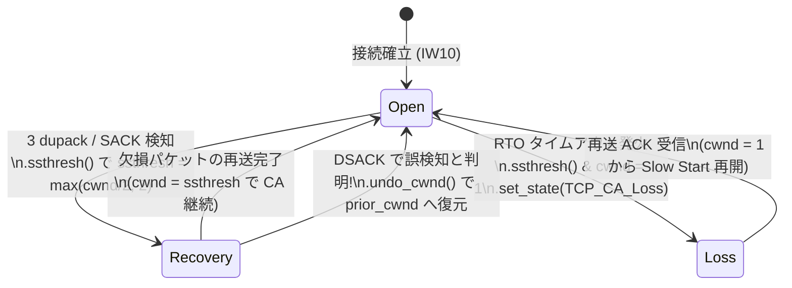
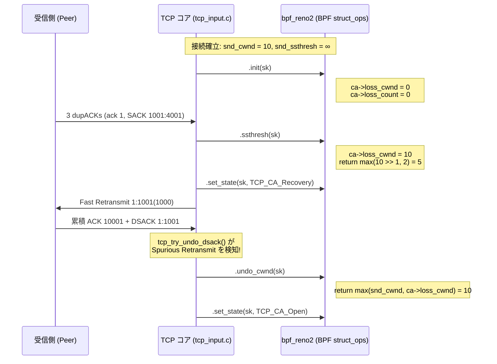

# 18. ハンズオン (1): BPF CC と packetdrill で作る TCP Reno


このトラックでは、現代のすべての TCP 輻輳制御アルゴリズムの原点である **TCP Reno（RFC 5681）** を、Linux カーネルの BPF `struct_ops`（`struct tcp_congestion_ops`）を使ってゼロから実装します。

Reno や CUBIC の知識は前提としません。まずは「そもそもなぜ輻輳制御が必要なのか」「Reno はどのような仕組みでネットワークの空き容量を探しているのか」を第一原理から整理しましょう。

---

## 1. そもそも輻輳制御（Congestion Control）とは何か？

TCP でデータを送るとき、送信側が「いま確認応答（ACK）を待たずにネットワークへ送り出せる最大量（In-Flight パケット数の上限）」を決める仕組みには、実は **2 つの異なるブレーキ** があります。

| ブレーキの種類 | カーネル変数 (`struct tcp_sock`) | 何を守るための限界か？ | 誰が決めるか？ |
| :--- | :--- | :--- | :--- |
| **フロー制御（Flow Control）** | `snd_wnd` | **受信側の部屋（受信バッファ）** が溢れないようにする限界 | 受信側が計算し、TCP ヘッダの Window フィールドで毎パケット通知する |
| **輻輳制御（Congestion Control）** | `snd_cwnd` | **途中の道路（ルータやスイッチのキュー）** が渋滞・パンクしないようにする限界 | 送信側が ACK の返り方やパケットロスを手がかりに **自分で推定する** |

いくら受信側のサーバが巨大なメモリ（大きな `snd_wnd`）を持っていたとしても、途中のルータの回線容量を超えてパケットを一気に流し込めば、ルータのバッファが溢れて大量のパケットロス（輻輳崩壊：Congestion Collapse）が発生します。逆に、途中の道路がどれだけ空いていても（大きな `snd_cwnd`）、受信側のアプリがデータを読み出すのが遅ければ `snd_wnd` で止める必要があります。

そのため、TCP の送信側は常に **2 つのウィンドウの小さい方** で送信量を抑えます。

$$\text{送信可能な上限 (In-Flight 上限)} = \min(\text{snd}_{\text{cwnd}}, \text{snd}_{\text{wnd}})$$

問題は、**途中のルータが「いま道路がどれくらい空いているか」を直接教えてはくれない** ということです。そこで送信側が「少しずつ送る量を増やして道路の限界を探り、パケットが落ちたら減速する」という試行錯誤を行うアルゴリズムが **輻輳制御（Congestion Control）** です。

---

## 2. Reno の基本原理：AIMD（Additive Increase / Multiplicative Decrease）

1980 年代後半に Van Jacobson によって確立された TCP Reno の核心は、**AIMD（加算的増加・乗算的減少）** というシンプルなルールです。

- **Additive Increase（足し算で増やす）**: パケットが落ちずに ACK が返ってくる間は、1 往復（1 RTT）ごとに `snd_cwnd` を **`+1` パケットずつ** じわじわ増やします。
- **Multiplicative Decrease（掛け算で減らす）**: パケットロスを検知したら、「道路の容量を超えた」と判断し、`snd_cwnd` を一気に **半分（`× 1/2`）** に減らします。

### なぜ「足し算で増やし、掛け算で減らす」と公平になるのか？

もし増やすときも減らすときも「足し算・引き算（AIAD）」だったらどうなるでしょうか？
たとえば容量 30 パケットのボトルネック回線を、先行していたフロー A（`cwnd = 24`）と後から来たフロー B（`cwnd = 6`）が共有しているとします。

- もし両方とも「1 RTT ごとに `+1` 増やし、ロスしたら `-5` 減らす」というルールだと、2 つのフローの差（$$24 - 6 = 18$$）はいつまで経っても縮まりません。
- しかし **「減らすときは半分（`× 1/2`）にする」** という掛け算（Multiplicative Decrease）にすると、ロスした瞬間にフロー A は `24 → 12`（`-12`）と大きく譲るのに対し、フロー B は `6 → 3`（`-3`）しか減りません。差が一気に `18 → 9` に半減します。
- その後、両方とも同じペース（`+1 / RTT`）で足し算していくため、ノコギリの歯のように増減を繰り返すうちに、2 つのフローは自動的に `15 : 15` の **完全な公平（Fairness）** へと収束します。

```text
snd_cwnd (パケット数)
  ^
  |        /\              /\              /\          <-- ボトルネック限界 + バッファ上限
  |       /  \            /  \            /  \             (ここでパケットロス発生！)
  |      /    \          /    \          /    \
  |     /      \        /      \        /      \       Additive Increase (+1 / RTT)
  |    /        \      /        \      /        \      & Multiplicative Decrease (× 1/2)
  |   /          \    /          \    /          \
  |  /            \  /            \  /            \    <-- ssthresh = cwnd / 2
  | /              \/              \/              \
  +----------------------------------------------------> 時間 (RTT)
  [Slow] [------- Congestion Avoidance (AIMD) -------]
  [Start]
```

この特徴的なギザギザの波形を **TCP のノコギリ波（Sawtooth）** と呼びます。

---

## 3. 2 つの増加フェーズと `snd_ssthresh` の役割

とはいえ、最初から最後まで「1 RTT ごとに `+1`」の足し算だけで増やしていると、高速な回線（たとえば `cwnd = 10,000` が必要な回線）で空き帯域を使い切るまでに何千往復もの時間がかかってしまいます。

そこで Reno は、**スロースタート閾値 `snd_ssthresh`（Slow Start Threshold）** という境界線を設け、ウィンドウの増やし方を 2 段階に分けています。

### フェーズ 1：Slow Start（スロースタート：`snd_cwnd < snd_ssthresh`）

- コネクション確立直後、`snd_cwnd` は初期ウィンドウ **IW10（10 パケット）** からスタートし、`snd_ssthresh` は無限大（`TCP_INFINITE_SSTHRESH`）に設定されています。
- `snd_cwnd < snd_ssthresh` の間は、**「1 パケット分 ACK されるごとに `snd_cwnd` を `+1` する」** という急加速モードで動きます。
- 10 パケット送って 10 個すべて ACK されると `snd_cwnd` は `+10` されて `20` になります。次の RTT では `20 → 40`、その次は `40 → 80` と、**1 RTT ごとに倍々（指数関数的）** に増え、空き帯域の限界付近まで一気に駆け上がります。
  - ※「Slow Start」という名前は、「いきなり最大速度で送るのではなく 10 パケットから始める」という意味で付けられた歴史的な名称ですが、増加ペース自体は指数関数的で非常に速いフェーズです。

### フェーズ 2：Congestion Avoidance（輻輳回避：`snd_cwnd >= snd_ssthresh`）

- 一度パケットロスを経験して `snd_ssthresh` が「前回の限界の半分」に設定された後、`snd_cwnd` がその `snd_ssthresh` 以上（`snd_cwnd >= snd_ssthresh`）に達したら、そこからは限界が近い危険地帯です。
- 倍々ゲームをやめ、**「1 RTT（`snd_cwnd` パケット分の ACK）ごとに `snd_cwnd` を `+1` する」** という直線的な増加（Additive Increase）に切り替えます。
- **Linux カーネルでの整数計算の工夫（`tp->snd_cwnd_cnt`）**:
  - カーネル内（および BPF プログラム内）では浮動小数点（`float`）が使えないため、「1 パケット ACK されるごとに `1 / snd_cwnd` を足す」という小数の足し算ができません。
  - そこで Linux は、`struct tcp_sock` の中にある端数バケツ **`tp->snd_cwnd_cnt`** に ACK されたパケット数 `acked` を足していき、バケツが満杯（`tp->snd_cwnd_cnt >= tp->snd_cwnd`）になったら `tp->snd_cwnd` を `+1` してバケツから `tp->snd_cwnd` を引く、という仕組みで「1 RTT あたり `+1`」を正確に実現しています。

---

## 4. パケットロスへの反応と Undo（誤検知からの復元）

パケットが落ちた（あるいは落ちたと疑われる）とき、Linux の TCP コアは輻輳制御アルゴリズムのフック関数を呼び出して相談します。



1. **Fast Recovery（`TCP_CA_Recovery`）— 軽い渋滞**:
   - 3 回の重複 ACK（3 dupack）や SACK（Selective ACK）によって「途中のパケットが抜けたが、後続のパケットは届いている」と検知したとき、TCP コアは `TCP_CA_Recovery` に遷移します。
   - このとき BPF CC の **`.ssthresh(sk)`** フックが呼ばれ、Reno は `max(tp->snd_cwnd / 2, 2)` を返して `snd_ssthresh` を半減させます（ウィンドウ自体も Recovery を抜けるまでにこの `snd_ssthresh` まで縮小します）。
2. **RTO タイムアウト（`TCP_CA_Loss`）— 深刻な渋滞**:
   - ACK がまったく返ってこなくなり再送タイムアウト（RTO）が発火したときは、道路が完全に詰まったと判断して `TCP_CA_Loss` に遷移します。
   - `.ssthresh(sk)` で閾値を半減させたうえで、**`snd_cwnd = 1`** にリセットし、`1` パケットから再び Slow Start をやり直します。このとき **`.set_state(sk, TCP_CA_Loss)`** フックが呼ばれるため、Congestion Avoidance 中に貯めていた端数バケツ `tp->snd_cwnd_cnt` を `0` にクリアします。
3. **Spurious Retransmission と `.undo_cwnd(sk)` — 勘違いの取り消し**:
   - インターネットでは、パケットが消えたのではなく **「ルータの経路切り替えなどで到着順序が入れ替わった（Reordering）だけ」** なのに、3 dupack が発生して Fast Recovery に入り、ウィンドウを半分に減らしてしまうことがあります。
   - 直後に受信側から **DSACK（Duplicate SACK：同じパケットが 2 回届いたという報告）** が返ってくると、TCP コアは「さっきの再送とウィンドウ半減は勘違い（Spurious Retransmission）だった！」と気づきます。
   - すると TCP コアは **`.undo_cwnd(sk)`** フックを呼び出し、ロス検知前に退避しておいた元のウィンドウサイズ（`prior_cwnd` / `loss_cwnd`）へ `snd_cwnd` を即座に復元します。

---

## 5. なぜ最初に Reno を作り、その次に CUBIC に進むのか？

「いまの Linux のデフォルトは CUBIC なのに、なぜわざわざ Reno から作るの？」と思うかもしれません。理由は **2 つ** あります。

### 理由 1：`struct tcp_sock` 自体が Reno のために設計されているから

Linux の TCP スタックは歴史的に Reno をベースに作られたため、Reno に必要な 4 つの変数（`snd_cwnd`、`snd_ssthresh`、`snd_cwnd_cnt`、`prior_cwnd`）は、すべて最初から **`struct tcp_sock` 本体のフィールドとして埋め込まれています**。
そのため、Reno を書くと「TCP コアがどの変数をどう読み書きしているか」という土台が最もシンプルな形で理解できます。

### 理由 2：CUBIC は Reno の「2 箇所」を差し替えた進化形だから

次のトラック（Track 2）で実装する **CUBIC** は、実はゼロから別物を作っているわけではありません。Reno と CUBIC を比較すると、骨格は驚くほど共通しています。

| 要素 | Track 1: TCP Reno | Track 2: TCP CUBIC |
| :--- | :--- | :--- |
| **使う BPF フック** | `.init`, `.ssthresh`, `.cong_avoid`, `.set_state`, `.undo_cwnd` | **まったく同じ**（＋ HyStart 用の `.cwnd_event`, `.pkts_acked`） |
| **Slow Start の動き** | 1 ACK ごとに `+1`（指数増加） | **Reno と同じ**（＋ HyStart による早期終了判定） |
| **ロス時の減衰（`.ssthresh`）** | `0.5` 倍（`cwnd / 2`）に減らす | **`0.7` 倍**（`cwnd * 717 / 1024`）に減らす |
| **Congestion Avoidance（`.cong_avoid`）** | **直線**（1 RTT ごとに `+1`）で増やす | 前回の最大値 $$W_{\max}$$ を目指す **3 次関数（Cubic 曲線）** で増やす |
| **Undo（`.undo_cwnd`）** | `max(snd_cwnd, loss_cwnd)` で復元 | **まったく同じ**（`max(snd_cwnd, loss_cwnd)`） |

つまり、このトラックの 2 ステップで Reno を完成させてしまえば、**BPF 輻輳制御のフックの仕組みと、次の CUBIC の土台の 8 割が一気に手に入る** のです。

---

## 6. ステップ一覧と実行コマンド

このトラックは以下の 2 ステップで構成されています。

| ステップ | ディレクトリ | 実装する内容 |
| :--- | :--- | :--- |
| **Step 1** | [`step01-slow-start-ai/`](step01-slow-start-ai/README.md) | 最小の BPF CC 骨格（`.init`, `.ssthresh`, `.cong_avoid`, `.undo_cwnd`）と、Slow Start から Reno Additive Increase への境界遷移を実装します。 |
| **Step 2** | [`step02-loss-undo/`](step02-loss-undo/README.md) | ソケット私有領域 `inet_csk_ca(sk)`（`icsk_ca_priv`）を使ったカスタム構造体管理、Fast Recovery / RTO Loss 時の状態遷移（`.set_state`）、および DSACK による `.undo_cwnd` 復元を実装します。 |

### 実行コマンド

`labs/` ディレクトリ（`/usr/local/google/home/kuniyu/tcp-eli5/labs`）から `run_test.sh` を使って各ステップをビルド・検証できます。

```sh
# Step 1: まず starter が失敗することを確認し、TODO を実装してテストする
./run_test.sh reno/step01-slow-start-ai starter
# Step 1 の模範解答 (solution.bpf.c) を実行する
./run_test.sh reno/step01-slow-start-ai solution

# Step 2: starter の確認と模範解答の実行
./run_test.sh reno/step02-loss-undo starter
./run_test.sh reno/step02-loss-undo solution
```

それでは、[`step01-slow-start-ai/README.md`](step01-slow-start-ai/README.md) に進んで最初の BPF 輻輳制御アルゴリズムを書いてみましょう！


---

## Step 1: 最小の BPF CC 骨格と Slow Start + Reno AI

## 1. 学習ゴール

このステップでは、Linux カーネルのプラガブル輻輳制御インターフェースである `struct tcp_congestion_ops` を BPF の `struct_ops` 機能で実装し、すべての TCP 輻輳制御アルゴリズムの原点である **TCP Reno（Slow Start・Additive Increase・Multiplicative Decrease）** をゼロから組み立てます。カーネル内の `tcp_slow_start()` や `tcp_cong_avoid_ai()` といった既存ヘルパー関数には頼らず、純粋な BPF コードとして 1 行ずつ記述することで、ACK が到着するたびに輻輳ウィンドウがどのように成長・遷移するかを完全に理解します。

- トラック全体の構成とステップ一覧は [Reno トラック README](#) を参照してください。

---

## 2. アルゴリズムと背景の解説（まずここを読む）

設計チェックポイントに進む前に、TCP Reno のアルゴリズムと、Linux カーネルが提供するデータ構造・フックの仕組みを基礎から押さえましょう。

### 2.1 なぜ輻輳制御（Congestion Control）が必要なのか？

送信側ホストがネットワークの空き容量を無視して大量のパケットを一気に送り込むと、途中のルータのバッファがあふれてパケットロスが連鎖し、ネットワーク全体のスループットが崩壊します（輻輳崩壊 / Congestion Collapse）。しかし、インターネット上の経路が今どれだけ空いているかは、送信側には事前には分かりません。

そこで TCP は、**「同時にネットワーク上に送り出してよい未確認（in-flight）データの量」** を制限する送信側の自主規制ウィンドウ **輻輳ウィンドウ（`cwnd`: Congestion Window、単位は MSS セグメント数）** を持ち、相手からの ACK（確認応答）を手がかりに `cwnd` を動的に増減させます。

### 2.2 TCP Reno の 2 つの成長フェーズ：Slow Start と Congestion Avoidance

TCP Reno（RFC 5681）は、スロースタート閾値 **`ssthresh`（Slow Start Threshold）** を境界として、`cwnd` の増やし方を 2 段階に切り替えます。

```
cwnd (segments)
  ^
  |                        /  <- Congestion Avoidance (Additive Increase)
23|....................../..     1 RTT あたり +1 cwnd（線形増加）
22|-----------------> *---       ssthresh = 22 で成長モードを切り替え
  |                 /
20|...............*
  |              /            <- Slow Start
  |             /                1 ACK セグメントあたり +1 cwnd
  |            /                 （1 RTT ごとに 2 倍の指数関数的増加）
10|----------*
  +----------------------------> 時間 (RTT)
   RTT 0   RTT 1   RTT 2   RTT 3
```

1. **Slow Start（スロースタート：`cwnd < ssthresh` のとき）**
   - **直感**: 通信開始直後は経路の容量がまったく分からないため、小さな初期ウィンドウ（Linux のデフォルトは `10` セグメント）からスタートし、ACK が返ってくるたびに素早く（指数関数的に）探索幅を広げます。
   - **数式とルール**: 新しいデータを確認する ACK が届き、`acked` セグメント分の到達が確認されるたびに、その分だけ `cwnd` をそのまま増やします。
     $$\text{cwnd} \leftarrow \text{cwnd} + \text{acked}$$
   - `cwnd` 個のセグメントを送ってそれらすべてに ACK が返ってくると（＝1 RTT 経過すると）、`cwnd` は $$\text{cwnd} + \text{cwnd} = 2 \times \text{cwnd}$$ となり、**1 RTT ごとに 2 倍** に成長します。
   - **境界クランプ**: Slow Start で増やせる上限は `ssthresh` までです。もし 1 つの ACK（複数セグメントをまとめて確認する Stretch ACK など）によって `cwnd + acked` が `ssthresh` を超える場合は、まず `cwnd` を `ssthresh` まで引き上げ、**使い切らなかった残りの `acked` セグメント分はそのまま次の Congestion Avoidance フェーズへ引き継ぎます**。

2. **Congestion Avoidance（輻輳回避 / Reno Additive Increase：`cwnd >= ssthresh` のとき）**
   - **直感**: `ssthresh`（過去にロスが起きた付近、または安全な目標値）に達した後は、2 倍ずつ増やすとすぐにバッファがあふれてしまいます。そこで「1 RTT かけて現在の `cwnd` 個のセグメントすべてが無事に ACK されたら、ようやく `cwnd` を `+1` セグメントだけ増やす」という慎重な線形増加（**Additive Increase: 加算的増加**）に切り替えます。
   - **数式と整数演算による表現**: 理想的には、1 セグメントが ACK されるごとに `cwnd` を $$\frac{1}{\text{cwnd}}$$ ずつ増やしたい（`acked` セグメントなら $$\text{cwnd} \leftarrow \text{cwnd} + \frac{\text{acked}}{\text{cwnd}}$$）のですが、Linux カーネルや BPF プログラム内では浮動小数点演算（`float` / `double`）は使えません。
   - そこで、分数 $$\frac{\text{cnt}}{\text{cwnd}}$$ の分子にあたる **整数カウンタ `snd_cwnd_cnt`** を用意し、以下の整数ルールで計算します。
     1. ACK が届くたびに分子を貯める：`snd_cwnd_cnt += acked`
     2. 分子が分母（`snd_cwnd`）以上に達したら（`snd_cwnd_cnt >= snd_cwnd`）、`snd_cwnd_cnt -= snd_cwnd` として分母を引き、`snd_cwnd` を `+1` する。

### 2.3 具体数値トレース（`cwnd = 10`, `ssthresh = 22` の場合）

このラボの `test.pkt` で実際に動く数値をそのまま追ってみましょう。

| ラウンド | 到着前の状態 | イベント（受信した ACK） | 内部計算のステップ | 更新後の状態 |
| :--- | :--- | :--- | :--- | :--- |
| **初期状態** | — | 3-way ハンドシェイク完了 | `bpf_reno1_init()` で `snd_cwnd_cnt = 0`, `snd_ssthresh = 22` に初期化 | `cwnd = 10`<br>`ssthresh = 22`<br>`cnt = 0` |
| **Round 1**<br>(純粋な Slow Start) | `cwnd = 10`<br>`ssthresh = 22`<br>`cnt = 0` | 10 セグメント送信し、`acked = 10` の ACK を受信 | `cwnd < ssthresh` なので Slow Start。<br>`10 + 10 = 20 <= 22` のため、10 セグメントすべてを Slow Start で消費（残り `acked = 0`）。 | `cwnd = 20`<br>`ssthresh = 22`<br>`cnt = 0` |
| **Round 2**<br>(境界またぎ) | `cwnd = 20`<br>`ssthresh = 22`<br>`cnt = 0` | 20 セグメント送信し、`acked = 20` の ACK を受信 | 1. Slow Start で `ssthresh` (22) まで `22 - 20 = 2` セグメント分だけ成長（`cwnd = 22`）。<br>2. 残りの `acked = 20 - 2 = 18` セグメントを Congestion Avoidance へ引き継ぎ、`cnt = 0 + 18 = 18`。<br>3. `cnt (18) < cwnd (22)` なので `+1` はまだ起きない。 | `cwnd = 22`<br>`ssthresh = 22`<br>`cnt = 18` |
| **Round 3**<br>(Reno AI) | `cwnd = 22`<br>`ssthresh = 22`<br>`cnt = 18` | 22 セグメント送信し、`acked = 22` の ACK を受信 | `cwnd >= ssthresh` なので最初から Congestion Avoidance。<br>1. `cnt = 18 + 22 = 40`。<br>2. `cnt (40) >= cwnd (22)` なので `cnt = 40 - 22 = 18` とし、`cwnd` を `22 + 1 = 23` に増やす。 | `cwnd = 23`<br>`ssthresh = 22`<br>`cnt = 18` |

### 2.4 Cwnd Validation（パイプを使い切っていないときのガード条件）

もし `cwnd = 10` あるのに、アプリケーションが毎 RTT 1 セグメントずつしかデータを書き込まない（Application-limited な）状態だったらどうなるでしょうか？
ネットワークの空き容量を実際に 10 セグメント分試していないにもかかわらず、ACK が返るたびに `cwnd` を 11, 12, ... と増やし続けてしまうと、後でアプリが突然大量のデータを書き込んだ瞬間に巨大なバースト送信が発生し、激しいパケットロスを引き起こします（RFC 7661）。

そのため、ACK 受信時に `cwnd` を増やす処理（`.cong_avoid()`）では、**「現在の送信が本当に `cwnd` によって律速されている（パイプを `cwnd` いっぱいまで使い切っている）か？」** を最初に確認し、律速されていなければ何もせずにリターンしなければなりません。

### 2.5 ロス検知時の Multiplicative Decrease と誤検知の Undo

TCP Reno では、パケットロスを検知したとき、およびそのロス検知が誤り（パケットの順序逆転などによる Spurious Loss）だったと判明したときに以下のルールを適用します。

- **Multiplicative Decrease（乗算的減少：`.ssthresh()`）**: パケットロスが起きたということは、現在の `cwnd` は経路容量を超えていたことを意味します。Reno は新しい `ssthresh` を現在の `cwnd` の半分（$$\lfloor \text{cwnd} / 2 \rfloor$$、ビットシフトで `snd_cwnd >> 1U`）に引き下げます。ただし RFC 5681 の規定により、ウィンドウが完全に詰まらないよう最小値 `2U` を下回らないようにします：
  $$\text{ssthresh} = \max(\lfloor \text{cwnd} / 2 \rfloor, 2)$$
- **ウィンドウ縮小の取り消し（`.undo_cwnd()`）**: タイムアウトや重複 ACK で一度 `cwnd` を減らした後に、DSACK 等によって「実はパケットはロスしておらず遅れて届いただけだった」と判明した場合、カーネルはロス突入前に保存しておいた `prior_cwnd` と現在の `snd_cwnd` の大きい方（$$\max(\text{snd}_{\text{cwnd}}, \text{prior}_{\text{cwnd}})$$）へウィンドウを復元します。

### 2.6 カーネルがすでに提供している構造体・フィールド・ヘルパー一覧

BPF で輻輳制御を書くとき、「どの変数を自分で定義すべきで、どの変数が最初からカーネルのソケット構造体に入っているか」を知っておく必要があります。

#### (A) `struct tcp_congestion_ops` の主要フック（BPF `struct_ops` で実装する関数）

| フック名 | シグネチャ | 呼ばれるタイミングと役割 |
| :--- | :--- | :--- |
| `.init` | `void (*init)(struct sock *sk)` | コネクション確立時（または `TCP_CONGESTION` 切り替え時）に状態変数を初期化する。 |
| `.ssthresh` | `__u32 (*ssthresh)(struct sock *sk)` | ロス検知時に呼ばれ、新しい `snd_ssthresh` の値を計算して返す。 |
| `.cong_avoid` | `void (*cong_avoid)(struct sock *sk, __u32 ack, __u32 acked)` | 新規データを確認する ACK 到着時に呼ばれる。`ack` は ACK 番号、`acked` は今回新たに ACK されたセグメント数。 |
| `.undo_cwnd` | `__u32 (*undo_cwnd)(struct sock *sk)` | ロス検知が誤検知（Spurious）と判明した際に呼ばれ、復元すべき `snd_cwnd` の値を返す。 |

#### (B) `struct tcp_sock`（`struct tcp_sock *tp = tcp_sk(sk)` で取得）が標準で持つフィールド

Linux のすべての TCP ソケット（`struct tcp_sock`）には、**Reno 用の状態変数が最初から標準フィールドとして組み込まれています**：

- `tp->snd_cwnd` (`__u32`): 現在の輻輳ウィンドウ（セグメント単位）。
- `tp->snd_ssthresh` (`__u32`): 現在のスロースタート閾値（セグメント単位）。
- `tp->snd_cwnd_cnt` (`__u32`): Congestion Avoidance（Additive Increase）で ACK されたセグメント数を蓄積する線形カウンタ（分数 $$\frac{\text{cnt}}{\text{cwnd}}$$ の分子）。
- `tp->snd_cwnd_clamp` (`__u32`): `tp->snd_cwnd` の許容上限値（`snd_cwnd` を増やす際は常に `min(new_cwnd, tp->snd_cwnd_clamp)` でクランプする）。
- `tp->prior_cwnd` (`__u32`): ロス回復に入る直前にカーネルが自動で退避してくれた `snd_cwnd` の値。

#### (C) アルゴリズム固有の Private 領域 `icsk_ca_priv` とは？

- `struct inet_connection_sock`（`tcp_sock` の親構造体）には、`__u64 icsk_ca_priv[...]` という 104 バイトの空きメモリ領域が用意されており、`inet_csk_ca(sk)` ヘルパーで任意のカスタム構造体ポインタとしてアクセスできます。
- CUBIC（3 次関数の起点時刻や `W_max` などを保持）や BBR（ボトルネック帯域フィルタなどを保持）のように、`struct tcp_sock` の標準フィールドだけでは足りない複雑なアルゴリズムは、この `icsk_ca_priv` に独自の構造体を置いて状態を管理します。
- 一方、**TCP Reno が必要とする変数（`snd_cwnd`, `snd_ssthresh`, `snd_cwnd_cnt`, `prior_cwnd`）はすべて上記のとおり `struct tcp_sock` 自体に最初から存在します**。

#### (D) `bpf_cc_helpers.h` で提供されているヘルパー関数

- `tcp_sk(sk)`: `struct sock *sk` を `struct tcp_sock *tp` に変換します。
- `tcp_is_cwnd_limited(sk)`: 現在の送信が `snd_cwnd` によって律速されている（パイプを使い切っている）なら `true`、アプリケーション律速なら `false` を返します。
- `tcp_in_slow_start(tp)`: `tp->snd_cwnd < tp->snd_ssthresh` のとき `true` を返します。
- `min(a, b)` / `max(a, b)`: 2 つの値の最小値・最大値を返します。

---

## 3. 設計チェックポイント（理解した仕組みをコードに落とし込む）

セクション 2 の解説を踏まえて、`starter.bpf.c` の TODO を埋めるための 4 つの設計の問いを自分の頭で考えてみましょう。すべての答えはセクション 2 の内容から導き出せます。

### Q1. 状態管理の設計：Reno には独自の private 構造体（`icsk_ca_priv`）を定義する必要があるでしょうか？

セクション 2.6 (B)・(C) で見た `struct tcp_sock` の標準フィールドと `icsk_ca_priv` の役割を思い出してください。Reno の Slow Start、Additive Increase、Multiplicative Decrease、Undo を実装するために、新しいカスタム構造体を `inet_csk_ca(sk)` に定義する必要はあるでしょうか？

<details>
<summary>ヒントと答え</summary>

- **ヒント**: セクション 2.2〜2.5 の数式に登場した変数（現在のウィンドウ、閾値、AI の分子カウンタ、ロス前のウィンドウ）が `struct tcp_sock` にすでに揃っているか確認しましょう。
- **答え**: **独自の `icsk_ca_priv` 構造体は一切不要です。**
  `struct tcp_sock` が標準で持っている以下の 5 つのフィールドだけで TCP Reno は完全に実装できます。
  - `tp->snd_cwnd`: 現在の輻輳ウィンドウ
  - `tp->snd_ssthresh`: Slow Start から Congestion Avoidance へ切り替わる閾値
  - `tp->snd_cwnd_cnt`: Additive Increase で `acked` を貯める分子カウンタ
  - `tp->snd_cwnd_clamp`: `snd_cwnd` の上限クランプ値
  - `tp->prior_cwnd`: Undo 時に参照するロス前の `snd_cwnd`

</details>

### Q2. ガード条件の設計：`bpf_reno1_cong_avoid()` の先頭で最初にチェックすべき条件は何ですか？

セクション 2.4（Cwnd Validation）とセクション 2.6 (D) のヘルパー一覧を踏まえると、`bpf_reno1_cong_avoid(sk, ack, acked)` に入ってすぐ、Slow Start や Additive Increase の計算を行う前にどの関数を呼んで早期リターンすべきでしょうか？

<details>
<summary>ヒントと答え</summary>

- **ヒント**: アプリケーションがデータを少ししか送っておらず、`snd_cwnd` を使い切っていないときにウィンドウが膨張するのを防ぐヘルパー関数はどれでしょうか？
- **答え**: 関数の先頭で **`if (!tcp_is_cwnd_limited(sk)) return;`** を実行します。これにより、送信パイプが実際に `snd_cwnd` で律速されているときだけウィンドウを成長させます（`starter.bpf.c` の **TODO 2**）。

</details>

### Q3. 境界条件の設計：Slow Start 中に `tp->snd_ssthresh` をまたぐ ACK が届いたとき、C コードはどう書くべきですか？

セクション 2.3 の Round 2（`tp->snd_cwnd = 20`, `tp->snd_ssthresh = 22` のときに `acked = 20` が到着するケース）を C コードに落とし込みます。
`if (tcp_in_slow_start(tp))` ブロックの中で、
1. `tp->snd_ssthresh` を超えない新しいウィンドウ `cwnd` をどう計算しますか？
2. Slow Start で使った分を `acked` からどう差し引きますか？
3. どんなときにその場で `return` し、どんなときに後ろの Congestion Avoidance へフォールスルーさせますか？

<details>
<summary>ヒントと答え</summary>

- **ヒント**: `tp->snd_cwnd + acked` と `tp->snd_ssthresh` の小さい方を `cwnd` とすれば、Slow Start で実際に増えた量は `cwnd - tp->snd_cwnd` になります。
- **答え**: 以下のように 4 行で綺麗に表現できます（`starter.bpf.c` の **TODO 3**）。
  ```c
  if (tcp_in_slow_start(tp)) {
      __u32 cwnd = min(tp->snd_cwnd + acked, tp->snd_ssthresh);

      acked -= cwnd - tp->snd_cwnd;
      tp->snd_cwnd = min(cwnd, tp->snd_cwnd_clamp);
      if (!acked)
          return;
  }
  ```
  - Round 1（`cwnd = 10, ssthresh = 22, acked = 10`）では、`cwnd = min(20, 22) = 20` となり、`acked -= 20 - 10` で `acked` が `0` になるため `if (!acked) return;` で終了します。
  - Round 2（`cwnd = 20, ssthresh = 22, acked = 20`）では、`cwnd = min(40, 22) = 22` となり、`acked -= 22 - 20` で `acked` が `18` 残るため、`return` せずに直後の Congestion Avoidance 処理へそのまま進みます。

</details>

### Q4. 整数演算による Additive Increase：残った `acked` を使って `tp->snd_cwnd_cnt` と `tp->snd_cwnd` をどう更新しますか？

セクション 2.2 の「Congestion Avoidance の整数ルール」をそのまま C コードにしてください（`starter.bpf.c` の **TODO 4**）。

<details>
<summary>ヒントと答え</summary>

- **ヒント**: `tp->snd_cwnd_cnt` に `acked` を足し、それが `tp->snd_cwnd` 以上になったら `tp->snd_cwnd` を引いてウィンドウを `+1`（上限 `tp->snd_cwnd_clamp` でクランプ）します。
- **答え**:
  ```c
  tp->snd_cwnd_cnt += acked;
  if (tp->snd_cwnd_cnt >= tp->snd_cwnd) {
      tp->snd_cwnd_cnt -= tp->snd_cwnd;
      tp->snd_cwnd = min(tp->snd_cwnd + 1, tp->snd_cwnd_clamp);
  }
  ```
  ループ（`while`）を使わずに `if` 文 1 回で処理しているため、BPF verifier のループ境界検査に引っかかることもありません。

</details>

---

## 4. 実装ステップと解説 (`solution.bpf.c`)

[`solution.bpf.c`](file:///usr/local/google/home/kuniyu/tcp-eli5/labs/reno/step01-slow-start-ai/solution.bpf.c) の各関数と計算式を順番に確認します。

### 4.1 `bpf_reno1_init()` — ソケットの初期化

```c
SEC("struct_ops")
void BPF_PROG(bpf_reno1_init, struct sock *sk)
{
	struct tcp_sock *tp = tcp_sk(sk);

	tp->snd_cwnd_cnt = 0;
	tp->snd_ssthresh = 22;
}
```

- TCP コネクション確立時に呼ばれ、Additive Increase 用の端数カウンタ `tp->snd_cwnd_cnt` を `0` に初期化します。
- 通常のカーネル既定値では初期 `snd_ssthresh` は無限大（`TCP_INFINITE_SSTHRESH`）ですが、このステップのテスト（`test.pkt`）ではパケットロスを起こさずに「純粋な Slow Start（`10 -> 20`）」「`snd_ssthresh` 境界でのクランプと余剰 `acked` の引き継ぎ（`20 -> 22`）」「Reno Additive Increase（`22 -> 23`）」の 3 段階を連続して検証できるよう、初期 `tp->snd_ssthresh` を `22` セグメントに設定しています。

### 4.2 `bpf_reno1_ssthresh()` — ロス検知時の Multiplicative Decrease（TODO 1）

```c
SEC("struct_ops")
__u32 BPF_PROG(bpf_reno1_ssthresh, struct sock *sk)
{
	const struct tcp_sock *tp = tcp_sk(sk);

	return max(tp->snd_cwnd >> 1U, 2U);
}
```

- パケットロス検知時に新しい `snd_ssthresh` を返します。
- 整数右シフト `tp->snd_cwnd >> 1U` で $$\lfloor \text{snd}_{\text{cwnd}} / 2 \rfloor$$ を計算し、RFC 5681 の下限値 `2U` と `max()` をとります。

### 4.3 `bpf_reno1_cong_avoid()` — Slow Start と Reno Additive Increase（TODO 2〜4）

```c
SEC("struct_ops")
void BPF_PROG(bpf_reno1_cong_avoid, struct sock *sk, __u32 ack, __u32 acked)
{
	struct tcp_sock *tp = tcp_sk(sk);

	if (!tcp_is_cwnd_limited(sk))
		return;

	if (tcp_in_slow_start(tp)) {
		__u32 cwnd = min(tp->snd_cwnd + acked, tp->snd_ssthresh);

		acked -= cwnd - tp->snd_cwnd;
		tp->snd_cwnd = min(cwnd, tp->snd_cwnd_clamp);
		if (!acked)
			return;
	}

	tp->snd_cwnd_cnt += acked;
	if (tp->snd_cwnd_cnt >= tp->snd_cwnd) {
		tp->snd_cwnd_cnt -= tp->snd_cwnd;
		tp->snd_cwnd = min(tp->snd_cwnd + 1, tp->snd_cwnd_clamp);
	}
}
```

- **TODO 2（Cwnd Validation）**: `!tcp_is_cwnd_limited(sk)` でパイプを使い切っていない場合は即座にリターンします。
- **TODO 3（Slow Start と境界の引き継ぎ）**: `tcp_in_slow_start(tp)` が真の間、`tp->snd_ssthresh` まで `tp->snd_cwnd` を増やし、Slow Start で消費したセグメント数（`cwnd - tp->snd_cwnd`）を `acked` から減算します。`acked` が残っていればそのまま下の Congestion Avoidance にフォールスルーします。
- **TODO 4（Reno Additive Increase）**: `tp->snd_cwnd_cnt` に `acked` を加算し、`tp->snd_cwnd` 以上に達したら `tp->snd_cwnd` を引いてウィンドウを `+1` します。

### 4.4 `bpf_reno1_undo_cwnd()` — 誤検知時のウィンドウ復元（TODO 5）

```c
SEC("struct_ops")
__u32 BPF_PROG(bpf_reno1_undo_cwnd, struct sock *sk)
{
	const struct tcp_sock *tp = tcp_sk(sk);

	return max(tp->snd_cwnd, tp->prior_cwnd);
}
```

- ロス検知が誤り（Spurious）だったと分かったときに呼ばれ、`tp->snd_cwnd` とロス突入前の `tp->prior_cwnd` の大きい方を返してウィンドウを元に戻します（次の Step 2 で実際にパケットトレースを流してテストします）。

---

## 5. `packetdrill` テストの解説 (`test.pkt`) と実行方法

### 5.1 [`test.pkt`](file:///usr/local/google/home/kuniyu/tcp-eli5/labs/reno/step01-slow-start-ai/test.pkt) のシナリオ解説

`test.pkt` はセクション 2.3 の数値トレースと完全に一致する 3 ラウンドのパケット交換を行い、各段階の `tcpi_snd_cwnd` を Python アサーションで検証します。

1. **MSS = 1000 バイトのコネクション確立（8〜22 行目）**:
   - クライアントからの SYN パケットで `<mss 1012,sackOK,TS val 100 ecr 0,nop,wscale 7>` を指定しています。
   - TCP Timestamps オプション（`nop,nop,TS` で 12 バイト）が有効なため、1 セグメントあたりの実効データ長 `tp->mss_cache` は `1012 - 12 = 1000` バイトちょうどになります（10,000 バイトの書き込み＝10 セグメント）。
   - `accept()` 直後に、初期状態 `tcpi_snd_cwnd == 10` および `tcpi_snd_ssthresh == 22` を検証します。
2. **Round 1：純粋な Slow Start（24〜31 行目、`cwnd: 10 -> 20`）**:
   - `write(4, ..., 10000)` で 10 セグメントを送信します。`snd_cwnd == 10` をすべて使い切るため、`tp->is_cwnd_limited` が `true` になります。
   - `ack 10001`（`acked = 10`）を受信すると、Slow Start によって `tcpi_snd_cwnd == 20` に倍増することをアサートします。
3. **Round 2：`snd_ssthresh` 境界でのクランプと余剰クレジットの引き継ぎ（33〜43 行目、`cwnd: 20 -> 22`）**:
   - `write(4, ..., 20000)` で 20 セグメントを送信して `snd_cwnd == 20` を使い切ります。
   - `ack 30001`（`acked = 20`）を受信すると、Slow Start で `2` セグメント分使って `tcpi_snd_cwnd == 22` に到達し、残りの `18` セグメント分が `tp->snd_cwnd_cnt = 18` に蓄えられることを検証します。
4. **Round 3：Reno Additive Increase（45〜53 行目、`cwnd: 22 -> 23`）**:
   - `write(4, ..., 22000)` で 22 セグメントを送信し、`ack 52001`（`acked = 22`）を受信します。
   - Congestion Avoidance により `tp->snd_cwnd_cnt` が `18 + 22 = 40 >= 22` となり、`tcpi_snd_cwnd == 23` に `+1` されることを検証します。

### 5.2 なぜ `starter.bpf.c` は失敗し、`solution.bpf.c` はパスするのか？

- **`starter.bpf.c` が失敗する理由**: `starter.bpf.c` の `bpf_reno1_cong_avoid()` はまだ空（何もしない状態）なので、Round 1 で `ack 10001` を受信しても `tp->snd_cwnd` が初期値 `10` のまま変化せず、30 行目の `assert tcpi_snd_cwnd == 20`（`expected cwnd 20 after Slow Start, got 10`）で即座に失敗します。
- **`solution.bpf.c` がパスする理由**: Slow Start・`snd_ssthresh` 境界での余剰 `acked` の引き継ぎ・Additive Increase のすべてが実装されているため、Round 1 (`20`)、Round 2 (`22`)、Round 3 (`23`) のすべてのアサーションを通過します。

### 5.3 テストの実行コマンド

以下のコマンドで、`starter` の失敗確認と `solution`（または自分で編集した `starter`）のテストを実行できます。

```sh
../../run_test.sh reno/step01-slow-start-ai starter
../../run_test.sh reno/step01-slow-start-ai solution
```


### `labs/reno/step01-slow-start-ai/starter.bpf.c` (穴埋めスケルトン)

```c
// SPDX-License-Identifier: GPL-2.0
/*
 * Step 1 (Starter): Minimal BPF Congestion Control Skeleton + Slow Start & Reno AI
 *
 * Fill in the TODOs below to implement TCP Reno in pure BPF.
 */
#include "bpf_cc_helpers.h"

char _license[] SEC("license") = "GPL";

SEC("struct_ops")
void BPF_PROG(bpf_reno1_init, struct sock *sk)
{
	struct tcp_sock *tp = tcp_sk(sk);

	tp->snd_cwnd_cnt = 0;
	/* Pre-configured to 22 segments for test.pkt so we can observe
	 * both Slow Start (10 -> 20 -> 22) and Reno AI (22 -> 23).
	 */
	tp->snd_ssthresh = 22;
}

SEC("struct_ops")
__u32 BPF_PROG(bpf_reno1_ssthresh, struct sock *sk)
{
	const struct tcp_sock *tp = tcp_sk(sk);

	/* TODO 1: Return half of tp->snd_cwnd, but at least 2U. */
	(void)tp;
	return 2U;
}

SEC("struct_ops")
void BPF_PROG(bpf_reno1_cong_avoid, struct sock *sk, __u32 ack, __u32 acked)
{
	struct tcp_sock *tp = tcp_sk(sk);

	/* TODO 2: Return early if the socket is not cwnd-limited
	 *         (!tcp_is_cwnd_limited(sk)).
	 */

	/* TODO 3: Slow Start (if tcp_in_slow_start(tp)):
	 *   - Grow tp->snd_cwnd by acked, clamped at tp->snd_ssthresh
	 *     (and tp->snd_cwnd_clamp).
	 *   - Subtract the used growth from acked.
	 *   - If acked == 0, return early; otherwise fall through to
	 *     Congestion Avoidance with the remaining acked segments.
	 */

	/* TODO 4: Congestion Avoidance (Reno Additive Increase):
	 *   - Add acked to tp->snd_cwnd_cnt.
	 *   - When tp->snd_cwnd_cnt >= tp->snd_cwnd, subtract tp->snd_cwnd
	 *     from tp->snd_cwnd_cnt and increment tp->snd_cwnd by 1
	 *     (clamped at tp->snd_cwnd_clamp).
	 */
	(void)tp;
	(void)ack;
	(void)acked;
}

SEC("struct_ops")
__u32 BPF_PROG(bpf_reno1_undo_cwnd, struct sock *sk)
{
	const struct tcp_sock *tp = tcp_sk(sk);

	/* TODO 5: Return the maximum of tp->snd_cwnd and tp->prior_cwnd. */
	return tp->snd_cwnd;
}

SEC(".struct_ops")
struct tcp_congestion_ops bpf_reno1 = {
	.init		= (void *)bpf_reno1_init,
	.ssthresh	= (void *)bpf_reno1_ssthresh,
	.cong_avoid	= (void *)bpf_reno1_cong_avoid,
	.undo_cwnd	= (void *)bpf_reno1_undo_cwnd,
	.flags		= TCP_CONG_NON_RESTRICTED,
	.name		= "bpf_reno1",
};
```

### `labs/reno/step01-slow-start-ai/test.pkt` (packetdrill テスト)

```python
// SPDX-License-Identifier: GPL-2.0
// Step 1: Test BPF Reno Slow Start, ssthresh boundary clamping, and Reno AI

0.00 `sysctl -q net.ipv4.tcp_congestion_control=bpf_reno1`

// Establish a passive TCP connection.
// MSS = 1012 with 12-byte TCP Timestamps option -> tp->mss_cache == 1000 bytes.
+0.00 socket(..., SOCK_STREAM, IPPROTO_TCP) = 3
+0.00 setsockopt(3, SOL_SOCKET, SO_REUSEADDR, [1], 4) = 0
+0.00 bind(3, ..., ...) = 0
+0.00 listen(3, 1) = 0

+0.00 < S 0:0(0) win 32792 <mss 1012,sackOK,TS val 100 ecr 0,nop,wscale 7>
+0.00 > S. 0:0(0) ack 1 <mss 1460,sackOK,TS val 100 ecr 100,nop,wscale 7>
+0.01 < . 1:1(0) ack 1 win 257 <nop,nop,TS val 110 ecr 100>
+0.00 accept(3, ..., ...) = 4

// Verify initial cwnd == 10 and ssthresh == 22 (from bpf_reno1_init).
+0.00 %{
assert tcpi_snd_cwnd == 10, f"expected initial cwnd 10, got {tcpi_snd_cwnd}"
assert tcpi_snd_ssthresh == 22, f"expected initial ssthresh 22, got {tcpi_snd_ssthresh}"
}%

// 1. Pure Slow Start: send 10,000 bytes (10 segments == full cwnd, so
//    tp->is_cwnd_limited becomes true) and ACK them. cwnd grows 10 -> 20.
+0.00 write(4, ..., 10000) = 10000
+0.00 > P. 1:10001(10000) ack 1 <nop,nop,TS val 110 ecr 110>
+0.01 < . 1:1(0) ack 10001 win 257 <nop,nop,TS val 120 ecr 110>
+0.00 %{
assert tcpi_snd_cwnd == 20, f"expected cwnd 20 after Slow Start, got {tcpi_snd_cwnd}"
}%

// 2. Slow Start -> Congestion Avoidance transition:
//    Send 20,000 bytes (20 segments == full cwnd 20) and ACK all 20 segments.
//    - Slow Start uses 2 segments to reach ssthresh (20 -> 22).
//    - The remaining 18 ACKed segments fall through to Congestion Avoidance,
//      setting tp->snd_cwnd_cnt = 18 (< 22, so cwnd stays 22).
+0.00 write(4, ..., 20000) = 20000
+0.00 > P. 10001:30001(20000) ack 1 <nop,nop,TS val 120 ecr 120>
+0.01 < . 1:1(0) ack 30001 win 257 <nop,nop,TS val 130 ecr 120>
+0.00 %{
assert tcpi_snd_cwnd == 22, f"expected cwnd 22 at ssthresh boundary, got {tcpi_snd_cwnd}"
}%

// 3. Reno Additive Increase:
//    Send 22,000 bytes (22 segments == full cwnd 22) and ACK them.
//    tp->snd_cwnd_cnt (18 + 22 = 40 >= 22) triggers +1 cwnd (22 -> 23).
+0.00 write(4, ..., 22000) = 22000
+0.00 > P. 30001:52001(22000) ack 1 <nop,nop,TS val 130 ecr 130>
+0.01 < . 1:1(0) ack 52001 win 257 <nop,nop,TS val 140 ecr 130>
+0.00 %{
assert tcpi_snd_cwnd == 23, f"expected cwnd 23 after Reno AI, got {tcpi_snd_cwnd}"
}%
```

<details>
<summary>模範解答: <code>labs/reno/step01-slow-start-ai/solution.bpf.c</code></summary>

```c
// SPDX-License-Identifier: GPL-2.0
/*
 * Step 1: Minimal BPF Congestion Control Skeleton + Slow Start & Reno AI
 *
 * Implements TCP Reno from scratch in pure BPF (without calling kernel
 * extern __ksym helpers) so every line of Slow Start and Additive Increase
 * is visible and testable with packetdrill.
 */
#include "bpf_cc_helpers.h"

char _license[] SEC("license") = "GPL";

SEC("struct_ops")
void BPF_PROG(bpf_reno1_init, struct sock *sk)
{
	struct tcp_sock *tp = tcp_sk(sk);

	tp->snd_cwnd_cnt = 0;
	/* Set initial ssthresh to 22 segments so we can observe:
	 * 1) Pure Slow Start (cwnd: 10 -> 20)
	 * 2) Slow Start -> Congestion Avoidance boundary (cwnd: 20 -> 22,
	 *    with 18 leftover ACKed segments carried into snd_cwnd_cnt)
	 * 3) Reno Additive Increase (cwnd: 22 -> 23)
	 */
	tp->snd_ssthresh = 22;
}

SEC("struct_ops")
__u32 BPF_PROG(bpf_reno1_ssthresh, struct sock *sk)
{
	const struct tcp_sock *tp = tcp_sk(sk);

	return max(tp->snd_cwnd >> 1U, 2U);
}

SEC("struct_ops")
void BPF_PROG(bpf_reno1_cong_avoid, struct sock *sk, __u32 ack, __u32 acked)
{
	struct tcp_sock *tp = tcp_sk(sk);

	if (!tcp_is_cwnd_limited(sk))
		return;

	/* 1. Slow Start: exponential growth (+1 cwnd per ACKed segment)
	 *    clamped at tp->snd_ssthresh. Any leftover acked segments
	 *    fall through to Congestion Avoidance.
	 */
	if (tcp_in_slow_start(tp)) {
		__u32 cwnd = min(tp->snd_cwnd + acked, tp->snd_ssthresh);

		acked -= cwnd - tp->snd_cwnd;
		tp->snd_cwnd = min(cwnd, tp->snd_cwnd_clamp);
		if (!acked)
			return;
	}

	/* 2. Congestion Avoidance (Reno Additive Increase):
	 *    accumulate ACKed segments in tp->snd_cwnd_cnt and increase
	 *    tp->snd_cwnd by 1 once a full cwnd worth of ACKs arrives.
	 */
	tp->snd_cwnd_cnt += acked;
	if (tp->snd_cwnd_cnt >= tp->snd_cwnd) {
		tp->snd_cwnd_cnt -= tp->snd_cwnd;
		tp->snd_cwnd = min(tp->snd_cwnd + 1, tp->snd_cwnd_clamp);
	}
}

SEC("struct_ops")
__u32 BPF_PROG(bpf_reno1_undo_cwnd, struct sock *sk)
{
	const struct tcp_sock *tp = tcp_sk(sk);

	return max(tp->snd_cwnd, tp->prior_cwnd);
}

SEC(".struct_ops")
struct tcp_congestion_ops bpf_reno1 = {
	.init		= (void *)bpf_reno1_init,
	.ssthresh	= (void *)bpf_reno1_ssthresh,
	.cong_avoid	= (void *)bpf_reno1_cong_avoid,
	.undo_cwnd	= (void *)bpf_reno1_undo_cwnd,
	.flags		= TCP_CONG_NON_RESTRICTED,
	.name		= "bpf_reno1",
};
```

</details>


---

## Step 2: Loss / Fast Recovery と DSACK Undo

## 1. 学習ゴール

[Reno トラックの概要 (`../README.md`)](#) の Step 1 では、パケットロスが一切起きない理想的な環境で Slow Start と Congestion Avoidance を実装しました。しかし現実のネットワークでは、ルータのバッファ溢れによる**パケットロス**や、経路の揺らぎによる**パケットの到着順序逆転（Reordering）**が日常的に発生します。このステップでは、TCP NewReno がパケットロスを検出したときにウィンドウを半減させる仕組み（Multiplicative Decrease）と、そのロス判定が「実は並べ替えによる誤検出（Spurious Retransmission）だった」と DSACK（Duplicate SACK）で判明したときにウィンドウを元のサイズへ復元する仕組み（Undo）を学び、`bpf_reno2` として実装・検証します。

---

## 2. アルゴリズムと背景の解説（まずここを読む）

コードを書く前に、パケットロス発生時と誤検出（Spurious Retransmission）判明時に TCP NewReno と Linux TCP コアがどのように連携してウィンドウサイズを制御するのかを基礎から整理しましょう。

### なぜこの仕組みが必要なのか？（ロスへの対処と「早とちり」の取り消し）

現実のインターネットでは、次の 2 つの現象が頻繁に起こります。

1. **輻輳によるパケットロス**: ボトルネックルータのキューが溢れてパケットが廃棄されます。送信側がこれまで通りのペースで送り続けるとネットワークが崩壊するため、送信ウィンドウ `snd_cwnd` を素早く縮小する必要があります。
2. **パケットの並べ替え（Reordering）**: ECMP（マルチパスルーティング）やルータ内部の並列処理により、先に送ったパケット 1 が少し遅れ、後続のパケット 2・3・4 が先に受信側へ到着することがあります。

TCP は「3 回の重複 ACK（または SACK で 3 パケット分の追い越し）が観測されたら、先頭のパケットがロスしたとみなして即座に再送する（**Fast Retransmit**）」というルールを持っています。しかし、単なる並べ替えでパケット 1 が遅れただけだった場合、少し遅れてオリジナルのパケット 1 も受信側に届き、再送したパケット 1 とあわせて**同じデータが 2 回届く**ことになります。

このとき「本当はネットワークが混雑していなかったのに、早とちりしてウィンドウを半分に減らしてしまった！」と気づき、減らしたウィンドウを元の大きさに戻す操作が **CWND Undo（ウィンドウ縮小の取り消し）** です。

### アルゴリズムのルールと数式

#### ① ロス検出時の乗法的減少（Multiplicative Decrease, RFC 5681）

重複 ACK によって **Fast Recovery（高速回復, `TCP_CA_Recovery`）** に入るか、あるいは再送タイムアウト（RTO）によって **Loss 状態（`TCP_CA_Loss`）** に入るとき、Reno は現在の輻輳ウィンドウ `snd_cwnd` を半分に減らした値を新しいスロースタートしきい値 `snd_ssthresh` とします（ただし RFC 5681 §3.1 に従い、最低値は 2 セグメントとします）。

$$\text{ssthresh} = \max\left(\left\lfloor \frac{\text{snd}_{\text{cwnd}}}{2} \right\rfloor, 2\right)$$

同時に、あとで「誤検出だった」と判明したときに元のウィンドウサイズへ戻せるよう、縮小前の `snd_cwnd` をソケットごとの変数 `loss_cwnd` に退避しておきます。

$$\text{loss}_{\text{cwnd}} = \text{snd}_{\text{cwnd}}$$

#### ② TCP コア（PRR）と輻輳制御フック `.ssthresh` の役割分担

Linux カーネルでは、3 回の重複 ACK で `TCP_CA_Recovery` に入るとき、TCP コアの `tcp_init_cwnd_reduction()` が呼ばれます。ここで重要な設計上のルールがあります。

- **`.ssthresh(sk)` フックの仕事**: CC モジュールは `tp->snd_cwnd` を直接書き換えるのではなく、**新しい `snd_ssthresh` の計算結果を戻り値として返すだけ**です。
- **実際の `snd_cwnd` の縮小は誰がやるのか？**: TCP コア側が Recovery の最中に **PRR（Proportional Rate Reduction, RFC 6937）**（`tcp_cwnd_reduction()`）を使って `snd_cwnd` を `snd_ssthresh` に向けて滑らかに減らし、Recovery を抜ける際の `tcp_end_cwnd_reduction()` で最終的に `tp->snd_cwnd = tp->snd_ssthresh` に揃えます。
- **結果として**: `.ssthresh(sk)` が呼ばれた瞬間には、`tp->snd_cwnd` はまだ**縮小前の値**を保持しています。そのため、`.ssthresh(sk)` の中で `ca->loss_cwnd = tp->snd_cwnd` を記録すれば、確実にロス直前のウィンドウサイズを保存できます。

#### ③ RTO タイムアウト（`TCP_CA_Loss`）遷移時のリセット

Fast Recovery でも回復できないほど深刻なロスが発生し、再送タイマー（RTO）が満了すると、TCP コアはソケットの状態を `TCP_CA_Loss` に遷移させ、`tp->snd_cwnd = 1` にリセットして Slow Start からやり直します。

このとき、ロスが発生する前の大きなウィンドウでの Congestion Avoidance 中に貯めていた端数クレジット `tp->snd_cwnd_cnt` が残っていると、のちほど再び Congestion Avoidance に入った直後に古いクレジットのせいで意図せず早く `snd_cwnd` が `+1` されてしまいます。そのため、`TCP_CA_Loss` へ遷移したタイミングで `tp->snd_cwnd_cnt = 0` にクリアします。

#### ④ DSACK による誤検出の検知と `.undo_cwnd` による復元

再送したパケットが受信側に届いたとき、もしオリジナルのパケットもすでに届いていれば、受信側は **DSACK（Duplicate SACK, RFC 2883 / RFC 3708）** を返します。DSACK とは「累積 ACK 番号よりも小さい（＝すでに受信済みのはずの）シーケンス番号範囲をあえて SACK ブロックに入れて、『この範囲のパケットが重複して 2 回届いたよ』と送信側に知らせる仕組み」です。

DSACK（または TCP タイムスタンプを用いた Eifel Detection, RFC 3522）によって「今回の Recovery / Loss で再送したパケットはすべて不要な再送（Spurious Retransmission）だった」と確認されると、TCP コアの `tcp_try_undo_dsack()` → `tcp_undo_cwnd_reduction()` が CC モジュールの `.undo_cwnd(sk)` フックを呼び出します。

Reno の `.undo_cwnd(sk)` は、現在の `snd_cwnd` とロス前に退避しておいた `loss_cwnd` の大きい方を返します。

$$\text{cwnd}_{\text{undo}} = \max(\text{snd}_{\text{cwnd}}, \text{loss}_{\text{cwnd}})$$

なぜ単純に `loss_cwnd` を返すのではなく $$\max(\text{snd}_{\text{cwnd}}, \text{loss}_{\text{cwnd}})$$ を取るのでしょうか？誤検出された Recovery や Loss の最中にも ACK が到着してウィンドウが成長し、Undo が発動した時点の `tp->snd_cwnd` がすでにロス開始時の `loss_cwnd` を上回っているケースがあるからです。$$\max$$ を取ることで、Undo によってかえってウィンドウが縮んでしまう逆転現象を防ぎます（なお、`snd_ssthresh` 自体は TCP コア側が `tp->prior_ssthresh` から自動的に復元します）。

### 具体例とシーケンス図（`snd_cwnd = 10` からの Reordering と Undo）

初期ウィンドウ `snd_cwnd = 10`（1 セグメント = 1000 バイト）で 10 個のセグメント（`1:10001`）を送信した直後に、先頭の `1:1001` だけが遅れ、後続の 3 セグメント（`1001:2001`, `2001:3001`, `3001:4001`）が先に届いたケースを追ってみましょう。



1. **通常送信（`TCP_CA_Open`）**: `snd_cwnd = 10`。10 セグメント（`1:10001`）を送信します。
2. **3 回の重複 ACK 到着 → Fast Recovery 突入**:
   - 受信側から `ack 1` に SACK ブロック（`1001:4001`）が付いた重複 ACK が 3 つ届きます。
   - TCP コアは `.ssthresh(sk)` を呼び出します。`bpf_reno2` は縮小前の `tp->snd_cwnd`（`10`）を `ca->loss_cwnd = 10` に退避し、`max(10 >> 1, 2) = 5` を返します。
   - `snd_ssthresh` は `5` になり、`1:1001` が再送され、PRR によって `snd_cwnd` も `5` へ縮小されます。
3. **DSACK 到着 → Undo 発動**:
   - 遅れていた本来の `1:1001` と残りの全セグメント、さらに再送された `1:1001` が受信側に届きます。
   - 受信側は「`10001` まで全部届いたよ（`ack 10001`）。あと `1:1001` がダブって 2 回届いたよ（DSACK `sack 1:1001`）」と返します。
   - TCP コアは「さっきの再送は並べ替えによる早とちりだった」と判断して `.undo_cwnd(sk)` を呼び出します。
   - `bpf_reno2` は `max(5, 10) = 10` を返し、`snd_cwnd` は元の `10` に完全復活します。

### カーネルが提供するフィールドとヘルパー（実装に必要な知識のすべて）

Step 2 のコードを書くために必要な、カーネル構造体のフィールドと BPF ヘルパーは以下の通りです。

#### 1. `struct tcp_sock`（`tcp_sk(sk)` で取得）のフィールド

| フィールド | 型 | 読み書き | 役割と意味 |
| :--- | :--- | :--- | :--- |
| `tp->snd_cwnd` | `u32` | 読み書き可 | 現在の輻輳ウィンドウサイズ（単位: パケット数）。`.ssthresh(sk)` 呼び出し時点では**ロス縮小前の値**が入っている。 |
| `tp->snd_ssthresh` | `u32` | 読み書き可 | スロースタートしきい値。ロス検出時は `.ssthresh(sk)` の戻り値で更新され、Undo 時は TCP コアが `tp->prior_ssthresh` から自動復元する。 |
| `tp->snd_cwnd_cnt` | `u32` | 読み書き可 | Congestion Avoidance 用の端数 ACK クレジットカウンタ。`TCP_CA_Loss` 遷移時に `0` にリセットする必要がある。 |
| `tp->snd_cwnd_clamp` | `u32` | 読み取り専用 | `snd_cwnd` の上限値。 |

#### 2. ソケットごとの CC 私有領域 `icsk_ca_priv` と `inet_csk_ca(sk)`

ここで重要なポイントがあります。`struct tcp_sock` には、CC アルゴリズムが独自に `loss_cwnd`（ロス直前のウィンドウ）や `loss_count`（RTO ロス回数）を保存するための専用フィールドは用意されていません。

また、BPF のグローバル変数に保存してしまうと、マシン上の**すべての TCP ソケットが同じ変数を共有して上書きし合う**ため、ソケットごとの状態を保持できません。

そこで Linux カーネルは、各ソケットの `struct inet_connection_sock` の内部に **`icsk_ca_priv` という 104 バイトの専用バイト配列（私有領域）**を用意しています。

- `bpf_cc_helpers.h` が提供するヘルパー `inet_csk_ca(sk)` を呼ぶと、そのソケット自身の `icsk_ca_priv` 配列の先頭アドレス（`void *`）を取得できます。
- BPF プログラム側で独自の構造体（今回は 8 バイトの `struct bpf_reno2_ca`）を定義し、`struct bpf_reno2_ca *ca = inet_csk_ca(sk);` のようにポインタを受け取ることで、ソケットごとに独立した変数を自由に読み書きできます。
- BPF ベリファイア（`bpf_tcp_ca_btf_struct_access()`）は、`struct tcp_sock` の一部フィールド（`snd_cwnd`, `snd_ssthresh`, `snd_cwnd_cnt`）に加えて、この `icsk_ca_priv` 領域への書き込みを明示的に許可しています。

```c
struct bpf_reno2_ca {
	u32 loss_cwnd;   /* ロス検出直前の snd_cwnd を退避 */
	u32 loss_count;  /* TCP_CA_Loss (RTO) に遷移した回数 */
};
```

#### 3. 輻輳状態 `enum tcp_ca_state`（`.set_state(sk, u8 new_state)` の引数）

TCP コアがソケットの輻輳状態（`icsk_ca_state`）を変更するとき、`.set_state(sk, new_state)` フックに以下の定数が渡されます。

- `TCP_CA_Open` (`0`): 通常状態（ロスなし）
- `TCP_CA_Disorder` (`1`): 重複 ACK や SACK を観測したが、まだ Fast Recovery しきい値未満の状態
- `TCP_CA_CWR` (`2`): ECN 等によるウィンドウ縮小中
- `TCP_CA_Recovery` (`3`): 3 重複 ACK による Fast Recovery 中
- `TCP_CA_Loss` (`4`): RTO タイムアウト発火による Loss 回復中

---

## 3. 設計チェックポイント（理解した仕組みをコードに落とし込む）

セクション 2 の解説を踏まえて、`starter.bpf.c` の TODO を埋めるための 4 つの設計の問いを自分の頭で考えてみましょう。

### Q1. ソケットごとの独自状態（`loss_cwnd` と `loss_count`）はどこに保存するか？

ロス判定が誤り（Spurious）だったときに元の `snd_cwnd` へ戻すには、「ロスに入る直前の `snd_cwnd`」や「RTO が何回起きたか」をソケットごとに記憶しておく必要があります。BPF グローバル変数を使わずにソケットごとにこれらを保存するには、どのヘルパー関数を使ってどの領域にアクセスすればよいでしょうか？

<details>
<summary>ヒントと答え</summary>

セクション 2 で確認した通り、`struct inet_connection_sock` 内の私有領域 `icsk_ca_priv`（104 バイト）を使います。`bpf_cc_helpers.h` の `inet_csk_ca(sk)` ヘルパーを使うと、`icsk->icsk_ca_priv` の先頭ポインタを `void *` として取得できます。

`starter.bpf.c` ではすでに以下の 8 バイトの構造体が定義されており、`.init(sk)`（`bpf_reno2_init()`）で `0` に初期化されています。

```c
struct bpf_reno2_ca {
	u32 loss_cwnd;
	u32 loss_count;
};
```

各フック関数の先頭で `struct bpf_reno2_ca *ca = inet_csk_ca(sk);` と書くだけで、そのソケット専用の `ca->loss_cwnd` と `ca->loss_count` を読み書きできます。

</details>

### Q2. `.ssthresh(sk)` フック（TODO 1）では何を保存し、何を返すべきか？

3 回の重複 ACK で Fast Recovery（`TCP_CA_Recovery`）に入るとき、TCP コアから `bpf_reno2_ssthresh()` が呼ばれます。この関数の中で `ca->loss_cwnd` には何を代入し、戻り値としてどの計算式を返すべきでしょうか？また、ここで `tp->snd_cwnd` 自体を半分に書き換える必要はあるでしょうか？

<details>
<summary>ヒントと答え</summary>

セクション 2 の「TCP コア（PRR）と `.ssthresh` の役割分担」で見た通り、`.ssthresh(sk)` が呼ばれた時点では `tp->snd_cwnd` はまだ**縮小前の値**を保っており、実際の `tp->snd_cwnd` の縮小は TCP コアの PRR（`tcp_cwnd_reduction()`）が担当します。

したがって、`bpf_reno2_ssthresh()` で行うべき処理は次の 2 行だけです（`tp->snd_cwnd` 自体は書き換えません）。

1. 縮小前のウィンドウサイズを退避する: `ca->loss_cwnd = tp->snd_cwnd;`
2. 半減させたしきい値（下限 `2U`）を返す: `return max(tp->snd_cwnd >> 1U, 2U);`

</details>

### Q3. `.set_state(sk, new_state)` フック（TODO 2）で `TCP_CA_Loss` 遷移時に何をリセットするか？

パケットロスが Fast Recovery で回復できず RTO（Retransmission Timeout）が発火すると、TCP コアは `tcp_set_ca_state(sk, TCP_CA_Loss)` を呼びます。`bpf_reno2_set_state()` で `new_state == TCP_CA_Loss` を検知したとき、`ca->loss_count++` とあわせて `struct tcp_sock` のどのフィールドを `0` にリセットすべきでしょうか？また、それはなぜでしょうか？

<details>
<summary>ヒントと答え</summary>

`tp->snd_cwnd_cnt = 0;` にリセットします。

`tp->snd_cwnd_cnt` は Congestion Avoidance 中に「1 RTT で `snd_cwnd` を `+1` するための ACK パケット数クレジット（端数）」を貯めているカウンタです。RTO ロスが発生してウィンドウサイズがリセットされた後に、ロス前の大きなウィンドウ時代に貯めた端数クレジットが残っていると、再び Congestion Avoidance に入った直後に意図せず早く `snd_cwnd` が `+1` されてしまうためです。

</details>

### Q4. `.undo_cwnd(sk)` フック（TODO 3）で単純な `ca->loss_cwnd` ではなく `max(tp->snd_cwnd, ca->loss_cwnd)` を返すのはなぜか？

DSACK によって「再送は不要だった」と判明した際、TCP コアから `bpf_reno2_undo_cwnd()` が呼ばれます。このとき `return ca->loss_cwnd;` ではなく `return max(tp->snd_cwnd, ca->loss_cwnd);` とするのは、どのようなエッジケースを防ぐためでしょうか？

<details>
<summary>ヒントと答え</summary>

誤検出された Recovery や Loss の最中に多くの ACK が到着してウィンドウが成長し、Undo が発動した時点での現在の `tp->snd_cwnd` が、すでにロス開始時の `ca->loss_cwnd` を上回っているケースがあり得ます。

もし無条件に `ca->loss_cwnd` を返してしまうと、「Undo した結果かえって `snd_cwnd` が減ってしまう」という逆転現象が起きます。`max(tp->snd_cwnd, ca->loss_cwnd)` を返すことで、現在のウィンドウを決して縮小させずにロス前の水準以上へ安全に復元できます。

</details>

---

## 4. 実装ステップと解説 (`solution.bpf.c`)

それでは、`solution.bpf.c` の各関数を順番に確認しましょう。

### 1. 私有データ構造体 `struct bpf_reno2_ca` と `bpf_reno2_init()`

```c
struct bpf_reno2_ca {
	u32 loss_cwnd;
	u32 loss_count;
};

SEC("struct_ops")
void BPF_PROG(bpf_reno2_init, struct sock *sk)
{
	struct bpf_reno2_ca *ca = inet_csk_ca(sk);

	ca->loss_cwnd = 0;
	ca->loss_count = 0;
}
```

- `inet_csk_ca(sk)` は `(void *)inet_csk(sk)->icsk_ca_priv` を返します。
- ソケット確立時（または `setsockopt(TCP_CONGESTION)` による切り替え時）に呼ばれる `bpf_reno2_init()` で `loss_cwnd` と `loss_count` を `0` に初期化します。

### 2. しきい値の計算と `snd_cwnd` の退避: `bpf_reno2_ssthresh()`

```c
SEC("struct_ops")
u32 BPF_PROG(bpf_reno2_ssthresh, struct sock *sk)
{
	const struct tcp_sock *tp = tcp_sk(sk);
	struct bpf_reno2_ca *ca = inet_csk_ca(sk);

	/* ロス検出時点の cwnd を私有領域に退避し、半減した ssthresh（下限 2）を返す */
	ca->loss_cwnd = tp->snd_cwnd;
	return max(tp->snd_cwnd >> 1U, 2U);
}
```

- ビット右シフト `tp->snd_cwnd >> 1U` で整数の 2 除算（$$\lfloor \text{snd}_{\text{cwnd}} / 2 \rfloor$$）を計算し、`max(..., 2U)` で RFC 5681 §3.1 の下限 `2` を保証します。
- 同時に、あとで DSACK Undo が起きたときに戻せるよう、縮小前の `tp->snd_cwnd` を `ca->loss_cwnd` に退避します。

### 3. `TCP_CA_Loss` 状態への遷移処理: `bpf_reno2_set_state()`

```c
SEC("struct_ops")
void BPF_PROG(bpf_reno2_set_state, struct sock *sk, u8 new_state)
{
	struct tcp_sock *tp = tcp_sk(sk);
	struct bpf_reno2_ca *ca = inet_csk_ca(sk);

	if (new_state == TCP_CA_Loss) {
		tp->snd_cwnd_cnt = 0;
		ca->loss_count++;
	}
}
```

- TCP コアの `tcp_set_ca_state()` が `icsk_ca_state` を書き換える直前に呼ばれます。
- `new_state == TCP_CA_Loss`（RTO による Loss 状態突入）のとき、`tp->snd_cwnd_cnt = 0` にリセットして古い端数クレジットを破棄し、`ca->loss_count` をインクリメントします。

### 4. Spurious Retransmission からの復元: `bpf_reno2_undo_cwnd()`

```c
SEC("struct_ops")
u32 BPF_PROG(bpf_reno2_undo_cwnd, struct sock *sk)
{
	const struct tcp_sock *tp = tcp_sk(sk);
	const struct bpf_reno2_ca *ca = inet_csk_ca(sk);

	/* Spurious retransmit と判明した際、ロス前の loss_cwnd まで cwnd を復元する */
	return max(tp->snd_cwnd, ca->loss_cwnd);
}
```

- DSACK や TCP タイムスタンプによって「さきほどの再送は並べ替えによる誤検出だった」と判明した際、`tcp_undo_cwnd_reduction()` から呼ばれます。
- `max(tp->snd_cwnd, ca->loss_cwnd)` を返すことで、半減されたウィンドウをロス前の `loss_cwnd` へ即座に戻します。

### 5. ウィンドウ増加と `struct tcp_congestion_ops` の登録

`bpf_reno2_cong_avoid()` は Step 1 と同じ Slow Start（指数増加）＋ Congestion Avoidance（`snd_cwnd_cnt` を用いた 1 RTT あたり `+1` の線形増加）です。最後に `.init`, `.ssthresh`, `.set_state`, `.undo_cwnd`, `.cong_avoid` を `struct tcp_congestion_ops bpf_reno2` に登録します。

---

## 5. `packetdrill` テストの解説 (`test.pkt`) と実行方法

### `test.pkt` のシナリオ解説

`test.pkt` は、セクション 2 のシーケンス図の通り**パケットの到着順序逆転（Reordering）によって誤って Fast Recovery に入った後、DSACK によってウィンドウが元の 10 に復元される一連の流れ**を検証します。

1. **接続確立と IW10（10 セグメント）の送信（11〜23 行目）**:
   - `<mss 1012,sackOK,TS val 100 ecr 0,nop,wscale 7>` で接続を確立します。TCP Timestamp オプションが 12 バイトを占めるため、1 セグメントあたりのデータペイロードはちょうど `1000` バイトになります。
   - `write(4, ..., 10000)` で 10 セグメント（`1:10001(10000)`）を一気に送信します。この時点で `tcpi_snd_cwnd == 10`、`tcpi_ca_state == TCP_CA_Open` であることをアサートします。
2. **3 回の重複 ACK（SACK）による Fast Recovery 突入（26〜33 行目）**:
   - 先頭セグメント `1:1001` がネットワーク内で遅延し、後続の `1001:2001`、`2001:3001`、`3001:4001` が先に受信側へ届いた状況を模擬します。
   - 受信側が `ack 1` に SACK ブロック `<...,sack 1001:2001>`、`<...,sack 1001:3001>`、`<...,sack 1001:4001>` を付けて 3 回返すと、3 つ目の重複 ACK で Fast Recovery が発動します。
   - カーネルは `1:1001(1000)` を Fast Retransmit し、`bpf_reno2_ssthresh()` が呼ばれて `tcpi_ca_state == TCP_CA_Recovery` および `tcpi_snd_ssthresh == 5` になったことを 31〜32 行目でアサートします。
3. **DSACK 付きの累積 ACK による Undo（37〜41 行目）**:
   - 直後に、遅延していた本来の `1:1001` も残りのセグメントもすべて受信側に届き、さらに再送した `1:1001` が重複して届いたため、受信側は累積 ACK `ack 10001` に **DSACK ブロック `<...,sack 1:1001>`** を添えて返します。
   - カーネルは `tcp_try_undo_dsack()` から `bpf_reno2_undo_cwnd()` を呼び、状態が `tcpi_ca_state == TCP_CA_Open` に戻り、`tcpi_snd_cwnd` が半減した `5` から元の `10` 以上（`tcpi_snd_cwnd >= 10`）に復元されたことを 39〜40 行目でアサートします。

### なぜ `starter.bpf.c` は失敗し、`solution.bpf.c` は成功するのか？

- **`starter.bpf.c` の失敗理由**:
  - `starter.bpf.c` の `bpf_reno2_ssthresh()` は未実装で `return tp->snd_cwnd;`（`10`）をそのまま返してしまうため、32 行目の `assert tcpi_snd_ssthresh == 5` でまず失敗します。
  - さらに、もし `bpf_reno2_ssthresh()` で `5` を返すようにしても、`ca->loss_cwnd` への退避と `bpf_reno2_undo_cwnd()` の `max(tp->snd_cwnd, ca->loss_cwnd)` を実装しなければ、DSACK 受信後も `tcpi_snd_cwnd` が `5` のままとなり、40 行目の `assert tcpi_snd_cwnd >= 10` で失敗します。
- **`solution.bpf.c` の成功理由**:
  - `bpf_reno2_ssthresh()` が `ca->loss_cwnd = 10` を保存しつつ `5` を返すため 32 行目のアサートを通過し、DSACK 到着時に `bpf_reno2_undo_cwnd()` が `max(5, 10) = 10` を返すため 40 行目の `assert tcpi_snd_cwnd >= 10` も通過します。

### テストの実行コマンド

```sh
../../run_test.sh reno/step02-loss-undo starter
../../run_test.sh reno/step02-loss-undo solution
```


### `labs/reno/step02-loss-undo/starter.bpf.c` (穴埋めスケルトン)

```c
/* SPDX-License-Identifier: GPL-2.0 */
#include "bpf_cc_helpers.h"

char _license[] SEC("license") = "GPL";

struct bpf_reno2_ca {
	u32 loss_cwnd;
	u32 loss_count;
};

SEC("struct_ops")
void BPF_PROG(bpf_reno2_init, struct sock *sk)
{
	struct bpf_reno2_ca *ca = inet_csk_ca(sk);

	ca->loss_cwnd = 0;
	ca->loss_count = 0;
}

SEC("struct_ops")
u32 BPF_PROG(bpf_reno2_ssthresh, struct sock *sk)
{
	const struct tcp_sock *tp = tcp_sk(sk);
	struct bpf_reno2_ca *ca = inet_csk_ca(sk);

	/*
	 * TODO 1:
	 * 1. ロス検出直前のウィンドウサイズ tp->snd_cwnd を ca->loss_cwnd に保存する
	 * 2. 半減させたしきい値 max(tp->snd_cwnd >> 1U, 2U) を返す
	 */
	(void)ca;
	return tp->snd_cwnd;
}

SEC("struct_ops")
void BPF_PROG(bpf_reno2_set_state, struct sock *sk, u8 new_state)
{
	struct tcp_sock *tp = tcp_sk(sk);
	struct bpf_reno2_ca *ca = inet_csk_ca(sk);

	/*
	 * TODO 2:
	 * new_state == TCP_CA_Loss のとき、端数カウンタ tp->snd_cwnd_cnt を 0 にリセットし、
	 * ca->loss_count をインクリメントする
	 */
	(void)tp;
	(void)ca;
	(void)new_state;
}

SEC("struct_ops")
u32 BPF_PROG(bpf_reno2_undo_cwnd, struct sock *sk)
{
	const struct tcp_sock *tp = tcp_sk(sk);
	const struct bpf_reno2_ca *ca = inet_csk_ca(sk);

	/*
	 * TODO 3:
	 * DSACK 等でロス検出が誤り（spurious）と判明した際、
	 * 現在の tp->snd_cwnd と退避しておいた ca->loss_cwnd の大きい方を返す
	 */
	(void)ca;
	return tp->snd_cwnd;
}

SEC("struct_ops")
void BPF_PROG(bpf_reno2_cong_avoid, struct sock *sk, u32 ack, u32 acked)
{
	struct tcp_sock *tp = tcp_sk(sk);

	if (!tcp_is_cwnd_limited(sk))
		return;

	if (tcp_in_slow_start(tp)) {
		u32 cwnd = min(tp->snd_cwnd + acked, tp->snd_ssthresh);

		acked -= cwnd - tp->snd_cwnd;
		tp->snd_cwnd = min(cwnd, tp->snd_cwnd_clamp);
		if (!acked)
			return;
	}

	tp->snd_cwnd_cnt += acked;
	if (tp->snd_cwnd_cnt >= tp->snd_cwnd) {
		u32 w = max(tp->snd_cwnd, 1U);
		u32 delta = tp->snd_cwnd_cnt / w;

		tp->snd_cwnd_cnt -= delta * w;
		tp->snd_cwnd = min(tp->snd_cwnd + delta, tp->snd_cwnd_clamp);
	}
}

SEC(".struct_ops")
struct tcp_congestion_ops bpf_reno2 = {
	.init		= (void *)bpf_reno2_init,
	.ssthresh	= (void *)bpf_reno2_ssthresh,
	.set_state	= (void *)bpf_reno2_set_state,
	.undo_cwnd	= (void *)bpf_reno2_undo_cwnd,
	.cong_avoid	= (void *)bpf_reno2_cong_avoid,
	.flags		= TCP_CONG_NON_RESTRICTED,
	.name		= "bpf_reno2",
};
```

### `labs/reno/step02-loss-undo/test.pkt` (packetdrill テスト)

```python
// SPDX-License-Identifier: GPL-2.0
// Step 2: Loss / Fast Recovery and DSACK Undo test for bpf_reno2

0.00 `sysctl -q net.ipv4.tcp_congestion_control=bpf_reno2`

+0.00 socket(..., SOCK_STREAM, IPPROTO_TCP) = 3
+0.00 setsockopt(3, SOL_SOCKET, SO_REUSEADDR, [1], 4) = 0
+0.00 bind(3, ..., ...) = 0
+0.00 listen(3, 1) = 0

// Establish connection with MSS 1012 (1000-byte payload + 12-byte TS option)
+0.00 < S 0:0(0) win 32792 <mss 1012,sackOK,TS val 100 ecr 0,nop,wscale 7>
+0.00 > S. 0:0(0) ack 1 <mss 1460,sackOK,TS val 100 ecr 100,nop,wscale 7>
+0.01 < . 1:1(0) ack 1 win 257 <nop,nop,TS val 110 ecr 100>
+0.00 accept(3, ..., ...) = 4

// Send 10 segments (IW10 = 10,000 bytes)
+0.00 write(4, ..., 10000) = 10000
+0.00 > P. 1:10001(10000) ack 1 <nop,nop,TS val 110 ecr 110>
+0.00 %{
assert tcpi_snd_cwnd == 10, tcpi_snd_cwnd
assert tcpi_ca_state == TCP_CA_Open, tcpi_ca_state
}%

// 3 duplicate ACKs with SACK blocks trigger Fast Recovery and fast retransmit of 1:1001
+0.01 < . 1:1(0) ack 1 win 257 <nop,nop,TS val 120 ecr 110,nop,nop,sack 1001:2001>
+0.00 < . 1:1(0) ack 1 win 257 <nop,nop,TS val 120 ecr 110,nop,nop,sack 1001:3001>
+0.00 < . 1:1(0) ack 1 win 257 <nop,nop,TS val 120 ecr 110,nop,nop,sack 1001:4001>
+0.00 > . 1:1001(1000) ack 1 <nop,nop,TS val 120 ecr 120>
+0.00 %{
assert tcpi_ca_state == TCP_CA_Recovery, tcpi_ca_state
assert tcpi_snd_ssthresh == 5, tcpi_snd_ssthresh
}%

// Cumulative ACK for all 10,000 bytes with DSACK 1:1001 (spurious retransmit)
// triggers tcp_try_undo_dsack() -> bpf_reno2_undo_cwnd()
+0.01 < . 1:1(0) ack 10001 win 257 <nop,nop,TS val 130 ecr 120,nop,nop,sack 1:1001>
+0.00 %{
assert tcpi_ca_state == TCP_CA_Open, tcpi_ca_state
assert tcpi_snd_cwnd >= 10, tcpi_snd_cwnd
}%
```

<details>
<summary>模範解答: <code>labs/reno/step02-loss-undo/solution.bpf.c</code></summary>

```c
/* SPDX-License-Identifier: GPL-2.0 */
#include "bpf_cc_helpers.h"

char _license[] SEC("license") = "GPL";

struct bpf_reno2_ca {
	u32 loss_cwnd;
	u32 loss_count;
};

SEC("struct_ops")
void BPF_PROG(bpf_reno2_init, struct sock *sk)
{
	struct bpf_reno2_ca *ca = inet_csk_ca(sk);

	ca->loss_cwnd = 0;
	ca->loss_count = 0;
}

SEC("struct_ops")
u32 BPF_PROG(bpf_reno2_ssthresh, struct sock *sk)
{
	const struct tcp_sock *tp = tcp_sk(sk);
	struct bpf_reno2_ca *ca = inet_csk_ca(sk);

	/* ロス検出時点の cwnd を私有領域に退避し、半減した ssthresh（下限 2）を返す */
	ca->loss_cwnd = tp->snd_cwnd;
	return max(tp->snd_cwnd >> 1U, 2U);
}

SEC("struct_ops")
void BPF_PROG(bpf_reno2_set_state, struct sock *sk, u8 new_state)
{
	struct tcp_sock *tp = tcp_sk(sk);
	struct bpf_reno2_ca *ca = inet_csk_ca(sk);

	if (new_state == TCP_CA_Loss) {
		tp->snd_cwnd_cnt = 0;
		ca->loss_count++;
	}
}

SEC("struct_ops")
u32 BPF_PROG(bpf_reno2_undo_cwnd, struct sock *sk)
{
	const struct tcp_sock *tp = tcp_sk(sk);
	const struct bpf_reno2_ca *ca = inet_csk_ca(sk);

	/* Spurious retransmit と判明した際、ロス前の loss_cwnd まで cwnd を復元する */
	return max(tp->snd_cwnd, ca->loss_cwnd);
}

SEC("struct_ops")
void BPF_PROG(bpf_reno2_cong_avoid, struct sock *sk, u32 ack, u32 acked)
{
	struct tcp_sock *tp = tcp_sk(sk);

	if (!tcp_is_cwnd_limited(sk))
		return;

	if (tcp_in_slow_start(tp)) {
		u32 cwnd = min(tp->snd_cwnd + acked, tp->snd_ssthresh);

		acked -= cwnd - tp->snd_cwnd;
		tp->snd_cwnd = min(cwnd, tp->snd_cwnd_clamp);
		if (!acked)
			return;
	}

	tp->snd_cwnd_cnt += acked;
	if (tp->snd_cwnd_cnt >= tp->snd_cwnd) {
		u32 w = max(tp->snd_cwnd, 1U);
		u32 delta = tp->snd_cwnd_cnt / w;

		tp->snd_cwnd_cnt -= delta * w;
		tp->snd_cwnd = min(tp->snd_cwnd + delta, tp->snd_cwnd_clamp);
	}
}

SEC(".struct_ops")
struct tcp_congestion_ops bpf_reno2 = {
	.init		= (void *)bpf_reno2_init,
	.ssthresh	= (void *)bpf_reno2_ssthresh,
	.set_state	= (void *)bpf_reno2_set_state,
	.undo_cwnd	= (void *)bpf_reno2_undo_cwnd,
	.cong_avoid	= (void *)bpf_reno2_cong_avoid,
	.flags		= TCP_CONG_NON_RESTRICTED,
	.name		= "bpf_reno2",
};
```

</details>
