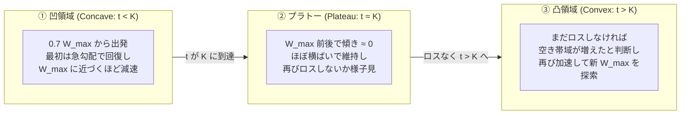
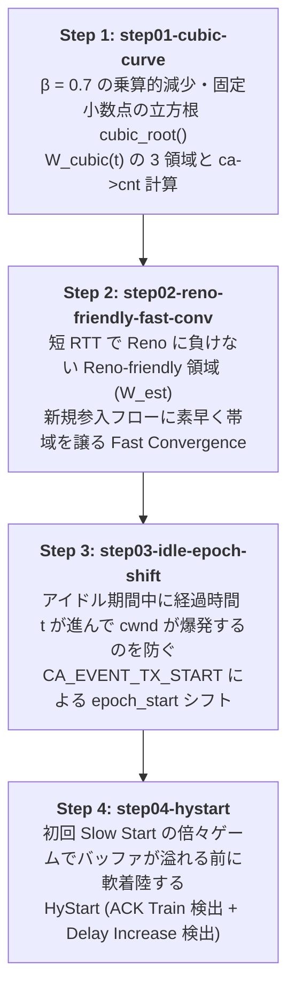

# 19. ハンズオン (2): BPF CC と packetdrill で作る TCP CUBIC

トラック 1（TCP Reno）では、輻輳制御の原点である **Slow Start（指数関数的増加）** と **AIMD（Additive Increase / Multiplicative Decrease：1 RTT ごとに $+1$ 増やし、ロスで半分に減らす）**、そして誤検知から窓を復元する **Loss Undo** を BPF でゼロから実装しました。

しかし、現代のインターネットやデータセンターで実際に使われている Linux カーネルのデフォルト輻輳制御は Reno ではなく **CUBIC**（[RFC 9438](https://www.rfc-editor.org/rfc/rfc9438)、`net/ipv4/tcp_cubic.c`）です。
このトラックでは、なぜ Reno が高速・長距離ネットワークで限界を迎えたのかを数値で体感したあと、CUBIC の心臓部である **3 次関数ウィンドウ曲線** と、それを実ネットワークで安全に動かす **4 つの仕組み（Step 1〜Step 4）** を BPF `struct_ops` と `packetdrill` で 1 つずつ組み立てていきます。

---

## 1. なぜ Reno ではダメだったのか（Long Fat Network での崩壊）

1980〜1990 年代の低速な回線では見事に機能していた TCP Reno の AIMD（1 RTT あたり $+1$ パケット増加、ロス時に $0.5$ 倍へ半減）は、回線帯域がギガビット級に広がった途端、2 つの致命的な壁にぶつかりました。

### 壁①：1 回のロスから回復するのに「69 分」かかる

長距離・広帯域のネットワーク（**LFN: Long Fat Network**）を具体的な数字で計算してみましょう。

- **回線帯域（Bandwidth）**: $10\text{ Gbps}$ （ $= 10 \times 10^9\text{ bit/s}$ ）
- **往復遅延（RTT）**: $100\text{ ms}$ （ $= 0.1\text{ 秒}$ 、たとえば太平洋横断や大陸間の光ファイバー回線）
- **1 パケットのサイズ**: $1,500\text{ Bytes} = 12,000\text{ bits}$

この土管（パイプ）を隙間なく満たすために必要な飛行中パケット数、すなわち **帯域遅延積（BDP: Bandwidth-Delay Product）** は次のようになります。

$$\text{BDP} = \frac{10 \times 10^9\text{ bit/s} \times 0.1\text{ s}}{12,000\text{ bits/packet}} \approx 83,333\text{ パケット（約 }83,000\text{ パケット）}$$

つまり、送信側が `cwnd = 83,000` を維持できて初めて $10\text{ Gbps}$ の回線を 100% 使い切ることができます。

ここで、Reno が `cwnd = 83,000` で走っている最中に **たった 1 パケットだけロスした** とします。何が起きるでしょうか？

1. **半減（Multiplicative Decrease）**: Reno は 1 回のロスで `cwnd` を半分に落とすため、`cwnd` は一気に $83,000 \div 2 = 41,500$ パケットまで急落します。
2. **1 RTT ごとに +1 の回復（Additive Increase）**: Fast Recovery を抜けて Congestion Avoidance に入ると、Reno は「1 RTT（ $0.1\text{ 秒}$ ）ごとに $+1$ パケット」しか `cwnd` を増やせません。
3. **回復にかかる時間**: 失った $41,500$ パケットを取り戻して元の $83,000$ パケットに戻るまでにかかる時間は、

$$41,500\text{ RTT} \times 0.1\text{ 秒/RTT} = 4,150\text{ 秒} \approx \mathbf{69\text{ 分 10 秒}}$$

なんと、**たった 1 パケット落としただけで、元の速度に戻るまでに 1 時間以上（約 69 分）もかかってしまう** のです。しかも、その 69 分の間に光ファイバーのビットエラーや瞬間的なマイクロバーストでもう 1 回でもロスが起きれば、そこからまた半分に叩き落とされます。その結果、 $10\text{ Gbps}$ の回線を引いているのに実効スループットが数 Mbps〜数十 Mbps しか出ないという現象が発生しました。

### 壁②：RTT 不公平（近距離フローが遠距離フローを駆逐する）

Reno のもう 1 つの問題は、Congestion Avoidance の増加ペースが **「ACK が返ってくる周期（＝RTT）」に比例してしまう** ことです。

同じボトルネックルータを、次の 2 本のフローが共有している場面を想像してください。

- **フロー A（近距離）**: $\text{RTT} = 10\text{ ms}$ （1 秒間に 100 回 RTT が回る） → 1 秒あたり **`+100` パケット** のペースで `cwnd` が増加
- **フロー B（遠距離）**: $\text{RTT} = 100\text{ ms}$ （1 秒間に 10 回しか RTT が回らない） → 1 秒あたり **`+10` パケット** のペースでしか `cwnd` が増加しない

両者が同時にパケットロスを経験して窓を減らしたあと、近距離のフロー A は遠距離のフロー B より **10 倍速く** 窓を広げてボトルネック帯域を独占してしまいます。これを **RTT 不公平（RTT Unfairness）** と呼びます。

---

## 2. CUBIC の 2 大アイデア

Reno の「回復が遅すぎる」「RTT によって不公平になる」という 2 つの壁を同時に打ち破るために設計されたのが **CUBIC** です。CUBIC の核心は、驚くほどシンプルな 2 つのアイデアに集約されます。

### アイデア①：ロス時の削減を 0.5 倍ではなく $\beta = 0.7$ 倍にとどめる

Reno はロスが起きると `cwnd` を $0.5$ 倍（50% 削減）にしていましたが、高 BDP 回線でパイプの半分を空にしてしまうのはブレーキのかけすぎです。
CUBIC は乗算的減少係数 $\beta$ を **$0.7$ （30% 削減、7 割を残す）** に引き上げます。

- 浮動小数点演算が使えない Linux カーネル（`net/ipv4/tcp_cubic.c`）および BPF では、分母を $2^{10} = 1024$ （`BICTCP_BETA_SCALE = 1024`）、分子を `beta = 717` とする固定小数点で表します：
  $$\beta = \frac{717}{1024} \approx 0.7002$$
- これにより、まずロス直後の落ち込み自体を浅くし、パイプの稼働率（リンク利用率）を高く保ちます。

### アイデア②：窓サイズを「最後のロスからの経過時間 $t$ 」の 3 次関数で決める

CUBIC 最大の発明は、Congestion Avoidance 中の目標ウィンドウサイズを「返ってきた ACK の数」ではなく、**「直前のロス回復が終わってからの実経過時間 $t$ 」の 3 次関数（Cubic function）** として定義したことです。

$$W_{\text{cubic}}(t) = C(t - K)^3 + W_{\max}$$

この式に登場する各記号の意味を 1 つずつ押さえましょう。

- **$W_{\max}$ （コード上の `ca->last_max_cwnd`）**: **「直前のパケットロスが起きたときの `cwnd`」** です。
  - パケットロスが起きたということは、「`cwnd` が $W_{\max}$ に達した瞬間にネットワークのパイプが溢れた」という重要な手がかりです。Reno はロスが起きると半減するだけで元の窓サイズを忘れてしまいますが、CUBIC は **「前回どこまで増やしたら溢れたか（ $W_{\max}$ ）」を記憶** し、その $W_{\max}$ を次の曲線の中心（変曲点）に据えます。
- **$t$**: 直前のロス回復（Fast Recovery）を抜けて Congestion Avoidance に入ってからの **経過時間**（秒、カーネル内では $1\text{ 秒} = 2^{10} = 1024$ の `BICTCP_HZ` 単位）です。
- **$C$**: 曲線の立ち上がりの鋭さを決める定数で、標準値は **$C = 0.4\text{ packet/s}^3$**（固定小数点では `410 / 1024 ≈ 0.4004`）です。
- **$K$ （コード上の `ca->bic_K`）**: ロス直後の窓サイズ $\beta W_{\max}$ （ $= 0.7 W_{\max}$ ）からスタートして、**曲線 $W_{\text{cubic}}(t)$ がちょうど $W_{\max}$ に戻るまでにかかる時間** です。
  - $t = 0$ のとき $W_{\text{cubic}}(0) = \beta W_{\max}$ となる条件を解くと、次の立方根（三乗根）の式が得られます：
    $$C(0 - K)^3 + W_{\max} = \beta W_{\max} \implies K = \sqrt[3]{\frac{W_{\max}(1 - \beta)}{C}}$$
  - （より一般には、エポック開始時の窓を $\text{cwnd}_{\text{epoch}}$ として $K = \sqrt[3]{\frac{W_{\max} - \text{cwnd}_{\text{epoch}}}{C}}$ と計算します。）

先ほどの「帯域 $10\text{ Gbps}$ ・RTT $100\text{ ms}$ ・ $W_{\max} = 83,000$ 」の例にこの式を当てはめてみましょう。

$$K = \sqrt[3]{\frac{83,000 \times (1 - 0.7)}{0.4}} = \sqrt[3]{62,250} \approx \mathbf{39.6\text{ 秒}}$$

Reno では元の $83,000$ パケットに戻るのに **約 69 分（4,150 秒）** かかっていたのが、CUBIC なら **約 40 秒（100 倍以上高速！）** で回復します。さらに、式の中の $t$ は「実世界の時計の経過時間」なので、RTT $10\text{ ms}$ のフローも RTT $100\text{ ms}$ のフローも同じ時間 $t$ で同じように窓を広げることができ、**RTT 不公平も大幅に緩和** されます。

---

## 3. 3 次関数曲線の 3 つの領域と `ca->cnt` への変換

なぜ 2 次関数や指数関数ではなく **3 次関数 $(t - K)^3$** なのでしょうか？
その理由は、時刻 $t = K$ （窓サイズが $W_{\max}$ に戻る点）を境にして、1 つの数式だけで **「急回復 → 慎重な様子見 → 新規開拓の加速」という 3 つの理想的なフェーズ** を自然に表現できるからです。

```text
  cwnd (W_cubic(t))
   ^
   |                                                  /  (3) 凸領域 (Convex / Probing)
   |                                                 /       t > K:
   |                                                /        ロスしなかったので空き帯域が
   |                                               /         増えたと判断し、再び加速！
   |                            (2) プラトー      /
   |                           (Plateau, t ≈ K)  /
W_max - - - - - - - - - - - - - - -.- - - - - - -    <-- 前回パイプが溢れた上限 (last_max_cwnd)
   |                    . '
   |                . '   前回溢れた危険地帯 W_max の前後では
   |             . '      傾きがほぼ 0 になり、窓を増やさず様子を見る
   |           .'
   |         .'   (1) 凹領域 (Concave region, t < K)
   |        /         0.7 * W_max から出発。最初は大きく増やし、
   |       /          W_max に近づくほどブレーキをかけて慎重になる
0.7*W_max +
   |
   +-------------------------------------------------------------> 経過時間 t
   0                               K
```



### ① 凹領域（Concave Region, $t < K$ ）
- ロス直後の $0.7 W_{\max}$ から、前回の最大値 $W_{\max}$ に向かって回復していく区間です。
- $t$ が $0$ に近い（ $K$ から遠い）うちは $|t - K|^3$ の傾きが大きいため、大股で一気に `cwnd` を引き上げて空きパイプを埋めます。
- そして「前回ロスが起きた危険地帯」である $W_{\max}$ に近づくにつれて $(t - K)^3$ の傾きがどんどん緩やかになり、自動的にブレーキをかけながら慎重に $W_{\max}$ へと軟着陸します。

### ② プラトー（Plateau, $t \approx K$ ）
- $t = K$ の前後では $(t - K)^3 \approx 0$ となり、3 次関数の接線の傾きがほぼゼロ（平坦な高原＝プラトー）になります。
- 前回パイプが溢れた $W_{\max}$ ちょうどのサイズでしばらくウィンドウを据え置き、「この窓サイズで走り続けてももうロスしないか？」を静かに見極めます。もしネットワークの空き容量が変わっていなければ、無駄なオーバーシュート（膨らませすぎ）を起こさずに最大の帯域を維持できます。

### ③ 凸領域（Convex / Max Probing Region, $t > K$ ）
- $W_{\max}$ のプラトーをしばらく走ってもパケットロスが起きなかった場合、「他のフローが通信を終えるなどして、以前よりネットワークの空き帯域が増えた！」と判断できます。
- $t > K$ に入ると $(t - K)^3 > 0$ となり、最初は恐る恐る少しずつ窓を増やし始め（ゆっくり探索）、それでもロスしなければ $(t - K)^3$ の増大とともにぐんぐん加速して、新しい上限（次の $W_{\max}$ ）を素早く探しに行きます（**Max Probing**）。

### 固定小数点の世界で $W_{\text{cubic}}(t)$ を `ca->cnt` に変換する仕組み

数学の式では「時刻 $t$ における窓サイズ $W_{\text{cubic}}(t)$ 」を計算しますが、Linux カーネルの輻輳制御フレームワーク（`tcp_cong_avoid_ai(tp, w, acked)`）は `tp->snd_cwnd` を直接 $W_{\text{cubic}}(t)$ で上書きするのではなく、**「何個の ACK（セグメント）を確認したら `snd_cwnd` を $+1$ 増やすか」を表すインターバル値 `ca->cnt`** を使って滑らかに窓を進めます。

具体的には、ACK が届くたびに `bictcp_update()` が次の手順で `ca->cnt` を計算します。

1. **1 RTT 先の目標窓 `bic_target` を求める**:
   現在時刻 `now` からの経過時間に最小 RTT（`ca->delay_min`）を足した「1 RTT 後の時刻 $t = \text{now} - \text{epoch}_{\text{start}} + \text{delay}_{\min}$ 」における $W_{\text{cubic}}(t)$ を計算し、これを **`bic_target`** とします。
2. **この 1 RTT で増やしたい個数から逆算して `ca->cnt` を決める**:
   1 RTT の間に到着する ACK の総数は、おおよそ現在の窓サイズ `cwnd` 個です。1 RTT 後に `cwnd` を `bic_target` まで到達させるには、`cwnd` 個の ACK が返ってくる間に `bic_target - cwnd` 回だけ `snd_cwnd++` を実行すればよいことになります。
   - **`bic_target > cwnd` のとき**:
     $$\text{ca}\to\text{cnt} = \frac{\text{cwnd}}{\text{bic}_{\text{target}} - \text{cwnd}}$$
     たとえば現在 `cwnd = 100` で、1 RTT 先の目標が `bic_target = 110`（あと $+10$ 増やしたい）なら、`ca->cnt = 100 / (110 - 100) = 10` となります。つまり「10 パケット ACK されるごとに `snd_cwnd` を $+1$ する」ペースにすれば、100 パケット分の ACK（1 RTT）でちょうど $+10$ 増えて `110` に到達します。
   - **`bic_target <= cwnd` のとき（プラトー付近）**:
     今すぐ窓を増やす必要はないため、`ca->cnt = 100 * cwnd`（100 RTT かけてやっと $+1$ する程度）という非常に大きな値を設定し、事実上ウィンドウの増加をストップさせます。
   - **安全上限のクランプ**:
     最後に `ca->cnt = max(ca->cnt, 2U)` で下限を `2` に制限し、Congestion Avoidance 中に 2 ACK で $+1$ （1 RTT で $+0.5 \times \text{cwnd}$ ）を超える急激な膨張が起きないように保護します。
3. **`tcp_cong_avoid_ai(tp, ca->cnt, acked)` に渡す**:
   あとは Reno のときと同じく `tp->snd_cwnd_cnt += acked` でクレジットを貯め、`tp->snd_cwnd_cnt >= ca->cnt` に達するたびに `tp->snd_cwnd_cnt -= ca->cnt; tp->snd_cwnd++;` で窓を $+1$ ずつ進めます。

---

## 4. CUBIC を実用にする 4 つの補助輪（Step 1〜4 の全体像）

3 次関数 $W_{\text{cubic}}(t) = C(t - K)^3 + W_{\max}$ だけでも美しいアルゴリズムですが、世界中のあらゆる回線（超短距離の LAN、競合フローが激しく出入りする回線、間欠的に通信する Web アプリ、初回接続時の Slow Start）で破綻なく動かすには、さらに **3 つの補助輪と HyStart** が不可欠です。

本トラックでは、全 4 ステップでこれらを順番に実装し、最終的に Linux カーネルの `net/ipv4/tcp_cubic.c` と同等のフル機能 CUBIC を完成させます。



| ステップ | ディレクトリ | 解決する課題 | 実装するコア機能 |
| --- | --- | --- | --- |
| **Step 1** | `step01-cubic-curve` | 高 BDP 回線での遅すぎる回復と RTT 不公平 | $\beta = 0.7$ （`717/1024`）、整数立方根 `cubic_root()`、 $W_{\text{cubic}}(t)$ による `ca->cnt` 計算 |
| **Step 2** | `step02-reno-friendly-fast-conv` | 短 RTT・小窓での Reno に対する劣後、および競合フロー参入時の収束遅れ | 線形推定窓 $W_{\text{est}}$ （`ca->tcp_cwnd`）による下支えと、`cwnd < last_max_cwnd` 時の Fast Convergence（ $\approx 0.85$ 倍） |
| **Step 3** | `step03-idle-epoch-shift` | アプリの送信休止（アイドル）後に $t \gg K$ へワープして `cwnd` が急膨張する問題 | `.cwnd_event_tx_start`（`CA_EVENT_TX_START`）での `ca->epoch_start += delta` シフト |
| **Step 4** | `step04-hystart` | 接続開始時の Slow Start で BDP の最大 2 倍まで膨らみ大量ロスする問題 | `.pkts_acked` での **HyStart**（ACK Train 検出＋Delay Increase 検出による早期 `ssthresh` 設定） |

### Step 1 (`step01-cubic-curve`): 3 次関数曲線と固定小数点の立方根
- **学ぶこと**:
  - ロス検知時（`.ssthresh`）に直前の `cwnd` を `ca->last_max_cwnd`（ $W_{\max}$ ）として記憶し、新しい閾値を $\beta = 717 / 1024 \approx 0.7$ 倍に設定します。
  - 浮動小数点命令が存在しないカーネル / BPF 環境で、`fls64()`（最上位ビット位置の取得）と 64 要素のルックアップテーブル `v[]`、そして 1 回のニュートン＝ラフソン法反復を組み合わせて 64 ビット整数の立方根を高速・高精度に求める `cubic_root()` を実装します。
  - $W_{\text{cubic}}(t)$ の凹領域（ $t < K$ ）・プラトー（ $t \approx K$ ）・凸領域（ $t > K$ ）から `bic_target` と `ca->cnt` を算出し、`packetdrill` で 3 つの領域すべての成長ペースを検証します。

### Step 2 (`step02-reno-friendly-fast-conv`): Reno-friendly 領域と Fast Convergence
- **学ぶこと① — Reno-friendly 領域（ $W_{\text{est}}$ / `ca->tcp_cwnd`）**:
  - RTT が短い（例：数 ms〜10 ms）環境や $W_{\max}$ が小さい環境では、1 RTT あたりの実時間 $t$ の進みが小さいため、3 次関数 $W_{\text{cubic}}(t)$ の増加ペースが「1 RTT ごとに確実に $+1$ する TCP Reno」より遅くなってしまう区間があります。
  - そこで CUBIC は、「もし同じ $\beta = 0.7$ の減少率で、TCP Reno（ $\beta_{\text{reno}} = 0.5$ 、傾き $1$ ）とまったく同じ平均ウィンドウサイズになる線形関数 $W_{\text{est}}$ で増やしていたら、いま窓サイズはいくつか？」を裏で並行して計算します（傾き $\alpha = \frac{3(1 - \beta)}{1 + \beta} \approx 0.529$ 、すなわち約 $1.875\text{ RTT}$ ごとに $+1$ パケット）。
  - そして $W_{\text{est}} > W_{\text{cubic}}(t)$ の間は $W_{\text{est}}$ （`ca->tcp_cwnd`）の方を採用することで、**「どんな環境でも絶対に Reno より遅くならない」** ことを保証します。
- **学ぶこと② — Fast Convergence（高速収束）**:
  - 自分が大きな $W_{\max}$ で走っているところに新しいフローが参入してくると、自分が使える公平な帯域は減ります。しかし前回の大きな $W_{\max}$ をそのまま目指し続けると、何度も溢れてロスを繰り返してしまいます。
  - そこで「前回の $W_{\max}$ に回復しきれないうちに再びロスが起きたら（`cwnd < ca->last_max_cwnd`）、競争相手が増えた！」と判断し、 $W_{\max}$ を今回の `cwnd` ではなくさらに **$\frac{1 + \beta}{2} \approx 0.85$ 倍**（`(cwnd * 1741) / 2048`）に引き下げて、素早く帯域を譲ります。

### Step 3 (`step03-idle-epoch-shift`): アイドル期間後の `epoch_start` シフト
- **学ぶこと**:
  - Reno は ACK が届いたときだけ時計が進むので、アプリが送信を休止（アイドル）している間は自然に成長が止まります。しかし CUBIC は実時間 $t = \text{now} - \text{ca}\to\text{epoch}_{\text{start}}$ を見るため、Congestion Avoidance 中にアプリが数秒間データを送らずに休むと、その休んでいた時間まで $t$ に加算されてしまいます。
  - すると送信を再開した直後の最初の ACK で、 $t$ が一気に数秒先の $t \gg K$ （急激な凸領域）へワープしてしまい、たった 1 RTT で `cwnd` が 1.5 倍に大爆発します（[RFC 9438 §5.8](https://www.rfc-editor.org/rfc/rfc9438#section-5.8) で明確に禁止されている挙動です）。
  - これを防ぐため、飛行中パケット 0（`in_flight == 0`）から送信を再開した瞬間に発火する `CA_EVENT_TX_START`（`.cwnd_event_tx_start` フック）を捕捉し、休んでいた時間 `delta = now - tp->lsndtime` の分だけ `ca->epoch_start += delta` と未来へシフトさせて、3 次関数の時計を一時停止させる仕組みを実装します。

### Step 4 (`step04-hystart`): HyStart（Hybrid Slow Start）による安全な初期加速の終了
- **学ぶこと**:
  - 接続が始まった直後の最初の Slow Start では、まだ一度もロスを経験していないため $W_{\max} = 0$ であり、`ssthresh` も事実上無限大（`0x7fffffff`）です。このまま 1 RTT ごとに `cwnd` を倍々に増やし続けると、パイプが満杯（BDP）になった次の 1 RTT で最大 $2 \times \text{BDP}$ ものパケットを流し込み、ルータのバッファが溢れて数千〜数万パケットの壊滅的なバーストロスを引き起こします。
  - **HyStart（Hybrid Slow Start）** は、`.pkts_acked` フックで毎回の ACK の到着タイミングと RTT を観察し、以下の **2 つのセンサー** のどちらかが反応した瞬間に「もうすぐパイプが満杯になる！」と察知して `tp->snd_ssthresh = tp->snd_cwnd` に引き下げ、**パケットロスを 1 個も起こす前に Slow Start から Congestion Avoidance へ軟着陸** させます：
    1. **ACK Train 検出（流量センサー）**: 2 ms 以内の密な間隔で連続して返ってくる ACK の列（Train）の長さが、最小 RTT（`delay_min`）の半分に達したら「送信したパケット列がボトルネックのパイプを隙間なく埋め尽くした（BDP 到達）」と判定します。
    2. **Delay Increase 検出（遅延センサー）**: 現在のラウンドで最初の 8 サンプル以上の最小 RTT（`curr_rtt`）が、接続全体の最小 RTT（`delay_min`）より `clamp(delay_min >> 3, 4ms, 16ms)` 以上大きくなったら「ボトルネックルータのキューにパケットが溜まり始めた」と判定します。

---

## ハンズオンの進め方

各ステップのディレクトリ（`step01-cubic-curve` 〜 `step04-hystart`）には、以下のファイルが用意されています。

- `README.md` / `README.en.md`: そのステップの理論、**設計チェックポイント（コードを書く前に考える 4 つの問い）**、実装解説
- `starter.bpf.c`: 自分で `TODO` を埋めるためのスケルトン実装
- `solution.bpf.c`: 模範解答の BPF 実装
- `test.pkt`: `vng`（virtme-ng）内でそのステップの挙動を厳密に検証する `packetdrill` テストスクリプト

`labs/` ディレクトリから `run_test.sh` を使って、まずは Step 1（`step01-cubic-curve`）から順番に挑戦しましょう！

```sh
# 1. まず未完成の starter が packetdrill のアサートで失敗することを確認する
./run_test.sh cubic/step01-cubic-curve starter

# 2. step01-cubic-curve/starter.bpf.c の TODO を実装して再テストする
./run_test.sh cubic/step01-cubic-curve starter

# 3. 模範解答 (solution.bpf.c) の動作を確認する
./run_test.sh cubic/step01-cubic-curve solution
```


---

## Step 1: 固定小数点の立方根と W_cubic(t) 曲線（凹領域・プラトー・凸領域）

## 1. 学習ゴール

このステップでは、Linux カーネルのデフォルト輻輳制御アルゴリズムである **TCP CUBIC**（[net/ipv4/tcp_cubic.c](file:///usr/local/google/home/kuniyu/kernel/tcp-eli5-src/net/ipv4/tcp_cubic.c)）の心臓部である **乗法的減少（ $\beta \approx 0.7$ ）**、**固定小数点の立方根 `cubic_root()`**、および **3 次関数ウィンドウ成長曲線 $W_{\text{cubic}}(t)$** を BPF `struct_ops`（`bpf_cubic3`）としてゼロから実装します。トラック全体の構成や背景については [CUBIC トラック概要 (`../README.md`)](#) もあわせて参照してください。

---

## 2. アルゴリズムと背景の解説（まずここを読む）

設計チェックポイントやコードに進む前に、**「なぜ Reno では高帯域ネットワークを使い切れないのか」「CUBIC はどのような数式と固定小数点演算で動くのか」「カーネルの `struct tcp_sock` とソケット固有領域 `icsk_ca_priv` に何が用意されているのか」** を一から整理します。

### 2.1 なぜ TCP Reno では不十分なのか？（Long Fat Network の問題）

TCP Reno（AIMD）は、パケットロス発生時に `snd_cwnd` を半分（ $0.5$ 倍）に減らし、その後は **1 RTT あたり $+1$ セグメント** ずつ直線的にウィンドウを回復させます。

しかし、帯域幅が大きく遅延も長いネットワーク（**LFN: Long Fat Network**）では、この「1 RTT に $+1$ 」というペースが致命的なボトルネックになります。
- たとえば **帯域 10 Gbps・RTT 100 ms** の回線では、パイプを満たすのに必要なウィンドウサイズ（BDP）は約 $83,333$ セグメントです。
- たった 1 パケットのロスでウィンドウが半分の $41,666$ に落ちると、元の $83,333$ に戻るまでに **41,666 RTT ＝ 約 69 分** もかかってしまいます。
- また、Reno は「1 RTT ごとに $+1$ 」増えるため、RTT が短いフローほど急速にウィンドウを広げ、RTT が長いフローが帯域を奪われる **RTT 不公平性（RTT unfairness）** という弱点も抱えています。

### 2.2 CUBIC の基本アイデア：実時間 $t$ の 3 次関数で $W_{\max}$ を目指す

CUBIC は、Reno の問題を次の 2 つのアイデアで解決します。

1. **緩やかな乗法的減少（ $\beta \approx 0.7$ ）と $W_{\max}$ の記憶**:
   パケットロスが発生したとき、ロス直前の `snd_cwnd` を **「前回ネットワークが飽和した上限の目安 $W_{\max}$ （`last_max_cwnd`）」** として記録し、ウィンドウを Reno の半分（ $0.5$ 倍）ではなく **約 $0.7$ 倍**（ $\beta = 717 / 1024 \approx 0.7002$ ）にだけ縮小します。
2. **ACK 数ではなく「経過時間 $t$ 」に基づく 3 次関数 $W_{\text{cubic}}(t)$**:
   Fast Recovery を抜けて輻輳回避（Congestion Avoidance）エポックが始まってからの経過時間を $t$ とし、変曲点（傾きが $0$ になる平坦な点）を $(t = K, W = W_{\max})$ に置いた **3 次関数** で目標ウィンドウを定めます。

$$W_{\text{cubic}}(t) = C(t - K)^3 + W_{\max}$$

ここで $C = 0.4$ はスケーリング定数、 $K$ は「エポック開始時点（ $t = 0$ ）のウィンドウサイズ $\text{cwnd}_{\text{epoch}}$ から、原点 $W_{\max}$ に到達するまでにかかる時間」です。 $W_{\text{cubic}}(0) = \text{cwnd}_{\text{epoch}}$ を代入すると、 $K$ は次の立方根（3 乗根）で求まります。

$$K = \sqrt[3]{\frac{W_{\max} - \text{cwnd}_{\text{epoch}}}{C}}$$

```text
  cwnd
   ^
   |                                            /  <-- (3) 凸領域 (Convex: t > K)
   |                                          /        新しい空き帯域を慎重に探索し加速
W_max (20) +.................................*.........
   |                            . '   ' .
   |                        . '          <-- (2) プラトー (Plateau: t ~= K)
   |                      /                  W_max 付近で傾きをほぼ 0 にしロス再発を防ぐ
   |                    /
   |                   /  <-- (1) 凹領域 (Concave: t < K)
cwnd_epoch (14) +     *       最初は一気に駆け上がり、W_max に近づくほど減速
   |
   +------------------+----------------------+---------> 経過時間 t
                    t = 0                  t = K
                 (エポック開始)           (変曲点)
```

この 3 次曲線により、CUBIC は以下の 3 つの領域を 1 本の式で表現します。
- **(1) 凹領域（Concave region, $t < K$ ）**: $t - K < 0$ のため $W_{\text{cubic}}(t) = W_{\max} - C(K - t)^3$ となります。エポック開始直後は $|t - K|$ が大きいため急勾配で $W_{\max}$ に向かって一気に回復し、 $t$ が $K$ に近づくにつれて増加ペースを緩めます。
- **(2) プラトー（Plateau, $t \approx K$ ）**: 前回ロスが起きた $W_{\max}$ に到達すると、 $|t - K| \approx 0$ となって 3 次関数の傾きがほぼ $0$ になります。ここでしばらく水平に留まることで、リンク容量ギリギリを安全に維持します。
- **(3) 凸領域（Convex / Max-Probing region, $t > K$ ）**: $W_{\max}$ でロスが起きなければ「ネットワークの空き帯域が増えた」と判断し、 $W_{\text{cubic}}(t) = W_{\max} + C(t - K)^3$ で最初はゆっくり、徐々に加速しながら未知の帯域を探索（Probing）します。

### 2.3 「1 RTT 先の目標ウィンドウ」から増加インターバル `ca->cnt` への変換

カーネルの輻輳回避処理は、「`ca->cnt` 個のセグメントが ACK されるごとに `snd_cwnd` を $+1$ する」という汎用カウンタ関数 `bpf_cubic3_cong_avoid_ai(tp, ca->cnt, acked)` で動いています。では、連続関数の $W_{\text{cubic}}(t)$ をどのように `ca->cnt` に変換するのでしょうか？

1. **1 RTT 先の時刻 $t = (\text{now} - \text{epoch}_{\text{start}}) + \text{delay}_{\min}$ を評価する**:
   エポック開始時刻 `epoch_start` は、輻輳回避の最初の ACK を受け取った瞬間に `now_us` で初期化されます。もし $t = \text{now} - \text{epoch}_{\text{start}}$ のまま計算すると、最初の ACK 時点で $t = 0$ となり、 $W_{\text{cubic}}(0) = \text{cwnd}$ となって目標ウィンドウが現在の `cwnd` から全く増えません。
   そこで CUBIC は、観測された最小 RTT（`delay_min`）を足した **$t = (\text{now} - \text{epoch}_{\text{start}}) + \text{delay}_{\min}$**（「今から 1 RTT 後に到達していたい目標時刻」）における目標ウィンドウ `bic_target` $= W_{\text{cubic}}(t)$ を計算します。
2. **`bic_target` から `ca->cnt` を逆算する**:
   現在のウィンドウが `cwnd` のとき、これからの 1 RTT で到着する ACK の総数は約 `cwnd` 個です。1 RTT 後にウィンドウを `bic_target` まで増やす（つまり 1 RTT の間に `bic_target - cwnd` 個だけ `+1` する）には、何個の ACK ごとに `+1` すればよいでしょうか？
   - **`bic_target > cwnd` のとき**:
     $$\text{cnt} = \left\lfloor \frac{\text{cwnd}}{\text{bic}_{\text{target}} - \text{cwnd}} \right\rfloor$$
   - **`bic_target <= cwnd` のとき（ $t \approx K$ のプラトー）**:
     分母が $0$ 以下になるため、非常にゆっくりとした増加（100 RTT で $+1$ ）を表す `ca->cnt = 100 * cwnd` を設定します。
   - **過去のロス履歴がない初期エポック（`last_max_cwnd == 0` かつ `ca->cnt > 20`）**:
     まだ一度もロスを経験していない場合は `ca->cnt = 20` で頭打ちにし、最後に `ca->cnt = max(ca->cnt, 2U)` で最小値 `2`（2 ACK ごとに最大 $+1$ ）にクランプします。

### 2.4 カーネル／BPF での固定小数点演算と整数立方根 `cubic_root()`

Linux カーネルや BPF プログラムでは浮動小数点（`float` / `double`）が使えないため、すべての小数を **2 のべき乗（1024）を分母とする固定小数点整数** で表現します。

| 定数・変数 | 値 / 定義 | 数学的な意味 |
| :--- | :--- | :--- |
| `BICTCP_BETA_SCALE` | `1024` | $\beta$ の分母（ $2^{10}$ ） |
| `beta` | `717` | 乗法的減少係数 $\beta = 717 / 1024 \approx 0.7002$ |
| `BICTCP_HZ` | `10` | 時間 $t, K$ の単位スケール： $1\text{ 秒} = 2^{10} = 1024\text{ 単位}$ （約 $0.976\text{ ms}$ 刻み） |
| `bic_scale` | `41` | スケーリング基準値（`cube_rtt_scale = bic_scale * 10 = 410`） |
| `cube_rtt_scale` | `410` | $C \times 1024 = 0.4 \times 1024 \approx 410$ （すなわち $C = 410 / 2^{10}$ ） |
| `cube_factor` | `(1ULL << 40) / 410` ($= 2,681,735,677$) | $K$ を `BICTCP_HZ`（ $2^{10}$ ）単位で求めるための係数： $\frac{(2^{10})^3}{C} = \frac{2^{30}}{410 / 2^{10}} = \frac{2^{40}}{410}$ |

この単位系を使うと、各計算はすべて整数シフトと乗除算だけで書けます。
- **変曲点までの時間 `bic_K`（単位：`BICTCP_HZ`）**:
  $$K_{\text{hz}} = \sqrt[3]{\text{cube}_{\text{factor}} \times (W_{\max} - \text{cwnd})}$$
- **経過時間 `t`（マイクロ秒 $\to$ `BICTCP_HZ` 単位）**:
  $$\text{t} = \frac{((\text{now}_{\text{us}} - \text{epoch}_{\text{start}}) + \text{delay}_{\min}) \ll 10}{1,000,000}$$
- **原点からの差分 `delta` $= C |t - K|^3$**:
  符号なし整数 `__u64` で安全に計算するため、まず絶対値 $\text{offs} = |t - \text{bic}_{K}|$ を取り、
  $$\text{delta} = (\text{cube}_{\text{rtt,scale}} \times \text{offs}^3) \gg (10 + 3 \times 10)$$
  （ $C = 410 / 2^{10}$ と $\text{offs}^3$ の時間スケール $(2^{10})^3 = 2^{30}$ の合計 $40$ ビット分を右シフトで戻します。）
  $t < \text{bic}_{K}$ （凹領域）なら `bic_target = bic_origin_point - delta`、 $t \ge \text{bic}_{K}$ （凸領域）なら `bic_target = bic_origin_point + delta` となります。

#### 固定小数点の立方根 `cubic_root(__u64 a)` の仕組み

整数 $a$ の立方根 $\lfloor \sqrt[3]{a} \rfloor$ を高速に求めるため、[tcp_cubic.c](file:///usr/local/google/home/kuniyu/kernel/tcp-eli5-src/net/ipv4/tcp_cubic.c) と同じ 3 ステップのアルゴリズムを使います。
1. **ビット幅を 3 で割る（指数部の計算）**:
   `fls64(a)` で $a$ の最上位セットビット位置（ $1 \sim 64$ ）を求め、`b = ((fls64(a) * 84) >> 8) - 1` を計算します。 $84 / 256 \approx 1/3$ なので、これにより $a$ を「3 ビットずつのブロック何個分か」を表すシフト量 `b` が求まります（ $a < 64$ の小さい値はテーブルから直接 `((__u32)v[(__u32)a] + 35) >> 6` を返します）。
2. **64 要素のルックアップテーブル `v[]` による初期推定値**:
   `shift = a >> (b * 3)` によって $a$ の上位 6 ビット（ $0 \sim 63$ ）を取り出し、事前計算された配列 `v[shift]` を引いて `x = (((__u32)v[shift] + 10) << b) >> 6` で初期近似値 $x_0 \approx \sqrt[3]{a}$ を作ります。
   （※ **BPF Verifier 上の重要ルール**: 数学的には `shift < 64` ですが、BPF 検証器は変数シフト `a >> (b * 3)` の上限を自動証明できないため、`v[shift]` の直前に必ず `if (shift >= 64) return 0;` を入れて配列境界内であることを検証器に保証します。）
3. **ニュートン＝ラフソン法（Newton-Raphson）の 1 回反復**:
   方程式 $f(x) = x^3 - a = 0$ の解を 1 回反復式 $x_{1} = \frac{1}{3}\left(2x_0 + \frac{a}{x_0^2}\right)$ で精密化します。整数演算では `x * (x - 1)` で分母を近似し、 $1/3 \approx 341 / 1024$ を使って次のように書きます（平均誤差わずか約 $0.195\%$ ）：
   ```c
   x = (2 * x + (__u32)div64_u64(a, (__u64)x * (__u64)(x - 1)));
   x = ((x * 341) >> 10);
   ```

### 2.5 具体的な数値例（`test.pkt` のパラメータでの追跡）

RTT = $100\text{ ms}$ （`delay_min = 100,000` usec）の接続で、`cwnd = 20` のときにパケットロスが発生したケースを実際に計算してみましょう。

1. **ロス発生時（`bpf_cubic3_ssthresh()`）**:
   - $W_{\max}$ として `last_max_cwnd = 20` を保存し、`epoch_start = 0` にリセットします。
   - 新しい `ssthresh`（＝回復後の初期 `cwnd`）は $\lfloor 20 \times 717 / 1024 \rfloor = \lfloor 14.003 \rfloor = 14$ になります。
2. **エポック開始時（Recovery 完了直後の Flight 1, $\text{cwnd} = 14$ ）**:
   - `bic_origin_point = 20`
   - `bic_K = cubic_root(2,681,735,677 * (20 - 14)) = cubic_root(16,090,414,062) = 2523`（秒に直すと $2523 / 1024 \approx 2.46\text{ 秒}$ ）
3. **経過時間ごとの `bic_target` と `ca->cnt` の推移**:

| フライト | 経過時間 $\text{now} - \text{epoch}_{\text{start}}$ | 先読み時刻 $t$ (`BICTCP_HZ`) | $\text{offs} = \|t - 2523\|$ | $\text{delta} = C \cdot \text{offs}^3$ | 領域と `bic_target` | `ca->cnt` | 1 RTT 後の `cwnd` |
| :--- | :--- | :--- | :--- | :--- | :--- | :--- | :--- |
| **Flight 1** | $0.0\text{ s}$ | $102$ ($0.1\text{ s}$) | $2421$ | $5$ | 凹領域： $20 - 5 = 15$ | $14 / (15 - 14) = 14$ | $14 \to 15$ |
| **Flight 2** | $0.6\text{ s}$ | $716$ ($0.7\text{ s}$) | $1807$ | $2$ | 凹領域： $20 - 2 = 18$ | $15 / (18 - 15) = 5$ | $15 \to 18$ （ $+3$ 急伸） |
| **Flight 3** | $1.8\text{ s}$ | $1945$ ($1.9\text{ s}$) | $578$ | $0$ | 原点到達： $20 - 0 = 20$ | $18 / (20 - 18) = 9$ | $18 \to 20$ （ $W_{\max}$ ） |
| **Flight 4** | $2.1\text{ s}$ | $2252$ ($2.2\text{ s}$) | $271$ | $0$ | プラトー： $20 \le \text{cwnd}$ | $100 \times 20 = 2000$ | $20 \to 20$ （水平維持） |
| **Flight 5** | $4.0\text{ s}$ | $4198$ ($4.1\text{ s}$) | $1675$ | $1$ | 凸領域： $20 + 1 = 21$ | $20 / (21 - 20) = 20$ | $20 \to 21$ （再加速） |

### 2.6 カーネルが提供するフィールドとソケット固有領域 `icsk_ca_priv`

BPF で CUBIC を実装するにあたり、**カーネル側ですでに用意されている構造体フィールド** と、**私たちが `icsk_ca_priv`（`struct bpf_cubic3_ca`）に独自定義して管理するフィールド** は以下の通りです。

1. **`struct tcp_sock *tp = tcp_sk(sk)`（カーネルが管理する TCP 状態）**:
   - `tp->snd_cwnd`: 現在の輻輳ウィンドウ（セグメント単位）
   - `tp->snd_ssthresh`: スロースタート閾値（`tcp_in_slow_start(tp)` は `tp->snd_cwnd < tp->snd_ssthresh` を判定）
   - `tp->snd_cwnd_cnt`: `bpf_cubic3_cong_avoid_ai()` が使う線形増加カウンタ（ACK されたセグメント数を蓄積し、`w` に達したら `snd_cwnd` を増やす）
   - `tp->snd_cwnd_clamp`: `snd_cwnd` の上限値
   - `tp->prior_cwnd`: ロス回復に入る前の `snd_cwnd`（誤検知時の `.undo_cwnd` で使用）
   - `tp->tcp_mstamp`: パケット送受信時に更新されるマイクロ秒単位の単調増加タイムスタンプ（`bictcp_clock_us(sk)` で取得）
2. **`const struct ack_sample *sample`（`.pkts_acked` フックの引数）**:
   - `sample->rtt_us`: 今回の ACK で計測された RTT（マイクロ秒単位。再送等で計測不能な場合は負の値 `< 0`）
3. **`inet_csk_ca(sk)` / `icsk_ca_priv`（私たちが定義する `struct bpf_cubic3_ca`）**:
   - `struct inet_connection_sock` の末尾には、各輻輳制御アルゴリズムが自由に使えるプライベートメモリ領域 `icsk_ca_priv` が用意されており、`inet_csk_ca(sk)` ヘルパーでポインタを取得できます。
   - [starter.bpf.c](file:///usr/local/google/home/kuniyu/tcp-eli5/labs/cubic/step01-cubic-curve/starter.bpf.c) には、すでに以下の `struct bpf_cubic3_ca` が定義されています：
     - `cnt`: 計算された増加インターバル（何パケット ACK されたら `snd_cwnd` を $+1$ するか）
     - `last_max_cwnd`: 前回のロス発生時のウィンドウサイズ $W_{\max}$
     - `last_cwnd`, `last_time`: 短時間（1/32 秒以内）に同じ `cwnd` で `bictcp_update()` が重複実行されるのを防ぐキャッシュ
     - `bic_origin_point`: 現在のエポックにおける曲線の原点（通常は `last_max_cwnd`）
     - `bic_K`: エポック開始から原点 `bic_origin_point` に到達するまでの時間 $K$ （`BICTCP_HZ` 単位）
     - `delay_min`: `.pkts_acked` フックで記録した最小 RTT（マイクロ秒単位）
     - `epoch_start`: 現在の輻輳回避エポックの開始時刻（マイクロ秒単位。`0` のときはエポック未開始を表す）

---

## 3. 設計チェックポイント（理解した仕組みをコードに落とし込む）

セクション 2 の仕組みを踏まえて、[starter.bpf.c](file:///usr/local/google/home/kuniyu/tcp-eli5/labs/cubic/step01-cubic-curve/starter.bpf.c) の 3 つの `TODO` を書く前に以下の 4 つの設計の問いを考えてみましょう。

### Q1. なぜ `bic_K` は ACK のたびではなく `ca->epoch_start == 0` のときだけ計算するのか？

`bictcp_update()` は輻輳回避中に ACK が届くたびに呼ばれますが、`cubic_root()` を使った `ca->bic_K` の計算は `if (ca->epoch_start == 0)` のブロック内で 1 回しか行いません。なぜ毎回計算しなくてよいのでしょうか？また、`ca->epoch_start` はどのタイミングで `0` にリセットされるでしょうか？

<details>
<summary>ヒントと答え</summary>

- **ヒント**: セクション 2.2 の式 $K = \sqrt[3]{(W_{\max} - \text{cwnd}_{\text{epoch}}) / C}$ に含まれる変数が、同一エポック内で変化するかどうかを考えてみましょう。
- **答え**:
  - 変曲点までの時間 $K$ は、「エポック開始時点の初期ウィンドウ $\text{cwnd}_{\text{epoch}}$ 」と「目標の原点 $W_{\max}$ （`last_max_cwnd`）」の差だけで決まる定数です。同じ輻輳回避エポックが続いている間は曲線自体が変わらないため、エポック開始時（`ca->epoch_start == 0`）に 1 回だけ `cubic_root()` を計算して `ca->bic_K` と `ca->bic_origin_point` にキャッシュしておけば、以降の ACK では引き算と 3 乗算だけで $W_{\text{cubic}}(t)$ を高速に評価できます。
  - 新しいエポックへのリセットは、パケットロス検知時（`bpf_cubic3_ssthresh()` で `ca->epoch_start = 0;`）および RTO タイムアウト時（`bpf_cubic3_set_state()` の `TCP_CA_Loss` で `bictcp_reset(ca)`）に行われます。また、もしエポック開始時にすでに `ca->last_max_cwnd <= cwnd` であれば、減速後のウィンドウよりも過去の $W_{\max}$ の方が小さい（または未設定 `0`）ため、`ca->bic_K = 0`、`ca->bic_origin_point = cwnd` として即座に凸領域（探索）からスタートします。

</details>

### Q2. なぜ経過時間 `t` を計算するときに `ca->delay_min`（最小 RTT）を足すのか？

`bictcp_update()` では、経過時間 `t` を `now_us - ca->epoch_start` ではなく `(now_us - ca->epoch_start) + ca->delay_min` として計算します。もし `ca->delay_min` を足さなかった場合、エポック開始直後の Flight 1（`now_us == ca->epoch_start`）で `bic_target` と `ca->cnt` はどうなってしまうでしょうか？

<details>
<summary>ヒントと答え</summary>

- **ヒント**: セクション 2.3 とセクション 2.5 の数値例で、 $t = 0$ のときの $W_{\text{cubic}}(0)$ の値を思い出してみましょう。
- **答え**:
  - エポックの最初の ACK では `ca->epoch_start = now_us` が代入されるため、`now_us - ca->epoch_start == 0` です。もし `delay_min` を足さないと $t = 0$ となり、定義により $W_{\text{cubic}}(0) = \text{cwnd}$ となって `bic_target == cwnd` になります。
  - すると `bic_target <= cwnd` のプラトー分岐に入ってしまい、最初の 1 RTT の間 `ca->cnt = 100 * cwnd` となってウィンドウ成長が止まってしまいます。
  - `ca->delay_min`（1 RTT）を加算することで、「1 RTT 後に達成すべき目標ウィンドウ `bic_target`」を先読みし、現在の RTT 中に到着する `cwnd` 個の ACK でちょうど `bic_target` に到達するようなペース `ca->cnt = cwnd / (bic_target - cwnd)` を正しく算出できます。

</details>

### Q3. 符号なし整数（`__u64`）だけで凹領域（ $t < K$ ）と凸領域（ $t \ge K$ ）の両方を安全に計算するには？

数式 $W_{\text{cubic}}(t) = C(t - K)^3 + W_{\max}$ では、 $t < K$ のとき $(t - K)^3$ が負になり、 $t > K$ のとき正になります。`t` と `ca->bic_K` が符号なし整数であるとき、アンダーフローを起こさずに `bic_target` を求めるにはどう条件分岐を組めばよいでしょうか？

<details>
<summary>ヒントと答え</summary>

- **ヒント**: セクション 2.4 の通り、先に絶対値 $\text{offs} = |t - K|$ を求めてから 3 乗の差分 `delta` を作り、最後に原点から引くか足すかを切り替えます。
- **答え**:
  1. まず `t < ca->bic_K` かどうかで分岐し、常に非負の距離 `offs` を計算します：
     ```c
     if (t < ca->bic_K)
         offs = ca->bic_K - t;
     else
         offs = t - ca->bic_K;
     ```
  2. 次に非負の 3 次項 `delta = (cube_rtt_scale * offs * offs * offs) >> (10 + 3 * BICTCP_HZ);` を計算します。
  3. 最後に、凹領域（`t < ca->bic_K`）なら `bic_target = ca->bic_origin_point - delta;`、凸領域（`t >= ca->bic_K`）なら `bic_target = ca->bic_origin_point + delta;` とします。これにより符号付きオーバーフローや負数の右シフト問題を完全に回避できます。

</details>

### Q4. `cubic_root()` で `v[shift]` を参照する直前に `if (shift >= 64) return 0;` が必要な理由は？

`cubic_root(__u64 a)` では、`b = fls64(a); b = ((b * 84) >> 8) - 1; shift = (a >> (b * 3));` によって $a$ の上位 6 ビットを抽出します。アルゴリズム上は `shift` は必ず `0` 以上 `63` 以下になりますが、境界チェックを書かずに `v[shift]` にアクセスすると BPF プログラムのロードが失敗します。なぜでしょうか？

<details>
<summary>ヒントと答え</summary>

- **ヒント**: セクション 2.4 の BPF Verifier のルールを思い出してください。検証器は `fls64(a)` の戻り値と変数シフト `a >> (b * 3)` の関係を代数的に証明できるでしょうか？
- **答え**:
  - BPF 検証器（verifier）はレジスタごとの値の範囲（min/max bounds）を追跡しますが、`fls64(a)` のビット探索ロジックと `a >> (b * 3)` の組み合わせから「結果の `shift` が必ず 64 未満になる」という数学的性質までは推論できません。
  - そのため、要素数 64 の静的配列 `v[]`（`.rodata` マップ）に対して境界外読み取り（Out-of-Bounds access）の恐れがあると判定し、ロードを拒否します。
  - `if (shift >= 64) return 0;` を直前に置くことで、その後のパスにおける `shift` の上限が `63` 以下であることが検証器に明示され、安全にロードできるようになります。

</details>

---

## 4. 実装ステップと解説 (`solution.bpf.c`)

[solution.bpf.c](file:///usr/local/google/home/kuniyu/tcp-eli5/labs/cubic/step01-cubic-curve/solution.bpf.c) の各関数と固定小数点式の実装を順番に見ていきましょう。

### 4.1 `cubic_root(__u64 a)` — テーブル参照とニュートン法による整数立方根（TODO 1）

```c
static __always_inline __u32 cubic_root(__u64 a)
{
	__u32 x, b, shift;

	if (a < 64)
		return ((__u32)v[(__u32)a] + 35) >> 6;

	b = fls64(a);
	b = ((b * 84) >> 8) - 1;
	shift = (a >> (b * 3));

	/* Bounds check required by the BPF verifier for v[shift] */
	if (shift >= 64)
		return 0;

	x = ((__u32)(((__u32)v[shift] + 10) << b)) >> 6;

	/*
	 * Newton-Raphson iteration:
	 *   x_{k+1} = (2 * x_k + a / x_k^2) / 3
	 * Note: 341 / 1024 ~= 1 / 3.
	 */
	x = (2 * x + (__u32)div64_u64(a, (__u64)x * (__u64)(x - 1)));
	x = ((x * 341) >> 10);
	return x;
}
```

- **$a < 64$ の高速パス**: $a$ が 6 ビット以内に収まる場合はシフトが不要なため、テーブル `v[a]` から直接丸め付きの値を返します。
- **指数ブロック `b` と上位 6 ビット `shift` の抽出**: `fls64(a)` から `b = ((b * 84) >> 8) - 1` を求め、`shift = a >> (b * 3)` で $a$ を `[0, 63]` に正規化します。
- **Verifier ガードと初期推定値**: `if (shift >= 64) return 0;` で BPF 検証器に境界を保証したうえで、`v[shift]` を参照し `<< b` で元のスケールに戻して初期近似値 `x` を得ます。
- **ニュートン＝ラフソン反復**: `div64_u64(a, (__u64)x * (__u64)(x - 1))` で $a / x^2$ を計算し、`2 * x` と足して `* 341 >> 10`（ $\approx \div 3$ ）することで、1 回の反復で高精度な立方根に収束させます。

### 4.2 `bictcp_update()` — $W_{\text{cubic}}(t)$ 曲線と `ca->cnt` の算出（TODO 2）

```c
static __always_inline void bictcp_update(struct sock *sk, __u32 cwnd, __u32 acked)
{
	struct bpf_cubic3_ca *ca = inet_csk_ca(sk);
	__u32 now_us = bictcp_clock_us(sk);
	__u32 delta, bic_target;
	__u64 offs, t;

	if (ca->last_cwnd == cwnd &&
	    (__s32)(now_us - ca->last_time) <= (USEC_PER_SEC / 32))
		return;

	if (ca->epoch_start && now_us == ca->last_time)
		goto out;

	ca->last_cwnd = cwnd;
	ca->last_time = now_us;

	if (ca->epoch_start == 0) {
		ca->epoch_start = now_us;

		if (ca->last_max_cwnd <= cwnd) {
			ca->bic_K = 0;
			ca->bic_origin_point = cwnd;
		} else {
			ca->bic_K = cubic_root(cube_factor *
					       (ca->last_max_cwnd - cwnd));
			ca->bic_origin_point = ca->last_max_cwnd;
		}
	}

	t = (__u64)((__s32)(now_us - ca->epoch_start) + ca->delay_min);
	t <<= BICTCP_HZ;
	t /= USEC_PER_SEC;

	if (t < ca->bic_K)
		offs = ca->bic_K - t;
	else
		offs = t - ca->bic_K;

	/* delta = C * |t - K|^3 */
	delta = (cube_rtt_scale * offs * offs * offs) >> (10 + 3 * BICTCP_HZ);
	if (t < ca->bic_K)	/* Concave region: below origin W_max */
		bic_target = ca->bic_origin_point - delta;
	else			/* Convex region: above origin W_max */
		bic_target = ca->bic_origin_point + delta;

	/* Convert target window into ACK count interval ca->cnt */
	if (bic_target > cwnd)
		ca->cnt = cwnd / (bic_target - cwnd);
	else
		ca->cnt = 100 * cwnd;	/* Very small increment at plateau */

	if (ca->last_max_cwnd == 0 && ca->cnt > 20)
		ca->cnt = 20;

out:
	ca->cnt = max(ca->cnt, 2U);
}
```

- **レート制限ガード**: 同じ `cwnd` のまま $1/32\text{ 秒}$ （ $31.25\text{ ms}$ ）以内に到着した ACK では再計算をスキップし、CPU 負荷を抑えます。
- **エポック初期化**: `ca->epoch_start == 0` のとき、`ca->epoch_start = now_us` を記録し、`ca->last_max_cwnd > cwnd` であれば `cubic_root(cube_factor * (ca->last_max_cwnd - cwnd))` で変曲点までの時間 `ca->bic_K` を求めます。
- **3 次曲線の評価**: `(now_us - ca->epoch_start) + ca->delay_min` を `BICTCP_HZ` 単位の `t` に変換し、`offs = |t - ca->bic_K|` から `delta` を計算して凹領域（`bic_origin_point - delta`）または凸領域（`bic_origin_point + delta`）の `bic_target` を得ます。
- **`ca->cnt` の決定**: `bic_target > cwnd` なら `cwnd / (bic_target - cwnd)`、プラトー（`bic_target <= cwnd`）なら `100 * cwnd` とし、最後に `max(ca->cnt, 2U)` で下限を保証します。

### 4.3 `bpf_cubic3_ssthresh()` — $\beta \approx 0.7$ の乗法的減少（TODO 3）

```c
SEC("struct_ops")
__u32 BPF_PROG(bpf_cubic3_ssthresh, struct sock *sk)
{
	const struct tcp_sock *tp = tcp_sk(sk);
	struct bpf_cubic3_ca *ca = inet_csk_ca(sk);

	ca->epoch_start = 0;
	ca->last_max_cwnd = tp->snd_cwnd;

	return max((tp->snd_cwnd * beta) / BICTCP_BETA_SCALE, 2U);
}
```

- パケットロス検知時に `ca->epoch_start = 0` にリセットし、現在の `tp->snd_cwnd` を `ca->last_max_cwnd`（ $W_{\max}$ ）として記憶します（Fast Convergence と Reno-friendly 領域は次の Step 2 で追加します）。
- 新しい `snd_ssthresh` として `(tp->snd_cwnd * 717) / 1024`（最小値 `2U`）を返します。

### 4.4 その他のコールバック関数（初期提供済み）

- `bpf_cubic3_init()`: コネクション開始時に `bictcp_reset(ca)` でプライベート構造体をゼロクリアします。
- `bpf_cubic3_cong_avoid()`: `tcp_is_cwnd_limited(sk)` を確認し、Slow Start 中は `bpf_cubic3_slow_start()` で `snd_ssthresh` まで伸ばし、残りの `acked` に対して `bictcp_update()` と `bpf_cubic3_cong_avoid_ai(tp, ca->cnt, acked)` を実行します。
- `bpf_cubic3_set_state()`: RTO タイムアウト（`TCP_CA_Loss`）に入った際、`bictcp_reset(ca)` で状態をリセットします。
- `bpf_cubic3_acked()`: 各 ACK の `sample->rtt_us` から最小 RTT `ca->delay_min` を更新します（ただし Fast Recovery 終了直後の 1 秒間は遅延サンプルが不安定なため除外します）。
- `bpf_cubic3_undo_cwnd()`: 誤検知によるウィンドウ縮小を取り消す際、`max(tp->snd_cwnd, tp->prior_cwnd)` を返します。

---

## 5. `packetdrill` テストの解説 (`test.pkt`) と実行方法

### 5.1 `test.pkt` のシナリオと検証内容

[test.pkt](file:///usr/local/google/home/kuniyu/tcp-eli5/labs/cubic/step01-cubic-curve/test.pkt) は、実効 MSS = 1000 バイト・RTT = 100 ms（`delay_min = 100,000` usec）のコネクション上で、セクション 2.5 で計算した通りの 7 ステップを順番にアサートします。

1. **3-way ハンドシェイクと Slow Start（`cwnd: 10 -> 20`）**:
   10 セグメント（`10000` バイト）を送信し、100 ms 後の ACK で `tcpi_snd_cwnd == 20` に倍増するとともに、`bpf_cubic3_acked()` で `delay_min = 100 ms` が記録されます。
2. **パケットロス発生と $\beta = 0.7$ の検証（`cwnd = 20 -> ssthresh = 14`）**:
   4 セグメント（`10001:14001`）を送信し、先頭セグメント `10001:11001` がドロップして 3 個の SACK が到着することで Fast Recovery（`TCP_CA_Recovery`）に入ります。
   - **なぜ `starter.bpf.c` は失敗するのか？**: [starter.bpf.c](file:///usr/local/google/home/kuniyu/tcp-eli5/labs/cubic/step01-cubic-curve/starter.bpf.c) の `bpf_cubic3_ssthresh()` は Reno の半分（`tp->snd_cwnd >> 1U = 10`）を返すため、42 行目の `assert tcpi_snd_ssthresh == 14` で即座に失敗します。また、`bictcp_update()` も `ca->cnt = cwnd` のままなので、仮に `ssthresh` だけを直しても以降の凹領域・プラトーのアサートで失敗します。
   - **なぜ `solution.bpf.c` はパスするのか？**: `20 * 717 / 1024 = 14` により `tcpi_snd_ssthresh == 14` となり、Recovery 完了後の ACK（46 行目）で `tcpi_snd_cwnd == 14`、 $W_{\max} = 20$ から輻輳回避エポックが始まります。
3. **Flight 1（エポック開始・凹領域の立ち上がり, $t_{\text{elapsed}} = 0.0\text{ s}$ ）**:
   `14000` バイト（14 セグメント）を送信して ACK を受けると、`bic_K = 2523`、`bic_target = 15`、`ca->cnt = 14` が計算され、`tcpi_snd_cwnd == 15` になります。
4. **Flight 2（凹領域の急成長, $t_{\text{elapsed}} = 0.6\text{ s}$ ）**:
   0.5 秒待ってから 15 セグメントを送信し、0.1 秒後に ACK を受け取ります（合計経過時間 $0.6\text{ s}$ ）。`bic_target = 18`、`ca->cnt = 15 / (18 - 15) = 5` となり、15 個の ACK で一気に $+3$ 増えて `tcpi_snd_cwnd == 18` にジャンプします。
5. **Flight 3（原点 $W_{\max} = 20$ への到達, $t_{\text{elapsed}} = 1.8\text{ s}$ ）**:
   18 セグメントを送信して ACK を受けると、変曲点 $K \approx 2.46\text{ s}$ に近づいて `delta = 0`、`bic_target = 20`、`ca->cnt = 18 / (20 - 18) = 9` となり、`tcpi_snd_cwnd == 20`（ $W_{\max}$ ）に到達します。
6. **Flight 4（変曲点 $t \approx K$ でのプラトー検証, $t_{\text{elapsed}} = 2.1\text{ s}$ ）**:
   `cwnd = 20` かつ `bic_target = 20` となるため、`bic_target <= cwnd` のプラトー分岐に入り `ca->cnt = 100 * 20 = 2000` になります。20 セグメントすべてが ACK されても、`tcpi_snd_cwnd == 20` のままピタリと水平に維持されることを確認します。
7. **Flight 5（凸領域 $t > K$ での帯域探索, $t_{\text{elapsed}} = 4.0\text{ s}$ ）**:
   経過時間が $K \approx 2.46\text{ s}$ を超えると凸領域に入り、`delta = 1`、`bic_target = 20 + 1 = 21`、`ca->cnt = 20` となって、20 セグメントの ACK 後に `tcpi_snd_cwnd > 20` へ再び増加し始めることを確認します。

### 5.2 テストの実行方法

`labs/` の各ステップディレクトリ（またはリポジトリ内の任意の場所）から以下のコマンドを実行してください。

```sh
../../run_test.sh cubic/step01-cubic-curve starter
../../run_test.sh cubic/step01-cubic-curve solution
```


### `labs/cubic/step01-cubic-curve/starter.bpf.c` (穴埋めスケルトン)

```c
// SPDX-License-Identifier: GPL-2.0
/*
 * Step 3 (Starter): Fixed-Point Cubic Root and the W_cubic(t) Curve
 *
 * Complete the three TODO sections below:
 *   1. cubic_root(__u64 a): fixed-point cubic root using fls64(a), v[] table,
 *      and one Newton-Raphson iteration.
 *   2. bictcp_update(): compute K, t, offs = |t - K|, delta = C * |t - K|^3,
 *      bic_target = W_max +/- delta, and ca->cnt.
 *   3. bpf_cubic3_ssthresh(): save W_max, reset epoch_start = 0, and apply
 *      multiplicative decrease beta = 717 / 1024.
 */

#include "bpf_cc_helpers.h"

char _license[] SEC("license") = "GPL";

#define BICTCP_BETA_SCALE	1024	/* Scale factor for beta calculation */
#define BICTCP_HZ		10	/* BIC HZ: 2^10 = 1024 units per sec */

static const __u32 beta = 717;			/* 717 / 1024 ~= 0.7 */
static const __u32 bic_scale = 41;		/* C = 41 / 1024 ~= 0.04 (0.4 / 10) */
static const __u32 cube_rtt_scale = (bic_scale * 10);	/* 1024 * C / srtt(0.1s) = 410 */

/* 1 / C * 2^(3 * BICTCP_HZ) = 2^(10 + 30) / 410 */
static const __u64 cube_factor = (1ULL << (10 + 3 * BICTCP_HZ)) / (bic_scale * 10);

struct bpf_cubic3_ca {
	__u32	cnt;			/* Increase cwnd by 1 after cnt ACKs */
	__u32	last_max_cwnd;		/* Last maximum snd_cwnd (W_max) */
	__u32	last_cwnd;		/* The last snd_cwnd */
	__u32	last_time;		/* Time when updated last_cwnd (usec) */
	__u32	bic_origin_point;	/* Origin point of bic function (W_max) */
	__u32	bic_K;			/* Time to origin point from epoch start */
	__u32	delay_min;		/* Minimum RTT (usec) */
	__u32	epoch_start;		/* Beginning of an epoch (usec) */
};

static __always_inline void bictcp_reset(struct bpf_cubic3_ca *ca)
{
	ca->cnt = 0;
	ca->last_max_cwnd = 0;
	ca->last_cwnd = 0;
	ca->last_time = 0;
	ca->bic_origin_point = 0;
	ca->bic_K = 0;
	ca->delay_min = 0;
	ca->epoch_start = 0;
}

static __always_inline __u32 bictcp_clock_us(const struct sock *sk)
{
	return tcp_sk(sk)->tcp_mstamp;
}

/* Find Last Set bit in a 64-bit integer (1..64, or 0 if x == 0). */
static __always_inline __u32 fls64(__u64 x)
{
	__u32 num = 63;

	if (x == 0)
		return 0;

	if (!(x & (~0ULL << 32))) {
		num -= 32;
		x <<= 32;
	}
	if (!(x & (~0ULL << 48))) {
		num -= 16;
		x <<= 16;
	}
	if (!(x & (~0ULL << 56))) {
		num -= 8;
		x <<= 8;
	}
	if (!(x & (~0ULL << 60))) {
		num -= 4;
		x <<= 4;
	}
	if (!(x & (~0ULL << 62))) {
		num -= 2;
		x <<= 2;
	}
	if (!(x & (~0ULL << 63)))
		num -= 1;

	return num + 1;
}

/*
 * cbrt(x) MSB values for x MSB values in [0..63].
 * Precomputed then refined by hand - Willy Tarreau
 */
static const __u8 v[] = {
	/* 0x00 */    0,   54,   54,   54,  118,  118,  118,  118,
	/* 0x08 */  123,  129,  134,  138,  143,  147,  151,  156,
	/* 0x10 */  157,  161,  164,  168,  170,  173,  176,  179,
	/* 0x18 */  181,  185,  187,  190,  192,  194,  197,  199,
	/* 0x20 */  200,  202,  204,  206,  209,  211,  213,  215,
	/* 0x28 */  217,  219,  221,  222,  224,  225,  227,  229,
	/* 0x30 */  231,  232,  234,  236,  237,  239,  240,  242,
	/* 0x38 */  244,  245,  246,  248,  250,  251,  252,  254,
};

static __always_inline __u32 cubic_root(__u64 a)
{
	/*
	 * TODO 1: Implement fixed-point cubic_root(a):
	 *   1. If a < 64, return ((__u32)v[(__u32)a] + 35) >> 6;
	 *   2. Compute b = fls64(a); b = ((b * 84) >> 8) - 1;
	 *   3. Compute shift = (a >> (b * 3)); and guard if (shift >= 64) return 0;
	 *   4. Initial estimate: x = ((__u32)(((__u32)v[shift] + 10) << b)) >> 6;
	 *   5. One Newton-Raphson iteration:
	 *        x = (2 * x + (__u32)div64_u64(a, (__u64)x * (__u64)(x - 1)));
	 *        x = ((x * 341) >> 10);
	 */
	(void)a;
	(void)v;
	(void)fls64;
	return 0;
}

static __always_inline void bictcp_update(struct sock *sk, __u32 cwnd, __u32 acked)
{
	struct bpf_cubic3_ca *ca = inet_csk_ca(sk);

	/*
	 * TODO 2: Replace this Reno fallback (ca->cnt = cwnd) with the CUBIC
	 * window curve W_cubic(t):
	 *   - Initialize epoch_start, bic_origin_point = last_max_cwnd, and
	 *     bic_K = cubic_root(cube_factor * (last_max_cwnd - cwnd))
	 *   - Compute t = ((now_us - epoch_start + delay_min) << BICTCP_HZ) / USEC_PER_SEC
	 *   - Compute offs = |t - bic_K| and
	 *     delta = (cube_rtt_scale * offs * offs * offs) >> (10 + 3 * BICTCP_HZ)
	 *   - Concave (t < bic_K): bic_target = bic_origin_point - delta
	 *     Convex  (t >= bic_K): bic_target = bic_origin_point + delta
	 *   - Set ca->cnt = cwnd / (bic_target - cwnd) if bic_target > cwnd,
	 *     else 100 * cwnd, and clamp ca->cnt = max(ca->cnt, 2U).
	 */
	(void)acked;
	(void)cube_rtt_scale;
	(void)cube_factor;
	(void)cubic_root;
	ca->cnt = max(cwnd, 2U);
}

static __always_inline __u32 bpf_cubic3_slow_start(struct tcp_sock *tp, __u32 acked)
{
	__u32 cwnd = min(tp->snd_cwnd + acked, tp->snd_ssthresh);

	acked -= cwnd - tp->snd_cwnd;
	tp->snd_cwnd = min(cwnd, tp->snd_cwnd_clamp);
	return acked;
}

static __always_inline void bpf_cubic3_cong_avoid_ai(struct tcp_sock *tp, __u32 w, __u32 acked)
{
	if (tp->snd_cwnd_cnt >= w) {
		tp->snd_cwnd_cnt = 0;
		tp->snd_cwnd++;
	}

	tp->snd_cwnd_cnt += acked;
	if (tp->snd_cwnd_cnt >= w) {
		__u32 delta = tp->snd_cwnd_cnt / w;

		tp->snd_cwnd_cnt -= delta * w;
		tp->snd_cwnd += delta;
	}
	tp->snd_cwnd = min(tp->snd_cwnd, tp->snd_cwnd_clamp);
}

SEC("struct_ops")
void BPF_PROG(bpf_cubic3_init, struct sock *sk)
{
	struct bpf_cubic3_ca *ca = inet_csk_ca(sk);

	bictcp_reset(ca);
}

SEC("struct_ops")
__u32 BPF_PROG(bpf_cubic3_ssthresh, struct sock *sk)
{
	const struct tcp_sock *tp = tcp_sk(sk);

	/*
	 * TODO 3:
	 *   - Set ca->epoch_start = 0
	 *   - Save ca->last_max_cwnd = tp->snd_cwnd
	 *   - Return max((tp->snd_cwnd * beta) / BICTCP_BETA_SCALE, 2U)
	 *     instead of Reno's 0.5x reduction below.
	 */
	(void)beta;
	return max(tp->snd_cwnd >> 1U, 2U);
}

SEC("struct_ops")
void BPF_PROG(bpf_cubic3_cong_avoid, struct sock *sk, __u32 ack, __u32 acked)
{
	struct tcp_sock *tp = tcp_sk(sk);
	struct bpf_cubic3_ca *ca = inet_csk_ca(sk);

	if (!tcp_is_cwnd_limited(sk))
		return;

	if (tcp_in_slow_start(tp)) {
		acked = bpf_cubic3_slow_start(tp, acked);
		if (!acked)
			return;
	}
	bictcp_update(sk, tp->snd_cwnd, acked);
	bpf_cubic3_cong_avoid_ai(tp, ca->cnt, acked);
}

SEC("struct_ops")
void BPF_PROG(bpf_cubic3_set_state, struct sock *sk, __u8 new_state)
{
	if (new_state == TCP_CA_Loss)
		bictcp_reset(inet_csk_ca(sk));
}

SEC("struct_ops")
void BPF_PROG(bpf_cubic3_acked, struct sock *sk, const struct ack_sample *sample)
{
	struct bpf_cubic3_ca *ca = inet_csk_ca(sk);
	__u32 now_us = bictcp_clock_us(sk);
	__u32 delay;

	if (sample->rtt_us < 0)
		return;

	if (ca->epoch_start && (__s32)(now_us - ca->epoch_start) < USEC_PER_SEC)
		return;

	delay = sample->rtt_us;
	if (delay == 0)
		delay = 1;

	if (ca->delay_min == 0 || ca->delay_min > delay)
		ca->delay_min = delay;
}

SEC("struct_ops")
__u32 BPF_PROG(bpf_cubic3_undo_cwnd, struct sock *sk)
{
	const struct tcp_sock *tp = tcp_sk(sk);

	return max(tp->snd_cwnd, tp->prior_cwnd);
}

SEC(".struct_ops")
struct tcp_congestion_ops bpf_cubic3 = {
	.init		= (void *)bpf_cubic3_init,
	.ssthresh	= (void *)bpf_cubic3_ssthresh,
	.cong_avoid	= (void *)bpf_cubic3_cong_avoid,
	.set_state	= (void *)bpf_cubic3_set_state,
	.undo_cwnd	= (void *)bpf_cubic3_undo_cwnd,
	.pkts_acked	= (void *)bpf_cubic3_acked,
	.flags		= TCP_CONG_NON_RESTRICTED,
	.name		= "bpf_cubic3",
};
```

### `labs/cubic/step01-cubic-curve/test.pkt` (packetdrill テスト)

```python
// Step 3: Fixed-Point Cubic Root and W_cubic(t) Curve (Concave & Convex)
// Verifies:
//   1. Multiplicative decrease beta = 717/1024: on loss from cwnd = 20,
//      ssthresh becomes 14 (20 * 717 / 1024 = 14, unlike Reno's 10).
//   2. Concave growth (t < K): rapid cwnd growth toward W_max = 20
//      (14 -> 15 -> 18 -> 20).
//   3. Plateau at inflection point (t ~= K): bic_target == W_max == 20,
//      so ca->cnt = 100 * cwnd and cwnd stays at 20 across a full RTT.
//   4. Convex growth (t > K): bic_target = W_max + delta > 20,
//      so cwnd grows beyond W_max = 20.

0.000 `sysctl -q net.ipv4.tcp_congestion_control=bpf_cubic3`

+0.000 socket(..., SOCK_STREAM, IPPROTO_TCP) = 3
+0.000 setsockopt(3, SOL_SOCKET, SO_REUSEADDR, [1], 4) = 0
+0.000 bind(3, ..., ...) = 0
+0.000 listen(3, 1) = 0

// 3-way handshake with MSS = 1012 (1000-byte payload + 12-byte TS) and RTT = 100ms
+0.000 < S 0:0(0) win 65535 <mss 1012,sackOK,TS val 100 ecr 0,nop,wscale 7>
+0.000 > S. 0:0(0) ack 1 <mss 1460,sackOK,TS val 100 ecr 100,nop,wscale 7>
+0.100 < . 1:1(0) ack 1 win 512 <nop,nop,TS val 200 ecr 100>
+0.000 accept(3, ..., ...) = 4

// Slow Start: send 10 segments -> ACK grows cwnd from 10 to 20 and records delay_min = 100ms
+0.000 write(4, ..., 10000) = 10000
+0.000 > P. 1:10001(10000) ack 1 <nop,nop,TS val 200 ecr 200>
+0.100 < . 1:1(0) ack 10001 win 512 <nop,nop,TS val 300 ecr 200>
+0.000 %{
assert tcpi_snd_cwnd == 20, f"expected cwnd 20 after slow start, got {tcpi_snd_cwnd}"
}%

// Trigger packet loss at cwnd = 20: send 4 segments, first segment (10001:11001) is lost
+0.000 write(4, ..., 4000) = 4000
+0.000 > P. 10001:14001(4000) ack 1 <nop,nop,TS val 300 ecr 300>
+0.100 < . 1:1(0) ack 10001 win 512 <nop,nop,TS val 400 ecr 300,nop,nop,sack 11001:12001>
+0.000 < . 1:1(0) ack 10001 win 512 <nop,nop,TS val 400 ecr 300,nop,nop,sack 11001:13001>
+0.000 < . 1:1(0) ack 10001 win 512 <nop,nop,TS val 400 ecr 300,nop,nop,sack 11001:14001>
+0.000 > . 10001:11001(1000) ack 1 <nop,nop,TS val 400 ecr 400>
+0.000 %{
assert tcpi_ca_state == TCP_CA_Recovery, f"expected Recovery, got {tcpi_ca_state}"
assert tcpi_snd_ssthresh == 14, f"expected CUBIC ssthresh 14 (20 * 717 / 1024), got {tcpi_snd_ssthresh}"
}%

// Recovery ACK completes Fast Recovery: cwnd = ssthresh = 14, W_max = 20
+0.100 < . 1:1(0) ack 14001 win 512 <nop,nop,TS val 500 ecr 400>
+0.000 %{
assert tcpi_ca_state == TCP_CA_Open, f"expected Open, got {tcpi_ca_state}"
assert tcpi_snd_cwnd == 14, f"expected cwnd 14 after recovery, got {tcpi_snd_cwnd}"
}%

// Flight 1 (Epoch start, t_elapsed = 0.0s, Concave region):
// bic_K = cubic_root(cube_factor * (20 - 14)) = 2523 (~2.46s)
// delta = 5 -> bic_target = 20 - 5 = 15 -> ca->cnt = 14 / (15 - 14) = 14
// 14 ACKed packets increase cwnd from 14 to 15.
+0.000 write(4, ..., 14000) = 14000
+0.000 > P. 14001:28001(14000) ack 1 <nop,nop,TS val 500 ecr 500>
+0.100 < . 1:1(0) ack 28001 win 512 <nop,nop,TS val 600 ecr 500>
+0.000 %{
assert tcpi_snd_cwnd == 15, f"expected cwnd 15 after Flight 1 (concave start), got {tcpi_snd_cwnd}"
}%

// Flight 2 (t_elapsed = 0.6s, Concave steep region):
// delta = 2 -> bic_target = 20 - 2 = 18 -> ca->cnt = 15 / (18 - 15) = 5
// 15 ACKed packets increase cwnd by 15 / 5 = 3 (from 15 to 18 in one RTT!).
+0.500 write(4, ..., 15000) = 15000
+0.000 > P. 28001:43001(15000) ack 1 <nop,nop,TS val 1100 ecr 600>
+0.100 < . 1:1(0) ack 43001 win 512 <nop,nop,TS val 1200 ecr 1100>
+0.000 %{
assert tcpi_snd_cwnd == 18, f"expected cwnd 18 after Flight 2 (concave jump), got {tcpi_snd_cwnd}"
}%

// Flight 3 (t_elapsed = 1.8s, Approaching origin W_max = 20):
// delta = 0 -> bic_target = 20 -> ca->cnt = 18 / (20 - 18) = 9
// 18 ACKed packets increase cwnd by 18 / 9 = 2 (reaching W_max = 20).
+1.100 write(4, ..., 18000) = 18000
+0.000 > P. 43001:61001(18000) ack 1 <nop,nop,TS val 2300 ecr 1200>
+0.100 < . 1:1(0) ack 61001 win 512 <nop,nop,TS val 2400 ecr 2300>
+0.000 %{
assert tcpi_snd_cwnd == 20, f"expected cwnd 20 at W_max origin, got {tcpi_snd_cwnd}"
}%

// Flight 4 (t_elapsed = 2.1s, Plateau at W_max = 20 near t ~= K):
// bic_target == 20 <= cwnd, so ca->cnt = 100 * cwnd = 2000.
// Even after 20 ACKed packets, cwnd stays flat at 20!
+0.200 write(4, ..., 20000) = 20000
+0.000 > P. 61001:81001(20000) ack 1 <nop,nop,TS val 2600 ecr 2400>
+0.100 < . 1:1(0) ack 81001 win 512 <nop,nop,TS val 2700 ecr 2600>
+0.000 %{
assert tcpi_snd_cwnd == 20, f"expected cwnd to plateau at 20 near K, got {tcpi_snd_cwnd}"
}%

// Flight 5 (t_elapsed = 4.0s > K, Convex probing region):
// t > bic_K and delta = 1 -> bic_target = 20 + 1 = 21 > cwnd (20)
// ca->cnt = 20 / (21 - 20) = 20 -> cwnd grows beyond W_max (20)!
+1.800 write(4, ..., 20000) = 20000
+0.000 > P. 81001:101001(20000) ack 1 <nop,nop,TS val 4500 ecr 2700>
+0.100 < . 1:1(0) ack 101001 win 512 <nop,nop,TS val 4600 ecr 4500>
+0.000 %{
assert tcpi_snd_cwnd > 20, f"expected cwnd > 20 in convex region, got {tcpi_snd_cwnd}"
}%
```

<details>
<summary>模範解答: <code>labs/cubic/step01-cubic-curve/solution.bpf.c</code></summary>

```c
// SPDX-License-Identifier: GPL-2.0
/*
 * Step 3: Fixed-Point Cubic Root and the W_cubic(t) Curve (Concave & Convex)
 *
 * Implements the core CUBIC congestion window growth function in BPF:
 *   - Multiplicative decrease with beta = 717 / 1024 (~0.7x)
 *   - Fixed-point cubic_root(u64 a) using fls64(), a 64-entry lookup table,
 *     and one Newton-Raphson iteration
 *   - W_cubic(t) = C * (t - K)^3 + W_max across the concave (t < K),
 *     plateau (t == K), and convex (t > K) regions
 *
 * Note: Fast Convergence and TCP-Friendly mode are disabled in Step 3
 *       and will be added in Step 4.
 */

#include "bpf_cc_helpers.h"

char _license[] SEC("license") = "GPL";

#define BICTCP_BETA_SCALE	1024	/* Scale factor for beta calculation */
#define BICTCP_HZ		10	/* BIC HZ: 2^10 = 1024 units per sec */

static const __u32 beta = 717;			/* 717 / 1024 ~= 0.7 */
static const __u32 bic_scale = 41;		/* C = 41 / 1024 ~= 0.04 (0.4 / 10) */
static const __u32 cube_rtt_scale = (bic_scale * 10);	/* 1024 * C / srtt(0.1s) = 410 */

/* 1 / C * 2^(3 * BICTCP_HZ) = 2^(10 + 30) / 410 */
static const __u64 cube_factor = (1ULL << (10 + 3 * BICTCP_HZ)) / (bic_scale * 10);

struct bpf_cubic3_ca {
	__u32	cnt;			/* Increase cwnd by 1 after cnt ACKs */
	__u32	last_max_cwnd;		/* Last maximum snd_cwnd (W_max) */
	__u32	last_cwnd;		/* The last snd_cwnd */
	__u32	last_time;		/* Time when updated last_cwnd (usec) */
	__u32	bic_origin_point;	/* Origin point of bic function (W_max) */
	__u32	bic_K;			/* Time to origin point from epoch start */
	__u32	delay_min;		/* Minimum RTT (usec) */
	__u32	epoch_start;		/* Beginning of an epoch (usec) */
};

static __always_inline void bictcp_reset(struct bpf_cubic3_ca *ca)
{
	ca->cnt = 0;
	ca->last_max_cwnd = 0;
	ca->last_cwnd = 0;
	ca->last_time = 0;
	ca->bic_origin_point = 0;
	ca->bic_K = 0;
	ca->delay_min = 0;
	ca->epoch_start = 0;
}

static __always_inline __u32 bictcp_clock_us(const struct sock *sk)
{
	return tcp_sk(sk)->tcp_mstamp;
}

/* Find Last Set bit in a 64-bit integer (1..64, or 0 if x == 0). */
static __always_inline __u32 fls64(__u64 x)
{
	__u32 num = 63;

	if (x == 0)
		return 0;

	if (!(x & (~0ULL << 32))) {
		num -= 32;
		x <<= 32;
	}
	if (!(x & (~0ULL << 48))) {
		num -= 16;
		x <<= 16;
	}
	if (!(x & (~0ULL << 56))) {
		num -= 8;
		x <<= 8;
	}
	if (!(x & (~0ULL << 60))) {
		num -= 4;
		x <<= 4;
	}
	if (!(x & (~0ULL << 62))) {
		num -= 2;
		x <<= 2;
	}
	if (!(x & (~0ULL << 63)))
		num -= 1;

	return num + 1;
}

/*
 * cbrt(x) MSB values for x MSB values in [0..63].
 * Precomputed then refined by hand - Willy Tarreau
 *
 * For x in [0..63],
 *   v = cbrt(x << 18) - 1
 *   cbrt(x) = (v[x] + 10) >> 6
 */
static const __u8 v[] = {
	/* 0x00 */    0,   54,   54,   54,  118,  118,  118,  118,
	/* 0x08 */  123,  129,  134,  138,  143,  147,  151,  156,
	/* 0x10 */  157,  161,  164,  168,  170,  173,  176,  179,
	/* 0x18 */  181,  185,  187,  190,  192,  194,  197,  199,
	/* 0x20 */  200,  202,  204,  206,  209,  211,  213,  215,
	/* 0x28 */  217,  219,  221,  222,  224,  225,  227,  229,
	/* 0x30 */  231,  232,  234,  236,  237,  239,  240,  242,
	/* 0x38 */  244,  245,  246,  248,  250,  251,  252,  254,
};

/*
 * Calculate the cubic root of "a" using a table lookup followed by one
 * Newton-Raphson iteration (average error ~= 0.195%).
 */
static __always_inline __u32 cubic_root(__u64 a)
{
	__u32 x, b, shift;

	if (a < 64)
		return ((__u32)v[(__u32)a] + 35) >> 6;

	b = fls64(a);
	b = ((b * 84) >> 8) - 1;
	shift = (a >> (b * 3));

	/* Bounds check required by the BPF verifier for v[shift] */
	if (shift >= 64)
		return 0;

	x = ((__u32)(((__u32)v[shift] + 10) << b)) >> 6;

	/*
	 * Newton-Raphson iteration:
	 *   x_{k+1} = (2 * x_k + a / x_k^2) / 3
	 * Note: 341 / 1024 ~= 1 / 3.
	 */
	x = (2 * x + (__u32)div64_u64(a, (__u64)x * (__u64)(x - 1)));
	x = ((x * 341) >> 10);
	return x;
}

static __always_inline void bictcp_update(struct sock *sk, __u32 cwnd, __u32 acked)
{
	struct bpf_cubic3_ca *ca = inet_csk_ca(sk);
	__u32 now_us = bictcp_clock_us(sk);
	__u32 delta, bic_target;
	__u64 offs, t;

	if (ca->last_cwnd == cwnd &&
	    (__s32)(now_us - ca->last_time) <= (USEC_PER_SEC / 32))
		return;

	if (ca->epoch_start && now_us == ca->last_time)
		goto out;

	ca->last_cwnd = cwnd;
	ca->last_time = now_us;

	if (ca->epoch_start == 0) {
		ca->epoch_start = now_us;

		if (ca->last_max_cwnd <= cwnd) {
			ca->bic_K = 0;
			ca->bic_origin_point = cwnd;
		} else {
			/*
			 * K = cubic_root(cube_factor * (W_max - cwnd))
			 * in units of BICTCP_HZ (1 / 1024 sec).
			 */
			ca->bic_K = cubic_root(cube_factor *
					       (ca->last_max_cwnd - cwnd));
			ca->bic_origin_point = ca->last_max_cwnd;
		}
	}

	/*
	 * Compute elapsed time t = (now - epoch_start + delay_min)
	 * converted from microseconds to BICTCP_HZ (2^10 = 1024 units/sec).
	 */
	t = (__u64)((__s32)(now_us - ca->epoch_start) + ca->delay_min);
	t <<= BICTCP_HZ;
	t /= USEC_PER_SEC;

	if (t < ca->bic_K)
		offs = ca->bic_K - t;
	else
		offs = t - ca->bic_K;

	/* delta = C * |t - K|^3 */
	delta = (cube_rtt_scale * offs * offs * offs) >> (10 + 3 * BICTCP_HZ);
	if (t < ca->bic_K)	/* Concave region: below origin W_max */
		bic_target = ca->bic_origin_point - delta;
	else			/* Convex region: above origin W_max */
		bic_target = ca->bic_origin_point + delta;

	/* Convert target window into ACK count interval ca->cnt */
	if (bic_target > cwnd)
		ca->cnt = cwnd / (bic_target - cwnd);
	else
		ca->cnt = 100 * cwnd;	/* Very small increment at plateau */

	if (ca->last_max_cwnd == 0 && ca->cnt > 20)
		ca->cnt = 20;

out:
	ca->cnt = max(ca->cnt, 2U);
}

static __always_inline __u32 bpf_cubic3_slow_start(struct tcp_sock *tp, __u32 acked)
{
	__u32 cwnd = min(tp->snd_cwnd + acked, tp->snd_ssthresh);

	acked -= cwnd - tp->snd_cwnd;
	tp->snd_cwnd = min(cwnd, tp->snd_cwnd_clamp);
	return acked;
}

static __always_inline void bpf_cubic3_cong_avoid_ai(struct tcp_sock *tp, __u32 w, __u32 acked)
{
	if (tp->snd_cwnd_cnt >= w) {
		tp->snd_cwnd_cnt = 0;
		tp->snd_cwnd++;
	}

	tp->snd_cwnd_cnt += acked;
	if (tp->snd_cwnd_cnt >= w) {
		__u32 delta = tp->snd_cwnd_cnt / w;

		tp->snd_cwnd_cnt -= delta * w;
		tp->snd_cwnd += delta;
	}
	tp->snd_cwnd = min(tp->snd_cwnd, tp->snd_cwnd_clamp);
}

SEC("struct_ops")
void BPF_PROG(bpf_cubic3_init, struct sock *sk)
{
	struct bpf_cubic3_ca *ca = inet_csk_ca(sk);

	bictcp_reset(ca);
}

SEC("struct_ops")
__u32 BPF_PROG(bpf_cubic3_ssthresh, struct sock *sk)
{
	const struct tcp_sock *tp = tcp_sk(sk);
	struct bpf_cubic3_ca *ca = inet_csk_ca(sk);

	ca->epoch_start = 0;
	ca->last_max_cwnd = tp->snd_cwnd;

	return max((tp->snd_cwnd * beta) / BICTCP_BETA_SCALE, 2U);
}

SEC("struct_ops")
void BPF_PROG(bpf_cubic3_cong_avoid, struct sock *sk, __u32 ack, __u32 acked)
{
	struct tcp_sock *tp = tcp_sk(sk);
	struct bpf_cubic3_ca *ca = inet_csk_ca(sk);

	if (!tcp_is_cwnd_limited(sk))
		return;

	if (tcp_in_slow_start(tp)) {
		acked = bpf_cubic3_slow_start(tp, acked);
		if (!acked)
			return;
	}
	bictcp_update(sk, tp->snd_cwnd, acked);
	bpf_cubic3_cong_avoid_ai(tp, ca->cnt, acked);
}

SEC("struct_ops")
void BPF_PROG(bpf_cubic3_set_state, struct sock *sk, __u8 new_state)
{
	if (new_state == TCP_CA_Loss)
		bictcp_reset(inet_csk_ca(sk));
}

SEC("struct_ops")
void BPF_PROG(bpf_cubic3_acked, struct sock *sk, const struct ack_sample *sample)
{
	struct bpf_cubic3_ca *ca = inet_csk_ca(sk);
	__u32 now_us = bictcp_clock_us(sk);
	__u32 delay;

	if (sample->rtt_us < 0)
		return;

	/* Discard delay samples right after fast recovery (for 1 sec) */
	if (ca->epoch_start && (__s32)(now_us - ca->epoch_start) < USEC_PER_SEC)
		return;

	delay = sample->rtt_us;
	if (delay == 0)
		delay = 1;

	if (ca->delay_min == 0 || ca->delay_min > delay)
		ca->delay_min = delay;
}

SEC("struct_ops")
__u32 BPF_PROG(bpf_cubic3_undo_cwnd, struct sock *sk)
{
	const struct tcp_sock *tp = tcp_sk(sk);

	return max(tp->snd_cwnd, tp->prior_cwnd);
}

SEC(".struct_ops")
struct tcp_congestion_ops bpf_cubic3 = {
	.init		= (void *)bpf_cubic3_init,
	.ssthresh	= (void *)bpf_cubic3_ssthresh,
	.cong_avoid	= (void *)bpf_cubic3_cong_avoid,
	.set_state	= (void *)bpf_cubic3_set_state,
	.undo_cwnd	= (void *)bpf_cubic3_undo_cwnd,
	.pkts_acked	= (void *)bpf_cubic3_acked,
	.flags		= TCP_CONG_NON_RESTRICTED,
	.name		= "bpf_cubic3",
};
```

</details>


---

## Step 2: Reno-friendly 領域 ($W_{\text{est}}$) と Fast Convergence

## 1. 学習ゴール

このステップでは、Step 1 で実装した純粋な CUBIC の三次関数曲線（ $W_{\text{cubic}}(t) = C(t - K)^3 + W_{\max}$ ）が実ネットワークで直面する 2 つの課題——「新しい競合フローが参入したときに帯域を譲るのが遅い問題」と「短 RTT・小ウィンドウ環境で従来の TCP Reno より遅くなる問題」——を解決する **Fast Convergence（高速収束）** と **Reno-friendly 領域（ $W_{\text{est}}$ / `tcp_cwnd`）** を実装します。トラック全体の構成や各ステップの位置づけについては、[CUBIC トラック概要 (`../README.md`)](#) を参照してください。

---

## 2. アルゴリズムと背景の解説（まずここを読む）

`starter.bpf.c` の設計や `TODO` に取り組む前に、まずは CUBIC がなぜこれら 2 つの補助アルゴリズムを必要とするのか、その直感的な理由と数式、そしてカーネルが提供するデータ構造をゼロから整理しましょう。

### 2.1 純粋な CUBIC 曲線が抱える 2 つの課題

Step 1 で学んだ通り、純粋な CUBIC はパケットロスが発生したときの輻輳ウィンドウ `cwnd` を最大ウィンドウ $W_{\max}$ （`ca->last_max_cwnd`）として記録し、`cwnd` を $\beta \approx 0.7$ 倍に減速します。その後、経過時間 $t$ に応じた三次関数

$$W_{\text{cubic}}(t) = C(t - K)^3 + W_{\max}, \quad K = \sqrt[3]{\frac{W_{\max} - W_0}{C}}$$

に従って、`t < K`（凹領域）では $W_{\max}$ に向かって駆け上がり、`t = K` 付近の **プラトー（平坦な領域）** でいったん成長を緩めてから、`t > K`（凸領域）で再び未知の帯域を探索します。

この仕組みは長距離・広帯域ネットワーク（LFN: Long Fat Network）で非常に高い性能を発揮しますが、実ネットワークでそのまま使うと以下の 2 つの問題が生じます。

- **課題 1（新しいフローが参入したときの収束の遅さ）**: 既存の CUBIC フローが大きな $W_{\max}$ を維持しているボトルネックに新しいフローが参入すると、1 フローあたりの公平な帯域シェアは以前より小さくなります。しかし既存のフローは「以前の大きな $W_{\max}$ 」を目指して凹領域で急激にウィンドウを広げようとするため、帯域をなかなか譲らず、公平なシェアへ収束するまでに何度もパケットロスを繰り返してしまいます。
- **課題 2（短 RTT・小 BDP 環境での TCP Reno に対する劣後）**: $W_{\text{cubic}}(t)$ は RTT の長さではなく「実時間 $t$ （秒）」の関数であり、特にプラトー（ $t \approx K$ ）付近では傾きがほぼゼロになります。そのため、RTT が短い環境（1 秒間に何十回も RTT が回る環境）や $W_{\max}$ が小さい環境では、「1 RTT ごとに確実にウィンドウを増やす」標準的な TCP Reno（AIMD）よりもウィンドウの成長が遅くなってしまいます。

### 2.2 アルゴリズム 1: Fast Convergence（高速収束）

#### 直感とアイデア

送信側は「新しい競合フローが参入して自分の使える帯域が減った」ことをどうすれば検知できるでしょうか？

鍵になるのは、**今回のパケットロスが起きたときの `cwnd` と、前回のロス時に記録した `last_max_cwnd`（ $W_{\max}$ ）の大小関係** です。

- **$\text{cwnd} \ge \text{last}_{\max,\text{cwnd}}$ のとき**: 前回の最大ウィンドウ $W_{\max}$ まで無事に回復し、さらにその先（凸領域）を探索している途中でロスが起きています。つまりボトルネックの空き帯域は減っておらず、通常通り `last_max_cwnd = cwnd` と記録すれば十分です。
- **$\text{cwnd} < \text{last}_{\max,\text{cwnd}}$ のとき**: 前回の $W_{\max}$ に戻るよりも手前で再びパケットロスが起きています。これは「新しい競合フローが参入したため、自分が使える帯域の上限が前回の $W_{\max}$ より狭くなった」という強いシグナルです。

このとき、もし単純に `last_max_cwnd = cwnd` とだけ更新すると、次のエポックでもこの `cwnd` を目標プラトーとして粘ってしまいます。そこで **Fast Convergence** では、`cwnd < last_max_cwnd` でロスが起きた場合、次の目標プラトー $W_{\max}$ を「ロス直前のウィンドウ $\text{cwnd}$ 」と「ロス直後の減速ウィンドウ $\beta \cdot \text{cwnd}$ 」の **中間値（平均）** まで一気に引き下げます。

$$W_{\max} = \text{cwnd} \times \frac{1 + \beta}{2}$$

$\beta \approx 0.7$ のとき $\frac{1 + 0.7}{2} = 0.85$ となるため、 $W_{\max}$ を `cwnd` の約 $85\%$ に先回りして下げることで、次のエポックではより低いウィンドウで早めにプラトーに入り、新規参入フローへ素早く帯域を譲ることができます。

```text
cwnd
  ^
20|      * (Loss #1: cwnd=20 -> last_max_cwnd = 20, ssthresh = 14)
  |     /
14|    /   * (Loss #2: cwnd=14 < last_max_cwnd=20 -> 新規フロー参入を検知！)
  |   /   /  Fast Convergence なし: 次エポックのプラトー W_max = 14
11|  /   /   Fast Convergence あり: 次エポックのプラトー W_max = 14 * (1 + 0.7) / 2 = 11
  | /   /                         (低い W_max=11 で早めにプラトーに入り帯域を譲る)
 9|/   +-----> ssthresh = 9 から新エポック開始
  +---------------------------------------------------------------------> 時間 t
```

#### 固定小数点での数式と具体例

`starter.bpf.c` / `solution.bpf.c` では、浮動小数点を使わずに `BICTCP_BETA_SCALE = 1024` を分母とする固定小数点で $\beta$ を表しています（`beta = 717`、すなわち $717 / 1024 \approx 0.7002$ ）。したがって、 $\frac{1 + \beta}{2}$ を掛ける整数演算は以下の式になります。

$$\text{last}_{\max,\text{cwnd}} = \left\lfloor \frac{\text{cwnd} \times (\text{BETA}_{\text{SCALE}} + \text{beta})}{2 \times \text{BETA}_{\text{SCALE}}} \right\rfloor = \left\lfloor \frac{\text{cwnd} \times (1024 + 717)}{2048} \right\rfloor = \left\lfloor \frac{\text{cwnd} \times 1741}{2048} \right\rfloor$$

なお、`ssthresh` 自体の戻り値は Fast Convergence の有無にかかわらず、常に通常の乗法的減少 $\max(\lfloor \text{cwnd} \times 717 / 1024 \rfloor, 2)$ です。

- **数値例（`test.pkt` のシナリオ）**:
  1. 1 回目のロスが `cwnd = 20` で発生（初期状態 `last_max_cwnd = 0`）:
     `20 < 0` は偽なので、`last_max_cwnd = 20`、`ssthresh = (20 * 717) / 1024 = 14` となります。
  2. 20 に回復する前の `cwnd = 14` で 2 回目のロスが発生:
     `cwnd (14) < last_max_cwnd (20)` が真となり、Fast Convergence が発動します。
     - `last_max_cwnd = (14 * 1741) / 2048 = 24374 / 2048 = 11`（Fast Convergence がなければ `14`）
     - `ssthresh = (14 * 717) / 1024 = 9`

### 2.3 アルゴリズム 2: Reno-friendly 領域（ $W_{\text{est}}$ / `tcp_cwnd`）

#### 直感とアイデア

短 RTT 環境やプラトー付近で CUBIC が TCP Reno に負けないようにするため、CUBIC は内部で **「もし同じ経路で TCP Reno 相当の AIMD フローが走っていたら、今ごろウィンドウはいくつになっているか？」という推定値 $W_{\text{est}}$ （コード上は `ca->tcp_cwnd`）** を並行して計算します。そして毎回、三次関数の目標値 $W_{\text{cubic}}(t)$ と $W_{\text{est}}$ のうち **大きい方** のペースでウィンドウを増やします。

$$W_{\text{target}} = \max\left(W_{\text{cubic}}(t),\, W_{\text{est}}\right)$$

#### なぜ $W_{\text{est}}$ は「1 RTT あたり +1」ではなく「約 1.875 RTT あたり +1」なのか？

ここで非常に重要な疑問が生まれます。標準の TCP Reno は「ロス時に $\beta_{\text{reno}} = 0.5$ 倍に減らし、1 RTT ごとに $\alpha_{\text{reno}} = +1$ セグメント増やす」アルゴリズムです。では、CUBIC の $W_{\text{est}}$ も 1 RTT ごとに $+1$ 増やせばよいのでしょうか？

答えは **No** です。なぜなら、CUBIC はロス時にウィンドウを $0.5$ 倍ではなく **$\beta \approx 0.7$ 倍にしか減らさない** からです。もし $0.7 W_{\max}$ という高い開始点からスタートして 1 RTT ごとに $+1$ ずつ増やしてしまうと、同じボトルネックを共有する標準 TCP Reno（ $0.5 W_{\max}$ からスタートして 1 RTT ごとに $+1$ ）よりも常にウィンドウが大きくなり、Reno フローから帯域を奪ってしまいます。

AIMD($\alpha, \beta$) フローが標準 TCP Reno($1, 0.5$) と **同じ平均ウィンドウ（公平なスループット）** になるための 1 RTT あたりの増加幅 $\alpha$ は、定常状態のノコギリ波の平均面積から次式で導かれます。

$$\alpha = \frac{3(1 - \beta)}{1 + \beta}$$

ここに CUBIC の $\beta = 717 / 1024 \approx 0.7$ を代入すると、以下のようになります。

$$\alpha = \frac{3 \times (1024 - 717)}{1024 + 717} = \frac{3 \times 307}{1741} = \frac{921}{1741} \approx 0.529 \text{ [セグメント / RTT]}$$

つまり、1 RTT あたり約 $0.529$ セグメントずつ増やせば TCP Reno と同じ平均スループットになります。逆数をとると、**$W_{\text{est}}$ （`ca->tcp_cwnd`）を $+1$ セグメント増やすのに必要な RTT 数 $\frac{1}{\alpha}$** は次の通りです。

$$\frac{1}{\alpha} = \frac{1 + \beta}{3(1 - \beta)} = \frac{1741}{921} \approx 1.890 \text{ [RTT]}$$

#### 固定小数点定数 `beta_scale` と ACK カウントによる更新規則

1 RTT の間にはおよそ `cwnd` 個のセグメントが ACK されるため、`ca->tcp_cwnd` を $+1$ 増やすのに必要な累積 ACK セグメント数 `delta` は $\text{cwnd} \times \frac{1}{\alpha}$ 個です。

カーネルおよび `starter.bpf.c` では、 $\frac{1}{\alpha}$ を 8 倍（ $= 2^3$ スケール）した整数定数 `beta_scale` をあらかじめ定義しています。

```c
static const __u32 beta_scale = 8 * (BICTCP_BETA_SCALE + beta) / 3
				/ (BICTCP_BETA_SCALE - beta);
```

`BICTCP_BETA_SCALE = 1024`、`beta = 717` を代入すると、整数除算により `beta_scale = 4642 / 307 = 15`（実数換算で $15 / 8 = 1.875$ ）となります。したがって、`ca->tcp_cwnd` を $+1$ 進めるのに必要な ACK 数 `delta` は、8 で割る右シフト `>> 3` を使って次のように求まります。

$$\text{delta} = \left\lfloor \frac{\text{cwnd} \times \text{beta}_{\text{scale}}}{8} \right\rfloor = ((\text{cwnd} \times \text{beta}_{\text{scale}}) \gg 3)$$

`bictcp_update(sk, cwnd, acked)` における Reno-friendly 領域の状態遷移ルールは以下の 4 ステップです。

1. **ACK セグメント数の累積**:
   `bictcp_update()` が呼ばれるたびに、まず冒頭で `ca->ack_cnt += acked;` として ACK されたセグメント数を加算します（なお、新エポック開始時 `ca->epoch_start == 0` には、すでに用意されている初期化処理によって `ca->ack_cnt = acked;` および `ca->tcp_cwnd = cwnd;` にリセットされます。また、同一時刻 `now_us == ca->last_time` に複数の ACK が到着した場合は、三次関数の再計算を省いて `goto tcp_friendliness;` へジャンプし、この累積した `ca->ack_cnt` を使って `ca->tcp_cwnd` を更新します）。
2. **`ca->tcp_cwnd` の更新（BPF 検証器に対応した $O(1)$ 演算）**:
   `tcp_friendliness:` ラベルで `delta = (cwnd * beta_scale) >> 3;` を計算し、`ca->ack_cnt` に溜まった ACK 数を `delta` で割った商の分だけ `ca->tcp_cwnd` を増やし、余りを `ca->ack_cnt` に残します。
   - **重要（BPF Verifier の制約）**: Linux カーネル本体の `net/ipv4/tcp_cubic.c` では `while (ca->ack_cnt > delta) { ca->ack_cnt -= delta; ca->tcp_cwnd++; }` というループで書かれていますが、BPF プログラムでは実行時の変数に依存する上限不明の `while` ループは **BPF 検証器（Verifier）が停止性を証明できずロード時にリジェクト** します。そのため、BPF ではゼロ除算を防ぐ `if (delta)` チェックを入れた上で、整数の除算 `/` と剰余 `%` を用いて $O(1)$ で計算します。
     ```c
     delta = (cwnd * beta_scale) >> 3;
     if (delta) {
             ca->tcp_cwnd += ca->ack_cnt / delta;
             ca->ack_cnt %= delta;
     }
     ```
3. **`ca->cnt` のクランプ（増加ペースの引き上げ）**:
   `bpf_cubic4_cong_avoid_ai(tp, ca->cnt, acked)` は、「`ca->cnt` 個のセグメントが ACK されるごとに `tp->snd_cwnd` を $+1$ 増やす」関数です。つまり **`ca->cnt` が小さいほど `cwnd` は速く成長します**。
   もし `ca->tcp_cwnd > cwnd`（Reno 推定ウィンドウの方が現在の `cwnd` を追い越している状態）であれば、1 RTT（`cwnd` 個の ACK）あたり `ca->tcp_cwnd - cwnd` セグメント増やす必要があるため、1 セグメント増やすのに必要な ACK 間隔 `max_cnt` は次式になります。
   $$\text{max}_{\text{cnt}} = \left\lfloor \frac{\text{cwnd}}{\text{ca}\to\text{tcp}_{\text{cwnd}} - \text{cwnd}} \right\rfloor$$
   三次関数が計算した `ca->cnt` がこの `max_cnt` より大きい（＝三次関数の方が成長が遅い）場合、`if (ca->cnt > max_cnt) ca->cnt = max_cnt;` として `ca->cnt` を引き下げ、Reno 相当の成長速度を保証します。
4. **最小値 `2U` の保証**:
   最後に既存の `ca->cnt = max(ca->cnt, 2U);` によって、輻輳回避フェーズで少なくとも 2 ACK に 1 回の増加ペースを超えないよう下限を設定します。

- **数値例（`test.pkt` のプラトー突破シナリオ）**:
  - 2 回目のロス回復後、`cwnd = 9` からエポックが開始し（`tcp_cwnd = 9`）、Flight 1（9 ACKs）と Flight 2（10 ACKs）を経て `cwnd = 11`（ $= \text{last}_{\max,\text{cwnd}}$ ）のプラトーに到達します（この時点で `tcp_cwnd = 10`、`ack_cnt = 1`）。
  - `cwnd = 11` のプラトーでは、 $t < K \approx 1.71\text{ s}$ の間、純粋な三次関数は `bic_target = 11 == cwnd` となるため `ca->cnt = 100 * 11 = 1100` を返し、1100 パケット ACK されるまで `cwnd` が増えない「ほぼ停止状態」になります。
  - 一方、Reno-friendly 領域では `cwnd = 11` のとき `delta = (11 * 15) >> 3 = 165 >> 3 = 20` です。11 パケットのフライトを 4 回（計 44 ACKs）送ると、`ack_cnt` が 20 を 2 回超えて `ca->tcp_cwnd` が `10 -> 11 -> 12` へと進みます。
  - `ca->tcp_cwnd (12) > cwnd (11)` となった瞬間、`max_cnt = 11 / (12 - 11) = 11` が計算され、`ca->cnt` は `1100` から `11` にクランプされます。その結果、プラトーの最中であっても 11 パケットの ACK で `cwnd` が `12` へと成長します。

### 2.4 カーネルと `starter.bpf.c` が提供する構造体・フィールド・ヘルパー

このステップで使うすべての構造体メンバとヘルパー関数は以下の通りです（すべて `vmlinux.h`、`bpf_cc_helpers.h`、`starter.bpf.c` で定義済みです）。

- **`icsk_ca_priv` と `struct bpf_cubic4_ca`（`inet_csk_ca(sk)` で取得）**:
  カーネルの各 TCP ソケット（`struct inet_connection_sock`）には、輻輳制御アルゴリズム専用のプライベート領域 `icsk_ca_priv` が用意されています。`inet_csk_ca(sk)` ヘルパーはこれを `struct bpf_cubic4_ca *` にキャストして返します。`starter.bpf.c` ではすでに以下の全フィールドが定義されています。
  - `ca->cnt` (`__u32`): `snd_cwnd` を $+1$ 増やすのに必要な ACK セグメント数（小さいほど成長が速い）。
  - `ca->last_max_cwnd` (`__u32`): 前回のロス時点での最大ウィンドウ $W_{\max}$ （Fast Convergence で調整する対象）。
  - `ca->last_cwnd`, `ca->last_time` (`__u32`): 前回 `bictcp_update()` を実行したときの `cwnd` と時刻（ $\mu\text{s}$ ）。`cwnd` が変わらない間、計算頻度を $1/32$ 秒に 1 回へ間引くために使われます。
  - `ca->bic_origin_point`, `ca->bic_K` (`__u32`): 三次関数の原点ウィンドウ $W_{\max}$ と、そこに到達するまでの時間 $K$ （単位は `1 / 1024` 秒）。
  - `ca->delay_min` (`__u32`): 観測された最小 RTT（ $\mu\text{s}$ ）。
  - `ca->epoch_start` (`__u32`): 現在の輻輳回避エポックの開始時刻（ $\mu\text{s}$ ）。ロス時に `0` にリセットされ、次の輻輳回避の最初の ACK で現在時刻がセットされます。
  - `ca->ack_cnt` (`__u32`): Reno-friendly 計算用に累積した ACK セグメント数。
  - `ca->tcp_cwnd` (`__u32`): Reno 相当の推定ウィンドウ $W_{\text{est}}$ 。
- **`struct tcp_sock` の主要フィールド（`tcp_sk(sk)` で取得）**:
  - `tp->snd_cwnd` (`__u32`): 現在の輻輳ウィンドウ（セグメント数）。
  - `tp->snd_ssthresh` (`__u32`): スロースタート閾値（セグメント数）。
  - `tp->snd_cwnd_cnt` (`__u32`): `bpf_cubic4_cong_avoid_ai()` が `ca->cnt` に達するまで ACK 数を数えるカウンタ。
  - `tp->snd_cwnd_clamp` (`__u32`): `snd_cwnd` の上限値。
  - `tp->tcp_mstamp` (`__u64` / `__u32`): パケット送受信時刻（ $\mu\text{s}$ 、`bictcp_clock_us(sk)` が返す値）。
- **定義済みの定数（`starter.bpf.c` 先頭）**:
  - `BICTCP_BETA_SCALE` (`1024`)
  - `beta` (`717` $\approx 0.7 \times 1024$)
  - `beta_scale` (`8 * (BICTCP_BETA_SCALE + beta) / 3 / (BICTCP_BETA_SCALE - beta)` $= 15$)

---

## 3. 設計チェックポイント（理解した仕組みをコードに落とし込む）

セクション 2 の解説を踏まえて、`starter.bpf.c` の 2 つの `TODO` をコードに落とし込むための 4 つの設計問答に答えてみましょう。すべての問いはセクション 2 の内容から導き出すことができます。

### Q1. `bpf_cubic4_ssthresh()` で Fast Convergence を実装するとき、どの変数を比較し、どのような整数式で `ca->last_max_cwnd` を更新しますか？

ロス発生時に呼ばれる `bpf_cubic4_ssthresh()` では、すでに `cwnd = tp->snd_cwnd` と `ca = inet_csk_ca(sk)` が取得されています。`starter.bpf.c` では無条件に `ca->last_max_cwnd = cwnd;` となっている箇所を、セクション 2.2 の式と定数（`BICTCP_BETA_SCALE`、`beta`）を使ってどのように書き換えればよいでしょうか？

<details>
<summary>ヒントと答え</summary>

- **判定条件**: ロス発生時の `cwnd` が前回の最大ウィンドウ `ca->last_max_cwnd` より小さいかどうか、すなわち `if (cwnd < ca->last_max_cwnd)` を判定します。
- **更新式**:
  - `cwnd < ca->last_max_cwnd` のときは、 $\text{cwnd} \times \frac{1 + \beta}{2}$ を固定小数点定数 `BICTCP_BETA_SCALE`（1024）と `beta`（717）で表した整数演算を行います。
  - そうでないとき（`cwnd >= ca->last_max_cwnd`）は、通常通り `ca->last_max_cwnd = cwnd;` とします。
  ```c
  if (cwnd < ca->last_max_cwnd)
          ca->last_max_cwnd = (cwnd * (BICTCP_BETA_SCALE + beta))
                              / (2 * BICTCP_BETA_SCALE);
  else
          ca->last_max_cwnd = cwnd;
  ```

</details>

### Q2. `bictcp_update()` で `ca->ack_cnt += acked;` を関数の先頭（レート制限チェックの前）に置く必要があるのはなぜですか？また、新エポック開始時（`ca->epoch_start == 0`）にはどう扱われますか？

`bictcp_update()` の冒頭には、以下のような早期リターンと `goto` があります。

```c
	/* TODO 1 の位置 */

	if (ca->last_cwnd == cwnd &&
	    (__s32)(now_us - ca->last_time) <= (USEC_PER_SEC / 32))
		return;

	if (ca->epoch_start && now_us == ca->last_time)
		goto tcp_friendliness;
```

なぜ `ca->ack_cnt += acked;` をこれらの `if` 文よりも前に置く必要があるのでしょうか？

<details>
<summary>ヒントと答え</summary>

- **理由 1（`1/32` 秒の間引き中も ACK 数を漏らさず数えるため）**: 三次関数 $W_{\text{cubic}}(t)$ の再計算は `cwnd` が同じであれば $1/32$ 秒（約 31.25 ms）に 1 回で十分ですが、Reno-friendly 領域の `ca->tcp_cwnd` は **到着したすべての ACK セグメント数** を数えて進める必要があります。早期リターン（`return;`）の前に `ca->ack_cnt += acked;` を実行しておくことで、間引かれた呼び出しの分の `acked` も確実に `ca->ack_cnt` に蓄積され、次に `tcp_friendliness:` へ到達したときにまとめて反映されます。
- **理由 2（同一タイムスタンプ `now_us == ca->last_time` での `goto tcp_friendliness` に対応するた め）**: 同じ時刻に複数の ACK が届いた場合、三次関数の計算だけをスキップして `tcp_friendliness:` へ飛びますが、その際にも今回の `acked` が加算されている必要があります。
- **新エポック開始時（`ca->epoch_start == 0`）の扱い**: エポックの最初の呼び出しでは、直後の `if (ca->epoch_start == 0)` ブロック内で `ca->ack_cnt = acked;` と上書き初期化されるため、先頭で加算しても二重カウントにはなりません。

</details>

### Q3. `tcp_friendliness:` ラベルにおいて、BPF 検証器（Verifier）を通過しつつ `ca->tcp_cwnd` と `ca->ack_cnt` を更新するにはどう書けばよいですか？

セクション 2.3 で学んだ通り、1 セグメント増やすのに必要な ACK しきい値は `delta = (cwnd * beta_scale) >> 3;` です。カーネルの `tcp_cubic.c` のような `while (ca->ack_cnt > delta)` ループを使わずに、エッジケース（ゼロ除算）も防ぎながら `ca->tcp_cwnd` と `ca->ack_cnt` を更新するコードを書いてみましょう。

<details>
<summary>ヒントと答え</summary>

- **BPF 検証器への対応とゼロ除算ガード**: 実行時の値に依存する `while` ループの代わりに整数の除算 `/` と剰余 `%` を使います。また、万一 `delta == 0` になった場合のゼロ除算を防ぐため、必ず `if (delta)` でガードします。
  ```c
  delta = (cwnd * beta_scale) >> 3;
  if (delta) {
          ca->tcp_cwnd += ca->ack_cnt / delta;
          ca->ack_cnt %= delta;
  }
  ```

</details>

### Q4. `ca->tcp_cwnd > cwnd` のとき、なぜ `ca->cnt` を「大きくする」のではなく `max_cnt` 以下に「小さくクランプする」のでしょうか？

`ca->tcp_cwnd` が現在の `cwnd` を上回ったとき、Reno 相当の成長速度を保証するために `ca->cnt` をどのように更新すべきか、その理由とともにコードを示してください。

<details>
<summary>ヒントと答え</summary>

- **理由**: `ca->cnt` は「`cwnd` を $+1$ 増やすために必要な ACK セグメント数（更新間隔）」を表します。たとえばプラトー付近では三次関数が `ca->cnt = 100 * cwnd`（ほとんど増やさない）を設定します。したがって、ウィンドウの成長ペースを **速くする** には、必要な ACK 間隔 `ca->cnt` を **小さくする（上から抑える）** 必要があります。
- **コード**: 1 RTT（`cwnd` 個の ACK）で `ca->tcp_cwnd - cwnd` 個増やすための間隔 `max_cnt = cwnd / (ca->tcp_cwnd - cwnd)` を求め、`ca->cnt > max_cnt` なら `ca->cnt = max_cnt` に引き下げます。
  ```c
  if (ca->tcp_cwnd > cwnd) {
          max_cnt = cwnd / (ca->tcp_cwnd - cwnd);
          if (ca->cnt > max_cnt)
                  ca->cnt = max_cnt;
  }
  ```

</details>

---

## 4. 実装ステップと解説 (`solution.bpf.c`)

`solution.bpf.c` では、Step 1 の純粋な CUBIC 実装に対して以下の 2 つの関数を拡張しています。それぞれの処理と固定小数点演算を確認しましょう。

### 4.1 `bpf_cubic4_ssthresh()` — Fast Convergence と乗法的減少

```c
SEC("struct_ops")
__u32 BPF_PROG(bpf_cubic4_ssthresh, struct sock *sk)
{
	const struct tcp_sock *tp = tcp_sk(sk);
	struct bpf_cubic4_ca *ca = inet_csk_ca(sk);
	__u32 cwnd = tp->snd_cwnd;

	ca->epoch_start = 0;

	/* W_max and Fast Convergence */
	if (cwnd < ca->last_max_cwnd)
		ca->last_max_cwnd = (cwnd * (BICTCP_BETA_SCALE + beta))
				    / (2 * BICTCP_BETA_SCALE);
	else
		ca->last_max_cwnd = cwnd;

	return max((cwnd * beta) / BICTCP_BETA_SCALE, 2U);
}
```

- `ca->epoch_start = 0;`: パケットロスが発生したため、現在の輻輳回避エポックを終了します。回復後に再び `bpf_cubic4_cong_avoid()` が呼ばれた際、`bictcp_update()` 内の `if (ca->epoch_start == 0)` 分岐が実行され、新しい `ca->last_max_cwnd` を基に `ca->bic_K` と `ca->bic_origin_point` が再計算されます。
- `if (cwnd < ca->last_max_cwnd)`: 前回の最大ウィンドウ $W_{\max}$ に到達する前にロスが発生した場合、`(cwnd * (1024 + 717)) / 2048` によって `ca->last_max_cwnd` を約 $0.85 \times \text{cwnd}$ に引き下げます。
- `return max((cwnd * beta) / BICTCP_BETA_SCALE, 2U);`: 新しいスロースタート閾値 `snd_ssthresh` として $\max(\lfloor 0.7 \times \text{cwnd} \rfloor, 2)$ を返します。

### 4.2 `bictcp_update()` — エポック初期化、三次関数、および Reno-friendly 領域

```c
static __always_inline void bictcp_update(struct sock *sk, __u32 cwnd, __u32 acked)
{
	struct bpf_cubic4_ca *ca = inet_csk_ca(sk);
	__u32 now_us = bictcp_clock_us(sk);
	__u32 delta, bic_target, max_cnt;
	__u64 offs, t;

	ca->ack_cnt += acked;	/* Count the number of ACKed segments */

	if (ca->last_cwnd == cwnd &&
	    (__s32)(now_us - ca->last_time) <= (USEC_PER_SEC / 32))
		return;

	if (ca->epoch_start && now_us == ca->last_time)
		goto tcp_friendliness;

	ca->last_cwnd = cwnd;
	ca->last_time = now_us;

	if (ca->epoch_start == 0) {
		ca->epoch_start = now_us;
		ca->ack_cnt = acked;
		ca->tcp_cwnd = cwnd;

		if (ca->last_max_cwnd <= cwnd) {
			ca->bic_K = 0;
			ca->bic_origin_point = cwnd;
		} else {
			ca->bic_K = cubic_root(cube_factor *
					       (ca->last_max_cwnd - cwnd));
			ca->bic_origin_point = ca->last_max_cwnd;
		}
	}
	/* ... (中略: 三次関数による bic_target と ca->cnt の算出) ... */

tcp_friendliness:
	delta = (cwnd * beta_scale) >> 3;
	if (delta) {
		ca->tcp_cwnd += ca->ack_cnt / delta;
		ca->ack_cnt %= delta;
	}

	if (ca->tcp_cwnd > cwnd) {
		max_cnt = cwnd / (ca->tcp_cwnd - cwnd);
		if (ca->cnt > max_cnt)
			ca->cnt = max_cnt;
	}

	ca->cnt = max(ca->cnt, 2U);
}
```

- **冒頭の `ca->ack_cnt += acked;`**: 到着した ACK セグメント数を毎回加算します。
- **エポック開始時（`ca->epoch_start == 0`）**: `ca->ack_cnt = acked;`、`ca->tcp_cwnd = cwnd;` として、Reno 推定ウィンドウ $W_{\text{est}}$ をエポック開始時点の `cwnd` からスタートさせます。また、Fast Convergence で引き下げられた `ca->last_max_cwnd` を使って `ca->bic_K` と `ca->bic_origin_point` を設定します。
- **`tcp_friendliness:` ブロック**:
  - `delta = (cwnd * beta_scale) >> 3;` で、`ca->tcp_cwnd` を 1 増やすのに必要な ACK 数（ $\approx 1.875 \times \text{cwnd}$ ）を計算します。
  - `ca->tcp_cwnd += ca->ack_cnt / delta;` と `ca->ack_cnt %= delta;` により、BPF 検証器に優しいループなしの形（ $O(1)$ ）で `ca->tcp_cwnd` を進めます。
  - `ca->tcp_cwnd > cwnd` のとき、`max_cnt = cwnd / (ca->tcp_cwnd - cwnd)` を上限として `ca->cnt` をクランプします。これにより、三次関数がプラトーで `ca->cnt = 100 * cwnd` を出していても、`ca->tcp_cwnd` が追いついた時点で Reno 相当のペースでウィンドウが再び成長し始めます。

---

## 5. `packetdrill` テストの解説 (`test.pkt`) と実行方法

`test.pkt` は、RTT = 100 ms、MSS = 1000 バイト（TS オプション込みで 1012 バイト）のコネクション上で **Fast Convergence** と **Reno-friendly 領域** の両方を順番に検証します。

### `test.pkt` のタイムラインと検証内容

1. **Slow Start（`0.000s 〜 0.200s`、`cwnd: 10 -> 20`）**:
   - 3-way ハンドシェイク完了後、初期ウィンドウ 10 セグメント（10,000 バイト）を送信し、0.1 秒後の ACK で `cwnd == 20` に成長するとともに最小 RTT `ca->delay_min = 100,000 us`（100 ms）が記録されます。
2. **1 回目のパケットロス（`0.200s 〜 0.400s`、`cwnd = 20`）**:
   - 4 セグメント送信し、先頭セグメントが欠落して 3 個の SACK を受信することで Recovery に遷移します。
   - この時点では `ca->last_max_cwnd == 0` なので、`cwnd (20) < last_max_cwnd (0)` は偽となり、`ca->last_max_cwnd = 20`、`ssthresh = (20 * 717) / 1024 = 14` が設定されます。Recovery 完了後、`cwnd == 14` となります。
3. **2 回目のパケットロス（`0.400s 〜 0.600s`、`cwnd = 14 < last_max_cwnd = 20`）— Fast Convergence の発動**:
   - `cwnd` が前回の最大値 `20` に戻る前の `cwnd = 14` で再びロスが発生します。
   - `ssthresh` は `(14 * 717) / 1024 = 9` となり、Recovery 完了後の `cwnd` は `9` になります。
   - **`solution.bpf.c`（Fast Convergence あり）**: `14 < 20` が成り立つため、`ca->last_max_cwnd = (14 * 1741) / 2048 = 11` に引き下げられます。
   - **`starter.bpf.c`（Fast Convergence 未実装）**: 無条件に `ca->last_max_cwnd = 14` となります。
4. **Congestion Avoidance での Fast Convergence 検証（Flight 1 & Flight 2）**:
   - **Flight 1（エポック開始、`t_elapsed = 0.0s`）**: `cwnd = 9` で 9 セグメント送信・ACK されます。エポック開始時の `bic_target` は `10`、`ca->cnt = 9 / (10 - 9) = 9` となり、9 個の ACK で `cwnd` は `9 -> 10` に増えます。
   - **Flight 2（`t_elapsed = 0.8s`、99 行目のアサート `assert tcpi_snd_cwnd == 11`）**: 0.7 秒待ってから 10 セグメント送信し、0.1 秒後に ACK を受け取ります（エポック開始から 0.8 秒経過）。
     - **`solution.bpf.c` が PASS する理由**: Fast Convergence により `last_max_cwnd = 11`（`bic_K = 1750` $\approx 1.71\text{ s}$ ）となっているため、0.8 秒時点では `delta = 0` で `bic_target` がすでにプラトーの `11` に到達しています。したがって `ca->cnt = 10 / (11 - 10) = 10` となり、10 セグメントの ACK で `cwnd` はちょうど `11` になってアサートに PASS します。
     - **`starter.bpf.c` が FAIL する理由**: Fast Convergence がないため `last_max_cwnd = 14` のままになっており、0.8 秒時点の `bic_target` が `13` になります。すると `ca->cnt = 10 / (13 - 10) = 3` という急激な増加レートになり、10 セグメントの ACK で `cwnd` が `13` まで跳ね上がって `expected cwnd 11 (Fast Convergence W_max=11), got 13` でアサートに失敗します。
5. **プラトー（`cwnd = 11 == last_max_cwnd`）での Reno-friendly 領域の検証（Flights 3〜6）**:
   - `cwnd = 11` に達した後、11 セグメントのフライトを 4 回連続で送受信します（経過時間はエポック開始から 0.9s, 1.0s, 1.1s, 1.2s）。
   - この間、まだ $t < K \approx 1.71\text{ s}$ なので、純粋な三次関数だけでは `bic_target == 11 == cwnd` のプラトーにとどまり、`ca->cnt = 100 * 11 = 1100` となって `cwnd` は `11` から一切増えません（もし Fast Convergence だけを実装して Reno-friendly 領域を未実装のままにすると、最後の 125 行目のアサート `assert tcpi_snd_cwnd > 11` で `got 11` となり FAIL します）。
   - **`solution.bpf.c` が PASS する理由**: Reno-friendly 領域が有効なため、`delta = (11 * 15) >> 3 = 20` ACK ごとに `ca->tcp_cwnd` が `10 -> 11 -> 12` と着実に増加します。Flight 6 で `ca->tcp_cwnd` が `12`（`> cwnd = 11`）に達した瞬間に `max_cnt = 11 / (12 - 11) = 11` で `ca->cnt` が `1100` から `11` にクランプされ、`cwnd` が `12`（`> 11`）へと成長して最終アサートに PASS します。

### 実行コマンド

`labs/` ディレクトリから見ても、このステップのディレクトリ（`cubic/step02-reno-friendly-fast-conv`）から相対パスで実行する場合も、以下のコマンドでテストできます。

```sh
../../run_test.sh cubic/step02-reno-friendly-fast-conv starter
../../run_test.sh cubic/step02-reno-friendly-fast-conv solution
```


### `labs/cubic/step02-reno-friendly-fast-conv/starter.bpf.c` (穴埋めスケルトン)

```c
// SPDX-License-Identifier: GPL-2.0
/*
 * Step 4 (Starter): Reno-friendly Region (W_est) and Fast Convergence
 *
 * Fill in the two TODOs below:
 *   1. Fast Convergence in bpf_cubic4_ssthresh()
 *   2. Reno-friendly region (tcp_friendliness) in bictcp_update()
 */

#include "bpf_cc_helpers.h"

char _license[] SEC("license") = "GPL";

#define BICTCP_BETA_SCALE	1024	/* Scale factor for beta calculation */
#define BICTCP_HZ		10	/* BIC HZ: 2^10 = 1024 units per sec */

static const __u32 beta = 717;			/* 717 / 1024 ~= 0.7 */
static const __u32 bic_scale = 41;		/* C = 41 / 1024 ~= 0.04 (0.4 / 10) */
static const __u32 cube_rtt_scale = (bic_scale * 10);	/* 1024 * C / srtt(0.1s) = 410 */
static const __u32 beta_scale = 8 * (BICTCP_BETA_SCALE + beta) / 3
				/ (BICTCP_BETA_SCALE - beta);

/* 1 / C * 2^(3 * BICTCP_HZ) = 2^(10 + 30) / 410 */
static const __u64 cube_factor = (1ULL << (10 + 3 * BICTCP_HZ)) / (bic_scale * 10);

struct bpf_cubic4_ca {
	__u32	cnt;			/* Increase cwnd by 1 after cnt ACKs */
	__u32	last_max_cwnd;		/* Last maximum snd_cwnd (W_max) */
	__u32	last_cwnd;		/* The last snd_cwnd */
	__u32	last_time;		/* Time when updated last_cwnd (usec) */
	__u32	bic_origin_point;	/* Origin point of bic function (W_max) */
	__u32	bic_K;			/* Time to origin point from epoch start */
	__u32	delay_min;		/* Minimum RTT (usec) */
	__u32	epoch_start;		/* Beginning of an epoch (usec) */
	__u32	ack_cnt;		/* Number of ACKed segments */
	__u32	tcp_cwnd;		/* Estimated Reno tcp cwnd (W_est) */
};

static __always_inline void bictcp_reset(struct bpf_cubic4_ca *ca)
{
	ca->cnt = 0;
	ca->last_max_cwnd = 0;
	ca->last_cwnd = 0;
	ca->last_time = 0;
	ca->bic_origin_point = 0;
	ca->bic_K = 0;
	ca->delay_min = 0;
	ca->epoch_start = 0;
	ca->ack_cnt = 0;
	ca->tcp_cwnd = 0;
}

static __always_inline __u32 bictcp_clock_us(const struct sock *sk)
{
	return tcp_sk(sk)->tcp_mstamp;
}

/* Find Last Set bit in a 64-bit integer (1..64, or 0 if x == 0). */
static __always_inline __u32 fls64(__u64 x)
{
	__u32 num = 63;

	if (x == 0)
		return 0;

	if (!(x & (~0ULL << 32))) {
		num -= 32;
		x <<= 32;
	}
	if (!(x & (~0ULL << 48))) {
		num -= 16;
		x <<= 16;
	}
	if (!(x & (~0ULL << 56))) {
		num -= 8;
		x <<= 8;
	}
	if (!(x & (~0ULL << 60))) {
		num -= 4;
		x <<= 4;
	}
	if (!(x & (~0ULL << 62))) {
		num -= 2;
		x <<= 2;
	}
	if (!(x & (~0ULL << 63)))
		num -= 1;

	return num + 1;
}

static const __u8 v[] = {
	/* 0x00 */    0,   54,   54,   54,  118,  118,  118,  118,
	/* 0x08 */  123,  129,  134,  138,  143,  147,  151,  156,
	/* 0x10 */  157,  161,  164,  168,  170,  173,  176,  179,
	/* 0x18 */  181,  185,  187,  190,  192,  194,  197,  199,
	/* 0x20 */  200,  202,  204,  206,  209,  211,  213,  215,
	/* 0x28 */  217,  219,  221,  222,  224,  225,  227,  229,
	/* 0x30 */  231,  232,  234,  236,  237,  239,  240,  242,
	/* 0x38 */  244,  245,  246,  248,  250,  251,  252,  254,
};

static __always_inline __u32 cubic_root(__u64 a)
{
	__u32 x, b, shift;

	if (a < 64)
		return ((__u32)v[(__u32)a] + 35) >> 6;

	b = fls64(a);
	b = ((b * 84) >> 8) - 1;
	shift = (a >> (b * 3));

	if (shift >= 64)
		return 0;

	x = ((__u32)(((__u32)v[shift] + 10) << b)) >> 6;

	x = (2 * x + (__u32)div64_u64(a, (__u64)x * (__u64)(x - 1)));
	x = ((x * 341) >> 10);
	return x;
}

static __always_inline void bictcp_update(struct sock *sk, __u32 cwnd, __u32 acked)
{
	struct bpf_cubic4_ca *ca = inet_csk_ca(sk);
	__u32 now_us = bictcp_clock_us(sk);
	__u32 delta, bic_target, max_cnt;
	__u64 offs, t;

	/* TODO (Step 4 - Reno-friendly region):
	 * 1. Count ACKed segments: ca->ack_cnt += acked;
	 */

	if (ca->last_cwnd == cwnd &&
	    (__s32)(now_us - ca->last_time) <= (USEC_PER_SEC / 32))
		return;

	if (ca->epoch_start && now_us == ca->last_time)
		goto tcp_friendliness;

	ca->last_cwnd = cwnd;
	ca->last_time = now_us;

	if (ca->epoch_start == 0) {
		ca->epoch_start = now_us;
		ca->ack_cnt = acked;
		ca->tcp_cwnd = cwnd;

		if (ca->last_max_cwnd <= cwnd) {
			ca->bic_K = 0;
			ca->bic_origin_point = cwnd;
		} else {
			ca->bic_K = cubic_root(cube_factor *
					       (ca->last_max_cwnd - cwnd));
			ca->bic_origin_point = ca->last_max_cwnd;
		}
	}

	t = (__u64)((__s32)(now_us - ca->epoch_start) + ca->delay_min);
	t <<= BICTCP_HZ;
	t /= USEC_PER_SEC;

	if (t < ca->bic_K)
		offs = ca->bic_K - t;
	else
		offs = t - ca->bic_K;

	delta = (cube_rtt_scale * offs * offs * offs) >> (10 + 3 * BICTCP_HZ);
	if (t < ca->bic_K)
		bic_target = ca->bic_origin_point - delta;
	else
		bic_target = ca->bic_origin_point + delta;

	if (bic_target > cwnd)
		ca->cnt = cwnd / (bic_target - cwnd);
	else
		ca->cnt = 100 * cwnd;

	if (ca->last_max_cwnd == 0 && ca->cnt > 20)
		ca->cnt = 20;

tcp_friendliness:
	/* TODO (Step 4 - Reno-friendly region):
	 * 2. Compute delta = (cwnd * beta_scale) >> 3.
	 * 3. If delta > 0, advance ca->tcp_cwnd += ca->ack_cnt / delta
	 *    and keep the remainder ca->ack_cnt %= delta.
	 * 4. If ca->tcp_cwnd > cwnd, compute max_cnt = cwnd / (ca->tcp_cwnd - cwnd)
	 *    and clamp: if (ca->cnt > max_cnt) ca->cnt = max_cnt;
	 */
	(void)max_cnt;

	ca->cnt = max(ca->cnt, 2U);
}

static __always_inline __u32 bpf_cubic4_slow_start(struct tcp_sock *tp, __u32 acked)
{
	__u32 cwnd = min(tp->snd_cwnd + acked, tp->snd_ssthresh);

	acked -= cwnd - tp->snd_cwnd;
	tp->snd_cwnd = min(cwnd, tp->snd_cwnd_clamp);
	return acked;
}

static __always_inline void bpf_cubic4_cong_avoid_ai(struct tcp_sock *tp, __u32 w, __u32 acked)
{
	if (tp->snd_cwnd_cnt >= w) {
		tp->snd_cwnd_cnt = 0;
		tp->snd_cwnd++;
	}

	tp->snd_cwnd_cnt += acked;
	if (tp->snd_cwnd_cnt >= w) {
		__u32 delta = tp->snd_cwnd_cnt / w;

		tp->snd_cwnd_cnt -= delta * w;
		tp->snd_cwnd += delta;
	}
	tp->snd_cwnd = min(tp->snd_cwnd, tp->snd_cwnd_clamp);
}

SEC("struct_ops")
void BPF_PROG(bpf_cubic4_init, struct sock *sk)
{
	struct bpf_cubic4_ca *ca = inet_csk_ca(sk);

	bictcp_reset(ca);
}

SEC("struct_ops")
__u32 BPF_PROG(bpf_cubic4_ssthresh, struct sock *sk)
{
	const struct tcp_sock *tp = tcp_sk(sk);
	struct bpf_cubic4_ca *ca = inet_csk_ca(sk);
	__u32 cwnd = tp->snd_cwnd;

	ca->epoch_start = 0;

	/* TODO (Step 4 - Fast Convergence):
	 * If cwnd < ca->last_max_cwnd, set:
	 *   ca->last_max_cwnd = (cwnd * (BICTCP_BETA_SCALE + beta)) / (2 * BICTCP_BETA_SCALE);
	 * Otherwise set:
	 *   ca->last_max_cwnd = cwnd;
	 */
	ca->last_max_cwnd = cwnd;

	return max((cwnd * beta) / BICTCP_BETA_SCALE, 2U);
}

SEC("struct_ops")
void BPF_PROG(bpf_cubic4_cong_avoid, struct sock *sk, __u32 ack, __u32 acked)
{
	struct tcp_sock *tp = tcp_sk(sk);
	struct bpf_cubic4_ca *ca = inet_csk_ca(sk);

	if (!tcp_is_cwnd_limited(sk))
		return;

	if (tcp_in_slow_start(tp)) {
		acked = bpf_cubic4_slow_start(tp, acked);
		if (!acked)
			return;
	}
	bictcp_update(sk, tp->snd_cwnd, acked);
	bpf_cubic4_cong_avoid_ai(tp, ca->cnt, acked);
}

SEC("struct_ops")
void BPF_PROG(bpf_cubic4_set_state, struct sock *sk, __u8 new_state)
{
	if (new_state == TCP_CA_Loss)
		bictcp_reset(inet_csk_ca(sk));
}

SEC("struct_ops")
void BPF_PROG(bpf_cubic4_acked, struct sock *sk, const struct ack_sample *sample)
{
	struct bpf_cubic4_ca *ca = inet_csk_ca(sk);
	__u32 now_us = bictcp_clock_us(sk);
	__u32 delay;

	if (sample->rtt_us < 0)
		return;

	/* Discard delay samples right after fast recovery (for 1 sec) */
	if (ca->epoch_start && (__s32)(now_us - ca->epoch_start) < USEC_PER_SEC)
		return;

	delay = sample->rtt_us;
	if (delay == 0)
		delay = 1;

	if (ca->delay_min == 0 || ca->delay_min > delay)
		ca->delay_min = delay;
}

SEC("struct_ops")
__u32 BPF_PROG(bpf_cubic4_undo_cwnd, struct sock *sk)
{
	const struct tcp_sock *tp = tcp_sk(sk);
	const struct bpf_cubic4_ca *ca = inet_csk_ca(sk);

	return max(tp->snd_cwnd, ca->last_max_cwnd);
}

SEC(".struct_ops")
struct tcp_congestion_ops bpf_cubic4 = {
	.init		= (void *)bpf_cubic4_init,
	.ssthresh	= (void *)bpf_cubic4_ssthresh,
	.cong_avoid	= (void *)bpf_cubic4_cong_avoid,
	.set_state	= (void *)bpf_cubic4_set_state,
	.undo_cwnd	= (void *)bpf_cubic4_undo_cwnd,
	.pkts_acked	= (void *)bpf_cubic4_acked,
	.flags		= TCP_CONG_NON_RESTRICTED,
	.name		= "bpf_cubic4",
};
```

### `labs/cubic/step02-reno-friendly-fast-conv/test.pkt` (packetdrill テスト)

```python
// SPDX-License-Identifier: GPL-2.0
// Step 4: CUBIC Reno-friendly Region (W_est) & Fast Convergence
//
// Verifies:
//   1. Slow start from cwnd = 10 to cwnd = 20 (recording delay_min = 100ms).
//   2. Loss #1 at cwnd = 20 -> last_max_cwnd = 20, ssthresh = 14, cwnd = 14.
//   3. Loss #2 at cwnd = 14 (< last_max_cwnd = 20):
//      Fast Convergence lowers last_max_cwnd to (14 * 1741) / 2048 = 11
//      (instead of 14 without Fast Convergence), and sets ssthresh = 9, cwnd = 9.
//   4. Congestion Avoidance from cwnd = 9:
//      - Flight 1 (t_elapsed = 0.0s): cnt = 9 -> 9 ACKs grow cwnd from 9 to 10.
//      - Flight 2 (t_elapsed = 0.8s): with Fast Convergence (last_max_cwnd = 11),
//        bic_target plateaus at 11 -> cnt = 10/(11-10) = 10 -> 10 ACKs grow cwnd
//        from 10 to 11 (without Fast Convergence, last_max_cwnd = 14 -> bic_target = 13
//        -> cnt = 3 -> cwnd jumps to 13!).
//   5. Reno-friendly region (W_est) at the plateau (cwnd = 11):
//      While t < bic_K (~1.71s), pure CUBIC stays flat at bic_target = 11 (cnt = 1100).
//      Reno-friendly mode advances ca->tcp_cwnd every delta = (11 * 15) >> 3 = 20 ACKs;
//      once ca->tcp_cwnd reaches 12 (> cwnd = 11), it clamps ca->cnt to 11 so cwnd grows
//      beyond the plateau!

0.000 `sysctl -q net.ipv4.tcp_congestion_control=bpf_cubic4`

+0.000 socket(..., SOCK_STREAM, IPPROTO_TCP) = 3
+0.000 setsockopt(3, SOL_SOCKET, SO_REUSEADDR, [1], 4) = 0
+0.000 bind(3, ..., ...) = 0
+0.000 listen(3, 1) = 0

// 3-way handshake with MSS = 1012 (1000-byte payload + 12-byte TS) and RTT = 100ms
+0.000 < S 0:0(0) win 65535 <mss 1012,sackOK,TS val 100 ecr 0,nop,wscale 7>
+0.000 > S. 0:0(0) ack 1 <mss 1460,sackOK,TS val 100 ecr 100,nop,wscale 7>
+0.100 < . 1:1(0) ack 1 win 512 <nop,nop,TS val 200 ecr 100>
+0.000 accept(3, ..., ...) = 4

// 1. Slow Start: send 10 segments -> ACK grows cwnd from 10 to 20 and records delay_min = 100ms
+0.000 write(4, ..., 10000) = 10000
+0.000 > P. 1:10001(10000) ack 1 <nop,nop,TS val 200 ecr 200>
+0.100 < . 1:1(0) ack 10001 win 512 <nop,nop,TS val 300 ecr 200>
+0.000 %{
assert tcpi_snd_cwnd == 20, f"expected cwnd 20 after slow start, got {tcpi_snd_cwnd}"
}%

// 2. Loss Episode #1 at cwnd = 20 -> last_max_cwnd = 20, ssthresh = 14, cwnd = 14
+0.000 write(4, ..., 4000) = 4000
+0.000 > P. 10001:14001(4000) ack 1 <nop,nop,TS val 300 ecr 300>
+0.100 < . 1:1(0) ack 10001 win 512 <nop,nop,TS val 400 ecr 300,nop,nop,sack 11001:12001>
+0.000 < . 1:1(0) ack 10001 win 512 <nop,nop,TS val 400 ecr 300,nop,nop,sack 11001:13001>
+0.000 < . 1:1(0) ack 10001 win 512 <nop,nop,TS val 400 ecr 300,nop,nop,sack 11001:14001>
+0.000 > . 10001:11001(1000) ack 1 <nop,nop,TS val 400 ecr 400>
+0.000 %{
assert tcpi_ca_state == TCP_CA_Recovery, f"expected Recovery, got {tcpi_ca_state}"
assert tcpi_snd_ssthresh == 14, f"expected ssthresh 14, got {tcpi_snd_ssthresh}"
}%
+0.100 < . 1:1(0) ack 14001 win 512 <nop,nop,TS val 500 ecr 400>
+0.000 %{
assert tcpi_ca_state == TCP_CA_Open, f"expected Open, got {tcpi_ca_state}"
assert tcpi_snd_cwnd == 14, f"expected cwnd 14, got {tcpi_snd_cwnd}"
assert tcpi_snd_ssthresh == 14, f"expected ssthresh 14, got {tcpi_snd_ssthresh}"
}%

// 3. Loss Episode #2 at cwnd = 14 (< last_max_cwnd = 20)
//    Fast Convergence sets last_max_cwnd = (14 * 1741) / 2048 = 11, ssthresh = 9
+0.000 write(4, ..., 4000) = 4000
+0.000 > P. 14001:18001(4000) ack 1 <nop,nop,TS val 500 ecr 500>
+0.100 < . 1:1(0) ack 14001 win 512 <nop,nop,TS val 600 ecr 500,nop,nop,sack 15001:16001>
+0.000 < . 1:1(0) ack 14001 win 512 <nop,nop,TS val 600 ecr 500,nop,nop,sack 15001:17001>
+0.000 < . 1:1(0) ack 14001 win 512 <nop,nop,TS val 600 ecr 500,nop,nop,sack 15001:18001>
+0.000 > . 14001:15001(1000) ack 1 <nop,nop,TS val 600 ecr 600>
+0.000 %{
assert tcpi_ca_state == TCP_CA_Recovery, f"expected Recovery, got {tcpi_ca_state}"
assert tcpi_snd_ssthresh == 9, f"expected ssthresh 9, got {tcpi_snd_ssthresh}"
}%
+0.100 < . 1:1(0) ack 18001 win 512 <nop,nop,TS val 700 ecr 600>
+0.000 %{
assert tcpi_ca_state == TCP_CA_Open, f"expected Open, got {tcpi_ca_state}"
assert tcpi_snd_cwnd == 9, f"expected cwnd 9, got {tcpi_snd_cwnd}"
assert tcpi_snd_ssthresh == 9, f"expected ssthresh 9, got {tcpi_snd_ssthresh}"
}%

// 4. Flight 1 in Congestion Avoidance (epoch start, t_elapsed = 0.0s):
//    bic_target = 10 -> ca->cnt = 9 / (10 - 9) = 9.
//    9 ACKed packets increase cwnd from 9 to 10.
+0.000 write(4, ..., 9000) = 9000
+0.000 > P. 18001:27001(9000) ack 1 <nop,nop,TS val 700 ecr 700>
+0.100 < . 1:1(0) ack 27001 win 512 <nop,nop,TS val 800 ecr 700>
+0.000 %{
assert tcpi_snd_cwnd == 10, f"expected cwnd 10 after Flight 1, got {tcpi_snd_cwnd}"
}%

// 5. Flight 2 (t_elapsed = 0.8s, verifying Fast Convergence W_max = 11):
//    With Fast Convergence (last_max_cwnd = 11, bic_K = 1750), delta = 0 -> bic_target = 11,
//    so ca->cnt = 10 / (11 - 10) = 10 -> 10 ACKed packets grow cwnd from 10 to 11.
//    (Without Fast Convergence, last_max_cwnd = 14 -> bic_target = 13 -> ca->cnt = 3,
//     so cwnd would jump to 13!)
+0.700 write(4, ..., 10000) = 10000
+0.000 > P. 27001:37001(10000) ack 1 <nop,nop,TS val 1500 ecr 800>
+0.100 < . 1:1(0) ack 37001 win 512 <nop,nop,TS val 1600 ecr 1500>
+0.000 %{
assert tcpi_snd_cwnd == 11, f"expected cwnd 11 (Fast Convergence W_max=11), got {tcpi_snd_cwnd}"
}%

// 6. Flights 3-6 at the Fast Convergence plateau (cwnd = 11 == last_max_cwnd):
//    While t < bic_K (~1.71s), pure CUBIC is flat at bic_target = 11 (ca->cnt = 1100).
//    Across 4 flights of 11 packets, Reno-friendly mode advances ca->tcp_cwnd to 12
//    (every delta = (11 * 15) >> 3 = 20 ACKs) and clamps ca->cnt to 11, growing cwnd > 11!
+0.000 write(4, ..., 11000) = 11000
+0.000 > P. 37001:48001(11000) ack 1 <nop,nop,TS val 1600 ecr 1600>
+0.100 < . 1:1(0) ack 48001 win 512 <nop,nop,TS val 1700 ecr 1600>
+0.000 %{
assert tcpi_snd_cwnd == 11, f"expected cwnd 11 at plateau, got {tcpi_snd_cwnd}"
}%

+0.000 write(4, ..., 11000) = 11000
+0.000 > P. 48001:59001(11000) ack 1 <nop,nop,TS val 1700 ecr 1700>
+0.100 < . 1:1(0) ack 59001 win 512 <nop,nop,TS val 1800 ecr 1700>

+0.000 write(4, ..., 11000) = 11000
+0.000 > P. 59001:70001(11000) ack 1 <nop,nop,TS val 1800 ecr 1800>
+0.100 < . 1:1(0) ack 70001 win 512 <nop,nop,TS val 1900 ecr 1800>

+0.000 write(4, ..., 11000) = 11000
+0.000 > P. 70001:81001(11000) ack 1 <nop,nop,TS val 1900 ecr 1900>
+0.100 < . 1:1(0) ack 81001 win 512 <nop,nop,TS val 2000 ecr 1900>
+0.000 %{
assert tcpi_snd_cwnd > 11, f"expected Reno-friendly region to grow cwnd > 11 at plateau, got {tcpi_snd_cwnd}"
}%
```

<details>
<summary>模範解答: <code>labs/cubic/step02-reno-friendly-fast-conv/solution.bpf.c</code></summary>

```c
// SPDX-License-Identifier: GPL-2.0
/*
 * Step 4: Reno-friendly Region (W_est) and Fast Convergence
 *
 * Builds upon Step 3 (pure CUBIC curve) by adding:
 *   1. Fast Convergence in .ssthresh:
 *      When a loss occurs at cwnd < last_max_cwnd, lower last_max_cwnd to
 *      cwnd * (BICTCP_BETA_SCALE + beta) / (2 * BICTCP_BETA_SCALE) (~0.85 * cwnd)
 *      so existing flows release bandwidth faster when new flows join.
 *   2. Reno-friendly region (tcp_friendliness) in bictcp_update():
 *      Estimate the equivalent AIMD window (ca->tcp_cwnd) by counting ACKed
 *      packets (ca->ack_cnt) with step delta = (cwnd * beta_scale) >> 3, and
 *      clamp ca->cnt so CUBIC never grows slower than TCP Reno in short-RTT /
 *      low-BDP networks.
 */

#include "bpf_cc_helpers.h"

char _license[] SEC("license") = "GPL";

#define BICTCP_BETA_SCALE	1024	/* Scale factor for beta calculation */
#define BICTCP_HZ		10	/* BIC HZ: 2^10 = 1024 units per sec */

static const __u32 beta = 717;			/* 717 / 1024 ~= 0.7 */
static const __u32 bic_scale = 41;		/* C = 41 / 1024 ~= 0.04 (0.4 / 10) */
static const __u32 cube_rtt_scale = (bic_scale * 10);	/* 1024 * C / srtt(0.1s) = 410 */
static const __u32 beta_scale = 8 * (BICTCP_BETA_SCALE + beta) / 3
				/ (BICTCP_BETA_SCALE - beta);

/* 1 / C * 2^(3 * BICTCP_HZ) = 2^(10 + 30) / 410 */
static const __u64 cube_factor = (1ULL << (10 + 3 * BICTCP_HZ)) / (bic_scale * 10);

struct bpf_cubic4_ca {
	__u32	cnt;			/* Increase cwnd by 1 after cnt ACKs */
	__u32	last_max_cwnd;		/* Last maximum snd_cwnd (W_max) */
	__u32	last_cwnd;		/* The last snd_cwnd */
	__u32	last_time;		/* Time when updated last_cwnd (usec) */
	__u32	bic_origin_point;	/* Origin point of bic function (W_max) */
	__u32	bic_K;			/* Time to origin point from epoch start */
	__u32	delay_min;		/* Minimum RTT (usec) */
	__u32	epoch_start;		/* Beginning of an epoch (usec) */
	__u32	ack_cnt;		/* Number of ACKed segments */
	__u32	tcp_cwnd;		/* Estimated Reno tcp cwnd (W_est) */
};

static __always_inline void bictcp_reset(struct bpf_cubic4_ca *ca)
{
	ca->cnt = 0;
	ca->last_max_cwnd = 0;
	ca->last_cwnd = 0;
	ca->last_time = 0;
	ca->bic_origin_point = 0;
	ca->bic_K = 0;
	ca->delay_min = 0;
	ca->epoch_start = 0;
	ca->ack_cnt = 0;
	ca->tcp_cwnd = 0;
}

static __always_inline __u32 bictcp_clock_us(const struct sock *sk)
{
	return tcp_sk(sk)->tcp_mstamp;
}

/* Find Last Set bit in a 64-bit integer (1..64, or 0 if x == 0). */
static __always_inline __u32 fls64(__u64 x)
{
	__u32 num = 63;

	if (x == 0)
		return 0;

	if (!(x & (~0ULL << 32))) {
		num -= 32;
		x <<= 32;
	}
	if (!(x & (~0ULL << 48))) {
		num -= 16;
		x <<= 16;
	}
	if (!(x & (~0ULL << 56))) {
		num -= 8;
		x <<= 8;
	}
	if (!(x & (~0ULL << 60))) {
		num -= 4;
		x <<= 4;
	}
	if (!(x & (~0ULL << 62))) {
		num -= 2;
		x <<= 2;
	}
	if (!(x & (~0ULL << 63)))
		num -= 1;

	return num + 1;
}

/*
 * cbrt(x) MSB values for x MSB values in [0..63].
 * Precomputed then refined by hand - Willy Tarreau
 *
 * For x in [0..63],
 *   v = cbrt(x << 18) - 1
 *   cbrt(x) = (v[x] + 10) >> 6
 */
static const __u8 v[] = {
	/* 0x00 */    0,   54,   54,   54,  118,  118,  118,  118,
	/* 0x08 */  123,  129,  134,  138,  143,  147,  151,  156,
	/* 0x10 */  157,  161,  164,  168,  170,  173,  176,  179,
	/* 0x18 */  181,  185,  187,  190,  192,  194,  197,  199,
	/* 0x20 */  200,  202,  204,  206,  209,  211,  213,  215,
	/* 0x28 */  217,  219,  221,  222,  224,  225,  227,  229,
	/* 0x30 */  231,  232,  234,  236,  237,  239,  240,  242,
	/* 0x38 */  244,  245,  246,  248,  250,  251,  252,  254,
};

/*
 * Calculate the cubic root of "a" using a table lookup followed by one
 * Newton-Raphson iteration (average error ~= 0.195%).
 */
static __always_inline __u32 cubic_root(__u64 a)
{
	__u32 x, b, shift;

	if (a < 64)
		return ((__u32)v[(__u32)a] + 35) >> 6;

	b = fls64(a);
	b = ((b * 84) >> 8) - 1;
	shift = (a >> (b * 3));

	/* Bounds check required by the BPF verifier for v[shift] */
	if (shift >= 64)
		return 0;

	x = ((__u32)(((__u32)v[shift] + 10) << b)) >> 6;

	/*
	 * Newton-Raphson iteration:
	 *   x_{k+1} = (2 * x_k + a / x_k^2) / 3
	 * Note: 341 / 1024 ~= 1 / 3.
	 */
	x = (2 * x + (__u32)div64_u64(a, (__u64)x * (__u64)(x - 1)));
	x = ((x * 341) >> 10);
	return x;
}

static __always_inline void bictcp_update(struct sock *sk, __u32 cwnd, __u32 acked)
{
	struct bpf_cubic4_ca *ca = inet_csk_ca(sk);
	__u32 now_us = bictcp_clock_us(sk);
	__u32 delta, bic_target, max_cnt;
	__u64 offs, t;

	ca->ack_cnt += acked;	/* Count the number of ACKed segments */

	if (ca->last_cwnd == cwnd &&
	    (__s32)(now_us - ca->last_time) <= (USEC_PER_SEC / 32))
		return;

	if (ca->epoch_start && now_us == ca->last_time)
		goto tcp_friendliness;

	ca->last_cwnd = cwnd;
	ca->last_time = now_us;

	if (ca->epoch_start == 0) {
		ca->epoch_start = now_us;
		ca->ack_cnt = acked;
		ca->tcp_cwnd = cwnd;

		if (ca->last_max_cwnd <= cwnd) {
			ca->bic_K = 0;
			ca->bic_origin_point = cwnd;
		} else {
			/*
			 * K = cubic_root(cube_factor * (W_max - cwnd))
			 * in units of BICTCP_HZ (1 / 1024 sec).
			 */
			ca->bic_K = cubic_root(cube_factor *
					       (ca->last_max_cwnd - cwnd));
			ca->bic_origin_point = ca->last_max_cwnd;
		}
	}

	/*
	 * Compute elapsed time t = (now - epoch_start + delay_min)
	 * converted from microseconds to BICTCP_HZ (2^10 = 1024 units/sec).
	 */
	t = (__u64)((__s32)(now_us - ca->epoch_start) + ca->delay_min);
	t <<= BICTCP_HZ;
	t /= USEC_PER_SEC;

	if (t < ca->bic_K)
		offs = ca->bic_K - t;
	else
		offs = t - ca->bic_K;

	/* delta = C * |t - K|^3 */
	delta = (cube_rtt_scale * offs * offs * offs) >> (10 + 3 * BICTCP_HZ);
	if (t < ca->bic_K)	/* Concave region: below origin W_max */
		bic_target = ca->bic_origin_point - delta;
	else			/* Convex region: above origin W_max */
		bic_target = ca->bic_origin_point + delta;

	/* Convert target window into ACK count interval ca->cnt */
	if (bic_target > cwnd)
		ca->cnt = cwnd / (bic_target - cwnd);
	else
		ca->cnt = 100 * cwnd;	/* Very small increment at plateau */

	if (ca->last_max_cwnd == 0 && ca->cnt > 20)
		ca->cnt = 20;

tcp_friendliness:
	/*
	 * Reno-friendly region (W_est):
	 * Advance ca->tcp_cwnd by 1 every delta = (cwnd * beta_scale) >> 3 ACKs.
	 * If ca->tcp_cwnd > cwnd, clamp ca->cnt to cwnd / (ca->tcp_cwnd - cwnd).
	 */
	delta = (cwnd * beta_scale) >> 3;
	if (delta) {
		ca->tcp_cwnd += ca->ack_cnt / delta;
		ca->ack_cnt %= delta;
	}

	if (ca->tcp_cwnd > cwnd) {
		max_cnt = cwnd / (ca->tcp_cwnd - cwnd);
		if (ca->cnt > max_cnt)
			ca->cnt = max_cnt;
	}

	ca->cnt = max(ca->cnt, 2U);
}

static __always_inline __u32 bpf_cubic4_slow_start(struct tcp_sock *tp, __u32 acked)
{
	__u32 cwnd = min(tp->snd_cwnd + acked, tp->snd_ssthresh);

	acked -= cwnd - tp->snd_cwnd;
	tp->snd_cwnd = min(cwnd, tp->snd_cwnd_clamp);
	return acked;
}

static __always_inline void bpf_cubic4_cong_avoid_ai(struct tcp_sock *tp, __u32 w, __u32 acked)
{
	if (tp->snd_cwnd_cnt >= w) {
		tp->snd_cwnd_cnt = 0;
		tp->snd_cwnd++;
	}

	tp->snd_cwnd_cnt += acked;
	if (tp->snd_cwnd_cnt >= w) {
		__u32 delta = tp->snd_cwnd_cnt / w;

		tp->snd_cwnd_cnt -= delta * w;
		tp->snd_cwnd += delta;
	}
	tp->snd_cwnd = min(tp->snd_cwnd, tp->snd_cwnd_clamp);
}

SEC("struct_ops")
void BPF_PROG(bpf_cubic4_init, struct sock *sk)
{
	struct bpf_cubic4_ca *ca = inet_csk_ca(sk);

	bictcp_reset(ca);
}

SEC("struct_ops")
__u32 BPF_PROG(bpf_cubic4_ssthresh, struct sock *sk)
{
	const struct tcp_sock *tp = tcp_sk(sk);
	struct bpf_cubic4_ca *ca = inet_csk_ca(sk);
	__u32 cwnd = tp->snd_cwnd;

	ca->epoch_start = 0;

	/* W_max and Fast Convergence */
	if (cwnd < ca->last_max_cwnd)
		ca->last_max_cwnd = (cwnd * (BICTCP_BETA_SCALE + beta))
				    / (2 * BICTCP_BETA_SCALE);
	else
		ca->last_max_cwnd = cwnd;

	return max((cwnd * beta) / BICTCP_BETA_SCALE, 2U);
}

SEC("struct_ops")
void BPF_PROG(bpf_cubic4_cong_avoid, struct sock *sk, __u32 ack, __u32 acked)
{
	struct tcp_sock *tp = tcp_sk(sk);
	struct bpf_cubic4_ca *ca = inet_csk_ca(sk);

	if (!tcp_is_cwnd_limited(sk))
		return;

	if (tcp_in_slow_start(tp)) {
		acked = bpf_cubic4_slow_start(tp, acked);
		if (!acked)
			return;
	}
	bictcp_update(sk, tp->snd_cwnd, acked);
	bpf_cubic4_cong_avoid_ai(tp, ca->cnt, acked);
}

SEC("struct_ops")
void BPF_PROG(bpf_cubic4_set_state, struct sock *sk, __u8 new_state)
{
	if (new_state == TCP_CA_Loss)
		bictcp_reset(inet_csk_ca(sk));
}

SEC("struct_ops")
void BPF_PROG(bpf_cubic4_acked, struct sock *sk, const struct ack_sample *sample)
{
	struct bpf_cubic4_ca *ca = inet_csk_ca(sk);
	__u32 now_us = bictcp_clock_us(sk);
	__u32 delay;

	if (sample->rtt_us < 0)
		return;

	/* Discard delay samples right after fast recovery (for 1 sec) */
	if (ca->epoch_start && (__s32)(now_us - ca->epoch_start) < USEC_PER_SEC)
		return;

	delay = sample->rtt_us;
	if (delay == 0)
		delay = 1;

	if (ca->delay_min == 0 || ca->delay_min > delay)
		ca->delay_min = delay;
}

SEC("struct_ops")
__u32 BPF_PROG(bpf_cubic4_undo_cwnd, struct sock *sk)
{
	const struct tcp_sock *tp = tcp_sk(sk);
	const struct bpf_cubic4_ca *ca = inet_csk_ca(sk);

	return max(tp->snd_cwnd, ca->last_max_cwnd);
}

SEC(".struct_ops")
struct tcp_congestion_ops bpf_cubic4 = {
	.init		= (void *)bpf_cubic4_init,
	.ssthresh	= (void *)bpf_cubic4_ssthresh,
	.cong_avoid	= (void *)bpf_cubic4_cong_avoid,
	.set_state	= (void *)bpf_cubic4_set_state,
	.undo_cwnd	= (void *)bpf_cubic4_undo_cwnd,
	.pkts_acked	= (void *)bpf_cubic4_acked,
	.flags		= TCP_CONG_NON_RESTRICTED,
	.name		= "bpf_cubic4",
};
```

</details>


---

## Step 3: アイドル後の Epoch シフト (`CA_EVENT_TX_START`)

## 1. 学習ゴール

Step 2 までで、CUBIC の 3 次関数曲線・Fast Convergence・Reno-friendly 領域をすべて備えた輻輳回避（Congestion Avoidance）が完成しました。しかし、ここまでの実装には **アプリケーションが送信を一時停止（アイドル）した後に再開すると、`snd_cwnd` が一瞬で急膨張して深刻なパケットバーストを引き起こす** という実ネットワーク上の大きな落とし穴が残っています。

このステップでは、なぜ「時間ベース」の CUBIC がアイドル期間に弱いのかを基礎から理解し、TCP コアが「未確認データゼロ（`in_flight == 0`）からの送信再開」を通知する `.cwnd_event_tx_start` フック（`CA_EVENT_TX_START` イベント）を使って、エポック開始時刻 `ca->epoch_start` をアイドル期間分だけ未来へ平行移動（シフト）させる仕組みを実装します。

- トラック全体の概要と各ステップの一覧は [CUBIC トラック README](#) を参照してください。

---

## 2. アルゴリズムと背景の解説（まずここを読む）

### 2.1 なぜアイドル期間が CUBIC の窓サイズを暴走させるのか？

従来の TCP Reno（AIMD）は、「到着した ACK の数」だけを数えて `snd_cwnd` を進めます。したがって、アプリケーションがデータを送らずにアイドル状態（ネットワーク上の未確認パケット数 `in_flight == 0`）になっている間は ACK も届かず、Reno の「時計」は自然に停止します。

一方、CUBIC は輻輳回避（Congestion Avoidance）における目標ウィンドウ `bic_target`（ $W_{\text{cubic}}(t)$ ）を、**現在のエポックが始まってからの実経過時間 $t$** の 3 次関数として計算します。

$$W_{\text{cubic}}(t) = C (t - K)^3 + W_{\max}, \quad t = t_{\text{now}} - t_{\\text{epoch}} + d_{\min}$$

ここで、もし Congestion Avoidance の途中でアプリケーションが 2 秒間データを送らずにアイドル状態になり、2 秒後に送信を再開したら何が起きるでしょうか？

`ca->epoch_start` がアイドル前の古い時刻のまま放置されていると、再開後の最初の ACK が届いた瞬間に、経過時間 $t = \text{jiffies}_{32} - \text{ca}\to\text{epoch}_{\text{start}}$ が **アイドルしていた 2 秒分を一気にジャンプ** します。すると $(t - K)^3$ が急増して `bic_target` が跳ね上がり、その間ネットワークの空き帯域を一切プローブしていなかったにもかかわらず、アイドル明けのたった 1 RTT で `snd_cwnd` が最大 1.5 倍（`ca->cnt = 2`）まで急膨張してしまいます。このような理由から、[RFC 9438 Section 5.8](https://www.rfc-editor.org/rfc/rfc9438#section-5.8) は「経過時間 $t$ にアプリケーション制限（アイドル）期間を含めてはならない（MUST NOT）」と規定しています。

### 2.2 解決策：曲線の「リセット」ではなく時間軸方向の「平行移動（シフト）」

アイドル期間 $\Delta_{\text{idle}}$ を経過時間 $t$ から除外するには、送信を再開した瞬間にエポック開始時刻 `ca->epoch_start` をアイドル期間 $\Delta_{\text{idle}}$ の分だけ未来へずらします（平行移動）。

$$t_{\\text{epoch}} \leftarrow t_{\\text{epoch}} + \Delta_{\text{idle}}, \quad \text{ただし } \Delta_{\text{idle}} = t_{\text{now}} - t_{\\text{last}}$$

これにより、再開後の経過時間は次のように計算され、アイドルしていた時間 $\Delta_{\text{idle}}$ がきれいに対消滅します。

$$t_{\text{after}} = t_{\text{now}} - (t_{\\text{epoch}} + \Delta_{\text{idle}}) = (t_{\\text{last}} + \Delta_{\text{idle}}) - t_{\\text{epoch}} - \Delta_{\text{idle}} = t_{\\text{last}} - t_{\\text{epoch}}$$

```text
  cwnd
   ^
20 |               ........---'''      ........---'''
   |            .-'                 .-'
15 |         .-'  <-- 2.0s idle -->'  (再開後も t の位置と傾きを維持)
14 |       .'     [epoch_start を +2.0s シフト]
   +-------+---------------+---------------+-------------> 時間 (jiffies)
       epoch_start     lsndtime          now (再開)
```

ここで重要なのは、**`ca->epoch_start = 0` にリセットして新しいエポックを始め直すのではなく、`ca->epoch_start += delta` でシフトする** という点です。
CUBIC の凹領域（ $t < K$ ）は「エポック開始直後が最も傾きが急で、プラトー（ $W_{\max}$ ）に近づくほど傾きが緩やかになる」形をしています。もしアイドルからの再開のたびに `ca->epoch_start = 0` にリセットして $K$ を再計算してしまうと、すでに $W_{\max}$ 手前の平坦部まで達していたフローであっても、アイドルのたびに「ロス直後のような急勾配の立ち上がり」を最初からやり直すことになってしまいます。`ca->epoch_start += delta` で平行移動すれば、**3 次関数の曲線形状（`ca->bic_K` と `ca->bic_origin_point`）と曲線上の現在位置をそのまま保った状態** で時計だけを一時停止・再開できます。

### 2.3 エッジケース 1：まだエポックが始まっていない場合（`ca->epoch_start == 0`）

CUBIC では、`ca->epoch_start == 0` を「現在アクティブな Congestion Avoidance エポックが存在しない（Slow Start 中、またはロス発生直後でまだ Congestion Avoidance の ACK を受けていない）」ことを表す **番兵（センチネル値）** として使っています。
もし `ca->epoch_start == 0` のときに `delta` を足してしまうと、`ca->epoch_start` が非ゼロの適当な時刻に化けてしまい、次の `bictcp_update()` で `ca->bic_K` や `ca->bic_origin_point` の初期化がスキップされて壊れてしまいます。そのため、シフト処理は必ず **`ca->epoch_start != 0` かつ `delta > 0` のときだけ** 実行します。

### 2.4 エッジケース 2：シフト後の `ca->epoch_start` が現在時刻 `now` より未来になる現象

一見すると、`delta = now - tp->lsndtime` を足しているだけなので `ca->epoch_start + delta` が現在時刻 `now` を超えることはないように思えます。しかし、カーネル内のタイムスタンプが記録されるタイミングの違いにより、**`ca->epoch_start + delta > now`（未来の時刻）になるケース** が実在します。

- `tp->lsndtime` は **データパケットを送信した時刻** に記録されます。
- `ca->epoch_start` は **ACK を受信して `bictcp_update()` が走った時刻** に記録されます。

次のタイムラインを考えてみましょう。

1. 時刻 $T_0$ に、Fast Recovery 終了前の最後のデータパケットを送信します（この時点で `tp->lsndtime` $= T_0$ ）。
2. 時刻 $T_1$ （ $T_1 > T_0$ 、たとえば 1 RTT 後）に累積 ACK が届いて Recovery を抜け、同じ ACK または直後の ACK で `bictcp_update()` が呼ばれて新エポックが開始されます（`ca->epoch_start` $= T_1$ ）。このときアプリケーションに送信待ちデータがなければパケットは送信されないため、`tp->lsndtime` は $T_0$ のまま更新されません。
3. そのままアイドル状態が続き、時刻 $T_2$ （`now` $= T_2$ ）にアプリケーションが新しいデータを送信します。

このとき $\Delta_{\text{idle}} = \text{now} - \text{lsndtime} = T_2 - T_0$ なので、`ca->epoch_start` に $\Delta_{\text{idle}}$ を足すと次のようになります。

$$\text{ca}\to\text{epoch}_{\text{start}} + \Delta_{\text{idle}} = T_1 + (T_2 - T_0) = T_2 + (T_1 - T_0) > T_2 \ (\text{now})$$

なんと、`ca->epoch_start` が現在時刻 `now`（ $T_2$ ）よりも $T_1 - T_0$ だけ **未来の時刻** になってしまいます！

もし `ca->epoch_start` が未来の時刻のまま同じ jiffy 内に ACK が届いて `bictcp_update()` が走ると、174 行目の経過時間計算で致命的なバグが起きます。

```c
t = (__s32)(tcp_jiffies32 - ca->epoch_start) * USEC_PER_JIFFY;
```

`tcp_jiffies32 < ca->epoch_start` のため、`(__s32)(tcp_jiffies32 - ca->epoch_start)` は **負の値** になります。それに `USEC_PER_JIFFY`（unsigned）を掛けて 64 ビット符号なし整数 `__u64 t` に代入すると、負の値が符号拡張されて **約 $2^{64}$ という天文学的な正の数にアンダーフロー（ラップアラウンド）** し、3 次関数の計算が完全に崩壊します。

これを防ぐため、`ca->epoch_start += delta` の直後に「もし `ca->epoch_start` が `now` より未来（`after(ca->epoch_start, now)`）になったら、`ca->epoch_start = now` にクランプ（頭打ち）する」というガードが不可欠です。

### 2.5 具体例（`test.pkt` の数値で計算）

RTT = $20\text{ ms}$ （ $d_{\min} = 20{,}000\ \mu\text{s}$ ）、`cwnd = 20` でロスが起きて `last_max_cwnd` ($W_{\max}$) $= 20$ 、`ssthresh` $= 14$ になったケース（ $K \approx 2.46\text{ s}$ ）を考えます。

- Recovery 完了直後の Congestion Avoidance 開始時点で `cwnd` は $14 \to 15$ に成長し、さらに 1 RTT（ $20\text{ ms}$ ）送受信した時点で経過時間は約 $40\text{ ms}$ 、`cwnd = 15` です。
- ここで **2.0 秒間アイドル** し、再開後に 15 セグメントを送信して $20\text{ ms}$ 後に ACK を受け取ります。
  - **Epoch シフトあり（正常）**: 2.0 秒のアイドル分だけ `ca->epoch_start` が後ろへシフトされるため、ACK 到着時の実質経過時間 $t$ は約 $60\text{ ms}$ + $d_{\min}$ にとどまります。 $t \ll K$ なので `bic_target` は $15$ のままで、`cwnd` は **$15$ を維持** します。
  - **Epoch シフトなし（バグ）**: `ca->epoch_start` が古いままなので、ACK 到着時に $t \approx 2.06\text{ s}$ まで一気に進みます。すると $t$ が $K = 2.46\text{ s}$ に急接近するため `bic_target` が $W_{\max} = 20$ へ跳ね上がり、`ca->cnt = 15 / (20 - 15) = 3` となって、15 セグメントの ACK 一発で `cwnd` が **$15 \to 20$ へ急騰** してしまいます。

### 2.6 カーネルと `bpf_cc_helpers.h` が提供する構造体・フィールド・ヘルパー

セクション 3 の設計問題に取り組む前に、このステップで使うカーネルの仕組みと構造体フィールドを整理しておきましょう（なお、コード内の関数・構造体プレフィックスは歴史的経緯により `bpf_cubic5` となっています）。

| 要素 | 型 / シグネチャ | 役割と重要な性質 |
| :--- | :--- | :--- |
| `.cwnd_event_tx_start` | `void (*)(struct sock *sk)` (`struct tcp_congestion_ops` メンバ) | TCP 送信パスの `tcp_event_data_sent()` において、パケット送信時に **ネットワーク上の未確認パケット数がゼロ（`tcp_packets_in_flight(tp) == 0`）** だった場合に呼び出される専用コールバックです（`CA_EVENT_TX_START` イベント）。 |
| `tcp_sk(sk)->lsndtime` | `__u32` (`struct tcp_sock` メンバ) | 最後にデータパケットを送信した時刻（32 ビット jiffies）です。**重要**: カーネルの `tcp_event_data_sent()` は、`if (tcp_packets_in_flight(tp) == 0) tcp_ca_event(sk, CA_EVENT_TX_START);` を呼んだ **直後の行** で `tp->lsndtime = now;` に更新します。そのため、`.cwnd_event_tx_start()` が実行されている最中は、`tp->lsndtime` にはまだ **「アイドルに入る直前に最後のパケットを送った時刻」** が残っています。 |
| `tcp_jiffies32` | `((__u32)bpf_jiffies64())` | 現在のカーネル時刻（jiffies の下位 32 ビット）です。`tp->lsndtime` や `ca->epoch_start` と同じ 32 ビット jiffies 単位で比較・加減算できます。 |
| `after(seq2, seq1)` | `bool` (`bpf_cc_helpers.h`) | 32 ビット符号なし整数同士をラップアラウンド安全に比較するマクロで、`(__s32)(seq1 - seq2) < 0`（つまり `seq2` が `seq1` より未来である）のとき `true` を返します。`after(ca->epoch_start, now)` で「`ca->epoch_start` が現在時刻 `now` より未来か」を判定できます。 |
| `inet_csk_ca(sk)` | `struct bpf_bictcp *` (`icsk_ca_priv`) | ソケットごとの輻輳制御プライベート領域（`struct inet_connection_sock` の `icsk_ca_priv`）です。`ca->epoch_start`（`__u32`）に現在のエポック開始時刻（jiffies、未開始時は `0`）を保持しています。 |

---

## 3. 設計チェックポイント（理解した仕組みをコードに落とし込む）

セクション 2 の解説を踏まえて、`starter.bpf.c` の TODO を埋めるための 4 つの設計チェックポイントに答えてみましょう。

### Q1. アイドルからの送信再開を検知するフックの選択

ネットワーク上の未確認データがゼロ（`in_flight == 0`）の状態からアプリケーションが送信を再開した瞬間に処理を行いたい場合、`struct tcp_congestion_ops` のどのコールバックを使えばよいでしょうか？

<details>
<summary>ヒントと答え</summary>

セクション 2.6 の表の通り、`struct tcp_congestion_ops` の **`.cwnd_event_tx_start`** フックを使います。
TCP 送信パスの `tcp_event_data_sent()` は、`tcp_packets_in_flight(tp) == 0` の状態でデータパケットを送信するときに `CA_EVENT_TX_START` イベントを発火させ、`.cwnd_event_tx_start(sk)` を呼び出します。`starter.bpf.c` では `bpf_cubic5_cwnd_event_tx_start()` がすでに `.cwnd_event_tx_start` に登録されているため、この関数の中身を実装します。

</details>

### Q2. 新しい変数を追加せずにアイドル期間 `delta` を求める方法

`struct bpf_bictcp` に「最後に送信した時刻」を保存する独自フィールドを追加しなくても、カーネルの `struct tcp_sock` が持っているフィールドからアイドル期間 `delta`（jiffies 単位）を計算できます。どのフィールドを使い、なぜ `.cwnd_event_tx_start` の中で古い時刻が読み取れるのでしょうか？

<details>
<summary>ヒントと答え</summary>

`tcp_sk(sk)->lsndtime` を使います。
セクション 2.6 で解説した通り、カーネルの `tcp_event_data_sent()` は次の順序で処理を行います。

```c
if (tcp_packets_in_flight(tp) == 0)
	tcp_ca_event(sk, CA_EVENT_TX_START);

tp->lsndtime = now;
```

`tp->lsndtime` が現在時刻 `now` に上書きされる **直前** に `.cwnd_event_tx_start(sk)` が呼ばれるため、コールバック内では `tcp_sk(sk)->lsndtime` に「アイドルに入る前の最後の送信時刻」がそのまま残っています。したがって、現在時刻 `now = tcp_jiffies32` との差分を符号付き 32 ビット整数として

```c
delta = now - tcp_sk(sk)->lsndtime;
```

と計算するだけで、アイドルしていた期間（jiffies）を正確に取得できます。

</details>

### Q3. `ca->epoch_start` をシフトする条件と、リセット（`= 0`）しない理由

計算した `delta` を使って `ca->epoch_start` を更新するとき、(1) なぜ `ca->epoch_start = 0` にリセットするのではなく `ca->epoch_start += delta` でシフトするのか、(2) なぜ更新前に `if (ca->epoch_start && delta > 0)` をチェックする必要があるのかを説明してください。

<details>
<summary>ヒントと答え</summary>

1. **リセットではなくシフトする理由（セクション 2.2）**:
   `ca->epoch_start = 0` にリセットすると、次の ACK で `bictcp_update()` が `ca->bic_K` を再計算して新しいエポックを最初からやり直してしまいます。すると、 $W_{\max}$ 手前の緩やかなプラトー付近まで到達していたフローでも、アイドルを挟むたびにエポック初期の急勾配な増加を繰り返してしまいます。`ca->epoch_start += delta` でシフトすれば、3 次関数の曲線形状と現在位置を保ったままアイドル期間だけを時計から除外できます。
2. **`if (ca->epoch_start && delta > 0)` をチェックする理由（セクション 2.3）**:
   `ca->epoch_start == 0` は「まだ Congestion Avoidance エポックが始まっていない（Slow Start 中またはロス直後）」ことを示す番兵です。このときに `delta` を足して非ゼロにしてしまうと、`bictcp_update()` がエポック初期化（`ca->bic_K` と `ca->bic_origin_point` の設定）をスキップして壊れてしまいます。また、時刻の逆転や同一 jiffy での呼び出しを除外するため `delta > 0` も合わせて確認します。

</details>

### Q4. 未来の時刻への飛び出しを防ぐクランプ処理

`ca->epoch_start += delta;` の直後に、なぜ `if (after(ca->epoch_start, now)) ca->epoch_start = now;` というクランプ処理が必要なのでしょうか？クランプしないと `bictcp_update()` のどの計算がどう壊れるでしょうか？

<details>
<summary>ヒントと答え</summary>

セクション 2.4 で見た通り、`tp->lsndtime` は **パケット送信時**（ $T_0$ ）に記録されるのに対し、`ca->epoch_start` は **ACK 受信時**（ $T_1 > T_0$ ）に記録されます。もし時刻 $T_0$ の送信後に追加送信がないまま時刻 $T_1$ の ACK でエポックが始まり、時刻 $T_2$ （`now`）までアイドルだった場合、

$$\text{ca}\to\text{epoch}_{\text{start}} + \text{delta} = T_1 + (T_2 - T_0) = T_2 + (T_1 - T_0) > \text{now}$$

となり、`ca->epoch_start` が現在時刻 `now` より未来になってしまいます。
もし未来の `ca->epoch_start` のまま `bictcp_update()` が呼ばれて `t = (__s32)(tcp_jiffies32 - ca->epoch_start) * USEC_PER_JIFFY;` が実行されると、`(__s32)(tcp_jiffies32 - ca->epoch_start)` が負の値になり、`__u64 t` への代入時に約 $2^{64}$ へラップアラウンドして 3 次関数が暴走します。これを防ぐために `after(ca->epoch_start, now)` であれば `ca->epoch_start = now` に丸めます。

</details>

---

## 4. 実装ステップと解説 (`solution.bpf.c`)

Step 2 までのコード（`bictcp_update()`、`bpf_cubic5_cong_avoid()`、`bpf_cubic5_recalc_ssthresh()`、`bpf_cubic5_state()`、`bpf_cubic5_acked()`、`bpf_cubic5_undo_cwnd()`）はすべてそのまま引き継ぎ、`bpf_cubic5_cwnd_event_tx_start()` を完成させて `struct tcp_congestion_ops bpf_cubic5` に登録します。

### 4.1 `bpf_cubic5_cwnd_event_tx_start()` の実装

```c
SEC("struct_ops")
void BPF_PROG(bpf_cubic5_cwnd_event_tx_start, struct sock *sk)
{
	struct bpf_bictcp *ca = inet_csk_ca(sk);
	__u32 now = tcp_jiffies32;
	__s32 delta;

	delta = now - tcp_sk(sk)->lsndtime;

	/* We were application limited (idle) for a while.
	 * Shift epoch_start to keep cwnd growth to cubic curve.
	 */
	if (ca->epoch_start && delta > 0) {
		ca->epoch_start += delta;
		if (after(ca->epoch_start, now))
			ca->epoch_start = now;
	}
}
```

1. **現在時刻とアイドル期間の計算**:
   - `now = tcp_jiffies32` で現在の 32 ビット jiffies を取得します。
   - `delta = now - tcp_sk(sk)->lsndtime` で、アイドルに入る前の最後の送信時刻からの経過 jiffies を符号付き 32 ビット整数 `__s32` として求めます。
2. **エポック開始時刻のシフト**:
   - `if (ca->epoch_start && delta > 0)` により、すでに Congestion Avoidance エポックが進行中（`ca->epoch_start != 0`）であり、かつ 1 jiffy 以上アイドルしていた場合のみ、`ca->epoch_start += delta;` でエポック開始時刻を後ろへシフトします。
3. **未来時刻のクランプ**:
   - `if (after(ca->epoch_start, now)) ca->epoch_start = now;` により、`ca->epoch_start` が現在時刻 `now` を追い越した場合に `now` で頭打ちにし、`bictcp_update()` における `tcp_jiffies32 - ca->epoch_start` の負数アンダーフローを確実に防ぎます。

### 4.2 `bictcp_update()` における経過時間 `t` の計算との連携

`bpf_cubic5_cwnd_event_tx_start()` が `ca->epoch_start` をシフトしておくことで、その後に ACK が到着して `bictcp_update()` が呼ばれた際、174〜177 行目の固定小数点計算は特別な分岐を一切追加することなくそのまま正しく動作します。

```c
	t = (__s32)(tcp_jiffies32 - ca->epoch_start) * USEC_PER_JIFFY;
	t += ca->delay_min;
	t <<= BICTCP_HZ;
	t /= USEC_PER_SEC;
```

- `tcp_jiffies32 - ca->epoch_start` からアイドル期間 `delta` が差し引かれた状態になるため、`t`（ $1/1024$ 秒単位）には純粋にデータを送信していたアクティブな期間と最小 RTT `ca->delay_min` だけが反映されます。

### 4.3 `struct tcp_congestion_ops bpf_cubic5` への登録

```c
SEC(".struct_ops")
struct tcp_congestion_ops bpf_cubic5 = {
	.init			= (void *)bpf_cubic5_init,
	.ssthresh		= (void *)bpf_cubic5_recalc_ssthresh,
	.cong_avoid		= (void *)bpf_cubic5_cong_avoid,
	.set_state		= (void *)bpf_cubic5_state,
	.undo_cwnd		= (void *)bpf_cubic5_undo_cwnd,
	.cwnd_event_tx_start	= (void *)bpf_cubic5_cwnd_event_tx_start,
	.pkts_acked		= (void *)bpf_cubic5_acked,
	.flags			= TCP_CONG_NON_RESTRICTED,
	.name			= "bpf_cubic5",
};
```

---

## 5. `packetdrill` テストの解説 (`test.pkt`) と実行方法

### 5.1 `test.pkt` のシナリオ解説

`test.pkt` は、RTT = $20\text{ ms}$ の環境で以下の 5 つのフェーズを順番に実行し、2 秒間のアイドル後に `snd_cwnd` が暴走しないことを検証します。

1. **接続確立と sysctl 設定（8〜20 行目）**:
   - `net.ipv4.tcp_congestion_control=bpf_cubic5` を設定します。
   - また、カーネル標準の「アイドル後に Slow Start からやり直す機能（RFC 2861）」が介入しないよう、`net.ipv4.tcp_slow_start_after_idle=0` に設定した上で 3-way ハンドシェイクを行います（初期 `cwnd = 10`、`delay_min = 20 ms`）。
2. **Slow Start で `cwnd = 20` まで成長（22〜28 行目）**:
   - 10 セグメント（10,000 バイト）を送信して ACK を受け取り、`tcpi_snd_cwnd == 20` に成長させます。
3. **パケットロスと Fast Recovery から Congestion Avoidance への遷移（30〜46 行目）**:
   - 20 セグメント（20,000 バイト）を送信し、先頭セグメントのロスと 3 つの SACK によって Fast Recovery に入ります。
   - `bpf_cubic5_recalc_ssthresh()` が呼ばれ、`ca->last_max_cwnd = 20`、`snd_ssthresh = (20 * 717) / 1024 = 14`、`ca->epoch_start = 0` が設定されます。
   - 再送後の累積 ACK（`ack 30001`）で Recovery を完了すると、`tcp_complete_cwr()` が `snd_cwnd = ssthresh = 14` にして `TCP_CA_Open` に戻し、同じ ACK の処理内で `bpf_cubic5_cong_avoid()` が呼ばれます。ここで `bictcp_update()` が `ca->epoch_start = tcp_jiffies32` と `ca->bic_K = 2524`（約 $2.46$ 秒）を初期化し、`bic_target = 15`（`ca->cnt = 14`）により `tcpi_snd_cwnd` が `14` から `15` に増えます。
4. **アイドル前の Congestion Avoidance で 1 RTT 送信（48〜54 行目）**:
   - 15 セグメント（15,000 バイト）を送信して $20\text{ ms}$ 後に ACK を受け取り、`tcpi_snd_cwnd == 15` であることを確認します。この ACK でネットワーク上の未確認データはゼロ（`in_flight == 0`）になります。
5. **2.0 秒間のアイドル後に 15 セグメントを送信・ACK（56〜67 行目）**:
   - `+2.000` 秒間何も送らずに待機した後、`write(4, ..., 15000)` で 15 セグメントを送信し、 $20\text{ ms}$ 後に ACK を受け取って `assert tcpi_snd_cwnd <= 15` を検証します。
   - **`starter.bpf.c` が失敗する理由**: `bpf_cubic5_cwnd_event_tx_start()` が何もしないため、`ca->epoch_start` が 2 秒前のまま残ります。ACK 到着時に経過時間 `t` が一気に約 $2.06$ 秒まで進み、`bic_target` が `W_max = 20` に跳ね上がって `ca->cnt = 15 / (20 - 15) = 3` となるため、15 セグメントの ACK 一発で `tcpi_snd_cwnd` が **`20` 以上** に急騰し、`assert tcpi_snd_cwnd <= 15` で FAIL します。
   - **`solution.bpf.c` がパスする理由**: 2 秒後の最初のセグメント送信時に `bpf_cubic5_cwnd_event_tx_start()` が `ca->epoch_start` を 2 秒分シフトします。そのため ACK 到着時の `t` は約 $60\text{ ms}$ にとどまり、`bic_target = 15 <= cwnd (15)`（`ca->cnt = 100 * 15 = 1500`）となって `tcpi_snd_cwnd` は **`15` のまま**（`<= 15`）で PASS します。

### 5.2 テストの実行方法

```sh
../../run_test.sh cubic/step03-idle-epoch-shift starter
../../run_test.sh cubic/step03-idle-epoch-shift solution
```


### `labs/cubic/step03-idle-epoch-shift/starter.bpf.c` (穴埋めスケルトン)

```c
// SPDX-License-Identifier: GPL-2.0
/*
 * Step 5: CUBIC Idle Epoch Shift (CA_EVENT_TX_START) — Starter Skeleton
 *
 * Complete the TODO in bpf_cubic5_cwnd_event_tx_start() to shift
 * ca->epoch_start forward by the idle duration when transmission resumes
 * from an idle state (in_flight == 0).
 */

#include "bpf_cc_helpers.h"

char _license[] SEC("license") = "GPL";

extern __u32 tcp_slow_start(struct tcp_sock *tp, __u32 acked) __ksym;
extern void tcp_cong_avoid_ai(struct tcp_sock *tp, __u32 w, __u32 acked) __ksym;
extern __u32 tcp_reno_undo_cwnd(struct sock *sk) __ksym;

extern unsigned long CONFIG_HZ __kconfig;
#define HZ		CONFIG_HZ
#define USEC_PER_JIFFY	(USEC_PER_SEC / HZ)
#define tcp_jiffies32	((__u32)bpf_jiffies64())

#define BICTCP_BETA_SCALE	1024
#define BICTCP_HZ		10	/* BIC HZ 2^10 = 1024 */

static const int fast_convergence = 1;
static const int beta = 717;		/* 717 / 1024 ~= 0.7 */
static const int bic_scale = 41;
static const int tcp_friendliness = 1;

static const __u32 cube_rtt_scale = (bic_scale * 10);	/* 410: C = 410 / 1024 ~= 0.4 */
static const __u32 beta_scale = 8 * (BICTCP_BETA_SCALE + beta) / 3
				/ (BICTCP_BETA_SCALE - beta);	/* 15 */
static const __u64 cube_factor = (__u64)(1ull << (10 + 3 * BICTCP_HZ))
				 / (bic_scale * 10);		/* 2^40 / 410 */

struct bpf_bictcp {
	__u32	cnt;		/* increase cwnd by 1 after ACKs */
	__u32	last_max_cwnd;	/* last maximum snd_cwnd (W_max) */
	__u32	last_cwnd;	/* the last snd_cwnd */
	__u32	last_time;	/* time when updated last_cwnd */
	__u32	bic_origin_point;/* origin point of bic function */
	__u32	bic_K;		/* time to origin point from epoch start (1/1024 s) */
	__u32	delay_min;	/* min delay (usec) */
	__u32	epoch_start;	/* beginning of an epoch (jiffies) */
	__u32	ack_cnt;	/* number of acks for Reno-friendly W_est */
	__u32	tcp_cwnd;	/* estimated Reno tcp cwnd (W_est) */
};

static __always_inline void bictcp_reset(struct bpf_bictcp *ca)
{
	ca->cnt = 0;
	ca->last_max_cwnd = 0;
	ca->last_cwnd = 0;
	ca->last_time = 0;
	ca->bic_origin_point = 0;
	ca->bic_K = 0;
	ca->delay_min = 0;
	ca->epoch_start = 0;
	ca->ack_cnt = 0;
	ca->tcp_cwnd = 0;
}

#define BITS_PER_U64	(sizeof(__u64) * 8)

static __always_inline int fls64(__u64 x)
{
	int num = BITS_PER_U64 - 1;

	if (x == 0)
		return 0;

	if (!(x & (~0ull << (BITS_PER_U64 - 32)))) {
		num -= 32;
		x <<= 32;
	}
	if (!(x & (~0ull << (BITS_PER_U64 - 16)))) {
		num -= 16;
		x <<= 16;
	}
	if (!(x & (~0ull << (BITS_PER_U64 - 8)))) {
		num -= 8;
		x <<= 8;
	}
	if (!(x & (~0ull << (BITS_PER_U64 - 4)))) {
		num -= 4;
		x <<= 4;
	}
	if (!(x & (~0ull << (BITS_PER_U64 - 2)))) {
		num -= 2;
		x <<= 2;
	}
	if (!(x & (~0ull << (BITS_PER_U64 - 1))))
		num -= 1;

	return num + 1;
}

static const __u8 v[] = {
	/* 0x00 */    0,   54,   54,   54,  118,  118,  118,  118,
	/* 0x08 */  123,  129,  134,  138,  143,  147,  151,  156,
	/* 0x10 */  157,  161,  164,  168,  170,  173,  176,  179,
	/* 0x18 */  181,  185,  187,  190,  192,  194,  197,  199,
	/* 0x20 */  200,  202,  204,  206,  209,  211,  213,  215,
	/* 0x28 */  217,  219,  221,  222,  224,  225,  227,  229,
	/* 0x30 */  231,  232,  234,  236,  237,  239,  240,  242,
	/* 0x38 */  244,  245,  246,  248,  250,  251,  252,  254,
};

static __always_inline __u32 cubic_root(__u64 a)
{
	__u32 x, b, shift;

	if (a < 64)
		return ((__u32)v[(__u32)a] + 35) >> 6;

	b = fls64(a);
	b = ((b * 84) >> 8) - 1;
	shift = (a >> (b * 3));

	if (shift >= 64)
		return 0;

	x = ((__u32)(((__u32)v[shift] + 10) << b)) >> 6;

	x = (2 * x + (__u32)div64_u64(a, (__u64)x * (__u64)(x - 1)));
	x = ((x * 341) >> 10);
	return x;
}

static __always_inline void bictcp_update(struct bpf_bictcp *ca, __u32 cwnd,
					  __u32 acked)
{
	__u32 delta, bic_target, max_cnt;
	__u64 offs, t;

	ca->ack_cnt += acked;

	if (ca->last_cwnd == cwnd &&
	    (__s32)(tcp_jiffies32 - ca->last_time) <= HZ / 32)
		return;

	if (ca->epoch_start && tcp_jiffies32 == ca->last_time)
		goto tcp_friendliness;

	ca->last_cwnd = cwnd;
	ca->last_time = tcp_jiffies32;

	if (ca->epoch_start == 0) {
		ca->epoch_start = tcp_jiffies32;
		ca->ack_cnt = acked;
		ca->tcp_cwnd = cwnd;

		if (ca->last_max_cwnd <= cwnd) {
			ca->bic_K = 0;
			ca->bic_origin_point = cwnd;
		} else {
			ca->bic_K = cubic_root(cube_factor *
					       (ca->last_max_cwnd - cwnd));
			ca->bic_origin_point = ca->last_max_cwnd;
		}
	}

	t = (__s32)(tcp_jiffies32 - ca->epoch_start) * USEC_PER_JIFFY;
	t += ca->delay_min;
	t <<= BICTCP_HZ;
	t /= USEC_PER_SEC;

	if (t < ca->bic_K)
		offs = ca->bic_K - t;
	else
		offs = t - ca->bic_K;

	delta = (cube_rtt_scale * offs * offs * offs) >> (10 + 3 * BICTCP_HZ);
	if (t < ca->bic_K)
		bic_target = ca->bic_origin_point - delta;
	else
		bic_target = ca->bic_origin_point + delta;

	if (bic_target > cwnd)
		ca->cnt = cwnd / (bic_target - cwnd);
	else
		ca->cnt = 100 * cwnd;

	if (ca->last_max_cwnd == 0 && ca->cnt > 20)
		ca->cnt = 20;

tcp_friendliness:
	if (tcp_friendliness) {
		__u32 scale = beta_scale;
		__u32 n;

		delta = (cwnd * scale) >> 3;
		if (ca->ack_cnt > delta && delta) {
			n = ca->ack_cnt / delta;
			ca->ack_cnt -= n * delta;
			ca->tcp_cwnd += n;
		}

		if (ca->tcp_cwnd > cwnd) {
			delta = ca->tcp_cwnd - cwnd;
			max_cnt = cwnd / delta;
			if (ca->cnt > max_cnt)
				ca->cnt = max_cnt;
		}
	}

	ca->cnt = max(ca->cnt, 2U);
}

SEC("struct_ops")
void BPF_PROG(bpf_cubic5_init, struct sock *sk)
{
	struct bpf_bictcp *ca = inet_csk_ca(sk);

	bictcp_reset(ca);
}

SEC("struct_ops")
void BPF_PROG(bpf_cubic5_cwnd_event_tx_start, struct sock *sk)
{
	struct bpf_bictcp *ca = inet_csk_ca(sk);
	__u32 now = tcp_jiffies32;
	__s32 delta;

	/* TODO: Shift ca->epoch_start when resuming transmission after idle:
	 * 1. Compute idle duration: delta = now - tcp_sk(sk)->lsndtime;
	 * 2. If ca->epoch_start != 0 and delta > 0:
	 *    - Add delta to ca->epoch_start.
	 *    - If after(ca->epoch_start, now), clamp ca->epoch_start = now
	 *      so epoch_start is never in the future.
	 */
	(void)ca;
	(void)now;
	(void)delta;
}

SEC("struct_ops")
void BPF_PROG(bpf_cubic5_cong_avoid, struct sock *sk, __u32 ack, __u32 acked)
{
	struct tcp_sock *tp = tcp_sk(sk);
	struct bpf_bictcp *ca = inet_csk_ca(sk);

	if (!tcp_is_cwnd_limited(sk))
		return;

	if (tcp_in_slow_start(tp)) {
		acked = tcp_slow_start(tp, acked);
		if (!acked)
			return;
	}
	bictcp_update(ca, tp->snd_cwnd, acked);
	tcp_cong_avoid_ai(tp, ca->cnt, acked);
}

SEC("struct_ops")
__u32 BPF_PROG(bpf_cubic5_recalc_ssthresh, struct sock *sk)
{
	const struct tcp_sock *tp = tcp_sk(sk);
	struct bpf_bictcp *ca = inet_csk_ca(sk);

	ca->epoch_start = 0;

	if (tp->snd_cwnd < ca->last_max_cwnd && fast_convergence)
		ca->last_max_cwnd = (tp->snd_cwnd * (BICTCP_BETA_SCALE + beta))
				    / (2 * BICTCP_BETA_SCALE);
	else
		ca->last_max_cwnd = tp->snd_cwnd;

	return max((tp->snd_cwnd * beta) / BICTCP_BETA_SCALE, 2U);
}

SEC("struct_ops")
void BPF_PROG(bpf_cubic5_state, struct sock *sk, __u8 new_state)
{
	if (new_state == TCP_CA_Loss)
		bictcp_reset(inet_csk_ca(sk));
}

SEC("struct_ops")
void BPF_PROG(bpf_cubic5_acked, struct sock *sk, const struct ack_sample *sample)
{
	struct bpf_bictcp *ca = inet_csk_ca(sk);
	__u32 delay;

	if (sample->rtt_us < 0)
		return;

	if (ca->epoch_start && (__s32)(tcp_jiffies32 - ca->epoch_start) < HZ)
		return;

	delay = sample->rtt_us;
	if (delay == 0)
		delay = 1;

	if (ca->delay_min == 0 || ca->delay_min > delay)
		ca->delay_min = delay;
}

SEC("struct_ops")
__u32 BPF_PROG(bpf_cubic5_undo_cwnd, struct sock *sk)
{
	return tcp_reno_undo_cwnd(sk);
}

SEC(".struct_ops")
struct tcp_congestion_ops bpf_cubic5 = {
	.init			= (void *)bpf_cubic5_init,
	.ssthresh		= (void *)bpf_cubic5_recalc_ssthresh,
	.cong_avoid		= (void *)bpf_cubic5_cong_avoid,
	.set_state		= (void *)bpf_cubic5_state,
	.undo_cwnd		= (void *)bpf_cubic5_undo_cwnd,
	.cwnd_event_tx_start	= (void *)bpf_cubic5_cwnd_event_tx_start,
	.pkts_acked		= (void *)bpf_cubic5_acked,
	.flags			= TCP_CONG_NON_RESTRICTED,
	.name			= "bpf_cubic5",
};
```

### `labs/cubic/step03-idle-epoch-shift/test.pkt` (packetdrill テスト)

```python
// SPDX-License-Identifier: GPL-2.0
// Step 5: CUBIC Idle Epoch Shift (CA_EVENT_TX_START)
//
// Verify that bpf_cubic5 shifts ca->epoch_start forward on CA_EVENT_TX_START
// when resuming transmission after an idle period in Congestion Avoidance,
// preventing elapsed idle time from exploding t on the CUBIC curve.

0.000 `sysctl -q net.ipv4.tcp_congestion_control=bpf_cubic5`
+0 `sysctl -q net.ipv4.tcp_slow_start_after_idle=0`

// 1. Establish connection (RTT = 20ms, peer MSS = 1000)
+0 socket(..., SOCK_STREAM, IPPROTO_TCP) = 3
+0 setsockopt(3, SOL_SOCKET, SO_REUSEADDR, [1], 4) = 0
+0 bind(3, ..., ...) = 0
+0 listen(3, 1) = 0

+0 < S 0:0(0) win 32792 <mss 1000,sackOK,nop,nop,nop,wscale 7>
+0 > S. 0:0(0) ack 1 <mss 1460,nop,nop,sackOK,nop,wscale 7>
+0.020 < . 1:1(0) ack 1 win 257
+0 accept(3, ..., ...) = 4

// 2. Slow Start: send 10 segments -> ACK -> cwnd grows from 10 to 20
+0 write(4, ..., 10000) = 10000
+0 > P. 1:10001(10000) ack 1
+0.020 < . 1:1(0) ack 10001 win 257
+0 %{
assert tcpi_snd_cwnd == 20, tcpi_snd_cwnd
}%

// 3. Trigger loss at cwnd = 20 -> W_max = 20, ssthresh = (20 * 717) / 1024 = 14
+0 write(4, ..., 20000) = 20000
+0 > P. 10001:30001(20000) ack 1
+0.020 < . 1:1(0) ack 10001 win 257 <sack 11001:12001,nop,nop>
+0 < . 1:1(0) ack 10001 win 257 <sack 11001:13001,nop,nop>
+0 < . 1:1(0) ack 10001 win 257 <sack 11001:14001,nop,nop>
+0 > . 10001:11001(1000) ack 1

// Complete recovery -> tcp_complete_cwr() sets cwnd = ssthresh = 14 and
// transitions to TCP_CA_Open; cong_avoid runs on this ACK, initializing
// ca->epoch_start and growing cwnd from 14 to 15 (since bic_target = 15).
+0.020 < . 1:1(0) ack 30001 win 257
+0 %{
assert tcpi_ca_state == TCP_CA_Open, tcpi_ca_state
assert tcpi_snd_ssthresh == 14, tcpi_snd_ssthresh
assert tcpi_snd_cwnd == 15, tcpi_snd_cwnd
}%

// 4. Send 1 RTT (15 segments) in Congestion Avoidance before going idle.
+0 write(4, ..., 15000) = 15000
+0 > P. 30001:45001(15000) ack 1
+0.020 < . 1:1(0) ack 45001 win 257
+0 %{
assert tcpi_snd_cwnd == 15, tcpi_snd_cwnd
}%

// 5. Sit idle for 2.0 seconds with in_flight == 0, then send 1 full cwnd (15 segments).
// When the first segment is sent, CA_EVENT_TX_START fires:
// - solution.bpf.c shifts ca->epoch_start by the 2-second idle delta, keeping t small
//   so bic_target == 15 and tcpi_snd_cwnd stays 15 (<= 15).
// - starter.bpf.c does NOT shift ca->epoch_start, so t jumps by 2 seconds and
//   tcpi_snd_cwnd spikes to >= 20, failing the assertion below.
+2.000 write(4, ..., 15000) = 15000
+0 > P. 45001:60001(15000) ack 1
+0.020 < . 1:1(0) ack 60001 win 257
+0 %{
assert tcpi_snd_cwnd <= 15, tcpi_snd_cwnd
}%
```

<details>
<summary>模範解答: <code>labs/cubic/step03-idle-epoch-shift/solution.bpf.c</code></summary>

```c
// SPDX-License-Identifier: GPL-2.0
/*
 * Step 5: CUBIC Idle Epoch Shift (CA_EVENT_TX_START)
 *
 * Builds upon Step 4 (CUBIC curve + Fast Convergence + Reno-friendly region)
 * by implementing .cwnd_event_tx_start to shift ca->epoch_start forward when
 * transmission resumes from an idle period (in_flight == 0).
 *
 * Without shifting epoch_start on CA_EVENT_TX_START, any idle period while in
 * Congestion Avoidance counts toward elapsed time t = tcp_jiffies32 - epoch_start
 * on the CUBIC curve, causing bic_target and snd_cwnd to spike immediately
 * upon resuming transmission (RFC 9438 Section 5.8).
 */

#include "bpf_cc_helpers.h"

char _license[] SEC("license") = "GPL";

extern __u32 tcp_slow_start(struct tcp_sock *tp, __u32 acked) __ksym;
extern void tcp_cong_avoid_ai(struct tcp_sock *tp, __u32 w, __u32 acked) __ksym;
extern __u32 tcp_reno_undo_cwnd(struct sock *sk) __ksym;

extern unsigned long CONFIG_HZ __kconfig;
#define HZ		CONFIG_HZ
#define USEC_PER_JIFFY	(USEC_PER_SEC / HZ)
#define tcp_jiffies32	((__u32)bpf_jiffies64())

#define BICTCP_BETA_SCALE	1024
#define BICTCP_HZ		10	/* BIC HZ 2^10 = 1024 */

static const int fast_convergence = 1;
static const int beta = 717;		/* 717 / 1024 ~= 0.7 */
static const int bic_scale = 41;
static const int tcp_friendliness = 1;

static const __u32 cube_rtt_scale = (bic_scale * 10);	/* 410: C = 410 / 1024 ~= 0.4 */
static const __u32 beta_scale = 8 * (BICTCP_BETA_SCALE + beta) / 3
				/ (BICTCP_BETA_SCALE - beta);	/* 15 */
static const __u64 cube_factor = (__u64)(1ull << (10 + 3 * BICTCP_HZ))
				 / (bic_scale * 10);		/* 2^40 / 410 */

struct bpf_bictcp {
	__u32	cnt;		/* increase cwnd by 1 after ACKs */
	__u32	last_max_cwnd;	/* last maximum snd_cwnd (W_max) */
	__u32	last_cwnd;	/* the last snd_cwnd */
	__u32	last_time;	/* time when updated last_cwnd */
	__u32	bic_origin_point;/* origin point of bic function */
	__u32	bic_K;		/* time to origin point from epoch start (1/1024 s) */
	__u32	delay_min;	/* min delay (usec) */
	__u32	epoch_start;	/* beginning of an epoch (jiffies) */
	__u32	ack_cnt;	/* number of acks for Reno-friendly W_est */
	__u32	tcp_cwnd;	/* estimated Reno tcp cwnd (W_est) */
};

static __always_inline void bictcp_reset(struct bpf_bictcp *ca)
{
	ca->cnt = 0;
	ca->last_max_cwnd = 0;
	ca->last_cwnd = 0;
	ca->last_time = 0;
	ca->bic_origin_point = 0;
	ca->bic_K = 0;
	ca->delay_min = 0;
	ca->epoch_start = 0;
	ca->ack_cnt = 0;
	ca->tcp_cwnd = 0;
}

#define BITS_PER_U64	(sizeof(__u64) * 8)

static __always_inline int fls64(__u64 x)
{
	int num = BITS_PER_U64 - 1;

	if (x == 0)
		return 0;

	if (!(x & (~0ull << (BITS_PER_U64 - 32)))) {
		num -= 32;
		x <<= 32;
	}
	if (!(x & (~0ull << (BITS_PER_U64 - 16)))) {
		num -= 16;
		x <<= 16;
	}
	if (!(x & (~0ull << (BITS_PER_U64 - 8)))) {
		num -= 8;
		x <<= 8;
	}
	if (!(x & (~0ull << (BITS_PER_U64 - 4)))) {
		num -= 4;
		x <<= 4;
	}
	if (!(x & (~0ull << (BITS_PER_U64 - 2)))) {
		num -= 2;
		x <<= 2;
	}
	if (!(x & (~0ull << (BITS_PER_U64 - 1))))
		num -= 1;

	return num + 1;
}

static const __u8 v[] = {
	/* 0x00 */    0,   54,   54,   54,  118,  118,  118,  118,
	/* 0x08 */  123,  129,  134,  138,  143,  147,  151,  156,
	/* 0x10 */  157,  161,  164,  168,  170,  173,  176,  179,
	/* 0x18 */  181,  185,  187,  190,  192,  194,  197,  199,
	/* 0x20 */  200,  202,  204,  206,  209,  211,  213,  215,
	/* 0x28 */  217,  219,  221,  222,  224,  225,  227,  229,
	/* 0x30 */  231,  232,  234,  236,  237,  239,  240,  242,
	/* 0x38 */  244,  245,  246,  248,  250,  251,  252,  254,
};

/* Calculate the cubic root of a using a table lookup followed by one
 * Newton-Raphson iteration.
 */
static __always_inline __u32 cubic_root(__u64 a)
{
	__u32 x, b, shift;

	if (a < 64)
		return ((__u32)v[(__u32)a] + 35) >> 6;

	b = fls64(a);
	b = ((b * 84) >> 8) - 1;
	shift = (a >> (b * 3));

	/* Verifier bound check on v[] */
	if (shift >= 64)
		return 0;

	x = ((__u32)(((__u32)v[shift] + 10) << b)) >> 6;

	/* Newton-Raphson iteration: x_{k+1} = (2 * x_k + a / x_k^2) / 3 */
	x = (2 * x + (__u32)div64_u64(a, (__u64)x * (__u64)(x - 1)));
	x = ((x * 341) >> 10);
	return x;
}

static __always_inline void bictcp_update(struct bpf_bictcp *ca, __u32 cwnd,
					  __u32 acked)
{
	__u32 delta, bic_target, max_cnt;
	__u64 offs, t;

	ca->ack_cnt += acked;

	if (ca->last_cwnd == cwnd &&
	    (__s32)(tcp_jiffies32 - ca->last_time) <= HZ / 32)
		return;

	if (ca->epoch_start && tcp_jiffies32 == ca->last_time)
		goto tcp_friendliness;

	ca->last_cwnd = cwnd;
	ca->last_time = tcp_jiffies32;

	if (ca->epoch_start == 0) {
		ca->epoch_start = tcp_jiffies32;
		ca->ack_cnt = acked;
		ca->tcp_cwnd = cwnd;

		if (ca->last_max_cwnd <= cwnd) {
			ca->bic_K = 0;
			ca->bic_origin_point = cwnd;
		} else {
			ca->bic_K = cubic_root(cube_factor *
					       (ca->last_max_cwnd - cwnd));
			ca->bic_origin_point = ca->last_max_cwnd;
		}
	}

	t = (__s32)(tcp_jiffies32 - ca->epoch_start) * USEC_PER_JIFFY;
	t += ca->delay_min;
	t <<= BICTCP_HZ;
	t /= USEC_PER_SEC;

	if (t < ca->bic_K)
		offs = ca->bic_K - t;
	else
		offs = t - ca->bic_K;

	delta = (cube_rtt_scale * offs * offs * offs) >> (10 + 3 * BICTCP_HZ);
	if (t < ca->bic_K)
		bic_target = ca->bic_origin_point - delta;
	else
		bic_target = ca->bic_origin_point + delta;

	if (bic_target > cwnd)
		ca->cnt = cwnd / (bic_target - cwnd);
	else
		ca->cnt = 100 * cwnd;

	if (ca->last_max_cwnd == 0 && ca->cnt > 20)
		ca->cnt = 20;

tcp_friendliness:
	if (tcp_friendliness) {
		__u32 scale = beta_scale;
		__u32 n;

		delta = (cwnd * scale) >> 3;
		if (ca->ack_cnt > delta && delta) {
			n = ca->ack_cnt / delta;
			ca->ack_cnt -= n * delta;
			ca->tcp_cwnd += n;
		}

		if (ca->tcp_cwnd > cwnd) {
			delta = ca->tcp_cwnd - cwnd;
			max_cnt = cwnd / delta;
			if (ca->cnt > max_cnt)
				ca->cnt = max_cnt;
		}
	}

	ca->cnt = max(ca->cnt, 2U);
}

SEC("struct_ops")
void BPF_PROG(bpf_cubic5_init, struct sock *sk)
{
	struct bpf_bictcp *ca = inet_csk_ca(sk);

	bictcp_reset(ca);
}

SEC("struct_ops")
void BPF_PROG(bpf_cubic5_cwnd_event_tx_start, struct sock *sk)
{
	struct bpf_bictcp *ca = inet_csk_ca(sk);
	__u32 now = tcp_jiffies32;
	__s32 delta;

	delta = now - tcp_sk(sk)->lsndtime;

	/* We were application limited (idle) for a while.
	 * Shift epoch_start to keep cwnd growth to cubic curve.
	 */
	if (ca->epoch_start && delta > 0) {
		ca->epoch_start += delta;
		if (after(ca->epoch_start, now))
			ca->epoch_start = now;
	}
}

SEC("struct_ops")
void BPF_PROG(bpf_cubic5_cong_avoid, struct sock *sk, __u32 ack, __u32 acked)
{
	struct tcp_sock *tp = tcp_sk(sk);
	struct bpf_bictcp *ca = inet_csk_ca(sk);

	if (!tcp_is_cwnd_limited(sk))
		return;

	if (tcp_in_slow_start(tp)) {
		acked = tcp_slow_start(tp, acked);
		if (!acked)
			return;
	}
	bictcp_update(ca, tp->snd_cwnd, acked);
	tcp_cong_avoid_ai(tp, ca->cnt, acked);
}

SEC("struct_ops")
__u32 BPF_PROG(bpf_cubic5_recalc_ssthresh, struct sock *sk)
{
	const struct tcp_sock *tp = tcp_sk(sk);
	struct bpf_bictcp *ca = inet_csk_ca(sk);

	ca->epoch_start = 0;

	if (tp->snd_cwnd < ca->last_max_cwnd && fast_convergence)
		ca->last_max_cwnd = (tp->snd_cwnd * (BICTCP_BETA_SCALE + beta))
				    / (2 * BICTCP_BETA_SCALE);
	else
		ca->last_max_cwnd = tp->snd_cwnd;

	return max((tp->snd_cwnd * beta) / BICTCP_BETA_SCALE, 2U);
}

SEC("struct_ops")
void BPF_PROG(bpf_cubic5_state, struct sock *sk, __u8 new_state)
{
	if (new_state == TCP_CA_Loss)
		bictcp_reset(inet_csk_ca(sk));
}

SEC("struct_ops")
void BPF_PROG(bpf_cubic5_acked, struct sock *sk, const struct ack_sample *sample)
{
	struct bpf_bictcp *ca = inet_csk_ca(sk);
	__u32 delay;

	if (sample->rtt_us < 0)
		return;

	if (ca->epoch_start && (__s32)(tcp_jiffies32 - ca->epoch_start) < HZ)
		return;

	delay = sample->rtt_us;
	if (delay == 0)
		delay = 1;

	if (ca->delay_min == 0 || ca->delay_min > delay)
		ca->delay_min = delay;
}

SEC("struct_ops")
__u32 BPF_PROG(bpf_cubic5_undo_cwnd, struct sock *sk)
{
	return tcp_reno_undo_cwnd(sk);
}

SEC(".struct_ops")
struct tcp_congestion_ops bpf_cubic5 = {
	.init			= (void *)bpf_cubic5_init,
	.ssthresh		= (void *)bpf_cubic5_recalc_ssthresh,
	.cong_avoid		= (void *)bpf_cubic5_cong_avoid,
	.set_state		= (void *)bpf_cubic5_state,
	.undo_cwnd		= (void *)bpf_cubic5_undo_cwnd,
	.cwnd_event_tx_start	= (void *)bpf_cubic5_cwnd_event_tx_start,
	.pkts_acked		= (void *)bpf_cubic5_acked,
	.flags			= TCP_CONG_NON_RESTRICTED,
	.name			= "bpf_cubic5",
};
```

</details>


---

## Step 4: HyStart（ACK Train と Delay 増加による Slow Start 早期脱出）

## 学習ゴール

Step 3 までで、CUBIC の 3 次関数ウィンドウ曲線・Fast Convergence・Reno-friendly 領域・アイドル後の Epoch シフトを備えた輻輳回避（Congestion Avoidance）を実装しました（トラック全体の構成は [CUBIC トラック概要](#) を参照してください）。
しかし、ここまでの実装には **接続開始直後の初期 Slow Start でボトルネックルータのバッファを溢れさせてしまう** という大きな課題が残っています。このステップでは、パケットロスが起きる前にネットワークの飽和兆候（ACK 列の詰まりと RTT の増加）を検知して Slow Start から Congestion Avoidance へ安全に着陸させる **HyStart（Hybrid Slow Start）** を `.pkts_acked` フック（`bpf_cubic6_acked()` と `hystart_update()`）に実装します。

---

## アルゴリズムと背景の解説（まずここを読む）

### 1. なぜ初期 Slow Start で大事故が起きるのか？（Slow Start オーバーシュート問題）

TCP コネクションが確立された直後、送信側はネットワークの空き帯域（帯域遅延積: BDP = Bandwidth-Delay Product）を知らないため、**Slow Start** フェーズから送信を開始します。
初期状態の Slow Start 閾値 `tp->snd_ssthresh` は事実上の無限大である `TCP_INFINITE_SSTHRESH`（`0x7fffffff`）に設定されており、`tp->snd_cwnd < tp->snd_ssthresh` が成り立つ間、カーネルの `tcp_slow_start()` は到着した ACK のパケット数分だけ `tp->snd_cwnd` を加算します。つまり、**1 RTT ごとに `snd_cwnd` が 2 倍（ $10 \to 20 \to 40 \to 80 \dots$ ）へ指数関数的に膨張** します。

ここに深刻な落とし穴があります。

- あるラウンドで `snd_cwnd` がちょうどネットワークの BDP（パイプの容量 $W_{\text{BDP}}$ ）に達したとします。
- しかしその時点ではまだパケットロスは起きていないため、Slow Start は止まりません。そのラウンドの $W_{\text{BDP}}$ 個のパケットに対する ACK が返ってくる間に、`snd_cwnd` は **$2 \times W_{\text{BDP}}$ まで倍増** してしまいます。
- もしボトルネックルータのバッファ容量が $W_{\text{BDP}}$ 未満（浅いバッファのスイッチなど）であれば、パイプに入りきらない最大 $W_{\text{BDP}}$ 個ものパケットが 1 RTT のうちに一斉に破棄（テールドロップ）されます。
- これほど大量のバーストロスが起きると、SACK による Fast Recovery でも回復しきれずに再送タイムアウト（RTO）へ陥り、`snd_cwnd = 1` にリセットされて通信が長時間ストールしてしまいます。

**HyStart（Hybrid Slow Start）の基本アイデア**:
「パケットロスが起きるまで倍増を続ける」のではなく、初期 Slow Start 中に返ってくる ACK から **「パイプが満杯になった兆候」を 1 RTT（ラウンド）単位で監視し、ロスが起きる前に `tp->snd_ssthresh = tp->snd_cwnd` に引き下げて Congestion Avoidance へソフトランディングする** のが HyStart です。

---

### 2. ラウンド（1 RTT のフライト）の定義と境界管理

HyStart は 1 RTT ごとの「ラウンド」単位で測定を行います。シーケンス番号空間を使ってラウンドの区切りを次のように追跡します。

1. **ラウンド開始時の記録（`hystart_reset()`）**:
   新しいラウンドが始まる瞬間、その時点で次に送信する予定のシーケンス番号 `tp->snd_nxt` をラウンド終端 `ca->end_seq` として記録し、現在時刻 `now_us = tp->tcp_mstamp`（マイクロ秒）を `ca->round_start` と `ca->last_ack` に保存します。また、そのラウンド内の最小 RTT `ca->curr_rtt` を `~0U`（`0xffffffff`）、サンプル数 `ca->sample_cnt` を `0` に初期化します。
2. **ラウンド完了の判定**:
   ACK が到着して未確認シーケンス番号 `tp->snd_una` が `ca->end_seq` を追い越した瞬間（`after(tp->snd_una, ca->end_seq)` が真になった瞬間）、ラウンド開始時に飛んでいた 1 RTT 分のパケットがすべて相手に届いたことが分かります。そこで直ちに `hystart_reset()` を呼んで次のラウンドを開始します。
3. **最小ウィンドウ条件（`HYSTART_LOW_WINDOW = 16`）と順序の注意点**:
   `snd_cwnd` がまだ小さいうち（`tp->snd_cwnd < 16`）はサンプル数が少なく誤検知しやすいため、HyStart の検出器は動かしません。
   **ただし、`after(tp->snd_una, ca->end_seq)` によるラウンド更新だけは、`tp->snd_cwnd < 16` のチェックより必ず先に行わなければなりません。**
   もし `snd_cwnd < 16` で先に `return` してしまうと、`snd_cwnd` が 10 から 16 以上に増えるまでの間 `ca->end_seq` が一度も更新されず、接続開始時の古い `round_start` や `end_seq` が残ったまま `snd_cwnd >= 16` の最初の検出処理が走ってしまうためです（Linux カーネルのコミット `25c1a9ca53db` で修正された歴史的バグです）。

---

### 3. HyStart の 2 つの独立した検出器

HyStart は特性の異なる 2 つの検出器を併用し、**どちらか一方でも条件を満たしたら** `ca->found = 1` を立てて `tp->snd_ssthresh = tp->snd_cwnd` に設定します。

```text
  [送信側]                   [ボトルネックルータ]                 [受信側]
  ラウンド開始 (round_start)
  パケット群をバースト送信 ──► パイプに詰まり、キューが溜まり始める ──► データ到着
                                                                      │
  ◄────────────────────────── 密な ACK 列 (ACK Train) が戻る ─────────┘
  |◄── ACK 間隔 <= 2ms ──►|
  |◄────── トレイン長 >= delay_min / 2 なら [Detector 1 発火!]
  |
  |  8 サンプル以上の最小 RTT (curr_rtt) >= delay_min + 閾値 なら [Detector 2 発火!]
```

#### 検出器 1: ACK Train 検出（`HYSTART_ACK_TRAIN`）

- **直感的な仕組み**:
  Slow Start 中に送信側が 1 ラウンド分のパケット群を送出すると、それらのパケットはボトルネック回線の帯域幅に応じた間隔で順番に受信側へ届き、その応答である ACK も密に連なった「列車（ACK Train）」となって送信側へ戻ってきます。
  この ACK Train の先頭（`ca->round_start`）から末尾までの継続時間は、1 ラウンド分のデータがボトルネックを通過するのに要した時間を表します。往復の最小伝搬遅延 `ca->delay_min` のうち片道分はおおよそ $\text{delay}_{\min} / 2$ であるため、**途切れない ACK Train がラウンド開始から $\text{delay}_{\min} / 2$ 以上続いたなら、送出したデータ量がすでに片道パイプ容量を埋め尽くしている** と判断できます。
- **判定ルールと数式**:
  1. 直前の ACK からの経過時間が `HYSTART_ACK_DELTA_US`（ $2000\ \mu\text{s} = 2\text{ ms}$ ）以内かどうかを符号付き 32 ビット差分で判定します：
     ```c
     if ((__s32)(now_us - ca->last_ack) <= HYSTART_ACK_DELTA_US)
     ```
  2. $2\text{ ms}$ 以内であれば同じ ACK Train が継続しているとみなし、`ca->last_ack = now_us` に更新します（もし $2\text{ ms}$ より大きく空いた場合は `ca->last_ack` が更新されないため、そのラウンドでは以降の ACK でも差が広がり続け、ACK Train 検出は自動的に無効化されます）。
  3. そのままラウンド開始からの経過時間が `ca->delay_min` の半分（右 1 ビットシフト `ca->delay_min >> 1`）以上に達したかを判定します：
     ```c
     if ((__s32)(now_us - ca->round_start) >= (ca->delay_min >> 1)) {
         ca->found = 1;
         tp->snd_ssthresh = tp->snd_cwnd;
     }
     ```

#### 検出器 2: Delay 増加検出（`HYSTART_DELAY`）

- **直感的な仕組み**:
  ACK 間引きや GRO/LRO によって ACK Train が途切れる環境でも、in-flight パケット数が BDP を超えてボトルネックルータのバッファにキューが溜まり始めれば、必ず **RTT（往復遅延）が最小 RTT（`ca->delay_min`）より長くなります**。
  ただし、たった 1 個の ACK の RTT だけを見て判定すると、OS のスケジューリング遅延や NIC の割り込み遅延（ジッタ）で誤発火してしまいます。そこで、**同じラウンド内で最低 `HYSTART_MIN_SAMPLES`（8 個）の RTT サンプルを集め、その 8 個以上のサンプルの中で最も小さかった RTT（`ca->curr_rtt`）でさえも基準値より伸びているか** を検査します。8 個の最小値を取ることで、一過性のジッタ（上振れノイズ）を確実に除去できます。
- **判定ルールと数式**:
  1. 今回の ACK の RTT `delay`（マイクロ秒）で、現在のラウンドの最小 RTT `ca->curr_rtt` を更新します：
     ```c
     if (ca->curr_rtt > delay)
         ca->curr_rtt = delay;
     ```
  2. サンプル数 `ca->sample_cnt` を `HYSTART_MIN_SAMPLES`（`8`）に達するまでカウントアップします：
     ```c
     if (ca->sample_cnt < HYSTART_MIN_SAMPLES)
         ca->sample_cnt++;
     ```
  3. `ca->sample_cnt >= HYSTART_MIN_SAMPLES`（8 サンプル以上収集済み）になったら、`ca->curr_rtt` が最小 RTT `ca->delay_min` に動的閾値 $\Delta_{\text{thresh}}$ を足した値以上かを判定します：
     $$\Delta_{\text{thresh}} = \text{clamp}\left(\frac{\text{delay}_{\min}}{8},\ 4000\ \mu\text{s},\ 16000\ \mu\text{s}\right)$$
     ```c
     if (ca->curr_rtt >= ca->delay_min + clamp(ca->delay_min >> 3, HYSTART_DELAY_MIN, HYSTART_DELAY_MAX)) {
         ca->found = 1;
         tp->snd_ssthresh = tp->snd_cwnd;
     }
     ```
  - **なぜ $\text{delay}_{\min} \gg 3$ （ $12.5\%$ ）を $[4\text{ ms}, 16\text{ ms}]$ にクランプするのか？**:
    - 基本は最小 RTT の $1/8$ （`ca->delay_min >> 3`）を許容キューイング遅延とします。
    - **下限 `HYSTART_DELAY_MIN = 4000U`（ $4\text{ ms}$ ）**: データセンターや LAN など $\text{delay}_{\min} \le 1\text{ ms}$ の超低遅延環境では、 $\text{delay}_{\min} / 8 \approx 125\ \mu\text{s}$ となり、TSO/GRO のパケット集約だけで簡単に超えてしまいます。最低 $4\text{ ms}$ の余裕を持たせることで早すぎる Slow Start 脱出を防ぎます。
    - **上限 `HYSTART_DELAY_MAX = 16000U`（ $16\text{ ms}$ ）**: 衛星回線や大陸間回線など $\text{delay}_{\min} = 200\text{ ms}$ を超える長遅延環境では、 $\text{delay}_{\min} / 8 = 25\text{ ms}$ 以上もの深いキューが溜まるまで待ってしまうため、上限を $16\text{ ms}$ に抑えます。

---

### 4. 具体例で追う数値トレース（Delay 増加検出）

最小 RTT が $20\text{ ms}$ （`delay_min = 20000` $\mu\text{s}$ ）の回線で、Slow Start がどのように止まるかを数値で確認しましょう。

- **閾値の計算**:
  `delay_min >> 3` は $20000 / 8 = 2500\ \mu\text{s}$ （ $2.5\text{ ms}$ ）です。これを `clamp(2500, 4000U, 16000U)` に通すと下限の **`4000` $\mu\text{s}$ （ $4\text{ ms}$ ）** が選ばれます。
  したがって、Delay 増加検出の発火ラインは `20000 + 4000 = 24000` $\mu\text{s}$ （**$24\text{ ms}$**）となります。
- **Round 1（`snd_cwnd: 10 -> 20`）**:
  初期ウィンドウ 10 パケットを送信し、 $20\text{ ms}$ 後に累積 ACK が返ります。`ca->delay_min = 20000` が記録され、Slow Start によって `snd_cwnd` は `10` から `20`（ $\ge 16$ ）へ倍増し、次の 20 パケットが送信されます。
- **Round 2（`snd_cwnd >= 20`、バッファにキューが溜まり RTT が $35\text{ ms}$ に増加）**:
  - 1 個目の ACK が到着（`delay = 35000` $\mu\text{s}$ ）：`after(tp->snd_una, ca->end_seq)` が真となり、`hystart_reset()` で新ラウンドが開始されます。`ca->curr_rtt = 35000`、`ca->sample_cnt = 1` になります。
  - 2〜7 個目の ACK が到着（`delay = 35000` $\mu\text{s}$ ）：`ca->sample_cnt` が `2, 3, ..., 7` と増えますが、まだ 8 サンプル未満なので発火しません（`snd_cwnd` は ACK ごとに $+1$ ずつ増えていきます）。
  - **8 個目のサンプルとなる ACK が到着**（`delay = 35000` $\mu\text{s}$ ）：`ca->sample_cnt` が `8`（`HYSTART_MIN_SAMPLES`）に到達します。`ca->curr_rtt`（ $35000\ \mu\text{s}$ ） $\ge$ `24000` $\mu\text{s}$ が成立するため、**その場で `ca->found = 1`、`tp->snd_ssthresh = tp->snd_cwnd`（28）に設定され、パケットロス 0 で Slow Start を脱出します！**

---

### 5. カーネルと `bpf_cc_helpers.h` が提供する構造体・フィールド・ヘルパー一覧

コードを書く前に、このステップでアクセスするカーネル側の構造体メンバと既存ヘルパーを整理しておきましょう。

1. **`struct tcp_sock *tp = tcp_sk(sk)`（TCP ソケット本体）**:
   - `tp->snd_cwnd`（`__u32`）: 現在の輻輳ウィンドウサイズ（パケット数）。
   - `tp->snd_ssthresh`（`__u32`）: Slow Start 閾値。初期値は `TCP_INFINITE_SSTHRESH`（`0x7fffffff`）。`tp->snd_ssthresh = tp->snd_cwnd` を代入すると、`tcp_in_slow_start(tp)`（`tp->snd_cwnd < tp->snd_ssthresh`）が偽になり Congestion Avoidance へ移行します。
   - `tp->snd_una`（`__u32`）: まだ ACK されていない最古のシーケンス番号。
   - `tp->snd_nxt`（`__u32`）: 次に送信するシーケンス番号（ラウンド開始時に `ca->end_seq` へコピーします）。
   - `tp->tcp_mstamp`（`__u64` / 下位 32 ビットを `__u32 now_us` として使用）: TCP スタックが管理するマイクロ秒単位の現在タイムスタンプ。
2. **`const struct ack_sample *sample`（`.pkts_acked` フックの第 2 引数）**:
   - `sample->rtt_us`（`__s32`）: この ACK で計測された RTT（マイクロ秒）。RTT が計測できなかった場合は負値（`< 0`）が入ります。
3. **`icsk_ca_priv` と `struct bictcp *ca = inet_csk_ca(sk)`**:
   - 各ソケットの `struct inet_connection_sock` には、輻輳制御アルゴリズム専用のプライベートメモリ領域 `icsk_ca_priv` が用意されており、`inet_csk_ca(sk)` でポインタを取得できます。
   - 本ステップではカーネルの `vmlinux.h` に定義されている `struct bictcp` をそのまま使用します。HyStart で使うフィールドは以下の通りです：
     - `ca->delay_min`（`__u32`）: コネクション確立以降に観測された最小 RTT（ $\mu\text{s}$ ）。
     - `ca->round_start`（`__u32`）: 現在のラウンドが始まった時刻（ $\mu\text{s}$ ）。
     - `ca->last_ack`（`__u32`）: 現在の ACK Train で直近の ACK を受信した時刻（ $\mu\text{s}$ ）。
     - `ca->end_seq`（`__u32`）: 現在のラウンドの終端シーケンス番号。
     - `ca->curr_rtt`（`__u32`）: 現在のラウンド内で観測された最小 RTT（ $\mu\text{s}$ 、ラウンド開始時は `~0U`）。
     - `ca->sample_cnt`（`__u32`）: 現在のラウンド内で収集した RTT サンプル数。
     - `ca->found`（`__u8`）: HyStart が Slow Start 脱出を検知済みかを示すフラグ（未検知なら `0`、検知したら `1`）。
4. **`bpf_cc_helpers.h` のインラインヘルパー**:
   - `after(seq2, seq1)`: 32 ビットシーケンス番号のラップアラウンドを考慮して `seq2` が `seq1` より後（`(__s32)(seq1 - seq2) < 0`）かを判定します。
   - `clamp(val, lo, hi)`: `val` を `[lo, hi]` の範囲に収めます。
   - `tcp_in_slow_start(tp)`: `tp->snd_cwnd < tp->snd_ssthresh` を返します。

---

## 設計チェックポイント（理解した仕組みをコードに落とし込む）

上の解説を踏まえて、`starter.bpf.c` の `hystart_update()` にある `TODO` をどのようにコードへ落とし込むか、4 つの設計ポイントを考えてみましょう。

### Q1. `bpf_cubic6_acked()` はどのような条件のときだけ `hystart_update()` を呼び出すか？

`bpf_cubic6_acked()`（既に `starter.bpf.c` に実装済み）を見ると、`ca->delay_min` を更新した後、3 つの条件がすべて成り立つときだけ `hystart_update(sk, delay)` を呼んでいます。その 3 つの条件とは何で、なぜそれぞれが必要なのでしょうか？

<details>
<summary>ヒントと答え</summary>

`bpf_cubic6_acked()` の呼び出し条件は以下の 3 つです：

```c
if (tp->snd_ssthresh == TCP_INFINITE_SSTHRESH &&
    tcp_in_slow_start(tp) && !ca->found)
	hystart_update(sk, delay);
```

- `tp->snd_ssthresh == TCP_INFINITE_SSTHRESH`: コネクション開始直後の **初期 Slow Start** であることを確認します（一度ロスを経験した後の再 Slow Start では、すでに過去の `snd_ssthresh` が分かっているため HyStart は使いません）。
- `tcp_in_slow_start(tp)`: 現在 `tp->snd_cwnd < tp->snd_ssthresh` の Slow Start 中であることを確認します。
- `!ca->found`: まだ HyStart の検出器が発火していないことを確認します。

</details>

### Q2. `hystart_update()` の先頭で行うラウンド境界チェックとウィンドウサイズチェックの正しい順序は？

`hystart_update(struct sock *sk, __u32 delay)` の冒頭では、「新しいラウンドに入ったかの判定（`hystart_reset(sk)`）」と「ウィンドウサイズが `HYSTART_LOW_WINDOW`（16）未満なら何もしない早期リターン」の 2 つを行います。この 2 つの `if` 文はどう並べるべきでしょうか？

<details>
<summary>ヒントと答え</summary>

必ず **ラウンド境界の判定（`after(tp->snd_una, ca->end_seq)`）を先** に書き、その後に `tp->snd_cwnd < HYSTART_LOW_WINDOW` のチェックを置きます。

```c
if (after(tp->snd_una, ca->end_seq))
	hystart_reset(sk);

if (tp->snd_cwnd < HYSTART_LOW_WINDOW)
	return;
```

先にラウンドを更新しておくことで、`snd_cwnd` が 10 から 16 に成長するまでの間も 1 RTT ごとに `ca->end_seq` と `ca->round_start` が正しく前進し、`snd_cwnd >= 16` に到達したラウンドを正確な開始時刻・シーケンス番号で測定できます。

</details>

### Q3. Detector 1（`HYSTART_ACK_TRAIN`）は C コードでどう記述するか？

現在時刻 `__u32 now_us = tp->tcp_mstamp;` を使って、「直前の ACK からの間隔が `HYSTART_ACK_DELTA_US`（`2000U`）以内なら `ca->last_ack` を更新し、さらにラウンド開始時刻 `ca->round_start` からの経過時間が `ca->delay_min` の半分以上なら Slow Start を終了する」というロジックを C コードで組み立ててみましょう。

<details>
<summary>ヒントと答え</summary>

32 ビットタイムスタンプの引き算は、ラップアラウンドに対処するため `(__s32)` にキャストして比較します。`ca->delay_min` の半分は右ビットシフト `ca->delay_min >> 1` で計算できます。

```c
/* Detector 1: HYSTART_ACK_TRAIN */
if ((__s32)(now_us - ca->last_ack) <= HYSTART_ACK_DELTA_US) {
	ca->last_ack = now_us;
	if ((__s32)(now_us - ca->round_start) >= (ca->delay_min >> 1)) {
		ca->found = 1;
		tp->snd_ssthresh = tp->snd_cwnd;
	}
}
```

</details>

### Q4. Detector 2（`HYSTART_DELAY`）は C コードでどう記述するか？

引数で渡された今回の RTT `delay`（ $\mu\text{s}$ ）を使って、「ラウンド内の最小 RTT `ca->curr_rtt` を更新し、サンプル数 `ca->sample_cnt` を最大 `HYSTART_MIN_SAMPLES`（8）まで増やし、8 サンプル以上集まった状態で `ca->curr_rtt` が閾値以上なら Slow Start を終了する」というロジックを C コードで組み立ててみましょう。

<details>
<summary>ヒントと答え</summary>

`ca->curr_rtt` は `hystart_reset()` で `~0U`（最大値）に初期化されているため、単純な `if (ca->curr_rtt > delay)` で最小値を追跡できます。閾値のクランプには `bpf_cc_helpers.h` の `clamp()` マクロを使います。

```c
/* Detector 2: HYSTART_DELAY */
if (ca->curr_rtt > delay)
	ca->curr_rtt = delay;

if (ca->sample_cnt < HYSTART_MIN_SAMPLES)
	ca->sample_cnt++;

if (ca->sample_cnt >= HYSTART_MIN_SAMPLES) {
	if (ca->curr_rtt >= ca->delay_min + clamp(ca->delay_min >> 3, HYSTART_DELAY_MIN, HYSTART_DELAY_MAX)) {
		ca->found = 1;
		tp->snd_ssthresh = tp->snd_cwnd;
	}
}
```

</details>

---

## 実装ステップと解説 (`solution.bpf.c`)

`solution.bpf.c` における HyStart 関連の実装を関数ごとに確認します。

### 1. HyStart の定数定義

```c
#define HYSTART_ACK_TRAIN	0x1
#define HYSTART_DELAY		0x2
#define HYSTART_MIN_SAMPLES	8
#define HYSTART_DELAY_MIN	4000U
#define HYSTART_DELAY_MAX	16000U
#define HYSTART_LOW_WINDOW	16
#define HYSTART_ACK_DELTA_US	2000U
```

- `HYSTART_LOW_WINDOW`（`16`）: HyStart の検出器を有効化する最小の `snd_cwnd`。
- `HYSTART_ACK_DELTA_US`（`2000U` = $2\text{ ms}$ ）: 同じ ACK Train に属するとみなす連続 ACK 間の最大間隔。
- `HYSTART_MIN_SAMPLES`（`8`）: Delay 増加検出を行うために必要なラウンド内の最小 RTT サンプル数。
- `HYSTART_DELAY_MIN`（`4000U` = $4\text{ ms}$ ）/ `HYSTART_DELAY_MAX`（`16000U` = $16\text{ ms}$ ）: 許容キューイング遅延 `delay_min >> 3` の下限と上限。

### 2. `hystart_reset()` — 新しいラウンドの開始

```c
static __always_inline void hystart_reset(struct sock *sk)
{
	struct tcp_sock *tp = tcp_sk(sk);
	struct bictcp *ca = inet_csk_ca(sk);
	__u32 now_us = tp->tcp_mstamp;

	ca->round_start = ca->last_ack = now_us;
	ca->end_seq = tp->snd_nxt;
	ca->curr_rtt = ~0U;
	ca->sample_cnt = 0;
}
```

- ソケット初期化時（`bpf_cubic6_init()`）、RTO ロス時（`bpf_cubic6_state()` で `new_state == TCP_CA_Loss` のとき）、および各ラウンドの切り替わり時（`hystart_update()` 内）に呼ばれます。
- `ca->round_start` と `ca->last_ack` を現在の `tp->tcp_mstamp` で揃え、`ca->end_seq = tp->snd_nxt` でこのラウンドの終端シーケンス番号をマークします。
- `ca->curr_rtt = ~0U` とすることで、次の最初の RTT サンプルで確実に `ca->curr_rtt = delay` へ更新されます。

### 3. `hystart_update()` — ラウンド管理と 2 つの検出器

```c
static __always_inline void hystart_update(struct sock *sk, __u32 delay)
{
	struct tcp_sock *tp = tcp_sk(sk);
	struct bictcp *ca = inet_csk_ca(sk);
	__u32 now_us = tp->tcp_mstamp;

	if (after(tp->snd_una, ca->end_seq))
		hystart_reset(sk);

	if (tp->snd_cwnd < HYSTART_LOW_WINDOW)
		return;

	/* Detector 1: HYSTART_ACK_TRAIN */
	if ((__s32)(now_us - ca->last_ack) <= HYSTART_ACK_DELTA_US) {
		ca->last_ack = now_us;
		if ((__s32)(now_us - ca->round_start) >= (ca->delay_min >> 1)) {
			ca->found = 1;
			tp->snd_ssthresh = tp->snd_cwnd;
		}
	}

	/* Detector 2: HYSTART_DELAY */
	if (ca->curr_rtt > delay)
		ca->curr_rtt = delay;

	if (ca->sample_cnt < HYSTART_MIN_SAMPLES)
		ca->sample_cnt++;

	if (ca->sample_cnt >= HYSTART_MIN_SAMPLES) {
		if (ca->curr_rtt >= ca->delay_min + clamp(ca->delay_min >> 3, HYSTART_DELAY_MIN, HYSTART_DELAY_MAX)) {
			ca->found = 1;
			tp->snd_ssthresh = tp->snd_cwnd;
		}
	}
}
```

- まず `after(tp->snd_una, ca->end_seq)` で前ラウンドのパケットがすべて ACK されたかを確認し、真であれば `hystart_reset(sk)` で新しいラウンドを開始します。
- 次に `tp->snd_cwnd < HYSTART_LOW_WINDOW`（16）であれば早期リターンします。
- 続く Detector 1（`HYSTART_ACK_TRAIN`）と Detector 2（`HYSTART_DELAY`）のいずれかで飽和条件が成立すると、`ca->found = 1` と `tp->snd_ssthresh = tp->snd_cwnd` を設定します。

### 4. `bpf_cubic6_acked()` — `.pkts_acked` フックからの呼び出し

```c
SEC("struct_ops")
void BPF_PROG(bpf_cubic6_acked, struct sock *sk, const struct ack_sample *sample)
{
	const struct tcp_sock *tp = tcp_sk(sk);
	struct bictcp *ca = inet_csk_ca(sk);
	__u32 delay;

	if (sample->rtt_us < 0)
		return;

	delay = sample->rtt_us ? (__u32)sample->rtt_us : 1U;

	if (ca->delay_min == 0 || ca->delay_min > delay)
		ca->delay_min = delay;

	if (tp->snd_ssthresh == TCP_INFINITE_SSTHRESH &&
	    tcp_in_slow_start(tp) && !ca->found)
		hystart_update(sk, delay);
}
```

- TCP コアは ACK 受信時に `.pkts_acked` を `.cong_avoid` より **前** に呼び出します。
- そのため、`hystart_update()` が `tp->snd_ssthresh = tp->snd_cwnd` に引き下げると、直後に呼ばれる `bpf_cubic6_cong_avoid()` では `tcp_in_slow_start(tp)` が即座に偽となり、その ACK からシームレスに CUBIC の Congestion Avoidance（`bictcp_update()` + `tcp_cong_avoid_ai()`）へ切り替わります。

---

## `packetdrill` テストの解説 (`test.pkt`) と実行方法

### `test.pkt` のシナリオ解説

`test.pkt` は、初期 Slow Start 中に RTT が $20\text{ ms}$ から $35\text{ ms}$ へ増加したとき、パケットロスなしで Slow Start を早期脱出できるかを検証します。

1. **接続確立（0.000s 〜 0.020s）**:
   - `net.ipv4.tcp_congestion_control=bpf_cubic6` を設定し、MSS 1012 バイトで 3-way ハンドシェイクを行います。
   - `bpf_cubic6_init()` により `hystart_reset()` が呼ばれ、`end_seq = 1` が設定されます。
2. **Round 1: 最小 RTT `delay_min = 20 ms` の確立と `cwnd: 10 -> 20`（0.020s 〜 0.040s）**:
   - アプリケーションが `write(4, ..., 30360)` で 30 セグメント（ $30 \times 1012 = 30360$ バイト）を書き込みます。初期 `snd_cwnd = 10` のため、まず 10 セグメント（シーケンス番号 `1:10121`）が送信されます。
   - `+.020`（ $20\text{ ms}$ 後）に `ack 10121` が返ります。
     - `bpf_cubic6_acked()` で `delay_min = 20000`（ $20\text{ ms}$ ）が記録されます。
     - `hystart_update()` の冒頭で `after(10121, 1)` が真になるため、`hystart_reset()` が呼ばれて `end_seq = 10121` に更新されます（この時点ではまだ `snd_cwnd == 10 < 16` のため検出器はスキップされます）。
     - 直後の `bpf_cubic6_cong_avoid()` で `snd_cwnd` が `10` から `20` に倍増し、残りの 20 セグメント（`10121:30361`）が送信されます。
     - `tcpi_snd_cwnd == 20` かつ `tcpi_snd_ssthresh == 0x7fffffff` であることをアサートします。
3. **Round 2: キューイング遅延（ $35\text{ ms}$ ）の発生と 8 サンプル目の HyStart 発火（0.075s）**:
   - `+.035`（ $35\text{ ms}$ 後）に Round 2 の 1 個目の ACK（`ack 11133`）が到着します。
     - `after(11133, 10121)` が真となり、`hystart_reset()` で新しいラウンドが開始されます（`end_seq = 30361`、`sample_cnt = 0`、`curr_rtt = ~0U`）。
     - `snd_cwnd` は `20`（ $\ge 16$ ）なので検出器が動き始め、`curr_rtt = 35000`、`sample_cnt = 1` になります。まだ 1 サンプル目なので `tcpi_snd_ssthresh == 0x7fffffff` のままです。
   - 続いて 7 個の 1-MSS ACK（`ack 12145` 〜 `ack 18217`）が `+0.000` で連続到着し、`sample_cnt` が `2` から `8` まで増加します（なお、`+.035` の最初の ACK で `round_start` が現在時刻にリセットされた後、後続の ACK はすべて `+0.000` で到着するため `now_us - round_start == 0 < 10000` となり、ACK Train 検出器はまだ発火しません）。
   - 8 サンプル目に達した `ack 18217` および続く `ack 19229` の時点で、`sample_cnt >= 8` かつ `curr_rtt`（ $35\text{ ms}$ ） $\ge$ `delay_min + 4 ms`（ $20\text{ ms} + 4\text{ ms} = 24\text{ ms}$ ）が成立し、**Detector 2（`HYSTART_DELAY`）が発火** します。
   - `tp->snd_ssthresh = tp->snd_cwnd` が実行され、`assert tcpi_snd_ssthresh == tcpi_snd_cwnd` と `assert tcpi_snd_ssthresh < 0x7fffffff` が PASS します。

### なぜ `starter.bpf.c` は失敗し、`solution.bpf.c` は PASS するのか？

- **`starter.bpf.c`**: `hystart_update()` が空のスタブになっているため、Round 2 で $35\text{ ms}$ の遅延サンプルが 8 個以上届いても `tp->snd_ssthresh` が更新されず初期値 `0x7fffffff` のまま残り、49 行目の `assert tcpi_snd_ssthresh == tcpi_snd_cwnd` で FAIL します。
- **`solution.bpf.c`**: Round 2 の 8 サンプル目で Delay 増加検出器が `ca->found = 1` と `tp->snd_ssthresh = tp->snd_cwnd` を設定するため、すべてのアサートに PASS します。

### テストの実行コマンド

```sh
../../run_test.sh cubic/step04-hystart starter
../../run_test.sh cubic/step04-hystart solution
```


### `labs/cubic/step04-hystart/starter.bpf.c` (穴埋めスケルトン)

```c
// SPDX-License-Identifier: GPL-2.0
/*
 * CUBIC with HyStart in BPF struct_ops (Starter skeleton)
 */

#include "bpf_cc_helpers.h"

char _license[] SEC("license") = "GPL";

#define BICTCP_BETA_SCALE	1024
#define BICTCP_HZ		10
#define BIC_SCALE		41
#define BETA			717
#define CUBE_RTT_SCALE		(BIC_SCALE * 10)
#define BETA_SCALE		(8 * (BICTCP_BETA_SCALE + BETA) / 3 / (BICTCP_BETA_SCALE - BETA))
#define CUBE_FACTOR		((1ULL << (10 + 3 * BICTCP_HZ)) / CUBE_RTT_SCALE)

#define HYSTART_ACK_TRAIN	0x1
#define HYSTART_DELAY		0x2
#define HYSTART_MIN_SAMPLES	8
#define HYSTART_DELAY_MIN	4000U
#define HYSTART_DELAY_MAX	16000U
#define HYSTART_LOW_WINDOW	16
#define HYSTART_ACK_DELTA_US	2000U

extern __u32 tcp_slow_start(struct tcp_sock *tp, __u32 acked) __ksym;
extern void tcp_cong_avoid_ai(struct tcp_sock *tp, __u32 w, __u32 acked) __ksym;
extern __u32 tcp_reno_undo_cwnd(struct sock *sk) __ksym;

#define BITS_PER_U64 (sizeof(__u64) * 8)
static __always_inline int fls64(__u64 x)
{
	int num = BITS_PER_U64 - 1;

	if (x == 0)
		return 0;

	if (!(x & (~0ull << (BITS_PER_U64 - 32)))) {
		num -= 32;
		x <<= 32;
	}
	if (!(x & (~0ull << (BITS_PER_U64 - 16)))) {
		num -= 16;
		x <<= 16;
	}
	if (!(x & (~0ull << (BITS_PER_U64 - 8)))) {
		num -= 8;
		x <<= 8;
	}
	if (!(x & (~0ull << (BITS_PER_U64 - 4)))) {
		num -= 4;
		x <<= 4;
	}
	if (!(x & (~0ull << (BITS_PER_U64 - 2)))) {
		num -= 2;
		x <<= 2;
	}
	if (!(x & (~0ull << (BITS_PER_U64 - 1))))
		num -= 1;

	return num + 1;
}

static const __u8 cubic_root_v[] = {
	/* 0x00 */    0,   54,   54,   54,  118,  118,  118,  118,
	/* 0x08 */  123,  129,  134,  138,  143,  147,  151,  156,
	/* 0x10 */  157,  161,  164,  168,  170,  173,  176,  179,
	/* 0x18 */  181,  185,  187,  190,  192,  194,  197,  199,
	/* 0x20 */  200,  202,  204,  206,  209,  211,  213,  215,
	/* 0x28 */  217,  219,  221,  222,  224,  225,  227,  229,
	/* 0x30 */  231,  232,  234,  236,  237,  239,  240,  242,
	/* 0x38 */  244,  245,  246,  248,  250,  251,  252,  254,
};

static __always_inline __u32 cubic_root(__u64 a)
{
	__u32 x, b, shift;

	if (a < 64) {
		__u32 idx = a;
		asm volatile ("%0 &= 63" : "+r"(idx));
		return ((__u32)cubic_root_v[idx] + 35) >> 6;
	}

	b = fls64(a);
	b = ((b * 84) >> 8) - 1;
	shift = (a >> (b * 3));

	if (shift >= 64)
		return 0;

	asm volatile ("%0 &= 63" : "+r"(shift));
	x = ((__u32)(((__u32)cubic_root_v[shift] + 10) << b)) >> 6;

	x = (2 * x + (__u32)div64_u64(a, (__u64)x * (__u64)(x - 1)));
	x = ((x * 341) >> 10);
	return x;
}

#define tcp_jiffies32 ((__u32)bpf_jiffies64())
extern unsigned long CONFIG_HZ __kconfig __weak;
#define HZ (CONFIG_HZ ? CONFIG_HZ : 250)
#define USEC_PER_JIFFY (USEC_PER_SEC / HZ)

static __always_inline void bictcp_reset(struct bictcp *ca)
{
	ca->cnt = 0;
	ca->last_max_cwnd = 0;
	ca->last_cwnd = 0;
	ca->last_time = 0;
	ca->bic_origin_point = 0;
	ca->bic_K = 0;
	ca->delay_min = 0;
	ca->epoch_start = 0;
	ca->ack_cnt = 0;
	ca->tcp_cwnd = 0;
	ca->found = 0;
}

static __always_inline void hystart_reset(struct sock *sk)
{
	struct tcp_sock *tp = tcp_sk(sk);
	struct bictcp *ca = inet_csk_ca(sk);
	__u32 now_us = tp->tcp_mstamp;

	ca->round_start = ca->last_ack = now_us;
	ca->end_seq = tp->snd_nxt;
	ca->curr_rtt = ~0U;
	ca->sample_cnt = 0;
}

static __always_inline void bictcp_update(struct bictcp *ca, __u32 cwnd, __u32 acked)
{
	__u32 delta, bic_target, max_cnt;
	__u64 offs, t;

	ca->ack_cnt += acked;

	if (ca->last_cwnd == cwnd &&
	    (__s32)(tcp_jiffies32 - ca->last_time) <= HZ / 32)
		return;

	if (ca->epoch_start && tcp_jiffies32 == ca->last_time)
		goto tcp_friendliness;

	ca->last_cwnd = cwnd;
	ca->last_time = tcp_jiffies32;

	if (ca->epoch_start == 0) {
		ca->epoch_start = tcp_jiffies32;
		ca->ack_cnt = acked;
		ca->tcp_cwnd = cwnd;

		if (ca->last_max_cwnd <= cwnd) {
			ca->bic_K = 0;
			ca->bic_origin_point = cwnd;
		} else {
			ca->bic_K = cubic_root(CUBE_FACTOR * (ca->last_max_cwnd - cwnd));
			ca->bic_origin_point = ca->last_max_cwnd;
		}
	}

	t = (__s32)(tcp_jiffies32 - ca->epoch_start) * USEC_PER_JIFFY;
	t += ca->delay_min;
	t <<= BICTCP_HZ;
	t /= USEC_PER_SEC;

	if (t < ca->bic_K)
		offs = ca->bic_K - t;
	else
		offs = t - ca->bic_K;

	delta = (CUBE_RTT_SCALE * offs * offs * offs) >> (10 + 3 * BICTCP_HZ);
	if (t < ca->bic_K)
		bic_target = ca->bic_origin_point - delta;
	else
		bic_target = ca->bic_origin_point + delta;

	if (bic_target > cwnd) {
		ca->cnt = cwnd / (bic_target - cwnd);
	} else {
		ca->cnt = 100 * cwnd;
	}

	if (ca->last_max_cwnd == 0 && ca->cnt > 20)
		ca->cnt = 20;

tcp_friendliness:
	{
		__u32 scale = BETA_SCALE;
		__u32 n;

		delta = (cwnd * scale) >> 3;
		if (ca->ack_cnt > delta && delta) {
			n = ca->ack_cnt / delta;
			ca->ack_cnt -= n * delta;
			ca->tcp_cwnd += n;
		}

		if (ca->tcp_cwnd > cwnd) {
			delta = ca->tcp_cwnd - cwnd;
			max_cnt = cwnd / delta;
			if (ca->cnt > max_cnt)
				ca->cnt = max_cnt;
		}
	}

	ca->cnt = max(ca->cnt, 2U);
}

static __always_inline void hystart_update(struct sock *sk, __u32 delay)
{
	/* TODO: Implement HyStart round management, ACK train detection,
	 * and delay increase detection.
	 *
	 * 1. At the start of each round (after(tp->snd_una, ca->end_seq)),
	 *    reset round tracking using hystart_reset(sk).
	 * 2. Only run detectors if tp->snd_cwnd >= HYSTART_LOW_WINDOW (16).
	 * 3. Detector 1 (HYSTART_ACK_TRAIN):
	 *    If spacing between ACKs is close:
	 *      (s32)(now_us - ca->last_ack) <= HYSTART_ACK_DELTA_US
	 *    update ca->last_ack = now_us.
	 *    If train length reaches half of delay_min:
	 *      (s32)(now_us - ca->round_start) >= (ca->delay_min >> 1)
	 *    set ca->found = 1 and tp->snd_ssthresh = tp->snd_cwnd.
	 * 4. Detector 2 (HYSTART_DELAY):
	 *    Track minimum RTT in round:
	 *      if (ca->curr_rtt > delay) ca->curr_rtt = delay;
	 *    Count samples up to HYSTART_MIN_SAMPLES (8):
	 *      if (ca->sample_cnt < HYSTART_MIN_SAMPLES) ca->sample_cnt++;
	 *    Once sample_cnt >= HYSTART_MIN_SAMPLES, check if delay increased:
	 *      if (ca->curr_rtt >= ca->delay_min + clamp(ca->delay_min >> 3, HYSTART_DELAY_MIN, HYSTART_DELAY_MAX))
	 *        set ca->found = 1 and tp->snd_ssthresh = tp->snd_cwnd.
	 */
}

SEC("struct_ops")
void BPF_PROG(bpf_cubic6_init, struct sock *sk)
{
	struct bictcp *ca = inet_csk_ca(sk);

	bictcp_reset(ca);
	hystart_reset(sk);
}

SEC("struct_ops")
void BPF_PROG(bpf_cubic6_cong_avoid, struct sock *sk, __u32 ack, __u32 acked)
{
	struct tcp_sock *tp = tcp_sk(sk);
	struct bictcp *ca = inet_csk_ca(sk);

	if (!tcp_is_cwnd_limited(sk))
		return;

	if (tcp_in_slow_start(tp)) {
		acked = tcp_slow_start(tp, acked);
		if (!acked)
			return;
	}
	bictcp_update(ca, tp->snd_cwnd, acked);
	tcp_cong_avoid_ai(tp, ca->cnt, acked);
}

SEC("struct_ops")
__u32 BPF_PROG(bpf_cubic6_recalc_ssthresh, struct sock *sk)
{
	const struct tcp_sock *tp = tcp_sk(sk);
	struct bictcp *ca = inet_csk_ca(sk);

	ca->epoch_start = 0;

	if (tp->snd_cwnd < ca->last_max_cwnd)
		ca->last_max_cwnd = (tp->snd_cwnd * (BICTCP_BETA_SCALE + BETA))
			/ (2 * BICTCP_BETA_SCALE);
	else
		ca->last_max_cwnd = tp->snd_cwnd;

	return max((tp->snd_cwnd * BETA) / BICTCP_BETA_SCALE, 2U);
}

SEC("struct_ops")
void BPF_PROG(bpf_cubic6_state, struct sock *sk, __u8 new_state)
{
	if (new_state == TCP_CA_Loss) {
		bictcp_reset(inet_csk_ca(sk));
		hystart_reset(sk);
	}
}

SEC("struct_ops")
__u32 BPF_PROG(bpf_cubic6_undo_cwnd, struct sock *sk)
{
	return tcp_reno_undo_cwnd(sk);
}

SEC("struct_ops")
void BPF_PROG(bpf_cubic6_acked, struct sock *sk, const struct ack_sample *sample)
{
	const struct tcp_sock *tp = tcp_sk(sk);
	struct bictcp *ca = inet_csk_ca(sk);
	__u32 delay;

	if (sample->rtt_us < 0)
		return;

	delay = sample->rtt_us ? (__u32)sample->rtt_us : 1U;

	if (ca->delay_min == 0 || ca->delay_min > delay)
		ca->delay_min = delay;

	if (tp->snd_ssthresh == TCP_INFINITE_SSTHRESH &&
	    tcp_in_slow_start(tp) && !ca->found)
		hystart_update(sk, delay);
}

SEC(".struct_ops")
struct tcp_congestion_ops bpf_cubic6 = {
	.init		= (void *)bpf_cubic6_init,
	.ssthresh	= (void *)bpf_cubic6_recalc_ssthresh,
	.cong_avoid	= (void *)bpf_cubic6_cong_avoid,
	.set_state	= (void *)bpf_cubic6_state,
	.undo_cwnd	= (void *)bpf_cubic6_undo_cwnd,
	.pkts_acked	= (void *)bpf_cubic6_acked,
	.flags		= TCP_CONG_NON_RESTRICTED,
	.name		= "bpf_cubic6",
};
```

### `labs/cubic/step04-hystart/test.pkt` (packetdrill テスト)

```python
// Test HyStart delay detection in bpf_cubic6
// Verify that slow start exits early when RTT increases beyond threshold.

0.00 `sysctl -q net.ipv4.tcp_congestion_control=bpf_cubic6`

0.000 socket(..., SOCK_STREAM, IPPROTO_TCP) = 3
   +0 setsockopt(3, SOL_SOCKET, SO_REUSEADDR, [1], 4) = 0
   +0 bind(3, ..., ...) = 0
   +0 listen(3, 1) = 0

   +0 < S 0:0(0) win 65535 <mss 1012,sackOK,nop,nop,nop,wscale 7>
   +0 > S. 0:0(0) ack 1 <mss 1460,nop,nop,sackOK,nop,wscale 7>
+.020 < . 1:1(0) ack 1 win 1024
   +0 accept(3, ..., ...) = 4
   +0 setsockopt(4, SOL_SOCKET, SO_SNDBUF, [300000], 4) = 0

// Round 1: write 30360 bytes (30 segments of 1012 bytes).
// Initial cwnd is 10, so first 10 segments are sent immediately.
   +0 write(4, ..., 30360) = 30360
   +0 > P. 1:10121(10120) ack 1
   +0 %{ assert tcpi_snd_cwnd == 10, tcpi_snd_cwnd }%

// Round 1 ACK: 20 ms RTT baseline.
// 10 segments are acknowledged, so cwnd doubles from 10 to 20.
// Kernel transmits the remaining 20 segments (20240 bytes).
+.020 < . 1:1(0) ack 10121 win 1024
   +0 > P. 10121:30361(20240) ack 1
   +0 %{ assert tcpi_snd_cwnd == 20, tcpi_snd_cwnd }%
   +0 %{ assert tcpi_snd_ssthresh == 0x7fffffff, tcpi_snd_ssthresh }%

// Round 2 at cwnd = 20:
// Send 9 individual 1-MSS ACKs with inflated RTT (35 ms > delay_min 20ms + 4ms).
// ACK 1 arrives at +0.035, starting Round 2 and resetting sample_cnt to 0.
+.035 < . 1:1(0) ack 11133 win 1024
   +0 %{ assert tcpi_snd_ssthresh == 0x7fffffff, tcpi_snd_ssthresh }%

// Next 7 ACKs arrive in burst (+0.000). sample_cnt increments to 8.
+0.000 < . 1:1(0) ack 12145 win 1024
+0.000 < . 1:1(0) ack 13157 win 1024
+0.000 < . 1:1(0) ack 14169 win 1024
+0.000 < . 1:1(0) ack 15181 win 1024
+0.000 < . 1:1(0) ack 16193 win 1024
+0.000 < . 1:1(0) ack 17205 win 1024
+0.000 < . 1:1(0) ack 18217 win 1024

// 9th ACK: sample_cnt >= 8 and curr_rtt (35ms) >= delay_min (20ms) + 4ms.
// HyStart delay detection fires and sets ssthresh = cwnd!
+0.000 < . 1:1(0) ack 19229 win 1024
   +0 %{ assert tcpi_snd_ssthresh == tcpi_snd_cwnd, (tcpi_snd_ssthresh, tcpi_snd_cwnd) }%
   +0 %{ assert tcpi_snd_ssthresh < 0x7fffffff, tcpi_snd_ssthresh }%

// ACK remaining 11 segments
+0.000 < . 1:1(0) ack 30361 win 1024
   +0 %{ assert tcpi_snd_ssthresh < 0x7fffffff, tcpi_snd_ssthresh }%
```

<details>
<summary>模範解答: <code>labs/cubic/step04-hystart/solution.bpf.c</code></summary>

```c
// SPDX-License-Identifier: GPL-2.0
/*
 * CUBIC with HyStart in BPF struct_ops
 */

#include "bpf_cc_helpers.h"

char _license[] SEC("license") = "GPL";

#define BICTCP_BETA_SCALE	1024
#define BICTCP_HZ		10
#define BIC_SCALE		41
#define BETA			717
#define CUBE_RTT_SCALE		(BIC_SCALE * 10)
#define BETA_SCALE		(8 * (BICTCP_BETA_SCALE + BETA) / 3 / (BICTCP_BETA_SCALE - BETA))
#define CUBE_FACTOR		((1ULL << (10 + 3 * BICTCP_HZ)) / CUBE_RTT_SCALE)

#define HYSTART_ACK_TRAIN	0x1
#define HYSTART_DELAY		0x2
#define HYSTART_MIN_SAMPLES	8
#define HYSTART_DELAY_MIN	4000U
#define HYSTART_DELAY_MAX	16000U
#define HYSTART_LOW_WINDOW	16
#define HYSTART_ACK_DELTA_US	2000U

extern __u32 tcp_slow_start(struct tcp_sock *tp, __u32 acked) __ksym;
extern void tcp_cong_avoid_ai(struct tcp_sock *tp, __u32 w, __u32 acked) __ksym;
extern __u32 tcp_reno_undo_cwnd(struct sock *sk) __ksym;

#define BITS_PER_U64 (sizeof(__u64) * 8)
static __always_inline int fls64(__u64 x)
{
	int num = BITS_PER_U64 - 1;

	if (x == 0)
		return 0;

	if (!(x & (~0ull << (BITS_PER_U64 - 32)))) {
		num -= 32;
		x <<= 32;
	}
	if (!(x & (~0ull << (BITS_PER_U64 - 16)))) {
		num -= 16;
		x <<= 16;
	}
	if (!(x & (~0ull << (BITS_PER_U64 - 8)))) {
		num -= 8;
		x <<= 8;
	}
	if (!(x & (~0ull << (BITS_PER_U64 - 4)))) {
		num -= 4;
		x <<= 4;
	}
	if (!(x & (~0ull << (BITS_PER_U64 - 2)))) {
		num -= 2;
		x <<= 2;
	}
	if (!(x & (~0ull << (BITS_PER_U64 - 1))))
		num -= 1;

	return num + 1;
}

static const __u8 cubic_root_v[] = {
	/* 0x00 */    0,   54,   54,   54,  118,  118,  118,  118,
	/* 0x08 */  123,  129,  134,  138,  143,  147,  151,  156,
	/* 0x10 */  157,  161,  164,  168,  170,  173,  176,  179,
	/* 0x18 */  181,  185,  187,  190,  192,  194,  197,  199,
	/* 0x20 */  200,  202,  204,  206,  209,  211,  213,  215,
	/* 0x28 */  217,  219,  221,  222,  224,  225,  227,  229,
	/* 0x30 */  231,  232,  234,  236,  237,  239,  240,  242,
	/* 0x38 */  244,  245,  246,  248,  250,  251,  252,  254,
};

static __always_inline __u32 cubic_root(__u64 a)
{
	__u32 x, b, shift;

	if (a < 64) {
		__u32 idx = a;
		asm volatile ("%0 &= 63" : "+r"(idx));
		return ((__u32)cubic_root_v[idx] + 35) >> 6;
	}

	b = fls64(a);
	b = ((b * 84) >> 8) - 1;
	shift = (a >> (b * 3));

	if (shift >= 64)
		return 0;

	asm volatile ("%0 &= 63" : "+r"(shift));
	x = ((__u32)(((__u32)cubic_root_v[shift] + 10) << b)) >> 6;

	x = (2 * x + (__u32)div64_u64(a, (__u64)x * (__u64)(x - 1)));
	x = ((x * 341) >> 10);
	return x;
}

#define tcp_jiffies32 ((__u32)bpf_jiffies64())
extern unsigned long CONFIG_HZ __kconfig __weak;
#define HZ (CONFIG_HZ ? CONFIG_HZ : 250)
#define USEC_PER_JIFFY (USEC_PER_SEC / HZ)

static __always_inline void bictcp_reset(struct bictcp *ca)
{
	ca->cnt = 0;
	ca->last_max_cwnd = 0;
	ca->last_cwnd = 0;
	ca->last_time = 0;
	ca->bic_origin_point = 0;
	ca->bic_K = 0;
	ca->delay_min = 0;
	ca->epoch_start = 0;
	ca->ack_cnt = 0;
	ca->tcp_cwnd = 0;
	ca->found = 0;
}

static __always_inline void hystart_reset(struct sock *sk)
{
	struct tcp_sock *tp = tcp_sk(sk);
	struct bictcp *ca = inet_csk_ca(sk);
	__u32 now_us = tp->tcp_mstamp;

	ca->round_start = ca->last_ack = now_us;
	ca->end_seq = tp->snd_nxt;
	ca->curr_rtt = ~0U;
	ca->sample_cnt = 0;
}

static __always_inline void bictcp_update(struct bictcp *ca, __u32 cwnd, __u32 acked)
{
	__u32 delta, bic_target, max_cnt;
	__u64 offs, t;

	ca->ack_cnt += acked;

	if (ca->last_cwnd == cwnd &&
	    (__s32)(tcp_jiffies32 - ca->last_time) <= HZ / 32)
		return;

	if (ca->epoch_start && tcp_jiffies32 == ca->last_time)
		goto tcp_friendliness;

	ca->last_cwnd = cwnd;
	ca->last_time = tcp_jiffies32;

	if (ca->epoch_start == 0) {
		ca->epoch_start = tcp_jiffies32;
		ca->ack_cnt = acked;
		ca->tcp_cwnd = cwnd;

		if (ca->last_max_cwnd <= cwnd) {
			ca->bic_K = 0;
			ca->bic_origin_point = cwnd;
		} else {
			ca->bic_K = cubic_root(CUBE_FACTOR * (ca->last_max_cwnd - cwnd));
			ca->bic_origin_point = ca->last_max_cwnd;
		}
	}

	t = (__s32)(tcp_jiffies32 - ca->epoch_start) * USEC_PER_JIFFY;
	t += ca->delay_min;
	t <<= BICTCP_HZ;
	t /= USEC_PER_SEC;

	if (t < ca->bic_K)
		offs = ca->bic_K - t;
	else
		offs = t - ca->bic_K;

	delta = (CUBE_RTT_SCALE * offs * offs * offs) >> (10 + 3 * BICTCP_HZ);
	if (t < ca->bic_K)
		bic_target = ca->bic_origin_point - delta;
	else
		bic_target = ca->bic_origin_point + delta;

	if (bic_target > cwnd) {
		ca->cnt = cwnd / (bic_target - cwnd);
	} else {
		ca->cnt = 100 * cwnd;
	}

	if (ca->last_max_cwnd == 0 && ca->cnt > 20)
		ca->cnt = 20;

tcp_friendliness:
	{
		__u32 scale = BETA_SCALE;
		__u32 n;

		delta = (cwnd * scale) >> 3;
		if (ca->ack_cnt > delta && delta) {
			n = ca->ack_cnt / delta;
			ca->ack_cnt -= n * delta;
			ca->tcp_cwnd += n;
		}

		if (ca->tcp_cwnd > cwnd) {
			delta = ca->tcp_cwnd - cwnd;
			max_cnt = cwnd / delta;
			if (ca->cnt > max_cnt)
				ca->cnt = max_cnt;
		}
	}

	ca->cnt = max(ca->cnt, 2U);
}

static __always_inline void hystart_update(struct sock *sk, __u32 delay)
{
	struct tcp_sock *tp = tcp_sk(sk);
	struct bictcp *ca = inet_csk_ca(sk);
	__u32 now_us = tp->tcp_mstamp;

	if (after(tp->snd_una, ca->end_seq))
		hystart_reset(sk);

	if (tp->snd_cwnd < HYSTART_LOW_WINDOW)
		return;

	/* Detector 1: HYSTART_ACK_TRAIN */
	if ((__s32)(now_us - ca->last_ack) <= HYSTART_ACK_DELTA_US) {
		ca->last_ack = now_us;
		if ((__s32)(now_us - ca->round_start) >= (ca->delay_min >> 1)) {
			ca->found = 1;
			tp->snd_ssthresh = tp->snd_cwnd;
		}
	}

	/* Detector 2: HYSTART_DELAY */
	if (ca->curr_rtt > delay)
		ca->curr_rtt = delay;

	if (ca->sample_cnt < HYSTART_MIN_SAMPLES)
		ca->sample_cnt++;

	if (ca->sample_cnt >= HYSTART_MIN_SAMPLES) {
		if (ca->curr_rtt >= ca->delay_min + clamp(ca->delay_min >> 3, HYSTART_DELAY_MIN, HYSTART_DELAY_MAX)) {
			ca->found = 1;
			tp->snd_ssthresh = tp->snd_cwnd;
		}
	}
}

SEC("struct_ops")
void BPF_PROG(bpf_cubic6_init, struct sock *sk)
{
	struct bictcp *ca = inet_csk_ca(sk);

	bictcp_reset(ca);
	hystart_reset(sk);
}

SEC("struct_ops")
void BPF_PROG(bpf_cubic6_cong_avoid, struct sock *sk, __u32 ack, __u32 acked)
{
	struct tcp_sock *tp = tcp_sk(sk);
	struct bictcp *ca = inet_csk_ca(sk);

	if (!tcp_is_cwnd_limited(sk))
		return;

	if (tcp_in_slow_start(tp)) {
		acked = tcp_slow_start(tp, acked);
		if (!acked)
			return;
	}
	bictcp_update(ca, tp->snd_cwnd, acked);
	tcp_cong_avoid_ai(tp, ca->cnt, acked);
}

SEC("struct_ops")
__u32 BPF_PROG(bpf_cubic6_recalc_ssthresh, struct sock *sk)
{
	const struct tcp_sock *tp = tcp_sk(sk);
	struct bictcp *ca = inet_csk_ca(sk);

	ca->epoch_start = 0;

	if (tp->snd_cwnd < ca->last_max_cwnd)
		ca->last_max_cwnd = (tp->snd_cwnd * (BICTCP_BETA_SCALE + BETA))
			/ (2 * BICTCP_BETA_SCALE);
	else
		ca->last_max_cwnd = tp->snd_cwnd;

	return max((tp->snd_cwnd * BETA) / BICTCP_BETA_SCALE, 2U);
}

SEC("struct_ops")
void BPF_PROG(bpf_cubic6_state, struct sock *sk, __u8 new_state)
{
	if (new_state == TCP_CA_Loss) {
		bictcp_reset(inet_csk_ca(sk));
		hystart_reset(sk);
	}
}

SEC("struct_ops")
__u32 BPF_PROG(bpf_cubic6_undo_cwnd, struct sock *sk)
{
	return tcp_reno_undo_cwnd(sk);
}

SEC("struct_ops")
void BPF_PROG(bpf_cubic6_acked, struct sock *sk, const struct ack_sample *sample)
{
	const struct tcp_sock *tp = tcp_sk(sk);
	struct bictcp *ca = inet_csk_ca(sk);
	__u32 delay;

	if (sample->rtt_us < 0)
		return;

	delay = sample->rtt_us ? (__u32)sample->rtt_us : 1U;

	if (ca->delay_min == 0 || ca->delay_min > delay)
		ca->delay_min = delay;

	if (tp->snd_ssthresh == TCP_INFINITE_SSTHRESH &&
	    tcp_in_slow_start(tp) && !ca->found)
		hystart_update(sk, delay);
}

SEC(".struct_ops")
struct tcp_congestion_ops bpf_cubic6 = {
	.init		= (void *)bpf_cubic6_init,
	.ssthresh	= (void *)bpf_cubic6_recalc_ssthresh,
	.cong_avoid	= (void *)bpf_cubic6_cong_avoid,
	.set_state	= (void *)bpf_cubic6_state,
	.undo_cwnd	= (void *)bpf_cubic6_undo_cwnd,
	.pkts_acked	= (void *)bpf_cubic6_acked,
	.flags		= TCP_CONG_NON_RESTRICTED,
	.name		= "bpf_cubic6",
};
```

</details>
