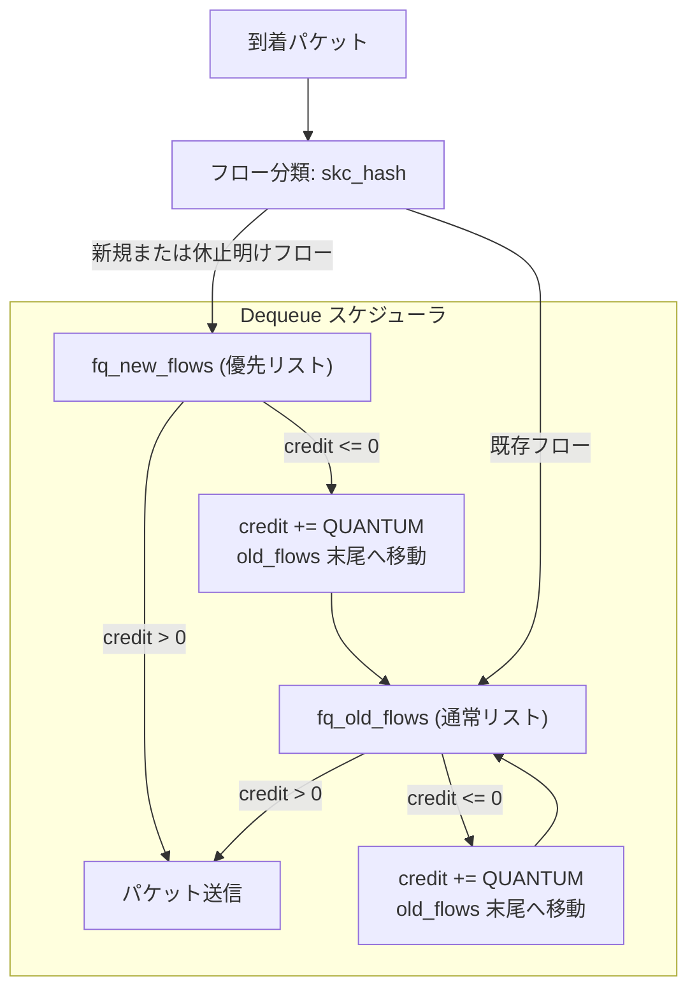
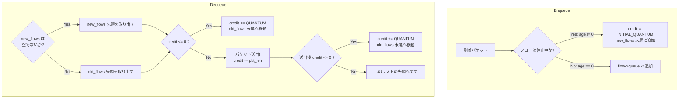

# 22. ハンズオン (5): BPF Qdisc と packetdrill で作る Fair Queueing (FQ) と EDT Pacing


このトラックでは、現代の高速 TCP（特に BBR や CUBIC）の真の性能を引き出すために不可欠なカーネル内スケジューラ **Fair Queueing (FQ) と Earliest Departure Time (EDT) ペーシング** を、Linux カーネルの BPF `struct_ops`（`struct Qdisc_ops`）を使ってゼロから実装します。

Qdisc やパケットスケジューリングの事前知識は前提としません。「なぜ単純な FIFO ではインターネットが渋滞するのか」「Deficit Round Robin (DRR) はどのような仕組みで帯域を公平に分け合うのか」「TCP のバースト送信を抑える EDT ペーシングはどのように動いているのか」を第一原理から整理しましょう。

---

## 1. そもそも Qdisc（Queueing Discipline）とは何か？

TCP ソケットが `write()` や `sendmsg()` で送信したパケットは、すぐに物理 NIC から電波や光として飛び出すわけではありません。ソケット層とデバイスドライバの間には、**Qdisc（Queueing Discipline：パケット送出キュー制御機構）** と呼ばれるトラフィック制御レイヤが存在します。

```text
+-----------------------+     +-----------------------+
|  TCP Socket (Flow A)  |     |  TCP Socket (Flow B)  |
+-----------------------+     +-----------------------+
            |                             |
            +--------------+--------------+
                           |
                           v
           +-------------------------------+
           |    Qdisc (Traffic Control)    |
           |   - フロー分類 (Classification)|
           |   - 帯域配分 (Fair Queuing)   |
           |   - 送信調歩 (EDT Pacing)     |
           +-------------------------------+
                           |
                           v
           +-------------------------------+
           |    Device Driver (Ring Buff)  |
           +-------------------------------+
                           |
                           v
           +-------------------------------+
           |         Physical NIC          |
           +-------------------------------+
```

Qdisc の最も単純な実装は **pfifo（単純な先入れ先出しキュー）** です。しかし、FIFO には重大な欠陥があります：

- **Fat Flow による回線占有**: 巨大なファイルを全力でダウンロードしているフロー（Fat Flow）があると、FIFO キューは常にそのフローのパケットで満杯になります。
- **Sparse Flow の遅延悪化**: その裏で SSH のキーストロークや DNS 問い合わせ、HTTP GET リクエストなどの小さなパケット（Sparse Flow / Thin Flow）を送信しようとすると、先行する巨大フローのパケットがすべて捌けるまで長い時間待たされ、遅延（RTT）が跳ね上がります。
- **バースト送信と自己パケットロス**: TCP は ACK を受信した瞬間に複数パケットを一気に送信する傾向があります（ACK クランキング / パケットバースト）。FIFO に一瞬で大量のパケットが押し寄せると、スイッチの浅いバッファが溢れて自分自身のパケットをドロップさせてしまいます。

これらの問題を解決するために Linux カーネルに導入されたのが **`sch_fq`（Fair Queueing Qdisc）** です。

---

## 2. FQ の第 1 の柱：Deficit Round Robin (DRR) と新規フロー優先

FQ は、到着したパケットをフロー（IP アドレスやポート番号、またはソケットハッシュ）ごとに個別のキューに振り分けます。そのうえで、2 つのリストを使ってパケットを送り出します。

- **`fq_new_flows`（新規・スパースフロー用リスト）**
- **`fq_old_flows`（継続的な大容量フロー用リスト）**



### なぜ 2 つのリストがあるとスパースフローが速くなるのか？

- **クレジット制度（Deficit Round Robin）**: 各フローはパケットを送信する権利として `credit`（バイト単位）を持ちます。パケットを 1 つ送るとそのパケット長（`qdisc_pkt_len(skb)`）だけクレジットが減ります。
- **クレジットの初期値**: フローが新しくできたとき、または通信が途切れてアイドル状態から再開したとき、初期クレジットとして多めの値（`INITIAL_QUANTUM = 2000` バイト）が与えられ、**`fq_new_flows` の末尾** に追加されます。
- **`fq_new_flows` の絶対優先**: Dequeue スケジューラは、**`fq_new_flows` にフローが存在する限り、決して `fq_old_flows` を処理しません**。
- **大容量フローの降格**: 巨大フローが連続してパケットを送り、クレジットがゼロ以下（`credit <= 0`）になると、次回の送信枠として `QUANTUM`（1500 バイト）が加算されたうえで、優先リストから降格されて **`fq_old_flows` の末尾** へ送られます。

この仕組みにより、時々しかパケットを送らない SSH や Web リクエスト（Sparse Flow）は、常に `fq_new_flows` に入って大容量ダウンロードのパケットを瞬時に追い抜き、待ち時間ほぼゼロで送信されます。

---

## 3. FQ の第 2 の柱：Earliest Departure Time (EDT) ペーシング

FQ のもう 1 つの革新的な機能が **EDT（Earliest Departure Time：最早出発時刻）ペーシング** です。

従来の TCP では、送信側が一気にパケットを放出してネットワークを渋滞させていました。Linux 4.20 以降の EDT モデルでは、TCP レイヤまたは FQ が **パケットごとに「ネットワークへ送り出すべき未来の時刻（`skb->tstamp`）」** を計算してスタンプします。

```text
パケット 1 (0 ms) ----> 即座に送信!
パケット 2 (5 ms) ----> まだ早い! fq_delayed (赤黒木) へ退避
パケット 3 (10 ms) ---> fq_delayed へ退避

   5 ms 経過後: Watchdog タイマー発火!
   パケット 2 ----> 送信!
```

### EDT の 3 つの要素

1. **目標送出時刻の計算**:
   ソケットに設定された目標レート（`sk_max_pacing_rate`）に基づき、各パケットの送出間隔を計算します：
   $$\Delta t = \frac{\text{packet len} \times 10^9}{\text{rate}}$$
   フローの次回送出予定時刻 `flow->time_next_packet` を順次進めていきます。
2. **遅延キュー（`fq_delayed`）と Watchdog タイマー**:
   Dequeue 時にパケットのスタンプ時刻が現在時刻より未来（`now < tstamp`）である場合、そのフローを赤黒木（`bpf_rb_root fq_delayed`）に退避し、`bpf_qdisc_watchdog_schedule()` でカーネルの高精度タイマーをセットします。タイマーが発火すると、再び Dequeue が呼ばれてパケットが送り出されます。
3. **ホライゾンチェック（Horizon Check）**:
   もしバグや設定ミスで 10 秒後や 1 分後といった遥か未来のタイムスタンプが付けられた場合、キューが永久に詰まるのを防ぐため、一定の猶予時間（`HORIZON_NS = 2` 秒）を超えた異常パケットは即座にドロップします。

---

## 4. このトラックで学ぶ技術スタック（BPF Graph Data Structures）

Linux 6.x で導入された最新の BPF 機能である **BPF Graph Data Structures（グラフデータ構造）** を本格的に活用します。

| BPF 機能 | 用途 |
| :--- | :--- |
| `struct_ops` (`struct Qdisc_ops`) | C 言語でカーネルモジュールを書く代わりに、BPF でセキュアかつ動的に Qdisc を実装・登録する |
| `bpf_list_head` / `bpf_list_node` | DRR の `fq_new_flows` / `fq_old_flows` キューおよびパケット FIFO キューを表現する |
| `bpf_rb_root` / `bpf_rb_node` | タイムスタンプ順のパケットソート、および時刻順の遅延フロー管理（`fq_delayed`）を $$O(\log N)$$ で実現する |
| `bpf_refcount` | フロー構造体がハッシュマップ（フローテーブル）とリスト（スケジューラ）の両方に同時に所属するための安全な参照カウント管理 |
| `bpf_kptr_xchg()` | カーネルポインタの所有権（Ownership）をアトミックに移動・交換する |
| `bpf_qdisc_watchdog_schedule()` | EDT の目標時刻に正確に Dequeue を再開させるためのカーネル kfunc |

---

## 5. ステップ一覧と実行コマンド

このトラックは以下の 2 ステップで構成されています。

| ステップ | ディレクトリ | 実装する内容 |
| :--- | :--- | :--- |
| **Step 1** | [`step01-flow-drr/`](step01-flow-drr/README.md) | ハッシュによるフロー分類、および `fq_new_flows` と `fq_old_flows` を使った Deficit Round Robin (DRR) スケジューラを実装し、大容量フローの裏でスパースフローが優先されることを確認します。 |
| **Step 2** | [`step02-edt-pacing/`](step02-edt-pacing/README.md) | 赤黒木（`bpf_rb_root`）を用いた Earliest Departure Time (EDT) ペーシング、遅延フロー管理（`fq_delayed`）、Watchdog スケジューリング、および未来パケットのホライゾンチェックを実装します。 |

### 実行コマンド

`labs/` ディレクトリ（`/usr/local/google/home/kuniyu/tcp-eli5/labs`）から `run_test.sh` を使って各ステップをビルド・検証できます。

```sh
# Step 1: まず starter が失敗することを確認し、TODO を実装してテストする
./run_test.sh qdisc-fq/step01-flow-drr starter
# Step 1 の模範解答 (solution.bpf.c) を実行する
./run_test.sh qdisc-fq/step01-flow-drr solution

# Step 2: starter の確認と模範解答の実行
./run_test.sh qdisc-fq/step02-edt-pacing starter
./run_test.sh qdisc-fq/step02-edt-pacing solution
```

それでは、[`step01-flow-drr/README.md`](step01-flow-drr/README.md) に進んで最初の BPF FQ スケジューラを実装してみましょう！


---

## Step 1: フロー分類と 2 リスト Deficit Round Robin (DRR)


## 1. 学習ゴール

このステップでは、Linux カーネルの Qdisc インターフェースである `struct Qdisc_ops` を BPF の `struct_ops` 機能で実装し、**Fair Queueing (FQ) の根幹であるフロー分類と 2 リスト Deficit Round Robin (DRR)** をゼロから組み立てます。

- トラック全体の概要は [FQ トラック README](#) を参照してください。

---

## 2. アルゴリズムと背景の解説（まずここを読む）

### 2.1 なぜフローごとにキューを分けるのか？（Flow Classification）

従来の FIFO（First-In First-Out）キューでは、すべての接続のパケットが 1 本のキューに直列に並びます。そのため、巨大なファイルを連続送信しているフロー（Flow A）があると、キューのほとんどが Flow A のパケットで埋まり、たまにしかパケットを送らない対話型通信（Flow B: SSH や Web リクエスト）も Flow A の後ろに並ばされて深刻な遅延（Bufferbloat）を被ります。

FQ では、到着したパケットのソケット情報（`sk->__sk_common.skc_hash`）または 4-tuple ハッシュ（`bpf_skb_get_hash(skb)`）をキーとして、**パケットをフローごとの独立したキュー（`struct fq_flow_node`）に振り分けます**。

### 2.2 Deficit Round Robin (DRR) の仕組み

フローごとにキューを分けた後、それぞれのキューからどのような順序でパケットを取り出す（Dequeue する）べきでしょうか？

単純なラウンドロビン（1 パケットずつ順番に取り出す）だと、パケットサイズが 1500 バイトのフローと 500 バイトのフローの間で、帯域が $$1500 : 500 = 3 : 1$$ と不公平になってしまいます。

そこで M. Shreedhar と G. Varghese によって考案されたのが **Deficit Round Robin (DRR)** です。

- **`QUANTUM`（クアンタム）**: 各フローにラウンドごとに付与される送信権の基本単位（バイト数、本ラボでは `1500` バイト）。
- **`credit`（クレジット）**: 各フローが現在保持している送信可能残高（バイト数）。
- **送信ルール**:
  - フローの先頭パケットの長さが `credit` 以下なら送信を許可し、`credit -= packet_len` と減算します。
  - `credit` が `0` 以下になったら、そのラウンドでの送信権を使い切ったと判断し、次回の送信枠として `QUANTUM` を足し（`credit += QUANTUM`）、キューの末尾へ回します。

### 2.3 2 リスト方式：なぜ `fq_new_flows` と `fq_old_flows` に分けるのか？

Linux の `sch_fq` および `sch_fq_codel` の極めて重要な工夫が、**アクティブなフローを 2 つのリストに分類すること** です。



1. **`fq_new_flows` の絶対優先**: Dequeue 時、スケジューラは **`fq_new_flows` が空になるまで、決して `fq_old_flows` からパケットを取り出しません**。
2. **休止中（Detached）フローの復活**:
   - アイドル状態（キューにパケットがない状態）のフローはリストから外され、`age != 0`（休止中）とマークされます。
   - 新しいパケットが届くと、初期クレジットとして多めの `INITIAL_QUANTUM`（2000 バイト）が与えられ、**`fq_new_flows` の末尾** に追加されます。
3. **継続的大容量フローの降格**:
   - 連続してパケットを送り続けるフローは、1〜2 パケット送ったところで `credit <= 0` となり、自動的に **`fq_old_flows` に降格** されます。

この 2 リスト構造により、時々しかパケットを送らないスパースフロー（Flow B）は、到着するたびに `fq_new_flows` に入るため、**大容量ダウンロードで `fq_old_flows` に溜まっている大量のパケットを一瞬でごぼう抜きして最優先で送信される** のです。

### 2.4 具体数値トレース（本ステップの `test.pkt` シナリオ）

本ステップの `test.pkt` で実際に起きる動作をトレースしてみましょう。
設定値：`INITIAL_QUANTUM = 2000`, `QUANTUM = 1500`, パケット長 $$\approx 1028$$ バイト（UDP 1000B ペイロード + ヘッダ）, ボトルネック送信間隔 `BOTTLENECK_NS = 2 ms`。

| 時刻 | イベント | Flow A の状態 | Flow B の状態 | 送出パケット | 解説 |
| :--- | :--- | :--- | :--- | :--- | :--- |
| **+0.000** | Flow A が 4000B 送信<br>(4 パケット到着) | `credit = 2000`<br>`fq_new_flows` 所属 | 未接続 / アイドル | **Flow A: Pkt 1** (1000B) | Pkt 1 送出で `credit = 2000 - 1028 = 972 > 0`。<br>まだ残高があるので `fq_new_flows` 先頭に留まる。<br>次回送出可能時刻は `+2 ms`。 |
| **+0.002** | タイマー発火 (2 ms 経過) | `credit = 972`<br>`fq_new_flows` 所属 | 未接続 / アイドル | **Flow A: Pkt 2** (1000B) | Pkt 2 送出で `credit = 972 - 1028 = -56 <= 0`！<br>残高が尽きたため `credit += 1500 = 1444` となり、**`fq_old_flows` へ降格**！ |
| **+0.002** | **Flow B が 500B 送信** | `credit = 1444`<br>`fq_old_flows` 所属<br>(Pkt 3, 4 が待機中) | **休止から復帰！**<br>`credit = 2000`<br>**`fq_new_flows` に追加！** | — | Flow B は休止中だったため優先リスト `fq_new_flows` に入る！ |
| **+0.004** | タイマー発火 (4 ms 経過) | `fq_old_flows` で待機中 | **`fq_new_flows` 先頭** | **Flow B: 500B パケット！** | `fq_new_flows` が絶対優先されるため、**Flow A の Pkt 3・4 より先に Flow B が送出される！** |
| **+0.006** | タイマー発火 (6 ms 経過) | `fq_old_flows` 先頭 | 送信完了（休止へ） | **Flow A: Pkt 3** (1000B) | `fq_new_flows` が空になったため、`fq_old_flows` の Flow A が再開。 |
| **+0.008** | タイマー発火 (8 ms 経過) | `fq_old_flows` 先頭 | 休止中 | **Flow A: Pkt 4** (1000B) | Flow A の最後のパケットが送出される。 |

---

## 3. 設計チェックポイント

`starter.bpf.c` の TODO を実装するための設計の問いです。

### Q1. フローの参照カウント（`bpf_refcount`）の役割は何ですか？

<details>
<summary>ヒントと答え</summary>

- **ヒント**: フロー構造体 `struct fq_flow_node` は、パケットを分類するためのハッシュマップ `fq_flows` に常駐しつつ、スケジューリングリスト（`fq_new_flows` や `fq_old_flows`）にも所属します。
- **答え**: ハッシュマップ内のポインタ `sflow->flow` が 1 つ目の参照（参照カウント 1）を持ちます。フローがアクティブ化されてリストに繋がれる際、`flow_copy = bpf_refcount_acquire(flow)` で 2 つ目の参照を獲得してリストに渡します（参照カウント 2）。パケットがすべて捌けて休止する際、リストから取り出した参照を `bpf_obj_drop(flow)` で破棄します（参照カウント 1 に戻る）。これにより、リストから外れてもハッシュマップ側で安全に保持され続けます。

</details>

### Q2. Dequeue 時、フローの `credit` が `0` 以下の場合はどう処理しますか？

<details>
<summary>ヒントと答え</summary>

- **ヒント**: DRR では、残高がマイナスまたはゼロのフローはそのラウンドでパケットを送る権利がありません。
- **答え**: `flow->credit += QUANTUM`（1500 バイト）を加算して次回の送信枠を与えたうえで、そのフローを `fq_old_flows` の **末尾（Tail）** に追加し、ループを `continue` して次のフローの検査に移ります。

</details>

### Q3. ボトルネックレート（`BOTTLENECK_NS`）の制限とタイマーはどう連携しますか？

<details>
<summary>ヒントと答え</summary>

- **ヒント**: 前回のパケット送出から 2 ms 経過していない場合、勝手にパケットを送り出してはいけません。
- **答え**: `now = bpf_ktime_get_ns();` を取得し、`now < next_tx_ns` ならば `bpf_qdisc_watchdog_schedule(sch, next_tx_ns, 0)` を呼び出してカーネルの高精度タイマーを予約し、その場ですぐに `NULL` を返します。

</details>

---

## 4. テストと動作確認

```sh
cd /usr/local/google/home/kuniyu/tcp-eli5/labs

# 1. 未実装の starter が失敗することを確認する
./run_test.sh qdisc-fq/step01-flow-drr starter

# 2. 模範解答 (solution) が PASS することを確認する
./run_test.sh qdisc-fq/step01-flow-drr solution
```


### `labs/qdisc-fq/step01-flow-drr/starter.bpf.c` (穴埋めスケルトン)

```c
// SPDX-License-Identifier: GPL-2.0
#include "vmlinux.h"
#include "bpf_qdisc_helpers.h"

#define ENOMEM 12

char _license[] SEC("license") = "GPL";

#define QUANTUM 1500
#define INITIAL_QUANTUM 2000
#define BOTTLENECK_NS 2000000ULL

#define NUM_FLOWS 1024

struct skb_node {
	struct sk_buff __kptr *skb;
	struct bpf_list_node node;
};

struct fq_flow_node {
	s64 credit;
	u32 qlen;
	u64 age;
	struct bpf_list_node list_node;
	struct bpf_list_head queue __contains(skb_node, node);
	struct bpf_spin_lock lock;
	struct bpf_refcount refcount;
};

struct fq_stashed_flow {
	struct fq_flow_node __kptr *flow;
};

struct {
	__uint(type, BPF_MAP_TYPE_HASH);
	__type(key, __u64);
	__type(value, struct fq_stashed_flow);
	__uint(max_entries, NUM_FLOWS);
} fq_flows SEC(".maps");

private(A) struct bpf_spin_lock fq_new_flows_lock;
private(A) struct bpf_list_head fq_new_flows __contains(fq_flow_node, list_node);

private(B) struct bpf_spin_lock fq_old_flows_lock;
private(B) struct bpf_list_head fq_old_flows __contains(fq_flow_node, list_node);

private(C) u32 fq_new_flow_cnt;
private(C) u32 fq_old_flow_cnt;
private(C) u64 next_tx_ns;

static void bpf_kptr_xchg_back(void *map_val, void *ptr)
{
	void *ret;

	ret = bpf_kptr_xchg(map_val, ptr);
	if (ret)
		bpf_obj_drop(ret);
}

/* TODO 1: Implement per-flow classification.
 * If the socket exists and has sk->__sk_common.skc_hash set, return it.
 * Otherwise, fall back to bpf_skb_get_hash(skb).
 */
static u64 fq_classify(struct sk_buff *skb)
{
	/* [YOUR CODE HERE] */
	return 0;
}

static int fq_new_flow(struct fq_stashed_flow **sflow, u64 hash)
{
	struct fq_stashed_flow tmp = {};
	struct fq_flow_node *flow;
	int ret;

	flow = bpf_obj_new(typeof(*flow));
	if (!flow)
		return -ENOMEM;

	flow->credit = INITIAL_QUANTUM;
	flow->qlen = 0;
	flow->age = 1;

	ret = bpf_map_update_elem(&fq_flows, &hash, &tmp, 0);
	if (ret < 0) {
		bpf_obj_drop(flow);
		return ret;
	}

	*sflow = bpf_map_lookup_elem(&fq_flows, &hash);
	if (!*sflow) {
		bpf_obj_drop(flow);
		return -ENOMEM;
	}

	bpf_kptr_xchg_back(&(*sflow)->flow, flow);
	return 0;
}

SEC("struct_ops/bpf_fq_drr_enqueue")
int BPF_PROG(bpf_fq_drr_enqueue, struct sk_buff *skb, struct Qdisc *sch,
	     struct bpf_sk_buff_ptr *to_free)
{
	struct fq_flow_node *flow = NULL, *flow_copy;
	struct fq_stashed_flow *sflow;
	struct skb_node *skbn;
	u64 hash;

	if (sch->q.qlen >= sch->limit)
		goto drop;

	hash = fq_classify(skb);
	sflow = bpf_map_lookup_elem(&fq_flows, &hash);
	if (!sflow) {
		if (fq_new_flow(&sflow, hash) < 0)
			goto drop;
	}

	flow = bpf_kptr_xchg(&sflow->flow, flow);
	if (!flow)
		goto drop;

	/* TODO 2: Flow attachment in DRR
	 * When a detached flow (flow->age != 0) receives a packet:
	 * 1. Acquire an extra refcount reference using bpf_refcount_acquire(flow).
	 * 2. Set flow_copy->credit = INITIAL_QUANTUM (2000).
	 * 3. Mark flow_copy attached (flow_copy->age = 0).
	 * 4. Push flow_copy to the tail of fq_new_flows under fq_new_flows_lock.
	 * 5. Increment fq_new_flow_cnt.
	 */
	/* [YOUR CODE HERE] */

	skbn = bpf_obj_new(typeof(*skbn));
	if (!skbn) {
		bpf_kptr_xchg_back(&sflow->flow, flow);
		goto drop;
	}

	sch->qstats.backlog += qdisc_pkt_len(skb);
	skb = bpf_kptr_xchg(&skbn->skb, skb);
	if (skb)
		bpf_qdisc_skb_drop(skb, to_free);

	bpf_spin_lock(&flow->lock);
	bpf_list_push_back(&flow->queue, &skbn->node);
	bpf_spin_unlock(&flow->lock);

	flow->qlen++;
	bpf_kptr_xchg_back(&sflow->flow, flow);

	sch->q.qlen++;
	return NET_XMIT_SUCCESS;

drop:
	bpf_qdisc_skb_drop(skb, to_free);
	sch->qstats.drops++;
	return NET_XMIT_DROP;
}

SEC("struct_ops/bpf_fq_drr_dequeue")
struct sk_buff *BPF_PROG(bpf_fq_drr_dequeue, struct Qdisc *sch)
{
	/* TODO 3: Rate enforcement
	 * Read current time: u64 now = bpf_ktime_get_ns();
	 * If now < next_tx_ns, schedule watchdog timer with:
	 *   bpf_qdisc_watchdog_schedule(sch, next_tx_ns, 0);
	 * and return NULL.
	 */

	/* TODO 4: DRR 2-list round-robin dequeue
	 * Loop through active flows (bpf_for(i, 0, sch->limit)):
	 * 1. Select fq_new_flows if fq_new_flow_cnt > 0, else fq_old_flows.
	 * 2. Pop the front flow.
	 * 3. If flow->credit <= 0:
	 *      flow->credit += QUANTUM;
	 *      push flow to the tail of fq_old_flows;
	 *      continue loop.
	 * 4. Pop the front packet skbn from flow->queue.
	 * 5. If flow->queue was empty:
	 *      if flow came from fq_new_flows and fq_old_flows is non-empty,
	 *        push to fq_old_flows;
	 *      else mark detached (flow->age = bpf_jiffies64() ?: 1) and bpf_obj_drop(flow);
	 *      continue loop.
	 * 6. Subtract qdisc_pkt_len(skb) from flow->credit.
	 *    If flow->credit <= 0:
	 *      flow->credit += QUANTUM;
	 *      push to tail of fq_old_flows;
	 *    else
	 *      push to head of its current list.
	 * 7. Update next_tx_ns = now + BOTTLENECK_NS, update qstats, and return skb.
	 */

	/* [YOUR CODE HERE] */
	return NULL;
}

static int fq_remove_flows_in_list(u32 index, void *ctx)
{
	struct bpf_list_node *node;
	struct fq_flow_node *flow;

	bpf_spin_lock(&fq_new_flows_lock);
	node = bpf_list_pop_front(&fq_new_flows);
	bpf_spin_unlock(&fq_new_flows_lock);
	if (!node) {
		bpf_spin_lock(&fq_old_flows_lock);
		node = bpf_list_pop_front(&fq_old_flows);
		bpf_spin_unlock(&fq_old_flows_lock);
		if (!node)
			return 1;
	}

	flow = container_of(node, struct fq_flow_node, list_node);
	bpf_obj_drop(flow);
	return 0;
}

static int fq_remove_map_flow(struct bpf_map *map, u64 *key,
			      struct fq_stashed_flow *sflow, void *ctx)
{
	bpf_map_delete_elem(map, key);
	return 0;
}

SEC("struct_ops/bpf_fq_drr_reset")
void BPF_PROG(bpf_fq_drr_reset, struct Qdisc *sch)
{
	sch->q.qlen = 0;
	sch->qstats.backlog = 0;
	next_tx_ns = 0;

	bpf_loop(NUM_FLOWS, fq_remove_flows_in_list, NULL, 0);
	fq_new_flow_cnt = 0;
	fq_old_flow_cnt = 0;

	bpf_for_each_map_elem(&fq_flows, fq_remove_map_flow, NULL, 0);
}

SEC("struct_ops/bpf_fq_drr_init")
int BPF_PROG(bpf_fq_drr_init, struct Qdisc *sch, struct nlattr *opt,
	     struct netlink_ext_ack *extack)
{
	sch->limit = 1000;
	fq_new_flow_cnt = 0;
	fq_old_flow_cnt = 0;
	next_tx_ns = 0;
	return 0;
}

SEC("struct_ops/bpf_fq_drr_destroy")
void BPF_PROG(bpf_fq_drr_destroy, struct Qdisc *sch)
{
}

SEC(".struct_ops")
struct Qdisc_ops fq_drr = {
	.enqueue   = (void *)bpf_fq_drr_enqueue,
	.dequeue   = (void *)bpf_fq_drr_dequeue,
	.reset     = (void *)bpf_fq_drr_reset,
	.init      = (void *)bpf_fq_drr_init,
	.destroy   = (void *)bpf_fq_drr_destroy,
	.id        = "bpf_fq_drr",
};
```

### `labs/qdisc-fq/step01-flow-drr/test.pkt` (packetdrill テスト)

```python
// SPDX-License-Identifier: GPL-2.0
// Step 1: Test BPF FQ Deficit Round Robin (DRR) and Sparse Flow Prioritization

0.00 `tc qdisc replace dev tun0 root bpf_fq_drr`
+0.00 `ethtool -K tun0 tso off gso off`

// Setup Flow A (fd 3)
+0.00 socket(..., SOCK_DGRAM, IPPROTO_UDP) = 3
+0.00 connect(3, ..., ...) = 0

// Setup Flow B (fd 4)
+0.00 socket(..., SOCK_DGRAM, IPPROTO_UDP) = 4
+0.00 connect(4, ..., ...) = 0

// Flow A sends 4 packets (1,000 bytes each) at t = 0
+0.00 write(3, ..., 1000) = 1000
+0.00 write(3, ..., 1000) = 1000
+0.00 write(3, ..., 1000) = 1000
+0.00 write(3, ..., 1000) = 1000

// Packet 1 of Flow A departs immediately at t = 0 (credit drops 2000 -> 972 > 0)
+0.00 > udp (1000)

// At +0.002, Packet 2 dequeues (credit drops 972 -> -56 <= 0, Flow A moves to fq_old_flows)
+0.002 > udp (1000)

// At +0.002, sparse Flow B sends a 500-byte packet. It enters fq_new_flows!
+0.00 write(4, ..., 500) = 500

// At next slot (+0.004), Flow B's 500-byte packet is dequeued BEFORE Flow A's remaining packets!
+0.002 > udp (500)

// Then Flow A's remaining packets dequeue at +0.006 and +0.008
+0.002 > udp (1000)
+0.002 > udp (1000)
```

<details>
<summary>模範解答: <code>labs/qdisc-fq/step01-flow-drr/solution.bpf.c</code></summary>

```c
// SPDX-License-Identifier: GPL-2.0
#include "vmlinux.h"
#include "bpf_qdisc_helpers.h"

#define ENOMEM 12

char _license[] SEC("license") = "GPL";

#define QUANTUM 1500
#define INITIAL_QUANTUM 2000
#define BOTTLENECK_NS 2000000ULL

#define NUM_FLOWS 1024

struct skb_node {
	struct sk_buff __kptr *skb;
	struct bpf_list_node node;
};

struct fq_flow_node {
	s64 credit;
	u32 qlen;
	u64 age;
	struct bpf_list_node list_node;
	struct bpf_list_head queue __contains(skb_node, node);
	struct bpf_spin_lock lock;
	struct bpf_refcount refcount;
};

struct fq_stashed_flow {
	struct fq_flow_node __kptr *flow;
};

struct {
	__uint(type, BPF_MAP_TYPE_HASH);
	__type(key, __u64);
	__type(value, struct fq_stashed_flow);
	__uint(max_entries, NUM_FLOWS);
} fq_flows SEC(".maps");

private(A) struct bpf_spin_lock fq_new_flows_lock;
private(A) struct bpf_list_head fq_new_flows __contains(fq_flow_node, list_node);

private(B) struct bpf_spin_lock fq_old_flows_lock;
private(B) struct bpf_list_head fq_old_flows __contains(fq_flow_node, list_node);

private(C) u32 fq_new_flow_cnt;
private(C) u32 fq_old_flow_cnt;
private(C) u64 next_tx_ns;

static void bpf_kptr_xchg_back(void *map_val, void *ptr)
{
	void *ret;

	ret = bpf_kptr_xchg(map_val, ptr);
	if (ret)
		bpf_obj_drop(ret);
}

static u64 fq_classify(struct sk_buff *skb)
{
	struct sock *sk = skb->sk;

	if (sk && sk->__sk_common.skc_hash)
		return (u64)sk->__sk_common.skc_hash;

	u64 hash = (u64)bpf_skb_get_hash(skb);
	if (!hash)
		hash = 1;
	return hash;
}

static int fq_new_flow(struct fq_stashed_flow **sflow, u64 hash)
{
	struct fq_stashed_flow tmp = {};
	struct fq_flow_node *flow;
	int ret;

	flow = bpf_obj_new(typeof(*flow));
	if (!flow)
		return -ENOMEM;

	flow->credit = INITIAL_QUANTUM;
	flow->qlen = 0;
	flow->age = 1;

	ret = bpf_map_update_elem(&fq_flows, &hash, &tmp, 0);
	if (ret < 0) {
		bpf_obj_drop(flow);
		return ret;
	}

	*sflow = bpf_map_lookup_elem(&fq_flows, &hash);
	if (!*sflow) {
		bpf_obj_drop(flow);
		return -ENOMEM;
	}

	bpf_kptr_xchg_back(&(*sflow)->flow, flow);
	return 0;
}

SEC("struct_ops/bpf_fq_drr_enqueue")
int BPF_PROG(bpf_fq_drr_enqueue, struct sk_buff *skb, struct Qdisc *sch,
	     struct bpf_sk_buff_ptr *to_free)
{
	struct fq_flow_node *flow = NULL, *flow_copy;
	struct fq_stashed_flow *sflow;
	struct skb_node *skbn;
	u64 hash;

	if (sch->q.qlen >= sch->limit)
		goto drop;

	hash = fq_classify(skb);
	sflow = bpf_map_lookup_elem(&fq_flows, &hash);
	if (!sflow) {
		if (fq_new_flow(&sflow, hash) < 0)
			goto drop;
	}

	flow = bpf_kptr_xchg(&sflow->flow, flow);
	if (!flow)
		goto drop;

	if (flow->age != 0) {
		/* Flow is detached */
		flow_copy = bpf_refcount_acquire(flow);
		flow_copy->credit = INITIAL_QUANTUM;
		flow_copy->age = 0;
		bpf_spin_lock(&fq_new_flows_lock);
		bpf_list_push_back(&fq_new_flows, &flow_copy->list_node);
		bpf_spin_unlock(&fq_new_flows_lock);
		fq_new_flow_cnt++;
	}

	skbn = bpf_obj_new(typeof(*skbn));
	if (!skbn) {
		bpf_kptr_xchg_back(&sflow->flow, flow);
		goto drop;
	}

	sch->qstats.backlog += qdisc_pkt_len(skb);
	skb = bpf_kptr_xchg(&skbn->skb, skb);
	if (skb)
		bpf_qdisc_skb_drop(skb, to_free);

	bpf_spin_lock(&flow->lock);
	bpf_list_push_back(&flow->queue, &skbn->node);
	bpf_spin_unlock(&flow->lock);

	flow->qlen++;
	bpf_kptr_xchg_back(&sflow->flow, flow);

	sch->q.qlen++;
	return NET_XMIT_SUCCESS;

drop:
	bpf_qdisc_skb_drop(skb, to_free);
	sch->qstats.drops++;
	return NET_XMIT_DROP;
}

SEC("struct_ops/bpf_fq_drr_dequeue")
struct sk_buff *BPF_PROG(bpf_fq_drr_dequeue, struct Qdisc *sch)
{
	struct bpf_list_head *head;
	struct bpf_spin_lock *lock;
	struct bpf_list_node *node;
	struct fq_flow_node *flow;
	struct sk_buff *skb = NULL;
	struct skb_node *skbn;
	u64 now;
	int i;

	if (!sch->q.qlen)
		return NULL;

	now = bpf_ktime_get_ns();
	if (now < next_tx_ns) {
		bpf_qdisc_watchdog_schedule(sch, next_tx_ns, 0);
		return NULL;
	}

	bpf_for(i, 0, sch->limit) {
		bool from_new = false;

		if (fq_new_flow_cnt) {
			head = &fq_new_flows;
			lock = &fq_new_flows_lock;
			from_new = true;
		} else if (fq_old_flow_cnt) {
			head = &fq_old_flows;
			lock = &fq_old_flows_lock;
			from_new = false;
		} else {
			break;
		}

		bpf_spin_lock(lock);
		node = bpf_list_pop_front(head);
		bpf_spin_unlock(lock);
		if (!node)
			break;

		if (from_new)
			fq_new_flow_cnt--;
		else
			fq_old_flow_cnt--;

		flow = container_of(node, struct fq_flow_node, list_node);

		if (flow->credit <= 0) {
			flow->credit += QUANTUM;
			bpf_spin_lock(&fq_old_flows_lock);
			bpf_list_push_back(&fq_old_flows, &flow->list_node);
			bpf_spin_unlock(&fq_old_flows_lock);
			fq_old_flow_cnt++;
			continue;
		}

		bpf_spin_lock(&flow->lock);
		node = bpf_list_pop_front(&flow->queue);
		bpf_spin_unlock(&flow->lock);

		if (!node) {
			if (from_new && fq_old_flow_cnt > 0) {
				bpf_spin_lock(&fq_old_flows_lock);
				bpf_list_push_back(&fq_old_flows, &flow->list_node);
				bpf_spin_unlock(&fq_old_flows_lock);
				fq_old_flow_cnt++;
			} else {
				flow->age = bpf_jiffies64() ?: 1;
				bpf_obj_drop(flow);
			}
			continue;
		}

		skbn = container_of(node, struct skb_node, node);
		skb = bpf_kptr_xchg(&skbn->skb, skb);
		bpf_obj_drop(skbn);

		if (!skb) {
			flow->age = bpf_jiffies64() ?: 1;
			bpf_obj_drop(flow);
			continue;
		}

		flow->credit -= qdisc_pkt_len(skb);
		flow->qlen--;

		if (flow->credit <= 0) {
			flow->credit += QUANTUM;
			bpf_spin_lock(&fq_old_flows_lock);
			bpf_list_push_back(&fq_old_flows, &flow->list_node);
			bpf_spin_unlock(&fq_old_flows_lock);
			fq_old_flow_cnt++;
		} else {
			bpf_spin_lock(lock);
			bpf_list_push_front(head, &flow->list_node);
			bpf_spin_unlock(lock);
			if (from_new)
				fq_new_flow_cnt++;
			else
				fq_old_flow_cnt++;
		}

		next_tx_ns = now + BOTTLENECK_NS;
		sch->q.qlen--;
		sch->qstats.backlog -= qdisc_pkt_len(skb);
		bpf_qdisc_bstats_update(sch, skb);
		return skb;
	}

	return NULL;
}

static int fq_remove_flows_in_list(u32 index, void *ctx)
{
	struct bpf_list_node *node;
	struct fq_flow_node *flow;

	bpf_spin_lock(&fq_new_flows_lock);
	node = bpf_list_pop_front(&fq_new_flows);
	bpf_spin_unlock(&fq_new_flows_lock);
	if (!node) {
		bpf_spin_lock(&fq_old_flows_lock);
		node = bpf_list_pop_front(&fq_old_flows);
		bpf_spin_unlock(&fq_old_flows_lock);
		if (!node)
			return 1;
	}

	flow = container_of(node, struct fq_flow_node, list_node);
	bpf_obj_drop(flow);
	return 0;
}

static int fq_remove_map_flow(struct bpf_map *map, u64 *key,
			      struct fq_stashed_flow *sflow, void *ctx)
{
	bpf_map_delete_elem(map, key);
	return 0;
}

SEC("struct_ops/bpf_fq_drr_reset")
void BPF_PROG(bpf_fq_drr_reset, struct Qdisc *sch)
{
	sch->q.qlen = 0;
	sch->qstats.backlog = 0;
	next_tx_ns = 0;

	bpf_loop(NUM_FLOWS, fq_remove_flows_in_list, NULL, 0);
	fq_new_flow_cnt = 0;
	fq_old_flow_cnt = 0;

	bpf_for_each_map_elem(&fq_flows, fq_remove_map_flow, NULL, 0);
}

SEC("struct_ops/bpf_fq_drr_init")
int BPF_PROG(bpf_fq_drr_init, struct Qdisc *sch, struct nlattr *opt,
	     struct netlink_ext_ack *extack)
{
	sch->limit = 1000;
	fq_new_flow_cnt = 0;
	fq_old_flow_cnt = 0;
	next_tx_ns = 0;
	return 0;
}

SEC("struct_ops/bpf_fq_drr_destroy")
void BPF_PROG(bpf_fq_drr_destroy, struct Qdisc *sch)
{
}

SEC(".struct_ops")
struct Qdisc_ops fq_drr = {
	.enqueue   = (void *)bpf_fq_drr_enqueue,
	.dequeue   = (void *)bpf_fq_drr_dequeue,
	.reset     = (void *)bpf_fq_drr_reset,
	.init      = (void *)bpf_fq_drr_init,
	.destroy   = (void *)bpf_fq_drr_destroy,
	.id        = "bpf_fq_drr",
};
```

</details>


---

## Step 2: Earliest Departure Time (EDT) ペーシングとホライゾンチェック


## 1. 学習ゴール

このステップでは、赤黒木（`bpf_rb_root`）を活用して、現代の Linux カーネルの核心的ペーシング機構である **Earliest Departure Time (EDT) ペーシング** と **ホライゾンチェック（Horizon Drop）** を BPF `struct_ops`（`struct Qdisc_ops`）として実装します。

- トラック全体の概要は [FQ トラック README](#) を参照してください。

---

## 2. アルゴリズムと背景の解説（まずここを読む）

### 2.1 なぜパケットペーシングが必要なのか？

TCP は ACK を受信するたびに新しいデータを送信します。受信側が複数のパケットをまとめて ACK（Delayed ACK や LRO/GRO）すると、送信側は 10〜30 パケットを **NIC の最大回線速度（ワイヤレート）で一気に連射（バースト送信）** してしまいます。

```text
従来のバースト送信:
||||||||||||                ||||||||||||                ||||||||||||
[-- 10連射パケット --]      [-- 10連射パケット --]      [-- 10連射パケット --]
(スイッチのバッファが瞬間的に溢れて自己パケットロス！)

EDT ペーシング送信:
|   |   |   |   |   |   |   |   |   |   |   |   |   |   |   |   |   |   |
(RTT 全体に均等に散らばるため、バッファを消費せず低遅延を維持！)
```

バースト送信が途中のボトルネックスイッチに突入すると、瞬間的にスイッチのバッファが満杯になってパケットロスが発生します。
そこで、パケット同士の間隔を均等に空けて **小川のようにサラサラと流す（Pacing）** 仕組みが不可欠です。

### 2.2 Earliest Departure Time (EDT) モデル

Linux 4.20 で導入された **EDT モデル** では、ソケットが設定した目標レート（`sk->sk_max_pacing_rate`）に基づき、各パケットに「このパケットは未来の時刻 $$t$$ に送信せよ」という **最早出発時刻（`skb->tstamp`）** をスタンプします。

パケット送信予定時刻 `time_to_send` は次のように計算されます：

1. **明示的な `skb->tstamp` がある場合**: TCP レイヤ（TCP Pacing や BBR）がすでに計算したタイムスタンプ `skb->tstamp` をそのまま使用します。
2. **ソケットの `sk_max_pacing_rate` が有効な場合**:
   現在のフローの次回送出時刻 `flow->time_next_packet` と現在時刻 `now` の大きい方を基準とします：
   $$\text{time to send} = \max(\text{flow} \to \text{next packet time}, \text{now})$$
   そして、このパケットを送るのに必要な時間幅（$$\Delta t$$）を足して、次回のパケットのために `time_next_packet` を進めます：
   $$\text{flow} \to \text{next packet time} = \text{time to send} + \frac{\text{packet len} \times 10^9}{\text{rate}}$$
3. **上記以外**: 即座に送出可能（`time_to_send = now`）とします。

### 2.3 遅延フロー管理（`fq_delayed`）と Watchdog タイマー

Dequeue 時にフローの先頭パケットを取り出した際、そのパケットの `time_to_send` が現在時刻 `now` より未来（`now < time_to_send`）だった場合：

1. **フローをスロットル（Throttled）状態にする**: `flow->age = ~0ULL` とマークし、赤黒木 **`fq_delayed`** に挿入します（キーは `flow->time_next_packet`）。
2. **Watchdog タイマーのセット**: 最も早く解禁される時刻（`time_next_delayed_flow`）をカーネルのタイマー機構 `bpf_qdisc_watchdog_schedule()` に登録します。
3. **タイマー発火と復帰**: タイマーが発火して次回 Dequeue が呼ばれると、`fq_check_throttled(now)` が実行され、現在時刻を過ぎたフローが `fq_delayed` から取り出されて `fq_old_flows` に復帰します。

### 2.4 ホライゾンチェック（Horizon Check）

もしアプリケーションの誤動作や設定ミスにより、`setsockopt(..., SO_MAX_PACING_RATE)` に極端に小さい値（例: 100 バイト/秒）が設定されたり、遥か未来のタイムスタンプが付けられたらどうなるでしょうか？

1000 バイトのパケット 1 つで送出間隔が 10 秒以上も伸びてしまい、キューの中に何秒・何分もパケットが滞留し続けることになります。これはメモリの枯渇やタイムアウトを招きます。

そこで FQ は **ホライゾン（`HORIZON_NS = 2` 秒）** を設定し、現在時刻より 2 秒以上先の未来に送信予定となる異常パケットは、キューに入れずに即座にドロップ（`NET_XMIT_DROP`）します。

---

## 3. 具体数値トレース（本ステップの `test.pkt` シナリオ）

設定値：`SO_MAX_PACING_RATE = 200,000` バイト/秒（200 KB/s）、パケット長 $$\approx 1066$$ バイト。
パケットあたりの所要時間：
$$\Delta t = \frac{1066 \times 10^9}{200,000} = 5,330,000 \text{ ns} \approx 5.33 \text{ ms}$$

| イベント | 送出時刻 | 状態遷移とタイマー |
| :--- | :--- | :--- |
| `write(4, ..., 3000)` (3 セグメント) | **+0.000** | Pkt 1 (1:1001) の目標時刻は `now` なので **即座に送出**！<br>`time_next_packet` は `now + 5.33 ms` へ進む。 |
| Pkt 2 の検査 | — | Pkt 2 の目標時刻は `+5.33 ms`（未来）。<br>フローは `fq_delayed` へ退避され、タイマーがセットされる。 |
| タイマー発火 (+5.33 ms) | **~ +0.005** | Pkt 2 (1001:2001) が **Watchdog によって送出**！<br>`time_next_packet` は `now + 10.66 ms` へ進む。 |
| タイマー発火 (+10.66 ms) | **~ +0.010** | Pkt 3 (2001:3001) が **Watchdog によって送出**！ |
| `SO_MAX_PACING_RATE = 100` B/s に設定 | — | 1000B パケットで $$\Delta t = \frac{1066 \times 10^9}{100} > 10$$ 秒！ |
| `write(4, ..., 2000)` (2 セグメント) | **+0.000** | Pkt 1 (3001:4001) が送出され、`time_next_packet` は `now + 10.66s` へ進む。 |
| Pkt 2 の Enqueue | — | Pkt 2 の目標時刻は `now + 10.66s` となり、**`now + 2s` のホライゾンを超過**！<br>`bpf_qdisc_skb_drop()` で **即座にドロップ**！ |

---

## 4. 設計チェックポイント

### Q1. `time_to_send` の計算優先順位はどうなっていますか？

<details>
<summary>ヒントと答え</summary>

- **ヒント**: `skb->tstamp` がすでに設定されているケース、ソケットのペーシングレートがあるケース、どちらもないケースの 3 通りがあります。
- **答え**:
  1. `skb->tstamp != 0` の場合はその値を優先します。
  2. そうでなく `rate > 0 && rate != ~0ULL` の場合は `max(flow->time_next_packet, now)` を用います。
  3. それ以外は `now` を使用します。

</details>

### Q2. ホライゾンドロップの判定式と後始末はどう記述しますか？

<details>
<summary>ヒントと答え</summary>

- **ヒント**: 符号付き 64 ビット整数（`s64`）で比較し、マップから取り出していた `flow` のポインタを忘れずに戻します。
- **答え**:
  ```c
  if ((s64)time_to_send > (s64)(now + HORIZON_NS)) {
      bpf_kptr_xchg_back(&sflow->flow, flow);
      goto drop;
  }
  ```
  `drop` ラベルでは `sch->qstats.drops++` を加算し、`bpf_qdisc_skb_drop(skb, to_free)` を呼び出して `NET_XMIT_DROP` を返します。

</details>

---

## 5. テストと動作確認

```sh
cd /usr/local/google/home/kuniyu/tcp-eli5/labs

# 1. 未実装の starter が失敗することを確認する
./run_test.sh qdisc-fq/step02-edt-pacing starter

# 2. 模範解答 (solution) が PASS することを確認する
./run_test.sh qdisc-fq/step02-edt-pacing solution
```


### `labs/qdisc-fq/step02-edt-pacing/starter.bpf.c` (穴埋めスケルトン)

```c
// SPDX-License-Identifier: GPL-2.0
#include "vmlinux.h"
#include "bpf_qdisc_helpers.h"

#define ENOMEM 12

char _license[] SEC("license") = "GPL";

#define QUANTUM 1500
#define INITIAL_QUANTUM 2000
#define HORIZON_NS 2000000000ULL

#define NUM_FLOWS 1024

struct skb_node {
	u64 tstamp;
	struct sk_buff __kptr *skb;
	struct bpf_rb_node node;
};

struct fq_flow_node {
	s64 credit;
	u32 qlen;
	u64 age;
	u64 time_next_packet;
	struct bpf_list_node list_node;
	struct bpf_rb_node rb_node;
	struct bpf_rb_root queue __contains(skb_node, node);
	struct bpf_spin_lock lock;
	struct bpf_refcount refcount;
};

struct unset_throttled_flows_ctx {
	bool unset_all;
	u64 now;
};

struct fq_stashed_flow {
	struct fq_flow_node __kptr *flow;
};

struct {
	__uint(type, BPF_MAP_TYPE_HASH);
	__type(key, __u64);
	__type(value, struct fq_stashed_flow);
	__uint(max_entries, NUM_FLOWS);
} fq_flows SEC(".maps");

private(A) struct bpf_spin_lock fq_delayed_lock;
private(A) struct bpf_rb_root fq_delayed __contains(fq_flow_node, rb_node);

private(B) struct bpf_spin_lock fq_new_flows_lock;
private(B) struct bpf_list_head fq_new_flows __contains(fq_flow_node, list_node);

private(C) struct bpf_spin_lock fq_old_flows_lock;
private(C) struct bpf_list_head fq_old_flows __contains(fq_flow_node, list_node);

private(D) u32 fq_new_flow_cnt;
private(D) u32 fq_old_flow_cnt;
private(D) u64 time_next_delayed_flow;

static void bpf_kptr_xchg_back(void *map_val, void *ptr)
{
	void *ret;

	ret = bpf_kptr_xchg(map_val, ptr);
	if (ret)
		bpf_obj_drop(ret);
}

static bool skbn_tstamp_less(struct bpf_rb_node *a, const struct bpf_rb_node *b)
{
	struct skb_node *skbn_a;
	struct skb_node *skbn_b;

	skbn_a = container_of(a, struct skb_node, node);
	skbn_b = container_of(b, struct skb_node, node);

	return skbn_a->tstamp < skbn_b->tstamp;
}

static bool fn_time_next_packet_less(struct bpf_rb_node *a, const struct bpf_rb_node *b)
{
	struct fq_flow_node *flow_a;
	struct fq_flow_node *flow_b;

	flow_a = container_of(a, struct fq_flow_node, rb_node);
	flow_b = container_of(b, struct fq_flow_node, rb_node);

	return flow_a->time_next_packet < flow_b->time_next_packet;
}

static u64 fq_classify(struct sk_buff *skb)
{
	struct sock *sk = skb->sk;

	if (sk && sk->__sk_common.skc_hash)
		return (u64)sk->__sk_common.skc_hash;

	u64 hash = (u64)bpf_skb_get_hash(skb);
	if (!hash)
		hash = 1;
	return hash;
}

static int fq_new_flow(struct fq_stashed_flow **sflow, u64 hash)
{
	struct fq_stashed_flow tmp = {};
	struct fq_flow_node *flow;
	int ret;

	flow = bpf_obj_new(typeof(*flow));
	if (!flow)
		return -ENOMEM;

	flow->credit = INITIAL_QUANTUM;
	flow->qlen = 0;
	flow->age = 1;
	flow->time_next_packet = 0;

	ret = bpf_map_update_elem(&fq_flows, &hash, &tmp, 0);
	if (ret < 0) {
		bpf_obj_drop(flow);
		return ret;
	}

	*sflow = bpf_map_lookup_elem(&fq_flows, &hash);
	if (!*sflow) {
		bpf_obj_drop(flow);
		return -ENOMEM;
	}

	bpf_kptr_xchg_back(&(*sflow)->flow, flow);
	return 0;
}

static int fq_unset_throttled_flows(u32 index, struct unset_throttled_flows_ctx *ctx)
{
	struct bpf_rb_node *node = NULL;
	struct fq_flow_node *flow;

	bpf_spin_lock(&fq_delayed_lock);

	node = bpf_rbtree_first(&fq_delayed);
	if (!node) {
		bpf_spin_unlock(&fq_delayed_lock);
		return 1;
	}

	flow = container_of(node, struct fq_flow_node, rb_node);
	if (!ctx->unset_all && flow->time_next_packet > ctx->now) {
		time_next_delayed_flow = flow->time_next_packet;
		bpf_spin_unlock(&fq_delayed_lock);
		return 1;
	}

	node = bpf_rbtree_remove(&fq_delayed, &flow->rb_node);
	bpf_spin_unlock(&fq_delayed_lock);

	if (!node)
		return 1;

	flow = container_of(node, struct fq_flow_node, rb_node);
	flow->age = 0;
	bpf_spin_lock(&fq_old_flows_lock);
	bpf_list_push_back(&fq_old_flows, &flow->list_node);
	bpf_spin_unlock(&fq_old_flows_lock);
	fq_old_flow_cnt++;

	return 0;
}

static void fq_flow_set_throttled(struct fq_flow_node *flow)
{
	flow->age = ~0ULL;

	if (time_next_delayed_flow > flow->time_next_packet)
		time_next_delayed_flow = flow->time_next_packet;

	bpf_spin_lock(&fq_delayed_lock);
	bpf_rbtree_add(&fq_delayed, &flow->rb_node, fn_time_next_packet_less);
	bpf_spin_unlock(&fq_delayed_lock);
}

/* TODO 3: Check throttled flows
 * If time_next_delayed_flow > now, none of the delayed flows are ready, so return.
 * Otherwise:
 * 1. Reset time_next_delayed_flow = ~0ULL.
 * 2. Loop over delayed flows using bpf_loop(NUM_FLOWS, fq_unset_throttled_flows, &ctx, 0)
 *    to pop flows whose time_next_packet <= now and move them to fq_old_flows.
 */
static void fq_check_throttled(u64 now)
{
	/* [YOUR CODE HERE] */
}

SEC("struct_ops/bpf_fq_edt_enqueue")
int BPF_PROG(bpf_fq_edt_enqueue, struct sk_buff *skb, struct Qdisc *sch,
	     struct bpf_sk_buff_ptr *to_free)
{
	struct fq_flow_node *flow = NULL, *flow_copy;
	struct fq_stashed_flow *sflow;
	struct sock *sk = skb->sk;
	u64 now, time_to_send;
	struct skb_node *skbn;
	u64 rate = 0;
	u64 hash;

	if (sch->q.qlen >= sch->limit)
		goto drop;

	now = bpf_ktime_get_ns();

	hash = fq_classify(skb);
	sflow = bpf_map_lookup_elem(&fq_flows, &hash);
	if (!sflow) {
		if (fq_new_flow(&sflow, hash) < 0)
			goto drop;
	}

	flow = bpf_kptr_xchg(&sflow->flow, flow);
	if (!flow)
		goto drop;

	if (sk)
		rate = sk->sk_max_pacing_rate;

	/* TODO 1: EDT time_to_send and pacing rate calculation
	 * 1. If skb->tstamp != 0, use skb->tstamp as time_to_send.
	 * 2. Else if rate > 0 && rate != ~0ULL:
	 *      time_to_send = (flow->time_next_packet > now) ? flow->time_next_packet : now;
	 * 3. Else:
	 *      time_to_send = now;
	 */
	time_to_send = now; /* [REPLACE WITH YOUR CODE] */

	/* TODO 2: Horizon check
	 * If (s64)time_to_send > (s64)(now + HORIZON_NS):
	 *   Release flow back to sflow->flow, drop packet, and return NET_XMIT_DROP.
	 */
	/* [YOUR CODE HERE] */

	if (rate > 0 && rate != ~0ULL)
		flow->time_next_packet = time_to_send + (u64)qdisc_pkt_len(skb) * NSEC_PER_SEC / rate;

	if (flow->age != 0 && flow->age != ~0ULL) {
		flow_copy = bpf_refcount_acquire(flow);
		flow_copy->credit = INITIAL_QUANTUM;
		flow_copy->age = 0;
		bpf_spin_lock(&fq_new_flows_lock);
		bpf_list_push_back(&fq_new_flows, &flow_copy->list_node);
		bpf_spin_unlock(&fq_new_flows_lock);
		fq_new_flow_cnt++;
	}

	skbn = bpf_obj_new(typeof(*skbn));
	if (!skbn) {
		bpf_kptr_xchg_back(&sflow->flow, flow);
		goto drop;
	}

	skbn->tstamp = skb->tstamp = time_to_send;
	sch->qstats.backlog += qdisc_pkt_len(skb);

	skb = bpf_kptr_xchg(&skbn->skb, skb);
	if (skb)
		bpf_qdisc_skb_drop(skb, to_free);

	bpf_spin_lock(&flow->lock);
	bpf_rbtree_add(&flow->queue, &skbn->node, skbn_tstamp_less);
	bpf_spin_unlock(&flow->lock);

	flow->qlen++;
	bpf_kptr_xchg_back(&sflow->flow, flow);

	sch->q.qlen++;
	return NET_XMIT_SUCCESS;

drop:
	bpf_qdisc_skb_drop(skb, to_free);
	sch->qstats.drops++;
	return NET_XMIT_DROP;
}

SEC("struct_ops/bpf_fq_edt_dequeue")
struct sk_buff *BPF_PROG(bpf_fq_edt_dequeue, struct Qdisc *sch)
{
	/* TODO 4: EDT Dequeue and throttling
	 * 1. Read now = bpf_ktime_get_ns() and call fq_check_throttled(now).
	 * 2. Loop through active flows (bpf_for(i, 0, sch->limit)).
	 * 3. Inspect earliest packet in flow->queue (bpf_rbtree_first(&flow->queue)).
	 * 4. If now < skbn->tstamp:
	 *      set flow->time_next_packet = skbn->tstamp;
	 *      call fq_flow_set_throttled(flow);
	 *      continue loop.
	 * 5. If packet can depart:
	 *      pop from rbtree, deduct credit, update backlog, and return skb.
	 * 6. If no packet dequeued and time_next_delayed_flow != ~0ULL:
	 *      call bpf_qdisc_watchdog_schedule(sch, time_next_delayed_flow, 0);
	 */

	/* [YOUR CODE HERE] */
	return NULL;
}

static int fq_remove_flows_in_list(u32 index, void *ctx)
{
	struct bpf_list_node *node;
	struct fq_flow_node *flow;

	bpf_spin_lock(&fq_new_flows_lock);
	node = bpf_list_pop_front(&fq_new_flows);
	bpf_spin_unlock(&fq_new_flows_lock);
	if (!node) {
		bpf_spin_lock(&fq_old_flows_lock);
		node = bpf_list_pop_front(&fq_old_flows);
		bpf_spin_unlock(&fq_old_flows_lock);
		if (!node)
			return 1;
	}

	flow = container_of(node, struct fq_flow_node, list_node);
	bpf_obj_drop(flow);
	return 0;
}

static int fq_remove_map_flow(struct bpf_map *map, u64 *key,
			      struct fq_stashed_flow *sflow, void *ctx)
{
	bpf_map_delete_elem(map, key);
	return 0;
}

SEC("struct_ops/bpf_fq_edt_reset")
void BPF_PROG(bpf_fq_edt_reset, struct Qdisc *sch)
{
	struct unset_throttled_flows_ctx utf_ctx = {
		.unset_all = true,
		.now = 0,
	};

	sch->q.qlen = 0;
	sch->qstats.backlog = 0;
	time_next_delayed_flow = ~0ULL;

	bpf_loop(NUM_FLOWS, fq_unset_throttled_flows, &utf_ctx, 0);

	bpf_loop(NUM_FLOWS, fq_remove_flows_in_list, NULL, 0);
	fq_new_flow_cnt = 0;
	fq_old_flow_cnt = 0;

	bpf_for_each_map_elem(&fq_flows, fq_remove_map_flow, NULL, 0);
}

SEC("struct_ops/bpf_fq_edt_init")
int BPF_PROG(bpf_fq_edt_init, struct Qdisc *sch, struct nlattr *opt,
	     struct netlink_ext_ack *extack)
{
	sch->limit = 1000;
	fq_new_flow_cnt = 0;
	fq_old_flow_cnt = 0;
	time_next_delayed_flow = ~0ULL;
	return 0;
}

SEC("struct_ops/bpf_fq_edt_destroy")
void BPF_PROG(bpf_fq_edt_destroy, struct Qdisc *sch)
{
}

SEC(".struct_ops")
struct Qdisc_ops fq_edt = {
	.enqueue   = (void *)bpf_fq_edt_enqueue,
	.dequeue   = (void *)bpf_fq_edt_dequeue,
	.reset     = (void *)bpf_fq_edt_reset,
	.init      = (void *)bpf_fq_edt_init,
	.destroy   = (void *)bpf_fq_edt_destroy,
	.id        = "bpf_fq_edt",
};
```

### `labs/qdisc-fq/step02-edt-pacing/test.pkt` (packetdrill テスト)

```python
// SPDX-License-Identifier: GPL-2.0
// Step 2: Test BPF FQ Earliest Departure Time (EDT) Pacing and Horizon Drop

0.00 `tc qdisc replace dev tun0 root bpf_fq_edt`
+0.00 `ethtool -K tun0 tso off gso off`

// Establish passive TCP connection (fd = 4, MSS 1000)
+0.00 socket(..., SOCK_STREAM, IPPROTO_TCP) = 3
+0.00 setsockopt(3, SOL_SOCKET, SO_REUSEADDR, [1], 4) = 0
+0.00 bind(3, ..., ...) = 0
+0.00 listen(3, 1) = 0

+0.00 < S 0:0(0) win 32792 <mss 1012,sackOK,TS val 100 ecr 0,nop,wscale 7>
+0.00 > S. 0:0(0) ack 1 <mss 1460,sackOK,TS val 100 ecr 100,nop,wscale 7>
+0.01 < . 1:1(0) ack 1 win 257 <nop,nop,TS val 110 ecr 100>
+0.00 accept(3, ..., ...) = 4

// Set pacing rate: 200,000 bytes/sec (~5.3 ms per ~1066-byte packet)
+0.00 setsockopt(4, SOL_SOCKET, SO_MAX_PACING_RATE, [200000], 4) = 0

// Write 3000 bytes (3 segments):
// Segment 1 (1:1001) departs immediately at +0.00
// Segment 2 (1001:2001) is throttled and departs at ~ +0.005
// Segment 3 (2001:3001) departs at ~ +0.010
+0.00 write(4, ..., 3000) = 3000
+0.00 > . 1:1001(1000) ack 1 <...>
+0.005 > . 1001:2001(1000) ack 1 <...>
+0.005 > P. 2001:3001(1000) ack 1 <...>

// Test horizon drop: set SO_MAX_PACING_RATE to 100 B/s.
// A 1000-byte packet adds > 10s to time_next_packet, exceeding HORIZON_NS = 2s!
+0.00 setsockopt(4, SOL_SOCKET, SO_MAX_PACING_RATE, [100], 4) = 0
+0.00 write(4, ..., 2000) = 2000
// First packet departs:
+0.00 > . 3001:4001(1000) ack 1 <...>

// Second packet exceeded the 2s horizon and was dropped!
+0.01 `tc -s qdisc show dev tun0 | grep -q "dropped [1-9]"`
```

<details>
<summary>模範解答: <code>labs/qdisc-fq/step02-edt-pacing/solution.bpf.c</code></summary>

```c
// SPDX-License-Identifier: GPL-2.0
#include "vmlinux.h"
#include "bpf_qdisc_helpers.h"

#define ENOMEM 12

char _license[] SEC("license") = "GPL";

#define QUANTUM 1500
#define INITIAL_QUANTUM 2000
#define HORIZON_NS 2000000000ULL

#define NUM_FLOWS 1024

struct skb_node {
	u64 tstamp;
	struct sk_buff __kptr *skb;
	struct bpf_rb_node node;
};

struct fq_flow_node {
	s64 credit;
	u32 qlen;
	u64 age;
	u64 time_next_packet;
	struct bpf_list_node list_node;
	struct bpf_rb_node rb_node;
	struct bpf_rb_root queue __contains(skb_node, node);
	struct bpf_spin_lock lock;
	struct bpf_refcount refcount;
};

struct unset_throttled_flows_ctx {
	bool unset_all;
	u64 now;
};

struct fq_stashed_flow {
	struct fq_flow_node __kptr *flow;
};

struct {
	__uint(type, BPF_MAP_TYPE_HASH);
	__type(key, __u64);
	__type(value, struct fq_stashed_flow);
	__uint(max_entries, NUM_FLOWS);
} fq_flows SEC(".maps");

private(A) struct bpf_spin_lock fq_delayed_lock;
private(A) struct bpf_rb_root fq_delayed __contains(fq_flow_node, rb_node);

private(B) struct bpf_spin_lock fq_new_flows_lock;
private(B) struct bpf_list_head fq_new_flows __contains(fq_flow_node, list_node);

private(C) struct bpf_spin_lock fq_old_flows_lock;
private(C) struct bpf_list_head fq_old_flows __contains(fq_flow_node, list_node);

private(D) u32 fq_new_flow_cnt;
private(D) u32 fq_old_flow_cnt;
private(D) u64 time_next_delayed_flow;

static void bpf_kptr_xchg_back(void *map_val, void *ptr)
{
	void *ret;

	ret = bpf_kptr_xchg(map_val, ptr);
	if (ret)
		bpf_obj_drop(ret);
}

static bool skbn_tstamp_less(struct bpf_rb_node *a, const struct bpf_rb_node *b)
{
	struct skb_node *skbn_a;
	struct skb_node *skbn_b;

	skbn_a = container_of(a, struct skb_node, node);
	skbn_b = container_of(b, struct skb_node, node);

	return skbn_a->tstamp < skbn_b->tstamp;
}

static bool fn_time_next_packet_less(struct bpf_rb_node *a, const struct bpf_rb_node *b)
{
	struct fq_flow_node *flow_a;
	struct fq_flow_node *flow_b;

	flow_a = container_of(a, struct fq_flow_node, rb_node);
	flow_b = container_of(b, struct fq_flow_node, rb_node);

	return flow_a->time_next_packet < flow_b->time_next_packet;
}

static u64 fq_classify(struct sk_buff *skb)
{
	struct sock *sk = skb->sk;

	if (sk && sk->__sk_common.skc_hash)
		return (u64)sk->__sk_common.skc_hash;

	u64 hash = (u64)bpf_skb_get_hash(skb);
	if (!hash)
		hash = 1;
	return hash;
}

static int fq_new_flow(struct fq_stashed_flow **sflow, u64 hash)
{
	struct fq_stashed_flow tmp = {};
	struct fq_flow_node *flow;
	int ret;

	flow = bpf_obj_new(typeof(*flow));
	if (!flow)
		return -ENOMEM;

	flow->credit = INITIAL_QUANTUM;
	flow->qlen = 0;
	flow->age = 1;
	flow->time_next_packet = 0;

	ret = bpf_map_update_elem(&fq_flows, &hash, &tmp, 0);
	if (ret < 0) {
		bpf_obj_drop(flow);
		return ret;
	}

	*sflow = bpf_map_lookup_elem(&fq_flows, &hash);
	if (!*sflow) {
		bpf_obj_drop(flow);
		return -ENOMEM;
	}

	bpf_kptr_xchg_back(&(*sflow)->flow, flow);
	return 0;
}

static int fq_unset_throttled_flows(u32 index, struct unset_throttled_flows_ctx *ctx)
{
	struct bpf_rb_node *node = NULL;
	struct fq_flow_node *flow;

	bpf_spin_lock(&fq_delayed_lock);

	node = bpf_rbtree_first(&fq_delayed);
	if (!node) {
		bpf_spin_unlock(&fq_delayed_lock);
		return 1;
	}

	flow = container_of(node, struct fq_flow_node, rb_node);
	if (!ctx->unset_all && flow->time_next_packet > ctx->now) {
		time_next_delayed_flow = flow->time_next_packet;
		bpf_spin_unlock(&fq_delayed_lock);
		return 1;
	}

	node = bpf_rbtree_remove(&fq_delayed, &flow->rb_node);
	bpf_spin_unlock(&fq_delayed_lock);

	if (!node)
		return 1;

	flow = container_of(node, struct fq_flow_node, rb_node);
	flow->age = 0;
	bpf_spin_lock(&fq_old_flows_lock);
	bpf_list_push_back(&fq_old_flows, &flow->list_node);
	bpf_spin_unlock(&fq_old_flows_lock);
	fq_old_flow_cnt++;

	return 0;
}

static void fq_flow_set_throttled(struct fq_flow_node *flow)
{
	flow->age = ~0ULL;

	if (time_next_delayed_flow > flow->time_next_packet)
		time_next_delayed_flow = flow->time_next_packet;

	bpf_spin_lock(&fq_delayed_lock);
	bpf_rbtree_add(&fq_delayed, &flow->rb_node, fn_time_next_packet_less);
	bpf_spin_unlock(&fq_delayed_lock);
}

static void fq_check_throttled(u64 now)
{
	struct unset_throttled_flows_ctx ctx = {
		.unset_all = false,
		.now = now,
	};

	if (time_next_delayed_flow > now)
		return;

	time_next_delayed_flow = ~0ULL;
	bpf_loop(NUM_FLOWS, fq_unset_throttled_flows, &ctx, 0);
}

SEC("struct_ops/bpf_fq_edt_enqueue")
int BPF_PROG(bpf_fq_edt_enqueue, struct sk_buff *skb, struct Qdisc *sch,
	     struct bpf_sk_buff_ptr *to_free)
{
	struct fq_flow_node *flow = NULL, *flow_copy;
	struct fq_stashed_flow *sflow;
	struct sock *sk = skb->sk;
	u64 now, time_to_send;
	struct skb_node *skbn;
	u64 rate = 0;
	u64 hash;

	if (sch->q.qlen >= sch->limit)
		goto drop;

	now = bpf_ktime_get_ns();

	hash = fq_classify(skb);
	sflow = bpf_map_lookup_elem(&fq_flows, &hash);
	if (!sflow) {
		if (fq_new_flow(&sflow, hash) < 0)
			goto drop;
	}

	flow = bpf_kptr_xchg(&sflow->flow, flow);
	if (!flow)
		goto drop;

	if (sk)
		rate = sk->sk_max_pacing_rate;

	if (skb->tstamp != 0) {
		time_to_send = skb->tstamp;
	} else if (rate > 0 && rate != ~0ULL) {
		time_to_send = (flow->time_next_packet > now) ? flow->time_next_packet : now;
	} else {
		time_to_send = now;
	}

	/* Horizon check */
	if ((s64)time_to_send > (s64)(now + HORIZON_NS)) {
		bpf_kptr_xchg_back(&sflow->flow, flow);
		goto drop;
	}

	if (rate > 0 && rate != ~0ULL)
		flow->time_next_packet = time_to_send + (u64)qdisc_pkt_len(skb) * NSEC_PER_SEC / rate;

	if (flow->age != 0 && flow->age != ~0ULL) {
		flow_copy = bpf_refcount_acquire(flow);
		flow_copy->credit = INITIAL_QUANTUM;
		flow_copy->age = 0;
		bpf_spin_lock(&fq_new_flows_lock);
		bpf_list_push_back(&fq_new_flows, &flow_copy->list_node);
		bpf_spin_unlock(&fq_new_flows_lock);
		fq_new_flow_cnt++;
	}

	skbn = bpf_obj_new(typeof(*skbn));
	if (!skbn) {
		bpf_kptr_xchg_back(&sflow->flow, flow);
		goto drop;
	}

	skbn->tstamp = skb->tstamp = time_to_send;
	sch->qstats.backlog += qdisc_pkt_len(skb);

	skb = bpf_kptr_xchg(&skbn->skb, skb);
	if (skb)
		bpf_qdisc_skb_drop(skb, to_free);

	bpf_spin_lock(&flow->lock);
	bpf_rbtree_add(&flow->queue, &skbn->node, skbn_tstamp_less);
	bpf_spin_unlock(&flow->lock);

	flow->qlen++;
	bpf_kptr_xchg_back(&sflow->flow, flow);

	sch->q.qlen++;
	return NET_XMIT_SUCCESS;

drop:
	bpf_qdisc_skb_drop(skb, to_free);
	sch->qstats.drops++;
	return NET_XMIT_DROP;
}

SEC("struct_ops/bpf_fq_edt_dequeue")
struct sk_buff *BPF_PROG(bpf_fq_edt_dequeue, struct Qdisc *sch)
{
	struct bpf_list_head *head;
	struct bpf_spin_lock *lock;
	struct bpf_list_node *node;
	struct bpf_rb_node *rb_node;
	struct fq_flow_node *flow;
	struct sk_buff *skb = NULL;
	struct skb_node *skbn;
	u64 now, time_to_send;
	int i;

	if (!sch->q.qlen)
		return NULL;

	now = bpf_ktime_get_ns();
	fq_check_throttled(now);

	bpf_for(i, 0, sch->limit) {
		bool from_new = false;

		if (fq_new_flow_cnt) {
			head = &fq_new_flows;
			lock = &fq_new_flows_lock;
			from_new = true;
		} else if (fq_old_flow_cnt) {
			head = &fq_old_flows;
			lock = &fq_old_flows_lock;
			from_new = false;
		} else {
			break;
		}

		bpf_spin_lock(lock);
		node = bpf_list_pop_front(head);
		bpf_spin_unlock(lock);
		if (!node)
			break;

		if (from_new)
			fq_new_flow_cnt--;
		else
			fq_old_flow_cnt--;

		flow = container_of(node, struct fq_flow_node, list_node);

		if (flow->credit <= 0) {
			flow->credit += QUANTUM;
			bpf_spin_lock(&fq_old_flows_lock);
			bpf_list_push_back(&fq_old_flows, &flow->list_node);
			bpf_spin_unlock(&fq_old_flows_lock);
			fq_old_flow_cnt++;
			continue;
		}

		bpf_spin_lock(&flow->lock);
		rb_node = bpf_rbtree_first(&flow->queue);
		if (!rb_node) {
			bpf_spin_unlock(&flow->lock);
			if (from_new && fq_old_flow_cnt > 0) {
				bpf_spin_lock(&fq_old_flows_lock);
				bpf_list_push_back(&fq_old_flows, &flow->list_node);
				bpf_spin_unlock(&fq_old_flows_lock);
				fq_old_flow_cnt++;
			} else {
				flow->age = bpf_jiffies64() ?: 1;
				bpf_obj_drop(flow);
			}
			continue;
		}

		skbn = container_of(rb_node, struct skb_node, node);
		time_to_send = skbn->tstamp;
		if (now < time_to_send) {
			bpf_spin_unlock(&flow->lock);
			flow->time_next_packet = time_to_send;
			fq_flow_set_throttled(flow);
			continue;
		}

		rb_node = bpf_rbtree_remove(&flow->queue, rb_node);
		bpf_spin_unlock(&flow->lock);

		if (!rb_node)
			continue;

		skbn = container_of(rb_node, struct skb_node, node);
		skb = bpf_kptr_xchg(&skbn->skb, skb);
		bpf_obj_drop(skbn);

		if (!skb)
			continue;

		flow->credit -= qdisc_pkt_len(skb);
		flow->qlen--;

		if (flow->credit <= 0) {
			flow->credit += QUANTUM;
			bpf_spin_lock(&fq_old_flows_lock);
			bpf_list_push_back(&fq_old_flows, &flow->list_node);
			bpf_spin_unlock(&fq_old_flows_lock);
			fq_old_flow_cnt++;
		} else {
			bpf_spin_lock(lock);
			bpf_list_push_front(head, &flow->list_node);
			bpf_spin_unlock(lock);
			if (from_new)
				fq_new_flow_cnt++;
			else
				fq_old_flow_cnt++;
		}

		sch->q.qlen--;
		sch->qstats.backlog -= qdisc_pkt_len(skb);
		bpf_qdisc_bstats_update(sch, skb);
		return skb;
	}

	if (time_next_delayed_flow != ~0ULL)
		bpf_qdisc_watchdog_schedule(sch, time_next_delayed_flow, 0);

	return NULL;
}

static int fq_remove_flows_in_list(u32 index, void *ctx)
{
	struct bpf_list_node *node;
	struct fq_flow_node *flow;

	bpf_spin_lock(&fq_new_flows_lock);
	node = bpf_list_pop_front(&fq_new_flows);
	bpf_spin_unlock(&fq_new_flows_lock);
	if (!node) {
		bpf_spin_lock(&fq_old_flows_lock);
		node = bpf_list_pop_front(&fq_old_flows);
		bpf_spin_unlock(&fq_old_flows_lock);
		if (!node)
			return 1;
	}

	flow = container_of(node, struct fq_flow_node, list_node);
	bpf_obj_drop(flow);
	return 0;
}

static int fq_remove_map_flow(struct bpf_map *map, u64 *key,
			      struct fq_stashed_flow *sflow, void *ctx)
{
	bpf_map_delete_elem(map, key);
	return 0;
}

SEC("struct_ops/bpf_fq_edt_reset")
void BPF_PROG(bpf_fq_edt_reset, struct Qdisc *sch)
{
	struct unset_throttled_flows_ctx utf_ctx = {
		.unset_all = true,
		.now = 0,
	};

	sch->q.qlen = 0;
	sch->qstats.backlog = 0;
	time_next_delayed_flow = ~0ULL;

	bpf_loop(NUM_FLOWS, fq_unset_throttled_flows, &utf_ctx, 0);

	bpf_loop(NUM_FLOWS, fq_remove_flows_in_list, NULL, 0);
	fq_new_flow_cnt = 0;
	fq_old_flow_cnt = 0;

	bpf_for_each_map_elem(&fq_flows, fq_remove_map_flow, NULL, 0);
}

SEC("struct_ops/bpf_fq_edt_init")
int BPF_PROG(bpf_fq_edt_init, struct Qdisc *sch, struct nlattr *opt,
	     struct netlink_ext_ack *extack)
{
	sch->limit = 1000;
	fq_new_flow_cnt = 0;
	fq_old_flow_cnt = 0;
	time_next_delayed_flow = ~0ULL;
	return 0;
}

SEC("struct_ops/bpf_fq_edt_destroy")
void BPF_PROG(bpf_fq_edt_destroy, struct Qdisc *sch)
{
}

SEC(".struct_ops")
struct Qdisc_ops fq_edt = {
	.enqueue   = (void *)bpf_fq_edt_enqueue,
	.dequeue   = (void *)bpf_fq_edt_dequeue,
	.reset     = (void *)bpf_fq_edt_reset,
	.init      = (void *)bpf_fq_edt_init,
	.destroy   = (void *)bpf_fq_edt_destroy,
	.id        = "bpf_fq_edt",
};
```

</details>
