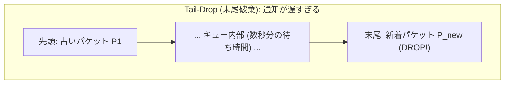
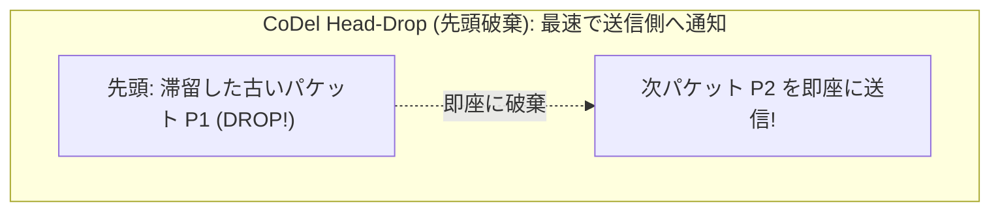
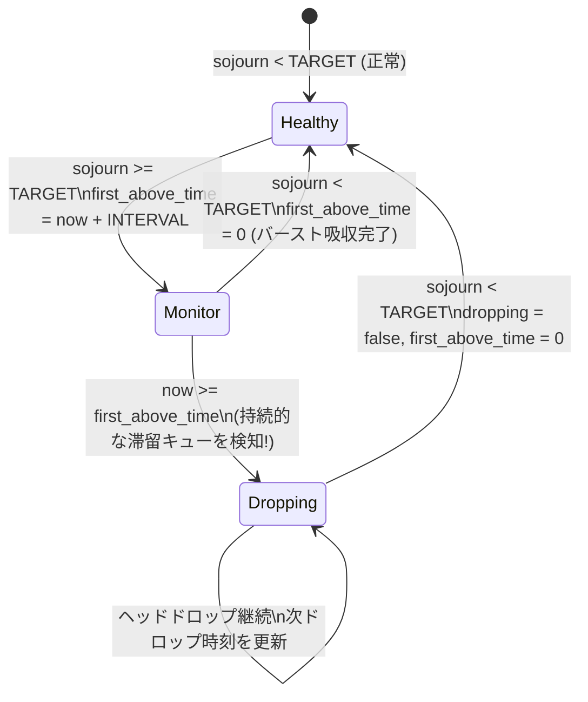

# 23. ハンズオン (6): BPF Qdisc と packetdrill で作る CoDel AQM と FQ-CoDel


このトラックでは、現代のインターネットにおける最大の課題の一つである **Bufferbloat（バッファブロート）** を解決するために開発された **CoDel（Controlled Delay AQM: RFC 8289）** および **FQ-CoDel（FlowQueue-CoDel: RFC 8290）** を、Linux カーネルの BPF `struct_ops`（`struct Qdisc_ops`）を使ってゼロから実装します。

トラフィック制御やキューイングの事前知識は前提としません。「なぜ巨大なバッファが通信遅延を爆発させるのか」「従来の Tail-Drop は何が問題だったのか」「CoDel はどのようにして不要な滞留キューだけを見つけ出して外科手術のようにパケットを間引くのか」を第一原理から整理しましょう。

---

## 1. そもそも Bufferbloat（バッファブロート）とは何か？

長年、ネットワーク機器（家庭用ルータ、Wi-Fi アクセスポイント、基地局、スイッチ）の設計者は「パケットロスは悪である」と考え、メモリの低価格化に伴って機器内部のパケットバッファをどんどん巨大化（数メガバイト〜数ギガバイト）させてきました。

しかし、TCP 輻輳制御（Reno や CUBIC など）は **「パケットロスが起きるまで送信ウィンドウを増やし続ける」** という性質を持っています。その結果、以下の破滅的な現象が発生します。

```text
送信側 (TCP Reno/CUBIC)
   |
   | 送信ウィンドウ (cwnd) を限界まで拡大し続ける
   v
[ ボトルネックルータの巨大な FIFO キュー (数万パケット) ]
   |  P1 | P2 | P3 | P4 | P5 | ... | P1000 | ...
   |  <- パケットがキューの中で数秒間も足止めされる！ (巨大な遅延) ->
   v
受信側 (数秒後にようやくパケットを受け取り、ACK を返す)
```

1. **滞留キュー（Standing Queue）の形成**:
   - ルータのバッファが大きすぎるため、パケットがなかなか溢れません（パケットロスが起きない）。
   - 送信側 TCP は「まだ道路が空いている」と勘違いし、`cwnd` を増やし続けてバッファを満杯まで詰め込みます。
2. **レイテンシの破滅的爆発**:
   - 一度バッファが満杯になると、すべてのパケットが巨大な行列の最後尾に並ばされ、回線速度で順番に捌かれるのを待たされます。
   - 本来なら $10\text{ ms}$ で届くはずの通信に、キュー待ち遅延だけで $1\text{ 秒} \sim 2\text{ 秒}$ もの遅延が上乗せされます。
3. **対話型通信の窒息**:
   - バックグラウンドで大容量ファイルのダウンロードやバックアップ（バルクフロー）が走ると、同じ回線を共有している Web ブラウジング、SSH、オンラインゲーム、音声通話（VoIP）のパケットも同じ大行列の後ろに並ばされ、画面がフリーズしたり通話が途切れたりします。

この「無駄に大きすぎるバッファが常時パケットで満たされ、レイテンシが極端に悪化する現象」を **Bufferbloat** と呼びます。

---

## 2. Tail-Drop vs Head-Drop：なぜ後ろではなく「先頭」を落とすのか？

従来の単純な FIFO キューでは、バッファが完全に満杯（`sch->limit` に到達）になったときに、新しく届いたパケットを捨てる **Tail-Drop（末尾破棄）** が行われていました。

しかし、Tail-Drop には致命的な欠点があります。



- **シグナルの遅延**:
  - 末尾で破棄された新着パケットの情報は、キューの先頭に並んでいる数万個の古いパケットがすべて送信され切るまで、送信側に伝わりません。
  - 送信側 TCP がロス（重複 ACK や SACK）を検知して減速する頃には、すでに数秒が経過しており、ネットワークは渋滞しきっています。
- **グローバル同期（Global Synchronization）**:
  - バッファ満杯時に到着した複数の異なる TCP コネクションのパケットが一斉に Tail-Drop され、すべてのフローが同時にウィンドウを半減させ、回線利用率が急落します。

### CoDel の Head-Drop（先頭破棄）

これに対し、CoDel はパケットがキューから出ていく瞬間（`dequeue`）に、最も古く滞留していた **先頭パケット（Head）を破棄** します。



- 先頭パケットを落として直後のパケット（ $P_2$ ）をただちに送信すると、受信側は即座に SACK / 重複 ACK を生成して送信側に返します。
- 送信側 TCP は **最短の時間（1 RTT 以内）** でパケットロスを検知し、即座に送信レートを落とすことができます。
- キューの中に溜まった古いゴミパケットを捨てて、より新鮮なパケットを優先的に回線へ送り出せます。

---

## 3. CoDel (RFC 8289) のアルゴリズム：滞在時間（Sojourn Time）による制御

CoDel（Controlled Delay）の画期的な点は、**「キューの長さ（パケット数やバイト数）ではなく、パケットの滞在時間（Sojourn Time）を測定する」** という点です。

### 良いキュー（Good Queue）と悪いキュー（Bad Queue）

- **良いキュー（一過性のバースト）**:
  - Web ページの読み込みなどで一時的に 100 パケットのバーストが到着しても、回線が空いていれば数ミリ秒で捌け、キューはすぐに空になります。このようなバーストはバッファで吸収すべきであり、パケットを落とすべきではありません。
- **悪いキュー（持続的な滞留キュー / Standing Queue）**:
  - 何十ミリ秒、何百ミリ秒にもわたってキューが一度も空にならず、どのパケットも長い時間並ばされている状態。これこそが Bufferbloat であり、排除すべき「悪いキュー」です。

### Sojourn Time と CoDel の状態遷移

パケットがエンキューされた時刻を `enqueue_time` として記録しておき、デキュー時に現在の時刻との差を計算します：

$$\text{sojourn} = \text{now} - \text{enqueue}_{\text{time}}$$



1. **`TARGET`（許容滞在時間，標準 5 ms）**:
   - パケットの滞在時間が `TARGET` 未満であれば、キューは健全と判断し、何も落としません。
2. **`INTERVAL`（観測ウィンドウ，標準 100 ms、本ラボでは短縮値 20 ms）**:
   - `sojourn >= TARGET` になっても、一過性のバーストかもしれないので即座には落とさず、`first_above_time = now + INTERVAL` を設定して監視します。
   - `INTERVAL` の期間中、滞在時間が一度でも `TARGET` を下回れば、バーストが解消したと判断してタイマーをリセットします。
3. **Head-Drop の発動**:
   - `INTERVAL` の間ずっと `sojourn >= TARGET` が継続した場合、持続的な滞留キュー（Bad Queue）が存在すると断定します。
   - `dropping = true` に遷移し、デキューした先頭パケットを破棄（Head-Drop）して直後のパケットを送信します。

---

## 4. FQ-CoDel (RFC 8290)：フロー分離と疎なフローの優先

CoDel を単一の FIFO キューに適用するだけでも Bufferbloat は大幅に抑えられますが、ヘビーなダウンロードフローが複数走っている場合、それらのパケットが混ざり合い、軽量な通信（DNS、ACK、SSH、ゲーム）も巻き添えを食らいます。

そこで **Fair Queueing（公平キューイング）** と **CoDel AQM** を融合させた究極の qdisc が **FQ-CoDel** です。

```text
受信パケット (skb)
   |
   +---> L4 ハッシュ (IP 5-tuple) でバケット (flow) に分類
           |
           +---> [ Flow A (動画ダウンロード: 大量パケット) ] ---> old_flows (CoDel でヘッドドロップ)
           |
           +---> [ Flow B (SSH / DNS / ゲーム: 1 パケット) ] ---> new_flows (最優先デキュー!)
```

### 2 つのリストによる DRR（Deficit Round Robin）

FQ-CoDel は、フローを **`new_flows`** と **`old_flows`** の 2 つの循環リストで管理します。

1. **Sparse Flow（疎なフロー）の自動優遇**:
   - Web のクリック、DNS 問い合わせ、SSH のキー入力などの通信は、たまに 1 パケットだけ届きます。
   - キューが空だったフローにパケットが届くと、そのフローは **`new_flows`** の末尾に追加されます。
   - デキュー処理は **常に `old_flows` よりも `new_flows` を優先して処理** します。
   - その結果、バルクフローが数メガバイトのデータを流し込んでいても、対話型通信のパケットはバルクフローを追い越して **遅延ゼロ（`sojourn < TARGET`）かつロスゼロ** で即座に送出されます！
2. **Bulk Flow（大量転送フロー）の隔離と CoDel**:
   - 連続して大量のパケットを送り続けるフローは、クレジット（`quantum = 1000` バイト）を使い切ると **`old_flows`** へ降格されます。
   - `old_flows` 同士はラウンドロビンで公平に帯域を分け合います。
   - さらに、フローごとに独立して CoDel 状態変数（`first_above_time` や `dropping`）を保持しているため、**バッファを埋めているバルクフローだけが選択的にパケットを落とされ、他のフローには一切影響を与えません**。

---

## 5. ステップ一覧と実行コマンド

このトラックは以下の 2 ステップで構成されています。

| ステップ | ディレクトリ | 実装する内容 |
| :--- | :--- | :--- |
| **Step 1** | [`step01-codel-aqm/`](step01-codel-aqm/README.md) | 単一キューにおける CoDel AQM。エンキュー時刻の打刻、ボトルネック送信レートの制御（Watchdog タイマー）、滞在時間（Sojourn Time）判定、持続的滞留キューに対する Head-Drop 状態マシンを実装します。 |
| **Step 2** | [`step02-fq-codel/`](step02-fq-codel/README.md) | FQ-CoDel の完全実装。フローハッシュ分類、`new_flows` / `old_flows` による DRR スケジューリング、フローごとの CoDel 状態管理と、疎な対話型フローの優先送出を実装します。 |

### 実行コマンド

`labs/` ディレクトリ（`/usr/local/google/home/kuniyu/tcp-eli5/labs`）から `run_test.sh` を使って各ステップをビルド・検証できます。

```sh
# Step 1: starter が失敗することを確認し、TODO を実装してパスさせる
./run_test.sh 06-qdisc-fq-codel/step01-codel-aqm starter
./run_test.sh 06-qdisc-fq-codel/step01-codel-aqm solution

# Step 2: starter の失敗確認と模範解答のテスト
./run_test.sh 06-qdisc-fq-codel/step02-fq-codel starter
./run_test.sh 06-qdisc-fq-codel/step02-fq-codel solution
```

それでは、[`step01-codel-aqm/README.md`](step01-codel-aqm/README.md) に進んで最初の CoDel AQM を実装してみましょう！


---

## Step 1: 単一キューにおける CoDel (Controlled Delay) AQM


## 1. 学習ゴール

このステップでは、Linux カーネルの Qdisc インターフェースである `struct Qdisc_ops` を BPF の `struct_ops` 機能で実装し、**Bufferbloat を解決する CoDel（RFC 8289）能動的キュー管理（AQM: Active Queue Management）** の根幹アルゴリズムをゼロから組み立てます。

- トラック全体の背景や Bufferbloat のメカニズムについては [トラック README](#) を参照してください。

---

## 2. アルゴリズムと背景の解説

### 2.1 キュー長ではなく「パケット滞在時間（Sojourn Time）」を測る

従来の FIFO キューにおける Tail-Drop（末尾破棄）や RED（Random Early Detection）は、キューにたまっている「パケット数」や「バイト数」に基づいてパケットを破棄していました。

しかし、キュー長に基づく制御には根本的な欠陥があります。
- $10\text{ Gbps}$ の超高速回線では、 $100$ パケットのキューはわずか $0.12\text{ ms}$ で捌けます。
- 一方、 $1\text{ Mbps}$ の低速回線では、同じ $100$ パケットのキューを捌くのに $1.2\text{ 秒}$ もかかります。

同じパケット数であっても、回線帯域によって遅延は桁違いに異なります。そこで CoDel は、キューの長さではなく **「パケットがキューに並んでいた時間（滞在時間: Sojourn Time）」** を直接計測して判断します。

$$\text{sojourn} = t_{\text{dequeue}} - t_{\text{enqueue}}$$

### 2.2 良いキュー（Good Queue）と悪いキュー（Bad Queue）の判別

- **良いキュー（一過性のバースト）**:
  - Web ページの読み込みやアプリの初期通信などで、瞬間的にパケットがまとまって到着します。
  - 回線が健全であれば、バッファで受け止めたパケットはすぐに掃き出され、Sojourn Time は一時的に上昇してもすぐに $0$ に戻ります。
- **悪いキュー（持続的な滞留キュー / Standing Queue）**:
  - 送信側 TCP が巨大なウィンドウでパケットを流し込み続け、ボトルネックリンクの処理能力を超えてキューが常時満杯のまま推移します。
  - Sojourn Time が長期間にわたって高い値を維持し続けます。

CoDel は、**「`INTERVAL`（観測ウィンドウ）の間、最低滞在時間がずっと `TARGET` を超え続けているか？」** を監視することで、一時的なバーストを見逃し、有害な滞留キューだけを正確に特定します。

### 2.3 CoDel の状態マシン

CoDel は以下の 2 つの主要パラメータで動作します：
- **`TARGET_NS`**: 目標滞在時間（標準 5 ms = $5,000,000\text{ ns}$ ）。
- **`INTERVAL_NS`**: 観測ウィンドウ（標準 100 ms、本ラボではテスト時間短縮のため $20\text{ ms} = 20,000,000\text{ ns}$ ）。

```mermaid
flowchart TD
    Start["パケットをキューから取り出す (bpf_codel_dequeue)"] --> Calc["sojourn = now - enqueue_time を計算"]
    Calc --> CondTarget{"sojourn < TARGET_NS ?"}

    CondTarget -->|Yes: 正常 (Good Queue)| Reset["first_above_time = 0\ndropping = false\n(正常送信へ)"]
    CondTarget -->|No: 遅延過大| CheckTimer{"first_above_time == 0 ?"}

    CheckTimer -->|Yes: 初めて TARGET を超過| ArmTimer["first_above_time = now + INTERVAL_NS\n(即座には落とさず監視開始)"]
    CheckTimer -->|No: 既に監視中| CheckExpire{"now >= first_above_time ?"}

    CheckExpire -->|No: まだ INTERVAL 経過前| NormalSend["一過性の可能性あり: パケット送信"]
    CheckExpire -->|Yes: INTERVAL の間ずっと遅延過大!| DropState["dropping = true\n先頭パケットを Head-Drop!\n次パケットを即座にデキューして送信"]

    Reset --> SendWire["NIC / 回線へパケット送出"]
    ArmTimer --> SendWire
    NormalSend --> SendWire
    DropState --> SendWire
```

1. **`sojourn < TARGET_NS` の場合**:
   - キュー遅延は健全です。`first_above_time = 0` および `dropping = false` にリセットし、パケットを通常送出します。
2. **`sojourn >= TARGET_NS` の場合**:
   - `first_above_time == 0`（初回超過）であれば、`first_above_time = now + INTERVAL_NS` に設定し、監視タイマーを開始します（このパケットはまだ落としません）。
   - `now >= first_above_time` に達した場合、`INTERVAL_NS` の間ずっと滞留キューが解消しなかったことを意味します。
   - `dropping = true` に移行し、この滞留パケットを `bpf_kfree_skb(skb)` で **Head-Drop（先頭破棄）** します。
   - 直後にキューから次のパケットを取り出し、送信側に最速でパケットロス（SACK / 重複 ACK）を通知します。

---

## 3. コード構造と主要データ構造

### `struct skb_node` と BPF リンクリスト

```c
struct skb_node {
	__u64 enqueue_time;
	struct sk_buff __kptr *skb;
	struct bpf_list_node node;
};

private(A) struct bpf_spin_lock codel_lock;
private(A) struct bpf_list_head codel_queue __contains(skb_node, node);
```

- 各パケットは BPF の `bpf_list_head` / `bpf_list_node` による侵入型リンクリストで FIFO 管理されます。
- エンキュー時に `skbn->enqueue_time = bpf_ktime_get_ns();` を打刻し、デキュー時に滞在時間を算出します。

### グローバル状態変数

- `next_tx_ns`: ボトルネックリンクの送信完了予定時刻（`BOTTLENECK_NS = 4,000,000ULL`）。パケット送信間隔をレート制御し、擬似的にボトルネックリンクを作ります。
- `first_above_time`: Sojourn Time が `TARGET_NS` を超えたときに設定される満了予定時刻（`now + INTERVAL_NS`）。
- `dropping`: 現在 Head-Drop 状態に入っているかを示すフラグ。
- `drop_count`: Head-Drop されたパケット数。

---

## 3.5 設計チェックポイント（理解した仕組みをコードに落とし込む）

`starter.bpf.c` の TODO を実装する前に、以下の 3 つの設計の問いを自分の頭で考えてみましょう。

### Q1. 滞在時間（Sojourn Time）の測定：なぜキュー長ではなく `now - enqueue_time` を測るのか？

<details>
<summary>ヒントと答え</summary>

- **ヒント**: 回線速度が 10 Gbps のときと 1 Mbps のときで、同じ 100 パケットのキューが引き起こす遅延はどう変わるでしょうか？
- **答え**: **キューのパケット数が同じでも、回線のドレイン速度によって実際の待ち時間は数千倍異なるためです。**
  エンキュー時に `skbn->enqueue_time = bpf_ktime_get_ns()` を記録し、デキュー時に `sojourn = now - enqueue_time` を計算することで、回線速度に依存せず純粋なキューイング遅延をナノ秒単位で評価できます。

</details>

### Q2. 観測ウィンドウ（`INTERVAL_NS`）：なぜ `sojourn >= TARGET_NS` になった瞬間に即座にドロップしないのか？

<details>
<summary>ヒントと答え</summary>

- **ヒント**: 一過性のバースト（Good Queue）と持続的な滞留キュー（Bad Queue）の違いを思い出してください。
- **答え**: **一時的なバーストトラフィックを誤ってドロップしてしまうのを防ぐためです。**
  初めて `sojourn >= TARGET_NS` になったときは `first_above_time = now + INTERVAL_NS` をセットするだけにとどめ、`INTERVAL_NS` の間ずっと `sojourn >= TARGET_NS` が継続した（`now >= first_above_time` に到達した）ときに初めて持続的な滞留キューと判定して Head-Drop を発動します。

</details>

### Q3. Head-Drop の実装：先頭パケットを `bpf_kfree_skb(skb)` で破棄した後、なぜ直ちに次のパケットをポップして返すのか？

<details>
<summary>ヒントと答え</summary>

- **ヒント**: もしパケットを落として `return NULL;` してしまったら、回線（NIC）と受信側 TCP はどうなるでしょうか？
- **答え**: **回線を遊ばせず（Work-conserving）、かつ受信側に後続パケットを即座に届けて SACK / 重複 ACK による高速なロス通知を発生させるためです。**
  先頭パケットを破棄した直後に 2 番目の新鮮なパケットをポップして送信することで、送信側 TCP は 1 RTT 以内に輻輳を検知できます。

</details>

---

## 4. 実装手順（TODO リスト）

[`starter.bpf.c`](starter.bpf.c) 内の `bpf_codel_dequeue()` にある 2 つの TODO を実装します。

### TODO 1: ボトルネック送信レート制御（Watchdog タイマー）

ボトルネックリンクの帯域制限を再現するため、前回の送信完了予定時刻 `next_tx_ns` より前にデキューが呼ばれた場合は送信を延期します。

```c
now = bpf_ktime_get_ns();
if (now < next_tx_ns) {
	bpf_qdisc_watchdog_schedule(sch, next_tx_ns, 0);
	return NULL;
}
```

### TODO 2: CoDel AQM 状態マシンの実装

パケットをリンクリストから取り出した後、滞在時間 `sojourn = now - enqueue_time` を計算し、CoDel のドロップ判定を行います。

```c
sojourn = now - enqueue_time;
if (sojourn < TARGET_NS) {
	first_above_time = 0;
	dropping = false;
} else {
	if (first_above_time == 0) {
		first_above_time = now + INTERVAL_NS;
	} else if (now >= first_above_time) {
		dropping = true;
		drop_count++;
		sch->qstats.backlog -= qdisc_pkt_len(skb);
		sch->q.qlen--;
		sch->qstats.drops++;
		bpf_kfree_skb(skb);
		skb = NULL;

		/* 次のパケットを即座に取り出して送信 */
		bpf_spin_lock(&codel_lock);
		node = bpf_list_pop_front(&codel_queue);
		bpf_spin_unlock(&codel_lock);
		if (!node)
			return NULL;

		skbn = container_of(node, struct skb_node, node);
		skb = bpf_kptr_xchg(&skbn->skb, skb);
		bpf_obj_drop(skbn);
		if (!skb)
			return NULL;
	}
}
```

---

## 5. テスト検証と Packetdrill

テストスクリプト [`test.pkt`](test.pkt) は以下のシナリオを自動実行します：

1. `tc qdisc replace dev tun0 root bpf_codel` で本 Qdisc を装着。
2. TCP コネクションを確立し、送信側から一気に 10 個のセグメント（各 1000 バイト、合計 10 KB）を送信。
3. ボトルネックレート（1 パケットあたり 4 ms）により、キュー内にパケットが溜まり始めます。
4. 最初の数パケットは滞在時間が短いため正常送信されますが、やがて滞在時間が `TARGET_NS (5 ms)` を超え、`INTERVAL_NS (20 ms)` が経過した時点で CoDel が滞留パケットを Head-Drop します。
5. 直後のパケットが受信側に届き、受信側から SACK（例: `8001:10001`）が返ることで、送信側 TCP は最速でパケットロスを検知してウィンドウを縮小します。

### テスト実行

```sh
# starter が失敗することを確認
./run_test.sh 06-qdisc-fq-codel/step01-codel-aqm starter

# 実装後、テストをパスさせる
./run_test.sh 06-qdisc-fq-codel/step01-codel-aqm solution
```

テストに合格したら、次は複数フローの公平性と対話型通信の超低遅延化を実現する [`step02-fq-codel/`](../step02-fq-codel/README.md) に進みましょう！


### `labs/06-qdisc-fq-codel/step01-codel-aqm/starter.bpf.c` (穴埋めスケルトン)

```c
// SPDX-License-Identifier: GPL-2.0
#include "vmlinux.h"
#include "bpf_qdisc_helpers.h"

char _license[] SEC("license") = "GPL";

#define TARGET_NS	5000000ULL	/* 5 ms target sojourn time */
#define INTERVAL_NS	20000000ULL	/* 20 ms sliding minimum window */
#define BOTTLENECK_NS	4000000ULL	/* 4 ms bottleneck serialization rate */

struct skb_node {
	__u64 enqueue_time;
	struct sk_buff __kptr *skb;
	struct bpf_list_node node;
};

private(A) struct bpf_spin_lock codel_lock;
private(A) struct bpf_list_head codel_queue __contains(skb_node, node);

static __u64 next_tx_ns;
static __u64 first_above_time;
static __u32 drop_count;
static bool dropping;

SEC("struct_ops/bpf_codel_enqueue")
int BPF_PROG(bpf_codel_enqueue, struct sk_buff *skb, struct Qdisc *sch,
	     struct bpf_sk_buff_ptr *to_free)
{
	struct skb_node *skbn;
	u32 pkt_len;

	if (sch->q.qlen >= sch->limit)
		goto drop;

	skbn = bpf_obj_new(typeof(*skbn));
	if (!skbn)
		goto drop;

	/* Stamp arrival timestamp to measure sojourn time in dequeue */
	skbn->enqueue_time = bpf_ktime_get_ns();
	pkt_len = qdisc_pkt_len(skb);

	sch->q.qlen++;
	skb = bpf_kptr_xchg(&skbn->skb, skb);
	if (skb)
		bpf_qdisc_skb_drop(skb, to_free);

	bpf_spin_lock(&codel_lock);
	bpf_list_push_back(&codel_queue, &skbn->node);
	bpf_spin_unlock(&codel_lock);

	sch->qstats.backlog += pkt_len;
	return NET_XMIT_SUCCESS;

drop:
	bpf_qdisc_skb_drop(skb, to_free);
	sch->qstats.drops++;
	return NET_XMIT_DROP;
}

SEC("struct_ops/bpf_codel_dequeue")
struct sk_buff *BPF_PROG(bpf_codel_dequeue, struct Qdisc *sch)
{
	struct bpf_list_node *node;
	struct sk_buff *skb = NULL;
	struct skb_node *skbn;
	u64 now, enqueue_time, sojourn;

	if (!sch->q.qlen)
		return NULL;

	now = bpf_ktime_get_ns();

	/* TODO 1: Enforce bottleneck link rate (BOTTLENECK_NS).
	 * If now < next_tx_ns, schedule the watchdog timer:
	 *   bpf_qdisc_watchdog_schedule(sch, next_tx_ns, 0);
	 * and return NULL.
	 */

	bpf_spin_lock(&codel_lock);
	node = bpf_list_pop_front(&codel_queue);
	bpf_spin_unlock(&codel_lock);
	if (!node)
		return NULL;

	skbn = container_of(node, struct skb_node, node);
	skb = bpf_kptr_xchg(&skbn->skb, skb);
	enqueue_time = skbn->enqueue_time;
	bpf_obj_drop(skbn);
	if (!skb)
		return NULL;

	/* TODO 2: CoDel Active Queue Management (AQM) state machine.
	 *
	 * Compute packet sojourn time:
	 *   sojourn = now - enqueue_time;
	 *
	 * 1. If sojourn < TARGET_NS (healthy delay):
	 *    - Reset first_above_time = 0;
	 *    - Reset dropping = false;
	 *
	 * 2. Else (sojourn >= TARGET_NS, standing queue delay detected):
	 *    - If first_above_time == 0:
	 *        first_above_time = now + INTERVAL_NS;
	 *    - Else if now >= first_above_time:
	 *        // Persistent bufferbloat! Enter dropping state and head-drop
	 *        // this stale packet, then dequeue the next fresher packet.
	 *        dropping = true;
	 *        drop_count++;
	 *        sch->qstats.backlog -= qdisc_pkt_len(skb);
	 *        sch->q.qlen--;
	 *        sch->qstats.drops++;
	 *        bpf_kfree_skb(skb);
	 *        skb = NULL;
	 *
	 *        bpf_spin_lock(&codel_lock);
	 *        node = bpf_list_pop_front(&codel_queue);
	 *        bpf_spin_unlock(&codel_lock);
	 *        if (!node)
	 *            return NULL;
	 *
	 *        skbn = container_of(node, struct skb_node, node);
	 *        skb = bpf_kptr_xchg(&skbn->skb, skb);
	 *        bpf_obj_drop(skbn);
	 *        if (!skb)
	 *            return NULL;
	 */

	next_tx_ns = now + BOTTLENECK_NS;
	sch->qstats.backlog -= qdisc_pkt_len(skb);
	bpf_qdisc_bstats_update(sch, skb);
	sch->q.qlen--;

	return skb;
}

SEC("struct_ops/bpf_codel_init")
int BPF_PROG(bpf_codel_init, struct Qdisc *sch, struct nlattr *opt,
	     struct netlink_ext_ack *extack)
{
	sch->limit = 1000;
	next_tx_ns = 0;
	first_above_time = 0;
	drop_count = 0;
	dropping = false;
	return 0;
}

SEC("struct_ops/bpf_codel_reset")
void BPF_PROG(bpf_codel_reset, struct Qdisc *sch)
{
	struct bpf_list_node *node;
	struct skb_node *skbn;
	int i;

	bpf_for(i, 0, sch->q.qlen) {
		struct sk_buff *skb = NULL;

		bpf_spin_lock(&codel_lock);
		node = bpf_list_pop_front(&codel_queue);
		bpf_spin_unlock(&codel_lock);

		if (!node)
			break;

		skbn = container_of(node, struct skb_node, node);
		skb = bpf_kptr_xchg(&skbn->skb, skb);
		if (skb)
			bpf_kfree_skb(skb);
		bpf_obj_drop(skbn);
	}
	sch->q.qlen = 0;
	sch->qstats.backlog = 0;
	next_tx_ns = 0;
	first_above_time = 0;
	drop_count = 0;
	dropping = false;
}

SEC("struct_ops")
void BPF_PROG(bpf_codel_destroy, struct Qdisc *sch)
{
}

SEC(".struct_ops")
struct Qdisc_ops codel = {
	.enqueue   = (void *)bpf_codel_enqueue,
	.dequeue   = (void *)bpf_codel_dequeue,
	.init      = (void *)bpf_codel_init,
	.reset     = (void *)bpf_codel_reset,
	.destroy   = (void *)bpf_codel_destroy,
	.id        = "bpf_codel",
};
```

### `labs/06-qdisc-fq-codel/step01-codel-aqm/test.pkt` (packetdrill テスト)

```python
// SPDX-License-Identifier: GPL-2.0
// Step 1: Test CoDel AQM sojourn-based head-drop under standing queue

0.00 `tc qdisc replace dev tun0 root bpf_codel`
0.00 `ip link set dev tun0 gso_max_size 1500 gso_max_segs 1`

// Establish passive TCP connection with fast handshake for TSQ pacing
+0.00 socket(..., SOCK_STREAM, IPPROTO_TCP) = 3
+0.00 setsockopt(3, SOL_SOCKET, SO_REUSEADDR, [1], 4) = 0
+0.00 bind(3, ..., ...) = 0
+0.00 listen(3, 1) = 0

+0.00 < S 0:0(0) win 32792 <mss 1000,sackOK,nop,nop,nop,wscale 7>
+0.00 > S. 0:0(0) ack 1 <mss 1460,nop,nop,sackOK,nop,wscale 7>
+0.0001 < . 1:1(0) ack 1 win 65535
+0.00 accept(3, ..., ...) = 4

// Send 10 segments (10,000 bytes) with MSS 1000 (payload 1000 bytes).
// BOTTLENECK_NS = 4ms, TARGET_NS = 5ms, INTERVAL_NS = 20ms.
// P1 departs at 0ms.
// P2 departs at 4ms (sojourn = 4ms < 5ms).
// P3 departs at 8ms (sojourn = 8ms >= 5ms -> first_above_time = 28ms).
// P4 departs at 12ms.
// P5 departs at 16ms.
// P6 departs at 20ms.
// P7 departs at 24ms.
// At 28ms, now >= first_above_time (28ms):
// CoDel head-drops P8 (7001:8001), and transmits P9 (8001:9001)!
// At 32ms, P10 (9001:10001) departs.
+0.00 write(4, ..., 10000) = 10000
+0.004 > . 1:1001(1000) ack 1
+0.004 > . 1001:2001(1000) ack 1
+0.004 > . 2001:3001(1000) ack 1
+0.004 > . 3001:4001(1000) ack 1
+0.004 > . 4001:5001(1000) ack 1
+0.004 > . 5001:6001(1000) ack 1
// P7 (6001:7001) is dropped by CoDel; P8 (7001:8001) is transmitted:
+0.004 > . 7001:8001(1000) ack 1
+0.004 > . 8001:9001(1000) ack 1
+0.004 > P. 9001:10001(1000) ack 1

// Client sends SACK for P8-P10, missing P7:
+0.00 < . 1:1(0) ack 6001 win 257 <sack 7001:10001,nop,nop>

// Verify that CoDel recorded at least 1 drop even though limit was 1000!
+0.01 `tc -s qdisc show dev tun0 | grep -q "dropped [1-9]"`
```

<details>
<summary>模範解答: <code>labs/06-qdisc-fq-codel/step01-codel-aqm/solution.bpf.c</code></summary>

```c
// SPDX-License-Identifier: GPL-2.0
#include "vmlinux.h"
#include "bpf_qdisc_helpers.h"

char _license[] SEC("license") = "GPL";

#define TARGET_NS	5000000ULL	/* 5 ms target sojourn time */
#define INTERVAL_NS	20000000ULL	/* 20 ms sliding minimum window */
#define BOTTLENECK_NS	4000000ULL	/* 4 ms bottleneck serialization rate */

struct skb_node {
	__u64 enqueue_time;
	struct sk_buff __kptr *skb;
	struct bpf_list_node node;
};

private(A) struct bpf_spin_lock codel_lock;
private(A) struct bpf_list_head codel_queue __contains(skb_node, node);

static __u64 next_tx_ns;
static __u64 first_above_time;
static __u32 drop_count;
static bool dropping;

SEC("struct_ops/bpf_codel_enqueue")
int BPF_PROG(bpf_codel_enqueue, struct sk_buff *skb, struct Qdisc *sch,
	     struct bpf_sk_buff_ptr *to_free)
{
	struct skb_node *skbn;
	u32 pkt_len;

	if (sch->q.qlen >= sch->limit)
		goto drop;

	skbn = bpf_obj_new(typeof(*skbn));
	if (!skbn)
		goto drop;

	skbn->enqueue_time = bpf_ktime_get_ns();
	pkt_len = qdisc_pkt_len(skb);

	sch->q.qlen++;
	skb = bpf_kptr_xchg(&skbn->skb, skb);
	if (skb)
		bpf_qdisc_skb_drop(skb, to_free);

	bpf_spin_lock(&codel_lock);
	bpf_list_push_back(&codel_queue, &skbn->node);
	bpf_spin_unlock(&codel_lock);

	sch->qstats.backlog += pkt_len;
	return NET_XMIT_SUCCESS;

drop:
	bpf_qdisc_skb_drop(skb, to_free);
	sch->qstats.drops++;
	return NET_XMIT_DROP;
}

SEC("struct_ops/bpf_codel_dequeue")
struct sk_buff *BPF_PROG(bpf_codel_dequeue, struct Qdisc *sch)
{
	struct bpf_list_node *node;
	struct sk_buff *skb = NULL;
	struct skb_node *skbn;
	u64 now, enqueue_time, sojourn;

	if (!sch->q.qlen)
		return NULL;

	now = bpf_ktime_get_ns();
	if (now < next_tx_ns) {
		bpf_qdisc_watchdog_schedule(sch, next_tx_ns, 0);
		return NULL;
	}

	bpf_spin_lock(&codel_lock);
	node = bpf_list_pop_front(&codel_queue);
	bpf_spin_unlock(&codel_lock);
	if (!node)
		return NULL;

	skbn = container_of(node, struct skb_node, node);
	skb = bpf_kptr_xchg(&skbn->skb, skb);
	enqueue_time = skbn->enqueue_time;
	bpf_obj_drop(skbn);
	if (!skb)
		return NULL;

	sojourn = now - enqueue_time;
	if (sojourn < TARGET_NS) {
		first_above_time = 0;
		dropping = false;
	} else {
		if (first_above_time == 0) {
			first_above_time = now + INTERVAL_NS;
		} else if (now + 1000000ULL >= first_above_time) {
			dropping = true;
			drop_count++;
			first_above_time = now + INTERVAL_NS;
			sch->qstats.backlog -= qdisc_pkt_len(skb);
			sch->q.qlen--;
			sch->qstats.drops++;
			bpf_kfree_skb(skb);
			skb = NULL;

			bpf_spin_lock(&codel_lock);
			node = bpf_list_pop_front(&codel_queue);
			bpf_spin_unlock(&codel_lock);
			if (!node)
				return NULL;

			skbn = container_of(node, struct skb_node, node);
			skb = bpf_kptr_xchg(&skbn->skb, skb);
			bpf_obj_drop(skbn);
			if (!skb)
				return NULL;
		}
	}

	next_tx_ns = now + BOTTLENECK_NS;
	sch->qstats.backlog -= qdisc_pkt_len(skb);
	bpf_qdisc_bstats_update(sch, skb);
	sch->q.qlen--;

	return skb;
}

SEC("struct_ops/bpf_codel_init")
int BPF_PROG(bpf_codel_init, struct Qdisc *sch, struct nlattr *opt,
	     struct netlink_ext_ack *extack)
{
	sch->limit = 1000;
	next_tx_ns = 0;
	first_above_time = 0;
	drop_count = 0;
	dropping = false;
	return 0;
}

SEC("struct_ops/bpf_codel_reset")
void BPF_PROG(bpf_codel_reset, struct Qdisc *sch)
{
	struct bpf_list_node *node;
	struct skb_node *skbn;
	int i;

	bpf_for(i, 0, sch->q.qlen) {
		struct sk_buff *skb = NULL;

		bpf_spin_lock(&codel_lock);
		node = bpf_list_pop_front(&codel_queue);
		bpf_spin_unlock(&codel_lock);

		if (!node)
			break;

		skbn = container_of(node, struct skb_node, node);
		skb = bpf_kptr_xchg(&skbn->skb, skb);
		if (skb)
			bpf_kfree_skb(skb);
		bpf_obj_drop(skbn);
	}
	sch->q.qlen = 0;
	sch->qstats.backlog = 0;
	next_tx_ns = 0;
	first_above_time = 0;
	drop_count = 0;
	dropping = false;
}

SEC("struct_ops")
void BPF_PROG(bpf_codel_destroy, struct Qdisc *sch)
{
}

SEC(".struct_ops")
struct Qdisc_ops codel = {
	.enqueue   = (void *)bpf_codel_enqueue,
	.dequeue   = (void *)bpf_codel_dequeue,
	.init      = (void *)bpf_codel_init,
	.reset     = (void *)bpf_codel_reset,
	.destroy   = (void *)bpf_codel_destroy,
	.id        = "bpf_codel",
};
```

</details>


---

## Step 2: 完全な FQ-CoDel（フロー分離と 2 リスト DRR + フロー単位 CoDel）


## 1. 学習ゴール

このステップでは、Step 1 で実装した CoDel AQM に **フロー分類（Flow Classification）** と **2 つの循環リスト（`new_flows` / `old_flows`）による Deficit Round Robin (DRR)** を統合し、**FQ-CoDel（RFC 8290）** をゼロから完成させます。

- トラック全体の背景や Bufferbloat のメカニズムについては [トラック README](#) を参照してください。

---

## 2. アルゴリズムと背景の解説

### 2.1 なぜ CoDel だけでは不十分なのか？

Step 1 の単一キュー CoDel では、持続的な滞留キューを検知して Head-Drop を行い、Bufferbloat を解消できることを確認しました。

しかし、単一の FIFO キューである限り、**「ヘビーなダウンロードフロー」と「対話型の軽量フロー（SSH、DNS、Web、ゲーム、VoIP）」が同じキューに相乗り** してしまいます。
- バルクフローが大量のパケットを送り込んでいる最中に届いた SSH のキー入力パケットは、バルクフローの後ろに並ばされます。
- また、CoDel がパケットを落とす際、たまたま運悪く対話型フローのパケットが先頭にあれば、それが巻き添えで落とされてしまう危険性もあります。

### 2.2 FQ-CoDel の 3 本柱

FQ-CoDel は、以下の 3 つの技術を組み合わせることでこの問題を完璧に解決します：

```text
パケット到着
   |
   +---> [1] フロー分類 (IP 5-tuple ハッシュ) でバケットへ振り分け
           |
           +---> [2] 2 リスト DRR: 疎なフロー (new_flows) を最優先デキュー!
           |
           +---> [3] フロー単位 CoDel: 滞留しているバルクフローだけを選択的 Head-Drop!
```

1. **フロー分類（Flow Classification）**:
   - パケットのソケットハッシュ（`sk->__sk_common.skc_hash`）または 5-tuple ハッシュ（`bpf_skb_get_hash(skb)`）を用いて、パケットを独立したフローキューに分類します。
2. **2 つのリストによる DRR スケジューリング（`new_flows` と `old_flows`）**:
   - **`new_flows`**: 直前までアイドル（休止）状態だったフローや、新しく到着したフローが入るリスト。
   - **`old_flows`**: クレジット（`quantum`）を使い切ったフローが入るリスト。
   - デキュー時は **常に `new_flows` を優先して処理** します。対話型通信のような「たまにしかパケットを送らない疎なフロー（Sparse Flow）」は、常に `new_flows` で即座に送信されるため、**待ち時間ゼロ・遅延ゼロ・パケットロスゼロ** でバルクフローを追い越します！
3. **フロー単位の CoDel AQM**:
   - `first_above_time` や `dropping` などの CoDel 状態変数を **フロー構造体（`struct fq_codel_flow`）ごとに独立して保持** します。
   - バッファを埋め尽くしているバルクフローだけが `TARGET_NS` を超過して Head-Drop され、他のフローには一切悪影響を及ぼしません。

---

## 3. コード構造と主要データ構造

### `struct bpf_fq_codel_flow`（フロー構造体）

```c
struct bpf_fq_codel_flow {
	s64 credit;                 /* DRR 送信可能残高 (バイト数, s64) */
	u32 qlen;                   /* フロー内のパケット数 */
	u64 age;                    /* 0: リスト接続中, 1: 休止中 (detached) */
	u64 first_above_time;       /* CoDel: TARGET 超過観測タイマー */
	u32 drop_count;             /* CoDel: 本フローのドロップ数 */
	bool dropping;              /* CoDel: ドロップモード中か */
	struct bpf_list_node list_node; /* new_flows / old_flows 用ノード */
	struct bpf_list_head queue __contains(skb_node, node); /* フローのパケットキュー */
	struct bpf_spin_lock lock;  /* パケットキューのロック */
	struct bpf_refcount refcount; /* BPF オブジェクト参照カウント */
};
```

### 2 リスト DRR とグローバル状態

- `new_flows`: 疎なフローや新規フローを管理するリスト。最優先でデキューされます。
- `old_flows`: クレジットを使い切ったバルクフローがラウンドロビンするリスト。
- `next_tx_ns`: ボトルネックリンクの送信レート制御用タイマー（`BOTTLENECK_NS = 4,000,000ULL`）。

---

## 3.5 設計チェックポイント（理解した仕組みをコードに落とし込む）

`starter.bpf.c` の TODO を実装する前に、以下の 3 つの設計の問いを考えてみましょう。

### Q1. 疎なフローの優遇：なぜ `new_flows` と `old_flows` の 2 つのリストが必要なのか？

<details>
<summary>ヒントと答え</summary>

- **ヒント**: もし全フローを 1 つのラウンドロビンリストで管理すると、新しく届いた 1 パケットだけの通信はどう扱われるでしょうか？
- **答え**: **たまにしかパケットを送らない対話型通信（Sparse Flow）を、大量転送中のバルクフロー（`old_flows`）より常に先にデキューさせるためです。**
  休止（detached）状態から到着したフローは `new_flows` に入り、デキュー処理は `new_flows` が空になるまで `old_flows` を処理しません。これにより対話型パケットは待ち時間ゼロでバルクフローを追い越せます。

</details>

### Q2. クレジットと降格：フローが `new_flows` から `old_flows` へ移動するのはどのタイミングか？

<details>
<summary>ヒントと答え</summary>

- **ヒント**: パケットを送信するたびに `flow->credit -= pkt_len` が行われます。
- **答え**: **パケット送信によって `flow->credit <= 0` となり、初期クレジットを使い切ったタイミングです。**
  1 パケットしか送らない疎なフローは `credit` が残っている間にキューが空になり休止状態へ戻りますが、連続してパケットを送り続けるバルクフローは `credit <= 0` となって `flow->credit += QUANTUM` を加算されたうえで `old_flows` の末尾へ降格されます。

</details>

### Q3. フロー単位の CoDel 隔離：なぜ `first_above_time` と `dropping` をグローバル変数ではなく `struct bpf_fq_codel_flow` のメンバとして持つのか？

<details>
<summary>ヒントと答え</summary>

- **ヒント**: もし CoDel の状態変数を Qdisc 全体で 1 つだけ共有したら、バルクフローのせいで何が起きるでしょうか？
- **答え**: **滞留キューを作っている悪質なバルクフローだけを選択的に Head-Drop し、他の健全なフローを巻き添えにしないためです。**
  各フロー構造体が独自の `first_above_time` と `dropping` を持つことで、疎なフロー（Flow B）は滞在時間が短く保たれ、ドロップゼロで通信を継続できます。

</details>

---

## 4. 実装手順（TODO リスト）

[`starter.bpf.c`](starter.bpf.c) 内の `bpf_fq_codel_dequeue()` にある 3 つの TODO を実装します。

### TODO 1: 2 リスト DRR によるフロー選択

`new_flows` が空でなければ `new_flows` から先頭フローを取り出し、空であれば `old_flows` から取り出します。

```c
bpf_spin_lock(&new_flows_lock);
node = bpf_list_pop_front(&new_flows);
if (node) {
	new_flow_cnt--;
	is_new = true;
}
bpf_spin_unlock(&new_flows_lock);

if (!node) {
	bpf_spin_lock(&old_flows_lock);
	node = bpf_list_pop_front(&old_flows);
	if (node) {
		old_flow_cnt--;
		is_new = false;
	}
	bpf_spin_unlock(&old_flows_lock);
}

if (!node)
	return NULL;
```

### TODO 2: クレジット検査と DRR ラウンド制御

取り出したフローの `credit <= 0` の場合、そのラウンドでの送信権を使い切っています。
`credit += QUANTUM` を加算し、フローを `old_flows` の末尾へ移動させて `return NULL;` します（次回の dequeue で再試行されます）。

```c
if (flow->credit <= 0) {
	flow->credit += QUANTUM;
	bpf_spin_lock(&old_flows_lock);
	bpf_list_push_back(&old_flows, &flow->list_node);
	old_flow_cnt++;
	bpf_spin_unlock(&old_flows_lock);
	bpf_fq_codel_flow_drop(flow);
	return NULL;
}
```

### TODO 3: フロー単位の CoDel AQM 状態マシン

フロー内のパケットキューからパケットを取り出し、フローごとの CoDel 判定を行います。

```c
sojourn = now - enqueue_time;
if (sojourn < TARGET_NS) {
	flow->first_above_time = 0;
	flow->dropping = false;
} else {
	if (flow->first_above_time == 0) {
		flow->first_above_time = now + INTERVAL_NS;
	} else if (now >= flow->first_above_time) {
		flow->dropping = true;
		flow->drop_count++;
		sch->qstats.backlog -= qdisc_pkt_len(skb);
		sch->q.qlen--;
		sch->qstats.drops++;
		bpf_kfree_skb(skb);
		skb = NULL;

		/* フロー内キューから直後のパケットを即座に取り出す */
		bpf_spin_lock(&flow->lock);
		node = bpf_list_pop_front(&flow->queue);
		bpf_spin_unlock(&flow->lock);
		if (!node)
			goto finish_flow;

		skbn = container_of(node, struct skb_node, node);
		skb = bpf_kptr_xchg(&skbn->skb, skb);
		flow->qlen--;
		bpf_obj_drop(skbn);
		if (!skb)
			goto finish_flow;
	}
}
```

---

## 5. テスト検証と Packetdrill
 
テストスクリプト [`test.pkt`](test.pkt) は、FQ-CoDel の真価を証明する以下の実戦的シナリオを検証します：
 
1. **Flow A（バルク転送）**:
   - ソケット 3 から 1,000 バイトの UDP パケットを 8 個一気に送信（ $t = 0$ ）。
   - 最初のパケット（P1）が即座に送出された後、クレジットを使い切って（ $1000 - 1028 \le 0$ ）`old_flows` へ降格され、残り 7 パケットがキューに溜まります。
2. **Flow B（対話型疎フロー / Sparse Flow）**:
   - Flow A のパケットがキューに並んでいる最中（ $t = 2\text{ ms}$ ）に、ソケット 4 から 1 パケット（500 バイト）だけ送信。
   - Flow B はアイドル状態から到着したため、`new_flows` に登録されます。
3. **疎フローの優先デキュー**:
   - $t = 4\text{ ms}$ のボトルネックスロットにおいて、FQ-CoDel は `old_flows` に並んでいる Flow A のパケットを差し置いて、**`new_flows` にある Flow B のパケットを最優先で送信** します！
4. **バルクフローの隔離と Head-Drop**:
   - $t = 8\text{ ms} \sim 28\text{ ms}$ にかけて Flow A のパケット（P2〜P7）が順次送出されます。
   - $t = 32\text{ ms}$ において、滞留キューにより Sojourn Time が `TARGET_NS (5 ms)` を超え続け、`INTERVAL_NS (20 ms)` 経過後に **Flow A のパケット（P8）だけが Head-Drop** されます。
   - 疎フローである Flow B にはパケットロスも遅延も一切発生しません！

### テスト実行

```sh
# starter が失敗することを確認
./run_test.sh 06-qdisc-fq-codel/step02-fq-codel starter

# 実装後、テストをパスさせる
./run_test.sh 06-qdisc-fq-codel/step02-fq-codel solution
```

全テストにパスしたら、Track 6 完了です！お疲れ様でした！


### `labs/06-qdisc-fq-codel/step02-fq-codel/starter.bpf.c` (穴埋めスケルトン)

```c
// SPDX-License-Identifier: GPL-2.0
#include "vmlinux.h"
#include "bpf_qdisc_helpers.h"

char _license[] SEC("license") = "GPL";

#define ENOMEM 12

#define QUANTUM 1000
#define INITIAL_QUANTUM 1000
#define TARGET_NS 5000000ULL
#define INTERVAL_NS 20000000ULL
#define BOTTLENECK_NS 4000000ULL

#define NUM_FLOWS 1024

struct skb_node {
	__u64 enqueue_time;
	struct sk_buff __kptr *skb;
	struct bpf_list_node node;
};

struct bpf_fq_codel_flow {
	s64 credit;
	u32 qlen;
	u64 age;
	u64 first_above_time;
	u32 drop_count;
	bool dropping;
	struct bpf_list_node list_node;
	struct bpf_list_head queue __contains(skb_node, node);
	struct bpf_spin_lock lock;
	struct bpf_refcount refcount;
};

struct fq_stashed_flow {
	struct bpf_fq_codel_flow __kptr *flow;
};

struct {
	__uint(type, BPF_MAP_TYPE_HASH);
	__type(key, __u64);
	__type(value, struct fq_stashed_flow);
	__uint(max_entries, NUM_FLOWS);
} flows SEC(".maps");

private(A) struct bpf_spin_lock new_flows_lock;
private(A) struct bpf_list_head new_flows __contains(bpf_fq_codel_flow, list_node);

private(B) struct bpf_spin_lock old_flows_lock;
private(B) struct bpf_list_head old_flows __contains(bpf_fq_codel_flow, list_node);

private(C) u32 new_flow_cnt;
private(C) u32 old_flow_cnt;
private(C) u64 next_tx_ns;

static void bpf_kptr_xchg_back(void *map_val, void *ptr)
{
	void *ret;

	ret = bpf_kptr_xchg(map_val, ptr);
	if (ret)
		bpf_obj_drop(ret);
}

/* TODO 1: Implement flow classification.
 * Hash packet based on socket hash (sk->__sk_common.skc_hash) or
 * L4 packet hash (bpf_skb_get_hash(skb)).
 */
static u64 fq_codel_classify(struct sk_buff *skb)
{
	/* Plain FIFO stub: single bucket hash */
	return 1;
}

static int fq_codel_new_flow(struct fq_stashed_flow **sflow, u64 hash)
{
	struct fq_stashed_flow tmp = {};
	struct bpf_fq_codel_flow *flow;
	int ret;

	flow = bpf_obj_new(typeof(*flow));
	if (!flow)
		return -ENOMEM;

	flow->credit = INITIAL_QUANTUM;
	flow->qlen = 0;
	flow->age = 1;
	flow->first_above_time = 0;
	flow->drop_count = 0;
	flow->dropping = false;

	ret = bpf_map_update_elem(&flows, &hash, &tmp, 0);
	if (ret < 0) {
		bpf_obj_drop(flow);
		return ret;
	}

	*sflow = bpf_map_lookup_elem(&flows, &hash);
	if (!*sflow) {
		bpf_obj_drop(flow);
		return -ENOMEM;
	}

	bpf_kptr_xchg_back(&(*sflow)->flow, flow);
	return 0;
}

SEC("struct_ops/bpf_fq_codel_enqueue")
int BPF_PROG(bpf_fq_codel_enqueue, struct sk_buff *skb, struct Qdisc *sch,
	     struct bpf_sk_buff_ptr *to_free)
{
	struct bpf_fq_codel_flow *flow = NULL, *flow_copy;
	struct fq_stashed_flow *sflow;
	struct skb_node *skbn;
	u32 pkt_len;
	u64 hash;

	if (sch->q.qlen >= sch->limit)
		goto drop;

	hash = fq_codel_classify(skb);
	sflow = bpf_map_lookup_elem(&flows, &hash);
	if (!sflow) {
		if (fq_codel_new_flow(&sflow, hash) < 0)
			goto drop;
	}

	flow = bpf_kptr_xchg(&sflow->flow, flow);
	if (!flow)
		goto drop;

	/* TODO 2: DRR Flow Attachment
	 * If flow is detached (flow->age != 0):
	 * 1. Acquire reference: flow_copy = bpf_refcount_acquire(flow);
	 * 2. Set flow_copy->credit = INITIAL_QUANTUM; flow_copy->age = 0;
	 * 3. Add to tail of new_flows under new_flows_lock.
	 * 4. Increment new_flow_cnt.
	 */
	if (flow->age != 0) {
		flow_copy = bpf_refcount_acquire(flow);
		flow_copy->credit = INITIAL_QUANTUM;
		flow_copy->age = 0;

		bpf_spin_lock(&new_flows_lock);
		bpf_list_push_back(&new_flows, &flow_copy->list_node);
		bpf_spin_unlock(&new_flows_lock);
		new_flow_cnt++;
	}

	skbn = bpf_obj_new(typeof(*skbn));
	if (!skbn) {
		bpf_kptr_xchg_back(&sflow->flow, flow);
		goto drop;
	}

	skbn->enqueue_time = bpf_ktime_get_ns();
	pkt_len = qdisc_pkt_len(skb);

	sch->qstats.backlog += pkt_len;
	sch->q.qlen++;
	flow->qlen++;

	skb = bpf_kptr_xchg(&skbn->skb, skb);
	if (skb)
		bpf_qdisc_skb_drop(skb, to_free);

	bpf_spin_lock(&flow->lock);
	bpf_list_push_back(&flow->queue, &skbn->node);
	bpf_spin_unlock(&flow->lock);

	bpf_kptr_xchg_back(&sflow->flow, flow);
	return NET_XMIT_SUCCESS;

drop:
	bpf_qdisc_skb_drop(skb, to_free);
	sch->qstats.drops++;
	return NET_XMIT_DROP;
}

SEC("struct_ops/bpf_fq_codel_dequeue")
struct sk_buff *BPF_PROG(bpf_fq_codel_dequeue, struct Qdisc *sch)
{
	struct bpf_list_node *node, *skb_node_ptr;
	struct bpf_fq_codel_flow *flow;
	struct sk_buff *skb = NULL;
	struct skb_node *skbn;
	u64 now, enqueue_time, sojourn;
	bool from_new;
	int i;

	if (!sch->q.qlen)
		return NULL;

	now = bpf_ktime_get_ns();

	/* TODO 3: Enforce bottleneck rate with watchdog timer */

	/* TODO 4: DRR 2-list round-robin scheduling and per-flow CoDel AQM.
	 * Starter stub acts as simple FIFO without fair queuing and without
	 * AQM drops.
	 */
	bpf_for(i, 0, sch->limit) {
		from_new = false;
		node = NULL;

		if (new_flow_cnt > 0) {
			bpf_spin_lock(&new_flows_lock);
			node = bpf_list_pop_front(&new_flows);
			bpf_spin_unlock(&new_flows_lock);
			if (node) {
				new_flow_cnt--;
				from_new = true;
			}
		}

		if (!node && old_flow_cnt > 0) {
			bpf_spin_lock(&old_flows_lock);
			node = bpf_list_pop_front(&old_flows);
			bpf_spin_unlock(&old_flows_lock);
			if (node)
				old_flow_cnt--;
		}

		if (!node)
			break;

		flow = container_of(node, struct bpf_fq_codel_flow, list_node);

		bpf_spin_lock(&flow->lock);
		skb_node_ptr = bpf_list_pop_front(&flow->queue);
		bpf_spin_unlock(&flow->lock);

		if (!skb_node_ptr) {
			flow->age = 1;
			bpf_obj_drop(flow);
			continue;
		}

		skbn = container_of(skb_node_ptr, struct skb_node, node);
		skb = bpf_kptr_xchg(&skbn->skb, skb);
		bpf_obj_drop(skbn);

		if (!skb) {
			flow->age = 1;
			bpf_obj_drop(flow);
			continue;
		}

		u32 len = qdisc_pkt_len(skb);
		flow->qlen--;
		sch->qstats.backlog -= len;
		sch->q.qlen--;
		bpf_qdisc_bstats_update(sch, skb);

		if (flow->qlen == 0) {
			flow->age = 1;
			bpf_obj_drop(flow);
		} else {
			bpf_spin_lock(&old_flows_lock);
			bpf_list_push_back(&old_flows, &flow->list_node);
			bpf_spin_unlock(&old_flows_lock);
			old_flow_cnt++;
		}

		return skb;
	}

	return NULL;
}

static int fq_codel_remove_flows_in_list(u32 index, void *ctx)
{
	struct bpf_list_node *node;
	struct bpf_fq_codel_flow *flow;

	bpf_spin_lock(&new_flows_lock);
	node = bpf_list_pop_front(&new_flows);
	bpf_spin_unlock(&new_flows_lock);
	if (!node) {
		bpf_spin_lock(&old_flows_lock);
		node = bpf_list_pop_front(&old_flows);
		bpf_spin_unlock(&old_flows_lock);
		if (!node)
			return 1;
	}

	flow = container_of(node, struct bpf_fq_codel_flow, list_node);
	bpf_obj_drop(flow);
	return 0;
}

SEC("struct_ops/bpf_fq_codel_init")
int BPF_PROG(bpf_fq_codel_init, struct Qdisc *sch, struct nlattr *opt,
	     struct netlink_ext_ack *extack)
{
	sch->limit = 1000;
	new_flow_cnt = 0;
	old_flow_cnt = 0;
	next_tx_ns = 0;
	return 0;
}

SEC("struct_ops/bpf_fq_codel_reset")
void BPF_PROG(bpf_fq_codel_reset, struct Qdisc *sch)
{
	bpf_loop(NUM_FLOWS, fq_codel_remove_flows_in_list, NULL, 0);
	new_flow_cnt = 0;
	old_flow_cnt = 0;
	next_tx_ns = 0;
	sch->q.qlen = 0;
	sch->qstats.backlog = 0;
}

SEC("struct_ops")
void BPF_PROG(bpf_fq_codel_destroy, struct Qdisc *sch)
{
}

SEC(".struct_ops")
struct Qdisc_ops fq_codel = {
	.enqueue   = (void *)bpf_fq_codel_enqueue,
	.dequeue   = (void *)bpf_fq_codel_dequeue,
	.init      = (void *)bpf_fq_codel_init,
	.reset     = (void *)bpf_fq_codel_reset,
	.destroy   = (void *)bpf_fq_codel_destroy,
	.id        = "bpf_fq_codel",
};
```

### `labs/06-qdisc-fq-codel/step02-fq-codel/test.pkt` (packetdrill テスト)

```python
// SPDX-License-Identifier: GPL-2.0
// Step 2: Test FQ-CoDel Sparse Flow Prioritization and AQM Isolation

0.00 `tc qdisc replace dev tun0 root bpf_fq_codel`
0.00 `ethtool -K tun0 tso off gso off`

// Setup Flow A (fd 3)
+0.00 socket(..., SOCK_DGRAM, IPPROTO_UDP) = 3
+0.00 connect(3, ..., ...) = 0

// Setup Flow B (fd 4)
+0.00 socket(..., SOCK_DGRAM, IPPROTO_UDP) = 4
+0.00 connect(4, ..., ...) = 0

// 1. Flow A sends 8 packets (1,000 bytes each) at t = 0
+0.00 write(3, ..., 1000) = 1000
+0.00 write(3, ..., 1000) = 1000
+0.00 write(3, ..., 1000) = 1000
+0.00 write(3, ..., 1000) = 1000
+0.00 write(3, ..., 1000) = 1000
+0.00 write(3, ..., 1000) = 1000
+0.00 write(3, ..., 1000) = 1000
+0.00 write(3, ..., 1000) = 1000

// Packet 1 of Flow A departs immediately at t = 0.
// Credit drops 1000 - 1028 <= 0, Flow A moves to old_flows:
+0.00 > udp (1000)

// 2. While Flow A's remaining 7 packets are queued in old_flows,
// sparse Flow B sends a single 500-byte packet at t = 2ms:
+0.002 write(4, ..., 500) = 500

// 3. Sparse Flow Prioritization:
// At the next bottleneck slot (t = 4ms), Flow B (in new_flows)
// is dequeued FIRST, ahead of Flow A's queued packets!
+0.002 > udp (500)

// 4. Subsequent dequeue cycles serve Flow A from old_flows:
// P2 at t = 8ms
+0.004 > udp (1000)
// P3 at t = 12ms (sojourn >= 5ms -> first_above_time set to 12ms + 20ms = 32ms)
+0.004 > udp (1000)
// P4 at t = 16ms
+0.004 > udp (1000)
// P5 at t = 20ms
+0.004 > udp (1000)
// P6 at t = 24ms
+0.004 > udp (1000)
// P7 at t = 28ms
+0.004 > udp (1000)
// At t = 32ms, now >= first_above_time (32ms): CoDel drops P8!
// Verify that CoDel recorded at least 1 drop on the congested Flow A:
+0.01 `tc -s qdisc show dev tun0 | grep -q "dropped [1-9]"`
```

<details>
<summary>模範解答: <code>labs/06-qdisc-fq-codel/step02-fq-codel/solution.bpf.c</code></summary>

```c
// SPDX-License-Identifier: GPL-2.0
#include "vmlinux.h"
#include "bpf_qdisc_helpers.h"

char _license[] SEC("license") = "GPL";

#define ENOMEM 12

#define QUANTUM 1000
#define INITIAL_QUANTUM 1000
#define TARGET_NS 5000000ULL
#define INTERVAL_NS 20000000ULL
#define BOTTLENECK_NS 4000000ULL

#define NUM_FLOWS 1024

struct skb_node {
	__u64 enqueue_time;
	struct sk_buff __kptr *skb;
	struct bpf_list_node node;
};

struct bpf_fq_codel_flow {
	s64 credit;
	u32 qlen;
	u64 age;
	u64 first_above_time;
	u32 drop_count;
	bool dropping;
	struct bpf_list_node list_node;
	struct bpf_list_head queue __contains(skb_node, node);
	struct bpf_spin_lock lock;
	struct bpf_refcount refcount;
};

struct fq_stashed_flow {
	struct bpf_fq_codel_flow __kptr *flow;
};

struct {
	__uint(type, BPF_MAP_TYPE_HASH);
	__type(key, __u64);
	__type(value, struct fq_stashed_flow);
	__uint(max_entries, NUM_FLOWS);
} flows SEC(".maps");

private(A) struct bpf_spin_lock new_flows_lock;
private(A) struct bpf_list_head new_flows __contains(bpf_fq_codel_flow, list_node);

private(B) struct bpf_spin_lock old_flows_lock;
private(B) struct bpf_list_head old_flows __contains(bpf_fq_codel_flow, list_node);

private(C) u32 new_flow_cnt;
private(C) u32 old_flow_cnt;
private(C) u64 next_tx_ns;

static void bpf_kptr_xchg_back(void *map_val, void *ptr)
{
	void *ret;

	ret = bpf_kptr_xchg(map_val, ptr);
	if (ret)
		bpf_obj_drop(ret);
}

static u64 fq_codel_classify(struct sk_buff *skb)
{
	struct sock *sk = skb->sk;

	if (sk && sk->__sk_common.skc_hash)
		return (u64)sk->__sk_common.skc_hash;

	u64 hash = (u64)bpf_skb_get_hash(skb);
	if (!hash)
		hash = 1;
	return hash;
}

static int fq_codel_new_flow(struct fq_stashed_flow **sflow, u64 hash)
{
	struct fq_stashed_flow tmp = {};
	struct bpf_fq_codel_flow *flow;
	int ret;

	flow = bpf_obj_new(typeof(*flow));
	if (!flow)
		return -ENOMEM;

	flow->credit = INITIAL_QUANTUM;
	flow->qlen = 0;
	flow->age = 1;
	flow->first_above_time = 0;
	flow->drop_count = 0;
	flow->dropping = false;

	ret = bpf_map_update_elem(&flows, &hash, &tmp, 0);
	if (ret < 0) {
		bpf_obj_drop(flow);
		return ret;
	}

	*sflow = bpf_map_lookup_elem(&flows, &hash);
	if (!*sflow) {
		bpf_obj_drop(flow);
		return -ENOMEM;
	}

	bpf_kptr_xchg_back(&(*sflow)->flow, flow);
	return 0;
}

SEC("struct_ops/bpf_fq_codel_enqueue")
int BPF_PROG(bpf_fq_codel_enqueue, struct sk_buff *skb, struct Qdisc *sch,
	     struct bpf_sk_buff_ptr *to_free)
{
	struct bpf_fq_codel_flow *flow = NULL, *flow_copy;
	struct fq_stashed_flow *sflow;
	struct skb_node *skbn;
	u32 pkt_len;
	u64 hash;

	if (sch->q.qlen >= sch->limit)
		goto drop;

	hash = fq_codel_classify(skb);
	sflow = bpf_map_lookup_elem(&flows, &hash);
	if (!sflow) {
		if (fq_codel_new_flow(&sflow, hash) < 0)
			goto drop;
	}

	flow = bpf_kptr_xchg(&sflow->flow, flow);
	if (!flow)
		goto drop;

	if (flow->age != 0) {
		/* Flow is detached (empty). Attach to new_flows with fresh credit */
		flow_copy = bpf_refcount_acquire(flow);
		flow_copy->credit = INITIAL_QUANTUM;
		flow_copy->age = 0;

		bpf_spin_lock(&new_flows_lock);
		bpf_list_push_back(&new_flows, &flow_copy->list_node);
		bpf_spin_unlock(&new_flows_lock);
		new_flow_cnt++;
	}

	skbn = bpf_obj_new(typeof(*skbn));
	if (!skbn) {
		bpf_kptr_xchg_back(&sflow->flow, flow);
		goto drop;
	}

	skbn->enqueue_time = bpf_ktime_get_ns();
	pkt_len = qdisc_pkt_len(skb);

	sch->qstats.backlog += pkt_len;
	sch->q.qlen++;
	flow->qlen++;

	skb = bpf_kptr_xchg(&skbn->skb, skb);
	if (skb)
		bpf_qdisc_skb_drop(skb, to_free);

	bpf_spin_lock(&flow->lock);
	bpf_list_push_back(&flow->queue, &skbn->node);
	bpf_spin_unlock(&flow->lock);

	bpf_kptr_xchg_back(&sflow->flow, flow);
	return NET_XMIT_SUCCESS;

drop:
	bpf_qdisc_skb_drop(skb, to_free);
	sch->qstats.drops++;
	return NET_XMIT_DROP;
}

SEC("struct_ops/bpf_fq_codel_dequeue")
struct sk_buff *BPF_PROG(bpf_fq_codel_dequeue, struct Qdisc *sch)
{
	struct bpf_list_node *node, *skb_node_ptr;
	struct bpf_fq_codel_flow *flow;
	struct sk_buff *skb = NULL;
	struct skb_node *skbn;
	u64 now, enqueue_time, sojourn;
	bool from_new;
	int i;

	if (!sch->q.qlen)
		return NULL;

	now = bpf_ktime_get_ns();
	if (now < next_tx_ns) {
		bpf_qdisc_watchdog_schedule(sch, next_tx_ns, 0);
		return NULL;
	}

	bpf_for(i, 0, sch->limit) {
		from_new = false;
		node = NULL;

		if (new_flow_cnt > 0) {
			bpf_spin_lock(&new_flows_lock);
			node = bpf_list_pop_front(&new_flows);
			bpf_spin_unlock(&new_flows_lock);
			if (node) {
				new_flow_cnt--;
				from_new = true;
			}
		}

		if (!node && old_flow_cnt > 0) {
			bpf_spin_lock(&old_flows_lock);
			node = bpf_list_pop_front(&old_flows);
			bpf_spin_unlock(&old_flows_lock);
			if (node)
				old_flow_cnt--;
		}

		if (!node)
			break;

		flow = container_of(node, struct bpf_fq_codel_flow, list_node);

		if (flow->credit <= 0) {
			flow->credit += QUANTUM;
			bpf_spin_lock(&old_flows_lock);
			bpf_list_push_back(&old_flows, &flow->list_node);
			bpf_spin_unlock(&old_flows_lock);
			old_flow_cnt++;
			continue;
		}

		/* Pop front packet from this flow */
		bpf_spin_lock(&flow->lock);
		skb_node_ptr = bpf_list_pop_front(&flow->queue);
		bpf_spin_unlock(&flow->lock);

		if (!skb_node_ptr) {
			/* Flow is empty */
			if (from_new && old_flow_cnt > 0) {
				/* RFC 8290: Empty new_flow can transition to old_flows */
				bpf_spin_lock(&old_flows_lock);
				bpf_list_push_back(&old_flows, &flow->list_node);
				bpf_spin_unlock(&old_flows_lock);
				old_flow_cnt++;
			} else {
				/* Detach flow and release list ref */
				flow->age = 1;
				bpf_obj_drop(flow);
			}
			continue;
		}

		skbn = container_of(skb_node_ptr, struct skb_node, node);
		skb = bpf_kptr_xchg(&skbn->skb, skb);
		enqueue_time = skbn->enqueue_time;
		bpf_obj_drop(skbn);

		if (!skb) {
			flow->age = 1;
			bpf_obj_drop(flow);
			continue;
		}

		/* Apply CoDel AQM to this flow */
		sojourn = now - enqueue_time;
		if (sojourn < TARGET_NS) {
			flow->first_above_time = 0;
			flow->dropping = false;
		} else {
			if (flow->first_above_time == 0) {
				flow->first_above_time = now + INTERVAL_NS;
			} else if (now >= flow->first_above_time) {
				flow->dropping = true;
				flow->drop_count++;
				flow->first_above_time = now + INTERVAL_NS;
				sch->qstats.backlog -= qdisc_pkt_len(skb);
				sch->q.qlen--;
				flow->qlen--;
				sch->qstats.drops++;
				bpf_kfree_skb(skb);
				skb = NULL;

				/* Head-drop: pop the next fresher packet from flow */
				bpf_spin_lock(&flow->lock);
				skb_node_ptr = bpf_list_pop_front(&flow->queue);
				bpf_spin_unlock(&flow->lock);

				if (skb_node_ptr) {
					skbn = container_of(skb_node_ptr, struct skb_node, node);
					skb = bpf_kptr_xchg(&skbn->skb, skb);
					bpf_obj_drop(skbn);
				}
			}
		}

		if (skb) {
			u32 len = qdisc_pkt_len(skb);

			flow->credit -= len;
			flow->qlen--;
			sch->qstats.backlog -= len;
			sch->q.qlen--;
			bpf_qdisc_bstats_update(sch, skb);

			/* Re-queue flow */
			if (flow->credit <= 0) {
				flow->credit += QUANTUM;
				bpf_spin_lock(&old_flows_lock);
				bpf_list_push_back(&old_flows, &flow->list_node);
				bpf_spin_unlock(&old_flows_lock);
				old_flow_cnt++;
			} else if (from_new) {
				bpf_spin_lock(&new_flows_lock);
				bpf_list_push_front(&new_flows, &flow->list_node);
				bpf_spin_unlock(&new_flows_lock);
				new_flow_cnt++;
			} else {
				bpf_spin_lock(&old_flows_lock);
				bpf_list_push_front(&old_flows, &flow->list_node);
				bpf_spin_unlock(&old_flows_lock);
				old_flow_cnt++;
			}

			next_tx_ns = now + BOTTLENECK_NS;
			return skb;
		}

		/* If packet was dropped, rotate flow to old_flows */
		if (flow->credit <= 0)
			flow->credit += QUANTUM;
		bpf_spin_lock(&old_flows_lock);
		bpf_list_push_back(&old_flows, &flow->list_node);
		bpf_spin_unlock(&old_flows_lock);
		old_flow_cnt++;
	}

	return NULL;
}

static int fq_codel_remove_flows_in_list(u32 index, void *ctx)
{
	struct bpf_list_node *node;
	struct bpf_fq_codel_flow *flow;

	bpf_spin_lock(&new_flows_lock);
	node = bpf_list_pop_front(&new_flows);
	bpf_spin_unlock(&new_flows_lock);
	if (!node) {
		bpf_spin_lock(&old_flows_lock);
		node = bpf_list_pop_front(&old_flows);
		bpf_spin_unlock(&old_flows_lock);
		if (!node)
			return 1;
	}

	flow = container_of(node, struct bpf_fq_codel_flow, list_node);
	bpf_obj_drop(flow);
	return 0;
}

SEC("struct_ops/bpf_fq_codel_init")
int BPF_PROG(bpf_fq_codel_init, struct Qdisc *sch, struct nlattr *opt,
	     struct netlink_ext_ack *extack)
{
	sch->limit = 1000;
	new_flow_cnt = 0;
	old_flow_cnt = 0;
	next_tx_ns = 0;
	return 0;
}

SEC("struct_ops/bpf_fq_codel_reset")
void BPF_PROG(bpf_fq_codel_reset, struct Qdisc *sch)
{
	bpf_loop(NUM_FLOWS, fq_codel_remove_flows_in_list, NULL, 0);
	new_flow_cnt = 0;
	old_flow_cnt = 0;
	next_tx_ns = 0;
	sch->q.qlen = 0;
	sch->qstats.backlog = 0;
}

SEC("struct_ops")
void BPF_PROG(bpf_fq_codel_destroy, struct Qdisc *sch)
{
}

SEC(".struct_ops")
struct Qdisc_ops fq_codel = {
	.enqueue   = (void *)bpf_fq_codel_enqueue,
	.dequeue   = (void *)bpf_fq_codel_dequeue,
	.init      = (void *)bpf_fq_codel_init,
	.reset     = (void *)bpf_fq_codel_reset,
	.destroy   = (void *)bpf_fq_codel_destroy,
	.id        = "bpf_fq_codel",
};
```

</details>
