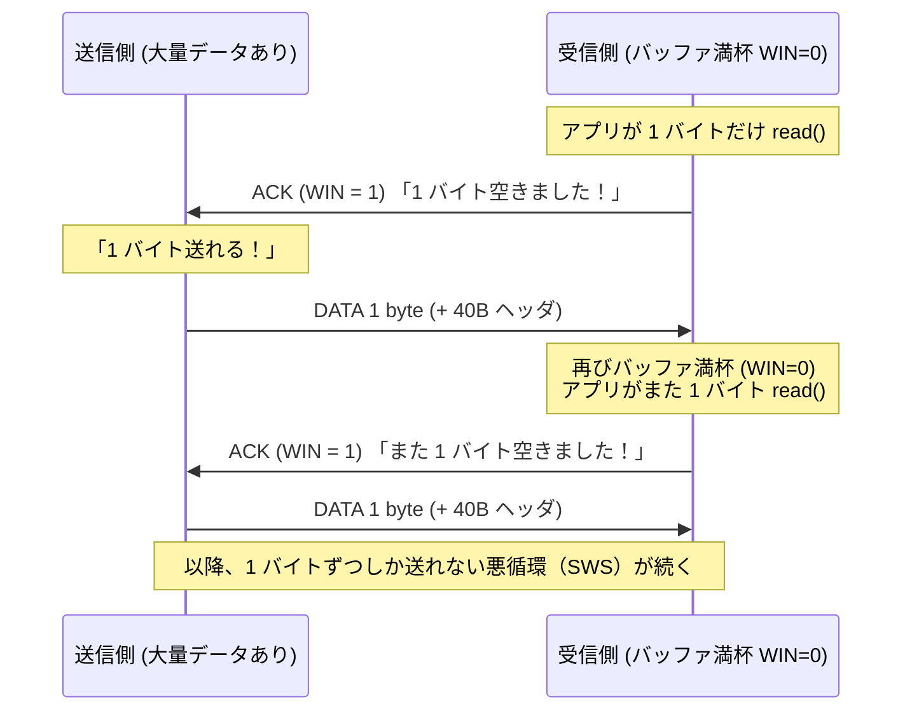
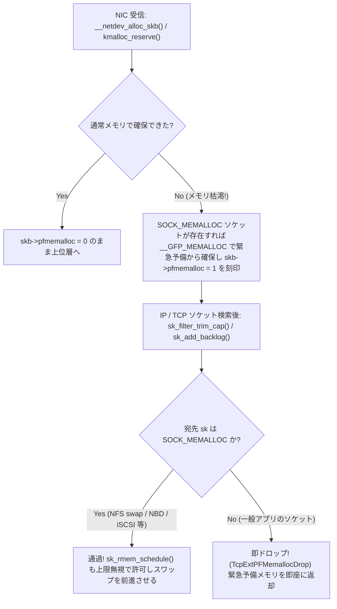

# 補足コラム・Q&A ノート

本編を読み進めるなかで疑問に浮かびやすい「なぜこのフィールドが存在するのか？」「このカウンタはどう増減するのか？」といったトピックを、図解とともにまとめた補足ノートです。本編の各章からもここへリンクしています。

---

## 1. `write_seq` や `copied_seq` はなぜ `0` から始まらないのか？ {#write-seq-copied-seq}

（関連章: [第 1 章: 主要データ構造](01-data-structures.md)）

TCP のシーケンス番号は、`0` バイト目から始まるオフセットではなく、3 ウェイハンドシェイク（SYN / SYN-ACK）のときに暗号学的なハッシュ（SipHash）でランダムに選ばれた **ISN（Initial Sequence Number：初期シーケンス番号）** から始まります。

### 送信側の境界（`snd_una` / `snd_nxt` / `write_seq`）

```text
送信ストリーム (バイト列のシーケンス番号空間)
  ... | 送信済み・ACK 済み | 送信済み・未 ACK (In-Flight) | 未送信 (sendmsg 済み) |
                           ^                              ^                       ^
                        snd_una                        snd_nxt                write_seq
```

- **`snd_una`**: まだ相手から ACK されていない最古のバイトのシーケンス番号です。その 1 つ手前（`snd_una - 1`）までは相手に届いたことが確認できています。
- **`snd_nxt`**: 次にワイヤへ初めて送り出すバイトのシーケンス番号です。`snd_nxt - snd_una` が「いまワイヤ上（または再送キュー）にある送信済み・未 ACK バイト数」になります。
- **`write_seq`**: アプリケーションが `write()` / `sendmsg()` でカーネルの送信キューに書き込んだ直後の「次の空き位置」です。`write_seq - snd_nxt` が「まだ 1 度もワイヤに出ていない未送信バイト数（`notsent_bytes`）」になります。

### 受信側の境界（`copied_seq` / `rcv_nxt`）

```text
受信ストリーム (バイト列のシーケンス番号空間)
  ... | アプリが recvmsg 済み | 受信済み・アプリ未読 (Receive Queue) | まだ届いていない |
                              ^                                      ^
                          copied_seq                              rcv_nxt
```

- **`copied_seq`**: アプリがまだ `read()` / `recvmsg()` で読み出していない先頭バイトのシーケンス番号です（その 1 つ手前 `copied_seq - 1` までがユーザ空間へコピー済み）。
- **`rcv_nxt`**: カーネルが「次に相手から届くのを待っている」バイトのシーケンス番号です（その 1 つ手前 `rcv_nxt - 1` までが欠損なくカーネルの受信キューに届いています）。
- したがって **`rcv_nxt - copied_seq`** が「カーネルには届いているが、アプリがまだ読んでいない未読バイト数（`ioctl(SIOCINQ)` の値）」になります。

---

## 2. `SND.WL1` (`snd_wl1`) と `SND.WL2` (`snd_wl2`) は何のためにあるのか？ {#snd-wl1-wl2}

（関連章: [第 1 章: 主要データ構造](01-data-structures.md)、[第 7 章: ACK 処理と RTT 推定](07-ack-processing.md)）

相手から届いたパケットの TCP ヘッダには「現在の受信ウィンドウサイズ（`seg.wnd`）」が入っており、送信側はそれを `tp->snd_wnd` に反映します。
しかし、インターネットでは **パケットの到着順序が入れ替わる（Reordering）** ことがあります。もし到着したすべてのパケットの `seg.wnd` を無条件に信じて `tp->snd_wnd` を上書きしてしまうと、**遅れて届いた古いパケットが最新のウィンドウ情報を巻き戻してしまう** というバグが起きます。

```text
受信側 (Receiver)                              送信側 (Sender)
-----------------                              ---------------
(1) パケット P1 を送信:
    seq=500, ack=1000, win=4000 (空いている)
         \
          \  (ネットワーク内で P1 が遅延・追い抜かれる)
           \
(2) パケット P2 を送信:                        (2') P2 が先に到着！
    seq=500, ack=2000, win=0 (満杯になった!)  --->  snd_wnd = 0 に更新
                                                    snd_wl1 = 500, snd_wl2 = 2000 を記録
             \
              \-------------------------------> (1') 遅れていた古い P1 が後から到着！
                                                    seg.seq=500, seg.ack=1000, seg.wnd=4000
                                                    もし無条件に採用すると snd_wnd=4000 に
                                                    巻き戻り、満杯の相手に誤送信してしまう！
```

これを防ぐため、TCP（RFC 9293 §3.3）は **「前回 `snd_wnd` を更新したパケットの `seq`（= `snd_wl1`）と `ack`（= `snd_wl2`）」** を記憶しておき、`tcp_may_update_window()` で次のどちらか一方を満たす「より新しいパケット」のときだけ `snd_wnd` を更新します。

1. **`after(seq, snd_wl1)`**: 相手がより先のデータを送ってきたパケット（`seq > snd_wl1`）である。
2. **`seq == snd_wl1 && after(ack, snd_wl2)`**: 相手の `seq` は同じだが、より先のデータに対する ACK（`ack > snd_wl2`）である。
3. **`seq == snd_wl1 && ack == snd_wl2 && nwin > snd_wnd`**: `seq` も `ack` もまったく同じでウィンドウだけが広がった（相手のアプリが `recvmsg()` でバッファを空けて Window Update ACK を送ってきた）場合。

上の図の例では、遅れて届いた P1 は `seq == 500` ですが `ack (1000) < snd_wl2 (2000)` なので古い情報と判定され、`win=4000` は安全に無視されます。

---

## 3. `packets_out` / `sacked_out` / `lost_out` / `retrans_out` は増え続けるフィールドか？ {#packets-out-sacked-out-lifecycle}

（関連章: [第 1 章: 主要データ構造](01-data-structures.md)、[第 7 章: ACK 処理と RTT 推定](07-ack-processing.md)、[第 8 章: ロス検出と回復](08-loss-recovery.md)）

**いいえ、一生増え続ける累積カウンタではありません。**
この 4 つはすべて **「いま現在 `snd_una` 〜 `snd_nxt` の間（再送キュー / rtx queue）に残っている未確認パケットの内訳」を表す現在値（ゲージ）** です。相手から累積 ACK が返ってきて `snd_una` が進み、ソケットがすべて ACK されれば **全員 `0` に戻ります**。

```text
|<------------------------ packets_out (例: 10 パケット) ------------------------>|
+------------------+------------------+------------------+------------------------+
|   lost_out (2)   |  sacked_out (3)  |       ...        |                   ...  |
| 「抜けたと判定」 | 「SACK で到着済」| (まだ飛行中: 5)  |                        |
+------------------+------------------+------------------+------------------------+
         |
         +---> うち再送済みの個数が retrans_out (例: 1)
```

$$\text{In-Flight パケット数} = \text{packets}_{\text{out}} - (\text{sacked}_{\text{out}} + \text{lost}_{\text{out}}) + \text{retrans}_{\text{out}}$$

| フィールド | 意味 | いつ増えるか（`+`） | いつ減るか（`-`） |
| :--- | :--- | :--- | :--- |
| **`packets_out`** | `snd_una` 〜 `snd_nxt` の間にある元データの総パケット数 | 新規データ送信時（`tcp_event_new_data_sent()`） | 累積 ACK で `snd_una` が進み rtx queue から `sk_buff` が解放されたとき（`tcp_clean_rtx_queue()`）、または FIN 離脱時 |
| **`sacked_out`** | `packets_out` のうち、SACK ブロック（または Reno の dupack 推定）で「相手には届いている」と分かっているパケット数 | 新たな SACK ブロックが報告されたとき（`tcp_sacktag_one()`） | **累積 ACK（`snd_una`）がその SACK 済みパケットを追い越して `sk_buff` が解放されたとき**（または RTO で SACK 情報がリセットされたとき） |
| **`lost_out`** | `packets_out` のうち、RACK や SACK 閾値によって「途中で落ちた」と判定されたパケット数 | ロス判定時（`tcp_mark_skb_lost()`、RTO 時は全未 SACK 分） | **累積 ACK でそのロス区間が回収されて `sk_buff` が解放されたとき**（または Undo 時） |
| **`retrans_out`** | `lost_out` のうち、すでに再送パケットを送り出して現在ワイヤ上を飛んでいる数 | 再送パケット送信時（`__tcp_retransmit_skb()`） | **累積 ACK で再送済みの `sk_buff` が解放されたとき**、または再送パケット自体が再びロスしたと判定されたとき |

- **逆に「一生増え続ける累積カウンタ」はどれか？**
  - コネクション開始からの累計で単調増加し続けるのは **`tp->delivered`**（相手に届いた累計パケット数、BBR の帯域計算などで使用）、**`tp->delivered_ce`**（ECN CE マーク付きの累計パケット数）、**`tp->total_retrans`**（コネクション全体の累計再送数）です。

---

## 4. `enum tcp_chrono` と `TCP_CHRONO_BUSY` は何を測っているのか？ {#tcp-chrono-busy}

（関連章: [第 3 章: 送信 (1): tcp_sendmsg と送信キュー](03-sendmsg.md)）

本番環境で「TCP のスループットが出ない」とき、原因は大きく 4 つあります。
1. アプリがそもそもデータを書いていない（アイドル状態）
2. ネットワークの輻輳ウィンドウ（`snd_cwnd`）やペーシングで制限されている
3. 受信側のウィンドウ（`snd_wnd` / `rwnd`）が小さくて止められている
4. 送信側のソケットバッファ（`SO_SNDBUF` / `sk_sndbuf`）が小さすぎて、`cwnd` には余裕があるのに `sendmsg()` が詰まっている

この「どれがボトルネックだったのか」をマイクロ秒単位のストップウォッチで記録するのが **`tcp_chrono_start()` / `tcp_chrono_stop()`**（`enum tcp_chrono`）です。

```text
状態優先度 (番号が大きい方が優先してカウントされる):
  TCP_CHRONO_UNSPEC (0)        : アイドル (送信キューも RTX キューも空)
    ↓
  TCP_CHRONO_BUSY (1)          : 送信したいデータが 1 バイト以上ある状態 (全体稼働時間)
    ↓
  TCP_CHRONO_RWND_LIMITED (2)  : 受信側のウィンドウ (snd_wnd) が原因で送れない状態
    ↓
  TCP_CHRONO_SNDBUF_LIMITED (3): 送信バッファ (sk_sndbuf) が満杯でそれ以上積めない状態
```

- 送信キューと再送キューが完全に空だった状態から、`tcp_sendmsg_locked()` が最初の 1 パケットをキューに繋いだ瞬間（`tcp_skb_entail()`）、カーネルは `tcp_chrono_start(sk, TCP_CHRONO_BUSY)` を呼んで「送信ビジー時間」のストップウォッチを開始します。
- その後、すべてのデータが ACK されて送信キューも再送キューも空になると、`tcp_chrono_stop(sk, TCP_CHRONO_BUSY)` でストップウォッチが止まります。
- 計測された累積時間は `tp->chrono_stat[]` に加算され、`ss -ti` の出力（`busy:120ms rwnd_limited:30ms(25.0%) sndbuf_limited:60ms(50.0%)`）や `struct tcp_info`（`tcpi_busy_time`, `tcpi_rwnd_limited`, `tcpi_sndbuf_limited`）からいつでも確認できます。

---

## 5. `TCP_NOTSENT_LOWAT` (`notsent_lowat`) と `tcp_stream_memory_free()` {#tcp-notsent-lowat}

（関連章: [第 3 章: 送信 (1): tcp_sendmsg と送信キュー](03-sendmsg.md)）

### なぜ `sk_sndbuf` とは別に `TCP_NOTSENT_LOWAT` が必要なのか？

TCP の送信バッファ（`sk_wmem_queued`、上限は `sk_sndbuf`）には、**`snd_nxt` を境に 2 種類のデータ** が入っています。

```text
|<------------------------ sk_wmem_queued (上限: sk_sndbuf) ----------------------->|
+----------------------------------------+------------------------------------------+
| (A) 送信済み・未 ACK のデータ          | (B) まだ 1 度もワイヤに出ていない        |
|     (In-Flight: 再送のために保持が必須) |     未送信データ (notsent_bytes)         |
+----------------------------------------+------------------------------------------+
^                                        ^                                          ^
snd_una                                  snd_nxt                                    write_seq
```

- **(A) 送信済み・未 ACK（`snd_nxt - snd_una`）**:
  - すでにワイヤへ送り出したが、相手からまだ ACK が返っていないデータです。万一途中でロスしたら再送しなければならないため、ACK が返るまでカーネルはメモリを解放できません。
  - 高帯域・長距離（高 BDP）の回線で速度を出すには (A) を数 MB 飛ばす必要があるため、Linux の送信バッファ自動調整（`tcp_moderate_sndbuf()`）は `sk_sndbuf` を **数 MB（たとえば 4 MB）** まで広げます。
- **(B) 未送信データ（`write_seq - snd_nxt` = `notsent_bytes`）**:
  - アプリが `sendmsg()` で書き込んだけれど、cwnd やペーシングの制限で **まだ 1 度もワイヤに出ていない順番待ちのデータ** です。

もし `sk_sndbuf`（例: 4 MB）だけで制限していると、そのうち (A) が 500 KB しかなくても、非ブロッキングなアプリ（`epoll` で書けるだけ書くループ）は残りの **3.5 MB 分も未送信データ (B) をカーネルに先回りして詰め込めてしまいます**。
一度 `sendmsg()` でカーネルに渡したデータは後からキャンセルも順番入れ替えもできないため、HTTP/2 や動画配信サーバが「直後に来た高優先度のレスポンスを先に送りたい」「画面スクロールで不要になった画像の送信をやめたい」と思っても、すでに積んだ 3.5 MB の後ろに並ばされてしまいます（アプリケーション層の Bufferbloat / Head-of-Line Blocking）。

そこで **`TCP_NOTSENT_LOWAT`**（既定値は `UINT_MAX` で無制限）をたとえば **`16 KB`** に設定すると：
1. **(A) の送信済み・未 ACK データ** には `sk_sndbuf` の数 MB をフルに使わせたまま（＝高 BDP 回線でのスループットを一切落とさず）、
2. **(B) の未送信データ（`write_seq - snd_nxt`）だけを 16 KB 以下に抑える** ことができます。
3. パケットがワイヤへ出て `snd_nxt` が進むたびにアプリが起こされるため、**「本当にワイヤに出る直前（Just-In-Time）」** にいま最優先のデータを `sendmsg()` できるようになります（コミット `c9bee3b7fdec`）。

### なぜ上限なのに名前が `LOWAT` で、`<< wake` で半分にするのか？

```c
bool tcp_stream_memory_free(const struct sock *sk, int wake)
{
	const struct tcp_sock *tp = tcp_sk(sk);
	u32 notsent_bytes = READ_ONCE(tp->write_seq) - READ_ONCE(tp->snd_nxt);

	return (notsent_bytes << wake) < tcp_notsent_lowat(tp);
}
```

- **名前の由来**: `poll()` / `epoll` の視点から見て、「未送信データ (B) が減っていって、この水位を **下回ったら（Low Watermark を切ったら）** 書き込み可能（`EPOLLOUT`）を通知する」という意味で `LOWAT` と名付けられています。
- **なぜ `<< wake` で閾値を変えるのか（ヒステリシス）**:
  - **`sendmsg()` で書き込むとき（`wake = 0`）**: `notsent_bytes < lowat`（例: 16 KB 未満なら書ける）。
  - **送信が進んで `EPOLLOUT` でアプリを起こすか判定するとき（`wake = 1`）**: `(notsent_bytes << 1) < lowat`、つまり **`notsent_bytes < lowat / 2`（半分＝8 KB 未満に減るまで `EPOLLOUT` を出さない）**。
  - もし 16 KB 溜まっている状態から 1 パケット（1.4 KB）送信されて 14.6 KB になった瞬間にすぐ `EPOLLOUT` を出してしまうと、アプリが起きて 1.4 KB だけ書いてまた `-EAGAIN` で寝る……という細かい wakeup が毎パケット発生してしまいます。半分（8 KB）空くまで待ってから起こすことで、1 回の起床につき 8 KB まとめて書けるようチャタリングを防いでいます（コミット `8ba3c9d1c6d7`、`a74f0fa082b7`）。

---

## 6. `alloc_skb_fclone()` と `struct sk_buff_fclones`：なぜ最初から双子の `sk_buff` を確保するのか {#skb-fclone}

**関連箇所**: [第 3 章: `tcp_stream_alloc_skb()`](03-sendmsg.md)、[第 4 章: `__tcp_transmit_skb()`](04-write-xmit.md)

### なぜ TCP は送信のたびに `sk_buff` を clone するのか？

UDP のように再送を行わないプロトコルでは、作った `struct sk_buff` をそのまま IP 層 → Qdisc → NIC ドライバへ渡し、NIC の DMA 送信が終わった時点でドライバが `consume_skb()` を呼んで解放してしまいます。

しかし TCP では、**送信したパケットがネットワークの途中でロスするかもしれないため、相手から ACK が返ってくるまで送信済みデータを再送キュー（`tcp_rtx_queue`）に保管し続けなければなりません**。一方で、下位層（IP・Qdisc・NIC ドライバ）に渡した `struct sk_buff` は、キューのポインタ（`next` / `prev` / `rbnode`）やヘッダポインタ（`data` / `transport_header` / `network_header`）が書き換えられ、DMA 送信完了と同時に解放されてしまいます。

そのため TCP は、`__tcp_transmit_skb()` でパケットを送り出すたびに **`skb_clone()`** を呼びます。
- **注意**: `skb_clone()` はパケットのデータ本体（ペイロードのページ群や `skb->head` の線形バッファ）は一切コピーしません。データ領域の参照カウント（`skb_shinfo(skb)->dataref`）を `+1` するだけで、**管理用の構造体である `struct sk_buff`（約 232 バイト）だけをもう 1 個複製** します。
- **原本の `sk_buff`（`oskb`）**: TCP ソケットの `tcp_rtx_queue` に居残り続け、ACK が来たら解放されます。
- **クローンされた `sk_buff`（`skb`）**: TCP/IP/Ethernet ヘッダを書き込まれて IP 層 → Qdisc → NIC ドライバへ旅立ち、NIC の DMA 送信が終わったら解放されます。

### 通常の `skb_clone()` の無駄と `fclone`（Fast Clone）の発想

通常の `alloc_skb()` で確保した `sk_buff` に対して `skb_clone()` を呼ぶと、クローン用の `struct sk_buff` を作るためにスラブアロケータ（`kmem_cache_alloc(skbuff_cache)`）をもう一度呼ぶ必要があり、解放時も `kmem_cache_free()` が 2 回（NIC 送信完了時と ACK 到着時）走ります。

しかし、TCP の送信パス（`tcp_stream_alloc_skb()`）で作る `sk_buff` は、**「あとで `__tcp_transmit_skb()` で 100% 確実に 1 回以上 `skb_clone()` される」ことが最初から分かっています**。

そこで `alloc_skb_fclone()`（[include/linux/skbuff.h#L1437](https://git.kernel.org/pub/scm/linux/kernel/git/netdev/net-next.git/tree/include/linux/skbuff.h?id=279d5c8afcd38bd841832a39bfe1aa4f8518d98e#n1437)）は、最初から **`struct sk_buff` 2 個分（`skb1` と `skb2`）と参照カウンタ `fclone_ref` が 1 塊になった構造体 `struct sk_buff_fclones`** を専用スラブキャッシュ（`skbuff_fclone_cache`）から一括で確保します（[include/linux/skbuff.h#L1401](https://git.kernel.org/pub/scm/linux/kernel/git/netdev/net-next.git/tree/include/linux/skbuff.h?id=279d5c8afcd38bd841832a39bfe1aa4f8518d98e#n1401)）。

```c
/* Layout of fast clones : [skb1][skb2][fclone_ref] */
struct sk_buff_fclones {
	struct sk_buff	skb1;

	struct sk_buff	skb2;

	refcount_t	fclone_ref;
};
```

```
skbuff_fclone_cache の 1 スラブオブジェクト (struct sk_buff_fclones):
+---------------------------+---------------------------+------------+
| skb1 (SKB_FCLONE_ORIG)    | skb2 (SKB_FCLONE_CLONE)   | fclone_ref |
| TCP 再送キューに残る原本  | 下位層・NIC に渡す予備席  |   1 -> 2   |
+---------------------------+---------------------------+------------+
              |                           |
              +-------------+-------------+
                            v
      同じデータバッファ (skb->head / skb_shared_info / page frags) を共有
```

### 確保・送信（clone）・解放の 3 ステップ

1. **確保時（`alloc_skb_fclone()` → `__alloc_skb()`）**:
   - `skbuff_fclone_cache` から `struct sk_buff_fclones` を 1 個取り出します。
   - `skb1.fclone = SKB_FCLONE_ORIG`、`fclone_ref = 1` に初期化し、`&fclones->skb1` を返します。隣にある `skb2` はまだ空席のまま隣に待機しています。
2. **送信時（`__tcp_transmit_skb()` → `skb_clone()`、[net/core/skbuff.c#L2091](https://git.kernel.org/pub/scm/linux/kernel/git/netdev/net-next.git/tree/net/core/skbuff.c?id=279d5c8afcd38bd841832a39bfe1aa4f8518d98e#n2091)）**:
   ```c
   if (skb->fclone == SKB_FCLONE_ORIG &&
       refcount_read(&fclones->fclone_ref) == 1) {
   	n = &fclones->skb2;
   	refcount_set(&fclones->fclone_ref, 2);
   	n->fclone = SKB_FCLONE_CLONE;
   }
   ```
   - `skb1` が `SKB_FCLONE_ORIG` で、かつ `fclone_ref == 1`（隣の `skb2` が未使用）であれば、**スラブアロケータを一切呼ばずに、すぐ隣のアドレス `&fclones->skb2` をポインタ計算だけで取り出し**、`fclone_ref = 2` にして `skb1` のフィールドをコピーします。
3. **解放時（`kfree_skbmem()`、[net/core/skbuff.c#L1130](https://git.kernel.org/pub/scm/linux/kernel/git/netdev/net-next.git/tree/net/core/skbuff.c?id=279d5c8afcd38bd841832a39bfe1aa4f8518d98e#n1130)）**:
   - 通常は数マイクロ秒後に NIC の DMA 送信が先に終わり、ドライバがクローン側（`skb2`）を解放します。このとき `refcount_dec_and_test(&fclones->fclone_ref)` で `fclone_ref` が `2 → 1` に減るだけで、スラブ解放は行われません（ちなみに、このあとタイムアウト等で **再送** が必要になった場合、`fclone_ref` が `1` に戻っているため、同じ `skb2` をもう一度再利用してクローンできます）。
   - その後、相手から ACK が届いて TCP が原本（`skb1`）を解放するとき、`kfree_skbmem()` は `skb->fclone == SKB_FCLONE_ORIG` かつ `refcount_read(&fclones->fclone_ref) == 1` を見て、アトミック減算すら省いて即座に `kmem_cache_free(skbuff_fclone_cache, fclones)` を 1 回だけ呼び、ペアごとスラブキャッシュに返却します。

---

## 7. SACK shifting（`tcp_shift_skb_data()` / `skb_shift()`）と「線形領域のペイロードを 0 にする理由」 {#sack-shifting}

**関連箇所**: [第 3 章: `tcp_stream_alloc_skb()`](03-sendmsg.md)、[第 8 章: Step 6 SACK shifting](08-loss-recovery.md)

### なぜ SACK されたデータをその場で解放せず、分割してまで保持し続けるのか？

SACK の処理を読むと、まず **「相手に届いたと SACK で報告されたのなら、なぜその場で解放（free）せず、わざわざ `sk_buff` を分割してまで再送キューに残しておくのか？」** という疑問が湧きます。理由は 2 つあります。

1. **なぜ SACK されたデータをすぐ解放してはいけないのか？ → SACK Reneging（受信側による SACK のちゃぶ台返し）があるため**:
   - 累積 ACK（`ack_seq` / `snd_una`）は「受信側が先頭から順番どおり受け取り、確定した」という **取り消し不能な約束** です。
   - 一方、SACK（Selective ACK）は「先頭の #1 がまだ届いていないので、先に届いた #2〜#4 を **受信側の Out-of-Order キュー（第 6 章の `out_of_order_queue`）に一時的に預かっている**」というだけの **仮の報告（Advisory / Non-binding）** に過ぎません（[RFC 2018 §4](https://www.rfc-editor.org/rfc/rfc2018#section-4)）。#1 が届くまで、受信側は #2〜#4 をアプリケーション（`recvmsg()`）に渡せません。
   - もし #1 を待っている間に受信側が深刻なメモリ不足に陥ると、受信側は **`out_of_order_queue` に預かっていた SACK 済みパケット（#2〜#4）を破棄して捨てること** が RFC 2018 で明確に許されています（第 6 章・第 10 章の `tcp_prune_ofo_queue()`）。これを **SACK Reneging（SACK の撤回・反故）** と呼びます。
   - もし送信側が「SACK されたから」といって #2〜#4 のメモリを解放してしまっていたら、受信側がメモリ不足で OOO キューを捨てた瞬間に、**送信側にも受信側にも #2〜#4 のデータが存在しなくなり、永久に再送できなくなってしまいます**。
   - 実際、やっと #1 が届いたのに受信側から `ack_seq` が進まず RTO（再送タイムアウト）が発火すると、送信側の `tcp_timeout_mark_lost()`（[net/ipv4/tcp_input.c#L2524](https://git.kernel.org/pub/scm/linux/kernel/git/netdev/net-next.git/tree/net/ipv4/tcp_input.c?id=279d5c8afcd38bd841832a39bfe1aa4f8518d98e#n2524)）は「先頭（`snd_una`）の `sk_buff` に `TCPCB_SACKED_ACKED` が付いたままタイムアウトした＝受信側が SACK Reneging した（`is_reneg = true`）」と検知し、**全 `sk_buff` の `TCPCB_SACKED_ACKED` フラグを剥がして（`sacked &= ~TCPCB_SACKED_ACKED`）、SACK 済みだったデータも最初から再送し直します**。
   - したがって、**累積 ACK（`snd_una`）が追い付くまでは、SACK されたデータも絶対に再送キューから解放してはならない** という鉄則があります。

2. **なぜ 1 個の `sk_buff` の一部が SACK されたときに分割（`tcp_fragment()`）しなければならないのか？**:
   - スコアボードの状態フラグ（`TCP_SKB_CB(skb)->sacked` の `S` = SACK 済み、`L` = ロス、`R` = 再送中）も、再送関数 `tcp_retransmit_skb()` が送り直す単位も、すべて **`struct sk_buff` 1 個単位** だからです（1 個の `sk_buff` の中にセグメントごとの状態ビット配列があるわけではありません）。
   - たとえば 10 セグメント（#1〜#10）入った TSO `sk_buff` のうち「#1 がロス、#2〜#4 が SACK 済み」になったとき、もしこの `sk_buff` を分割しなければ：
     - 1 個の `sk_buff` に「ロス（`L`）」と「SACK 済み（`S`）」を同時に付けることはできず、
     - #1 を再送するときに **#1 だけを送ることができず、すでに届いている #2〜#10 まで含めて 10 セグメント丸ごと再送する** ことになってしまいます。
   - そのため、「SACK されていない穴（#1）」と「SACK された範囲（#2〜#4）」の境界では、必ず別の `sk_buff` に切り分ける必要があります。

### そもそも「SACK shifting」とは何をしているのか？

TSO（TCP Segmentation Offload）を使うと、TCP はたとえば 10 セグメント（10 MSS）分のペイロードをまとめた 1 個の大きな `sk_buff` を作って送信し、NIC がワイヤに出す直前に 10 個のパケット（#1〜#10）に分割します。

ここで **1 番目のパケット（#1）だけが途中でロス** し、残りの #2〜#10 が相手に届いたとします。受信側はパケットが到着するたびに SACK（Selective ACK）ブロックで「どこまで届いたか」を報告してきます。

- **SACK shifting がなかった時代（`tcp_fragment()` による細切れ化）**:
  - 最初の SACK で「#2〜#4 が届いた」と来ると、10 MSS の塊だった `sk_buff` を「#1（未着）」「#2〜#4（SACK 済み）」「#5〜#10（未確定）」の 3 個の `sk_buff` に分割（`tcp_fragment()`）します。
  - 次の SACK で「#2〜#6 が届いた」と来ると、後半の「#5〜#10」をさらに「#5〜#6（SACK 済み）」と「#7〜#10（未確定）」に分割します。
  - これが続くと、**もともと 1 個だった TSO `sk_buff` が再送キュー（rbtree）の中で 1〜2 MSS ずつの細かい `sk_buff` にバラバラに断片化** し、メモリ（`sk_buff` ごとの管理オーバーヘッド）もキュー走査の CPU コストも激増してしまいます。

- **SACK shifting（`tcp_shift_skb_data()`、[net/ipv4/tcp_input.c#L1954](https://git.kernel.org/pub/scm/linux/kernel/git/netdev/net-next.git/tree/net/ipv4/tcp_input.c?id=279d5c8afcd38bd841832a39bfe1aa4f8518d98e#n1954)）の動き**:
  - 「#2〜#4（すでに SACK 済みの直前の `sk_buff` = `prev`）」のすぐ後ろにある `skb`（#5〜#10）のうち、新しく SACK された「#5〜#6」のデータを、**新しい `sk_buff` に切り出すのではなく、直前の `prev` の末尾へ引っ越し（shift / 吸収）させます**。

```
[SACK 到着前]
  prev (SACK 済み: #2..#4)        skb (未確定: #5..#10)
+--------------------------+   +----------------------------------+
| seq: #2..#4              |   | seq: #5..#10                     |
+--------------------------+   +----------------------------------+

[SACK で #2..#6 が通知されたとき: SACK shifting]
  prev (SACK 済み: #2..#6)        skb (未確定: #7..#10)
+----------------------------------+   +--------------------------+
| seq: #2..#6 (#5..#6 を吸収!)     |   | seq: #7..#10 (先頭が縮む)|
+----------------------------------+   +--------------------------+
```

さらに最後（#7〜#10）まで SACK されれば、`skb` の中身はすべて `prev` に吸い込まれ、空になった `skb` 自体は解放（merge）されます。これにより、**SACK 済みの連続領域は常に 1 個の大きな `sk_buff` にまとまった状態** を保てます。

### なぜ「ペイロードを線形領域（`skb->head`）に入れず、すべて `frags[]`（ページ frag）に入れる」とコピーなしで shift できるのか？

`sk_buff` がデータを持つ場所には、次の 2 種類があります（第 1 章）。

1. **線形領域（`skb->head` 〜 `skb->tail`、長さは `skb_headlen(skb)`）**:
   - `alloc_skb_fclone()` のときに TCP/IP ヘッダ用の領域と一続きで `kmalloc` された 1 枚の連続メモリです。
   - もしここにペイロード（データ本体）が入っていると、そのデータを隣の `sk_buff`（`prev`）に移すには **`memcpy()` でバイト列をコピーするしかありません**。そのためカーネルの `skb_can_shift()`（[net/ipv4/tcp_input.c#L1931](https://git.kernel.org/pub/scm/linux/kernel/git/netdev/net-next.git/tree/net/ipv4/tcp_input.c?id=279d5c8afcd38bd841832a39bfe1aa4f8518d98e#n1931)）および `skb_shift()`（[net/core/skbuff.c#L4327](https://git.kernel.org/pub/scm/linux/kernel/git/netdev/net-next.git/tree/net/core/skbuff.c?id=279d5c8afcd38bd841832a39bfe1aa4f8518d98e#n4327)）は、**線形領域に 1 バイトでもデータが入っている `sk_buff`（`skb_headlen(skb) > 0`）の shift を即座に拒否** します。
   ```c
   /* Shifting pages past head area doesn't work */
   static int skb_can_shift(const struct sk_buff *skb)
   {
   	return !skb_headlen(skb) && skb_is_nonlinear(skb);
   }
   ```
2. **ページ frag 配列（`skb_shinfo(skb)->frags[]`）**:
   - データ本体は別ページ（`current->task_frag` の 32 KB ページなど）にあり、`sk_buff` 側は **「どのページの、何バイト目（`offset`）から、何バイト分（`size`）」という 3 つ組の配列（`skb_frag_t`）** を持っているだけです。
   - したがって、ペイロードが 100% `frags[]` に入っていれば、`skb` から `prev` へ `shiftlen` バイト移す処理（`skb_shift(prev, skb, shiftlen)`）は、**データ本体には一切触れず、`frags[]` 配列の `(page, offset, size)` を書き換えるだけ（ゼロコピー）** で完結します。
   - 特に `tcp_sendmsg_locked()` では同じ 32 KB の `task_frag` ページに順番に書き込んでいるため、`prev` の末尾 frag と `skb` の先頭 frag は **同じページの連続したオフセット** を指していることがほとんどです。その場合はさらに単純で、ページ参照すら増やさず **`prev` 側の frag の `size` に `+shiftlen` し、`skb` 側の frag の `offset` に `+shiftlen`、`size` に `-shiftlen` するだけ** でデータの引っ越しが終わります（[net/core/skbuff.c#L4369-L4371](https://git.kernel.org/pub/scm/linux/kernel/git/netdev/net-next.git/tree/net/core/skbuff.c?id=279d5c8afcd38bd841832a39bfe1aa4f8518d98e#n4369)）。

第 3 章の `tcp_stream_alloc_skb()` が `alloc_skb_fclone(MAX_TCP_HEADER, gfp)` で「ヘッダ用の余白（ヘッドルーム）だけ確保し、ペイロードは 1 バイトも線形領域に入れずすべてページ frag に入れる」よう統一された（コミット `3613b3dbd1ad`、`5882efff88aa`）のは、すべての送信 `sk_buff` でこのゼロコピー SACK shifting（`!skb_headlen(skb)`）を常に効かせるためです。

---

## 8. `tp->nonagle` の 3 つのビットと `TCP_NAGLE_PUSH` の役割 {#tcp-nagle-push}

**関連箇所**: [第 3 章: `tcp_skb_entail()`](03-sendmsg.md)、[第 4 章: `tcp_nagle_test()` / `tcp_nagle_check()`](04-write-xmit.md)

### `tp->nonagle` に入っている 3 つのビットフラグ

`struct tcp_sock` の `tp->nonagle` には、次の 3 つのビットフラグが定義されています（[include/net/tcp.h#L261-L263](https://git.kernel.org/pub/scm/linux/kernel/git/netdev/net-next.git/tree/include/net/tcp.h?id=279d5c8afcd38bd841832a39bfe1aa4f8518d98e#n261)）。

```c
/* Flags in tp->nonagle */
#define TCP_NAGLE_OFF		1	/* Nagle's algo is disabled */
#define TCP_NAGLE_CORK		2	/* Socket is corked	    */
#define TCP_NAGLE_PUSH		4	/* Cork is overridden for already queued data */
```

- **`TCP_NAGLE_OFF` (1)**: `setsockopt(TCP_NODELAY, 1)` で立ちます。Nagle アルゴリズムを無効化し、1 MSS 未満の小さなデータでも ACK を待たずにすぐ送ります。
- **`TCP_NAGLE_CORK` (2)**: `setsockopt(TCP_CORK, 1)` で立ちます。ソケットに「コルク栓」をして、1 MSS に満たない端数セグメントの送信を止めます。
- **優先順位の基本ルール**: **`TCP_CORK` は `TCP_NODELAY` より強い**（[net/ipv4/tcp_output.c#L2234](https://git.kernel.org/pub/scm/linux/kernel/git/netdev/net-next.git/tree/net/ipv4/tcp_output.c?id=279d5c8afcd38bd841832a39bfe1aa4f8518d98e#n2234) の `tcp_nagle_check()`）。つまり両方が立っているとき、通常の書き込みデータはコルク栓（`TCP_NAGLE_CORK`）が優先されて送信が止められます。

### では `TCP_NAGLE_PUSH` (4) は何のためにあるのか？

Linux の仕様では、**「`TCP_CORK` で栓をしている最中でも、アプリが明示的に `setsockopt(TCP_NODELAY, 1)` を呼んだら、その時点で『すでに送信キューに溜まっているデータ』だけはコルク栓を無視して今すぐ強制フラッシュ（push）する」** というルールがあります（[net/ipv4/tcp.c#L3666-L3680](https://git.kernel.org/pub/scm/linux/kernel/git/netdev/net-next.git/tree/net/ipv4/tcp.c?id=279d5c8afcd38bd841832a39bfe1aa4f8518d98e#n3666)）。

```c
/* TCP_NODELAY is weaker than TCP_CORK, so that this option on corked socket is
 * remembered, but it is not activated until cork is cleared.
 *
 * However, when TCP_NODELAY is set we make an explicit push, which overrides
 * even TCP_CORK for currently queued segments.
 */
void __tcp_sock_set_nodelay(struct sock *sk, bool on)
{
	if (on) {
		tcp_sk(sk)->nonagle |= TCP_NAGLE_OFF|TCP_NAGLE_PUSH;
		tcp_push_pending_frames(sk);
	} else {
		tcp_sk(sk)->nonagle &= ~TCP_NAGLE_OFF;
	}
}
```

ここで `TCP_NAGLE_PUSH` が立てられると、送信判定の `tcp_nagle_test()`（[net/ipv4/tcp_output.c#L2375](https://git.kernel.org/pub/scm/linux/kernel/git/netdev/net-next.git/tree/net/ipv4/tcp_output.c?id=279d5c8afcd38bd841832a39bfe1aa4f8518d98e#n2375)）は、`TCP_NAGLE_CORK` や Nagle のチェックを行う前に **無条件で `return true`（送信許可）** を返します。

- **なぜ関数のローカル引数ではなく `tp->nonagle` にビットとして保存するのか？**
  - `setsockopt(TCP_NODELAY, 1)` を呼んだ瞬間（`tcp_push_pending_frames(sk)`）に、ちょうど `cwnd`（輻輳ウィンドウ）や `rwnd`（受信ウィンドウ）がいっぱいで、すぐにはワイヤに送り出せないことがあるからです。
  - `tp->nonagle` に `TCP_NAGLE_PUSH` を記憶しておけば、数ミリ秒後に ACK が届いてウィンドウが開いたときにも、「これはあのとき強制 push を指示された既存データだ」と分かって送り出せます。

### なぜ `tcp_skb_entail()` で新しいデータが来たら消すのか？（コミット `89ebd197eb2c` のバグ）

`TCP_NAGLE_PUSH` はあくまで **「`setsockopt()` を呼んだ時点で『すでにキューにあったデータ』だけを押し出す」** ためのフラグであり、**その後に新しく `write()` / `sendmsg()` されたデータには効かせてはいけません**。

特に上の `__tcp_sock_set_nodelay()` の `else` 節を見ると分かる通り、アプリが `setsockopt(TCP_NODELAY, 0)` で `TCP_NODELAY` をオフに戻したとき、カーネルは `TCP_NAGLE_OFF` しか消さず、**`TCP_NAGLE_PUSH` は消していません**。

そのため、たとえば送信キューが空の状態でアプリが次の操作をしたとします。

1. `setsockopt(TCP_NODELAY, 1)` を呼ぶ → `tp->nonagle` は `TCP_NAGLE_OFF | TCP_NAGLE_PUSH` になる。
2. `setsockopt(TCP_NODELAY, 0)` を呼んで Nagle を有効に戻す（あるいはさらに `setsockopt(TCP_CORK, 1)` でコルク栓をする） → `TCP_NAGLE_OFF` は消えるが、**`TCP_NAGLE_PUSH` が残ったまま** になる。
3. その後、小さな `write()` を呼ぶ。

コミット `89ebd197eb2c` より前の古いカーネルでは、`tcp_skb_entail()` のコードが次のようになっていました。

```c
/* 89ebd197eb2c より前のバグがあったコード */
if (!sk->sk_send_head)
	sk->sk_send_head = skb;
else if (tp->nonagle & TCP_NAGLE_PUSH)
	tp->nonagle &= ~TCP_NAGLE_PUSH;
```

`else if` になっていたせいで、**送信キューが空（`!sk->sk_send_head`）のときに新しい `sk_buff` を追加すると、`if` 側に入ってしまい `TCP_NAGLE_PUSH` が消えない** というバグがありました。その結果、手順 1→2→3 を踏むと `TCP_NAGLE_PUSH` が永久に残り続け、Nagle も `TCP_CORK` もまったく効かなくなってしまっていました。

そこでコミット `89ebd197eb2c` で `else` が外され、**「送信キューに新しい `sk_buff` をつなぐ（`tcp_skb_entail()`）ときは、必ず `TCP_NAGLE_PUSH` をクリアする」** ようになりました。

---

## 9. SWS（Silly Window Syndrome / 愚かなウィンドウ症候群）と回避策 {#sws-avoidance}

> **関連章**: [第 3 章: 送信 (1): `tcp_sendmsg` と送信キュー](03-sendmsg.md) / [第 4 章: 送信 (2): `tcp_write_xmit` からワイヤまで](04-write-xmit.md) / [第 6 章: 受信 (2): データキューイングと `tcp_recvmsg`](06-data-queue-recvmsg.md) / [第 10 章: ウィンドウとメモリ管理](10-window-memory.md)

### Q. 第 3 章などで出てくる「SWS（Silly Window Syndrome）」って何ですか？ Nagle アルゴリズムとは何が違うのですか？

**SWS（Silly Window Syndrome：愚かなウィンドウ症候群）** とは、1982 年に David D. Clark（[RFC 813](https://www.rfc-editor.org/rfc/rfc813)）が指摘した TCP の古典的な性能劣化現象で、**「送受信ウィンドウのやり取りが噛み合わなくなった結果、数バイトしかデータの入っていない極小パケット（ヘッダ 40 バイト＋データ数バイト）ばかりが延々と往復し続け、回線効率が壊滅する現象」** です。

### どうやって SWS が起きるのか？（具体例）

たとえば受信側のバッファ（`RCV.BUFF`）が 4000 バイトで、送信側が大量のデータを送りたいとします。

1. まず送信側が 4000 バイト送り、受信側のバッファが満杯になって **`RCV.WND = 0`（ゼロウィンドウ）** になります。
2. ここで受信側のアプリケーションが、ゆっくり **1 バイトだけ `read()`** したとします。
3. もし受信側 TCP が素直に **「1 バイト空いたよ！（`WIN = 1`）」** という Window Update ACK を送ってしまうと……
4. 送信側 TCP も素直に **「1 バイト送れるぞ！」と 1 バイトのデータ（＋40 バイトの TCP/IP ヘッダ）** を即座に送信してしまいます。
5. するとまた受信バッファが満杯（`WIN = 0`）になり、アプリが次の 1 バイトを `read()` するとまた `WIN = 1` → 1 バイト送信……という **「1 バイトずつのバケツリレー」が永久に続いてしまいます**。



### SWS の 2 つの原因と 2 つの対策（RFC 9293 §3.8.6.2）

SWS は **受信側** と **送信側** のどちらが原因でも起きるため、TCP では **両側** で対策（SWS Avoidance）を行います。

1. **受信側 SWS 回避（Clark のアルゴリズム、[RFC 9293 §3.8.6.2.2](https://www.rfc-editor.org/rfc/rfc9293#section-3.8.6.2.2)）**:
   - **原則**: 「受信バッファがほんの少し空いたくらいでは、新しいウィンドウを開いて広告してはいけない（右端を固定して `WIN = 0` などのまま我慢する）」。
   - **いつ開くか**: 空き容量が **「`1 MSS` 以上」** または **「受信バッファ全体の半分（ $\frac{1}{2} \times \text{RCV.BUFF}$ ）以上」** に回復するまで待ってから、まとめて大きなウィンドウを広告します。
   - **Linux の実装**（第 6 章・第 10 章）: `__tcp_select_window()` と `tcp_cleanup_rbuf()` が担当します。アプリが `recvmsg()` で少しずつ読んでも、開ける窓が現在の残り窓の 2 倍以上になるか、ウィンドウ右端が十分に（MSS 単位で）進むまで Window Update ACK を送りません。

2. **送信側 SWS 回避（[RFC 9293 §3.8.6.2.1](https://www.rfc-editor.org/rfc/rfc9293#section-3.8.6.2.1)）と Nagle（[RFC 896](https://www.rfc-editor.org/rfc/rfc896)）**:
   - **原則**: 万が一、受信側が小さなウィンドウ（例: `WIN = 10`）を広告してきたり、送信アプリが少しずつデータを書いたりしても、送信側が勝手に極小パケットを作って送らないようにします。
   - RFC の送信側ルールでは、次のどれかを満たすときだけ送信を許します：
     1. **フルサイズのセグメント（`1 MSS`）** を送れるとき。
     2. 未確認データ（In-Flight）が空で、**手持ちのデータをすべて** 送れるとき（Nagle の条件）。
     3. 相手がこれまでに教えてくれた **最大ウィンドウ（`tp->max_window`）の半分（ $F_s = \frac{1}{2}$ ）以上** のまとまったサイズを送れるとき。
     4. PSH フラグが付いていて、かつ override timeout が経過したとき。

### Nagle アルゴリズムと SWS 回避の違いは？

よく混同されますが、守っている相手が違います。

- **Nagle アルゴリズム（RFC 896）**: **送信側アプリ** が `write(fd, buf, 1)` のように **1 バイトずつチョロチョロ書いてくる** とき、In-Flight がある間は送信キューに溜めてまとめる仕組みです。
- **SWS 回避（RFC 813 / RFC 9293 §3.8.6.2）**: **受信側の空きウィンドウ（`SND.WND`）が小さくなっている** ときに、小分けのセグメントが飛び交うのを防ぐ仕組みです（送信アプリが 1MB まとめて `write()` していても、受信側の窓が 10 バイトしか開かなければ SWS が起きます）。

### 第 3 章のコードで SWS が登場する理由

第 3 章（`03-sendmsg.md`）の 2 つの関数に、上の **「最大ウィンドウの半分（`tp->max_window >> 1`）」** という送信側 SWS 回避の定数（ $F_s = \frac{1}{2}$ ）が登場します。

- `tcp_bound_to_half_wnd()`: 1 個の `sk_buff`（TSO チャンク）の目標サイズ `size_goal` を決める際、相手の最大ウィンドウ `tp->max_window` の半分（`tp->max_window >> 1`）で頭打ちにします。これにより、ウィンドウ全体を 1 個の巨大 `sk_buff` で使い切らず、最低 2 パケット以上に分けてパイプに流せるようにします。
- `forced_push()`: 大量データの `sendmsg()` 中、最後に PSH を立ててから `tp->max_window >> 1`（最大ウィンドウの半分）以上のデータを積んだら、メッセージの途中でも強制的に PSH を立てて送信（`__tcp_push_pending_frames()`）します。

---

## 10. `PF_MEMALLOC` / `pfmemalloc` / `SOCK_MEMALLOC` とは？ {#pfmemalloc}

> **関連章**: [第 4 章: 送信 (2): `tcp_write_xmit` からワイヤまで](04-write-xmit.md) / [第 5 章: 受信 (1): `tcp_v4_rcv` と `tcp_rcv_established`](05-rcv-established.md) / [第 10 章: ウィンドウとメモリ管理](10-window-memory.md)

### Q. 第 4 章・第 5 章・第 10 章に出てくる `pfmemalloc`（`PF_MEMALLOC` / `__GFP_MEMALLOC` / `SOCK_MEMALLOC`）って何ですか？

**`PF_MEMALLOC`**（**P**rocess **F**lag: **MEM**ory **ALLOC**ation）に由来する名前で、一言で言うと **「空きメモリを解放（reclaim / swap-out）するために、今まさにメモリを確保しなければならない処理だけに開放される『緊急予備メモリ（emergency memory reserves）』の仕組みと、そこから確保された `sk_buff` に付く目印（`skb->pfmemalloc`）」** です。

### なぜネットワーク（TCP）に緊急予備メモリが必要なのか？（ネットワーク越しのスワップとデッドロック）

スワップ領域やブロックデバイスがローカルディスクではなく、**ネットワークの先**（Swap over NFS、NBD、iSCSI、NVMe/TCP、あるいはそれらを運ぶ WireGuard トンネルなど）にあるマシンを想像してください。

1. マシンの空きメモリが枯渇すると、VM（メモリ管理サブシステム、`kswapd` や direct reclaim）はページを空けるために **汚れたページをネットワーク越しにスワップアウト（送信）** しようとします。
2. しかし、TCP でスワップデータを送るにも（`skb_clone()` など）、相手ストレージから **「書き込み完了＋TCP ACK」を受信する** にも（NIC ドライバでの受信ページ・ `sk_buff` 確保）、**新たなメモリ確保が必要** です。
3. もし空きメモリ枯渇時に「メモリがないから」と送信や ACK 受信のパケット確保が失敗（またはドロップ）してしまうと、
   **「ACK が受け取れないのでスワップアウトが完了しない → ページを解放できない → 空きメモリが増えないので一生 ACK も受け取れない」**
   という完全な **デッドロック** に陥ってしまいます。

### 4 つのフラグの役割分担

Linux は次の 4 つのフラグを連携させて、このデッドロックを防ぎつつ、無関係な一般ソケットに緊急予備メモリを食い潰されないようにしています。

| 名前 | 付く場所 | 役割 |
| --- | --- | --- |
| `PF_MEMALLOC` | `task_struct->flags`（[include/linux/sched.h#L1807](https://git.kernel.org/pub/scm/linux/kernel/git/netdev/net-next.git/tree/include/linux/sched.h?id=279d5c8afcd38bd841832a39bfe1aa4f8518d98e#n1807)） | メモリ回収（reclaim）中のタスク自身に立つフラグ。ページアロケータの水位制限（watermark）を無視して緊急予備メモリを使える |
| `__GFP_MEMALLOC` | `gfp_t`（メモリ確保フラグ） | タスクが `PF_MEMALLOC` でなくても（softirq などからでも）緊急予備メモリへのアクセスを許可する割り当てフラグ |
| `SOCK_MEMALLOC` | `struct sock` のフラグ（`sk_set_memalloc()`、[net/core/sock.c#L304](https://git.kernel.org/pub/scm/linux/kernel/git/netdev/net-next.git/tree/net/core/sock.c?id=279d5c8afcd38bd841832a39bfe1aa4f8518d98e#n304)） | NFS swap、NBD、iSCSI、NVMe/TCP などの「メモリ解放を支えるソケット」に付く特権フラグ。`sk->sk_allocation` に `__GFP_MEMALLOC` を足し、static key `memalloc_socks_key` を有効化する |
| `skb->pfmemalloc` | `struct sk_buff` の 1 ビットフラグ（[include/linux/skbuff.h#L967](https://git.kernel.org/pub/scm/linux/kernel/git/netdev/net-next.git/tree/include/linux/skbuff.h?id=279d5c8afcd38bd841832a39bfe1aa4f8518d98e#n967)） | **「この `sk_buff`（またはデータページ）は緊急予備メモリを切り崩して確保された非常食です」** という目印 |

### 受信パスでなぜ「先に確保してから後で捨てる」のか？

ここが一番面白い設計ポイントです。

NIC ドライバ（NAPI softirq）がパケットを受信して `__netdev_alloc_skb()`（[net/core/skbuff.c#L762](https://git.kernel.org/pub/scm/linux/kernel/git/netdev/net-next.git/tree/net/core/skbuff.c?id=279d5c8afcd38bd841832a39bfe1aa4f8518d98e#n762)）や `kmalloc_reserve()`（[net/core/skbuff.c#L607](https://git.kernel.org/pub/scm/linux/kernel/git/netdev/net-next.git/tree/net/core/skbuff.c?id=279d5c8afcd38bd841832a39bfe1aa4f8518d98e#n607)）を呼ぶ時点では、**まだパケットのヘッダ（IP アドレスや TCP ポート番号）を解析する前なので、そのパケットが「NFS スワップ用の大事な ACK」なのか「一般の HTTP サーバー宛ての無関係な通信」なのか見分けがつきません**。

そこで Linux は次の 2 段階で処理します。



1. **まず確保して刻印する**: システム上に `SOCK_MEMALLOC` ソケットが 1 つでもあれば（`sk_memalloc_socks()` が真）、通常割り当て（`__GFP_NOMEMALLOC`）に失敗したときだけ緊急予備メモリから確保し、`skb->pfmemalloc = 1`（ページ由来なら `page_is_pfmemalloc(page)` から伝播）を付けます。
2. **ソケット特定後に検問する（第 5 章・第 10 章）**:
   - TCP が宛先ソケット `sk` を見つけた直後、`sk_filter_trim_cap()`（[net/core/filter.c#L137](https://git.kernel.org/pub/scm/linux/kernel/git/netdev/net-next.git/tree/net/core/filter.c?id=279d5c8afcd38bd841832a39bfe1aa4f8518d98e#n137)）および `sk_add_backlog()`（[include/net/sock.h#L1163](https://git.kernel.org/pub/scm/linux/kernel/git/netdev/net-next.git/tree/include/net/sock.h?id=279d5c8afcd38bd841832a39bfe1aa4f8518d98e#n1163)）で `skb_pfmemalloc(skb) && !sock_flag(sk, SOCK_MEMALLOC)` を検査します。
   - **一般ソケットだった場合**: その場で即座にドロップ（MIB カウンタ `TcpExtPFMemallocDrop` を加算）して緊急予備メモリを回収します。
   - **`SOCK_MEMALLOC` ソケットだった場合**: 検問を通過させ、第 10 章の `__sk_rmem_schedule()`（[include/net/sock.h#L1590](https://git.kernel.org/pub/scm/linux/kernel/git/netdev/net-next.git/tree/include/net/sock.h?id=279d5c8afcd38bd841832a39bfe1aa4f8518d98e#n1590)）でも受信バッファ上限を超えて受け入れます。さらに backlog から処理する際（`__sk_backlog_rcv()`、[net/core/sock.c#L329](https://git.kernel.org/pub/scm/linux/kernel/git/netdev/net-next.git/tree/net/core/sock.c?id=279d5c8afcd38bd841832a39bfe1aa4f8518d98e#n329)）は `memalloc_noreclaim_save()` で一時的に `PF_MEMALLOC` を立て、ACK 処理中に再帰的なメモリ回収が走らないように守ります。

### 第 4 章の送信パスにある 2 箇所の意味

ここまで分かると、第 4 章（`04-write-xmit.md`）に出てきた 2 行の理由がすっきり繋がります。

- `__tcp_push_pending_frames()` の `sk_gfp_mask(sk, GFP_ATOMIC)`:
  送信ソケットが `SOCK_MEMALLOC` を持っていれば `GFP_ATOMIC | __GFP_MEMALLOC` に変換し、メモリ枯渇中でもスワップアウト送信用の `skb_clone()` が緊急予備メモリを使えるようにします。
- `__tcp_transmit_skb()`（[net/ipv4/tcp_output.c#L1536](https://git.kernel.org/pub/scm/linux/kernel/git/netdev/net-next.git/tree/net/ipv4/tcp_output.c?id=279d5c8afcd38bd841832a39bfe1aa4f8518d98e#n1536)）の **`skb->pfmemalloc = 0;`**:
  もし送信時に緊急予備メモリで確保したクローン `skb` に `skb->pfmemalloc = 1` が付いたまま loopback 経由で同一マシン内の別ソケット（たとえばローカルで動いている NBD / iSCSI ターゲットデーモンなど、`SOCK_MEMALLOC` を持たないユーザー空間ソケット）に折り返されると、受信側の検問で「一般ソケット宛ての `pfmemalloc` パケットだ！」と誤認されて全パケットがドロップしてしまいます。物理 NIC から外へ出るパケットにはそもそも `pfmemalloc` の印は不要なので、送信直前に必ず `0` にクリアしています。
